# Elfnote

## APARTADO_01 — Perfil A01 importable 650

- **Arquetipo:** Elfnote, con apoyos Dogmátika y otros recursos registrados.
- **Tipo de estrategia:** despliegue de monstruos y preparación de Invocaciones por Sincronía.
- **Estilo breve:** combinación de posicionamiento, extensiones y decisiones de Extra Deck.
- **Resumen para ficha:** Lucina, Tinia y Fortuna ayudan a desarrollar el motor y aprovechar la zona central; los Cantantes y niveles disponibles permiten buscar salidas Sincro apropiadas. Otros paquetes ofrecen alternativas, no una misma línea automática.
- **Cómo se juega:** Lucina, Tinia y Fortuna ayudan a desarrollar el motor y aprovechar la zona central; los Cantantes y niveles disponibles permiten buscar salidas Sincro apropiadas. Otros paquetes ofrecen alternativas, no una misma línea automática. Primero: abre con Lucina y aprovecha la zona central para elegir Regina o Patron según los recursos. Segundo: evalúa Tinia y Fortuna como interrupción y busca una Sincronía legal. Juego medio: reutiliza los cuerpos y conserva la zona central sin repetir la misma búsqueda. Juego tardío: recupera recursos con Strelitzia y decide entre extender o mantener el control. Antes de continuar, coteja los materiales y ventanas del efecto concreto; un resultado documental no acredita una simulación.
- **Qué vigilar:** la zona central, los niveles, los materiales y restricciones del Extra. No asumir que dos motores se pueden encadenar sin conflicto.

**Procedencia:** paquete estructurado de esta identidad con inventario vivo validado en solo lectura; ninguna importación de producción se atribuye a este cambio.

<!-- A01_PLAYER_STRATEGY_V2_START -->
### Plan práctico de juego

#### Primero: dominar la zona central

**Objetivo:** Establecer Regina, Fortuna y las Continuas manteniendo la Normal libre.

**Situación:** Lucina o Tinia en mano, zona principal central libre; Regina, Fortuna, Welcome Home y Rhapsodia disponibles.

**Cartas:** Elfnote Lucina, Elfnote Tinia, Elfnote Regina, Elfnote Fortuna, Elfnotes: Welcome Home, Elfnotes: Rhapsodia of Madness

1. Invoca Especialmente Lucina a la zona central mediante su procedimiento, activa su efecto en Main Phase y añade Regina del Deck.
2. Desde mano, Regina envía Lucina del centro al Cementerio como coste y se Invoca al centro. Su efecto al llegar allí trae Tinia del Deck a una zona lateral.
3. Tinia pone Welcome Home boca arriba desde el Deck. Envía Tinia AGUA con ese soporte para Invocar Fortuna LUZ en otra zona lateral; el Extra queda limitado a Sincronías.
4. Con Fortuna, aplica su efecto de colocar Rhapsodia conforme a la ruta; comprueba que Regina quede en el centro y que ambos soportes estén boca arriba.

**Resultado esperado:** Regina central de 2000 ATK, Fortuna lateral de 1800 DEF, Welcome Home y Rhapsodia. La Normal sigue libre. El centro recibe protección de destrucción por efecto mientras Welcome Home aplica; Rhapsodia condiciona los ataques del rival.

**Recursos que conservar:** Zona central, una carta Elfnote para los efectos posteriores y los distintos Atributos que requiere Welcome Home.

**Alternativa:** Con Tinia como apertura, usa su colocación de soporte para llegar al mismo tipo de campo.

#### Segundo: abrir campo con una Sincronía útil

**Objetivo:** Elegir entre presión de Strelitzia y retirada de Arcanite según el obstáculo rival.

**Situación:** Lucina y Power Patron disponibles mediante la apertura, zona central libre y objetivo rival elegible.

**Cartas:** Elfnote Lucina, Elfnote Power Patron, Elfnote Seraphim Strelitzia [Synchro], Arcanite Magician [Synchro]

1. Con Lucina en mano y centro libre, Invócala Especialmente y busca Power Patron; Invoca Normalmente al Cantante Nivel 1 para combinarlo con Lucina Nivel 6.
2. Si necesitas retirar una carta, considera Arcanite con sus contadores; cada contador gastado reduce su ATK.
3. Si conviene presión, sincroniza hacia Strelitzia y colócala en el centro para aprovechar los 3000 ATK.

**Resultado esperado:** Arcanite con retirada condicionada o Strelitzia en la zona central; son destinos alternativos.

**Recursos que conservar:** Regina en mano si la ruta la recupera y un recurso para defender el centro.

**Alternativa:** Si el rival impide la Sincronía, conserva el motor posicional de Regina y Fortuna cuando puedas desarrollarlo.

#### Juego medio: aprovechar Welcome Home y Rhapsodia

**Objetivo:** Mantener el control del centro mientras reutilizas los Atributos del Cementerio.

**Situación:** Regina o Fortuna disponibles, zona central utilizable y soporte Elfnote aún accesible.

**Cartas:** Elfnote Regina, Elfnote Fortuna, Elfnotes: Welcome Home, Elfnotes: Rhapsodia of Madness, Elfnote Lucina, Elfnote Tinia

1. Comprueba qué monstruo ocupa el centro antes de colocar o recuperar otra pieza.
2. Cuando Welcome Home esté activo, confirma que el monstruo y el Atributo distinto requeridos estén disponibles.
3. Usa las condiciones de Rhapsodia para recuperar o controlar recursos solo cuando su efecto tenga objetivo válido.

**Resultado esperado:** Continuidad del campo posicional y recursos para una siguiente Sincronía, sin atribuir una negación cuando no controlas Sincro.

**Recursos que conservar:** Una zona lateral libre y el recurso de Atributo distinto para la extensión.

**Alternativa:** Si no puedes ocupar el centro, despeja o conserva tus recursos antes de intentar el procedimiento de Regina.

#### Juego tardío: Junora con respaldo

**Objetivo:** Convertir dos piezas en una amenaza de Nivel 10 y recuperar una carta para continuar.

**Situación:** Lucina y Tinia disponibles; Patron, Regina y Welcome Home todavía pueden usarse en la secuencia.

**Cartas:** Elfnote Lucina, Elfnote Tinia, Elfnote Power Patron, Elfnote Regina, Elfnotes: Welcome Home, Junora the Power Patron of Tuning [Synchro]

1. Con Lucina y Tinia en mano, Invoca Lucina al centro y busca Power Patron. Invoca Normalmente Patron en una lateral; usa 6 + 1 para Strelitzia y busca Regina con Patron si resuelve.
2. Aprovecha el incremento de Nivel del Patron solo en el monstruo que exige la ruta.
3. Mantén Welcome Home para proteger al monstruo central de destrucción por efecto; revisa las columnas antes de usar Junora.

**Resultado esperado:** Junora central de 3100 ATK y Regina recuperada si todos los pasos se resuelven.

**Recursos que conservar:** Regina en mano y Welcome Home boca arriba para continuidad.

**Alternativa:** Con una apertura más corta, elige Strelitzia de Nivel 7 en lugar de forzar Junora sin materiales.

#### Mano débil: Lucina o Tinia

**Objetivo:** Aprovechar un único Elfnote para llegar a una salida concreta.

**Situación:** Lucina o Tinia en mano y el centro libre; el soporte y el Cantante correspondientes permanecen en Deck.

**Cartas:** Elfnote Lucina, Elfnote Tinia, Elfnote Power Patron, Elfnote Seraphim Strelitzia [Synchro], Elfnote Regina

1. Con Lucina, decide entre la línea de Regina y Fortuna o el acceso a Power Patron para Sincronía.
2. Con Tinia, coloca Welcome Home y sigue el acceso a Lucina cuando existan los recursos de distinto Atributo.
3. Reserva la Normal si eliges la línea de las Continuas; gástala solo cuando la ruta de Strelitzia la necesita.

**Resultado esperado:** Campo posicional o Strelitzia con Regina en mano, según apertura real.

**Recursos que conservar:** El centro libre y una pieza de recuperación para después de la primera interacción.

**Alternativa:** Si falta el Patron, no prometas Strelitzia; valora el campo de Regina y Fortuna.

#### Interrupción: preservar otro acceso al centro

**Objetivo:** Evitar que la negación de una búsqueda consuma la segunda oportunidad de desarrollo.

**Situación:** El rival responde a Lucina, Tinia o Medius; hay que revisar qué recurso sigue realmente en mano.

**Cartas:** Elfnote Lucina, Elfnote Tinia, Medius the Pure, Elfnote Power Patron, Elfnote Regina, S:P Little Knight [Link]

1. Si Lucina no obtuvo la búsqueda, verifica si ya tienes Regina, Tinia o Medius en mano.
2. Si Medius puede actuar y no se ha impuesto un bloqueo incompatible, elige buscar o traer Patron según el efecto legal.
3. Si dispones de Lucina y Medius como dos cuerpos y no hay bloqueo de Extra, considera S:P como respuesta de menor desarrollo.

**Resultado esperado:** Una segunda apertura cuando sus cartas existen; S:P no obtiene su retirada de Invocación con esos dos materiales de Main.

**Recursos que conservar:** La Normal hasta elegir el motor alternativo y las zonas de monstruos necesarias.

**Alternativa:** Si el centro está ocupado y no hay salida, conserva una respuesta de mano para el siguiente turno.

#### Ganar: control posicional y presión

**Objetivo:** Transformar el centro protegido y las Sincronías en daño de batalla real.

**Situación:** Strelitzia, Junora o June Pride en Campo; se conocen zonas y monstruos rivales.

**Cartas:** Elfnote Seraphim Strelitzia [Synchro], Junora the Power Patron of Tuning [Synchro], Elfnote June Pride [Synchro], Elfnotes: Welcome Home, Elfnotes: Rhapsodia of Madness

1. Mantén la amenaza principal en el centro si su efecto depende de esa ubicación.
2. Con June Pride, considera qué ataques restringe mientras permanezca en el centro; no atribuyas un retorno automático.
3. Calcula ataques y LP antes de abandonar la protección de Welcome Home o gastar otros cuerpos.

**Resultado esperado:** Presión de 3000 o 3100 ATK según la Sincronía, combinada con control posicional; la batalla determina el daño.

**Recursos que conservar:** Una carta Elfnote en mano y el soporte que protege el centro para otro turno.

**Alternativa:** Si no puedes cerrar, conserva Regina o una Sincronía y reconstruye en lugar de gastar todos los recursos.

#### Errores: centro, Atributos y bloqueos

**Objetivo:** Evitar que una zona ocupada o un motor incompatible invalide el plan.

**Situación:** Vas a Invocar Lucina, Regina, usar Welcome Home o elegir el paquete Dogmatika.

**Cartas:** Elfnote Lucina, Elfnote Regina, Elfnotes: Welcome Home, Elfnote Power Patron, Dogmatika Ecclesia, the Virtuous, The Fallen & The Virtuous

1. Comprueba el centro libre para los procedimientos que lo exigen; no basta con tener una zona cualquiera disponible.
2. Welcome Home requiere recursos de Atributo distinto según su efecto y establece la restricción pertinente a Sincronía.
3. Si eliges la alternativa Ecclesia/El Caído y La Virtuosa, respeta el bloqueo del Extra que establezcan sus efectos.

**Resultado esperado:** Una ruta posicional, de Sincronía o de Fusión compatible con las restricciones activas.

**Recursos que conservar:** El acceso a Patron y la carta necesaria para Regina o Welcome Home.

**Alternativa:** Si quieres usar el plan de Fusión, elígelo antes de activar un efecto que lo impida; no lo sumes automáticamente a Elfnote.

<!-- A01_PLAYER_STRATEGY_V2_END -->

## APARTADO_02 — Continuidad del contenido anterior

> **Estado vigente de cotejo (18-11-2026, segunda pasada):** 16 de 42 funciones individuales A05 tienen contraste explícito con texto oficial Konami; **26 continúan pendientes**. Las diez incorporaciones recientes son Regina, Lucina, Tinia, Power Patron, Fortuna, Medius, Strelitzia, Welcome Home, Rhapsodia y Junora. Sus filas A06.2 se han conciliado con la función real. Los conteos históricos `2/42` y `6/42` de cortes anteriores que aparecen más abajo **no son el estado actual**. No se alteran las 70 copias físicas ni se declaran replays.

> **Alcance editorial de todas las cartas y guías de este deck:** Las fichas son interpretaciones tácticas: costes, objetivos, ventanas y límites deben cotejarse con el texto oficial antes de acreditar una secuencia A09. Las guías explican funciones derivadas; no certifican nuevas invocaciones ni cadenas.

## IDENTIDAD BÁSICA

- `deck_id`: **650**
- Nombre registrado: **Elfnote**
- Formato: **tcg_advanced**
- Main: **40**; Extra: **15**; Side: **15**; Reserva: **0**.

## APARTADO_01 — Diagnóstico trazable del deck Elfnote (650)

**Verificación de inventario:** ID 650, TCG Advanced. Main 40, Extra 15, Side 15, Reserva 0, 42 identidades documentadas; sin completar zonas artificialmente ni consultar banlist.

### A01-T1 — Identidad, motores, condiciones y plan del juego

- **Arquetipo:** Elfnote, con apoyos Dogmátika y otros recursos registrados.
- **Tipo/estilo:** despliegue de monstruos y preparación de Invocaciones por Sincronía.; combinación de posicionamiento, extensiones y decisiones de Extra Deck.
- **Motor y plan en la fuente curada:** Lucina, Tinia y Fortuna ayudan a desarrollar el motor y aprovechar la zona central; los Cantantes y niveles disponibles permiten buscar salidas Sincro apropiadas. Otros paquetes ofrecen alternativas, no una misma línea automática.
- **Riesgos y restricciones prioritarios:** la zona central, los niveles, los materiales y restricciones del Extra. No asumir que dos motores se pueden encadenar sin conflicto.
- **Condición de victoria, siempre condicional:** convertir acceso legal a las piezas y al Extra en ventaja, control o daño real. Ninguna línea, campo o victoria se presupone sin comprobar condiciones, materiales, costes y recursos. La matriz A01-T3 vincula este diagnóstico con todos los CID de la lista.
- **Límite de la prueba:** los textos conservan las paráfrasis de la fuente. T1 acredita el diagnóstico del deck, no certifica todos los efectos A05/A07, combos A09 ni reglas ejecutables.

### A01-T2 — Seis campos propuestos (no certificados en ZIP)

- **Arquetipo:** Elfnote, con apoyos Dogmátika y otros recursos registrados.
- **Tipo de estrategia:** despliegue de monstruos y preparación de Invocaciones por Sincronía.
- **Estilo breve:** combinación de posicionamiento, extensiones y decisiones de Extra Deck.
- **Resumen para ficha:** Lucina, Tinia y Fortuna ayudan a desarrollar el motor y aprovechar la zona central; los Cantantes y niveles disponibles permiten buscar salidas Sincro apropiadas. Otros paquetes ofrecen alternativas, no una misma línea automática.
- **Cómo se juega:** Lucina, Tinia y Fortuna ayudan a desarrollar el motor y aprovechar la zona central; los Cantantes y niveles disponibles permiten buscar salidas Sincro apropiadas. Otros paquetes ofrecen alternativas, no una misma línea automática.
- **Qué vigilar:** la zona central, los niveles, los materiales y restricciones del Extra. No asumir que dos motores se pueden encadenar sin conflicto.

**Límites verificados:** Estilo breve 71/190; Resumen para ficha 230/250. T2 sigue pendiente de correspondencia literal con `record.profile` nativo.

### A01-T3 — Censo de propósito, CID, zona y limitaciones (42 identidades)

| CID de referencia | Carta | Zona/cantidad | Función en el deck | Efecto para cotejo A05/A07 | Ventana indicada | Riesgo/restricción |
|---|---|---|---|---|---|---|
| [22523](https://www.db.yugioh-card.com/yugiohdb/card_search.action?cid=22523&ope=2) | Elfnote Regina | Main 3x. No altera las cantidades registradas. | extensor desde la mano mediante **Efecto Rápido** · Invocación desde Deck al llegar al **centro** · recuperación propia si se envía al GY como materia | Regina en **mano** puede enviar la otra Elfnote como coste e Invocarse Especialmente; si fue Invocada Normal o Especialmente **a la Zona Principal central**, puede Invocar 1 monstruo «Elfnote» **distinto de Regina** desde Deck. Si fue envia | efecto de mano **Rápido**; disparo si es Invocada **Normal o Especialmente al centro**; disparo si llega al GY **como material de Sincronía**. Son tre | se debe disponer de una carta distinta para enviar; **el centro debe estar libre al Invocarla** si se pretende su efecto desde Deck; el objetivo del D |
| [22116](https://www.db.yugioh-card.com/yugiohdb/card_search.action?cid=22116&ope=2) | Elfnote Lucina | Main 3x. No altera las cantidades registradas. | **starter de una carta** · busca monstruo Elfnota · extiende desde mano a zona central · respuesta de ubicación y rebote condicional en turno rival. | puede Invocarse Especialmente **desde la mano a la Zona Principal central** (una vez por turno por ese procedimiento); durante tu Main Phase añade 1 monstruo «Elfnote» del Deck **excepto Lucina**. Durante el **turno del rival** (Efecto Rápi | Invocación propia a la central sin Normal; búsqueda durante **tu Main Phase**; Efecto Rápido de intercambio **solo en turno rival**; cada efecto activ | el centro libre es indispensable para Invocarla desde mano por su procedimiento; la búsqueda solo obtiene **monstruos Elfnota** distintos de Lucina; e |
| [22117](https://www.db.yugioh-card.com/yugiohdb/card_search.action?cid=22117&ope=2) | Elfnote Tinia | Main 3x. No altera las cantidades registradas. | **starter de soporte** · coloca Mágica Continua Elfnota desde Deck · interacción con la mano rival **temporal y aleatoria** en turno rival. | puede Invocarse Especialmente desde la mano a la **Zona Principal central** una vez por turno por ese procedimiento. Durante **tu Main Phase** puede **colocar boca arriba una Mágica Continua «Elfnote» directamente desde Deck**. En turno riv | colocación de Continua durante propia Main Phase; intercambio **solo turno rival**; Invocación especial propia a centro. Cada efecto activado una vez  | requiere Mágica Continua Elfnota aún en Deck para la colocación; la Invocación propia necesita centro libre; el intercambio necesita dos monstruos pro |
| [22119](https://www.db.yugioh-card.com/yugiohdb/card_search.action?cid=22119&ope=2) | Elfnote Power Patron | Main 2x. No altera las cantidades registradas. | **Cantante Nivel 1** · habilitador de Sincronía inmediata de destinos específicos · buscador de **carta Elfnota** cuando es material Sincro enviado al | mientras esté aplicando su restricción, **solo se pueden Invocar Especialmente monstruos Sincro del Extra**. Durante Main Phase, Efecto Rápido: seleccionar un monstruo en **tu zona central**, aumentar **su Nivel +3** hasta final del turno e | cambio de Nivel **Efecto Rápido durante Main Phase**; búsqueda **al ser enviado al GY como material de Sincronía**; cada uno de esos dos efectos una v | el efecto inmediato de Sincronía por +3 solo permite **Sincro Elfnota o Junora**; Crystal Wing, Arcanite y Dawn requieren la Invocación Sincro ordinar |
| [22118](https://www.db.yugioh-card.com/yugiohdb/card_search.action?cid=22118&ope=2) | Elfnote Fortuna | Main 1x. No altera las cantidades registradas. | **colocadora de Trampa Continua Elfnota** · respuesta posicional de rebote de **Mágica/Trampa boca arriba** en turno rival. | puede Invocarse Especialmente desde mano a **tu zona central** una vez por turno por ese procedimiento; en tu Main Phase **coloca una Trampa Continua «Elfnote» boca arriba desde mano o Deck**. Durante turno rival, Efecto Rápido, intercambia | colocar Trampa en **tu Main Phase**; intercambio y rebote **solo en turno rival**; cada efecto activado una vez por turno. | la colocación de Trampa es distinta a colocación de Mágica por Tinia; un objetivo M/T **boca abajo no es elegible** para el rebote posterior; debe sob |
| [22533](https://www.db.yugioh-card.com/yugiohdb/card_search.action?cid=22533&ope=2) | Fidraulis Harmony | Main 3x. No altera las cantidades registradas. | respuesta desde **mano** a efecto de monstruo rival · Cantante Nivel 7 · envío de Sincro desde Extra al GY · destrucción de monstruo rival en umbral m | cuando un monstruo controlado por el rival activa su efecto, revelar Harmonia desde mano y hasta 5 Sincros del Extra; con **2+ reveladas** se Invoca Especialmente **Harmonia desde mano**, con **4+** envía un Sincro revelado al GY y con **6* | **Efecto Rápido en la mano**, directamente ante activación de efecto de monstruo rival; Malong inicia una cadena nueva después de terminar la cadena d | una vez por turno para Harmonia; tras resolver, **no activar efectos de monstruos Invocados Especialmente desde Extra, salvo Sincros, hasta finalizar  |
| [21419](https://www.db.yugioh-card.com/yugiohdb/card_search.action?cid=21419&ope=2) | Medius the Pure | Main 2x. No altera las cantidades registradas. | buscador o **Invocador desde Deck** de monstruo «Power Patron» al ser Invocado · reciclaje de monstruo para **autorrevivir desde GY**. | si Medius es Invocado Normal o Especialmente, puede **añadir a mano O Invocar Especialmente desde Deck** un monstruo «Power Patron» (elegir una de las dos opciones, no ambas). Si Medius está en GY, puede barajar al Deck un monstruo de mano/ | disparo **al ser Invocado Normal o Especialmente**; efecto de Medius **en GY** para su propio regreso, que no es Efecto Rápido. Cada efecto una vez po | necesita un monstruo Power Patron disponible en Deck para la primera función; el regreso desde GY exige monstruo válido para devolver al Deck y zona l |
| [22519](https://www.db.yugioh-card.com/yugiohdb/card_search.action?cid=22519&ope=2) | Vidolium the Unstable Power Patron of Unity | Main 2x. No altera las cantidades registradas. | searcher · buscador · recuperación · extensor · removal. | búsqueda o incorporación de cartas a mano; recuperación e invocación desde Cementerio/destierro; acceso al campo desde la mano; destrucción de cartas o empleo de destrucción como detonante; destierro de recursos o de amenazas; presión de co | al producirse una Invocación. | hay límite por turno según el efecto concreto; interactúa con información oculta o resultados no siempre elegibles; tiene procedimiento especial de In |
| [17762](https://www.db.yugioh-card.com/yugiohdb/card_search.action?cid=17762&ope=2) | Bystial Magnamhut | Main 1x. No altera las cantidades registradas. | interrupción · searcher · buscador · extensor. | búsqueda o incorporación de cartas a mano; acceso al campo desde la mano. Son operaciones detectadas en el texto, no efectos independientes garantizados; leer sus condiciones en la fuente. | End Phase; al producirse una Invocación; Efecto Rápido. | hay límite por turno según el efecto concreto. |
| [15239](https://www.db.yugioh-card.com/yugiohdb/card_search.action?cid=15239&ope=2) | Dogmatika Ecclesia, the Virtuous | Main 1x. No altera las cantidades registradas. | searcher · buscador · extensor · protección. | búsqueda o incorporación de cartas a mano; acceso al campo desde la mano; protección o resistencia contra respuestas. Son operaciones detectadas en el texto, no efectos independientes garantizados; leer sus condiciones en la fuente. | al producirse una Invocación. | hay límite por turno según el efecto concreto; puede bloquear tipos de Invocación del Extra Deck. |
| [22520](https://www.db.yugioh-card.com/yugiohdb/card_search.action?cid=22520&ope=2) | Nervedo the Shadebeast Power Patron | Main 1x. No altera las cantidades registradas. | extensor · habilitador de Extra · removal. | extensión mediante monstruos procedentes del Deck; habilitación o continuación de una invocación del Extra Deck; destrucción de cartas o empleo de destrucción como detonante. Son operaciones detectadas en el texto, no efectos independientes | requieren la fase o condición específica indicada en el texto; sin ventana rápida general asumida. | hay límite por turno según el efecto concreto; interactúa con información oculta o resultados no siempre elegibles. |
| [12950](https://www.db.yugioh-card.com/yugiohdb/card_search.action?cid=12950&ope=2) | Ash Blossom & Joyous Spring | Main 3x. No altera las cantidades registradas. | handtrap · negación. | Descarta desde la mano para detener efectos que buscan, invocan o mandan cartas desde el Deck. | Efecto Rápido. | hay límite por turno según el efecto concreto. |
| [20500](https://www.db.yugioh-card.com/yugiohdb/card_search.action?cid=20500&ope=2) | Mulcharmy Fuwalos | Main 3x. No altera las cantidades registradas. | handtrap · robo condicional. | Con campo propio sin cartas, descarta y roba al producirse Invocaciones Especiales rivales desde Deck o Extra; ajusta la mano en End Phase. | campo propio vacío; Efecto Rápido. | requiere campo propio sin las cartas indicadas; interactúa con información oculta o resultados no siempre elegibles. |
| [20206](https://www.db.yugioh-card.com/yugiohdb/card_search.action?cid=20206&ope=2) | Mulcharmy Purulia | Main 3x. No altera las cantidades registradas. | handtrap · robo condicional. | Con campo propio sin cartas, descarta y roba cuando el rival Invoca desde la mano; en End Phase devuelve exceso de mano al Deck. | campo propio vacío; Efecto Rápido. | requiere campo propio sin las cartas indicadas; interactúa con información oculta o resultados no siempre elegibles. |
| [13587](https://www.db.yugioh-card.com/yugiohdb/card_search.action?cid=13587&ope=2) | Ghost Belle & Haunted Mansion | Main 2x, Side 1x. No altera las cantidades registradas. | handtrap · negación de Cementerio. | Descarta para negar la activación de una operación que recupere, invoque o destierre cartas del Cementerio. | Efecto Rápido. | hay límite por turno según el efecto concreto; solo entra al Main después de un intercambio entre duelos. |
| [22565](https://www.db.yugioh-card.com/yugiohdb/card_search.action?cid=22565&ope=2) | Prohibited Power Patron Portal - Terminus | Main 3x. No altera las cantidades registradas. | searcher · buscador · removal. | búsqueda o incorporación de cartas a mano; destierro de recursos o de amenazas. Son operaciones detectadas en el texto, no efectos independientes garantizados; leer sus condiciones en la fuente. | requieren la fase o condición específica indicada en el texto; sin ventana rápida general asumida. | hay límite por turno según el efecto concreto; puede limitar ataques; depende de recursos en Cementerio; interactúa con información oculta o resultado |
| [22089](https://www.db.yugioh-card.com/yugiohdb/card_search.action?cid=22089&ope=2) | The Fallen & The Virtuous | Main 2x. No altera las cantidades registradas. | recurso situacional. | interacción propia de la carta que requiere consultar el texto íntegro enlazado. Son operaciones detectadas en el texto, no efectos independientes garantizados; leer sus condiciones en la fuente. | requieren la fase o condición específica indicada en el texto; sin ventana rápida general asumida. | hay límite por turno según el efecto concreto. |
| [22159](https://www.db.yugioh-card.com/yugiohdb/card_search.action?cid=22159&ope=2) | Elfnotes: Welcome Home | Main 1x. No altera las cantidades registradas. | **Mágica Continua Elfnota** · protección del monstruo central contra destrucción por efectos · extensión desde Deck por **Atributo original distinto** | mientras la Continua permanezca aplicando, **el monstruo propio de la Zona Principal central no puede ser destruido por efectos de cartas**. Al activar su otro efecto, envía 1 monstruo desde mano/Campo al GY y **Invoca Especialmente en Defe | efecto continuo de protección al centro y efecto activado durante oportunidad legal de una Mágica Continua boca arriba; **una vez por turno** para el  | otro Atributo **original** y objetivo Elfnota válido aún en Deck; solo Sincros desde Extra tras resolver la extensión; el efecto continuo protege fren |
| [22173](https://www.db.yugioh-card.com/yugiohdb/card_search.action?cid=22173&ope=2) | Elfnotes: Rhapsodia of Madness | Main 1x. No altera las cantidades registradas. | **Trampa Continua Elfnota** · limita declaraciones de ataque a tu monstruo central · revive una Elfnota desde GY · negación opcional de carta rival bo | mientras controlas un monstruo en tu **Zona Principal central**, los monstruos rivales **no pueden atacar a otros**, salvo a dicho central. El efecto activado envía 1 monstruo de mano/Campo al GY y luego selecciona **1 Elfnota con Atributo  | efecto continuo de ataques condicionado a monstruo central; efecto activado de Trampa Continua ya boca arriba, una vez por turno, sujeto a la oportuni | si no hay monstruo central, no hay limitación posicional de ataques; sin Elfnota válida en GY y monstruo para enviar, no revivir; sin Sincro propio o  |
| [22356](https://www.db.yugioh-card.com/yugiohdb/card_search.action?cid=22356&ope=2) | The Three Champions of Swordsoul [Synchro; Konami 22356] | Extra 1x. No altera las cantidades registradas. | resultado de Extra Deck · buscador · negación · cierre. | búsqueda o incorporación de cartas a mano; negación de efectos o activaciones; presión de combate o modificación de estadísticas. Son operaciones detectadas en el texto, no efectos independientes garantizados; leer sus condiciones en la fue | al producirse una Invocación; Invocación del Extra Deck. | hay límite por turno según el efecto concreto; depende de recursos en Cementerio. Invocar sólo desde el Extra Deck usando su procedimiento propio. |
| [18666](https://www.db.yugioh-card.com/yugiohdb/card_search.action?cid=18666&ope=2) | Golden Cloud Beast - Malong [Synchro] | Extra 1x. No altera las cantidades registradas. | **remoción por devolución a la mano** · Cantante Sincro de Nivel 6 · destino de envío desde Extra; **no recupera monstruos propios ni se Invoca desde  | si fue Invocado Especialmente, puede cambiar su Nivel en ±1; **si es enviado al GY**, puede seleccionar una carta **boca arriba del rival** y devolverla a la mano. | al Invocarse Especialmente (ajuste opcional de Nivel); tras ser enviado al GY (rebote objetivo, incluso desde Extra). | Sincro Nivel 6: Cantante + uno o más no Cantantes; el rebote de Malong se usa **una vez por turno**. Una carta rival que abandona el campo antes de la |
| [22335](https://www.db.yugioh-card.com/yugiohdb/card_search.action?cid=22335&ope=2) | Storm-Bane Dragon Destorbim [Synchro] | Extra 1x. No altera las cantidades registradas. | Sincro Nivel 11 de 3000 ATK · **protección frente a selección rival** · destierro condicional de cartas rivales · recuperación específica de Dragón de | el rival no puede seleccionarlo con efectos de cartas; puede desterrar N monstruos OSCURIDAD de la clase indicada desde su GY para desterrar N cartas del rival. Si va al GY, puede Invocar 1 Dragón propio desterrado. **No Coloca Mágicas/Tram | en Main Phase propia con coste válido, o Efecto Rápido si el rival tiene más cartas; tras ser enviado al GY, efecto desencadenado para un Dragón ya de | Sincro Nivel 11 con Cantante + no Cantante, **cada uno de sus efectos se usa una vez por turno**; no inventar objetivos de destierro ni un Dragón dest |
| [22144](https://www.db.yugioh-card.com/yugiohdb/card_search.action?cid=22144&ope=2) | Ecclesia and the Dark Dragon [extra; efecto y material según carta] | Extra 1x. No altera las cantidades registradas. | interrupción · resultado de Extra Deck · extensor · recuperación. | extensión mediante monstruos procedentes del Deck; recuperación e invocación desde Cementerio/destierro; retorno o reciclaje hacia mano/Deck/Extra. Son operaciones detectadas en el texto, no efectos independientes garantizados; leer sus con | Main Phase; al llegar o estar en el Cementerio; Efecto Rápido. | hay límite por turno según el efecto concreto; depende de recursos en Cementerio. Invocar sólo desde el Extra Deck usando su procedimiento propio. |
| [22143](https://www.db.yugioh-card.com/yugiohdb/card_search.action?cid=22143&ope=2) | Elfnote Seraphim Strelitzia [Synchro] | Extra 1x. No altera las cantidades registradas. | **Sincro Nivel 7 no Cantante** · original ATK 3000 mientras está en centro · extensión mediante Invocación desde **mano o GY** de una Elfnota de Nivel | si está en **Zona Principal central**, su ATK **original pasa a 3000**. Durante **cualquier Main Phase** (Efecto Rápido), puede Invocar Especialmente **1 monstruo «Elfnote» de Nivel 6 o menor desde mano o GY**; **después puede optar** por r | Invocación Sincro en Main propia, Efecto Rápido de extensión durante **Main Phase de cualquier jugador**, una vez por turno. | su ATK original 3000 depende de permanecer en centro; fuera de centro no se conserva automáticamente. Si se elige descenso de Niveles, Strelitzia7 pas |
| [22984](https://www.db.yugioh-card.com/yugiohdb/card_search.action?cid=22984&ope=2) | Elfnote June Pride [Synchro] | Extra 1x. No altera las cantidades registradas. | interrupción · resultado de Extra Deck · recuperación · extensor. | recuperación e invocación desde Cementerio/destierro; acceso al campo desde la mano. Son operaciones detectadas en el texto, no efectos independientes garantizados; leer sus condiciones en la fuente. | Main Phase; Efecto Rápido. | hay límite por turno según el efecto concreto. Invocar sólo desde el Extra Deck usando su procedimiento propio. |
| [19188](https://www.db.yugioh-card.com/yugiohdb/card_search.action?cid=19188&ope=2) | S:P Little Knight [Link] | Extra 1x. No altera las cantidades registradas. | interrupción · resultado de Extra Deck · removal · respuesta. | destierro de recursos o de amenazas; interacción sobre monstruos en campo. Son operaciones detectadas en el texto, no efectos independientes garantizados; leer sus condiciones en la fuente. | al producirse una Invocación; respuesta a activación rival; Efecto Rápido; Invocación del Extra Deck. | hay límite por turno según el efecto concreto; puede limitar ataques. Invocar sólo desde el Extra Deck usando su procedimiento propio. |
| [18505](https://www.db.yugioh-card.com/yugiohdb/card_search.action?cid=18505&ope=2) | Despian Luluwalilith [Synchro] | Extra 1x. No altera las cantidades registradas. | resultado de Extra Deck · extensor · cierre. | acceso al campo desde la mano; presión de combate o modificación de estadísticas. Son operaciones detectadas en el texto, no efectos independientes garantizados; leer sus condiciones en la fuente. | End Phase. | hay límite por turno según el efecto concreto. Invocar sólo desde el Extra Deck usando su procedimiento propio. |
| [8038](https://www.db.yugioh-card.com/yugiohdb/card_search.action?cid=8038&ope=2) | Arcanite Magician [Synchro] | Extra 1x. No altera las cantidades registradas. | resultado de Extra Deck · removal · cierre · recurso condicionado. | destrucción de cartas o empleo de destrucción como detonante; presión de combate o modificación de estadísticas; colocación o gasto de contadores. Son operaciones detectadas en el texto, no efectos independientes garantizados; leer sus cond | al producirse una Invocación; Invocación del Extra Deck. | aplicar restricciones de selección, activación y copias que consten en el texto original. Invocar sólo desde el Extra Deck usando su procedimiento pro |
| [12321](https://www.db.yugioh-card.com/yugiohdb/card_search.action?cid=12321&ope=2) | Crystal Wing Synchro Dragon [Synchro] | Extra 1x. No altera las cantidades registradas. | interrupción · resultado de Extra Deck · negación · cierre. | una vez por turno, ante la activación del efecto de **otro monstruo**, puede negar la activación y destruir a ese monstruo; solo si llega a destruirlo gana ATK igual a su ATK original ese turno. En cálculo de daño contra monstruo rival de N | Sincro propia Main Phase; efecto rápido cuando **otro** monstruo activa efecto; aumento de ATK en cálculo de daño frente a Nivel 5+. | Sincro 8: un Cantante + **uno o más Sincros no Cantantes**. La negación se usa una vez por turno. Una Mágica/Trampa sin efecto de monstruo no activa e |
| [13710](https://www.db.yugioh-card.com/yugiohdb/card_search.action?cid=13710&ope=2) | F.A. Dawn Dragster [Synchro] | Extra 1x. No altera las cantidades registradas. | interrupción · resultado de Extra Deck · removal · negación · cierre. | destrucción de cartas o empleo de destrucción como detonante; negación de efectos o activaciones; presión de combate o modificación de estadísticas. Son operaciones detectadas en el texto, no efectos independientes garantizados; leer sus co | respuesta a activación rival; Efecto Rápido. | hay límite por turno según el efecto concreto. Invocar sólo desde el Extra Deck usando su procedimiento propio. |
| [15996](https://www.db.yugioh-card.com/yugiohdb/card_search.action?cid=15996&ope=2) | Ruddy Rose Dragon [Synchro] | Extra 1x. No altera las cantidades registradas. | interrupción · resultado de Extra Deck · recuperación · negación · coste/recurso. | recuperación e invocación desde Cementerio/destierro; negación de efectos o activaciones; uso de Sacrificios como parte del efecto. Son operaciones detectadas en el texto, no efectos independientes garantizados; leer sus condiciones en la f | al producirse una Invocación; respuesta a activación rival; Efecto Rápido; Invocación del Extra Deck. | aplicar restricciones de selección, activación y copias que consten en el texto original. Invocar sólo desde el Extra Deck usando su procedimiento pro |
| [15994](https://www.db.yugioh-card.com/yugiohdb/card_search.action?cid=15994&ope=2) | Albion the Branded Dragon [Fusion] | Extra 1x. No altera las cantidades registradas. | resultado de Extra Deck · buscador · habilitador de Extra · preparación. | búsqueda o incorporación de cartas a mano; habilitación o continuación de una invocación del Extra Deck; colocación de Mágicas/Trampas o recursos. Son operaciones detectadas en el texto, no efectos independientes garantizados; leer sus cond | End Phase; al producirse una Invocación; Invocación del Extra Deck. | hay límite por turno según el efecto concreto. Invocar sólo desde el Extra Deck usando su procedimiento propio. |
| [18507](https://www.db.yugioh-card.com/yugiohdb/card_search.action?cid=18507&ope=2) | Chaos Angel [Synchro] | Extra 1x. No altera las cantidades registradas. | resultado de Extra Deck · habilitador de Extra. | habilitación o continuación de una invocación del Extra Deck. Son operaciones detectadas en el texto, no efectos independientes garantizados; leer sus condiciones en la fuente. | al producirse una Invocación. | aplicar restricciones de selección, activación y copias que consten en el texto original. Invocar sólo desde el Extra Deck usando su procedimiento pro |
| [22142](https://www.db.yugioh-card.com/yugiohdb/card_search.action?cid=22142&ope=2) | Junora the Power Patron of Tuning [Synchro] | Extra 1x. No altera las cantidades registradas. | **Sincro Nivel 10** de tres materiales · negación puntual de cartas rivales boca arriba **al ser Invocada por Sincronía** · bloqueo temporal de uso co | con materiales Sincro de suma Nivel 10, puede tratar 1 monstruo propio central como Cantante. **Cuando Junora es Invocada por Sincronía**, puede **negar efectos de todas las cartas rivales boca arriba existentes**. En Efecto Rápido propio,  | efecto de negación **si es Invocada por Sincronía**; Efecto Rápido de columnas durante ventana legal, **una vez por turno** para ese último efecto. | **Junora no contiene «Elfnote» en su nombre**; si tras Sincronizar solo controlas Junora, **no existe monstruo propio «Elfnote»** para definir columna |
| [17764](https://www.db.yugioh-card.com/yugiohdb/card_search.action?cid=17764&ope=2) | Bystial Druiswurm | Side 1x. No altera las cantidades registradas. | interrupción · side técnico · recuperación · extensor · respuesta. | recuperación e invocación desde Cementerio/destierro; acceso al campo desde la mano; interacción sobre monstruos en campo. Son operaciones detectadas en el texto, no efectos independientes garantizados; leer sus condiciones en la fuente. | Efecto Rápido. | hay límite por turno según el efecto concreto; solo entra al Main después de un intercambio entre duelos. |
| [9279](https://www.db.yugioh-card.com/yugiohdb/card_search.action?cid=9279&ope=2) | Droll & Lock Bird | Side 2x. No altera las cantidades registradas. | handtrap · bloqueo de búsquedas. | Tras una incorporación desde el Deck a la mano rival, se envía al Cementerio para impedir nuevas adiciones desde ambos Decks principales ese turno. | Efecto Rápido. | solo entra al Main después de un intercambio entre duelos. |
| [11708](https://www.db.yugioh-card.com/yugiohdb/card_search.action?cid=11708&ope=2) | Ghost Ogre & Snow Rabbit | Side 2x. No altera las cantidades registradas. | handtrap · destrucción. | Se envía desde mano o campo al Cementerio cuando un monstruo en campo o M/T ya boca arriba activa su efecto, para destruir esa carta. | Efecto Rápido. | hay límite por turno según el efecto concreto; solo entra al Main después de un intercambio entre duelos. |
| [13619](https://www.db.yugioh-card.com/yugiohdb/card_search.action?cid=13619&ope=2) | Called by the Grave | Side 1x. No altera las cantidades registradas. | mágica rápida · negación de nombre. | Destierra un monstruo del Cementerio rival y niega sus efectos junto con los del mismo nombre original hasta el final del turno siguiente. | requieren la fase o condición específica indicada en el texto; sin ventana rápida general asumida. | solo entra al Main después de un intercambio entre duelos. |
| [15296](https://www.db.yugioh-card.com/yugiohdb/card_search.action?cid=15296&ope=2) | Triple Tactics Talent | Side 1x. No altera las cantidades registradas. | mágica de respuesta · ventaja. | Si el rival activó un efecto de monstruo durante tu Main Phase, permite elegir entre robar dos, tomar control temporal o devolver una carta de mano al Deck. | Main Phase. | hay límite por turno según el efecto concreto; solo entra al Main después de un intercambio entre duelos. |
| [13407](https://www.db.yugioh-card.com/yugiohdb/card_search.action?cid=13407&ope=2) | Contact "C" | Side 3x. No altera las cantidades registradas. | interrupción · side técnico · extensor · habilitador de Extra · cierre. | acceso al campo desde la mano; habilitación o continuación de una invocación del Extra Deck; presión de combate o modificación de estadísticas. Son operaciones detectadas en el texto, no efectos independientes garantizados; leer sus condici | requieren la fase o condición específica indicada en el texto; sin ventana rápida general asumida. | solo entra al Main después de un intercambio entre duelos. |
| [4861](https://www.db.yugioh-card.com/yugiohdb/card_search.action?cid=4861&ope=2) | Solemn Judgment | Side 1x. No altera las cantidades registradas. | side técnico · removal. | destrucción de cartas o empleo de destrucción como detonante. Son operaciones detectadas en el texto, no efectos independientes garantizados; leer sus condiciones en la fuente. | requieren la fase o condición específica indicada en el texto; sin ventana rápida general asumida. | solo entra al Main después de un intercambio entre duelos. |
| [6511](https://www.db.yugioh-card.com/yugiohdb/card_search.action?cid=6511&ope=2) | Pot of Avarice | Side 3x. No altera las cantidades registradas. | side técnico · recuperación · ventaja de mano. | retorno o reciclaje hacia mano/Deck/Extra; generación de cartas por robo. Son operaciones detectadas en el texto, no efectos independientes garantizados; leer sus condiciones en la fuente. | requieren la fase o condición específica indicada en el texto; sin ventana rápida general asumida. | depende de recursos en Cementerio; solo entra al Main después de un intercambio entre duelos. |

Los CID enlazan fichas Konami de referencia; no se atribuye traducción oficial a una paráfrasis del estudio. Los `effect_id`, `motor_id` y `route_id` que aún no están reconciliados se dejan `PENDIENTE_DE_ENLACE_A05_A09`, sin crear identificadores ni usar operadores no certificados.

### A01-T4/T5 — Bloqueos concretos

- **T4 pendiente:** requiere JSON exportado para este mismo deck, paridad literal de los seis campos, identidad, inventario y contrato A01; no fabricar `inventory_sha256`, `imported_at` ni `a01_profile_contract`.
- **T5 pendiente:** requiere importar ZIP auténtico, comprobar la exportación y el render en móvil/escritorio y los casos de rechazo, sin modificar Main/Extra/Side/Reserva ni fotos.

## CONTROL_DE_TAREAS_A01_A10

**A01:** T1 y T3 con evidencia documental arriba; T2/T4/T5 sin prueba individual de importación o paridad. A10B no solicitado.

### A01
- [x] **A01-T1** — Diagnóstico y matriz documental individual con CID/zonas/condiciones y fuentes en A01.
- [ ] **A01-T2** — Sin certificación bajo el contrato actual; conservar el estudio previo y completar evidencia antes de marcar.
- [x] **A01-T3** — Diagnóstico y matriz documental individual con CID/zonas/condiciones y fuentes en A01.
- [ ] **A01-T4** — Sin certificación bajo el contrato actual; conservar el estudio previo y completar evidencia antes de marcar.
- [ ] **A01-T5** — Sin certificación bajo el contrato actual; conservar el estudio previo y completar evidencia antes de marcar.

### A02
- [ ] **A02-T1** — Sin certificación bajo el contrato actual; conservar el estudio previo y completar evidencia antes de marcar.
- [ ] **A02-T2** — Sin certificación bajo el contrato actual; conservar el estudio previo y completar evidencia antes de marcar.
- [ ] **A02-T3** — Sin certificación bajo el contrato actual; conservar el estudio previo y completar evidencia antes de marcar.

### A03
- [ ] **A03-T1** — Sin certificación bajo el contrato actual; conservar el estudio previo y completar evidencia antes de marcar.
- [ ] **A03-T2** — Sin certificación bajo el contrato actual; conservar el estudio previo y completar evidencia antes de marcar.
- [ ] **A03-T3** — Sin certificación bajo el contrato actual; conservar el estudio previo y completar evidencia antes de marcar.

### A04
- [ ] **A04-T1** — Sin certificación bajo el contrato actual; conservar el estudio previo y completar evidencia antes de marcar.
- [ ] **A04-T2** — Sin certificación bajo el contrato actual; conservar el estudio previo y completar evidencia antes de marcar.
- [ ] **A04-T3** — Sin certificación bajo el contrato actual; conservar el estudio previo y completar evidencia antes de marcar.

### A05
- [ ] **A05-T1** — Sin certificación bajo el contrato actual; conservar el estudio previo y completar evidencia antes de marcar.
- [ ] **A05-T2** — Sin certificación bajo el contrato actual; conservar el estudio previo y completar evidencia antes de marcar.
- [ ] **A05-T3** — Sin certificación bajo el contrato actual; conservar el estudio previo y completar evidencia antes de marcar.
- [ ] **A05-T4** — Sin certificación bajo el contrato actual; conservar el estudio previo y completar evidencia antes de marcar.

### A06
- [ ] **A06-T1** — Sin certificación bajo el contrato actual; conservar el estudio previo y completar evidencia antes de marcar.
- [ ] **A06-T2** — Sin certificación bajo el contrato actual; conservar el estudio previo y completar evidencia antes de marcar.
- [ ] **A06-T3** — Sin certificación bajo el contrato actual; conservar el estudio previo y completar evidencia antes de marcar.
- [ ] **A06-T4** — Sin certificación bajo el contrato actual; conservar el estudio previo y completar evidencia antes de marcar.

### A07
- [ ] **A07-T1** — Sin certificación bajo el contrato actual; conservar el estudio previo y completar evidencia antes de marcar.
- [ ] **A07-T2** — Sin certificación bajo el contrato actual; conservar el estudio previo y completar evidencia antes de marcar.
- [ ] **A07-T3** — Sin certificación bajo el contrato actual; conservar el estudio previo y completar evidencia antes de marcar.
- [ ] **A07-T4** — Sin certificación bajo el contrato actual; conservar el estudio previo y completar evidencia antes de marcar.

### A08
- [ ] **A08-T1** — Sin certificación bajo el contrato actual; conservar el estudio previo y completar evidencia antes de marcar.
- [ ] **A08-T2** — Sin certificación bajo el contrato actual; conservar el estudio previo y completar evidencia antes de marcar.
- [ ] **A08-T3** — Sin certificación bajo el contrato actual; conservar el estudio previo y completar evidencia antes de marcar.
- [ ] **A08-T4** — Sin certificación bajo el contrato actual; conservar el estudio previo y completar evidencia antes de marcar.

### A09
- [ ] **A09-T1** — Sin certificación bajo el contrato actual; conservar el estudio previo y completar evidencia antes de marcar.
- [ ] **A09-T2** — Sin certificación bajo el contrato actual; conservar el estudio previo y completar evidencia antes de marcar.
- [ ] **A09-T3** — Sin certificación bajo el contrato actual; conservar el estudio previo y completar evidencia antes de marcar.
- [ ] **A09-T4** — Sin certificación bajo el contrato actual; conservar el estudio previo y completar evidencia antes de marcar.

### A10A
- [ ] **A10A-T1** — Sin certificación bajo el contrato actual; conservar el estudio previo y completar evidencia antes de marcar.
- [ ] **A10A-T2** — Sin certificación bajo el contrato actual; conservar el estudio previo y completar evidencia antes de marcar.
- [ ] **A10A-T3** — Sin certificación bajo el contrato actual; conservar el estudio previo y completar evidencia antes de marcar.

### A10B (opcional sin autorización)
- [ ] **A10B-T4** — Sin certificación bajo el contrato actual; conservar el estudio previo y completar evidencia antes de marcar.
- [ ] **A10B-T5** — Sin certificación bajo el contrato actual; conservar el estudio previo y completar evidencia antes de marcar.
- [ ] **A10B-T6** — Sin certificación bajo el contrato actual; conservar el estudio previo y completar evidencia antes de marcar.

---
## PERFIL BREVE — CONOCE TU DECK

- **Arquetipo:** Elfnote, con apoyos Dogmátika y otros recursos registrados.
- **Tipo de estrategia:** despliegue de monstruos y preparación de Invocaciones por Sincronía.
- **Estilo de juego:** combinación de posicionamiento, extensiones y decisiones de Extra Deck.
- **Cómo se juega:** Lucina, Tinia y Fortuna ayudan a desarrollar el motor y aprovechar la zona central; los Cantantes y niveles disponibles permiten buscar salidas Sincro apropiadas. Otros paquetes ofrecen alternativas, no una misma línea automática.
- **Cartas representativas:** Lucina, Tinia, Fortuna, Regina y los destinos Sincro registrados.
- **Qué vigilar:** la zona central, los niveles, los materiales y restricciones del Extra. No asumir que dos motores se pueden encadenar sin conflicto.

### A02 — Decisión táctica por mano y ventana (síntesis del perfil)

- Centro libre + Lucina priorizan búsqueda y alternativa Sincro; con centro ocupado, evaluar liberarlo o conservar recursos antes de gastar la Normal. Contrastar cada elección con A07–A09, nunca sumar dos salidas incompatibles.
- **Estado de evidencia:** criterio orientativo basado en el perfil; los pasos, costes y campos finales se acreditan exclusivamente en A07–A09.

### A03 — Integridad del inventario físico por zonas

- **Conteo recibido:** 40 Main · 15 Extra · 15 Side · 0 Reserva. No convertir Reserva en Side ni una Skill en carta de mano.
- **Control:** la lista individual y su CID/fotografía prevalecen ante cualquier ejemplo táctico; no se crean, sustituyen ni retiran cartas en esta sección.

## CARTAS: FUNCIÓN, RESTRICCIONES Y UTILIDAD

#### 01. Elfnote Regina

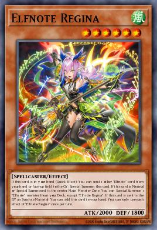

- **Copias y zona:** Main 3x. No altera las cantidades registradas.
- **Nombre oficial de referencia:** Elfnota Regina. CID cotejado con la ficha oficial; el nombre histórico del inventario se conserva aunque su grafía/traducción difiera.
- **Función principal y secundaria:** extensor desde la mano mediante **Efecto Rápido** · Invocación desde Deck al llegar al **centro** · recuperación propia si se envía al GY como material Sincro.
- **Estado de sinergia y función:** **motor directo Elfnota** con Lucina, Tinia y Fortuna; no hay una búsqueda de carta genérica impresa en Regina.
- **Papel como recurso, descarte o coste:** su Invocación Especial **envía 1 OTRA carta «Elfnote»** de la mano o del Campo propio boca arriba al GY como coste; la carta enviada puede ser monstruo o soporte que cumpla el nombre.
- **Efecto operativo (paráfrasis analítica):** Regina en **mano** puede enviar la otra Elfnote como coste e Invocarse Especialmente; si fue Invocada Normal o Especialmente **a la Zona Principal central**, puede Invocar 1 monstruo «Elfnote» **distinto de Regina** desde Deck. Si fue enviada al GY como **Material de Sincronía**, puede **añadirse a sí misma desde GY a mano**.
- **Mapa de activación y resultados:** Lucina centro → busca Regina → Regina **desde mano** envía Lucina boca arriba al GY como coste → Regina se Invoca al centro ya libre → Regina puede Invocar Tinia o Fortuna desde Deck. El último efecto de regreso a mano solo existe si Regina se usa **como material Sincro**.
- **Ventanas de activación identificadas:** efecto de mano **Rápido**; disparo si es Invocada **Normal o Especialmente al centro**; disparo si llega al GY **como material de Sincronía**. Son tres efectos distintos, cada uno una vez por turno.
- **Costes o recursos potenciales:** otra Elfnote real de mano/campo boca arriba; si se niega la Invocación/efecto tras el pago, la carta enviada **no regresa automáticamente**.
- **Restricciones y requisitos:** se debe disponer de una carta distinta para enviar; **el centro debe estar libre al Invocarla** si se pretende su efecto desde Deck; el objetivo del Deck no puede ser otra Regina.
- **Prioridad al ir primero:** convertir la búsqueda de Lucina en Regina central y un segundo cuerpo desde Deck, sin consumir la Normal de la línea base.
- **Prioridad al ir segundo:** ofrecer extensión rápida, pero no atribuirle rebote ni negación propios; los efectos defensivos proceden de Lucina/Tinia/Fortuna según su posición.
- **Medio/tardío y recuperación:** si Regina fue material de Sincro, puede regresar desde GY a la mano; **estar simplemente en GY no permite Invocarla** por su efecto de mano.
- **Sinergias y acceso a líneas:** `650:A09:ELFNOTE:LUCINA01` y `650:A09:ELFNOTE:TINIA01`; el retorno a mano aparece en la ruta Junora donde Regina es material legal.
- **Riesgo / brick / interrupciones:** sin otra Elfnote para enviar no activa su Invocación desde mano; fuera del centro no activa el efecto de traer desde Deck; si el rival retira el cuerpo o niega el disparo, detener la extensión.
- **Utilidad editorial:** 5/5 para este deck (estimación por rol y zona, no probabilidad calculada). No cambiar copias; cualquier sugerencia de alta/baja pasa por el apartado 22 y aprobación.
- **Referencia oficial y trazabilidad:** https://www.db.yugioh-card.com/yugiohdb/card_search.action?cid=22523&ope=2&request_locale=es. **Confianza:** texto y tipo de efecto cotejados en Konami; síntesis táctica editorial, no demostración de combo.
- **Aplicación concreta dentro de este deck (A06):** Lucina busca Regina; Regina consume a Lucina u otra Elfnote y trae Tinia/Fortuna desde Deck **solo al centro**. Regina recupera su propia carta al ser material Sincro. Konami CID 22523, **función oficial cotejada 18-11-2026**.

**USO PRÁCTICO Y SINERGIA — Elfnote Regina**

- **Label funcional:** **Motor directo: coste Elfnota → Regina central → Invocación desde Deck**; recuperación de sí misma si llega al GY como material Sincro.
- **Qué hace:** desde mano, envía otra Elfnota como coste para Invocarse; desde el centro trae una Elfnota distinta desde Deck; vuelve a mano si se usó como material Sincro.
- **Cómo aprovecharla en este deck:** buscarla con Lucina, enviar a Lucina del centro, Invocar Regina en el centro y traer Tinia/Fortuna desde Deck. No confundir el retorno a mano con una Invocación desde GY.
- **Al jugar primero:** prolongar el campo con un segundo cuerpo y soporte continuo sin gastar la Normal de la ruta de Continuas.
- **Al jugar segundo:** usar su cuerpo para ganar presencia; valorar qué carta propia se consume antes de responder a amenazas.
- **Cuándo tener precaución:** pagar el envío antes de la resolución; si el centro queda ocupado o el disparo es negado, no reclamar monstruo desde Deck.

#### 02. Elfnote Lucina

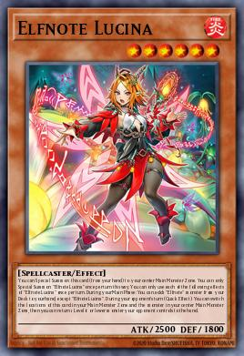

- **Copias y zona:** Main 3x. No altera las cantidades registradas.
- **Nombre oficial de referencia:** Elfnota Lucina. CID cotejado con la ficha oficial; el nombre histórico del inventario se conserva aunque su grafía/traducción difiera.
- **Función principal y secundaria:** **starter de una carta** · busca monstruo Elfnota · extiende desde mano a zona central · respuesta de ubicación y rebote condicional en turno rival.
- **Estado de sinergia y función:** **motor directo** de Regina, Power Patron, Tinia y de las alternativas Sincro desde su propio Nivel 6.
- **Papel como recurso, descarte o coste:** Lucina puede enviarse desde Campo al GY para pagar la Invocación de Regina, o emplearse como **no Cantante Nivel 6** para Sincronía con Power Patron Nivel 1; no se atribuye coste a la búsqueda propia.
- **Efecto operativo (paráfrasis analítica):** puede Invocarse Especialmente **desde la mano a la Zona Principal central** (una vez por turno por ese procedimiento); durante tu Main Phase añade 1 monstruo «Elfnote» del Deck **excepto Lucina**. Durante el **turno del rival** (Efecto Rápido), intercambia su ubicación con la del monstruo en tu Zona Principal central y **después puede** devolver a mano 1 monstruo rival de **Nivel 6 o menor**.
- **Mapa de activación y resultados:** Lucina de mano→centro→busca Regina (ruta de Continuas) **o** Power Patron (ruta Sincro); la búsqueda es **una sola** ese turno. Si Lucina está lateral junto a otro cuerpo central en turno rival, puede intercambiar sus zonas y rebotar objetivo rival elegible.
- **Ventanas de activación identificadas:** Invocación propia a la central sin Normal; búsqueda durante **tu Main Phase**; Efecto Rápido de intercambio **solo en turno rival**; cada efecto activado una vez por turno.
- **Costes o recursos potenciales:** no descarta ni tributa para buscar; ocupar la zona central puede competir con Tinia/Fortuna. El intercambio no equivale a mover cualquier monstruo de forma unilateral.
- **Restricciones y requisitos:** el centro libre es indispensable para Invocarla desde mano por su procedimiento; la búsqueda solo obtiene **monstruos Elfnota** distintos de Lucina; el rebote exige monstruo del rival **con Nivel 6 o menor**, no Xyz/Enlace sin Nivel.
- **Prioridad al ir primero:** elegir entre acceso a Regina/Continuas y acceso a Patron/Sincro; son planes alternativos desde la misma búsqueda de Lucina, no campos simultáneos.
- **Prioridad al ir segundo:** conservar el Efecto Rápido de turno rival como respuesta posicional posterior; por sí sola no rebate cartas en tu propio turno.
- **Medio/tardío y recuperación:** si Lucina está en GY puede ser objetivo de la Invocación de Strelitzia; Lucina por sí misma **no** tiene un efecto de revivirse desde GY.
- **Sinergias y acceso a líneas:** `650:A09:ELFNOTE:LUCINA01`, `650:A09:ELFNOTE:LUCINA:STRELITZIA02` y variante `650:A09:LUCINA:PATRON:CRYSTAL_WING10`; todas consumen su búsqueda en la línea elegida.
- **Riesgo / brick / interrupciones:** negar la búsqueda deja Lucina en centro, sin Patron/Regina añadidos; si el centro está ocupado, no garantizar su Invocación propia; el rebote requiere el intercambio válido y objetivo con Nivel.
- **Utilidad editorial:** 5/5 para este deck (estimación por rol y zona, no probabilidad calculada). No cambiar copias; cualquier sugerencia de alta/baja pasa por el apartado 22 y aprobación.
- **Referencia oficial y trazabilidad:** https://www.db.yugioh-card.com/yugiohdb/card_search.action?cid=22116&ope=2&request_locale=es. **Confianza:** texto y tipo de efecto cotejados en Konami; síntesis táctica editorial, no demostración de combo.
- **Aplicación concreta dentro de este deck (A06):** Lucina→Regina (Continuas) **o** Lucina→Patron (Sincro); costo y materiales documentados por destino. Konami CID 22116, **función oficial cotejada 18-11-2026**.

**USO PRÁCTICO Y SINERGIA — Elfnote Lucina**

- **Label funcional:** **Starter directo que elige entre dos submotores excluyentes**: Regina/Continuas o Patron/Sincro.
- **Qué hace:** se Invoca desde mano al centro, busca **un** monstruo Elfnota no llamado Lucina y, en turno rival, puede intercambiar posición con el monstruo central y rebotar un monstruo rival de Nivel ≤6.
- **Cómo aprovecharla en este deck:** buscar Regina para extensión lateral o Patron para Sincronías 6+1; no atribuir ambas búsquedas a la misma copia en el mismo turno.
- **Al jugar primero:** decidir el destino real del recurso buscado y conservar Normal para Patron si se elige Sincro.
- **Al jugar segundo:** proteger secuencia frente a negación de búsqueda; su rebote se reserva para el turno del rival.
- **Cuándo tener precaución:** el centro debe quedar disponible al Invocarla; el intercambio no funciona si no hay otro monstruo central válido o falta objetivo rival legal.

#### 03. Elfnote Tinia

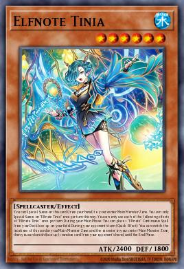

- **Copias y zona:** Main 3x. No altera las cantidades registradas.
- **Nombre oficial de referencia:** Elfnota Tinia. CID cotejado con la ficha oficial; el nombre histórico del inventario se conserva aunque su grafía/traducción difiera.
- **Función principal y secundaria:** **starter de soporte** · coloca Mágica Continua Elfnota desde Deck · interacción con la mano rival **temporal y aleatoria** en turno rival.
- **Estado de sinergia y función:** **motor directo** con «Elfnotes: Welcome Home» (CID 22159) y extensión a Lucina/Regina de Atributo distinto.
- **Papel como recurso, descarte o coste:** Tinia AGUA del Campo puede ser enviada al GY como **coste de Welcome Home**, que a su vez puede traer Lucina FUEGO desde Deck. Tinia no se descarta para activar su efecto de colocación.
- **Efecto operativo (paráfrasis analítica):** puede Invocarse Especialmente desde la mano a la **Zona Principal central** una vez por turno por ese procedimiento. Durante **tu Main Phase** puede **colocar boca arriba una Mágica Continua «Elfnote» directamente desde Deck**. En turno rival, Efecto Rápido: intercambia su ubicación con el monstruo central; después puede **desterrar al azar y boca arriba 1 carta de la mano rival hasta la End Phase**.
- **Mapa de activación y resultados:** Tinia de mano→centro→**Welcome Home boca arriba** desde Deck; Welcome envía Tinia como coste→Lucina de Deck con Atributo original distinto. En turno rival, con Tinia lateral + otro monstruo central, puede intercambiar y desterrar **temporalmente** una carta aleatoria de la mano rival.
- **Ventanas de activación identificadas:** colocación de Continua durante propia Main Phase; intercambio **solo turno rival**; Invocación especial propia a centro. Cada efecto activado una vez por turno.
- **Costes o recursos potenciales:** Tinia enviada del Campo al GY **por efecto de Welcome Home**, no por colocar la Mágica; el destierro de mano rival no es permanente al cumplirse la End Phase.
- **Restricciones y requisitos:** requiere Mágica Continua Elfnota aún en Deck para la colocación; la Invocación propia necesita centro libre; el intercambio necesita dos monstruos propios con posiciones intercambiables y carta rival en mano para destierro.
- **Prioridad al ir primero:** habilitar Welcome Home con una sola Tinia y pasar a Lucina/Regina/soporte en el orden escrito por A09:TINIA01.
- **Prioridad al ir segundo:** no prometer remoción de Campo rival: su interrupción del turno rival es **sobre la mano** y por azar.
- **Medio/tardío y recuperación:** Tinia puede ser revivida por Strelitzia si está en GY y cumple su Nivel; no tiene autorrevivir impreso.
- **Sinergias y acceso a líneas:** `650:A09:ELFNOTE:TINIA01` y `650:A09:ELFNOTE:TINIA:STRELITZIA04` documentan bifurcaciones excluyentes desde la misma Tinia.
- **Riesgo / brick / interrupciones:** si Welcome Home no está disponible, Tinia no coloca una carta distinta de tipo Trampa por ese efecto; sin otra pieza central en turno rival no se intercambia, y sin mano rival no se destierra.
- **Utilidad editorial:** 4/5 para este deck (estimación por rol y zona, no probabilidad calculada). No cambiar copias; cualquier sugerencia de alta/baja pasa por el apartado 22 y aprobación.
- **Referencia oficial y trazabilidad:** https://www.db.yugioh-card.com/yugiohdb/card_search.action?cid=22117&ope=2&request_locale=es. **Confianza:** texto y tipo de efecto cotejados en Konami; síntesis táctica editorial, no demostración de combo.
- **Aplicación concreta dentro de este deck (A06):** Tinia→Welcome Home→Lucina, con envío de Tinia como coste de la Continua; rotación de centro y destierro **temporal** de mano rival. Konami CID 22117, **función oficial cotejada 18-11-2026**.

**USO PRÁCTICO Y SINERGIA — Elfnote Tinia**

- **Label funcional:** **Motor directo de Mágica Continua Elfnota**, no buscadora genérica de monstruos.
- **Qué hace:** desde el centro o lateral, durante tu Main coloca **una Continua Mágica** Elfnota desde Deck; en turno rival puede cambiar su zona y desterrar temporalmente una carta de mano rival al azar.
- **Cómo aprovecharla en este deck:** activar Welcome Home para enviar Tinia AGUA y sacar Lucina FUEGO; diferenciar esta rama de la línea de Sincro protegida.
- **Al jugar primero:** coloca Welcome Home y prepara cambios de zona en turno rival.
- **Al jugar segundo:** identificar si el rival conserva cartas en mano; la interrupción no afecta a cartas que ya están en Campo.
- **Cuándo tener precaución:** no confundir Continua Mágica con Trampa; el destierro de mano termina en End Phase, y la salida a Lucina consume Tinia por coste de Welcome.

#### 04. Elfnote Power Patron

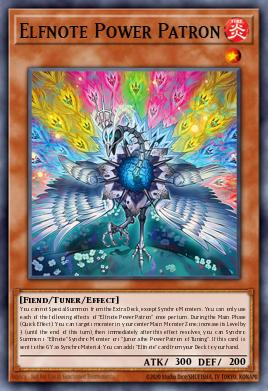

- **Copias y zona:** Main 2x. No altera las cantidades registradas.
- **Nombre oficial de referencia:** Elfnota Modelo de Poder. CID cotejado con la ficha oficial; el nombre histórico del inventario se conserva aunque su grafía/traducción difiera.
- **Función principal y secundaria:** **Cantante Nivel 1** · habilitador de Sincronía inmediata de destinos específicos · buscador de **carta Elfnota** cuando es material Sincro enviado al GY.
- **Estado de sinergia y función:** **motor directo de Sincronía** con Lucina, Strelitzia, June Pride y Crystal Wing; su segundo disparo aporta continuidad al mismo motor.
- **Papel como recurso, descarte o coste:** se envía desde Campo al GY como **Material de Sincronía**; eso habilita buscar una carta «Elfnote» de Deck, no equivale a buscar mientras está inmóvil en GY.
- **Efecto operativo (paráfrasis analítica):** mientras esté aplicando su restricción, **solo se pueden Invocar Especialmente monstruos Sincro del Extra**. Durante Main Phase, Efecto Rápido: seleccionar un monstruo en **tu zona central**, aumentar **su Nivel +3** hasta final del turno e inmediatamente después de resolver **puedes** Invocar por Sincronía **1 Sincro «Elfnote» o «Junora the Power Patron of Tuning»**, con materiales legales. **Si Patron es enviado al GY como Material Sincro**, añade 1 carta «Elfnote» del Deck a mano.
- **Mapa de activación y resultados:** Lucina6 centro + Patron1 lateral → **sin subir Niveles** Strelitzia7 (o Arcanite/Dawn según requisitos); **subiendo Lucina6→9** y usando la Sincronía inmediata autorizada, June Pride10. Patron enviado al GY por primera Sincronía busca Regina; si se revive para una segunda Sincronía con Crystal Wing, **no busca por segunda vez ese turno**.
- **Ventanas de activación identificadas:** cambio de Nivel **Efecto Rápido durante Main Phase**; búsqueda **al ser enviado al GY como material de Sincronía**; cada uno de esos dos efectos una vez por turno.
- **Costes o recursos potenciales:** ambos cuerpos y sus Niveles efectivos se consumen para Sincronía; el objetivo central del +3 debe existir al activar y resolverse; no confundir aumento de Nivel con pago de LP o descarte.
- **Restricciones y requisitos:** el efecto inmediato de Sincronía por +3 solo permite **Sincro Elfnota o Junora**; Crystal Wing, Arcanite y Dawn requieren la Invocación Sincro ordinaria con material válido, **sin utilizar ese efecto inmediato**. La restricción al Extra mientras Patron se aplica excluye Link/Fusión.
- **Prioridad al ir primero:** desde Lucina elegir sinergia de Strelitzia/Crystal Wing frente a June Pride y no gastar el +3 si se necesita suma 6+1.
- **Prioridad al ir segundo:** usar búsqueda por material para sostener mano tras Sincronizar, pero no presentarla como negación propia del Cantante.
- **Medio/tardío y recuperación:** Strelitzia puede revivirlo desde GY si está disponible; la búsqueda de Patron está limitada a una por turno, aun con múltiples envíos al GY ese turno.
- **Sinergias y acceso a líneas:** `650:A09:ELFNOTE:LUCINA:STRELITZIA02`, `650:A09:LUCINA:PATRON:JUNE_PRIDE07` y variante `650:A09:LUCINA:PATRON:CRYSTAL_WING10` tienen procedimientos distintos de nivel y material.
- **Riesgo / brick / interrupciones:** aumentar Nivel antes de buscar Crystal Wing rompe la suma 7+1 posterior; una interrupción que retire Patron antes de Sincronizar deja la Normal consumida; el efecto inmediato no Invoca cualquier Sincro genérica.
- **Utilidad editorial:** 5/5 para este deck (estimación por rol y zona, no probabilidad calculada). No cambiar copias; cualquier sugerencia de alta/baja pasa por el apartado 22 y aprobación.
- **Referencia oficial y trazabilidad:** https://www.db.yugioh-card.com/yugiohdb/card_search.action?cid=22119&ope=2&request_locale=es. **Confianza:** texto y tipo de efecto cotejados en Konami; síntesis táctica editorial, no demostración de combo.
- **Aplicación concreta dentro de este deck (A06):** `650:A06:STRELITZIA:PATRON:CRYSTAL_WING03` y las rutas alternativas Sincro. Patron1 es Cantante y buscador **al ir a GY como material**, no un buscador automático desde Campo. Konami CID 22119, **función oficial cotejada 18-11-2026**.

**USO PRÁCTICO Y SINERGIA — Elfnote Power Patron**

- **Label funcional:** **Cantante Nivel 1 y buscador tras material Sincro**; controla compatibilidad de Extra, no es handtrap.
- **Qué hace:** puede subir tres Niveles al monstruo central y ofrecer una **Sincronía inmediata limitada**; al ser material Sincro enviado al GY, busca una Elfnota del Deck.
- **Cómo aprovecharla en este deck:** con Lucina6, omitir +3 para Strelitzia7 o aplicarlo para June Pride10; Crystal Wing requiere la segunda Sincronía a partir de Strelitzia y Patron revivido.
- **Al jugar primero:** reservar el efecto de modificación solo si el destino es legal y desea la suma aumentada.
- **Al jugar segundo:** no prometer una negación propia; conservar la búsqueda al usarlo como material para reponer mano.
- **Cuándo tener precaución:** no Invocar Link mientras la restricción esté activa; no hacer búsqueda doble al reciclar Patron en el mismo turno.

#### 05. Elfnote Fortuna

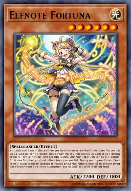

- **Copias y zona:** Main 1x. No altera las cantidades registradas.
- **Nombre oficial de referencia:** Elfnota Fortuna. CID cotejado con la ficha oficial; el nombre histórico del inventario se conserva aunque su grafía/traducción difiera.
- **Función principal y secundaria:** **colocadora de Trampa Continua Elfnota** · respuesta posicional de rebote de **Mágica/Trampa boca arriba** en turno rival.
- **Estado de sinergia y función:** **motor directo de soporte** con Rapsodia de Locura CID 22173 y el cuerpo central que posibilita su respuesta de cambio de ubicación.
- **Papel como recurso, descarte o coste:** Fortuna no paga envío/descarte por colocar la Trampa; puede ser material si hay una ruta concreta. Si la Trampa ya salió del Deck, no crear otra copia adicional.
- **Efecto operativo (paráfrasis analítica):** puede Invocarse Especialmente desde mano a **tu zona central** una vez por turno por ese procedimiento; en tu Main Phase **coloca una Trampa Continua «Elfnote» boca arriba desde mano o Deck**. Durante turno rival, Efecto Rápido, intercambia su ubicación con el monstruo central y **después puede** devolver **una Mágica/Trampa boca arriba del Campo** a mano.
- **Mapa de activación y resultados:** Regina central trae Fortuna lateral del Deck; Fortuna lateral **coloca Rapsodia de Locura boca arriba**, no una Mágica Continua; durante turno rival, Fortuna lateral puede cambiarse con Regina central y rebotar **una M/T boca arriba** si existe.
- **Ventanas de activación identificadas:** colocar Trampa en **tu Main Phase**; intercambio y rebote **solo en turno rival**; cada efecto activado una vez por turno.
- **Costes o recursos potenciales:** no hay envío como coste para colocar Rapsodia; el intercambio exige dos monstruos propios con posiciones permutables y M/T boca arriba para el rebote opcional.
- **Restricciones y requisitos:** la colocación de Trampa es distinta a colocación de Mágica por Tinia; un objetivo M/T **boca abajo no es elegible** para el rebote posterior; debe sobrevivir la carta hasta resolver.
- **Prioridad al ir primero:** traer Fortuna por Regina, colocar Rapsodia, conservar Fortuna lateral para contestar en turno rival desde la posición adecuada.
- **Prioridad al ir segundo:** no prometer rebote inmediato en propia Main Phase: el efecto de intercambio es de **turno rival**.
- **Medio/tardío y recuperación:** Strelitzia puede traerla desde GY si cumple sus requisitos, pero Fortuna no se revive sola ni añade Rapsodia a mano como búsqueda genérica.
- **Sinergias y acceso a líneas:** `650:A09:ELFNOTE:TINIA01` y `650:A09:ELFNOTE:LUCINA01` dejan **Regina centro + Fortuna lateral + Rapsodia** si resuelven los pasos.
- **Riesgo / brick / interrupciones:** sin Rapsodia disponible en mano o Deck no colocarla por ese efecto; no confundir intercambio con negación, ni el rebote de M/T boca arriba con destrucción.
- **Utilidad editorial:** 4/5 para este deck (estimación por rol y zona, no probabilidad calculada). No cambiar copias; cualquier sugerencia de alta/baja pasa por el apartado 22 y aprobación.
- **Referencia oficial y trazabilidad:** https://www.db.yugioh-card.com/yugiohdb/card_search.action?cid=22118&ope=2&request_locale=es. **Confianza:** texto y tipo de efecto cotejados en Konami; síntesis táctica editorial, no demostración de combo.
- **Aplicación concreta dentro de este deck (A06):** Regina→Fortuna→Rapsodia Trampa Continua; turno rival Fortuna lateral↔Regina centro y rebote condicionado de M/T boca arriba. Konami CID 22118, **función oficial cotejada 18-11-2026**.

**USO PRÁCTICO Y SINERGIA — Elfnote Fortuna**

- **Label funcional:** **Soporte directo de Trampa Continua**, no buscadora genérica ni negación propia.
- **Qué hace:** coloca una Trampa Continua Elfnota desde mano/Deck; en turno rival intercambia zonas y puede rebotar M/T boca arriba.
- **Cómo aprovecharla en este deck:** traerla con Regina, colocar Rapsodia y conservar la opción de intercambio con el centro ocupado por Regina.
- **Al jugar primero:** establecer Rapsodia para el turno rival sin gastar una segunda búsqueda de Lucina.
- **Al jugar segundo:** identificar M/T rival boca arriba; no atribuir efecto de rebote en tu propio turno.
- **Cuándo tener precaución:** Tinia coloca Mágica Continua; Fortuna coloca Trampa Continua. Una M/T boca abajo no sirve como objetivo de su rebote.

#### 06. Fidraulis Harmony

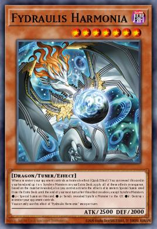

- **Copias y zona:** Main 3x. No altera las cantidades registradas.
- **Nombre oficial de referencia:** Harmonía Fydraulis. El inventario registra «Fidraulis Harmony»; Konami identifica la misma pieza como «Fydraulis Harmonia» (verificar alias al publicar).
- **Función principal y secundaria:** respuesta desde **mano** a efecto de monstruo rival · Cantante Nivel 7 · envío de Sincro desde Extra al GY · destrucción de monstruo rival en umbral máximo.
- **Estado de sinergia y función:** **enlace directo condicional con Malong CID 18666** mediante envío desde Extra. Como material Sincro Nivel 7, puede combinarse con Medius4 para Destorbim11 si ambos están presentes en Main Phase propia.
- **Papel como recurso, descarte o coste:** se muestra en la mano junto a hasta cinco Sincros del propio Extra; revelar al menos tres Sincros junto con Harmonia habilita su envío de **uno de los Sincros revelados**. No se destierra ni se descarta para pagar el efecto.
- **Efecto operativo (paráfrasis analítica):** cuando un monstruo controlado por el rival activa su efecto, revelar Harmonia desde mano y hasta 5 Sincros del Extra; con **2+ reveladas** se Invoca Especialmente **Harmonia desde mano**, con **4+** envía un Sincro revelado al GY y con **6** destruye un monstruo del rival, en orden.
- **Mapa de activación y resultados:** respuesta a monstruo rival → revelar Harmonia + 3 Sincros incluyendo Malong (4 reveladas) → Invocar Harmonia desde mano → enviar Malong desde Extra al GY; en cadena posterior, Malong puede rebotar carta boca arriba rival. **No** se Invoca un Sincro desde Extra por este efecto.
- **Ventanas de activación identificadas:** **Efecto Rápido en la mano**, directamente ante activación de efecto de monstruo rival; Malong inicia una cadena nueva después de terminar la cadena donde fue enviado.
- **Costes o recursos potenciales:** debe haber suficientes Sincros en Extra para revelar y un evento real de activación rival; si solo se revelan 2 o 3 cartas en total, **no** se envía ninguna del Extra.
- **Restricciones y requisitos:** una vez por turno para Harmonia; tras resolver, **no activar efectos de monstruos Invocados Especialmente desde Extra, salvo Sincros, hasta finalizar el próximo turno propio**, según texto. No confundirlo con prohibición de Invocación ni con efecto de Malong.
- **Prioridad al ir primero:** asegurar el centro y acceso a motores Sincro antes de gastar extensores. Para esta carta: Reservar la respuesta para la ventana rival exacta; no es una pieza buscadora de nuestro motor.
- **Prioridad al ir segundo:** habilitar rebote, negación o protección antes de comprometer el monstruo del centro. Identificar primero la respuesta rival que afecta su función «interrupción».
- **Medio/tardío y recuperación:** con menos de tres Sincros disponibles para revelar en Extra, disminuye la salida de envío; sin efecto de monstruo rival en cadena, no puede iniciar su respuesta.
- **Sinergias y acceso a líneas:** Harmonia→Malong es un **uso comprobable por envío**; Harmonia7+Medius4 es un **acceso condicionado por materiales** a Destorbim. No son dos activaciones automáticas ni requieren que Malong sea Invocado.
- **Riesgo / brick / interrupciones:** si el rival no activa monstruo, Harmonia permanece en mano salvo otro medio válido; si su Invocación falla, no se presume el envío posterior; la restricción de activaciones desde Extra persiste cuando el efecto resuelve.
- **Utilidad editorial:** extensor/interruptor condicionado por evento rival y disponibilidad de Sincros; conservar las 3 copias registradas sin inferir porcentaje de éxito.
- **Referencia oficial y trazabilidad:** https://www.db.yugioh-card.com/yugiohdb/card_search.action?cid=22533&ope=2&request_locale=es. **Confianza:** texto y tipo de efecto cotejados en Konami; síntesis táctica editorial, no demostración de combo.
- **Aplicación concreta dentro de este deck (A06):** `650:A06:HARMONIA:MALONG:ENVIO01` — envío y rebote condicionado con CID 18666; `650:A06:HARMONIA:MEDIUS:DESTORBIM02` — cuerpo Cantante Nivel 7 para segunda línea Sincro con Medius Nivel 4.

**USO PRÁCTICO Y SINERGIA — Fidraulis Harmony**

- **Label funcional:** **Puente DIRECTO por envío desde Extra (Malong) + material Cantante condicionado para Destorbim**.
- **Qué hace:** desde mano, responde a monstruo rival revelando Sincros; con cuatro reveladas en total envía uno al GY y con seis también destruye un monstruo rival.
- **Cómo aprovecharla en este deck:** revelar Malong y dos Sincros más junto con Harmonia ante una activación rival, enviarlo al GY y preparar la cadena de rebote; si Harmonia sobrevive en campo junto con Medius4 en tu Main Phase, puede Sincronizar Destorbim11.
- **Al jugar primero:** asegurar el centro y acceso a motores Sincro antes de gastar extensores. Para esta carta: Reservar la respuesta para la ventana rival exacta; no es una pieza buscadora de nuestro motor.
- **Al jugar segundo:** habilitar rebote, negación o protección antes de comprometer el monstruo del centro. Identificar primero la respuesta rival que afecta su función «interrupción».
- **Cuándo tener precaución:** Riesgo operativo: centro ocupado, restricción a Sincro y dependencia de objetivos de Deck/Extra. Confirmar objetivos disponibles y costes antes de activar. Puede emplearse en cadena sólo cuando se cumpla su condición concreta.

#### 07. Medius the Pure

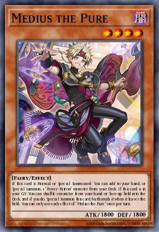

- **Copias y zona:** Main 2x. No altera las cantidades registradas.
- **Nombre oficial de referencia:** Medius el Puro. CID cotejado con la ficha oficial; el nombre histórico del inventario se conserva aunque su grafía/traducción difiera.
- **Función principal y secundaria:** buscador o **Invocador desde Deck** de monstruo «Power Patron» al ser Invocado · reciclaje de monstruo para **autorrevivir desde GY**.
- **Estado de sinergia y función:** **puente directo** con Power Patron CID 22119 y **material condicional** con Harmonia CID 22533 para Destorbim.
- **Papel como recurso, descarte o coste:** desde su GY **baraja 1 monstruo de mano o Campo propio boca arriba al Deck** para Invocarse Especialmente a sí mismo. Ese Medius será **desterrado al abandonar el Campo**.
- **Efecto operativo (paráfrasis analítica):** si Medius es Invocado Normal o Especialmente, puede **añadir a mano O Invocar Especialmente desde Deck** un monstruo «Power Patron» (elegir una de las dos opciones, no ambas). Si Medius está en GY, puede barajar al Deck un monstruo de mano/Campo propio boca arriba y, **si lo hace**, revivir Medius del GY; al salir del Campo será desterrado.
- **Mapa de activación y resultados:** Normal Medius→buscar Patron a mano (permite retrasar la restricción Extra de Patron) **o** Invocarlo del Deck (establece cuerpo, pero activa su restricción Sincro). Con Medius GY y otro monstruo disponible para barajar, revivir Medius y marcar destierro al salir.
- **Ventanas de activación identificadas:** disparo **al ser Invocado Normal o Especialmente**; efecto de Medius **en GY** para su propio regreso, que no es Efecto Rápido. Cada efecto una vez por turno.
- **Costes o recursos potenciales:** 1 monstruo real de mano o Campo boca arriba para barajar al Deck; no confundir barajar con añadir el monstruo a mano ni recuperar Patron del GY.
- **Restricciones y requisitos:** necesita un monstruo Power Patron disponible en Deck para la primera función; el regreso desde GY exige monstruo válido para devolver al Deck y zona libre; se destierra al salir tras revivirse de ese modo.
- **Prioridad al ir primero:** elegir **añadir** Patron para mantener disponible una ruta Link antes de llevar al Cantante al Campo, o **Invocar** Patron si la meta inmediata es Sincronía.
- **Prioridad al ir segundo:** Medius aporta acceso al motor, pero no niega efectos ni destruye cartas por sí solo.
- **Medio/tardío y recuperación:** su efecto GY recicla **otro** monstruo y revive **al propio Medius**; la copia revivida no vuelve normalmente al GY cuando deja el Campo, pues se destierra.
- **Sinergias y acceso a líneas:** puente `650:A06:HARMONIA:MEDIUS:DESTORBIM02`; también la línea Lucina+Medius→S:P documentada con Patron **solo en mano**.
- **Riesgo / brick / interrupciones:** si Patron está agotado en Deck, el disparo inicial pierde ese objetivo; enviar Patron al Campo antes de Enlace activa el bloqueo Sincro; si no hay monstruo que barajar, no revive de GY.
- **Utilidad editorial:** 5/5 para este deck (estimación por rol y zona, no probabilidad calculada). No cambiar copias; cualquier sugerencia de alta/baja pasa por el apartado 22 y aprobación.
- **Referencia oficial y trazabilidad:** https://www.db.yugioh-card.com/yugiohdb/card_search.action?cid=21419&ope=2&request_locale=es. **Confianza:** texto y tipo de efecto cotejados en Konami; síntesis táctica editorial, no demostración de combo.
- **Aplicación concreta dentro de este deck (A06):** Medius→Patron (a mano **o** al Campo desde Deck); **Medius es no Cantante Nivel 4**, material con Harmonia Cantante7 para Destorbim11 si ambos coinciden. Konami CID 21419, **función oficial cotejada 18-11-2026**.

**USO PRÁCTICO Y SINERGIA — Medius the Pure**

- **Label funcional:** **Puente directo Power Patron y reciclaje propio condicionado**.
- **Qué hace:** Invocado Normal/Especialmente, **elige** buscar o Invocar un Patron desde Deck; desde GY baraja otro monstruo de mano/Campo al Deck para revivirse, con destierro al abandonar Campo.
- **Cómo aprovecharla en este deck:** añadir Patron a mano antes de Enlace con S:P o Invocarlo desde Deck para Sincronía. Medius4 con Harmonia7 permite Destorbim11 bajo el estado declarado.
- **Al jugar primero:** elegir destino de Patron según si todavía se necesitan Link/Fusión o solo Sincros.
- **Al jugar segundo:** no confundir acceso a material con remoción/negación propias.
- **Cuándo tener precaución:** revivir Medius consume otro monstruo para barajar; el Medius revivido será desterrado cuando deje el Campo.

#### 08. Vidolium the Unstable Power Patron of Unity

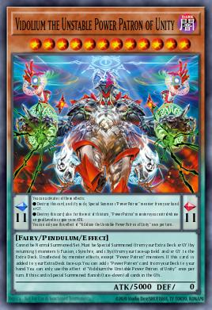

- **Copias y zona:** Main 2x. No altera las cantidades registradas.
- **Nombre oficial de referencia:** Vidolium el Inestable Modelo de Poder de Unidad. CID cotejado con la ficha oficial; el nombre histórico del inventario se conserva aunque su grafía/traducción difiera.
- **Función principal y secundaria:** searcher · buscador · recuperación · extensor · removal.
- **Estado de sinergia y función:** Recurso Péndulo condicionado. Es una clasificación de juego; revisar la relación concreta en A06.
- **Papel como recurso, descarte o coste:** Material o destino del Extra condicionado a los requisitos de invocación.
- **Efecto operativo (paráfrasis analítica):** búsqueda o incorporación de cartas a mano; recuperación e invocación desde Cementerio/destierro; acceso al campo desde la mano; destrucción de cartas o empleo de destrucción como detonante; destierro de recursos o de amenazas; presión de combate o modificación de estadísticas; protección o resistencia contra respuestas. Son operaciones detectadas en el texto, no efectos independientes garantizados; leer sus condiciones en la fuente.
- **Efecto Péndulo:** además de su efecto de monstruo, la fuente oficial declara acciones propias de su Zona Péndulo; aplicar por separado sus requisitos, coste y límite (incluido en clasificación mecánica).
- **Mapa de activación y resultados:** 1) efecto propio o continuo: Invocación Especial desde Extra Deck · 2) con condición explícita en la carta: incorpora la pieza indicada a la mano · 3) al invocarse: destierra el recurso u objetivo previsto · 4) efecto propio o continuo: Invocación Especial desde Cementerio, destruye la carta o recurso previsto. Cada operación está sujeta a la secuencia y al «si lo haces» del texto oficial.
- **Ventanas de activación identificadas:** al producirse una Invocación.
- **Costes o recursos potenciales:** sin coste independiente identificado en esta síntesis; comprobar las acciones previas al punto y coma de cada efecto.
- **Restricciones y requisitos:** hay límite por turno según el efecto concreto; interactúa con información oculta o resultados no siempre elegibles; tiene procedimiento especial de Invocación. 
- **Prioridad al ir primero:** asegurar el centro y acceso a motores Sincro antes de gastar extensores. Para esta carta: Convertir la activación en acceso a la siguiente pieza del motor, sin duplicar buscadores inútilmente.
- **Prioridad al ir segundo:** habilitar rebote, negación o protección antes de comprometer el monstruo del centro. Identificar primero la respuesta rival que afecta su función «searcher».
- **Medio/tardío y recuperación:** reciclar Cantantes, monstruos de Atributos distintos y zonas disponibles. Verificar que el objetivo de recuperación continúe disponible.
- **Sinergias y acceso a líneas:** Relación contextual con ocupación y rotación de la zona principal central, acceso a Cantantes y transición Sincro. Habilita una línea del motor sólo si coinciden recursos, objetivos y restricciones; no equivale a un combo completo validado.
- **Riesgo / brick / interrupciones:** No computar como invocación normal disponible: depende de su procedimiento y de recursos previos. No atribuirle velocidad rápida por el solo hecho de formar parte del motor.
- **Utilidad editorial:** 5/5 para este deck (estimación por rol y zona, no probabilidad calculada). No cambiar copias; cualquier sugerencia de alta/baja pasa por el apartado 22 y aprobación.
- **Referencia oficial y trazabilidad:** https://www.db.yugioh-card.com/yugiohdb/card_search.action?cid=22519&ope=2&request_locale=es. **Confianza:** texto y tipo de efecto cotejados en Konami; síntesis táctica editorial, no demostración de combo.
- **Aplicación concreta dentro de este deck (A06):** Estar en Main permite colocar Vidolium como Mágica en Zona Péndulo. Puede autodestruirse para Invocar un Power Patron de mano/GY o dar +5000 ATK a uno de Nivel original 12; al llegar boca arriba al Extra puede buscar Power Patron. Su Invocación como monstruo exige Fusión + Sincronía + Xyz distintos.

**USO PRÁCTICO Y SINERGIA — Vidolium the Unstable Power Patron of Unity**

- **Label funcional:** Sin sinergia demostrada (con la evidencia actual). Clasificación documental; una relación es válida solo si se satisfacen sus condiciones exactas.
- **Qué hace:** búsqueda o incorporación de cartas a mano; recuperación e invocación desde Cementerio/destierro; acceso al campo desde la mano; destrucción de cartas o empleo de destrucción como detonante; destierro de recursos o de amenazas; presión de combate o modificación de estadísticas; protección o resistencia contra respuestas. Son operaciones detectadas en el texto, no efectos independientes garantizados; leer sus condiciones en la fuente.
- **Cómo aprovecharla en este deck:** Estar en Main permite colocar Vidolium como Mágica en Zona Péndulo. Puede autodestruirse para Invocar un Power Patron de mano/GY o dar +5000 ATK a uno de Nivel original 12; al llegar boca arriba al Extra puede buscar Power Patron. Su Invocación como monstruo exige Fusión + Sincronía + Xyz distintos.
- **Al jugar primero:** asegurar el centro y acceso a motores Sincro antes de gastar extensores. Para esta carta: Convertir la activación en acceso a la siguiente pieza del motor, sin duplicar buscadores inútilmente.
- **Al jugar segundo:** habilitar rebote, negación o protección antes de comprometer el monstruo del centro. Identificar primero la respuesta rival que afecta su función «searcher».
- **Cuándo tener precaución:** No computar como invocación normal disponible: depende de su procedimiento y de recursos previos. No atribuirle velocidad rápida por el solo hecho de formar parte del motor.

#### 09. Bystial Magnamhut

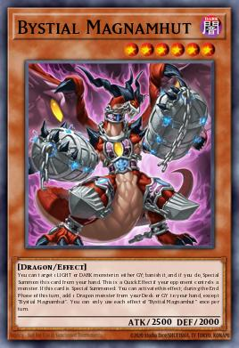

- **Copias y zona:** Main 1x. No altera las cantidades registradas.
- **Nombre oficial de referencia:** Magnamhut Abystial. CID cotejado con la ficha oficial; el nombre histórico del inventario se conserva aunque su grafía/traducción difiera.
- **Función principal y secundaria:** interrupción · searcher · buscador · extensor.
- **Estado de sinergia y función:** Sinergia indirecta (soporte o recursos). Es una clasificación de juego; revisar la relación concreta en A06.
- **Papel como recurso, descarte o coste:** No se demuestra que esta carta sea recurso de descarte o pago para otra.
- **Efecto operativo (paráfrasis analítica):** búsqueda o incorporación de cartas a mano; acceso al campo desde la mano. Son operaciones detectadas en el texto, no efectos independientes garantizados; leer sus condiciones en la fuente.
- **Mapa de activación y resultados:** 1) efecto propio o continuo: Invocación Especial desde Cementerio · 2) al invocarse: incorpora la pieza indicada a la mano. Cada operación está sujeta a la secuencia y al «si lo haces» del texto oficial.
- **Ventanas de activación identificadas:** End Phase; al producirse una Invocación; Efecto Rápido.
- **Costes o recursos potenciales:** sin coste independiente identificado en esta síntesis; comprobar las acciones previas al punto y coma de cada efecto.
- **Restricciones y requisitos:** hay límite por turno según el efecto concreto. 
- **Prioridad al ir primero:** asegurar el centro y acceso a motores Sincro antes de gastar extensores. Para esta carta: Reservar la respuesta para la ventana rival exacta; no es una pieza buscadora de nuestro motor.
- **Prioridad al ir segundo:** habilitar rebote, negación o protección antes de comprometer el monstruo del centro. Identificar primero la respuesta rival que afecta su función «interrupción».
- **Medio/tardío y recuperación:** reciclar Cantantes, monstruos de Atributos distintos y zonas disponibles. No asumir que por sí misma recicla recursos si el texto no lo permite.
- **Sinergias y acceso a líneas:** Relación contextual con ocupación y rotación de la zona principal central, acceso a Cantantes y transición Sincro. Habilita una línea del motor sólo si coinciden recursos, objetivos y restricciones; no equivale a un combo completo validado.
- **Riesgo / brick / interrupciones:** Riesgo operativo: centro ocupado, restricción a Sincro y dependencia de objetivos de Deck/Extra. Confirmar objetivos disponibles y costes antes de activar. Puede emplearse en cadena sólo cuando se cumpla su condición concreta.
- **Utilidad editorial:** 5/5 para este deck (estimación por rol y zona, no probabilidad calculada). No cambiar copias; cualquier sugerencia de alta/baja pasa por el apartado 22 y aprobación.
- **Referencia oficial y trazabilidad:** https://www.db.yugioh-card.com/yugiohdb/card_search.action?cid=17762&ope=2&request_locale=es. **Confianza:** texto y tipo de efecto cotejados en Konami; síntesis táctica editorial, no demostración de combo.
- **Aplicación concreta dentro de este deck (A06):** búsqueda o incorporación de cartas a mano; acceso al campo desde la mano.

**USO PRÁCTICO Y SINERGIA — Bystial Magnamhut**

- **Label funcional:** Sinergia indirecta. Clasificación documental; una relación es válida solo si se satisfacen sus condiciones exactas.
- **Qué hace:** búsqueda o incorporación de cartas a mano; acceso al campo desde la mano. Son operaciones detectadas en el texto, no efectos independientes garantizados; leer sus condiciones en la fuente.
- **Cómo aprovecharla en este deck:** búsqueda o incorporación de cartas a mano; acceso al campo desde la mano.
- **Al jugar primero:** asegurar el centro y acceso a motores Sincro antes de gastar extensores. Para esta carta: Reservar la respuesta para la ventana rival exacta; no es una pieza buscadora de nuestro motor.
- **Al jugar segundo:** habilitar rebote, negación o protección antes de comprometer el monstruo del centro. Identificar primero la respuesta rival que afecta su función «interrupción».
- **Cuándo tener precaución:** Riesgo operativo: centro ocupado, restricción a Sincro y dependencia de objetivos de Deck/Extra. Confirmar objetivos disponibles y costes antes de activar. Puede emplearse en cadena sólo cuando se cumpla su condición concreta.

#### 10. Dogmatika Ecclesia, the Virtuous

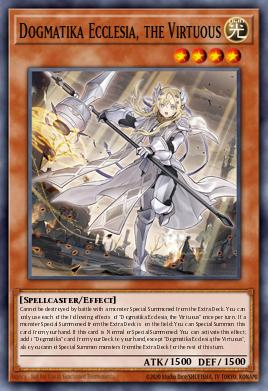

- **Copias y zona:** Main 1x. No altera las cantidades registradas.
- **Nombre oficial de referencia:** Ecclesia Dogmátik, la Virtuosa. CID cotejado con la ficha oficial; el nombre histórico del inventario se conserva aunque su grafía/traducción difiera.
- **Función principal y secundaria:** searcher · buscador · extensor · protección.
- **Estado de sinergia y función:** Sinergia indirecta (soporte o recursos). Es una clasificación de juego; revisar la relación concreta en A06.
- **Papel como recurso, descarte o coste:** No se demuestra que esta carta sea recurso de descarte o pago para otra.
- **Efecto operativo (paráfrasis analítica):** búsqueda o incorporación de cartas a mano; acceso al campo desde la mano; protección o resistencia contra respuestas. Son operaciones detectadas en el texto, no efectos independientes garantizados; leer sus condiciones en la fuente.
- **Mapa de activación y resultados:** 1) efecto propio o continuo: Invocación Especial desde Extra Deck · 2) con condición explícita en la carta: Invocación Especial desde mano · 3) al invocarla Normal/Especial: incorpora la pieza indicada a la mano. Cada operación está sujeta a la secuencia y al «si lo haces» del texto oficial.
- **Ventanas de activación identificadas:** al producirse una Invocación.
- **Costes o recursos potenciales:** sin coste independiente identificado en esta síntesis; comprobar las acciones previas al punto y coma de cada efecto.
- **Restricciones y requisitos:** hay límite por turno según el efecto concreto; puede bloquear tipos de Invocación del Extra Deck. 
- **Prioridad al ir primero:** asegurar el centro y acceso a motores Sincro antes de gastar extensores. Para esta carta: Convertir la activación en acceso a la siguiente pieza del motor, sin duplicar buscadores inútilmente.
- **Prioridad al ir segundo:** habilitar rebote, negación o protección antes de comprometer el monstruo del centro. Identificar primero la respuesta rival que afecta su función «searcher».
- **Medio/tardío y recuperación:** reciclar Cantantes, monstruos de Atributos distintos y zonas disponibles. No asumir que por sí misma recicla recursos si el texto no lo permite.
- **Sinergias y acceso a líneas:** Relación contextual con ocupación y rotación de la zona principal central, acceso a Cantantes y transición Sincro. Habilita una línea del motor sólo si coinciden recursos, objetivos y restricciones; no equivale a un combo completo validado.
- **Riesgo / brick / interrupciones:** Riesgo operativo: centro ocupado, restricción a Sincro y dependencia de objetivos de Deck/Extra. Confirmar objetivos disponibles y costes antes de activar. No atribuirle velocidad rápida por el solo hecho de formar parte del motor.
- **Utilidad editorial:** 5/5 para este deck (estimación por rol y zona, no probabilidad calculada). No cambiar copias; cualquier sugerencia de alta/baja pasa por el apartado 22 y aprobación.
- **Referencia oficial y trazabilidad:** https://www.db.yugioh-card.com/yugiohdb/card_search.action?cid=15239&ope=2&request_locale=es. **Confianza:** texto y tipo de efecto cotejados en Konami; síntesis táctica editorial, no demostración de combo.
- **Aplicación concreta dentro de este deck (A06):** búsqueda o incorporación de cartas a mano; acceso al campo desde la mano; protección o resistencia contra respuestas.

**USO PRÁCTICO Y SINERGIA — Dogmatika Ecclesia, the Virtuous**

- **Label funcional:** Sinergia indirecta. Clasificación documental; una relación es válida solo si se satisfacen sus condiciones exactas.
- **Qué hace:** búsqueda o incorporación de cartas a mano; acceso al campo desde la mano; protección o resistencia contra respuestas. Son operaciones detectadas en el texto, no efectos independientes garantizados; leer sus condiciones en la fuente.
- **Cómo aprovecharla en este deck:** búsqueda o incorporación de cartas a mano; acceso al campo desde la mano; protección o resistencia contra respuestas.
- **Al jugar primero:** asegurar el centro y acceso a motores Sincro antes de gastar extensores. Para esta carta: Convertir la activación en acceso a la siguiente pieza del motor, sin duplicar buscadores inútilmente.
- **Al jugar segundo:** habilitar rebote, negación o protección antes de comprometer el monstruo del centro. Identificar primero la respuesta rival que afecta su función «searcher».
- **Cuándo tener precaución:** Riesgo operativo: centro ocupado, restricción a Sincro y dependencia de objetivos de Deck/Extra. Confirmar objetivos disponibles y costes antes de activar. No atribuirle velocidad rápida por el solo hecho de formar parte del motor.

#### 11. Nervedo the Shadebeast Power Patron

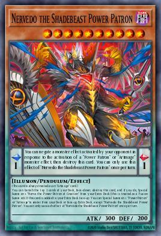

- **Copias y zona:** Main 1x. No altera las cantidades registradas.
- **Nombre oficial de referencia:** Nervedo la Bestia Sombra Modelo de Poder. CID cotejado con la ficha oficial; el nombre histórico del inventario se conserva aunque su grafía/traducción difiera.
- **Función principal y secundaria:** extensor · habilitador de Extra · removal.
- **Estado de sinergia y función:** Sin relación demostrada. Es una clasificación de juego; revisar la relación concreta en A06.
- **Papel como recurso, descarte o coste:** No se demuestra que esta carta sea recurso de descarte o pago para otra.
- **Efecto operativo (paráfrasis analítica):** extensión mediante monstruos procedentes del Deck; habilitación o continuación de una invocación del Extra Deck; destrucción de cartas o empleo de destrucción como detonante. Son operaciones detectadas en el texto, no efectos independientes garantizados; leer sus condiciones en la fuente.
- **Efecto Péndulo:** además de su efecto de monstruo, la fuente oficial declara acciones propias de su Zona Péndulo; aplicar por separado sus requisitos, coste y límite (incluido en clasificación mecánica).
- **Mapa de activación y resultados:** 1) efecto propio o continuo: realiza Fusión con materiales permitidos, Invocación Especial desde Extra Deck, destruye la carta o recurso previsto · 2) con condición explícita en la carta: Invocación Especial desde Extra Deck · 3) efecto propio o continuo: destruye la carta o recurso previsto. Cada operación está sujeta a la secuencia y al «si lo haces» del texto oficial.
- **Ventanas de activación identificadas:** requieren la fase o condición específica indicada en el texto; sin ventana rápida general asumida.
- **Costes o recursos potenciales:** sin coste independiente identificado en esta síntesis; comprobar las acciones previas al punto y coma de cada efecto.
- **Restricciones y requisitos:** hay límite por turno según el efecto concreto; interactúa con información oculta o resultados no siempre elegibles. 
- **Prioridad al ir primero:** asegurar el centro y acceso a motores Sincro antes de gastar extensores. Para esta carta: Convertir acceso al Deck en cuerpos o materiales antes de bloquearse con restricciones.
- **Prioridad al ir segundo:** habilitar rebote, negación o protección antes de comprometer el monstruo del centro. Identificar primero la respuesta rival que afecta su función «extensor».
- **Medio/tardío y recuperación:** reciclar Cantantes, monstruos de Atributos distintos y zonas disponibles. No asumir que por sí misma recicla recursos si el texto no lo permite.
- **Sinergias y acceso a líneas:** Relación contextual con ocupación y rotación de la zona principal central, acceso a Cantantes y transición Sincro. Habilita una línea del motor sólo si coinciden recursos, objetivos y restricciones; no equivale a un combo completo validado.
- **Riesgo / brick / interrupciones:** Riesgo operativo: centro ocupado, restricción a Sincro y dependencia de objetivos de Deck/Extra. Confirmar objetivos disponibles y costes antes de activar. No atribuirle velocidad rápida por el solo hecho de formar parte del motor.
- **Utilidad editorial:** 4/5 para este deck (estimación por rol y zona, no probabilidad calculada). No cambiar copias; cualquier sugerencia de alta/baja pasa por el apartado 22 y aprobación.
- **Referencia oficial y trazabilidad:** https://www.db.yugioh-card.com/yugiohdb/card_search.action?cid=22520&ope=2&request_locale=es. **Confianza:** texto y tipo de efecto cotejados en Konami; síntesis táctica editorial, no demostración de combo.
- **Aplicación concreta dentro de este deck (A06):** extensión mediante monstruos procedentes del Deck; habilitación o continuación de una invocación del Extra Deck; destrucción de cartas o empleo de destrucción como detonante. A06 aún no identifica su conexión; no equivale a incompatibilidad ni borra rutas A09.

**USO PRÁCTICO Y SINERGIA — Nervedo the Shadebeast Power Patron**

- **Label funcional:** Sin sinergia demostrada. Clasificación documental; una relación es válida solo si se satisfacen sus condiciones exactas.
- **Qué hace:** extensión mediante monstruos procedentes del Deck; habilitación o continuación de una invocación del Extra Deck; destrucción de cartas o empleo de destrucción como detonante. Son operaciones detectadas en el texto, no efectos independientes garantizados; leer sus condiciones en la fuente.
- **Cómo aprovecharla en este deck:** extensión mediante monstruos procedentes del Deck; habilitación o continuación de una invocación del Extra Deck; destrucción de cartas o empleo de destrucción como detonante. A06 aún no identifica su conexión; no equivale a incompatibilidad ni borra rutas A09.
- **Al jugar primero:** asegurar el centro y acceso a motores Sincro antes de gastar extensores. Para esta carta: Convertir acceso al Deck en cuerpos o materiales antes de bloquearse con restricciones.
- **Al jugar segundo:** habilitar rebote, negación o protección antes de comprometer el monstruo del centro. Identificar primero la respuesta rival que afecta su función «extensor».
- **Cuándo tener precaución:** Riesgo operativo: centro ocupado, restricción a Sincro y dependencia de objetivos de Deck/Extra. Confirmar objetivos disponibles y costes antes de activar. No atribuirle velocidad rápida por el solo hecho de formar parte del motor.
- **Sinergia no demostrada:** conservar su función individual si la tiene; no vincularla con otro combo sin una interacción real.

#### 12. Ash Blossom & Joyous Spring

- **Copias y zona:** Main 3x. No altera las cantidades registradas.
- **Nombre oficial de referencia:** Flor de Ceniza & Primavera Feliz. CID cotejado con la ficha oficial; el nombre histórico del inventario se conserva aunque su grafía/traducción difiera.
- **Función principal y secundaria:** handtrap · negación.
- **Estado de sinergia y función:** Utilidad independiente. Es una clasificación de juego; revisar la relación concreta en A06.
- **Papel como recurso, descarte o coste:** Descarte mencionado: comprobar carta que lo exige, zona, coste frente a efecto y utilidad del recurso.
- **Efecto operativo (paráfrasis analítica):** Descarta desde la mano para detener efectos que buscan, invocan o mandan cartas desde el Deck. 
- **Mapa de activación y resultados:** 1) con condición explícita en la carta: niega el efecto o la activación indicada, Invocación Especial desde Deck, incorpora la pieza indicada a la mano. Cada operación está sujeta a la secuencia y al «si lo haces» del texto oficial.
- **Ventanas de activación identificadas:** Efecto Rápido.
- **Costes o recursos potenciales:** descarte de mano.
- **Restricciones y requisitos:** hay límite por turno según el efecto concreto. 
- **Prioridad al ir primero:** asegurar el centro y acceso a motores Sincro antes de gastar extensores. Para esta carta: Reservar la respuesta para la ventana rival exacta; no es una pieza buscadora de nuestro motor.
- **Prioridad al ir segundo:** habilitar rebote, negación o protección antes de comprometer el monstruo del centro. Identificar primero la respuesta rival que afecta su función «handtrap».
- **Medio/tardío y recuperación:** reciclar Cantantes, monstruos de Atributos distintos y zonas disponibles. Verificar que el objetivo de recuperación continúe disponible.
- **Sinergias y acceso a líneas:** Relación contextual con ocupación y rotación de la zona principal central, acceso a Cantantes y transición Sincro. Habilita una línea del motor sólo si coinciden recursos, objetivos y restricciones; no equivale a un combo completo validado.
- **Riesgo / brick / interrupciones:** Reaccionar al efecto del Deck que habilite la jugada rival; no da búsquedas propias. Puede emplearse en cadena sólo cuando se cumpla su condición concreta.
- **Utilidad editorial:** 3/5 para este deck (estimación por rol y zona, no probabilidad calculada). No cambiar copias; cualquier sugerencia de alta/baja pasa por el apartado 22 y aprobación.
- **Referencia oficial y trazabilidad:** https://www.db.yugioh-card.com/yugiohdb/card_search.action?cid=12950&ope=2&request_locale=es. **Confianza:** texto y tipo de efecto cotejados en Konami; síntesis táctica editorial, no demostración de combo.
- **Aplicación concreta dentro de este deck (A06):** Descarta desde la mano para detener efectos que buscan, invocan o mandan cartas desde el Deck. Aporta respuesta o consistencia sin exigir enlace directo.

**USO PRÁCTICO Y SINERGIA — Ash Blossom & Joyous Spring**

- **Label funcional:** Función independiente. Clasificación documental; una relación es válida solo si se satisfacen sus condiciones exactas.
- **Qué hace:** Descarta desde la mano para detener efectos que buscan, invocan o mandan cartas desde el Deck.
- **Cómo aprovecharla en este deck:** Descarta desde la mano para detener efectos que buscan, invocan o mandan cartas desde el Deck. Aporta respuesta o consistencia sin exigir enlace directo.
- **Al jugar primero:** asegurar el centro y acceso a motores Sincro antes de gastar extensores. Para esta carta: Reservar la respuesta para la ventana rival exacta; no es una pieza buscadora de nuestro motor.
- **Al jugar segundo:** habilitar rebote, negación o protección antes de comprometer el monstruo del centro. Identificar primero la respuesta rival que afecta su función «handtrap».
- **Cuándo tener precaución:** Reaccionar al efecto del Deck que habilite la jugada rival; no da búsquedas propias. Puede emplearse en cadena sólo cuando se cumpla su condición concreta.

#### 13. Mulcharmy Fuwalos

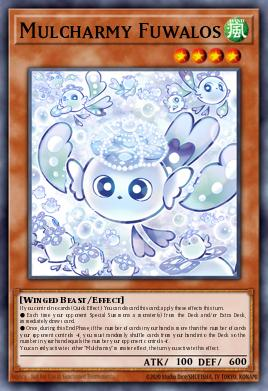

- **Copias y zona:** Main 3x. No altera las cantidades registradas.
- **Nombre oficial de referencia:** Fuwalos Multivadora. CID cotejado con la ficha oficial; el nombre histórico del inventario se conserva aunque su grafía/traducción difiera.
- **Función principal y secundaria:** handtrap · robo condicional.
- **Estado de sinergia y función:** Utilidad independiente. Es una clasificación de juego; revisar la relación concreta en A06.
- **Papel como recurso, descarte o coste:** Descarte mencionado: comprobar carta que lo exige, zona, coste frente a efecto y utilidad del recurso.
- **Efecto operativo (paráfrasis analítica):** Con campo propio sin cartas, descarta y roba al producirse Invocaciones Especiales rivales desde Deck o Extra; ajusta la mano en End Phase. 
- **Mapa de activación y resultados:** 1) con campo propio vacío: Invocación Especial desde Extra Deck, devuelve recursos a mano/Deck/Extra. Cada operación está sujeta a la secuencia y al «si lo haces» del texto oficial.
- **Ventanas de activación identificadas:** campo propio vacío; Efecto Rápido.
- **Costes o recursos potenciales:** descarte de mano; reciclaje de recurso propio.
- **Restricciones y requisitos:** requiere campo propio sin las cartas indicadas; interactúa con información oculta o resultados no siempre elegibles. 
- **Prioridad al ir primero:** asegurar el centro y acceso a motores Sincro antes de gastar extensores. Para esta carta: Reservar la respuesta para la ventana rival exacta; no es una pieza buscadora de nuestro motor.
- **Prioridad al ir segundo:** habilitar rebote, negación o protección antes de comprometer el monstruo del centro. Identificar primero la respuesta rival que afecta su función «handtrap».
- **Medio/tardío y recuperación:** reciclar Cantantes, monstruos de Atributos distintos y zonas disponibles. Verificar que el objetivo de recuperación continúe disponible.
- **Sinergias y acceso a líneas:** Relación contextual con ocupación y rotación de la zona principal central, acceso a Cantantes y transición Sincro. Habilita una línea del motor sólo si coinciden recursos, objetivos y restricciones; no equivale a un combo completo validado.
- **Riesgo / brick / interrupciones:** No roba por Invocaciones desde la mano; comparte restricción de efectos Mulcharmy. Puede emplearse en cadena sólo cuando se cumpla su condición concreta.
- **Utilidad editorial:** 3/5 para este deck (estimación por rol y zona, no probabilidad calculada). No cambiar copias; cualquier sugerencia de alta/baja pasa por el apartado 22 y aprobación.
- **Referencia oficial y trazabilidad:** https://www.db.yugioh-card.com/yugiohdb/card_search.action?cid=20500&ope=2&request_locale=es. **Confianza:** texto y tipo de efecto cotejados en Konami; síntesis táctica editorial, no demostración de combo.
- **Aplicación concreta dentro de este deck (A06):** Con campo propio sin cartas, descarta y roba al producirse Invocaciones Especiales rivales desde Deck o Extra; ajusta la mano en End Phase. Aporta respuesta o consistencia sin exigir enlace directo.

**USO PRÁCTICO Y SINERGIA — Mulcharmy Fuwalos**

- **Label funcional:** Función independiente. Clasificación documental; una relación es válida solo si se satisfacen sus condiciones exactas.
- **Qué hace:** Con campo propio sin cartas, descarta y roba al producirse Invocaciones Especiales rivales desde Deck o Extra; ajusta la mano en End Phase.
- **Cómo aprovecharla en este deck:** Con campo propio sin cartas, descarta y roba al producirse Invocaciones Especiales rivales desde Deck o Extra; ajusta la mano en End Phase. Aporta respuesta o consistencia sin exigir enlace directo.
- **Al jugar primero:** asegurar el centro y acceso a motores Sincro antes de gastar extensores. Para esta carta: Reservar la respuesta para la ventana rival exacta; no es una pieza buscadora de nuestro motor.
- **Al jugar segundo:** habilitar rebote, negación o protección antes de comprometer el monstruo del centro. Identificar primero la respuesta rival que afecta su función «handtrap».
- **Cuándo tener precaución:** No roba por Invocaciones desde la mano; comparte restricción de efectos Mulcharmy. Puede emplearse en cadena sólo cuando se cumpla su condición concreta.

#### 14. Mulcharmy Purulia

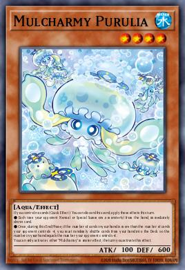

- **Copias y zona:** Main 3x. No altera las cantidades registradas.
- **Nombre oficial de referencia:** Purulia Multivadora. CID cotejado con la ficha oficial; el nombre histórico del inventario se conserva aunque su grafía/traducción difiera.
- **Función principal y secundaria:** handtrap · robo condicional.
- **Estado de sinergia y función:** Utilidad independiente. Es una clasificación de juego; revisar la relación concreta en A06.
- **Papel como recurso, descarte o coste:** Descarte mencionado: comprobar carta que lo exige, zona, coste frente a efecto y utilidad del recurso.
- **Efecto operativo (paráfrasis analítica):** Con campo propio sin cartas, descarta y roba cuando el rival Invoca desde la mano; en End Phase devuelve exceso de mano al Deck. 
- **Mapa de activación y resultados:** 1) con campo propio vacío: devuelve recursos a mano/Deck/Extra. Cada operación está sujeta a la secuencia y al «si lo haces» del texto oficial.
- **Ventanas de activación identificadas:** campo propio vacío; Efecto Rápido.
- **Costes o recursos potenciales:** descarte de mano; reciclaje de recurso propio.
- **Restricciones y requisitos:** requiere campo propio sin las cartas indicadas; interactúa con información oculta o resultados no siempre elegibles. 
- **Prioridad al ir primero:** asegurar el centro y acceso a motores Sincro antes de gastar extensores. Para esta carta: Reservar la respuesta para la ventana rival exacta; no es una pieza buscadora de nuestro motor.
- **Prioridad al ir segundo:** habilitar rebote, negación o protección antes de comprometer el monstruo del centro. Identificar primero la respuesta rival que afecta su función «handtrap».
- **Medio/tardío y recuperación:** reciclar Cantantes, monstruos de Atributos distintos y zonas disponibles. Verificar que el objetivo de recuperación continúe disponible.
- **Sinergias y acceso a líneas:** Relación contextual con ocupación y rotación de la zona principal central, acceso a Cantantes y transición Sincro. Habilita una línea del motor sólo si coinciden recursos, objetivos y restricciones; no equivale a un combo completo validado.
- **Riesgo / brick / interrupciones:** No confundir la condición de Purulia con la de Fuwalos. Puede emplearse en cadena sólo cuando se cumpla su condición concreta.
- **Utilidad editorial:** 3/5 para este deck (estimación por rol y zona, no probabilidad calculada). No cambiar copias; cualquier sugerencia de alta/baja pasa por el apartado 22 y aprobación.
- **Referencia oficial y trazabilidad:** https://www.db.yugioh-card.com/yugiohdb/card_search.action?cid=20206&ope=2&request_locale=es. **Confianza:** texto y tipo de efecto cotejados en Konami; síntesis táctica editorial, no demostración de combo.
- **Aplicación concreta dentro de este deck (A06):** Con campo propio sin cartas, descarta y roba cuando el rival Invoca desde la mano; en End Phase devuelve exceso de mano al Deck. Aporta respuesta o consistencia sin exigir enlace directo.

**USO PRÁCTICO Y SINERGIA — Mulcharmy Purulia**

- **Label funcional:** Función independiente. Clasificación documental; una relación es válida solo si se satisfacen sus condiciones exactas.
- **Qué hace:** Con campo propio sin cartas, descarta y roba cuando el rival Invoca desde la mano; en End Phase devuelve exceso de mano al Deck.
- **Cómo aprovecharla en este deck:** Con campo propio sin cartas, descarta y roba cuando el rival Invoca desde la mano; en End Phase devuelve exceso de mano al Deck. Aporta respuesta o consistencia sin exigir enlace directo.
- **Al jugar primero:** asegurar el centro y acceso a motores Sincro antes de gastar extensores. Para esta carta: Reservar la respuesta para la ventana rival exacta; no es una pieza buscadora de nuestro motor.
- **Al jugar segundo:** habilitar rebote, negación o protección antes de comprometer el monstruo del centro. Identificar primero la respuesta rival que afecta su función «handtrap».
- **Cuándo tener precaución:** No confundir la condición de Purulia con la de Fuwalos. Puede emplearse en cadena sólo cuando se cumpla su condición concreta.

#### 15. Ghost Belle & Haunted Mansion

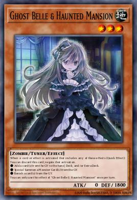

- **Copias y zona:** Main 2x, Side 1x. No altera las cantidades registradas.
- **Nombre oficial de referencia:** Bella Fantasma & Mansión Embrujada. CID cotejado con la ficha oficial; el nombre histórico del inventario se conserva aunque su grafía/traducción difiera.
- **Función principal y secundaria:** handtrap · negación de Cementerio.
- **Estado de sinergia y función:** Utilidad independiente. Es una clasificación de juego; revisar la relación concreta en A06.
- **Papel como recurso, descarte o coste:** Descarte mencionado: comprobar carta que lo exige, zona, coste frente a efecto y utilidad del recurso.
- **Efecto operativo (paráfrasis analítica):** Descarta para negar la activación de una operación que recupere, invoque o destierre cartas del Cementerio. 
- **Mapa de activación y resultados:** 1) con condición explícita en la carta: Invocación Especial desde Extra Deck, incorpora la pieza indicada a la mano. Cada operación está sujeta a la secuencia y al «si lo haces» del texto oficial.
- **Ventanas de activación identificadas:** Efecto Rápido.
- **Costes o recursos potenciales:** descarte de mano.
- **Restricciones y requisitos:** hay límite por turno según el efecto concreto; solo entra al Main después de un intercambio entre duelos. 
- **Prioridad al ir primero:** asegurar el centro y acceso a motores Sincro antes de gastar extensores. Para esta carta: Respuesta puntual al emparejamiento; justificar el intercambio antes del siguiente duelo.
- **Prioridad al ir segundo:** habilitar rebote, negación o protección antes de comprometer el monstruo del centro. Identificar primero la respuesta rival que afecta su función «handtrap».
- **Medio/tardío y recuperación:** reciclar Cantantes, monstruos de Atributos distintos y zonas disponibles. Verificar que el objetivo de recuperación continúe disponible.
- **Sinergias y acceso a líneas:** Relación contextual con ocupación y rotación de la zona principal central, acceso a Cantantes y transición Sincro. No habilita una ruta inicial antes del intercambio.
- **Riesgo / brick / interrupciones:** No niega todos los efectos: exige que el efecto incluya una de las acciones enumeradas. Puede emplearse en cadena sólo cuando se cumpla su condición concreta.
- **Utilidad editorial:** 3/5 para este deck (estimación por rol y zona, no probabilidad calculada). No cambiar copias; cualquier sugerencia de alta/baja pasa por el apartado 22 y aprobación.
- **Referencia oficial y trazabilidad:** https://www.db.yugioh-card.com/yugiohdb/card_search.action?cid=13587&ope=2&request_locale=es. **Confianza:** texto y tipo de efecto cotejados en Konami; síntesis táctica editorial, no demostración de combo.
- **Aplicación concreta dentro de este deck (A06):** Descarta para negar la activación de una operación que recupere, invoque o destierre cartas del Cementerio. Aporta respuesta o consistencia sin exigir enlace directo.

**USO PRÁCTICO Y SINERGIA — Ghost Belle & Haunted Mansion**

- **Label funcional:** Función independiente. Clasificación documental; una relación es válida solo si se satisfacen sus condiciones exactas.
- **Qué hace:** Descarta para negar la activación de una operación que recupere, invoque o destierre cartas del Cementerio.
- **Cómo aprovecharla en este deck:** Descarta para negar la activación de una operación que recupere, invoque o destierre cartas del Cementerio. Aporta respuesta o consistencia sin exigir enlace directo.
- **Al jugar primero:** asegurar el centro y acceso a motores Sincro antes de gastar extensores. Para esta carta: Respuesta puntual al emparejamiento; justificar el intercambio antes del siguiente duelo.
- **Al jugar segundo:** habilitar rebote, negación o protección antes de comprometer el monstruo del centro. Identificar primero la respuesta rival que afecta su función «handtrap».
- **Cuándo tener precaución:** No niega todos los efectos: exige que el efecto incluya una de las acciones enumeradas. Puede emplearse en cadena sólo cuando se cumpla su condición concreta.

#### 16. Prohibited Power Patron Portal - Terminus

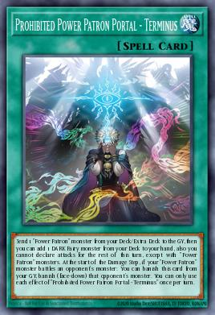

- **Copias y zona:** Main 3x. No altera las cantidades registradas.
- **Nombre oficial de referencia:** Portal de Modelo de Poder Vetado - Término. CID cotejado con la ficha oficial; el nombre histórico del inventario se conserva aunque su grafía/traducción difiera.
- **Función principal y secundaria:** searcher · buscador · removal.
- **Estado de sinergia y función:** Sinergia indirecta (soporte o recursos). Es una clasificación de juego; revisar la relación concreta en A06.
- **Papel como recurso, descarte o coste:** No se demuestra que esta carta sea recurso de descarte o pago para otra.
- **Efecto operativo (paráfrasis analítica):** búsqueda o incorporación de cartas a mano; destierro de recursos o de amenazas. Son operaciones detectadas en el texto, no efectos independientes garantizados; leer sus condiciones en la fuente.
- **Mapa de activación y resultados:** 1) efecto propio o continuo: incorpora la pieza indicada a la mano · 2) con condición explícita en la carta: destierra el recurso u objetivo previsto. Cada operación está sujeta a la secuencia y al «si lo haces» del texto oficial.
- **Ventanas de activación identificadas:** requieren la fase o condición específica indicada en el texto; sin ventana rápida general asumida.
- **Costes o recursos potenciales:** sin coste independiente identificado en esta síntesis; comprobar las acciones previas al punto y coma de cada efecto.
- **Restricciones y requisitos:** hay límite por turno según el efecto concreto; puede limitar ataques; depende de recursos en Cementerio; interactúa con información oculta o resultados no siempre elegibles. 
- **Prioridad al ir primero:** asegurar el centro y acceso a motores Sincro antes de gastar extensores. Para esta carta: Convertir la activación en acceso a la siguiente pieza del motor, sin duplicar buscadores inútilmente.
- **Prioridad al ir segundo:** habilitar rebote, negación o protección antes de comprometer el monstruo del centro. Identificar primero la respuesta rival que afecta su función «searcher».
- **Medio/tardío y recuperación:** reciclar Cantantes, monstruos de Atributos distintos y zonas disponibles. No asumir que por sí misma recicla recursos si el texto no lo permite.
- **Sinergias y acceso a líneas:** Relación contextual con ocupación y rotación de la zona principal central, acceso a Cantantes y transición Sincro. Habilita una línea del motor sólo si coinciden recursos, objetivos y restricciones; no equivale a un combo completo validado.
- **Riesgo / brick / interrupciones:** Depende del Cementerio y es sensible a destierro o negación de ese recurso. No atribuirle velocidad rápida por el solo hecho de formar parte del motor.
- **Utilidad editorial:** 5/5 para este deck (estimación por rol y zona, no probabilidad calculada). No cambiar copias; cualquier sugerencia de alta/baja pasa por el apartado 22 y aprobación.
- **Referencia oficial y trazabilidad:** https://www.db.yugioh-card.com/yugiohdb/card_search.action?cid=22565&ope=2&request_locale=es. **Confianza:** texto y tipo de efecto cotejados en Konami; síntesis táctica editorial, no demostración de combo.
- **Aplicación concreta dentro de este deck (A06):** búsqueda o incorporación de cartas a mano; destierro de recursos o de amenazas.

**USO PRÁCTICO Y SINERGIA — Prohibited Power Patron Portal - Terminus**

- **Label funcional:** Sinergia indirecta. Clasificación documental; una relación es válida solo si se satisfacen sus condiciones exactas.
- **Qué hace:** búsqueda o incorporación de cartas a mano; destierro de recursos o de amenazas. Son operaciones detectadas en el texto, no efectos independientes garantizados; leer sus condiciones en la fuente.
- **Cómo aprovecharla en este deck:** búsqueda o incorporación de cartas a mano; destierro de recursos o de amenazas.
- **Al jugar primero:** asegurar el centro y acceso a motores Sincro antes de gastar extensores. Para esta carta: Convertir la activación en acceso a la siguiente pieza del motor, sin duplicar buscadores inútilmente.
- **Al jugar segundo:** habilitar rebote, negación o protección antes de comprometer el monstruo del centro. Identificar primero la respuesta rival que afecta su función «searcher».
- **Cuándo tener precaución:** Depende del Cementerio y es sensible a destierro o negación de ese recurso. No atribuirle velocidad rápida por el solo hecho de formar parte del motor.

#### 17. The Fallen & The Virtuous

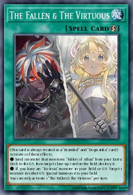

- **Copias y zona:** Main 2x. No altera las cantidades registradas.
- **Nombre oficial de referencia:** El Caído y La Virtuosa. CID cotejado con la ficha oficial; el nombre histórico del inventario se conserva aunque su grafía/traducción difiera.
- **Función principal y secundaria:** recurso situacional.
- **Estado de sinergia y función:** Sinergia indirecta (soporte o recursos). Es una clasificación de juego; revisar la relación concreta en A06.
- **Papel como recurso, descarte o coste:** No se demuestra que esta carta sea recurso de descarte o pago para otra.
- **Efecto operativo (paráfrasis analítica):** interacción propia de la carta que requiere consultar el texto íntegro enlazado. Son operaciones detectadas en el texto, no efectos independientes garantizados; leer sus condiciones en la fuente.
- **Mapa de activación y resultados:** efecto de estadística, condición o material; no asumir un disparador adicional. Cada operación está sujeta a la secuencia y al «si lo haces» del texto oficial.
- **Ventanas de activación identificadas:** requieren la fase o condición específica indicada en el texto; sin ventana rápida general asumida.
- **Costes o recursos potenciales:** sin coste independiente identificado en esta síntesis; comprobar las acciones previas al punto y coma de cada efecto.
- **Restricciones y requisitos:** hay límite por turno según el efecto concreto. 
- **Prioridad al ir primero:** asegurar el centro y acceso a motores Sincro antes de gastar extensores. Para esta carta: Activar cuando las condiciones permitan obtener valor real, preservando recursos de seguimiento.
- **Prioridad al ir segundo:** habilitar rebote, negación o protección antes de comprometer el monstruo del centro. Identificar primero la respuesta rival que afecta su función «recurso situacional».
- **Medio/tardío y recuperación:** reciclar Cantantes, monstruos de Atributos distintos y zonas disponibles. No asumir que por sí misma recicla recursos si el texto no lo permite.
- **Sinergias y acceso a líneas:** Relación contextual con ocupación y rotación de la zona principal central, acceso a Cantantes y transición Sincro. Habilita una línea del motor sólo si coinciden recursos, objetivos y restricciones; no equivale a un combo completo validado.
- **Riesgo / brick / interrupciones:** Riesgo operativo: centro ocupado, restricción a Sincro y dependencia de objetivos de Deck/Extra. Confirmar objetivos disponibles y costes antes de activar. No atribuirle velocidad rápida por el solo hecho de formar parte del motor.
- **Utilidad editorial:** 3/5 para este deck (estimación por rol y zona, no probabilidad calculada). No cambiar copias; cualquier sugerencia de alta/baja pasa por el apartado 22 y aprobación.
- **Referencia oficial y trazabilidad:** https://www.db.yugioh-card.com/yugiohdb/card_search.action?cid=22089&ope=2&request_locale=es. **Confianza:** texto y tipo de efecto cotejados en Konami; síntesis táctica editorial, no demostración de combo.
- **Aplicación concreta dentro de este deck (A06):** interacción propia de la carta que requiere consultar el texto íntegro enlazado.

**USO PRÁCTICO Y SINERGIA — The Fallen & The Virtuous**

- **Label funcional:** Sinergia indirecta. Clasificación documental; una relación es válida solo si se satisfacen sus condiciones exactas.
- **Qué hace:** interacción propia de la carta que requiere consultar el texto íntegro enlazado. Son operaciones detectadas en el texto, no efectos independientes garantizados; leer sus condiciones en la fuente.
- **Cómo aprovecharla en este deck:** interacción propia de la carta que requiere consultar el texto íntegro enlazado.
- **Al jugar primero:** asegurar el centro y acceso a motores Sincro antes de gastar extensores. Para esta carta: Activar cuando las condiciones permitan obtener valor real, preservando recursos de seguimiento.
- **Al jugar segundo:** habilitar rebote, negación o protección antes de comprometer el monstruo del centro. Identificar primero la respuesta rival que afecta su función «recurso situacional».
- **Cuándo tener precaución:** Riesgo operativo: centro ocupado, restricción a Sincro y dependencia de objetivos de Deck/Extra. Confirmar objetivos disponibles y costes antes de activar. No atribuirle velocidad rápida por el solo hecho de formar parte del motor.

#### 18. Elfnotes: Welcome Home

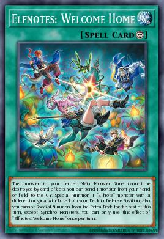

- **Copias y zona:** Main 1x. No altera las cantidades registradas.
- **Nombre oficial de referencia:** Elfnotas: Bienvenidos a Casa. CID cotejado con la ficha oficial; el nombre histórico del inventario se conserva aunque su grafía/traducción difiera.
- **Función principal y secundaria:** **Mágica Continua Elfnota** · protección del monstruo central contra destrucción por efectos · extensión desde Deck por **Atributo original distinto**.
- **Estado de sinergia y función:** **motor directo con Tinia, Lucina y Regina**; Tinia la puede colocar boca arriba desde Deck.
- **Papel como recurso, descarte o coste:** para su efecto activado **envía 1 monstruo de mano o Campo al GY**; el atributo original del monstruo enviado debe diferir del de la Elfnota que se quiere Invocar del Deck.
- **Efecto operativo (paráfrasis analítica):** mientras la Continua permanezca aplicando, **el monstruo propio de la Zona Principal central no puede ser destruido por efectos de cartas**. Al activar su otro efecto, envía 1 monstruo desde mano/Campo al GY y **Invoca Especialmente en Defensa** desde Deck una Elfnota con **Atributo original distinto**; después el Extra queda limitado a **Invocaciones Especiales de Sincros el resto del turno**.
- **Mapa de activación y resultados:** Tinia AGUA coloca Welcome→Welcome envía Tinia AGUA del Campo al GY→Invoca Lucina FUEGO desde Deck **en Defensa** y centro si libre→Lucina busca Regina/Patron en nueva cadena. La protección se aplica al cuerpo **que ocupe el centro en ese momento**, no a Tinia en GY.
- **Ventanas de activación identificadas:** efecto continuo de protección al centro y efecto activado durante oportunidad legal de una Mágica Continua boca arriba; **una vez por turno** para el segundo efecto.
- **Costes o recursos potenciales:** 1 monstruo enviado de mano/Campo; no enviar una M/T como coste. No añadir directamente la Elfnota a mano: llega desde Deck **en Defensa**.
- **Restricciones y requisitos:** otro Atributo **original** y objetivo Elfnota válido aún en Deck; solo Sincros desde Extra tras resolver la extensión; el efecto continuo protege frente a **destrucción por efecto**, no a destierro, devolución o batalla.
- **Prioridad al ir primero:** convertir Tinia en Lucina/Patron para la rama Strelitzia protegida por Welcome Home.
- **Prioridad al ir segundo:** usar la protección central para conservar el jefe antes de gastar el efecto de extensión, sin confundirlo con inmunidad total.
- **Medio/tardío y recuperación:** mantener la protección si el central cambia de identidad; si se agotan las Elfnota de Atributo distinto en Deck, no asumir extensión adicional.
- **Sinergias y acceso a líneas:** `650:A09:ELFNOTE:TINIA01` y `650:A09:ELFNOTE:TINIA:STRELITZIA04`; la segunda ruta termina con Strelitzia central y Welcome boca arriba.
- **Riesgo / brick / interrupciones:** si el monstruo enviado como coste sale de Campo, no permanece protegido allí; negar el efecto tras envío deja consumido el recurso y no se Invoca el objetivo.
- **Utilidad editorial:** 4/5 para este deck (estimación por rol y zona, no probabilidad calculada). No cambiar copias; cualquier sugerencia de alta/baja pasa por el apartado 22 y aprobación.
- **Referencia oficial y trazabilidad:** https://www.db.yugioh-card.com/yugiohdb/card_search.action?cid=22159&ope=2&request_locale=es. **Confianza:** texto y tipo de efecto cotejados en Konami; síntesis táctica editorial, no demostración de combo.
- **Aplicación concreta dentro de este deck (A06):** `Tinia AGUA → Welcome (Continua Mágica) → enviar Tinia al GY → Lucina FUEGO en DEF desde Deck`; protección de destrucción por efecto para el monstruo **central**. Konami CID 22159, **función oficial cotejada 18-11-2026**.

**USO PRÁCTICO Y SINERGIA — Elfnotes: Welcome Home**

- **Label funcional:** **Protección central + puente de Atributo distinto desde Deck**, no negación.
- **Qué hace:** impide que el monstruo central sea destruido por efectos; enviando un monstruo de mano/Campo al GY, trae del Deck una Elfnota de otro Atributo original en Defensa.
- **Cómo aprovecharla en este deck:** Tinia la coloca; enviar Tinia AGUA y traer Lucina FUEGO, reservando una Sincronía protegida en centro si se sigue esa rama.
- **Al jugar primero:** protección y extensión sin añadir una Elfnota a mano por este efecto.
- **Al jugar segundo:** conservar protección frente a destrucción por efecto, no frente a devolución/destierro.
- **Cuándo tener precaución:** el envío consume realmente un monstruo y desde su resolución el Extra queda limitado a Sincros.

#### 19. Elfnotes: Rhapsodia of Madness

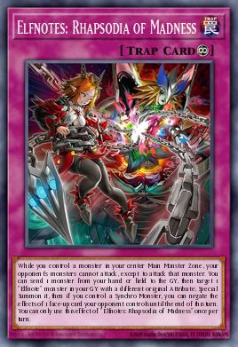

- **Copias y zona:** Main 1x. No altera las cantidades registradas.
- **Nombre oficial de referencia:** Elfnotas: Rapsodia de Locura. CID cotejado con la ficha oficial; el nombre histórico del inventario se conserva aunque su grafía/traducción difiera.
- **Función principal y secundaria:** **Trampa Continua Elfnota** · limita declaraciones de ataque a tu monstruo central · revive una Elfnota desde GY · negación opcional de carta rival boca arriba **si ya controlas Sincro**.
- **Estado de sinergia y función:** **motor directo de soporte** con Fortuna (que la coloca), materiales Elfnota de Atributos originales distintos y posibles Sincros del Extra.
- **Papel como recurso, descarte o coste:** su efecto activado **envía un monstruo desde mano o Campo al GY**, y **después selecciona** una Elfnota en GY de **Atributo original diferente** al enviado; no basta con tener un monstruo cualquiera en GY sin esa condición.
- **Efecto operativo (paráfrasis analítica):** mientras controlas un monstruo en tu **Zona Principal central**, los monstruos rivales **no pueden atacar a otros**, salvo a dicho central. El efecto activado envía 1 monstruo de mano/Campo al GY y luego selecciona **1 Elfnota con Atributo original distinto en tu GY** para Invocarla Especialmente; **después**, si controlas **monstruo Sincro**, puedes negar hasta el final de turno los efectos de **1 carta rival boca arriba**. No es una negación general automática.
- **Mapa de activación y resultados:** Fortuna lateral coloca Rapsodia; Regina central proporciona el cuerpo cuya zona controla ataques. Sin Sincro, Rapsodia puede mantener presión posicional/recuperación, pero **no** se reclama la negación adicional. Con Sincro y objetivo boca arriba, esa negación se puede aplicar **al resolver el efecto de recuperación**.
- **Ventanas de activación identificadas:** efecto continuo de ataques condicionado a monstruo central; efecto activado de Trampa Continua ya boca arriba, una vez por turno, sujeto a la oportunidad legal de activar efectos de Trampa.
- **Costes o recursos potenciales:** monstruo enviado desde mano/Campo al GY antes del punto y coma; el objetivo recuperado desde GY se elige por Atributo **original** distinto; al resolver, no prometer negación sin Sincro propio.
- **Restricciones y requisitos:** si no hay monstruo central, no hay limitación posicional de ataques; sin Elfnota válida en GY y monstruo para enviar, no revivir; sin Sincro propio o carta rival boca arriba no hay negación extra.
- **Prioridad al ir primero:** colocarla mediante Fortuna en la línea Regina central + Fortuna lateral; reservar la recuperación hasta existir objetivo adecuado en GY.
- **Prioridad al ir segundo:** aprovechar la negación **solo** si la cadena de revivir y control de Sincro tienen estado válido; no tratarla como negación libre sin coste.
- **Medio/tardío y recuperación:** recicla Elfnota concreta desde GY pagando otro monstruo; su efecto puede extender el campo, pero no recupera cartas de destierro ni de Deck.
- **Sinergias y acceso a líneas:** `650:A09:ELFNOTE:TINIA01` y `650:A09:ELFNOTE:LUCINA01` colocan Rapsodia con Fortuna; la negación necesita una continuación que **ya controle Sincro** y recurso de GY distinto.
- **Riesgo / brick / interrupciones:** el envío como coste no se recupera automáticamente si se niega el efecto; no garantizar un objetivo de atributo distinto ni una negación que requiere Sincro previo.
- **Utilidad editorial:** 3/5 para este deck (estimación por rol y zona, no probabilidad calculada). No cambiar copias; cualquier sugerencia de alta/baja pasa por el apartado 22 y aprobación.
- **Referencia oficial y trazabilidad:** https://www.db.yugioh-card.com/yugiohdb/card_search.action?cid=22173&ope=2&request_locale=es. **Confianza:** texto y tipo de efecto cotejados en Konami; síntesis táctica editorial, no demostración de combo.
- **Aplicación concreta dentro de este deck (A06):** `Fortuna → Rapsodia` como Trampa Continua; `enviar monstruo de mano/Campo → revivir Elfnota de Atributo distinto desde GY`; negación de carta boca arriba solo con Sincro propio. Konami CID 22173, **función oficial cotejada 18-11-2026**.

**USO PRÁCTICO Y SINERGIA — Elfnotes: Rhapsodia of Madness**

- **Label funcional:** **Trampa de control de ataques y recuperación por Atributo distinto**, con negación condicional.
- **Qué hace:** limita ataques rivales al monstruo central, revive una Elfnota distinta por Atributo original tras enviar un monstruo y puede negar carta rival boca arriba **solo si controlas Sincro**.
- **Cómo aprovecharla en este deck:** Fortuna la coloca; desde el campo Regina central + Fortuna lateral se gana control de ataques, pero **no** hay negación sin Sincronía.
- **Al jugar primero:** preparar recursos del GY para la recuperación, preservando defensa de centro.
- **Al jugar segundo:** usar la negación cuando el Sincro y el objetivo rival ya existen, no asumirla por el simple acto de colocar Rapsodia.
- **Cuándo tener precaución:** requiere recurso que enviar, objetivo Elfnota de Atributo distinto en GY, y Sincro para negar.

#### 20. The Three Champions of Swordsoul [Synchro; Konami 22356]

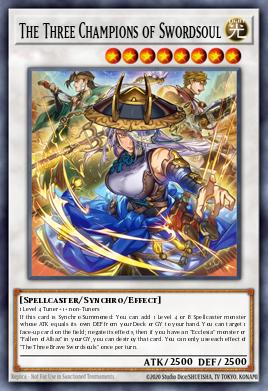

- **Copias y zona:** Extra 1x. No altera las cantidades registradas.
- **Nombre oficial de referencia:** Los Tres Campeones de Almaespada. CID cotejado con la ficha oficial; el nombre histórico del inventario se conserva aunque su grafía/traducción difiera.
- **Función principal y secundaria:** resultado de Extra Deck · buscador · negación · cierre.
- **Estado de sinergia y función:** Sin acceso al Extra demostrado. Es una clasificación de juego; revisar la relación concreta en A06.
- **Papel como recurso, descarte o coste:** Material o destino del Extra condicionado a los requisitos de invocación.
- **Efecto operativo (paráfrasis analítica):** búsqueda o incorporación de cartas a mano; negación de efectos o activaciones; presión de combate o modificación de estadísticas. Son operaciones detectadas en el texto, no efectos independientes garantizados; leer sus condiciones en la fuente.
- **Mapa de activación y resultados:** 1) tras su invocación desde el Extra: incorpora la pieza indicada a la mano · 2) efecto propio o continuo: niega el efecto o la activación indicada, destruye la carta o recurso previsto. Cada operación está sujeta a la secuencia y al «si lo haces» del texto oficial.
- **Ventanas de activación identificadas:** al producirse una Invocación; Invocación del Extra Deck.
- **Costes o recursos potenciales:** sin coste independiente identificado en esta síntesis; comprobar las acciones previas al punto y coma de cada efecto.
- **Restricciones y requisitos:** hay límite por turno según el efecto concreto; depende de recursos en Cementerio. Invocar sólo desde el Extra Deck usando su procedimiento propio.
- **Prioridad al ir primero:** asegurar el centro y acceso a motores Sincro antes de gastar extensores. Para esta carta: Conservar la interrupción para el efecto clave rival; no gastarla en un efecto irrelevante.
- **Prioridad al ir segundo:** habilitar rebote, negación o protección antes de comprometer el monstruo del centro. Identificar primero la respuesta rival que afecta su función «resultado de Extra Deck».
- **Medio/tardío y recuperación:** reciclar Cantantes, monstruos de Atributos distintos y zonas disponibles. No asumir que por sí misma recicla recursos si el texto no lo permite.
- **Sinergias y acceso a líneas:** Relación contextual con ocupación y rotación de la zona principal central, acceso a Cantantes y transición Sincro. Puede cerrar o prolongar una ruta del Extra si los materiales están disponibles.
- **Riesgo / brick / interrupciones:** Depende del Cementerio y es sensible a destierro o negación de ese recurso. No atribuirle velocidad rápida por el solo hecho de formar parte del motor.
- **Utilidad editorial:** 4/5 para este deck (estimación por rol y zona, no probabilidad calculada). No cambiar copias; cualquier sugerencia de alta/baja pasa por el apartado 22 y aprobación.
- **Referencia oficial y trazabilidad:** https://www.db.yugioh-card.com/yugiohdb/card_search.action?cid=22356&ope=2&request_locale=es. **Confianza:** texto y tipo de efecto cotejados en Konami; síntesis táctica editorial, no demostración de combo.
- **Aplicación concreta dentro de este deck (A06):** búsqueda o incorporación de cartas a mano; negación de efectos o activaciones; presión de combate o modificación de estadísticas. Falta arista de materiales en A06; A09 podría contener una ruta válida no indexada aquí.

**USO PRÁCTICO Y SINERGIA — The Three Champions of Swordsoul [Synchro; Konami 22356]**

- **Label funcional:** Sin sinergia demostrada (con la evidencia actual). Clasificación documental; una relación es válida solo si se satisfacen sus condiciones exactas.
- **Qué hace:** búsqueda o incorporación de cartas a mano; negación de efectos o activaciones; presión de combate o modificación de estadísticas. Son operaciones detectadas en el texto, no efectos independientes garantizados; leer sus condiciones en la fuente.
- **Cómo aprovecharla en este deck:** búsqueda o incorporación de cartas a mano; negación de efectos o activaciones; presión de combate o modificación de estadísticas. Falta arista de materiales en A06; A09 podría contener una ruta válida no indexada aquí.
- **Al jugar primero:** asegurar el centro y acceso a motores Sincro antes de gastar extensores. Para esta carta: Conservar la interrupción para el efecto clave rival; no gastarla en un efecto irrelevante.
- **Al jugar segundo:** habilitar rebote, negación o protección antes de comprometer el monstruo del centro. Identificar primero la respuesta rival que afecta su función «resultado de Extra Deck».
- **Cuándo tener precaución:** Depende del Cementerio y es sensible a destierro o negación de ese recurso. No atribuirle velocidad rápida por el solo hecho de formar parte del motor.

**CÓMO LLEGAR DESDE TU DECK — SIN RUTA DEMOSTRADA**

- La biblioteca actual no contiene una ruta identificada para esta carta del Extra. No se debe exhibir una descripción genérica como sustituto de mano inicial, materiales y pasos. Para completarla, contrastar requisitos oficiales y recursos del Main; si no es alcanzable, explicar el impedimento exacto.

#### 21. Golden Cloud Beast - Malong [Synchro]

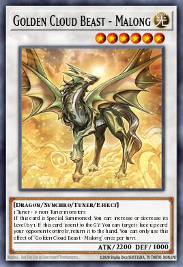

- **Copias y zona:** Extra 1x. No altera las cantidades registradas.
- **Nombre oficial de referencia:** Bestia Nube Dorada - Malong. CID cotejado con la ficha oficial; el nombre histórico del inventario se conserva aunque su grafía/traducción difiera.
- **Función principal y secundaria:** **remoción por devolución a la mano** · Cantante Sincro de Nivel 6 · destino de envío desde Extra; **no recupera monstruos propios ni se Invoca desde el GY por su efecto**.
- **Estado de sinergia y función:** **uso desde Extra acreditado por efecto de Harmonia (CID 22533)** bajo condición de activación rival; su **Invocación por Sincronía** continúa sin secuencia de materiales acreditada.
- **Papel como recurso, descarte o coste:** Harmonia puede **enviarlo** del Extra al GY después de revelar cuatro cartas en total (Harmonia de mano + tres Sincros, uno Malong); no se considera Invocación.
- **Efecto operativo (paráfrasis analítica):** si fue Invocado Especialmente, puede cambiar su Nivel en ±1; **si es enviado al GY**, puede seleccionar una carta **boca arriba del rival** y devolverla a la mano.
- **Mapa de activación y resultados:** Harmonia responde a un efecto de monstruo rival → se Invoca ella misma (2+ reveladas) y envía a Malong desde Extra (4+ reveladas) → al terminar esa cadena, Malong inicia nueva cadena si el rival conserva objetivo boca arriba.
- **Ventanas de activación identificadas:** al Invocarse Especialmente (ajuste opcional de Nivel); tras ser enviado al GY (rebote objetivo, incluso desde Extra).
- **Costes o recursos potenciales:** Malong no exige descarte ni tributo para su rebote; requiere que haya una carta rival boca arriba seleccionable al activar y resolver. Harmonia consume su efecto una vez por turno.
- **Restricciones y requisitos:** Sincro Nivel 6: Cantante + uno o más no Cantantes; el rebote de Malong se usa **una vez por turno**. Una carta rival que abandona el campo antes de la nueva cadena puede dejar sin objetivo la activación.
- **Prioridad al ir primero:** asegurar el centro y acceso a motores Sincro antes de gastar extensores. Para esta carta: Comprobar materiales exactos antes de buscar este objetivo en el Extra Deck.
- **Prioridad al ir segundo:** habilitar rebote, negación o protección antes de comprometer el monstruo del centro. Identificar primero la respuesta rival que afecta su función «resultado de Extra Deck».
- **Medio/tardío y recuperación:** si ya se usó la copia de Malong, no volver a prometer su envío desde Extra; su función es remoción situacional, no recuperación propia.
- **Sinergias y acceso a líneas:** **Harmonia → envía Malong → Malong devuelve carta boca arriba rival**; conexión por envío, no por Sincro. Se requiere revelar 3 Sincros disponibles en Extra y el disparador del oponente.
- **Riesgo / brick / interrupciones:** sin efecto activable de monstruo rival, sin tres Sincros revelables, sin Malong disponible en Extra o sin objetivo rival boca arriba al disparo, **no se produce el rebote**.
- **Utilidad editorial:** herramienta de remoción condicional del Extra, sin puntuar tasa de éxito ni alterar la copia 1x.
- **Referencia oficial y trazabilidad:** https://www.db.yugioh-card.com/yugiohdb/card_search.action?cid=18666&ope=2&request_locale=es. **Confianza:** texto y tipo de efecto cotejados en Konami; síntesis táctica editorial, no demostración de combo.
- **Aplicación concreta dentro de este deck (A06):** `650:A06:HARMONIA:MALONG:ENVIO01` — Harmonia envía a Malong desde Extra y este puede rebotar una carta rival boca arriba tras resolver la cadena. Cotejo textual oficial CID 22533 + CID 18666; **acceso por envío acreditado, no acceso Sincro**.

**USO PRÁCTICO Y SINERGIA — Golden Cloud Beast - Malong [Synchro]**

- **Label funcional:** **Sinergia directa condicionada: envío al GY por Harmonia y rebote de carta rival**; sin ruta Sincro acreditada.
- **Qué hace:** selecciona una carta rival boca arriba para devolverla a la mano cuando es enviado al GY; su cambio de Nivel ±1 requiere Invocación Especial previa.
- **Cómo aprovecharla en este deck:** dejar Malong en Extra como uno de los tres Sincros revelados por Harmonia; activar Harmonia ante efecto de monstruo rival y elegir enviar Malong. Tras resolver, activar su rebote en cadena nueva si queda objetivo legal.
- **Al jugar primero:** asegurar el centro y acceso a motores Sincro antes de gastar extensores. Para esta carta: Comprobar materiales exactos antes de buscar este objetivo en el Extra Deck.
- **Al jugar segundo:** habilitar rebote, negación o protección antes de comprometer el monstruo del centro. Identificar primero la respuesta rival que afecta su función «resultado de Extra Deck».
- **Cuándo tener precaución:** No contarla como extensión automática: confirmar materiales, procedimiento y restricciones vigentes. No atribuirle velocidad rápida por el solo hecho de formar parte del motor.

**CÓMO USARLA DESDE TU EXTRA — ENVÍO DOCUMENTADO; INVOCACIÓN SINCRO PENDIENTE**

- **Fuente:** Harmonia CID 22533 y Malong CID 18666, fichas oficiales Konami. **Condición:** Harmonia en mano, respuesta a efecto de monstruo rival, al menos tres Sincros en Extra para revelar incluyendo Malong, y carta rival boca arriba seleccionable. **Cadena:** Harmonia envía a Malong; la devolución de Malong se activa en la cadena siguiente. No se afirma una Invocación de Malong.

#### 22. Storm-Bane Dragon Destorbim [Synchro]

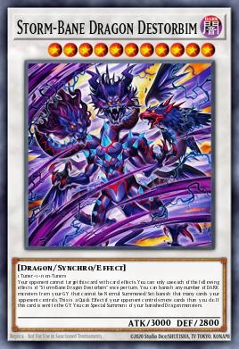

- **Copias y zona:** Extra 1x. No altera las cantidades registradas.
- **Nombre oficial de referencia:** Dragón Azote de la Tormenta Destorbim. CID cotejado con la ficha oficial; el nombre histórico del inventario se conserva aunque su grafía/traducción difiera.
- **Función principal y secundaria:** Sincro Nivel 11 de 3000 ATK · **protección frente a selección rival** · destierro condicional de cartas rivales · recuperación específica de Dragón desterrado.
- **Estado de sinergia y función:** **continuación Sincro condicionada 7+4** con Harmonia (Cantante Nivel 7, CID 22533) y Medius (no Cantante Nivel 4, CID 21419). La llegada de ambos al campo y la permanencia tras la cadena rival deben demostrarse en A09.
- **Papel como recurso, descarte o coste:** destino Sincro de Harmonia+Medius; para su efecto de destierro exige **desterrar como coste** monstruos OSCURIDAD del GY que **no puedan ser Invocados Normalmente/Colocados**.
- **Efecto operativo (paráfrasis analítica):** el rival no puede seleccionarlo con efectos de cartas; puede desterrar N monstruos OSCURIDAD de la clase indicada desde su GY para desterrar N cartas del rival. Si va al GY, puede Invocar 1 Dragón propio desterrado. **No Coloca Mágicas/Trampas.**
- **Mapa de activación y resultados:** Sincro 7+4 si ambos cuerpos están boca arriba; si hay coste de GY elegible, destierro de cartas rivales. La acción es **Efecto Rápido solo si el rival controla más cartas que tú**; sin esa desigualdad, se estudia en la ventana ordinaria propia.
- **Ventanas de activación identificadas:** en Main Phase propia con coste válido, o Efecto Rápido si el rival tiene más cartas; tras ser enviado al GY, efecto desencadenado para un Dragón ya desterrado.
- **Costes o recursos potenciales:** N monstruos OSCURIDAD no Invocables/Colocables Normalmente en el GY para el primer efecto; un Dragón desterrado previamente para la recuperación. Harmonia y Medius en GY por Sincronía no satisfacen automáticamente el coste.
- **Restricciones y requisitos:** Sincro Nivel 11 con Cantante + no Cantante, **cada uno de sus efectos se usa una vez por turno**; no inventar objetivos de destierro ni un Dragón desterrado.
- **Prioridad al ir primero:** asegurar el centro y acceso a motores Sincro antes de gastar extensores. Para esta carta: Reservar la respuesta para la ventana rival exacta; no es una pieza buscadora de nuestro motor.
- **Prioridad al ir segundo:** habilitar rebote, negación o protección antes de comprometer el monstruo del centro. Identificar primero la respuesta rival que afecta su función «interrupción».
- **Medio/tardío y recuperación:** la recuperación de un Dragón desterrado solo existe **si Destorbim llega al GY y ya había un Dragón desterrado**; no es búsqueda ni reciclaje universal.
- **Sinergias y acceso a líneas:** **Harmonia Nivel 7 + Medius Nivel 4 → Destorbim Nivel 11** cuando ambos están disponibles en tu Main Phase; las dos cartas están en este Main. El campo previo es requisito, no consecuencia de la sola suma 7+4.
- **Riesgo / brick / interrupciones:** una respuesta rival que destruya Medius antes de la Sincronía invalida la línea; con GY sin OSCURIDAD no Invocables Normalmente, Destorbim no puede usar su efecto de destierro, aunque haya sido Invocado.
- **Utilidad editorial:** destino de control condicional; valorar 3000 ATK y antiselección separadamente de un destierro cuyo coste no aparece en la línea básica. Conservar su única copia.
- **Referencia oficial y trazabilidad:** https://www.db.yugioh-card.com/yugiohdb/card_search.action?cid=22335&ope=2&request_locale=es. **Confianza:** texto y tipo de efecto cotejados en Konami; síntesis táctica editorial, no demostración de combo.
- **Aplicación concreta dentro de este deck (A06):** `650:A06:HARMONIA:MEDIUS:DESTORBIM02` — combinación **condicionada** Nivel 7 + Nivel 4 para Sincro 11; ningún destierro rival ni Dragón recuperado se considera incluido en el resultado sin recursos adicionales acreditados.

**USO PRÁCTICO Y SINERGIA — Storm-Bane Dragon Destorbim [Synchro]**

- **Label funcional:** **Acceso Sincro por dos materiales existentes, condicionado a tener ambos en campo**; función de control sin coste de destierro acreditado.
- **Qué hace:** evita ser seleccionado por efectos rivales; permite destierro proporcional a coste OSCURIDAD elegible y, al ser enviado al GY, recuperación de un Dragón desterrado si lo hay.
- **Cómo aprovecharla en este deck:** reunir Harmonia Cantante 7 y Medius no Cantante 4; Sincronizar en Main Phase propia, conservando la protección pasiva. No prometer remoción con GY vacío.
- **Al jugar primero:** asegurar el centro y acceso a motores Sincro antes de gastar extensores. Para esta carta: Reservar la respuesta para la ventana rival exacta; no es una pieza buscadora de nuestro motor.
- **Al jugar segundo:** habilitar rebote, negación o protección antes de comprometer el monstruo del centro. Identificar primero la respuesta rival que afecta su función «interrupción».
- **Cuándo tener precaución:** Depende del Cementerio y es sensible a destierro o negación de ese recurso. Puede emplearse en cadena sólo cuando se cumpla su condición concreta.

**CÓMO LLEGAR DESDE TU DECK — SIN RUTA DEMOSTRADA**

- **Continuación verificable de materiales:** Harmonia CID 22533 (Cantante 7) y Medius CID 21419 (no Cantante 4) boca arriba, con turno propio Main Phase y Extra disponible, dan Sincro 11. **Pendiente de apertura:** demostrar de qué mano/cadena llegaron ambos sin perderlos por efecto rival. Fuentes Konami CID 22533, 21419 y 22335.

#### 23. Ecclesia and the Dark Dragon [extra; efecto y material según carta]

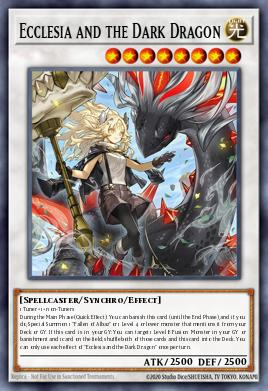

- **Copias y zona:** Extra 1x. No altera las cantidades registradas.
- **Nombre oficial de referencia:** Ecclesia y el Dragón Oscuro. CID cotejado con la ficha oficial; el nombre histórico del inventario se conserva aunque su grafía/traducción difiera.
- **Función principal y secundaria:** interrupción · resultado de Extra Deck · extensor · recuperación.
- **Estado de sinergia y función:** Sin acceso al Extra demostrado. Es una clasificación de juego; revisar la relación concreta en A06.
- **Papel como recurso, descarte o coste:** Material o destino del Extra condicionado a los requisitos de invocación.
- **Efecto operativo (paráfrasis analítica):** extensión mediante monstruos procedentes del Deck; recuperación e invocación desde Cementerio/destierro; retorno o reciclaje hacia mano/Deck/Extra. Son operaciones detectadas en el texto, no efectos independientes garantizados; leer sus condiciones en la fuente.
- **Mapa de activación y resultados:** 1) en Main Phase: Invocación Especial desde Deck · 2) mientras está en Cementerio: devuelve recursos a mano/Deck/Extra. Cada operación está sujeta a la secuencia y al «si lo haces» del texto oficial.
- **Ventanas de activación identificadas:** Main Phase; al llegar o estar en el Cementerio; Efecto Rápido.
- **Costes o recursos potenciales:** sin coste independiente identificado en esta síntesis; comprobar las acciones previas al punto y coma de cada efecto.
- **Restricciones y requisitos:** hay límite por turno según el efecto concreto; depende de recursos en Cementerio. Invocar sólo desde el Extra Deck usando su procedimiento propio.
- **Prioridad al ir primero:** asegurar el centro y acceso a motores Sincro antes de gastar extensores. Para esta carta: Reservar la respuesta para la ventana rival exacta; no es una pieza buscadora de nuestro motor.
- **Prioridad al ir segundo:** habilitar rebote, negación o protección antes de comprometer el monstruo del centro. Identificar primero la respuesta rival que afecta su función «interrupción».
- **Medio/tardío y recuperación:** reciclar Cantantes, monstruos de Atributos distintos y zonas disponibles. Verificar que el objetivo de recuperación continúe disponible.
- **Sinergias y acceso a líneas:** Relación contextual con ocupación y rotación de la zona principal central, acceso a Cantantes y transición Sincro. Puede cerrar o prolongar una ruta del Extra si los materiales están disponibles.
- **Riesgo / brick / interrupciones:** Depende del Cementerio y es sensible a destierro o negación de ese recurso. Puede emplearse en cadena sólo cuando se cumpla su condición concreta.
- **Utilidad editorial:** 4/5 para este deck (estimación por rol y zona, no probabilidad calculada). No cambiar copias; cualquier sugerencia de alta/baja pasa por el apartado 22 y aprobación.
- **Referencia oficial y trazabilidad:** https://www.db.yugioh-card.com/yugiohdb/card_search.action?cid=22144&ope=2&request_locale=es. **Confianza:** texto y tipo de efecto cotejados en Konami; síntesis táctica editorial, no demostración de combo.
- **Aplicación concreta dentro de este deck (A06):** extensión mediante monstruos procedentes del Deck; recuperación e invocación desde Cementerio/destierro; retorno o reciclaje hacia mano/Deck/Extra. Falta arista de materiales en A06; A09 podría contener una ruta válida no indexada aquí.

**USO PRÁCTICO Y SINERGIA — Ecclesia and the Dark Dragon [extra; efecto y material según carta]**

- **Label funcional:** Sin sinergia demostrada (con la evidencia actual). Clasificación documental; una relación es válida solo si se satisfacen sus condiciones exactas.
- **Qué hace:** extensión mediante monstruos procedentes del Deck; recuperación e invocación desde Cementerio/destierro; retorno o reciclaje hacia mano/Deck/Extra. Son operaciones detectadas en el texto, no efectos independientes garantizados; leer sus condiciones en la fuente.
- **Cómo aprovecharla en este deck:** extensión mediante monstruos procedentes del Deck; recuperación e invocación desde Cementerio/destierro; retorno o reciclaje hacia mano/Deck/Extra. Falta arista de materiales en A06; A09 podría contener una ruta válida no indexada aquí.
- **Al jugar primero:** asegurar el centro y acceso a motores Sincro antes de gastar extensores. Para esta carta: Reservar la respuesta para la ventana rival exacta; no es una pieza buscadora de nuestro motor.
- **Al jugar segundo:** habilitar rebote, negación o protección antes de comprometer el monstruo del centro. Identificar primero la respuesta rival que afecta su función «interrupción».
- **Cuándo tener precaución:** Depende del Cementerio y es sensible a destierro o negación de ese recurso. Puede emplearse en cadena sólo cuando se cumpla su condición concreta.

**CÓMO LLEGAR DESDE TU DECK — SIN RUTA DEMOSTRADA**

- La biblioteca actual no contiene una ruta identificada para esta carta del Extra. No se debe exhibir una descripción genérica como sustituto de mano inicial, materiales y pasos. Para completarla, contrastar requisitos oficiales y recursos del Main; si no es alcanzable, explicar el impedimento exacto.

#### 24. Elfnote Seraphim Strelitzia [Synchro]

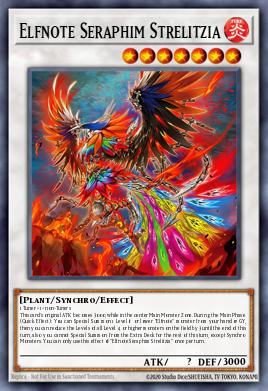

- **Copias y zona:** Extra 1x. No altera las cantidades registradas.
- **Nombre oficial de referencia:** Elfnota Serafín Strelitzia. CID cotejado con la ficha oficial; el nombre histórico del inventario se conserva aunque su grafía/traducción difiera.
- **Función principal y secundaria:** **Sincro Nivel 7 no Cantante** · original ATK 3000 mientras está en centro · extensión mediante Invocación desde **mano o GY** de una Elfnota de Nivel ≤6 · modificación **opcional** de Niveles.
- **Estado de sinergia y función:** **destino Sincro demostrado** desde Lucina6+Patron1; a su vez es material Sincro no Cantante para Crystal Wing8 y puente a Junora10 con niveles ajustados.
- **Papel como recurso, descarte o coste:** sale del Extra por Sincronía de un Cantante más uno o más no Cantantes; puede **enviarse como material Sincro no Cantante** junto a Patron revivido para Crystal Wing, o reutilizarse en Junora si el procedimiento y los Niveles coinciden.
- **Efecto operativo (paráfrasis analítica):** si está en **Zona Principal central**, su ATK **original pasa a 3000**. Durante **cualquier Main Phase** (Efecto Rápido), puede Invocar Especialmente **1 monstruo «Elfnote» de Nivel 6 o menor desde mano o GY**; **después puede optar** por reducir 3 Niveles a todos los monstruos Nivel 4 o superior del Campo hasta final del turno. Tras ese efecto, por el resto del turno solo se Invocan Especialmente **Sincros del Extra**.
- **Mapa de activación y resultados:** Lucina6+Patron1→Strelitzia7 centro; Patron enviado a GY busca Regina; Strelitzia revive **al mismo Patron** desde GY **sin reducir Niveles**; Strelitzia7+Patron1→Crystal Wing8. Alternativa Junora aplica descenso de Niveles para una suma distinta, **no** combinar esos dos estados.
- **Ventanas de activación identificadas:** Invocación Sincro en Main propia, Efecto Rápido de extensión durante **Main Phase de cualquier jugador**, una vez por turno.
- **Costes o recursos potenciales:** 1 Elfnota de Nivel ≤6 realmente disponible en mano o GY; no revive cualquier monstruo o carta desterrada. La opción de reducir Niveles altera **todos** los monstruos Nivel 4+ del Campo, incluidos rivales.
- **Restricciones y requisitos:** su ATK original 3000 depende de permanecer en centro; fuera de centro no se conserva automáticamente. Si se elige descenso de Niveles, Strelitzia7 pasa a 4 y no sirve como material 7 para Crystal Wing con Patron1.
- **Prioridad al ir primero:** elegir entre conservar a Strelitzia central (extensión en turno rival), convertirla en Crystal Wing8 (sin bajar Niveles) o ruta Junora10 (niveles reducidos), solo una salida por materiales.
- **Prioridad al ir segundo:** utilizar su Efecto Rápido para proporcionar un cuerpo Elfnota legal, no confundir el efecto con negación propia.
- **Medio/tardío y recuperación:** revive Elfnota de mano/GY **hasta Nivel 6**, no recicla desde destierro ni recupera cartas por sí sola a mano.
- **Sinergias y acceso a líneas:** `650:A09:ELFNOTE:LUCINA:STRELITZIA02`, `650:A09:LUCINA:PATRON:CRYSTAL_WING10`, `650:A09:ELFNOTE:LUCINA:TINIA:JUNORA03`.
- **Riesgo / brick / interrupciones:** perder el cuerpo de destino del GY o ser negada antes de extender impide segunda Sincronía; activar la reducción opcional cuando la ruta necesita Nivel7 invalida la suma 7+1.
- **Utilidad editorial:** 4/5 para este deck (estimación por rol y zona, no probabilidad calculada). No cambiar copias; cualquier sugerencia de alta/baja pasa por el apartado 22 y aprobación.
- **Referencia oficial y trazabilidad:** https://www.db.yugioh-card.com/yugiohdb/card_search.action?cid=22143&ope=2&request_locale=es. **Confianza:** texto y tipo de efecto cotejados en Konami; síntesis táctica editorial, no demostración de combo.
- **Aplicación concreta dentro de este deck (A06):** Sincro7 mediante Lucina+Patron; Efecto Rápido revive Patron desde GY; mantener Niveles 7+1 para Crystal Wing8. Konami CID 22143, **función oficial cotejada 18-11-2026**.

**USO PRÁCTICO Y SINERGIA — Elfnote Seraphim Strelitzia [Synchro]**

- **Label funcional:** **Sincro7 de motor + extensor rápido** y material Sincro no Cantante para Crystal Wing8.
- **Qué hace:** obtiene original ATK3000 en centro y, en Main Phase, trae una Elfnota Nivel ≤6 desde mano/GY con reducción de Niveles **opcional**.
- **Cómo aprovecharla en este deck:** revivir Patron1 para Crystal Wing8 **sin** bajar Niveles, o reservar una Elfnota para respuesta posicional en turno rival.
- **Al jugar primero:** elegir jefe final; Strelitzia y Crystal Wing no quedan simultáneamente por la misma secuencia.
- **Al jugar segundo:** extender cuerpo legal mientras haya Elfnota alcanzable; no atribuir negación propia de monstruos.
- **Cuándo tener precaución:** el descenso de Nivel afecta a ambos Campos y puede invalidar el Sincro previsto; su ATK3000 requiere centro.

**CÓMO LLEGAR DESDE TU DECK — RUTAS DOCUMENTADAS**

- **Abrir guía `650:A09:ELFNOTE:LUCINA:STRELITZIA02`:** entrada: Lucina 1× Elfnote Lucina Nivel 6/Hechicero; Deck con Power Patron 1× Elfnote Power Patron, Demonio Cantante Nivel 1, y al menos 1 carta «Elfnote» que pueda buscar después (por ejemplo Regina Regina). Extra: Strelitzia 1× Elfnote Seraphim Strelitzia sin utilizar. Estado inicial: Campo propio, GY y destierro vacíos; zona central libre y otra zona libre; Normal sin consumir, Main Phase; sin respuestas ni restricciones previas.. Propósito descrito: Ofensivo condicional. Consulta sus pasos, consumo y resultado; comprobar si esta carta es realmente invocada o solo mencionada.
- **Abrir guía `650:A09:ELFNOTE:LUCINA:TINIA:JUNORA03`:** entrada: Lucina 1 Elfnote Lucina, Nivel 6, y Tinia 1 Elfnote Tinia, Nivel 6. Deck: Power Patron 1 Elfnote Power Patron, Cantante Nivel 1, Regina 1 Elfnote Regina Nivel 6, Welcome Home 1 Elfnotes: Welcome Home. Extra: Strelitzia 1 Seraphim Strelitzia Nivel 7 y Junora 1 Junora Nivel 10. Campo/GY/destierro propios vacíos, zona central y dos laterales libres, Normal disponible, sin respuesta rival ni restricciones anteriores. No usar otras cartas de la mano desconocidas.. Propósito descrito: Preparación de recursos / despliegue. Consulta sus pasos, consumo y resultado; comprobar si esta carta es realmente invocada o solo mencionada.
- **Abrir guía `650:A09:ELFNOTE:TINIA:STRELITZIA04`:** entrada: Tinia (AGUA, Nivel 6) sola en mano; Campo/GY vacíos, zona central y zona lateral libres, Normal disponible, Main Phase propia. Deck tiene Welcome Home, Lucina FUEGO Nivel 6, Power Patron Cantante Nivel 1, Regina (u otro Elfnote legal a buscar); Extra tiene Strelitzia Nivel 7. Ninguna de estas cartas se ha usado este turno; rival no responde. Objetivo: una Sincronía de 3000 protegida contra destrucción por efectos con Welcome Home y una carta buscada en mano. No es el campo Regina + Fortuna de TINIA01.. Propósito descrito: Ofensivo condicional. Consulta sus pasos, consumo y resultado; comprobar si esta carta es realmente invocada o solo mencionada.

#### 25. Elfnote June Pride [Synchro]

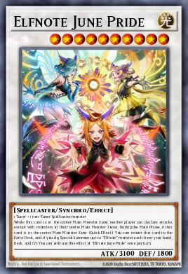

- **Copias y zona:** Extra 1x. No altera las cantidades registradas.
- **Nombre oficial de referencia:** Elfnota Orgullosa de Junio. CID cotejado con la ficha oficial; el nombre histórico del inventario se conserva aunque su grafía/traducción difiera.
- **Función principal y secundaria:** interrupción · resultado de Extra Deck · recuperación · extensor.
- **Estado de sinergia y función:** **Acceso demostrado con una mano real** en la ruta `650:A09:LUCINA:PATRON:JUNE_PRIDE07`; es una alternativa de la apertura Lucina+Power Patron, no un tablero adicional simultáneo.
- **Papel como recurso, descarte o coste:** Material o destino del Extra condicionado a los requisitos de invocación.
- **Efecto operativo (paráfrasis analítica):** recuperación e invocación desde Cementerio/destierro; acceso al campo desde la mano. Son operaciones detectadas en el texto, no efectos independientes garantizados; leer sus condiciones en la fuente.
- **Mapa de activación y resultados:** 1) en Main Phase: Invocación Especial desde Extra Deck. Cada operación está sujeta a la secuencia y al «si lo haces» del texto oficial.
- **Ventanas de activación identificadas:** Main Phase; Efecto Rápido.
- **Costes o recursos potenciales:** sin coste independiente identificado en esta síntesis; comprobar las acciones previas al punto y coma de cada efecto.
- **Restricciones y requisitos:** hay límite por turno según el efecto concreto. Invocar sólo desde el Extra Deck usando su procedimiento propio.
- **Prioridad al ir primero:** asegurar el centro y acceso a motores Sincro antes de gastar extensores. Para esta carta: Reservar la respuesta para la ventana rival exacta; no es una pieza buscadora de nuestro motor.
- **Prioridad al ir segundo:** habilitar rebote, negación o protección antes de comprometer el monstruo del centro. Identificar primero la respuesta rival que afecta su función «interrupción».
- **Medio/tardío y recuperación:** reciclar Cantantes, monstruos de Atributos distintos y zonas disponibles. Verificar que el objetivo de recuperación continúe disponible.
- **Sinergias y acceso a líneas:** Relación contextual con ocupación y rotación de la zona principal central, acceso a Cantantes y transición Sincro. Puede cerrar o prolongar una ruta del Extra si los materiales están disponibles.
- **Riesgo / brick / interrupciones:** No contarla como extensión automática: confirmar materiales, procedimiento y restricciones vigentes. Puede emplearse en cadena sólo cuando se cumpla su condición concreta.
- **Utilidad editorial:** 4/5 para este deck (estimación por rol y zona, no probabilidad calculada). No cambiar copias; cualquier sugerencia de alta/baja pasa por el apartado 22 y aprobación.
- **Referencia oficial y trazabilidad:** https://www.db.yugioh-card.com/yugiohdb/card_search.action?cid=22984&ope=2&request_locale=es. **Confianza:** texto y tipo de efecto cotejados en Konami; síntesis táctica editorial, no demostración de combo.
- **Aplicación concreta dentro de este deck (A06):** Lucina 6→9 por Power Patron Nivel1; Sincronía inmediata legal a June Pride Nivel10 central. El bloqueo de ataque exige permanecer en centro; puede regresar al Extra para desplegar hasta un Elfnote de mano, Deck y GY.

**USO PRÁCTICO Y SINERGIA — Elfnote June Pride [Synchro]**

- **Label funcional:** **Sinergia directa documentada por materiales del Main**; ruta 650:A09:LUCINA:PATRON:JUNE_PRIDE07.
- **Qué hace:** recuperación e invocación desde Cementerio/destierro; acceso al campo desde la mano. Son operaciones detectadas en el texto, no efectos independientes garantizados; leer sus condiciones en la fuente.
- **Cómo aprovecharla en este deck:** Lucina 6→9 por Power Patron Nivel1; Sincronía inmediata legal a June Pride Nivel10 central. El bloqueo de ataque exige permanecer en centro; puede regresar al Extra para desplegar hasta un Elfnote de mano, Deck y GY.
- **Al jugar primero:** asegurar el centro y acceso a motores Sincro antes de gastar extensores. Para esta carta: Reservar la respuesta para la ventana rival exacta; no es una pieza buscadora de nuestro motor.
- **Al jugar segundo:** habilitar rebote, negación o protección antes de comprometer el monstruo del centro. Identificar primero la respuesta rival que afecta su función «interrupción».
- **Cuándo tener precaución:** No contarla como extensión automática: confirmar materiales, procedimiento y restricciones vigentes. Puede emplearse en cadena sólo cuando se cumpla su condición concreta.

**CÓMO LLEGAR DESDE TU DECK — RUTA DOCUMENTADA**

- **Abrir guía `650:A09:LUCINA:PATRON:JUNE_PRIDE07`:** [ver pasos fotográficos, campo final y respuestas](guias/DECK_650_LUCINA_PATRON_TRES_SINCRONIAS_ALTERNATIVAS_GUIA.md). **Objetivo:** control de ataques por ubicación, extensión de recursos de distintas zonas. Requiere Lucina en mano, Patron buscable en Deck, Normal disponible y condiciones descritas. Se invocan **solo uno** de June Pride, Arcanite o Dawn Dragster (o Strelitzia por la línea histórica) a partir de los mismos materiales.

#### 26. S:P Little Knight [Link]

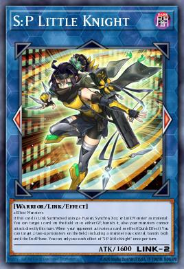

- **Copias y zona:** Extra 1x. No altera las cantidades registradas.
- **Nombre oficial de referencia:** S:P Pequeña Caballera. CID cotejado con la ficha oficial; el nombre histórico del inventario se conserva aunque su grafía/traducción difiera.
- **Función principal y secundaria:** interrupción · resultado de Extra Deck · removal · respuesta.
- **Estado de sinergia y función:** Sin acceso al Extra demostrado. Es una clasificación de juego; revisar la relación concreta en A06.
- **Papel como recurso, descarte o coste:** Material o destino del Extra condicionado a los requisitos de invocación.
- **Efecto operativo (paráfrasis analítica):** destierro de recursos o de amenazas; interacción sobre monstruos en campo. Son operaciones detectadas en el texto, no efectos independientes garantizados; leer sus condiciones en la fuente.
- **Mapa de activación y resultados:** 1) en respuesta a activación rival: destierra el recurso u objetivo previsto. Cada operación está sujeta a la secuencia y al «si lo haces» del texto oficial.
- **Ventanas de activación identificadas:** al producirse una Invocación; respuesta a activación rival; Efecto Rápido; Invocación del Extra Deck.
- **Costes o recursos potenciales:** sin coste independiente identificado en esta síntesis; comprobar las acciones previas al punto y coma de cada efecto.
- **Restricciones y requisitos:** hay límite por turno según el efecto concreto; puede limitar ataques. Invocar sólo desde el Extra Deck usando su procedimiento propio.
- **Prioridad al ir primero:** asegurar el centro y acceso a motores Sincro antes de gastar extensores. Para esta carta: Reservar la respuesta para la ventana rival exacta; no es una pieza buscadora de nuestro motor.
- **Prioridad al ir segundo:** habilitar rebote, negación o protección antes de comprometer el monstruo del centro. Identificar primero la respuesta rival que afecta su función «interrupción».
- **Medio/tardío y recuperación:** reciclar Cantantes, monstruos de Atributos distintos y zonas disponibles. No asumir que por sí misma recicla recursos si el texto no lo permite.
- **Sinergias y acceso a líneas:** Relación contextual con ocupación y rotación de la zona principal central, acceso a Cantantes y transición Sincro. Puede cerrar o prolongar una ruta del Extra si los materiales están disponibles.
- **Riesgo / brick / interrupciones:** No contarla como extensión automática: confirmar materiales, procedimiento y restricciones vigentes. Puede emplearse en cadena sólo cuando se cumpla su condición concreta.
- **Utilidad editorial:** 4/5 para este deck (estimación por rol y zona, no probabilidad calculada). No cambiar copias; cualquier sugerencia de alta/baja pasa por el apartado 22 y aprobación.
- **Referencia oficial y trazabilidad:** https://www.db.yugioh-card.com/yugiohdb/card_search.action?cid=19188&ope=2&request_locale=es. **Confianza:** texto y tipo de efecto cotejados en Konami; síntesis táctica editorial, no demostración de combo.
- **Aplicación concreta dentro de este deck (A06):** destierro de recursos o de amenazas; interacción sobre monstruos en campo. Falta arista de materiales en A06; A09 podría contener una ruta válida no indexada aquí.

**USO PRÁCTICO Y SINERGIA — S:P Little Knight [Link]**

- **Label funcional:** Sin sinergia demostrada (con la evidencia actual). Clasificación documental; una relación es válida solo si se satisfacen sus condiciones exactas.
- **Qué hace:** destierro de recursos o de amenazas; interacción sobre monstruos en campo. Son operaciones detectadas en el texto, no efectos independientes garantizados; leer sus condiciones en la fuente.
- **Cómo aprovecharla en este deck:** destierro de recursos o de amenazas; interacción sobre monstruos en campo. Falta arista de materiales en A06; A09 podría contener una ruta válida no indexada aquí.
- **Al jugar primero:** asegurar el centro y acceso a motores Sincro antes de gastar extensores. Para esta carta: Reservar la respuesta para la ventana rival exacta; no es una pieza buscadora de nuestro motor.
- **Al jugar segundo:** habilitar rebote, negación o protección antes de comprometer el monstruo del centro. Identificar primero la respuesta rival que afecta su función «interrupción».
- **Cuándo tener precaución:** No contarla como extensión automática: confirmar materiales, procedimiento y restricciones vigentes. Puede emplearse en cadena sólo cuando se cumpla su condición concreta.

**CÓMO LLEGAR DESDE TU DECK — SIN RUTA DEMOSTRADA**

- La biblioteca actual no contiene una ruta identificada para esta carta del Extra. No se debe exhibir una descripción genérica como sustituto de mano inicial, materiales y pasos. Para completarla, contrastar requisitos oficiales y recursos del Main; si no es alcanzable, explicar el impedimento exacto.

#### 27. Despian Luluwalilith [Synchro]

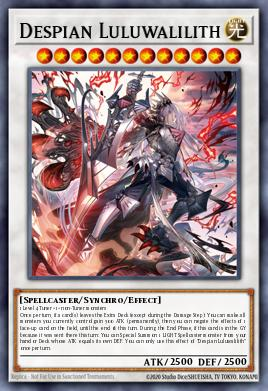

- **Copias y zona:** Extra 1x. No altera las cantidades registradas.
- **Nombre oficial de referencia:** Luluwalilith Despíanica. CID cotejado con la ficha oficial; el nombre histórico del inventario se conserva aunque su grafía/traducción difiera.
- **Función principal y secundaria:** resultado de Extra Deck · extensor · cierre.
- **Estado de sinergia y función:** Sin acceso al Extra demostrado. Es una clasificación de juego; revisar la relación concreta en A06.
- **Papel como recurso, descarte o coste:** Material o destino del Extra condicionado a los requisitos de invocación.
- **Efecto operativo (paráfrasis analítica):** acceso al campo desde la mano; presión de combate o modificación de estadísticas. Son operaciones detectadas en el texto, no efectos independientes garantizados; leer sus condiciones en la fuente.
- **Mapa de activación y resultados:** 1) en End Phase: Invocación Especial desde mano. Cada operación está sujeta a la secuencia y al «si lo haces» del texto oficial.
- **Ventanas de activación identificadas:** End Phase.
- **Costes o recursos potenciales:** sin coste independiente identificado en esta síntesis; comprobar las acciones previas al punto y coma de cada efecto.
- **Restricciones y requisitos:** hay límite por turno según el efecto concreto. Invocar sólo desde el Extra Deck usando su procedimiento propio.
- **Prioridad al ir primero:** asegurar el centro y acceso a motores Sincro antes de gastar extensores. Para esta carta: Comprobar materiales exactos antes de buscar este objetivo en el Extra Deck.
- **Prioridad al ir segundo:** habilitar rebote, negación o protección antes de comprometer el monstruo del centro. Identificar primero la respuesta rival que afecta su función «resultado de Extra Deck».
- **Medio/tardío y recuperación:** reciclar Cantantes, monstruos de Atributos distintos y zonas disponibles. No asumir que por sí misma recicla recursos si el texto no lo permite.
- **Sinergias y acceso a líneas:** Relación contextual con ocupación y rotación de la zona principal central, acceso a Cantantes y transición Sincro. Puede cerrar o prolongar una ruta del Extra si los materiales están disponibles.
- **Riesgo / brick / interrupciones:** No contarla como extensión automática: confirmar materiales, procedimiento y restricciones vigentes. No atribuirle velocidad rápida por el solo hecho de formar parte del motor.
- **Utilidad editorial:** 4/5 para este deck (estimación por rol y zona, no probabilidad calculada). No cambiar copias; cualquier sugerencia de alta/baja pasa por el apartado 22 y aprobación.
- **Referencia oficial y trazabilidad:** https://www.db.yugioh-card.com/yugiohdb/card_search.action?cid=18505&ope=2&request_locale=es. **Confianza:** texto y tipo de efecto cotejados en Konami; síntesis táctica editorial, no demostración de combo.
- **Aplicación concreta dentro de este deck (A06):** acceso al campo desde la mano; presión de combate o modificación de estadísticas. Falta arista de materiales en A06; A09 podría contener una ruta válida no indexada aquí.

**USO PRÁCTICO Y SINERGIA — Despian Luluwalilith [Synchro]**

- **Label funcional:** Sin sinergia demostrada (con la evidencia actual). Clasificación documental; una relación es válida solo si se satisfacen sus condiciones exactas.
- **Qué hace:** acceso al campo desde la mano; presión de combate o modificación de estadísticas. Son operaciones detectadas en el texto, no efectos independientes garantizados; leer sus condiciones en la fuente.
- **Cómo aprovecharla en este deck:** acceso al campo desde la mano; presión de combate o modificación de estadísticas. Falta arista de materiales en A06; A09 podría contener una ruta válida no indexada aquí.
- **Al jugar primero:** asegurar el centro y acceso a motores Sincro antes de gastar extensores. Para esta carta: Comprobar materiales exactos antes de buscar este objetivo en el Extra Deck.
- **Al jugar segundo:** habilitar rebote, negación o protección antes de comprometer el monstruo del centro. Identificar primero la respuesta rival que afecta su función «resultado de Extra Deck».
- **Cuándo tener precaución:** No contarla como extensión automática: confirmar materiales, procedimiento y restricciones vigentes. No atribuirle velocidad rápida por el solo hecho de formar parte del motor.

**CÓMO LLEGAR DESDE TU DECK — SIN RUTA DEMOSTRADA**

- La biblioteca actual no contiene una ruta identificada para esta carta del Extra. No se debe exhibir una descripción genérica como sustituto de mano inicial, materiales y pasos. Para completarla, contrastar requisitos oficiales y recursos del Main; si no es alcanzable, explicar el impedimento exacto.

#### 28. Arcanite Magician [Synchro]

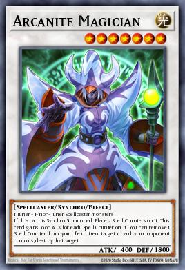

- **Copias y zona:** Extra 1x. No altera las cantidades registradas.
- **Nombre oficial de referencia:** Mago Arcanista. CID cotejado con la ficha oficial; el nombre histórico del inventario se conserva aunque su grafía/traducción difiera.
- **Función principal y secundaria:** resultado de Extra Deck · removal · cierre · recurso condicionado.
- **Estado de sinergia y función:** **Acceso demostrado con una mano real** en la ruta `650:A09:LUCINA:PATRON:ARCANITE08`; es una alternativa de la apertura Lucina+Power Patron, no un tablero adicional simultáneo.
- **Papel como recurso, descarte o coste:** Material o destino del Extra condicionado a los requisitos de invocación.
- **Efecto operativo (paráfrasis analítica):** destrucción de cartas o empleo de destrucción como detonante; presión de combate o modificación de estadísticas; colocación o gasto de contadores. Son operaciones detectadas en el texto, no efectos independientes garantizados; leer sus condiciones en la fuente.
- **Mapa de activación y resultados:** 1) efecto propio o continuo: destruye la carta o recurso previsto. Cada operación está sujeta a la secuencia y al «si lo haces» del texto oficial.
- **Ventanas de activación identificadas:** al producirse una Invocación; Invocación del Extra Deck.
- **Costes o recursos potenciales:** sin coste independiente identificado en esta síntesis; comprobar las acciones previas al punto y coma de cada efecto.
- **Restricciones y requisitos:** aplicar restricciones de selección, activación y copias que consten en el texto original. Invocar sólo desde el Extra Deck usando su procedimiento propio.
- **Prioridad al ir primero:** asegurar el centro y acceso a motores Sincro antes de gastar extensores. Para esta carta: Comprobar materiales exactos antes de buscar este objetivo en el Extra Deck.
- **Prioridad al ir segundo:** habilitar rebote, negación o protección antes de comprometer el monstruo del centro. Identificar primero la respuesta rival que afecta su función «resultado de Extra Deck».
- **Medio/tardío y recuperación:** reciclar Cantantes, monstruos de Atributos distintos y zonas disponibles. No asumir que por sí misma recicla recursos si el texto no lo permite.
- **Sinergias y acceso a líneas:** Relación contextual con ocupación y rotación de la zona principal central, acceso a Cantantes y transición Sincro. Puede cerrar o prolongar una ruta del Extra si los materiales están disponibles.
- **Riesgo / brick / interrupciones:** No contarla como extensión automática: confirmar materiales, procedimiento y restricciones vigentes. No atribuirle velocidad rápida por el solo hecho de formar parte del motor.
- **Utilidad editorial:** 4/5 para este deck (estimación por rol y zona, no probabilidad calculada). No cambiar copias; cualquier sugerencia de alta/baja pasa por el apartado 22 y aprobación.
- **Referencia oficial y trazabilidad:** https://www.db.yugioh-card.com/yugiohdb/card_search.action?cid=8038&ope=2&request_locale=es. **Confianza:** texto y tipo de efecto cotejados en Konami; síntesis táctica editorial, no demostración de combo.
- **Aplicación concreta dentro de este deck (A06):** Lucina Hechicero Nivel6 + Patron Cantante Nivel1 sin subir Niveles → Arcanite Sincro7, 2 contadores y 2400 ATK. Cada contador gastado de Arcanite baja 1000 ATK y permite destruir un objetivo rival.

**USO PRÁCTICO Y SINERGIA — Arcanite Magician [Synchro]**

- **Label funcional:** **Sinergia directa documentada por materiales del Main**; ruta 650:A09:LUCINA:PATRON:ARCANITE08.
- **Qué hace:** destrucción de cartas o empleo de destrucción como detonante; presión de combate o modificación de estadísticas; colocación o gasto de contadores. Son operaciones detectadas en el texto, no efectos independientes garantizados; leer sus condiciones en la fuente.
- **Cómo aprovecharla en este deck:** Lucina Hechicero Nivel6 + Patron Cantante Nivel1 sin subir Niveles → Arcanite Sincro7, 2 contadores y 2400 ATK. Cada contador gastado de Arcanite baja 1000 ATK y permite destruir un objetivo rival.
- **Al jugar primero:** asegurar el centro y acceso a motores Sincro antes de gastar extensores. Para esta carta: Comprobar materiales exactos antes de buscar este objetivo en el Extra Deck.
- **Al jugar segundo:** habilitar rebote, negación o protección antes de comprometer el monstruo del centro. Identificar primero la respuesta rival que afecta su función «resultado de Extra Deck».
- **Cuándo tener precaución:** No contarla como extensión automática: confirmar materiales, procedimiento y restricciones vigentes. No atribuirle velocidad rápida por el solo hecho de formar parte del motor.

**CÓMO LLEGAR DESDE TU DECK — RUTA DOCUMENTADA**

- **Abrir guía `650:A09:LUCINA:PATRON:ARCANITE08`:** [ver pasos fotográficos, campo final y respuestas](guias/DECK_650_LUCINA_PATRON_TRES_SINCRONIAS_ALTERNATIVAS_GUIA.md). **Objetivo:** remoción selectiva mediante contadores con coste de presión de combate. Requiere Lucina en mano, Patron buscable en Deck, Normal disponible y condiciones descritas. Se invocan **solo uno** de June Pride, Arcanite o Dawn Dragster (o Strelitzia por la línea histórica) a partir de los mismos materiales.

#### 29. Crystal Wing Synchro Dragon [Synchro]

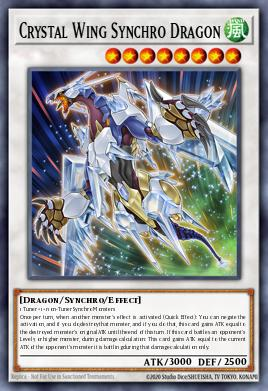

- **Copias y zona:** Extra 1x. No altera las cantidades registradas.
- **Nombre oficial de referencia:** Dragón Sincro Ala Cristalina. CID cotejado con la ficha oficial; el nombre histórico del inventario se conserva aunque su grafía/traducción difiera.
- **Función principal y secundaria:** interrupción · resultado de Extra Deck · negación · cierre.
- **Estado de sinergia y función:** **ruta de materiales concretos identificada**: Strelitzia (Sincro no Cantante Nivel 7, CID 22143) + Power Patron (Cantante Nivel 1, CID 22119), cuando Strelitzia revive al Patron utilizado en su primera Sincronía y **se omite** la reducción opcional de Niveles.
- **Papel como recurso, descarte o coste:** Sincro Nivel 8 que consume Strelitzia y Patron; **no** puede fabricarse con dos monstruos no Sincro cuya suma sea 8.
- **Efecto operativo (paráfrasis analítica):** una vez por turno, ante la activación del efecto de **otro monstruo**, puede negar la activación y destruir a ese monstruo; solo si llega a destruirlo gana ATK igual a su ATK original ese turno. En cálculo de daño contra monstruo rival de Nivel 5 o superior, obtiene ATK igual al ATK actual de ese rival durante ese cálculo.
- **Mapa de activación y resultados:** Lucina6 + Patron1 → Strelitzia7; Strelitzia Invoca Especialmente a Patron1 del GY, **sin** aplicar la reducción opcional de 3 Niveles → Sincro Strelitzia7 + Patron1 → Crystal Wing8. Son dos Sincronías consecutivas, no dos jefes finales simultáneos.
- **Ventanas de activación identificadas:** Sincro propia Main Phase; efecto rápido cuando **otro** monstruo activa efecto; aumento de ATK en cálculo de daño frente a Nivel 5+.
- **Costes o recursos potenciales:** Normal para Patron; Strelitzia y Patron son materiales de la segunda Sincronía. Se debe conservar la zona y no utilizar la modificación opcional de Niveles de Strelitzia.
- **Restricciones y requisitos:** Sincro 8: un Cantante + **uno o más Sincros no Cantantes**. La negación se usa una vez por turno. Una Mágica/Trampa sin efecto de monstruo no activa esa negación.
- **Prioridad al ir primero:** asegurar el centro y acceso a motores Sincro antes de gastar extensores. Para esta carta: Reservar la respuesta para la ventana rival exacta; no es una pieza buscadora de nuestro motor.
- **Prioridad al ir segundo:** habilitar rebote, negación o protección antes de comprometer el monstruo del centro. Identificar primero la respuesta rival que afecta su función «interrupción».
- **Medio/tardío y recuperación:** Crystal Wing no recupera materiales; **Strelitzia (Sincro no Cantante) y Patron (Cantante)** se envían al GY como materiales de la segunda Sincronía.
- **Sinergias y acceso a líneas:** `650:A06:STRELITZIA:PATRON:CRYSTAL_WING03`: ruta del mismo iniciador Lucina, alternativa al final Strelitzia central; el Patron revivido es la **misma copia** enviada al GY como material, no una segunda copia supuesta.
- **Riesgo / brick / interrupciones:** si Strelitzia no puede Invocar a Patron, si se aplicó el descenso de Nivel 3 o si el rival retira un cuerpo antes de la segunda Sincronía, **no** hay Crystal Wing 8.
- **Utilidad editorial:** alternativa Sincro 8 con respuesta a monstruos; no comparte endboard con Strelitzia y no justifica cambios de copias.
- **Referencia oficial y trazabilidad:** https://www.db.yugioh-card.com/yugiohdb/card_search.action?cid=12321&ope=2&request_locale=es. **Confianza:** texto y tipo de efecto cotejados en Konami; síntesis táctica editorial, no demostración de combo.
- **Aplicación concreta dentro de este deck (A06):** Strelitzia7 + Patron1 del GY → Crystal Wing8, sin bajar Niveles; fuentes Konami CID 22143, 22119 y 12321. Validación causal documental pendiente de su ficha A09 detallada.

**USO PRÁCTICO Y SINERGIA — Crystal Wing Synchro Dragon [Synchro]**

- **Label funcional:** **Sinergia de dos etapas Sincro: Lucina + Patron → Strelitzia → Crystal Wing**, pendiente de cotejo completo de cadena A09.
- **Qué hace:** niega la activación del efecto de otro monstruo una vez por turno y puede ganar ATK si lo destruye; gana ATK durante cálculo de daño contra Nivel 5+.
- **Cómo aprovecharla en este deck:** después de traer a Strelitzia7, revivir Patron1 del GY con su efecto en Main Phase, **rechazar** el descenso opcional de Niveles y usar ambos como materiales del Sincro8.
- **Al jugar primero:** asegurar el centro y acceso a motores Sincro antes de gastar extensores. Para esta carta: Reservar la respuesta para la ventana rival exacta; no es una pieza buscadora de nuestro motor.
- **Al jugar segundo:** habilitar rebote, negación o protección antes de comprometer el monstruo del centro. Identificar primero la respuesta rival que afecta su función «interrupción».
- **Cuándo tener precaución:** No contarla como extensión automática: confirmar materiales, procedimiento y restricciones vigentes. Puede emplearse en cadena sólo cuando se cumpla su condición concreta.

**CÓMO LLEGAR DESDE TU DECK — DOS SINCRONÍAS DOCUMENTALES**

- **Entrada:** Lucina en mano, Patron en Deck para buscar, Normal libre y Strelitzia/Crystal Wing en Extra. **Transformación:** Lucina6 + Patron1 → Strelitzia7; activar Strelitzia para traer **Patron desde el GY**, sin modificar niveles; Strelitzia7 + Patron1 → Crystal Wing8. La ficha A09 debe concretar cadenas, zona y estado residual; no declarar campo de dos jefes.

#### 30. F.A. Dawn Dragster [Synchro]

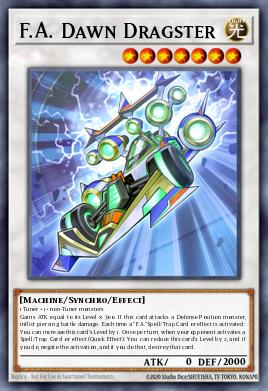

- **Copias y zona:** Extra 1x. No altera las cantidades registradas.
- **Nombre oficial de referencia:** F.A. Coche Trucado del Amanecer. CID cotejado con la ficha oficial; el nombre histórico del inventario se conserva aunque su grafía/traducción difiera.
- **Función principal y secundaria:** interrupción · resultado de Extra Deck · removal · negación · cierre.
- **Estado de sinergia y función:** **Acceso Sincro condicionado 6+1, pendiente de prueba integral**. La ruta `650:A09:LUCINA:PATRON:DAWN_DRAGSTER09` es una alternativa excluyente de Lucina+Power Patron; no constituye un segundo tablero simultáneo ni una jugada certificada sin reproducir la secuencia.
- **Papel como recurso, descarte o coste:** Material o destino del Extra condicionado a los requisitos de invocación.
- **Efecto operativo (paráfrasis analítica):** destrucción de cartas o empleo de destrucción como detonante; negación de efectos o activaciones; presión de combate o modificación de estadísticas. Son operaciones detectadas en el texto, no efectos independientes garantizados; leer sus condiciones en la fuente.
- **Mapa de activación y resultados:** 1) en respuesta a activación rival: niega el efecto o la activación indicada, destruye la carta o recurso previsto. Cada operación está sujeta a la secuencia y al «si lo haces» del texto oficial.
- **Ventanas de activación identificadas:** respuesta a activación rival; Efecto Rápido.
- **Costes o recursos potenciales:** sin coste independiente identificado en esta síntesis; comprobar las acciones previas al punto y coma de cada efecto.
- **Restricciones y requisitos:** hay límite por turno según el efecto concreto. Invocar sólo desde el Extra Deck usando su procedimiento propio.
- **Prioridad al ir primero:** asegurar el centro y acceso a motores Sincro antes de gastar extensores. Para esta carta: Reservar la respuesta para la ventana rival exacta; no es una pieza buscadora de nuestro motor.
- **Prioridad al ir segundo:** habilitar rebote, negación o protección antes de comprometer el monstruo del centro. Identificar primero la respuesta rival que afecta su función «interrupción».
- **Medio/tardío y recuperación:** reciclar Cantantes, monstruos de Atributos distintos y zonas disponibles. No asumir que por sí misma recicla recursos si el texto no lo permite.
- **Sinergias y acceso a líneas:** Relación contextual con ocupación y rotación de la zona principal central, acceso a Cantantes y transición Sincro. Puede cerrar o prolongar una ruta del Extra si los materiales están disponibles.
- **Riesgo / brick / interrupciones:** No contarla como extensión automática: confirmar materiales, procedimiento y restricciones vigentes. Puede emplearse en cadena sólo cuando se cumpla su condición concreta.
- **Utilidad editorial:** respuesta condicional a activaciones de Mágica/Trampa rival con Niveles 6+1; puntuación competitiva pendiente de prueba. No proponer cambios automáticos de copias por una clasificación externa.
- **Referencia oficial y trazabilidad:** https://www.db.yugioh-card.com/yugiohdb/card_search.action?cid=13710&ope=2&request_locale=es. **Confianza:** texto y tipo de efecto cotejados en Konami; síntesis táctica editorial, no demostración de combo.
- **Aplicación concreta dentro de este deck (A06), condicionada a la secuencia:** Lucina Nivel 6 + Patron Cantante Nivel 1 sin aumento de Nivel permiten estudiar Dawn Dragster Sincro 7, 2100 ATK; ante una activación de M/T rival elegible, reducir 2 Niveles (a 5) para negar la activación y destruir (1500 ATK). Revisar la disponibilidad de materiales, restricciones y cadena completa antes de acreditar la ruta.

**USO PRÁCTICO Y SINERGIA — F.A. Dawn Dragster [Synchro]**

- **Label funcional:** **Sinergia Sincro condicionada, sin reproducción integral**; ruta `650:A09:LUCINA:PATRON:DAWN_DRAGSTER09`. No presentar el campo final como confirmado antes de validar la secuencia de materiales y respuesta.
- **Qué hace:** destrucción de cartas o empleo de destrucción como detonante; negación de efectos o activaciones; presión de combate o modificación de estadísticas. Son operaciones detectadas en el texto, no efectos independientes garantizados; leer sus condiciones en la fuente.
- **Cómo aprovecharla en este deck:** considerar la alternativa Sincro 6+1 sin activar el aumento de Nivel de Patron; reservar su respuesta al efecto de Mágica/Trampa rival y contrastar todos los requisitos en la guía de la ruta 09.
- **Al jugar primero:** asegurar el centro y acceso a motores Sincro antes de gastar extensores. Para esta carta: Reservar la respuesta para la ventana rival exacta; no es una pieza buscadora de nuestro motor.
- **Al jugar segundo:** habilitar rebote, negación o protección antes de comprometer el monstruo del centro. Identificar primero la respuesta rival que afecta su función «interrupción».
- **Cuándo tener precaución:** No contarla como extensión automática: confirmar materiales, procedimiento y restricciones vigentes. Puede emplearse en cadena sólo cuando se cumpla su condición concreta.

**CÓMO LLEGAR DESDE TU DECK — RUTA DOCUMENTADA**

- **Abrir guía `650:A09:LUCINA:PATRON:DAWN_DRAGSTER09`:** [ver pasos fotográficos, campo final y respuestas](guias/DECK_650_LUCINA_PATRON_TRES_SINCRONIAS_ALTERNATIVAS_GUIA.md). **Objetivo:** negación reactiva de activación de Mágica/Trampa, no efectos de monstruo. Requiere Lucina en mano, Patron buscable en Deck, Normal disponible y condiciones descritas. Se invocan **solo uno** de June Pride, Arcanite o Dawn Dragster (o Strelitzia por la línea histórica) a partir de los mismos materiales.

#### 31. Ruddy Rose Dragon [Synchro]

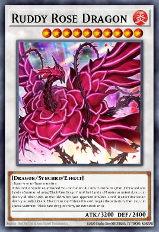

- **Copias y zona:** Extra 1x. No altera las cantidades registradas.
- **Nombre oficial de referencia:** Dragón de la Rosa Rojiza. CID cotejado con la ficha oficial; el nombre histórico del inventario se conserva aunque su grafía/traducción difiera.
- **Función principal y secundaria:** interrupción · resultado de Extra Deck · recuperación · negación · coste/recurso.
- **Estado de sinergia y función:** Sin acceso al Extra demostrado. Es una clasificación de juego; revisar la relación concreta en A06.
- **Papel como recurso, descarte o coste:** Material o destino del Extra condicionado a los requisitos de invocación.
- **Efecto operativo (paráfrasis analítica):** recuperación e invocación desde Cementerio/destierro; negación de efectos o activaciones; uso de Sacrificios como parte del efecto. Son operaciones detectadas en el texto, no efectos independientes garantizados; leer sus condiciones en la fuente.
- **Mapa de activación y resultados:** 1) tras su invocación desde el Extra: habilita Sincronía, destruye la carta o recurso previsto · 2) en respuesta a activación rival: niega el efecto o la activación indicada, Invocación Especial desde Extra Deck. Cada operación está sujeta a la secuencia y al «si lo haces» del texto oficial.
- **Ventanas de activación identificadas:** al producirse una Invocación; respuesta a activación rival; Efecto Rápido; Invocación del Extra Deck.
- **Costes o recursos potenciales:** Sacrificio.
- **Restricciones y requisitos:** aplicar restricciones de selección, activación y copias que consten en el texto original. Invocar sólo desde el Extra Deck usando su procedimiento propio.
- **Prioridad al ir primero:** asegurar el centro y acceso a motores Sincro antes de gastar extensores. Para esta carta: Reservar la respuesta para la ventana rival exacta; no es una pieza buscadora de nuestro motor.
- **Prioridad al ir segundo:** habilitar rebote, negación o protección antes de comprometer el monstruo del centro. Identificar primero la respuesta rival que afecta su función «interrupción».
- **Medio/tardío y recuperación:** reciclar Cantantes, monstruos de Atributos distintos y zonas disponibles. Verificar que el objetivo de recuperación continúe disponible.
- **Sinergias y acceso a líneas:** Relación contextual con ocupación y rotación de la zona principal central, acceso a Cantantes y transición Sincro. Puede cerrar o prolongar una ruta del Extra si los materiales están disponibles.
- **Riesgo / brick / interrupciones:** No contarla como extensión automática: confirmar materiales, procedimiento y restricciones vigentes. Puede emplearse en cadena sólo cuando se cumpla su condición concreta.
- **Utilidad editorial:** 4/5 para este deck (estimación por rol y zona, no probabilidad calculada). No cambiar copias; cualquier sugerencia de alta/baja pasa por el apartado 22 y aprobación.
- **Referencia oficial y trazabilidad:** https://www.db.yugioh-card.com/yugiohdb/card_search.action?cid=15996&ope=2&request_locale=es. **Confianza:** texto y tipo de efecto cotejados en Konami; síntesis táctica editorial, no demostración de combo.
- **Aplicación concreta dentro de este deck (A06):** recuperación e invocación desde Cementerio/destierro; negación de efectos o activaciones; uso de Sacrificios como parte del efecto. Falta arista de materiales en A06; A09 podría contener una ruta válida no indexada aquí.

**USO PRÁCTICO Y SINERGIA — Ruddy Rose Dragon [Synchro]**

- **Label funcional:** Sin sinergia demostrada (con la evidencia actual). Clasificación documental; una relación es válida solo si se satisfacen sus condiciones exactas.
- **Qué hace:** recuperación e invocación desde Cementerio/destierro; negación de efectos o activaciones; uso de Sacrificios como parte del efecto. Son operaciones detectadas en el texto, no efectos independientes garantizados; leer sus condiciones en la fuente.
- **Cómo aprovecharla en este deck:** recuperación e invocación desde Cementerio/destierro; negación de efectos o activaciones; uso de Sacrificios como parte del efecto. Falta arista de materiales en A06; A09 podría contener una ruta válida no indexada aquí.
- **Al jugar primero:** asegurar el centro y acceso a motores Sincro antes de gastar extensores. Para esta carta: Reservar la respuesta para la ventana rival exacta; no es una pieza buscadora de nuestro motor.
- **Al jugar segundo:** habilitar rebote, negación o protección antes de comprometer el monstruo del centro. Identificar primero la respuesta rival que afecta su función «interrupción».
- **Cuándo tener precaución:** No contarla como extensión automática: confirmar materiales, procedimiento y restricciones vigentes. Puede emplearse en cadena sólo cuando se cumpla su condición concreta.

**CÓMO LLEGAR DESDE TU DECK — SIN RUTA DEMOSTRADA**

- La biblioteca actual no contiene una ruta identificada para esta carta del Extra. No se debe exhibir una descripción genérica como sustituto de mano inicial, materiales y pasos. Para completarla, contrastar requisitos oficiales y recursos del Main; si no es alcanzable, explicar el impedimento exacto.

#### 32. Albion the Branded Dragon [Fusion]

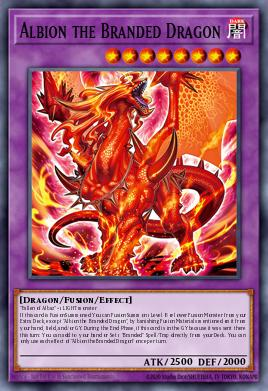

- **Copias y zona:** Extra 1x. No altera las cantidades registradas.
- **Nombre oficial de referencia:** Albion el Dragón Señalado. CID cotejado con la ficha oficial; el nombre histórico del inventario se conserva aunque su grafía/traducción difiera.
- **Función principal y secundaria:** resultado de Extra Deck · buscador · habilitador de Extra · preparación.
- **Estado de sinergia y función:** Destino Extra condicionado. Es una clasificación de juego; revisar la relación concreta en A06.
- **Papel como recurso, descarte o coste:** Material o destino del Extra condicionado a los requisitos de invocación.
- **Efecto operativo (paráfrasis analítica):** búsqueda o incorporación de cartas a mano; habilitación o continuación de una invocación del Extra Deck; colocación de Mágicas/Trampas o recursos. Son operaciones detectadas en el texto, no efectos independientes garantizados; leer sus condiciones en la fuente.
- **Mapa de activación y resultados:** 1) tras su invocación desde el Extra: realiza Fusión con materiales permitidos · 2) en End Phase: incorpora la pieza indicada a la mano, Coloca Mágicas/Trampas indicadas. Cada operación está sujeta a la secuencia y al «si lo haces» del texto oficial.
- **Ventanas de activación identificadas:** End Phase; al producirse una Invocación; Invocación del Extra Deck.
- **Costes o recursos potenciales:** sin coste independiente identificado en esta síntesis; comprobar las acciones previas al punto y coma de cada efecto.
- **Restricciones y requisitos:** hay límite por turno según el efecto concreto. Invocar sólo desde el Extra Deck usando su procedimiento propio.
- **Prioridad al ir primero:** asegurar el centro y acceso a motores Sincro antes de gastar extensores. Para esta carta: Comprobar materiales exactos antes de buscar este objetivo en el Extra Deck.
- **Prioridad al ir segundo:** habilitar rebote, negación o protección antes de comprometer el monstruo del centro. Identificar primero la respuesta rival que afecta su función «resultado de Extra Deck».
- **Medio/tardío y recuperación:** reciclar Cantantes, monstruos de Atributos distintos y zonas disponibles. No asumir que por sí misma recicla recursos si el texto no lo permite.
- **Sinergias y acceso a líneas:** Relación contextual con ocupación y rotación de la zona principal central, acceso a Cantantes y transición Sincro. Puede cerrar o prolongar una ruta del Extra si los materiales están disponibles.
- **Riesgo / brick / interrupciones:** No contarla como extensión automática: confirmar materiales, procedimiento y restricciones vigentes. No atribuirle velocidad rápida por el solo hecho de formar parte del motor.
- **Utilidad editorial:** 4/5 para este deck (estimación por rol y zona, no probabilidad calculada). No cambiar copias; cualquier sugerencia de alta/baja pasa por el apartado 22 y aprobación.
- **Referencia oficial y trazabilidad:** https://www.db.yugioh-card.com/yugiohdb/card_search.action?cid=15994&ope=2&request_locale=es. **Confianza:** texto y tipo de efecto cotejados en Konami; síntesis táctica editorial, no demostración de combo.
- **Aplicación concreta dentro de este deck (A06):** búsqueda o incorporación de cartas a mano; habilitación o continuación de una invocación del Extra Deck; colocación de Mágicas/Trampas o recursos. A06 identifica su destino, condicionado a material/procedimiento.

**USO PRÁCTICO Y SINERGIA — Albion the Branded Dragon [Fusion]**

- **Label funcional:** Referencias de ruta localizadas; conexión reglamentaria sujeta al recorrido de la guía. Clasificación documental; una relación es válida solo si se satisfacen sus condiciones exactas.
- **Qué hace:** búsqueda o incorporación de cartas a mano; habilitación o continuación de una invocación del Extra Deck; colocación de Mágicas/Trampas o recursos. Son operaciones detectadas en el texto, no efectos independientes garantizados; leer sus condiciones en la fuente.
- **Cómo aprovecharla en este deck:** búsqueda o incorporación de cartas a mano; habilitación o continuación de una invocación del Extra Deck; colocación de Mágicas/Trampas o recursos. A06 identifica su destino, condicionado a material/procedimiento.
- **Al jugar primero:** asegurar el centro y acceso a motores Sincro antes de gastar extensores. Para esta carta: Comprobar materiales exactos antes de buscar este objetivo en el Extra Deck.
- **Al jugar segundo:** habilitar rebote, negación o protección antes de comprometer el monstruo del centro. Identificar primero la respuesta rival que afecta su función «resultado de Extra Deck».
- **Cuándo tener precaución:** No contarla como extensión automática: confirmar materiales, procedimiento y restricciones vigentes. No atribuirle velocidad rápida por el solo hecho de formar parte del motor.

**CÓMO LLEGAR DESDE TU DECK — RUTAS DOCUMENTADAS**

- **Abrir guía `650:A09:ECCLESIA:FALLEN:ALBION01`:** entrada: Ecclesia Dogmátik, la Virtuosa (CID 15239) sola. Campo/GY propios vacíos; en el Main/Deck figuran 2 copias de El Caído y La Virtuosa (CID 22089), y en el Extra queda Albion el Dragón Señalado (CID 15994), que menciona «Caído de Albaz». Rival controla una carta boca arriba elegible sin protección; no hay respuestas en la línea base. Turno propio Main Phase, Normal libre. No considerar otras cartas desconocidas.. Propósito descrito: Preparación de recursos / despliegue. Consulta sus pasos, consumo y resultado; comprobar si esta carta es realmente invocada o solo mencionada.

#### 33. Chaos Angel [Synchro]

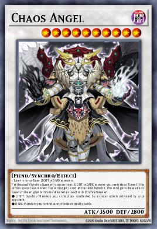

- **Copias y zona:** Extra 1x. No altera las cantidades registradas.
- **Nombre oficial de referencia:** Ángel del Caos. CID cotejado con la ficha oficial; el nombre histórico del inventario se conserva aunque su grafía/traducción difiera.
- **Función principal y secundaria:** resultado de Extra Deck · habilitador de Extra.
- **Estado de sinergia y función:** Sin acceso al Extra demostrado. Es una clasificación de juego; revisar la relación concreta en A06.
- **Papel como recurso, descarte o coste:** Material o destino del Extra condicionado a los requisitos de invocación.
- **Efecto operativo (paráfrasis analítica):** habilitación o continuación de una invocación del Extra Deck. Son operaciones detectadas en el texto, no efectos independientes garantizados; leer sus condiciones en la fuente.
- **Mapa de activación y resultados:** 1) efecto propio o continuo: habilita Sincronía. Cada operación está sujeta a la secuencia y al «si lo haces» del texto oficial.
- **Ventanas de activación identificadas:** al producirse una Invocación.
- **Costes o recursos potenciales:** sin coste independiente identificado en esta síntesis; comprobar las acciones previas al punto y coma de cada efecto.
- **Restricciones y requisitos:** aplicar restricciones de selección, activación y copias que consten en el texto original. Invocar sólo desde el Extra Deck usando su procedimiento propio.
- **Prioridad al ir primero:** asegurar el centro y acceso a motores Sincro antes de gastar extensores. Para esta carta: Comprobar materiales exactos antes de buscar este objetivo en el Extra Deck.
- **Prioridad al ir segundo:** habilitar rebote, negación o protección antes de comprometer el monstruo del centro. Identificar primero la respuesta rival que afecta su función «resultado de Extra Deck».
- **Medio/tardío y recuperación:** reciclar Cantantes, monstruos de Atributos distintos y zonas disponibles. No asumir que por sí misma recicla recursos si el texto no lo permite.
- **Sinergias y acceso a líneas:** Relación contextual con ocupación y rotación de la zona principal central, acceso a Cantantes y transición Sincro. Puede cerrar o prolongar una ruta del Extra si los materiales están disponibles.
- **Riesgo / brick / interrupciones:** No contarla como extensión automática: confirmar materiales, procedimiento y restricciones vigentes. No atribuirle velocidad rápida por el solo hecho de formar parte del motor.
- **Utilidad editorial:** 4/5 para este deck (estimación por rol y zona, no probabilidad calculada). No cambiar copias; cualquier sugerencia de alta/baja pasa por el apartado 22 y aprobación.
- **Referencia oficial y trazabilidad:** https://www.db.yugioh-card.com/yugiohdb/card_search.action?cid=18507&ope=2&request_locale=es. **Confianza:** texto y tipo de efecto cotejados en Konami; síntesis táctica editorial, no demostración de combo.
- **Aplicación concreta dentro de este deck (A06):** habilitación o continuación de una invocación del Extra Deck. Falta arista de materiales en A06; A09 podría contener una ruta válida no indexada aquí.

**USO PRÁCTICO Y SINERGIA — Chaos Angel [Synchro]**

- **Label funcional:** Sin sinergia demostrada (con la evidencia actual). Clasificación documental; una relación es válida solo si se satisfacen sus condiciones exactas.
- **Qué hace:** habilitación o continuación de una invocación del Extra Deck. Son operaciones detectadas en el texto, no efectos independientes garantizados; leer sus condiciones en la fuente.
- **Cómo aprovecharla en este deck:** habilitación o continuación de una invocación del Extra Deck. Falta arista de materiales en A06; A09 podría contener una ruta válida no indexada aquí.
- **Al jugar primero:** asegurar el centro y acceso a motores Sincro antes de gastar extensores. Para esta carta: Comprobar materiales exactos antes de buscar este objetivo en el Extra Deck.
- **Al jugar segundo:** habilitar rebote, negación o protección antes de comprometer el monstruo del centro. Identificar primero la respuesta rival que afecta su función «resultado de Extra Deck».
- **Cuándo tener precaución:** No contarla como extensión automática: confirmar materiales, procedimiento y restricciones vigentes. No atribuirle velocidad rápida por el solo hecho de formar parte del motor.

**CÓMO LLEGAR DESDE TU DECK — SIN RUTA DEMOSTRADA**

- La biblioteca actual no contiene una ruta identificada para esta carta del Extra. No se debe exhibir una descripción genérica como sustituto de mano inicial, materiales y pasos. Para completarla, contrastar requisitos oficiales y recursos del Main; si no es alcanzable, explicar el impedimento exacto.

#### 34. Junora the Power Patron of Tuning [Synchro]

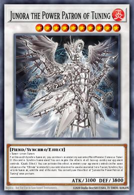

- **Copias y zona:** Extra 1x. No altera las cantidades registradas.
- **Nombre oficial de referencia:** Junora el Modelo de Poder de Afinación. CID cotejado con la ficha oficial; el nombre histórico del inventario se conserva aunque su grafía/traducción difiera.
- **Función principal y secundaria:** **Sincro Nivel 10** de tres materiales · negación puntual de cartas rivales boca arriba **al ser Invocada por Sincronía** · bloqueo temporal de uso como materiales de Extra en columnas de Elfnota propia.
- **Estado de sinergia y función:** **destino de motor condicionado** con Lucina, Tinia, Regina, Patron y Strelitzia, en la ruta de niveles 4+3+3=10.
- **Papel como recurso, descarte o coste:** requiere **1 Cantante + exactamente 2 no Cantantes** para la Sincronía; para **esta** Invocación puede **tratar un monstruo propio en la zona central como Cantante**. Esto no significa que Junora permita Invocar Fusiones.
- **Efecto operativo (paráfrasis analítica):** con materiales Sincro de suma Nivel 10, puede tratar 1 monstruo propio central como Cantante. **Cuando Junora es Invocada por Sincronía**, puede **negar efectos de todas las cartas rivales boca arriba existentes**. En Efecto Rápido propio, los monstruos rivales en las **mismas columnas de los monstruos «Elfnote» que controlas** no pueden usarse como materiales de Fusión/Sincronía/Xyz/Enlace hasta terminar el turno; la carta no realiza ninguna Invocación por Fusión.
- **Mapa de activación y resultados:** Lucina+Tinia→Strelitzia; su reducción de Nivel deja **Strelitzia Lv4 central, Regina Lv3 y Tinia Lv3 laterales**. Tratar Strelitzia central **como Cantante** para Junora y usar Regina/Tinia como sus **dos no Cantantes** 4+3+3=10. Al Sincronizar, si rival controla cartas boca arriba, Junora puede negar sus efectos en la resolución.
- **Ventanas de activación identificadas:** efecto de negación **si es Invocada por Sincronía**; Efecto Rápido de columnas durante ventana legal, **una vez por turno** para ese último efecto.
- **Costes o recursos potenciales:** consume exactamente tres cuerpos para su Invocación; no paga monstruos rivales ni descarta cartas por el Efecto Rápido de columna.
- **Restricciones y requisitos:** **Junora no contiene «Elfnote» en su nombre**; si tras Sincronizar solo controlas Junora, **no existe monstruo propio «Elfnote»** para definir columnas en su Efecto Rápido. No atribuir bloqueo de columnas en ese endboard aislado.
- **Prioridad al ir primero:** usar ruta Junora si están disponibles Lucina y Tinia **más** materiales y reducción válidos; no confundir el destino final con Crystal Wing de la otra bifurcación.
- **Prioridad al ir segundo:** negación al entrar afecta **las cartas rivales boca arriba presentes en la resolución**; no es un aura que niega cartas nuevas indefinidamente.
- **Medio/tardío y recuperación:** Junora no revive materiales ni recupera cartas desde GY; Regina puede volver a mano **por su propio efecto** al ser material Sincro.
- **Sinergias y acceso a líneas:** `650:A09:ELFNOTE:LUCINA:TINIA:JUNORA03` documenta inicio de **dos cartas** y suma de materiales; no invoca a Crystal Wing con los mismos cuerpos simultáneamente.
- **Riesgo / brick / interrupciones:** si se interrumpe el revival de Tinia, no hay tres materiales; si no se reduce Nivel, 7+6+6 no suma 10; sin Elfnota propia adicional no declarar columna bloqueada.
- **Utilidad editorial:** 4/5 para este deck (estimación por rol y zona, no probabilidad calculada). No cambiar copias; cualquier sugerencia de alta/baja pasa por el apartado 22 y aprobación.
- **Referencia oficial y trazabilidad:** https://www.db.yugioh-card.com/yugiohdb/card_search.action?cid=22142&ope=2&request_locale=es. **Confianza:** texto y tipo de efecto cotejados en Konami; síntesis táctica editorial, no demostración de combo.
- **Aplicación concreta dentro de este deck (A06):** Strelitzia central4 (Cantante solo por el procedimiento de Junora) + Regina3 + Tinia3 → Junora Sincro10; negación puntual de cartas boca arriba y columna condicionada a **otro monstruo Elfnota controlado**. Konami CID 22142, **función oficial cotejada 18-11-2026**.

**USO PRÁCTICO Y SINERGIA — Junora the Power Patron of Tuning [Synchro]**

- **Label funcional:** **Sincro10 de tres materiales; negación al Invocarse y bloqueo de columnas condicionado**.
- **Qué hace:** trata un monstruo central como Cantante para su Sincronía, niega efectos rivales boca arriba al ser Invocada por Sincronía y puede bloquear materiales de Extra en columnas de monstruos Elfnota propios.
- **Cómo aprovecharla en este deck:** usar Strelitzia4 central + Regina3 + Tinia3 como materiales; no presentar su efecto de columna si Junora queda sola.
- **Al jugar primero:** ruta de dos cartas y tres cuerpos para Sincro10, con el coste y la preparación especificados.
- **Al jugar segundo:** activar negación de cartas rivales boca arriba al entrar si hay cartas afectadas, no asumir negación a futuras activaciones.
- **Cuándo tener precaución:** no realiza Fusión; con Junora sola no hay monstruo Elfnota que fije columnas.

**CÓMO LLEGAR DESDE TU DECK — RUTAS DOCUMENTADAS**

- **Abrir guía `650:A09:ELFNOTE:LUCINA:TINIA:JUNORA03`:** entrada: Lucina 1 Elfnote Lucina, Nivel 6, y Tinia 1 Elfnote Tinia, Nivel 6. Deck: Power Patron 1 Elfnote Power Patron, Cantante Nivel 1, Regina 1 Elfnote Regina Nivel 6, Welcome Home 1 Elfnotes: Welcome Home. Extra: Strelitzia 1 Seraphim Strelitzia Nivel 7 y Junora 1 Junora Nivel 10. Campo/GY/destierro propios vacíos, zona central y dos laterales libres, Normal disponible, sin respuesta rival ni restricciones anteriores. No usar otras cartas de la mano desconocidas.. Propósito descrito: Preparación de recursos / despliegue. Consulta sus pasos, consumo y resultado; comprobar si esta carta es realmente invocada o solo mencionada.

#### 35. Bystial Druiswurm

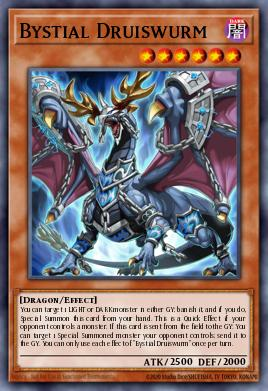

- **Copias y zona:** Side 1x. No altera las cantidades registradas.
- **Nombre oficial de referencia:** Druiswurm Abystial. CID cotejado con la ficha oficial; el nombre histórico del inventario se conserva aunque su grafía/traducción difiera.
- **Función principal y secundaria:** interrupción · side técnico · recuperación · extensor · respuesta.
- **Estado de sinergia y función:** Side utilizable entre duelos. Es una clasificación de juego; revisar la relación concreta en A06.
- **Papel como recurso, descarte o coste:** No se demuestra que esta carta sea recurso de descarte o pago para otra.
- **Efecto operativo (paráfrasis analítica):** recuperación e invocación desde Cementerio/destierro; acceso al campo desde la mano; interacción sobre monstruos en campo. Son operaciones detectadas en el texto, no efectos independientes garantizados; leer sus condiciones en la fuente.
- **Mapa de activación y resultados:** 1) efecto propio o continuo: Invocación Especial desde Cementerio · 2) con condición explícita en la carta: Invocación Especial desde Cementerio. Cada operación está sujeta a la secuencia y al «si lo haces» del texto oficial.
- **Ventanas de activación identificadas:** Efecto Rápido.
- **Costes o recursos potenciales:** sin coste independiente identificado en esta síntesis; comprobar las acciones previas al punto y coma de cada efecto.
- **Restricciones y requisitos:** hay límite por turno según el efecto concreto; solo entra al Main después de un intercambio entre duelos. 
- **Prioridad al ir primero:** asegurar el centro y acceso a motores Sincro antes de gastar extensores. Para esta carta: Respuesta puntual al emparejamiento; justificar el intercambio antes del siguiente duelo.
- **Prioridad al ir segundo:** habilitar rebote, negación o protección antes de comprometer el monstruo del centro. Identificar primero la respuesta rival que afecta su función «interrupción».
- **Medio/tardío y recuperación:** reciclar Cantantes, monstruos de Atributos distintos y zonas disponibles. Verificar que el objetivo de recuperación continúe disponible.
- **Sinergias y acceso a líneas:** Relación contextual con ocupación y rotación de la zona principal central, acceso a Cantantes y transición Sincro. No habilita una ruta inicial antes del intercambio.
- **Riesgo / brick / interrupciones:** Puede ser carta muerta fuera del emparejamiento adecuado; usar solo tras sidear. Puede emplearse en cadena sólo cuando se cumpla su condición concreta.
- **Utilidad editorial:** 3/5 para este deck (estimación por rol y zona, no probabilidad calculada). No cambiar copias; cualquier sugerencia de alta/baja pasa por el apartado 22 y aprobación.
- **Referencia oficial y trazabilidad:** https://www.db.yugioh-card.com/yugiohdb/card_search.action?cid=17764&ope=2&request_locale=es. **Confianza:** texto y tipo de efecto cotejados en Konami; síntesis táctica editorial, no demostración de combo.
- **Aplicación concreta dentro de este deck (A06):** Solo entre duelos; recuperación e invocación desde Cementerio/destierro; acceso al campo desde la mano; interacción sobre monstruos en campo.. No inicia la mano del Main actual.

**USO PRÁCTICO Y SINERGIA — Bystial Druiswurm**

- **Label funcional:** Sin sinergia demostrada (con la evidencia actual). Clasificación documental; una relación es válida solo si se satisfacen sus condiciones exactas.
- **Qué hace:** recuperación e invocación desde Cementerio/destierro; acceso al campo desde la mano; interacción sobre monstruos en campo. Son operaciones detectadas en el texto, no efectos independientes garantizados; leer sus condiciones en la fuente.
- **Cómo aprovecharla en este deck:** Solo entre duelos; recuperación e invocación desde Cementerio/destierro; acceso al campo desde la mano; interacción sobre monstruos en campo.. No inicia la mano del Main actual.
- **Al jugar primero:** asegurar el centro y acceso a motores Sincro antes de gastar extensores. Para esta carta: Respuesta puntual al emparejamiento; justificar el intercambio antes del siguiente duelo.
- **Al jugar segundo:** habilitar rebote, negación o protección antes de comprometer el monstruo del centro. Identificar primero la respuesta rival que afecta su función «interrupción».
- **Cuándo tener precaución:** Puede ser carta muerta fuera del emparejamiento adecuado; usar solo tras sidear. Puede emplearse en cadena sólo cuando se cumpla su condición concreta.

#### 36. Droll & Lock Bird

- **Copias y zona:** Side 2x. No altera las cantidades registradas.
- **Nombre oficial de referencia:** El Bufón y el Pájaro del Candado. CID cotejado con la ficha oficial; el nombre histórico del inventario se conserva aunque su grafía/traducción difiera.
- **Función principal y secundaria:** handtrap · bloqueo de búsquedas.
- **Estado de sinergia y función:** Side utilizable entre duelos. Es una clasificación de juego; revisar la relación concreta en A06.
- **Papel como recurso, descarte o coste:** Envío mencionado en la interacción; no equivale por sí mismo a descarte desde la mano.
- **Efecto operativo (paráfrasis analítica):** Tras una incorporación desde el Deck a la mano rival, se envía al Cementerio para impedir nuevas adiciones desde ambos Decks principales ese turno. 
- **Mapa de activación y resultados:** 1) con condición explícita en la carta: impide nuevas incorporaciones a mano. Cada operación está sujeta a la secuencia y al «si lo haces» del texto oficial.
- **Ventanas de activación identificadas:** Efecto Rápido.
- **Costes o recursos potenciales:** envío de recurso propio al Cementerio.
- **Restricciones y requisitos:** solo entra al Main después de un intercambio entre duelos. 
- **Prioridad al ir primero:** asegurar el centro y acceso a motores Sincro antes de gastar extensores. Para esta carta: Respuesta puntual al emparejamiento; justificar el intercambio antes del siguiente duelo.
- **Prioridad al ir segundo:** habilitar rebote, negación o protección antes de comprometer el monstruo del centro. Identificar primero la respuesta rival que afecta su función «handtrap».
- **Medio/tardío y recuperación:** reciclar Cantantes, monstruos de Atributos distintos y zonas disponibles. No asumir que por sí misma recicla recursos si el texto no lo permite.
- **Sinergias y acceso a líneas:** Relación contextual con ocupación y rotación de la zona principal central, acceso a Cantantes y transición Sincro. No habilita una ruta inicial antes del intercambio.
- **Riesgo / brick / interrupciones:** No niega la primera búsqueda y también restringe las adiciones del propio jugador. Puede emplearse en cadena sólo cuando se cumpla su condición concreta.
- **Utilidad editorial:** 3/5 para este deck (estimación por rol y zona, no probabilidad calculada). No cambiar copias; cualquier sugerencia de alta/baja pasa por el apartado 22 y aprobación.
- **Referencia oficial y trazabilidad:** https://www.db.yugioh-card.com/yugiohdb/card_search.action?cid=9279&ope=2&request_locale=es. **Confianza:** texto y tipo de efecto cotejados en Konami; síntesis táctica editorial, no demostración de combo.
- **Aplicación concreta dentro de este deck (A06):** Solo entre duelos; Tras una incorporación desde el Deck a la mano rival, se envía al Cementerio para impedir nuevas adiciones desde ambos Decks principales ese turno.. No inicia la mano del Main actual.

**USO PRÁCTICO Y SINERGIA — Droll & Lock Bird**

- **Label funcional:** Sin sinergia demostrada (con la evidencia actual). Clasificación documental; una relación es válida solo si se satisfacen sus condiciones exactas.
- **Qué hace:** Tras una incorporación desde el Deck a la mano rival, se envía al Cementerio para impedir nuevas adiciones desde ambos Decks principales ese turno.
- **Cómo aprovecharla en este deck:** Solo entre duelos; Tras una incorporación desde el Deck a la mano rival, se envía al Cementerio para impedir nuevas adiciones desde ambos Decks principales ese turno.. No inicia la mano del Main actual.
- **Al jugar primero:** asegurar el centro y acceso a motores Sincro antes de gastar extensores. Para esta carta: Respuesta puntual al emparejamiento; justificar el intercambio antes del siguiente duelo.
- **Al jugar segundo:** habilitar rebote, negación o protección antes de comprometer el monstruo del centro. Identificar primero la respuesta rival que afecta su función «handtrap».
- **Cuándo tener precaución:** No niega la primera búsqueda y también restringe las adiciones del propio jugador. Puede emplearse en cadena sólo cuando se cumpla su condición concreta.

#### 37. Ghost Ogre & Snow Rabbit

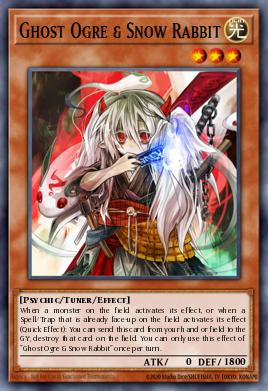

- **Copias y zona:** Side 2x. No altera las cantidades registradas.
- **Nombre oficial de referencia:** Ogro Fantasma & Conejo de las Nieves. CID cotejado con la ficha oficial; el nombre histórico del inventario se conserva aunque su grafía/traducción difiera.
- **Función principal y secundaria:** handtrap · destrucción.
- **Estado de sinergia y función:** Side utilizable entre duelos. Es una clasificación de juego; revisar la relación concreta en A06.
- **Papel como recurso, descarte o coste:** Envío mencionado en la interacción; no equivale por sí mismo a descarte desde la mano.
- **Efecto operativo (paráfrasis analítica):** Se envía desde mano o campo al Cementerio cuando un monstruo en campo o M/T ya boca arriba activa su efecto, para destruir esa carta. 
- **Mapa de activación y resultados:** 1) con condición explícita en la carta: destruye la carta o recurso previsto. Cada operación está sujeta a la secuencia y al «si lo haces» del texto oficial.
- **Ventanas de activación identificadas:** Efecto Rápido.
- **Costes o recursos potenciales:** envío de recurso propio al Cementerio.
- **Restricciones y requisitos:** hay límite por turno según el efecto concreto; solo entra al Main después de un intercambio entre duelos. 
- **Prioridad al ir primero:** asegurar el centro y acceso a motores Sincro antes de gastar extensores. Para esta carta: Respuesta puntual al emparejamiento; justificar el intercambio antes del siguiente duelo.
- **Prioridad al ir segundo:** habilitar rebote, negación o protección antes de comprometer el monstruo del centro. Identificar primero la respuesta rival que afecta su función «handtrap».
- **Medio/tardío y recuperación:** reciclar Cantantes, monstruos de Atributos distintos y zonas disponibles. No asumir que por sí misma recicla recursos si el texto no lo permite.
- **Sinergias y acceso a líneas:** Relación contextual con ocupación y rotación de la zona principal central, acceso a Cantantes y transición Sincro. No habilita una ruta inicial antes del intercambio.
- **Riesgo / brick / interrupciones:** Destruir no equivale a negar la resolución del efecto activado. Puede emplearse en cadena sólo cuando se cumpla su condición concreta.
- **Utilidad editorial:** 3/5 para este deck (estimación por rol y zona, no probabilidad calculada). No cambiar copias; cualquier sugerencia de alta/baja pasa por el apartado 22 y aprobación.
- **Referencia oficial y trazabilidad:** https://www.db.yugioh-card.com/yugiohdb/card_search.action?cid=11708&ope=2&request_locale=es. **Confianza:** texto y tipo de efecto cotejados en Konami; síntesis táctica editorial, no demostración de combo.
- **Aplicación concreta dentro de este deck (A06):** Solo entre duelos; Se envía desde mano o campo al Cementerio cuando un monstruo en campo o M/T ya boca arriba activa su efecto, para destruir esa carta.. No inicia la mano del Main actual.

**USO PRÁCTICO Y SINERGIA — Ghost Ogre & Snow Rabbit**

- **Label funcional:** Sin sinergia demostrada (con la evidencia actual). Clasificación documental; una relación es válida solo si se satisfacen sus condiciones exactas.
- **Qué hace:** Se envía desde mano o campo al Cementerio cuando un monstruo en campo o M/T ya boca arriba activa su efecto, para destruir esa carta.
- **Cómo aprovecharla en este deck:** Solo entre duelos; Se envía desde mano o campo al Cementerio cuando un monstruo en campo o M/T ya boca arriba activa su efecto, para destruir esa carta.. No inicia la mano del Main actual.
- **Al jugar primero:** asegurar el centro y acceso a motores Sincro antes de gastar extensores. Para esta carta: Respuesta puntual al emparejamiento; justificar el intercambio antes del siguiente duelo.
- **Al jugar segundo:** habilitar rebote, negación o protección antes de comprometer el monstruo del centro. Identificar primero la respuesta rival que afecta su función «handtrap».
- **Cuándo tener precaución:** Destruir no equivale a negar la resolución del efecto activado. Puede emplearse en cadena sólo cuando se cumpla su condición concreta.

#### 38. Called by the Grave

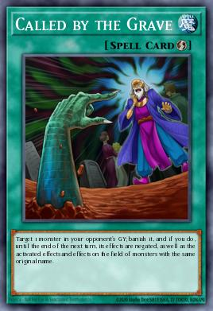

- **Copias y zona:** Side 1x. No altera las cantidades registradas.
- **Nombre oficial de referencia:** Llamado por la Tumba. CID cotejado con la ficha oficial; el nombre histórico del inventario se conserva aunque su grafía/traducción difiera.
- **Función principal y secundaria:** mágica rápida · negación de nombre.
- **Estado de sinergia y función:** Side utilizable entre duelos. Es una clasificación de juego; revisar la relación concreta en A06.
- **Papel como recurso, descarte o coste:** No se demuestra que esta carta sea recurso de descarte o pago para otra.
- **Efecto operativo (paráfrasis analítica):** Destierra un monstruo del Cementerio rival y niega sus efectos junto con los del mismo nombre original hasta el final del turno siguiente. 
- **Mapa de activación y resultados:** efecto de estadística, condición o material; no asumir un disparador adicional. Cada operación está sujeta a la secuencia y al «si lo haces» del texto oficial.
- **Ventanas de activación identificadas:** requieren la fase o condición específica indicada en el texto; sin ventana rápida general asumida.
- **Costes o recursos potenciales:** sin coste independiente identificado en esta síntesis; comprobar las acciones previas al punto y coma de cada efecto.
- **Restricciones y requisitos:** solo entra al Main después de un intercambio entre duelos. 
- **Prioridad al ir primero:** asegurar el centro y acceso a motores Sincro antes de gastar extensores. Para esta carta: Respuesta puntual al emparejamiento; justificar el intercambio antes del siguiente duelo.
- **Prioridad al ir segundo:** habilitar rebote, negación o protección antes de comprometer el monstruo del centro. Identificar primero la respuesta rival que afecta su función «mágica rápida».
- **Medio/tardío y recuperación:** reciclar Cantantes, monstruos de Atributos distintos y zonas disponibles. No asumir que por sí misma recicla recursos si el texto no lo permite.
- **Sinergias y acceso a líneas:** Relación contextual con ocupación y rotación de la zona principal central, acceso a Cantantes y transición Sincro. No habilita una ruta inicial antes del intercambio.
- **Riesgo / brick / interrupciones:** Exige un objetivo en el Cementerio rival; no es negación universal. No atribuirle velocidad rápida por el solo hecho de formar parte del motor.
- **Utilidad editorial:** 3/5 para este deck (estimación por rol y zona, no probabilidad calculada). No cambiar copias; cualquier sugerencia de alta/baja pasa por el apartado 22 y aprobación.
- **Referencia oficial y trazabilidad:** https://www.db.yugioh-card.com/yugiohdb/card_search.action?cid=13619&ope=2&request_locale=es. **Confianza:** texto y tipo de efecto cotejados en Konami; síntesis táctica editorial, no demostración de combo.
- **Aplicación concreta dentro de este deck (A06):** Solo entre duelos; Destierra un monstruo del Cementerio rival y niega sus efectos junto con los del mismo nombre original hasta el final del turno siguiente.. No inicia la mano del Main actual.

**USO PRÁCTICO Y SINERGIA — Called by the Grave**

- **Label funcional:** Sin sinergia demostrada (con la evidencia actual). Clasificación documental; una relación es válida solo si se satisfacen sus condiciones exactas.
- **Qué hace:** Destierra un monstruo del Cementerio rival y niega sus efectos junto con los del mismo nombre original hasta el final del turno siguiente.
- **Cómo aprovecharla en este deck:** Solo entre duelos; Destierra un monstruo del Cementerio rival y niega sus efectos junto con los del mismo nombre original hasta el final del turno siguiente.. No inicia la mano del Main actual.
- **Al jugar primero:** asegurar el centro y acceso a motores Sincro antes de gastar extensores. Para esta carta: Respuesta puntual al emparejamiento; justificar el intercambio antes del siguiente duelo.
- **Al jugar segundo:** habilitar rebote, negación o protección antes de comprometer el monstruo del centro. Identificar primero la respuesta rival que afecta su función «mágica rápida».
- **Cuándo tener precaución:** Exige un objetivo en el Cementerio rival; no es negación universal. No atribuirle velocidad rápida por el solo hecho de formar parte del motor.

#### 39. Triple Tactics Talent

- **Copias y zona:** Side 1x. No altera las cantidades registradas.
- **Nombre oficial de referencia:** Talento de Tácticas Triples. CID cotejado con la ficha oficial; el nombre histórico del inventario se conserva aunque su grafía/traducción difiera.
- **Función principal y secundaria:** mágica de respuesta · ventaja.
- **Estado de sinergia y función:** Side utilizable entre duelos. Es una clasificación de juego; revisar la relación concreta en A06.
- **Papel como recurso, descarte o coste:** No se demuestra que esta carta sea recurso de descarte o pago para otra.
- **Efecto operativo (paráfrasis analítica):** Si el rival activó un efecto de monstruo durante tu Main Phase, permite elegir entre robar dos, tomar control temporal o devolver una carta de mano al Deck. 
- **Mapa de activación y resultados:** 1) en Main Phase: devuelve recursos a mano/Deck/Extra, roba cartas, toma temporalmente el control. Cada operación está sujeta a la secuencia y al «si lo haces» del texto oficial.
- **Ventanas de activación identificadas:** Main Phase.
- **Costes o recursos potenciales:** sin coste independiente identificado en esta síntesis; comprobar las acciones previas al punto y coma de cada efecto.
- **Restricciones y requisitos:** hay límite por turno según el efecto concreto; solo entra al Main después de un intercambio entre duelos. 
- **Prioridad al ir primero:** asegurar el centro y acceso a motores Sincro antes de gastar extensores. Para esta carta: Respuesta puntual al emparejamiento; justificar el intercambio antes del siguiente duelo.
- **Prioridad al ir segundo:** habilitar rebote, negación o protección antes de comprometer el monstruo del centro. Identificar primero la respuesta rival que afecta su función «mágica de respuesta».
- **Medio/tardío y recuperación:** reciclar Cantantes, monstruos de Atributos distintos y zonas disponibles. Verificar que el objetivo de recuperación continúe disponible.
- **Sinergias y acceso a líneas:** Relación contextual con ocupación y rotación de la zona principal central, acceso a Cantantes y transición Sincro. No habilita una ruta inicial antes del intercambio.
- **Riesgo / brick / interrupciones:** La condición exige activación de monstruo rival en tu Main Phase; sólo un modo. No atribuirle velocidad rápida por el solo hecho de formar parte del motor.
- **Utilidad editorial:** 3/5 para este deck (estimación por rol y zona, no probabilidad calculada). No cambiar copias; cualquier sugerencia de alta/baja pasa por el apartado 22 y aprobación.
- **Referencia oficial y trazabilidad:** https://www.db.yugioh-card.com/yugiohdb/card_search.action?cid=15296&ope=2&request_locale=es. **Confianza:** texto y tipo de efecto cotejados en Konami; síntesis táctica editorial, no demostración de combo.
- **Aplicación concreta dentro de este deck (A06):** Solo entre duelos; Si el rival activó un efecto de monstruo durante tu Main Phase, permite elegir entre robar dos, tomar control temporal o devolver una carta de mano al Deck.. No inicia la mano del Main actual.

**USO PRÁCTICO Y SINERGIA — Triple Tactics Talent**

- **Label funcional:** Sin sinergia demostrada (con la evidencia actual). Clasificación documental; una relación es válida solo si se satisfacen sus condiciones exactas.
- **Qué hace:** Si el rival activó un efecto de monstruo durante tu Main Phase, permite elegir entre robar dos, tomar control temporal o devolver una carta de mano al Deck.
- **Cómo aprovecharla en este deck:** Solo entre duelos; Si el rival activó un efecto de monstruo durante tu Main Phase, permite elegir entre robar dos, tomar control temporal o devolver una carta de mano al Deck.. No inicia la mano del Main actual.
- **Al jugar primero:** asegurar el centro y acceso a motores Sincro antes de gastar extensores. Para esta carta: Respuesta puntual al emparejamiento; justificar el intercambio antes del siguiente duelo.
- **Al jugar segundo:** habilitar rebote, negación o protección antes de comprometer el monstruo del centro. Identificar primero la respuesta rival que afecta su función «mágica de respuesta».
- **Cuándo tener precaución:** La condición exige activación de monstruo rival en tu Main Phase; sólo un modo. No atribuirle velocidad rápida por el solo hecho de formar parte del motor.

#### 40. Contact "C"

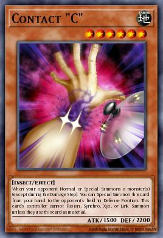

- **Copias y zona:** Side 3x. No altera las cantidades registradas.
- **Nombre oficial de referencia:** "C" Contacto. CID cotejado con la ficha oficial; el nombre histórico del inventario se conserva aunque su grafía/traducción difiera.
- **Función principal y secundaria:** interrupción · side técnico · extensor · habilitador de Extra · cierre.
- **Estado de sinergia y función:** Side utilizable entre duelos. Es una clasificación de juego; revisar la relación concreta en A06.
- **Papel como recurso, descarte o coste:** No se demuestra que esta carta sea recurso de descarte o pago para otra.
- **Efecto operativo (paráfrasis analítica):** acceso al campo desde la mano; habilitación o continuación de una invocación del Extra Deck; presión de combate o modificación de estadísticas. Son operaciones detectadas en el texto, no efectos independientes garantizados; leer sus condiciones en la fuente.
- **Mapa de activación y resultados:** 1) con condición explícita en la carta: realiza Fusión con materiales permitidos, Invocación Especial desde mano. Cada operación está sujeta a la secuencia y al «si lo haces» del texto oficial.
- **Ventanas de activación identificadas:** requieren la fase o condición específica indicada en el texto; sin ventana rápida general asumida.
- **Costes o recursos potenciales:** sin coste independiente identificado en esta síntesis; comprobar las acciones previas al punto y coma de cada efecto.
- **Restricciones y requisitos:** solo entra al Main después de un intercambio entre duelos. 
- **Prioridad al ir primero:** asegurar el centro y acceso a motores Sincro antes de gastar extensores. Para esta carta: Respuesta puntual al emparejamiento; justificar el intercambio antes del siguiente duelo.
- **Prioridad al ir segundo:** habilitar rebote, negación o protección antes de comprometer el monstruo del centro. Identificar primero la respuesta rival que afecta su función «interrupción».
- **Medio/tardío y recuperación:** reciclar Cantantes, monstruos de Atributos distintos y zonas disponibles. No asumir que por sí misma recicla recursos si el texto no lo permite.
- **Sinergias y acceso a líneas:** Relación contextual con ocupación y rotación de la zona principal central, acceso a Cantantes y transición Sincro. No habilita una ruta inicial antes del intercambio.
- **Riesgo / brick / interrupciones:** Puede ser carta muerta fuera del emparejamiento adecuado; usar solo tras sidear. No atribuirle velocidad rápida por el solo hecho de formar parte del motor.
- **Utilidad editorial:** 3/5 para este deck (estimación por rol y zona, no probabilidad calculada). No cambiar copias; cualquier sugerencia de alta/baja pasa por el apartado 22 y aprobación.
- **Referencia oficial y trazabilidad:** https://www.db.yugioh-card.com/yugiohdb/card_search.action?cid=13407&ope=2&request_locale=es. **Confianza:** texto y tipo de efecto cotejados en Konami; síntesis táctica editorial, no demostración de combo.
- **Aplicación concreta dentro de este deck (A06):** Solo entre duelos; acceso al campo desde la mano; habilitación o continuación de una invocación del Extra Deck; presión de combate o modificación de estadísticas.. No inicia la mano del Main actual.

**USO PRÁCTICO Y SINERGIA — Contact "C"**

- **Label funcional:** Sin sinergia demostrada (con la evidencia actual). Clasificación documental; una relación es válida solo si se satisfacen sus condiciones exactas.
- **Qué hace:** acceso al campo desde la mano; habilitación o continuación de una invocación del Extra Deck; presión de combate o modificación de estadísticas. Son operaciones detectadas en el texto, no efectos independientes garantizados; leer sus condiciones en la fuente.
- **Cómo aprovecharla en este deck:** Solo entre duelos; acceso al campo desde la mano; habilitación o continuación de una invocación del Extra Deck; presión de combate o modificación de estadísticas.. No inicia la mano del Main actual.
- **Al jugar primero:** asegurar el centro y acceso a motores Sincro antes de gastar extensores. Para esta carta: Respuesta puntual al emparejamiento; justificar el intercambio antes del siguiente duelo.
- **Al jugar segundo:** habilitar rebote, negación o protección antes de comprometer el monstruo del centro. Identificar primero la respuesta rival que afecta su función «interrupción».
- **Cuándo tener precaución:** Puede ser carta muerta fuera del emparejamiento adecuado; usar solo tras sidear. No atribuirle velocidad rápida por el solo hecho de formar parte del motor.

#### 41. Solemn Judgment

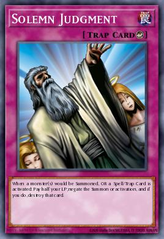

- **Copias y zona:** Side 1x. No altera las cantidades registradas.
- **Nombre oficial de referencia:** Juicio Solemne. CID cotejado con la ficha oficial; el nombre histórico del inventario se conserva aunque su grafía/traducción difiera.
- **Función principal y secundaria:** side técnico · removal.
- **Estado de sinergia y función:** Side utilizable entre duelos. Es una clasificación de juego; revisar la relación concreta en A06.
- **Papel como recurso, descarte o coste:** Coste o consumo descrito en A05: pago de LP.
- **Efecto operativo (paráfrasis analítica):** destrucción de cartas o empleo de destrucción como detonante. Son operaciones detectadas en el texto, no efectos independientes garantizados; leer sus condiciones en la fuente.
- **Mapa de activación y resultados:** 1) con condición explícita en la carta: destruye la carta o recurso previsto. Cada operación está sujeta a la secuencia y al «si lo haces» del texto oficial.
- **Ventanas de activación identificadas:** requieren la fase o condición específica indicada en el texto; sin ventana rápida general asumida.
- **Costes o recursos potenciales:** pago de LP.
- **Restricciones y requisitos:** solo entra al Main después de un intercambio entre duelos. 
- **Prioridad al ir primero:** asegurar el centro y acceso a motores Sincro antes de gastar extensores. Para esta carta: Respuesta puntual al emparejamiento; justificar el intercambio antes del siguiente duelo.
- **Prioridad al ir segundo:** habilitar rebote, negación o protección antes de comprometer el monstruo del centro. Identificar primero la respuesta rival que afecta su función «side técnico».
- **Medio/tardío y recuperación:** reciclar Cantantes, monstruos de Atributos distintos y zonas disponibles. No asumir que por sí misma recicla recursos si el texto no lo permite.
- **Sinergias y acceso a líneas:** Relación contextual con ocupación y rotación de la zona principal central, acceso a Cantantes y transición Sincro. No habilita una ruta inicial antes del intercambio.
- **Riesgo / brick / interrupciones:** Puede ser carta muerta fuera del emparejamiento adecuado; usar solo tras sidear. No atribuirle velocidad rápida por el solo hecho de formar parte del motor.
- **Utilidad editorial:** 3/5 para este deck (estimación por rol y zona, no probabilidad calculada). No cambiar copias; cualquier sugerencia de alta/baja pasa por el apartado 22 y aprobación.
- **Referencia oficial y trazabilidad:** https://www.db.yugioh-card.com/yugiohdb/card_search.action?cid=4861&ope=2&request_locale=es. **Confianza:** texto y tipo de efecto cotejados en Konami; síntesis táctica editorial, no demostración de combo.
- **Aplicación concreta dentro de este deck (A06):** Solo entre duelos; destrucción de cartas o empleo de destrucción como detonante.. No inicia la mano del Main actual.

**USO PRÁCTICO Y SINERGIA — Solemn Judgment**

- **Label funcional:** Sin sinergia demostrada (con la evidencia actual). Clasificación documental; una relación es válida solo si se satisfacen sus condiciones exactas.
- **Qué hace:** destrucción de cartas o empleo de destrucción como detonante. Son operaciones detectadas en el texto, no efectos independientes garantizados; leer sus condiciones en la fuente.
- **Cómo aprovecharla en este deck:** Solo entre duelos; destrucción de cartas o empleo de destrucción como detonante.. No inicia la mano del Main actual.
- **Al jugar primero:** asegurar el centro y acceso a motores Sincro antes de gastar extensores. Para esta carta: Respuesta puntual al emparejamiento; justificar el intercambio antes del siguiente duelo.
- **Al jugar segundo:** habilitar rebote, negación o protección antes de comprometer el monstruo del centro. Identificar primero la respuesta rival que afecta su función «side técnico».
- **Cuándo tener precaución:** Puede ser carta muerta fuera del emparejamiento adecuado; usar solo tras sidear. No atribuirle velocidad rápida por el solo hecho de formar parte del motor.

#### 42. Pot of Avarice

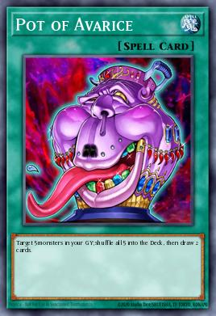

- **Copias y zona:** Side 3x. No altera las cantidades registradas.
- **Nombre oficial de referencia:** Olla de la Avaricia. CID cotejado con la ficha oficial; el nombre histórico del inventario se conserva aunque su grafía/traducción difiera.
- **Función principal y secundaria:** side técnico · recuperación · ventaja de mano.
- **Estado de sinergia y función:** Side utilizable entre duelos. Es una clasificación de juego; revisar la relación concreta en A06.
- **Papel como recurso, descarte o coste:** No se demuestra que esta carta sea recurso de descarte o pago para otra.
- **Efecto operativo (paráfrasis analítica):** retorno o reciclaje hacia mano/Deck/Extra; generación de cartas por robo. Son operaciones detectadas en el texto, no efectos independientes garantizados; leer sus condiciones en la fuente.
- **Mapa de activación y resultados:** 1) efecto propio o continuo: devuelve recursos a mano/Deck/Extra, roba cartas. Cada operación está sujeta a la secuencia y al «si lo haces» del texto oficial.
- **Ventanas de activación identificadas:** requieren la fase o condición específica indicada en el texto; sin ventana rápida general asumida.
- **Costes o recursos potenciales:** sin coste independiente identificado en esta síntesis; comprobar las acciones previas al punto y coma de cada efecto.
- **Restricciones y requisitos:** depende de recursos en Cementerio; solo entra al Main después de un intercambio entre duelos. 
- **Prioridad al ir primero:** asegurar el centro y acceso a motores Sincro antes de gastar extensores. Para esta carta: Respuesta puntual al emparejamiento; justificar el intercambio antes del siguiente duelo.
- **Prioridad al ir segundo:** habilitar rebote, negación o protección antes de comprometer el monstruo del centro. Identificar primero la respuesta rival que afecta su función «side técnico».
- **Medio/tardío y recuperación:** reciclar Cantantes, monstruos de Atributos distintos y zonas disponibles. Verificar que el objetivo de recuperación continúe disponible.
- **Sinergias y acceso a líneas:** Relación contextual con ocupación y rotación de la zona principal central, acceso a Cantantes y transición Sincro. No habilita una ruta inicial antes del intercambio.
- **Riesgo / brick / interrupciones:** Depende del Cementerio y es sensible a destierro o negación de ese recurso. No atribuirle velocidad rápida por el solo hecho de formar parte del motor.
- **Utilidad editorial:** 3/5 para este deck (estimación por rol y zona, no probabilidad calculada). No cambiar copias; cualquier sugerencia de alta/baja pasa por el apartado 22 y aprobación.
- **Referencia oficial y trazabilidad:** https://www.db.yugioh-card.com/yugiohdb/card_search.action?cid=6511&ope=2&request_locale=es. **Confianza:** texto y tipo de efecto cotejados en Konami; síntesis táctica editorial, no demostración de combo.
- **Aplicación concreta dentro de este deck (A06):** Solo entre duelos; retorno o reciclaje hacia mano/Deck/Extra; generación de cartas por robo.. No inicia la mano del Main actual.

**USO PRÁCTICO Y SINERGIA — Pot of Avarice**

- **Label funcional:** Sin sinergia demostrada (con la evidencia actual). Clasificación documental; una relación es válida solo si se satisfacen sus condiciones exactas.
- **Qué hace:** retorno o reciclaje hacia mano/Deck/Extra; generación de cartas por robo. Son operaciones detectadas en el texto, no efectos independientes garantizados; leer sus condiciones en la fuente.
- **Cómo aprovecharla en este deck:** Solo entre duelos; retorno o reciclaje hacia mano/Deck/Extra; generación de cartas por robo.. No inicia la mano del Main actual.
- **Al jugar primero:** asegurar el centro y acceso a motores Sincro antes de gastar extensores. Para esta carta: Respuesta puntual al emparejamiento; justificar el intercambio antes del siguiente duelo.
- **Al jugar segundo:** habilitar rebote, negación o protección antes de comprometer el monstruo del centro. Identificar primero la respuesta rival que afecta su función «side técnico».
- **Cuándo tener precaución:** Depende del Cementerio y es sensible a destierro o negación de ese recurso. No atribuirle velocidad rápida por el solo hecho de formar parte del motor.

## SINERGIAS Y MOTORES
## RESUMEN FUNCIONAL DE SINERGIAS — 650

**Medición descriptiva de etiquetas tras revisión del 18-11 (NO certificación global):** 16/42 identidades con vínculo directo/indirecto o acceso funcional Extra documentado (38.1 %). Main: 13/19 (68.4 %); Extra: 3/15 (20.0 %) — **Malong por envío**, **Destorbim por Sincro condicionado**, **Crystal Wing por doble Sincro**. Se cuenta una identidad una sola vez; una carta autónoma puede ser útil sin sinergia de motor. Estas cifras son de **clasificación documental**, no porcentaje de sinergias reglamentariamente certificadas ni tasa de victoria; no equiparar esos tres estados heterogéneos.

#### A06.0 — En 30 segundos: cómo cooperan realmente estas cartas

- **Dictamen de conjunto:** coherente por rutas alternativas, pero NO todos los motores pueden compartir la misma secuencia ni el mismo turno.
- **Motor que mueve el deck:** Lucina, Tinia y Fortuna construyen soporte Elfnota y explotan la zona central; los cuerpos y Cantantes habilitan Sincronías como Strelitzia/Junora cuando coinciden los Niveles.
- **Puentes reales:** Modelo de Poder/Medius extienden o reponen piezas; Dogmátik/Ecclesia/Albaz ofrecen otra salida, no una extensión incondicional de la Sincronía.
- **Sinergia indirecta:** continuas colocadas, cartas destinadas a GY y piezas usadas como materiales conservan utilidad aunque no sean starters; comparar su destino real, no solo su efecto de Campo.
- **Conflicto decisivo:** Ecclesia puede restringir el Extra y la línea Elfnota requiere Sincronía; verificar qué secuencia consume primero el acceso al Extra. Vidolium como Péndulo tiene función separada de su difícil Invocación como monstruo.
- **Decisión concreta:** mantener motores como planes alternos mientras estén disponibles; revisar los demás destinos Extra sin arista A06 y el acceso de Nervedo antes de proponer sustituciones. Malong/Crystal Wing/Destorbim ya tienen **vías distintas y condicionadas** descritas en A06.3/A09; no retirar cartas únicamente por faltar una flecha directa.
- **Qué aprender después:** elegir Lucina/Tinia según soporte disponible; después abrir su apertura A09 y el tablero A10, sin mezclarla con Dogmátik si ya hay bloqueo.

#### Motores y piezas

1. **Motor Elfnota — zona central.** **Lucina** (CID 22116) se Invoca desde mano a la zona central y busca otra Elfnota. **Tinia** (22117) se Invoca allí y coloca una **Mágica Continua** Elfnota desde Deck, principalmente **Bienvenidos a Casa** (22159). **Fortuna** (22118) coloca una **Trampa Continua**, como **Rapsodia de Locura** (22173). No intercambiar los tipos de cartas que colocan.
2. **Regina y continuidad.** **Regina** (22523) puede Invocarse desde mano enviando otra Elfnota de mano/campo y, **solo si queda en la zona central**, Invocar otra Elfnota distinta desde Deck. Si se manda al GY como Material de Sincronía, puede volver a mano. **Bienvenidos a Casa** envía un monstruo propio para sacar del Deck una Elfnota de Atributo original distinto; **Rapsodia** recupera una Elfnota del GY de Atributo original distinto y, con una Sincronía presente, puede negar una carta boca arriba.
3. **Interrupciones posicionales.** En turno rival, **Lucina**, **Tinia** y **Fortuna** intercambian su posición con el monstruo de la zona central y añaden respectivamente: rebote de monstruo rival de **Nivel 6 o menor**, destierro temporal aleatorio de una carta de la mano rival, y rebote de una Mágica/Trampa **boca arriba**. Requieren estado de zonas y objetivos; no constituyen tres negaciones automáticas.
4. **Motor de Sincronía.** **Elfnota Modelo de Poder** (22119) aumenta +3 el Nivel de un monstruo central y habilita Sincronía inmediata de Elfnota o **Junora** (22142), siempre con materiales y niveles legales. **Serafín Strelitzia** (22143) revive/invoca una Elfnota de Nivel 6 o menor; **Orgullosa de Junio** (22984) usa la zona central y puede volver al Extra para extender desde mano/Deck/GY conforme al texto. **Harmonía Fydraulis** (22533) responde a un efecto de monstruo rival mostrando Sincronías del Extra, con resultados escalonados y restricción de efectos no Sincronía hasta el siguiente turno.
5. **Motores secundarios.** **Medius el Puro** (21419) busca o Invoca un «Modelo de Poder» y puede reciclarse desde GY. **Portal de Modelo de Poder Vetado – Término** (22565) envía un Modelo de Poder desde Deck/Extra y puede buscar un Hada OSCURIDAD, pero limita ataques a Modelo de Poder. **Ecclesia Dogmátik** (15239) busca una Dogmátik (incluido **El Caído y la Virtuosa**, 22089); esta carta puede enviar al GY un Extra que mencione Albaz, como **Albion** (15994), para destrucción selectiva, sujeto a la condición exacta. **Magnamhut** (17762) usa LUZ/OSCURIDAD en un GY, sin ser buscador Elfnota.

#### Mapa de relaciones para representación fotográfica

| Conexión con CID de APARTADO_05 | Resultado verificable | Condición / límite | Visual |
|---|---|---|---|
| Lucina (22116) → Regina (22523) | Acceso a otra Elfnota y posible cuerpo adicional del Deck. | Regina debe llegar a la **zona central** y pagar su propio envío. |   |
| Tinia (22117) → Bienvenidos a Casa (22159) | Colocar la Mágica Continua y extender otra Elfnota de Atributo distinto. | Tras la extensión, Extra restringido a **Sincronías**. |   |
| Fortuna (22118) → Rapsodia (22173) | Colocar Trampa y recuperar una pieza del GY. | Atributo distinto; negación solo si hay Sincronía propia. |   |
| Regina / Modelo de Poder (22119) → Strelitzia (22143) / Junora (22142) | Puente hacia Sincronía y control. | Cantante, niveles, materiales y zona legal. |    |
| Ecclesia (15239) → El Caído y la Virtuosa (22089) → Albion (15994) | Acceso Dogmátik y envío Extra con función propia. | Usar el buscador de Ecclesia bloquea el Extra el resto del turno. |    |

#### Conflictos y control de precisión

- **Bloqueos de Extra:** Modelo de Poder, Bienvenidos a Casa y Strelitzia restringen a Sincronías; no sumarles automáticamente **S:P Pequeña Caballera** (Enlace) o **Albion** (Fusión) en la misma continuación. Ecclesia también impone bloqueo posterior del Extra.
- **Doble función Péndulo/monstruo — precisión oficial:** **Vidolium** (CID 22519), **2x en Main**, **puede activarse desde la mano como Mágica en la Zona Péndulo**; desde allí su efecto puede destruirlo para Invocar un monstruo «Power Patron» desde mano/GY, o potenciar los de Nivel original 12 conforme al texto. Cuando la carta Péndulo destruida pasa **boca arriba al Extra**, su efecto de buscar una carta «Power Patron» puede resultar aplicable. **Distinto** es Invocar al monstruo Vidolium: ese procedimiento exige devolver al Extra **un monstruo Fusión, uno de Sincronía y uno Xyz** desde campo boca arriba/GY. La lista no demuestra esa ruta de Invocación, pero **su ubicación en Main no es una contradicción por sí misma**. Verificar objetivos, cadenas y restricciones antes de certificar un combo; no mover copias sin autorización.
- **Redundancia no equivalente:** las tres copias de Lucina/Tinia/Regina no hacen lo mismo; las handtraps no son piezas buscables por Lucina. La restricción futura de Harmonía requiere planificar el Extra.
- **Fotografías:** usar imágenes auténticas correspondientes a los CID de APARTADO_05; la tabla es el guion del mapa, no una imagen creada ni un combo reproducido.

#### A06.1 — Arquitectura operativa de los motores (síntesis no redundante)

Las siguientes filas son **relaciones funcionales**, no secuencias certificadas ni garantía de mano inicial. La lista real y los límites están en A04/A05/A07.

| Tipo / motor | Starter o vía de acceso real | Recurso y destino | Cuello de botella |
|---|---|---|---|
| **Principal: Elfnota central** | Lucina / Tinia / Fortuna; Regina cuando conserva la zona central | Buscar, colocar soporte Elfnota, convertir cuerpos en control de zonas | Zona central libre; atributos y ventanas correctos; no intercambiar Continua Mágica con Trampa |
| **Submotor: Sincronía Elfnota** | Modelo de Poder Elfnota + Cantantes/cuerpos de Nivel apto | Junora / Strelitzia y otras Sincronías accesibles | Niveles/materiales y bloqueo de Extra a Sincronía |
| **Secundario: Modelo de Poder / Medius** | Medius y Portal de Modelo de Poder | Acceso y reposición de piezas de Modelo de Poder | La búsqueda no elimina requisitos del destino; restricción de ataques |
| **Secundario condicionado: Dogmátik / Albaz** | Ecclesia y El Caído y la Virtuosa | Búsqueda y envío de Extra para retirada/recursos | Ecclesia bloquea Extra; no simultanear con línea Sincronía sin ordenar turnos |

#### A06.2 — Estado funcional y justificación de TODAS las cartas

**Cómo leerlo:** un estado de sinergia describe el papel **de juego**, no el avance de una auditoría. No hay obligación de que cada carta tenga un enlace con otra: una defensa autónoma, una herramienta de Side o un recurso de descarte justificado también tiene propósito. Las relaciones directas descritas aquí se deben contrastar con los textos oficiales antes de representarlas como una ruta legal A09.

| Carta / CID y zona | Estado funcional de sinergia | Motivo de inclusión | Relación y condición concreta | Papel como coste, descarte o material | Límite o riesgo | Decisión táctica |
|---|---|---|---|---|---|---|
| **Elfnote Regina** (CID 22523) — Main 3x | **Engine directo Elfnota; A05 oficial cotejado** | extensión desde mano y Deck; autorrecuperación por material Sincro | Desde mano envía otra Elfnote de mano/Campo boca arriba para Invocarse; **solo al ser Invocada al centro**, trae del Deck una Elfnota distinta de Regina. Si fue material Sincro enviado al GY, vuelve a mano. | El envío de otra carta Elfnota es coste de Invocación desde mano; su retorno a mano requiere que sea material Sincro. | Tres efectos **distintos** una vez por turno; una Invocación fuera del centro no habilita Deck. | Mantener 3x; no confundir retorno a mano con Invocación desde GY. |
| **Elfnote Lucina** (CID 22116) — Main 3x | **Starter directo Elfnota; A05 oficial cotejado** | Invocación al centro · búsqueda de monstruo · rebote condicional | Desde mano al centro → **una** búsqueda de monstruo Elfnota distinto de Lucina: Regina **o** Patron. En turno rival intercambia con el monstruo central y después puede devolver monstruo rival **Nivel ≤6**. | Puede ser carta enviada por coste de Regina o no Cantante Lv6 para Sincro con Patron1. | Búsqueda una vez por turno; rebote **solo turno rival** con posición y blanco legal; no afecta Xyz/Link sin Nivel. | Elegir salida Continuas o Sincro, no sumar dos búsquedas. |
| **Elfnote Tinia** (CID 22117) — Main 3x | **Engine directo de Continua Mágica; A05 oficial cotejado** | coloca Welcome Home · destierro temporal de mano rival | Desde mano al centro; durante propia Main coloca **Mágica Continua Elfnota** boca arriba desde Deck. En turno rival, al intercambiar con el central, puede desterrar **carta aleatoria de mano rival hasta End Phase**. | Tinia AGUA es coste **de Welcome Home**, que trae Lucina FUEGO desde Deck; colocar Welcome no envía a Tinia. | No coloca Trampas; necesita carta rival en mano para destierro y dos posiciones permutables para intercambio. | Mantener 3x; contraste A09:TINIA01/A09:TINIA:STRELITZIA04. |
| **Elfnote Power Patron** (CID 22119) — Main 2x | **Engine Sincro directo; A05 oficial cotejado** | Cantante1 · modifica Nivel+3 · búsqueda tras material | En Main Phase, puede subir 3 Niveles a un monstruo central y permitir **Sincro inmediata Elfnota o Junora**. Si se envía al GY **como material Sincro**, busca 1 **carta** Elfnota. | Patron1 Cantante + Lucina6 no Cantante→Strelitzia7 **sin** aumentar Nivel; con Lucina9 por +3→June Pride10; al revivir Patron no se busca dos veces. | Limita Invocaciones Especiales desde Extra a Sincros mientras su restricción aplica; cada efecto una vez por turno. | Mantener 2x; no usar Sincro inmediata limitada para Crystal Wing genérica. |
| **Elfnote Fortuna** (CID 22118) — Main 1x | **Engine directo de Trampa Continua; A05 oficial cotejado** | coloca Rapsodia · rebote de M/T boca arriba | Durante Main coloca **Trampa Continua Elfnota desde mano o Deck**, aun estando lateral. En turno rival puede intercambiar con el central y devolver **1 M/T boca arriba** del Campo. | Regina la Invoca lateral desde Deck y permite que coloque Rapsodia; no hay descarte propio por colocarla. | No coloca Mágica Continua ni afecta M/T boca abajo con el rebote; intercambio solo turno rival. | Conservar 1x y preservar recursos para el efecto de Rapsodia. |
| **Fidraulis Harmony** (CID 22533) — Main 3x | **Sinergia directa condicionada: envío de Extra** | respuesta desde mano · Cantante 7 · salida de Malong | Ante efecto de monstruo rival, revelar **Harmonia de mano + tres Sincros del Extra (incluido Malong)**: Invoca Harmonia y envía Malong al GY. No Invoca Malong. Relación `650:A06:HARMONIA:MALONG:ENVIO01`. | No descarta Harmonia; el Sincro se **envía** de Extra al GY por el efecto. Como Cantante 7 puede ser material para Destorbim con Medius 4 si ambos coexisten. | Una vez por turno; reacción solo al efecto del monstruo rival; restricción posterior de activaciones de monstruos de Extra distintos de Sincros. | Si falta objetivo rival boca arriba, el envío puede ocurrir pero Malong no rebotará nada. |
| **Medius the Pure** (CID 21419) — Main 2x | **Puente directo Power Patron; A05 oficial cotejado** | busca **o** Invoca Patron del Deck; autorrevive desde GY | Al ser Invocado, elige **añadir a mano o Invocar Especialmente** un Patron desde Deck. Desde GY baraja un monstruo de propia mano/Campo boca arriba al Deck y, si lo hace, se revive. | Medius4 no Cantante con Harmonia7 Cantante permite Destorbim11 si coexisten; su reanimación devuelve otro monstruo al Deck. | Medius revivido desde GY se **destierra al dejar Campo**; si se Invoca Patron al Campo, aplicar su restricción del Extra. | Mantener 2x; para línea S:P buscar Patron a mano sin ponerlo en Campo. |
| **Vidolium the Unstable Power Patron of Unity** (CID 22519) — Main 2x | **Recurso Péndulo condicionado** | searcher · buscador · recuperación · extensor · removal | Estar en Main permite colocar Vidolium como Mágica en Zona Péndulo. Puede autodestruirse para Invocar un Power Patron de mano/GY o dar +5000 ATK a uno de Nivel original 12; al llegar boca arriba al Extra puede buscar Power Patron. Su Invocación como monstruo… | Material o destino del Extra condicionado a los requisitos de invocación | hay límite por turno según el efecto concreto; interactúa con información oculta o resultados no siempre elegibles; tiene procedimiento especial… | Revisar zona/acceso; sustitución por validar |
| **Bystial Magnamhut** (CID 17762) — Main 1x | **Sinergia indirecta (soporte o recursos)** | interrupción · searcher · buscador · extensor | búsqueda o incorporación de cartas a mano; acceso al campo desde la mano | No se demuestra que esta carta sea recurso de descarte o pago para otra | hay límite por turno según el efecto concreto | Conservar; verificar coste y orden |
| **Dogmatika Ecclesia, the Virtuous** (CID 15239) — Main 1x | **Sinergia indirecta (soporte o recursos)** | searcher · buscador · extensor · protección | búsqueda o incorporación de cartas a mano; acceso al campo desde la mano; protección o resistencia contra respuestas | No se demuestra que esta carta sea recurso de descarte o pago para otra | hay límite por turno según el efecto concreto; puede bloquear tipos de Invocación del Extra Deck | Conservar; verificar coste y orden |
| **Nervedo the Shadebeast Power Patron** (CID 22520) — Main 1x | **Sin relación demostrada** | Función individual: extensor · habilitador de Extra · removal | No se documenta una operación concreta que conecte esta carta con el motor; no inferir inutilidad | No se demuestra que esta carta sea recurso de descarte o pago para otra | hay límite por turno según el efecto concreto; interactúa con información oculta o resultados no siempre elegibles | Cruzar A05/A09; alternativa no demostrada |
| **Ash Blossom & Joyous Spring** (CID 12950) — Main 3x | **Utilidad independiente** | handtrap · negación | Descarta desde la mano para detener efectos que buscan, invocan o mandan cartas desde el Deck. Aporta respuesta o consistencia sin exigir enlace directo | Descarte mencionado: comprobar carta que lo exige, zona, coste frente a efecto y utilidad del recurso | hay límite por turno según el efecto concreto | Conservar según rival y conflictos propios |
| **Mulcharmy Fuwalos** (CID 20500) — Main 3x | **Utilidad independiente** | handtrap · robo condicional | Con campo propio sin cartas, descarta y roba al producirse Invocaciones Especiales rivales desde Deck o Extra; ajusta la mano en End Phase. Aporta respuesta o consistencia sin exigir enlace directo | Descarte mencionado: comprobar carta que lo exige, zona, coste frente a efecto y utilidad del recurso | requiere campo propio sin las cartas indicadas; interactúa con información oculta o resultados no siempre elegibles | Conservar según rival y conflictos propios |
| **Mulcharmy Purulia** (CID 20206) — Main 3x | **Utilidad independiente** | handtrap · robo condicional | Con campo propio sin cartas, descarta y roba cuando el rival Invoca desde la mano; en End Phase devuelve exceso de mano al Deck. Aporta respuesta o consistencia sin exigir enlace directo | Descarte mencionado: comprobar carta que lo exige, zona, coste frente a efecto y utilidad del recurso | requiere campo propio sin las cartas indicadas; interactúa con información oculta o resultados no siempre elegibles | Conservar según rival y conflictos propios |
| **Ghost Belle & Haunted Mansion** (CID 13587) — Main 2x, Side 1x | **Utilidad independiente** | handtrap · negación de Cementerio | Descarta para negar la activación de una operación que recupere, invoque o destierre cartas del Cementerio. Aporta respuesta o consistencia sin exigir enlace directo | Descarte mencionado: comprobar carta que lo exige, zona, coste frente a efecto y utilidad del recurso | hay límite por turno según el efecto concreto; solo entra al Main después de un intercambio entre duelos | Conservar según rival y conflictos propios |
| **Prohibited Power Patron Portal - Terminus** (CID 22565) — Main 3x | **Sinergia indirecta (soporte o recursos)** | searcher · buscador · removal | búsqueda o incorporación de cartas a mano; destierro de recursos o de amenazas | No se demuestra que esta carta sea recurso de descarte o pago para otra | hay límite por turno según el efecto concreto; puede limitar ataques; depende de recursos en Cementerio; interactúa con información oculta o… | Conservar; verificar coste y orden |
| **The Fallen & The Virtuous** (CID 22089) — Main 2x | **Sinergia indirecta (soporte o recursos)** | recurso situacional | interacción propia de la carta que requiere consultar el texto íntegro enlazado | No se demuestra que esta carta sea recurso de descarte o pago para otra | hay límite por turno según el efecto concreto | Conservar; verificar coste y orden |
| **Elfnotes: Welcome Home** (CID 22159) — Main 1x | **Continua Mágica de motor; A05 oficial cotejado** | protección frente a destrucción por efecto en centro · Invocación desde Deck | Envía 1 monstruo desde mano/Campo al GY para Invocar **Elfnota de Atributo original distinto desde Deck en Defensa**. El monstruo central no puede ser destruido por efecto mientras se aplique la Continua. | Tinia AGUA como coste→Lucina FUEGO desde Deck; no afecta destierro ni devolución del central. | Tras extender, solo se Invocan Especialmente Sincros desde Extra el resto del turno; extensión una vez por turno. | Conservar 1x; evitar confundir protección con inmunidad total. |
| **Elfnotes: Rhapsodia of Madness** (CID 22173) — Main 1x | **Trampa Continua de motor; A05 oficial cotejado** | ataques al central · revivir Elfnota de distinto Atributo · negación condicionada | Con monstruo propio central, rival solo puede atacar al central. Al enviar 1 monstruo de mano/Campo al GY y seleccionar Elfnota de **otro Atributo original** en GY, la revive; **si ya controlas Sincro**, puede negar 1 carta rival boca arriba hasta End Phase. | El envío consume monstruo; el destino es Elfnota **desde GY**, no desde Deck/destierro. | Sin Sincro propio no hay negación; sin objetivo GY de Atributo distinto no hay extensión. | Conservar 1x; la ruta inicial de Continuas no acredita negación automáticamente. |
| **The Three Champions of Swordsoul [Synchro; Konami 22356]** (CID 22356) — Extra 1x | **Sin acceso al Extra demostrado** | Función individual: resultado de Extra Deck · buscador · negación · cierre | No se documenta una operación concreta que conecte esta carta con el motor; no inferir inutilidad | Material o destino del Extra condicionado a los requisitos de invocación | hay límite por turno según el efecto concreto; depende de recursos en Cementerio. Invocar sólo desde el Extra Deck usando su procedimiento… | Cruzar A09/A07 antes de proponer reemplazo |
| **Golden Cloud Beast - Malong [Synchro]** (CID 18666) — Extra 1x | **Uso desde Extra por envío acreditado; Invocación Sincro no acreditada** | remoción por rebote al ir al GY | Harmonia lo revela en Extra y lo **envía al GY** con cuatro cartas reveladas en total; al terminar esa cadena, Malong puede devolver a mano 1 carta **boca arriba** del rival. Relación `650:A06:HARMONIA:MALONG:ENVIO01`. | No se trata de material ni Invocación; es objeto del envío desde Extra. | Requiere activación de monstruo rival, tres Sincros revelables, que Malong llegue al GY y un objetivo rival boca arriba. | Mantener 1x y distinguir **uso acreditado** de ruta de Invocación Sincro aún pendiente. |
| **Storm-Bane Dragon Destorbim [Synchro]** (CID 22335) — Extra 1x | **Acceso Sincro condicional por Harmonia7 + Medius4** | remoción mediante destierro; protección de selección rival | Con ambos monstruos simultáneamente en el Campo propio durante Main Phase, **Harmonia Cantante7 + Medius no Cantante4 = Destorbim Sincro11**. La respuesta de Harmonia desde mano exige un efecto de monstruo rival y no garantiza esta coincidencia. | Ambos cuerpos son materiales enviados al GY; su efecto de destierro exige **monstruos OSCURIDAD no Invocables Normalmente** en el propio GY, no simplemente cualquier material. | Invocación condicional hasta acreditar origen; no prometer destierro si el GY carece de costes legales; Efecto Rápido solo cuando rival controla más cartas. | Preservar el camino como **condicionado** y no atribuir efecto de colocación de M/T. |
| **Ecclesia and the Dark Dragon [extra; efecto y material según carta]** (CID 22144) — Extra 1x | **Sin acceso al Extra demostrado** | Función individual: interrupción · resultado de Extra Deck · extensor · recuperación | No se documenta una operación concreta que conecte esta carta con el motor; no inferir inutilidad | Material o destino del Extra condicionado a los requisitos de invocación | hay límite por turno según el efecto concreto; depende de recursos en Cementerio. Invocar sólo desde el Extra Deck usando su procedimiento… | Cruzar A09/A07 antes de proponer reemplazo |
| **Elfnote Seraphim Strelitzia [Synchro]** (CID 22143) — Extra 1x | **Destino Sincro7 directo; A05 oficial cotejado** | original ATK3000 en centro · revive Elfnota Lv≤6 · reduce Niveles **opcionalmente** | Lucina6+Patron1→Strelitzia7. Durante Main Phase, Efecto Rápido Invoca Elfnota Lv≤6 de **mano o GY**; luego **puede** reducir 3 Niveles a todos los monstruos Lv4+ del Campo. Sin bajar Niveles, revive Patron1 y Sincro Crystal Wing8. | Patron1 y Lucina6 son sus materiales; Strelitzia7 Sincro no Cantante puede convertirse en material de Crystal Wing8 junto a Patron1. | Efecto una vez por turno; tras extender solo Sincros del Extra; original ATK3000 solo mientras está en centro. | Mantener 1x, bifurcar sin mezclar Crystal Wing y Junora. |
| **Elfnote June Pride [Synchro]** (CID 22984) — Extra 1x | **Sinergia directa: destino Extra demostrado** | interrupción · resultado de Extra Deck · recuperación · extensor | Lucina Nivel6 + Patron Nivel1 con subida +3 (9+1) → June Pride Nivel10 centro. Bloqueo de ataques por centro; extensión opcional al regresar al Extra. Ruta 650:A09:LUCINA:PATRON:JUNE_PRIDE07; alternativa excluyente de la misma mano. | Material o destino del Extra condicionado a los requisitos de invocación | hay límite por turno según el efecto concreto. Invocar sólo desde el Extra Deck usando su procedimiento propio | Mantener 1x; evaluar función y frecuencia en pruebas |
| **S:P Little Knight [Link]** (CID 19188) — Extra 1x | **Sin acceso al Extra demostrado** | Función individual: interrupción · resultado de Extra Deck · removal · respuesta | No se documenta una operación concreta que conecte esta carta con el motor; no inferir inutilidad | Material o destino del Extra condicionado a los requisitos de invocación | hay límite por turno según el efecto concreto; puede limitar ataques. Invocar sólo desde el Extra Deck usando su procedimiento propio | Cruzar A09/A07 antes de proponer reemplazo |
| **Despian Luluwalilith [Synchro]** (CID 18505) — Extra 1x | **Sin acceso al Extra demostrado** | Función individual: resultado de Extra Deck · extensor · cierre | No se documenta una operación concreta que conecte esta carta con el motor; no inferir inutilidad | Material o destino del Extra condicionado a los requisitos de invocación | hay límite por turno según el efecto concreto. Invocar sólo desde el Extra Deck usando su procedimiento propio | Cruzar A09/A07 antes de proponer reemplazo |
| **Arcanite Magician [Synchro]** (CID 8038) — Extra 1x | **Sinergia directa: destino Extra demostrado** | Función individual: resultado de Extra Deck · removal · cierre · recurso condicionado | Lucina Hechicero Nivel6 + Patron Cantante Nivel1 → Sincro7, 2 contadores, remoción selectiva rival. Ruta 650:A09:LUCINA:PATRON:ARCANITE08; alternativa excluyente de la misma mano. | Material o destino del Extra condicionado a los requisitos de invocación | aplicar restricciones de selección, activación y copias que consten en el texto original. Invocar sólo desde el Extra Deck usando su… | Mantener 1x; evaluar función y frecuencia en pruebas |
| **Crystal Wing Synchro Dragon [Synchro]** (CID 12321) — Extra 1x | **Acceso Sincro en dos etapas desde Lucina; ruta A09 detallada** | respuesta a activación de monstruo · cierre | Lucina6 + Patron Cantante1 → **Strelitzia Sincro7**; en Main Phase Strelitzia trae del GY al mismo Patron1 sin aplicar el descenso opcional de 3 Niveles; **Strelitzia7 (Sincro no Cantante) + Patron1 → Crystal Wing8**. Ruta `650:A09:LUCINA:PATRON:CRYSTAL_WING10`. | Dos Sincronías; Lucina y Patron salen del Campo primero, Strelitzia y Patron salen después; Power Patron no puede buscar dos veces ese turno. | La segunda Sincronía falla si Patron no puede revivir o se bajan Niveles; se pierde Strelitzia y no coexisten ambos jefes. | Alternativa excluyente de las demás salidas de Lucina; mantener la copia en Extra. |
| **F.A. Dawn Dragster [Synchro]** (CID 13710) — Extra 1x | **Destino Sincro 7 condicionado, secuencia integral pendiente** | Interrupción de activación Mágica/Trampa rival | Lucina Nivel 6 + Patron Cantante Nivel 1 sin modificar Niveles proporcionan una hipótesis de materiales Sincro 7; ruta `650:A09:LUCINA:PATRON:DAWN_DRAGSTER09` excluyente de June Pride y Arcanite. | Exige ambos cuerpos presentes y oportunidad para la respuesta rival | Confirmar invocación, efectos de material y cadena antes de calificar eficacia; no confundir Niveles compatibles con acceso probado. | Conservar Extra 1x del inventario original; evaluar mediante pruebas |
| **Ruddy Rose Dragon [Synchro]** (CID 15996) — Extra 1x | **Sin acceso al Extra demostrado** | Función individual: interrupción · resultado de Extra Deck · recuperación · negación · coste/recurso | No se documenta una operación concreta que conecte esta carta con el motor; no inferir inutilidad | Material o destino del Extra condicionado a los requisitos de invocación | aplicar restricciones de selección, activación y copias que consten en el texto original. Invocar sólo desde el Extra Deck usando su… | Cruzar A09/A07 antes de proponer reemplazo |
| **Albion the Branded Dragon [Fusion]** (CID 15994) — Extra 1x | **Destino Extra condicionado** | resultado de Extra Deck · buscador · habilitador de Extra · preparación | búsqueda o incorporación de cartas a mano; habilitación o continuación de una invocación del Extra Deck; colocación de Mágicas/Trampas o recursos | Material o destino del Extra condicionado a los requisitos de invocación | hay límite por turno según el efecto concreto. Invocar sólo desde el Extra Deck usando su procedimiento propio | Conservar si hay materiales legales |
| **Chaos Angel [Synchro]** (CID 18507) — Extra 1x | **Sin acceso al Extra demostrado** | Función individual: resultado de Extra Deck · habilitador de Extra | No se documenta una operación concreta que conecte esta carta con el motor; no inferir inutilidad | Material o destino del Extra condicionado a los requisitos de invocación | aplicar restricciones de selección, activación y copias que consten en el texto original. Invocar sólo desde el Extra Deck usando su… | Cruzar A09/A07 antes de proponer reemplazo |
| **Junora the Power Patron of Tuning [Synchro]** (CID 22142) — Extra 1x | **Sincro10 de tres materiales; A05 oficial cotejado** | negación al Sincronizar · bloqueo de materiales por columnas Elfnota | Requiere 1 Cantante + **2 no Cantantes**; puede tratar al central propio como Cantante **para su Invocación Sincro**. Strelitzia4 central + Regina3 + Tinia3→Junora10. Al Sincronizar puede negar efectos de cartas rivales **boca arriba**. | Tres cuerpos se envían como materiales; el Efecto Rápido de columnas exige **monstruos propios Elfnota** cuyas columnas determinen rivales afectados. | Con **Junora sola**, su nombre no es Elfnota: no hay columnas Elfnota para bloquear; no realiza Fusión. | Mantener 1x; no atribuir negación permanente ni bloqueo de columnas sin Elfnota propia. |
| **Bystial Druiswurm** (CID 17764) — Side 1x | **Side utilizable entre duelos** | Herramienta situacional de Side, disponible tras el intercambio permitido entre duelos | Solo entre duelos; recuperación e invocación desde Cementerio/destierro; acceso al campo desde la mano; interacción sobre monstruos en campo.. No inicia la mano del Main actual | No se demuestra que esta carta sea recurso de descarte o pago para otra | hay límite por turno según el efecto concreto; solo entra al Main después de un intercambio entre duelos | Side: probar enfrentamiento antes de sustituir |
| **Droll & Lock Bird** (CID 9279) — Side 2x | **Side utilizable entre duelos** | Herramienta situacional de Side, disponible tras el intercambio permitido entre duelos | Solo entre duelos; Tras una incorporación desde el Deck a la mano rival, se envía al Cementerio para impedir nuevas adiciones desde ambos Decks principales ese turno.. No inicia la mano del Main actual | Envío mencionado en la interacción; no equivale por sí mismo a descarte desde la mano | solo entra al Main después de un intercambio entre duelos | Side: probar enfrentamiento antes de sustituir |
| **Ghost Ogre & Snow Rabbit** (CID 11708) — Side 2x | **Side utilizable entre duelos** | Herramienta situacional de Side, disponible tras el intercambio permitido entre duelos | Solo entre duelos; Se envía desde mano o campo al Cementerio cuando un monstruo en campo o M/T ya boca arriba activa su efecto, para destruir esa carta.. No inicia la mano del Main actual | Envío mencionado en la interacción; no equivale por sí mismo a descarte desde la mano | hay límite por turno según el efecto concreto; solo entra al Main después de un intercambio entre duelos | Side: probar enfrentamiento antes de sustituir |
| **Called by the Grave** (CID 13619) — Side 1x | **Side utilizable entre duelos** | Herramienta situacional de Side, disponible tras el intercambio permitido entre duelos | Solo entre duelos; Destierra un monstruo del Cementerio rival y niega sus efectos junto con los del mismo nombre original hasta el final del turno siguiente.. No inicia la mano del Main actual | No se demuestra que esta carta sea recurso de descarte o pago para otra | solo entra al Main después de un intercambio entre duelos | Side: probar enfrentamiento antes de sustituir |
| **Triple Tactics Talent** (CID 15296) — Side 1x | **Side utilizable entre duelos** | Herramienta situacional de Side, disponible tras el intercambio permitido entre duelos | Solo entre duelos; Si el rival activó un efecto de monstruo durante tu Main Phase, permite elegir entre robar dos, tomar control temporal o devolver una carta de mano al Deck.. No inicia la mano del Main actual | No se demuestra que esta carta sea recurso de descarte o pago para otra | hay límite por turno según el efecto concreto; solo entra al Main después de un intercambio entre duelos | Side: probar enfrentamiento antes de sustituir |
| **Contact "C"** (CID 13407) — Side 3x | **Side utilizable entre duelos** | Herramienta situacional de Side, disponible tras el intercambio permitido entre duelos | Solo entre duelos; acceso al campo desde la mano; habilitación o continuación de una invocación del Extra Deck; presión de combate o modificación de estadísticas.. No inicia la mano del Main actual | No se demuestra que esta carta sea recurso de descarte o pago para otra | solo entra al Main después de un intercambio entre duelos | Side: probar enfrentamiento antes de sustituir |
| **Solemn Judgment** (CID 4861) — Side 1x | **Side utilizable entre duelos** | Herramienta situacional de Side, disponible tras el intercambio permitido entre duelos | Solo entre duelos; destrucción de cartas o empleo de destrucción como detonante.. No inicia la mano del Main actual | Coste o consumo descrito en A05: pago de LP | solo entra al Main después de un intercambio entre duelos | Side: probar enfrentamiento antes de sustituir |
| **Pot of Avarice** (CID 6511) — Side 3x | **Side utilizable entre duelos** | Herramienta situacional de Side, disponible tras el intercambio permitido entre duelos | Solo entre duelos; retorno o reciclaje hacia mano/Deck/Extra; generación de cartas por robo.. No inicia la mano del Main actual | No se demuestra que esta carta sea recurso de descarte o pago para otra | depende de recursos en Cementerio; solo entra al Main después de un intercambio entre duelos | Side: probar enfrentamiento antes de sustituir |

#### A06.3 — Aristas causales nuevas cotejadas (18-11-2026)

Las filas siguientes **no sustituyen** las 42 identidades de A06.2: identifican qué efecto conecta dos o más fichas. «Acceso» distingue **envío desde Extra**, **Invocación Sincro** y **coincidencia de materiales aún condicionada**. Ningún resultado de juego se presupone por la mera relación.

| ID de relación A06 | Origen, transformación y destino | Condiciones comprobables | Estatus y fuente oficial |
|---|---|---|---|
| `650:A06:HARMONIA:MALONG:ENVIO01` | Harmonia CID 22533 **en mano** → al responder a monstruo rival, revelar Harmonia + Malong CID 18666 y **otros dos Sincros** de Extra (cuatro cartas en total) → Invocar Harmonia de mano, **enviar Malong al GY** → siguiente cadena: seleccionar carta **rival boca arriba** y devolverla a mano por Malong. | Requiere evento de activación del rival; ambos efectos disponibles; tres Sincros propios en Extra; objetivo rival boca arriba después de resolver la primera cadena. El rebote no forma parte del mismo eslabón que el envío. | **Uso por envío acreditado** en efecto textual; **no** Invocación de Malong. Konami CIDs [22533](https://www.db.yugioh-card.com/yugiohdb/card_search.action?cid=22533&ope=2), [18666](https://www.db.yugioh-card.com/yugiohdb/card_search.action?cid=18666&ope=2). |
| `650:A06:STRELITZIA:PATRON:CRYSTAL_WING03` | Lucina CID 22116 Lv6 + Patron CID 22119 Cantante Lv1 → Strelitzia CID 22143 **Sincro Lv7** → Strelitzia Invoca desde GY al **mismo Patron** Lv1 → Strelitzia Sincro **no Cantante** 7 + Patron Cantante 1 → Crystal Wing CID 12321 **Sincro Lv8**. | Patron al GY como primer material; efecto de Strelitzia disponible en Main Phase; **no elegir** el descenso opcional de 3 Niveles; ninguna respuesta invalida los dos cuerpos. Patron solo puede buscar una vez por turno, aunque vuelva al GY como segundo material. | **Secuencia de materiales acreditable en estado inicial explícito**, desarrollada en A09:CW10; sin replay. Konami CIDs [22119](https://www.db.yugioh-card.com/yugiohdb/card_search.action?cid=22119&ope=2), [22143](https://www.db.yugioh-card.com/yugiohdb/card_search.action?cid=22143&ope=2), [12321](https://www.db.yugioh-card.com/yugiohdb/card_search.action?cid=12321&ope=2). |
| `650:A06:HARMONIA:MEDIUS:DESTORBIM02` | Harmonia CID 22533 **Cantante Lv7** en campo + Medius CID 21419 **no Cantante Lv4** en campo → Destorbim CID 22335 **Sincro Lv11**. | Ambos presentes simultáneamente en Main Phase propia; Harmonia solo llega de mano por su efecto ante activación de monstruo rival (u otro medio documentado). Para desterrar cartas rivales, Destorbim exige OSCURIDAD **no Invocables Normalmente** en GY como coste. | **Conversión condicional documentada**, no apertura de una carta; la ruta completa exige evento rival y se analiza en A09/guía Extra. Konami CIDs [22533](https://www.db.yugioh-card.com/yugiohdb/card_search.action?cid=22533&ope=2), [21419](https://www.db.yugioh-card.com/yugiohdb/card_search.action?cid=21419&ope=2), [22335](https://www.db.yugioh-card.com/yugiohdb/card_search.action?cid=22335&ope=2). |

#### A06.4 — Conciliación A05→A06→A08/A09 de diez funciones oficiales (segunda pasada)

Esta conciliación **no cuenta diez relaciones A06 cerradas**: se precisan funciones de diez identidades y sus usos documentados. La tabla de rastreo automático del corte 16-11 al final de la ficha enumera **fotografías**, no todos los enlaces narrativos A09 posteriores; por ello `SIN_ENLACE_A09_FOTO` no significa «sin ruta textual». El resultado de cada ruta conserva el estado de evidencia detallado en A09.

| CID(s) y vínculo | Decisión o ruta afectada | Condición cuya ausencia invalida el uso |
|---|---|---|
| Regina 22523 ↔ Lucina 22116 | A08:01; `650:A09:ELFNOTE:LUCINA01` | Lucina **busca un solo monstruo**; Regina se Invoca **desde mano pagando envío**, y su Invocación de Elfnota desde Deck requiere **Regina en el centro**. El regreso de Regina de GY es **a mano** y solo como material Sincro. |
| Tinia 22117 ↔ Welcome Home 22159 | A08:02; `650:A09:ELFNOTE:TINIA:STRELITZIA04` | Tinia coloca **Mágica Continua**; Welcome envía monstruo de mano/campo para traer **Elfnota de distinto Atributo original** desde Deck en Defensa; luego solo Sincros del Extra. |
| Fortuna 22118 ↔ Rhapsodia 22173 | A08:03; `650:A09:ELFNOTE:TINIA01` | Fortuna coloca **Trampa Continua**. Rhapsodia revive desde **GY**, después de enviar otro monstruo de **Atributo original diferente**; negar carta rival requiere además controlar Sincro propio. |
| Patron 22119 ↔ Strelitzia 22143 | A08:04/A08:07; `650:A09:LUCINA:PATRON:CRYSTAL_WING10` | Subir Nivel +3 solo da Sincronía inmediata de **Elfnota o Junora**; para Strelitzia7 se usa Lucina6+Patron1 **sin incremento**. Su búsqueda exige llegar a GY como material Sincro y no se repite si vuelve a utilizarse en el mismo turno. |
| Strelitzia 22143 ↔ Crystal Wing 12321 | A08:07; A06.3 `CRYSTAL_WING03` | Strelitzia revive Patron1 desde GY durante Main; para obtener Crystal Wing8 **no** elige la reducción opcional de niveles. No se conserva Strelitzia junto al nuevo Sincro. |
| Medius 21419 ↔ Patron 22119 | A08:08; `650:A09:MEDIUS:HARMONIA:DESTORBIM11` | Medius **añade O Invoca** un Patron del Deck, no ambos; su resurrección desde GY baraja otro monstruo y lo destierra al salir. Para Destorbim requiere Harmonia7 realmente presente. |
| Junora 22142 ↔ Strelitzia/Regina/Tinia | A08:04; `650:A09:ELFNOTE:LUCINA:TINIA:JUNORA03` | Sincro10 con **1 Cantante + 2 no Cantantes**; puede tratar al centro como Cantante. La negación de cartas boca arriba ocurre al sincronizar; las columnas para su efecto rápido exigen monstruos **Elfnota propios**, ya que Junora no es Elfnota. |

**Pendiente transversal:** comprobar reglas finas de ventanas e interrupciones restantes y cruzar las relaciones previas por ID antes de descontarlas de los 201 casos del corte original. Sin replays ni cambios a cartas/Extra/Side.

## INTERACCIONES Y CLASIFICACIÓN

| ID documental | Categoría provisional | Piezas | Resultado | Requisitos | Check |
|---|---|---|---|---|---|
| 650:A08:01 | STARTER | Lucina (22116) → Regina (22523) | Acceso a otra Elfnota y posible cuerpo adicional del Deck. | Regina debe llegar a la **zona central** y pagar su propio envío. | |
| 650:A08:02 | EXTENSION | Tinia (22117) → Bienvenidos a Casa (22159) | Colocar la Mágica Continua y extender otra Elfnota de Atributo distinto. | Tras la extensión, Extra restringido a **Sincronías**. | |
| 650:A08:03 | INTERACCION | Fortuna (22118) → Rapsodia (22173) | Colocar Trampa y recuperar una pieza del GY. | Atributo distinto; negación solo si hay Sincronía propia. | |
| 650:A08:04 | RUTA | Regina / Modelo de Poder (22119) → Strelitzia (22143) / Junora (22142) | Puente hacia Sincronía y control. | Cantante, niveles, materiales y zona legal. | |
| 650:A08:05 | INTERACCION | Ecclesia (15239) → El Caído y la Virtuosa (22089) → Albion (15994) | Acceso Dogmátik y envío Extra con función propia. | Usar el buscador de Ecclesia bloquea el Extra el resto del turno. | |
| 650:A08:06 | RESPUESTA_CONDICIONAL | Harmonia (22533) en mano → Malong (18666) en Extra → GY | Rebote de carta rival boca arriba en una cadena posterior, **sin Invocar Malong**. | Efecto de monstruo rival; revelar Harmonia + tres Sincros de Extra incluido Malong; objetivo boca arriba legal al activar Malong. | Cotejo Konami de dos efectos; sin replay |
| 650:A08:07 | CONVERSION_SINCRO | Lucina (22116) + Patron (22119) → Strelitzia (22143) → Crystal Wing (12321) | Negación de efecto de monstruo por Crystal Wing **después** de transformar dos materiales sucesivamente. | Revivir Patron del GY con Strelitzia y **no** reducir Niveles; una búsqueda de Patron por turno. | Ruta A09 documentada; sin replay |
| 650:A08:08 | CONVERSION_CONDICIONADA | Harmonia (22533) + Medius (21419) → Destorbim (22335) | Sincro 11; destierro de cartas rivales únicamente si hay costes OSCURIDAD válidos en GY. | Ambos cuerpos Nivel 7+4 presentes en propia Main Phase; no presumir que Harmonia sale de mano sin efecto rival. | Continuación documentada; origen por comprobar |

#### Rol registrado por cada carta

| ID A08 | Carta registrada | Zona | Clasificación funcional | Rol documentado en A05 | Check de clasificación |
|---|---|---|---|---|---|
| 650:A08:C001 | Elfnote Regina | Main | EXTENSOR_POTENCIAL | interrupción · searcher · buscador · extensor. | |
| 650:A08:C002 | Elfnote Lucina | Main | EXTENSOR_POTENCIAL | interrupción · searcher · buscador · extensor · control de zonas. | |
| 650:A08:C003 | Elfnote Tinia | Main | EXTENSOR_POTENCIAL | interrupción · extensor · control de zonas. | |
| 650:A08:C004 | Elfnote Power Patron | Main | BUSCADOR_INTERACCION | interrupción · searcher · buscador · habilitador de Extra. | |
| 650:A08:C005 | Elfnote Fortuna | Main | EXTENSOR_POTENCIAL | interrupción · extensor · control de zonas. | |
| 650:A08:C006 | Fidraulis Harmony | Main | RESPUESTA_DESDE_MANO_CONDICIONAL | Revela Sincros y se Invoca; con cuatro reveladas envía Malong del Extra al GY. No revive del GY. | CID 22533, A08:06 |
| 650:A08:C007 | Medius the Pure | Main | EXTENSOR_POTENCIAL | searcher · buscador · extensor · recuperación. | |
| 650:A08:C008 | Vidolium the Unstable Power Patron of Unity | Main | EXTENSOR_POTENCIAL | searcher · buscador · recuperación · extensor · removal. | |
| 650:A08:C009 | Bystial Magnamhut | Main | EXTENSOR_POTENCIAL | interrupción · searcher · buscador · extensor. | |
| 650:A08:C010 | Dogmatika Ecclesia, the Virtuous | Main | EXTENSOR_POTENCIAL | searcher · buscador · extensor · protección. | |
| 650:A08:C011 | Nervedo the Shadebeast Power Patron | Main | EXTENSOR_POTENCIAL | extensor · habilitador de Extra · removal. | |
| 650:A08:C012 | Ash Blossom & Joyous Spring | Main | INTERACCION_DEFENSIVA | handtrap · negación. | |
| 650:A08:C013 | Mulcharmy Fuwalos | Main | INTERACCION_DEFENSIVA | handtrap · robo condicional. | |
| 650:A08:C014 | Mulcharmy Purulia | Main | INTERACCION_DEFENSIVA | handtrap · robo condicional. | |
| 650:A08:C015 | Ghost Belle & Haunted Mansion | Main | INTERACCION_DEFENSIVA | handtrap · negación de Cementerio. | |
| 650:A08:C016 | Prohibited Power Patron Portal - Terminus | Main | BUSCADOR_INTERACCION | searcher · buscador · removal. | |
| 650:A08:C017 | The Fallen & The Virtuous | Main | FUNCION_A05 (recurso jugable sujeto a condición) | recurso situacional. | |
| 650:A08:C018 | Elfnotes: Welcome Home | Main | EXTENSOR_POTENCIAL | extensor · cierre · protección. | |
| 650:A08:C019 | Elfnotes: Rhapsodia of Madness | Main | FUNCION_A05 (recurso jugable sujeto a condición) | recurso situacional. | |
| 650:A08:C020 | The Three Champions of Swordsoul [Synchro; Konami 22356] | Extra | DESTINO_EXTRA (materiales/procedimiento por comprobar) | resultado de Extra Deck · buscador · negación · cierre. | |
| 650:A08:C021 | Golden Cloud Beast - Malong [Synchro] | Extra | USO_EXTRA_POR_ENVIO_ACREDITADO | Al ser enviado al GY, rebota carta rival boca arriba; su Invocación Sincro sigue sin ruta propia. | CID 18666, A08:06 |
| 650:A08:C022 | Storm-Bane Dragon Destorbim [Synchro] | Extra | DESTINO_SINCRO_CONDICIONADO | Harmonia7 Cantante + Medius4 no Cantante; remoción exige OSCURIDAD no Invocables Normalmente en GY. | CID 22335, A08:08 |
| 650:A08:C023 | Ecclesia and the Dark Dragon [extra; efecto y material según carta] | Extra | DESTINO_EXTRA (materiales/procedimiento por comprobar) | interrupción · resultado de Extra Deck · extensor · recuperación. | |
| 650:A08:C024 | Elfnote Seraphim Strelitzia [Synchro] | Extra | DESTINO_EXTRA (materiales/procedimiento por comprobar) | interrupción · resultado de Extra Deck · recuperación · extensor · cierre. | |
| 650:A08:C025 | Elfnote June Pride [Synchro] | Extra | DESTINO_EXTRA (materiales/procedimiento por comprobar) | interrupción · resultado de Extra Deck · recuperación · extensor. | |
| 650:A08:C026 | S:P Little Knight [Link] | Extra | DESTINO_EXTRA (materiales/procedimiento por comprobar) | interrupción · resultado de Extra Deck · removal · respuesta. | |
| 650:A08:C027 | Despian Luluwalilith [Synchro] | Extra | DESTINO_EXTRA (materiales/procedimiento por comprobar) | resultado de Extra Deck · extensor · cierre. | |
| 650:A08:C028 | Arcanite Magician [Synchro] | Extra | DESTINO_EXTRA (materiales/procedimiento por comprobar) | resultado de Extra Deck · removal · cierre · recurso condicionado. | |
| 650:A08:C029 | Crystal Wing Synchro Dragon [Synchro] | Extra | DESTINO_SINCRO_DOBLE_SECUENCIA | Strelitzia7 Sincro no Cantante + Patron1 Cantante; niega activación de efecto de monstruo si está en campo. | CID 12321, A08:07 y A09:CW10 |
| 650:A08:C030 | F.A. Dawn Dragster [Synchro] | Extra | DESTINO_EXTRA (materiales/procedimiento por comprobar) | interrupción · resultado de Extra Deck · removal · negación · cierre. | |
| 650:A08:C031 | Ruddy Rose Dragon [Synchro] | Extra | DESTINO_EXTRA (materiales/procedimiento por comprobar) | interrupción · resultado de Extra Deck · recuperación · negación · coste/recurso. | |
| 650:A08:C032 | Albion the Branded Dragon [Fusion] | Extra | DESTINO_EXTRA (materiales/procedimiento por comprobar) | resultado de Extra Deck · buscador · habilitador de Extra · preparación. | |
| 650:A08:C033 | Chaos Angel [Synchro] | Extra | DESTINO_EXTRA (materiales/procedimiento por comprobar) | resultado de Extra Deck · habilitador de Extra. | |
| 650:A08:C034 | Junora the Power Patron of Tuning [Synchro] | Extra | DESTINO_EXTRA (materiales/procedimiento por comprobar) | interrupción · resultado de Extra Deck · habilitador de Extra. | |
| 650:A08:C035 | Bystial Druiswurm | Side | SIDE (solo disponible entre duelos con sustitución) | interrupción · side técnico · recuperación · extensor · respuesta. | |
| 650:A08:C036 | Droll & Lock Bird | Side | SIDE (solo disponible entre duelos con sustitución) | handtrap · bloqueo de búsquedas. | |
| 650:A08:C037 | Ghost Ogre & Snow Rabbit | Side | SIDE (solo disponible entre duelos con sustitución) | handtrap · destrucción. | |
| 650:A08:C038 | Called by the Grave | Side | SIDE (solo disponible entre duelos con sustitución) | mágica rápida · negación de nombre. | |
| 650:A08:C039 | Triple Tactics Talent | Side | SIDE (solo disponible entre duelos con sustitución) | mágica de respuesta · ventaja. | |
| 650:A08:C040 | Contact "C" | Side | SIDE (solo disponible entre duelos con sustitución) | interrupción · side técnico · extensor · habilitador de Extra · cierre. | |
| 650:A08:C041 | Solemn Judgment | Side | SIDE (solo disponible entre duelos con sustitución) | side técnico · removal. | |
| 650:A08:C042 | Pot of Avarice | Side | SIDE (solo disponible entre duelos con sustitución) | side técnico · recuperación · ventaja de mano. | |

## JUGADAS DOCUMENTADAS

> Requieren comprobación A11–A13 y validación de estado final. No publicar las rutas como combos certificados por tener fotografías.

#### A09 — `650:A09:ECCLESIA:FALLEN:ALBION01` (apertura de una carta y recurso en End Phase)

- **Mano inicial mínima:** **Ecclesia Dogmátik, la Virtuosa** (CID 15239) **sola**. Campo/GY propios vacíos; en el Main/Deck figuran **2 copias de El Caído y La Virtuosa** (CID 22089), y en el Extra queda **Albion el Dragón Señalado** (CID 15994), que menciona «Caído de Albaz». Rival controla **una carta boca arriba elegible** sin protección; no hay respuestas en la línea base. Turno propio Main Phase, Normal libre. No considerar otras cartas desconocidas.
1. **Invocar Normalmente a Ecclesia (Nivel 4, 1500 ATK)** en Ataque. Activa su efecto de Invocación, CL1, para añadir **una carta «Dogmátik» del Deck**, excepto sí misma.
2. Resolviendo CL1 sin respuesta, buscar **El Caído y La Virtuosa** (primera copia), que **se trata siempre como carta «Dogmátik»** y «Señalado/a». Queda en mano. Desde la resolución de Ecclesia **no pueden Invocarse Especialmente monstruos del Extra por el resto del turno**.
3. En Main Phase, activar **El Caído y La Virtuosa** (Mágica de Juego Rápido) desde la mano y elegir **su primer efecto**. Enviar **Albion el Dragón Señalado** desde el Extra al GY (este Albion menciona «Caído de Albaz»), **seleccionar y destruir** la carta rival boca arriba definida. La Mágica usada acaba en GY. **Enviar desde Extra al GY no es Invocar Especialmente desde Extra**, así que no infringe el bloqueo de Ecclesia. No activar el efecto de Albion que exige haber sido Invocado **por Fusión**, ya que no ocurrió.
4. **End Phase:** Albion permanece en GY porque fue enviado allí este turno y puede activar su segundo efecto (nuevo CL1) para **añadir a mano o Colocar** una M/T «Señalado/a» del Deck. Elegir la **segunda copia aún en Deck de El Caído y La Virtuosa**, que se trata siempre como «Señalado/a», y **Colocarla** en zona M/T. Como fue Colocada en este turno, **no se puede activar como Mágica Rápida en este mismo turno**.
5. **Tablero final del caso definido:** Ecclesia en Ataque boca arriba (1500 ATK), **segunda El Caído y La Virtuosa Colocada**; Albion y la primera Mágica usada en GY; campo rival pierde una carta boca arriba; mano vacía, Invocación Normal gastada y bloqueo al Extra vigente hasta terminar el turno. No se presupone carta «Señalado/a» adicional ni Fusión.

**Fuentes oficiales:** [Ecclesia](https://www.db.yugioh-card.com/yugiohdb/card_search.action?cid=15239&ope=2&request_locale=es), [El Caído y La Virtuosa](https://www.db.yugioh-card.com/yugiohdb/card_search.action?cid=22089&ope=2&request_locale=es), [Albion](https://www.db.yugioh-card.com/yugiohdb/card_search.action?cid=15994&ope=2&request_locale=es). **Alcance:** ruta legal en estado definido, no abre el motor Elfnota ni declara Fusión de Albion.;.

**Traza A09 de zonas al terminar cada paso `650:A09:ECCLESIA:FALLEN:ALBION01`:** una carta inicial. El objetivo rival boca arriba se declara elegible, pero su identidad no está fijada y no recibe una foto inventada; la segunda Mágica Rápida queda Colocada sin activarse el mismo turno.

| Hito | Mano | Monstruos | M/T | Cementerio | Destierro propio | Estado rival | Materiales | Normal y Extra |
|---|---|---|---|---|---|---|---|---|
| P1 | ∅; búsqueda CL1 iniciada, resolución se describe en P2 | Ecclesia #15239 (1500 ATK, Normal) | ∅ | ∅ | ∅ | Un objetivo boca arriba elegible de identidad desconocida; sin respuesta | Ninguno | Normal gastada; prohibición de Especiales desde Extra tras resolver Ecclesia |
| P2 | Primer El Caído y La Virtuosa #22089 (buscada) | Ecclesia #15239 | ∅ | ∅ | ∅ | Objetivo rival aún en Campo; no hay destrucción todavía | Ninguno | Normal gastada; Extra bloqueado para Invocación Especial este turno |
| P3 | ∅ | Ecclesia #15239 | ∅ | Primera El Caído y La Virtuosa #22089 (usada), Albion #15994 (enviado desde Extra, NO Invocado por Fusión) | ∅ | Carta rival boca arriba elegible destruida; identidad variable; no se presupone ausencia de otras cartas | Ninguno | Normal gastada; Albion enviado desde Extra al GY, no Invocado |
| P4 | ∅ | Ecclesia #15239 | Segunda El Caído y La Virtuosa #22089 (Colocada por Albion en End Phase) | Primera El Caído #22089, Albion #15994 | ∅ | La carta seleccionada ya fue destruida en P3; otras cartas desconocidas | Ninguno | Normal gastada; Mágica Rápida Colocada no se activa este turno |
| P5 | ∅ | Ecclesia #15239 (1500 ATK) | Segunda El Caído y La Virtuosa #22089 (Colocada) | Primera El Caído #22089, Albion #15994 | ∅ | Menos una carta boca arriba seleccionada, no se supone campo rival vacío | Ninguno | Normal gastada; bloqueo Extra hasta el final del turno |

#### A09 — `650:A09:ELFNOTE:TINIA01` (una carta → dos Continuas)

**Referencias primarias de identidad y texto:** [Tinia](https://www.db.yugioh-card.com/yugiohdb/card_search.action?cid=22117&ope=2&request_locale=es), [Bienvenidos a Casa](https://www.db.yugioh-card.com/yugiohdb/card_search.action?cid=22159&ope=2&request_locale=es). Son fuentes para cotejar cada condición y destino de cartas; la coincidencia de CIDs no constituye por sí misma una simulación legal de esta ruta.

- **Apertura:** solo **Elfnota Tinia** (22117, AGUA, Nivel 6) en mano; propio campo/GY vacíos y zona central libre. En Deck: 1× **Bienvenidos a Casa** (22159), al menos 1× **Lucina** (22116, FUEGO), 1× **Regina** (22523, VIENTO), 1× **Fortuna** (22118, LUZ), 1× **Rapsodia de Locura** (22173). Turno propio Main Phase; sin respuesta rival.
1. Invocar **Especialmente Tinia desde mano a la zona central** mediante su procedimiento propio; no gasta Normal.
2. Activar su efecto Main Phase: **poner Bienvenidos a Casa boca arriba** desde el Deck en zona M/T.
3. Activar Bienvenidos a Casa: enviar **Tinia AGUA del campo al GY** como coste; Invocar Especialmente **Lucina FUEGO desde Deck en Defensa, en el centro libre** (Atributo original distinto). El resto del turno **solo se pueden Invocar Especialmente Sincronías desde Extra**.
4. Usar Lucina para **añadir Regina del Deck a la mano**. Activar efecto rápido de Regina desde mano: **enviar Lucina boca arriba del centro al GY** como coste e Invocar **Regina en Ataque en la zona central**.
5. Regina, Invocada Especialmente al centro, **Invoca Fortuna desde Deck en Defensa lateral**. Fortuna, durante Main Phase, **pone Rapsodia de Locura boca arriba** desde Deck en M/T.
6. **Final:** Regina **centro ATK 2000** + Fortuna **lateral DEF 1800**, Bienvenidos a Casa y Rapsodia **boca arriba**, Tinia + Lucina GY, mano inicial agotada, Normal sin gastar. Bienvenidos protege de destrucción por efecto al monstruo central; Rapsodia limita los ataques rivales a ese monstruo. **No hay Sincronía** propia, así que no se demuestra negación de cartas por Rapsodia.

**Traza A09 de zonas al terminar cada paso `650:A09:ELFNOTE:TINIA01`:** Tinia inicial en centro, luego coste al GY; Regina termina en centro y Fortuna lateral. Zona y posición son parte del resultado, no se presume Sincronía.

| Hito | Mano | Monstruos | M/T | Cementerio | Destierro propio | Estado rival | Materiales | Normal y Extra |
|---|---|---|---|---|---|---|---|---|
| P1 | ∅ | Tinia #22117 (centro, Especial de mano) | ∅ | ∅ | ∅ | Sin respuesta; campo no determinado | Ninguno | Normal libre; Extra intacto |
| P2 | ∅ | Tinia #22117 (centro) | Bienvenidos a Casa #22159 (Continua boca arriba) | ∅ | ∅ | Sin cambios acreditados | Ninguno | Normal libre; Extra intacto |
| P3 | ∅ | Lucina #22116 (centro, Defensa desde Deck) | Bienvenidos a Casa #22159 | Tinia #22117 (coste desde Campo) | ∅ | Sin cambios acreditados | Ninguno | Normal libre; desde ahora solo Sincronías del Extra |
| P4 | ∅ | Regina #22523 (centro, Ataque; Lucina se envió como coste) | Bienvenidos a Casa #22159 | Tinia #22117, Lucina #22116 | ∅ | Sin cambios acreditados | Ninguno | Normal libre; Extra solo Sincronía |
| P5 | ∅ | Regina #22523 (centro, ATK 2000), Fortuna #22118 (lateral, Defensa) | Bienvenidos a Casa #22159, Rapsodia #22173 (ambas boca arriba) | Tinia #22117, Lucina #22116 | ∅ | Sin cambios acreditados | Ninguno | Normal libre; Extra solo Sincronía |
| P6 | ∅ | Regina #22523 (centro), Fortuna #22118 (lateral) | Bienvenidos a Casa #22159, Rapsodia #22173 | Tinia #22117, Lucina #22116 | ∅ | No se activó negación de Rapsodia por faltar Sincronía propia | Ninguno | Normal libre; sin Extra invocado |

#### A09 — `650:A09:ELFNOTE:LUCINA01` (una carta → mismo campo, distinto orden)

- **Apertura:** solo **Lucina FUEGO** en mano; centro libre. En Deck: Regina, Tinia AGUA, Fortuna LUZ, Bienvenidos a Casa y Rapsodia en las copias declaradas. Campo/GY vacíos, Main Phase, sin respuesta rival.
1. Invocar **Especialmente Lucina al centro** mediante su procedimiento, activar su efecto Main Phase y **buscar Regina** en Deck.
2. Regina desde mano manda **Lucina del centro al GY** como coste, se Invoca Especialmente en **Ataque en centro** y, por su efecto al llegar al centro, Invoca **Tinia del Deck en Defensa lateral**.
3. Tinia lateral pone **Bienvenidos a Casa boca arriba** desde Deck. Su efecto Main Phase **no exige estar en zona central**.
4. Bienvenidos envía **Tinia AGUA desde campo al GY** como coste y **Invoca Fortuna LUZ desde Deck en Defensa lateral** (Atributo original distinto). Restringe las Invocaciones Especiales desde Extra a **Sincronías** el resto del turno.
5. Fortuna pone **Rapsodia boca arriba** desde Deck.
6. **Final:** Regina centro ATK 2000, Fortuna lateral DEF 1800, ambas Continuas boca arriba; Lucina y Tinia GY, Normal sin gastar, mano inicial agotada. La ruta usa los efectos una vez por turno y no suma nuevas cartas fuera del inventario.

- **Si el rival niega la búsqueda inicial de Lucina sin retirarla:** queda **Lucina Nivel 6 en el centro**, con Normal libre, sin Regina obtenida; no se puede ejecutar el paso 2 ni atribuir Bienvenidos a Casa/Fortuna/Rapsodia. La salida `LUCINA:STRELITZIA02` tampoco se garantiza sin Power Patron real en mano o una búsqueda legal distinta.
- **Si el rival niega la Invocación de Regina después de que Lucina fue enviada como coste:** Lucina ya está en GY y **no** permanece en el centro; no se activa la Invocación de Tinia desde Deck ligada a Regina en centro. El destino de Regina depende de si se negó la activación, el efecto o la propia Invocación; sin ese dato no se declara el campo de dos Continuas.
- **Si el rival niega el efecto de Tinia que coloca Bienvenidos a Casa pero conserva Tinia en Campo:** el estado residual es **Regina centro + Tinia lateral**, sin la Continua buscada ni Fortuna/Rapsodia derivadas de ella. **Si Bienvenidos ya estaba boca arriba y el rival niega solo su efecto después de enviar Tinia como coste**, Tinia permanece en GY y no se atribuye Fortuna. Son ventanas distintas, no una continuación automática.

**Fuentes oficiales:** [Lucina](https://www.db.yugioh-card.com/yugiohdb/card_search.action?cid=22116&ope=2&request_locale=es), [Tinia](https://www.db.yugioh-card.com/yugiohdb/card_search.action?cid=22117&ope=2&request_locale=es), [Regina](https://www.db.yugioh-card.com/yugiohdb/card_search.action?cid=22523&ope=2&request_locale=es), [Fortuna](https://www.db.yugioh-card.com/yugiohdb/card_search.action?cid=22118&ope=2&request_locale=es), [Bienvenidos a Casa](https://www.db.yugioh-card.com/yugiohdb/card_search.action?cid=22159&ope=2&request_locale=es), [Rapsodia](https://www.db.yugioh-card.com/yugiohdb/card_search.action?cid=22173&ope=2&request_locale=es).;.

**Traza A09 de zonas al terminar cada paso `650:A09:ELFNOTE:LUCINA01`:** vía distinta de Tinia: Lucina sale del centro primero, Tinia entra lateral y termina gastada por Bienvenidos; el final no conserva ninguna de ellas en Campo.

| Hito | Mano | Monstruos | M/T | Cementerio | Destierro propio | Estado rival | Materiales | Normal y Extra |
|---|---|---|---|---|---|---|---|---|
| P1 | Regina #22523 (buscada) | Lucina #22116 (centro; Especial desde mano) | ∅ | ∅ | ∅ | Sin respuesta; campo no determinado | Ninguno | Normal libre; Extra intacto |
| P2 | ∅ | Regina #22523 (centro, Ataque), Tinia #22117 (lateral, Defensa desde Deck) | ∅ | Lucina #22116 (coste de Regina) | ∅ | Sin cambios acreditados | Ninguno | Normal libre; Extra intacto |
| P3 | ∅ | Regina #22523 (centro), Tinia #22117 (lateral) | Bienvenidos a Casa #22159 (Continua boca arriba desde Deck) | Lucina #22116 | ∅ | Sin cambios acreditados | Ninguno | Normal libre; Extra intacto |
| P4 | ∅ | Regina #22523 (centro), Fortuna #22118 (lateral, Defensa desde Deck) | Bienvenidos a Casa #22159 | Lucina #22116, Tinia #22117 (coste) | ∅ | Sin cambios acreditados | Ninguno | Normal libre; Extra solo Sincronía |
| P5 | ∅ | Regina #22523 (centro), Fortuna #22118 (lateral) | Bienvenidos a Casa #22159, Rapsodia #22173 | Lucina #22116, Tinia #22117 | ∅ | Sin cambios acreditados | Ninguno | Normal libre; Extra solo Sincronía |
| P6 | ∅ | Regina #22523 (2000 ATK, centro), Fortuna #22118 (1800 DEF, lateral) | Bienvenidos a Casa #22159, Rapsodia #22173 | Lucina #22116, Tinia #22117 | ∅ | Rapsodia sin negación propia porque no hay Sincronía | Ninguno | Normal libre; Extra sin gastar |

#### A09 — `650:A09:ELFNOTE:LUCINA:STRELITZIA02` (1 carta, Sincronía de Nivel 7)

- **Propósito:** acceso a **Elfnote Seraphim Strelitzia** (Sincronía Nivel 7) conservando una carta de motor en mano. **Tipo:** apertura alternativa independiente a `LUCINA01`, porque ahora consume Normal y entrega **monstruo del Extra** en lugar de Regina/Fortuna con dos Continuas. **Dificultad:** baja-media; **turno:** Main propia, útil primero o segundo. TCG, contrato 4.
- **Mano exacta:**  **1× Elfnote Lucina** Nivel 6/Hechicero; **Deck** con  **1× Elfnote Power Patron**, Demonio **Cantante Nivel 1**, y al menos 1 carta «Elfnote» que pueda buscar después (por ejemplo  Regina). **Extra:**  1× **Elfnote Seraphim Strelitzia** sin utilizar. **Estado inicial:** Campo propio, GY y destierro vacíos; zona central libre y otra zona libre; Normal sin consumir, Main Phase; sin respuestas ni restricciones previas.

| Paso | Zona, acción y cadena | Estado después |
|---|---|---|
| 1 | Aplicar el procedimiento de **Lucina** para Invocarla Especialmente **desde mano a Zona de Monstruos Principal central**, Nivel 6. Esta Invocación no consume Normal. | Lucina en centro; mano inicial vacía; no se ha activado efecto de búsqueda todavía. |
| 2 | En Main Phase activar su efecto y **añadir Power Patron Cantante desde el Deck a la mano**. | Lucina Nivel 6 permanece en centro, Power Patron Nivel 1 en mano. No se pretende buscar Regina con el mismo efecto otra vez: sólo se usa una búsqueda de Lucina. |
| 3 | **Invocar Normalmente** Power Patron desde mano en zona lateral libre. **No activar su Efecto Rápido** para aumentar el Nivel del monstruo central, pues subiría Lucina a 9 y rompería la suma que se necesita. | Campo: Lucina Nivel 6 centro + Power Patron Nivel 1 Cantante lateral; Normal gastada. Restricción de Extra propia de Power Patron permite Sincronías. |
| 4 | Realizar una **Invocación por Sincronía** legal con ambos monstruos (**1 Cantante Nivel 1 + 1 no Cantante Nivel 6 = 7**); enviarlos al GY como materiales e Invocar **Strelitzia Nivel 7** desde Extra a la zona central, que queda libre tras usar a Lucina. | Strelitzia Sincronía boca arriba **ATK original 3000 por estar en zona central**, Lucina y Power Patron ahora en GY; no permanecen como cuerpos independientes. |
| 5 | En nueva cadena activar el efecto de **Power Patron enviado como material de Sincronía**, añadiendo **1× Elfnote Regina** del Deck a mano (o otra carta «Elfnote» legal). | Mano: Regina; GY: Lucina+Power Patron; Campo: Strelitzia ATK 3000. Efecto de búsqueda de Power Patron consumido; Normal gastada. No se acreditan Rapsodia, Bienvenidos a Casa ni Fortuna en esta rama. |

- **Endboard al acabar Main Phase:** Strelitzia **ATK original y actual 3000 mientras esté en la zona central**; Regina en mano; Lucina y Power Patron en GY; destierro vacío, Normal consumida, daño rival 0 garantizado, ningún efecto de negación automática. **Interacción potencial:** durante Main Phase Strelitzia posee Efecto Rápido para Invocar una Elfnota Nivel 6 o menor desde mano/GY y opcionalmente reducir Niveles; ese efecto no fue gastado en la ruta base y su ejecución requiere nueva ventana/cadena. **Punto vulnerable:** Ash puede negar la búsqueda de Lucina o Power Patron; remover Lucina antes de Sincronía rompe los dos materiales. La carta buscada no se asume Invocada ni colocada.
- **Si el rival niega la búsqueda de Power Patron por Lucina:** la **Lucina Nivel 6** ya Invocada puede permanecer en la zona central y la Normal está libre, pero **no hay Cantante Nivel 1 en mano por esta ficha**, por tanto no se hace Strelitzia. No adjudicar Regina ni dos Continuas de la otra apertura.
- **Si el rival retira Power Patron después de la Normal y antes de Sincronizar:** se ha consumido la Normal; sin Cantante propio legal no se efectúa la Sincronía 6+1. **Lucina** puede seguir central si no fue afectada, pero Strelitzia y la búsqueda posterior de Regina no existen.
- **Si el rival niega únicamente el disparo de Power Patron desde GY tras haber completado la Sincronía:** el campo mínimo sigue siendo **Strelitzia central 3000 ATK**, con Lucina y Power Patron en GY y **Normal gastada**; **Regina no llega a la mano**. En un turno rival posterior, el posible uso del Efecto Rápido de Strelitzia exige sobrevivir, tener objetivo de resurrección elegible y una ventana propia: no se suma como combo nuevo ni se garantiza el rebote de Lucina.
- **Fuentes oficiales:** [Lucina](https://www.db.yugioh-card.com/yugiohdb/card_search.action?cid=22116&ope=2&request_locale=en), [Power Patron](https://www.db.yugioh-card.com/yugiohdb/card_search.action?cid=22119&ope=2&request_locale=en), [Strelitzia](https://www.db.yugioh-card.com/yugiohdb/card_search.action?cid=22143&ope=2&request_locale=en).;; **NO IMPORTABLE**.

**Traza A09 de zonas al terminar cada paso `650:A09:ELFNOTE:LUCINA:STRELITZIA02`:** la Normal se consume con Power Patron Cantante en P3; P4 envía ambos materiales de Sincronía al GY, no quedan acoplados.

| Hito | Mano | Monstruos | M/T | Cementerio | Destierro propio | Estado rival | Materiales | Normal y Extra |
|---|---|---|---|---|---|---|---|---|
| P1 | ∅ | Lucina #22116 (centro, Nivel 6) | ∅ | ∅ | ∅ | Sin respuesta; campo no determinado | Ninguno | Normal libre; Extra intacto |
| P2 | Power Patron #22119 (buscado, Cantante Nivel 1) | Lucina #22116 (centro) | ∅ | ∅ | ∅ | Sin cambios acreditados | Ninguno | Normal libre; Extra intacto |
| P3 | ∅ | Lucina #22116 (centro, Nivel 6), Power Patron #22119 (lateral, Cantante Nivel 1) | ∅ | ∅ | ∅ | Sin cambios acreditados | Ninguno | Normal gastada; solo Sincronía desde Extra por Power Patron |
| P4 | ∅ | Strelitzia #22143 (centro, Sincronía Nivel 7; ATK 3000) | ∅ | Lucina #22116, Power Patron #22119 (materiales de Sincronía) | ∅ | Sin cambios acreditados | Ninguno: Sincronía no tiene materiales Xyz | Normal gastada; Strelitzia salió del Extra |
| P5 | Regina #22523 (buscada; NO Invocada) | Strelitzia #22143 (centro, ATK 3000) | ∅ | Lucina #22116, Power Patron #22119 | ∅ | Sin cambios acreditados | Ninguno | Normal gastada; Strelitzia permanece |

#### A09 — `650:A09:ELFNOTE:LUCINA:TINIA:JUNORA03` (dos cartas → Sincronía Nivel 10)

- **Objetivo:** construir  **Junora the Power Patron of Tuning** (ATK 3100) en la zona central con  **Elfnotes: Welcome Home** boca arriba y devolver Regina a la mano; no prometer bloqueo de columnas si ya no hay otros monstruos «Elfnote» propios. **Clase:** combo completo de dos cartas, final estratégico de control; no es una extensión que requiera tres monstruos iniciales en Campo. Dificultad media-alta; turno propio, Main Phase; TCG, inventario 650.
- **Mano inicial exacta:**  **1 Elfnote Lucina, Nivel 6**, y  **1 Elfnote Tinia, Nivel 6**. **Deck:**  **1 Elfnote Power Patron, Cantante Nivel 1**,  **1 Elfnote Regina Nivel 6**,  **1 Elfnotes: Welcome Home**. **Extra:**  **1 Seraphim Strelitzia Nivel 7** y  **1 Junora Nivel 10**. Campo/GY/destierro propios vacíos, zona central y dos laterales libres, Normal disponible, sin respuesta rival ni restricciones anteriores. No usar otras cartas de la mano desconocidas.

| Paso | Acción y cálculo | Estado luego de resolver |
|---|---|---|
| 1 | Invocar **Especialmente Lucina desde mano a la zona central** mediante su propio procedimiento. Activar su efecto de Main Phase y añadir **Power Patron** del Deck a mano. | Lucina Nivel 6 central; Tinia + Power Patron en mano; Normal disponible. |
| 2 | **Normal Power Patron Nivel 1** en zona lateral libre. Invocar por **Sincronía Strelitzia Nivel 7** usando Power Patron Cantante 1 y Lucina no Cantante 6; ambos van al GY. Situar Strelitzia **en zona central**. | Strelitzia Nivel 7 / ATK original 3000 central; Lucina y Power Patron GY; Tinia en mano; Normal gastada. |
| 3 | Disparo opcional de **Power Patron enviado al GY como material de Sincronía**: buscar **Regina** del Deck a mano (cadena nueva). | Mano Tinia + Regina; Strelitzia central. No se ha usado la subida de Nivel de Power Patron. |
| 4 | Activar el Efecto Rápido de **Regina en mano**, **enviando Tinia desde la mano al GY** antes del punto y coma y después Invocando **Regina a una zona lateral**. No activar su efecto de traer desde Deck: ese dispara solo si llega a zona central. | Strelitzia Lv7 central + Regina Lv6 lateral; Tinia en GY; mano vacía. |
| 5 | Activar Efecto Rápido de **Strelitzia** en Main Phase: Invocar Especialmente **Tinia desde GY** a otra zona lateral y **elegir reducir en 3 los Niveles** de todos los monstruos de Nivel 4 o mayor del Campo hasta End Phase. | Tres cuerpos: Strelitzia **Lv4 central** + Regina **Lv3 lateral** + Tinia **Lv3 lateral**. Restricción: solo monstruos de Sincronía desde Extra el resto del turno. |
| 6 | En una cadena nueva, usar el efecto de **Tinia** para **colocar Welcome Home boca arriba directamente desde Deck** en zona M/T. **No activar** el efecto de Welcome Home que enviaría un monstruo como coste, ya que consumiría un material necesario. | Welcome Home boca arriba; los tres monstruos mantienen los Niveles temporales **4+3+3=10**. |
| 7 | Hacer la **Invocación por Sincronía de Junora Nivel 10** usando exactamente **Strelitzia Nivel 4 en el centro como Cantante por la regla escrita de Junora**, y **Regina Nivel 3 + Tinia Nivel 3 como los dos no Cantantes**. Los tres van al GY; Junora ocupa el centro libre. | Junora Lv10 ATK 3100 central; Welcome Home boca arriba protege al monstruo central de destrucción por efectos; los tres materiales en GY temporalmente. |
| 8 | Tras la Sincronía, resolver los disparos opcionales legales: **Junora puede negar los efectos de las cartas rivales boca arriba existentes**, y **Regina**, enviada como material de Sincronía, **se añade del GY a la mano** por su propio efecto. No contar negaciones efectivas si el rival no controla cartas boca arriba. | Campo Junora + Welcome Home; **Regina en mano**; GY Lucina, Power Patron, Strelitzia y Tinia; Normal gastada. |

- **Endboard y alcance:** Junora Nivel 10 3100 ATK (3800 DEF) en zona central, **protegida de destrucción por efecto mientras Welcome Home continúe boca arriba**; Regina recuperada a mano; cuatro monstruos gastados en GY. El Efecto Rápido de Junora referente a columnas exige **otros monstruos «Elfnote» controlados**: Junora no posee «Elfnote» en su propio nombre, por lo que con este endboard aislado **no hay columna bloqueada**. Tampoco existe una negación continua de efectos del rival: la de Junora al Sincronizar es una resolución puntual. **Vulnerabilidades:** Ash a búsqueda de Lucina o Power Patron, negar Strelitzia, sacar a Tinia del GY antes de revivirla, y romper Welcome Home. Ninguna carta fuera del inventario se agrega.
- **Referencias primarias oficiales:** [Lucina](https://www.db.yugioh-card.com/yugiohdb/card_search.action?cid=22116&ope=2&request_locale=en), [Tinia](https://www.db.yugioh-card.com/yugiohdb/card_search.action?cid=22117&ope=2&request_locale=en), [Regina](https://www.db.yugioh-card.com/yugiohdb/card_search.action?cid=22523&ope=2&request_locale=en), [Power Patron](https://www.db.yugioh-card.com/yugiohdb/card_search.action?cid=22119&ope=2&request_locale=en), [Strelitzia](https://www.db.yugioh-card.com/yugiohdb/card_search.action?cid=22143&ope=2&request_locale=en), [Junora](https://www.db.yugioh-card.com/yugiohdb/card_search.action?cid=22142&ope=2&request_locale=en), [Welcome Home](https://www.db.yugioh-card.com/yugiohdb/card_search.action?cid=22159&ope=2&request_locale=en).; la **ilustración secuencial A10** permanece pendiente.

**Traza A09 de zonas al terminar cada paso `650:A09:ELFNOTE:LUCINA:TINIA:JUNORA03`:** apertura **Lucina+Tinia**; se preserva el cálculo 4+3+3=10 después de reducción de Nivel de Strelitzia; no se inventan negaciones si el rival no tiene cartas boca arriba.

| Hito | Mano | Monstruos | M/T | Cementerio | Destierro propio | Estado rival | Materiales | Normal y Extra |
|---|---|---|---|---|---|---|---|---|
| P1 | Tinia #22117, Power Patron #22119 (buscado) | Lucina #22116 (centro, Nivel 6) | ∅ | ∅ | ∅ | Sin respuesta; campo no determinado | Ninguno | Normal libre; Extra intacto |
| P2 | Tinia #22117 | Strelitzia #22143 (centro, Sincronía Nivel 7, ATK 3000) | ∅ | Lucina #22116, Power Patron #22119 (materiales de Sincronía) | ∅ | Sin cambios acreditados | Ninguno | Normal gastada; Strelitzia salió del Extra |
| P3 | Tinia #22117, Regina #22523 (buscada) | Strelitzia #22143 (centro) | ∅ | Lucina #22116, Power Patron #22119 | ∅ | Sin cambios acreditados | Ninguno | Normal gastada; solo Sincronía desde Extra |
| P4 | ∅ | Strelitzia #22143 (centro, Nivel 7), Regina #22523 (lateral, Nivel 6) | ∅ | Lucina #22116, Power Patron #22119, Tinia #22117 (coste desde mano) | ∅ | Sin cambios acreditados | Ninguno | Normal gastada; Strelitzia permanece |
| P5 | ∅ | Strelitzia #22143 (centro, Nivel 4; Cantante para Junora), Regina #22523 (lateral, Nivel 3), Tinia #22117 (lateral, Nivel 3; revivida) | ∅ | Lucina #22116, Power Patron #22119 | ∅ | Sin cambios acreditados | Ninguno | Normal gastada; solo Sincronía; niveles reducidos hasta End Phase |
| P6 | ∅ | Strelitzia #22143 (centro, Nivel 4), Regina #22523 (lateral, Nivel 3), Tinia #22117 (lateral, Nivel 3) | Bienvenidos a Casa #22159 (Continua boca arriba, no activó su segundo efecto) | Lucina #22116, Power Patron #22119 | ∅ | Sin cambios acreditados | Ninguno | Normal gastada; queda material 4+3+3 |
| P7 | ∅ | Junora #22142 (Sincronía Nivel 10, centro, 3100 ATK) | Bienvenidos a Casa #22159 | Lucina #22116, Power Patron #22119, Strelitzia #22143, Regina #22523, Tinia #22117 (materiales de Sincronía) | ∅ | Efecto de Junora aún pendiente de cadena y blancos presentes | Ninguno | Normal gastada; Junora salió del Extra |
| P8 | Regina #22523 (recuperada de GY) | Junora #22142 (centro, 3100 ATK) | Bienvenidos a Casa #22159 | Lucina #22116, Power Patron #22119, Strelitzia #22143, Tinia #22117 | ∅ | Si había cartas rivales boca arriba, Junora pudo negar sus efectos en esa resolución; no hay negación continua inventada | Ninguno | Normal gastada; Junora en Campo; sin columnas bloqueadas garantizadas |

#### A09 — `650:A09:ELFNOTE:TINIA:STRELITZIA04` (una carta, Sincronía protegida)

- **Apertura mínima:** **Tinia (AGUA, Nivel 6)** sola en mano; Campo/GY vacíos, zona central y zona lateral libres, Normal disponible, Main Phase propia. Deck tiene **Welcome Home**, **Lucina FUEGO Nivel 6**, **Power Patron Cantante Nivel 1**, **Regina** (u otro Elfnote legal a buscar); Extra tiene **Strelitzia Nivel 7**. Ninguna de estas cartas se ha usado este turno; rival no responde. **Objetivo:** una Sincronía de 3000 protegida contra destrucción por efectos con Welcome Home y una carta buscada en mano. No es el campo Regina + Fortuna de `TINIA01`.
1. Invocar **Especialmente Tinia desde mano a zona central** sin usar Normal. En Main Phase activar Tinia para **poner Welcome Home boca arriba desde Deck** como Mágica Continua propia.
2. Activar Welcome Home, **enviar Tinia AGUA del Campo al GY como coste**, luego al resolver **Invocar Especialmente Lucina FUEGO desde Deck en Defensa en la zona central ahora libre**; Atributo original diferente. El resto del turno el Extra solo admite **Sincronías**.
3. En nueva cadena, usar Lucina durante Main Phase para **añadir Power Patron Cantante Nivel 1** del Deck a mano; después **Invocarlo Normalmente** en zona lateral. No activar su Efecto Rápido de modificar Nivel.
4. Sincronizar **Lucina Nivel 6 + Power Patron Cantante Nivel 1 = Strelitzia Nivel 7** y colocarla en la **zona principal central**. Ambos materiales van al GY. Strelitzia tiene **ATK original 3000 mientras permanezca central** y la Continua Welcome Home la protege de destrucción por efectos.
5. Por haber sido usado como material de Sincronía y enviado al GY, **Power Patron** activa su búsqueda en cadena posterior y añade **Regina del Deck a mano**, si conserva la carta y el efecto disponible. **Final:** Strelitzia **3000 ATK central + Welcome Home boca arriba**, Regina en mano; Tinia, Lucina y Power Patron en GY; Normal gastada, Extra solo Sincronía. **Sin negación automática ni daño garantizado**.

- **Si el rival niega el efecto de Tinia que coloca Welcome Home:** **Tinia** permanece en el centro si ninguna otra carta la movió; la Continua no se obtiene y la cadena Welcome→Lucina→Power Patron→Strelitzia **no existe**. Normal aún libre.
- **Si el rival niega solo el efecto de Welcome Home después de que Tinia se envió como coste:** **Tinia queda en GY**, no se Invoca Lucina desde Deck y no se accede al Cantante. La posición de Welcome depende de la negación concreta (efecto frente a activación), por lo que no se dibuja como carta superviviente garantizada; no se declara Sincronía.
- **Si el rival niega la búsqueda de Power Patron por Lucina pero Welcome Home sobrevive boca arriba:** **Lucina** permanece en el centro y **Tinia en GY**, con Normal todavía libre, pero no existe el Cantante buscado y **no se forma Strelitzia** desde esta mano mínima. Si la Sincronía sí se completa y se niega únicamente el disparo de Power Patron desde GY, queda **Strelitzia central protegida por Welcome Home, Normal gastada**, pero sin Regina en mano.

**Continuación en turno rival:** la Strelitzia central puede usar su Efecto Rápido de Main Phase para **Invocar Lucina desde GY a zona lateral** y, en cadena posterior, Lucina puede cambiar de lugar con Strelitzia para **devolver un monstruo rival Nivel 6 o menor a mano**, si cumple los blancos. Al mover Strelitzia del centro, **ya no se mantiene su ATK original 3000 por ese texto**; Welcome Home pasa a proteger al nuevo monstruo central, Lucina. Esto es una continuación táctica, **no un séptimo combo contado**. Fuentes oficiales [Tinia](https://www.db.yugioh-card.com/yugiohdb/card_search.action?cid=22117&ope=2&request_locale=en), [Welcome Home](https://www.db.yugioh-card.com/yugiohdb/card_search.action?cid=22159&ope=2&request_locale=en), [Strelitzia](https://www.db.yugioh-card.com/yugiohdb/card_search.action?cid=22143&ope=2&request_locale=en), [Power Patron](https://www.db.yugioh-card.com/yugiohdb/card_search.action?cid=22119&ope=2&request_locale=en)..

**Traza A09 de zonas al terminar cada paso `650:A09:ELFNOTE:TINIA:STRELITZIA04`:** alternativa a Tinia01: solo Tinia de apertura, se consume una Normal para Cantante y se termina con Sincronía protegida por Continua.

| Hito | Mano | Monstruos | M/T | Cementerio | Destierro propio | Estado rival | Materiales | Normal y Extra |
|---|---|---|---|---|---|---|---|---|
| P1 | ∅ | Tinia #22117 (centro, Nivel 6) | Bienvenidos a Casa #22159 (Continua, puesta desde Deck) | ∅ | ∅ | Sin respuesta; campo no determinado | Ninguno | Normal libre; Extra intacto |
| P2 | ∅ | Lucina #22116 (centro, Defensa desde Deck) | Bienvenidos a Casa #22159 | Tinia #22117 (coste) | ∅ | Sin cambios acreditados | Ninguno | Normal libre; Extra solo Sincronía |
| P3 | ∅ | Lucina #22116 (centro, Nivel 6), Power Patron #22119 (lateral, Cantante Nivel 1; Normal) | Bienvenidos a Casa #22159 | Tinia #22117 | ∅ | Sin cambios acreditados | Ninguno | Normal gastada; Extra solo Sincronía |
| P4 | ∅ | Strelitzia #22143 (centro, Nivel 7, 3000 ATK, protegida de destrucción por efecto de Bienvenidos) | Bienvenidos a Casa #22159 | Tinia #22117, Lucina #22116, Power Patron #22119 (materiales de Sincronía) | ∅ | Sin cambios acreditados | Ninguno | Normal gastada; Strelitzia desde Extra |
| P5 | Regina #22523 (buscada, no Invocada) | Strelitzia #22143 (centro, 3000 ATK) | Bienvenidos a Casa #22159 | Tinia #22117, Lucina #22116, Power Patron #22119 | ∅ | Ninguna negación automática ni daño atribuidos | Ninguno | Normal gastada; Extra solo Sincronía |

#### A09 — Tres alternativas Sincro desde la misma Lucina (rutas 07, 08 y 09)

- **Mano exacta compartida:** 1× Lucina Nivel6; Power Patron Nivel1 Cantante buscable en Deck; Extra con June Pride, Arcanite y Dawn Dragster disponibles; Campo/GY vacíos, Main propia y Normal libre. **Secuencia común:** Lucina Especial centro → busca Patron → Patron Normal lateral. Después, **escoger una sola** de las tres rutas.
- **`650:A09:LUCINA:PATRON:JUNE_PRIDE07`:** activar Patron y elevar a Lucina de Nivel6 a 9; su Sincronía inmediata trae **June Pride 10** centro con 3100 ATK; Patron enviado como material busca Regina a mano. Bloquea ataques no centrales mientras permanezca central y ofrece extensión condicional al regresar al Extra.
- **`650:A09:LUCINA:PATRON:ARCANITE08`:** **no subir Nivel**; Patron 1+Lucina 6 (Hechicero) → **Arcanite 7** con 2 contadores y 2400 ATK. Consumirlos permite destruir objetivos rivales elegibles y reduce su ATK; no niega activaciones.
- **`650:A09:LUCINA:PATRON:DAWN_DRAGSTER09` — RUTA SINCRO CONDICIONADA:** **no subir Nivel**; Patron 1 + Lucina 6 permitirían **Dawn Dragster 7**, 2100 ATK y respuesta a M/T rival. Validar invocación y ventanas de cadena con el estado inicial de la guía antes de dar por acreditado el resultado.
- [**Guía fotográfica agrupada**](guias/DECK_650_LUCINA_PATRON_TRES_SINCRONIAS_ALTERNATIVAS_GUIA.md): condiciones exactas, pasos, tableros, elección e interrupciones. Son tres destinos posibles pero **no tres endboards combinables**. La antigua ruta a Strelitzia sigue como cuarta elección desde la misma mano.

#### A09 — `650:A09:LUCINA:PATRON:CRYSTAL_WING10` (variante de Strelitzia02; dos Sincronías)

**Propósito:** obtener **Crystal Wing Synchro Dragon** (CID 12321) con materiales legales **desde una única Lucina inicial**, sin atribuir simultáneamente el campo de Strelitzia. Esta es una **continuación alternativa** de `650:A09:ELFNOTE:LUCINA:STRELITZIA02`, no una mano nueva ni un décimo combo independiente en los totales históricos.

**Inicio exacto:** solo Lucina (22116, Lv6, no Cantante) en mano; Power Patron (22119, Lv1, Cantante) y Regina (22523) disponibles en Deck; Strelitzia (22143, Sincro Lv7 no Cantante) y Crystal Wing (12321, Sincro Lv8) disponibles en Extra. Campo/GY/destierro propios vacíos, zona central y lateral libres, Normal disponible, Main Phase propia y ninguna respuesta rival. Sin restricciones previas al Extra. No se utiliza ni se cambia el inventario del Side.

| Hito | Acción, coste y cadena | Mano | Campo y zonas | GY propio | Normal y efectos consumidos |
|---|---|---|---|---|---|
| P1 | Invocar **Especialmente Lucina** de mano al **centro**, activar su búsqueda en Main Phase (CL1) y añadir **Power Patron** del Deck. | Patron1 | Lucina6 central | ∅ | Normal libre; búsqueda de Lucina usada |
| P2 | Invocar **Normalmente Patron1** lateral. **No** activar su efecto de subir Nivel 3: la primera suma debe ser 6+1. | ∅ | Lucina6 centro + Patron1 lateral | ∅ | Normal gastada; bloqueo del Extra mientras Patron está presente: solo Sincros |
| P3 | Hacer Sincro **Patron1 Cantante + Lucina6 no Cantante = Strelitzia7**; ambos van al GY. Colocar Strelitzia **central** y esperar la nueva cadena del material. | ∅ | Strelitzia Sincro Lv7 (3000 ATK central) | Lucina + Patron | Primera Invocación Sincro realizada; Patron aún puede usar su disparo por material |
| P4 | Activar el disparo de **Patron enviado al GY como material** (CL1) y buscar **Regina** del Deck. No contar una segunda búsqueda de Patron en P6. | Regina | Strelitzia7 central | Lucina + Patron | Efecto de búsqueda de Patron usado **una vez por turno** |
| P5 | En Main Phase, activar Efecto Rápido de **Strelitzia** (nueva CL1): Invocar desde el GY **al mismo Patron1** a lateral. **Omitir** la reducción opcional de 3 Niveles sobre Lv4+; Strelitzia sigue en 7. | Regina | Strelitzia7 central + Patron1 lateral | Lucina | Efecto de Strelitzia usado; el Extra queda restringido a Sincros el resto del turno |
| P6 | Hacer **segunda Invocación Sincro**: **Strelitzia7 es Sincro no Cantante** y Patron1 Cantante; ambos van al GY. Invocar **Crystal Wing8** al centro. | Regina | Crystal Wing Sincro Lv8 (3000 ATK), sin Strelitzia | Lucina + Strelitzia + Patron | Normal gastada; Patron **no puede** volver a buscar este turno aunque fue material otra vez |

**Resultado final reproducible:** Crystal Wing Nivel 8/3000 ATK en centro, Regina en mano, sin M/T ni cartas desterradas, Lucina+Strelitzia+Patron en GY, Normal gastada. Crystal Wing puede responder una vez por turno a la activación de un efecto de **otro monstruo** con su Efecto Rápido para negar la activación y destruir ese monstruo; **no** se activa ni se contabiliza una negación sin un efecto rival concreto. Ninguna salida June Pride/Arcanite/Dawn/Strelitzia permanece simultáneamente en campo. Si solo se quiere la extensión de Strelitzia en turno rival, **detenerse en P4** y seguir `STRELITZIA02`.

**Pruebas adversarias de causa y resultado:** si se niega la búsqueda de Lucina en P1, solo Lucina central y Normal libre, sin Patron encontrado. Si se destruye Patron después de P2, no hay primera Sincronía y Normal se gastó. Si se niega **solo la búsqueda de Patron desde GY** en P4, Strelitzia permanece y puede revivir a Patron en P5, pero la mano final queda vacía. Si la Invocación de Patron desde GY por Strelitzia es negada en P5, quedan Strelitzia central y Patron en GY; Crystal Wing **no se Invoca**. Si se elige aplicar la bajada de 3 Niveles, Strelitzia pasa a Lv4 y **no** cumple la suma de Nivel 8 con Patron Lv1; no ofrecer Crystal Wing desde esa decisión. Si se niega la segunda Sincronía, no se declara Crystal Wing en Campo y los destinos dependen del tipo de negación.

**Cotejo de textos primarios:** [Lucina #22116](https://www.db.yugioh-card.com/yugiohdb/card_search.action?cid=22116&ope=2), [Patron #22119](https://www.db.yugioh-card.com/yugiohdb/card_search.action?cid=22119&ope=2), [Strelitzia #22143](https://www.db.yugioh-card.com/yugiohdb/card_search.action?cid=22143&ope=2), [Crystal Wing #12321](https://www.db.yugioh-card.com/yugiohdb/card_search.action?cid=12321&ope=2). **Estado:** secuencia textual y materiales acreditados; reproducción de motor/simulador pendiente. [Guía A10 con fotografías reales](guias/DECK_650_EXTRA_ACCESOS_Y_BLOQUEOS_20261113.md).

#### A09 — `650:A09:MEDIUS:HARMONIA:DESTORBIM11` (apertura **condicionada al rival**, dos cartas)

**Inicio exacto:** Medius the Pure (21419, Hada no Cantante Lv4) + Harmonia Fydraulis (22533, Dragón Cantante Lv7) en mano; otro «Power Patron» buscable en Deck; al menos un Sincro revelable (por ejemplo Malong) y Destorbim (22335) disponibles en Extra; campo/GY propios vacíos, Main Phase propia, Normal disponible, rival controla un monstruo con efecto que **activa una respuesta a tu Medius** sin retirarlo ni negar su efecto; sin bloqueos previos del Extra. Es un caso de cadena adversaria fijada, **no** un combo garantizado desde ambas cartas si el rival no activa el efecto requerido.

1. **Normal Medius** a zona lateral y activar su efecto al ser Invocado, CL1, eligiendo añadir un «Power Patron» desde Deck a la mano. La Normal queda gastada.
2. El adversario **activa el efecto de su monstruo**, CL2 (se especifica que esa respuesta no niega ni retira a Medius/Harmonia). En respuesta directa, activar desde mano el **Efecto Rápido de Harmonia**, CL3, revelando **Harmonia de mano y un Sincro del Extra**: dos cartas reveladas permiten Invocar Especialmente a **Harmonia desde la mano**. Con solo dos reveladas **no** se envía ningún Sincro al GY. Se resuelven CL3→CL2→CL1; al final Medius y Harmonia deben seguir en Campo y Medius habrá añadido el Patron elegido.
3. Ya en estado abierto de Main Phase, realizar **Sincro Lv11 con Harmonia Cantante7 + Medius no Cantante4** y poner Destorbim en zona legal. Ambos materiales pasan al GY. Destorbim es Sincro, por lo que la restricción posterior de Harmonia sobre activaciones de monstruos de Extra no Sincro no impide su efecto.
4. **Campo final limitado:** Destorbim11 ATK3000; Power Patron buscado en mano; Medius/Harmonia en GY, Normal gastada. **No se acredita destierro rival:** ninguno de esos dos materiales es monstruo OSCURIDAD que no pueda Invocarse Normalmente/Colocarse, requisito que exige Destorbim para pagar su remoción. Tampoco se reclama recuperar Dragón desterrado sin que Destorbim haya ido al GY y exista dicho objetivo.

**Fallos controlados:** sin CL2 de monstruo rival, Harmonia no se Invoca por esta línea y **no hay Sincro11**; si el efecto rival remueve a Medius, tampoco; si se revelan cuatro cartas (Harmonia + 3 Sincros) se **puede añadir** el envío de Malong al GY conforme a A06, pero es una rama opcional **diferente** con nueva cadena de Malong y objetivo propio. **Fuente oficial:** [Medius](https://www.db.yugioh-card.com/yugiohdb/card_search.action?cid=21419&ope=2), [Harmonia](https://www.db.yugioh-card.com/yugiohdb/card_search.action?cid=22533&ope=2), [Destorbim](https://www.db.yugioh-card.com/yugiohdb/card_search.action?cid=22335&ope=2). **Estado:** inicio y ventanas **condicionales** cotejados; no elevar a apertura universal ni a replay ejecutado. [Guía A10](guias/DECK_650_EXTRA_ACCESOS_Y_BLOQUEOS_20261113.md).

#### A09 — Jugadas de decisión por momento (no se duplican aperturas)

| Situación / prioridad | Apertura real y decisión | Tablero concreto y respuesta | Límite |
|---|---|---|---|
| **Primero: presión sin usar Normal** | `ELFNOTE:TINIA01` o `ELFNOTE:LUCINA01`: elegir ruta de Continuas en lugar de sincronizar. | **Regina central + Fortuna lateral**, Bienvenidos a Casa y Rapsodia boca arriba; reservar efecto rápido de Fortuna para el turno rival. | Rapsodia no niega cartas automáticamente si no controlas una Sincronía. |
| **Primero: Sincronía que deja una carta en mano** | `ELFNOTE:LUCINA:STRELITZIA02`: Lucina Nivel 6 + Power Patron Cantante Nivel 1. | **Strelitzia centro ATK 3000**, Regina en mano, Lucina en GY. Habilita una extensión de turno rival indicada abajo. | Gastas Normal; no adjudicar Bienvenidos/Rapsodia de la rama de Continuas. |
| **Primero: negación de efecto de monstruo mediante doble Sincro** | `LUCINA:PATRON:CRYSTAL_WING10`, variante de la línea Strelitzia02: buscar Patron, Sincro7 Strelitzia, revivir Patron desde GY **sin** bajar niveles, Sincro8. | **Crystal Wing 3000 ATK** y Regina en mano si resolvió la primera búsqueda de Patron. Tiene respuesta a efecto de otro monstruo, no a M/T. | Consume Strelitzia como material, no mantiene los dos Sincros; si niegan el revival se conserva Strelitzia sin Crystal Wing. |
| **Primero: bloquear ataques por posición** | `LUCINA:PATRON:JUNE_PRIDE07`: Lucina sola, Patron aumenta Nivel de Lucina a 9 y luego sincroniza 9+1. | **June Pride Nivel10 3100 ATK centro** y Regina buscada; posibilidad de regresar al Extra para extender desde mano/Deck/GY. | No combina con Strelitzia, Arcanite ni Dawn; el bloqueo exige permanecer en centro. |
| **Primero: respuesta a M/T rival (por probar)** | `LUCINA:PATRON:DAWN_DRAGSTER09`: conservar niveles 6+1 sin activar incremento. | **Dawn Dragster Nivel 7, 2100 ATK**, y Regina en mano si resuelve el efecto de Patron; ante M/T elegible podría quedar Nivel 5 y 1500 ATK. | Ruta alternativa excluyente; falta reproducir la cadena y sus requisitos para acreditar el tablero y su respuesta. |
| **Segundo: destruir cartas con contadores** | `LUCINA:PATRON:ARCANITE08`: conservar niveles 6+1 para Sincro7 con Hechicero. | **Arcanite 2400 ATK, 2 contadores** y Regina buscada; puede gastar contadores para destrucción selectiva rival. | Gasta ATK y contadores, no niega ni asegura objetivos rivales. |
| **Primero: Sincronía protegida desde Tinia** | `ELFNOTE:TINIA:STRELITZIA04`: Tinia activa Welcome y extiende Lucina + Power Patron para Sincronía. | **Strelitzia centro ATK 3000 + Welcome Home continua**; Regina en mano y Tinia/Lucina/Power Patron GY. | Se gasta Normal y Welcome restringe Extra a Sincronías; **distinto campo** de Lucina sola. |
| **Primero: jefe grande y protección** | `ELFNOTE:LUCINA:TINIA:JUNORA03` con **dos cartas iniciales**; preferirlo si se busca Junora Nivel 10. | **Junora central + Bienvenidos a Casa**, Regina recuperada a la mano. | Junora no bloquea columnas por sí sola ni mantiene una negación permanente. |
| **Segundo: retirar una carta boca arriba del rival** | `ECCLESIA:FALLEN:ALBION01`; el oponente debe controlar objetivo boca arriba elegible. | Retirar **una carta rival** y terminar con Ecclesia + una segunda Mágica Rápida Colocada en End Phase. | Tras efecto de Ecclesia, no Invocar Especial desde Extra ese turno; la Mágica Rápida Colocada no se activa ese mismo turno. |
| **Turno rival: contestación y rebote sin Invocar Sincro** | Harmonia en mano responde a efecto de monstruo rival; revelar Harmonia y tres Sincros del Extra incluyendo Malong, enviarlo al GY. | Harmonia Invocada desde mano; en cadena posterior **Malong puede rebotar una carta rival boca arriba** si hay objetivo legal. | No afirmar Invocación Sincro de Malong, ni respuesta en ausencia de activación rival. |
| **Main propia: conversión condicional a Destorbim** | `MEDIUS:HARMONIA:DESTORBIM11`: Medius Normal CL1, oponente activa efecto de monstruo CL2, Harmonia de mano responde CL3 y se Invoca. | Si ambos permanecen, Sincro11 Destorbim. Solo usar su destierro si existen monstruos OSCURIDAD no Invocables Normalmente en GY. | Si rival no activa monstruo o retira Medius, no hay Sincro11 desde las dos cartas; no fingir destierro gratuito. |
| **Turno rival: respuesta a M/T boca arriba** | Tras `TINIA01`/`LUCINA01`, con Fortuna **lateral** y Regina **central**, activar **Efecto Rápido de Fortuna**. | Intercambiar posiciones en Zonas Principales: **Fortuna al centro, Regina lateral**; después **devolver a mano una M/T boca arriba** elegible del campo. | No destruye ni devuelve una carta boca abajo; la activación es una **continuación del endboard**, no otro combo de mano. |
| **Turno rival: respuesta a monstruo Nivel 6 o inferior** | Tras `STRELITZIA02`, en Main Phase rival Strelitzia revive **Lucina Nivel 6 desde GY** en zona lateral, sin elegir reducir niveles. Luego, en cadena nueva legal, Lucina activa su Efecto Rápido. | **Lucina intercambia su zona lateral con Strelitzia central** y después devuelve **un monstruo rival de Nivel 6 o menor** a la mano, si hay objetivo. Campo resultante Lucina central + Strelitzia lateral. | No es negación ni afecta a Xyz/Enlace sin Nivel; Strelitzia **ya no garantiza 3000 ATK fuera del centro**. No contar como apertura independiente. |
| **Recuperación bajo interrupción** | Si se niega la búsqueda de Lucina, no afirmar Power Patron/Regina; si se retira al Cantante antes de Sincronía, detener `STRELITZIA02` antes del paso 4. | Preservar el monstruo efectivamente presente y buscar otra apertura **solo con cartas reales en mano**; no atribuir un campo Junora por defecto. | Alternativa legal condicionada, **sin endboard garantizado** desde la mano original. |

**Texto oficial para las continuaciones de turno rival:** [Strelitzia](https://www.db.yugioh-card.com/yugiohdb/card_search.action?cid=22143&ope=2&request_locale=en), [Lucina](https://www.db.yugioh-card.com/yugiohdb/card_search.action?cid=22116&ope=2&request_locale=en), [Fortuna](https://www.db.yugioh-card.com/yugiohdb/card_search.action?cid=22118&ope=2&request_locale=en). **Contador histórico:** **6 aperturas completas** y **2 continuaciones de turno rival**. Se añaden **1 variante de Sincro desde la misma Lucina**, **1 escenario condicional de dos cartas dependiente del rival** y **1 respuesta de Harmonia por envío**, sin hacer pasar esos casos por tres manos garantizadas nuevas.

<!-- STATION_X_EJECUCION_A01_A10_20261116 -->
## EJECUCIÓN DOCUMENTAL A01–A10 Y MATRIZ CANÓNICA A06 — 16-11-2026

**Naturaleza de este corte:** comprobación automática y cruzada de fuentes ya incluidas en el paquete. **No** es replay, juicio de legalidad completo, ensayo físico, confirmación nueva del titular ni integración en producción. Los estados parciales se conservan, incluso cuando la presencia estructural es del 100 %. No se añadieron cartas, modificaron cantidades ni inventaron combos. La investigación restante es tarea de IA; no se incorporan pruebas del usuario a sus denominadores.

**Inventario base cotejado:** `650` · Elfnote · Main 40 · Extra 15 · Side 15 · Reserva 0 · 42 identidades distintas.

### Estado de ejecución por apartado (contenido de este deck)

**Control individual de Elfnote (corte 16-11-2026):** las diez filas A01–A10 de abajo son el tablero **de este deck**, no un promedio de los trece. La cobertura documental allí expresada no acredita cierres totales: el porcentaje de **cierre de cada apartado sigue sin conciliación**, y ninguno debe etiquetarse 100 % por existir una fila. En la comprobación funcional A05 reciente se contrastaron **2/42** fichas con fuente oficial para su función principal (restan **40** sin ese contraste de la misma tanda; las 2 tampoco suponen cierre integral de A05). A06 conserva **22 relaciones condicionales** y **3 accesos Extra** sin acreditar. **Próxima ejecución local recomendada:** concluir A05 por identidad, después A06/A07 con las relaciones, materiales y fuentes de este mismo inventario; finalmente A08–A10. Solo actualizar la fila A01–A10 trabajada de este archivo y su reflejo en el registro único; no actualizar otros decks ni llevar porcentajes para los módulos 11–36.

| Apartado | Estado del corte | Resultado material comprobado | Pendiente específico para cerrar |
|---|---|---|---|
| **01** Rol y propósito | DOCUMENTADO; AUDITORÍA PARCIAL | Perfil y plan de juego anteriores conservados | Contrastar condiciones de victoria y sus cartas contra A09 y amenazas reales |
| **02** Recepción e identidad | IDENTIDAD COTEJADA; AUDITORÍA PARCIAL | Deck ID, formato y cantidades confrontadas con inventario confirmado | Corroborar datos de equipo/versión cuando no consten; no cambiar inventario |
| **03** Inventario | COINCIDE ESTRUCTURALMENTE; AUDITORÍA PARCIAL | 42/42 fichas visibles; zonas A05: Main 40/40, Extra 15/15, Side 15/15, Reserva 0/0 | Cotejar requisitos mecánicos individuales y excepciones de identidad sin revisión general de banlist |
| **04** Fuentes y fotografías | COINCIDENCIA DE ARCHIVOS; AUDITORÍA PARCIAL | 42/42 imágenes CID decodificables; 42/42 fichas con URL de fuente | Cotejar texto vigente completo y fotografía correcta en fuente oficial; existencia de archivo no equivale a identidad visual validada |
| **05** Cartas individuales | COBERTURA DOCUMENTAL 42/42; AUDITORÍA PARCIAL | 42 fichas A05 enlazadas a la matriz A06; funciones preexistentes preservadas | Verificar efecto, coste, restricción, utilidad y uso autónomo por identidad |
| **06** Sinergias y motores | MATRIZ CREADA 42/42; AUDITORÍA PARCIAL | 42 filas por identidad y copias desglosadas por zona según A05; etiquetas A06 originales sin promoción de evidencia | Confirmar relaciones causales, Extra sin acceso acreditado y enlaces A08/A09 en ambos sentidos |
| **07** Reglas | CONTRATOS EXISTENTES 42/42; AUDITORÍA PARCIAL | Identidad/CID cruzados con A05 en 42/42 identidades | Resolver ventanas, materiales, cadenas, restricciones y excepciones por efecto y formato |
| **08** Jugadas y decisiones | 7 DECISIONES DOCUMENTADAS; AUDITORÍA PARCIAL | 7 casos A08 y 9 planes Side documentales; IDs referenciados en la matriz cuando consta CID | Demostrar acción legal y resultado, y ampliar combinaciones 1/2/3/4+ sin inflar combos |
| **09** Combos y rutas | 9 EJERCICIOS DOCUMENTADOS; AUDITORÍA PARCIAL | 9 ejercicios y 10 manos registradas; fotos enlazadas solo como indicios, no como participantes certificados | Reconstruir pasos, comprobar todas las cartas/materiales y asignar participantes causales antes de declarar cualquier ruta legal |
| **10** Guías visuales | CONFORME EDITORIAL SEGÚN DECISIÓN V31; REVISIÓN TÉCNICA PARCIAL | Archivo de guía existente; se conserva diseño actual | Cotejar visualmente por paso las rutas A09 comprobadas; no confundir aceptación editorial con simulación |

### APARTADO_06 — Matriz única de trazabilidad por identidad de carta

Una fila por identidad (`deck_id:CARD:CID`), con el desglose íntegro de copias y zonas que proviene de A05; cuando el mapa A06 agrupa copias bajo una zona primaria, **prevalece este desglose**. Los IDs A08 provienen de `cartas_relevantes` y representan **vínculos documentales por comprobar**. Los IDs A09 proceden únicamente de fotografías de los ejercicios; indican **candidatas a contraste**, **no** participación causal acreditada ni combo válido. No omitir una carta si todavía carece de enlaces. Los planes Side son condicionales entre duelos; Reserva nunca se trata como disponible.

| ID / Carta | Zona y copias (A05) | Función A05 | Relación A06 | A08 documentado (sin validar) | A09 candidato por foto (sin validar) | Side / Reserva | Estado / acción siguiente |
|---|---|---|---|---|---|---|---|
| `650:CARD:22523` Elfnote Regina | Main ×3 | EXTENSOR_CONDICIONADO · CARGA_CEMENTERIO · INTERACCION_CADENA | SINERGIA_DE_ENGINE_DOCUMENTADA | A08:650:HABILIDAD_O_CONTINUIDAD; A08:650:MANO_IRREGULAR; A08:650:PRIMERO; A08:650:RECURSOS; A08:650:RESPUESTA_RIVAL; A08:650:SEGUNDO; A08:650:TURNO_TARDIO | 650:A09:ELFNOTE:LUCINA01; 650:A09:ELFNOTE:LUCINA:STRELITZIA02; 650:A09:ELFNOTE:LUCINA:TINIA:JUNORA03; 650:A09:ELFNOTE:TINIA01; 650:A09:ELFNOTE:TINIA:STRELITZIA04 | Lista actual | PRECLASIFICACIÓN; comprobar acción concreta, enlace y legalidad |
| `650:CARD:22116` Elfnote Lucina | Main ×3 | EXTENSOR_CONDICIONADO · CONSISTENCIA · INTERACCION_CADENA | SINERGIA_DE_ENGINE_DOCUMENTADA | A08:650:HABILIDAD_O_CONTINUIDAD; A08:650:MANO_IRREGULAR; A08:650:PRIMERO; A08:650:RECURSOS; A08:650:RESPUESTA_RIVAL; A08:650:SEGUNDO; A08:650:TURNO_TARDIO | 650:A09:ELFNOTE:LUCINA01; 650:A09:ELFNOTE:LUCINA:STRELITZIA02; 650:A09:ELFNOTE:LUCINA:TINIA:JUNORA03; 650:A09:ELFNOTE:TINIA01; 650:A09:ELFNOTE:TINIA:STRELITZIA04; 650:A09:LUCINA:PATRON:ARCANITE08; 650:A09:LUCINA:PATRON:DAWN_DRAGSTER09; 650:A09:LUCINA:PATRON:JUNE_PRIDE07 | Lista actual | PRECLASIFICACIÓN; comprobar acción concreta, enlace y legalidad |
| `650:CARD:22117` Elfnote Tinia | Main ×3 | EXTENSOR_CONDICIONADO · CONTROL_DESTIERRO · INTERACCION_CADENA | SINERGIA_DE_ENGINE_DOCUMENTADA | SIN_ENLACE_A08_CID | 650:A09:ELFNOTE:LUCINA01; 650:A09:ELFNOTE:LUCINA:TINIA:JUNORA03; 650:A09:ELFNOTE:TINIA01; 650:A09:ELFNOTE:TINIA:STRELITZIA04 | Lista actual | PRECLASIFICACIÓN; comprobar acción concreta, enlace y legalidad |
| `650:CARD:22119` Elfnote Power Patron | Main ×2 | EXTENSOR_CONDICIONADO · SELECCION_OBJETIVO · ACCESO_SINCRO · INTERACCION_CADENA | SINERGIA_DE_ENGINE_DOCUMENTADA | A08:650:HABILIDAD_O_CONTINUIDAD; A08:650:MANO_IRREGULAR; A08:650:PRIMERO; A08:650:RECURSOS; A08:650:RESPUESTA_RIVAL; A08:650:SEGUNDO; A08:650:TURNO_TARDIO | 650:A09:ELFNOTE:LUCINA:STRELITZIA02; 650:A09:LUCINA:PATRON:ARCANITE08; 650:A09:LUCINA:PATRON:DAWN_DRAGSTER09; 650:A09:LUCINA:PATRON:JUNE_PRIDE07 | Lista actual | PRECLASIFICACIÓN; comprobar acción concreta, enlace y legalidad |
| `650:CARD:22118` Elfnote Fortuna | Main ×1 | EXTENSOR_CONDICIONADO · INTERACCION_CADENA | SINERGIA_DE_ENGINE_DOCUMENTADA | A08:650:HABILIDAD_O_CONTINUIDAD; A08:650:MANO_IRREGULAR; A08:650:PRIMERO; A08:650:RECURSOS; A08:650:RESPUESTA_RIVAL; A08:650:SEGUNDO; A08:650:TURNO_TARDIO | 650:A09:ELFNOTE:LUCINA01; 650:A09:ELFNOTE:TINIA01 | Lista actual | PRECLASIFICACIÓN; comprobar acción concreta, enlace y legalidad |
| `650:CARD:22533` Fydraulis Harmonia | Main ×3 | EXTENSOR_CONDICIONADO · CARGA_CEMENTERIO · INTERACCION_DESTRUCCION · ACCESO_SIN… | CONDICIONAL_NO_VERIFICADA | SIN_ENLACE_A08_CID | SIN_ENLACE_A09_FOTO | Lista actual | PRECLASIFICACIÓN; comprobar acción concreta, enlace y legalidad; sin referencia A08/A09 por CID/foto (no implica inutilidad) |
| `650:CARD:21419` Medius the Pure | Main ×2 | EXTENSOR_CONDICIONADO · CONSISTENCIA · CONTROL_DESTIERRO | SINERGIA_DE_ENGINE_DOCUMENTADA | SIN_ENLACE_A08_CID | SIN_ENLACE_A09_FOTO | Lista actual | PRECLASIFICACIÓN; comprobar acción concreta, enlace y legalidad; sin referencia A08/A09 por CID/foto (no implica inutilidad) |
| `650:CARD:22519` Vidolium the Unstable Power Patron of Uni… | Main ×2 | EXTENSOR_CONDICIONADO · ACCESO_NORMAL · CONSISTENCIA | SINERGIA_DE_ENGINE_DOCUMENTADA | SIN_ENLACE_A08_CID | SIN_ENLACE_A09_FOTO | Lista actual | PRECLASIFICACIÓN; comprobar acción concreta, enlace y legalidad; sin referencia A08/A09 por CID/foto (no implica inutilidad) |
| `650:CARD:17762` Bystial Magnamhut | Main ×1 | EXTENSOR_CONDICIONADO · CONSISTENCIA · CONTROL_DESTIERRO · SELECCION_OBJETIVO | CONDICIONAL_NO_VERIFICADA | SIN_ENLACE_A08_CID | SIN_ENLACE_A09_FOTO | Lista actual | PRECLASIFICACIÓN; comprobar acción concreta, enlace y legalidad; sin referencia A08/A09 por CID/foto (no implica inutilidad) |
| `650:CARD:15239` Dogmatika Ecclesia, the Virtuous | Main ×1 | EXTENSOR_CONDICIONADO · CONSISTENCIA · INTERACCION_DESTRUCCION | CONDICIONAL_NO_VERIFICADA | SIN_ENLACE_A08_CID | 650:A09:ECCLESIA:FALLEN:ALBION01 | Lista actual | PRECLASIFICACIÓN; comprobar acción concreta, enlace y legalidad |
| `650:CARD:22520` Nervedo the Shadebeast Power Patron | Main ×1 | EXTENSOR_CONDICIONADO · INTERACCION_DESTRUCCION · CONTROL_DESTIERRO · ACCESO_FU… | CONDICIONAL_NO_VERIFICADA | SIN_ENLACE_A08_CID | SIN_ENLACE_A09_FOTO | Lista actual | PRECLASIFICACIÓN; comprobar acción concreta, enlace y legalidad; sin referencia A08/A09 por CID/foto (no implica inutilidad) |
| `650:CARD:12950` Ash Blossom & Joyous Spring | Main ×3 | HANDTRAP_NEGACION_SELECTIVA · FUNCION_AUTONOMA; posible material Cantante solo si una ruta lo demuestra | CONDICIONAL_NO_VERIFICADA · FUNCIÓN_COTEJADA_CON_KONAMI | SIN_ENLACE_A08_CID | SIN_ENLACE_A09_FOTO | Lista actual | PRECLASIFICACIÓN; comprobar acción concreta, enlace y legalidad; sin referencia A08/A09 por CID/foto (no implica inutilidad) |
| `650:CARD:20500` Mulcharmy Fuwalos | Main ×3 | EXTENSOR_CONDICIONADO · RECUPERACION_MANO · INTERACCION_CADENA | CONDICIONAL_NO_VERIFICADA | SIN_ENLACE_A08_CID | SIN_ENLACE_A09_FOTO | Lista actual | PRECLASIFICACIÓN; comprobar acción concreta, enlace y legalidad; sin referencia A08/A09 por CID/foto (no implica inutilidad) |
| `650:CARD:20206` Mulcharmy Purulia | Main ×3 | EXTENSOR_CONDICIONADO · RECUPERACION_MANO · INTERACCION_CADENA | CONDICIONAL_NO_VERIFICADA | SIN_ENLACE_A08_CID | SIN_ENLACE_A09_FOTO | Lista actual | PRECLASIFICACIÓN; comprobar acción concreta, enlace y legalidad; sin referencia A08/A09 por CID/foto (no implica inutilidad) |
| `650:CARD:13587` Ghost Belle & Haunted Mansion | Main ×2; Side ×1 | EXTENSOR_CONDICIONADO · CONTROL_DESTIERRO · RESPUESTA_NEGACION · INTERACCION_CA… | CONDICIONAL_NO_VERIFICADA | SIN_ENLACE_A08_CID | SIN_ENLACE_A09_FOTO | Side: solo tras sustitución; 650:SIDE_PLAN:13587 | PRECLASIFICACIÓN; comprobar acción concreta, enlace y legalidad; sin referencia A08/A09 por CID/foto (no implica inutilidad) |
| `650:CARD:22565` Prohibited Power Patron Portal - Terminus | Main ×3 | CONSISTENCIA · CARGA_CEMENTERIO · CONTROL_DESTIERRO · PRESION_LP | SINERGIA_DE_ENGINE_DOCUMENTADA | SIN_ENLACE_A08_CID | SIN_ENLACE_A09_FOTO | Lista actual | PRECLASIFICACIÓN; comprobar acción concreta, enlace y legalidad; sin referencia A08/A09 por CID/foto (no implica inutilidad) |
| `650:CARD:22089` The Fallen & The Virtuous | Main ×2 | EXTENSOR_CONDICIONADO · CARGA_CEMENTERIO · INTERACCION_DESTRUCCION · SELECCION_… | CONDICIONAL_NO_VERIFICADA | SIN_ENLACE_A08_CID | 650:A09:ECCLESIA:FALLEN:ALBION01 | Lista actual | PRECLASIFICACIÓN; comprobar acción concreta, enlace y legalidad |
| `650:CARD:22159` Elfnotes: Welcome Home | Main ×1 | EXTENSOR_CONDICIONADO · CARGA_CEMENTERIO · INTERACCION_DESTRUCCION · ACCESO_SIN… | SINERGIA_DE_ENGINE_DOCUMENTADA | SIN_ENLACE_A08_CID | 650:A09:ELFNOTE:LUCINA01; 650:A09:ELFNOTE:LUCINA:TINIA:JUNORA03; 650:A09:ELFNOTE:TINIA01; 650:A09:ELFNOTE:TINIA:STRELITZIA04 | Lista actual | PRECLASIFICACIÓN; comprobar acción concreta, enlace y legalidad |
| `650:CARD:22173` Elfnotes: Rhapsodia of Madness | Main ×1 | CONSISTENCIA | SINERGIA_DE_ENGINE_DOCUMENTADA | SIN_ENLACE_A08_CID | SIN_ENLACE_A09_FOTO | Lista actual | PRECLASIFICACIÓN; comprobar acción concreta, enlace y legalidad; sin referencia A08/A09 por CID/foto (no implica inutilidad) |
| `650:CARD:22356` The Three Champions of Swordsoul | Extra ×1 | CONSISTENCIA · INTERACCION_DESTRUCCION · RESPUESTA_NEGACION · SELECCION_OBJETIV… | ACCESO_EXTRA_CONDICIONAL_VALIDADO_EN_ESCRITORIO | SIN_ENLACE_A08_CID | SIN_ENLACE_A09_FOTO | Lista actual | PRECLASIFICACIÓN; comprobar acción concreta, enlace y legalidad; sin referencia A08/A09 por CID/foto (no implica inutilidad) |
| `650:CARD:18666` Golden Cloud Beast - Malong | Extra ×1 | REMOCION_AL_GY · SELECCION_OBJETIVO | USO_EXTRA_ENVIO_ACREDITADO__INVOCACION_SINCRO_PENDIENTE | 650:A08:06 | 650:A06:HARMONIA:MALONG:ENVIO01 | Lista actual | Harmonia envía Malong del Extra al GY ante efecto de monstruo rival con cuatro cartas reveladas; Malong puede rebotar carta rival boca arriba después de terminar esa cadena; **no** fue Invocado. Su Invocación Sincro Nivel 6 sigue sin ruta. |
| `650:CARD:22335` Storm-Bane Dragon Destorbim | Extra ×1 | ACCESO_SINCRO11_CONDICIONAL · CONTROL_DESTIERRO | ACCESO_EXTRA_CONDICIONAL_CON_ESTADO | 650:A08:08 | 650:A09:MEDIUS:HARMONIA:DESTORBIM11 | Lista actual | Harmonia Cantante7 + Medius no Cantante4 en Main propia producen Sincro11; origen desde dos cartas requiere respuesta de monstruo rival; la remoción necesita monstruos OSCURIDAD no Invocables Normalmente en GY. No es ruta universal ni destierro gratuito. |
| `650:CARD:22144` Ecclesia and the Dark Dragon | Extra ×1 | EXTENSOR_CONDICIONADO · CONTROL_DESTIERRO · SELECCION_OBJETIVO · ACCESO_FUSION… | ACCESO_EXTRA_CONDICIONAL_VALIDADO_EN_ESCRITORIO | SIN_ENLACE_A08_CID | SIN_ENLACE_A09_FOTO | Lista actual | PRECLASIFICACIÓN; comprobar acción concreta, enlace y legalidad; sin referencia A08/A09 por CID/foto (no implica inutilidad) |
| `650:CARD:22143` Elfnote Seraphim Strelitzia | Extra ×1 | EXTENSOR_CONDICIONADO · ACCESO_SINCRO · INTERACCION_CADENA | SINERGIA_DE_ENGINE_DOCUMENTADA | SIN_ENLACE_A08_CID | 650:A09:ELFNOTE:LUCINA:STRELITZIA02; 650:A09:ELFNOTE:LUCINA:TINIA:JUNORA03; 650:A09:ELFNOTE:TINIA:STRELITZIA04 | Lista actual | PRECLASIFICACIÓN; comprobar acción concreta, enlace y legalidad |
| `650:CARD:22984` Elfnote June Pride | Extra ×1 | EXTENSOR_CONDICIONADO · INTERACCION_CADENA | CONDICIONAL_NO_VERIFICADA | SIN_ENLACE_A08_CID | 650:A09:LUCINA:PATRON:JUNE_PRIDE07 | Lista actual | PRECLASIFICACIÓN; comprobar acción concreta, enlace y legalidad |
| `650:CARD:19188` S:P Little Knight | Extra ×1 | CONTROL_DESTIERRO · SELECCION_OBJETIVO · INTERACCION_CADENA | CONDICIONAL_NO_VERIFICADA | SIN_ENLACE_A08_CID | SIN_ENLACE_A09_FOTO | Lista actual | PRECLASIFICACIÓN; comprobar acción concreta, enlace y legalidad; sin referencia A08/A09 por CID/foto (no implica inutilidad) |
| `650:CARD:18505` Despian Luluwalilith | Extra ×1 | EXTENSOR_CONDICIONADO · RESPUESTA_NEGACION · PRESION_LP · COMBATE | ACCESO_EXTRA_CONDICIONAL_VALIDADO_EN_ESCRITORIO | SIN_ENLACE_A08_CID | SIN_ENLACE_A09_FOTO | Lista actual | PRECLASIFICACIÓN; comprobar acción concreta, enlace y legalidad; sin referencia A08/A09 por CID/foto (no implica inutilidad) |
| `650:CARD:8038` Arcanite Magician | Extra ×1 | INTERACCION_DESTRUCCION · SELECCION_OBJETIVO · ACCESO_SINCRO | CONDICIONAL_NO_VERIFICADA | SIN_ENLACE_A08_CID | 650:A09:LUCINA:PATRON:ARCANITE08 | Lista actual | PRECLASIFICACIÓN; comprobar acción concreta, enlace y legalidad |
| `650:CARD:12321` Crystal Wing Synchro Dragon | Extra ×1 | RESPUESTA_NEGACION_MONSTRUO · ACCESO_SINCRO8 | ACCESO_EXTRA_SECUENCIA_TEXTUAL_CON_ESTADO | 650:A08:07 | 650:A09:LUCINA:PATRON:CRYSTAL_WING10 | Lista actual | Lucina6+Patron1→Strelitzia Sincro7; Strelitzia revive a Patron1 sin bajar Niveles; Sincro no Cantante7+Cantante1→Crystal Wing8. Misma mano de Strelitzia02, no doble jefe ni búsqueda doble de Patron. |
| `650:CARD:13710` F.A. Dawn Dragster | Extra ×1 | INTERACCION_DESTRUCCION · RESPUESTA_NEGACION · PRESION_LP · INTERACCION_CADENA | CONDICIONAL_NO_VERIFICADA | SIN_ENLACE_A08_CID | 650:A09:LUCINA:PATRON:DAWN_DRAGSTER09 | Lista actual | PRECLASIFICACIÓN; comprobar acción concreta, enlace y legalidad |
| `650:CARD:15996` Ruddy Rose Dragon | Extra ×1 | EXTENSOR_CONDICIONADO · INTERACCION_DESTRUCCION · CONTROL_DESTIERRO · RESPUESTA… | ACCESO_EXTRA_CONDICIONAL_VALIDADO_EN_ESCRITORIO | SIN_ENLACE_A08_CID | SIN_ENLACE_A09_FOTO | Lista actual | PRECLASIFICACIÓN; comprobar acción concreta, enlace y legalidad; sin referencia A08/A09 por CID/foto (no implica inutilidad) |
| `650:CARD:15994` Albion the Branded Dragon | Extra ×1 | CONSISTENCIA · CONTROL_DESTIERRO · ACCESO_FUSION · PREPARACION_CAMPO | CONDICIONAL_NO_VERIFICADA | SIN_ENLACE_A08_CID | 650:A09:ECCLESIA:FALLEN:ALBION01 | Lista actual | PRECLASIFICACIÓN; comprobar acción concreta, enlace y legalidad |
| `650:CARD:18507` Chaos Angel | Extra ×1 | EXTENSOR_CONDICIONADO · INTERACCION_DESTRUCCION · CONTROL_DESTIERRO · SELECCION… | ACCESO_EXTRA_CONDICIONAL_VALIDADO_EN_ESCRITORIO | SIN_ENLACE_A08_CID | SIN_ENLACE_A09_FOTO | Lista actual | PRECLASIFICACIÓN; comprobar acción concreta, enlace y legalidad; sin referencia A08/A09 por CID/foto (no implica inutilidad) |
| `650:CARD:22142` Junora the Power Patron of Tuning | Extra ×1 | RESPUESTA_NEGACION · ACCESO_SINCRO · INTERACCION_CADENA | SINERGIA_DE_ENGINE_DOCUMENTADA | SIN_ENLACE_A08_CID | SIN_ENLACE_A09_FOTO | Lista actual | PRECLASIFICACIÓN; comprobar acción concreta, enlace y legalidad; sin referencia A08/A09 por CID/foto (no implica inutilidad) |
| `650:CARD:17764` Bystial Druiswurm | Side ×1 | EXTENSOR_CONDICIONADO · CARGA_CEMENTERIO · CONTROL_DESTIERRO · SELECCION_OBJETI… | CONDICIONAL_NO_VERIFICADA | SIN_ENLACE_A08_CID | SIN_ENLACE_A09_FOTO | Side: solo tras sustitución; 650:SIDE_PLAN:17764 | PRECLASIFICACIÓN; comprobar acción concreta, enlace y legalidad; sin referencia A08/A09 por CID/foto (no implica inutilidad) |
| `650:CARD:9279` Droll & Lock Bird | Side ×2 | HANDTRAP_BLOQUEO_BUSQUEDAS · CONTROL_DE_ACCESO_AL_DECK · FUNCION_AUTONOMA | CONDICIONAL_NO_VERIFICADA · FUNCIÓN_COTEJADA_CON_KONAMI | SIN_ENLACE_A08_CID | SIN_ENLACE_A09_FOTO | Side: solo tras sustitución; 650:SIDE_PLAN:9279 | PRECLASIFICACIÓN; comprobar acción concreta, enlace y legalidad; sin referencia A08/A09 por CID/foto (no implica inutilidad) |
| `650:CARD:11708` Ghost Ogre & Snow Rabbit | Side ×2 | CARGA_CEMENTERIO · INTERACCION_DESTRUCCION · INTERACCION_CADENA | CONDICIONAL_NO_VERIFICADA | SIN_ENLACE_A08_CID | SIN_ENLACE_A09_FOTO | Side: solo tras sustitución; 650:SIDE_PLAN:11708 | PRECLASIFICACIÓN; comprobar acción concreta, enlace y legalidad; sin referencia A08/A09 por CID/foto (no implica inutilidad) |
| `650:CARD:13619` Called by the Grave | Side ×1 | CONTROL_DESTIERRO · RESPUESTA_NEGACION · SELECCION_OBJETIVO | CONDICIONAL_NO_VERIFICADA | SIN_ENLACE_A08_CID | SIN_ENLACE_A09_FOTO | Side: solo tras sustitución; 650:SIDE_PLAN:13619 | PRECLASIFICACIÓN; comprobar acción concreta, enlace y legalidad; sin referencia A08/A09 por CID/foto (no implica inutilidad) |
| `650:CARD:15296` Triple Tactics Talent | Side ×1 | RECUPERACION_MANO | CONDICIONAL_NO_VERIFICADA | SIN_ENLACE_A08_CID | SIN_ENLACE_A09_FOTO | Side: solo tras sustitución; 650:SIDE_PLAN:15296 | PRECLASIFICACIÓN; comprobar acción concreta, enlace y legalidad; sin referencia A08/A09 por CID/foto (no implica inutilidad) |
| `650:CARD:13407` Contact "C" | Side ×3 | EXTENSOR_CONDICIONADO · PRESION_LP | CONDICIONAL_NO_VERIFICADA | SIN_ENLACE_A08_CID | SIN_ENLACE_A09_FOTO | Side: solo tras sustitución; 650:SIDE_PLAN:13407 | PRECLASIFICACIÓN; comprobar acción concreta, enlace y legalidad; sin referencia A08/A09 por CID/foto (no implica inutilidad) |
| `650:CARD:4861` Solemn Judgment | Side ×1 | INTERACCION_DESTRUCCION · RESPUESTA_NEGACION | CONDICIONAL_NO_VERIFICADA | SIN_ENLACE_A08_CID | SIN_ENLACE_A09_FOTO | Side: solo tras sustitución; 650:SIDE_PLAN:4861 | PRECLASIFICACIÓN; comprobar acción concreta, enlace y legalidad; sin referencia A08/A09 por CID/foto (no implica inutilidad) |
| `650:CARD:6511` Pot of Avarice | Side ×3 | RECUPERACION_MANO · SELECCION_OBJETIVO | CONDICIONAL_NO_VERIFICADA | SIN_ENLACE_A08_CID | SIN_ENLACE_A09_FOTO | Side: solo tras sustitución; 650:SIDE_PLAN:6511 | PRECLASIFICACIÓN; comprobar acción concreta, enlace y legalidad; sin referencia A08/A09 por CID/foto (no implica inutilidad) |

### Balance de referencias y faltantes identificados

- Identidades analizadas como **datos de inventario**, no como legalidad: **42/42**. Main 40; Extra 15; Side 15; Reserva 0.
- Con referencia documental A08 mediante CID: **4/42** identidades. Sin referencia A08 por CID: **38**; ello no equivale a falta de utilidad.
- Con fotografía en algún ejercicio A09: **13/42** identidades. Sin tal indicio: **29**; las fotos no certifican pasos ni participación.
- Extra con acceso no acreditado según **el corte histórico del 16-11**: **3** identidades. **Actualización 18-11:** Malong tiene **uso por envío** documentado pero no su propia Invocación; Crystal Wing tiene ruta de materiales y zonas detallada (sin replay); Destorbim tiene Invocación **condicionada al rival**, no universal. No interpretar esos tres estados distintos como tres certificaciones empíricas.
- Decisiones A08 que mencionan CID fuera del inventario: **0**; fotos A09 con CID ajeno: **0**; rutas de fotografía ausentes: **0**. Los casos requieren revisión contextual antes de clasificarlos como error de juego.
- Hallazgos estructurales a tratar: **ninguno en los controles de existencia y conteo**.
- Próxima ejecución IA prioritaria: cotejar texto completo y materiales de cada enlace, cerrar condiciones A07/A09, separar rutas verdaderas de interacciones y actualizar estados individuales en el único registro global. No se autoriza modificar las listas ni publicar resultados en Station X.

<!-- STATION_X_CURADURIA_A05_A06_20261116 -->
### APARTADOS 05 y 06 — Rectificación funcional con fuente oficial (16-11-2026)

Se corrigen etiquetas derivadas de búsqueda automática de palabras: una carta que menciona Invocación Especial o enviar al Cementerio **no necesariamente realiza esa operación**. La tabla siguiente prevalece sobre los rótulos heurísticos anteriores para estos CID. El resto conserva su estado previo. Se verificó el **efecto/función de la carta**, no su participación en una ruta A09; las fotografías no acreditan combos. Sin revisión de banlist ni cambios al inventario.

| CID / carta | Función real comprobada | Requisito, coste y límite decisivos | Sinergia o uso dentro del deck | Estado de combo | Fuente oficial |
|---|---|---|---|---|---|
| `12950` Ash Blossom & Joyous Spring | HANDTRAP_NEGACION_SELECTIVA · FUNCION_AUTONOMA; posible material Cantante solo si una ruta lo demuestra | Descartar esta carta desde la mano al activar su Efecto Rápido. En cadena a la activación de un efecto que incluya una de las tres operaciones previstas; efecto una vez por turno. | Función autónoma de interrupción; para usarla como material Cantante hace falta ruta específica con Nivel y restricciones comprobados. | **NO VALIDADO A09**; verificar si aparece causalmente en alguna ruta | [Konami CID 12950](https://www.db.yugioh-card.com/yugiohdb/card_search.action?cid=12950&ope=2&request_locale=en) |
| `9279` Droll & Lock Bird | HANDTRAP_BLOQUEO_BUSQUEDAS · CONTROL_DE_ACCESO_AL_DECK · FUNCION_AUTONOMA | Enviar esta carta de la mano al Cementerio. Efecto Rápido después de que el rival añada una o más cartas desde Main Deck a mano, fuera de Draw Phase; dura lo restante del turno. | Utilidad autónoma contra motores de búsqueda; conflicto temporal con buscadores propios como Fenrir/Unicorn cuando corresponda. | **NO VALIDADO A09**; verificar si aparece causalmente en alguna ruta | [Konami CID 9279](https://www.db.yugioh-card.com/yugiohdb/card_search.action?cid=9279&ope=2&request_locale=en) |

Los vínculos por fotografía/ID previos siguen siendo **candidatos** hasta comprobar el paso exacto, la disponibilidad (Side/Reserva) y las restricciones del Extra. No se asume sinergia cero por falta de combo.

<!-- DATOS_EDITORIALES_CONSOLIDADOS DECISIONES_MOTORES_INTERRUPCIONES_11_DECKS_V14.json 650 -->
### Evidencia documental por carta y decisiones del deck

Fuente hist?rica: `DECISIONES_MOTORES_INTERRUPCIONES_11_DECKS_V14.json`. Se preservan los campos, estados, l?mites y pendientes tal como fueron registrados; son evidencia hist?rica y no acreditan pruebas de motor o mesa.

**Metadatos de origen:** `{"schema":"STATION_X_11_DECKS_A01_A10_V14","fecha":"2026-11-14"}`

**Colecci?n:** `decks`

**Registro 0**

- **deck id:** 650
- **deck:** Elfnote
- **formato:** TCG
- **motor:** Medius Nivel4 → Power Patron Cantante Nivel1 al centro; Regina Nivel6 gasta una Elfnote de mano; Fortuna pone Rhapsodia. La zona central es un recurso escaso.
- **ir primero:**
  - Si tienes Medius y no Regina+otro Elfnote, Normal Medius fuera de centro, Patron al centro y decide el Sincro objetivo ANTES de cambiar su Nivel.
  - Si tienes Regina+Lucina, el envío de Lucina es coste; entra Regina al centro y puede traer Fortuna para colocar Rhapsodia. Guarda la Normal para extensión real.
  - Contra amenaza Nibiru no conviertas en automático cinco invocaciones: si un Sincro ya obliga a responder, puedes detenerte con defensa posicional.
- **ir segundo:**
  - Si el rival tiene monstruo que gana por batalla, prioriza Regina+Rhapsodia para desviar ataques solo si mantendrás centro.
  - Con Harmonia + suficientes Sincros para mostrar, contempla Malong al GY y rebote después de la cadena del rival, no cuentes Malong como invocado.
  - No intentes buscar Ecclesia antes de concluir tus invocaciones desde Extra: su efecto restringe el resto del turno.
- **respuestas interrupcion:**
  - Detalle:
    - **evento:** Ash a Medius
    - **respuesta:** Patron no llega desde Deck; no sumes Sincro ni material. Redirige a Regina+otro Elfnote únicamente si está en mano.
  - Detalle:
    - **evento:** Impermanence a Patron
    - **respuesta:** No anotes aumento +3 niveles; verifica si existe otra suma de Niveles con los cuerpos reales.
  - Detalle:
    - **evento:** Retiro del centro
    - **respuesta:** La restricción de ataques de Rhapsodia deja de proteger mientras el centro esté vacío.
- **decisiones:**
  - Detalle:
    - **decision:** ¿Medius o Regina primero?
    - **criterio:** Medius crea Cantante y consume Normal; Regina necesita otra Elfnote como coste, no consume Normal. Si la mano escasea, no sacrifiques el único extensor para Regina.
  - Detalle:
    - **decision:** ¿Harmonia en turno rival?
    - **criterio:** Si no hay 2+ Sincros válidos que mostrar, NO invoques ni envíes Malong. Después del uso, respeta su bloqueo de activaciones Extra hasta fin del siguiente turno.
- **practica:**
  - Detalle:
    - **id:** 650:PRACTICA:V14:1
  - Detalle:
    - **id:** 650:PRACTICA:V14:2
  - Detalle:
    - **id:** 650:PRACTICA:V14:3
- **mejora sin aplicar:**
  - Separar en la aplicación 4 estados del centro: libre, ocupado propio, ocupado rival y en transición.
  - Si se plantea incluir más Elfnote para el coste de Regina, proponerlo únicamente, sin alterar Main.
- **side y reserva:** Side registrado: Droll y Ghost Ogre disponibles; proponer su intercambio solo por matchup. Ghost Ogre destruye una carta adecuada, no niega el efecto; Droll espera primera incorporación del Deck a mano.

<!-- DATOS_EDITORIALES_CONSOLIDADOS PROBABILIDADES_EXACTAS_APERTURA_11_DECKS_V14.json 650 -->
### Evidencia documental por carta y decisiones del deck

Fuente hist?rica: `PROBABILIDADES_EXACTAS_APERTURA_11_DECKS_V14.json`. Se preservan los campos, estados, l?mites y pendientes tal como fueron registrados; son evidencia hist?rica y no acreditan pruebas de motor o mesa.

**Metadatos de origen:** `{"schema":"STATION_X_PROBABILIDADES_EXACTAS_V14","fecha":"2026-11-14","modelo":"Extracción hipergeométrica sin reemplazo. TCG 5 y Rush 4 cartas iniciales; ninguna Skill, Extra, Side ni Reserva se roba."}`

**Colecci?n:** `indicadores`

**Registro 0**

- **deck id:** 650
- **deck:** Elfnote
- **formato:** TCG
- **deck size:** 40
- **mano inicial:** 5
- **indicador:** Medius (starter)
- **grupos cid:**
  - Detalle:
    - 21419
- **probabilidad exacta:** 0.23717948717948717
- **porcentaje:** 23.718
- **nota:** V13 abre Power Patron sólo si está disponible en Deck.
- **metodo:** hipergeometrica exacta, sin reemplazo

**Registro 1**

- **deck id:** 650
- **deck:** Elfnote
- **formato:** TCG
- **deck size:** 40
- **mano inicial:** 5
- **indicador:** Medius + Fortuna en mano
- **grupos cid:**
  - Detalle:
    - 21419
  - Detalle:
    - 22118
- **probabilidad exacta:** 0.024628879892037787
- **porcentaje:** 2.463
- **nota:** No implica automáticamente Chaos Angel; condicionada a secuencia y niveles.
- **metodo:** hipergeometrica exacta, sin reemplazo

<!-- DATOS_EDITORIALES_CONSOLIDADOS REVISION_DE_200_CARTAS_SIN_CONEXION_V26.json 650 -->
### Evidencia documental por carta y decisiones del deck

Fuente hist?rica: `REVISION_DE_200_CARTAS_SIN_CONEXION_V26.json`. Se preservan los campos, estados, l?mites y pendientes tal como fueron registrados; son evidencia hist?rica y no acreditan pruebas de motor o mesa.

**Metadatos de origen:** `{"schema":"STATION_X_A06_REEVALUACION_200_CARTAS_V26","fecha":"2026-11-15","criterio":"Lectura de texto oficial de 149 identidades distintas sobre 200 fichas; uso textual distinto de sinergia acreditada.","resumen":{"fichas_revisadas":200,"identidades_oficiales_unicas":149,"funcion_textual_detectada":200,"referencia_a_carta_del_mismo_deck":13,"registros_no_incluidos_de_los_214":14,"por_deck":{"650":24,"653":20,"656":29,"665":25,"670":33,"684":39,"687":25,"704":5}}}`

**Colecci?n:** `fichas`

**Registro 0**

- **deck id:** 650
- **cid:** 22533
- **nombre:** Fydraulis Harmonia
- **zona:** Main
- **fuente oficial:** https://www.db.yugioh-card.com/yugiohdb/card_search.action?cid=22533&amp;ope=2&amp;request_locale=en
- **texto oficial cotejado:** Si
- **caracteres texto:** 595
- **acciones identificadas:**
  - Detalle:
    - **tipo:** ENVIO_AL_CEMENTERIO
    - **justificacion:** Interviene en envío al Cementerio; distinguir coste, condición y resolución.
  - Detalle:
    - **tipo:** INTERRUPCION_AUTONOMA
    - **justificacion:** Puede proporcionar interrupción o control sin combo propio.
  - Detalle:
    - **tipo:** DESTRUCCION
    - **justificacion:** El texto menciona destrucción; identificar quién se destruye y si se paga o resuelve.
  - Detalle:
    - **tipo:** INVOCACION_ESPECIAL_REFERIDA
    - **justificacion:** El texto menciona Invocación Especial, sin implicar automáticamente que la carta se invoque.
- **referencias a cartas del mismo deck:**
  - Sin elementos
- **diagnostico:** FUNCION_AUTONOMA_O_CONDICIONAL_SIN_ENLACE_VERIFICADO
- **proposito resumido:** ENVIO_AL_CEMENTERIO · INTERRUPCION_AUTONOMA
- **sinergia documentada:** CERO_CONEXIONES_PREVIAMENTE_ACREDITADAS
- **clasificacion condicional:** UTILIDAD_AUTONOMA_O_CONDICIONAL
- **validacion:** COTEJO_TEXTO_Y_PATRONES_NO_JUICIO_ARBITRAL_EXHAUSTIVO

**Registro 1**

- **deck id:** 650
- **cid:** 17762
- **nombre:** Bystial Magnamhut
- **zona:** Main
- **fuente oficial:** https://www.db.yugioh-card.com/yugiohdb/card_search.action?cid=17762&amp;ope=2&amp;request_locale=en
- **texto oficial cotejado:** Si
- **caracteres texto:** 429
- **acciones identificadas:**
  - Detalle:
    - **tipo:** INVOCACION_DESDE_MANO
    - **justificacion:** Puede proporcionar un cuerpo si se cumplen las condiciones.
  - Detalle:
    - **tipo:** BUSQUEDA_O_ACCESO
    - **justificacion:** Accede a recursos del Deck conforme a un disparador.
  - Detalle:
    - **tipo:** INTERRUPCION_AUTONOMA
    - **justificacion:** Puede proporcionar interrupción o control sin combo propio.
  - Detalle:
    - **tipo:** DESTIERRO
    - **justificacion:** El texto menciona destierro; comprobar origen, objetivo y si es coste.
  - Detalle:
    - **tipo:** SELECCION_OBJETIVO
    - **justificacion:** Selecciona objetivo o carta conforme a la cláusula; verificar legalidad.
  - Detalle:
    - **tipo:** INVOCACION_ESPECIAL_REFERIDA
    - **justificacion:** El texto menciona Invocación Especial, sin implicar automáticamente que la carta se invoque.
  - Detalle:
    - **tipo:** BUSQUEDA_REFERIDA
    - **justificacion:** Menciona acceso o adición de recursos; comprobar objeto y zona.
- **referencias a cartas del mismo deck:**
  - Sin elementos
- **diagnostico:** FUNCION_AUTONOMA_O_CONDICIONAL_SIN_ENLACE_VERIFICADO
- **proposito resumido:** INVOCACION_DESDE_MANO · BUSQUEDA_O_ACCESO · INTERRUPCION_AUTONOMA
- **sinergia documentada:** CERO_CONEXIONES_PREVIAMENTE_ACREDITADAS
- **clasificacion condicional:** UTILIDAD_AUTONOMA_O_CONDICIONAL
- **validacion:** COTEJO_TEXTO_Y_PATRONES_NO_JUICIO_ARBITRAL_EXHAUSTIVO

**Registro 2**

- **deck id:** 650
- **cid:** 15239
- **nombre:** Dogmatika Ecclesia, the Virtuous
- **zona:** Main
- **fuente oficial:** https://www.db.yugioh-card.com/yugiohdb/card_search.action?cid=15239&amp;ope=2&amp;request_locale=en
- **texto oficial cotejado:** Si
- **caracteres texto:** 545
- **acciones identificadas:**
  - Detalle:
    - **tipo:** INVOCACION_DESDE_MANO
    - **justificacion:** Puede proporcionar un cuerpo si se cumplen las condiciones.
  - Detalle:
    - **tipo:** BUSQUEDA_O_ACCESO
    - **justificacion:** Accede a recursos del Deck conforme a un disparador.
  - Detalle:
    - **tipo:** DESTRUCCION
    - **justificacion:** El texto menciona destrucción; identificar quién se destruye y si se paga o resuelve.
  - Detalle:
    - **tipo:** INVOCACION_ESPECIAL_REFERIDA
    - **justificacion:** El texto menciona Invocación Especial, sin implicar automáticamente que la carta se invoque.
  - Detalle:
    - **tipo:** BUSQUEDA_REFERIDA
    - **justificacion:** Menciona acceso o adición de recursos; comprobar objeto y zona.
- **referencias a cartas del mismo deck:**
  - Sin elementos
- **diagnostico:** FUNCION_AUTONOMA_O_CONDICIONAL_SIN_ENLACE_VERIFICADO
- **proposito resumido:** INVOCACION_DESDE_MANO · BUSQUEDA_O_ACCESO
- **sinergia documentada:** CERO_CONEXIONES_PREVIAMENTE_ACREDITADAS
- **clasificacion condicional:** UTILIDAD_AUTONOMA_O_CONDICIONAL
- **validacion:** COTEJO_TEXTO_Y_PATRONES_NO_JUICIO_ARBITRAL_EXHAUSTIVO

**Registro 3**

- **deck id:** 650
- **cid:** 22520
- **nombre:** Nervedo the Shadebeast Power Patron
- **zona:** Main
- **fuente oficial:** https://www.db.yugioh-card.com/yugiohdb/card_search.action?cid=22520&amp;ope=2&amp;request_locale=en
- **texto oficial cotejado:** Si
- **caracteres texto:** 449
- **acciones identificadas:**
  - Detalle:
    - **tipo:** DESTRUCCION
    - **justificacion:** El texto menciona destrucción; identificar quién se destruye y si se paga o resuelve.
  - Detalle:
    - **tipo:** DESTIERRO
    - **justificacion:** El texto menciona destierro; comprobar origen, objetivo y si es coste.
  - Detalle:
    - **tipo:** INVOCACION_ESPECIAL_REFERIDA
    - **justificacion:** El texto menciona Invocación Especial, sin implicar automáticamente que la carta se invoque.
- **referencias a cartas del mismo deck:**
  - Sin elementos
- **diagnostico:** FUNCION_AUTONOMA_O_CONDICIONAL_SIN_ENLACE_VERIFICADO
- **proposito resumido:** DESTRUCCION · DESTIERRO · INVOCACION_ESPECIAL_REFERIDA
- **sinergia documentada:** CERO_CONEXIONES_PREVIAMENTE_ACREDITADAS
- **clasificacion condicional:** UTILIDAD_AUTONOMA_O_CONDICIONAL
- **validacion:** COTEJO_TEXTO_Y_PATRONES_NO_JUICIO_ARBITRAL_EXHAUSTIVO

**Registro 4**

- **deck id:** 650
- **cid:** 12950
- **nombre:** Ash Blossom &amp; Joyous Spring
- **zona:** Main
- **fuente oficial:** https://www.db.yugioh-card.com/yugiohdb/card_search.action?cid=12950&amp;ope=2&amp;request_locale=en
- **texto oficial cotejado:** Si
- **caracteres texto:** 317
- **acciones identificadas:**
  - Detalle:
    - **tipo:** DESCARTE_COMO_COSTE
    - **justificacion:** El texto contempla descartar; comprobar si es coste, condición o efecto.
  - Detalle:
    - **tipo:** INTERRUPCION_AUTONOMA
    - **justificacion:** Puede proporcionar interrupción o control sin combo propio.
  - Detalle:
    - **tipo:** INVOCACION_ESPECIAL_REFERIDA
    - **justificacion:** El texto menciona Invocación Especial, sin implicar automáticamente que la carta se invoque.
- **referencias a cartas del mismo deck:**
  - Sin elementos
- **diagnostico:** FUNCION_AUTONOMA_O_CONDICIONAL_SIN_ENLACE_VERIFICADO
- **proposito resumido:** DESCARTE_COMO_COSTE · INTERRUPCION_AUTONOMA
- **sinergia documentada:** CERO_CONEXIONES_PREVIAMENTE_ACREDITADAS
- **clasificacion condicional:** UTILIDAD_AUTONOMA_O_CONDICIONAL
- **validacion:** COTEJO_TEXTO_Y_PATRONES_NO_JUICIO_ARBITRAL_EXHAUSTIVO

**Registro 5**

- **deck id:** 650
- **cid:** 20500
- **nombre:** Mulcharmy Fuwalos
- **zona:** Main
- **fuente oficial:** https://www.db.yugioh-card.com/yugiohdb/card_search.action?cid=20500&amp;ope=2&amp;request_locale=en
- **texto oficial cotejado:** Si
- **caracteres texto:** 561
- **acciones identificadas:**
  - Detalle:
    - **tipo:** DESCARTE_COMO_COSTE
    - **justificacion:** El texto contempla descartar; comprobar si es coste, condición o efecto.
  - Detalle:
    - **tipo:** INTERRUPCION_AUTONOMA
    - **justificacion:** Puede proporcionar interrupción o control sin combo propio.
  - Detalle:
    - **tipo:** ROBO
    - **justificacion:** El texto menciona robo condicionado.
  - Detalle:
    - **tipo:** RECICLAJE
    - **justificacion:** Devuelve o baraja recursos hacia Deck u otras zonas.
  - Detalle:
    - **tipo:** INVOCACION_ESPECIAL_REFERIDA
    - **justificacion:** El texto menciona Invocación Especial, sin implicar automáticamente que la carta se invoque.
- **referencias a cartas del mismo deck:**
  - Sin elementos
- **diagnostico:** FUNCION_AUTONOMA_O_CONDICIONAL_SIN_ENLACE_VERIFICADO
- **proposito resumido:** DESCARTE_COMO_COSTE · INTERRUPCION_AUTONOMA
- **sinergia documentada:** CERO_CONEXIONES_PREVIAMENTE_ACREDITADAS
- **clasificacion condicional:** UTILIDAD_AUTONOMA_O_CONDICIONAL
- **validacion:** COTEJO_TEXTO_Y_PATRONES_NO_JUICIO_ARBITRAL_EXHAUSTIVO

**Registro 6**

- **deck id:** 650
- **cid:** 20206
- **nombre:** Mulcharmy Purulia
- **zona:** Main
- **fuente oficial:** https://www.db.yugioh-card.com/yugiohdb/card_search.action?cid=20206&amp;ope=2&amp;request_locale=en
- **texto oficial cotejado:** Si
- **caracteres texto:** 553
- **acciones identificadas:**
  - Detalle:
    - **tipo:** DESCARTE_COMO_COSTE
    - **justificacion:** El texto contempla descartar; comprobar si es coste, condición o efecto.
  - Detalle:
    - **tipo:** INTERRUPCION_AUTONOMA
    - **justificacion:** Puede proporcionar interrupción o control sin combo propio.
  - Detalle:
    - **tipo:** ROBO
    - **justificacion:** El texto menciona robo condicionado.
  - Detalle:
    - **tipo:** RECICLAJE
    - **justificacion:** Devuelve o baraja recursos hacia Deck u otras zonas.
  - Detalle:
    - **tipo:** INVOCACION_ESPECIAL_REFERIDA
    - **justificacion:** El texto menciona Invocación Especial, sin implicar automáticamente que la carta se invoque.
- **referencias a cartas del mismo deck:**
  - Sin elementos
- **diagnostico:** FUNCION_AUTONOMA_O_CONDICIONAL_SIN_ENLACE_VERIFICADO
- **proposito resumido:** DESCARTE_COMO_COSTE · INTERRUPCION_AUTONOMA
- **sinergia documentada:** CERO_CONEXIONES_PREVIAMENTE_ACREDITADAS
- **clasificacion condicional:** UTILIDAD_AUTONOMA_O_CONDICIONAL
- **validacion:** COTEJO_TEXTO_Y_PATRONES_NO_JUICIO_ARBITRAL_EXHAUSTIVO

**Registro 7**

- **deck id:** 650
- **cid:** 13587
- **nombre:** Ghost Belle &amp; Haunted Mansion
- **zona:** Main
- **fuente oficial:** https://www.db.yugioh-card.com/yugiohdb/card_search.action?cid=13587&amp;ope=2&amp;request_locale=en
- **texto oficial cotejado:** Si
- **caracteres texto:** 358
- **acciones identificadas:**
  - Detalle:
    - **tipo:** DESCARTE_COMO_COSTE
    - **justificacion:** El texto contempla descartar; comprobar si es coste, condición o efecto.
  - Detalle:
    - **tipo:** INTERRUPCION_AUTONOMA
    - **justificacion:** Puede proporcionar interrupción o control sin combo propio.
  - Detalle:
    - **tipo:** DESTIERRO
    - **justificacion:** El texto menciona destierro; comprobar origen, objetivo y si es coste.
  - Detalle:
    - **tipo:** INVOCACION_ESPECIAL_REFERIDA
    - **justificacion:** El texto menciona Invocación Especial, sin implicar automáticamente que la carta se invoque.
- **referencias a cartas del mismo deck:**
  - Sin elementos
- **diagnostico:** FUNCION_AUTONOMA_O_CONDICIONAL_SIN_ENLACE_VERIFICADO
- **proposito resumido:** DESCARTE_COMO_COSTE · INTERRUPCION_AUTONOMA
- **sinergia documentada:** CERO_CONEXIONES_PREVIAMENTE_ACREDITADAS
- **clasificacion condicional:** UTILIDAD_AUTONOMA_O_CONDICIONAL
- **validacion:** COTEJO_TEXTO_Y_PATRONES_NO_JUICIO_ARBITRAL_EXHAUSTIVO

**Registro 8**

- **deck id:** 650
- **cid:** 22089
- **nombre:** The Fallen &amp; The Virtuous
- **zona:** Main
- **fuente oficial:** https://www.db.yugioh-card.com/yugiohdb/card_search.action?cid=22089&amp;ope=2&amp;request_locale=en
- **texto oficial cotejado:** Si
- **caracteres texto:** 410
- **acciones identificadas:**
  - Detalle:
    - **tipo:** ENVIO_AL_CEMENTERIO
    - **justificacion:** Interviene en envío al Cementerio; distinguir coste, condición y resolución.
  - Detalle:
    - **tipo:** DESTRUCCION
    - **justificacion:** El texto menciona destrucción; identificar quién se destruye y si se paga o resuelve.
  - Detalle:
    - **tipo:** SELECCION_OBJETIVO
    - **justificacion:** Selecciona objetivo o carta conforme a la cláusula; verificar legalidad.
  - Detalle:
    - **tipo:** INVOCACION_ESPECIAL_REFERIDA
    - **justificacion:** El texto menciona Invocación Especial, sin implicar automáticamente que la carta se invoque.
- **referencias a cartas del mismo deck:**
  - Sin elementos
- **diagnostico:** FUNCION_AUTONOMA_O_CONDICIONAL_SIN_ENLACE_VERIFICADO
- **proposito resumido:** ENVIO_AL_CEMENTERIO
- **sinergia documentada:** CERO_CONEXIONES_PREVIAMENTE_ACREDITADAS
- **clasificacion condicional:** UTILIDAD_AUTONOMA_O_CONDICIONAL
- **validacion:** COTEJO_TEXTO_Y_PATRONES_NO_JUICIO_ARBITRAL_EXHAUSTIVO

**Registro 9**

- **deck id:** 650
- **cid:** 22335
- **nombre:** Storm-Bane Dragon Destorbim
- **zona:** Extra
- **fuente oficial:** https://www.db.yugioh-card.com/yugiohdb/card_search.action?cid=22335&amp;ope=2&amp;request_locale=en
- **texto oficial cotejado:** Si
- **caracteres texto:** 478
- **acciones identificadas:**
  - Detalle:
    - **tipo:** ENVIO_AL_CEMENTERIO
    - **justificacion:** Interviene en envío al Cementerio; distinguir coste, condición y resolución.
  - Detalle:
    - **tipo:** INTERRUPCION_AUTONOMA
    - **justificacion:** Puede proporcionar interrupción o control sin combo propio.
  - Detalle:
    - **tipo:** MATERIALES_DECLARADOS
    - **justificacion:** Menciona materiales; su disponibilidad real requiere prueba.
  - Detalle:
    - **tipo:** EFECTO_AL_ENVIARSE
    - **justificacion:** Recurso activado por evento de envío, destrucción o destierro.
  - Detalle:
    - **tipo:** DESTIERRO
    - **justificacion:** El texto menciona destierro; comprobar origen, objetivo y si es coste.
  - Detalle:
    - **tipo:** SELECCION_OBJETIVO
    - **justificacion:** Selecciona objetivo o carta conforme a la cláusula; verificar legalidad.
  - Detalle:
    - **tipo:** INVOCACION_ESPECIAL_REFERIDA
    - **justificacion:** El texto menciona Invocación Especial, sin implicar automáticamente que la carta se invoque.
- **referencias a cartas del mismo deck:**
  - Sin elementos
- **diagnostico:** FUNCION_AUTONOMA_O_CONDICIONAL_SIN_ENLACE_VERIFICADO
- **proposito resumido:** ENVIO_AL_CEMENTERIO · INTERRUPCION_AUTONOMA · MATERIALES_DECLARADOS · EFECTO_AL_ENVIARSE
- **sinergia documentada:** CERO_CONEXIONES_PREVIAMENTE_ACREDITADAS
- **clasificacion condicional:** UTILIDAD_AUTONOMA_O_CONDICIONAL
- **validacion:** COTEJO_TEXTO_Y_PATRONES_NO_JUICIO_ARBITRAL_EXHAUSTIVO

**Registro 10**

- **deck id:** 650
- **cid:** 22984
- **nombre:** Elfnote June Pride
- **zona:** Extra
- **fuente oficial:** https://www.db.yugioh-card.com/yugiohdb/card_search.action?cid=22984&amp;ope=2&amp;request_locale=en
- **texto oficial cotejado:** Si
- **caracteres texto:** 476
- **acciones identificadas:**
  - Detalle:
    - **tipo:** INTERRUPCION_AUTONOMA
    - **justificacion:** Puede proporcionar interrupción o control sin combo propio.
  - Detalle:
    - **tipo:** MATERIALES_DECLARADOS
    - **justificacion:** Menciona materiales; su disponibilidad real requiere prueba.
  - Detalle:
    - **tipo:** INVOCACION_ESPECIAL_REFERIDA
    - **justificacion:** El texto menciona Invocación Especial, sin implicar automáticamente que la carta se invoque.
- **referencias a cartas del mismo deck:**
  - Sin elementos
- **diagnostico:** FUNCION_AUTONOMA_O_CONDICIONAL_SIN_ENLACE_VERIFICADO
- **proposito resumido:** INTERRUPCION_AUTONOMA · MATERIALES_DECLARADOS
- **sinergia documentada:** CERO_CONEXIONES_PREVIAMENTE_ACREDITADAS
- **clasificacion condicional:** UTILIDAD_AUTONOMA_O_CONDICIONAL
- **validacion:** COTEJO_TEXTO_Y_PATRONES_NO_JUICIO_ARBITRAL_EXHAUSTIVO

**Registro 11**

- **deck id:** 650
- **cid:** 19188
- **nombre:** S:P Little Knight
- **zona:** Extra
- **fuente oficial:** https://www.db.yugioh-card.com/yugiohdb/card_search.action?cid=19188&amp;ope=2&amp;request_locale=en
- **texto oficial cotejado:** Si
- **caracteres texto:** 485
- **acciones identificadas:**
  - Detalle:
    - **tipo:** INTERRUPCION_AUTONOMA
    - **justificacion:** Puede proporcionar interrupción o control sin combo propio.
  - Detalle:
    - **tipo:** MATERIALES_DECLARADOS
    - **justificacion:** Menciona materiales; su disponibilidad real requiere prueba.
  - Detalle:
    - **tipo:** DESTIERRO
    - **justificacion:** El texto menciona destierro; comprobar origen, objetivo y si es coste.
  - Detalle:
    - **tipo:** SELECCION_OBJETIVO
    - **justificacion:** Selecciona objetivo o carta conforme a la cláusula; verificar legalidad.
- **referencias a cartas del mismo deck:**
  - Sin elementos
- **diagnostico:** FUNCION_AUTONOMA_O_CONDICIONAL_SIN_ENLACE_VERIFICADO
- **proposito resumido:** INTERRUPCION_AUTONOMA · MATERIALES_DECLARADOS
- **sinergia documentada:** CERO_CONEXIONES_PREVIAMENTE_ACREDITADAS
- **clasificacion condicional:** UTILIDAD_AUTONOMA_O_CONDICIONAL
- **validacion:** COTEJO_TEXTO_Y_PATRONES_NO_JUICIO_ARBITRAL_EXHAUSTIVO

**Registro 12**

- **deck id:** 650
- **cid:** 8038
- **nombre:** Arcanite Magician
- **zona:** Extra
- **fuente oficial:** https://www.db.yugioh-card.com/yugiohdb/card_search.action?cid=8038&amp;ope=2&amp;request_locale=en
- **texto oficial cotejado:** Si
- **caracteres texto:** 274
- **acciones identificadas:**
  - Detalle:
    - **tipo:** MATERIALES_DECLARADOS
    - **justificacion:** Menciona materiales; su disponibilidad real requiere prueba.
  - Detalle:
    - **tipo:** DESTRUCCION
    - **justificacion:** El texto menciona destrucción; identificar quién se destruye y si se paga o resuelve.
  - Detalle:
    - **tipo:** SELECCION_OBJETIVO
    - **justificacion:** Selecciona objetivo o carta conforme a la cláusula; verificar legalidad.
- **referencias a cartas del mismo deck:**
  - Sin elementos
- **diagnostico:** FUNCION_AUTONOMA_O_CONDICIONAL_SIN_ENLACE_VERIFICADO
- **proposito resumido:** MATERIALES_DECLARADOS
- **sinergia documentada:** CERO_CONEXIONES_PREVIAMENTE_ACREDITADAS
- **clasificacion condicional:** UTILIDAD_AUTONOMA_O_CONDICIONAL
- **validacion:** COTEJO_TEXTO_Y_PATRONES_NO_JUICIO_ARBITRAL_EXHAUSTIVO

**Registro 13**

- **deck id:** 650
- **cid:** 12321
- **nombre:** Crystal Wing Synchro Dragon
- **zona:** Extra
- **fuente oficial:** https://www.db.yugioh-card.com/yugiohdb/card_search.action?cid=12321&amp;ope=2&amp;request_locale=en
- **texto oficial cotejado:** Si
- **caracteres texto:** 507
- **acciones identificadas:**
  - Detalle:
    - **tipo:** INTERRUPCION_AUTONOMA
    - **justificacion:** Puede proporcionar interrupción o control sin combo propio.
  - Detalle:
    - **tipo:** MATERIALES_DECLARADOS
    - **justificacion:** Menciona materiales; su disponibilidad real requiere prueba.
  - Detalle:
    - **tipo:** CONTROL_DE_COMBATE
    - **justificacion:** Presión de batalla o ajuste estadístico condicionado.
  - Detalle:
    - **tipo:** DESTRUCCION
    - **justificacion:** El texto menciona destrucción; identificar quién se destruye y si se paga o resuelve.
- **referencias a cartas del mismo deck:**
  - Sin elementos
- **diagnostico:** FUNCION_AUTONOMA_O_CONDICIONAL_SIN_ENLACE_VERIFICADO
- **proposito resumido:** INTERRUPCION_AUTONOMA · MATERIALES_DECLARADOS · CONTROL_DE_COMBATE
- **sinergia documentada:** CERO_CONEXIONES_PREVIAMENTE_ACREDITADAS
- **clasificacion condicional:** UTILIDAD_AUTONOMA_O_CONDICIONAL
- **validacion:** COTEJO_TEXTO_Y_PATRONES_NO_JUICIO_ARBITRAL_EXHAUSTIVO

**Registro 14**

- **deck id:** 650
- **cid:** 13710
- **nombre:** F.A. Dawn Dragster
- **zona:** Extra
- **fuente oficial:** https://www.db.yugioh-card.com/yugiohdb/card_search.action?cid=13710&amp;ope=2&amp;request_locale=en
- **texto oficial cotejado:** Si
- **caracteres texto:** 499
- **acciones identificadas:**
  - Detalle:
    - **tipo:** INTERRUPCION_AUTONOMA
    - **justificacion:** Puede proporcionar interrupción o control sin combo propio.
  - Detalle:
    - **tipo:** MATERIALES_DECLARADOS
    - **justificacion:** Menciona materiales; su disponibilidad real requiere prueba.
  - Detalle:
    - **tipo:** CONTROL_DE_COMBATE
    - **justificacion:** Presión de batalla o ajuste estadístico condicionado.
  - Detalle:
    - **tipo:** DESTRUCCION
    - **justificacion:** El texto menciona destrucción; identificar quién se destruye y si se paga o resuelve.
- **referencias a cartas del mismo deck:**
  - Sin elementos
- **diagnostico:** FUNCION_AUTONOMA_O_CONDICIONAL_SIN_ENLACE_VERIFICADO
- **proposito resumido:** INTERRUPCION_AUTONOMA · MATERIALES_DECLARADOS · CONTROL_DE_COMBATE
- **sinergia documentada:** CERO_CONEXIONES_PREVIAMENTE_ACREDITADAS
- **clasificacion condicional:** UTILIDAD_AUTONOMA_O_CONDICIONAL
- **validacion:** COTEJO_TEXTO_Y_PATRONES_NO_JUICIO_ARBITRAL_EXHAUSTIVO

**Registro 15**

- **deck id:** 650
- **cid:** 15994
- **nombre:** Albion the Branded Dragon
- **zona:** Extra
- **fuente oficial:** https://www.db.yugioh-card.com/yugiohdb/card_search.action?cid=15994&amp;ope=2&amp;request_locale=en
- **texto oficial cotejado:** Si
- **caracteres texto:** 493
- **acciones identificadas:**
  - Detalle:
    - **tipo:** BUSQUEDA_O_ACCESO
    - **justificacion:** Accede a recursos del Deck conforme a un disparador.
  - Detalle:
    - **tipo:** MATERIALES_DECLARADOS
    - **justificacion:** Menciona materiales; su disponibilidad real requiere prueba.
  - Detalle:
    - **tipo:** DESTIERRO
    - **justificacion:** El texto menciona destierro; comprobar origen, objetivo y si es coste.
  - Detalle:
    - **tipo:** COLOCAR_CARTA
    - **justificacion:** Coloca carta según efecto y su ventana de activación.
  - Detalle:
    - **tipo:** BUSQUEDA_REFERIDA
    - **justificacion:** Menciona acceso o adición de recursos; comprobar objeto y zona.
- **referencias a cartas del mismo deck:**
  - Sin elementos
- **diagnostico:** FUNCION_AUTONOMA_O_CONDICIONAL_SIN_ENLACE_VERIFICADO
- **proposito resumido:** BUSQUEDA_O_ACCESO · MATERIALES_DECLARADOS
- **sinergia documentada:** CERO_CONEXIONES_PREVIAMENTE_ACREDITADAS
- **clasificacion condicional:** UTILIDAD_AUTONOMA_O_CONDICIONAL
- **validacion:** COTEJO_TEXTO_Y_PATRONES_NO_JUICIO_ARBITRAL_EXHAUSTIVO

**Registro 16**

- **deck id:** 650
- **cid:** 17764
- **nombre:** Bystial Druiswurm
- **zona:** Side
- **fuente oficial:** https://www.db.yugioh-card.com/yugiohdb/card_search.action?cid=17764&amp;ope=2&amp;request_locale=en
- **texto oficial cotejado:** Si
- **caracteres texto:** 378
- **acciones identificadas:**
  - Detalle:
    - **tipo:** INVOCACION_DESDE_MANO
    - **justificacion:** Puede proporcionar un cuerpo si se cumplen las condiciones.
  - Detalle:
    - **tipo:** INTERRUPCION_AUTONOMA
    - **justificacion:** Puede proporcionar interrupción o control sin combo propio.
  - Detalle:
    - **tipo:** DESTIERRO
    - **justificacion:** El texto menciona destierro; comprobar origen, objetivo y si es coste.
  - Detalle:
    - **tipo:** SELECCION_OBJETIVO
    - **justificacion:** Selecciona objetivo o carta conforme a la cláusula; verificar legalidad.
  - Detalle:
    - **tipo:** INVOCACION_ESPECIAL_REFERIDA
    - **justificacion:** El texto menciona Invocación Especial, sin implicar automáticamente que la carta se invoque.
- **referencias a cartas del mismo deck:**
  - Sin elementos
- **diagnostico:** FUNCION_AUTONOMA_O_CONDICIONAL_SIN_ENLACE_VERIFICADO
- **proposito resumido:** INVOCACION_DESDE_MANO · INTERRUPCION_AUTONOMA
- **sinergia documentada:** CERO_CONEXIONES_PREVIAMENTE_ACREDITADAS
- **clasificacion condicional:** UTILIDAD_AUTONOMA_O_CONDICIONAL
- **validacion:** COTEJO_TEXTO_Y_PATRONES_NO_JUICIO_ARBITRAL_EXHAUSTIVO

**Registro 17**

- **deck id:** 650
- **cid:** 9279
- **nombre:** Droll &amp; Lock Bird
- **zona:** Side
- **fuente oficial:** https://www.db.yugioh-card.com/yugiohdb/card_search.action?cid=9279&amp;ope=2&amp;request_locale=en
- **texto oficial cotejado:** Si
- **caracteres texto:** 252
- **acciones identificadas:**
  - Detalle:
    - **tipo:** ENVIO_AL_CEMENTERIO
    - **justificacion:** Interviene en envío al Cementerio; distinguir coste, condición y resolución.
  - Detalle:
    - **tipo:** INTERRUPCION_AUTONOMA
    - **justificacion:** Puede proporcionar interrupción o control sin combo propio.
  - Detalle:
    - **tipo:** ROBO
    - **justificacion:** El texto menciona robo condicionado.
- **referencias a cartas del mismo deck:**
  - Sin elementos
- **diagnostico:** FUNCION_AUTONOMA_O_CONDICIONAL_SIN_ENLACE_VERIFICADO
- **proposito resumido:** ENVIO_AL_CEMENTERIO · INTERRUPCION_AUTONOMA
- **sinergia documentada:** CERO_CONEXIONES_PREVIAMENTE_ACREDITADAS
- **clasificacion condicional:** UTILIDAD_AUTONOMA_O_CONDICIONAL
- **validacion:** COTEJO_TEXTO_Y_PATRONES_NO_JUICIO_ARBITRAL_EXHAUSTIVO

**Registro 18**

- **deck id:** 650
- **cid:** 11708
- **nombre:** Ghost Ogre &amp; Snow Rabbit
- **zona:** Side
- **fuente oficial:** https://www.db.yugioh-card.com/yugiohdb/card_search.action?cid=11708&amp;ope=2&amp;request_locale=en
- **texto oficial cotejado:** Si
- **caracteres texto:** 308
- **acciones identificadas:**
  - Detalle:
    - **tipo:** ENVIO_AL_CEMENTERIO
    - **justificacion:** Interviene en envío al Cementerio; distinguir coste, condición y resolución.
  - Detalle:
    - **tipo:** INTERRUPCION_AUTONOMA
    - **justificacion:** Puede proporcionar interrupción o control sin combo propio.
  - Detalle:
    - **tipo:** DESTRUCCION
    - **justificacion:** El texto menciona destrucción; identificar quién se destruye y si se paga o resuelve.
- **referencias a cartas del mismo deck:**
  - Sin elementos
- **diagnostico:** FUNCION_AUTONOMA_O_CONDICIONAL_SIN_ENLACE_VERIFICADO
- **proposito resumido:** ENVIO_AL_CEMENTERIO · INTERRUPCION_AUTONOMA
- **sinergia documentada:** CERO_CONEXIONES_PREVIAMENTE_ACREDITADAS
- **clasificacion condicional:** UTILIDAD_AUTONOMA_O_CONDICIONAL
- **validacion:** COTEJO_TEXTO_Y_PATRONES_NO_JUICIO_ARBITRAL_EXHAUSTIVO

**Registro 19**

- **deck id:** 650
- **cid:** 13619
- **nombre:** Called by the Grave
- **zona:** Side
- **fuente oficial:** https://www.db.yugioh-card.com/yugiohdb/card_search.action?cid=13619&amp;ope=2&amp;request_locale=en
- **texto oficial cotejado:** Si
- **caracteres texto:** 221
- **acciones identificadas:**
  - Detalle:
    - **tipo:** DESTIERRO
    - **justificacion:** El texto menciona destierro; comprobar origen, objetivo y si es coste.
  - Detalle:
    - **tipo:** SELECCION_OBJETIVO
    - **justificacion:** Selecciona objetivo o carta conforme a la cláusula; verificar legalidad.
- **referencias a cartas del mismo deck:**
  - Sin elementos
- **diagnostico:** FUNCION_AUTONOMA_O_CONDICIONAL_SIN_ENLACE_VERIFICADO
- **proposito resumido:** DESTIERRO · SELECCION_OBJETIVO
- **sinergia documentada:** CERO_CONEXIONES_PREVIAMENTE_ACREDITADAS
- **clasificacion condicional:** UTILIDAD_AUTONOMA_O_CONDICIONAL
- **validacion:** COTEJO_TEXTO_Y_PATRONES_NO_JUICIO_ARBITRAL_EXHAUSTIVO

**Registro 20**

- **deck id:** 650
- **cid:** 15296
- **nombre:** Triple Tactics Talent
- **zona:** Side
- **fuente oficial:** https://www.db.yugioh-card.com/yugiohdb/card_search.action?cid=15296&amp;ope=2&amp;request_locale=en
- **texto oficial cotejado:** Si
- **caracteres texto:** 337
- **acciones identificadas:**
  - Detalle:
    - **tipo:** ROBO
    - **justificacion:** El texto menciona robo condicionado.
  - Detalle:
    - **tipo:** RECICLAJE
    - **justificacion:** Devuelve o baraja recursos hacia Deck u otras zonas.
  - Detalle:
    - **tipo:** CONTROL_RIVAL
    - **justificacion:** Puede tomar control de monstruos bajo requisitos.
- **referencias a cartas del mismo deck:**
  - Sin elementos
- **diagnostico:** FUNCION_AUTONOMA_O_CONDICIONAL_SIN_ENLACE_VERIFICADO
- **proposito resumido:** ROBO · RECICLAJE · CONTROL_RIVAL
- **sinergia documentada:** CERO_CONEXIONES_PREVIAMENTE_ACREDITADAS
- **clasificacion condicional:** UTILIDAD_AUTONOMA_O_CONDICIONAL
- **validacion:** COTEJO_TEXTO_Y_PATRONES_NO_JUICIO_ARBITRAL_EXHAUSTIVO

**Registro 21**

- **deck id:** 650
- **cid:** 13407
- **nombre:** Contact "C"
- **zona:** Side
- **fuente oficial:** https://www.db.yugioh-card.com/yugiohdb/card_search.action?cid=13407&amp;ope=2&amp;request_locale=en
- **texto oficial cotejado:** Si
- **caracteres texto:** 289
- **acciones identificadas:**
  - Detalle:
    - **tipo:** INVOCACION_DESDE_MANO
    - **justificacion:** Puede proporcionar un cuerpo si se cumplen las condiciones.
  - Detalle:
    - **tipo:** INVOCACION_ESPECIAL_REFERIDA
    - **justificacion:** El texto menciona Invocación Especial, sin implicar automáticamente que la carta se invoque.
- **referencias a cartas del mismo deck:**
  - Sin elementos
- **diagnostico:** FUNCION_AUTONOMA_O_CONDICIONAL_SIN_ENLACE_VERIFICADO
- **proposito resumido:** INVOCACION_DESDE_MANO
- **sinergia documentada:** CERO_CONEXIONES_PREVIAMENTE_ACREDITADAS
- **clasificacion condicional:** UTILIDAD_AUTONOMA_O_CONDICIONAL
- **validacion:** COTEJO_TEXTO_Y_PATRONES_NO_JUICIO_ARBITRAL_EXHAUSTIVO

**Registro 22**

- **deck id:** 650
- **cid:** 4861
- **nombre:** Solemn Judgment
- **zona:** Side
- **fuente oficial:** https://www.db.yugioh-card.com/yugiohdb/card_search.action?cid=4861&amp;ope=2&amp;request_locale=en
- **texto oficial cotejado:** Si
- **caracteres texto:** 156
- **acciones identificadas:**
  - Detalle:
    - **tipo:** INTERRUPCION_AUTONOMA
    - **justificacion:** Puede proporcionar interrupción o control sin combo propio.
  - Detalle:
    - **tipo:** DESTRUCCION
    - **justificacion:** El texto menciona destrucción; identificar quién se destruye y si se paga o resuelve.
- **referencias a cartas del mismo deck:**
  - Sin elementos
- **diagnostico:** FUNCION_AUTONOMA_O_CONDICIONAL_SIN_ENLACE_VERIFICADO
- **proposito resumido:** INTERRUPCION_AUTONOMA
- **sinergia documentada:** CERO_CONEXIONES_PREVIAMENTE_ACREDITADAS
- **clasificacion condicional:** UTILIDAD_AUTONOMA_O_CONDICIONAL
- **validacion:** COTEJO_TEXTO_Y_PATRONES_NO_JUICIO_ARBITRAL_EXHAUSTIVO

**Registro 23**

- **deck id:** 650
- **cid:** 6511
- **nombre:** Pot of Avarice
- **zona:** Side
- **fuente oficial:** https://www.db.yugioh-card.com/yugiohdb/card_search.action?cid=6511&amp;ope=2&amp;request_locale=en
- **texto oficial cotejado:** Si
- **caracteres texto:** 77
- **acciones identificadas:**
  - Detalle:
    - **tipo:** ROBO
    - **justificacion:** El texto menciona robo condicionado.
  - Detalle:
    - **tipo:** SELECCION_OBJETIVO
    - **justificacion:** Selecciona objetivo o carta conforme a la cláusula; verificar legalidad.
  - Detalle:
    - **tipo:** RECICLAJE
    - **justificacion:** Devuelve o baraja recursos hacia Deck u otras zonas.
- **referencias a cartas del mismo deck:**
  - Sin elementos
- **diagnostico:** FUNCION_AUTONOMA_O_CONDICIONAL_SIN_ENLACE_VERIFICADO
- **proposito resumido:** ROBO · SELECCION_OBJETIVO · RECICLAJE
- **sinergia documentada:** CERO_CONEXIONES_PREVIAMENTE_ACREDITADAS
- **clasificacion condicional:** UTILIDAD_AUTONOMA_O_CONDICIONAL
- **validacion:** COTEJO_TEXTO_Y_PATRONES_NO_JUICIO_ARBITRAL_EXHAUSTIVO

<!-- DATOS_EDITORIALES_CONSOLIDADOS SINERGIAS_A06_370_EVIDENCIA_OFICIAL_V22.json 650 -->
### Evidencia documental por carta y decisiones del deck

Fuente hist?rica: `SINERGIAS_A06_370_EVIDENCIA_OFICIAL_V22.json`. Se preservan los campos, estados, l?mites y pendientes tal como fueron registrados; son evidencia hist?rica y no acreditan pruebas de motor o mesa.

**Metadatos de origen:** `{"schema":"STATION_X_A06_370_EVALUACION_FUNCIONAL_ANCLADA_V22","fecha":"2026-11-15","total":370,"con_texto_oficial_recuperado":370,"porcentaje_cotejo_fuente":100,"relaciones_con_documento":157,"revision_editorial_anterior":162,"pendientes_editoriales":208,"nota":"100% de cartas con función anclada en texto oficial, aunque solo 162/370 recibieron cotejo editorial específico previo."}`

**Colecci?n:** `fichas`

**Registro 0**

- **modal id:** 650:CARD:22523
- **deck id:** 650
- **cid:** 22523
- **nombre:** Elfnote Regina
- **zona:**
  - Detalle:
    - **zona:** Main
    - **copias:** 3
- **fuente:** https://www.db.yugioh-card.com/yugiohdb/card_search.action?cid=22523&amp;ope=2&amp;request_locale=en
- **huella texto oficial:** ffe66027
- **funcion concreta en inventario:** EXTENSOR_CONDICIONADO · CARGA_CEMENTERIO · INTERACCION_CADENA
- **justificacion por texto:**
  - Detalle:
    - **clave:** INVOCACION_ESPECIAL
    - **rol:** EXTENSOR_CONDICIONADO
    - **alcance:** Invoca de manera Especial cuando se cumplen origen, zona, recursos y límites.
  - Detalle:
    - **clave:** ENVIO_CEMENTERIO
    - **rol:** CARGA_CEMENTERIO
    - **alcance:** Envía recursos al Cementerio; no es sinónimo de destrucción ni sacrificio.
  - Detalle:
    - **clave:** EFECTO_RAPIDO
    - **rol:** INTERACCION_CADENA
    - **alcance:** Puede habilitar respuesta rápida solo en la cláusula que corresponda.
- **conexiones concretas:**
  - A06:REL:002
- **tipo conexion:** ENLACE_ESPECIFICO_DESCRITO
- **sinergia no inventada:** No
- **rol segun zona:** Carta registrada en Main; evaluar mano real, zona de campo y recursos disponibles antes de usar.
- **calidad verificacion:** COTEJO_EDITORIAL_PREVIO_Y_TEXTO_RECUPERADO
- **no certificacion:** Una carta sin sinergia directa comprobada no se marca como combo; una relación descrita no se marca como partida simulada.

**Registro 1**

- **modal id:** 650:CARD:22116
- **deck id:** 650
- **cid:** 22116
- **nombre:** Elfnote Lucina
- **zona:**
  - Detalle:
    - **zona:** Main
    - **copias:** 3
- **fuente:** https://www.db.yugioh-card.com/yugiohdb/card_search.action?cid=22116&amp;ope=2&amp;request_locale=en
- **huella texto oficial:** ad760a7e
- **funcion concreta en inventario:** EXTENSOR_CONDICIONADO · CONSISTENCIA · INTERACCION_CADENA
- **justificacion por texto:**
  - Detalle:
    - **clave:** INVOCACION_ESPECIAL
    - **rol:** EXTENSOR_CONDICIONADO
    - **alcance:** Invoca de manera Especial cuando se cumplen origen, zona, recursos y límites.
  - Detalle:
    - **clave:** BUSQUEDA_DECK
    - **rol:** CONSISTENCIA
    - **alcance:** Accede a una carta desde el Deck en la forma autorizada, y se puede interrumpir.
  - Detalle:
    - **clave:** EFECTO_RAPIDO
    - **rol:** INTERACCION_CADENA
    - **alcance:** Puede habilitar respuesta rápida solo en la cláusula que corresponda.
- **conexiones concretas:**
  - A06:REL:004
  - A06:REL:045
  - A06:REL:115
- **tipo conexion:** ENLACE_ESPECIFICO_DESCRITO
- **sinergia no inventada:** No
- **rol segun zona:** Carta registrada en Main; evaluar mano real, zona de campo y recursos disponibles antes de usar.
- **calidad verificacion:** COTEJO_EDITORIAL_PREVIO_Y_TEXTO_RECUPERADO
- **no certificacion:** Una carta sin sinergia directa comprobada no se marca como combo; una relación descrita no se marca como partida simulada.

**Registro 2**

- **modal id:** 650:CARD:22117
- **deck id:** 650
- **cid:** 22117
- **nombre:** Elfnote Tinia
- **zona:**
  - Detalle:
    - **zona:** Main
    - **copias:** 3
- **fuente:** https://www.db.yugioh-card.com/yugiohdb/card_search.action?cid=22117&amp;ope=2&amp;request_locale=en
- **huella texto oficial:** 443b927e
- **funcion concreta en inventario:** EXTENSOR_CONDICIONADO · CONTROL_DESTIERRO · INTERACCION_CADENA
- **justificacion por texto:**
  - Detalle:
    - **clave:** INVOCACION_ESPECIAL
    - **rol:** EXTENSOR_CONDICIONADO
    - **alcance:** Invoca de manera Especial cuando se cumplen origen, zona, recursos y límites.
  - Detalle:
    - **clave:** DESTIERRO
    - **rol:** CONTROL_DESTIERRO
    - **alcance:** El destierro exige zona, objetivo y tipo boca arriba/abajo definidos por el texto.
  - Detalle:
    - **clave:** EFECTO_RAPIDO
    - **rol:** INTERACCION_CADENA
    - **alcance:** Puede habilitar respuesta rápida solo en la cláusula que corresponda.
- **conexiones concretas:**
  - A06:REL:044
  - A06:REL:045
  - A06:REL:111
- **tipo conexion:** ENLACE_ESPECIFICO_DESCRITO
- **sinergia no inventada:** No
- **rol segun zona:** Carta registrada en Main; evaluar mano real, zona de campo y recursos disponibles antes de usar.
- **calidad verificacion:** COTEJO_EDITORIAL_PREVIO_Y_TEXTO_RECUPERADO
- **no certificacion:** Una carta sin sinergia directa comprobada no se marca como combo; una relación descrita no se marca como partida simulada.

**Registro 3**

- **modal id:** 650:CARD:22119
- **deck id:** 650
- **cid:** 22119
- **nombre:** Elfnote Power Patron
- **zona:**
  - Detalle:
    - **zona:** Main
    - **copias:** 2
- **fuente:** https://www.db.yugioh-card.com/yugiohdb/card_search.action?cid=22119&amp;ope=2&amp;request_locale=en
- **huella texto oficial:** 016ab07f
- **funcion concreta en inventario:** EXTENSOR_CONDICIONADO · SELECCION_OBJETIVO · ACCESO_SINCRO · INTERACCION_CADENA
- **justificacion por texto:**
  - Detalle:
    - **clave:** INVOCACION_ESPECIAL
    - **rol:** EXTENSOR_CONDICIONADO
    - **alcance:** Invoca de manera Especial cuando se cumplen origen, zona, recursos y límites.
  - Detalle:
    - **clave:** OBJETIVO
    - **rol:** SELECCION_OBJETIVO
    - **alcance:** Comprobar objetivo legal al activar y persistencia al resolver.
  - Detalle:
    - **clave:** SINCRONIA
    - **rol:** ACCESO_SINCRO
    - **alcance:** Si corresponde a Sincro, calcular Cantante y Niveles exactos.
  - Detalle:
    - **clave:** EFECTO_RAPIDO
    - **rol:** INTERACCION_CADENA
    - **alcance:** Puede habilitar respuesta rápida solo en la cláusula que corresponda.
- **conexiones concretas:**
  - A06:REL:001
  - A06:REL:005
- **tipo conexion:** ENLACE_ESPECIFICO_DESCRITO
- **sinergia no inventada:** No
- **rol segun zona:** Carta registrada en Main; evaluar mano real, zona de campo y recursos disponibles antes de usar.
- **calidad verificacion:** COTEJO_EDITORIAL_PREVIO_Y_TEXTO_RECUPERADO
- **no certificacion:** Una carta sin sinergia directa comprobada no se marca como combo; una relación descrita no se marca como partida simulada.

**Registro 4**

- **modal id:** 650:CARD:22118
- **deck id:** 650
- **cid:** 22118
- **nombre:** Elfnote Fortuna
- **zona:**
  - Detalle:
    - **zona:** Main
    - **copias:** 1
- **fuente:** https://www.db.yugioh-card.com/yugiohdb/card_search.action?cid=22118&amp;ope=2&amp;request_locale=en
- **huella texto oficial:** 6d4a9c47
- **funcion concreta en inventario:** EXTENSOR_CONDICIONADO · INTERACCION_CADENA
- **justificacion por texto:**
  - Detalle:
    - **clave:** INVOCACION_ESPECIAL
    - **rol:** EXTENSOR_CONDICIONADO
    - **alcance:** Invoca de manera Especial cuando se cumplen origen, zona, recursos y límites.
  - Detalle:
    - **clave:** EFECTO_RAPIDO
    - **rol:** INTERACCION_CADENA
    - **alcance:** Puede habilitar respuesta rápida solo en la cláusula que corresponda.
- **conexiones concretas:**
  - A06:REL:002
  - A06:REL:003
  - A06:REL:004
  - A06:REL:112
  - A06:REL:114
- **tipo conexion:** ENLACE_ESPECIFICO_DESCRITO
- **sinergia no inventada:** No
- **rol segun zona:** Carta registrada en Main; evaluar mano real, zona de campo y recursos disponibles antes de usar.
- **calidad verificacion:** COTEJO_EDITORIAL_PREVIO_Y_TEXTO_RECUPERADO
- **no certificacion:** Una carta sin sinergia directa comprobada no se marca como combo; una relación descrita no se marca como partida simulada.

**Registro 5**

- **modal id:** 650:CARD:22533
- **deck id:** 650
- **cid:** 22533
- **nombre:** Fydraulis Harmonia
- **zona:**
  - Detalle:
    - **zona:** Main
    - **copias:** 3
- **fuente:** https://www.db.yugioh-card.com/yugiohdb/card_search.action?cid=22533&amp;ope=2&amp;request_locale=en
- **huella texto oficial:** 239e13e3
- **funcion concreta en inventario:** EXTENSOR_CONDICIONADO · CARGA_CEMENTERIO · INTERACCION_DESTRUCCION · ACCESO_SINCRO · INTERACCION_CADENA
- **justificacion por texto:**
  - Detalle:
    - **clave:** INVOCACION_ESPECIAL
    - **rol:** EXTENSOR_CONDICIONADO
    - **alcance:** Invoca de manera Especial cuando se cumplen origen, zona, recursos y límites.
  - Detalle:
    - **clave:** ENVIO_CEMENTERIO
    - **rol:** CARGA_CEMENTERIO
    - **alcance:** Envía recursos al Cementerio; no es sinónimo de destrucción ni sacrificio.
  - Detalle:
    - **clave:** DESTRUCCION_MENCIONADA
    - **rol:** INTERACCION_DESTRUCCION
    - **alcance:** El texto menciona destrucción, ya sea como acción, disparador o protección; leer la cláusula exacta.
  - Detalle:
    - **clave:** SINCRONIA
    - **rol:** ACCESO_SINCRO
    - **alcance:** Si corresponde a Sincro, calcular Cantante y Niveles exactos.
  - Detalle:
    - **clave:** EFECTO_RAPIDO
    - **rol:** INTERACCION_CADENA
    - **alcance:** Puede habilitar respuesta rápida solo en la cláusula que corresponda.
- **conexiones concretas:**
  - Sin elementos
- **tipo conexion:** FUNCION_AUTONOMA_SIN_ENLACE_COMPROBADO
- **sinergia no inventada:** Si
- **rol segun zona:** Carta registrada en Main; evaluar mano real, zona de campo y recursos disponibles antes de usar.
- **calidad verificacion:** COTEJO_TEXTUAL_AUTOMATICO_PENDIENTE_EDITORIAL
- **no certificacion:** Una carta sin sinergia directa comprobada no se marca como combo; una relación descrita no se marca como partida simulada.

**Registro 6**

- **modal id:** 650:CARD:21419
- **deck id:** 650
- **cid:** 21419
- **nombre:** Medius the Pure
- **zona:**
  - Detalle:
    - **zona:** Main
    - **copias:** 2
- **fuente:** https://www.db.yugioh-card.com/yugiohdb/card_search.action?cid=21419&amp;ope=2&amp;request_locale=en
- **huella texto oficial:** dcc78580
- **funcion concreta en inventario:** EXTENSOR_CONDICIONADO · CONSISTENCIA · CONTROL_DESTIERRO
- **justificacion por texto:**
  - Detalle:
    - **clave:** INVOCACION_ESPECIAL
    - **rol:** EXTENSOR_CONDICIONADO
    - **alcance:** Invoca de manera Especial cuando se cumplen origen, zona, recursos y límites.
  - Detalle:
    - **clave:** BUSQUEDA_DECK
    - **rol:** CONSISTENCIA
    - **alcance:** Accede a una carta desde el Deck en la forma autorizada, y se puede interrumpir.
  - Detalle:
    - **clave:** DESTIERRO
    - **rol:** CONTROL_DESTIERRO
    - **alcance:** El destierro exige zona, objetivo y tipo boca arriba/abajo definidos por el texto.
- **conexiones concretas:**
  - A06:REL:001
  - A06:REL:043
- **tipo conexion:** ENLACE_ESPECIFICO_DESCRITO
- **sinergia no inventada:** No
- **rol segun zona:** Carta registrada en Main; evaluar mano real, zona de campo y recursos disponibles antes de usar.
- **calidad verificacion:** COTEJO_EDITORIAL_PREVIO_Y_TEXTO_RECUPERADO
- **no certificacion:** Una carta sin sinergia directa comprobada no se marca como combo; una relación descrita no se marca como partida simulada.

**Registro 7**

- **modal id:** 650:CARD:22519
- **deck id:** 650
- **cid:** 22519
- **nombre:** Vidolium the Unstable Power Patron of Unity
- **zona:**
  - Detalle:
    - **zona:** Main
    - **copias:** 2
- **fuente:** https://www.db.yugioh-card.com/yugiohdb/card_search.action?cid=22519&amp;ope=2&amp;request_locale=en
- **huella texto oficial:** 7baeb60c
- **funcion concreta en inventario:** EXTENSOR_CONDICIONADO · ACCESO_NORMAL · CONSISTENCIA
- **justificacion por texto:**
  - Detalle:
    - **clave:** INVOCACION_ESPECIAL
    - **rol:** EXTENSOR_CONDICIONADO
    - **alcance:** Invoca de manera Especial cuando se cumplen origen, zona, recursos y límites.
  - Detalle:
    - **clave:** INVOCACION_NORMAL
    - **rol:** ACCESO_NORMAL
    - **alcance:** Interviene en una Invocación Normal; no atribuir Invocación Especial.
  - Detalle:
    - **clave:** BUSQUEDA_DECK
    - **rol:** CONSISTENCIA
    - **alcance:** Accede a una carta desde el Deck en la forma autorizada, y se puede interrumpir.
- **conexiones concretas:**
  - A06:REL:043
  - A06:REL:116
- **tipo conexion:** ENLACE_ESPECIFICO_DESCRITO
- **sinergia no inventada:** No
- **rol segun zona:** Carta registrada en Main; evaluar mano real, zona de campo y recursos disponibles antes de usar.
- **calidad verificacion:** COTEJO_EDITORIAL_PREVIO_Y_TEXTO_RECUPERADO
- **no certificacion:** Una carta sin sinergia directa comprobada no se marca como combo; una relación descrita no se marca como partida simulada.

**Registro 8**

- **modal id:** 650:CARD:17762
- **deck id:** 650
- **cid:** 17762
- **nombre:** Bystial Magnamhut
- **zona:**
  - Detalle:
    - **zona:** Main
    - **copias:** 1
- **fuente:** https://www.db.yugioh-card.com/yugiohdb/card_search.action?cid=17762&amp;ope=2&amp;request_locale=en
- **huella texto oficial:** 03f11d97
- **funcion concreta en inventario:** EXTENSOR_CONDICIONADO · CONSISTENCIA · CONTROL_DESTIERRO · SELECCION_OBJETIVO
- **justificacion por texto:**
  - Detalle:
    - **clave:** INVOCACION_ESPECIAL
    - **rol:** EXTENSOR_CONDICIONADO
    - **alcance:** Invoca de manera Especial cuando se cumplen origen, zona, recursos y límites.
  - Detalle:
    - **clave:** BUSQUEDA_DECK
    - **rol:** CONSISTENCIA
    - **alcance:** Accede a una carta desde el Deck en la forma autorizada, y se puede interrumpir.
  - Detalle:
    - **clave:** DESTIERRO
    - **rol:** CONTROL_DESTIERRO
    - **alcance:** El destierro exige zona, objetivo y tipo boca arriba/abajo definidos por el texto.
  - Detalle:
    - **clave:** OBJETIVO
    - **rol:** SELECCION_OBJETIVO
    - **alcance:** Comprobar objetivo legal al activar y persistencia al resolver.
- **conexiones concretas:**
  - Sin elementos
- **tipo conexion:** FUNCION_AUTONOMA_SIN_ENLACE_COMPROBADO
- **sinergia no inventada:** Si
- **rol segun zona:** Carta registrada en Main; evaluar mano real, zona de campo y recursos disponibles antes de usar.
- **calidad verificacion:** COTEJO_TEXTUAL_AUTOMATICO_PENDIENTE_EDITORIAL
- **no certificacion:** Una carta sin sinergia directa comprobada no se marca como combo; una relación descrita no se marca como partida simulada.

**Registro 9**

- **modal id:** 650:CARD:15239
- **deck id:** 650
- **cid:** 15239
- **nombre:** Dogmatika Ecclesia, the Virtuous
- **zona:**
  - Detalle:
    - **zona:** Main
    - **copias:** 1
- **fuente:** https://www.db.yugioh-card.com/yugiohdb/card_search.action?cid=15239&amp;ope=2&amp;request_locale=en
- **huella texto oficial:** 9c8b94f3
- **funcion concreta en inventario:** EXTENSOR_CONDICIONADO · CONSISTENCIA · INTERACCION_DESTRUCCION
- **justificacion por texto:**
  - Detalle:
    - **clave:** INVOCACION_ESPECIAL
    - **rol:** EXTENSOR_CONDICIONADO
    - **alcance:** Invoca de manera Especial cuando se cumplen origen, zona, recursos y límites.
  - Detalle:
    - **clave:** BUSQUEDA_DECK
    - **rol:** CONSISTENCIA
    - **alcance:** Accede a una carta desde el Deck en la forma autorizada, y se puede interrumpir.
  - Detalle:
    - **clave:** DESTRUCCION_MENCIONADA
    - **rol:** INTERACCION_DESTRUCCION
    - **alcance:** El texto menciona destrucción, ya sea como acción, disparador o protección; leer la cláusula exacta.
- **conexiones concretas:**
  - Sin elementos
- **tipo conexion:** FUNCION_AUTONOMA_SIN_ENLACE_COMPROBADO
- **sinergia no inventada:** Si
- **rol segun zona:** Carta registrada en Main; evaluar mano real, zona de campo y recursos disponibles antes de usar.
- **calidad verificacion:** COTEJO_TEXTUAL_AUTOMATICO_PENDIENTE_EDITORIAL
- **no certificacion:** Una carta sin sinergia directa comprobada no se marca como combo; una relación descrita no se marca como partida simulada.

**Registro 10**

- **modal id:** 650:CARD:22520
- **deck id:** 650
- **cid:** 22520
- **nombre:** Nervedo the Shadebeast Power Patron
- **zona:**
  - Detalle:
    - **zona:** Main
    - **copias:** 1
- **fuente:** https://www.db.yugioh-card.com/yugiohdb/card_search.action?cid=22520&amp;ope=2&amp;request_locale=en
- **huella texto oficial:** 217007ad
- **funcion concreta en inventario:** EXTENSOR_CONDICIONADO · INTERACCION_DESTRUCCION · CONTROL_DESTIERRO · ACCESO_FUSION
- **justificacion por texto:**
  - Detalle:
    - **clave:** INVOCACION_ESPECIAL
    - **rol:** EXTENSOR_CONDICIONADO
    - **alcance:** Invoca de manera Especial cuando se cumplen origen, zona, recursos y límites.
  - Detalle:
    - **clave:** DESTRUCCION_MENCIONADA
    - **rol:** INTERACCION_DESTRUCCION
    - **alcance:** El texto menciona destrucción, ya sea como acción, disparador o protección; leer la cláusula exacta.
  - Detalle:
    - **clave:** DESTIERRO
    - **rol:** CONTROL_DESTIERRO
    - **alcance:** El destierro exige zona, objetivo y tipo boca arriba/abajo definidos por el texto.
  - Detalle:
    - **clave:** FUSION
    - **rol:** ACCESO_FUSION
    - **alcance:** Si corresponde a Invocación Fusión, verificar materiales, ubicaciones y bloqueo del Extra.
- **conexiones concretas:**
  - Sin elementos
- **tipo conexion:** FUNCION_AUTONOMA_SIN_ENLACE_COMPROBADO
- **sinergia no inventada:** Si
- **rol segun zona:** Carta registrada en Main; evaluar mano real, zona de campo y recursos disponibles antes de usar.
- **calidad verificacion:** COTEJO_TEXTUAL_AUTOMATICO_PENDIENTE_EDITORIAL
- **no certificacion:** Una carta sin sinergia directa comprobada no se marca como combo; una relación descrita no se marca como partida simulada.

**Registro 11**

- **modal id:** 650:CARD:12950
- **deck id:** 650
- **cid:** 12950
- **nombre:** Ash Blossom &amp; Joyous Spring
- **zona:**
  - Detalle:
    - **zona:** Main
    - **copias:** 3
- **fuente:** https://www.db.yugioh-card.com/yugiohdb/card_search.action?cid=12950&amp;ope=2&amp;request_locale=en
- **huella texto oficial:** 6ecfa187
- **funcion concreta en inventario:** EXTENSOR_CONDICIONADO · CARGA_CEMENTERIO · RESPUESTA_NEGACION · INTERACCION_CADENA
- **justificacion por texto:**
  - Detalle:
    - **clave:** INVOCACION_ESPECIAL
    - **rol:** EXTENSOR_CONDICIONADO
    - **alcance:** Invoca de manera Especial cuando se cumplen origen, zona, recursos y límites.
  - Detalle:
    - **clave:** ENVIO_CEMENTERIO
    - **rol:** CARGA_CEMENTERIO
    - **alcance:** Envía recursos al Cementerio; no es sinónimo de destrucción ni sacrificio.
  - Detalle:
    - **clave:** NEGACION
    - **rol:** RESPUESTA_NEGACION
    - **alcance:** La negación afecta solamente lo que se nombra y requiere la ventana legal.
  - Detalle:
    - **clave:** EFECTO_RAPIDO
    - **rol:** INTERACCION_CADENA
    - **alcance:** Puede habilitar respuesta rápida solo en la cláusula que corresponda.
- **conexiones concretas:**
  - Sin elementos
- **tipo conexion:** FUNCION_AUTONOMA_SIN_ENLACE_COMPROBADO
- **sinergia no inventada:** Si
- **rol segun zona:** Carta registrada en Main; evaluar mano real, zona de campo y recursos disponibles antes de usar.
- **calidad verificacion:** COTEJO_TEXTUAL_AUTOMATICO_PENDIENTE_EDITORIAL
- **no certificacion:** Una carta sin sinergia directa comprobada no se marca como combo; una relación descrita no se marca como partida simulada.

**Registro 12**

- **modal id:** 650:CARD:20500
- **deck id:** 650
- **cid:** 20500
- **nombre:** Mulcharmy Fuwalos
- **zona:**
  - Detalle:
    - **zona:** Main
    - **copias:** 3
- **fuente:** https://www.db.yugioh-card.com/yugiohdb/card_search.action?cid=20500&amp;ope=2&amp;request_locale=en
- **huella texto oficial:** 8a8de9ad
- **funcion concreta en inventario:** EXTENSOR_CONDICIONADO · RECUPERACION_MANO · INTERACCION_CADENA
- **justificacion por texto:**
  - Detalle:
    - **clave:** INVOCACION_ESPECIAL
    - **rol:** EXTENSOR_CONDICIONADO
    - **alcance:** Invoca de manera Especial cuando se cumplen origen, zona, recursos y límites.
  - Detalle:
    - **clave:** ROBO
    - **rol:** RECUPERACION_MANO
    - **alcance:** Roba o menciona robo; diferenciar de añadir desde Deck.
  - Detalle:
    - **clave:** EFECTO_RAPIDO
    - **rol:** INTERACCION_CADENA
    - **alcance:** Puede habilitar respuesta rápida solo en la cláusula que corresponda.
- **conexiones concretas:**
  - Sin elementos
- **tipo conexion:** FUNCION_AUTONOMA_SIN_ENLACE_COMPROBADO
- **sinergia no inventada:** Si
- **rol segun zona:** Carta registrada en Main; evaluar mano real, zona de campo y recursos disponibles antes de usar.
- **calidad verificacion:** COTEJO_TEXTUAL_AUTOMATICO_PENDIENTE_EDITORIAL
- **no certificacion:** Una carta sin sinergia directa comprobada no se marca como combo; una relación descrita no se marca como partida simulada.

**Registro 13**

- **modal id:** 650:CARD:20206
- **deck id:** 650
- **cid:** 20206
- **nombre:** Mulcharmy Purulia
- **zona:**
  - Detalle:
    - **zona:** Main
    - **copias:** 3
- **fuente:** https://www.db.yugioh-card.com/yugiohdb/card_search.action?cid=20206&amp;ope=2&amp;request_locale=en
- **huella texto oficial:** 38005f13
- **funcion concreta en inventario:** EXTENSOR_CONDICIONADO · RECUPERACION_MANO · INTERACCION_CADENA
- **justificacion por texto:**
  - Detalle:
    - **clave:** INVOCACION_ESPECIAL
    - **rol:** EXTENSOR_CONDICIONADO
    - **alcance:** Invoca de manera Especial cuando se cumplen origen, zona, recursos y límites.
  - Detalle:
    - **clave:** ROBO
    - **rol:** RECUPERACION_MANO
    - **alcance:** Roba o menciona robo; diferenciar de añadir desde Deck.
  - Detalle:
    - **clave:** EFECTO_RAPIDO
    - **rol:** INTERACCION_CADENA
    - **alcance:** Puede habilitar respuesta rápida solo en la cláusula que corresponda.
- **conexiones concretas:**
  - Sin elementos
- **tipo conexion:** FUNCION_AUTONOMA_SIN_ENLACE_COMPROBADO
- **sinergia no inventada:** Si
- **rol segun zona:** Carta registrada en Main; evaluar mano real, zona de campo y recursos disponibles antes de usar.
- **calidad verificacion:** COTEJO_TEXTUAL_AUTOMATICO_PENDIENTE_EDITORIAL
- **no certificacion:** Una carta sin sinergia directa comprobada no se marca como combo; una relación descrita no se marca como partida simulada.

**Registro 14**

- **modal id:** 650:CARD:13587
- **deck id:** 650
- **cid:** 13587
- **nombre:** Ghost Belle &amp; Haunted Mansion
- **zona:**
  - Detalle:
    - **zona:** Main
    - **copias:** 2
  - Detalle:
    - **zona:** Side
    - **copias:** 1
- **fuente:** https://www.db.yugioh-card.com/yugiohdb/card_search.action?cid=13587&amp;ope=2&amp;request_locale=en
- **huella texto oficial:** 37a14ba0
- **funcion concreta en inventario:** EXTENSOR_CONDICIONADO · CONTROL_DESTIERRO · RESPUESTA_NEGACION · INTERACCION_CADENA
- **justificacion por texto:**
  - Detalle:
    - **clave:** INVOCACION_ESPECIAL
    - **rol:** EXTENSOR_CONDICIONADO
    - **alcance:** Invoca de manera Especial cuando se cumplen origen, zona, recursos y límites.
  - Detalle:
    - **clave:** DESTIERRO
    - **rol:** CONTROL_DESTIERRO
    - **alcance:** El destierro exige zona, objetivo y tipo boca arriba/abajo definidos por el texto.
  - Detalle:
    - **clave:** NEGACION
    - **rol:** RESPUESTA_NEGACION
    - **alcance:** La negación afecta solamente lo que se nombra y requiere la ventana legal.
  - Detalle:
    - **clave:** EFECTO_RAPIDO
    - **rol:** INTERACCION_CADENA
    - **alcance:** Puede habilitar respuesta rápida solo en la cláusula que corresponda.
- **conexiones concretas:**
  - Sin elementos
- **tipo conexion:** FUNCION_AUTONOMA_SIN_ENLACE_COMPROBADO
- **sinergia no inventada:** Si
- **rol segun zona:** Carta registrada en Main; evaluar mano real, zona de campo y recursos disponibles antes de usar.
- **calidad verificacion:** COTEJO_TEXTUAL_AUTOMATICO_PENDIENTE_EDITORIAL
- **no certificacion:** Una carta sin sinergia directa comprobada no se marca como combo; una relación descrita no se marca como partida simulada.

**Registro 15**

- **modal id:** 650:CARD:22565
- **deck id:** 650
- **cid:** 22565
- **nombre:** Prohibited Power Patron Portal - Terminus
- **zona:**
  - Detalle:
    - **zona:** Main
    - **copias:** 3
- **fuente:** https://www.db.yugioh-card.com/yugiohdb/card_search.action?cid=22565&amp;ope=2&amp;request_locale=en
- **huella texto oficial:** 71cddb6a
- **funcion concreta en inventario:** CONSISTENCIA · CARGA_CEMENTERIO · CONTROL_DESTIERRO · PRESION_LP
- **justificacion por texto:**
  - Detalle:
    - **clave:** BUSQUEDA_DECK
    - **rol:** CONSISTENCIA
    - **alcance:** Accede a una carta desde el Deck en la forma autorizada, y se puede interrumpir.
  - Detalle:
    - **clave:** ENVIO_CEMENTERIO
    - **rol:** CARGA_CEMENTERIO
    - **alcance:** Envía recursos al Cementerio; no es sinónimo de destrucción ni sacrificio.
  - Detalle:
    - **clave:** DESTIERRO
    - **rol:** CONTROL_DESTIERRO
    - **alcance:** El destierro exige zona, objetivo y tipo boca arriba/abajo definidos por el texto.
  - Detalle:
    - **clave:** DAÑO
    - **rol:** PRESION_LP
    - **alcance:** Puede modificar LP; registrar fórmula y condiciones de cálculo.
- **conexiones concretas:**
  - A06:REL:116
- **tipo conexion:** ENLACE_ESPECIFICO_DESCRITO
- **sinergia no inventada:** No
- **rol segun zona:** Carta registrada en Main; evaluar mano real, zona de campo y recursos disponibles antes de usar.
- **calidad verificacion:** COTEJO_EDITORIAL_PREVIO_Y_TEXTO_RECUPERADO
- **no certificacion:** Una carta sin sinergia directa comprobada no se marca como combo; una relación descrita no se marca como partida simulada.

**Registro 16**

- **modal id:** 650:CARD:22089
- **deck id:** 650
- **cid:** 22089
- **nombre:** The Fallen &amp; The Virtuous
- **zona:**
  - Detalle:
    - **zona:** Main
    - **copias:** 2
- **fuente:** https://www.db.yugioh-card.com/yugiohdb/card_search.action?cid=22089&amp;ope=2&amp;request_locale=en
- **huella texto oficial:** a5da123b
- **funcion concreta en inventario:** EXTENSOR_CONDICIONADO · CARGA_CEMENTERIO · INTERACCION_DESTRUCCION · SELECCION_OBJETIVO
- **justificacion por texto:**
  - Detalle:
    - **clave:** INVOCACION_ESPECIAL
    - **rol:** EXTENSOR_CONDICIONADO
    - **alcance:** Invoca de manera Especial cuando se cumplen origen, zona, recursos y límites.
  - Detalle:
    - **clave:** ENVIO_CEMENTERIO
    - **rol:** CARGA_CEMENTERIO
    - **alcance:** Envía recursos al Cementerio; no es sinónimo de destrucción ni sacrificio.
  - Detalle:
    - **clave:** DESTRUCCION_MENCIONADA
    - **rol:** INTERACCION_DESTRUCCION
    - **alcance:** El texto menciona destrucción, ya sea como acción, disparador o protección; leer la cláusula exacta.
  - Detalle:
    - **clave:** OBJETIVO
    - **rol:** SELECCION_OBJETIVO
    - **alcance:** Comprobar objetivo legal al activar y persistencia al resolver.
- **conexiones concretas:**
  - Sin elementos
- **tipo conexion:** FUNCION_AUTONOMA_SIN_ENLACE_COMPROBADO
- **sinergia no inventada:** Si
- **rol segun zona:** Carta registrada en Main; evaluar mano real, zona de campo y recursos disponibles antes de usar.
- **calidad verificacion:** COTEJO_TEXTUAL_AUTOMATICO_PENDIENTE_EDITORIAL
- **no certificacion:** Una carta sin sinergia directa comprobada no se marca como combo; una relación descrita no se marca como partida simulada.

**Registro 17**

- **modal id:** 650:CARD:22159
- **deck id:** 650
- **cid:** 22159
- **nombre:** Elfnotes: Welcome Home
- **zona:**
  - Detalle:
    - **zona:** Main
    - **copias:** 1
- **fuente:** https://www.db.yugioh-card.com/yugiohdb/card_search.action?cid=22159&amp;ope=2&amp;request_locale=en
- **huella texto oficial:** 7150e136
- **funcion concreta en inventario:** EXTENSOR_CONDICIONADO · CARGA_CEMENTERIO · INTERACCION_DESTRUCCION · ACCESO_SINCRO · TRIBUTO
- **justificacion por texto:**
  - Detalle:
    - **clave:** INVOCACION_ESPECIAL
    - **rol:** EXTENSOR_CONDICIONADO
    - **alcance:** Invoca de manera Especial cuando se cumplen origen, zona, recursos y límites.
  - Detalle:
    - **clave:** ENVIO_CEMENTERIO
    - **rol:** CARGA_CEMENTERIO
    - **alcance:** Envía recursos al Cementerio; no es sinónimo de destrucción ni sacrificio.
  - Detalle:
    - **clave:** DESTRUCCION_MENCIONADA
    - **rol:** INTERACCION_DESTRUCCION
    - **alcance:** El texto menciona destrucción, ya sea como acción, disparador o protección; leer la cláusula exacta.
  - Detalle:
    - **clave:** SINCRONIA
    - **rol:** ACCESO_SINCRO
    - **alcance:** Si corresponde a Sincro, calcular Cantante y Niveles exactos.
  - Detalle:
    - **clave:** SACRIFICIO
    - **rol:** TRIBUTO
    - **alcance:** Validar qué monstruos sirven como tributo y cómo se clasifican las invocaciones.
- **conexiones concretas:**
  - A06:REL:044
  - A06:REL:111
  - A06:REL:112
  - A06:REL:117
- **tipo conexion:** ENLACE_ESPECIFICO_DESCRITO
- **sinergia no inventada:** No
- **rol segun zona:** Carta registrada en Main; evaluar mano real, zona de campo y recursos disponibles antes de usar.
- **calidad verificacion:** COTEJO_EDITORIAL_PREVIO_Y_TEXTO_RECUPERADO
- **no certificacion:** Una carta sin sinergia directa comprobada no se marca como combo; una relación descrita no se marca como partida simulada.

**Registro 18**

- **modal id:** 650:CARD:22173
- **deck id:** 650
- **cid:** 22173
- **nombre:** Elfnotes: Rhapsodia of Madness
- **zona:**
  - Detalle:
    - **zona:** Main
    - **copias:** 1
- **fuente:** https://www.db.yugioh-card.com/yugiohdb/card_search.action?cid=22173&amp;ope=2&amp;request_locale=en
- **huella texto oficial:** a15a0e0a
- **funcion concreta en inventario:** CONSISTENCIA
- **justificacion por texto:**
  - Detalle:
    - **clave:** BUSQUEDA_DECK
    - **rol:** CONSISTENCIA
    - **alcance:** Accede a una carta desde el Deck en la forma autorizada, y se puede interrumpir.
- **conexiones concretas:**
  - A06:REL:003
  - A06:REL:113
- **tipo conexion:** ENLACE_ESPECIFICO_DESCRITO
- **sinergia no inventada:** No
- **rol segun zona:** Carta registrada en Main; evaluar mano real, zona de campo y recursos disponibles antes de usar.
- **calidad verificacion:** COTEJO_EDITORIAL_PREVIO_Y_TEXTO_RECUPERADO
- **no certificacion:** Una carta sin sinergia directa comprobada no se marca como combo; una relación descrita no se marca como partida simulada.

**Registro 19**

- **modal id:** 650:CARD:22356
- **deck id:** 650
- **cid:** 22356
- **nombre:** The Three Champions of Swordsoul
- **zona:**
  - Detalle:
    - **zona:** Extra
    - **copias:** 1
- **fuente:** https://www.db.yugioh-card.com/yugiohdb/card_search.action?cid=22356&amp;ope=2&amp;request_locale=en
- **huella texto oficial:** f4a5f47a
- **funcion concreta en inventario:** CONSISTENCIA · INTERACCION_DESTRUCCION · RESPUESTA_NEGACION · SELECCION_OBJETIVO · ACCESO_SINCRO
- **justificacion por texto:**
  - Detalle:
    - **clave:** BUSQUEDA_DECK
    - **rol:** CONSISTENCIA
    - **alcance:** Accede a una carta desde el Deck en la forma autorizada, y se puede interrumpir.
  - Detalle:
    - **clave:** DESTRUCCION_MENCIONADA
    - **rol:** INTERACCION_DESTRUCCION
    - **alcance:** El texto menciona destrucción, ya sea como acción, disparador o protección; leer la cláusula exacta.
  - Detalle:
    - **clave:** NEGACION
    - **rol:** RESPUESTA_NEGACION
    - **alcance:** La negación afecta solamente lo que se nombra y requiere la ventana legal.
  - Detalle:
    - **clave:** OBJETIVO
    - **rol:** SELECCION_OBJETIVO
    - **alcance:** Comprobar objetivo legal al activar y persistencia al resolver.
  - Detalle:
    - **clave:** SINCRONIA
    - **rol:** ACCESO_SINCRO
    - **alcance:** Si corresponde a Sincro, calcular Cantante y Niveles exactos.
- **conexiones concretas:**
  - Sin elementos
- **tipo conexion:** FUNCION_AUTONOMA_SIN_ENLACE_COMPROBADO
- **sinergia no inventada:** Si
- **rol segun zona:** Carta de Extra; acreditar materiales exactos y restricciones vigentes, no solo que figure en la lista.
- **calidad verificacion:** COTEJO_TEXTUAL_AUTOMATICO_PENDIENTE_EDITORIAL
- **no certificacion:** Una carta sin sinergia directa comprobada no se marca como combo; una relación descrita no se marca como partida simulada.

**Registro 20**

- **modal id:** 650:CARD:18666
- **deck id:** 650
- **cid:** 18666
- **nombre:** Golden Cloud Beast - Malong
- **zona:**
  - Detalle:
    - **zona:** Extra
    - **copias:** 1
- **fuente:** https://www.db.yugioh-card.com/yugiohdb/card_search.action?cid=18666&amp;ope=2&amp;request_locale=en
- **huella texto oficial:** 52ad3a6d
- **funcion concreta en inventario:** EXTENSOR_CONDICIONADO · SELECCION_OBJETIVO
- **justificacion por texto:**
  - Detalle:
    - **clave:** INVOCACION_ESPECIAL
    - **rol:** EXTENSOR_CONDICIONADO
    - **alcance:** Invoca de manera Especial cuando se cumplen origen, zona, recursos y límites.
  - Detalle:
    - **clave:** OBJETIVO
    - **rol:** SELECCION_OBJETIVO
    - **alcance:** Comprobar objetivo legal al activar y persistencia al resolver.
- **conexiones concretas:**
  - Sin elementos
- **tipo conexion:** FUNCION_AUTONOMA_SIN_ENLACE_COMPROBADO
- **sinergia no inventada:** Si
- **rol segun zona:** Carta de Extra; acreditar materiales exactos y restricciones vigentes, no solo que figure en la lista.
- **calidad verificacion:** COTEJO_TEXTUAL_AUTOMATICO_PENDIENTE_EDITORIAL
- **no certificacion:** Una carta sin sinergia directa comprobada no se marca como combo; una relación descrita no se marca como partida simulada.

**Registro 21**

- **modal id:** 650:CARD:22335
- **deck id:** 650
- **cid:** 22335
- **nombre:** Storm-Bane Dragon Destorbim
- **zona:**
  - Detalle:
    - **zona:** Extra
    - **copias:** 1
- **fuente:** https://www.db.yugioh-card.com/yugiohdb/card_search.action?cid=22335&amp;ope=2&amp;request_locale=en
- **huella texto oficial:** fec3656e
- **funcion concreta en inventario:** EXTENSOR_CONDICIONADO · ACCESO_NORMAL · CONTROL_DESTIERRO · SELECCION_OBJETIVO
- **justificacion por texto:**
  - Detalle:
    - **clave:** INVOCACION_ESPECIAL
    - **rol:** EXTENSOR_CONDICIONADO
    - **alcance:** Invoca de manera Especial cuando se cumplen origen, zona, recursos y límites.
  - Detalle:
    - **clave:** INVOCACION_NORMAL
    - **rol:** ACCESO_NORMAL
    - **alcance:** Interviene en una Invocación Normal; no atribuir Invocación Especial.
  - Detalle:
    - **clave:** DESTIERRO
    - **rol:** CONTROL_DESTIERRO
    - **alcance:** El destierro exige zona, objetivo y tipo boca arriba/abajo definidos por el texto.
  - Detalle:
    - **clave:** OBJETIVO
    - **rol:** SELECCION_OBJETIVO
    - **alcance:** Comprobar objetivo legal al activar y persistencia al resolver.
- **conexiones concretas:**
  - Sin elementos
- **tipo conexion:** FUNCION_AUTONOMA_SIN_ENLACE_COMPROBADO
- **sinergia no inventada:** Si
- **rol segun zona:** Carta de Extra; acreditar materiales exactos y restricciones vigentes, no solo que figure en la lista.
- **calidad verificacion:** COTEJO_TEXTUAL_AUTOMATICO_PENDIENTE_EDITORIAL
- **no certificacion:** Una carta sin sinergia directa comprobada no se marca como combo; una relación descrita no se marca como partida simulada.

**Registro 22**

- **modal id:** 650:CARD:22144
- **deck id:** 650
- **cid:** 22144
- **nombre:** Ecclesia and the Dark Dragon
- **zona:**
  - Detalle:
    - **zona:** Extra
    - **copias:** 1
- **fuente:** https://www.db.yugioh-card.com/yugiohdb/card_search.action?cid=22144&amp;ope=2&amp;request_locale=en
- **huella texto oficial:** add9cda4
- **funcion concreta en inventario:** EXTENSOR_CONDICIONADO · CONTROL_DESTIERRO · SELECCION_OBJETIVO · ACCESO_FUSION · INTERACCION_CADENA
- **justificacion por texto:**
  - Detalle:
    - **clave:** INVOCACION_ESPECIAL
    - **rol:** EXTENSOR_CONDICIONADO
    - **alcance:** Invoca de manera Especial cuando se cumplen origen, zona, recursos y límites.
  - Detalle:
    - **clave:** DESTIERRO
    - **rol:** CONTROL_DESTIERRO
    - **alcance:** El destierro exige zona, objetivo y tipo boca arriba/abajo definidos por el texto.
  - Detalle:
    - **clave:** OBJETIVO
    - **rol:** SELECCION_OBJETIVO
    - **alcance:** Comprobar objetivo legal al activar y persistencia al resolver.
  - Detalle:
    - **clave:** FUSION
    - **rol:** ACCESO_FUSION
    - **alcance:** Si corresponde a Invocación Fusión, verificar materiales, ubicaciones y bloqueo del Extra.
  - Detalle:
    - **clave:** EFECTO_RAPIDO
    - **rol:** INTERACCION_CADENA
    - **alcance:** Puede habilitar respuesta rápida solo en la cláusula que corresponda.
- **conexiones concretas:**
  - Sin elementos
- **tipo conexion:** FUNCION_AUTONOMA_SIN_ENLACE_COMPROBADO
- **sinergia no inventada:** Si
- **rol segun zona:** Carta de Extra; acreditar materiales exactos y restricciones vigentes, no solo que figure en la lista.
- **calidad verificacion:** COTEJO_TEXTUAL_AUTOMATICO_PENDIENTE_EDITORIAL
- **no certificacion:** Una carta sin sinergia directa comprobada no se marca como combo; una relación descrita no se marca como partida simulada.

**Registro 23**

- **modal id:** 650:CARD:22143
- **deck id:** 650
- **cid:** 22143
- **nombre:** Elfnote Seraphim Strelitzia
- **zona:**
  - Detalle:
    - **zona:** Extra
    - **copias:** 1
- **fuente:** https://www.db.yugioh-card.com/yugiohdb/card_search.action?cid=22143&amp;ope=2&amp;request_locale=en
- **huella texto oficial:** ae1d7060
- **funcion concreta en inventario:** EXTENSOR_CONDICIONADO · ACCESO_SINCRO · INTERACCION_CADENA
- **justificacion por texto:**
  - Detalle:
    - **clave:** INVOCACION_ESPECIAL
    - **rol:** EXTENSOR_CONDICIONADO
    - **alcance:** Invoca de manera Especial cuando se cumplen origen, zona, recursos y límites.
  - Detalle:
    - **clave:** SINCRONIA
    - **rol:** ACCESO_SINCRO
    - **alcance:** Si corresponde a Sincro, calcular Cantante y Niveles exactos.
  - Detalle:
    - **clave:** EFECTO_RAPIDO
    - **rol:** INTERACCION_CADENA
    - **alcance:** Puede habilitar respuesta rápida solo en la cláusula que corresponda.
- **conexiones concretas:**
  - A06:REL:005
  - A06:REL:113
  - A06:REL:114
  - A06:REL:117
- **tipo conexion:** ENLACE_ESPECIFICO_DESCRITO
- **sinergia no inventada:** No
- **rol segun zona:** Carta de Extra; acreditar materiales exactos y restricciones vigentes, no solo que figure en la lista.
- **calidad verificacion:** COTEJO_EDITORIAL_PREVIO_Y_TEXTO_RECUPERADO
- **no certificacion:** Una carta sin sinergia directa comprobada no se marca como combo; una relación descrita no se marca como partida simulada.

**Registro 24**

- **modal id:** 650:CARD:22984
- **deck id:** 650
- **cid:** 22984
- **nombre:** Elfnote June Pride
- **zona:**
  - Detalle:
    - **zona:** Extra
    - **copias:** 1
- **fuente:** https://www.db.yugioh-card.com/yugiohdb/card_search.action?cid=22984&amp;ope=2&amp;request_locale=en
- **huella texto oficial:** 75cf46d3
- **funcion concreta en inventario:** EXTENSOR_CONDICIONADO · INTERACCION_CADENA
- **justificacion por texto:**
  - Detalle:
    - **clave:** INVOCACION_ESPECIAL
    - **rol:** EXTENSOR_CONDICIONADO
    - **alcance:** Invoca de manera Especial cuando se cumplen origen, zona, recursos y límites.
  - Detalle:
    - **clave:** EFECTO_RAPIDO
    - **rol:** INTERACCION_CADENA
    - **alcance:** Puede habilitar respuesta rápida solo en la cláusula que corresponda.
- **conexiones concretas:**
  - Sin elementos
- **tipo conexion:** FUNCION_AUTONOMA_SIN_ENLACE_COMPROBADO
- **sinergia no inventada:** Si
- **rol segun zona:** Carta de Extra; acreditar materiales exactos y restricciones vigentes, no solo que figure en la lista.
- **calidad verificacion:** COTEJO_TEXTUAL_AUTOMATICO_PENDIENTE_EDITORIAL
- **no certificacion:** Una carta sin sinergia directa comprobada no se marca como combo; una relación descrita no se marca como partida simulada.

**Registro 25**

- **modal id:** 650:CARD:19188
- **deck id:** 650
- **cid:** 19188
- **nombre:** S:P Little Knight
- **zona:**
  - Detalle:
    - **zona:** Extra
    - **copias:** 1
- **fuente:** https://www.db.yugioh-card.com/yugiohdb/card_search.action?cid=19188&amp;ope=2&amp;request_locale=en
- **huella texto oficial:** 3b99386c
- **funcion concreta en inventario:** CONTROL_DESTIERRO · SELECCION_OBJETIVO · INTERACCION_CADENA
- **justificacion por texto:**
  - Detalle:
    - **clave:** DESTIERRO
    - **rol:** CONTROL_DESTIERRO
    - **alcance:** El destierro exige zona, objetivo y tipo boca arriba/abajo definidos por el texto.
  - Detalle:
    - **clave:** OBJETIVO
    - **rol:** SELECCION_OBJETIVO
    - **alcance:** Comprobar objetivo legal al activar y persistencia al resolver.
  - Detalle:
    - **clave:** EFECTO_RAPIDO
    - **rol:** INTERACCION_CADENA
    - **alcance:** Puede habilitar respuesta rápida solo en la cláusula que corresponda.
- **conexiones concretas:**
  - Sin elementos
- **tipo conexion:** FUNCION_AUTONOMA_SIN_ENLACE_COMPROBADO
- **sinergia no inventada:** Si
- **rol segun zona:** Carta de Extra; acreditar materiales exactos y restricciones vigentes, no solo que figure en la lista.
- **calidad verificacion:** COTEJO_TEXTUAL_AUTOMATICO_PENDIENTE_EDITORIAL
- **no certificacion:** Una carta sin sinergia directa comprobada no se marca como combo; una relación descrita no se marca como partida simulada.

**Registro 26**

- **modal id:** 650:CARD:18505
- **deck id:** 650
- **cid:** 18505
- **nombre:** Despian Luluwalilith
- **zona:**
  - Detalle:
    - **zona:** Extra
    - **copias:** 1
- **fuente:** https://www.db.yugioh-card.com/yugiohdb/card_search.action?cid=18505&amp;ope=2&amp;request_locale=en
- **huella texto oficial:** c2a23387
- **funcion concreta en inventario:** EXTENSOR_CONDICIONADO · RESPUESTA_NEGACION · PRESION_LP · COMBATE
- **justificacion por texto:**
  - Detalle:
    - **clave:** INVOCACION_ESPECIAL
    - **rol:** EXTENSOR_CONDICIONADO
    - **alcance:** Invoca de manera Especial cuando se cumplen origen, zona, recursos y límites.
  - Detalle:
    - **clave:** NEGACION
    - **rol:** RESPUESTA_NEGACION
    - **alcance:** La negación afecta solamente lo que se nombra y requiere la ventana legal.
  - Detalle:
    - **clave:** DAÑO
    - **rol:** PRESION_LP
    - **alcance:** Puede modificar LP; registrar fórmula y condiciones de cálculo.
  - Detalle:
    - **clave:** MODIFICA_ATK_DEF
    - **rol:** COMBATE
    - **alcance:** El texto modifica o fija estadísticas; calcular únicamente la fórmula autorizada.
- **conexiones concretas:**
  - Sin elementos
- **tipo conexion:** FUNCION_AUTONOMA_SIN_ENLACE_COMPROBADO
- **sinergia no inventada:** Si
- **rol segun zona:** Carta de Extra; acreditar materiales exactos y restricciones vigentes, no solo que figure en la lista.
- **calidad verificacion:** COTEJO_TEXTUAL_AUTOMATICO_PENDIENTE_EDITORIAL
- **no certificacion:** Una carta sin sinergia directa comprobada no se marca como combo; una relación descrita no se marca como partida simulada.

**Registro 27**

- **modal id:** 650:CARD:8038
- **deck id:** 650
- **cid:** 8038
- **nombre:** Arcanite Magician
- **zona:**
  - Detalle:
    - **zona:** Extra
    - **copias:** 1
- **fuente:** https://www.db.yugioh-card.com/yugiohdb/card_search.action?cid=8038&amp;ope=2&amp;request_locale=en
- **huella texto oficial:** 71a88b09
- **funcion concreta en inventario:** INTERACCION_DESTRUCCION · SELECCION_OBJETIVO · ACCESO_SINCRO
- **justificacion por texto:**
  - Detalle:
    - **clave:** DESTRUCCION_MENCIONADA
    - **rol:** INTERACCION_DESTRUCCION
    - **alcance:** El texto menciona destrucción, ya sea como acción, disparador o protección; leer la cláusula exacta.
  - Detalle:
    - **clave:** OBJETIVO
    - **rol:** SELECCION_OBJETIVO
    - **alcance:** Comprobar objetivo legal al activar y persistencia al resolver.
  - Detalle:
    - **clave:** SINCRONIA
    - **rol:** ACCESO_SINCRO
    - **alcance:** Si corresponde a Sincro, calcular Cantante y Niveles exactos.
- **conexiones concretas:**
  - Sin elementos
- **tipo conexion:** FUNCION_AUTONOMA_SIN_ENLACE_COMPROBADO
- **sinergia no inventada:** Si
- **rol segun zona:** Carta de Extra; acreditar materiales exactos y restricciones vigentes, no solo que figure en la lista.
- **calidad verificacion:** COTEJO_TEXTUAL_AUTOMATICO_PENDIENTE_EDITORIAL
- **no certificacion:** Una carta sin sinergia directa comprobada no se marca como combo; una relación descrita no se marca como partida simulada.

**Registro 28**

- **modal id:** 650:CARD:12321
- **deck id:** 650
- **cid:** 12321
- **nombre:** Crystal Wing Synchro Dragon
- **zona:**
  - Detalle:
    - **zona:** Extra
    - **copias:** 1
- **fuente:** https://www.db.yugioh-card.com/yugiohdb/card_search.action?cid=12321&amp;ope=2&amp;request_locale=en
- **huella texto oficial:** dfbb9e23
- **funcion concreta en inventario:** INTERACCION_DESTRUCCION · RESPUESTA_NEGACION · ACCESO_SINCRO · PRESION_LP · INTERACCION_CADENA
- **justificacion por texto:**
  - Detalle:
    - **clave:** DESTRUCCION_MENCIONADA
    - **rol:** INTERACCION_DESTRUCCION
    - **alcance:** El texto menciona destrucción, ya sea como acción, disparador o protección; leer la cláusula exacta.
  - Detalle:
    - **clave:** NEGACION
    - **rol:** RESPUESTA_NEGACION
    - **alcance:** La negación afecta solamente lo que se nombra y requiere la ventana legal.
  - Detalle:
    - **clave:** SINCRONIA
    - **rol:** ACCESO_SINCRO
    - **alcance:** Si corresponde a Sincro, calcular Cantante y Niveles exactos.
  - Detalle:
    - **clave:** DAÑO
    - **rol:** PRESION_LP
    - **alcance:** Puede modificar LP; registrar fórmula y condiciones de cálculo.
  - Detalle:
    - **clave:** EFECTO_RAPIDO
    - **rol:** INTERACCION_CADENA
    - **alcance:** Puede habilitar respuesta rápida solo en la cláusula que corresponda.
- **conexiones concretas:**
  - Sin elementos
- **tipo conexion:** FUNCION_AUTONOMA_SIN_ENLACE_COMPROBADO
- **sinergia no inventada:** Si
- **rol segun zona:** Carta de Extra; acreditar materiales exactos y restricciones vigentes, no solo que figure en la lista.
- **calidad verificacion:** COTEJO_TEXTUAL_AUTOMATICO_PENDIENTE_EDITORIAL
- **no certificacion:** Una carta sin sinergia directa comprobada no se marca como combo; una relación descrita no se marca como partida simulada.

**Registro 29**

- **modal id:** 650:CARD:13710
- **deck id:** 650
- **cid:** 13710
- **nombre:** F.A. Dawn Dragster
- **zona:**
  - Detalle:
    - **zona:** Extra
    - **copias:** 1
- **fuente:** https://www.db.yugioh-card.com/yugiohdb/card_search.action?cid=13710&amp;ope=2&amp;request_locale=en
- **huella texto oficial:** ed19ddf6
- **funcion concreta en inventario:** INTERACCION_DESTRUCCION · RESPUESTA_NEGACION · PRESION_LP · INTERACCION_CADENA
- **justificacion por texto:**
  - Detalle:
    - **clave:** DESTRUCCION_MENCIONADA
    - **rol:** INTERACCION_DESTRUCCION
    - **alcance:** El texto menciona destrucción, ya sea como acción, disparador o protección; leer la cláusula exacta.
  - Detalle:
    - **clave:** NEGACION
    - **rol:** RESPUESTA_NEGACION
    - **alcance:** La negación afecta solamente lo que se nombra y requiere la ventana legal.
  - Detalle:
    - **clave:** DAÑO
    - **rol:** PRESION_LP
    - **alcance:** Puede modificar LP; registrar fórmula y condiciones de cálculo.
  - Detalle:
    - **clave:** EFECTO_RAPIDO
    - **rol:** INTERACCION_CADENA
    - **alcance:** Puede habilitar respuesta rápida solo en la cláusula que corresponda.
- **conexiones concretas:**
  - Sin elementos
- **tipo conexion:** FUNCION_AUTONOMA_SIN_ENLACE_COMPROBADO
- **sinergia no inventada:** Si
- **rol segun zona:** Carta de Extra; acreditar materiales exactos y restricciones vigentes, no solo que figure en la lista.
- **calidad verificacion:** COTEJO_TEXTUAL_AUTOMATICO_PENDIENTE_EDITORIAL
- **no certificacion:** Una carta sin sinergia directa comprobada no se marca como combo; una relación descrita no se marca como partida simulada.

**Registro 30**

- **modal id:** 650:CARD:15996
- **deck id:** 650
- **cid:** 15996
- **nombre:** Ruddy Rose Dragon
- **zona:**
  - Detalle:
    - **zona:** Extra
    - **copias:** 1
- **fuente:** https://www.db.yugioh-card.com/yugiohdb/card_search.action?cid=15996&amp;ope=2&amp;request_locale=en
- **huella texto oficial:** 357f7490
- **funcion concreta en inventario:** EXTENSOR_CONDICIONADO · INTERACCION_DESTRUCCION · CONTROL_DESTIERRO · RESPUESTA_NEGACION · ACCESO_SINCRO · TRIBUTO · INTERACCION_CADENA
- **justificacion por texto:**
  - Detalle:
    - **clave:** INVOCACION_ESPECIAL
    - **rol:** EXTENSOR_CONDICIONADO
    - **alcance:** Invoca de manera Especial cuando se cumplen origen, zona, recursos y límites.
  - Detalle:
    - **clave:** DESTRUCCION_MENCIONADA
    - **rol:** INTERACCION_DESTRUCCION
    - **alcance:** El texto menciona destrucción, ya sea como acción, disparador o protección; leer la cláusula exacta.
  - Detalle:
    - **clave:** DESTIERRO
    - **rol:** CONTROL_DESTIERRO
    - **alcance:** El destierro exige zona, objetivo y tipo boca arriba/abajo definidos por el texto.
  - Detalle:
    - **clave:** NEGACION
    - **rol:** RESPUESTA_NEGACION
    - **alcance:** La negación afecta solamente lo que se nombra y requiere la ventana legal.
  - Detalle:
    - **clave:** SINCRONIA
    - **rol:** ACCESO_SINCRO
    - **alcance:** Si corresponde a Sincro, calcular Cantante y Niveles exactos.
  - Detalle:
    - **clave:** SACRIFICIO
    - **rol:** TRIBUTO
    - **alcance:** Validar qué monstruos sirven como tributo y cómo se clasifican las invocaciones.
  - Detalle:
    - **clave:** EFECTO_RAPIDO
    - **rol:** INTERACCION_CADENA
    - **alcance:** Puede habilitar respuesta rápida solo en la cláusula que corresponda.
- **conexiones concretas:**
  - Sin elementos
- **tipo conexion:** FUNCION_AUTONOMA_SIN_ENLACE_COMPROBADO
- **sinergia no inventada:** Si
- **rol segun zona:** Carta de Extra; acreditar materiales exactos y restricciones vigentes, no solo que figure en la lista.
- **calidad verificacion:** COTEJO_TEXTUAL_AUTOMATICO_PENDIENTE_EDITORIAL
- **no certificacion:** Una carta sin sinergia directa comprobada no se marca como combo; una relación descrita no se marca como partida simulada.

**Registro 31**

- **modal id:** 650:CARD:15994
- **deck id:** 650
- **cid:** 15994
- **nombre:** Albion the Branded Dragon
- **zona:**
  - Detalle:
    - **zona:** Extra
    - **copias:** 1
- **fuente:** https://www.db.yugioh-card.com/yugiohdb/card_search.action?cid=15994&amp;ope=2&amp;request_locale=en
- **huella texto oficial:** 96b8e928
- **funcion concreta en inventario:** CONSISTENCIA · CONTROL_DESTIERRO · ACCESO_FUSION · PREPARACION_CAMPO
- **justificacion por texto:**
  - Detalle:
    - **clave:** BUSQUEDA_DECK
    - **rol:** CONSISTENCIA
    - **alcance:** Accede a una carta desde el Deck en la forma autorizada, y se puede interrumpir.
  - Detalle:
    - **clave:** DESTIERRO
    - **rol:** CONTROL_DESTIERRO
    - **alcance:** El destierro exige zona, objetivo y tipo boca arriba/abajo definidos por el texto.
  - Detalle:
    - **clave:** FUSION
    - **rol:** ACCESO_FUSION
    - **alcance:** Si corresponde a Invocación Fusión, verificar materiales, ubicaciones y bloqueo del Extra.
  - Detalle:
    - **clave:** COLOCACION
    - **rol:** PREPARACION_CAMPO
    - **alcance:** Prepara una carta en campo si el efecto lo permite; respetar ventana de activación.
- **conexiones concretas:**
  - Sin elementos
- **tipo conexion:** FUNCION_AUTONOMA_SIN_ENLACE_COMPROBADO
- **sinergia no inventada:** Si
- **rol segun zona:** Carta de Extra; acreditar materiales exactos y restricciones vigentes, no solo que figure en la lista.
- **calidad verificacion:** COTEJO_TEXTUAL_AUTOMATICO_PENDIENTE_EDITORIAL
- **no certificacion:** Una carta sin sinergia directa comprobada no se marca como combo; una relación descrita no se marca como partida simulada.

**Registro 32**

- **modal id:** 650:CARD:18507
- **deck id:** 650
- **cid:** 18507
- **nombre:** Chaos Angel
- **zona:**
  - Detalle:
    - **zona:** Extra
    - **copias:** 1
- **fuente:** https://www.db.yugioh-card.com/yugiohdb/card_search.action?cid=18507&amp;ope=2&amp;request_locale=en
- **huella texto oficial:** a369efc7
- **funcion concreta en inventario:** EXTENSOR_CONDICIONADO · INTERACCION_DESTRUCCION · CONTROL_DESTIERRO · SELECCION_OBJETIVO · ACCESO_SINCRO · TRIBUTO
- **justificacion por texto:**
  - Detalle:
    - **clave:** INVOCACION_ESPECIAL
    - **rol:** EXTENSOR_CONDICIONADO
    - **alcance:** Invoca de manera Especial cuando se cumplen origen, zona, recursos y límites.
  - Detalle:
    - **clave:** DESTRUCCION_MENCIONADA
    - **rol:** INTERACCION_DESTRUCCION
    - **alcance:** El texto menciona destrucción, ya sea como acción, disparador o protección; leer la cláusula exacta.
  - Detalle:
    - **clave:** DESTIERRO
    - **rol:** CONTROL_DESTIERRO
    - **alcance:** El destierro exige zona, objetivo y tipo boca arriba/abajo definidos por el texto.
  - Detalle:
    - **clave:** OBJETIVO
    - **rol:** SELECCION_OBJETIVO
    - **alcance:** Comprobar objetivo legal al activar y persistencia al resolver.
  - Detalle:
    - **clave:** SINCRONIA
    - **rol:** ACCESO_SINCRO
    - **alcance:** Si corresponde a Sincro, calcular Cantante y Niveles exactos.
  - Detalle:
    - **clave:** SACRIFICIO
    - **rol:** TRIBUTO
    - **alcance:** Validar qué monstruos sirven como tributo y cómo se clasifican las invocaciones.
- **conexiones concretas:**
  - Sin elementos
- **tipo conexion:** FUNCION_AUTONOMA_SIN_ENLACE_COMPROBADO
- **sinergia no inventada:** Si
- **rol segun zona:** Carta de Extra; acreditar materiales exactos y restricciones vigentes, no solo que figure en la lista.
- **calidad verificacion:** COTEJO_TEXTUAL_AUTOMATICO_PENDIENTE_EDITORIAL
- **no certificacion:** Una carta sin sinergia directa comprobada no se marca como combo; una relación descrita no se marca como partida simulada.

**Registro 33**

- **modal id:** 650:CARD:22142
- **deck id:** 650
- **cid:** 22142
- **nombre:** Junora the Power Patron of Tuning
- **zona:**
  - Detalle:
    - **zona:** Extra
    - **copias:** 1
- **fuente:** https://www.db.yugioh-card.com/yugiohdb/card_search.action?cid=22142&amp;ope=2&amp;request_locale=en
- **huella texto oficial:** f5c862f5
- **funcion concreta en inventario:** RESPUESTA_NEGACION · ACCESO_SINCRO · INTERACCION_CADENA
- **justificacion por texto:**
  - Detalle:
    - **clave:** NEGACION
    - **rol:** RESPUESTA_NEGACION
    - **alcance:** La negación afecta solamente lo que se nombra y requiere la ventana legal.
  - Detalle:
    - **clave:** SINCRONIA
    - **rol:** ACCESO_SINCRO
    - **alcance:** Si corresponde a Sincro, calcular Cantante y Niveles exactos.
  - Detalle:
    - **clave:** EFECTO_RAPIDO
    - **rol:** INTERACCION_CADENA
    - **alcance:** Puede habilitar respuesta rápida solo en la cláusula que corresponda.
- **conexiones concretas:**
  - A06:REL:115
- **tipo conexion:** ENLACE_ESPECIFICO_DESCRITO
- **sinergia no inventada:** No
- **rol segun zona:** Carta de Extra; acreditar materiales exactos y restricciones vigentes, no solo que figure en la lista.
- **calidad verificacion:** COTEJO_EDITORIAL_PREVIO_Y_TEXTO_RECUPERADO
- **no certificacion:** Una carta sin sinergia directa comprobada no se marca como combo; una relación descrita no se marca como partida simulada.

**Registro 34**

- **modal id:** 650:CARD:17764
- **deck id:** 650
- **cid:** 17764
- **nombre:** Bystial Druiswurm
- **zona:**
  - Detalle:
    - **zona:** Side
    - **copias:** 1
- **fuente:** https://www.db.yugioh-card.com/yugiohdb/card_search.action?cid=17764&amp;ope=2&amp;request_locale=en
- **huella texto oficial:** 47d18e29
- **funcion concreta en inventario:** EXTENSOR_CONDICIONADO · CARGA_CEMENTERIO · CONTROL_DESTIERRO · SELECCION_OBJETIVO
- **justificacion por texto:**
  - Detalle:
    - **clave:** INVOCACION_ESPECIAL
    - **rol:** EXTENSOR_CONDICIONADO
    - **alcance:** Invoca de manera Especial cuando se cumplen origen, zona, recursos y límites.
  - Detalle:
    - **clave:** ENVIO_CEMENTERIO
    - **rol:** CARGA_CEMENTERIO
    - **alcance:** Envía recursos al Cementerio; no es sinónimo de destrucción ni sacrificio.
  - Detalle:
    - **clave:** DESTIERRO
    - **rol:** CONTROL_DESTIERRO
    - **alcance:** El destierro exige zona, objetivo y tipo boca arriba/abajo definidos por el texto.
  - Detalle:
    - **clave:** OBJETIVO
    - **rol:** SELECCION_OBJETIVO
    - **alcance:** Comprobar objetivo legal al activar y persistencia al resolver.
- **conexiones concretas:**
  - Sin elementos
- **tipo conexion:** FUNCION_AUTONOMA_SIN_ENLACE_COMPROBADO
- **sinergia no inventada:** Si
- **rol segun zona:** Carta registrada en Side; no entra en el juego principal sin un cambio expresamente autorizado.
- **calidad verificacion:** COTEJO_TEXTUAL_AUTOMATICO_PENDIENTE_EDITORIAL
- **no certificacion:** Una carta sin sinergia directa comprobada no se marca como combo; una relación descrita no se marca como partida simulada.

**Registro 35**

- **modal id:** 650:CARD:9279
- **deck id:** 650
- **cid:** 9279
- **nombre:** Droll &amp; Lock Bird
- **zona:**
  - Detalle:
    - **zona:** Side
    - **copias:** 2
- **fuente:** https://www.db.yugioh-card.com/yugiohdb/card_search.action?cid=9279&amp;ope=2&amp;request_locale=en
- **huella texto oficial:** f2655959
- **funcion concreta en inventario:** CARGA_CEMENTERIO · RECUPERACION_MANO · INTERACCION_CADENA
- **justificacion por texto:**
  - Detalle:
    - **clave:** ENVIO_CEMENTERIO
    - **rol:** CARGA_CEMENTERIO
    - **alcance:** Envía recursos al Cementerio; no es sinónimo de destrucción ni sacrificio.
  - Detalle:
    - **clave:** ROBO
    - **rol:** RECUPERACION_MANO
    - **alcance:** Roba o menciona robo; diferenciar de añadir desde Deck.
  - Detalle:
    - **clave:** EFECTO_RAPIDO
    - **rol:** INTERACCION_CADENA
    - **alcance:** Puede habilitar respuesta rápida solo en la cláusula que corresponda.
- **conexiones concretas:**
  - Sin elementos
- **tipo conexion:** FUNCION_AUTONOMA_SIN_ENLACE_COMPROBADO
- **sinergia no inventada:** Si
- **rol segun zona:** Carta registrada en Side; no entra en el juego principal sin un cambio expresamente autorizado.
- **calidad verificacion:** COTEJO_TEXTUAL_AUTOMATICO_PENDIENTE_EDITORIAL
- **no certificacion:** Una carta sin sinergia directa comprobada no se marca como combo; una relación descrita no se marca como partida simulada.

**Registro 36**

- **modal id:** 650:CARD:11708
- **deck id:** 650
- **cid:** 11708
- **nombre:** Ghost Ogre &amp; Snow Rabbit
- **zona:**
  - Detalle:
    - **zona:** Side
    - **copias:** 2
- **fuente:** https://www.db.yugioh-card.com/yugiohdb/card_search.action?cid=11708&amp;ope=2&amp;request_locale=en
- **huella texto oficial:** 306e791b
- **funcion concreta en inventario:** CARGA_CEMENTERIO · INTERACCION_DESTRUCCION · INTERACCION_CADENA
- **justificacion por texto:**
  - Detalle:
    - **clave:** ENVIO_CEMENTERIO
    - **rol:** CARGA_CEMENTERIO
    - **alcance:** Envía recursos al Cementerio; no es sinónimo de destrucción ni sacrificio.
  - Detalle:
    - **clave:** DESTRUCCION_MENCIONADA
    - **rol:** INTERACCION_DESTRUCCION
    - **alcance:** El texto menciona destrucción, ya sea como acción, disparador o protección; leer la cláusula exacta.
  - Detalle:
    - **clave:** EFECTO_RAPIDO
    - **rol:** INTERACCION_CADENA
    - **alcance:** Puede habilitar respuesta rápida solo en la cláusula que corresponda.
- **conexiones concretas:**
  - Sin elementos
- **tipo conexion:** FUNCION_AUTONOMA_SIN_ENLACE_COMPROBADO
- **sinergia no inventada:** Si
- **rol segun zona:** Carta registrada en Side; no entra en el juego principal sin un cambio expresamente autorizado.
- **calidad verificacion:** COTEJO_TEXTUAL_AUTOMATICO_PENDIENTE_EDITORIAL
- **no certificacion:** Una carta sin sinergia directa comprobada no se marca como combo; una relación descrita no se marca como partida simulada.

**Registro 37**

- **modal id:** 650:CARD:13619
- **deck id:** 650
- **cid:** 13619
- **nombre:** Called by the Grave
- **zona:**
  - Detalle:
    - **zona:** Side
    - **copias:** 1
- **fuente:** https://www.db.yugioh-card.com/yugiohdb/card_search.action?cid=13619&amp;ope=2&amp;request_locale=en
- **huella texto oficial:** 01d8bd35
- **funcion concreta en inventario:** CONTROL_DESTIERRO · RESPUESTA_NEGACION · SELECCION_OBJETIVO
- **justificacion por texto:**
  - Detalle:
    - **clave:** DESTIERRO
    - **rol:** CONTROL_DESTIERRO
    - **alcance:** El destierro exige zona, objetivo y tipo boca arriba/abajo definidos por el texto.
  - Detalle:
    - **clave:** NEGACION
    - **rol:** RESPUESTA_NEGACION
    - **alcance:** La negación afecta solamente lo que se nombra y requiere la ventana legal.
  - Detalle:
    - **clave:** OBJETIVO
    - **rol:** SELECCION_OBJETIVO
    - **alcance:** Comprobar objetivo legal al activar y persistencia al resolver.
- **conexiones concretas:**
  - Sin elementos
- **tipo conexion:** FUNCION_AUTONOMA_SIN_ENLACE_COMPROBADO
- **sinergia no inventada:** Si
- **rol segun zona:** Carta registrada en Side; no entra en el juego principal sin un cambio expresamente autorizado.
- **calidad verificacion:** COTEJO_TEXTUAL_AUTOMATICO_PENDIENTE_EDITORIAL
- **no certificacion:** Una carta sin sinergia directa comprobada no se marca como combo; una relación descrita no se marca como partida simulada.

**Registro 38**

- **modal id:** 650:CARD:15296
- **deck id:** 650
- **cid:** 15296
- **nombre:** Triple Tactics Talent
- **zona:**
  - Detalle:
    - **zona:** Side
    - **copias:** 1
- **fuente:** https://www.db.yugioh-card.com/yugiohdb/card_search.action?cid=15296&amp;ope=2&amp;request_locale=en
- **huella texto oficial:** 6f5a85ef
- **funcion concreta en inventario:** RECUPERACION_MANO
- **justificacion por texto:**
  - Detalle:
    - **clave:** ROBO
    - **rol:** RECUPERACION_MANO
    - **alcance:** Roba o menciona robo; diferenciar de añadir desde Deck.
- **conexiones concretas:**
  - Sin elementos
- **tipo conexion:** FUNCION_AUTONOMA_SIN_ENLACE_COMPROBADO
- **sinergia no inventada:** Si
- **rol segun zona:** Carta registrada en Side; no entra en el juego principal sin un cambio expresamente autorizado.
- **calidad verificacion:** COTEJO_TEXTUAL_AUTOMATICO_PENDIENTE_EDITORIAL
- **no certificacion:** Una carta sin sinergia directa comprobada no se marca como combo; una relación descrita no se marca como partida simulada.

**Registro 39**

- **modal id:** 650:CARD:13407
- **deck id:** 650
- **cid:** 13407
- **nombre:** Contact "C"
- **zona:**
  - Detalle:
    - **zona:** Side
    - **copias:** 3
- **fuente:** https://www.db.yugioh-card.com/yugiohdb/card_search.action?cid=13407&amp;ope=2&amp;request_locale=en
- **huella texto oficial:** e041a5c8
- **funcion concreta en inventario:** EXTENSOR_CONDICIONADO · PRESION_LP
- **justificacion por texto:**
  - Detalle:
    - **clave:** INVOCACION_ESPECIAL
    - **rol:** EXTENSOR_CONDICIONADO
    - **alcance:** Invoca de manera Especial cuando se cumplen origen, zona, recursos y límites.
  - Detalle:
    - **clave:** DAÑO
    - **rol:** PRESION_LP
    - **alcance:** Puede modificar LP; registrar fórmula y condiciones de cálculo.
- **conexiones concretas:**
  - Sin elementos
- **tipo conexion:** FUNCION_AUTONOMA_SIN_ENLACE_COMPROBADO
- **sinergia no inventada:** Si
- **rol segun zona:** Carta registrada en Side; no entra en el juego principal sin un cambio expresamente autorizado.
- **calidad verificacion:** COTEJO_TEXTUAL_AUTOMATICO_PENDIENTE_EDITORIAL
- **no certificacion:** Una carta sin sinergia directa comprobada no se marca como combo; una relación descrita no se marca como partida simulada.

**Registro 40**

- **modal id:** 650:CARD:4861
- **deck id:** 650
- **cid:** 4861
- **nombre:** Solemn Judgment
- **zona:**
  - Detalle:
    - **zona:** Side
    - **copias:** 1
- **fuente:** https://www.db.yugioh-card.com/yugiohdb/card_search.action?cid=4861&amp;ope=2&amp;request_locale=en
- **huella texto oficial:** 1945285a
- **funcion concreta en inventario:** INTERACCION_DESTRUCCION · RESPUESTA_NEGACION
- **justificacion por texto:**
  - Detalle:
    - **clave:** DESTRUCCION_MENCIONADA
    - **rol:** INTERACCION_DESTRUCCION
    - **alcance:** El texto menciona destrucción, ya sea como acción, disparador o protección; leer la cláusula exacta.
  - Detalle:
    - **clave:** NEGACION
    - **rol:** RESPUESTA_NEGACION
    - **alcance:** La negación afecta solamente lo que se nombra y requiere la ventana legal.
- **conexiones concretas:**
  - Sin elementos
- **tipo conexion:** FUNCION_AUTONOMA_SIN_ENLACE_COMPROBADO
- **sinergia no inventada:** Si
- **rol segun zona:** Carta registrada en Side; no entra en el juego principal sin un cambio expresamente autorizado.
- **calidad verificacion:** COTEJO_TEXTUAL_AUTOMATICO_PENDIENTE_EDITORIAL
- **no certificacion:** Una carta sin sinergia directa comprobada no se marca como combo; una relación descrita no se marca como partida simulada.

**Registro 41**

- **modal id:** 650:CARD:6511
- **deck id:** 650
- **cid:** 6511
- **nombre:** Pot of Avarice
- **zona:**
  - Detalle:
    - **zona:** Side
    - **copias:** 3
- **fuente:** https://www.db.yugioh-card.com/yugiohdb/card_search.action?cid=6511&amp;ope=2&amp;request_locale=en
- **huella texto oficial:** e79b513a
- **funcion concreta en inventario:** RECUPERACION_MANO · SELECCION_OBJETIVO
- **justificacion por texto:**
  - Detalle:
    - **clave:** ROBO
    - **rol:** RECUPERACION_MANO
    - **alcance:** Roba o menciona robo; diferenciar de añadir desde Deck.
  - Detalle:
    - **clave:** OBJETIVO
    - **rol:** SELECCION_OBJETIVO
    - **alcance:** Comprobar objetivo legal al activar y persistencia al resolver.
- **conexiones concretas:**
  - Sin elementos
- **tipo conexion:** FUNCION_AUTONOMA_SIN_ENLACE_COMPROBADO
- **sinergia no inventada:** Si
- **rol segun zona:** Carta registrada en Side; no entra en el juego principal sin un cambio expresamente autorizado.
- **calidad verificacion:** COTEJO_TEXTUAL_AUTOMATICO_PENDIENTE_EDITORIAL
- **no certificacion:** Una carta sin sinergia directa comprobada no se marca como combo; una relación descrita no se marca como partida simulada.

<!-- INTEGRADO_FICHAS_V19_650 -->
### Fichas de cartas y sinergias documentadas

Contenido editorial previo incorporado a esta ficha; conserva las condiciones y pendientes indicados y no acredita pruebas f?sicas ni de motor.

> # Elfnote — A05 y A06 V19
>
> A05 42/42 con campos completos: 12 cotejadas editorialmente, 30 estructurales desde texto oficial. A06 42/42 clasificadas, 15 relaciones específicas descritas.
>
> ## Fichas A05 — evidencia y uso
>
> ### Elfnote Regina — 22523 / REVISADA_EDITORIALMENTE
>
> - **Qué hace:** Desde mano, como Efecto Rápido, envía otra carta Elfnote de mano o campo propio boca arriba al GY para Invocarse. Al Invocarse en el centro, puede Invocar del Deck otro monstruo Elfnote. Si llega al GY como material de Sincronía puede recuperarse a la mano.
> - **Cuándo:** La Invocación desde Deck exige que Regina haya sido Normal o Especial Invocada exactamente en la zona central; cada efecto una vez por turno.
> - **Costes y recursos:** envío de recurso propio al Cementerio.
> - **Restricciones:** hay límite por turno según el efecto concreto; exige materiales de Extra Deck o materiales adecuados.
> - **Ir primero:** asegurar el centro y acceso a motores Sincro antes de gastar extensores. Para esta carta: Reservar la respuesta para la ventana rival exacta; no es una pieza buscadora de nuestro motor.
> - **Ir segundo:** habilitar rebote, negación o protección antes de comprometer el monstruo del centro. Identificar primero la respuesta rival que afecta su función «interrupción».
> - **Riesgos/interrupciones:** Riesgo operativo: centro ocupado, restricción a Sincro y dependencia de objetivos de Deck/Extra. Confirmar objetivos disponibles y costes antes de activar. Puede emplearse en cadena sólo cuando se cumpla su condición concreta.
> - **Propósito:** interrupción · searcher · buscador · extensor. búsqueda o incorporación de cartas a mano; extensión mediante monstruos procedentes del Deck. Relación contextual con ocupación y rotación de la zona principal central, acceso a Cantantes y transición Sincro. Habilita una línea del motor sólo si coinciden recursos, objetivos y restricciones; no equivale a un combo completo validado.
> - **Fuente:** https://www.db.yugioh-card.com/yugiohdb/card_search.action?cid=22523&ope=2&request_locale=en
>
> ### Elfnote Lucina — 22116 / REVISADA_EDITORIALMENTE
>
> - **Qué hace:** Desde mano puede aparecer en el centro; en Main añade otro monstruo Elfnote del Deck. En turno rival intercambia su posición con el monstruo del centro y puede devolver un monstruo enemigo de Nivel 6 o menor.
> - **Cuándo:** Invocación propia al centro; efecto de búsqueda en Main Phase propia; intercambio como Quick en turno rival.
> - **Costes y recursos:** No descarta para buscar; el cambio de zonas exige dos monstruos en posiciones válidas.
> - **Restricciones:** Un uso de cada efecto por turno; la devolución solo admite Nivel 6 o menor.
> - **Ir primero:** Buscar Regina/Fortuna o la pieza realmente ausente, preservando el centro.
> - **Ir segundo:** No prometer que devuelve monstruos Xyz/Link sin Nivel ni jefes de Nivel 7+.
> - **Riesgos/interrupciones:** Una negación de búsqueda deja el cuerpo y puede agotar la búsqueda de ese turno.
> - **Propósito:** interrupción · searcher · buscador · extensor · control de zonas. búsqueda o incorporación de cartas a mano; acceso al campo desde la mano; manipulación de posiciones o zonas. Relación contextual con ocupación y rotación de la zona principal central, acceso a Cantantes y transición Sincro. Habilita una línea del motor sólo si coinciden recursos, objetivos y restricciones; no equivale a un combo completo validado.
> - **Fuente:** https://www.db.yugioh-card.com/yugiohdb/card_search.action?cid=22116&ope=2&request_locale=en
>
> ### Elfnote Tinia — 22117 / REVISADA_EDITORIALMENTE
>
> - **Qué hace:** Se Invoca desde la mano al espacio central si está libre. En Main puede colocar en campo una Mágica Continua Elfnote del Deck. Durante el turno rival, como Quick, intercambia posición con el monstruo central y puede desterrar temporalmente boca arriba una carta aleatoria de la mano rival hasta End Phase.
> - **Cuándo:** Main propia para la Continua; efecto rápido solo durante turno adversario.
> - **Costes y recursos:** El intercambio requiere otro monstruo y zonas aptas; no paga descarte.
> - **Restricciones:** Cada efecto activado una vez por turno; la carta aleatoria vuelve en End Phase.
> - **Ir primero:** Preparar soporte continuo sin ocupar indebidamente el centro destinado a otro Elfnote.
> - **Ir segundo:** Presionar una carta aleatoria de mano rival temporalmente, sin describirlo como negación.
> - **Riesgos/interrupciones:** Retirar al ocupante central o negar el cambio puede anular la interacción.
> - **Propósito:** Acceso a soporte continuo y perturbación temporal de la mano rival.
> - **Fuente:** https://www.db.yugioh-card.com/yugiohdb/card_search.action?cid=22117&ope=2&request_locale=en
>
> ### Elfnote Power Patron — 22119 / REVISADA_EDITORIALMENTE
>
> - **Qué hace:** En Main Phase, como Quick, elige propio del centro y suma 3 Niveles; inmediatamente puede hacer una Sincro Elfnote o Junora, pagando materiales exactos. Si se envía como material Sincro, añade una carta Elfnote.
> - **Cuándo:** Main Phase; puede responder con efecto rápido.
> - **Costes y recursos:** Seleccionar monstruo propio en centro es requisito de activación; los monstruos usados como material se envían conforme reglas.
> - **Restricciones:** Mientras está boca arriba impide invocar del Extra que no sea Sincro; cada uno de los dos efectos una vez por turno.
> - **Ir primero:** Antes de activar, anotar Nivel total, Cantante y destino Elfnote/Junora presente.
> - **Ir segundo:** No presentar a Swordsoul o Chaos Angel como Sincro inmediata de este efecto.
> - **Riesgos/interrupciones:** Interrumpir al monstruo del centro o moverlo puede dejar sin cambio de Nivel y sin Sincro; calcular tras resolver.
> - **Propósito:** interrupción · searcher · buscador · habilitador de Extra. búsqueda o incorporación de cartas a mano; habilitación o continuación de una invocación del Extra Deck. Relación contextual con ocupación y rotación de la zona principal central, acceso a Cantantes y transición Sincro. Habilita una línea del motor sólo si coinciden recursos, objetivos y restricciones; no equivale a un combo completo validado.
> - **Fuente:** https://www.db.yugioh-card.com/yugiohdb/card_search.action?cid=22119&ope=2&request_locale=en
>
> ### Elfnote Fortuna — 22118 / REVISADA_EDITORIALMENTE
>
> - **Qué hace:** Puede Invocarse de mano al centro; en propia Main coloca Trampa Continua Elfnote desde mano/Deck boca arriba. En turno rival permuta posiciones con centro y puede devolver M/T boca arriba.
> - **Cuándo:** Colocación en propia Main; intercambio Quick solo turno contrario.
> - **Costes y recursos:** No exige descarte para colocar; permutar requiere posiciones reales.
> - **Restricciones:** La Invocación propia al centro solo una vez por turno; los otros efectos una vez por turno cada uno.
> - **Ir primero:** Elegir Rhapsodia según mano, tipos de recursos y recuperación.
> - **Ir segundo:** Devuelve M/T boca arriba, no limpia cartas colocadas ni monstruos.
> - **Riesgos/interrupciones:** Si la colocación es negada, evaluar si conviene conservar Fortuna como cuerpo para Sincro.
> - **Propósito:** interrupción · extensor · control de zonas. acceso al campo desde la mano; manipulación de posiciones o zonas. Relación contextual con ocupación y rotación de la zona principal central, acceso a Cantantes y transición Sincro. Habilita una línea del motor sólo si coinciden recursos, objetivos y restricciones; no equivale a un combo completo validado.
> - **Fuente:** https://www.db.yugioh-card.com/yugiohdb/card_search.action?cid=22118&ope=2&request_locale=en
>
> ### Fidraulis Harmony — 22533 / ESTRUCTURADA_POR_TEXTO_OFICIAL_SIN_COTEJO_EDITORIAL
>
> - **Qué hace:** Operaciones registradas en el texto de la carta: Puede Invocar Especial cuando se reúnen sus condiciones. Contempla enviar una carta al Cementerio. Contempla destrucción. La redacción exacta de requisitos se consulta en la fuente del CID.
> - **Cuándo:** Efecto rápido; necesita condición, velocidad y momento legales.
> - **Costes y recursos:** Ningún coste inequívoco detectado; diferenciar la operación de resolución del coste de activación.
> - **Restricciones:** Contiene límite de uso por turno. Incluye una prohibición de activación condicionada.
> - **Ir primero:** Reservar esta pieza si su efecto puede servir como interrupción en el turno rival; verificar ventana y objetivo. En este deck: asegurar el centro y acceso a motores Sincro antes de gastar extensores. Para esta carta: Reservar la respuesta para la ventana rival exacta; no es una pieza buscadora de nuestro motor.
> - **Ir segundo:** Evaluar la remoción ante la amenaza rival antes de invertir otros extensores; no presuponer que la carta es efecto rápido. En este deck: habilitar rebote, negación o protección antes de comprometer el monstruo del centro. Identificar primero la respuesta rival que afecta su función «interrupción».
> - **Riesgos/interrupciones:** Riesgos de esta identidad: Riesgo operativo: centro ocupado, restricción a Sincro y dependencia de objetivos de Deck/Extra. Confirmar objetivos disponibles y costes antes de activar. Puede emplearse en cadena sólo cuando se cumpla su condición concreta. Una negación, destierro o retirada del objetivo no produce automáticamente todos los resultados de la carta.
> - **Propósito:** interrupción · recuperación · removal. recuperación e invocación desde Cementerio/destierro; destrucción de cartas o empleo de destrucción como detonante. Relación contextual con ocupación y rotación de la zona principal central, acceso a Cantantes y transición Sincro. Habilita una línea del motor sólo si coinciden recursos, objetivos y restricciones; no equivale a un combo completo validado.
> - **Fuente:** https://www.db.yugioh-card.com/yugiohdb/card_search.action?cid=22533&ope=2&request_locale=en
>
> ### Medius the Pure — 21419 / REVISADA_EDITORIALMENTE
>
> - **Qué hace:** Al ser Invocado Normal o Especial permite añadir a la mano o Invocar desde el Deck 1 monstruo Power Patron. En GY puede barajar un monstruo de la mano o del campo propio boca arriba al Deck para Invocarse; si sale del campo tras ello, se destierra.
> - **Cuándo:** Disparo por Invocación; segunda ventana desde el Cementerio.
> - **Costes y recursos:** Barajar un monstruo propio al Deck para la salida desde Cementerio.
> - **Restricciones:** Cada efecto una vez por turno; la salida desde GY lleva destierro posterior.
> - **Ir primero:** Acceder a Power Patron antes de comprometer Synchro y reservar un monstruo para la recuperación.
> - **Ir segundo:** Extender tras perder el primer cuerpo, comprobando el retorno real al Deck.
> - **Riesgos/interrupciones:** Negación del disparo impide acceder al Patron, no devuelve la Invocación ya realizada.
> - **Propósito:** Puente entre Elfnote y el motor Power Patron.
> - **Fuente:** https://www.db.yugioh-card.com/yugiohdb/card_search.action?cid=21419&ope=2&request_locale=en
>
> ### Vidolium the Unstable Power Patron of Unity — 22519 / REVISADA_EDITORIALMENTE
>
> - **Qué hace:** En Escala Péndulo puede destruirse para Invocar un Power Patron desde mano o Cementerio, o potenciar un Power Patron propio de Nivel original 12. Como monstruo no puede ser Invocado Normal; su Invocación Especial propia exige devolver del campo boca arriba/Cementerio una Fusión, una Sincronía y una Xyz al Extra. Al Invocarse por ese procedimiento destierra boca abajo los Cementerios; posee protección frente a efectos de monstruos ajenos a Power Patron.
> - **Cuándo:** Efectos Péndulo según su ventana; Invocación Especial solo cuando existan los tres tipos exigidos.
> - **Costes y recursos:** Destruirse en Escala para primera modalidad; devolver 1 Fusión + 1 Sincro + 1 Xyz para Invocación propia.
> - **Restricciones:** No constituye extensor gratuito en la apertura; comprobar tipos reales y protección exacta.
> - **Ir primero:** Reservarlo hasta obtener recursos Fusión/Sincro/Xyz o usar su opción Péndulo útil.
> - **Ir segundo:** Su destierro de GY interfiere fuertemente con cementerios; afecta también el propio.
> - **Riesgos/interrupciones:** Sin tres tipos de materiales válidos no existe la Invocación propia; evitar plan ficticio.
> - **Propósito:** Finalizador condicionado, no starter genérico.
> - **Fuente:** https://www.db.yugioh-card.com/yugiohdb/card_search.action?cid=22519&ope=2&request_locale=en
>
> ### Bystial Magnamhut — 17762 / ESTRUCTURADA_POR_TEXTO_OFICIAL_SIN_COTEJO_EDITORIAL
>
> - **Qué hace:** Operaciones registradas en el texto de la carta: Puede Invocar Especial cuando se reúnen sus condiciones. Permite agregar una carta desde el Deck a la mano. Contempla destierro de cartas. Alguna modalidad selecciona objetivo; confirmar cuál es elegible. La redacción exacta de requisitos se consulta en la fuente del CID.
> - **Cuándo:** Efecto rápido; necesita condición, velocidad y momento legales. Disparo tras la Invocación indicada.
> - **Costes y recursos:** Ningún coste inequívoco detectado; diferenciar la operación de resolución del coste de activación.
> - **Restricciones:** Contiene límite de uso por turno.
> - **Ir primero:** Reservar esta pieza si su efecto puede servir como interrupción en el turno rival; verificar ventana y objetivo. En este deck: asegurar el centro y acceso a motores Sincro antes de gastar extensores. Para esta carta: Reservar la respuesta para la ventana rival exacta; no es una pieza buscadora de nuestro motor.
> - **Ir segundo:** Evaluar la remoción ante la amenaza rival antes de invertir otros extensores; no presuponer que la carta es efecto rápido. En este deck: habilitar rebote, negación o protección antes de comprometer el monstruo del centro. Identificar primero la respuesta rival que afecta su función «interrupción».
> - **Riesgos/interrupciones:** Riesgos de esta identidad: Riesgo operativo: centro ocupado, restricción a Sincro y dependencia de objetivos de Deck/Extra. Confirmar objetivos disponibles y costes antes de activar. Puede emplearse en cadena sólo cuando se cumpla su condición concreta. Una negación, destierro o retirada del objetivo no produce automáticamente todos los resultados de la carta.
> - **Propósito:** interrupción · searcher · buscador · extensor. búsqueda o incorporación de cartas a mano; acceso al campo desde la mano. Relación contextual con ocupación y rotación de la zona principal central, acceso a Cantantes y transición Sincro. Habilita una línea del motor sólo si coinciden recursos, objetivos y restricciones; no equivale a un combo completo validado.
> - **Fuente:** https://www.db.yugioh-card.com/yugiohdb/card_search.action?cid=17762&ope=2&request_locale=en
>
> ### Dogmatika Ecclesia, the Virtuous — 15239 / ESTRUCTURADA_POR_TEXTO_OFICIAL_SIN_COTEJO_EDITORIAL
>
> - **Qué hace:** Operaciones registradas en el texto de la carta: Puede Invocar Especial cuando se reúnen sus condiciones. La redacción exacta de requisitos se consulta en la fuente del CID.
> - **Cuándo:** No se reconoció disparador específico; conservar timing exacto de la carta y no asumir uso libre.
> - **Costes y recursos:** Ningún coste inequívoco detectado; diferenciar la operación de resolución del coste de activación.
> - **Restricciones:** Contiene límite de uso por turno.
> - **Ir primero:** Priorizar su función de acceso, material o continuidad si existen los recursos requeridos. En este deck: asegurar el centro y acceso a motores Sincro antes de gastar extensores. Para esta carta: Convertir la activación en acceso a la siguiente pieza del motor, sin duplicar buscadores inútilmente.
> - **Ir segundo:** Evaluar si puede extender desde Deck, Cementerio o mano según sus operaciones y condiciones. En este deck: habilitar rebote, negación o protección antes de comprometer el monstruo del centro. Identificar primero la respuesta rival que afecta su función «searcher».
> - **Riesgos/interrupciones:** Riesgos de esta identidad: Riesgo operativo: centro ocupado, restricción a Sincro y dependencia de objetivos de Deck/Extra. Confirmar objetivos disponibles y costes antes de activar. No atribuirle velocidad rápida por el solo hecho de formar parte del motor. Una negación, destierro o retirada del objetivo no produce automáticamente todos los resultados de la carta.
> - **Propósito:** searcher · buscador · extensor · protección. búsqueda o incorporación de cartas a mano; acceso al campo desde la mano; protección o resistencia contra respuestas. Relación contextual con ocupación y rotación de la zona principal central, acceso a Cantantes y transición Sincro. Habilita una línea del motor sólo si coinciden recursos, objetivos y restricciones; no equivale a un combo completo validado.
> - **Fuente:** https://www.db.yugioh-card.com/yugiohdb/card_search.action?cid=15239&ope=2&request_locale=en
>
> ### Nervedo the Shadebeast Power Patron — 22520 / ESTRUCTURADA_POR_TEXTO_OFICIAL_SIN_COTEJO_EDITORIAL
>
> - **Qué hace:** Operaciones registradas en el texto de la carta: Puede Invocar Especial cuando se reúnen sus condiciones. Contempla destierro de cartas. Contempla destierro boca abajo. Contempla destrucción. Tiene interacción explícita con Invocación por Fusión. Permite Invocación Especial desde el Deck con sus restricciones. La redacción exacta de requisitos se consulta en la fuente del CID.
> - **Cuándo:** No se reconoció disparador específico; conservar timing exacto de la carta y no asumir uso libre.
> - **Costes y recursos:** Ningún coste inequívoco detectado; diferenciar la operación de resolución del coste de activación.
> - **Restricciones:** Revisar condiciones específicas de materiales, objetivos y zonas antes de ejecutar.
> - **Ir primero:** Reservar esta pieza si su efecto puede servir como interrupción en el turno rival; verificar ventana y objetivo. En este deck: asegurar el centro y acceso a motores Sincro antes de gastar extensores. Para esta carta: Convertir acceso al Deck en cuerpos o materiales antes de bloquearse con restricciones.
> - **Ir segundo:** Evaluar la remoción ante la amenaza rival antes de invertir otros extensores; no presuponer que la carta es efecto rápido. En este deck: habilitar rebote, negación o protección antes de comprometer el monstruo del centro. Identificar primero la respuesta rival que afecta su función «extensor».
> - **Riesgos/interrupciones:** Riesgos de esta identidad: Riesgo operativo: centro ocupado, restricción a Sincro y dependencia de objetivos de Deck/Extra. Confirmar objetivos disponibles y costes antes de activar. No atribuirle velocidad rápida por el solo hecho de formar parte del motor. Una negación, destierro o retirada del objetivo no produce automáticamente todos los resultados de la carta.
> - **Propósito:** extensor · habilitador de Extra · removal. extensión mediante monstruos procedentes del Deck; habilitación o continuación de una invocación del Extra Deck; destrucción de cartas o empleo de destrucción como detonante. A06 aún no identifica su conexión; no equivale a incompatibilidad ni borra rutas A09. Relación contextual con ocupación y rotación de la zona principal central, acceso a Cantantes y transición Sincro. Habilita una línea del motor sólo si coinciden recursos, objetivos y restricciones; no equivale a un combo completo validado.
> - **Fuente:** https://www.db.yugioh-card.com/yugiohdb/card_search.action?cid=22520&ope=2&request_locale=en
>
> ### Ash Blossom & Joyous Spring — 12950 / ESTRUCTURADA_POR_TEXTO_OFICIAL_SIN_COTEJO_EDITORIAL
>
> - **Qué hace:** Operaciones registradas en el texto de la carta: Puede Invocar Especial cuando se reúnen sus condiciones. Contempla enviar una carta al Cementerio. Permite negar efectos o activaciones según el texto y la ventana. Permite Invocación Especial desde el Deck con sus restricciones. La redacción exacta de requisitos se consulta en la fuente del CID.
> - **Cuándo:** Efecto rápido; necesita condición, velocidad y momento legales. Respuesta a activación concreta; requiere cadena válida.
> - **Costes y recursos:** Descartar según texto, al activar la modalidad indicada.
> - **Restricciones:** Contiene límite de uso por turno.
> - **Ir primero:** Reservar esta pieza si su efecto puede servir como interrupción en el turno rival; verificar ventana y objetivo. En este deck: asegurar el centro y acceso a motores Sincro antes de gastar extensores. Para esta carta: Reservar la respuesta para la ventana rival exacta; no es una pieza buscadora de nuestro motor.
> - **Ir segundo:** Evaluar la remoción ante la amenaza rival antes de invertir otros extensores; no presuponer que la carta es efecto rápido. En este deck: habilitar rebote, negación o protección antes de comprometer el monstruo del centro. Identificar primero la respuesta rival que afecta su función «handtrap».
> - **Riesgos/interrupciones:** Riesgos de esta identidad: Reaccionar al efecto del Deck que habilite la jugada rival; no da búsquedas propias. Puede emplearse en cadena sólo cuando se cumpla su condición concreta. Una negación, destierro o retirada del objetivo no produce automáticamente todos los resultados de la carta.
> - **Propósito:** handtrap · negación. Descarta desde la mano para detener efectos que buscan, invocan o mandan cartas desde el Deck. Aporta respuesta o consistencia sin exigir enlace directo. Relación contextual con ocupación y rotación de la zona principal central, acceso a Cantantes y transición Sincro. Habilita una línea del motor sólo si coinciden recursos, objetivos y restricciones; no equivale a un combo completo validado.
> - **Fuente:** https://www.db.yugioh-card.com/yugiohdb/card_search.action?cid=12950&ope=2&request_locale=en
>
> ### Mulcharmy Fuwalos — 20500 / ESTRUCTURADA_POR_TEXTO_OFICIAL_SIN_COTEJO_EDITORIAL
>
> - **Qué hace:** Operaciones registradas en el texto de la carta: Contiene robo de cartas. La redacción exacta de requisitos se consulta en la fuente del CID.
> - **Cuándo:** Efecto rápido; necesita condición, velocidad y momento legales.
> - **Costes y recursos:** Descartar según texto, al activar la modalidad indicada.
> - **Restricciones:** La modalidad o carta posee exclusión de usos alternativos.
> - **Ir primero:** Priorizar su función de acceso, material o continuidad si existen los recursos requeridos. En este deck: asegurar el centro y acceso a motores Sincro antes de gastar extensores. Para esta carta: Reservar la respuesta para la ventana rival exacta; no es una pieza buscadora de nuestro motor.
> - **Ir segundo:** Evaluar si puede extender desde Deck, Cementerio o mano según sus operaciones y condiciones. En este deck: habilitar rebote, negación o protección antes de comprometer el monstruo del centro. Identificar primero la respuesta rival que afecta su función «handtrap».
> - **Riesgos/interrupciones:** Riesgos de esta identidad: No roba por Invocaciones desde la mano; comparte restricción de efectos Mulcharmy. Puede emplearse en cadena sólo cuando se cumpla su condición concreta. Una negación, destierro o retirada del objetivo no produce automáticamente todos los resultados de la carta.
> - **Propósito:** handtrap · robo condicional. Con campo propio sin cartas, descarta y roba al producirse Invocaciones Especiales rivales desde Deck o Extra; ajusta la mano en End Phase. Aporta respuesta o consistencia sin exigir enlace directo. Relación contextual con ocupación y rotación de la zona principal central, acceso a Cantantes y transición Sincro. Habilita una línea del motor sólo si coinciden recursos, objetivos y restricciones; no equivale a un combo completo validado.
> - **Fuente:** https://www.db.yugioh-card.com/yugiohdb/card_search.action?cid=20500&ope=2&request_locale=en
>
> ### Mulcharmy Purulia — 20206 / ESTRUCTURADA_POR_TEXTO_OFICIAL_SIN_COTEJO_EDITORIAL
>
> - **Qué hace:** Operaciones registradas en el texto de la carta: Contiene robo de cartas. La redacción exacta de requisitos se consulta en la fuente del CID.
> - **Cuándo:** Efecto rápido; necesita condición, velocidad y momento legales.
> - **Costes y recursos:** Descartar según texto, al activar la modalidad indicada.
> - **Restricciones:** La modalidad o carta posee exclusión de usos alternativos.
> - **Ir primero:** Priorizar su función de acceso, material o continuidad si existen los recursos requeridos. En este deck: asegurar el centro y acceso a motores Sincro antes de gastar extensores. Para esta carta: Reservar la respuesta para la ventana rival exacta; no es una pieza buscadora de nuestro motor.
> - **Ir segundo:** Evaluar si puede extender desde Deck, Cementerio o mano según sus operaciones y condiciones. En este deck: habilitar rebote, negación o protección antes de comprometer el monstruo del centro. Identificar primero la respuesta rival que afecta su función «handtrap».
> - **Riesgos/interrupciones:** Riesgos de esta identidad: No confundir la condición de Purulia con la de Fuwalos. Puede emplearse en cadena sólo cuando se cumpla su condición concreta. Una negación, destierro o retirada del objetivo no produce automáticamente todos los resultados de la carta.
> - **Propósito:** handtrap · robo condicional. Con campo propio sin cartas, descarta y roba cuando el rival Invoca desde la mano; en End Phase devuelve exceso de mano al Deck. Aporta respuesta o consistencia sin exigir enlace directo. Relación contextual con ocupación y rotación de la zona principal central, acceso a Cantantes y transición Sincro. Habilita una línea del motor sólo si coinciden recursos, objetivos y restricciones; no equivale a un combo completo validado.
> - **Fuente:** https://www.db.yugioh-card.com/yugiohdb/card_search.action?cid=20206&ope=2&request_locale=en
>
> ### Ghost Belle & Haunted Mansion — 13587 / ESTRUCTURADA_POR_TEXTO_OFICIAL_SIN_COTEJO_EDITORIAL
>
> - **Qué hace:** Operaciones registradas en el texto de la carta: Puede Invocar Especial cuando se reúnen sus condiciones. Contempla destierro de cartas. Permite negar efectos o activaciones según el texto y la ventana. Puede recuperar un monstruo desde Cementerio. La redacción exacta de requisitos se consulta en la fuente del CID.
> - **Cuándo:** Efecto rápido; necesita condición, velocidad y momento legales. Respuesta a activación concreta; requiere cadena válida.
> - **Costes y recursos:** Descartar según texto, al activar la modalidad indicada.
> - **Restricciones:** Contiene límite de uso por turno.
> - **Ir primero:** Reservar esta pieza si su efecto puede servir como interrupción en el turno rival; verificar ventana y objetivo. En este deck: asegurar el centro y acceso a motores Sincro antes de gastar extensores. Para esta carta: Respuesta puntual al emparejamiento; justificar el intercambio antes del siguiente duelo.
> - **Ir segundo:** Evaluar la remoción ante la amenaza rival antes de invertir otros extensores; no presuponer que la carta es efecto rápido. En este deck: habilitar rebote, negación o protección antes de comprometer el monstruo del centro. Identificar primero la respuesta rival que afecta su función «handtrap».
> - **Riesgos/interrupciones:** Riesgos de esta identidad: No niega todos los efectos: exige que el efecto incluya una de las acciones enumeradas. Puede emplearse en cadena sólo cuando se cumpla su condición concreta. Una negación, destierro o retirada del objetivo no produce automáticamente todos los resultados de la carta.
> - **Propósito:** handtrap · negación de Cementerio. Descarta para negar la activación de una operación que recupere, invoque o destierre cartas del Cementerio. Aporta respuesta o consistencia sin exigir enlace directo. Relación contextual con ocupación y rotación de la zona principal central, acceso a Cantantes y transición Sincro. No habilita una ruta inicial antes del intercambio.
> - **Fuente:** https://www.db.yugioh-card.com/yugiohdb/card_search.action?cid=13587&ope=2&request_locale=en
>
> ### Prohibited Power Patron Portal - Terminus — 22565 / REVISADA_EDITORIALMENTE
>
> - **Qué hace:** Portal del Modelo de Poder Terminus manda un Power Patron desde Deck/Extra al GY; después puede buscar un Hada OSCURIDAD del Deck. Limita ataques propios el resto del turno a Power Patron. En Damage Step, desde GY puede desterrarse para desterrar boca abajo al monstruo rival que batalla contra un Power Patron propio.
> - **Cuándo:** Mágica Normal; segundo efecto desde GY al comienzo de Damage Step de batalla indicada.
> - **Costes y recursos:** Enviar Power Patron desde Deck/Extra al GY es resolución de la Mágica; desterrar esta Mágica de GY para el segundo efecto.
> - **Restricciones:** Solo ataque con Power Patrons tras usar la primera modalidad; cada efecto una vez por turno.
> - **Ir primero:** Preparar Power Patron en GY y posible Hada OSCURIDAD, sin bloquear el atacante que se piensa usar.
> - **Ir segundo:** Usar remoción boca abajo antes del cálculo de daño en batalla donde participe Power Patron.
> - **Riesgos/interrupciones:** No puede usar la remoción si quien combate no es Power Patron propio; no es negación de efecto.
> - **Propósito:** Acceso a Patron y respuesta de Damage Step.
> - **Fuente:** https://www.db.yugioh-card.com/yugiohdb/card_search.action?cid=22565&ope=2&request_locale=en
>
> ### The Fallen & The Virtuous — 22089 / ESTRUCTURADA_POR_TEXTO_OFICIAL_SIN_COTEJO_EDITORIAL
>
> - **Qué hace:** Operaciones registradas en el texto de la carta: Puede Invocar Especial cuando se reúnen sus condiciones. Contempla enviar una carta al Cementerio. Contempla destrucción. Alguna modalidad selecciona objetivo; confirmar cuál es elegible. La redacción exacta de requisitos se consulta en la fuente del CID.
> - **Cuándo:** No se reconoció disparador específico; conservar timing exacto de la carta y no asumir uso libre.
> - **Costes y recursos:** Ningún coste inequívoco detectado; diferenciar la operación de resolución del coste de activación.
> - **Restricciones:** La modalidad o carta posee exclusión de usos alternativos.
> - **Ir primero:** Reservar esta pieza si su efecto puede servir como interrupción en el turno rival; verificar ventana y objetivo. En este deck: asegurar el centro y acceso a motores Sincro antes de gastar extensores. Para esta carta: Activar cuando las condiciones permitan obtener valor real, preservando recursos de seguimiento.
> - **Ir segundo:** Evaluar la remoción ante la amenaza rival antes de invertir otros extensores; no presuponer que la carta es efecto rápido. En este deck: habilitar rebote, negación o protección antes de comprometer el monstruo del centro. Identificar primero la respuesta rival que afecta su función «recurso situacional».
> - **Riesgos/interrupciones:** Riesgos de esta identidad: Riesgo operativo: centro ocupado, restricción a Sincro y dependencia de objetivos de Deck/Extra. Confirmar objetivos disponibles y costes antes de activar. No atribuirle velocidad rápida por el solo hecho de formar parte del motor. Una negación, destierro o retirada del objetivo no produce automáticamente todos los resultados de la carta.
> - **Propósito:** recurso situacional. interacción propia de la carta que requiere consultar el texto íntegro enlazado. Relación contextual con ocupación y rotación de la zona principal central, acceso a Cantantes y transición Sincro. Habilita una línea del motor sólo si coinciden recursos, objetivos y restricciones; no equivale a un combo completo validado.
> - **Fuente:** https://www.db.yugioh-card.com/yugiohdb/card_search.action?cid=22089&ope=2&request_locale=en
>
> ### Elfnotes: Welcome Home — 22159 / REVISADA_EDITORIALMENTE
>
> - **Qué hace:** Welcome Home es Mágica Continua que protege de destrucción por efecto al monstruo de tu zona central. Puede enviar un monstruo de mano o campo al GY para Invocar del Deck un Elfnote con Atributo original distinto, en Defensa. Tras usarlo solo se permite Invocar Sincros del Extra el resto del turno.
> - **Cuándo:** Efecto de Mágica Continua boca arriba, una vez por turno.
> - **Costes y recursos:** Enviar monstruo propio desde mano/campo al GY antes de Invocar por resolución.
> - **Restricciones:** La diferencia de Atributo original es requisito; no se Invoca en Ataque ni habilita Links después del bloqueo.
> - **Ir primero:** Colocar continua con Tinia y elegir un Elfnote de Atributo distinto al material enviado.
> - **Ir segundo:** Defender la zona central y extender solo cuando el bloqueo Sincro no perjudique.
> - **Riesgos/interrupciones:** Si se retira la Continua, la protección central desaparece; no salva frente a destierro/devolución.
> - **Propósito:** Continuidad de zona central y extensión controlada desde Deck.
> - **Fuente:** https://www.db.yugioh-card.com/yugiohdb/card_search.action?cid=22159&ope=2&request_locale=en
>
> ### Elfnotes: Rhapsodia of Madness — 22173 / REVISADA_EDITORIALMENTE
>
> - **Qué hace:** Rhapsodia de la Locura es Trampa Continua: con monstruo en zona central obliga a que los monstruos enemigos solo ataquen a ese monstruo. En efecto activado envía un monstruo propio de mano/campo al GY y selecciona Elfnote en GY de Atributo original distinto para Invocarlo; si controlas una Sincro, después puede negar efectos de una carta rival boca arriba hasta fin del turno.
> - **Cuándo:** Continua boca arriba; efecto de recuperación una vez por turno.
> - **Costes y recursos:** Enviar monstruo propio al GY y disponer de Elfnote de Atributo distinto en GY.
> - **Restricciones:** El efecto de negar requiere una Sincro propia y carta rival boca arriba; no es negación de activación.
> - **Ir primero:** Establecer centro y Sincro antes de depender de la modalidad de negación.
> - **Ir segundo:** Revivir cuerpo y negar efecto de carta rival en campo si se cumplen etapas.
> - **Riesgos/interrupciones:** Sin Sincro, sigue pudiendo Invocar pero no añade negación; el rival puede atacar al centro.
> - **Propósito:** Control de ataques, recursión y negación condicionada.
> - **Fuente:** https://www.db.yugioh-card.com/yugiohdb/card_search.action?cid=22173&ope=2&request_locale=en
>
> ### The Three Champions of Swordsoul [Synchro; Konami 22356] — 22356 / ESTRUCTURADA_POR_TEXTO_OFICIAL_SIN_COTEJO_EDITORIAL
>
> - **Qué hace:** Operaciones registradas en el texto de la carta: Permite agregar una carta desde el Deck a la mano. Contempla destrucción. Permite negar efectos o activaciones según el texto y la ventana. Alguna modalidad selecciona objetivo; confirmar cuál es elegible. La redacción exacta de requisitos se consulta en la fuente del CID.
> - **Cuándo:** No se reconoció disparador específico; conservar timing exacto de la carta y no asumir uso libre.
> - **Costes y recursos:** Ningún coste inequívoco detectado; diferenciar la operación de resolución del coste de activación.
> - **Restricciones:** Contiene límite de uso por turno.
> - **Ir primero:** Reservar esta pieza si su efecto puede servir como interrupción en el turno rival; verificar ventana y objetivo. En este deck: asegurar el centro y acceso a motores Sincro antes de gastar extensores. Para esta carta: Conservar la interrupción para el efecto clave rival; no gastarla en un efecto irrelevante.
> - **Ir segundo:** Evaluar la remoción ante la amenaza rival antes de invertir otros extensores; no presuponer que la carta es efecto rápido. En este deck: habilitar rebote, negación o protección antes de comprometer el monstruo del centro. Identificar primero la respuesta rival que afecta su función «resultado de Extra Deck».
> - **Riesgos/interrupciones:** Riesgos de esta identidad: Depende del Cementerio y es sensible a destierro o negación de ese recurso. No atribuirle velocidad rápida por el solo hecho de formar parte del motor. Una negación, destierro o retirada del objetivo no produce automáticamente todos los resultados de la carta.
> - **Propósito:** resultado de Extra Deck · buscador · negación · cierre. búsqueda o incorporación de cartas a mano; negación de efectos o activaciones; presión de combate o modificación de estadísticas. Falta arista de materiales en A06; A09 podría contener una ruta válida no indexada aquí. Relación contextual con ocupación y rotación de la zona principal central, acceso a Cantantes y transición Sincro. Puede cerrar o prolongar una ruta del Extra si los materiales están disponibles.
> - **Fuente:** https://www.db.yugioh-card.com/yugiohdb/card_search.action?cid=22356&ope=2&request_locale=en
>
> ### Golden Cloud Beast - Malong [Synchro] — 18666 / ESTRUCTURADA_POR_TEXTO_OFICIAL_SIN_COTEJO_EDITORIAL
>
> - **Qué hace:** Operaciones registradas en el texto de la carta: Alguna modalidad selecciona objetivo; confirmar cuál es elegible. Contempla devolución de carta a zona indicada. La redacción exacta de requisitos se consulta en la fuente del CID.
> - **Cuándo:** Disparo tras la Invocación indicada. Disparo condicionado al envío al Cementerio.
> - **Costes y recursos:** Ningún coste inequívoco detectado; diferenciar la operación de resolución del coste de activación.
> - **Restricciones:** Contiene límite de uso por turno.
> - **Ir primero:** Priorizar su función de acceso, material o continuidad si existen los recursos requeridos. En este deck: asegurar el centro y acceso a motores Sincro antes de gastar extensores. Para esta carta: Comprobar materiales exactos antes de buscar este objetivo en el Extra Deck.
> - **Ir segundo:** Evaluar la remoción ante la amenaza rival antes de invertir otros extensores; no presuponer que la carta es efecto rápido. En este deck: habilitar rebote, negación o protección antes de comprometer el monstruo del centro. Identificar primero la respuesta rival que afecta su función «resultado de Extra Deck».
> - **Riesgos/interrupciones:** Riesgos de esta identidad: No contarla como extensión automática: confirmar materiales, procedimiento y restricciones vigentes. No atribuirle velocidad rápida por el solo hecho de formar parte del motor. Una negación, destierro o retirada del objetivo no produce automáticamente todos los resultados de la carta.
> - **Propósito:** resultado de Extra Deck · recuperación. recuperación e invocación desde Cementerio/destierro. Falta arista de materiales en A06; A09 podría contener una ruta válida no indexada aquí. Relación contextual con ocupación y rotación de la zona principal central, acceso a Cantantes y transición Sincro. Puede cerrar o prolongar una ruta del Extra si los materiales están disponibles.
> - **Fuente:** https://www.db.yugioh-card.com/yugiohdb/card_search.action?cid=18666&ope=2&request_locale=en
>
> ### Storm-Bane Dragon Destorbim [Synchro] — 22335 / ESTRUCTURADA_POR_TEXTO_OFICIAL_SIN_COTEJO_EDITORIAL
>
> - **Qué hace:** Operaciones registradas en el texto de la carta: Puede Invocar Especial cuando se reúnen sus condiciones. Contempla destierro de cartas. Alguna modalidad selecciona objetivo; confirmar cuál es elegible. La redacción exacta de requisitos se consulta en la fuente del CID.
> - **Cuándo:** Efecto rápido; necesita condición, velocidad y momento legales. Disparo condicionado al envío al Cementerio.
> - **Costes y recursos:** Ningún coste inequívoco detectado; diferenciar la operación de resolución del coste de activación.
> - **Restricciones:** Contiene límite de uso por turno.
> - **Ir primero:** Reservar esta pieza si su efecto puede servir como interrupción en el turno rival; verificar ventana y objetivo. En este deck: asegurar el centro y acceso a motores Sincro antes de gastar extensores. Para esta carta: Reservar la respuesta para la ventana rival exacta; no es una pieza buscadora de nuestro motor.
> - **Ir segundo:** Evaluar la remoción ante la amenaza rival antes de invertir otros extensores; no presuponer que la carta es efecto rápido. En este deck: habilitar rebote, negación o protección antes de comprometer el monstruo del centro. Identificar primero la respuesta rival que afecta su función «interrupción».
> - **Riesgos/interrupciones:** Riesgos de esta identidad: Depende del Cementerio y es sensible a destierro o negación de ese recurso. Puede emplearse en cadena sólo cuando se cumpla su condición concreta. Una negación, destierro o retirada del objetivo no produce automáticamente todos los resultados de la carta.
> - **Propósito:** interrupción · resultado de Extra Deck · recuperación · removal. recuperación e invocación desde Cementerio/destierro; destierro de recursos o de amenazas. Falta arista de materiales en A06; A09 podría contener una ruta válida no indexada aquí. Relación contextual con ocupación y rotación de la zona principal central, acceso a Cantantes y transición Sincro. Puede cerrar o prolongar una ruta del Extra si los materiales están disponibles.
> - **Fuente:** https://www.db.yugioh-card.com/yugiohdb/card_search.action?cid=22335&ope=2&request_locale=en
>
> ### Ecclesia and the Dark Dragon [extra; efecto y material según carta] — 22144 / ESTRUCTURADA_POR_TEXTO_OFICIAL_SIN_COTEJO_EDITORIAL
>
> - **Qué hace:** Operaciones registradas en el texto de la carta: Puede Invocar Especial cuando se reúnen sus condiciones. Contempla destierro de cartas. Alguna modalidad selecciona objetivo; confirmar cuál es elegible. Permite Invocación Especial desde el Deck con sus restricciones. La redacción exacta de requisitos se consulta en la fuente del CID.
> - **Cuándo:** Efecto rápido; necesita condición, velocidad y momento legales. En Main Phase bajo condición específica. Modalidad desde el Cementerio.
> - **Costes y recursos:** Ningún coste inequívoco detectado; diferenciar la operación de resolución del coste de activación.
> - **Restricciones:** Contiene límite de uso por turno.
> - **Ir primero:** Reservar esta pieza si su efecto puede servir como interrupción en el turno rival; verificar ventana y objetivo. En este deck: asegurar el centro y acceso a motores Sincro antes de gastar extensores. Para esta carta: Reservar la respuesta para la ventana rival exacta; no es una pieza buscadora de nuestro motor.
> - **Ir segundo:** Evaluar la remoción ante la amenaza rival antes de invertir otros extensores; no presuponer que la carta es efecto rápido. En este deck: habilitar rebote, negación o protección antes de comprometer el monstruo del centro. Identificar primero la respuesta rival que afecta su función «interrupción».
> - **Riesgos/interrupciones:** Riesgos de esta identidad: Depende del Cementerio y es sensible a destierro o negación de ese recurso. Puede emplearse en cadena sólo cuando se cumpla su condición concreta. Una negación, destierro o retirada del objetivo no produce automáticamente todos los resultados de la carta.
> - **Propósito:** interrupción · resultado de Extra Deck · extensor · recuperación. extensión mediante monstruos procedentes del Deck; recuperación e invocación desde Cementerio/destierro; retorno o reciclaje hacia mano/Deck/Extra. Falta arista de materiales en A06; A09 podría contener una ruta válida no indexada aquí. Relación contextual con ocupación y rotación de la zona principal central, acceso a Cantantes y transición Sincro. Puede cerrar o prolongar una ruta del Extra si los materiales están disponibles.
> - **Fuente:** https://www.db.yugioh-card.com/yugiohdb/card_search.action?cid=22144&ope=2&request_locale=en
>
> ### Elfnote Seraphim Strelitzia [Synchro] — 22143 / REVISADA_EDITORIALMENTE
>
> - **Qué hace:** Seraphim Strelitzia es Sincro de un Cantante y uno o más no Cantantes; su ATK original se vuelve 3000 si ocupa centro. En Main, como Quick, Invoca Elfnote Nivel6 o menor de mano/GY y luego puede reducir en 3 los Niveles de todos los monstruos Nivel4+ en campo ese turno. Después solo puede Invocar Sincros del Extra.
> - **Cuándo:** Efecto rápido en Main Phase, propio o rival.
> - **Costes y recursos:** Materiales de Sincro reales y Elfnote Nivel≤6 elegible en mano/GY.
> - **Restricciones:** La reducción de Nivel puede afectar ambos campos; bloqueo Extra a Sincros tras el efecto.
> - **Ir primero:** Dejar libre el centro para obtener ATK3000 y preparar interrupción/Extensión.
> - **Ir segundo:** Usar la modificación de niveles antes de un intento de Xyz/Sincro enemigo solo si la ventana lo permite.
> - **Riesgos/interrupciones:** Los Xyz no tienen Nivel; reducir Nivel4+ no les afecta, ni niega un efecto activado.
> - **Propósito:** Sincro central de recuperación y manipulación de niveles.
> - **Fuente:** https://www.db.yugioh-card.com/yugiohdb/card_search.action?cid=22143&ope=2&request_locale=en
>
> ### Elfnote June Pride [Synchro] — 22984 / ESTRUCTURADA_POR_TEXTO_OFICIAL_SIN_COTEJO_EDITORIAL
>
> - **Qué hace:** Operaciones registradas en el texto de la carta: Puede Invocar Especial cuando se reúnen sus condiciones. Contempla devolución de carta a zona indicada. La redacción exacta de requisitos se consulta en la fuente del CID.
> - **Cuándo:** Efecto rápido; necesita condición, velocidad y momento legales. En Main Phase bajo condición específica.
> - **Costes y recursos:** Ningún coste inequívoco detectado; diferenciar la operación de resolución del coste de activación.
> - **Restricciones:** Contiene límite de uso por turno.
> - **Ir primero:** Priorizar su función de acceso, material o continuidad si existen los recursos requeridos. En este deck: asegurar el centro y acceso a motores Sincro antes de gastar extensores. Para esta carta: Reservar la respuesta para la ventana rival exacta; no es una pieza buscadora de nuestro motor.
> - **Ir segundo:** Evaluar la remoción ante la amenaza rival antes de invertir otros extensores; no presuponer que la carta es efecto rápido. En este deck: habilitar rebote, negación o protección antes de comprometer el monstruo del centro. Identificar primero la respuesta rival que afecta su función «interrupción».
> - **Riesgos/interrupciones:** Riesgos de esta identidad: No contarla como extensión automática: confirmar materiales, procedimiento y restricciones vigentes. Puede emplearse en cadena sólo cuando se cumpla su condición concreta. Una negación, destierro o retirada del objetivo no produce automáticamente todos los resultados de la carta.
> - **Propósito:** interrupción · resultado de Extra Deck · recuperación · extensor. Lucina 6→9 por Power Patron Nivel1; Sincronía inmediata legal a June Pride Nivel10 central. El bloqueo de ataque exige permanecer en centro; puede regresar al Extra para desplegar hasta un Elfnote de mano, Deck y GY. Relación contextual con ocupación y rotación de la zona principal central, acceso a Cantantes y transición Sincro. Puede cerrar o prolongar una ruta del Extra si los materiales están disponibles.
> - **Fuente:** https://www.db.yugioh-card.com/yugiohdb/card_search.action?cid=22984&ope=2&request_locale=en
>
> ### S:P Little Knight [Link] — 19188 / ESTRUCTURADA_POR_TEXTO_OFICIAL_SIN_COTEJO_EDITORIAL
>
> - **Qué hace:** Operaciones registradas en el texto de la carta: Contempla destierro de cartas. Alguna modalidad selecciona objetivo; confirmar cuál es elegible. La redacción exacta de requisitos se consulta en la fuente del CID.
> - **Cuándo:** Efecto rápido; necesita condición, velocidad y momento legales. Respuesta a activación concreta; requiere cadena válida.
> - **Costes y recursos:** Ningún coste inequívoco detectado; diferenciar la operación de resolución del coste de activación.
> - **Restricciones:** Contiene límite de uso por turno. Incluye restricción sobre ataques.
> - **Ir primero:** Reservar esta pieza si su efecto puede servir como interrupción en el turno rival; verificar ventana y objetivo. En este deck: asegurar el centro y acceso a motores Sincro antes de gastar extensores. Para esta carta: Reservar la respuesta para la ventana rival exacta; no es una pieza buscadora de nuestro motor.
> - **Ir segundo:** Evaluar la remoción ante la amenaza rival antes de invertir otros extensores; no presuponer que la carta es efecto rápido. En este deck: habilitar rebote, negación o protección antes de comprometer el monstruo del centro. Identificar primero la respuesta rival que afecta su función «interrupción».
> - **Riesgos/interrupciones:** Riesgos de esta identidad: No contarla como extensión automática: confirmar materiales, procedimiento y restricciones vigentes. Puede emplearse en cadena sólo cuando se cumpla su condición concreta. Una negación, destierro o retirada del objetivo no produce automáticamente todos los resultados de la carta.
> - **Propósito:** interrupción · resultado de Extra Deck · removal · respuesta. destierro de recursos o de amenazas; interacción sobre monstruos en campo. Falta arista de materiales en A06; A09 podría contener una ruta válida no indexada aquí. Relación contextual con ocupación y rotación de la zona principal central, acceso a Cantantes y transición Sincro. Puede cerrar o prolongar una ruta del Extra si los materiales están disponibles.
> - **Fuente:** https://www.db.yugioh-card.com/yugiohdb/card_search.action?cid=19188&ope=2&request_locale=en
>
> ### Despian Luluwalilith [Synchro] — 18505 / ESTRUCTURADA_POR_TEXTO_OFICIAL_SIN_COTEJO_EDITORIAL
>
> - **Qué hace:** Operaciones registradas en el texto de la carta: Puede Invocar Especial cuando se reúnen sus condiciones. Permite negar efectos o activaciones según el texto y la ventana. La redacción exacta de requisitos se consulta en la fuente del CID.
> - **Cuándo:** No se reconoció disparador específico; conservar timing exacto de la carta y no asumir uso libre.
> - **Costes y recursos:** Ningún coste inequívoco detectado; diferenciar la operación de resolución del coste de activación.
> - **Restricciones:** Contiene límite de uso por turno.
> - **Ir primero:** Reservar esta pieza si su efecto puede servir como interrupción en el turno rival; verificar ventana y objetivo. En este deck: asegurar el centro y acceso a motores Sincro antes de gastar extensores. Para esta carta: Comprobar materiales exactos antes de buscar este objetivo en el Extra Deck.
> - **Ir segundo:** Evaluar la remoción ante la amenaza rival antes de invertir otros extensores; no presuponer que la carta es efecto rápido. En este deck: habilitar rebote, negación o protección antes de comprometer el monstruo del centro. Identificar primero la respuesta rival que afecta su función «resultado de Extra Deck».
> - **Riesgos/interrupciones:** Riesgos de esta identidad: No contarla como extensión automática: confirmar materiales, procedimiento y restricciones vigentes. No atribuirle velocidad rápida por el solo hecho de formar parte del motor. Una negación, destierro o retirada del objetivo no produce automáticamente todos los resultados de la carta.
> - **Propósito:** resultado de Extra Deck · extensor · cierre. acceso al campo desde la mano; presión de combate o modificación de estadísticas. Falta arista de materiales en A06; A09 podría contener una ruta válida no indexada aquí. Relación contextual con ocupación y rotación de la zona principal central, acceso a Cantantes y transición Sincro. Puede cerrar o prolongar una ruta del Extra si los materiales están disponibles.
> - **Fuente:** https://www.db.yugioh-card.com/yugiohdb/card_search.action?cid=18505&ope=2&request_locale=en
>
> ### Arcanite Magician [Synchro] — 8038 / ESTRUCTURADA_POR_TEXTO_OFICIAL_SIN_COTEJO_EDITORIAL
>
> - **Qué hace:** Operaciones registradas en el texto de la carta: Contempla destrucción. Alguna modalidad selecciona objetivo; confirmar cuál es elegible. La redacción exacta de requisitos se consulta en la fuente del CID.
> - **Cuándo:** No se reconoció disparador específico; conservar timing exacto de la carta y no asumir uso libre.
> - **Costes y recursos:** Ningún coste inequívoco detectado; diferenciar la operación de resolución del coste de activación.
> - **Restricciones:** Revisar condiciones específicas de materiales, objetivos y zonas antes de ejecutar.
> - **Ir primero:** Reservar esta pieza si su efecto puede servir como interrupción en el turno rival; verificar ventana y objetivo. En este deck: asegurar el centro y acceso a motores Sincro antes de gastar extensores. Para esta carta: Comprobar materiales exactos antes de buscar este objetivo en el Extra Deck.
> - **Ir segundo:** Evaluar la remoción ante la amenaza rival antes de invertir otros extensores; no presuponer que la carta es efecto rápido. En este deck: habilitar rebote, negación o protección antes de comprometer el monstruo del centro. Identificar primero la respuesta rival que afecta su función «resultado de Extra Deck».
> - **Riesgos/interrupciones:** Riesgos de esta identidad: No contarla como extensión automática: confirmar materiales, procedimiento y restricciones vigentes. No atribuirle velocidad rápida por el solo hecho de formar parte del motor. Una negación, destierro o retirada del objetivo no produce automáticamente todos los resultados de la carta.
> - **Propósito:** resultado de Extra Deck · removal · cierre · recurso condicionado. Lucina Hechicero Nivel6 + Patron Cantante Nivel1 sin subir Niveles → Arcanite Sincro7, 2 contadores y 2400 ATK. Cada contador gastado de Arcanite baja 1000 ATK y permite destruir un objetivo rival. Relación contextual con ocupación y rotación de la zona principal central, acceso a Cantantes y transición Sincro. Puede cerrar o prolongar una ruta del Extra si los materiales están disponibles.
> - **Fuente:** https://www.db.yugioh-card.com/yugiohdb/card_search.action?cid=8038&ope=2&request_locale=en
>
> ### Crystal Wing Synchro Dragon [Synchro] — 12321 / ESTRUCTURADA_POR_TEXTO_OFICIAL_SIN_COTEJO_EDITORIAL
>
> - **Qué hace:** Operaciones registradas en el texto de la carta: Contempla destrucción. Permite negar efectos o activaciones según el texto y la ventana. La redacción exacta de requisitos se consulta en la fuente del CID.
> - **Cuándo:** Efecto rápido; necesita condición, velocidad y momento legales.
> - **Costes y recursos:** Ningún coste inequívoco detectado; diferenciar la operación de resolución del coste de activación.
> - **Restricciones:** Contiene límite de uso por turno.
> - **Ir primero:** Reservar esta pieza si su efecto puede servir como interrupción en el turno rival; verificar ventana y objetivo. En este deck: asegurar el centro y acceso a motores Sincro antes de gastar extensores. Para esta carta: Reservar la respuesta para la ventana rival exacta; no es una pieza buscadora de nuestro motor.
> - **Ir segundo:** Evaluar la remoción ante la amenaza rival antes de invertir otros extensores; no presuponer que la carta es efecto rápido. En este deck: habilitar rebote, negación o protección antes de comprometer el monstruo del centro. Identificar primero la respuesta rival que afecta su función «interrupción».
> - **Riesgos/interrupciones:** Riesgos de esta identidad: No contarla como extensión automática: confirmar materiales, procedimiento y restricciones vigentes. Puede emplearse en cadena sólo cuando se cumpla su condición concreta. Una negación, destierro o retirada del objetivo no produce automáticamente todos los resultados de la carta.
> - **Propósito:** interrupción · resultado de Extra Deck · negación · cierre. negación de efectos o activaciones; presión de combate o modificación de estadísticas. Falta arista de materiales en A06; A09 podría contener una ruta válida no indexada aquí. Relación contextual con ocupación y rotación de la zona principal central, acceso a Cantantes y transición Sincro. Puede cerrar o prolongar una ruta del Extra si los materiales están disponibles.
> - **Fuente:** https://www.db.yugioh-card.com/yugiohdb/card_search.action?cid=12321&ope=2&request_locale=en
>
> ### F.A. Dawn Dragster [Synchro] — 13710 / ESTRUCTURADA_POR_TEXTO_OFICIAL_SIN_COTEJO_EDITORIAL
>
> - **Qué hace:** Operaciones registradas en el texto de la carta: Contempla destrucción. Permite negar efectos o activaciones según el texto y la ventana. Incluye interacción con posición de batalla. Produce o recibe daño por efecto bajo condiciones. La redacción exacta de requisitos se consulta en la fuente del CID.
> - **Cuándo:** Efecto rápido; necesita condición, velocidad y momento legales. Respuesta a activación concreta; requiere cadena válida.
> - **Costes y recursos:** Ningún coste inequívoco detectado; diferenciar la operación de resolución del coste de activación.
> - **Restricciones:** Contiene límite de uso por turno.
> - **Ir primero:** Reservar esta pieza si su efecto puede servir como interrupción en el turno rival; verificar ventana y objetivo. En este deck: asegurar el centro y acceso a motores Sincro antes de gastar extensores. Para esta carta: Reservar la respuesta para la ventana rival exacta; no es una pieza buscadora de nuestro motor.
> - **Ir segundo:** Evaluar la remoción ante la amenaza rival antes de invertir otros extensores; no presuponer que la carta es efecto rápido. En este deck: habilitar rebote, negación o protección antes de comprometer el monstruo del centro. Identificar primero la respuesta rival que afecta su función «interrupción».
> - **Riesgos/interrupciones:** Riesgos de esta identidad: No contarla como extensión automática: confirmar materiales, procedimiento y restricciones vigentes. Puede emplearse en cadena sólo cuando se cumpla su condición concreta. Una negación, destierro o retirada del objetivo no produce automáticamente todos los resultados de la carta.
> - **Propósito:** interrupción · resultado de Extra Deck · removal · negación · cierre. recuperación e invocación desde Cementerio/destierro; negación de efectos o activaciones; uso de Sacrificios como parte del efecto. Falta arista de materiales en A06; A09 podría contener una ruta válida no indexada aquí. Relación contextual con ocupación y rotación de la zona principal central, acceso a Cantantes y transición Sincro. Puede cerrar o prolongar una ruta del Extra si los materiales están disponibles.
> - **Fuente:** https://www.db.yugioh-card.com/yugiohdb/card_search.action?cid=13710&ope=2&request_locale=en
>
> ### Ruddy Rose Dragon [Synchro] — 15996 / ESTRUCTURADA_POR_TEXTO_OFICIAL_SIN_COTEJO_EDITORIAL
>
> - **Qué hace:** Operaciones registradas en el texto de la carta: Puede Invocar Especial cuando se reúnen sus condiciones. Contempla destierro de cartas. Contempla destrucción. Permite negar efectos o activaciones según el texto y la ventana. La redacción exacta de requisitos se consulta en la fuente del CID.
> - **Cuándo:** Efecto rápido; necesita condición, velocidad y momento legales. Respuesta a activación concreta; requiere cadena válida.
> - **Costes y recursos:** Sacrificar recurso especificado al activar.
> - **Restricciones:** Revisar condiciones específicas de materiales, objetivos y zonas antes de ejecutar.
> - **Ir primero:** Reservar esta pieza si su efecto puede servir como interrupción en el turno rival; verificar ventana y objetivo. En este deck: asegurar el centro y acceso a motores Sincro antes de gastar extensores. Para esta carta: Reservar la respuesta para la ventana rival exacta; no es una pieza buscadora de nuestro motor.
> - **Ir segundo:** Evaluar la remoción ante la amenaza rival antes de invertir otros extensores; no presuponer que la carta es efecto rápido. En este deck: habilitar rebote, negación o protección antes de comprometer el monstruo del centro. Identificar primero la respuesta rival que afecta su función «interrupción».
> - **Riesgos/interrupciones:** Riesgos de esta identidad: No contarla como extensión automática: confirmar materiales, procedimiento y restricciones vigentes. Puede emplearse en cadena sólo cuando se cumpla su condición concreta. Una negación, destierro o retirada del objetivo no produce automáticamente todos los resultados de la carta.
> - **Propósito:** interrupción · resultado de Extra Deck · recuperación · negación · coste/recurso. recuperación e invocación desde Cementerio/destierro; negación de efectos o activaciones; uso de Sacrificios como parte del efecto. Falta arista de materiales en A06; A09 podría contener una ruta válida no indexada aquí. Relación contextual con ocupación y rotación de la zona principal central, acceso a Cantantes y transición Sincro. Puede cerrar o prolongar una ruta del Extra si los materiales están disponibles.
> - **Fuente:** https://www.db.yugioh-card.com/yugiohdb/card_search.action?cid=15996&ope=2&request_locale=en
>
> ### Albion the Branded Dragon [Fusion] — 15994 / ESTRUCTURADA_POR_TEXTO_OFICIAL_SIN_COTEJO_EDITORIAL
>
> - **Qué hace:** Operaciones registradas en el texto de la carta: Tiene interacción explícita con Invocación por Fusión. La redacción exacta de requisitos se consulta en la fuente del CID.
> - **Cuándo:** No se reconoció disparador específico; conservar timing exacto de la carta y no asumir uso libre.
> - **Costes y recursos:** Ningún coste inequívoco detectado; diferenciar la operación de resolución del coste de activación.
> - **Restricciones:** Contiene límite de uso por turno.
> - **Ir primero:** Priorizar su función de acceso, material o continuidad si existen los recursos requeridos. En este deck: asegurar el centro y acceso a motores Sincro antes de gastar extensores. Para esta carta: Comprobar materiales exactos antes de buscar este objetivo en el Extra Deck.
> - **Ir segundo:** Evaluar si puede extender desde Deck, Cementerio o mano según sus operaciones y condiciones. En este deck: habilitar rebote, negación o protección antes de comprometer el monstruo del centro. Identificar primero la respuesta rival que afecta su función «resultado de Extra Deck».
> - **Riesgos/interrupciones:** Riesgos de esta identidad: No contarla como extensión automática: confirmar materiales, procedimiento y restricciones vigentes. No atribuirle velocidad rápida por el solo hecho de formar parte del motor. Una negación, destierro o retirada del objetivo no produce automáticamente todos los resultados de la carta.
> - **Propósito:** resultado de Extra Deck · buscador · habilitador de Extra · preparación. búsqueda o incorporación de cartas a mano; habilitación o continuación de una invocación del Extra Deck; colocación de Mágicas/Trampas o recursos. A06 identifica su destino, condicionado a material/procedimiento. Relación contextual con ocupación y rotación de la zona principal central, acceso a Cantantes y transición Sincro. Puede cerrar o prolongar una ruta del Extra si los materiales están disponibles.
> - **Fuente:** https://www.db.yugioh-card.com/yugiohdb/card_search.action?cid=15994&ope=2&request_locale=en
>
> ### Chaos Angel [Synchro] — 18507 / ESTRUCTURADA_POR_TEXTO_OFICIAL_SIN_COTEJO_EDITORIAL
>
> - **Qué hace:** Operaciones registradas en el texto de la carta: Contempla destierro de cartas. Alguna modalidad selecciona objetivo; confirmar cuál es elegible. Tiene interacción explícita con Invocación por Sincronía. La redacción exacta de requisitos se consulta en la fuente del CID.
> - **Cuándo:** Disparo tras la Invocación indicada.
> - **Costes y recursos:** Ningún coste inequívoco detectado; diferenciar la operación de resolución del coste de activación.
> - **Restricciones:** Revisar condiciones específicas de materiales, objetivos y zonas antes de ejecutar.
> - **Ir primero:** Reservar esta pieza si su efecto puede servir como interrupción en el turno rival; verificar ventana y objetivo. En este deck: asegurar el centro y acceso a motores Sincro antes de gastar extensores. Para esta carta: Comprobar materiales exactos antes de buscar este objetivo en el Extra Deck.
> - **Ir segundo:** Evaluar la remoción ante la amenaza rival antes de invertir otros extensores; no presuponer que la carta es efecto rápido. En este deck: habilitar rebote, negación o protección antes de comprometer el monstruo del centro. Identificar primero la respuesta rival que afecta su función «resultado de Extra Deck».
> - **Riesgos/interrupciones:** Riesgos de esta identidad: No contarla como extensión automática: confirmar materiales, procedimiento y restricciones vigentes. No atribuirle velocidad rápida por el solo hecho de formar parte del motor. Una negación, destierro o retirada del objetivo no produce automáticamente todos los resultados de la carta.
> - **Propósito:** resultado de Extra Deck · habilitador de Extra. habilitación o continuación de una invocación del Extra Deck. Falta arista de materiales en A06; A09 podría contener una ruta válida no indexada aquí. Relación contextual con ocupación y rotación de la zona principal central, acceso a Cantantes y transición Sincro. Puede cerrar o prolongar una ruta del Extra si los materiales están disponibles.
> - **Fuente:** https://www.db.yugioh-card.com/yugiohdb/card_search.action?cid=18507&ope=2&request_locale=en
>
> ### Junora the Power Patron of Tuning [Synchro] — 22142 / REVISADA_EDITORIALMENTE
>
> - **Qué hace:** Junora es Sincro de un Cantante más exactamente dos no Cantantes; para Invocarla puede tratar a uno propio del centro como Cantante. Al ser Invocada por Sincro puede negar los efectos de todas las cartas enemigas boca arriba. Como Quick impide usar como material de Fusión/Sincro/Xyz/Link a los monstruos rivales que están en columnas de tus Elfnote hasta fin de turno.
> - **Cuándo:** Disparo al Invocar por Sincro y Quick en una ventana legal.
> - **Costes y recursos:** Necesita tres cuerpos con niveles exactos; tratamiento como Cantante sólo para su propia Sincro.
> - **Restricciones:** No afecta columnas vacías de Elfnote ni niega activaciones anteriores por sí solo.
> - **Ir primero:** Planificar posicionamiento de Elfnote y tres materiales antes de declarar la Sincro.
> - **Ir segundo:** Negar cartas boca arriba al llegar y restringir material rival por columna.
> - **Riesgos/interrupciones:** Si no se cumplen 1 Cantante+2 no Cantantes o nivel correcto, no existe la Invocación.
> - **Propósito:** Sincro de control de campo y bloqueo de materiales por columnas.
> - **Fuente:** https://www.db.yugioh-card.com/yugiohdb/card_search.action?cid=22142&ope=2&request_locale=en
>
> ### Bystial Druiswurm — 17764 / ESTRUCTURADA_POR_TEXTO_OFICIAL_SIN_COTEJO_EDITORIAL
>
> - **Qué hace:** Operaciones registradas en el texto de la carta: Puede Invocar Especial cuando se reúnen sus condiciones. Contempla enviar una carta al Cementerio. Contempla destierro de cartas. Alguna modalidad selecciona objetivo; confirmar cuál es elegible. La redacción exacta de requisitos se consulta en la fuente del CID.
> - **Cuándo:** Efecto rápido; necesita condición, velocidad y momento legales.
> - **Costes y recursos:** Ningún coste inequívoco detectado; diferenciar la operación de resolución del coste de activación.
> - **Restricciones:** Contiene límite de uso por turno.
> - **Ir primero:** Reservar esta pieza si su efecto puede servir como interrupción en el turno rival; verificar ventana y objetivo. En este deck: asegurar el centro y acceso a motores Sincro antes de gastar extensores. Para esta carta: Respuesta puntual al emparejamiento; justificar el intercambio antes del siguiente duelo.
> - **Ir segundo:** Evaluar la remoción ante la amenaza rival antes de invertir otros extensores; no presuponer que la carta es efecto rápido. En este deck: habilitar rebote, negación o protección antes de comprometer el monstruo del centro. Identificar primero la respuesta rival que afecta su función «interrupción».
> - **Riesgos/interrupciones:** Riesgos de esta identidad: Puede ser carta muerta fuera del emparejamiento adecuado; usar solo tras sidear. Puede emplearse en cadena sólo cuando se cumpla su condición concreta. Una negación, destierro o retirada del objetivo no produce automáticamente todos los resultados de la carta.
> - **Propósito:** interrupción · side técnico · recuperación · extensor · respuesta. Solo entre duelos; recuperación e invocación desde Cementerio/destierro; acceso al campo desde la mano; interacción sobre monstruos en campo.. No inicia la mano del Main actual. Relación contextual con ocupación y rotación de la zona principal central, acceso a Cantantes y transición Sincro. No habilita una ruta inicial antes del intercambio.
> - **Fuente:** https://www.db.yugioh-card.com/yugiohdb/card_search.action?cid=17764&ope=2&request_locale=en
>
> ### Droll & Lock Bird — 9279 / ESTRUCTURADA_POR_TEXTO_OFICIAL_SIN_COTEJO_EDITORIAL
>
> - **Qué hace:** Operaciones registradas en el texto de la carta: Contempla enviar una carta al Cementerio. La redacción exacta de requisitos se consulta en la fuente del CID.
> - **Cuándo:** Efecto rápido; necesita condición, velocidad y momento legales.
> - **Costes y recursos:** Enviar recurso especificado al activar.
> - **Restricciones:** Revisar condiciones específicas de materiales, objetivos y zonas antes de ejecutar.
> - **Ir primero:** Priorizar su función de acceso, material o continuidad si existen los recursos requeridos. En este deck: asegurar el centro y acceso a motores Sincro antes de gastar extensores. Para esta carta: Respuesta puntual al emparejamiento; justificar el intercambio antes del siguiente duelo.
> - **Ir segundo:** Evaluar si puede extender desde Deck, Cementerio o mano según sus operaciones y condiciones. En este deck: habilitar rebote, negación o protección antes de comprometer el monstruo del centro. Identificar primero la respuesta rival que afecta su función «handtrap».
> - **Riesgos/interrupciones:** Riesgos de esta identidad: No niega la primera búsqueda y también restringe las adiciones del propio jugador. Puede emplearse en cadena sólo cuando se cumpla su condición concreta. Una negación, destierro o retirada del objetivo no produce automáticamente todos los resultados de la carta.
> - **Propósito:** handtrap · bloqueo de búsquedas. Solo entre duelos; Tras una incorporación desde el Deck a la mano rival, se envía al Cementerio para impedir nuevas adiciones desde ambos Decks principales ese turno.. No inicia la mano del Main actual. Relación contextual con ocupación y rotación de la zona principal central, acceso a Cantantes y transición Sincro. No habilita una ruta inicial antes del intercambio.
> - **Fuente:** https://www.db.yugioh-card.com/yugiohdb/card_search.action?cid=9279&ope=2&request_locale=en
>
> ### Ghost Ogre & Snow Rabbit — 11708 / ESTRUCTURADA_POR_TEXTO_OFICIAL_SIN_COTEJO_EDITORIAL
>
> - **Qué hace:** Operaciones registradas en el texto de la carta: Contempla enviar una carta al Cementerio. Contempla destrucción. La redacción exacta de requisitos se consulta en la fuente del CID.
> - **Cuándo:** Efecto rápido; necesita condición, velocidad y momento legales.
> - **Costes y recursos:** Enviar recurso especificado al activar.
> - **Restricciones:** Contiene límite de uso por turno.
> - **Ir primero:** Reservar esta pieza si su efecto puede servir como interrupción en el turno rival; verificar ventana y objetivo. En este deck: asegurar el centro y acceso a motores Sincro antes de gastar extensores. Para esta carta: Respuesta puntual al emparejamiento; justificar el intercambio antes del siguiente duelo.
> - **Ir segundo:** Evaluar la remoción ante la amenaza rival antes de invertir otros extensores; no presuponer que la carta es efecto rápido. En este deck: habilitar rebote, negación o protección antes de comprometer el monstruo del centro. Identificar primero la respuesta rival que afecta su función «handtrap».
> - **Riesgos/interrupciones:** Riesgos de esta identidad: Destruir no equivale a negar la resolución del efecto activado. Puede emplearse en cadena sólo cuando se cumpla su condición concreta. Una negación, destierro o retirada del objetivo no produce automáticamente todos los resultados de la carta.
> - **Propósito:** handtrap · destrucción. Solo entre duelos; Se envía desde mano o campo al Cementerio cuando un monstruo en campo o M/T ya boca arriba activa su efecto, para destruir esa carta.. No inicia la mano del Main actual. Relación contextual con ocupación y rotación de la zona principal central, acceso a Cantantes y transición Sincro. No habilita una ruta inicial antes del intercambio.
> - **Fuente:** https://www.db.yugioh-card.com/yugiohdb/card_search.action?cid=11708&ope=2&request_locale=en
>
> ### Called by the Grave — 13619 / ESTRUCTURADA_POR_TEXTO_OFICIAL_SIN_COTEJO_EDITORIAL
>
> - **Qué hace:** Operaciones registradas en el texto de la carta: Contempla destierro de cartas. Alguna modalidad selecciona objetivo; confirmar cuál es elegible. La redacción exacta de requisitos se consulta en la fuente del CID.
> - **Cuándo:** No se reconoció disparador específico; conservar timing exacto de la carta y no asumir uso libre.
> - **Costes y recursos:** Ningún coste inequívoco detectado; diferenciar la operación de resolución del coste de activación.
> - **Restricciones:** Revisar condiciones específicas de materiales, objetivos y zonas antes de ejecutar.
> - **Ir primero:** Reservar esta pieza si su efecto puede servir como interrupción en el turno rival; verificar ventana y objetivo. En este deck: asegurar el centro y acceso a motores Sincro antes de gastar extensores. Para esta carta: Respuesta puntual al emparejamiento; justificar el intercambio antes del siguiente duelo.
> - **Ir segundo:** Evaluar la remoción ante la amenaza rival antes de invertir otros extensores; no presuponer que la carta es efecto rápido. En este deck: habilitar rebote, negación o protección antes de comprometer el monstruo del centro. Identificar primero la respuesta rival que afecta su función «mágica rápida».
> - **Riesgos/interrupciones:** Riesgos de esta identidad: Exige un objetivo en el Cementerio rival; no es negación universal. No atribuirle velocidad rápida por el solo hecho de formar parte del motor. Una negación, destierro o retirada del objetivo no produce automáticamente todos los resultados de la carta.
> - **Propósito:** mágica rápida · negación de nombre. Solo entre duelos; Destierra un monstruo del Cementerio rival y niega sus efectos junto con los del mismo nombre original hasta el final del turno siguiente.. No inicia la mano del Main actual. Relación contextual con ocupación y rotación de la zona principal central, acceso a Cantantes y transición Sincro. No habilita una ruta inicial antes del intercambio.
> - **Fuente:** https://www.db.yugioh-card.com/yugiohdb/card_search.action?cid=13619&ope=2&request_locale=en
>
> ### Triple Tactics Talent — 15296 / ESTRUCTURADA_POR_TEXTO_OFICIAL_SIN_COTEJO_EDITORIAL
>
> - **Qué hace:** Operaciones registradas en el texto de la carta: Contiene robo de cartas. La redacción exacta de requisitos se consulta en la fuente del CID.
> - **Cuándo:** En Main Phase bajo condición específica.
> - **Costes y recursos:** Ningún coste inequívoco detectado; diferenciar la operación de resolución del coste de activación.
> - **Restricciones:** La modalidad o carta posee exclusión de usos alternativos.
> - **Ir primero:** Priorizar su función de acceso, material o continuidad si existen los recursos requeridos. En este deck: asegurar el centro y acceso a motores Sincro antes de gastar extensores. Para esta carta: Respuesta puntual al emparejamiento; justificar el intercambio antes del siguiente duelo.
> - **Ir segundo:** Evaluar si puede extender desde Deck, Cementerio o mano según sus operaciones y condiciones. En este deck: habilitar rebote, negación o protección antes de comprometer el monstruo del centro. Identificar primero la respuesta rival que afecta su función «mágica de respuesta».
> - **Riesgos/interrupciones:** Riesgos de esta identidad: La condición exige activación de monstruo rival en tu Main Phase; sólo un modo. No atribuirle velocidad rápida por el solo hecho de formar parte del motor. Una negación, destierro o retirada del objetivo no produce automáticamente todos los resultados de la carta.
> - **Propósito:** mágica de respuesta · ventaja. Solo entre duelos; Si el rival activó un efecto de monstruo durante tu Main Phase, permite elegir entre robar dos, tomar control temporal o devolver una carta de mano al Deck.. No inicia la mano del Main actual. Relación contextual con ocupación y rotación de la zona principal central, acceso a Cantantes y transición Sincro. No habilita una ruta inicial antes del intercambio.
> - **Fuente:** https://www.db.yugioh-card.com/yugiohdb/card_search.action?cid=15296&ope=2&request_locale=en
>
> ### Contact "C" — 13407 / ESTRUCTURADA_POR_TEXTO_OFICIAL_SIN_COTEJO_EDITORIAL
>
> - **Qué hace:** Operaciones registradas en el texto de la carta: Puede Invocar Especial cuando se reúnen sus condiciones. Tiene interacción explícita con Invocación por Enlace. Incluye interacción con posición de batalla. La redacción exacta de requisitos se consulta en la fuente del CID.
> - **Cuándo:** No se reconoció disparador específico; conservar timing exacto de la carta y no asumir uso libre.
> - **Costes y recursos:** Ningún coste inequívoco detectado; diferenciar la operación de resolución del coste de activación.
> - **Restricciones:** Revisar condiciones específicas de materiales, objetivos y zonas antes de ejecutar.
> - **Ir primero:** Priorizar su función de acceso, material o continuidad si existen los recursos requeridos. En este deck: asegurar el centro y acceso a motores Sincro antes de gastar extensores. Para esta carta: Respuesta puntual al emparejamiento; justificar el intercambio antes del siguiente duelo.
> - **Ir segundo:** Evaluar si puede extender desde Deck, Cementerio o mano según sus operaciones y condiciones. En este deck: habilitar rebote, negación o protección antes de comprometer el monstruo del centro. Identificar primero la respuesta rival que afecta su función «interrupción».
> - **Riesgos/interrupciones:** Riesgos de esta identidad: Puede ser carta muerta fuera del emparejamiento adecuado; usar solo tras sidear. No atribuirle velocidad rápida por el solo hecho de formar parte del motor. Una negación, destierro o retirada del objetivo no produce automáticamente todos los resultados de la carta.
> - **Propósito:** interrupción · side técnico · extensor · habilitador de Extra · cierre. Solo entre duelos; acceso al campo desde la mano; habilitación o continuación de una invocación del Extra Deck; presión de combate o modificación de estadísticas.. No inicia la mano del Main actual. Relación contextual con ocupación y rotación de la zona principal central, acceso a Cantantes y transición Sincro. No habilita una ruta inicial antes del intercambio.
> - **Fuente:** https://www.db.yugioh-card.com/yugiohdb/card_search.action?cid=13407&ope=2&request_locale=en
>
> ### Solemn Judgment — 4861 / ESTRUCTURADA_POR_TEXTO_OFICIAL_SIN_COTEJO_EDITORIAL
>
> - **Qué hace:** Operaciones registradas en el texto de la carta: Contempla destrucción. Permite negar efectos o activaciones según el texto y la ventana. La redacción exacta de requisitos se consulta en la fuente del CID.
> - **Cuándo:** No se reconoció disparador específico; conservar timing exacto de la carta y no asumir uso libre.
> - **Costes y recursos:** Ningún coste inequívoco detectado; diferenciar la operación de resolución del coste de activación.
> - **Restricciones:** Revisar condiciones específicas de materiales, objetivos y zonas antes de ejecutar.
> - **Ir primero:** Reservar esta pieza si su efecto puede servir como interrupción en el turno rival; verificar ventana y objetivo. En este deck: asegurar el centro y acceso a motores Sincro antes de gastar extensores. Para esta carta: Respuesta puntual al emparejamiento; justificar el intercambio antes del siguiente duelo.
> - **Ir segundo:** Evaluar la remoción ante la amenaza rival antes de invertir otros extensores; no presuponer que la carta es efecto rápido. En este deck: habilitar rebote, negación o protección antes de comprometer el monstruo del centro. Identificar primero la respuesta rival que afecta su función «side técnico».
> - **Riesgos/interrupciones:** Riesgos de esta identidad: Puede ser carta muerta fuera del emparejamiento adecuado; usar solo tras sidear. No atribuirle velocidad rápida por el solo hecho de formar parte del motor. Una negación, destierro o retirada del objetivo no produce automáticamente todos los resultados de la carta.
> - **Propósito:** side técnico · removal. Solo entre duelos; destrucción de cartas o empleo de destrucción como detonante.. No inicia la mano del Main actual. Relación contextual con ocupación y rotación de la zona principal central, acceso a Cantantes y transición Sincro. No habilita una ruta inicial antes del intercambio.
> - **Fuente:** https://www.db.yugioh-card.com/yugiohdb/card_search.action?cid=4861&ope=2&request_locale=en
>
> ### Pot of Avarice — 6511 / ESTRUCTURADA_POR_TEXTO_OFICIAL_SIN_COTEJO_EDITORIAL
>
> - **Qué hace:** Operaciones registradas en el texto de la carta: Contiene robo de cartas. Alguna modalidad selecciona objetivo; confirmar cuál es elegible. La redacción exacta de requisitos se consulta en la fuente del CID.
> - **Cuándo:** No se reconoció disparador específico; conservar timing exacto de la carta y no asumir uso libre.
> - **Costes y recursos:** Ningún coste inequívoco detectado; diferenciar la operación de resolución del coste de activación.
> - **Restricciones:** Revisar condiciones específicas de materiales, objetivos y zonas antes de ejecutar.
> - **Ir primero:** Priorizar su función de acceso, material o continuidad si existen los recursos requeridos. En este deck: asegurar el centro y acceso a motores Sincro antes de gastar extensores. Para esta carta: Respuesta puntual al emparejamiento; justificar el intercambio antes del siguiente duelo.
> - **Ir segundo:** Evaluar si puede extender desde Deck, Cementerio o mano según sus operaciones y condiciones. En este deck: habilitar rebote, negación o protección antes de comprometer el monstruo del centro. Identificar primero la respuesta rival que afecta su función «side técnico».
> - **Riesgos/interrupciones:** Riesgos de esta identidad: Depende del Cementerio y es sensible a destierro o negación de ese recurso. No atribuirle velocidad rápida por el solo hecho de formar parte del motor. Una negación, destierro o retirada del objetivo no produce automáticamente todos los resultados de la carta.
> - **Propósito:** side técnico · recuperación · ventaja de mano. Solo entre duelos; retorno o reciclaje hacia mano/Deck/Extra; generación de cartas por robo.. No inicia la mano del Main actual. Relación contextual con ocupación y rotación de la zona principal central, acceso a Cantantes y transición Sincro. No habilita una ruta inicial antes del intercambio.
> - **Fuente:** https://www.db.yugioh-card.com/yugiohdb/card_search.action?cid=6511&ope=2&request_locale=en
>
> ## A06 — clasificación por identidad
>
> - **Elfnote Regina (22523):** RELACIONES_ESPECIFICAS_DOCUMENTADAS. 1 conexión(es) entre cartas; 0 Skill(s). Cada condición se evalúa por separado.
> - **Elfnote Lucina (22116):** RELACIONES_ESPECIFICAS_DOCUMENTADAS. 3 conexión(es) entre cartas; 0 Skill(s). Cada condición se evalúa por separado.
> - **Elfnote Tinia (22117):** RELACIONES_ESPECIFICAS_DOCUMENTADAS. 3 conexión(es) entre cartas; 0 Skill(s). Cada condición se evalúa por separado.
> - **Elfnote Power Patron (22119):** RELACIONES_ESPECIFICAS_DOCUMENTADAS. 2 conexión(es) entre cartas; 0 Skill(s). Cada condición se evalúa por separado.
> - **Elfnote Fortuna (22118):** RELACIONES_ESPECIFICAS_DOCUMENTADAS. 5 conexión(es) entre cartas; 0 Skill(s). Cada condición se evalúa por separado.
> - **Fidraulis Harmony (22533):** FUNCION_AUTONOMA_EXTRAIDA_DE_TEXTO. Rol documental: Puede Invocar Especial cuando se reúnen sus condiciones. Contempla enviar una carta al Cementerio. Contempla destrucción. No existe relación específica comprobada con otra identidad de este deck; no atribuir combo inexistente.
> - **Medius the Pure (21419):** RELACIONES_ESPECIFICAS_DOCUMENTADAS. 2 conexión(es) entre cartas; 0 Skill(s). Cada condición se evalúa por separado.
> - **Vidolium the Unstable Power Patron of Unity (22519):** RELACIONES_ESPECIFICAS_DOCUMENTADAS. 2 conexión(es) entre cartas; 0 Skill(s). Cada condición se evalúa por separado.
> - **Bystial Magnamhut (17762):** FUNCION_AUTONOMA_EXTRAIDA_DE_TEXTO. Rol documental: Puede Invocar Especial cuando se reúnen sus condiciones. Permite agregar una carta desde el Deck a la mano. Contempla destierro de cartas. Alguna modalidad selecciona objetivo; confirmar cuál es elegible. No existe relación específica comprobada con otra identidad de este deck; no atribuir combo inexistente.
> - **Dogmatika Ecclesia, the Virtuous (15239):** FUNCION_AUTONOMA_EXTRAIDA_DE_TEXTO. Rol documental: Puede Invocar Especial cuando se reúnen sus condiciones. No existe relación específica comprobada con otra identidad de este deck; no atribuir combo inexistente.
> - **Nervedo the Shadebeast Power Patron (22520):** FUNCION_AUTONOMA_EXTRAIDA_DE_TEXTO. Rol documental: Puede Invocar Especial cuando se reúnen sus condiciones. Contempla destierro de cartas. Contempla destierro boca abajo. Contempla destrucción. Tiene interacción explícita con Invocación por Fusión. Permite Invocación Especial desde el Deck con sus restricciones. No existe relación específica comprobada con otra identidad de este deck; no atribuir combo inexistente.
> - **Ash Blossom & Joyous Spring (12950):** FUNCION_AUTONOMA_EXTRAIDA_DE_TEXTO. Rol documental: Puede Invocar Especial cuando se reúnen sus condiciones. Contempla enviar una carta al Cementerio. Permite negar efectos o activaciones según el texto y la ventana. Permite Invocación Especial desde el Deck con sus restricciones. No existe relación específica comprobada con otra identidad de este deck; no atribuir combo inexistente.
> - **Mulcharmy Fuwalos (20500):** FUNCION_AUTONOMA_EXTRAIDA_DE_TEXTO. Rol documental: Contiene robo de cartas. No existe relación específica comprobada con otra identidad de este deck; no atribuir combo inexistente.
> - **Mulcharmy Purulia (20206):** FUNCION_AUTONOMA_EXTRAIDA_DE_TEXTO. Rol documental: Contiene robo de cartas. No existe relación específica comprobada con otra identidad de este deck; no atribuir combo inexistente.
> - **Ghost Belle & Haunted Mansion (13587):** FUNCION_AUTONOMA_EXTRAIDA_DE_TEXTO. Rol documental: Puede Invocar Especial cuando se reúnen sus condiciones. Contempla destierro de cartas. Permite negar efectos o activaciones según el texto y la ventana. Puede recuperar un monstruo desde Cementerio. No existe relación específica comprobada con otra identidad de este deck; no atribuir combo inexistente.
> - **Prohibited Power Patron Portal - Terminus (22565):** RELACIONES_ESPECIFICAS_DOCUMENTADAS. 1 conexión(es) entre cartas; 0 Skill(s). Cada condición se evalúa por separado.
> - **The Fallen & The Virtuous (22089):** FUNCION_AUTONOMA_EXTRAIDA_DE_TEXTO. Rol documental: Puede Invocar Especial cuando se reúnen sus condiciones. Contempla enviar una carta al Cementerio. Contempla destrucción. Alguna modalidad selecciona objetivo; confirmar cuál es elegible. No existe relación específica comprobada con otra identidad de este deck; no atribuir combo inexistente.
> - **Elfnotes: Welcome Home (22159):** RELACIONES_ESPECIFICAS_DOCUMENTADAS. 4 conexión(es) entre cartas; 0 Skill(s). Cada condición se evalúa por separado.
> - **Elfnotes: Rhapsodia of Madness (22173):** RELACIONES_ESPECIFICAS_DOCUMENTADAS. 2 conexión(es) entre cartas; 0 Skill(s). Cada condición se evalúa por separado.
> - **The Three Champions of Swordsoul [Synchro; Konami 22356] (22356):** FUNCION_AUTONOMA_EXTRAIDA_DE_TEXTO. Rol documental: Permite agregar una carta desde el Deck a la mano. Contempla destrucción. Permite negar efectos o activaciones según el texto y la ventana. Alguna modalidad selecciona objetivo; confirmar cuál es elegible. No existe relación específica comprobada con otra identidad de este deck; no atribuir combo inexistente.
> - **Golden Cloud Beast - Malong [Synchro] (18666):** FUNCION_AUTONOMA_EXTRAIDA_DE_TEXTO. Rol documental: Alguna modalidad selecciona objetivo; confirmar cuál es elegible. Contempla devolución de carta a zona indicada. No existe relación específica comprobada con otra identidad de este deck; no atribuir combo inexistente.
> - **Storm-Bane Dragon Destorbim [Synchro] (22335):** FUNCION_AUTONOMA_EXTRAIDA_DE_TEXTO. Rol documental: Puede Invocar Especial cuando se reúnen sus condiciones. Contempla destierro de cartas. Alguna modalidad selecciona objetivo; confirmar cuál es elegible. No existe relación específica comprobada con otra identidad de este deck; no atribuir combo inexistente.
> - **Ecclesia and the Dark Dragon [extra; efecto y material según carta] (22144):** FUNCION_AUTONOMA_EXTRAIDA_DE_TEXTO. Rol documental: Puede Invocar Especial cuando se reúnen sus condiciones. Contempla destierro de cartas. Alguna modalidad selecciona objetivo; confirmar cuál es elegible. Permite Invocación Especial desde el Deck con sus restricciones. No existe relación específica comprobada con otra identidad de este deck; no atribuir combo inexistente.
> - **Elfnote Seraphim Strelitzia [Synchro] (22143):** RELACIONES_ESPECIFICAS_DOCUMENTADAS. 4 conexión(es) entre cartas; 0 Skill(s). Cada condición se evalúa por separado.
> - **Elfnote June Pride [Synchro] (22984):** FUNCION_AUTONOMA_EXTRAIDA_DE_TEXTO. Rol documental: Puede Invocar Especial cuando se reúnen sus condiciones. Contempla devolución de carta a zona indicada. No existe relación específica comprobada con otra identidad de este deck; no atribuir combo inexistente.
> - **S:P Little Knight [Link] (19188):** FUNCION_AUTONOMA_EXTRAIDA_DE_TEXTO. Rol documental: Contempla destierro de cartas. Alguna modalidad selecciona objetivo; confirmar cuál es elegible. No existe relación específica comprobada con otra identidad de este deck; no atribuir combo inexistente.
> - **Despian Luluwalilith [Synchro] (18505):** FUNCION_AUTONOMA_EXTRAIDA_DE_TEXTO. Rol documental: Puede Invocar Especial cuando se reúnen sus condiciones. Permite negar efectos o activaciones según el texto y la ventana. No existe relación específica comprobada con otra identidad de este deck; no atribuir combo inexistente.
> - **Arcanite Magician [Synchro] (8038):** FUNCION_AUTONOMA_EXTRAIDA_DE_TEXTO. Rol documental: Contempla destrucción. Alguna modalidad selecciona objetivo; confirmar cuál es elegible. No existe relación específica comprobada con otra identidad de este deck; no atribuir combo inexistente.
> - **Crystal Wing Synchro Dragon [Synchro] (12321):** FUNCION_AUTONOMA_EXTRAIDA_DE_TEXTO. Rol documental: Contempla destrucción. Permite negar efectos o activaciones según el texto y la ventana. No existe relación específica comprobada con otra identidad de este deck; no atribuir combo inexistente.
> - **F.A. Dawn Dragster [Synchro] (13710):** FUNCION_AUTONOMA_EXTRAIDA_DE_TEXTO. Rol documental: Contempla destrucción. Permite negar efectos o activaciones según el texto y la ventana. Incluye interacción con posición de batalla. Produce o recibe daño por efecto bajo condiciones. No existe relación específica comprobada con otra identidad de este deck; no atribuir combo inexistente.
> - **Ruddy Rose Dragon [Synchro] (15996):** FUNCION_AUTONOMA_EXTRAIDA_DE_TEXTO. Rol documental: Puede Invocar Especial cuando se reúnen sus condiciones. Contempla destierro de cartas. Contempla destrucción. Permite negar efectos o activaciones según el texto y la ventana. No existe relación específica comprobada con otra identidad de este deck; no atribuir combo inexistente.
> - **Albion the Branded Dragon [Fusion] (15994):** FUNCION_AUTONOMA_EXTRAIDA_DE_TEXTO. Rol documental: Tiene interacción explícita con Invocación por Fusión. No existe relación específica comprobada con otra identidad de este deck; no atribuir combo inexistente.
> - **Chaos Angel [Synchro] (18507):** FUNCION_AUTONOMA_EXTRAIDA_DE_TEXTO. Rol documental: Contempla destierro de cartas. Alguna modalidad selecciona objetivo; confirmar cuál es elegible. Tiene interacción explícita con Invocación por Sincronía. No existe relación específica comprobada con otra identidad de este deck; no atribuir combo inexistente.
> - **Junora the Power Patron of Tuning [Synchro] (22142):** RELACIONES_ESPECIFICAS_DOCUMENTADAS. 1 conexión(es) entre cartas; 0 Skill(s). Cada condición se evalúa por separado.
> - **Bystial Druiswurm (17764):** FUNCION_AUTONOMA_EXTRAIDA_DE_TEXTO. Rol documental: Puede Invocar Especial cuando se reúnen sus condiciones. Contempla enviar una carta al Cementerio. Contempla destierro de cartas. Alguna modalidad selecciona objetivo; confirmar cuál es elegible. No existe relación específica comprobada con otra identidad de este deck; no atribuir combo inexistente.
> - **Droll & Lock Bird (9279):** FUNCION_AUTONOMA_EXTRAIDA_DE_TEXTO. Rol documental: Contempla enviar una carta al Cementerio. No existe relación específica comprobada con otra identidad de este deck; no atribuir combo inexistente.
> - **Ghost Ogre & Snow Rabbit (11708):** FUNCION_AUTONOMA_EXTRAIDA_DE_TEXTO. Rol documental: Contempla enviar una carta al Cementerio. Contempla destrucción. No existe relación específica comprobada con otra identidad de este deck; no atribuir combo inexistente.
> - **Called by the Grave (13619):** FUNCION_AUTONOMA_EXTRAIDA_DE_TEXTO. Rol documental: Contempla destierro de cartas. Alguna modalidad selecciona objetivo; confirmar cuál es elegible. No existe relación específica comprobada con otra identidad de este deck; no atribuir combo inexistente.
> - **Triple Tactics Talent (15296):** FUNCION_AUTONOMA_EXTRAIDA_DE_TEXTO. Rol documental: Contiene robo de cartas. No existe relación específica comprobada con otra identidad de este deck; no atribuir combo inexistente.
> - **Contact "C" (13407):** FUNCION_AUTONOMA_EXTRAIDA_DE_TEXTO. Rol documental: Puede Invocar Especial cuando se reúnen sus condiciones. Tiene interacción explícita con Invocación por Enlace. Incluye interacción con posición de batalla. No existe relación específica comprobada con otra identidad de este deck; no atribuir combo inexistente.
> - **Solemn Judgment (4861):** FUNCION_AUTONOMA_EXTRAIDA_DE_TEXTO. Rol documental: Contempla destrucción. Permite negar efectos o activaciones según el texto y la ventana. No existe relación específica comprobada con otra identidad de este deck; no atribuir combo inexistente.
> - **Pot of Avarice (6511):** FUNCION_AUTONOMA_EXTRAIDA_DE_TEXTO. Rol documental: Contiene robo de cartas. Alguna modalidad selecciona objetivo; confirmar cuál es elegible. No existe relación específica comprobada con otra identidad de este deck; no atribuir combo inexistente.
>
> ## A06 — relaciones explícitas con condiciones
>
> - **DIRECTA:** Medius the Pure → Elfnote Power Patron: Medius al ser Invocado añade o Invoca del Deck un Power Patron; primero comprobar que Patron esté en Deck y la zona.
> - **DIRECTA:** Elfnote Regina → Elfnote Fortuna: Regina Invocada al centro puede Invocar Fortuna desde Deck; exige que Regina haya entrado a esa zona.
> - **DIRECTA:** Elfnote Fortuna → Elfnotes: Rhapsodia of Madness: Fortuna en Main Phase coloca desde Deck o mano una Trampa Continua Elfnote boca arriba; Rhapsodia es objetivo válido si está disponible.
> - **INDIRECTA:** Elfnote Lucina → Elfnote Fortuna: Lucina comparte el recurso de la zona central con Fortuna; no pueden Invocarse simultáneamente allí mediante sus procedimientos propios.
> - **CONDICIONADA:** Elfnote Power Patron → Elfnote Seraphim Strelitzia [Synchro]: Power Patron aumenta +3 el Nivel del monstruo del centro y habilita Sincro Elfnote; verifica suma exacta de Niveles y Cantante/no-Cantante para Strelitzia.
> - **CONFLICTO_REQUISITOS:** Medius the Pure → Vidolium the Unstable Power Patron of Unity: Medius puede añadir Vidolium desde Deck si cumple la categoría Power Patron; no afirmar que lo Invoca desde Deck si su texto restringe dónde y cómo puede ser Invocado Especial.
> - **DIRECTA:** Elfnote Tinia → Elfnotes: Welcome Home: Tinia coloca una Mágica Continua Elfnote desde Deck durante propia Main; Welcome Home solo si es carta Continua Elfnote y está en Deck.
> - **CONFLICTO_ZONA:** Elfnote Tinia → Elfnote Lucina: Tinia y Lucina compiten por el centro; hay que ordenar la secuencia y usar intercambio en turno contrario solo con dos zonas ocupadas válidas.
> - **DIRECTA_CON_ATRIBUTO_DISTINTO:** Elfnotes: Welcome Home → Elfnote Tinia: Welcome Home puede enviar un monstruo propio al GY para traer Tinia del Deck en Defensa únicamente si los Atributos originales difieren.
> - **DIRECTA_CON_ATRIBUTO_DISTINTO:** Elfnotes: Welcome Home → Elfnote Fortuna: Welcome Home puede traer Fortuna desde Deck en Defensa si el monstruo enviado tiene otro Atributo original; después solo Synchro desde Extra.
> - **CONDICIONADA:** Elfnotes: Rhapsodia of Madness → Elfnote Seraphim Strelitzia [Synchro]: Con Strelitzia Sincro propia, Rhapsodia que revive Elfnote puede además negar efectos de carta rival boca arriba hasta End Phase.
> - **REVIVIR_O_INVOCAR:** Elfnote Seraphim Strelitzia [Synchro] → Elfnote Fortuna: Quick de Strelitzia permite traer Fortuna Elfnote Nivel≤6 desde mano/GY, siempre que sea Invocación legal, en Main Phase.
> - **COLUMNA:** Junora the Power Patron of Tuning [Synchro] → Elfnote Lucina: Junora restringe usar como material a monstruos enemigos situados en la misma columna que Lucina Elfnote; no niega sus efectos.
> - **DIRECTA_CON_RESTRICCION:** Prohibited Power Patron Portal - Terminus → Vidolium the Unstable Power Patron of Unity: Terminus envía Power Patron desde Deck/Extra al GY y puede buscar Hada OSCURIDAD; tras su primer efecto solo atacan Power Patron propios.
> - **PLAN_DE_SINCRO:** Elfnotes: Welcome Home → Elfnote Seraphim Strelitzia [Synchro]: Welcome Home aporta material Elfnote y restringe Extra a Sincro; para Strelitzia aún hacen falta Cantante, no Cantante y suma de Niveles legal.
>
> _Las fichas estructuradas automáticamente requieren cotejo semántico para certificar rulings. No se alteran inventarios ni se consideran listas._

### Gu?as visuales hist?ricas por ruta

Estas infograf?as son apoyo documental; sus posiciones y legalidad no est?n certificadas.

| Ruta | Gu?a |
|---|---|
| `650:A09:ECCLESIA:FALLEN:ALBION01` | [Usar Ecclesia/Albaz como plan alternativo de Fusión](imagenes/infografias/650_A09_ECCLESIA_FALLEN_ALBION01.webp) |
| `650:A09:ELFNOTE:TINIA01` | [Desplegar el soporte Tínia y aprovechar su ubicación](imagenes/infografias/650_A09_ELFNOTE_TINIA01.webp) |
| `650:A09:ELFNOTE:LUCINA01` | [Preparar el campo Elfnote con Lucina](imagenes/infografias/650_A09_ELFNOTE_LUCINA01.webp) |
| `650:A09:ELFNOTE:LUCINA:STRELITZIA02` | [Convertir Lucina en acceso a Strelitzia](imagenes/infografias/650_A09_ELFNOTE_LUCINA_STRELITZIA02.webp) |
| `650:A09:ELFNOTE:LUCINA:TINIA:JUNORA03` | [Reunir materiales de Junora a través de Lucina/Tinia](imagenes/infografias/650_A09_ELFNOTE_LUCINA_TINIA_JUNORA03.webp) |
| `650:A09:ELFNOTE:TINIA:STRELITZIA04` | [Variar el camino a Strelitzia a través de Tinia](imagenes/infografias/650_A09_ELFNOTE_TINIA_STRELITZIA04.webp) |
| `650:A09:LUCINA:PATRON:JUNE_PRIDE07` | [Lucina + Power Patron: June Pride de control posicional](imagenes/infografias/650_A09_LUCINA_PATRON_JUNE_PRIDE07.webp) |
| `650:A09:LUCINA:PATRON:ARCANITE08` | [Lucina + Power Patron: Arcanite para destruir una carta](imagenes/infografias/650_A09_LUCINA_PATRON_ARCANITE08.webp) |
| `650:A09:LUCINA:PATRON:DAWN_DRAGSTER09` | [Lucina + Power Patron: F.A. Dawn Dragster (histórico)](imagenes/infografias/650_A09_LUCINA_PATRON_DAWN_DRAGSTER09.webp) |

### Guias visuales documentales para el Extra

Casos historicos sujetos a sus condiciones y pendientes; no acreditan validacion de motor ni de mesa.

<section class="route"><header>

<small>DECK Elfnote · CID 22356</small><h2>The Three Champions of Swordsoul</h2>Acceso legal con precondiciones · cotejo documental
<b>Mano y campo requeridos:</b> Medius Nivel 4 en mano; Elfnote Power Patron Nivel 1 todavía en Deck; zona central libre; ningún bloqueo que impida Sincro.

</header><h3>Pasos de la jugada</h3><ol><li>Invocar Normal a Medius fuera de la zona central.</li><li>Resolver el efecto de Medius para Invocar desde Deck a Power Patron en el centro.</li><li>Durante Main Phase, Power Patron selecciona al monstruo del centro (él mismo) y aumenta su Nivel de 1 a 4; declinar Invocación Sincro inmediata opcional.</li><li>Invocar por Sincro en estado abierto: Power Patron Cantante Nivel 4 + Medius no Cantante Nivel 4 = The Three Champions of Swordsoul Nivel 8.</li><li>Abrir cadena posterior de disparadores; separar búsqueda del Sincro y búsqueda de Patron enviado como material.</li></ol>
<b>Campo y objetivo:</b> Invocación Sincro legal en este estado condicional; búsquedas posteriores aún sujetas a objetivos disponibles y negaciones.

<b>Límite / interrupción:</b> Requiere condiciones de la ruta.
<a href="https://www.db.yugioh-card.com/yugiohdb/card_search.action?cid=21419&amp;ope=2&amp;request_locale=en">Texto oficial del monstruo del Extra</a></section>

<section class="route"><header>

<small>DECK Elfnote · CID 22144</small><h2>Ecclesia and the Dark Dragon</h2>Acceso legal con precondiciones · cotejo documental
<b>Mano y campo requeridos:</b> Medius en mano, Power Patron en Deck, centro libre, dos monstruos disponibles tras sus efectos y sin restricción que impida Sincro.

</header><h3>Pasos de la jugada</h3><ol><li>Invocar Normal a Medius fuera del centro.</li><li>Invocar Power Patron Nivel 1 desde Deck al centro por Medius.</li><li>Power Patron se selecciona y aumenta tres Niveles (1→4); no realizar Sincro inmediata opcional.</li><li>Sincronizar Patron Cantante Nivel 4 + Medius Nivel 4 para Ecclesia and the Dark Dragon Nivel 8.</li><li>Si se usa su efecto rápido durante Main Phase, desterrarla temporalmente e Invocar un Albaz o monstruo apto desde Deck/GY; este paso exige un objetivo real.</li></ol>
<b>Campo y objetivo:</b> Acceso Sincro viable; la invocación posterior de Albaz es condicional y no constituye coste de la Sincro.

<b>Límite / interrupción:</b> Requiere condiciones de la ruta.
<a href="https://www.db.yugioh-card.com/yugiohdb/card_search.action?cid=21419&amp;ope=2&amp;request_locale=en">Texto oficial del monstruo del Extra</a></section>

<section class="route"><header>

<small>DECK Elfnote · CID 18505</small><h2>Despian Luluwalilith</h2>Acceso legal con precondiciones · cotejo documental
<b>Mano y campo requeridos:</b> Ecclesia L4 en mano y un monstruo Invocado desde Extra en cualquier campo; Medius L4 en mano; Patron L1 disponible en Deck y zona central libre.

</header><h3>Pasos de la jugada</h3><ol><li>Con un monstruo Invocado desde Extra en algún campo, Invocar Especial a Dogmatika Ecclesia Nivel4 LUZ desde mano en una zona no central. NO activar su efecto de búsqueda.</li><li>Invocar Normalmente a Medius Nivel4 OSCURIDAD en otra zona no central. Su efecto Invoca Especial a Elfnote Power Patron Nivel1 Cantante desde Deck en la zona central.</li><li>Patron se selecciona a sí mismo en centro y gana 3 niveles para ser Cantante Nivel4. Declinar la invocación inmediata opcional del propio Patron.</li><li>Durante estado abierto hacer Sincro normal con Patron Cantante4 + Ecclesia4 + Medius4 = Despian Luluwalilith Nivel12.</li><li>En adelante, activar la negación de Luluwalilith solo DESPUÉS de que otra carta salga del Extra, por efecto o invocación, mientras ella permanezca en campo.</li></ol>
<b>Campo y objetivo:</b> Ecclesia se Invoca Especial sin activar su búsqueda (activarla bloquearía Invocaciones desde Extra). Normal Medius trae Patron al centro. Patron sube 1→4 y se declina su Sincro opcional. Sincro Luluwalilith L12 con Cantante Patron4 + Medius4 + Ecclesia4.

<b>Límite / interrupción:</b> La negación posterior de Luluwalilith exige que salga una carta del Extra Deck; no es una negación inmediata garantizada.
<a href="https://www.db.yugioh-card.com/yugiohdb/card_search.action?cid=18505&amp;ope=2&amp;request_locale=en">Texto oficial del monstruo del Extra</a></section>

<section class="route"><header>

<small>DECK Elfnote · CID 15996</small><h2>Ruddy Rose Dragon</h2>Acceso legal con precondiciones · cotejo documental
<b>Mano y campo requeridos:</b> Medius L4, Regina L6 y Lucina en mano; Patron L1 disponible en Deck; zona central libre.

</header><h3>Pasos de la jugada</h3><ol><li>Invocar Normalmente a Medius fuera de la zona central; su efecto Invoca a Elfnote Power Patron de Deck en otra zona NO central.</li><li>Activar efecto rápido de Regina en mano: ENVIAR Lucina de mano al GY como COSTE; Invocar Especial Regina al centro.</li><li>Patron selecciona a Regina en el centro, aumenta sus niveles en 3: Regina6→9; DECLINAR Synchro inmediata especial.</li><li>Hacer Invocación Sincro normal de Ruddy Rose Dragon LV10 usando Patron1 + Regina9; Medius LV4 permanece en campo.</li><li>Abrir cadena de disparadores por Synchro: Ruddy (destierra todos los GY), Regina enviada como material (se recupera a mano) y Patron enviada como material (añade Elfnote). Ordenar la cadena para recuperar/añadir antes de desterrar GY.</li></ol>
<b>Campo y objetivo:</b> Normal Medius trae Patron a una zona lateral. Regina envía Lucina al GY para Invocarse al centro. Patron sube Regina de 6→9. Sincro Ruddy Rose L10 usando Patron1+Regina9.

<b>Límite / interrupción:</b> El destierro de ambos cementerios es opcional; NO destruir todo el campo sin Black Rose Dragon o Sincro Planta como material. Regina/Patron pueden encadenarse antes del destierro.
<a href="https://www.db.yugioh-card.com/yugiohdb/card_search.action?cid=15996&amp;ope=2&amp;request_locale=en">Texto oficial del monstruo del Extra</a></section>

<section class="route"><header>

<small>DECK Elfnote · CID 18507</small><h2>Chaos Angel</h2>Acceso legal con precondiciones · cotejo documental
<b>Mano y campo requeridos:</b> Fortuna Nivel 6 en mano, zona central libre, Medius Nivel 4 en mano, Invocación Normal disponible; no se exige Power Patron.

</header><h3>Pasos de la jugada</h3><ol><li>Invocar Especialmente a Fortuna desde mano en la zona central por su procedimiento.</li><li>Invocar Normal a Medius en otra zona.</li><li>Usar el procedimiento de Chaos Angel para tratar a Medius OSCURIDAD de Nivel 4 como Cantante de esta Sincro.</li><li>Sincronizar Medius Nivel 4 + Fortuna LUZ Nivel 6 = Chaos Angel Nivel 10.</li><li>Después de Invocar, activar su destierro solo si existe un objetivo legal.</li></ol>
<b>Campo y objetivo:</b> Sincro condicional legal; materiales originales LUZ y OSCURIDAD habilitan sus protecciones según texto.

<b>Límite / interrupción:</b> Requiere condiciones de la ruta.
<a href="https://www.db.yugioh-card.com/yugiohdb/card_search.action?cid=22118&amp;ope=2&amp;request_locale=en">Texto oficial del monstruo del Extra</a></section>

### Manos reproducibles para entrenamiento

Estas manos son ejemplos documentales; no certifican jugadas, objetivos ni resoluci?n.

- **Mano 1:** Ash Blossom & Joyous Spring (CID 12950), Prohibited Power Patron Portal - Terminus (CID 22565), Elfnote Lucina (CID 22116), Fidraulis Harmony (CID 22533), Elfnote Lucina (CID 22116). Medius (starter): no presente; Medius + Fortuna en mano: no presente. MANO DE PRUEBA: tener los iniciadores no certifica objetivos, Extra, restricciones ni resolución frente al rival.
- **Mano 2:** Elfnotes: Rhapsodia of Madness (CID 22173), Fidraulis Harmony (CID 22533), Medius the Pure (CID 21419), Elfnote Regina (CID 22523), Elfnote Lucina (CID 22116). Medius (starter): presente; Medius + Fortuna en mano: no presente. MANO DE PRUEBA: tener los iniciadores no certifica objetivos, Extra, restricciones ni resolución frente al rival.
- **Mano 3:** Elfnote Regina (CID 22523), Prohibited Power Patron Portal - Terminus (CID 22565), Bystial Magnamhut (CID 17762), Mulcharmy Purulia (CID 20206), Fidraulis Harmony (CID 22533). Medius (starter): no presente; Medius + Fortuna en mano: no presente. MANO DE PRUEBA: tener los iniciadores no certifica objetivos, Extra, restricciones ni resolución frente al rival.
- **Mano 4:** Fidraulis Harmony (CID 22533), Elfnote Tinia (CID 22117), Ash Blossom & Joyous Spring (CID 12950), Elfnote Lucina (CID 22116), Elfnote Tinia (CID 22117). Medius (starter): no presente; Medius + Fortuna en mano: no presente. MANO DE PRUEBA: tener los iniciadores no certifica objetivos, Extra, restricciones ni resolución frente al rival.
- **Mano 5:** Mulcharmy Fuwalos (CID 20500), Mulcharmy Fuwalos (CID 20500), Elfnote Tinia (CID 22117), Mulcharmy Purulia (CID 20206), Vidolium the Unstable Power Patron of Unity (CID 22519). Medius (starter): no presente; Medius + Fortuna en mano: no presente. MANO DE PRUEBA: tener los iniciadores no certifica objetivos, Extra, restricciones ni resolución frente al rival.
- **Mano 6:** Elfnote Fortuna (CID 22118), Bystial Magnamhut (CID 17762), Mulcharmy Fuwalos (CID 20500), Elfnote Power Patron (CID 22119), Elfnote Regina (CID 22523). Medius (starter): no presente; Medius + Fortuna en mano: no presente. MANO DE PRUEBA: tener los iniciadores no certifica objetivos, Extra, restricciones ni resolución frente al rival.
- **Mano 7:** Mulcharmy Purulia (CID 20206), Elfnote Fortuna (CID 22118), Medius the Pure (CID 21419), Prohibited Power Patron Portal - Terminus (CID 22565), Ghost Belle & Haunted Mansion (CID 13587). Medius (starter): presente; Medius + Fortuna en mano: presente. MANO DE PRUEBA: tener los iniciadores no certifica objetivos, Extra, restricciones ni resolución frente al rival.
- **Mano 8:** Elfnote Tinia (CID 22117), Dogmatika Ecclesia, the Virtuous (CID 15239), Vidolium the Unstable Power Patron of Unity (CID 22519), Fidraulis Harmony (CID 22533), Mulcharmy Fuwalos (CID 20500). Medius (starter): no presente; Medius + Fortuna en mano: no presente. MANO DE PRUEBA: tener los iniciadores no certifica objetivos, Extra, restricciones ni resolución frente al rival.
- **Mano 9:** Vidolium the Unstable Power Patron of Unity (CID 22519), Elfnote Lucina (CID 22116), Ghost Belle & Haunted Mansion (CID 13587), Elfnotes: Welcome Home (CID 22159), Ghost Belle & Haunted Mansion (CID 13587). Medius (starter): no presente; Medius + Fortuna en mano: no presente. MANO DE PRUEBA: tener los iniciadores no certifica objetivos, Extra, restricciones ni resolución frente al rival.
- **Mano 10:** Mulcharmy Fuwalos (CID 20500), Elfnote Regina (CID 22523), Medius the Pure (CID 21419), Bystial Magnamhut (CID 17762), Vidolium the Unstable Power Patron of Unity (CID 22519). Medius (starter): presente; Medius + Fortuna en mano: no presente. MANO DE PRUEBA: tener los iniciadores no certifica objetivos, Extra, restricciones ni resolución frente al rival.

### Desafios de pr?ctica

Son ejercicios documentales; sus condiciones y respuestas requieren comprobaci?n en juego.

- **650:PRACTICA:V14:1 ? Ash sobre Medius:** Mano Medius+Regina, Patron en Deck; Ash niega Medius. ¿Hay Patron en campo? **Respuesta documentada:** No. Normal gastada, Medius queda si no fue destruido; Regina requiere Elfnote adicional para entrar. (DECISION_REAL_NO_PREDICCION).
- **650:PRACTICA:V14:2 ? Harmonia y Malong:** Turno rival, solo 1 Sincro para revelar. ¿Puedes mandar Malong desde Extra? **Respuesta documentada:** No, falta cumplir el umbral exacto del efecto de Harmonia. (DECISION_REAL_NO_PREDICCION).
- **650:PRACTICA:V14:3 ? Ventana central:** Regina salió por efecto rival y Fortuna sigue afuera con Rhapsodia. ¿Puede rival atacar libremente? **Respuesta documentada:** Rhapsodia no impone objetivo central si la zona central está vacía; verificar texto ante cada declaración. (DECISION_REAL_NO_PREDICCION).

### Planes de Side por situaci?n

Son propuestas no aplicadas; no cambian el inventario y requieren validaci?n.

- **Combo dependiente de varias búsquedas Deck→mano:** Jugar segundo o preparar handtrap cuando rival incorpora su primera carta del Deck a mano. Entradas propuestas: 2 x CID 9279 (Side). Salidas propuestas: 2 x CID 20206 (Main). Purulia es menos útil si rival no Invoca desde mano; no retirar motor Regina/Elfnote. No anunciar Droll antes de la PRIMERA búsqueda rival que añada del Deck a mano. Activar Droll tras esa incorporación en ventana válida y frenar incorporaciones posteriores durante ese turno. Mantener Regina/Fortuna como plan propio incluso si el rival conoce Droll. Si no se cambia: Usar la actual Purulia sólo ante su evento válido; no fingir que Droll está en Main. Estado: PROPUESTA_NO_APLICADA.
- **Motor que activa monstruos boca arriba en campo:** La mayor amenaza es una pieza de campo con efecto activado, no una búsqueda de mano. Entradas propuestas: 2 x CID 11708 (Side). Salidas propuestas: 2 x CID 20206 (Main). Cambiar interacción de invocación desde mano por destrucción de pieza activada, sólo si matchup avala el ajuste. Con Ghost Ogre esperar activación de monstruo boca arriba, o de M/T que cumple su texto. Ogre destruye la carta afectada si sigue apropiada, pero NO niega automáticamente el efecto ya activado. No llamar a esta respuesta 'negación'; combina con Rhapsodia si rival necesita batalla. Si no se cambia: Regina→Fortuna→Rhapsodia sigue limitando ataques; no reemplaza una destrucción selectiva. Estado: PROPUESTA_NO_APLICADA.

### Ejercicios, decisiones y resultados documentales

Material hist?rico para estudio: no acredita reglas, replays ni posiciones espaciales. Se conservan sus estados y condiciones.

**Usar Ecclesia/Albaz como plan alternativo de Fusión** ? `650:A09:ECCLESIA:FALLEN:ALBION01:PRACTICA_V06`, `650:A09:ECCLESIA:FALLEN:ALBION01`
- Route type: RUTA
- Purpose: Preparación de recursos / despliegue
- Challenge: initial state: Ecclesia Dogmátik, la Virtuosa (CID 15239) sola. Campo/GY propios vacíos; en el Main/Deck figuran 2 copias de El Caído y La Virtuosa (CID 22089), y en el Extra queda Albion el Dragón Señalado (CID 15994), que menciona «Caído de Albaz». Rival controla una carta boca arriba elegible sin protección; no hay respuestas en la línea base. Turno propio Main Phase, Normal libre. No considerar otras cartas desconocidas.; question: ¿Cómo alcanzas «Preparación de recursos / despliegue» sin saltar pasos?; first action: Invocar Normalmente a Ecclesia (Nivel 4, 1500 ATK) en Ataque.; last action: Tablero final del caso definido: Ecclesia en Ataque boca arriba (1500 ATK), segunda El Caído y La Virtuosa Colocada; Albion y la primera Mágica usada en GY.; expected final: 5. Tablero final del caso definido: Ecclesia en Ataque boca arriba (1500 ATK), segunda El Caído y La Virtuosa Colocada; Albion y la primera Mágica usada en GY; campo rival pierde una carta boca arriba; mano vacía, Invocación Normal gastada y bloqueo al Extra vigente hasta terminar el turno. No se presupone carta «Señalado/a» adicional ni Fusión.
- Check before play: ¿El centro principal sigue ocupado por el monstruo exigido?; Power Patron controlado impide otras Invocaciones Extra que no sean Sincro; ¿Se cumplieron costes, objetivos, fases y límites de uso una vez por turno?; ¿Hay cartas reales en cada zona indicada?
- Branches: id: BASE; scenario: Sin respuesta rival; expected: Secuencia documentada a comprobar; jamás marcar replay como aprobado por el texto; id: NEGACION_INICIO; scenario: Negación del acceso a Power Patron o alteración de zona central; expected: Evaluar estado real en el punto de la respuesta; no saltar al campo final predefinido; id: FALTA_RECURSO; scenario: Se pierde el material, objetivo o carta clave antes de resolver; expected: Mostrar fallo de requisito y recurso consumido; proponer continuación únicamente si otra ruta acreditada lo permite
- Teaching: a08: Distinguir la ruta completa de sus interacciones y extensiones individuales; a09: Exigir pasos, costes, ventanas, materiales, resultado y rama rival; a10: Mostrar imágenes auténticas y campo final, sin fingir zonas espaciales no verificadas
- Images: decks/DECK_650_ELFNOTE/imagenes/tcg/15239.jpg; decks/DECK_650_ELFNOTE/imagenes/tcg/22089.jpg; decks/DECK_650_ELFNOTE/imagenes/tcg/15994.jpg
- Validation: card text checked all: No; engine replayed: No; spatial endboard ready: No
- Codex integration: Agrupar práctica bajo ruta existente y preservar identificador; no duplicar A09 ni adjudicar una victoria por completar el ejercicio

**Desplegar el soporte Tínia y aprovechar su ubicación** ? `650:A09:ELFNOTE:TINIA01:PRACTICA_V06`, `650:A09:ELFNOTE:TINIA01`
- Route type: RUTA
- Purpose: Ofensivo condicional
- Challenge: initial state: solo Elfnota Tinia (22117, AGUA, Nivel 6) en mano; propio campo/GY vacíos y zona central libre. En Deck: 1× Bienvenidos a Casa (22159), al menos 1× Lucina (22116, FUEGO), 1× Regina (22523, VIENTO), 1× Fortuna (22118, LUZ), 1× Rapsodia de Locura (22173). Turno propio Main Phase; sin respuesta rival.; question: ¿Cómo alcanzas «Ofensivo condicional» sin saltar pasos?; first action: Invocar Especialmente Tinia desde mano a la zona central mediante su procedimiento propio; no gasta Normal.; last action: Final: Regina centro ATK 2000 + Fortuna lateral DEF 1800, Bienvenidos a Casa y Rapsodia boca arriba, Tinia + Lucina GY, mano inicial agotada, Normal sin gastar.; expected final: 6. Final: Regina centro ATK 2000 + Fortuna lateral DEF 1800, Bienvenidos a Casa y Rapsodia boca arriba, Tinia + Lucina GY, mano inicial agotada, Normal sin gastar. Bienvenidos protege de destrucción por efecto al monstruo central; Rapsodia limita los ataques rivales a ese monstruo. No hay Sincronía propia, así que no se demuestra negación de cartas por Rapsodia.
- Check before play: ¿El centro principal sigue ocupado por el monstruo exigido?; Power Patron controlado impide otras Invocaciones Extra que no sean Sincro; ¿Se cumplieron costes, objetivos, fases y límites de uso una vez por turno?; ¿Hay cartas reales en cada zona indicada?
- Branches: id: BASE; scenario: Sin respuesta rival; expected: Secuencia documentada a comprobar; jamás marcar replay como aprobado por el texto; id: NEGACION_INICIO; scenario: Negación del acceso a Power Patron o alteración de zona central; expected: Evaluar estado real en el punto de la respuesta; no saltar al campo final predefinido; id: FALTA_RECURSO; scenario: Se pierde el material, objetivo o carta clave antes de resolver; expected: Mostrar fallo de requisito y recurso consumido; proponer continuación únicamente si otra ruta acreditada lo permite
- Teaching: a08: Distinguir la ruta completa de sus interacciones y extensiones individuales; a09: Exigir pasos, costes, ventanas, materiales, resultado y rama rival; a10: Mostrar imágenes auténticas y campo final, sin fingir zonas espaciales no verificadas
- Images: decks/DECK_650_ELFNOTE/imagenes/tcg/22117.jpg; decks/DECK_650_ELFNOTE/imagenes/tcg/22159.jpg; decks/DECK_650_ELFNOTE/imagenes/tcg/22116.jpg; decks/DECK_650_ELFNOTE/imagenes/tcg/22523.jpg; decks/DECK_650_ELFNOTE/imagenes/tcg/22118.jpg
- Validation: card text checked all: No; engine replayed: No; spatial endboard ready: No
- Codex integration: Agrupar práctica bajo ruta existente y preservar identificador; no duplicar A09 ni adjudicar una victoria por completar el ejercicio

**Preparar el campo Elfnote con Lucina** ? `650:A09:ELFNOTE:LUCINA01:PRACTICA_V06`, `650:A09:ELFNOTE:LUCINA01`
- Route type: RUTA
- Purpose: Preparación de recursos / despliegue
- Challenge: initial state: solo Lucina FUEGO en mano; centro libre. En Deck: Regina, Tinia AGUA, Fortuna LUZ, Bienvenidos a Casa y Rapsodia en las copias declaradas. Campo/GY vacíos, Main Phase, sin respuesta rival.; question: ¿Cómo alcanzas «Preparación de recursos / despliegue» sin saltar pasos?; first action: Invocar Especialmente Lucina al centro mediante su procedimiento, activar su efecto Main Phase y buscar Regina en Deck.; last action: Final: Regina centro ATK 2000, Fortuna lateral DEF 1800, ambas Continuas boca arriba; Lucina y Tinia GY, Normal sin gastar, mano inicial agotada.; expected final: 6. Final: Regina centro ATK 2000, Fortuna lateral DEF 1800, ambas Continuas boca arriba; Lucina y Tinia GY, Normal sin gastar, mano inicial agotada. La ruta usa los efectos una vez por turno y no suma nuevas cartas fuera del inventario.
- Check before play: ¿El centro principal sigue ocupado por el monstruo exigido?; Power Patron controlado impide otras Invocaciones Extra que no sean Sincro; ¿Se cumplieron costes, objetivos, fases y límites de uso una vez por turno?; ¿Hay cartas reales en cada zona indicada?
- Branches: id: BASE; scenario: Sin respuesta rival; expected: Secuencia documentada a comprobar; jamás marcar replay como aprobado por el texto; id: NEGACION_INICIO; scenario: Negación del acceso a Power Patron o alteración de zona central; expected: Evaluar estado real en el punto de la respuesta; no saltar al campo final predefinido; id: FALTA_RECURSO; scenario: Se pierde el material, objetivo o carta clave antes de resolver; expected: Mostrar fallo de requisito y recurso consumido; proponer continuación únicamente si otra ruta acreditada lo permite
- Teaching: a08: Distinguir la ruta completa de sus interacciones y extensiones individuales; a09: Exigir pasos, costes, ventanas, materiales, resultado y rama rival; a10: Mostrar imágenes auténticas y campo final, sin fingir zonas espaciales no verificadas
- Images: decks/DECK_650_ELFNOTE/imagenes/tcg/22116.jpg; decks/DECK_650_ELFNOTE/imagenes/tcg/22523.jpg; decks/DECK_650_ELFNOTE/imagenes/tcg/22117.jpg; decks/DECK_650_ELFNOTE/imagenes/tcg/22159.jpg; decks/DECK_650_ELFNOTE/imagenes/tcg/22118.jpg
- Validation: card text checked all: No; engine replayed: No; spatial endboard ready: No
- Codex integration: Agrupar práctica bajo ruta existente y preservar identificador; no duplicar A09 ni adjudicar una victoria por completar el ejercicio

**Convertir Lucina en acceso a Strelitzia** ? `650:A09:ELFNOTE:LUCINA:STRELITZIA02:PRACTICA_V06`, `650:A09:ELFNOTE:LUCINA:STRELITZIA02`
- Route type: RUTA
- Purpose: Ofensivo condicional
- Challenge: initial state: 1× Elfnote Lucina Nivel 6/Hechicero; Deck con Power Patron 1× Elfnote Power Patron, Demonio Cantante Nivel 1, y al menos 1 carta «Elfnote» que pueda buscar después (por ejemplo Regina). Extra: Strelitzia 1× Elfnote Seraphim Strelitzia sin utilizar. Estado inicial: Campo propio, GY y destierro vacíos; zona central libre y otra zona libre; Normal sin consumir, Main Phase; sin respuestas ni restricciones previas.; question: ¿Cómo alcanzas «Ofensivo condicional» sin saltar pasos?; first action: Aplicar el procedimiento de Lucina para Invocarla Especialmente desde mano a Zona de Monstruos Principal central, Nivel 6. Esta Invocación no consume Normal.; last action: En nueva cadena activar el efecto de Power Patron enviado como material de Sincronía, añadiendo 1× Elfnote Regina del Deck a mano (o otra carta «Elfnote» legal).; expected final: Endboard al acabar Main Phase: Strelitzia ATK original y actual 3000 mientras esté en la zona central; Regina en mano; Lucina y Power Patron en GY; destierro vacío, Normal consumida, daño rival 0 garantizado, ningún efecto de negación automática. Interacción potencial: durante Main Phase Strelitzia posee Efecto Rápido para Invocar una Elfnota Nivel 6 o menor desde mano/GY y opcionalmente reducir Niveles; ese efecto no fue gastado en la ruta base y su ejecución requiere nueva ventana/cadena. Punto vulnerable: Ash puede negar la búsqueda de Lucina o Power Patron; remover Lucina antes de Sincronía rompe los dos materiales. La carta buscada no se asume Invocada ni colocada.
- Check before play: ¿El centro principal sigue ocupado por el monstruo exigido?; Power Patron controlado impide otras Invocaciones Extra que no sean Sincro; ¿Se cumplieron costes, objetivos, fases y límites de uso una vez por turno?; ¿Hay cartas reales en cada zona indicada?
- Branches: id: BASE; scenario: Sin respuesta rival; expected: Secuencia documentada a comprobar; jamás marcar replay como aprobado por el texto; id: NEGACION_INICIO; scenario: Negación del acceso a Power Patron o alteración de zona central; expected: Evaluar estado real en el punto de la respuesta; no saltar al campo final predefinido; id: FALTA_RECURSO; scenario: Se pierde el material, objetivo o carta clave antes de resolver; expected: Mostrar fallo de requisito y recurso consumido; proponer continuación únicamente si otra ruta acreditada lo permite
- Teaching: a08: Distinguir la ruta completa de sus interacciones y extensiones individuales; a09: Exigir pasos, costes, ventanas, materiales, resultado y rama rival; a10: Mostrar imágenes auténticas y campo final, sin fingir zonas espaciales no verificadas
- Images: decks/DECK_650_ELFNOTE/imagenes/tcg/22116.jpg; decks/DECK_650_ELFNOTE/imagenes/tcg/22119.jpg; decks/DECK_650_ELFNOTE/imagenes/tcg/22143.jpg; decks/DECK_650_ELFNOTE/imagenes/tcg/22523.jpg
- Validation: card text checked all: No; engine replayed: No; spatial endboard ready: No
- Codex integration: Agrupar práctica bajo ruta existente y preservar identificador; no duplicar A09 ni adjudicar una victoria por completar el ejercicio

**Reunir materiales de Junora a través de Lucina/Tinia** ? `650:A09:ELFNOTE:LUCINA:TINIA:JUNORA03:PRACTICA_V06`, `650:A09:ELFNOTE:LUCINA:TINIA:JUNORA03`
- Route type: RUTA
- Purpose: Preparación de recursos / despliegue
- Challenge: initial state: Lucina 1 Elfnote Lucina, Nivel 6, y Tinia 1 Elfnote Tinia, Nivel 6. Deck: Power Patron 1 Elfnote Power Patron, Cantante Nivel 1, Regina 1 Elfnote Regina Nivel 6, Welcome Home 1 Elfnotes: Welcome Home. Extra: Strelitzia 1 Seraphim Strelitzia Nivel 7 y Junora 1 Junora Nivel 10. Campo/GY/destierro propios vacíos, zona central y dos laterales libres, Normal disponible, sin respuesta rival ni restricciones anteriores. No usar otras cartas de la mano desconocidas.; question: ¿Cómo alcanzas «Preparación de recursos / despliegue» sin saltar pasos?; first action: Invocar Especialmente Lucina desde mano a la zona central mediante su propio procedimiento. Activar su efecto de Main Phase y añadir Power Patron del Deck a mano.; last action: Tras la Sincronía, resolver los disparos opcionales legales: Junora puede negar los efectos de las cartas rivales boca arriba existentes, y Regina, enviada como material de Sincronía, se añade del GY a la mano por su propio efecto.; expected final: Endboard y alcance: Junora Nivel 10 3100 ATK (3800 DEF) en zona central, protegida de destrucción por efecto mientras Welcome Home continúe boca arriba; Regina recuperada a mano; cuatro monstruos gastados en GY. El Efecto Rápido de Junora referente a columnas exige otros monstruos «Elfnote» controlados: Junora no posee «Elfnote» en su propio nombre, por lo que con este endboard aislado no hay columna bloqueada. Tampoco existe una negación continua de efectos del rival: la de Junora al Sincronizar es una resolución puntual. Vulnerabilidades: Ash a búsqueda de Lucina o Power Patron, negar Strelitzia, sacar a Tinia del GY antes de revivirla, y romper Welcome Home. Ninguna carta fuera del inventario se agrega.
- Check before play: ¿El centro principal sigue ocupado por el monstruo exigido?; Power Patron controlado impide otras Invocaciones Extra que no sean Sincro; ¿Se cumplieron costes, objetivos, fases y límites de uso una vez por turno?; ¿Hay cartas reales en cada zona indicada?
- Branches: id: BASE; scenario: Sin respuesta rival; expected: Secuencia documentada a comprobar; jamás marcar replay como aprobado por el texto; id: NEGACION_INICIO; scenario: Negación del acceso a Power Patron o alteración de zona central; expected: Evaluar estado real en el punto de la respuesta; no saltar al campo final predefinido; id: FALTA_RECURSO; scenario: Se pierde el material, objetivo o carta clave antes de resolver; expected: Mostrar fallo de requisito y recurso consumido; proponer continuación únicamente si otra ruta acreditada lo permite
- Teaching: a08: Distinguir la ruta completa de sus interacciones y extensiones individuales; a09: Exigir pasos, costes, ventanas, materiales, resultado y rama rival; a10: Mostrar imágenes auténticas y campo final, sin fingir zonas espaciales no verificadas
- Images: decks/DECK_650_ELFNOTE/imagenes/tcg/22116.jpg; decks/DECK_650_ELFNOTE/imagenes/tcg/22117.jpg; decks/DECK_650_ELFNOTE/imagenes/tcg/22143.jpg; decks/DECK_650_ELFNOTE/imagenes/tcg/22523.jpg; decks/DECK_650_ELFNOTE/imagenes/tcg/22159.jpg
- Validation: card text checked all: No; engine replayed: No; spatial endboard ready: No
- Codex integration: Agrupar práctica bajo ruta existente y preservar identificador; no duplicar A09 ni adjudicar una victoria por completar el ejercicio

**Variar el camino a Strelitzia a través de Tinia** ? `650:A09:ELFNOTE:TINIA:STRELITZIA04:PRACTICA_V06`, `650:A09:ELFNOTE:TINIA:STRELITZIA04`
- Route type: RUTA
- Purpose: Ofensivo condicional
- Challenge: initial state: Tinia (AGUA, Nivel 6) sola en mano; Campo/GY vacíos, zona central y zona lateral libres, Normal disponible, Main Phase propia. Deck tiene Welcome Home, Lucina FUEGO Nivel 6, Power Patron Cantante Nivel 1, Regina (u otro Elfnote legal a buscar); Extra tiene Strelitzia Nivel 7. Ninguna de estas cartas se ha usado este turno; rival no responde. Objetivo: una Sincronía de 3000 protegida contra destrucción por efectos con Welcome Home y una carta buscada en mano. No es el campo Regina + Fortuna de TINIA01.; question: ¿Cómo alcanzas «Ofensivo condicional» sin saltar pasos?; first action: Invocar Especialmente Tinia desde mano a zona central sin usar Normal.; last action: Por haber sido usado como material de Sincronía y enviado al GY, Power Patron activa su búsqueda en cadena posterior y añade Regina del Deck a mano, si conserva la carta y el efecto disponible.; expected final: 5. Por haber sido usado como material de Sincronía y enviado al GY, Power Patron activa su búsqueda en cadena posterior y añade Regina del Deck a mano, si conserva la carta y el efecto disponible. Final: Strelitzia 3000 ATK central + Welcome Home boca arriba, Regina en mano; Tinia, Lucina y Power Patron en GY; Normal gastada, Extra solo Sincronía. Sin negación automática ni daño garantizado.
- Check before play: ¿El centro principal sigue ocupado por el monstruo exigido?; Power Patron controlado impide otras Invocaciones Extra que no sean Sincro; ¿Se cumplieron costes, objetivos, fases y límites de uso una vez por turno?; ¿Hay cartas reales en cada zona indicada?
- Branches: id: BASE; scenario: Sin respuesta rival; expected: Secuencia documentada a comprobar; jamás marcar replay como aprobado por el texto; id: NEGACION_INICIO; scenario: Negación del acceso a Power Patron o alteración de zona central; expected: Evaluar estado real en el punto de la respuesta; no saltar al campo final predefinido; id: FALTA_RECURSO; scenario: Se pierde el material, objetivo o carta clave antes de resolver; expected: Mostrar fallo de requisito y recurso consumido; proponer continuación únicamente si otra ruta acreditada lo permite
- Teaching: a08: Distinguir la ruta completa de sus interacciones y extensiones individuales; a09: Exigir pasos, costes, ventanas, materiales, resultado y rama rival; a10: Mostrar imágenes auténticas y campo final, sin fingir zonas espaciales no verificadas
- Images: decks/DECK_650_ELFNOTE/imagenes/tcg/22117.jpg; decks/DECK_650_ELFNOTE/imagenes/tcg/22159.jpg; decks/DECK_650_ELFNOTE/imagenes/tcg/22116.jpg; decks/DECK_650_ELFNOTE/imagenes/tcg/22143.jpg; decks/DECK_650_ELFNOTE/imagenes/tcg/22523.jpg
- Validation: card text checked all: No; engine replayed: No; spatial endboard ready: No
- Codex integration: Agrupar práctica bajo ruta existente y preservar identificador; no duplicar A09 ni adjudicar una victoria por completar el ejercicio

**Lucina + Power Patron: June Pride de control posicional** ? `650:A09:LUCINA:PATRON:JUNE_PRIDE07:PRACTICA_V06`, `650:A09:LUCINA:PATRON:JUNE_PRIDE07`
- Route type: CONTINUACION
- Purpose: Crear June Pride con materiales legales y limitar ataques según posición de las zonas
- Challenge: initial state: Consultar requisitos exactos en la ruta técnica enlazada.; question: ¿Cómo alcanzas «Crear June Pride con materiales legales y limitar ataques según posición de las zonas» sin saltar pasos?; first action: Lucina ESPECIAL AL CENTRO desde mano (Nivel6).; last action: Power Patron enviado como material busca Regina en mano. Campo final: June Pride Nivel10/3100 ATK central; ambos materiales GY; ataques restringidos a monstruos de zonas centrales mientras June permanezca allí. No se activa por defecto su retorno al Extra.; expected final: June Pride Nivel10/3100 ATK central; ambos materiales GY; ataques restringidos a monstruos de zonas centrales mientras June permanezca allí. No se activa por defecto su retorno al Extra.
- Check before play: ¿El centro principal sigue ocupado por el monstruo exigido?; Power Patron controlado impide otras Invocaciones Extra que no sean Sincro; ¿Se cumplieron costes, objetivos, fases y límites de uso una vez por turno?; ¿Hay cartas reales en cada zona indicada?
- Branches: id: BASE; scenario: Sin respuesta rival; expected: Secuencia documentada a comprobar; jamás marcar replay como aprobado por el texto; id: NEGACION_INICIO; scenario: Negación del acceso a Power Patron o alteración de zona central; expected: Evaluar estado real en el punto de la respuesta; no saltar al campo final predefinido; id: FALTA_RECURSO; scenario: Se pierde el material, objetivo o carta clave antes de resolver; expected: Mostrar fallo de requisito y recurso consumido; proponer continuación únicamente si otra ruta acreditada lo permite
- Teaching: a08: Distinguir la ruta completa de sus interacciones y extensiones individuales; a09: Exigir pasos, costes, ventanas, materiales, resultado y rama rival; a10: Mostrar imágenes auténticas y campo final, sin fingir zonas espaciales no verificadas
- Images: decks/DECK_650_ELFNOTE/imagenes/tcg/22116.jpg; decks/DECK_650_ELFNOTE/imagenes/tcg/22119.jpg; decks/DECK_650_ELFNOTE/imagenes/tcg/22984.jpg
- Validation: card text checked all: No; engine replayed: No; spatial endboard ready: No
- Codex integration: Agrupar práctica bajo ruta existente y preservar identificador; no duplicar A09 ni adjudicar una victoria por completar el ejercicio

**Lucina + Power Patron: Arcanite para destruir una carta** ? `650:A09:LUCINA:PATRON:ARCANITE08:PRACTICA_V06`, `650:A09:LUCINA:PATRON:ARCANITE08`
- Route type: CONTINUACION
- Purpose: Retirar una amenaza rival gastando un contador de Arcanite sin confundirlo con negación
- Challenge: initial state: Consultar requisitos exactos en la ruta técnica enlazada.; question: ¿Cómo alcanzas «Retirar una amenaza rival gastando un contador de Arcanite sin confundirlo con negación» sin saltar pasos?; first action: Lucina ESPECIAL AL CENTRO; buscar Power Patron.; last action: Si hay objetivos rivales legales, quitar un contador propio → destruir una carta rival; Arcanite pierde 1000 ATK por cada contador gastado. No es negación rápida. Sin objetivos, conserva ambos contadores y 2400 ATK.; expected final: Arcanite Magician Sincro Nivel 7 en campo; con dos contadores iniciales tiene 2400 ATK. Puede gastar contadores para destruir cartas rivales elegibles en ventana legal; por cada contador gastado pierde 1000 ATK. Patron usado como material en GY; búsqueda posterior solo si resolvió.
- Check before play: ¿El centro principal sigue ocupado por el monstruo exigido?; Power Patron controlado impide otras Invocaciones Extra que no sean Sincro; ¿Se cumplieron costes, objetivos, fases y límites de uso una vez por turno?; ¿Hay cartas reales en cada zona indicada?
- Branches: id: BASE; scenario: Sin respuesta rival; expected: Secuencia documentada a comprobar; jamás marcar replay como aprobado por el texto; id: NEGACION_INICIO; scenario: Negación del acceso a Power Patron o alteración de zona central; expected: Evaluar estado real en el punto de la respuesta; no saltar al campo final predefinido; id: FALTA_RECURSO; scenario: Se pierde el material, objetivo o carta clave antes de resolver; expected: Mostrar fallo de requisito y recurso consumido; proponer continuación únicamente si otra ruta acreditada lo permite
- Teaching: a08: Distinguir la ruta completa de sus interacciones y extensiones individuales; a09: Exigir pasos, costes, ventanas, materiales, resultado y rama rival; a10: Mostrar imágenes auténticas y campo final, sin fingir zonas espaciales no verificadas
- Images: decks/DECK_650_ELFNOTE/imagenes/tcg/22116.jpg; decks/DECK_650_ELFNOTE/imagenes/tcg/22119.jpg; decks/DECK_650_ELFNOTE/imagenes/tcg/8038.jpg
- Validation: card text checked all: No; engine replayed: No; spatial endboard ready: No
- Codex integration: Agrupar práctica bajo ruta existente y preservar identificador; no duplicar A09 ni adjudicar una victoria por completar el ejercicio

**Lucina + Power Patron: F.A. Dawn Dragster (histórico)** ? `650:A09:LUCINA:PATRON:DAWN_DRAGSTER09:PRACTICA_V06`, `650:A09:LUCINA:PATRON:DAWN_DRAGSTER09`
- Route type: CONTINUACION
- Purpose: Mostrar una línea Sincronía histórica NO habilitada para el TCG Advanced vigente
- Challenge: initial state: Consultar requisitos exactos en la ruta técnica enlazada.; question: ¿Cómo alcanzas «Mostrar una línea Sincronía histórica NO habilitada para el TCG Advanced vigente» sin saltar pasos?; first action: Lucina ESPECIAL AL CENTRO, buscar Power Patron.; last action: Estado real del formato: carta Forbidden en TCG Advanced 19/10/2026; NO_EJECUTABLE_TCG, no invocarla ni mostrarla como combo legal. Recomendar retirada/sustituto sin editar lista aprobada.; expected final: SIN CAMPO FINAL EJECUTABLE EN TCG ADVANCED: referencia histórica a F.A. Dawn Dragster Forbidden. Conservar como explicación documental, no como jugada legal.
- Check before play: ¿El centro principal sigue ocupado por el monstruo exigido?; Power Patron controlado impide otras Invocaciones Extra que no sean Sincro; ¿Se cumplieron costes, objetivos, fases y límites de uso una vez por turno?; ¿Hay cartas reales en cada zona indicada?
- Branches: id: BASE; scenario: Sin respuesta rival; expected: Secuencia documentada a comprobar; jamás marcar replay como aprobado por el texto; id: NEGACION_INICIO; scenario: Negación del acceso a Power Patron o alteración de zona central; expected: Evaluar estado real en el punto de la respuesta; no saltar al campo final predefinido; id: FALTA_RECURSO; scenario: Se pierde el material, objetivo o carta clave antes de resolver; expected: Mostrar fallo de requisito y recurso consumido; proponer continuación únicamente si otra ruta acreditada lo permite
- Teaching: a08: Distinguir la ruta completa de sus interacciones y extensiones individuales; a09: Exigir pasos, costes, ventanas, materiales, resultado y rama rival; a10: Mostrar imágenes auténticas y campo final, sin fingir zonas espaciales no verificadas
- Images: decks/DECK_650_ELFNOTE/imagenes/tcg/22116.jpg; decks/DECK_650_ELFNOTE/imagenes/tcg/22119.jpg; decks/DECK_650_ELFNOTE/imagenes/tcg/13710.jpg
- Validation: card text checked all: No; engine replayed: No; spatial endboard ready: No
- Codex integration: Agrupar práctica bajo ruta existente y preservar identificador; no duplicar A09 ni adjudicar una victoria por completar el ejercicio

**PRIMERO** ? `A08:650:PRIMERO`
- Formato: TCG
- Estado inicial que debe confirmarse: Regina + otra Elfnote en mano; centro libre
- Cartas relevantes: cid: 22523; nombre: Elfnote Regina; cid: 22116; nombre: Elfnote Lucina; cid: 22118; nombre: Elfnote Fortuna; cid: 22119; nombre: Elfnote Power Patron
- Linea preferida condicionada: Invocar Regina al centro y confirmar Fortuna disponible en Deck antes de gastar la Normal.
- Riesgo y respuesta: Si Regina es negada, conservar Normal y revisar Lucina sin fingir Fortuna.
- Alternativa: Si faltan costes, materiales, objetivos o condiciones, conservar recursos y elegir una línea disponible de la lista original; no ejecutar la línea imposible.
- Informacion obligatoria: mano real; turno y fase; campo propio; campo rival; cementerios; recursos en Deck/Extra; acción y resultado
- Indicador para prueba: Anotar interrupciones recibidas, recursos restantes, campo final y capacidad de recuperación; comparar contra alternativa con mismo estado inicial.
- No asumir: Una recomendación estratégica documentada requiere cotejo contra cartas oficiales y partidas para considerarse probada.
- Estado: DECISION_SITUACIONAL_DOCUMENTADA_SIN_PARTIDA

**SEGUNDO** ? `A08:650:SEGUNDO`
- Formato: TCG
- Estado inicial que debe confirmarse: Centro adverso con M/T boca arriba; no hay eliminación inmediata
- Cartas relevantes: cid: 22523; nombre: Elfnote Regina; cid: 22116; nombre: Elfnote Lucina; cid: 22118; nombre: Elfnote Fortuna; cid: 22119; nombre: Elfnote Power Patron
- Linea preferida condicionada: Priorizar rotación de Fortuna solo en turno y zona permitidos; si no, buscar salida Sincro legal.
- Riesgo y respuesta: No devolver M/T boca abajo ni tratar la trampa como removal instantáneo.
- Alternativa: Si faltan costes, materiales, objetivos o condiciones, conservar recursos y elegir una línea disponible de la lista original; no ejecutar la línea imposible.
- Informacion obligatoria: mano real; turno y fase; campo propio; campo rival; cementerios; recursos en Deck/Extra; acción y resultado
- Indicador para prueba: Anotar interrupciones recibidas, recursos restantes, campo final y capacidad de recuperación; comparar contra alternativa con mismo estado inicial.
- No asumir: Una recomendación estratégica documentada requiere cotejo contra cartas oficiales y partidas para considerarse probada.
- Estado: DECISION_SITUACIONAL_DOCUMENTADA_SIN_PARTIDA

**RESPUESTA_RIVAL** ? `A08:650:RESPUESTA_RIVAL`
- Formato: TCG
- Estado inicial que debe confirmarse: Oponente amenaza retirar al monstruo central
- Cartas relevantes: cid: 22523; nombre: Elfnote Regina; cid: 22116; nombre: Elfnote Lucina; cid: 22118; nombre: Elfnote Fortuna; cid: 22119; nombre: Elfnote Power Patron
- Linea preferida condicionada: Preservar una segunda Elfnote para ocupar centro después de la interrupción.
- Riesgo y respuesta: Si centro se vacía, no mantener protección por Rhapsodia que dependa de ocupación.
- Alternativa: Si faltan costes, materiales, objetivos o condiciones, conservar recursos y elegir una línea disponible de la lista original; no ejecutar la línea imposible.
- Informacion obligatoria: mano real; turno y fase; campo propio; campo rival; cementerios; recursos en Deck/Extra; acción y resultado
- Indicador para prueba: Anotar interrupciones recibidas, recursos restantes, campo final y capacidad de recuperación; comparar contra alternativa con mismo estado inicial.
- No asumir: Una recomendación estratégica documentada requiere cotejo contra cartas oficiales y partidas para considerarse probada.
- Estado: DECISION_SITUACIONAL_DOCUMENTADA_SIN_PARTIDA

**RECURSOS** ? `A08:650:RECURSOS`
- Formato: TCG
- Estado inicial que debe confirmarse: Solo Power Patron y cuerpos incompatibles
- Cartas relevantes: cid: 22523; nombre: Elfnote Regina; cid: 22116; nombre: Elfnote Lucina; cid: 22118; nombre: Elfnote Fortuna; cid: 22119; nombre: Elfnote Power Patron
- Linea preferida condicionada: Calcular Cantante + Niveles exactos antes de activar.
- Riesgo y respuesta: Conservar cartas; no declarar una Sincro por poseer Power Patron.
- Alternativa: Si faltan costes, materiales, objetivos o condiciones, conservar recursos y elegir una línea disponible de la lista original; no ejecutar la línea imposible.
- Informacion obligatoria: mano real; turno y fase; campo propio; campo rival; cementerios; recursos en Deck/Extra; acción y resultado
- Indicador para prueba: Anotar interrupciones recibidas, recursos restantes, campo final y capacidad de recuperación; comparar contra alternativa con mismo estado inicial.
- No asumir: Una recomendación estratégica documentada requiere cotejo contra cartas oficiales y partidas para considerarse probada.
- Estado: DECISION_SITUACIONAL_DOCUMENTADA_SIN_PARTIDA

**MANO_IRREGULAR** ? `A08:650:MANO_IRREGULAR`
- Formato: TCG
- Estado inicial que debe confirmarse: Se dispone de dos extensoras pero centro está ocupado
- Cartas relevantes: cid: 22523; nombre: Elfnote Regina; cid: 22116; nombre: Elfnote Lucina; cid: 22118; nombre: Elfnote Fortuna; cid: 22119; nombre: Elfnote Power Patron
- Linea preferida condicionada: Valorar mover ocupante legalmente antes de invocar otra que requiera centro libre.
- Riesgo y respuesta: Jugada sin espacio central es bloqueada.
- Alternativa: Si faltan costes, materiales, objetivos o condiciones, conservar recursos y elegir una línea disponible de la lista original; no ejecutar la línea imposible.
- Informacion obligatoria: mano real; turno y fase; campo propio; campo rival; cementerios; recursos en Deck/Extra; acción y resultado
- Indicador para prueba: Anotar interrupciones recibidas, recursos restantes, campo final y capacidad de recuperación; comparar contra alternativa con mismo estado inicial.
- No asumir: Una recomendación estratégica documentada requiere cotejo contra cartas oficiales y partidas para considerarse probada.
- Estado: DECISION_SITUACIONAL_DOCUMENTADA_SIN_PARTIDA

**HABILIDAD_O_CONTINUIDAD** ? `A08:650:HABILIDAD_O_CONTINUIDAD`
- Formato: TCG
- Estado inicial que debe confirmarse: Mano con seguimiento limitado y rival con negación
- Cartas relevantes: cid: 22523; nombre: Elfnote Regina; cid: 22116; nombre: Elfnote Lucina; cid: 22118; nombre: Elfnote Fortuna; cid: 22119; nombre: Elfnote Power Patron
- Linea preferida condicionada: Presentar primero la búsqueda menos crítica; reservar cuerpo que sostenga centro.
- Riesgo y respuesta: Una búsqueda negada no crea monstruo desde Deck.
- Alternativa: Si faltan costes, materiales, objetivos o condiciones, conservar recursos y elegir una línea disponible de la lista original; no ejecutar la línea imposible.
- Informacion obligatoria: mano real; turno y fase; campo propio; campo rival; cementerios; recursos en Deck/Extra; acción y resultado
- Indicador para prueba: Anotar interrupciones recibidas, recursos restantes, campo final y capacidad de recuperación; comparar contra alternativa con mismo estado inicial.
- No asumir: Una recomendación estratégica documentada requiere cotejo contra cartas oficiales y partidas para considerarse probada.
- Estado: DECISION_SITUACIONAL_DOCUMENTADA_SIN_PARTIDA

**TURNO_TARDIO** ? `A08:650:TURNO_TARDIO`
- Formato: TCG
- Estado inicial que debe confirmarse: Turno 3: recursos en GY y centro vacío
- Cartas relevantes: cid: 22523; nombre: Elfnote Regina; cid: 22116; nombre: Elfnote Lucina; cid: 22118; nombre: Elfnote Fortuna; cid: 22119; nombre: Elfnote Power Patron
- Linea preferida condicionada: Restablecer centro y una interrupción comprobable antes de invertir todo en Extra.
- Riesgo y respuesta: No invocar no-Sincro del Extra bajo bloqueo de Power Patron.
- Alternativa: Si faltan costes, materiales, objetivos o condiciones, conservar recursos y elegir una línea disponible de la lista original; no ejecutar la línea imposible.
- Informacion obligatoria: mano real; turno y fase; campo propio; campo rival; cementerios; recursos en Deck/Extra; acción y resultado
- Indicador para prueba: Anotar interrupciones recibidas, recursos restantes, campo final y capacidad de recuperación; comparar contra alternativa con mismo estado inicial.
- No asumir: Una recomendación estratégica documentada requiere cotejo contra cartas oficiales y partidas para considerarse probada.
- Estado: DECISION_SITUACIONAL_DOCUMENTADA_SIN_PARTIDA

**Usar Ecclesia/Albaz como plan alternativo de Fusión** ? `650:A09:ECCLESIA:FALLEN:ALBION01`
- Purpose: Preparación de recursos / despliegue
- Format: tcg
- Final state text: 5. Tablero final del caso definido: Ecclesia en Ataque boca arriba (1500 ATK), segunda El Caído y La Virtuosa Colocada; Albion y la primera Mágica usada en GY; campo rival pierde una carta boca arriba; mano vacía, Invocación Normal gastada y bloqueo al Extra vigente hasta terminar el turno. No se presupone carta «Señalado/a» adicional ni Fusión.
- Last action: Tablero final del caso definido: Ecclesia en Ataque boca arriba (1500 ATK), segunda El Caído y La Virtuosa Colocada; Albion y la primera Mágica usada en GY.
- Last detail: Dogmatika Ecclesia, the Virtuous ESTADO / CONTEXTO → The Fallen & The Virtuous ESTADO / CONTEXTO → Albion the Branded Dragon ESTADO / CONTEXTO Tablero final del caso definido: Ecclesia en Ataque boca arriba (1500 ATK), segunda El Caído y La Virtuosa Colocada; Albion y la primera Mágica usada en GY; campo rival pierde una carta boca arriba; mano vacía, Invocación Normal gastada y bloqueo al Extra vigente hasta terminar el turno. No se presupone carta «Señalado/a» adicional ni Fusión. *Recurso / restricción:* campo rival pierde una carta boca arriba; mano vacía, Invocación Normal gastada y bloqueo al Extra vigente hasta terminar el turno. No se presupone carta «Señalado/a» adicional ni Fusión.
- Image assets: name: Dogmatika Ecclesia, the Virtuous; image: decks/DECK_650_ELFNOTE/imagenes/tcg/15239.jpg; name: The Fallen & The Virtuous; image: decks/DECK_650_ELFNOTE/imagenes/tcg/22089.jpg; name: Albion the Branded Dragon; image: decks/DECK_650_ELFNOTE/imagenes/tcg/15994.jpg
- Spatial layout: Sin dato documentado
- Spatial layout status: REQUIRES_NATIVE_CODEX_FIELD_REPLAY
- Artwork policy: Imágenes auténticas del catálogo; la presencia de una carta en pasos NO significa que permanezca en campo final
- Source status: DOCUMENTAL_NOT_CERTIFIED
- Codex acceptance: Mostrar texto y recursos; convertir a posiciones espaciales únicamente tras replay o evidencia exacta de zonas; no poner todas las cartas mencionadas como cuerpos finales.

**Desplegar el soporte Tínia y aprovechar su ubicación** ? `650:A09:ELFNOTE:TINIA01`
- Purpose: Ofensivo condicional
- Format: tcg
- Final state text: 6. Final: Regina centro ATK 2000 + Fortuna lateral DEF 1800, Bienvenidos a Casa y Rapsodia boca arriba, Tinia + Lucina GY, mano inicial agotada, Normal sin gastar. Bienvenidos protege de destrucción por efecto al monstruo central; Rapsodia limita los ataques rivales a ese monstruo. No hay Sincronía propia, así que no se demuestra negación de cartas por Rapsodia.
- Last action: Final: Regina centro ATK 2000 + Fortuna lateral DEF 1800, Bienvenidos a Casa y Rapsodia boca arriba, Tinia + Lucina GY, mano inicial agotada, Normal sin gastar.
- Last detail: Elfnote Regina ESTADO / CONTEXTO → Elfnote Fortuna ESTADO / CONTEXTO → Elfnotes: Welcome Home ESTADO / CONTEXTO Final: Regina centro ATK 2000 + Fortuna lateral DEF 1800, Bienvenidos a Casa y Rapsodia boca arriba, Tinia + Lucina GY, mano inicial agotada, Normal sin gastar. Bienvenidos protege de destrucción por efecto al monstruo central; Rapsodia limita los ataques rivales a ese monstruo. No hay Sincronía propia, así que no se demuestra negación de cartas por Rapsodia. *Recurso / restricción:* Bienvenidos protege de destrucción por efecto al monstruo central; Rapsodia limita los ataques rivales a ese monstruo. No hay Sincronía propia, así que no se demuestra negación de cartas por Rapsodia.
- Image assets: name: Elfnote Tinia; image: decks/DECK_650_ELFNOTE/imagenes/tcg/22117.jpg; name: Elfnotes: Welcome Home; image: decks/DECK_650_ELFNOTE/imagenes/tcg/22159.jpg; name: Elfnote Lucina; image: decks/DECK_650_ELFNOTE/imagenes/tcg/22116.jpg; name: Elfnote Regina; image: decks/DECK_650_ELFNOTE/imagenes/tcg/22523.jpg; name: Elfnote Fortuna; image: decks/DECK_650_ELFNOTE/imagenes/tcg/22118.jpg
- Spatial layout: Sin dato documentado
- Spatial layout status: REQUIRES_NATIVE_CODEX_FIELD_REPLAY
- Artwork policy: Imágenes auténticas del catálogo; la presencia de una carta en pasos NO significa que permanezca en campo final
- Source status: DOCUMENTAL_NOT_CERTIFIED
- Codex acceptance: Mostrar texto y recursos; convertir a posiciones espaciales únicamente tras replay o evidencia exacta de zonas; no poner todas las cartas mencionadas como cuerpos finales.

**Preparar el campo Elfnote con Lucina** ? `650:A09:ELFNOTE:LUCINA01`
- Purpose: Preparación de recursos / despliegue
- Format: tcg
- Final state text: 6. Final: Regina centro ATK 2000, Fortuna lateral DEF 1800, ambas Continuas boca arriba; Lucina y Tinia GY, Normal sin gastar, mano inicial agotada. La ruta usa los efectos una vez por turno y no suma nuevas cartas fuera del inventario.
- Last action: Final: Regina centro ATK 2000, Fortuna lateral DEF 1800, ambas Continuas boca arriba; Lucina y Tinia GY, Normal sin gastar, mano inicial agotada.
- Last detail: Elfnote Regina ESTADO / CONTEXTO → Elfnote Fortuna ESTADO / CONTEXTO → Elfnote Lucina ESTADO / CONTEXTO Final: Regina centro ATK 2000, Fortuna lateral DEF 1800, ambas Continuas boca arriba; Lucina y Tinia GY, Normal sin gastar, mano inicial agotada. La ruta usa los efectos una vez por turno y no suma nuevas cartas fuera del inventario. *Recurso / restricción:* La ruta usa los efectos una vez por turno y no suma nuevas cartas fuera del inventario.
- Image assets: name: Elfnote Lucina; image: decks/DECK_650_ELFNOTE/imagenes/tcg/22116.jpg; name: Elfnote Regina; image: decks/DECK_650_ELFNOTE/imagenes/tcg/22523.jpg; name: Elfnote Tinia; image: decks/DECK_650_ELFNOTE/imagenes/tcg/22117.jpg; name: Elfnotes: Welcome Home; image: decks/DECK_650_ELFNOTE/imagenes/tcg/22159.jpg; name: Elfnote Fortuna; image: decks/DECK_650_ELFNOTE/imagenes/tcg/22118.jpg
- Spatial layout: Sin dato documentado
- Spatial layout status: REQUIRES_NATIVE_CODEX_FIELD_REPLAY
- Artwork policy: Imágenes auténticas del catálogo; la presencia de una carta en pasos NO significa que permanezca en campo final
- Source status: DOCUMENTAL_NOT_CERTIFIED
- Codex acceptance: Mostrar texto y recursos; convertir a posiciones espaciales únicamente tras replay o evidencia exacta de zonas; no poner todas las cartas mencionadas como cuerpos finales.

**Convertir Lucina en acceso a Strelitzia** ? `650:A09:ELFNOTE:LUCINA:STRELITZIA02`
- Purpose: Ofensivo condicional
- Format: tcg
- Final state text: Endboard al acabar Main Phase: Strelitzia ATK original y actual 3000 mientras esté en la zona central; Regina en mano; Lucina y Power Patron en GY; destierro vacío, Normal consumida, daño rival 0 garantizado, ningún efecto de negación automática. Interacción potencial: durante Main Phase Strelitzia posee Efecto Rápido para Invocar una Elfnota Nivel 6 o menor desde mano/GY y opcionalmente reducir Niveles; ese efecto no fue gastado en la ruta base y su ejecución requiere nueva ventana/cadena. Punto vulnerable: Ash puede negar la búsqueda de Lucina o Power Patron; remover Lucina antes de Sincronía rompe los dos materiales. La carta buscada no se asume Invocada ni colocada.
- Last action: En nueva cadena activar el efecto de Power Patron enviado como material de Sincronía, añadiendo 1× Elfnote Regina del Deck a mano (o otra carta «Elfnote» legal).
- Last detail: Power Patron activa su efecto desde el Cementerio → Regina pasa del Deck a la mano. Strelitzia permanece en campo como contexto. *Recurso / restricción:* Mano: Regina; GY: Lucina+Power Patron; Campo: Strelitzia ATK 3000. Efecto de búsqueda de Power Patron consumido; Normal gastada. No se acreditan Rapsodia, Bienvenidos a Casa ni Fortuna en esta rama.
- Image assets: name: Elfnote Lucina; image: decks/DECK_650_ELFNOTE/imagenes/tcg/22116.jpg; name: Elfnote Power Patron; image: decks/DECK_650_ELFNOTE/imagenes/tcg/22119.jpg; name: Elfnote Seraphim Strelitzia; image: decks/DECK_650_ELFNOTE/imagenes/tcg/22143.jpg; name: Elfnote Regina; image: decks/DECK_650_ELFNOTE/imagenes/tcg/22523.jpg
- Spatial layout: Sin dato documentado
- Spatial layout status: REQUIRES_NATIVE_CODEX_FIELD_REPLAY
- Artwork policy: Imágenes auténticas del catálogo; la presencia de una carta en pasos NO significa que permanezca en campo final
- Source status: DOCUMENTAL_NOT_CERTIFIED
- Codex acceptance: Mostrar texto y recursos; convertir a posiciones espaciales únicamente tras replay o evidencia exacta de zonas; no poner todas las cartas mencionadas como cuerpos finales.

**Reunir materiales de Junora a través de Lucina/Tinia** ? `650:A09:ELFNOTE:LUCINA:TINIA:JUNORA03`
- Purpose: Preparación de recursos / despliegue
- Format: tcg
- Final state text: Endboard y alcance: Junora Nivel 10 3100 ATK (3800 DEF) en zona central, protegida de destrucción por efecto mientras Welcome Home continúe boca arriba; Regina recuperada a mano; cuatro monstruos gastados en GY. El Efecto Rápido de Junora referente a columnas exige otros monstruos «Elfnote» controlados: Junora no posee «Elfnote» en su propio nombre, por lo que con este endboard aislado no hay columna bloqueada. Tampoco existe una negación continua de efectos del rival: la de Junora al Sincronizar es una resolución puntual. Vulnerabilidades: Ash a búsqueda de Lucina o Power Patron, negar Strelitzia, sacar a Tinia del GY antes de revivirla, y romper Welcome Home. Ninguna carta fuera del inventario se agrega.
- Last action: Tras la Sincronía, resolver los disparos opcionales legales: Junora puede negar los efectos de las cartas rivales boca arriba existentes, y Regina, enviada como material de Sincronía, se añade del GY a la mano por su propio efecto.
- Last detail: Elfnote Regina ESTADO / CONTEXTO → Elfnotes: Welcome Home ESTADO / CONTEXTO → Elfnote Lucina ESTADO / CONTEXTO Tras la Sincronía, resolver los disparos opcionales legales: Junora puede negar los efectos de las cartas rivales boca arriba existentes, y Regina, enviada como material de Sincronía, se añade del GY a la mano por su propio efecto. No contar negaciones efectivas si el rival no controla cartas boca arriba. *Recurso / restricción:* No contar negaciones efectivas si el rival no controla cartas boca arriba. Campo Junora + Welcome Home; Regina en mano; GY Lucina, Power Patron, Strelitzia y Tinia; Normal gastada.
- Image assets: name: Elfnote Lucina; image: decks/DECK_650_ELFNOTE/imagenes/tcg/22116.jpg; name: Elfnote Tinia; image: decks/DECK_650_ELFNOTE/imagenes/tcg/22117.jpg; name: Elfnote Seraphim Strelitzia; image: decks/DECK_650_ELFNOTE/imagenes/tcg/22143.jpg; name: Elfnote Regina; image: decks/DECK_650_ELFNOTE/imagenes/tcg/22523.jpg; name: Elfnotes: Welcome Home; image: decks/DECK_650_ELFNOTE/imagenes/tcg/22159.jpg
- Spatial layout: Sin dato documentado
- Spatial layout status: REQUIRES_NATIVE_CODEX_FIELD_REPLAY
- Artwork policy: Imágenes auténticas del catálogo; la presencia de una carta en pasos NO significa que permanezca en campo final
- Source status: DOCUMENTAL_NOT_CERTIFIED
- Codex acceptance: Mostrar texto y recursos; convertir a posiciones espaciales únicamente tras replay o evidencia exacta de zonas; no poner todas las cartas mencionadas como cuerpos finales.

**Variar el camino a Strelitzia a través de Tinia** ? `650:A09:ELFNOTE:TINIA:STRELITZIA04`
- Purpose: Ofensivo condicional
- Format: tcg
- Final state text: 5. Por haber sido usado como material de Sincronía y enviado al GY, Power Patron activa su búsqueda en cadena posterior y añade Regina del Deck a mano, si conserva la carta y el efecto disponible. Final: Strelitzia 3000 ATK central + Welcome Home boca arriba, Regina en mano; Tinia, Lucina y Power Patron en GY; Normal gastada, Extra solo Sincronía. Sin negación automática ni daño garantizado.
- Last action: Por haber sido usado como material de Sincronía y enviado al GY, Power Patron activa su búsqueda en cadena posterior y añade Regina del Deck a mano, si conserva la carta y el efecto disponible.
- Last detail: Elfnote Regina MATERIAL / COSTE → Elfnote Seraphim Strelitzia ESTADO / CONTEXTO → Elfnotes: Welcome Home ESTADO / CONTEXTO Por haber sido usado como material de Sincronía y enviado al GY, Power Patron activa su búsqueda en cadena posterior y añade Regina del Deck a mano, si conserva la carta y el efecto disponible. Final: Strelitzia 3000 ATK central + Welcome Home boca arriba, Regina en mano; Tinia, Lucina y Power Patron en GY; Normal gastada, Extra solo Sincronía. Sin negación automática ni daño garantizado. *Recurso / restricción:* Final: Strelitzia 3000 ATK central + Welcome Home boca arriba, Regina en mano; Tinia, Lucina y Power Patron en GY; Normal gastada, Extra solo Sincronía. Sin negación automática ni daño garantizado.
- Image assets: name: Elfnote Tinia; image: decks/DECK_650_ELFNOTE/imagenes/tcg/22117.jpg; name: Elfnotes: Welcome Home; image: decks/DECK_650_ELFNOTE/imagenes/tcg/22159.jpg; name: Elfnote Lucina; image: decks/DECK_650_ELFNOTE/imagenes/tcg/22116.jpg; name: Elfnote Seraphim Strelitzia; image: decks/DECK_650_ELFNOTE/imagenes/tcg/22143.jpg; name: Elfnote Regina; image: decks/DECK_650_ELFNOTE/imagenes/tcg/22523.jpg
- Spatial layout: Sin dato documentado
- Spatial layout status: REQUIRES_NATIVE_CODEX_FIELD_REPLAY
- Artwork policy: Imágenes auténticas del catálogo; la presencia de una carta en pasos NO significa que permanezca en campo final
- Source status: DOCUMENTAL_NOT_CERTIFIED
- Codex acceptance: Mostrar texto y recursos; convertir a posiciones espaciales únicamente tras replay o evidencia exacta de zonas; no poner todas las cartas mencionadas como cuerpos finales.

**Lucina + Power Patron: June Pride de control posicional** ? `650:A09:LUCINA:PATRON:JUNE_PRIDE07`
- Purpose: Crear June Pride con materiales legales y limitar ataques según posición de las zonas
- Format: tcg
- Final state text: June Pride Nivel10/3100 ATK central; ambos materiales GY; ataques restringidos a monstruos de zonas centrales mientras June permanezca allí. No se activa por defecto su retorno al Extra.
- Last action: Power Patron enviado como material busca Regina en mano. Campo final: June Pride Nivel10/3100 ATK central; ambos materiales GY; ataques restringidos a monstruos de zonas centrales mientras June permanezca allí. No se activa por defecto su retorno al Extra.
- Last detail: Power Patron enviado como material busca Regina en mano. Campo final: June Pride Nivel10/3100 ATK central; ambos materiales GY; ataques restringidos a monstruos de zonas centrales mientras June permanezca allí. No se activa por defecto su retorno al Extra.
- Image assets: name: Lucina; image: decks/DECK_650_ELFNOTE/imagenes/tcg/22116.jpg; name: Power Patron; image: decks/DECK_650_ELFNOTE/imagenes/tcg/22119.jpg; name: June Pride; image: decks/DECK_650_ELFNOTE/imagenes/tcg/22984.jpg
- Spatial layout: Sin dato documentado
- Spatial layout status: REQUIRES_NATIVE_CODEX_FIELD_REPLAY
- Artwork policy: Imágenes auténticas del catálogo; la presencia de una carta en pasos NO significa que permanezca en campo final
- Source status: DOCUMENTAL_NOT_CERTIFIED
- Codex acceptance: Mostrar texto y recursos; convertir a posiciones espaciales únicamente tras replay o evidencia exacta de zonas; no poner todas las cartas mencionadas como cuerpos finales.

**Lucina + Power Patron: Arcanite para destruir una carta** ? `650:A09:LUCINA:PATRON:ARCANITE08`
- Purpose: Retirar una amenaza rival gastando un contador de Arcanite sin confundirlo con negación
- Format: tcg
- Final state text: Arcanite Magician Sincro Nivel 7 en campo; con dos contadores iniciales tiene 2400 ATK. Puede gastar contadores para destruir cartas rivales elegibles en ventana legal; por cada contador gastado pierde 1000 ATK. Patron usado como material en GY; búsqueda posterior solo si resolvió.
- Last action: Si hay objetivos rivales legales, quitar un contador propio → destruir una carta rival; Arcanite pierde 1000 ATK por cada contador gastado. No es negación rápida. Sin objetivos, conserva ambos contadores y 2400 ATK.
- Last detail: Si hay objetivos rivales legales, quitar un contador propio → destruir una carta rival; Arcanite pierde 1000 ATK por cada contador gastado. No es negación rápida. Sin objetivos, conserva ambos contadores y 2400 ATK.
- Image assets: name: Lucina; image: decks/DECK_650_ELFNOTE/imagenes/tcg/22116.jpg; name: Power Patron; image: decks/DECK_650_ELFNOTE/imagenes/tcg/22119.jpg; name: Arcanite; image: decks/DECK_650_ELFNOTE/imagenes/tcg/8038.jpg
- Spatial layout: Sin dato documentado
- Spatial layout status: REQUIRES_NATIVE_CODEX_FIELD_REPLAY
- Artwork policy: Imágenes auténticas del catálogo; la presencia de una carta en pasos NO significa que permanezca en campo final
- Source status: DOCUMENTAL_NOT_CERTIFIED
- Codex acceptance: Mostrar texto y recursos; convertir a posiciones espaciales únicamente tras replay o evidencia exacta de zonas; no poner todas las cartas mencionadas como cuerpos finales.

**Lucina + Power Patron: F.A. Dawn Dragster (histórico)** ? `650:A09:LUCINA:PATRON:DAWN_DRAGSTER09`
- Purpose: Mostrar una línea Sincronía histórica NO habilitada para el TCG Advanced vigente
- Format: tcg
- Final state text: SIN CAMPO FINAL EJECUTABLE EN TCG ADVANCED: referencia histórica a F.A. Dawn Dragster Forbidden. Conservar como explicación documental, no como jugada legal.
- Last action: Estado real del formato: carta Forbidden en TCG Advanced 19/10/2026; NO_EJECUTABLE_TCG, no invocarla ni mostrarla como combo legal. Recomendar retirada/sustituto sin editar lista aprobada.
- Last detail: Estado real del formato: carta Forbidden en TCG Advanced 19/10/2026; NO_EJECUTABLE_TCG, no invocarla ni mostrarla como combo legal. Recomendar retirada/sustituto sin editar lista aprobada.
- Image assets: name: Lucina; image: decks/DECK_650_ELFNOTE/imagenes/tcg/22116.jpg; name: Power Patron; image: decks/DECK_650_ELFNOTE/imagenes/tcg/22119.jpg; name: F.A. Dawn Dragster; image: decks/DECK_650_ELFNOTE/imagenes/tcg/13710.jpg
- Spatial layout: Sin dato documentado
- Spatial layout status: REQUIRES_NATIVE_CODEX_FIELD_REPLAY
- Artwork policy: Imágenes auténticas del catálogo; la presencia de una carta en pasos NO significa que permanezca en campo final
- Source status: DOCUMENTAL_NOT_CERTIFIED
- Codex acceptance: Mostrar texto y recursos; convertir a posiciones espaciales únicamente tras replay o evidencia exacta de zonas; no poner todas las cartas mencionadas como cuerpos finales.

**Rival basa la continuación en monstruos LUZ/OSCURIDAD en GY** ? `650:SIDE_PLAN:17764`, `650:COBERTURA:SIDE:17764`
- Format: tcg_advanced
- Source: 01_INFORMACION_PARA_IMPORTAR/guias_a10/DECK_650_SIDE_NUEVE_PLANES_20261113.md
- Cid: 17764
- Card: Druiswurm
- Copies: 1
- Image: decks/DECK_650_ELFNOTE/imagenes/tcg/17764.jpg
- Swap region: MAIN
- Matchup: Rival basa la continuación en monstruos LUZ/OSCURIDAD en GY
- Entering: 1 Druiswurm
- Leaving: 1 Purulia (CID 20206)
- Leaving count: 1
- Exact swap confirmed by source: Si
- Leaving cid: 20206
- Leaving image: decks/DECK_650_ELFNOTE/imagenes/tcg/20206.jpg
- Tactical gain and tradeoff: Interacción sobre GY; pierdes robo contra invocaciones de mano
- Activation and resource note: puede desterrar monstruo LUZ/OSCURIDAD de un GY y Especial desde mano; en turno rival exige que rival controle monstruo. Si Druiswurm Invocado Especialmente va del campo al GY, puede enviar un monstruo rival Invocado Especialmente al GY según sus condiciones. No confundir el destierro inicial con esa segunda interacción.
- Game choice: SEGUN_PLAN_DEL_RIVAL
- Test questions: ¿Qué amenaza real justifica cambiar a Druiswurm?; ¿Puedes acceder a Druiswurm con su coste y ventana en esa partida?; ¿Cuánto pierdes al sacar 1 Purulia (CID 20206)?; ¿Se mantiene el tamaño de Main 40 y la identidad del deck?; ¿Puedes demostrar un caso favorable y uno donde el cambio sea malo?
- Expected checks: verificar apertura o turno de entrada con mano real; confirmar ventana y coste de activación en el texto original; verificar que la retirada no elimina una pieza indispensable; probar el plan contra el tipo de oponente indicado; comparar con lista base; no publicar porcentaje sin datos; revisar las restricciones TCG si la propuesta cambia cartas
- Permitted inventory changes: No
- Plan status: PLAN_CON_INTERCAMBIO_CONCRETO_NO_APLICADO
- Uncertainty: Sin dato documentado
- Deck sizes before: name: Elfnote; main: 40; extra: 15; side: 15

**Rival Invoca/reintegra/destierra cartas desde GY** ? `650:SIDE_PLAN:13587`, `650:COBERTURA:SIDE:13587`
- Format: tcg_advanced
- Source: 01_INFORMACION_PARA_IMPORTAR/guias_a10/DECK_650_SIDE_NUEVE_PLANES_20261113.md
- Cid: 13587
- Card: Ghost Belle
- Copies: 1
- Image: decks/DECK_650_ELFNOTE/imagenes/tcg/13587.jpg
- Swap region: MAIN
- Matchup: Rival Invoca/reintegra/destierra cartas desde GY
- Entering: 1 Ghost Belle Side
- Leaving: 1 Purulia (20206)
- Leaving count: 1
- Exact swap confirmed by source: Si
- Leaving cid: 20206
- Leaving image: decks/DECK_650_ELFNOTE/imagenes/tcg/20206.jpg
- Tactical gain and tradeoff: Tercera copia total de Belle; menos cobertura de invocaciones desde mano
- Activation and resource note: responde a una activación que incluye una de las operaciones desde GY descritas en su texto. No basta con que el efecto se active en GY. Negar la activación no devuelve el coste que pagó el rival.
- Game choice: SEGUN_PLAN_DEL_RIVAL
- Test questions: ¿Qué amenaza real justifica cambiar a Ghost Belle?; ¿Puedes acceder a Ghost Belle con su coste y ventana en esa partida?; ¿Cuánto pierdes al sacar 1 Purulia (20206)?; ¿Se mantiene el tamaño de Main 40 y la identidad del deck?; ¿Puedes demostrar un caso favorable y uno donde el cambio sea malo?
- Expected checks: verificar apertura o turno de entrada con mano real; confirmar ventana y coste de activación en el texto original; verificar que la retirada no elimina una pieza indispensable; probar el plan contra el tipo de oponente indicado; comparar con lista base; no publicar porcentaje sin datos; revisar las restricciones TCG si la propuesta cambia cartas
- Permitted inventory changes: No
- Plan status: PLAN_CON_INTERCAMBIO_CONCRETO_NO_APLICADO
- Uncertainty: Sin dato documentado
- Deck sizes before: name: Elfnote; main: 40; extra: 15; side: 15

**Rival encadena múltiples búsquedas desde Main Deck** ? `650:SIDE_PLAN:9279`, `650:COBERTURA:SIDE:9279`
- Format: tcg_advanced
- Source: 01_INFORMACION_PARA_IMPORTAR/guias_a10/DECK_650_SIDE_NUEVE_PLANES_20261113.md
- Cid: 9279
- Card: Droll & Lock Bird
- Copies: 2
- Image: decks/DECK_650_ELFNOTE/imagenes/tcg/9279.jpg
- Swap region: MAIN
- Matchup: Rival encadena múltiples búsquedas desde Main Deck
- Entering: 2 Droll
- Leaving: 2 Purulia (20206)
- Leaving count: 2
- Exact swap confirmed by source: Si
- Leaving cid: 20206
- Leaving image: decks/DECK_650_ELFNOTE/imagenes/tcg/20206.jpg
- Tactical gain and tradeoff: Cierra búsquedas posteriores; también puede impedir tus propias búsquedas Elfnote ese turno
- Activation and resource note: la primera carta añadida desde Main Deck a la mano rival ya se añadió; después de ese evento Droll puede bloquear nuevas incorporaciones del Main Deck para ambos jugadores durante ese turno. No para robar desde Deck ni para impedir toda Invocación desde Deck.
- Game choice: SEGUN_PLAN_DEL_RIVAL
- Test questions: ¿Qué amenaza real justifica cambiar a Droll & Lock Bird?; ¿Puedes acceder a Droll & Lock Bird con su coste y ventana en esa partida?; ¿Cuánto pierdes al sacar 2 Purulia (20206)?; ¿Se mantiene el tamaño de Main 40 y la identidad del deck?; ¿Puedes demostrar un caso favorable y uno donde el cambio sea malo?
- Expected checks: verificar apertura o turno de entrada con mano real; confirmar ventana y coste de activación en el texto original; verificar que la retirada no elimina una pieza indispensable; probar el plan contra el tipo de oponente indicado; comparar con lista base; no publicar porcentaje sin datos; revisar las restricciones TCG si la propuesta cambia cartas
- Permitted inventory changes: No
- Plan status: PLAN_CON_INTERCAMBIO_CONCRETO_NO_APLICADO
- Uncertainty: Sin dato documentado
- Deck sizes before: name: Elfnote; main: 40; extra: 15; side: 15

**Rival depende de permanentes boca arriba que activan efectos** ? `650:SIDE_PLAN:11708`, `650:COBERTURA:SIDE:11708`
- Format: tcg_advanced
- Source: 01_INFORMACION_PARA_IMPORTAR/guias_a10/DECK_650_SIDE_NUEVE_PLANES_20261113.md
- Cid: 11708
- Card: Ghost Ogre
- Copies: 2
- Image: decks/DECK_650_ELFNOTE/imagenes/tcg/11708.jpg
- Swap region: MAIN
- Matchup: Rival depende de permanentes boca arriba que activan efectos
- Entering: 2 Ghost Ogre
- Leaving: 2 Fuwalos (20500)
- Leaving count: 2
- Exact swap confirmed by source: Si
- Leaving cid: 20500
- Leaving image: decks/DECK_650_ELFNOTE/imagenes/tcg/20500.jpg
- Tactical gain and tradeoff: Destruye carta boca arriba que activa su efecto, pero no niega el efecto; pierdes robos por Invocaciones desde Deck/Extra
- Activation and resource note: cuando un monstruo boca arriba o Mágica/Trampa boca arriba en campo activa efecto, se puede enviar Ogre de mano/campo al GY y destruir la carta. La activación puede seguir resolviendo si no dependía de permanecer boca arriba.
- Game choice: SEGUN_PLAN_DEL_RIVAL
- Test questions: ¿Qué amenaza real justifica cambiar a Ghost Ogre?; ¿Puedes acceder a Ghost Ogre con su coste y ventana en esa partida?; ¿Cuánto pierdes al sacar 2 Fuwalos (20500)?; ¿Se mantiene el tamaño de Main 40 y la identidad del deck?; ¿Puedes demostrar un caso favorable y uno donde el cambio sea malo?
- Expected checks: verificar apertura o turno de entrada con mano real; confirmar ventana y coste de activación en el texto original; verificar que la retirada no elimina una pieza indispensable; probar el plan contra el tipo de oponente indicado; comparar con lista base; no publicar porcentaje sin datos; revisar las restricciones TCG si la propuesta cambia cartas
- Permitted inventory changes: No
- Plan status: PLAN_CON_INTERCAMBIO_CONCRETO_NO_APLICADO
- Uncertainty: Sin dato documentado
- Deck sizes before: name: Elfnote; main: 40; extra: 15; side: 15

**Rival usa una hand trap de monstruo desde mano y su ejemplar llega a GY** ? `650:SIDE_PLAN:13619`, `650:COBERTURA:SIDE:13619`
- Format: tcg_advanced
- Source: 01_INFORMACION_PARA_IMPORTAR/guias_a10/DECK_650_SIDE_NUEVE_PLANES_20261113.md
- Cid: 13619
- Card: Called by the Grave
- Copies: 1
- Image: decks/DECK_650_ELFNOTE/imagenes/tcg/13619.jpg
- Swap region: MAIN
- Matchup: Rival usa una hand trap de monstruo desde mano y su ejemplar llega a GY
- Entering: 1 Called by
- Leaving: 1 Purulia (20206)
- Leaving count: 1
- Exact swap confirmed by source: Si
- Leaving cid: 20206
- Leaving image: decks/DECK_650_ELFNOTE/imagenes/tcg/20206.jpg
- Tactical gain and tradeoff: Interacción sobre monstruo en GY y efectos con mismo nombre; sacrificas un robo potencial
- Activation and resource note: requiere monstruo como objetivo en GY; desterrarlo y negar efectos de monstruos del mismo nombre según la duración del texto. No tiene una respuesta válida si la hand trap aún no está en el GY y no existe objetivo.
- Game choice: SEGUN_PLAN_DEL_RIVAL
- Test questions: ¿Qué amenaza real justifica cambiar a Called by the Grave?; ¿Puedes acceder a Called by the Grave con su coste y ventana en esa partida?; ¿Cuánto pierdes al sacar 1 Purulia (20206)?; ¿Se mantiene el tamaño de Main 40 y la identidad del deck?; ¿Puedes demostrar un caso favorable y uno donde el cambio sea malo?
- Expected checks: verificar apertura o turno de entrada con mano real; confirmar ventana y coste de activación en el texto original; verificar que la retirada no elimina una pieza indispensable; probar el plan contra el tipo de oponente indicado; comparar con lista base; no publicar porcentaje sin datos; revisar las restricciones TCG si la propuesta cambia cartas
- Permitted inventory changes: No
- Plan status: PLAN_CON_INTERCAMBIO_CONCRETO_NO_APLICADO
- Uncertainty: Sin dato documentado
- Deck sizes before: name: Elfnote; main: 40; extra: 15; side: 15

**Juegas segundo y el rival activó efecto de monstruo durante tu Main Phase** ? `650:SIDE_PLAN:15296`, `650:COBERTURA:SIDE:15296`
- Format: tcg_advanced
- Source: 01_INFORMACION_PARA_IMPORTAR/guias_a10/DECK_650_SIDE_NUEVE_PLANES_20261113.md
- Cid: 15296
- Card: Triple Tactics Talent
- Copies: 1
- Image: decks/DECK_650_ELFNOTE/imagenes/tcg/15296.jpg
- Swap region: MAIN
- Matchup: Juegas segundo y el rival activó efecto de monstruo durante tu Main Phase
- Entering: 1 Talent
- Leaving: 1 Purulia (20206)
- Leaving count: 1
- Exact swap confirmed by source: Si
- Leaving cid: 20206
- Leaving image: decks/DECK_650_ELFNOTE/imagenes/tcg/20206.jpg
- Tactical gain and tradeoff: Una opción de robo/robo de monstruo/retorno de mano según condiciones; pierde cobertura de invocaciones desde mano
- Activation and resource note: se activa solo en Main Phase propia tras activación de efecto de monstruo rival durante ese turno. Elegir un modo legal; la línea que toma control de un monstruo necesita objetivo válido. No jugarla como Mágica Rápida desde mano en turno rival.
- Game choice: IR_SEGUNDO
- Test questions: ¿Qué amenaza real justifica cambiar a Triple Tactics Talent?; ¿Puedes acceder a Triple Tactics Talent con su coste y ventana en esa partida?; ¿Cuánto pierdes al sacar 1 Purulia (20206)?; ¿Se mantiene el tamaño de Main 40 y la identidad del deck?; ¿Puedes demostrar un caso favorable y uno donde el cambio sea malo?
- Expected checks: verificar apertura o turno de entrada con mano real; confirmar ventana y coste de activación en el texto original; verificar que la retirada no elimina una pieza indispensable; probar el plan contra el tipo de oponente indicado; comparar con lista base; no publicar porcentaje sin datos; revisar las restricciones TCG si la propuesta cambia cartas
- Permitted inventory changes: No
- Plan status: PLAN_CON_INTERCAMBIO_CONCRETO_NO_APLICADO
- Uncertainty: Sin dato documentado
- Deck sizes before: name: Elfnote; main: 40; extra: 15; side: 15

**Rival depende de Extra Deck y puede ser forzado a usar material Insecto** ? `650:SIDE_PLAN:13407`, `650:COBERTURA:SIDE:13407`
- Format: tcg_advanced
- Source: 01_INFORMACION_PARA_IMPORTAR/guias_a10/DECK_650_SIDE_NUEVE_PLANES_20261113.md
- Cid: 13407
- Card: Contact "C"
- Copies: 3
- Image: decks/DECK_650_ELFNOTE/imagenes/tcg/13407.jpg
- Swap region: MAIN
- Matchup: Rival depende de Extra Deck y puede ser forzado a usar material Insecto
- Entering: 3 Contact "C"
- Leaving: 3 Fuwalos (20500)
- Leaving count: 3
- Exact swap confirmed by source: Si
- Leaving cid: 20500
- Leaving image: decks/DECK_650_ELFNOTE/imagenes/tcg/20500.jpg
- Tactical gain and tradeoff: Impone material de Fusión/Sincro/Xyz/Link en campo rival; no es una negación universal y puede servir de material útil al rival
- Activation and resource note: cuando rival Invoca Normal/Especial, se Invoca a su campo en Defensa. Su controlador no puede realizar Fusión/Sincro/Xyz/Link sin usar Contact "C" como material. El rival puede eliminarlo o incorporarlo si sus materiales lo permiten. No impide automáticamente Invocaciones que no sean de esos cuatro tipos.
- Game choice: SEGUN_PLAN_DEL_RIVAL
- Test questions: ¿Qué amenaza real justifica cambiar a Contact "C"?; ¿Puedes acceder a Contact "C" con su coste y ventana en esa partida?; ¿Cuánto pierdes al sacar 3 Fuwalos (20500)?; ¿Se mantiene el tamaño de Main 40 y la identidad del deck?; ¿Puedes demostrar un caso favorable y uno donde el cambio sea malo?
- Expected checks: verificar apertura o turno de entrada con mano real; confirmar ventana y coste de activación en el texto original; verificar que la retirada no elimina una pieza indispensable; probar el plan contra el tipo de oponente indicado; comparar con lista base; no publicar porcentaje sin datos; revisar las restricciones TCG si la propuesta cambia cartas
- Permitted inventory changes: No
- Plan status: PLAN_CON_INTERCAMBIO_CONCRETO_NO_APLICADO
- Uncertainty: Sin dato documentado
- Deck sizes before: name: Elfnote; main: 40; extra: 15; side: 15

**Juegas primero contra un rival con Mágica/Trampa crítica o Invocación clave** ? `650:SIDE_PLAN:4861`, `650:COBERTURA:SIDE:4861`
- Format: tcg_advanced
- Source: 01_INFORMACION_PARA_IMPORTAR/guias_a10/DECK_650_SIDE_NUEVE_PLANES_20261113.md
- Cid: 4861
- Card: Solemn Judgment
- Copies: 1
- Image: decks/DECK_650_ELFNOTE/imagenes/tcg/4861.jpg
- Swap region: MAIN
- Matchup: Juegas primero contra un rival con Mágica/Trampa crítica o Invocación clave
- Entering: 1 Judgment
- Leaving: 1 Purulia (20206)
- Leaving count: 1
- Exact swap confirmed by source: Si
- Leaving cid: 20206
- Leaving image: decks/DECK_650_ELFNOTE/imagenes/tcg/20206.jpg
- Tactical gain and tradeoff: Negación de activación/invocación apropiada con pago de mitad LP; menos robo reactivo
- Activation and resource note: al activarla se paga mitad de LP actuales. Puede negar una activación de Mágica/Trampa o una Invocación en ventana apropiada; no negar con ella la Invocación que ocurre durante la resolución de una Cadena ya iniciada como si fuera una Invocación sin cadena.
- Game choice: IR_PRIMERO
- Test questions: ¿Qué amenaza real justifica cambiar a Solemn Judgment?; ¿Puedes acceder a Solemn Judgment con su coste y ventana en esa partida?; ¿Cuánto pierdes al sacar 1 Purulia (20206)?; ¿Se mantiene el tamaño de Main 40 y la identidad del deck?; ¿Puedes demostrar un caso favorable y uno donde el cambio sea malo?
- Expected checks: verificar apertura o turno de entrada con mano real; confirmar ventana y coste de activación en el texto original; verificar que la retirada no elimina una pieza indispensable; probar el plan contra el tipo de oponente indicado; comparar con lista base; no publicar porcentaje sin datos; revisar las restricciones TCG si la propuesta cambia cartas
- Permitted inventory changes: No
- Plan status: PLAN_CON_INTERCAMBIO_CONCRETO_NO_APLICADO
- Uncertainty: Sin dato documentado
- Deck sizes before: name: Elfnote; main: 40; extra: 15; side: 15

**Partida larga con al menos cinco monstruos en GY y suficientes recursos que reciclar** ? `650:SIDE_PLAN:6511`, `650:COBERTURA:SIDE:6511`
- Format: tcg_advanced
- Source: 01_INFORMACION_PARA_IMPORTAR/guias_a10/DECK_650_SIDE_NUEVE_PLANES_20261113.md
- Cid: 6511
- Card: Pot of Avarice
- Copies: 3
- Image: decks/DECK_650_ELFNOTE/imagenes/tcg/6511.jpg
- Swap region: MAIN
- Matchup: Partida larga con al menos cinco monstruos en GY y suficientes recursos que reciclar
- Entering: 3 Pot of Avarice
- Leaving: 3 Fuwalos (20500)
- Leaving count: 3
- Exact swap confirmed by source: Si
- Leaving cid: 20500
- Leaving image: decks/DECK_650_ELFNOTE/imagenes/tcg/20500.jpg
- Tactical gain and tradeoff: Reciclaje de cinco monstruos y robo de dos por resolución; manos tempranas pueden quedar muertas
- Activation and resource note: selecciona cinco monstruos del GY propio; al resolver los mezcla al Deck y luego roba dos cartas. Si no hay cinco objetivos válidos, no es opción de apertura. Las fusiones/Sincros del Extra regresan al Extra cuando corresponda; no se roban como Main.
- Game choice: SEGUN_PLAN_DEL_RIVAL
- Test questions: ¿Qué amenaza real justifica cambiar a Pot of Avarice?; ¿Puedes acceder a Pot of Avarice con su coste y ventana en esa partida?; ¿Cuánto pierdes al sacar 3 Fuwalos (20500)?; ¿Se mantiene el tamaño de Main 40 y la identidad del deck?; ¿Puedes demostrar un caso favorable y uno donde el cambio sea malo?
- Expected checks: verificar apertura o turno de entrada con mano real; confirmar ventana y coste de activación en el texto original; verificar que la retirada no elimina una pieza indispensable; probar el plan contra el tipo de oponente indicado; comparar con lista base; no publicar porcentaje sin datos; revisar las restricciones TCG si la propuesta cambia cartas
- Permitted inventory changes: No
- Plan status: PLAN_CON_INTERCAMBIO_CONCRETO_NO_APLICADO
- Uncertainty: Sin dato documentado
- Deck sizes before: name: Elfnote; main: 40; extra: 15; side: 15
