# Elfnote 650 — diez accesos del Extra: decisiones y límites

**Fuente de partida (corte 13-11-2026):** inventario Extra confirmado 15/15 y Main 40/40; diez objetivos sin acceso demostrado según plan `2026-11-13-donner-corrected`. **Revisión 18-11-2026:** se documentan los usos de Malong, los materiales de Crystal Wing y un origen condicional para Destorbim. **Regla:** tener una carta en Extra o describir su efecto no demuestra su Invocación; enviar una carta desde Extra es distinto de Invocarla.

| Caso/CID | Objetivo | Material y procedimiento oficial | Dictamen sobre este inventario |
|---|---|---|---|
| 22356 | The Three Champions of Swordsoul | Sincro Nivel 8: Cantante **Nivel 4** + uno o más no Cantantes | **Bloqueo no resuelto.** El Cantante Elfnote Power Patron es Nivel 1; Harmonia es Cantante Nivel 7. No convertirlos en Nivel 4 sin modificación probada y estado preciso. |
| 18666 | Golden Cloud Beast - Malong | Sincro Cantante Nivel 6: un Cantante + no Cantantes que sumen 6 | **Uso por envío acreditado en texto:** Harmonia ante efecto de monstruo rival revela 4 cartas (ella + tres Sincros incluyendo Malong), lo envía de Extra al GY y Malong puede rebotar carta rival boca arriba **en cadena nueva**. **Invocación Sincro de Malong pendiente.** |
| 22335 | Storm-Bane Dragon Destorbim | Sincro Nivel 11: Cantante + uno o más no Cantantes | **Acceso condicionado:** Medius Normal con efecto CL1, rival activa monstruo CL2, Harmonia de mano CL3 Invoca su propio cuerpo; si ambos siguen en Campo Main propia, 7+4=11. No atribuir destierro si faltan OSCURIDAD no Invocables Normalmente en GY. |
| 22144 | Ecclesia and the Dark Dragon | Sincro Nivel 8: Cantante + uno o más no Cantantes | **Pendiente** de suma/material en campo. Su efecto de destierro temporal para Invocar Albaz no crea sus materiales. |
| 19188 | S:P Little Knight | Enlace 2: exactamente dos monstruos de Efecto | **Apertura documentable desde dos cartas:** Lucina de mano al centro + Medius Normal lateral, buscar Power Patron y luego Enlace-2 sin poner Power Patron en campo. Comprobar la restricción de Extra y la disponibilidad de dos materiales de Efecto antes de ejecutarla. |
| 18505 | Despian Luluwalilith | Sincro Nivel 12: Cantante **Nivel 4** + no Cantantes | **Bloqueo no resuelto:** falta probar un Cantante Nivel 4 disponible y su llegada al campo. Enviarla del Extra al GY para usar su efecto posterior no es Invocarla. |
| 12321 | Crystal Wing Synchro Dragon | Sincro Nivel 8: Cantante + **Sincro no Cantante** | **Acceso desde Lucina acreditable en dos Sincronías:** Lucina6+Patron1→Strelitzia7 no Cantante; Strelitzia revive Patron1 de GY **sin** reducir Niveles; Strelitzia7+Patron1→Crystal Wing8. Ruta `650:A09:LUCINA:PATRON:CRYSTAL_WING10`. |
| 15996 | Ruddy Rose Dragon | Sincro Nivel 10: Cantante + uno o más no Cantantes | **Pendiente** de estado de materiales. El destierro de todos los GY al Sincronizar no implica destruir todo el campo; destrucción adicional requiere Black Rose Dragon o Sincro Planta como material. |
| 15994 | Albion the Branded Dragon | Fusión Nivel 8: Fallen of Albaz + monstruo LUZ mediante un procedimiento de Fusión | **Uso alternativo documentado desde Extra/GY**, pero **no existe acceso Fusión demostrado** con material/procedimiento completo. Enviar Albion al GY no equivale a fusionarlo. |
| 18507 | Chaos Angel | Sincro Nivel 10: Cantante + no Cantantes de LUZ/OSCURIDAD; uno LUZ/OSCURIDAD puede tratarse como Cantante | **Pendiente** de campo exacto suma 10. La regla de tratar un monstruo como Cantante no omite la suma de Niveles ni la necesidad de dos materiales. |

## Continuación técnica 1: Harmonia + Medius → Destorbim (CID 22335)

**Propósito:** transformar dos cuerpos ya obtenidos en Sincro Nivel 11 para presionar múltiples cartas del rival.

**Inicio reproducible en sentido de continuación, no desde mano:** Control propio: Fydraulis Harmonia (Nivel 7, Cantante) y Medius the Pure (Nivel 4, Hada, no Cantante), boca arriba; Destorbim disponible en Extra; Main Phase propia, zona de Invocación habilitada, sin restricciones de solo otro tipo de Extra. El mecanismo previo para poner ambos en campo debe acreditarse en una ruta de origen antes de llamar a esto apertura.

1. Seleccionar Harmonia y Medius como materiales de Sincro (7+4=11). Enviar ambos al GY como materiales.
2. Invocar a Storm-Bane Dragon Destorbim desde Extra a zona permitida. Resultado inmediato: Destorbim Nivel 11; ambos materiales en GY.
3. **Extensión opcional separada:** si existen monstruos OSCURIDAD del GY que no se pueden Invocar Normalmente/Colocar, Destorbim puede desterrar esa cantidad para desterrar igual cantidad de cartas que controle el rival. Sin recursos elegibles, no se representa este retiro. Es Efecto Rápido solo si el rival controla más cartas que tú.

**Interrupción:** remover Harmonia o Medius antes de la Invocación impide esta suma. Si Harmonia se usó antes para responder a un efecto de monstruo rival, aplicar su restricción temporal a efectos de monstruos Invocados desde el Extra que no sean Sincro; Destorbim sigue siendo Sincro. Si la Invocación es negada, no representar a Destorbim en campo.

**Resultado acreditado del estado inicial declarado:** un Sincro Nivel 11 y materiales en GY. **No** se promete destierro rival, búsqueda de Medius ni efectos de Harmonia adicionales sin estado.

### Apertura de dos cartas que puede producir esos materiales (A09 condicional)

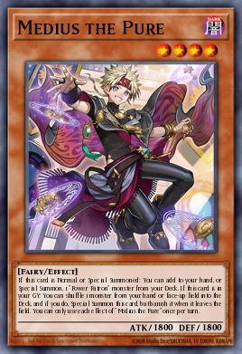 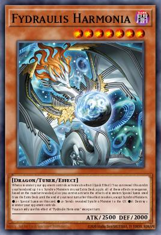 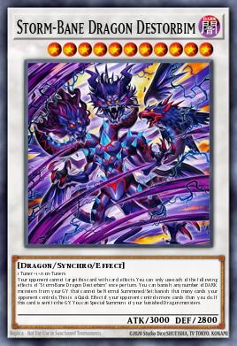

**Mano inicial:** Medius + Harmonia, con al menos un Sincro disponible en Extra para revelar y un Power Patron en Deck. Campo/GY propios vacíos, Normal libre, Main propia. Se fija **un efecto de monstruo rival activado como respuesta a Medius**, sin quitar ni negar Medius; si ese evento no sucede, la línea no demuestra cómo Invocar a Harmonia desde la mano.

1. **Normal Medius** a zona lateral, efecto de Invocación **CL1** para añadir Power Patron del Deck.
2. El rival activa efecto de monstruo **CL2**. Responder directamente **CL3 Harmonia desde mano**, revelando **Harmonia + al menos un Sincro del Extra** (2 cartas en total). Resolver hacia atrás: Harmonia se Invoca de mano, la CL2 definida no retira los cuerpos y Medius añade Patron al resolver CL1. **Con solo 2 reveladas no se envía Extra al GY.**
3. En Main propia y ambos presentes, usar Harmonia Cantante7 + Medius no Cantante4 para Invocar por Sincronía a **Destorbim11**. Ambos materiales van al GY. Patron queda en mano.
4. **Final limitado:** Destorbim 3000 ATK, Patron en mano, Harmonia/Medius GY, Normal gastada. No se representa destierro rival, pues no se acreditaron monstruos OSCURIDAD no Invocables Normalmente disponibles como coste.

**Caso de error:** si el monstruo rival no activa efecto, el paso 2 no existe; si retira Medius o niega a Harmonia, no se puede sostener la suma 7+4. Es un **escenario dependiente del rival** y no eleva automáticamente el número de aperturas sin respuesta.

## Acceso técnico por envío: Harmonia → Malong → rebote (CID 18666)

 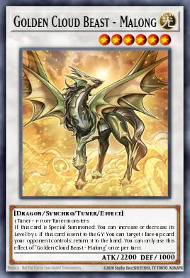

**Estado inicial:** Harmonia en mano; Malong + otros dos monstruos Sincro disponibles en Extra; rival activa efecto de monstruo y, después de resolver esa cadena, conserva una carta boca arriba seleccionable. Harmonia no ha usado su efecto ese turno.

1. **Cadena:** ante el efecto de monstruo rival, activar Efecto Rápido de Harmonia desde mano y **revelar exactamente cuatro cartas: Harmonia + Malong + dos Sincros distintos en Extra**. No son cuatro Sincros ni se descarta Harmonia.
2. Resolver Harmonia: se **Invoca Especialmente a sí misma desde la mano** (umbral 2+) y, por revelar 4+, **envía Malong desde el Extra al Cementerio**. Los otros dos Sincros revelados siguen en Extra. **Malong no se Invoca.**
3. Terminada la cadena, activar el disparo de **Malong enviado al GY**, seleccionando **una carta rival boca arriba**; al resolver, devolverla a mano. No se adjudica el rebote si falta objetivo legal o si se niega el efecto.
4. **Estado final del caso:** Harmonia en Campo, Malong en GY; carta rival seleccionada devuelta a mano si la activación resolvió. Las zonas de otros monstruos y el resto del efecto rival dependen del evento concreto. La Invocación Sincro de Malong sigue **sin materiales acreditados**; el uso por envío sí tiene relación causal `650:A06:HARMONIA:MALONG:ENVIO01`.

## Acceso técnico en dos Sincronías: Lucina → Strelitzia → Crystal Wing (CID 12321)

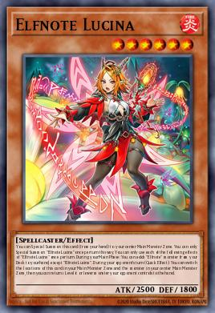 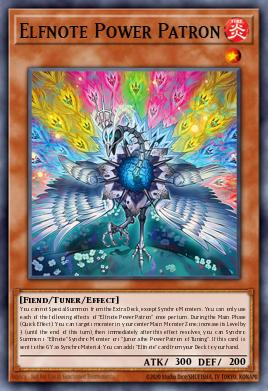 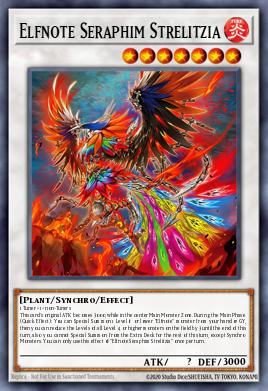 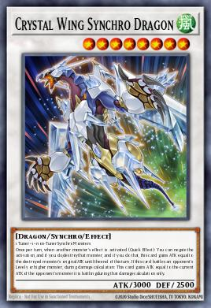

**Mano exacta:** solo Lucina. Deck con Patron y Regina buscables; Extra con Strelitzia y Crystal Wing. Main propia, centro libre, Normal sin gastar, Campo/GY/destierro vacíos, sin respuestas. **Variante** de la apertura `STRELITZIA02`, no dos campos ganadores simultáneos.

1. **Lucina desde mano → centro** por Invocación Especial, buscar Patron Nivel 1 Cantante del Deck (CL1).
2. **Normal Patron en lateral**. Sin activar aumento de Nivel. **Sincro1:** Patron1 + Lucina6 → **Strelitzia7 no Cantante en centro**; ambos materiales al GY.
3. **Cadena posterior:** Patron enviado como material busca **una Regina** a mano (solo una vez por turno).
4. **Main propia, nueva cadena:** Efecto Rápido de Strelitzia Invoca al **mismo Patron1 del GY a lateral**. **NO** elegir la reducción opcional de 3 Niveles; Strelitzia conserva Nivel 7.
5. **Sincro2:** Strelitzia7 **Sincro no Cantante** + Patron1 Cantante → **Crystal Wing Nivel 8 al centro**. Strelitzia y Patron se envían al GY. El segundo envío de Patron **no habilita una segunda búsqueda ese turno**.
6. **Final:** Crystal Wing8 ATK3000 central y Regina en mano; Lucina, Strelitzia y Patron en GY; Normal gastada. Crystal Wing podrá negar una activación de efecto de monstruo en la ventana válida; **no se cuenta una negación sin efecto rival**.

**Fallos:** negar búsqueda de Lucina deja sin Patron; negar la Invocación por efecto de Strelitzia mantiene a Patron fuera del Campo e impide la segunda Sincro; reducir Niveles 3 transforma Strelitzia a 4 y rompe la suma 7+1. Ver traza completa de zonas y respuestas en `650:A09:LUCINA:PATRON:CRYSTAL_WING10` dentro de la [ficha principal](../DECK_650_ELFNOTE_CONTENIDO_CURADO.md).

## Apertura técnica 2: Lucina + Medius → S:P (CID 19188)

**Propósito:** habilitar una respuesta temporal sin confundir destierro con negación.

**Inicio exacto:** mano con Lucina (CID 22116) y Medius the Pure (CID 21419); Power Patron (CID 22119) en Deck; S:P en Extra; campo y GY propios vacíos, Invocación Normal disponible y Main Phase propia. Sin restricciones anteriores ni respuesta rival. **No se usa Tinia**.

1. Invocar Especialmente Lucina desde mano a la zona principal central mediante su procedimiento propio. La Normal queda libre.
2. Invocar Normalmente Medius desde mano a una zona lateral libre. Activar el efecto de su Invocación (CL1) para **añadir** Power Patron del Deck a la mano; resolver. No Invocarlo al campo, pues su efecto continuo restringiría el Extra a Sincros.
3. Usar Lucina + Medius como dos monstruos de Efecto materiales de Enlace. Enviarlos a GY e Invocar S:P Little Knight Link-2 a zona permitida. **Power Patron permanece en mano**.
4. Como ninguno de esos materiales es Fusión/Sincro/Xyz/Link, **no se habilita el destierro opcional de S:P al ser Invocada por Enlace**. No dibujar carta rival desterrada en esta fase.
5. **Continuación en turno rival:** cuando adversario active carta/efecto, S:P puede seleccionar exactamente dos monstruos boca arriba del campo, incluido uno propio (por ejemplo, S:P y un monstruo rival), y desterrarlos temporalmente hasta End Phase. Esto no niega la activación rival y exige que ambos objetivos permanezcan válidos.

**Interrupción:** Ash a la búsqueda de Medius deja aún a Lucina y Medius en campo y, sin restricciones adicionales, conserva la posibilidad material de la Link-2, pero **Power Patron no se añade**. Remover uno de los cuerpos antes de enlazar corta la ruta. Negar la activación de S:P en turno rival no recupera los materiales originales. Si Power Patron pasó al campo antes del Enlace, aplicar su bloqueo solo Sincro y no ofrecer esta Link.

**Campo final tras Main Phase, sin respuestas:** S:P Little Knight Link-2, Power Patron en mano, Lucina y Medius en GY, Normal consumida, sin carta rival desterrada por su primer efecto. La interacción de turno rival es opcional y depende de una activación y dos objetivos boca arriba.

## Accesos que no deben falsificarse

- Three Champions y Luluwalilith requieren Cantante **exactamente Nivel 4**. Harmonia Nivel 7 no pasa a Nivel 4 por ser Cantante y Power Patron Nivel 1 no pasa a 4 sin modificación y ventana específicas.
- Malong y Chaos Angel requieren una suma precisa con materiales en campo, no una coincidencia nominal de arquetipo.
- Albion exige materiales y efecto de Fusión; el uso desde GY no sustituye la Invocación.
- Crystal Wing necesita un **Sincro no Cantante**, que proporciona Strelitzia7, y el **Cantante1** Patron revivido desde GY. Su acceso documentado exige **omitir la bajada opcional de Nivel**; no se sustituye por dos monstruos normales.

### Conciliación visual complementaria: Junora y las dos decisiones de Strelitzia (18-11-2026)

 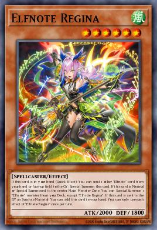 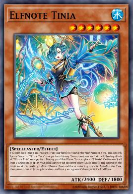 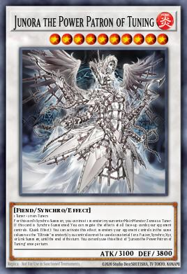

En la **otra** ruta existente `650:A09:ELFNOTE:LUCINA:TINIA:JUNORA03`, después de obtener Strelitzia central y usar Regina enviando Tinia al GY, el Efecto Rápido de Strelitzia revive Tinia y **sí elige** reducir 3 Niveles a todos los monstruos de Nivel 4 o mayor. Quedan **Strelitzia4 central + Regina3 lateral + Tinia3 lateral**; Tinia puede colocar Welcome Home desde Deck. Para la Sincronía de Junora se trata a **Strelitzia central como Cantante** por el texto propio de Junora y se usan Regina y Tinia como **dos no Cantantes** (4+3+3=10). El resultado no incluye los materiales que fueron al GY.

Esta elección es **excluyente** de Crystal Wing: en la ruta de Crystal Wing se revive Patron1 **sin bajar** Strelitzia7 y se sincroniza 7+1=8. No mezclar ambas fotografías en un mismo campo final. Junora puede negar efectos de cartas rivales boca arriba **cuando es Invocada por Sincronía**, pero no crea una negación permanente, ni bloquea materiales rivales por columnas sin **otro monstruo propio de nombre Elfnota**. [Junora oficial CID 22142](https://www.db.yugioh-card.com/yugiohdb/card_search.action?cid=22142&ope=2) · [Strelitzia oficial CID 22143](https://www.db.yugioh-card.com/yugiohdb/card_search.action?cid=22143&ope=2). La traza completa y las alternativas de respuesta están en la [ficha A09](../DECK_650_ELFNOTE_CONTENIDO_CURADO.md).

## Fuentes oficiales

Las diez fichas: https://www.db.yugioh-card.com/yugiohdb/card_search.action?cid=22356&ope=2 ; https://www.db.yugioh-card.com/yugiohdb/card_search.action?cid=18666&ope=2 ; https://www.db.yugioh-card.com/yugiohdb/card_search.action?cid=22335&ope=2 ; https://www.db.yugioh-card.com/yugiohdb/card_search.action?cid=22144&ope=2 ; https://www.db.yugioh-card.com/yugiohdb/card_search.action?cid=19188&ope=2 ; https://www.db.yugioh-card.com/yugiohdb/card_search.action?cid=18505&ope=2 ; https://www.db.yugioh-card.com/yugiohdb/card_search.action?cid=12321&ope=2 ; https://www.db.yugioh-card.com/yugiohdb/card_search.action?cid=15996&ope=2 ; https://www.db.yugioh-card.com/yugiohdb/card_search.action?cid=15994&ope=2 ; https://www.db.yugioh-card.com/yugiohdb/card_search.action?cid=18507&ope=2 .

**Estado al 18-11-2026:** 10/10 casos examinados, **no** 10/10 Invocaciones acreditadas. **Malong:** uso desde Extra por envío al GY documentado, Invocación propia aún abierta. **Crystal Wing:** secuencia completa de dos Sincronías con la mano y el estado declarados; falta reproducción de motor. **Destorbim:** continuación 7+4 y apertura **condicional** de dos cartas descritas, dependiente de una activación rival. Los restantes casos conservan sus pendientes individuales. Ningún inventario, nombre, cantidad, zona o carta fue sustituido.
