# A10 — Guías visuales documentales · Elfnote

> Guía documental: utilizar únicamente secuencias con condiciones y restricciones comprobadas.

- Deck ID: `650`. Formato declarado: `TCG`.
- Rutas visualizadas en esta entrega: **6**.
- Los pasos, movimientos y zonas se cotejan con la ficha A09; no asumir respuestas no descritas.
- Un estado desconocido se conserva como no documentado: nunca se inventa.

## ECCLESIA · FALLEN · ALBION01 · `650:A09:ECCLESIA:FALLEN:ALBION01`

**Propósito competitivo principal (lectura documental):** Preparación de recursos / despliegue. El objetivo solo se acredita si las acciones y el campo final detallados en esta guía lo permiten; no implica legalidad certificada ni garantiza el resultado ante respuestas adversarias.

**Categoría:** APERTURA

**Propósito y resultado documental:**

5. Tablero final del caso definido: Ecclesia en Ataque boca arriba (1500 ATK), segunda El Caído y La Virtuosa Colocada; Albion y la primera Mágica usada en GY; campo rival pierde una carta boca arriba; mano vacía, Invocación Normal gastada y bloqueo al Extra vigente hasta terminar el turno. No se presupone carta «Señalado/a» adicional ni Fusión.

### Mano y estado inicial

Ecclesia Dogmátik, la Virtuosa (CID 15239) sola. Campo/GY propios vacíos; en el Main/Deck figuran 2 copias de El Caído y La Virtuosa (CID 22089), y en el Extra queda Albion el Dragón Señalado (CID 15994), que menciona «Caído de Albaz». Rival controla una carta boca arriba elegible sin protección; no hay respuestas en la línea base. Turno propio Main Phase, Normal libre. No considerar otras cartas desconocidas.

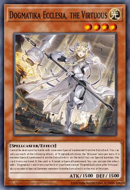 **Dogmatika Ecclesia, the Virtuous**

### Ejecución numerada

#### Paso 1 — Invocar Normalmente a Ecclesia (Nivel 4, 1500 ATK) en Ataque.

 **NORMAL**

**Acción concreta:** Invocar Normalmente a Ecclesia (Nivel 4, 1500 ATK) en Ataque. Activa su efecto de Invocación, CL1, para añadir una carta «Dogmátik» del Deck, excepto sí misma.
**Detalle técnico documentado:** Activa su efecto de Invocación, CL1, para añadir una carta «Dogmátik» del Deck, excepto sí misma.

**Estado por zonas después del paso:**

| Zona/recurso | Estado narrativo A09 |
|---|---|
| Mano | ∅; búsqueda CL1 iniciada, resolución se describe en P2 |
| Monstruos | Ecclesia #15239 (1500 ATK, Normal) |
| Mágicas y trampas | ∅ |
| Cementerio | ∅ |
| Destierro propio | ∅ |
| Campo y estado rival | Un objetivo boca arriba elegible de identidad desconocida; sin respuesta |
| Materiales Xyz/Fusión/Sincro | Ninguno |
| Normal, Extra, fase y restricciones | Normal gastada; prohibición de Especiales desde Extra tras resolver Ecclesia |

**Campo visual de este paso:**

**Monstruos propios:**
-  **Ecclesia (1500 ATK, Normal)** — zona declarada: `MONSTER`.
**Mágicas/Trampas/Campo:** sin carta propia demostrada en esta vista.
*Relación ilustrada de cartas presentes tras este paso, documentada en A09. La posición, materiales, otras zonas y rival se leen en la tabla de estado.*

#### Paso 2 — Resolviendo CL1 sin respuesta, buscar El Caído y La Virtuosa (primera copia), que se trata siempre como carta «Dogmátik» y «Señalado/a».

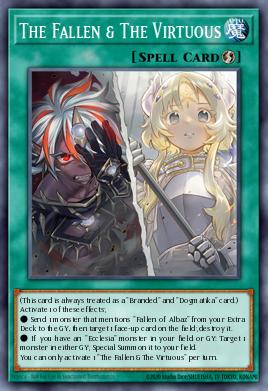 **AÑADIR A MANO** →  **ESTADO / CONTEXTO**

**Acción concreta:** Resolviendo CL1 sin respuesta, buscar El Caído y La Virtuosa (primera copia), que se trata siempre como carta «Dogmátik» y «Señalado/a». Queda en mano. Desde la resolución de Ecclesia no pueden Invocarse Especialmente monstruos del Extra por el resto del turno.
**Detalle técnico documentado:** Queda en mano. Desde la resolución de Ecclesia no pueden Invocarse Especialmente monstruos del Extra por el resto del turno.

**Estado por zonas después del paso:**

| Zona/recurso | Estado narrativo A09 |
|---|---|
| Mano | Primer El Caído y La Virtuosa #22089 (buscada) |
| Monstruos | Ecclesia #15239 |
| Mágicas y trampas | ∅ |
| Cementerio | ∅ |
| Destierro propio | ∅ |
| Campo y estado rival | Objetivo rival aún en Campo; no hay destrucción todavía |
| Materiales Xyz/Fusión/Sincro | Ninguno |
| Normal, Extra, fase y restricciones | Normal gastada; Extra bloqueado para Invocación Especial este turno |

**Campo visual de este paso:**

**Monstruos propios:**
-  **Ecclesia** — zona declarada: `MONSTER`.
**Mágicas/Trampas/Campo:** sin carta propia demostrada en esta vista.
*Relación ilustrada de cartas presentes tras este paso, documentada en A09. La posición, materiales, otras zonas y rival se leen en la tabla de estado.*

#### Paso 3 — En Main Phase, activar El Caído y La Virtuosa (Mágica de Juego Rápido) desde la mano y elegir su primer efecto.

 **ACTIVAR** → 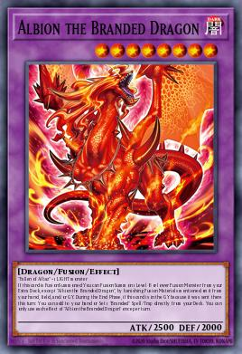 **ENVIAR** →  **ESPECIAL**

**Acción concreta:** En Main Phase, activar El Caído y La Virtuosa (Mágica de Juego Rápido) desde la mano y elegir su primer efecto. Enviar Albion el Dragón Señalado desde el Extra al GY (este Albion menciona «Caído de Albaz»), seleccionar y destruir la carta rival boca arriba definida. La Mágica usada acaba en GY. Enviar desde Extra al GY no es Invocar Especialmente desde Extra, así que no infringe el bloqueo de Ecclesia. No activar el efecto de Albion que exige haber sido Invocado por Fusión, ya que no ocurrió.
**Detalle técnico documentado:** Enviar Albion el Dragón Señalado desde el Extra al GY (este Albion menciona «Caído de Albaz»), seleccionar y destruir la carta rival boca arriba definida. La Mágica usada acaba en GY. Enviar desde Extra al GY no es Invocar Especialmente desde Extra, así que no infringe el bloqueo de Ecclesia. No activar el efecto de Albion que exige haber sido Invocado por Fusión, ya que no ocurrió.

**Estado por zonas después del paso:**

| Zona/recurso | Estado narrativo A09 |
|---|---|
| Mano | ∅ |
| Monstruos | Ecclesia #15239 |
| Mágicas y trampas | ∅ |
| Cementerio | Primera El Caído y La Virtuosa #22089 (usada), Albion #15994 (enviado desde Extra, NO Invocado por Fusión) |
| Destierro propio | ∅ |
| Campo y estado rival | Carta rival boca arriba elegible destruida; identidad variable; no se presupone ausencia de otras cartas |
| Materiales Xyz/Fusión/Sincro | Ninguno |
| Normal, Extra, fase y restricciones | Normal gastada; Albion enviado desde Extra al GY, no Invocado |

**Campo visual de este paso:**

**Monstruos propios:**
-  **Ecclesia** — zona declarada: `MONSTER`.
**Mágicas/Trampas/Campo:** sin carta propia demostrada en esta vista.
*Relación ilustrada de cartas presentes tras este paso, documentada en A09. La posición, materiales, otras zonas y rival se leen en la tabla de estado.*

#### Paso 4 — End Phase: Albion permanece en GY porque fue enviado allí este turno y puede activar su segundo efecto (nuevo CL1) para añadir a mano o Colocar una M/T «Señalado/a» del Deck.

 **YA EN CAMPO** →  **ESTADO / CONTEXTO**

**Acción concreta:** End Phase: Albion permanece en GY porque fue enviado allí este turno y puede activar su segundo efecto (nuevo CL1) para añadir a mano o Colocar una M/T «Señalado/a» del Deck. Elegir la segunda copia aún en Deck de El Caído y La Virtuosa, que se trata siempre como «Señalado/a», y Colocarla en zona M/T. Como fue Colocada en este turno, no se puede activar como Mágica Rápida en este mismo turno.
**Detalle técnico documentado:** Elegir la segunda copia aún en Deck de El Caído y La Virtuosa, que se trata siempre como «Señalado/a», y Colocarla en zona M/T. Como fue Colocada en este turno, no se puede activar como Mágica Rápida en este mismo turno.

**Estado por zonas después del paso:**

| Zona/recurso | Estado narrativo A09 |
|---|---|
| Mano | ∅ |
| Monstruos | Ecclesia #15239 |
| Mágicas y trampas | Segunda El Caído y La Virtuosa #22089 (Colocada por Albion en End Phase) |
| Cementerio | Primera El Caído #22089, Albion #15994 |
| Destierro propio | ∅ |
| Campo y estado rival | La carta seleccionada ya fue destruida en P3; otras cartas desconocidas |
| Materiales Xyz/Fusión/Sincro | Ninguno |
| Normal, Extra, fase y restricciones | Normal gastada; Mágica Rápida Colocada no se activa este turno |

**Campo visual de este paso:**

**Monstruos propios:**
-  **Ecclesia** — zona declarada: `MONSTER`.
**Mágicas/Trampas/Campo:**
-  **Segunda El Caído y La Virtuosa (Colocada por Albion en End Phase)** — zona declarada: `SPELL_TRAP`.
*Relación ilustrada de cartas presentes tras este paso, documentada en A09. La posición, materiales, otras zonas y rival se leen en la tabla de estado.*

#### Paso 5 — Tablero final del caso definido: Ecclesia en Ataque boca arriba (1500 ATK), segunda El Caído y La Virtuosa Colocada; Albion y la primera Mágica usada en GY.

 **ESTADO / CONTEXTO** →  **ESTADO / CONTEXTO** →  **ESTADO / CONTEXTO**

**Acción concreta:** Tablero final del caso definido: Ecclesia en Ataque boca arriba (1500 ATK), segunda El Caído y La Virtuosa Colocada; Albion y la primera Mágica usada en GY; campo rival pierde una carta boca arriba; mano vacía, Invocación Normal gastada y bloqueo al Extra vigente hasta terminar el turno. No se presupone carta «Señalado/a» adicional ni Fusión.
**Detalle técnico documentado:** campo rival pierde una carta boca arriba; mano vacía, Invocación Normal gastada y bloqueo al Extra vigente hasta terminar el turno. No se presupone carta «Señalado/a» adicional ni Fusión.

**Estado por zonas después del paso:**

| Zona/recurso | Estado narrativo A09 |
|---|---|
| Mano | ∅ |
| Monstruos | Ecclesia #15239 (1500 ATK) |
| Mágicas y trampas | Segunda El Caído y La Virtuosa #22089 (Colocada) |
| Cementerio | Primera El Caído #22089, Albion #15994 |
| Destierro propio | ∅ |
| Campo y estado rival | Menos una carta boca arriba seleccionada, no se supone campo rival vacío |
| Materiales Xyz/Fusión/Sincro | Ninguno |
| Normal, Extra, fase y restricciones | Normal gastada; bloqueo Extra hasta el final del turno |

**Campo visual de este paso:**

**Monstruos propios:**
-  **Ecclesia (1500 ATK)** — zona declarada: `MONSTER`.
**Mágicas/Trampas/Campo:**
-  **Segunda El Caído y La Virtuosa (Colocada)** — zona declarada: `SPELL_TRAP`.
*Relación ilustrada de cartas presentes tras este paso, documentada en A09. La posición, materiales, otras zonas y rival se leen en la tabla de estado.*

### Campo final documentado

Esta vista procede **del último paso**, no de una lista de cartas deducida del título.

**Monstruos propios:**
-  **Ecclesia (1500 ATK)** — zona declarada: `MONSTER`.
**Mágicas/Trampas/Campo:**
-  **Segunda El Caído y La Virtuosa (Colocada)** — zona declarada: `SPELL_TRAP`.
*Relación ilustrada de cartas presentes tras este paso, documentada en A09. La posición, materiales, otras zonas y rival se leen en la tabla de estado.*

| Zona/recurso | Estado final documentado |
|---|---|
| Mano | ∅ |
| Monstruos | Ecclesia #15239 (1500 ATK) |
| Mágicas y trampas | Segunda El Caído y La Virtuosa #22089 (Colocada) |
| Cementerio | Primera El Caído #22089, Albion #15994 |
| Destierro propio | ∅ |
| Campo y estado rival | Menos una carta boca arriba seleccionada, no se supone campo rival vacío |
| Materiales Xyz/Fusión/Sincro | Ninguno |
| Normal, Extra, fase y restricciones | Normal gastada; bloqueo Extra hasta el final del turno |

### Si el oponente interrumpe

- **INTERRUPCIÓN A12 — paso sin anclaje confirmado: A12 — Dos ventanas Ash independientes en ECCLESIA:FALLEN:ALBION01**
  - Ensayo A, efecto de Ecclesia: al activar Ecclesia CL1 para buscar desde Deck, rival descarta Flor de Ceniza & Primavera Feliz como CL2. Resolver en orden inverso: CL2 niega el efecto de búsqueda de Ecclesia; CL1 no añade la Mágica al mano. Con la apertura de una carta, no hay El Caído y La Virtuosa accesible para continuar, no se envía Albion ni se retira la carta rival. Al negarse ese efecto, tampoco aplicar el bloqueo de Extra de su resolución. Ecclesia queda en campo (1500 ATK), Flor de Ceniza rival en su GY.
  - Ensayo B, efecto de Albion: el rival no interrumpe la búsqueda inicial y la Mágica resuelve destruyendo el blanco rival. En End Phase, activar efecto de Albion en GY como CL1 para añadir/Colocar segunda Mágica del Deck. Rival descarta Flor de Ceniza CL2 porque hay acceso desde Deck; CL2 niega el efecto de Albion: no se añade/Coloca la segunda Mágica. Ecclesia permanece en campo y la carta rival inicial fue destruida; Albion y primera Mágica siguen en GY.
  - Intento inválido: la primera opción de El Caído y La Virtuosa envía desde el Extra, no desde el Main Deck; no añade carta del Deck, no Invoca desde Deck y no envía desde Deck. La respuesta Flor de Ceniza no es legal por ese efecto seleccionado. Los dos ensayos A/B son alternativos, no se presupone que el rival tenga dos Flor de Ceniza. Flor de Ceniza oficial..
  - Estado de rama: `Resuelto solo en el escenario que detalla A12/A13; las otras respuestas no están demostradas.`.
- **RECUPERACIÓN A13 — paso sin anclaje confirmado: A13 — Dos fallos diferentes ante Flor de Ceniza**
  - 1. Ash a Ecclesia (inicio): se agota el efecto de búsqueda de Ecclesia; con la mano de una carta no se obtiene Mágica y el resultado solo incluye Ecclesia 1500 ATK boca arriba. No fingir que se envió Albion ni que el rival perdió su carta. Una carta «Dogmátik» adicional en mano permitiría otro análisis solo si existe realmente, no en esta apertura.
  - 2. Ash a Albion (End Phase): se mantiene la eliminación de la carta rival por la primera copia de la Mágica y Ecclesia permanece boca arriba, pero no aparece la segunda Mágica Colocada. El Extra sigue bloqueado por la activación inicial de Ecclesia durante el turno. No usar el efecto de Fusión de Albion, que no fue Invocado por Fusión.
  - 3. Rama sin carta rival boca arriba: no puede copiarse FALLEN:ALBION01 tal cual; la primera opción requiere un blanco boca arriba al que destruir, y para activar la segunda opción habría que acreditar un monstruo «Ecclesia» en campo/GY y un monstruo en GY elegible para Invocar. No inventar esos destinos.; exhaustividad pendiente.
  - Estado de rama: `Resuelto solo en el escenario que detalla A12/A13; las otras respuestas no están demostradas.`.

---

## ELFNOTE · TINIA01 · `650:A09:ELFNOTE:TINIA01`

**Propósito competitivo principal (lectura documental):** Ofensivo condicional. El objetivo solo se acredita si las acciones y el campo final detallados en esta guía lo permiten; no implica legalidad certificada ni garantiza el resultado ante respuestas adversarias.

**Categoría:** APERTURA

**Propósito y resultado documental:**

6. Final: Regina centro ATK 2000 + Fortuna lateral DEF 1800, Bienvenidos a Casa y Rapsodia boca arriba, Tinia + Lucina GY, mano inicial agotada, Normal sin gastar. Bienvenidos protege de destrucción por efecto al monstruo central; Rapsodia limita los ataques rivales a ese monstruo. No hay Sincronía propia, así que no se demuestra negación de cartas por Rapsodia.

### Mano y estado inicial

solo Elfnota Tinia (22117, AGUA, Nivel 6) en mano; propio campo/GY vacíos y zona central libre. En Deck: 1× Bienvenidos a Casa (22159), al menos 1× Lucina (22116, FUEGO), 1× Regina (22523, VIENTO), 1× Fortuna (22118, LUZ), 1× Rapsodia de Locura (22173). Turno propio Main Phase; sin respuesta rival.

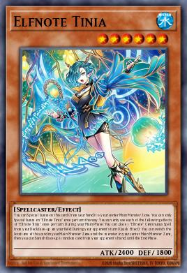 **Elfnote Tinia**

### Ejecución numerada

#### Paso 1 — Invocar Especialmente Tinia desde mano a la zona central mediante su procedimiento propio; no gasta Normal.

 **ESPECIAL**

**Acción concreta:** Invocar Especialmente Tinia desde mano a la zona central mediante su procedimiento propio; no gasta Normal.
**Detalle técnico documentado:** No documentado

**Estado por zonas después del paso:**

| Zona/recurso | Estado narrativo A09 |
|---|---|
| Mano | ∅ |
| Monstruos | Tinia #22117 (centro, Especial de mano) |
| Mágicas y trampas | ∅ |
| Cementerio | ∅ |
| Destierro propio | ∅ |
| Campo y estado rival | Sin respuesta; campo no determinado |
| Materiales Xyz/Fusión/Sincro | Ninguno |
| Normal, Extra, fase y restricciones | Normal libre; Extra intacto |

**Campo visual de este paso:**

**Monstruos propios:**
-  **Tinia (centro, Especial de mano)** — zona declarada: `MONSTER`.
**Mágicas/Trampas/Campo:** sin carta propia demostrada en esta vista.
*Relación ilustrada de cartas presentes tras este paso, documentada en A09. La posición, materiales, otras zonas y rival se leen en la tabla de estado.*

#### Paso 2 — Activar su efecto Main Phase: poner Bienvenidos a Casa boca arriba desde el Deck en zona M/T.

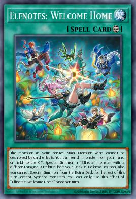 **ACTIVAR**

**Acción concreta:** Activar su efecto Main Phase: poner Bienvenidos a Casa boca arriba desde el Deck en zona M/T.
**Detalle técnico documentado:** No documentado

**Estado por zonas después del paso:**

| Zona/recurso | Estado narrativo A09 |
|---|---|
| Mano | ∅ |
| Monstruos | Tinia #22117 (centro) |
| Mágicas y trampas | Bienvenidos a Casa #22159 (Continua boca arriba) |
| Cementerio | ∅ |
| Destierro propio | ∅ |
| Campo y estado rival | Sin cambios acreditados |
| Materiales Xyz/Fusión/Sincro | Ninguno |
| Normal, Extra, fase y restricciones | Normal libre; Extra intacto |

**Campo visual de este paso:**

**Monstruos propios:**
-  **Tinia (centro)** — zona declarada: `MONSTER`.
**Mágicas/Trampas/Campo:**
-  **Bienvenidos a Casa (Continua boca arriba)** — zona declarada: `SPELL_TRAP`.
*Relación ilustrada de cartas presentes tras este paso, documentada en A09. La posición, materiales, otras zonas y rival se leen en la tabla de estado.*

#### Paso 3 — Activar Bienvenidos a Casa: enviar Tinia AGUA del campo al GY como coste; Invocar Especialmente Lucina FUEGO desde Deck en Defensa, en el centro libre (Atributo original distinto).

 **ACTIVAR** →  **ENVIAR** → 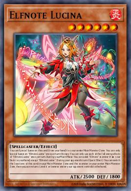 **ESPECIAL**

**Acción concreta:** Activar Bienvenidos a Casa: enviar Tinia AGUA del campo al GY como coste; Invocar Especialmente Lucina FUEGO desde Deck en Defensa, en el centro libre (Atributo original distinto). El resto del turno solo se pueden Invocar Especialmente Sincronías desde Extra.
**Detalle técnico documentado:** El resto del turno solo se pueden Invocar Especialmente Sincronías desde Extra.

**Estado por zonas después del paso:**

| Zona/recurso | Estado narrativo A09 |
|---|---|
| Mano | ∅ |
| Monstruos | Lucina #22116 (centro, Defensa desde Deck) |
| Mágicas y trampas | Bienvenidos a Casa #22159 |
| Cementerio | Tinia #22117 (coste desde Campo) |
| Destierro propio | ∅ |
| Campo y estado rival | Sin cambios acreditados |
| Materiales Xyz/Fusión/Sincro | Ninguno |
| Normal, Extra, fase y restricciones | Normal libre; desde ahora solo Sincronías del Extra |

**Campo visual de este paso:**

**Monstruos propios:**
-  **Lucina (centro, Defensa desde Deck)** — zona declarada: `MONSTER`.
**Mágicas/Trampas/Campo:**
-  **Bienvenidos a Casa** — zona declarada: `SPELL_TRAP`.
*Relación ilustrada de cartas presentes tras este paso, documentada en A09. La posición, materiales, otras zonas y rival se leen en la tabla de estado.*

#### Paso 4 — Usar Lucina para añadir Regina del Deck a la mano.

 **ENVIAR** → 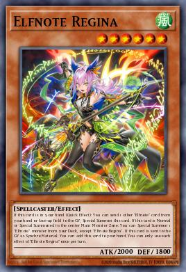 **MATERIAL / COSTE**

**Acción concreta:** Usar Lucina para añadir Regina del Deck a la mano. Activar efecto rápido de Regina desde mano: enviar Lucina boca arriba del centro al GY como coste e Invocar Regina en Ataque en la zona central.
**Detalle técnico documentado:** Activar efecto rápido de Regina desde mano: enviar Lucina boca arriba del centro al GY como coste e Invocar Regina en Ataque en la zona central.

**Estado por zonas después del paso:**

| Zona/recurso | Estado narrativo A09 |
|---|---|
| Mano | ∅ |
| Monstruos | Regina #22523 (centro, Ataque; Lucina se envió como coste) |
| Mágicas y trampas | Bienvenidos a Casa #22159 |
| Cementerio | Tinia #22117, Lucina #22116 |
| Destierro propio | ∅ |
| Campo y estado rival | Sin cambios acreditados |
| Materiales Xyz/Fusión/Sincro | Ninguno |
| Normal, Extra, fase y restricciones | Normal libre; Extra solo Sincronía |

**Campo visual de este paso:**

**Monstruos propios:**
-  **Regina (centro, Ataque; Lucina se envió como coste)** — zona declarada: `MONSTER`.
**Mágicas/Trampas/Campo:**
-  **Bienvenidos a Casa** — zona declarada: `SPELL_TRAP`.
*Relación ilustrada de cartas presentes tras este paso, documentada en A09. La posición, materiales, otras zonas y rival se leen en la tabla de estado.*

#### Paso 5 — Regina, Invocada Especialmente al centro, Invoca Fortuna desde Deck en Defensa lateral.

 **ESTADO / CONTEXTO** → 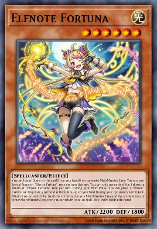 **YA EN CAMPO**

**Acción concreta:** Regina, Invocada Especialmente al centro, Invoca Fortuna desde Deck en Defensa lateral. Fortuna, durante Main Phase, pone Rapsodia de Locura boca arriba desde Deck en M/T.
**Detalle técnico documentado:** Fortuna, durante Main Phase, pone Rapsodia de Locura boca arriba desde Deck en M/T.

**Estado por zonas después del paso:**

| Zona/recurso | Estado narrativo A09 |
|---|---|
| Mano | ∅ |
| Monstruos | Regina #22523 (centro, ATK 2000), Fortuna #22118 (lateral, Defensa) |
| Mágicas y trampas | Bienvenidos a Casa #22159, Rapsodia #22173 (ambas boca arriba) |
| Cementerio | Tinia #22117, Lucina #22116 |
| Destierro propio | ∅ |
| Campo y estado rival | Sin cambios acreditados |
| Materiales Xyz/Fusión/Sincro | Ninguno |
| Normal, Extra, fase y restricciones | Normal libre; Extra solo Sincronía |

**Campo visual de este paso:**

**Monstruos propios:**
-  **Regina (centro, ATK 2000)** — zona declarada: `MONSTER`.
-  **Fortuna (lateral, Defensa)** — zona declarada: `MONSTER`.
**Mágicas/Trampas/Campo:**
-  **Bienvenidos a Casa** — zona declarada: `SPELL_TRAP`.
- 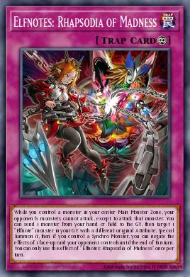 **Rapsodia (ambas boca arriba)** — zona declarada: `SPELL_TRAP`.
*Relación ilustrada de cartas presentes tras este paso, documentada en A09. La posición, materiales, otras zonas y rival se leen en la tabla de estado.*

#### Paso 6 — Final: Regina centro ATK 2000 + Fortuna lateral DEF 1800, Bienvenidos a Casa y Rapsodia boca arriba, Tinia + Lucina GY, mano inicial agotada, Normal sin gastar.

 **ESTADO / CONTEXTO** →  **ESTADO / CONTEXTO** →  **ESTADO / CONTEXTO**

**Acción concreta:** Final: Regina centro ATK 2000 + Fortuna lateral DEF 1800, Bienvenidos a Casa y Rapsodia boca arriba, Tinia + Lucina GY, mano inicial agotada, Normal sin gastar. Bienvenidos protege de destrucción por efecto al monstruo central; Rapsodia limita los ataques rivales a ese monstruo. No hay Sincronía propia, así que no se demuestra negación de cartas por Rapsodia.
**Detalle técnico documentado:** Bienvenidos protege de destrucción por efecto al monstruo central; Rapsodia limita los ataques rivales a ese monstruo. No hay Sincronía propia, así que no se demuestra negación de cartas por Rapsodia.

**Estado por zonas después del paso:**

| Zona/recurso | Estado narrativo A09 |
|---|---|
| Mano | ∅ |
| Monstruos | Regina #22523 (centro), Fortuna #22118 (lateral) |
| Mágicas y trampas | Bienvenidos a Casa #22159, Rapsodia #22173 |
| Cementerio | Tinia #22117, Lucina #22116 |
| Destierro propio | ∅ |
| Campo y estado rival | No se activó negación de Rapsodia por faltar Sincronía propia |
| Materiales Xyz/Fusión/Sincro | Ninguno |
| Normal, Extra, fase y restricciones | Normal libre; sin Extra invocado |

**Campo visual de este paso:**

**Monstruos propios:**
-  **Regina (centro)** — zona declarada: `MONSTER`.
-  **Fortuna (lateral)** — zona declarada: `MONSTER`.
**Mágicas/Trampas/Campo:**
-  **Bienvenidos a Casa** — zona declarada: `SPELL_TRAP`.
-  **Rapsodia** — zona declarada: `SPELL_TRAP`.
*Relación ilustrada de cartas presentes tras este paso, documentada en A09. La posición, materiales, otras zonas y rival se leen en la tabla de estado.*

### Campo final documentado

Esta vista procede **del último paso**, no de una lista de cartas deducida del título.

**Monstruos propios:**
-  **Regina (centro)** — zona declarada: `MONSTER`.
-  **Fortuna (lateral)** — zona declarada: `MONSTER`.
**Mágicas/Trampas/Campo:**
-  **Bienvenidos a Casa** — zona declarada: `SPELL_TRAP`.
-  **Rapsodia** — zona declarada: `SPELL_TRAP`.
*Relación ilustrada de cartas presentes tras este paso, documentada en A09. La posición, materiales, otras zonas y rival se leen en la tabla de estado.*

| Zona/recurso | Estado final documentado |
|---|---|
| Mano | ∅ |
| Monstruos | Regina #22523 (centro), Fortuna #22118 (lateral) |
| Mágicas y trampas | Bienvenidos a Casa #22159, Rapsodia #22173 |
| Cementerio | Tinia #22117, Lucina #22116 |
| Destierro propio | ∅ |
| Campo y estado rival | No se activó negación de Rapsodia por faltar Sincronía propia |
| Materiales Xyz/Fusión/Sincro | Ninguno |
| Normal, Extra, fase y restricciones | Normal libre; sin Extra invocado |

### Si el oponente interrumpe

- **INTERRUPCIÓN A12 — paso sin anclaje confirmado: A12 — Tres ventanas Ash adicionales en ELFNOTE:TINIA01 (ensayos excluyentes)**
  - Ensayo C, Bienvenidos a Casa: Tinia ya puso la Continua boca arriba. Activar Bienvenidos a Casa CL1, enviando Tinia del campo al GY como coste para Invocar Lucina FUEGO desde Deck. Rival descarta Flor de Ceniza CL2, aplicable por la Invocación Especial desde Deck. CL2 niega el efecto: Lucina no entra. Final de esta interrupción con mano inicial de solo Tinia: campo propio sin monstruos, Bienvenidos boca arriba, Tinia en GY, ninguna búsqueda de Regina y ninguna Rapsodia. La restricción a Invocaciones desde el Extra no habilita por sí sola una continuación.
  - Ensayo D, búsqueda de Lucina: el rival permite resolver Bienvenidos, de modo que Lucina está en Defensa en el centro y Tinia en GY. Lucina CL1 intenta añadir Regina desde Deck; Flor de Ceniza CL2 niega el efecto de búsqueda. Regina no llega a mano. Estado resultante: Lucina en el centro DEF, Bienvenidos boca arriba, Tinia GY; no se presume la presencia de Regina ni Fortuna. En la ruta alternativa LUCINA01, esta misma clase de ventana existe al buscar Regina con la Lucina inicialmente Invocada, con distinto estado previo del campo.
  - Ensayo E, disparo de Regina: el rival deja resolver la búsqueda de Lucina; Regina se activa desde mano, manda Lucina del campo al GY como coste y se Invoca en Ataque al centro libre. Su otro efecto se activa como CL1 al ser Invocada al centro e intenta Invocar Fortuna desde Deck. Flor de Ceniza CL2 niega ese efecto: no aparece Fortuna ni se pone Rapsodia. Tablero: Regina centro ATK 2000 y Bienvenidos boca arriba, Tinia + Lucina en GY; mano inicial agotada. En LUCINA01 la misma ventana puede negar la Invocación de Tinia del Deck después de que Regina llega al centro, por lo que tampoco aparece Bienvenidos en esa rama.
  - No cuentan como ventanas Ash: Tinia que pone una Mágica Continua boca arriba desde Deck y Fortuna que pone una Trampa Continua boca arriba desde Deck; ninguno de esos efectos añade a la mano, Invoca desde Deck o envía del Deck al GY. Tampoco se niega mediante Ash la propia Invocación de Regina desde mano por ese hecho aislado. Los ensayos C/D/E se ejecutan por separado, con una sola Flor de Ceniza rival, no en una cadena acumulativa.
  - Fuente oficial: Flor de Ceniza, Bienvenidos a Casa, Lucina, Regina.;.
  - Estado de rama: `Resuelto solo en el escenario que detalla A12/A13; las otras respuestas no están demostradas.`.
- **RECUPERACIÓN A13 — paso sin anclaje confirmado: A13 — Recuperación y estados parciales del motor Elfnota frente a Ash**
  - 1. Tinia → Bienvenidos negado (ensayo C): Tinia ya se pagó como coste, así que termina en GY aunque el efecto de la Continua sea negado. Bienvenidos permanece boca arriba, sin Lucina ni otro monstruo; la Normal está libre, pero no existe carta adicional en la mano inicial que autorice otra jugada.
  - 2. Tinia → búsqueda de Lucina negada (ensayo D): Bienvenidos sí resolvió; Lucina está en Defensa en centro, Tinia en GY y la Continua sigue boca arriba. Al faltar Regina en mano, no se ejecuta su Invocación ni se establece Rapsodia. Para la apertura LUCINA01, el estado análogo tras Ash a la búsqueda es Lucina sola en centro y ninguna Continua: aún no se había convocado Tinia.
  - 3. Tinia → Invocación desde Deck de Regina negada (ensayo E): Lucina ya se envió al GY como coste de Regina. Regina queda centro ATK 2000, Bienvenidos boca arriba, Tinia y Lucina GY, sin Fortuna ni Rapsodia. En LUCINA01, Ash al mismo disparo deja Regina en centro y Lucina GY, sin Tinia y sin Bienvenidos, porque esa Mágica la pondría Tinia después.
  - Criterio de recuperación: la interrupción no equivale automáticamente a perder el duelo; simplemente no hay recuperación legal demostrada desde esas manos mínimas sin inventar cartas robadas, Normal Summons u otros recursos. Las tres ramas están trazadas, pero sus guías visuales y extensiones siguen.
  - Estado de rama: `Resuelto solo en el escenario que detalla A12/A13; las otras respuestas no están demostradas.`.

---

## ELFNOTE · LUCINA01 · `650:A09:ELFNOTE:LUCINA01`

**Propósito competitivo principal (lectura documental):** Preparación de recursos / despliegue. El objetivo solo se acredita si las acciones y el campo final detallados en esta guía lo permiten; no implica legalidad certificada ni garantiza el resultado ante respuestas adversarias.

**Categoría:** APERTURA

**Propósito y resultado documental:**

6. Final: Regina centro ATK 2000, Fortuna lateral DEF 1800, ambas Continuas boca arriba; Lucina y Tinia GY, Normal sin gastar, mano inicial agotada. La ruta usa los efectos una vez por turno y no suma nuevas cartas fuera del inventario.

### Mano y estado inicial

solo Lucina FUEGO en mano; centro libre. En Deck: Regina, Tinia AGUA, Fortuna LUZ, Bienvenidos a Casa y Rapsodia en las copias declaradas. Campo/GY vacíos, Main Phase, sin respuesta rival.

 **Elfnote Lucina**

### Ejecución numerada

#### Paso 1 — Invocar Especialmente Lucina al centro mediante su procedimiento, activar su efecto Main Phase y buscar Regina en Deck.

 **ESPECIAL** →  **ESPECIAL**

**Acción concreta:** Invocar Especialmente Lucina al centro mediante su procedimiento, activar su efecto Main Phase y buscar Regina en Deck.
**Detalle técnico documentado:** No documentado

**Estado por zonas después del paso:**

| Zona/recurso | Estado narrativo A09 |
|---|---|
| Mano | Regina #22523 (buscada) |
| Monstruos | Lucina #22116 (centro; Especial desde mano) |
| Mágicas y trampas | ∅ |
| Cementerio | ∅ |
| Destierro propio | ∅ |
| Campo y estado rival | Sin respuesta; campo no determinado |
| Materiales Xyz/Fusión/Sincro | Ninguno |
| Normal, Extra, fase y restricciones | Normal libre; Extra intacto |

**Campo visual de este paso:**

**Monstruos propios:**
-  **Lucina (centro; Especial desde mano)** — zona declarada: `MONSTER`.
**Mágicas/Trampas/Campo:** sin carta propia demostrada en esta vista.
*Relación ilustrada de cartas presentes tras este paso, documentada en A09. La posición, materiales, otras zonas y rival se leen en la tabla de estado.*

#### Paso 2 — Regina desde mano manda Lucina del centro al GY como coste, se Invoca Especialmente en Ataque en centro y, por su efecto al llegar al centro, Invoca Tinia del Deck en Defensa lateral.

 **ESTADO / CONTEXTO** →  **ENVIAR** →  **MATERIAL / COSTE**

**Acción concreta:** Regina desde mano manda Lucina del centro al GY como coste, se Invoca Especialmente en Ataque en centro y, por su efecto al llegar al centro, Invoca Tinia del Deck en Defensa lateral.
**Detalle técnico documentado:** No documentado

**Estado por zonas después del paso:**

| Zona/recurso | Estado narrativo A09 |
|---|---|
| Mano | ∅ |
| Monstruos | Regina #22523 (centro, Ataque), Tinia #22117 (lateral, Defensa desde Deck) |
| Mágicas y trampas | ∅ |
| Cementerio | Lucina #22116 (coste de Regina) |
| Destierro propio | ∅ |
| Campo y estado rival | Sin cambios acreditados |
| Materiales Xyz/Fusión/Sincro | Ninguno |
| Normal, Extra, fase y restricciones | Normal libre; Extra intacto |

**Campo visual de este paso:**

**Monstruos propios:**
-  **Regina (centro, Ataque)** — zona declarada: `MONSTER`.
-  **Tinia (lateral, Defensa desde Deck)** — zona declarada: `MONSTER`.
**Mágicas/Trampas/Campo:** sin carta propia demostrada en esta vista.
*Relación ilustrada de cartas presentes tras este paso, documentada en A09. La posición, materiales, otras zonas y rival se leen en la tabla de estado.*

#### Paso 3 — Tinia lateral pone Bienvenidos a Casa boca arriba desde Deck.

 **ESTADO / CONTEXTO** →  **ESTADO / CONTEXTO**

**Acción concreta:** Tinia lateral pone Bienvenidos a Casa boca arriba desde Deck. Su efecto Main Phase no exige estar en zona central.
**Detalle técnico documentado:** Su efecto Main Phase no exige estar en zona central.

**Estado por zonas después del paso:**

| Zona/recurso | Estado narrativo A09 |
|---|---|
| Mano | ∅ |
| Monstruos | Regina #22523 (centro), Tinia #22117 (lateral) |
| Mágicas y trampas | Bienvenidos a Casa #22159 (Continua boca arriba desde Deck) |
| Cementerio | Lucina #22116 |
| Destierro propio | ∅ |
| Campo y estado rival | Sin cambios acreditados |
| Materiales Xyz/Fusión/Sincro | Ninguno |
| Normal, Extra, fase y restricciones | Normal libre; Extra intacto |

**Campo visual de este paso:**

**Monstruos propios:**
-  **Regina (centro)** — zona declarada: `MONSTER`.
-  **Tinia (lateral)** — zona declarada: `MONSTER`.
**Mágicas/Trampas/Campo:**
-  **Bienvenidos a Casa (Continua boca arriba desde Deck)** — zona declarada: `SPELL_TRAP`.
*Relación ilustrada de cartas presentes tras este paso, documentada en A09. La posición, materiales, otras zonas y rival se leen en la tabla de estado.*

#### Paso 4 — Bienvenidos envía Tinia AGUA desde campo al GY como coste y Invoca Fortuna LUZ desde Deck en Defensa lateral (Atributo original distinto).

 **ESTADO / CONTEXTO** →  **MATERIAL / COSTE**

**Acción concreta:** Bienvenidos envía Tinia AGUA desde campo al GY como coste y Invoca Fortuna LUZ desde Deck en Defensa lateral (Atributo original distinto). Restringe las Invocaciones Especiales desde Extra a Sincronías el resto del turno.
**Detalle técnico documentado:** Restringe las Invocaciones Especiales desde Extra a Sincronías el resto del turno.

**Estado por zonas después del paso:**

| Zona/recurso | Estado narrativo A09 |
|---|---|
| Mano | ∅ |
| Monstruos | Regina #22523 (centro), Fortuna #22118 (lateral, Defensa desde Deck) |
| Mágicas y trampas | Bienvenidos a Casa #22159 |
| Cementerio | Lucina #22116, Tinia #22117 (coste) |
| Destierro propio | ∅ |
| Campo y estado rival | Sin cambios acreditados |
| Materiales Xyz/Fusión/Sincro | Ninguno |
| Normal, Extra, fase y restricciones | Normal libre; Extra solo Sincronía |

**Campo visual de este paso:**

**Monstruos propios:**
-  **Regina (centro)** — zona declarada: `MONSTER`.
-  **Fortuna (lateral, Defensa desde Deck)** — zona declarada: `MONSTER`.
**Mágicas/Trampas/Campo:**
-  **Bienvenidos a Casa** — zona declarada: `SPELL_TRAP`.
*Relación ilustrada de cartas presentes tras este paso, documentada en A09. La posición, materiales, otras zonas y rival se leen en la tabla de estado.*

#### Paso 5 — Fortuna pone Rapsodia boca arriba desde Deck.

 **ESTADO / CONTEXTO**

**Acción concreta:** Fortuna pone Rapsodia boca arriba desde Deck.
**Detalle técnico documentado:** No documentado

**Estado por zonas después del paso:**

| Zona/recurso | Estado narrativo A09 |
|---|---|
| Mano | ∅ |
| Monstruos | Regina #22523 (centro), Fortuna #22118 (lateral) |
| Mágicas y trampas | Bienvenidos a Casa #22159, Rapsodia #22173 |
| Cementerio | Lucina #22116, Tinia #22117 |
| Destierro propio | ∅ |
| Campo y estado rival | Sin cambios acreditados |
| Materiales Xyz/Fusión/Sincro | Ninguno |
| Normal, Extra, fase y restricciones | Normal libre; Extra solo Sincronía |

**Campo visual de este paso:**

**Monstruos propios:**
-  **Regina (centro)** — zona declarada: `MONSTER`.
-  **Fortuna (lateral)** — zona declarada: `MONSTER`.
**Mágicas/Trampas/Campo:**
-  **Bienvenidos a Casa** — zona declarada: `SPELL_TRAP`.
-  **Rapsodia** — zona declarada: `SPELL_TRAP`.
*Relación ilustrada de cartas presentes tras este paso, documentada en A09. La posición, materiales, otras zonas y rival se leen en la tabla de estado.*

#### Paso 6 — Final: Regina centro ATK 2000, Fortuna lateral DEF 1800, ambas Continuas boca arriba; Lucina y Tinia GY, Normal sin gastar, mano inicial agotada.

 **ESTADO / CONTEXTO** →  **ESTADO / CONTEXTO** →  **ESTADO / CONTEXTO**

**Acción concreta:** Final: Regina centro ATK 2000, Fortuna lateral DEF 1800, ambas Continuas boca arriba; Lucina y Tinia GY, Normal sin gastar, mano inicial agotada. La ruta usa los efectos una vez por turno y no suma nuevas cartas fuera del inventario.
**Detalle técnico documentado:** La ruta usa los efectos una vez por turno y no suma nuevas cartas fuera del inventario.

**Estado por zonas después del paso:**

| Zona/recurso | Estado narrativo A09 |
|---|---|
| Mano | ∅ |
| Monstruos | Regina #22523 (2000 ATK, centro), Fortuna #22118 (1800 DEF, lateral) |
| Mágicas y trampas | Bienvenidos a Casa #22159, Rapsodia #22173 |
| Cementerio | Lucina #22116, Tinia #22117 |
| Destierro propio | ∅ |
| Campo y estado rival | Rapsodia sin negación propia porque no hay Sincronía |
| Materiales Xyz/Fusión/Sincro | Ninguno |
| Normal, Extra, fase y restricciones | Normal libre; Extra sin gastar |

**Campo visual de este paso:**

**Monstruos propios:**
-  **Regina (2000 ATK, centro)** — zona declarada: `MONSTER`.
-  **Fortuna (1800 DEF, lateral)** — zona declarada: `MONSTER`.
**Mágicas/Trampas/Campo:**
-  **Bienvenidos a Casa** — zona declarada: `SPELL_TRAP`.
-  **Rapsodia** — zona declarada: `SPELL_TRAP`.
*Relación ilustrada de cartas presentes tras este paso, documentada en A09. La posición, materiales, otras zonas y rival se leen en la tabla de estado.*

### Campo final documentado

Esta vista procede **del último paso**, no de una lista de cartas deducida del título.

**Monstruos propios:**
-  **Regina (2000 ATK, centro)** — zona declarada: `MONSTER`.
-  **Fortuna (1800 DEF, lateral)** — zona declarada: `MONSTER`.
**Mágicas/Trampas/Campo:**
-  **Bienvenidos a Casa** — zona declarada: `SPELL_TRAP`.
-  **Rapsodia** — zona declarada: `SPELL_TRAP`.
*Relación ilustrada de cartas presentes tras este paso, documentada en A09. La posición, materiales, otras zonas y rival se leen en la tabla de estado.*

| Zona/recurso | Estado final documentado |
|---|---|
| Mano | ∅ |
| Monstruos | Regina #22523 (2000 ATK, centro), Fortuna #22118 (1800 DEF, lateral) |
| Mágicas y trampas | Bienvenidos a Casa #22159, Rapsodia #22173 |
| Cementerio | Lucina #22116, Tinia #22117 |
| Destierro propio | ∅ |
| Campo y estado rival | Rapsodia sin negación propia porque no hay Sincronía |
| Materiales Xyz/Fusión/Sincro | Ninguno |
| Normal, Extra, fase y restricciones | Normal libre; Extra sin gastar |

### Si el oponente interrumpe

- **INTERRUPCIÓN A12 — paso 1: A12 — Ash a Lucina en paso P1 de ELFNOTE:LUCINA01**
  - Ventana: Lucina fue Invocada Especialmente mediante procedimiento propio al centro; esa Invocación no inicia Cadena. Durante Main Phase, su efecto de añadir un monstruo «Elfnote» del Deck es CL1. El rival que tiene Ash disponible la descarta como CL2; CL2 niega ese efecto de búsqueda, así que Regina no llega a mano. No se niega retroactivamente la Invocación de Lucina ni se gasta la Normal.
  - Distinción: este escenario comienza con Lucina sola, no con Tinia y Bienvenidos ya activadas. No lo mezclar con el caso D del recorrido TINIA01. Como los pasos P2–P6 dependen de Regina, no se atribuyen Tinia, Fortuna ni las dos Continuas. Fuentes: Lucina y Ash..
  - Estado de rama: `Resuelto solo en el escenario que detalla A12/A13; las otras respuestas no están demostradas.`.
- **RECUPERACIÓN A13 — paso 1: A13 — Residual de búsqueda Lucina negada en paso P1 de ELFNOTE:LUCINA01**
  - Zona | Después de Ash CL2
  - Propio | Lucina 2500 ATK, Nivel 6, en zona central; sin cartas en M/T; mano inicial agotada.
  - GY / destierro | GY propio vacío; destierro vacío; Ash rival en GY por su coste.
  - Deck | Regina, Tinia, Fortuna y las Continuas no fueron obtenidas por esta secuencia.
  - Recursos | Normal libre; ningún monstruo del Extra Invocado.
  - Rama: SIN_CONTINUACION_DEMOSTRADA_CON_MANO_MINIMA. No copiar el estado de Tinia01 ni inventar un Cantante o una Normal adicional: el efecto negado no produjo Regina.
  - Estado de rama: `Resuelto solo en el escenario que detalla A12/A13; las otras respuestas no están demostradas.`.

---

## ELFNOTE · LUCINA · STRELITZIA02 · `650:A09:ELFNOTE:LUCINA:STRELITZIA02`

**Propósito competitivo principal (lectura documental):** Ofensivo condicional. El objetivo solo se acredita si las acciones y el campo final detallados en esta guía lo permiten; no implica legalidad certificada ni garantiza el resultado ante respuestas adversarias.

**Categoría:** APERTURA

**Propósito y resultado documental:**

Endboard al acabar Main Phase: Strelitzia ATK original y actual 3000 mientras esté en la zona central; Regina en mano; Lucina y Power Patron en GY; destierro vacío, Normal consumida, daño rival 0 garantizado, ningún efecto de negación automática. Interacción potencial: durante Main Phase Strelitzia posee Efecto Rápido para Invocar una Elfnota Nivel 6 o menor desde mano/GY y opcionalmente reducir Niveles; ese efecto no fue gastado en la ruta base y su ejecución requiere nueva ventana/cadena. Punto vulnerable: Ash puede negar la búsqueda de Lucina o Power Patron; remover Lucina antes de Sincronía rompe los dos materiales. La carta buscada no se asume Invocada ni colocada.

### Mano y estado inicial

Lucina 1× Elfnote Lucina Nivel 6/Hechicero; Deck con Power Patron 1× Elfnote Power Patron, Demonio Cantante Nivel 1, y al menos 1 carta «Elfnote» que pueda buscar después (por ejemplo Regina Regina). Extra: Strelitzia 1× Elfnote Seraphim Strelitzia sin utilizar. Estado inicial: Campo propio, GY y destierro vacíos; zona central libre y otra zona libre; Normal sin consumir, Main Phase; sin respuestas ni restricciones previas.

 **Elfnote Lucina**

### Ejecución numerada

#### Paso 1 — Aplicar el procedimiento de Lucina para Invocarla Especialmente desde mano a Zona de Monstruos Principal central, Nivel 6. Esta Invocación no consume Normal.

 **ESTADO / CONTEXTO**

**Acción concreta:** Aplicar el procedimiento de Lucina para Invocarla Especialmente desde mano a Zona de Monstruos Principal central, Nivel 6. Esta Invocación no consume Normal.
**Detalle técnico documentado:** Lucina en centro; mano inicial vacía; no se ha activado efecto de búsqueda todavía.

**Estado por zonas después del paso:**

| Zona/recurso | Estado narrativo A09 |
|---|---|
| Mano | ∅ |
| Monstruos | Lucina #22116 (centro, Nivel 6) |
| Mágicas y trampas | ∅ |
| Cementerio | ∅ |
| Destierro propio | ∅ |
| Campo y estado rival | Sin respuesta; campo no determinado |
| Materiales Xyz/Fusión/Sincro | Ninguno |
| Normal, Extra, fase y restricciones | Normal libre; Extra intacto |

**Campo visual de este paso:**

**Monstruos propios:**
-  **Lucina (centro, Nivel 6)** — zona declarada: `MONSTER`.
**Mágicas/Trampas/Campo:** sin carta propia demostrada en esta vista.
*Relación ilustrada de cartas presentes tras este paso, documentada en A09. La posición, materiales, otras zonas y rival se leen en la tabla de estado.*

#### Paso 2 — En Main Phase activar su efecto y añadir Power Patron Cantante desde el Deck a la mano.

 **AÑADIR A MANO** →  **BUSCAR / AÑADIR**

**Acción concreta:** En Main Phase activar su efecto y añadir Power Patron Cantante desde el Deck a la mano.
**Detalle técnico documentado:** Lucina Nivel 6 permanece en centro, Power Patron Nivel 1 en mano. No se pretende buscar Regina con el mismo efecto otra vez: sólo se usa una búsqueda de Lucina.

**Estado por zonas después del paso:**

| Zona/recurso | Estado narrativo A09 |
|---|---|
| Mano | Power Patron #22119 (buscado, Cantante Nivel 1) |
| Monstruos | Lucina #22116 (centro) |
| Mágicas y trampas | ∅ |
| Cementerio | ∅ |
| Destierro propio | ∅ |
| Campo y estado rival | Sin cambios acreditados |
| Materiales Xyz/Fusión/Sincro | Ninguno |
| Normal, Extra, fase y restricciones | Normal libre; Extra intacto |

**Campo visual de este paso:**

**Monstruos propios:**
-  **Lucina (centro)** — zona declarada: `MONSTER`.
**Mágicas/Trampas/Campo:** sin carta propia demostrada en esta vista.
*Relación ilustrada de cartas presentes tras este paso, documentada en A09. La posición, materiales, otras zonas y rival se leen en la tabla de estado.*

#### Paso 3 — Invocar Normalmente Power Patron desde mano en zona lateral libre.

 **ACTIVAR**

**Acción concreta:** Invocar Normalmente Power Patron desde mano en zona lateral libre. No activar su Efecto Rápido para aumentar el Nivel del monstruo central, pues subiría Lucina a 9 y rompería la suma que se necesita.
**Detalle técnico documentado:** No activar su Efecto Rápido para aumentar el Nivel del monstruo central, pues subiría Lucina a 9 y rompería la suma que se necesita. Campo: Lucina Nivel 6 centro + Power Patron Nivel 1 Cantante lateral; Normal gastada. Restricción de Extra propia de Power Patron permite Sincronías.

**Estado por zonas después del paso:**

| Zona/recurso | Estado narrativo A09 |
|---|---|
| Mano | ∅ |
| Monstruos | Lucina #22116 (centro, Nivel 6), Power Patron #22119 (lateral, Cantante Nivel 1) |
| Mágicas y trampas | ∅ |
| Cementerio | ∅ |
| Destierro propio | ∅ |
| Campo y estado rival | Sin cambios acreditados |
| Materiales Xyz/Fusión/Sincro | Ninguno |
| Normal, Extra, fase y restricciones | Normal gastada; solo Sincronía desde Extra por Power Patron |

**Campo visual de este paso:**

**Monstruos propios:**
-  **Lucina (centro, Nivel 6)** — zona declarada: `MONSTER`.
- 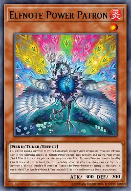 **Power Patron (lateral, Cantante Nivel 1)** — zona declarada: `MONSTER`.
**Mágicas/Trampas/Campo:** sin carta propia demostrada en esta vista.
*Relación ilustrada de cartas presentes tras este paso, documentada en A09. La posición, materiales, otras zonas y rival se leen en la tabla de estado.*

#### Paso 4 — Realizar una Invocación por Sincronía legal con ambos monstruos (1 Cantante Nivel 1 + 1 no Cantante Nivel 6 = 7).

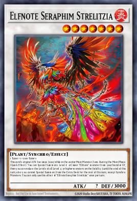 **MATERIAL XYZ** →  **MATERIAL XYZ**

**Acción concreta:** Realizar una Invocación por Sincronía legal con ambos monstruos (1 Cantante Nivel 1 + 1 no Cantante Nivel 6 = 7); enviarlos al GY como materiales e Invocar Strelitzia Nivel 7 desde Extra a la zona central, que queda libre tras usar a Lucina.
**Detalle técnico documentado:** enviarlos al GY como materiales e Invocar Strelitzia Nivel 7 desde Extra a la zona central, que queda libre tras usar a Lucina. Strelitzia Sincronía boca arriba ATK original 3000 por estar en zona central, Lucina y Power Patron ahora en GY; no permanecen como cuerpos independientes.

**Estado por zonas después del paso:**

| Zona/recurso | Estado narrativo A09 |
|---|---|
| Mano | ∅ |
| Monstruos | Strelitzia #22143 (centro, Sincronía Nivel 7; ATK 3000) |
| Mágicas y trampas | ∅ |
| Cementerio | Lucina #22116, Power Patron #22119 (materiales de Sincronía) |
| Destierro propio | ∅ |
| Campo y estado rival | Sin cambios acreditados |
| Materiales Xyz/Fusión/Sincro | Ninguno: Sincronía no tiene materiales Xyz |
| Normal, Extra, fase y restricciones | Normal gastada; Strelitzia salió del Extra |

**Campo visual de este paso:**

**Monstruos propios:**
-  **Strelitzia (centro, Sincronía Nivel 7; ATK 3000)** — zona declarada: `MONSTER`.
**Mágicas/Trampas/Campo:** sin carta propia demostrada en esta vista.
*Relación ilustrada de cartas presentes tras este paso, documentada en A09. La posición, materiales, otras zonas y rival se leen en la tabla de estado.*

#### Paso 5 — En nueva cadena activar el efecto de Power Patron enviado como material de Sincronía, añadiendo 1× Elfnote Regina del Deck a mano (o otra carta «Elfnote» legal).

 **MATERIAL / COSTE** →  **ESTADO / CONTEXTO** →  **ESTADO / CONTEXTO**

**Acción concreta:** En nueva cadena activar el efecto de Power Patron enviado como material de Sincronía, añadiendo 1× Elfnote Regina del Deck a mano (o otra carta «Elfnote» legal).
**Detalle técnico documentado:** Mano: Regina; GY: Lucina+Power Patron; Campo: Strelitzia ATK 3000. Efecto de búsqueda de Power Patron consumido; Normal gastada. No se acreditan Rapsodia, Bienvenidos a Casa ni Fortuna en esta rama.

**Estado por zonas después del paso:**

| Zona/recurso | Estado narrativo A09 |
|---|---|
| Mano | Regina #22523 (buscada; NO Invocada) |
| Monstruos | Strelitzia #22143 (centro, ATK 3000) |
| Mágicas y trampas | ∅ |
| Cementerio | Lucina #22116, Power Patron #22119 |
| Destierro propio | ∅ |
| Campo y estado rival | Sin cambios acreditados |
| Materiales Xyz/Fusión/Sincro | Ninguno |
| Normal, Extra, fase y restricciones | Normal gastada; Strelitzia permanece |

**Campo visual de este paso:**

**Monstruos propios:**
-  **Strelitzia (centro, ATK 3000)** — zona declarada: `MONSTER`.
**Mágicas/Trampas/Campo:** sin carta propia demostrada en esta vista.
*Relación ilustrada de cartas presentes tras este paso, documentada en A09. La posición, materiales, otras zonas y rival se leen en la tabla de estado.*

### Campo final documentado

Esta vista procede **del último paso**, no de una lista de cartas deducida del título.

**Monstruos propios:**
-  **Strelitzia (centro, ATK 3000)** — zona declarada: `MONSTER`.
**Mágicas/Trampas/Campo:** sin carta propia demostrada en esta vista.
*Relación ilustrada de cartas presentes tras este paso, documentada en A09. La posición, materiales, otras zonas y rival se leen en la tabla de estado.*

| Zona/recurso | Estado final documentado |
|---|---|
| Mano | Regina #22523 (buscada; NO Invocada) |
| Monstruos | Strelitzia #22143 (centro, ATK 3000) |
| Mágicas y trampas | ∅ |
| Cementerio | Lucina #22116, Power Patron #22119 |
| Destierro propio | ∅ |
| Campo y estado rival | Sin cambios acreditados |
| Materiales Xyz/Fusión/Sincro | Ninguno |
| Normal, Extra, fase y restricciones | Normal gastada; Strelitzia permanece |

### Si el oponente interrumpe

- **INTERRUPCIÓN A12 — paso 5: A12 — Ash a Power Patron en paso P5 de ELFNOTE:LUCINA:STRELITZIA02**
  - Ventana: Lucina buscó Power Patron en P2; fue Invocado Normalmente en P3 y usado con Lucina como materiales para Sincronizar Strelitzia en P4. Tras esa Invocación, Power Patron en GY activa en nueva Cadena su búsqueda «Elfnote» CL1; Ash rival descarta como CL2 y niega la búsqueda. La Sincronía legal ya se completó y no se deshace; Regina no se añade a la mano.
  - Coste/estado: Power Patron y Lucina ya están en GY por ser materiales; Strelitzia sigue en centro con ATK original 3000 por su efecto mientras permanezca allí; Normal gastada, sin M/T propia creada por esta ruta. No atribuir a Ash negación del efecto continuo de ATK. Fuentes: Power Patron, Strelitzia, Ash..
  - Estado de rama: `Resuelto solo en el escenario que detalla A12/A13; las otras respuestas no están demostradas.`.
- **RECUPERACIÓN A13 — paso 5: A13 — Strelitzia sin Regina en paso P5 de ELFNOTE:LUCINA:STRELITZIA02**
  - Residual: Strelitzia Nivel 7 central (ATK original 3000 mientras conserve esa zona); Lucina y Power Patron en GY; Regina permanece en Deck, mano vacía, Normal gastada, ningún monstruo adicional ni Continuas. Ash rival fue descartada y niega solo la búsqueda posterior de Power Patron, no la Invocación por Sincronía de P4. CAMPO_MINIMO_CONSERVADO_SIN_BUSQUEDA. Un efecto posterior de Strelitzia requiere ventana legal y su objetivo; no se cuenta como recuperación automática.
  - Estado de rama: `Resuelto solo en el escenario que detalla A12/A13; las otras respuestas no están demostradas.`.

---

## ELFNOTE · LUCINA · TINIA · JUNORA03 · `650:A09:ELFNOTE:LUCINA:TINIA:JUNORA03`

**Propósito competitivo principal (lectura documental):** Preparación de recursos / despliegue. El objetivo solo se acredita si las acciones y el campo final detallados en esta guía lo permiten; no implica legalidad certificada ni garantiza el resultado ante respuestas adversarias.

**Categoría:** APERTURA

**Propósito y resultado documental:**

Endboard y alcance: Junora Nivel 10 3100 ATK (3800 DEF) en zona central, protegida de destrucción por efecto mientras Welcome Home continúe boca arriba; Regina recuperada a mano; cuatro monstruos gastados en GY. El Efecto Rápido de Junora referente a columnas exige otros monstruos «Elfnote» controlados: Junora no posee «Elfnote» en su propio nombre, por lo que con este endboard aislado no hay columna bloqueada. Tampoco existe una negación continua de efectos del rival: la de Junora al Sincronizar es una resolución puntual. Vulnerabilidades: Ash a búsqueda de Lucina o Power Patron, negar Strelitzia, sacar a Tinia del GY antes de revivirla, y romper Welcome Home. Ninguna carta fuera del inventario se agrega.

### Mano y estado inicial

Lucina 1 Elfnote Lucina, Nivel 6, y Tinia 1 Elfnote Tinia, Nivel 6. Deck: Power Patron 1 Elfnote Power Patron, Cantante Nivel 1, Regina 1 Elfnote Regina Nivel 6, Welcome Home 1 Elfnotes: Welcome Home. Extra: Strelitzia 1 Seraphim Strelitzia Nivel 7 y Junora 1 Junora Nivel 10. Campo/GY/destierro propios vacíos, zona central y dos laterales libres, Normal disponible, sin respuesta rival ni restricciones anteriores. No usar otras cartas de la mano desconocidas.

 **Elfnote Lucina**
 **Elfnote Tinia**

### Ejecución numerada

#### Paso 1 — Invocar Especialmente Lucina desde mano a la zona central mediante su propio procedimiento. Activar su efecto de Main Phase y añadir Power Patron del Deck a mano.

 **ESPECIAL** →  **ESTADO / CONTEXTO**

**Acción concreta:** Invocar Especialmente Lucina desde mano a la zona central mediante su propio procedimiento. Activar su efecto de Main Phase y añadir Power Patron del Deck a mano.
**Detalle técnico documentado:** Lucina Nivel 6 central; Tinia + Power Patron en mano; Normal disponible.

**Estado por zonas después del paso:**

| Zona/recurso | Estado narrativo A09 |
|---|---|
| Mano | Tinia #22117, Power Patron #22119 (buscado) |
| Monstruos | Lucina #22116 (centro, Nivel 6) |
| Mágicas y trampas | ∅ |
| Cementerio | ∅ |
| Destierro propio | ∅ |
| Campo y estado rival | Sin respuesta; campo no determinado |
| Materiales Xyz/Fusión/Sincro | Ninguno |
| Normal, Extra, fase y restricciones | Normal libre; Extra intacto |

**Campo visual de este paso:**

**Monstruos propios:**
-  **Lucina (centro, Nivel 6)** — zona declarada: `MONSTER`.
**Mágicas/Trampas/Campo:** sin carta propia demostrada en esta vista.
*Relación ilustrada de cartas presentes tras este paso, documentada en A09. La posición, materiales, otras zonas y rival se leen en la tabla de estado.*

#### Paso 2 — Normal Power Patron Nivel 1 en zona lateral libre. Invocar por Sincronía Strelitzia Nivel 7 usando Power Patron Cantante 1 y Lucina no Cantante 6.

 **SINCRONÍA** →  **SINCRONÍA** →  **ESTADO / CONTEXTO**

**Acción concreta:** Normal Power Patron Nivel 1 en zona lateral libre. Invocar por Sincronía Strelitzia Nivel 7 usando Power Patron Cantante 1 y Lucina no Cantante 6; ambos van al GY. Situar Strelitzia en zona central.
**Detalle técnico documentado:** ambos van al GY. Situar Strelitzia en zona central. Strelitzia Nivel 7 / ATK original 3000 central; Lucina y Power Patron GY; Tinia en mano; Normal gastada.

**Estado por zonas después del paso:**

| Zona/recurso | Estado narrativo A09 |
|---|---|
| Mano | Tinia #22117 |
| Monstruos | Strelitzia #22143 (centro, Sincronía Nivel 7, ATK 3000) |
| Mágicas y trampas | ∅ |
| Cementerio | Lucina #22116, Power Patron #22119 (materiales de Sincronía) |
| Destierro propio | ∅ |
| Campo y estado rival | Sin cambios acreditados |
| Materiales Xyz/Fusión/Sincro | Ninguno |
| Normal, Extra, fase y restricciones | Normal gastada; Strelitzia salió del Extra |

**Campo visual de este paso:**

**Monstruos propios:**
-  **Strelitzia (centro, Sincronía Nivel 7, ATK 3000)** — zona declarada: `MONSTER`.
**Mágicas/Trampas/Campo:** sin carta propia demostrada en esta vista.
*Relación ilustrada de cartas presentes tras este paso, documentada en A09. La posición, materiales, otras zonas y rival se leen en la tabla de estado.*

#### Paso 3 — Disparo opcional de Power Patron enviado al GY como material de Sincronía: buscar Regina del Deck a mano (cadena nueva).

 **MATERIAL / COSTE** →  **ESTADO / CONTEXTO** →  **ESTADO / CONTEXTO**

**Acción concreta:** Disparo opcional de Power Patron enviado al GY como material de Sincronía: buscar Regina del Deck a mano (cadena nueva).
**Detalle técnico documentado:** Mano Tinia + Regina; Strelitzia central. No se ha usado la subida de Nivel de Power Patron.

**Estado por zonas después del paso:**

| Zona/recurso | Estado narrativo A09 |
|---|---|
| Mano | Tinia #22117, Regina #22523 (buscada) |
| Monstruos | Strelitzia #22143 (centro) |
| Mágicas y trampas | ∅ |
| Cementerio | Lucina #22116, Power Patron #22119 |
| Destierro propio | ∅ |
| Campo y estado rival | Sin cambios acreditados |
| Materiales Xyz/Fusión/Sincro | Ninguno |
| Normal, Extra, fase y restricciones | Normal gastada; solo Sincronía desde Extra |

**Campo visual de este paso:**

**Monstruos propios:**
-  **Strelitzia (centro)** — zona declarada: `MONSTER`.
**Mágicas/Trampas/Campo:** sin carta propia demostrada en esta vista.
*Relación ilustrada de cartas presentes tras este paso, documentada en A09. La posición, materiales, otras zonas y rival se leen en la tabla de estado.*

#### Paso 4 — Activar el Efecto Rápido de Regina en mano, enviando Tinia desde la mano al GY antes del punto y coma y después Invocando Regina a una zona lateral.

 **ACTIVAR** →  **ENVIAR** →  **ESTADO / CONTEXTO**

**Acción concreta:** Activar el Efecto Rápido de Regina en mano, enviando Tinia desde la mano al GY antes del punto y coma y después Invocando Regina a una zona lateral. No activar su efecto de traer desde Deck: ese dispara solo si llega a zona central.
**Detalle técnico documentado:** No activar su efecto de traer desde Deck: ese dispara solo si llega a zona central. Strelitzia Lv7 central + Regina Lv6 lateral; Tinia en GY; mano vacía.

**Estado por zonas después del paso:**

| Zona/recurso | Estado narrativo A09 |
|---|---|
| Mano | ∅ |
| Monstruos | Strelitzia #22143 (centro, Nivel 7), Regina #22523 (lateral, Nivel 6) |
| Mágicas y trampas | ∅ |
| Cementerio | Lucina #22116, Power Patron #22119, Tinia #22117 (coste desde mano) |
| Destierro propio | ∅ |
| Campo y estado rival | Sin cambios acreditados |
| Materiales Xyz/Fusión/Sincro | Ninguno |
| Normal, Extra, fase y restricciones | Normal gastada; Strelitzia permanece |

**Campo visual de este paso:**

**Monstruos propios:**
-  **Strelitzia (centro, Nivel 7)** — zona declarada: `MONSTER`.
-  **Regina (lateral, Nivel 6)** — zona declarada: `MONSTER`.
**Mágicas/Trampas/Campo:** sin carta propia demostrada en esta vista.
*Relación ilustrada de cartas presentes tras este paso, documentada en A09. La posición, materiales, otras zonas y rival se leen en la tabla de estado.*

#### Paso 5 — Activar Efecto Rápido de Strelitzia en Main Phase: Invocar Especialmente Tinia desde GY a otra zona lateral y elegir reducir en 3 los Niveles de todos los monstruos de Nivel 4 o mayor del Campo hasta End Phase.

 **ACTIVAR** →  **ESPECIAL** →  **ESTADO / CONTEXTO**

**Acción concreta:** Activar Efecto Rápido de Strelitzia en Main Phase: Invocar Especialmente Tinia desde GY a otra zona lateral y elegir reducir en 3 los Niveles de todos los monstruos de Nivel 4 o mayor del Campo hasta End Phase.
**Detalle técnico documentado:** Tres cuerpos: Strelitzia Lv4 central + Regina Lv3 lateral + Tinia Lv3 lateral. Restricción: solo monstruos de Sincronía desde Extra el resto del turno.

**Estado por zonas después del paso:**

| Zona/recurso | Estado narrativo A09 |
|---|---|
| Mano | ∅ |
| Monstruos | Strelitzia #22143 (centro, Nivel 4; Cantante para Junora), Regina #22523 (lateral, Nivel 3), Tinia #22117 (lateral, Nivel 3; revivida) |
| Mágicas y trampas | ∅ |
| Cementerio | Lucina #22116, Power Patron #22119 |
| Destierro propio | ∅ |
| Campo y estado rival | Sin cambios acreditados |
| Materiales Xyz/Fusión/Sincro | Ninguno |
| Normal, Extra, fase y restricciones | Normal gastada; solo Sincronía; niveles reducidos hasta End Phase |

**Campo visual de este paso:**

**Monstruos propios:**
-  **Strelitzia (centro, Nivel 4; Cantante para Junora)** — zona declarada: `MONSTER`.
-  **Regina (lateral, Nivel 3)** — zona declarada: `MONSTER`.
-  **Tinia (lateral, Nivel 3; revivida)** — zona declarada: `MONSTER`.
**Mágicas/Trampas/Campo:** sin carta propia demostrada en esta vista.
*Relación ilustrada de cartas presentes tras este paso, documentada en A09. La posición, materiales, otras zonas y rival se leen en la tabla de estado.*

#### Paso 6 — En una cadena nueva, usar el efecto de Tinia para colocar Welcome Home boca arriba directamente desde Deck en zona M/T.

 **ESTADO / CONTEXTO** →  **COLOCAR**

**Acción concreta:** En una cadena nueva, usar el efecto de Tinia para colocar Welcome Home boca arriba directamente desde Deck en zona M/T. No activar el efecto de Welcome Home que enviaría un monstruo como coste, ya que consumiría un material necesario.
**Detalle técnico documentado:** No activar el efecto de Welcome Home que enviaría un monstruo como coste, ya que consumiría un material necesario. Welcome Home boca arriba; los tres monstruos mantienen los Niveles temporales 4+3+3=10.

**Estado por zonas después del paso:**

| Zona/recurso | Estado narrativo A09 |
|---|---|
| Mano | ∅ |
| Monstruos | Strelitzia #22143 (centro, Nivel 4), Regina #22523 (lateral, Nivel 3), Tinia #22117 (lateral, Nivel 3) |
| Mágicas y trampas | Bienvenidos a Casa #22159 (Continua boca arriba, no activó su segundo efecto) |
| Cementerio | Lucina #22116, Power Patron #22119 |
| Destierro propio | ∅ |
| Campo y estado rival | Sin cambios acreditados |
| Materiales Xyz/Fusión/Sincro | Ninguno |
| Normal, Extra, fase y restricciones | Normal gastada; queda material 4+3+3 |

**Campo visual de este paso:**

**Monstruos propios:**
-  **Strelitzia (centro, Nivel 4)** — zona declarada: `MONSTER`.
-  **Regina (lateral, Nivel 3)** — zona declarada: `MONSTER`.
-  **Tinia (lateral, Nivel 3)** — zona declarada: `MONSTER`.
**Mágicas/Trampas/Campo:**
-  **Bienvenidos a Casa (Continua boca arriba, no activó su segundo efecto)** — zona declarada: `SPELL_TRAP`.
*Relación ilustrada de cartas presentes tras este paso, documentada en A09. La posición, materiales, otras zonas y rival se leen en la tabla de estado.*

#### Paso 7 — Hacer la Invocación por Sincronía de Junora Nivel 10 usando exactamente Strelitzia Nivel 4 en el centro como Cantante por la regla escrita de Junora, y Regina Nivel 3 + Tinia Nivel 3 como los dos no Cantantes.

 **ESTADO / CONTEXTO** →  **ESTADO / CONTEXTO** →  **ESTADO / CONTEXTO**

**Acción concreta:** Hacer la Invocación por Sincronía de Junora Nivel 10 usando exactamente Strelitzia Nivel 4 en el centro como Cantante por la regla escrita de Junora, y Regina Nivel 3 + Tinia Nivel 3 como los dos no Cantantes. Los tres van al GY; Junora ocupa el centro libre.
**Detalle técnico documentado:** Los tres van al GY; Junora ocupa el centro libre. Junora Lv10 ATK 3100 central; Welcome Home boca arriba protege al monstruo central de destrucción por efectos; los tres materiales en GY temporalmente.

**Estado por zonas después del paso:**

| Zona/recurso | Estado narrativo A09 |
|---|---|
| Mano | ∅ |
| Monstruos | Junora #22142 (Sincronía Nivel 10, centro, 3100 ATK) |
| Mágicas y trampas | Bienvenidos a Casa #22159 |
| Cementerio | Lucina #22116, Power Patron #22119, Strelitzia #22143, Regina #22523, Tinia #22117 (materiales de Sincronía) |
| Destierro propio | ∅ |
| Campo y estado rival | Efecto de Junora aún pendiente de cadena y blancos presentes |
| Materiales Xyz/Fusión/Sincro | Ninguno |
| Normal, Extra, fase y restricciones | Normal gastada; Junora salió del Extra |

**Campo visual de este paso:**

**Monstruos propios:**
- 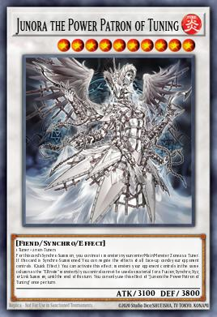 **Junora (Sincronía Nivel 10, centro, 3100 ATK)** — zona declarada: `MONSTER`.
**Mágicas/Trampas/Campo:**
-  **Bienvenidos a Casa** — zona declarada: `SPELL_TRAP`.
*Relación ilustrada de cartas presentes tras este paso, documentada en A09. La posición, materiales, otras zonas y rival se leen en la tabla de estado.*

#### Paso 8 — Tras la Sincronía, resolver los disparos opcionales legales: Junora puede negar los efectos de las cartas rivales boca arriba existentes, y Regina, enviada como material de Sincronía, se añade del GY a la mano por su propio efecto.

 **ESTADO / CONTEXTO** →  **ESTADO / CONTEXTO** →  **ESTADO / CONTEXTO**

**Acción concreta:** Tras la Sincronía, resolver los disparos opcionales legales: Junora puede negar los efectos de las cartas rivales boca arriba existentes, y Regina, enviada como material de Sincronía, se añade del GY a la mano por su propio efecto. No contar negaciones efectivas si el rival no controla cartas boca arriba.
**Detalle técnico documentado:** No contar negaciones efectivas si el rival no controla cartas boca arriba. Campo Junora + Welcome Home; Regina en mano; GY Lucina, Power Patron, Strelitzia y Tinia; Normal gastada.

**Estado por zonas después del paso:**

| Zona/recurso | Estado narrativo A09 |
|---|---|
| Mano | Regina #22523 (recuperada de GY) |
| Monstruos | Junora #22142 (centro, 3100 ATK) |
| Mágicas y trampas | Bienvenidos a Casa #22159 |
| Cementerio | Lucina #22116, Power Patron #22119, Strelitzia #22143, Tinia #22117 |
| Destierro propio | ∅ |
| Campo y estado rival | Si había cartas rivales boca arriba, Junora pudo negar sus efectos en esa resolución; no hay negación continua inventada |
| Materiales Xyz/Fusión/Sincro | Ninguno |
| Normal, Extra, fase y restricciones | Normal gastada; Junora en Campo; sin columnas bloqueadas garantizadas |

**Campo visual de este paso:**

**Monstruos propios:**
-  **Junora (centro, 3100 ATK)** — zona declarada: `MONSTER`.
**Mágicas/Trampas/Campo:**
-  **Bienvenidos a Casa** — zona declarada: `SPELL_TRAP`.
*Relación ilustrada de cartas presentes tras este paso, documentada en A09. La posición, materiales, otras zonas y rival se leen en la tabla de estado.*

### Campo final documentado

Esta vista procede **del último paso**, no de una lista de cartas deducida del título.

**Monstruos propios:**
-  **Junora (centro, 3100 ATK)** — zona declarada: `MONSTER`.
**Mágicas/Trampas/Campo:**
-  **Bienvenidos a Casa** — zona declarada: `SPELL_TRAP`.
*Relación ilustrada de cartas presentes tras este paso, documentada en A09. La posición, materiales, otras zonas y rival se leen en la tabla de estado.*

| Zona/recurso | Estado final documentado |
|---|---|
| Mano | Regina #22523 (recuperada de GY) |
| Monstruos | Junora #22142 (centro, 3100 ATK) |
| Mágicas y trampas | Bienvenidos a Casa #22159 |
| Cementerio | Lucina #22116, Power Patron #22119, Strelitzia #22143, Tinia #22117 |
| Destierro propio | ∅ |
| Campo y estado rival | Si había cartas rivales boca arriba, Junora pudo negar sus efectos en esa resolución; no hay negación continua inventada |
| Materiales Xyz/Fusión/Sincro | Ninguno |
| Normal, Extra, fase y restricciones | Normal gastada; Junora en Campo; sin columnas bloqueadas garantizadas |

### Si el oponente interrumpe

- **INTERRUPCIÓN A12 — paso 3: A12 — Ash a Power Patron en paso P3 de ELFNOTE:LUCINA:TINIA:JUNORA03**
  - Estado previo: apertura Lucina + Tinia, Lucina buscó Power Patron, se gastó la Normal con el Cantante y ya se hizo Strelitzia en P2. P3 es la búsqueda de Regina desde Deck por Power Patron enviado como material de Sincronía, CL1. Ash rival puede descartarse en CL2; al resolver se niega añadir Regina, sin anular Strelitzia, devolver materiales ni alterar la Tinia que sigue en mano.
  - Consecuencia: P4 exige Regina en mano; sin esa búsqueda no se declara su Invocación ni el montaje específico 4+3+3 para Junora. La existencia de otros efectos de Strelitzia no acredita por sí sola un Junora alternativo. Fuentes: Power Patron y Ash..
  - Estado de rama: `Resuelto solo en el escenario que detalla A12/A13; las otras respuestas no están demostradas.`.
- **RECUPERACIÓN A13 — paso 3: A13 — Junora detenido en paso P3 de ELFNOTE:LUCINA:TINIA:JUNORA03**
  - Residual: Strelitzia central ATK 3000; Tinia permanece en mano, Lucina y Power Patron en GY; Normal gastada. Ash negó la búsqueda de Regina en P3. No se envió Tinia al GY como coste de Regina en P4, no se Invocó Regina, no se redujeron Niveles ni se Sincronizó Junora. Welcome Home tampoco fue colocada porque eso ocurre en P6. SIN_JUNORA_DEMOSTRADO; Strelitzia sigue siendo un cuerpo real con efecto propio no gastado, que exigiría otra ficha para una línea diferente.
  - Estado de rama: `Resuelto solo en el escenario que detalla A12/A13; las otras respuestas no están demostradas.`.

---

## ELFNOTE · TINIA · STRELITZIA04 · `650:A09:ELFNOTE:TINIA:STRELITZIA04`

**Propósito competitivo principal (lectura documental):** Ofensivo condicional. El objetivo solo se acredita si las acciones y el campo final detallados en esta guía lo permiten; no implica legalidad certificada ni garantiza el resultado ante respuestas adversarias.

**Categoría:** APERTURA

**Propósito y resultado documental:**

5. Por haber sido usado como material de Sincronía y enviado al GY, Power Patron activa su búsqueda en cadena posterior y añade Regina del Deck a mano, si conserva la carta y el efecto disponible. Final: Strelitzia 3000 ATK central + Welcome Home boca arriba, Regina en mano; Tinia, Lucina y Power Patron en GY; Normal gastada, Extra solo Sincronía. Sin negación automática ni daño garantizado.

### Mano y estado inicial

Tinia (AGUA, Nivel 6) sola en mano; Campo/GY vacíos, zona central y zona lateral libres, Normal disponible, Main Phase propia. Deck tiene Welcome Home, Lucina FUEGO Nivel 6, Power Patron Cantante Nivel 1, Regina (u otro Elfnote legal a buscar); Extra tiene Strelitzia Nivel 7. Ninguna de estas cartas se ha usado este turno; rival no responde. Objetivo: una Sincronía de 3000 protegida contra destrucción por efectos con Welcome Home y una carta buscada en mano. No es el campo Regina + Fortuna de TINIA01.

 **Elfnote Tinia**

### Ejecución numerada

#### Paso 1 — Invocar Especialmente Tinia desde mano a zona central sin usar Normal.

 **ESPECIAL** →  **ACTIVAR**

**Acción concreta:** Invocar Especialmente Tinia desde mano a zona central sin usar Normal. En Main Phase activar Tinia para poner Welcome Home boca arriba desde Deck como Mágica Continua propia.
**Detalle técnico documentado:** En Main Phase activar Tinia para poner Welcome Home boca arriba desde Deck como Mágica Continua propia.

**Estado por zonas después del paso:**

| Zona/recurso | Estado narrativo A09 |
|---|---|
| Mano | ∅ |
| Monstruos | Tinia #22117 (centro, Nivel 6) |
| Mágicas y trampas | Bienvenidos a Casa #22159 (Continua, puesta desde Deck) |
| Cementerio | ∅ |
| Destierro propio | ∅ |
| Campo y estado rival | Sin respuesta; campo no determinado |
| Materiales Xyz/Fusión/Sincro | Ninguno |
| Normal, Extra, fase y restricciones | Normal libre; Extra intacto |

**Campo visual de este paso:**

**Monstruos propios:**
-  **Tinia (centro, Nivel 6)** — zona declarada: `MONSTER`.
**Mágicas/Trampas/Campo:**
-  **Bienvenidos a Casa (Continua, puesta desde Deck)** — zona declarada: `SPELL_TRAP`.
*Relación ilustrada de cartas presentes tras este paso, documentada en A09. La posición, materiales, otras zonas y rival se leen en la tabla de estado.*

#### Paso 2 — Activar Welcome Home, enviar Tinia AGUA del Campo al GY como coste, luego al resolver Invocar Especialmente Lucina FUEGO desde Deck en Defensa en la zona central ahora libre.

 **ACTIVAR** →  **ENVIAR** →  **MATERIAL / COSTE**

**Acción concreta:** Activar Welcome Home, enviar Tinia AGUA del Campo al GY como coste, luego al resolver Invocar Especialmente Lucina FUEGO desde Deck en Defensa en la zona central ahora libre; Atributo original diferente. El resto del turno el Extra solo admite Sincronías.
**Detalle técnico documentado:** Atributo original diferente. El resto del turno el Extra solo admite Sincronías.

**Estado por zonas después del paso:**

| Zona/recurso | Estado narrativo A09 |
|---|---|
| Mano | ∅ |
| Monstruos | Lucina #22116 (centro, Defensa desde Deck) |
| Mágicas y trampas | Bienvenidos a Casa #22159 |
| Cementerio | Tinia #22117 (coste) |
| Destierro propio | ∅ |
| Campo y estado rival | Sin cambios acreditados |
| Materiales Xyz/Fusión/Sincro | Ninguno |
| Normal, Extra, fase y restricciones | Normal libre; Extra solo Sincronía |

**Campo visual de este paso:**

**Monstruos propios:**
-  **Lucina (centro, Defensa desde Deck)** — zona declarada: `MONSTER`.
**Mágicas/Trampas/Campo:**
-  **Bienvenidos a Casa** — zona declarada: `SPELL_TRAP`.
*Relación ilustrada de cartas presentes tras este paso, documentada en A09. La posición, materiales, otras zonas y rival se leen en la tabla de estado.*

#### Paso 3 — En nueva cadena, usar Lucina durante Main Phase para añadir Power Patron Cantante Nivel 1 del Deck a mano; después Invocarlo Normalmente en zona lateral.

 **ESTADO / CONTEXTO**

**Acción concreta:** En nueva cadena, usar Lucina durante Main Phase para añadir Power Patron Cantante Nivel 1 del Deck a mano; después Invocarlo Normalmente en zona lateral. No activar su Efecto Rápido de modificar Nivel.
**Detalle técnico documentado:** No activar su Efecto Rápido de modificar Nivel.

**Estado por zonas después del paso:**

| Zona/recurso | Estado narrativo A09 |
|---|---|
| Mano | ∅ |
| Monstruos | Lucina #22116 (centro, Nivel 6), Power Patron #22119 (lateral, Cantante Nivel 1; Normal) |
| Mágicas y trampas | Bienvenidos a Casa #22159 |
| Cementerio | Tinia #22117 |
| Destierro propio | ∅ |
| Campo y estado rival | Sin cambios acreditados |
| Materiales Xyz/Fusión/Sincro | Ninguno |
| Normal, Extra, fase y restricciones | Normal gastada; Extra solo Sincronía |

**Campo visual de este paso:**

**Monstruos propios:**
-  **Lucina (centro, Nivel 6)** — zona declarada: `MONSTER`.
-  **Power Patron (lateral, Cantante Nivel 1; Normal)** — zona declarada: `MONSTER`.
**Mágicas/Trampas/Campo:**
-  **Bienvenidos a Casa** — zona declarada: `SPELL_TRAP`.
*Relación ilustrada de cartas presentes tras este paso, documentada en A09. La posición, materiales, otras zonas y rival se leen en la tabla de estado.*

#### Paso 4 — Sincronizar Lucina Nivel 6 + Power Patron Cantante Nivel 1 = Strelitzia Nivel 7 y colocarla en la zona principal central.

 **ESTADO / CONTEXTO** →  **ESTADO / CONTEXTO** →  **ESTADO / CONTEXTO**

**Acción concreta:** Sincronizar Lucina Nivel 6 + Power Patron Cantante Nivel 1 = Strelitzia Nivel 7 y colocarla en la zona principal central. Ambos materiales van al GY. Strelitzia tiene ATK original 3000 mientras permanezca central y la Continua Welcome Home la protege de destrucción por efectos.
**Detalle técnico documentado:** Ambos materiales van al GY. Strelitzia tiene ATK original 3000 mientras permanezca central y la Continua Welcome Home la protege de destrucción por efectos.

**Estado por zonas después del paso:**

| Zona/recurso | Estado narrativo A09 |
|---|---|
| Mano | ∅ |
| Monstruos | Strelitzia #22143 (centro, Nivel 7, 3000 ATK, protegida de destrucción por efecto de Bienvenidos) |
| Mágicas y trampas | Bienvenidos a Casa #22159 |
| Cementerio | Tinia #22117, Lucina #22116, Power Patron #22119 (materiales de Sincronía) |
| Destierro propio | ∅ |
| Campo y estado rival | Sin cambios acreditados |
| Materiales Xyz/Fusión/Sincro | Ninguno |
| Normal, Extra, fase y restricciones | Normal gastada; Strelitzia desde Extra |

**Campo visual de este paso:**

**Monstruos propios:**
-  **Strelitzia (centro, Nivel 7, 3000 ATK, protegida de destrucción por efecto de Bienvenidos)** — zona declarada: `MONSTER`.
**Mágicas/Trampas/Campo:**
-  **Bienvenidos a Casa** — zona declarada: `SPELL_TRAP`.
*Relación ilustrada de cartas presentes tras este paso, documentada en A09. La posición, materiales, otras zonas y rival se leen en la tabla de estado.*

#### Paso 5 — Por haber sido usado como material de Sincronía y enviado al GY, Power Patron activa su búsqueda en cadena posterior y añade Regina del Deck a mano, si conserva la carta y el efecto disponible.

 **MATERIAL / COSTE** →  **ESTADO / CONTEXTO** →  **ESTADO / CONTEXTO**

**Acción concreta:** Por haber sido usado como material de Sincronía y enviado al GY, Power Patron activa su búsqueda en cadena posterior y añade Regina del Deck a mano, si conserva la carta y el efecto disponible. Final: Strelitzia 3000 ATK central + Welcome Home boca arriba, Regina en mano; Tinia, Lucina y Power Patron en GY; Normal gastada, Extra solo Sincronía. Sin negación automática ni daño garantizado.
**Detalle técnico documentado:** Final: Strelitzia 3000 ATK central + Welcome Home boca arriba, Regina en mano; Tinia, Lucina y Power Patron en GY; Normal gastada, Extra solo Sincronía. Sin negación automática ni daño garantizado.

**Estado por zonas después del paso:**

| Zona/recurso | Estado narrativo A09 |
|---|---|
| Mano | Regina #22523 (buscada, no Invocada) |
| Monstruos | Strelitzia #22143 (centro, 3000 ATK) |
| Mágicas y trampas | Bienvenidos a Casa #22159 |
| Cementerio | Tinia #22117, Lucina #22116, Power Patron #22119 |
| Destierro propio | ∅ |
| Campo y estado rival | Ninguna negación automática ni daño atribuidos |
| Materiales Xyz/Fusión/Sincro | Ninguno |
| Normal, Extra, fase y restricciones | Normal gastada; Extra solo Sincronía |

**Campo visual de este paso:**

**Monstruos propios:**
-  **Strelitzia (centro, 3000 ATK)** — zona declarada: `MONSTER`.
**Mágicas/Trampas/Campo:**
-  **Bienvenidos a Casa** — zona declarada: `SPELL_TRAP`.
*Relación ilustrada de cartas presentes tras este paso, documentada en A09. La posición, materiales, otras zonas y rival se leen en la tabla de estado.*

### Campo final documentado

Esta vista procede **del último paso**, no de una lista de cartas deducida del título.

**Monstruos propios:**
-  **Strelitzia (centro, 3000 ATK)** — zona declarada: `MONSTER`.
**Mágicas/Trampas/Campo:**
-  **Bienvenidos a Casa** — zona declarada: `SPELL_TRAP`.
*Relación ilustrada de cartas presentes tras este paso, documentada en A09. La posición, materiales, otras zonas y rival se leen en la tabla de estado.*

| Zona/recurso | Estado final documentado |
|---|---|
| Mano | Regina #22523 (buscada, no Invocada) |
| Monstruos | Strelitzia #22143 (centro, 3000 ATK) |
| Mágicas y trampas | Bienvenidos a Casa #22159 |
| Cementerio | Tinia #22117, Lucina #22116, Power Patron #22119 |
| Destierro propio | ∅ |
| Campo y estado rival | Ninguna negación automática ni daño atribuidos |
| Materiales Xyz/Fusión/Sincro | Ninguno |
| Normal, Extra, fase y restricciones | Normal gastada; Extra solo Sincronía |

### Si el oponente interrumpe

- **INTERRUPCIÓN A12 — paso 2: A12 — Ash a Welcome Home en paso P2 de ELFNOTE:TINIA:STRELITZIA04**
  - Estado previo: Tinia fue Invocada Especialmente al centro por procedimiento y colocó Welcome Home boca arriba desde Deck en P1. Poner una Continua en el Campo no permite Ash por sí mismo. En P2, activar el efecto de Welcome Home CL1 enviando Tinia desde el Campo al GY como coste para Invocar Lucina desde Deck. Ash CL2 niega ese efecto de Invocación Especial desde Deck; Tinia permanece en GY, Lucina no sale del Deck y Welcome Home sigue boca arriba si ninguna otra carta la retiró.
  - Límite: Normal sigue libre, pero mano mínima vacía. La restricción a Sincronías «por el resto del turno» incluida en el efecto negado no se atribuye a una resolución que no ocurrió. No dibujar Strelitzia ni Power Patron. Fuentes: Welcome Home y Ash..
  - <!-- A12_AUDITORIA_RUTA_INICIO -->
  - Estado de rama: `Resuelto solo en el escenario que detalla A12/A13; las otras respuestas no están demostradas.`.
- **RECUPERACIÓN A13 — paso 2: A13 — Welcome Home sin Lucina en paso P2 de ELFNOTE:TINIA:STRELITZIA04**
  - Residual: Welcome Home Continua boca arriba en M/T; Tinia en GY por el coste de P2, Lucina y Power Patron en Deck, propio Campo de monstruos vacío y mano inicial vacía; Normal libre. La protección continua de Welcome Home no protege a un monstruo central que no existe; no se ha hecho Sincronía, ni se han enviado materiales a GY, ni se buscó Regina. SIN_CONTINUACION_DEMOSTRADA_CON_MANO_MINIMA. La interrupción de la búsqueda de Power Patron en P5 sería una rama alternativa distinta, no el segundo uso simultáneo de la misma Ash.
  - <!-- A13_AUDITORIA_RUTA_INICIO -->
  - Estado de rama: `Resuelto solo en el escenario que detalla A12/A13; las otras respuestas no están demostradas.`.

---
