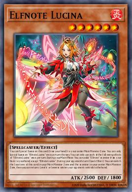
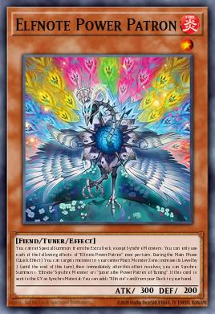
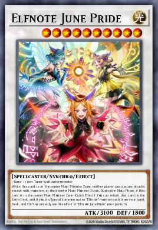
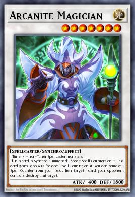
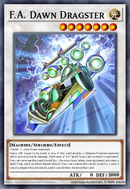

# Elfnote — Lucina + Power Patron: tres salidas Sincro excluyentes

**Rutas A09/A10:** `650:A09:LUCINA:PATRON:JUNE_PRIDE07` · `650:A09:LUCINA:PATRON:ARCANITE08` · `650:A09:LUCINA:PATRON:DAWN_DRAGSTER09`.

**Tipo:** tres **alternativas de una misma apertura**, NO tres combos simultáneos. Objetivos: bloqueo posicional y extensión (June Pride), destrucción puntual (Arcanite), o negación de activación Mágica/Trampa (Dawn Dragster). **Formato:** TCG; todas las piezas figuran en el inventario registrado del ID 650. Las rutas 07, 08 y 09 se describen como líneas condicionadas que necesitan reproducir su secuencia y ventanas de respuesta; la coincidencia de Niveles no basta por sí sola para certificarlas.

## Mano inicial común y requisitos

 **1× Elfnote Lucina** (CID 22116; Nivel 6, Hechicero, no Cantante). En **Deck**, al menos 1×  **Power Patron** (CID 22119; Nivel 1, Demonio/Cantante) y al menos una carta «Elfnote» adicional buscable, por ejemplo **Regina** (CID 22523). En **Extra**, los tres destinos bajo estudio están disponibles:  June Pride 1×,  Arcanite Magician 1× y  Dawn Dragster 1×.

**Estado inicial exacto:** tu Campo, GY y destierro vacíos; zona central y una lateral libres; tu Main Phase; Invocación Normal disponible; rival sin interrupción en la secuencia base. No se presupone más mano, robo, contador ni carta del Side/Reserva. Si el rival tiene cartas, solo se usan como objetivos cuando el efecto correspondiente lo permite.

## Pasos 1–3 compartidos (una sola vez por ruta)

1. **Invocar Especialmente Lucina desde la mano a la zona central.**  **ESPECIAL → CENTRO**. Su procedimiento propio no consume Normal y requiere la zona central libre.
2. **Activar su búsqueda en Main Phase.**  →  **A LA MANO**. Añades 1 Power Patron del Deck; no agregas también Regina mediante el mismo efecto.
3. **Invocar Normalmente Power Patron en zona lateral.**  **NORMAL → LATERAL**. Ahora tienes exactamente dos cuerpos: Lucina **Nivel 6**, Power Patron **Nivel 1 Cantante**. Power Patron restringe las Invocaciones Especiales desde el Extra a **monstruos Sincro** mientras su restricción se aplique; las tres opciones cumplen. Se ha consumido la Normal.

## Bifurcación: elegir exactamente una salida

### Ruta 07 — June Pride (Sincro 10, control de la zona central)

4. **Activar el Efecto Rápido de Power Patron durante Main Phase, seleccionando a Lucina en la zona central.**  →  **NIVEL 6 → NIVEL 9**. El aumento es de **tres niveles** hasta el final del turno. Al resolver, este efecto permite inmediatamente Invocar por Sincronía **un Sincro «Elfnote» o Junora**: June Pride cumple por nombre. No usar una Sincro genérica con el procedimiento inmediato de este efecto.
5. **Sincronizar Nivel 9 + Cantante Nivel 1 = 10 y traer June Pride a la zona central.**  +  →  **SINCRO 10, 3100 ATK**. Ambos materiales van al GY. En nueva cadena, Patron como material Sincro puede buscar una carta «Elfnote» del Deck, por ejemplo **Regina** (en mano, no Invocada).
6. **Campo final A:** June Pride 3100 ATK **central**; Regina en mano; Lucina y Patron en GY; Normal gastada. June Pride limita **las declaraciones de ataque de ambos jugadores** a monstruos que estén en la zona central de cada uno mientras permanezca ahí; **no niega efectos**. Su Efecto Rápido en Main Phase puede devolverla al Extra e Invocar hasta un «Elfnote» de **cada una** de mano, Deck y GY si hay candidatos y zonas; **no se ejecuta automáticamente** en esta línea. Si la devuelves, pierdes su bloqueo posicional.

### Ruta 08 — Arcanite Magician (Sincro 7, remoción de cartas)

4. **No activar el cambio de Nivel de Power Patron.** Mantén Lucina Nivel 6 central y Patron Cantante Nivel 1 lateral.
5. **Invocar por Sincronía a Arcanite Magician.**  (**Hechicero no Cantante, 6**) +  (**Cantante, 1**) →  **SINCRO 7**. Cumple «1 Cantante + 1 o más Hechiceros no Cantantes». Al Invocarse por Sincronía, coloca **2 Contadores de Magia**; su ATK pasa de 400 a **2400** mientras tenga ambos. En cadena posterior, Patron enviado como material permite buscar Regina a mano.
6. **Campo final B:** Arcanite 2400 ATK con 2 Contadores; Regina en mano; materiales en GY y Normal gastada. Durante Main Phase propia, si hay carta rival seleccionable, puedes quitar **1 Contador de Magia del campo**, seleccionar esa carta y **destruirla**. Si gastas un contador del propio Arcanite, quedará con **1400 ATK**; con cero, **400 ATK**. El texto de esta remoción no impone «una vez por turno», pero cada activación exige un contador y objetivo legal. **No es una negación rápida.**

### Ruta 09 — F.A. Dawn Dragster (Sincro 7, respuesta a M/T condicionada)

4. **No activar el cambio de Nivel de Power Patron.** Mantén 6+1.
5. **Invocar por Sincronía a F.A. Dawn Dragster.**  +  →  **SINCRO 7**. Sus materiales son 1 Cantante + 1 o más no Cantantes, sin requisito de Tipo de Lucina. Dawn Dragster gana ATK igual a Nivel ×300: en Nivel 7, **2100 ATK**. Patron enviado al GY por Sincronía permite buscar Regina a mano.
6. **Campo C condicionado a la resolución completa:** Dawn Dragster Nivel 7/2100 ATK y Regina en mano si Patron resuelve; materiales en GY, Normal gastada. Una vez por turno, **cuando el oponente activa una carta Mágica/Trampa o su efecto**, Dawn Dragster podría activar su Efecto Rápido, **reducir su Nivel en 2** y, si lo hace, **negar esa activación y destruir esa carta**. Después quedaría Nivel 5/1500 ATK, salvo cambios externos. **No niega monstruos**. La respuesta exige su ventana concreta y una carta rival elegible; falta reproducirla como prueba de la ruta.

## Elección competitiva y respuestas adversarias

| Salida (solo una) | Mejor escenario | Recurso que sacrifica | Debilidad |
|---|---|---|---|
| June Pride | Ir primero: restringir ataques por ubicación y amenazar despliegue en Main rival | Dos cuerpos y el cambio de nivel de Patron; mantiene al Sincro en centro | Si abandona centro, deja de imponer el bloqueo posicional; la extensión requiere candidatos |
| Arcanite | Ir segundo: retirar hasta dos cartas rivales **si hay objetivos y contadores** | Cada remoción baja su ATK si consume sus propios contadores | Los contadores y el Sincro pueden ser interrumpidos; no niega cadenas |
| Dawn Dragster — **respuesta a M/T por comprobar** | Ir primero: reservar negación de M/T rival en ventana exacta | Baja 2 niveles al negar (de 7 a 5 en base) | Exige cadena de M/T elegible y recursos para Sincro 7; no sumar este campo a las otras rutas |
| Strelitzia (ruta histórica 02) | Tener 3000 ATK central y extensión futura | Misma apertura Lucina + Patron, sin usar su aumento | Cuarta alternativa, no se suma al campo de ninguna ruta 07–09 |

**Interrupciones compartidas:** negar la búsqueda de Lucina deja únicamente a Lucina central y Normal sin gastar; **no hay Patron en mano acreditado**. Destruir o desterrar a Patron antes de sincronizar deja la Normal consumida y bloquea las tres rutas de 6+1/9+1. Negar la búsqueda del Patron desde GY no deshace el Sincro ya Invocado, solo elimina **Regina en mano** del resultado. Si la subida de Nivel de Patron es negada, **no puedes afirmar June Pride 10**; 6+1 podría permitir otra Sincro de Nivel 7 si ambos monstruos siguen disponibles y no hay nueva restricción. No asumir negación de M/T como efecto de Arcanite ni destrucción de monstruos por parte de June Pride.

**Dificultad:** baja-media; **mano:** 1 carta; **costes:** Normal, ambos cuerpos y una plaza del Extra. **Utilidad comparada:** situacional, no porcentaje de victoria. La misma copia de Lucina inicia las cuatro opciones, por lo que **no son cuatro campos finales acumulables** ni una justificación automática para cambiar copias. Ninguna de las tres alternativas sustituye la validación de requisitos de invocación, efectos de materiales y ventanas de cadena.

## Cotejo en textos primarios Konami

- [Lucina, CID 22116](https://www.db.yugioh-card.com/yugiohdb/card_search.action?cid=22116&ope=2&request_locale=en): invocación central y búsqueda.
- [Power Patron, CID 22119](https://www.db.yugioh-card.com/yugiohdb/card_search.action?cid=22119&ope=2&request_locale=en): Cantante Nivel 1, bloqueo a Sincro, aumento +3, Sincronía inmediata limitada a destinos designados y búsqueda si es material.
- [June Pride, CID 22984](https://www.db.yugioh-card.com/yugiohdb/card_search.action?cid=22984&ope=2&request_locale=en): Sincro 10, requisito Hechicero, bloqueo de ataque y Quick de retorno.
- [Arcanite Magician, CID 8038](https://www.db.yugioh-card.com/yugiohdb/card_search.action?cid=8038&ope=2&request_locale=en): requisito Hechicero no Cantante, 2 contadores y destrucción al gastarlos.
- [F.A. Dawn Dragster, CID 13710](https://www.db.yugioh-card.com/yugiohdb/card_search.action?cid=13710&ope=2&request_locale=en): requisitos genéricos Sincro 7, ATK según Nivel y negación específica de M/T.

**Estado:** tres rutas de apertura documentadas como **alternativas excluyentes** (June Pride, Arcanite y Dawn Dragster). Requieren pruebas de cadena; no certifican la lista completa ni cambian el inventario.

<!-- GUIA_COMPARTIDA_INTEGRADA_DECK_650_LUCINA_PATRON_TRES_SINCRONIAS_ALTERNATIVAS_GUIA -->
### Contenido complementario conservado de la gu?a compartida

> # Elfnote — Lucina + Power Patron: tres salidas Sincro excluyentes
>
> **Rutas A09/A10:** `650:A09:LUCINA:PATRON:JUNE_PRIDE07` · `650:A09:LUCINA:PATRON:ARCANITE08` · `650:A09:LUCINA:PATRON:DAWN_DRAGSTER09`.
>
> **Tipo:** tres **alternativas de una misma apertura**, NO tres combos simultáneos. Objetivos: bloqueo posicional y extensión (June Pride), destrucción puntual (Arcanite), o negación de activación Mágica/Trampa (Dawn Dragster). **Formato:** TCG; todas las piezas figuran en el inventario registrado del ID 650, pero **F.A. Dawn Dragster está PROHIBIDA en TCG Advanced (19/10/2026)**. Por tanto la ruta 09 es **HISTÓRICA / NO EJECUTABLE EN TCG ADVANCED**, aunque sus materiales y efecto se expliquen; las otras dos rutas no heredan automáticamente esa ilegalidad.
>
> ## Mano inicial común y requisitos
>
>  **1× Elfnote Lucina** (CID 22116; Nivel 6, Hechicero, no Cantante). En **Deck**, al menos 1×  **Power Patron** (CID 22119; Nivel 1, Demonio/Cantante) y al menos una carta «Elfnote» adicional buscable, por ejemplo **Regina** (CID 22523). En **Extra**, los tres destinos bajo estudio están disponibles:  June Pride 1×,  Arcanite Magician 1× y  Dawn Dragster 1×.
>
> **Estado inicial exacto:** tu Campo, GY y destierro vacíos; zona central y una lateral libres; tu Main Phase; Invocación Normal disponible; rival sin interrupción en la secuencia base. No se presupone más mano, robo, contador ni carta del Side/Reserva. Si el rival tiene cartas, solo se usan como objetivos cuando el efecto correspondiente lo permite.
>
> ## Pasos 1–3 compartidos (una sola vez por ruta)
>
> 1. **Invocar Especialmente Lucina desde la mano a la zona central.**  **ESPECIAL → CENTRO**. Su procedimiento propio no consume Normal y requiere la zona central libre.
> 2. **Activar su búsqueda en Main Phase.**  →  **A LA MANO**. Añades 1 Power Patron del Deck; no agregas también Regina mediante el mismo efecto.
> 3. **Invocar Normalmente Power Patron en zona lateral.**  **NORMAL → LATERAL**. Ahora tienes exactamente dos cuerpos: Lucina **Nivel 6**, Power Patron **Nivel 1 Cantante**. Power Patron restringe las Invocaciones Especiales desde el Extra a **monstruos Sincro** mientras su restricción se aplique; las tres opciones cumplen. Se ha consumido la Normal.
>
> ## Bifurcación: elegir exactamente una salida
>
> ### Ruta 07 — June Pride (Sincro 10, control de la zona central)
>
> 4. **Activar el Efecto Rápido de Power Patron durante Main Phase, seleccionando a Lucina en la zona central.**  →  **NIVEL 6 → NIVEL 9**. El aumento es de **tres niveles** hasta el final del turno. Al resolver, este efecto permite inmediatamente Invocar por Sincronía **un Sincro «Elfnote» o Junora**: June Pride cumple por nombre. No usar una Sincro genérica con el procedimiento inmediato de este efecto.
> 5. **Sincronizar Nivel 9 + Cantante Nivel 1 = 10 y traer June Pride a la zona central.**  +  →  **SINCRO 10, 3100 ATK**. Ambos materiales van al GY. En nueva cadena, Patron como material Sincro puede buscar una carta «Elfnote» del Deck, por ejemplo **Regina** (en mano, no Invocada).
> 6. **Campo final A:** June Pride 3100 ATK **central**; Regina en mano; Lucina y Patron en GY; Normal gastada. June Pride limita **las declaraciones de ataque de ambos jugadores** a monstruos que estén en la zona central de cada uno mientras permanezca ahí; **no niega efectos**. Su Efecto Rápido en Main Phase puede devolverla al Extra e Invocar hasta un «Elfnote» de **cada una** de mano, Deck y GY si hay candidatos y zonas; **no se ejecuta automáticamente** en esta línea. Si la devuelves, pierdes su bloqueo posicional.
>
> ### Ruta 08 — Arcanite Magician (Sincro 7, remoción de cartas)
>
> 4. **No activar el cambio de Nivel de Power Patron.** Mantén Lucina Nivel 6 central y Patron Cantante Nivel 1 lateral.
> 5. **Invocar por Sincronía a Arcanite Magician.**  (**Hechicero no Cantante, 6**) +  (**Cantante, 1**) →  **SINCRO 7**. Cumple «1 Cantante + 1 o más Hechiceros no Cantantes». Al Invocarse por Sincronía, coloca **2 Contadores de Magia**; su ATK pasa de 400 a **2400** mientras tenga ambos. En cadena posterior, Patron enviado como material permite buscar Regina a mano.
> 6. **Campo final B:** Arcanite 2400 ATK con 2 Contadores; Regina en mano; materiales en GY y Normal gastada. Durante Main Phase propia, si hay carta rival seleccionable, puedes quitar **1 Contador de Magia del campo**, seleccionar esa carta y **destruirla**. Si gastas un contador del propio Arcanite, quedará con **1400 ATK**; con cero, **400 ATK**. El texto de esta remoción no impone «una vez por turno», pero cada activación exige un contador y objetivo legal. **No es una negación rápida.**
>
> ### Ruta 09 — F.A. Dawn Dragster (Sincro 7, NEGACIÓN HISTÓRICA; PROHIBIDA TCG)
>
> 4. **No activar el cambio de Nivel de Power Patron.** Mantén 6+1.
> 5. **Invocar por Sincronía a F.A. Dawn Dragster.**  +  →  **SINCRO 7**. Sus materiales son 1 Cantante + 1 o más no Cantantes, sin requisito de Tipo de Lucina. Dawn Dragster gana ATK igual a Nivel ×300: en Nivel 7, **2100 ATK**. Patron enviado al GY por Sincronía permite buscar Regina a mano.
> 6. **Campo hipotético C, no permitido en TCG Advanced:** Dawn Dragster Nivel 7/2100 ATK y Regina en mano; materiales en GY, Normal gastada. Una vez por turno, **cuando el oponente activa una carta Mágica/Trampa o su efecto**, Dawn Dragster podría activar su Efecto Rápido, **reducir su Nivel en 2** y, si lo hace, **negar esa activación y destruir esa carta**. Después quedaría Nivel 5/1500 ATK, salvo cambios externos. **No niega monstruos**. Este escenario **no se debe enseñar como jugada legal para el formato elegido** hasta que una banlist aplicable permita la carta.
>
> ## Elección competitiva y respuestas adversarias
>
> | Salida (solo una) | Mejor escenario | Recurso que sacrifica | Debilidad |
> |---|---|---|---|
> | June Pride | Ir primero: restringir ataques por ubicación y amenazar despliegue en Main rival | Dos cuerpos y el cambio de nivel de Patron; mantiene al Sincro en centro | Si abandona centro, deja de imponer el bloqueo posicional; la extensión requiere candidatos |
> | Arcanite | Ir segundo: retirar hasta dos cartas rivales **si hay objetivos y contadores** | Cada remoción baja su ATK si consume sus propios contadores | Los contadores y el Sincro pueden ser interrumpidos; no niega cadenas |
> | Dawn Dragster — **PROHIBIDA TCG** | Solo como análisis histórico/alternativo fuera de TCG Advanced | Baja 2 niveles al negar (de 7 a 5 en base) | NO se puede incluir ni utilizar en Main/Extra/Side TCG Advanced actual |
> | Strelitzia (ruta histórica 02) | Tener 3000 ATK central y extensión futura | Misma apertura Lucina + Patron, sin usar su aumento | Cuarta alternativa, no se suma al campo de ninguna ruta 07–09 |
>
> **Interrupciones compartidas:** negar la búsqueda de Lucina deja únicamente a Lucina central y Normal sin gastar; **no hay Patron en mano acreditado**. Destruir o desterrar a Patron antes de sincronizar deja la Normal consumida y bloquea las tres rutas de 6+1/9+1. Negar la búsqueda del Patron desde GY no deshace el Sincro ya Invocado, solo elimina **Regina en mano** del resultado. Si la subida de Nivel de Patron es negada, **no puedes afirmar June Pride 10**; 6+1 podría permitir otra Sincro de Nivel 7 si ambos monstruos siguen disponibles y no hay nueva restricción. No asumir negación de M/T como efecto de Arcanite ni destrucción de monstruos por parte de June Pride.
>
> **Dificultad:** baja-media; **mano:** 1 carta; **costes:** Normal, ambos cuerpos y una plaza del Extra. **Utilidad comparada:** situacional, no porcentaje de victoria. La misma copia de Lucina inicia las cuatro opciones, por lo que **no son cuatro campos finales acumulables** ni una justificación automática para cambiar copias. En TCG Advanced actual solo June Pride y Arcanite, entre estas tres nuevas, son candidatos de ejecución legal; Dawn se marca explícitamente **NO_EJECUTABLE_TCG**.
>
> ## Cotejo en textos primarios Konami
>
> - [Lucina, CID 22116](https://www.db.yugioh-card.com/yugiohdb/card_search.action?cid=22116&ope=2&request_locale=en): invocación central y búsqueda.
> - [Power Patron, CID 22119](https://www.db.yugioh-card.com/yugiohdb/card_search.action?cid=22119&ope=2&request_locale=en): Cantante Nivel 1, bloqueo a Sincro, aumento +3, Sincronía inmediata limitada a destinos designados y búsqueda si es material.
> - [June Pride, CID 22984](https://www.db.yugioh-card.com/yugiohdb/card_search.action?cid=22984&ope=2&request_locale=en): Sincro 10, requisito Hechicero, bloqueo de ataque y Quick de retorno.
> - [Arcanite Magician, CID 8038](https://www.db.yugioh-card.com/yugiohdb/card_search.action?cid=8038&ope=2&request_locale=en): requisito Hechicero no Cantante, 2 contadores y destrucción al gastarlos.
> - [F.A. Dawn Dragster, CID 13710](https://www.db.yugioh-card.com/yugiohdb/card_search.action?cid=13710&ope=2&request_locale=en): requisitos genéricos Sincro 7, ATK según Nivel y negación específica de M/T.
> - [Konami — Lista Forbidden & Limited TCG Advanced efectiva 19/10/2026](https://www.yugioh-card.com/en/limited/list_2026-10-19/): **F.A. Dawn Dragster = Forbidden**.
>
> **Estado:** dos rutas de apertura acotadas para **revisión TCG** (June Pride, Arcanite) y una tercera **mecánicamente descrita pero prohibida/no ejecutable** (Dawn Dragster). Requieren pruebas de cadena; no certifican la lista completa ni cambian el inventario.
