# DoomZ

## APARTADO_01 — Perfil A01 importable 653

- **Arquetipo:** DoomZ / Modelo de Poder
- **Tipo de estrategia:** Combo Xyz con control mediante Equipos
- **Estilo breve:** Destruye recursos DoomZ para buscar o colocar soporte, equipa monstruos y conviértelos en Xyz Máquina VIENTO; Drastrius controla y Júpiter presiona.
- **Resumen para ficha:** Incursores, Amalthe y Elara convierten destrucciones en búsquedas y Equipos. Drastea equipada accede a Drastrius; Medius abre alternativas con Diactorus o Júpiter.
- **Cómo se juega:** Primero: Drastrius con una respuesta. Activa Incursores para destruir Elara por efecto e Invocar Drastea del Deck. En una cadena nueva, Elara Coloca Mando; actívalo como Mágica de Equipo sobre Drastea. Con Drastea equipada, activa su Efecto Rápido: Invoca Drastrius, Xyz Máquina VIENTO de Rango 8, acoplando Drastea y Mando. No necesitas tres monstruos de Nivel 8. Drastrius (2700 ATK) con Drastea y Mando como materiales; Incursores boca arriba, Elara en Cementerio y Normal libre. Una vez por turno, desacopla 1 para negar un efecto de monstruo rival activado en Campo o Cementerio; puede equipar después un monstruo rival boca arriba. Segundo: elegir cómo romper el campo. Completa la apertura hacia Drastrius solo si Incursores y Elara pueden resolver. Si Drastrius puede combatir y se cumple el procedimiento de ZEUS, valora sobreponerlo tras la batalla. Desacopla dos materiales de ZEUS únicamente cuando limpiar las otras cartas del Campo compense perder también recursos propios. ZEUS con materiales para limpieza condicional, o Drastrius conservado si la batalla o la limpieza no convienen. Juego medio: reciclar Equipos y destrucción. Si eliges Drastrius, Invoca Normalmente Elara y usa su disparo para Colocar Destrucción DoomZ desde el Deck. Desde mano, activa Drastea sobre Elara; destrúyela, Invoca Drastea y equipa Adrasteia del Deck si sigue disponible. Elara ya usó su efecto de colocar soporte este turno. Activa el Efecto Rápido de Drastea equipada para Invocar Drastrius con los dos materiales. Para Diactorus, elige en cambio la línea documentada que reserva el disparo de Elara hasta su destrucción. Drastrius de Rango 8 y Destrucción DoomZ Colocada; Diactorus es una ruta diferente. La Trampa requiere una ventana legal antes de poder aplicarse. Juego tardío: presión de Júpiter. Invoca Normalmente Medius y usa su efecto para Invocar Jupredo desde el Deck. Destierra las tres cartas superiores boca abajo para activar el efecto de monstruo de Jupredo. Destrúyelo al resolver para Invocar Júpiter; en la mano mínima no queda carta adicional que acoplar. Cuando Jupredo llegue boca arriba al Extra, usa su búsqueda opcional de Magia/Trampa DoomZ o Modelo de Poder si queda un objetivo. Júpiter de 3500 ATK y Medius en Campo; no hay material que desacoplar de Júpiter en esta apertura.
- **Qué vigilar:** Respeta los límites de cada efecto de Elara y Amalthe, la restricción Xyz de Incursores y los materiales de Drastrius. Júpiter puede entrar sin materiales.

**Procedencia:** paquete estructurado de esta identidad con inventario vivo validado en solo lectura; ninguna importación de producción se atribuye a este cambio.

<!-- A01_PLAYER_STRATEGY_V2_START -->
### Plan práctico de juego

#### Primero: Drastrius con una respuesta

**Objetivo:** Construir una interacción de monstruo sin gastar la Normal si la mano lo permite.

**Situación:** Incursores DoomZ y Elara en mano; Drastea y Mando en Deck; Drastrius en Extra.

**Cartas:** Incursores DoomZ, DoomZ VII Siete - Elara, DoomZ XII Cero - Drastea, Mando DoomZ «D.O.O.M.D.U.R.G.», DoomZ XII Fin - Drastrius

1. Activa Incursores para destruir Elara por efecto e Invocar Drastea del Deck.
2. En una cadena nueva, Elara Coloca Mando; actívalo como Mágica de Equipo sobre Drastea.
3. Con Drastea equipada, activa su Efecto Rápido: Invoca Drastrius, Xyz Máquina VIENTO de Rango 8, acoplando Drastea y Mando. No necesitas tres monstruos de Nivel 8.

**Resultado esperado:** Drastrius (2700 ATK) con Drastea y Mando como materiales; Incursores boca arriba, Elara en Cementerio y Normal libre. Una vez por turno, desacopla 1 para negar un efecto de monstruo rival activado en Campo o Cementerio; puede equipar después un monstruo rival boca arriba.

**Recursos que conservar:** Un material para la interacción de Drastrius y la Normal si todavía está libre.

**Alternativa:** Con Incursores y Amalthe, busca Elara tras destruir Amalthe y gasta la Normal para colocar Mando.

#### Segundo: elegir cómo romper el campo

**Objetivo:** Retirar una amenaza antes de comprometer los materiales restantes.

**Situación:** El rival controla monstruos o cartas que siguen siendo vulnerables; dispones de una apertura hacia Drastrius y, si procede, de la Battle Phase.

**Cartas:** DoomZ XII Fin - Drastrius, Divino Arsenal AA-ZEUS - Trueno del Cielo, Incursores DoomZ, DoomZ VII Siete - Elara

1. Completa la apertura hacia Drastrius solo si Incursores y Elara pueden resolver.
2. Si Drastrius puede combatir y se cumple el procedimiento de ZEUS, valora sobreponerlo tras la batalla.
3. Desacopla dos materiales de ZEUS únicamente cuando limpiar las otras cartas del Campo compense perder también recursos propios.

**Resultado esperado:** ZEUS con materiales para limpieza condicional, o Drastrius conservado si la batalla o la limpieza no convienen.

**Recursos que conservar:** Materiales Xyz, Incursores y cartas de mano que no sea necesario gastar.

**Alternativa:** Si el ataque no es posible, conserva Drastrius y su respuesta a monstruos en lugar de anunciar ZEUS.

#### Juego medio: reciclar Equipos y destrucción

**Objetivo:** Convertir una destrucción propia en otra amenaza sin perder la posibilidad de interacción.

**Situación:** Elara y Drastea disponibles; existe Adrasteia o Mando en el Deck y una zona de Magias/Trampas utilizable.

**Cartas:** DoomZ VII Siete - Elara, DoomZ XII Cero - Drastea, Mando DoomZ «A.D.R.A.S.T.E.I.A.», Destrucción DoomZ, Fractura DoomZ - Diactorus

1. Si eliges Drastrius, Invoca Normalmente Elara y usa su disparo para Colocar Destrucción DoomZ desde el Deck.
2. Desde mano, activa Drastea sobre Elara; destrúyela, Invoca Drastea y equipa Adrasteia del Deck si sigue disponible. Elara ya usó su efecto de colocar soporte este turno.
3. Activa el Efecto Rápido de Drastea equipada para Invocar Drastrius con los dos materiales. Para Diactorus, elige en cambio la línea documentada que reserva el disparo de Elara hasta su destrucción.

**Resultado esperado:** Drastrius de Rango 8 y Destrucción DoomZ Colocada; Diactorus es una ruta diferente. La Trampa requiere una ventana legal antes de poder aplicarse.

**Recursos que conservar:** Una carta DoomZ para destruir, un Equipo utilizable y materiales del siguiente Xyz.

**Alternativa:** Si no quedan Equipos válidos, evita gastar Drastea esperando una Xyz que no se puede completar.

#### Juego tardío: presión de Júpiter

**Objetivo:** Cambiar a una amenaza de 3500 ATK cuando el motor de Equipos no está disponible.

**Situación:** Medius en mano, Jupredo (alias Zegredo en la lista) en Deck, Júpiter en Extra y al menos tres cartas para desterrar boca abajo.

**Cartas:** Medius el Puro, Modelo de Poder Máquina de Sombras Zegredo, Júpiter el Modelo de Poder de Destrucción, DoomZ XII Fin - Drastrius

1. Invoca Normalmente Medius y usa su efecto para Invocar Jupredo desde el Deck.
2. Destierra las tres cartas superiores boca abajo para activar el efecto de monstruo de Jupredo. Destrúyelo al resolver para Invocar Júpiter; en la mano mínima no queda carta adicional que acoplar.
3. Cuando Jupredo llegue boca arriba al Extra, usa su búsqueda opcional de Magia/Trampa DoomZ o Modelo de Poder si queda un objetivo.

**Resultado esperado:** Júpiter de 3500 ATK y Medius en Campo; no hay material que desacoplar de Júpiter en esta apertura.

**Recursos que conservar:** Piezas DoomZ que aún estén en Deck, y acceso a Drastrius para un turno posterior.

**Alternativa:** Si quedan pocas cartas esenciales o el coste es demasiado arriesgado, usa la salida documentada de Medius con Modelo de Poder hacia Drastrius.

#### Mano débil: abrir con Cambio o Medius

**Objetivo:** Identificar una salida real aunque no se hayan robado Incursores y Elara juntos.

**Situación:** La mano contiene Cambio DoomZ o Medius; comprueba las piezas todavía presentes en el Deck.

**Cartas:** Cambio DoomZ, Medius el Puro, DoomZ Modelo de Poder, DoomZ VII Siete - Elara, Fractura DoomZ - Diactorus, DoomZ XII Fin - Drastrius

1. Con Cambio, destruye Modelo de Poder desde el Deck y usa su búsqueda posterior para conseguir Elara.
2. Invoca Elara, coloca y activa Mando, y sigue su acceso a Diactorus si sus condiciones se cumplen.
3. Con Medius en lugar de Cambio, Invoca Modelo de Poder del Deck y utiliza su acceso alternativo a Diactorus.

**Resultado esperado:** Un puente Xyz hacia Drastrius en las aperturas documentadas, no un campo garantizado si falta una pieza.

**Recursos que conservar:** La Normal hasta saber qué iniciador se usará y las copias de Equipo que exigen las rutas.

**Alternativa:** Si no está Modelo de Poder en Deck, cambia a la línea de Incursores con Amalthe solo cuando ambas estén disponibles.

#### Interrupción: distinguir destrucción y búsqueda

**Objetivo:** Conservar una apertura alternativa si el rival corta el primer efecto.

**Situación:** El rival puede negar Incursores, Medius o la colocación de Elara; revisa qué llegó a resolverse.

**Cartas:** Incursores DoomZ, DoomZ V Cinco - Amalthe, DoomZ VII Siete - Elara, Cambio DoomZ, Medius el Puro

1. Si Incursores no resolvió su destrucción, Elara o Amalthe no obtienen un disparo por esa destrucción inexistente.
2. Comprueba si Cambio sigue en mano y si queda un objetivo en Deck; úsalo como apertura distinta solo si todavía es legal.
3. Si la búsqueda de Elara se perdió, conserva la Normal y valora Medius si está disponible y no hay restricción incompatible.

**Resultado esperado:** La continuación depende de las cartas realmente conservadas; si no hay segundo iniciador, termina sin consumir más recursos.

**Recursos que conservar:** La carta que sobreviva a la negación y cualquier iniciador independiente no utilizado.

**Alternativa:** Si ninguna apertura puede resolver, conserva las respuestas defensivas y espera un turno en vez de gastar los Equipos sin objetivo.

#### Ganar: alternar control y daño

**Objetivo:** Usar las interacciones para abrir una Battle Phase favorable y cerrar con daño comprobable.

**Situación:** Drastrius ya tiene materiales o se puede acceder a Júpiter; conoces los monstruos y LP rivales.

**Cartas:** DoomZ XII Fin - Drastrius, Júpiter el Modelo de Poder de Destrucción, Divino Arsenal AA-ZEUS - Trueno del Cielo, DoomZ V Cinco - Amalthe, DoomZ VII Siete - Elara

1. Con Drastrius, guarda la negación para una activación rival elegible que impida tu desarrollo o combate.
2. Cuando sea tu turno, compara la suma de ataques disponibles con las defensas y LP del rival.
3. Elige Júpiter como presión si su acceso es legal; reserva ZEUS para limpiar un campo que no puedas superar atacando.

**Resultado esperado:** Ventaja por interacción y daño efectivo; 2700 o 3500 ATK por sí solos no equivalen a daño letal.

**Recursos que conservar:** Material de interacción y un iniciador para reconstruir si el ataque no termina la partida.

**Alternativa:** Si no puedes ganar este turno, prioriza conservar Drastrius o una salida de recuperación sobre atacar sin protección.

#### Errores: costes, Equipos y restricciones

**Objetivo:** Evitar perder una búsqueda o construir una Xyz ilegal por confundir operaciones.

**Situación:** Estás decidiendo una ruta con Incursores, Drastea, Mando o Destrucción DoomZ.

**Cartas:** Incursores DoomZ, DoomZ XII Cero - Drastea, Mando DoomZ «D.O.O.M.D.U.R.G.», Destrucción DoomZ, DoomZ XII Fin - Drastrius

1. Distingue destruir por efecto de pagar un coste: los disparos de Elara y Amalthe necesitan su evento correspondiente.
2. Después de colocar Mando, actívalo y equipa un objetivo válido antes de usar el procedimiento que lo convierte en material.
3. Tras resolver el efecto pertinente de Incursores, respeta el límite a Xyz desde Extra; comprueba los materiales de Drastrius antes de negar.

**Resultado esperado:** Las cartas terminan en sus zonas reales y las interacciones se emplean únicamente en la ventana correcta.

**Recursos que conservar:** El Equipo que exige la Xyz y al menos un material para Drastrius si planeas responder.

**Alternativa:** Si no cumples el requisito de Equipo, conserva el monstruo o busca una apertura alternativa desde Cambio.

<!-- A01_PLAYER_STRATEGY_V2_END -->

## APARTADO_02 — Continuidad del contenido anterior

> **Alcance editorial de todas las cartas y guías de este deck:** Las fichas son interpretaciones tácticas: costes, objetivos, ventanas y límites deben cotejarse con el texto oficial antes de acreditar una secuencia A09. Las guías explican funciones derivadas; no certifican nuevas invocaciones ni cadenas.

## IDENTIDAD BÁSICA

- `deck_id`: **653**
- Nombre registrado: **DoomZ**
- Formato: **tcg_advanced**
- Main: **40**; Extra: **15**; Side: **9**; Reserva: **0**.

## APARTADO_01 — Diagnóstico trazable del deck DoomZ (653)

**Verificación de inventario:** ID 653, TCG Advanced. Main 40, Extra 15, Side 9, Reserva 0, 37 identidades documentadas; sin completar zonas artificialmente ni consultar banlist.

### A01-T1 — Identidad, motores, condiciones y plan del juego

- **Arquetipo:** DoomZ, con sus piezas de Modelo de Poder y Equipos registrados.
- **Tipo/estilo:** preparación de materiales y salidas Xyz condicionadas.; desarrollo por efectos encadenados y aprovechamiento de recursos que se equipan, destruyen o recuperan.
- **Motor y plan en la fuente curada:** Incursores y las piezas DoomZ dan acceso al motor; Amalthe y Elara ayudan a construir el campo. Drastrius y Júpiter representan salidas diferentes y deben cumplir procedimientos propios.
- **Riesgos y restricciones prioritarios:** niveles/materiales, bloqueos del Extra y consumo de Equipos. Enviar una carta no es lo mismo que destruirla.
- **Condición de victoria, siempre condicional:** convertir acceso legal a las piezas y al Extra en ventaja, control o daño real. Ninguna línea, campo o victoria se presupone sin comprobar condiciones, materiales, costes y recursos. La matriz A01-T3 vincula este diagnóstico con todos los CID de la lista.
- **Límite de la prueba:** los textos conservan las paráfrasis de la fuente. T1 acredita el diagnóstico del deck, no certifica todos los efectos A05/A07, combos A09 ni reglas ejecutables.

### A01-T2 — Seis campos propuestos (no certificados en ZIP)

- **Arquetipo:** DoomZ, con sus piezas de Modelo de Poder y Equipos registrados.
- **Tipo de estrategia:** preparación de materiales y salidas Xyz condicionadas.
- **Estilo breve:** desarrollo por efectos encadenados y aprovechamiento de recursos que se equipan, destruyen o recuperan.
- **Resumen para ficha:** Incursores y las piezas DoomZ dan acceso al motor; Amalthe y Elara ayudan a construir el campo. Drastrius y Júpiter representan salidas diferentes y deben cumplir procedimientos propios.
- **Cómo se juega:** Incursores y las piezas DoomZ dan acceso al motor; Amalthe y Elara ayudan a construir el campo. Drastrius y Júpiter representan salidas diferentes y deben cumplir procedimientos propios.
- **Qué vigilar:** niveles/materiales, bloqueos del Extra y consumo de Equipos. Enviar una carta no es lo mismo que destruirla.

**Límites verificados:** Estilo breve 103/190; Resumen para ficha 186/250. T2 sigue pendiente de correspondencia literal con `record.profile` nativo.

### A01-T3 — Censo de propósito, CID, zona y limitaciones (37 identidades)

| CID de referencia | Carta | Zona/cantidad | Función en el deck | Efecto para cotejo A05/A07 | Ventana indicada | Riesgo/restricción |
|---|---|---|---|---|---|---|
| [21419](https://www.db.yugioh-card.com/yugiohdb/card_search.action?cid=21419&ope=2) | Medius el Puro | Main 1x. No altera las cantidades registradas. | searcher · buscador · extensor · recuperación. | búsqueda o incorporación de cartas a mano; extensión mediante monstruos procedentes del Deck; recuperación e invocación desde Cementerio/destierro; retorno o reciclaje hacia mano/Deck/Extra. Son operaciones detectadas en el texto, no efecto | al producirse una Invocación; al llegar o estar en el Cementerio. | hay límite por turno según el efecto concreto; depende de recursos en Cementerio. |
| [21824](https://www.db.yugioh-card.com/yugiohdb/card_search.action?cid=21824&ope=2) | Mando DoomZ «D.O.O.M.D.U.R.G.» | Main 2x. No altera las cantidades registradas. | interrupción · removal · cierre · motor Equipo. | destrucción de cartas o empleo de destrucción como detonante; presión de combate o modificación de estadísticas; uso o producción de cartas equipadas. Son operaciones detectadas en el texto, no efectos independientes garantizados; leer sus  | Standby Phase; Efecto Rápido. | hay límite por turno según el efecto concreto. |
| [21777](https://www.db.yugioh-card.com/yugiohdb/card_search.action?cid=21777&ope=2) | DoomZ Modelo de Poder | Main 2x. No altera las cantidades registradas. | searcher · buscador · removal · respuesta · motor Equipo. | búsqueda o incorporación de cartas a mano; destrucción de cartas o empleo de destrucción como detonante; interacción sobre monstruos en campo; uso o producción de cartas equipadas. Son operaciones detectadas en el texto, no efectos independ | al destruirse. | hay límite por turno según el efecto concreto; puede bloquear tipos de Invocación del Extra Deck. |
| [9279](https://www.db.yugioh-card.com/yugiohdb/card_search.action?cid=9279&ope=2) | El Bufón y el Pájaro del Candado | Main 2x. No altera las cantidades registradas. | handtrap · bloqueo de búsquedas. | Tras una incorporación desde el Deck a la mano rival, se envía al Cementerio para impedir nuevas adiciones desde ambos Decks principales ese turno. | Efecto Rápido. | aplicar restricciones de selección, activación y copias que consten en el texto original. |
| [22521](https://www.db.yugioh-card.com/yugiohdb/card_search.action?cid=22521&ope=2) | Modelo de Poder Máquina de Sombras Zegredo | Main 3x. No altera las cantidades registradas. | searcher · buscador · removal · habilitador Xyz. | búsqueda o incorporación de cartas a mano; destrucción de cartas o empleo de destrucción como detonante; gestión de materiales Xyz. Son operaciones detectadas en el texto, no efectos independientes garantizados; leer sus condiciones en la f | Main Phase. | hay límite por turno según el efecto concreto; interactúa con información oculta o resultados no siempre elegibles. |
| [12950](https://www.db.yugioh-card.com/yugiohdb/card_search.action?cid=12950&ope=2) | Flor de Ceniza & Primavera Feliz | Main 3x. No altera las cantidades registradas. | handtrap · negación. | Descarta desde la mano para detener efectos que buscan, invocan o mandan cartas desde el Deck. | Efecto Rápido. | hay límite por turno según el efecto concreto. |
| [17119](https://www.db.yugioh-card.com/yugiohdb/card_search.action?cid=17119&ope=2) | Therion «Rey» Regulus | Main 1x. No altera las cantidades registradas. | extensor Máquina · negación. | Regulus se invoca desde mano equipando Máquina o Therion del GY y ofrece una negación con coste de envío de Therion. | respuesta a activación rival; Efecto Rápido. | hay límite por turno según el efecto concreto; depende de recursos en Cementerio. |
| [21774](https://www.db.yugioh-card.com/yugiohdb/card_search.action?cid=21774&ope=2) | DoomZ XII Cero - Drastea | Main 2x. No altera las cantidades registradas. | interrupción · extensor · habilitador Xyz · motor Equipo. | extensión mediante monstruos procedentes del Deck; acceso al campo desde la mano; gestión de materiales Xyz; uso o producción de cartas equipadas. Son operaciones detectadas en el texto, no efectos independientes garantizados; leer sus cond | Efecto Rápido. | hay límite por turno según el efecto concreto. |
| [21775](https://www.db.yugioh-card.com/yugiohdb/card_search.action?cid=21775&ope=2) | DoomZ V Cinco - Amalthe | Main 3x. No altera las cantidades registradas. | interrupción · searcher · buscador · habilitador Xyz · motor Equipo. | búsqueda o incorporación de cartas a mano; gestión de materiales Xyz; uso o producción de cartas equipadas. Son operaciones detectadas en el texto, no efectos independientes garantizados; leer sus condiciones en la fuente. | al producirse una Invocación; Efecto Rápido. | hay límite por turno según el efecto concreto. |
| [21776](https://www.db.yugioh-card.com/yugiohdb/card_search.action?cid=21776&ope=2) | DoomZ VII Siete - Elara | Main 3x. No altera las cantidades registradas. | interrupción · preparación · habilitador Xyz · motor Equipo. | colocación de Mágicas/Trampas o recursos; gestión de materiales Xyz; uso o producción de cartas equipadas. Son operaciones detectadas en el texto, no efectos independientes garantizados; leer sus condiciones en la fuente. | al producirse una Invocación; Efecto Rápido. | hay límite por turno según el efecto concreto. |
| [13631](https://www.db.yugioh-card.com/yugiohdb/card_search.action?cid=13631&ope=2) | Infinito Temporal | Main 3x. No altera las cantidades registradas. | trampa · negación. | Niega temporalmente un monstruo rival boca arriba; si se activó tras estar Colocada, también afecta la columna M/T correspondiente. | campo propio vacío. | requiere campo propio sin las cartas indicadas. |
| [20500](https://www.db.yugioh-card.com/yugiohdb/card_search.action?cid=20500&ope=2) | Fuwalos Multivadora | Main 3x. No altera las cantidades registradas. | handtrap · robo condicional. | Con campo propio sin cartas, descarta y roba al producirse Invocaciones Especiales rivales desde Deck o Extra; ajusta la mano en End Phase. | campo propio vacío; Efecto Rápido. | requiere campo propio sin las cartas indicadas; interactúa con información oculta o resultados no siempre elegibles. |
| [22565](https://www.db.yugioh-card.com/yugiohdb/card_search.action?cid=22565&ope=2) | Portal del Modelo de Poder Desatado - Terminus | Main 3x. No altera las cantidades registradas. | searcher · buscador · removal. | búsqueda o incorporación de cartas a mano; destierro de recursos o de amenazas. Son operaciones detectadas en el texto, no efectos independientes garantizados; leer sus condiciones en la fuente. | requieren la fase o condición específica indicada en el texto; sin ventana rápida general asumida. | hay límite por turno según el efecto concreto; puede limitar ataques; depende de recursos en Cementerio; interactúa con información oculta o resultado |
| [21823](https://www.db.yugioh-card.com/yugiohdb/card_search.action?cid=21823&ope=2) | Incursores DoomZ | Main 3x. No altera las cantidades registradas. | searcher · buscador · extensor. | búsqueda o incorporación de cartas a mano; extensión mediante monstruos procedentes del Deck. Son operaciones detectadas en el texto, no efectos independientes garantizados; leer sus condiciones en la fuente. | Main Phase; al destruirse. | puede bloquear tipos de Invocación del Extra Deck. |
| [22519](https://www.db.yugioh-card.com/yugiohdb/card_search.action?cid=22519&ope=2) | Vidrium, Modelo de Poder de la Exterminación del Caos | Main 1x. No altera las cantidades registradas. | searcher · buscador · recuperación · extensor · removal. | búsqueda o incorporación de cartas a mano; recuperación e invocación desde Cementerio/destierro; acceso al campo desde la mano; destrucción de cartas o empleo de destrucción como detonante; destierro de recursos o de amenazas; presión de co | al producirse una Invocación. | hay límite por turno según el efecto concreto; interactúa con información oculta o resultados no siempre elegibles; tiene procedimiento especial de In |
| [22158](https://www.db.yugioh-card.com/yugiohdb/card_search.action?cid=22158&ope=2) | Cambio DoomZ | Main 3x. No altera las cantidades registradas. | searcher · buscador · extensor · removal. | búsqueda o incorporación de cartas a mano; acceso al campo desde la mano; destrucción de cartas o empleo de destrucción como detonante. Son operaciones detectadas en el texto, no efectos independientes garantizados; leer sus condiciones en  | al destruirse. | hay límite por turno según el efecto concreto; depende de recursos en Cementerio. |
| [21840](https://www.db.yugioh-card.com/yugiohdb/card_search.action?cid=21840&ope=2) | Destrucción DoomZ | Main 1x. No altera las cantidades registradas. | searcher · buscador · removal · respuesta · motor Equipo. | búsqueda o incorporación de cartas a mano; destrucción de cartas o empleo de destrucción como detonante; interacción sobre monstruos en campo; uso o producción de cartas equipadas. Son operaciones detectadas en el texto, no efectos independ | al destruirse. | hay límite por turno según el efecto concreto. |
| [22567](https://www.db.yugioh-card.com/yugiohdb/card_search.action?cid=22567&ope=2) | Mando DoomZ «A.D.R.A.S.T.E.I.A.» | Main 1x. No altera las cantidades registradas. | extensor · cierre · respuesta · motor Equipo. | acceso al campo desde la mano; presión de combate o modificación de estadísticas; interacción sobre monstruos en campo; uso o producción de cartas equipadas. Son operaciones detectadas en el texto, no efectos independientes garantizados; le | Main Phase; al llegar o estar en el Cementerio. | hay límite por turno según el efecto concreto; depende de recursos en Cementerio. |
| [14958](https://www.db.yugioh-card.com/yugiohdb/card_search.action?cid=14958&ope=2) | Número F0: Futuro Draco Utópico | Extra 1x. No altera las cantidades registradas. | interrupción · resultado de Extra Deck · negación · habilitador Xyz · protección. | negación de efectos o activaciones; gestión de materiales Xyz; protección o resistencia contra respuestas. Son operaciones detectadas en el texto, no efectos independientes garantizados; leer sus condiciones en la fuente. | respuesta a activación rival; Efecto Rápido. | hay límite por turno según el efecto concreto. Invocar sólo desde el Extra Deck usando su procedimiento propio. |
| [16002](https://www.db.yugioh-card.com/yugiohdb/card_search.action?cid=16002&ope=2) | Springans Fiestero | Extra 1x. No altera las cantidades registradas. | interrupción · resultado de Extra Deck · extensor · recuperación · habilitador Xyz. | extensión mediante monstruos procedentes del Deck; recuperación e invocación desde Cementerio/destierro; gestión de materiales Xyz. Son operaciones detectadas en el texto, no efectos independientes garantizados; leer sus condiciones en la f | al producirse una Invocación; Efecto Rápido. | hay límite por turno según el efecto concreto; exige materiales de Extra Deck o materiales adecuados. Invocar sólo desde el Extra Deck usando su proce |
| [18190](https://www.db.yugioh-card.com/yugiohdb/card_search.action?cid=18190&ope=2) | Gigantesco «Campeón» Sargas | Extra 1x. No altera las cantidades registradas. | resultado de Extra Deck · buscador · habilitador Xyz. | búsqueda o incorporación de cartas a mano; gestión de materiales Xyz. Son operaciones detectadas en el texto, no efectos independientes garantizados; leer sus condiciones en la fuente. | requieren la fase o condición específica indicada en el texto; sin ventana rápida general asumida. | hay límite por turno según el efecto concreto. Invocar sólo desde el Extra Deck usando su procedimiento propio. |
| [21811](https://www.db.yugioh-card.com/yugiohdb/card_search.action?cid=21811&ope=2) | DoomZ XII Fin - Drastrius | Extra 2x. No altera las cantidades registradas. | interrupción · resultado de Extra Deck · negación · habilitador Xyz · motor Equipo. | negación de efectos o activaciones; gestión de materiales Xyz; uso o producción de cartas equipadas. Son operaciones detectadas en el texto, no efectos independientes garantizados; leer sus condiciones en la fuente. | al producirse una Invocación; respuesta a activación rival; Efecto Rápido. | hay límite por turno según el efecto concreto. Invocar sólo desde el Extra Deck usando su procedimiento propio. |
| [22554](https://www.db.yugioh-card.com/yugiohdb/card_search.action?cid=22554&ope=2) | DoomZ XIII Over - Graflario | Extra 2x. No altera las cantidades registradas. | resultado de Extra Deck · buscador · extensor · recuperación · habilitador Xyz. | búsqueda o incorporación de cartas a mano; extensión mediante monstruos procedentes del Deck; recuperación e invocación desde Cementerio/destierro; gestión de materiales Xyz. Son operaciones detectadas en el texto, no efectos independientes | al destruirse. | hay límite por turno según el efecto concreto. Invocar sólo desde el Extra Deck usando su procedimiento propio. |
| [21812](https://www.db.yugioh-card.com/yugiohdb/card_search.action?cid=21812&ope=2) | Fractura DoomZ - Diactorus | Extra 2x. No altera las cantidades registradas. | resultado de Extra Deck · extensor · motor Equipo. | acceso al campo desde la mano; uso o producción de cartas equipadas. Son operaciones detectadas en el texto, no efectos independientes garantizados; leer sus condiciones en la fuente. | al producirse una Invocación; al destruirse. | hay límite por turno según el efecto concreto. Invocar sólo desde el Extra Deck usando su procedimiento propio. |
| [21810](https://www.db.yugioh-card.com/yugiohdb/card_search.action?cid=21810&ope=2) | Júpiter el Modelo de Poder de Destrucción | Extra 1x. No altera las cantidades registradas. | resultado de Extra Deck · recuperación · removal · cierre · habilitador Xyz. | recuperación e invocación desde Cementerio/destierro; destrucción de cartas o empleo de destrucción como detonante; presión de combate o modificación de estadísticas; gestión de materiales Xyz; uso o producción de cartas equipadas. Son oper | al producirse una Invocación. | hay límite por turno según el efecto concreto; depende de recursos en Cementerio. Invocar sólo desde el Extra Deck usando su procedimiento propio. |
| [21453](https://www.db.yugioh-card.com/yugiohdb/card_search.action?cid=21453&ope=2) | Número F0: Futuro Utópico Zexal | Extra 1x. No altera las cantidades registradas. | interrupción · resultado de Extra Deck · cierre · respuesta · habilitador Xyz. | presión de combate o modificación de estadísticas; interacción sobre monstruos en campo; gestión de materiales Xyz; protección o resistencia contra respuestas. Son operaciones detectadas en el texto, no efectos independientes garantizados;  | Efecto Rápido. | hay límite por turno según el efecto concreto. Invocar sólo desde el Extra Deck usando su procedimiento propio. |
| [19886](https://www.db.yugioh-card.com/yugiohdb/card_search.action?cid=19886&ope=2) | Varudras, el Último Portador del Fin de los Tiempos | Extra 1x. No altera las cantidades registradas. | interrupción · resultado de Extra Deck · removal · negación · habilitador Xyz. | destrucción de cartas o empleo de destrucción como detonante; negación de efectos o activaciones; gestión de materiales Xyz. Son operaciones detectadas en el texto, no efectos independientes garantizados; leer sus condiciones en la fuente. | respuesta a activación rival; Efecto Rápido. | hay límite por turno según el efecto concreto. Invocar sólo desde el Extra Deck usando su procedimiento propio. |
| [15524](https://www.db.yugioh-card.com/yugiohdb/card_search.action?cid=15524&ope=2) | Divino Arsenal AA-ZEUS - Trueno del Cielo | Extra 1x. No altera las cantidades registradas. | interrupción · resultado de Extra Deck · habilitador Xyz. | Efecto Rápido de enviar **todas las demás cartas del campo al GY**, **no destruir**. Su procedimiento Xyz alternativo requiere que algún Xyz haya batallado durante ese turno. No niega activación de monstruo y no hereda la protección VIENTO  | Efecto Rápido. | batallar primero con Xyz y conservarlo para superponer ZEUS en Main Phase 2. La limitación de Incursores a Invocaciones de Extra Xyz **sí permite** es |
| [11413](https://www.db.yugioh-card.com/yugiohdb/card_search.action?cid=11413&ope=2) | Número F0: Futuro Utópico | Extra 1x. No altera las cantidades registradas. | resultado de Extra Deck · cierre · habilitador Xyz · protección. | presión de combate o modificación de estadísticas; gestión de materiales Xyz; protección o resistencia contra respuestas. Son operaciones detectadas en el texto, no efectos independientes garantizados; leer sus condiciones en la fuente. | requieren la fase o condición específica indicada en el texto; sin ventana rápida general asumida. | aplicar restricciones de selección, activación y copias que consten en el texto original. Invocar sólo desde el Extra Deck usando su procedimiento pro |
| [14920](https://www.db.yugioh-card.com/yugiohdb/card_search.action?cid=14920&ope=2) | Mago Gagagaga | Extra 1x. No altera las cantidades registradas. | resultado de Extra Deck · negación · cierre · respuesta · habilitador Xyz. | negación de efectos o activaciones; presión de combate o modificación de estadísticas; interacción sobre monstruos en campo; gestión de materiales Xyz. Son operaciones detectadas en el texto, no efectos independientes garantizados; leer sus | Main Phase. | hay límite por turno según el efecto concreto; depende de recursos en Cementerio. Invocar sólo desde el Extra Deck usando su procedimiento propio. |
| [11708](https://www.db.yugioh-card.com/yugiohdb/card_search.action?cid=11708&ope=2) | Ogro Fantasma & Conejo de las Nieves | Side 2x. No altera las cantidades registradas. | handtrap · destrucción. | Se envía desde mano o campo al Cementerio cuando un monstruo en campo o M/T ya boca arriba activa su efecto, para destruir esa carta. | Efecto Rápido. | hay límite por turno según el efecto concreto; solo entra al Main después de un intercambio entre duelos. |
| [15296](https://www.db.yugioh-card.com/yugiohdb/card_search.action?cid=15296&ope=2) | Talento de Tácticas Triples | Side 1x. No altera las cantidades registradas. | mágica de respuesta · ventaja. | Si el rival activó un efecto de monstruo durante tu Main Phase, permite elegir entre robar dos, tomar control temporal o devolver una carta de mano al Deck. | Main Phase. | hay límite por turno según el efecto concreto; solo entra al Main después de un intercambio entre duelos. |
| [14564](https://www.db.yugioh-card.com/yugiohdb/card_search.action?cid=14564&ope=2) | Número 60: Dugares el Eterno | Side 1x. No altera las cantidades registradas. | side técnico · recuperación · ventaja de mano · cierre · habilitador Xyz. | recuperación e invocación desde Cementerio/destierro; generación de cartas por robo; presión de combate o modificación de estadísticas; gestión de materiales Xyz. Son operaciones detectadas en el texto, no efectos independientes garantizado | requieren la fase o condición específica indicada en el texto; sin ventana rápida general asumida. | hay límite por turno según el efecto concreto; depende de recursos en Cementerio; solo entra al Main después de un intercambio entre duelos. |
| [13619](https://www.db.yugioh-card.com/yugiohdb/card_search.action?cid=13619&ope=2) | Llamado por la Tumba | Side 1x. No altera las cantidades registradas. | mágica rápida · negación de nombre. | Destierra un monstruo del Cementerio rival y niega sus efectos junto con los del mismo nombre original hasta el final del turno siguiente. | requieren la fase o condición específica indicada en el texto; sin ventana rápida general asumida. | solo entra al Main después de un intercambio entre duelos. |
| [14876](https://www.db.yugioh-card.com/yugiohdb/card_search.action?cid=14876&ope=2) | Tormenta de Relámpagos | Side 2x. No altera las cantidades registradas. | mágica · ruptura de mesa. | Con ningún permanente propio boca arriba, elige destruir los monstruos enemigos en ataque o las Mágicas/Trampas rivales. | campo propio vacío. | hay límite por turno según el efecto concreto; requiere campo propio sin las cartas indicadas; solo entra al Main después de un intercambio entre duel |
| [14741](https://www.db.yugioh-card.com/yugiohdb/card_search.action?cid=14741&ope=2) | Nibiru, el Ser Primitivo | Side 1x. No altera las cantidades registradas. | handtrap · limpieza del campo. | En Main Phase, tras cinco o más invocaciones rivales, sacrifica los monstruos boca arriba y deja a Nibiru junto con una Ficha rival. | Main Phase; Efecto Rápido. | hay límite por turno según el efecto concreto; solo entra al Main después de un intercambio entre duelos. |
| [19184](https://www.db.yugioh-card.com/yugiohdb/card_search.action?cid=19184&ope=2) | Súper Asesino Estelar TY-PHON - Crisis Celeste | Side 1x. No altera las cantidades registradas. | side técnico · recuperación · cierre · habilitador Xyz. | retorno o reciclaje hacia mano/Deck/Extra; presión de combate o modificación de estadísticas; gestión de materiales Xyz. Son operaciones detectadas en el texto, no efectos independientes garantizados; leer sus condiciones en la fuente. | requieren la fase o condición específica indicada en el texto; sin ventana rápida general asumida. | hay límite por turno según el efecto concreto; solo entra al Main después de un intercambio entre duelos. |

Los CID enlazan fichas Konami de referencia; no se atribuye traducción oficial a una paráfrasis del estudio. Los `effect_id`, `motor_id` y `route_id` que aún no están reconciliados se dejan `PENDIENTE_DE_ENLACE_A05_A09`, sin crear identificadores ni usar operadores no certificados.

### A01-T4/T5 — Bloqueos concretos

- **T4 pendiente:** requiere JSON exportado para este mismo deck, paridad literal de los seis campos, identidad, inventario y contrato A01; no fabricar `inventory_sha256`, `imported_at` ni `a01_profile_contract`.
- **T5 pendiente:** requiere importar ZIP auténtico, comprobar la exportación y el render en móvil/escritorio y los casos de rechazo, sin modificar Main/Extra/Side/Reserva ni fotos.

## CONTROL_DE_TAREAS_A01_A10

**A01:** T1 y T3 con evidencia documental arriba; T2/T4/T5 sin prueba individual de importación o paridad. A10B no solicitado.

### A01
- [x] **A01-T1** — Diagnóstico y matriz documental individual con CID/zonas/condiciones y fuentes en A01.
- [ ] **A01-T2** — Sin certificación bajo el contrato actual; conservar el estudio previo y completar evidencia antes de marcar.
- [x] **A01-T3** — Diagnóstico y matriz documental individual con CID/zonas/condiciones y fuentes en A01.
- [ ] **A01-T4** — Sin certificación bajo el contrato actual; conservar el estudio previo y completar evidencia antes de marcar.
- [ ] **A01-T5** — Sin certificación bajo el contrato actual; conservar el estudio previo y completar evidencia antes de marcar.

### A02
- [ ] **A02-T1** — Sin certificación bajo el contrato actual; conservar el estudio previo y completar evidencia antes de marcar.
- [ ] **A02-T2** — Sin certificación bajo el contrato actual; conservar el estudio previo y completar evidencia antes de marcar.
- [ ] **A02-T3** — Sin certificación bajo el contrato actual; conservar el estudio previo y completar evidencia antes de marcar.

### A03
- [ ] **A03-T1** — Sin certificación bajo el contrato actual; conservar el estudio previo y completar evidencia antes de marcar.
- [ ] **A03-T2** — Sin certificación bajo el contrato actual; conservar el estudio previo y completar evidencia antes de marcar.
- [ ] **A03-T3** — Sin certificación bajo el contrato actual; conservar el estudio previo y completar evidencia antes de marcar.

### A04
- [ ] **A04-T1** — Sin certificación bajo el contrato actual; conservar el estudio previo y completar evidencia antes de marcar.
- [ ] **A04-T2** — Sin certificación bajo el contrato actual; conservar el estudio previo y completar evidencia antes de marcar.
- [ ] **A04-T3** — Sin certificación bajo el contrato actual; conservar el estudio previo y completar evidencia antes de marcar.

### A05
- [ ] **A05-T1** — Sin certificación bajo el contrato actual; conservar el estudio previo y completar evidencia antes de marcar.
- [ ] **A05-T2** — Sin certificación bajo el contrato actual; conservar el estudio previo y completar evidencia antes de marcar.
- [ ] **A05-T3** — Sin certificación bajo el contrato actual; conservar el estudio previo y completar evidencia antes de marcar.
- [ ] **A05-T4** — Sin certificación bajo el contrato actual; conservar el estudio previo y completar evidencia antes de marcar.

### A06
- [ ] **A06-T1** — Sin certificación bajo el contrato actual; conservar el estudio previo y completar evidencia antes de marcar.
- [ ] **A06-T2** — Sin certificación bajo el contrato actual; conservar el estudio previo y completar evidencia antes de marcar.
- [ ] **A06-T3** — Sin certificación bajo el contrato actual; conservar el estudio previo y completar evidencia antes de marcar.
- [ ] **A06-T4** — Sin certificación bajo el contrato actual; conservar el estudio previo y completar evidencia antes de marcar.

### A07
- [ ] **A07-T1** — Sin certificación bajo el contrato actual; conservar el estudio previo y completar evidencia antes de marcar.
- [ ] **A07-T2** — Sin certificación bajo el contrato actual; conservar el estudio previo y completar evidencia antes de marcar.
- [ ] **A07-T3** — Sin certificación bajo el contrato actual; conservar el estudio previo y completar evidencia antes de marcar.
- [ ] **A07-T4** — Sin certificación bajo el contrato actual; conservar el estudio previo y completar evidencia antes de marcar.

### A08
- [ ] **A08-T1** — Sin certificación bajo el contrato actual; conservar el estudio previo y completar evidencia antes de marcar.
- [ ] **A08-T2** — Sin certificación bajo el contrato actual; conservar el estudio previo y completar evidencia antes de marcar.
- [ ] **A08-T3** — Sin certificación bajo el contrato actual; conservar el estudio previo y completar evidencia antes de marcar.
- [ ] **A08-T4** — Sin certificación bajo el contrato actual; conservar el estudio previo y completar evidencia antes de marcar.

### A09
- [ ] **A09-T1** — Sin certificación bajo el contrato actual; conservar el estudio previo y completar evidencia antes de marcar.
- [ ] **A09-T2** — Sin certificación bajo el contrato actual; conservar el estudio previo y completar evidencia antes de marcar.
- [ ] **A09-T3** — Sin certificación bajo el contrato actual; conservar el estudio previo y completar evidencia antes de marcar.
- [ ] **A09-T4** — Sin certificación bajo el contrato actual; conservar el estudio previo y completar evidencia antes de marcar.

### A10A
- [ ] **A10A-T1** — Sin certificación bajo el contrato actual; conservar el estudio previo y completar evidencia antes de marcar.
- [ ] **A10A-T2** — Sin certificación bajo el contrato actual; conservar el estudio previo y completar evidencia antes de marcar.
- [ ] **A10A-T3** — Sin certificación bajo el contrato actual; conservar el estudio previo y completar evidencia antes de marcar.

### A10B (opcional sin autorización)
- [ ] **A10B-T4** — Sin certificación bajo el contrato actual; conservar el estudio previo y completar evidencia antes de marcar.
- [ ] **A10B-T5** — Sin certificación bajo el contrato actual; conservar el estudio previo y completar evidencia antes de marcar.
- [ ] **A10B-T6** — Sin certificación bajo el contrato actual; conservar el estudio previo y completar evidencia antes de marcar.

---
## PERFIL BREVE — CONOCE TU DECK

- **Arquetipo:** DoomZ, con sus piezas de Modelo de Poder y Equipos registrados.
- **Tipo de estrategia:** preparación de materiales y salidas Xyz condicionadas.
- **Estilo de juego:** desarrollo por efectos encadenados y aprovechamiento de recursos que se equipan, destruyen o recuperan.
- **Cómo se juega:** Incursores y las piezas DoomZ dan acceso al motor; Amalthe y Elara ayudan a construir el campo. Drastrius y Júpiter representan salidas diferentes y deben cumplir procedimientos propios.
- **Cartas representativas:** Incursores DoomZ, Amalthe, Elara, Drastrius y Júpiter.
- **Qué vigilar:** niveles/materiales, bloqueos del Extra y consumo de Equipos. Enviar una carta no es lo mismo que destruirla.

### A02 — Decisión táctica por mano y ventana (síntesis del perfil)

- Con recursos de Equipo disponibles, elegir entre desarrollar el motor y reservar el Equipo para una respuesta; ante ausencia de dos Niveles requeridos, no anunciar Xyz. El resultado depende del estado de campo y del efecto exacto.
- **Estado de evidencia:** criterio orientativo basado en el perfil; los pasos, costes y campos finales se acreditan exclusivamente en A07–A09.

### A03 — Integridad del inventario físico por zonas

### A03 — Revisión secuencial 24-11-2026 (evidencia privada)

**Estado de esta nueva ejecución: PARCIAL — cotejo documental satisfactorio; cierre físico/oficial pendiente**. No sustituye evidencias ni aprobaciones históricas. [Station X V40 653](https://github.com/senior23enginer-coder/platform-yugioh-md/blob/base/torneos_yugioh/assets/editorial/20261117-folder-delivery-v40/653.json), GPT `7bd257a47655d332c931f9cf944f8cf099ee2ba7`, Markdown anterior blob `44d1391ca3fc3bf03fa4000056b5abf712fc187c`.

- **A03-T1:** 37 filas, 37 CID, 64 copias, Main/Extra/Side/Reserva 40/15/9/0, 0 Skill(s). Cotejo ID/CID/nombre/zona/cantidad y slots: PASS. Sin consulta BD viva ni inspección física; no se acredita nuevo cierre físico.
- **A03-T2:** 37/37 referencias oficiales con CID coherente; 37/37 fichas con huella histórica V22. Nombre documental e IDs cotejados con V40; pendiente cotejo oficial/mecánico independiente donde falte evidencia.
- **A03-T3:** inventario congelado por referencia al commit (sin hash vivo inventado); 16 rutas, 92 pasos, 0 IDs de efecto A05 distintos identificados por patrón en Markdown (0/37 CID representados). Conteo documental, no censo oficial exhaustivo. Sin CID repartidos en varias filas. No se cuentan reglas/variantes como efectos; falta denominador oficial contrastado.

**Actualización verificable de producción — 24-11-2026 (A03, solo lectura):** [GitHub Actions 45261058715, reejecución](https://github.com/senior23enginer-coder/gpt-yugioh-promps-platform/actions/runs/45261058715), artefacto `14973327314`, SHA-256 ZIP `3270bfd9e97674fc99e6dd1a3472021ecf419d546cc68eaa93731ccbeb43eff5`. Se comparó el snapshot nativo del 23-11 (artefacto `14859883893`) con la nueva extracción: 37/37 filas coinciden por ID, nombre, zona, cantidad, CID y ygoprodeck_id. Coincidencia con V40: 37/37 filas por ID/CID/zona/cantidad; huella FNV-1a64 `298e80895cee82aa` (no es inventory_sha256 de Station X). Zonas 40/15/9/0; 37 identidades, 16 rutas, 92 pasos. A03-T1: cotejo del inventario digital nativo completado; no hubo inspección física presencial; Skill no aplica al formato TCG. A03-T2: CID nativo completo; falta revalidación oficial/mecánica independiente. A03-T3: denominadores de inventario y rutas fijados; censo exhaustivo de efectos oficiales aún por certificar. Revisión integral abierta; no se altera el checklist histórico ni el inventario.

| card_id | CID | Nombre documental | Zona | Copias | Fuente registrada |
|---:|---:|---|---|---:|---|
| 322 | 21419 | Medius el Puro | main | 1 | https://www.db.yugioh-card.com/yugiohdb/card_search.action?cid=21419&ope=2&request_locale=en |
| 323 | 21824 | Mando DoomZ «D.O.O.M.D.U.R.G.» | main | 2 | https://www.db.yugioh-card.com/yugiohdb/card_search.action?cid=21824&ope=2&request_locale=en |
| 324 | 21777 | DoomZ Modelo de Poder | main | 2 | https://www.db.yugioh-card.com/yugiohdb/card_search.action?cid=21777&ope=2&request_locale=en |
| 325 | 9279 | El Bufón y el Pájaro del Candado | main | 2 | https://www.db.yugioh-card.com/yugiohdb/card_search.action?cid=9279&ope=2&request_locale=en |
| 326 | 22521 | Modelo de Poder Máquina de Sombras Zegredo | main | 3 | https://www.db.yugioh-card.com/yugiohdb/card_search.action?cid=22521&ope=2&request_locale=en |
| 327 | 12950 | Flor de Ceniza & Primavera Feliz | main | 3 | https://www.db.yugioh-card.com/yugiohdb/card_search.action?cid=12950&ope=2&request_locale=en |
| 328 | 17119 | Therion «Rey» Regulus | main | 1 | https://www.db.yugioh-card.com/yugiohdb/card_search.action?cid=17119&ope=2&request_locale=en |
| 329 | 21774 | DoomZ XII Cero - Drastea | main | 2 | https://www.db.yugioh-card.com/yugiohdb/card_search.action?cid=21774&ope=2&request_locale=en |
| 330 | 21775 | DoomZ V Cinco - Amalthe | main | 3 | https://www.db.yugioh-card.com/yugiohdb/card_search.action?cid=21775&ope=2&request_locale=en |
| 331 | 21776 | DoomZ VII Siete - Elara | main | 3 | https://www.db.yugioh-card.com/yugiohdb/card_search.action?cid=21776&ope=2&request_locale=en |
| 332 | 13631 | Infinito Temporal | main | 3 | https://www.db.yugioh-card.com/yugiohdb/card_search.action?cid=13631&ope=2&request_locale=en |
| 333 | 20500 | Fuwalos Multivadora | main | 3 | https://www.db.yugioh-card.com/yugiohdb/card_search.action?cid=20500&ope=2&request_locale=en |
| 334 | 22565 | Portal del Modelo de Poder Desatado - Terminus | main | 3 | https://www.db.yugioh-card.com/yugiohdb/card_search.action?cid=22565&ope=2&request_locale=en |
| 335 | 21823 | Incursores DoomZ | main | 3 | https://www.db.yugioh-card.com/yugiohdb/card_search.action?cid=21823&ope=2&request_locale=en |
| 336 | 22519 | Vidrium, Modelo de Poder de la Exterminación del Caos | main | 1 | https://www.db.yugioh-card.com/yugiohdb/card_search.action?cid=22519&ope=2&request_locale=en |
| 337 | 22158 | Cambio DoomZ | main | 3 | https://www.db.yugioh-card.com/yugiohdb/card_search.action?cid=22158&ope=2&request_locale=en |
| 338 | 21840 | Destrucción DoomZ | main | 1 | https://www.db.yugioh-card.com/yugiohdb/card_search.action?cid=21840&ope=2&request_locale=en |
| 339 | 22567 | Mando DoomZ «A.D.R.A.S.T.E.I.A.» | main | 1 | https://www.db.yugioh-card.com/yugiohdb/card_search.action?cid=22567&ope=2&request_locale=en |
| 340 | 14958 | Número F0: Futuro Draco Utópico | extra | 1 | https://www.db.yugioh-card.com/yugiohdb/card_search.action?cid=14958&ope=2&request_locale=en |
| 341 | 16002 | Springans Fiestero | extra | 1 | https://www.db.yugioh-card.com/yugiohdb/card_search.action?cid=16002&ope=2&request_locale=en |
| 342 | 18190 | Gigantesco «Campeón» Sargas | extra | 1 | https://www.db.yugioh-card.com/yugiohdb/card_search.action?cid=18190&ope=2&request_locale=en |
| 343 | 21811 | DoomZ XII Fin - Drastrius | extra | 2 | https://www.db.yugioh-card.com/yugiohdb/card_search.action?cid=21811&ope=2&request_locale=en |
| 344 | 22554 | DoomZ XIII Over - Graflario | extra | 2 | https://www.db.yugioh-card.com/yugiohdb/card_search.action?cid=22554&ope=2&request_locale=en |
| 345 | 21812 | Fractura DoomZ - Diactorus | extra | 2 | https://www.db.yugioh-card.com/yugiohdb/card_search.action?cid=21812&ope=2&request_locale=en |
| 346 | 21810 | Júpiter el Modelo de Poder de Destrucción | extra | 1 | https://www.db.yugioh-card.com/yugiohdb/card_search.action?cid=21810&ope=2&request_locale=en |
| 347 | 21453 | Número F0: Futuro Utópico Zexal | extra | 1 | https://www.db.yugioh-card.com/yugiohdb/card_search.action?cid=21453&ope=2&request_locale=en |
| 348 | 19886 | Varudras, el Último Portador del Fin de los Tiempos | extra | 1 | https://www.db.yugioh-card.com/yugiohdb/card_search.action?cid=19886&ope=2&request_locale=en |
| 349 | 15524 | Divino Arsenal AA-ZEUS - Trueno del Cielo | extra | 1 | https://www.db.yugioh-card.com/yugiohdb/card_search.action?cid=15524&ope=2&request_locale=en |
| 350 | 11413 | Número F0: Futuro Utópico | extra | 1 | https://www.db.yugioh-card.com/yugiohdb/card_search.action?cid=11413&ope=2&request_locale=en |
| 351 | 14920 | Mago Gagagaga | extra | 1 | https://www.db.yugioh-card.com/yugiohdb/card_search.action?cid=14920&ope=2&request_locale=en |
| 352 | 11708 | Ogro Fantasma & Conejo de las Nieves | side | 2 | https://www.db.yugioh-card.com/yugiohdb/card_search.action?cid=11708&ope=2&request_locale=en |
| 353 | 15296 | Talento de Tácticas Triples | side | 1 | https://www.db.yugioh-card.com/yugiohdb/card_search.action?cid=15296&ope=2&request_locale=en |
| 354 | 14564 | Número 60: Dugares el Eterno | side | 1 | https://www.db.yugioh-card.com/yugiohdb/card_search.action?cid=14564&ope=2&request_locale=en |
| 355 | 13619 | Llamado por la Tumba | side | 1 | https://www.db.yugioh-card.com/yugiohdb/card_search.action?cid=13619&ope=2&request_locale=en |
| 356 | 14876 | Tormenta de Relámpagos | side | 2 | https://www.db.yugioh-card.com/yugiohdb/card_search.action?cid=14876&ope=2&request_locale=en |
| 357 | 14741 | Nibiru, el Ser Primitivo | side | 1 | https://www.db.yugioh-card.com/yugiohdb/card_search.action?cid=14741&ope=2&request_locale=en |
| 358 | 19184 | Súper Asesino Estelar TY-PHON - Crisis Celeste | side | 1 | https://www.db.yugioh-card.com/yugiohdb/card_search.action?cid=19184&ope=2&request_locale=en |

Sin banlist, cambios de cartas, Skills, rutas, importación ni ejecución de A04–A10. Siguiente acción A03: completar fuentes oficiales, evidencia física/nativa actual y denominadores. Checks históricos no representan esta nueva revisión.

- **Conteo recibido:** 40 Main · 15 Extra · 9 Side · 0 Reserva. No convertir Reserva en Side ni una Skill en carta de mano.
- **Control:** la lista individual y su CID/fotografía prevalecen ante cualquier ejemplo táctico; no se crean, sustituyen ni retiran cartas en esta sección.

## CARTAS: FUNCIÓN, RESTRICCIONES Y UTILIDAD

#### 01. Medius el Puro

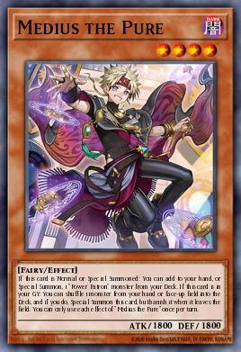

- **Copias y zona:** Main 1x. No altera las cantidades registradas.
- **Nombre oficial de referencia:** Medius el Puro. CID cotejado con la ficha oficial; el nombre histórico del inventario se conserva aunque su grafía/traducción difiera.
- **Función principal y secundaria:** searcher · buscador · extensor · recuperación.
- **Estado de sinergia y función:** Sinergia indirecta (soporte o recursos). Es una clasificación de juego; revisar la relación concreta en A06.
- **Papel como recurso, descarte o coste:** Coste o consumo descrito en A05: reciclaje de recurso propio.
- **Efecto operativo (paráfrasis analítica):** búsqueda o incorporación de cartas a mano; extensión mediante monstruos procedentes del Deck; recuperación e invocación desde Cementerio/destierro; retorno o reciclaje hacia mano/Deck/Extra. Son operaciones detectadas en el texto, no efectos independientes garantizados; leer sus condiciones en la fuente.
- **Mapa de activación y resultados:** 1) al invocarla Normal/Especial: Invocación Especial desde mano, incorpora la pieza indicada a la mano · 2) mientras está en Cementerio: Invocación Especial desde mano, devuelve recursos a mano/Deck/Extra. Cada operación está sujeta a la secuencia y al «si lo haces» del texto oficial.
- **Ventanas de activación identificadas:** al producirse una Invocación; al llegar o estar en el Cementerio.
- **Costes o recursos potenciales:** reciclaje de recurso propio.
- **Restricciones y requisitos:** hay límite por turno según el efecto concreto; depende de recursos en Cementerio. 
- **Prioridad al ir primero:** preparar Equipos, materiales Xyz y respuestas en turno rival. Para esta carta: Convertir acceso al Deck en cuerpos o materiales antes de bloquearse con restricciones.
- **Prioridad al ir segundo:** retirar amenazas y después convertir la destrucción propia en ventaja. Identificar primero la respuesta rival que afecta su función «searcher».
- **Medio/tardío y recuperación:** reciclar piezas equipadas y cartas DoomZ del Cementerio. Verificar que el objetivo de recuperación continúe disponible.
- **Sinergias y acceso a líneas:** Relación contextual con destruir recursos DoomZ para ganar ventaja, equipar monstruos y transformarlos en Xyz Máquina de VIENTO. Habilita una línea del motor sólo si coinciden recursos, objetivos y restricciones; no equivale a un combo completo validado.
- **Riesgo / brick / interrupciones:** Depende del Cementerio y es sensible a destierro o negación de ese recurso. No atribuirle velocidad rápida por el solo hecho de formar parte del motor.
- **Utilidad editorial:** 5/5 para este deck (estimación por rol y zona, no probabilidad calculada). No cambiar copias; cualquier sugerencia de alta/baja pasa por el apartado 22 y aprobación.
- **Referencia oficial y trazabilidad:** https://www.db.yugioh-card.com/yugiohdb/card_search.action?cid=21419&ope=2&request_locale=es. **Confianza:** texto y tipo de efecto cotejados en Konami; síntesis táctica editorial, no demostración de combo.
- **Aplicación concreta dentro de este deck (A06):** búsqueda o incorporación de cartas a mano; extensión mediante monstruos procedentes del Deck; recuperación e invocación desde Cementerio/destierro; retorno o reciclaje hacia mano/Deck/Extra.

**USO PRÁCTICO Y SINERGIA — Medius el Puro**

- **Label funcional:** Sinergia indirecta. Clasificación documental; una relación es válida solo si se satisfacen sus condiciones exactas.
- **Qué hace:** búsqueda o incorporación de cartas a mano; extensión mediante monstruos procedentes del Deck; recuperación e invocación desde Cementerio/destierro; retorno o reciclaje hacia mano/Deck/Extra. Son operaciones detectadas en el texto, no efectos independientes garantizados; leer sus condiciones en la fuente.
- **Cómo aprovecharla en este deck:** búsqueda o incorporación de cartas a mano; extensión mediante monstruos procedentes del Deck; recuperación e invocación desde Cementerio/destierro; retorno o reciclaje hacia mano/Deck/Extra.
- **Al jugar primero:** preparar Equipos, materiales Xyz y respuestas en turno rival. Para esta carta: Convertir acceso al Deck en cuerpos o materiales antes de bloquearse con restricciones.
- **Al jugar segundo:** retirar amenazas y después convertir la destrucción propia en ventaja. Identificar primero la respuesta rival que afecta su función «searcher».
- **Cuándo tener precaución:** Depende del Cementerio y es sensible a destierro o negación de ese recurso. No atribuirle velocidad rápida por el solo hecho de formar parte del motor.

#### 02. Mando DoomZ «D.O.O.M.D.U.R.G.»

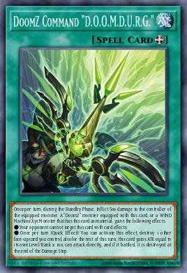

- **Copias y zona:** Main 2x. No altera las cantidades registradas.
- **Nombre oficial de referencia:** Mando DoomZ "D.O.O.M.D.U.R.G.". CID cotejado con la ficha oficial; el nombre histórico del inventario se conserva aunque su grafía/traducción difiera.
- **Función principal y secundaria:** interrupción · removal · cierre · motor Equipo.
- **Estado de sinergia y función:** Sinergia indirecta (soporte o recursos). Es una clasificación de juego; revisar la relación concreta en A06.
- **Papel como recurso, descarte o coste:** No se demuestra que esta carta sea recurso de descarte o pago para otra.
- **Efecto operativo (paráfrasis analítica):** destrucción de cartas o empleo de destrucción como detonante; presión de combate o modificación de estadísticas; uso o producción de cartas equipadas. Son operaciones detectadas en el texto, no efectos independientes garantizados; leer sus condiciones en la fuente.
- **Mapa de activación y resultados:** 1) en Standby Phase: destruye la carta o recurso previsto, equipa carta/monstruo según texto, inflige daño. Cada operación está sujeta a la secuencia y al «si lo haces» del texto oficial.
- **Ventanas de activación identificadas:** Standby Phase; Efecto Rápido.
- **Costes o recursos potenciales:** sin coste independiente identificado en esta síntesis; comprobar las acciones previas al punto y coma de cada efecto.
- **Restricciones y requisitos:** hay límite por turno según el efecto concreto. 
- **Prioridad al ir primero:** preparar Equipos, materiales Xyz y respuestas en turno rival. Para esta carta: Reservar la respuesta para la ventana rival exacta; no es una pieza buscadora de nuestro motor.
- **Prioridad al ir segundo:** retirar amenazas y después convertir la destrucción propia en ventaja. Identificar primero la respuesta rival que afecta su función «interrupción».
- **Medio/tardío y recuperación:** reciclar piezas equipadas y cartas DoomZ del Cementerio. No asumir que por sí misma recicla recursos si el texto no lo permite.
- **Sinergias y acceso a líneas:** Relación contextual con destruir recursos DoomZ para ganar ventaja, equipar monstruos y transformarlos en Xyz Máquina de VIENTO. Habilita una línea del motor sólo si coinciden recursos, objetivos y restricciones; no equivale a un combo completo validado.
- **Riesgo / brick / interrupciones:** Riesgo operativo: falta de Equipo/objetivo válido y cierres del Extra Deck a Xyz. Confirmar objetivos disponibles y costes antes de activar. Puede emplearse en cadena sólo cuando se cumpla su condición concreta.
- **Utilidad editorial:** 3/5 para este deck (estimación por rol y zona, no probabilidad calculada). No cambiar copias; cualquier sugerencia de alta/baja pasa por el apartado 22 y aprobación.
- **Referencia oficial y trazabilidad:** https://www.db.yugioh-card.com/yugiohdb/card_search.action?cid=21824&ope=2&request_locale=es. **Confianza:** texto y tipo de efecto cotejados en Konami; síntesis táctica editorial, no demostración de combo.
- **Aplicación concreta dentro de este deck (A06):** destrucción de cartas o empleo de destrucción como detonante; presión de combate o modificación de estadísticas; uso o producción de cartas equipadas.

**USO PRÁCTICO Y SINERGIA — Mando DoomZ «D.O.O.M.D.U.R.G.»**

- **Label funcional:** Sinergia indirecta. Clasificación documental; una relación es válida solo si se satisfacen sus condiciones exactas.
- **Qué hace:** destrucción de cartas o empleo de destrucción como detonante; presión de combate o modificación de estadísticas; uso o producción de cartas equipadas. Son operaciones detectadas en el texto, no efectos independientes garantizados; leer sus condiciones en la fuente.
- **Cómo aprovecharla en este deck:** destrucción de cartas o empleo de destrucción como detonante; presión de combate o modificación de estadísticas; uso o producción de cartas equipadas.
- **Al jugar primero:** preparar Equipos, materiales Xyz y respuestas en turno rival. Para esta carta: Reservar la respuesta para la ventana rival exacta; no es una pieza buscadora de nuestro motor.
- **Al jugar segundo:** retirar amenazas y después convertir la destrucción propia en ventaja. Identificar primero la respuesta rival que afecta su función «interrupción».
- **Cuándo tener precaución:** Riesgo operativo: falta de Equipo/objetivo válido y cierres del Extra Deck a Xyz. Confirmar objetivos disponibles y costes antes de activar. Puede emplearse en cadena sólo cuando se cumpla su condición concreta.

#### 03. DoomZ Modelo de Poder

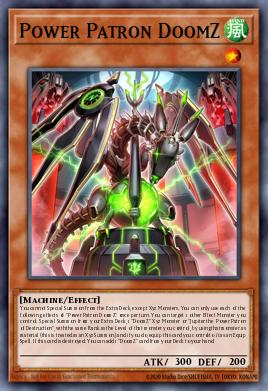

- **Copias y zona:** Main 2x. No altera las cantidades registradas.
- **Nombre oficial de referencia:** DoomZ Modelo de Poder. CID cotejado con la ficha oficial; el nombre histórico del inventario se conserva aunque su grafía/traducción difiera.
- **Función principal y secundaria:** searcher · buscador · removal · respuesta · motor Equipo.
- **Estado de sinergia y función:** Sinergia indirecta (soporte o recursos). Es una clasificación de juego; revisar la relación concreta en A06.
- **Papel como recurso, descarte o coste:** No se demuestra que esta carta sea recurso de descarte o pago para otra.
- **Efecto operativo (paráfrasis analítica):** búsqueda o incorporación de cartas a mano; destrucción de cartas o empleo de destrucción como detonante; interacción sobre monstruos en campo; uso o producción de cartas equipadas. Son operaciones detectadas en el texto, no efectos independientes garantizados; leer sus condiciones en la fuente.
- **Mapa de activación y resultados:** 1) efecto propio o continuo: habilita Xyz, Invocación Especial desde Extra Deck · 2) al destruirse: incorpora la pieza indicada a la mano. Cada operación está sujeta a la secuencia y al «si lo haces» del texto oficial.
- **Ventanas de activación identificadas:** al destruirse.
- **Costes o recursos potenciales:** sin coste independiente identificado en esta síntesis; comprobar las acciones previas al punto y coma de cada efecto.
- **Restricciones y requisitos:** hay límite por turno según el efecto concreto; puede bloquear tipos de Invocación del Extra Deck. 
- **Prioridad al ir primero:** preparar Equipos, materiales Xyz y respuestas en turno rival. Para esta carta: Convertir la activación en acceso a la siguiente pieza del motor, sin duplicar buscadores inútilmente.
- **Prioridad al ir segundo:** retirar amenazas y después convertir la destrucción propia en ventaja. Identificar primero la respuesta rival que afecta su función «searcher».
- **Medio/tardío y recuperación:** reciclar piezas equipadas y cartas DoomZ del Cementerio. No asumir que por sí misma recicla recursos si el texto no lo permite.
- **Sinergias y acceso a líneas:** Relación contextual con destruir recursos DoomZ para ganar ventaja, equipar monstruos y transformarlos en Xyz Máquina de VIENTO. Habilita una línea del motor sólo si coinciden recursos, objetivos y restricciones; no equivale a un combo completo validado.
- **Riesgo / brick / interrupciones:** La restricción de invocaciones puede cerrar rutas alternativas; revisar el orden de activación. No atribuirle velocidad rápida por el solo hecho de formar parte del motor.
- **Utilidad editorial:** 5/5 para este deck (estimación por rol y zona, no probabilidad calculada). No cambiar copias; cualquier sugerencia de alta/baja pasa por el apartado 22 y aprobación.
- **Referencia oficial y trazabilidad:** https://www.db.yugioh-card.com/yugiohdb/card_search.action?cid=21777&ope=2&request_locale=es. **Confianza:** texto y tipo de efecto cotejados en Konami; síntesis táctica editorial, no demostración de combo.
- **Aplicación concreta dentro de este deck (A06):** búsqueda o incorporación de cartas a mano; destrucción de cartas o empleo de destrucción como detonante; interacción sobre monstruos en campo; uso o producción de cartas equipadas.

**USO PRÁCTICO Y SINERGIA — DoomZ Modelo de Poder**

- **Label funcional:** Sinergia indirecta. Clasificación documental; una relación es válida solo si se satisfacen sus condiciones exactas.
- **Qué hace:** búsqueda o incorporación de cartas a mano; destrucción de cartas o empleo de destrucción como detonante; interacción sobre monstruos en campo; uso o producción de cartas equipadas. Son operaciones detectadas en el texto, no efectos independientes garantizados; leer sus condiciones en la fuente.
- **Cómo aprovecharla en este deck:** búsqueda o incorporación de cartas a mano; destrucción de cartas o empleo de destrucción como detonante; interacción sobre monstruos en campo; uso o producción de cartas equipadas.
- **Al jugar primero:** preparar Equipos, materiales Xyz y respuestas en turno rival. Para esta carta: Convertir la activación en acceso a la siguiente pieza del motor, sin duplicar buscadores inútilmente.
- **Al jugar segundo:** retirar amenazas y después convertir la destrucción propia en ventaja. Identificar primero la respuesta rival que afecta su función «searcher».
- **Cuándo tener precaución:** La restricción de invocaciones puede cerrar rutas alternativas; revisar el orden de activación. No atribuirle velocidad rápida por el solo hecho de formar parte del motor.

#### 04. El Bufón y el Pájaro del Candado

- **Copias y zona:** Main 2x. No altera las cantidades registradas.
- **Nombre oficial de referencia:** El Bufón y el Pájaro del Candado. CID cotejado con la ficha oficial; el nombre histórico del inventario se conserva aunque su grafía/traducción difiera.
- **Función principal y secundaria:** handtrap · bloqueo de búsquedas.
- **Estado de sinergia y función:** Utilidad independiente. Es una clasificación de juego; revisar la relación concreta en A06.
- **Papel como recurso, descarte o coste:** Envío mencionado en la interacción; no equivale por sí mismo a descarte desde la mano.
- **Efecto operativo (paráfrasis analítica):** Tras una incorporación desde el Deck a la mano rival, se envía al Cementerio para impedir nuevas adiciones desde ambos Decks principales ese turno. 
- **Mapa de activación y resultados:** 1) con condición explícita en la carta: impide nuevas incorporaciones a mano. Cada operación está sujeta a la secuencia y al «si lo haces» del texto oficial.
- **Ventanas de activación identificadas:** Efecto Rápido.
- **Costes o recursos potenciales:** envío de recurso propio al Cementerio.
- **Restricciones y requisitos:** aplicar restricciones de selección, activación y copias que consten en el texto original. 
- **Prioridad al ir primero:** preparar Equipos, materiales Xyz y respuestas en turno rival. Para esta carta: Reservar la respuesta para la ventana rival exacta; no es una pieza buscadora de nuestro motor.
- **Prioridad al ir segundo:** retirar amenazas y después convertir la destrucción propia en ventaja. Identificar primero la respuesta rival que afecta su función «handtrap».
- **Medio/tardío y recuperación:** reciclar piezas equipadas y cartas DoomZ del Cementerio. No asumir que por sí misma recicla recursos si el texto no lo permite.
- **Sinergias y acceso a líneas:** Relación contextual con destruir recursos DoomZ para ganar ventaja, equipar monstruos y transformarlos en Xyz Máquina de VIENTO. Habilita una línea del motor sólo si coinciden recursos, objetivos y restricciones; no equivale a un combo completo validado.
- **Riesgo / brick / interrupciones:** No niega la primera búsqueda y también restringe las adiciones del propio jugador. Puede emplearse en cadena sólo cuando se cumpla su condición concreta.
- **Utilidad editorial:** 3/5 para este deck (estimación por rol y zona, no probabilidad calculada). No cambiar copias; cualquier sugerencia de alta/baja pasa por el apartado 22 y aprobación.
- **Referencia oficial y trazabilidad:** https://www.db.yugioh-card.com/yugiohdb/card_search.action?cid=9279&ope=2&request_locale=es. **Confianza:** texto y tipo de efecto cotejados en Konami; síntesis táctica editorial, no demostración de combo.
- **Aplicación concreta dentro de este deck (A06):** Tras una incorporación desde el Deck a la mano rival, se envía al Cementerio para impedir nuevas adiciones desde ambos Decks principales ese turno. Aporta respuesta o consistencia sin exigir enlace directo.

**USO PRÁCTICO Y SINERGIA — El Bufón y el Pájaro del Candado**

- **Label funcional:** Función independiente. Clasificación documental; una relación es válida solo si se satisfacen sus condiciones exactas.
- **Qué hace:** Tras una incorporación desde el Deck a la mano rival, se envía al Cementerio para impedir nuevas adiciones desde ambos Decks principales ese turno.
- **Cómo aprovecharla en este deck:** Tras una incorporación desde el Deck a la mano rival, se envía al Cementerio para impedir nuevas adiciones desde ambos Decks principales ese turno. Aporta respuesta o consistencia sin exigir enlace directo.
- **Al jugar primero:** preparar Equipos, materiales Xyz y respuestas en turno rival. Para esta carta: Reservar la respuesta para la ventana rival exacta; no es una pieza buscadora de nuestro motor.
- **Al jugar segundo:** retirar amenazas y después convertir la destrucción propia en ventaja. Identificar primero la respuesta rival que afecta su función «handtrap».
- **Cuándo tener precaución:** No niega la primera búsqueda y también restringe las adiciones del propio jugador. Puede emplearse en cadena sólo cuando se cumpla su condición concreta.

#### 05. Modelo de Poder Máquina de Sombras Zegredo

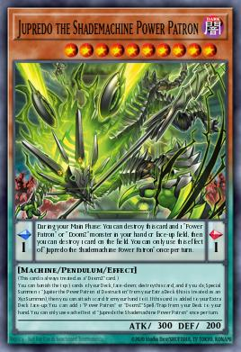

- **Copias y zona:** Main 3x. No altera las cantidades registradas.
- **Nombre oficial de referencia:** Jupredo la Máquina Sombra Modelo de Poder. CID cotejado con la ficha oficial; el nombre histórico del inventario se conserva aunque su grafía/traducción difiera.
- **Función principal y secundaria:** searcher · buscador · removal · habilitador Xyz.
- **Estado de sinergia y función:** Sinergia indirecta (soporte o recursos). Es una clasificación de juego; revisar la relación concreta en A06.
- **Papel como recurso, descarte o coste:** Material o destino del Extra condicionado a los requisitos de invocación.
- **Efecto operativo (paráfrasis analítica):** búsqueda o incorporación de cartas a mano; destrucción de cartas o empleo de destrucción como detonante; gestión de materiales Xyz. Son operaciones detectadas en el texto, no efectos independientes garantizados; leer sus condiciones en la fuente.
- **Efecto Péndulo:** además de su efecto de monstruo, la fuente oficial declara acciones propias de su Zona Péndulo; aplicar por separado sus requisitos, coste y límite (incluido en clasificación mecánica).
- **Mapa de activación y resultados:** 1) efecto propio o continuo: habilita Xyz, Invocación Especial desde Extra Deck, destruye la carta o recurso previsto · 2) con condición explícita en la carta: incorpora la pieza indicada a la mano · 3) en Main Phase: destruye la carta o recurso previsto. Cada operación está sujeta a la secuencia y al «si lo haces» del texto oficial.
- **Ventanas de activación identificadas:** Main Phase.
- **Costes o recursos potenciales:** sin coste independiente identificado en esta síntesis; comprobar las acciones previas al punto y coma de cada efecto.
- **Restricciones y requisitos:** hay límite por turno según el efecto concreto; interactúa con información oculta o resultados no siempre elegibles. 
- **Prioridad al ir primero:** preparar Equipos, materiales Xyz y respuestas en turno rival. Para esta carta: Convertir la activación en acceso a la siguiente pieza del motor, sin duplicar buscadores inútilmente.
- **Prioridad al ir segundo:** retirar amenazas y después convertir la destrucción propia en ventaja. Identificar primero la respuesta rival que afecta su función «searcher».
- **Medio/tardío y recuperación:** reciclar piezas equipadas y cartas DoomZ del Cementerio. No asumir que por sí misma recicla recursos si el texto no lo permite.
- **Sinergias y acceso a líneas:** Relación contextual con destruir recursos DoomZ para ganar ventaja, equipar monstruos y transformarlos en Xyz Máquina de VIENTO. Habilita una línea del motor sólo si coinciden recursos, objetivos y restricciones; no equivale a un combo completo validado.
- **Riesgo / brick / interrupciones:** Riesgo operativo: falta de Equipo/objetivo válido y cierres del Extra Deck a Xyz. Confirmar objetivos disponibles y costes antes de activar. No atribuirle velocidad rápida por el solo hecho de formar parte del motor.
- **Utilidad editorial:** 5/5 para este deck (estimación por rol y zona, no probabilidad calculada). No cambiar copias; cualquier sugerencia de alta/baja pasa por el apartado 22 y aprobación.
- **Referencia oficial y trazabilidad:** https://www.db.yugioh-card.com/yugiohdb/card_search.action?cid=22521&ope=2&request_locale=es. **Confianza:** texto y tipo de efecto cotejados en Konami; síntesis táctica editorial, no demostración de combo.
- **Aplicación concreta dentro de este deck (A06):** búsqueda o incorporación de cartas a mano; destrucción de cartas o empleo de destrucción como detonante; gestión de materiales Xyz.

**USO PRÁCTICO Y SINERGIA — Modelo de Poder Máquina de Sombras Zegredo**

- **Label funcional:** Sinergia indirecta. Clasificación documental; una relación es válida solo si se satisfacen sus condiciones exactas.
- **Qué hace:** búsqueda o incorporación de cartas a mano; destrucción de cartas o empleo de destrucción como detonante; gestión de materiales Xyz. Son operaciones detectadas en el texto, no efectos independientes garantizados; leer sus condiciones en la fuente.
- **Cómo aprovecharla en este deck:** búsqueda o incorporación de cartas a mano; destrucción de cartas o empleo de destrucción como detonante; gestión de materiales Xyz.
- **Al jugar primero:** preparar Equipos, materiales Xyz y respuestas en turno rival. Para esta carta: Convertir la activación en acceso a la siguiente pieza del motor, sin duplicar buscadores inútilmente.
- **Al jugar segundo:** retirar amenazas y después convertir la destrucción propia en ventaja. Identificar primero la respuesta rival que afecta su función «searcher».
- **Cuándo tener precaución:** Riesgo operativo: falta de Equipo/objetivo válido y cierres del Extra Deck a Xyz. Confirmar objetivos disponibles y costes antes de activar. No atribuirle velocidad rápida por el solo hecho de formar parte del motor.

#### 06. Flor de Ceniza & Primavera Feliz

- **Copias y zona:** Main 3x. No altera las cantidades registradas.
- **Nombre oficial de referencia:** Flor de Ceniza & Primavera Feliz. CID cotejado con la ficha oficial; el nombre histórico del inventario se conserva aunque su grafía/traducción difiera.
- **Función principal y secundaria:** handtrap · negación.
- **Estado de sinergia y función:** Utilidad independiente. Es una clasificación de juego; revisar la relación concreta en A06.
- **Papel como recurso, descarte o coste:** Descarte mencionado: comprobar carta que lo exige, zona, coste frente a efecto y utilidad del recurso.
- **Efecto operativo (paráfrasis analítica):** Descarta desde la mano para detener efectos que buscan, invocan o mandan cartas desde el Deck. 
- **Mapa de activación y resultados:** 1) con condición explícita en la carta: niega el efecto o la activación indicada, Invocación Especial desde Deck, incorpora la pieza indicada a la mano. Cada operación está sujeta a la secuencia y al «si lo haces» del texto oficial.
- **Ventanas de activación identificadas:** Efecto Rápido.
- **Costes o recursos potenciales:** descarte de mano.
- **Restricciones y requisitos:** hay límite por turno según el efecto concreto. 
- **Prioridad al ir primero:** preparar Equipos, materiales Xyz y respuestas en turno rival. Para esta carta: Reservar la respuesta para la ventana rival exacta; no es una pieza buscadora de nuestro motor.
- **Prioridad al ir segundo:** retirar amenazas y después convertir la destrucción propia en ventaja. Identificar primero la respuesta rival que afecta su función «handtrap».
- **Medio/tardío y recuperación:** reciclar piezas equipadas y cartas DoomZ del Cementerio. Verificar que el objetivo de recuperación continúe disponible.
- **Sinergias y acceso a líneas:** Relación contextual con destruir recursos DoomZ para ganar ventaja, equipar monstruos y transformarlos en Xyz Máquina de VIENTO. Habilita una línea del motor sólo si coinciden recursos, objetivos y restricciones; no equivale a un combo completo validado.
- **Riesgo / brick / interrupciones:** Reaccionar al efecto del Deck que habilite la jugada rival; no da búsquedas propias. Puede emplearse en cadena sólo cuando se cumpla su condición concreta.
- **Utilidad editorial:** 3/5 para este deck (estimación por rol y zona, no probabilidad calculada). No cambiar copias; cualquier sugerencia de alta/baja pasa por el apartado 22 y aprobación.
- **Referencia oficial y trazabilidad:** https://www.db.yugioh-card.com/yugiohdb/card_search.action?cid=12950&ope=2&request_locale=es. **Confianza:** texto y tipo de efecto cotejados en Konami; síntesis táctica editorial, no demostración de combo.
- **Aplicación concreta dentro de este deck (A06):** Descarta desde la mano para detener efectos que buscan, invocan o mandan cartas desde el Deck. Aporta respuesta o consistencia sin exigir enlace directo.

**USO PRÁCTICO Y SINERGIA — Flor de Ceniza & Primavera Feliz**

- **Label funcional:** Función independiente. Clasificación documental; una relación es válida solo si se satisfacen sus condiciones exactas.
- **Qué hace:** Descarta desde la mano para detener efectos que buscan, invocan o mandan cartas desde el Deck.
- **Cómo aprovecharla en este deck:** Descarta desde la mano para detener efectos que buscan, invocan o mandan cartas desde el Deck. Aporta respuesta o consistencia sin exigir enlace directo.
- **Al jugar primero:** preparar Equipos, materiales Xyz y respuestas en turno rival. Para esta carta: Reservar la respuesta para la ventana rival exacta; no es una pieza buscadora de nuestro motor.
- **Al jugar segundo:** retirar amenazas y después convertir la destrucción propia en ventaja. Identificar primero la respuesta rival que afecta su función «handtrap».
- **Cuándo tener precaución:** Reaccionar al efecto del Deck que habilite la jugada rival; no da búsquedas propias. Puede emplearse en cadena sólo cuando se cumpla su condición concreta.

#### 07. Therion «Rey» Regulus

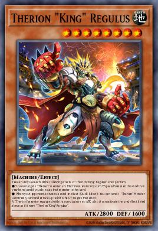

- **Copias y zona:** Main 1x. No altera las cantidades registradas.
- **Nombre oficial de referencia:** Therion "Rey" Regulus. CID cotejado con la ficha oficial; el nombre histórico del inventario se conserva aunque su grafía/traducción difiera.
- **Función principal y secundaria:** extensor Máquina · negación.
- **Estado de sinergia y función:** Utilidad independiente. Es una clasificación de juego; revisar la relación concreta en A06.
- **Papel como recurso, descarte o coste:** Coste o consumo descrito en A05: envío de recurso propio al Cementerio.
- **Efecto operativo (paráfrasis analítica):** Regulus se invoca desde mano equipando Máquina o Therion del GY y ofrece una negación con coste de envío de Therion. 
- **Mapa de activación y resultados:** efecto de estadística, condición o material; no asumir un disparador adicional. Cada operación está sujeta a la secuencia y al «si lo haces» del texto oficial.
- **Ventanas de activación identificadas:** respuesta a activación rival; Efecto Rápido.
- **Costes o recursos potenciales:** envío de recurso propio al Cementerio.
- **Restricciones y requisitos:** hay límite por turno según el efecto concreto; depende de recursos en Cementerio. 
- **Prioridad al ir primero:** preparar Equipos, materiales Xyz y respuestas en turno rival. Para esta carta: Conservar la interrupción para el efecto clave rival; no gastarla en un efecto irrelevante.
- **Prioridad al ir segundo:** retirar amenazas y después convertir la destrucción propia en ventaja. Identificar primero la respuesta rival que afecta su función «extensor Máquina».
- **Medio/tardío y recuperación:** reciclar piezas equipadas y cartas DoomZ del Cementerio. No asumir que por sí misma recicla recursos si el texto no lo permite.
- **Sinergias y acceso a líneas:** Relación contextual con destruir recursos DoomZ para ganar ventaja, equipar monstruos y transformarlos en Xyz Máquina de VIENTO. Habilita una línea del motor sólo si coinciden recursos, objetivos y restricciones; no equivale a un combo completo validado.
- **Riesgo / brick / interrupciones:** Su activación exige equipo/recursos adecuados y no se confunde con una negación pasiva. Puede emplearse en cadena sólo cuando se cumpla su condición concreta.
- **Utilidad editorial:** 3/5 para este deck (estimación por rol y zona, no probabilidad calculada). No cambiar copias; cualquier sugerencia de alta/baja pasa por el apartado 22 y aprobación.
- **Referencia oficial y trazabilidad:** https://www.db.yugioh-card.com/yugiohdb/card_search.action?cid=17119&ope=2&request_locale=es. **Confianza:** texto y tipo de efecto cotejados en Konami; síntesis táctica editorial, no demostración de combo.
- **Aplicación concreta dentro de este deck (A06):** Regulus se invoca desde mano equipando Máquina o Therion del GY y ofrece una negación con coste de envío de Therion. Aporta respuesta o consistencia sin exigir enlace directo.

**USO PRÁCTICO Y SINERGIA — Therion «Rey» Regulus**

- **Label funcional:** Función independiente. Clasificación documental; una relación es válida solo si se satisfacen sus condiciones exactas.
- **Qué hace:** Regulus se invoca desde mano equipando Máquina o Therion del GY y ofrece una negación con coste de envío de Therion.
- **Cómo aprovecharla en este deck:** Regulus se invoca desde mano equipando Máquina o Therion del GY y ofrece una negación con coste de envío de Therion. Aporta respuesta o consistencia sin exigir enlace directo.
- **Al jugar primero:** preparar Equipos, materiales Xyz y respuestas en turno rival. Para esta carta: Conservar la interrupción para el efecto clave rival; no gastarla en un efecto irrelevante.
- **Al jugar segundo:** retirar amenazas y después convertir la destrucción propia en ventaja. Identificar primero la respuesta rival que afecta su función «extensor Máquina».
- **Cuándo tener precaución:** Su activación exige equipo/recursos adecuados y no se confunde con una negación pasiva. Puede emplearse en cadena sólo cuando se cumpla su condición concreta.

#### 08. DoomZ XII Cero - Drastea

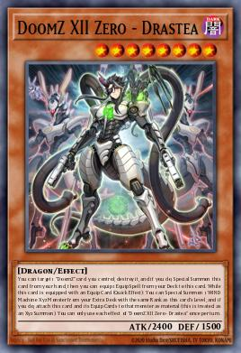

- **Copias y zona:** Main 2x. No altera las cantidades registradas.
- **Nombre oficial de referencia:** DoomZ XII Cero - Drastea. CID cotejado con la ficha oficial; el nombre histórico del inventario se conserva aunque su grafía/traducción difiera.
- **Función principal y secundaria:** interrupción · extensor · habilitador Xyz · motor Equipo.
- **Estado de sinergia y función:** Sinergia indirecta (soporte o recursos). Es una clasificación de juego; revisar la relación concreta en A06.
- **Papel como recurso, descarte o coste:** Material o destino del Extra condicionado a los requisitos de invocación.
- **Efecto operativo (paráfrasis analítica):** extensión mediante monstruos procedentes del Deck; acceso al campo desde la mano; gestión de materiales Xyz; uso o producción de cartas equipadas. Son operaciones detectadas en el texto, no efectos independientes garantizados; leer sus condiciones en la fuente.
- **Mapa de activación y resultados:** 1) efecto propio o continuo: Invocación Especial desde mano, equipa carta/monstruo según texto · 2) con Equipo requerido: habilita Xyz, Invocación Especial desde Extra Deck. Cada operación está sujeta a la secuencia y al «si lo haces» del texto oficial.
- **Ventanas de activación identificadas:** Efecto Rápido.
- **Costes o recursos potenciales:** sin coste independiente identificado en esta síntesis; comprobar las acciones previas al punto y coma de cada efecto.
- **Restricciones y requisitos:** hay límite por turno según el efecto concreto. 
- **Prioridad al ir primero:** preparar Equipos, materiales Xyz y respuestas en turno rival. Para esta carta: Reservar la respuesta para la ventana rival exacta; no es una pieza buscadora de nuestro motor.
- **Prioridad al ir segundo:** retirar amenazas y después convertir la destrucción propia en ventaja. Identificar primero la respuesta rival que afecta su función «interrupción».
- **Medio/tardío y recuperación:** reciclar piezas equipadas y cartas DoomZ del Cementerio. No asumir que por sí misma recicla recursos si el texto no lo permite.
- **Sinergias y acceso a líneas:** Relación contextual con destruir recursos DoomZ para ganar ventaja, equipar monstruos y transformarlos en Xyz Máquina de VIENTO. Habilita una línea del motor sólo si coinciden recursos, objetivos y restricciones; no equivale a un combo completo validado.
- **Riesgo / brick / interrupciones:** Riesgo operativo: falta de Equipo/objetivo válido y cierres del Extra Deck a Xyz. Confirmar objetivos disponibles y costes antes de activar. Puede emplearse en cadena sólo cuando se cumpla su condición concreta.
- **Utilidad editorial:** 4/5 para este deck (estimación por rol y zona, no probabilidad calculada). No cambiar copias; cualquier sugerencia de alta/baja pasa por el apartado 22 y aprobación.
- **Referencia oficial y trazabilidad:** https://www.db.yugioh-card.com/yugiohdb/card_search.action?cid=21774&ope=2&request_locale=es. **Confianza:** texto y tipo de efecto cotejados en Konami; síntesis táctica editorial, no demostración de combo.
- **Aplicación concreta dentro de este deck (A06):** extensión mediante monstruos procedentes del Deck; acceso al campo desde la mano; gestión de materiales Xyz; uso o producción de cartas equipadas.

**USO PRÁCTICO Y SINERGIA — DoomZ XII Cero - Drastea**

- **Label funcional:** Sinergia indirecta. Clasificación documental; una relación es válida solo si se satisfacen sus condiciones exactas.
- **Qué hace:** extensión mediante monstruos procedentes del Deck; acceso al campo desde la mano; gestión de materiales Xyz; uso o producción de cartas equipadas. Son operaciones detectadas en el texto, no efectos independientes garantizados; leer sus condiciones en la fuente.
- **Cómo aprovecharla en este deck:** extensión mediante monstruos procedentes del Deck; acceso al campo desde la mano; gestión de materiales Xyz; uso o producción de cartas equipadas.
- **Al jugar primero:** preparar Equipos, materiales Xyz y respuestas en turno rival. Para esta carta: Reservar la respuesta para la ventana rival exacta; no es una pieza buscadora de nuestro motor.
- **Al jugar segundo:** retirar amenazas y después convertir la destrucción propia en ventaja. Identificar primero la respuesta rival que afecta su función «interrupción».
- **Cuándo tener precaución:** Riesgo operativo: falta de Equipo/objetivo válido y cierres del Extra Deck a Xyz. Confirmar objetivos disponibles y costes antes de activar. Puede emplearse en cadena sólo cuando se cumpla su condición concreta.

#### 09. DoomZ V Cinco - Amalthe

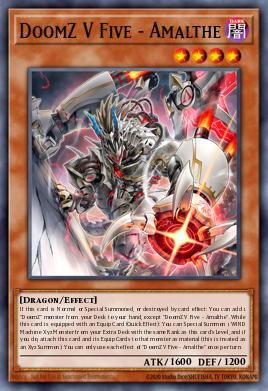

- **Copias y zona:** Main 3x. No altera las cantidades registradas.
- **Nombre oficial de referencia:** DoomZ V Cinco - Amalthe. CID cotejado con la ficha oficial; el nombre histórico del inventario se conserva aunque su grafía/traducción difiera.
- **Función principal y secundaria:** interrupción · searcher · buscador · habilitador Xyz · motor Equipo.
- **Estado de sinergia y función:** Sinergia indirecta (soporte o recursos). Es una clasificación de juego; revisar la relación concreta en A06.
- **Papel como recurso, descarte o coste:** Material o destino del Extra condicionado a los requisitos de invocación.
- **Efecto operativo (paráfrasis analítica):** búsqueda o incorporación de cartas a mano; gestión de materiales Xyz; uso o producción de cartas equipadas. Son operaciones detectadas en el texto, no efectos independientes garantizados; leer sus condiciones en la fuente.
- **Mapa de activación y resultados:** 1) al invocarla Normal/Especial: incorpora la pieza indicada a la mano · 2) con Equipo requerido: habilita Xyz, Invocación Especial desde Extra Deck. Cada operación está sujeta a la secuencia y al «si lo haces» del texto oficial.
- **Ventanas de activación identificadas:** al producirse una Invocación; Efecto Rápido.
- **Costes o recursos potenciales:** sin coste independiente identificado en esta síntesis; comprobar las acciones previas al punto y coma de cada efecto.
- **Restricciones y requisitos:** hay límite por turno según el efecto concreto. 
- **Prioridad al ir primero:** preparar Equipos, materiales Xyz y respuestas en turno rival. Para esta carta: Reservar la respuesta para la ventana rival exacta; no es una pieza buscadora de nuestro motor.
- **Prioridad al ir segundo:** retirar amenazas y después convertir la destrucción propia en ventaja. Identificar primero la respuesta rival que afecta su función «interrupción».
- **Medio/tardío y recuperación:** reciclar piezas equipadas y cartas DoomZ del Cementerio. No asumir que por sí misma recicla recursos si el texto no lo permite.
- **Sinergias y acceso a líneas:** Relación contextual con destruir recursos DoomZ para ganar ventaja, equipar monstruos y transformarlos en Xyz Máquina de VIENTO. Habilita una línea del motor sólo si coinciden recursos, objetivos y restricciones; no equivale a un combo completo validado.
- **Riesgo / brick / interrupciones:** Riesgo operativo: falta de Equipo/objetivo válido y cierres del Extra Deck a Xyz. Confirmar objetivos disponibles y costes antes de activar. Puede emplearse en cadena sólo cuando se cumpla su condición concreta.
- **Utilidad editorial:** 5/5 para este deck (estimación por rol y zona, no probabilidad calculada). No cambiar copias; cualquier sugerencia de alta/baja pasa por el apartado 22 y aprobación.
- **Referencia oficial y trazabilidad:** https://www.db.yugioh-card.com/yugiohdb/card_search.action?cid=21775&ope=2&request_locale=es. **Confianza:** texto y tipo de efecto cotejados en Konami; síntesis táctica editorial, no demostración de combo.
- **Aplicación concreta dentro de este deck (A06):** búsqueda o incorporación de cartas a mano; gestión de materiales Xyz; uso o producción de cartas equipadas.

**USO PRÁCTICO Y SINERGIA — DoomZ V Cinco - Amalthe**

- **Label funcional:** Sinergia indirecta. Clasificación documental; una relación es válida solo si se satisfacen sus condiciones exactas.
- **Qué hace:** búsqueda o incorporación de cartas a mano; gestión de materiales Xyz; uso o producción de cartas equipadas. Son operaciones detectadas en el texto, no efectos independientes garantizados; leer sus condiciones en la fuente.
- **Cómo aprovecharla en este deck:** búsqueda o incorporación de cartas a mano; gestión de materiales Xyz; uso o producción de cartas equipadas.
- **Al jugar primero:** preparar Equipos, materiales Xyz y respuestas en turno rival. Para esta carta: Reservar la respuesta para la ventana rival exacta; no es una pieza buscadora de nuestro motor.
- **Al jugar segundo:** retirar amenazas y después convertir la destrucción propia en ventaja. Identificar primero la respuesta rival que afecta su función «interrupción».
- **Cuándo tener precaución:** Riesgo operativo: falta de Equipo/objetivo válido y cierres del Extra Deck a Xyz. Confirmar objetivos disponibles y costes antes de activar. Puede emplearse en cadena sólo cuando se cumpla su condición concreta.

#### 10. DoomZ VII Siete - Elara

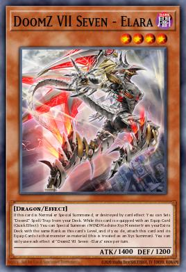

- **Copias y zona:** Main 3x. No altera las cantidades registradas.
- **Nombre oficial de referencia:** DoomZ VII Siete - Elara. CID cotejado con la ficha oficial; el nombre histórico del inventario se conserva aunque su grafía/traducción difiera.
- **Función principal y secundaria:** interrupción · preparación · habilitador Xyz · motor Equipo.
- **Estado de sinergia y función:** Sinergia indirecta (soporte o recursos). Es una clasificación de juego; revisar la relación concreta en A06.
- **Papel como recurso, descarte o coste:** Material o destino del Extra condicionado a los requisitos de invocación.
- **Efecto operativo (paráfrasis analítica):** colocación de Mágicas/Trampas o recursos; gestión de materiales Xyz; uso o producción de cartas equipadas. Son operaciones detectadas en el texto, no efectos independientes garantizados; leer sus condiciones en la fuente.
- **Mapa de activación y resultados:** 1) al invocarla Normal/Especial: Coloca Mágicas/Trampas indicadas · 2) con Equipo requerido: habilita Xyz, Invocación Especial desde Extra Deck. Cada operación está sujeta a la secuencia y al «si lo haces» del texto oficial.
- **Ventanas de activación identificadas:** al producirse una Invocación; Efecto Rápido.
- **Costes o recursos potenciales:** sin coste independiente identificado en esta síntesis; comprobar las acciones previas al punto y coma de cada efecto.
- **Restricciones y requisitos:** hay límite por turno según el efecto concreto. 
- **Prioridad al ir primero:** preparar Equipos, materiales Xyz y respuestas en turno rival. Para esta carta: Reservar la respuesta para la ventana rival exacta; no es una pieza buscadora de nuestro motor.
- **Prioridad al ir segundo:** retirar amenazas y después convertir la destrucción propia en ventaja. Identificar primero la respuesta rival que afecta su función «interrupción».
- **Medio/tardío y recuperación:** reciclar piezas equipadas y cartas DoomZ del Cementerio. No asumir que por sí misma recicla recursos si el texto no lo permite.
- **Sinergias y acceso a líneas:** Relación contextual con destruir recursos DoomZ para ganar ventaja, equipar monstruos y transformarlos en Xyz Máquina de VIENTO. Habilita una línea del motor sólo si coinciden recursos, objetivos y restricciones; no equivale a un combo completo validado.
- **Riesgo / brick / interrupciones:** Riesgo operativo: falta de Equipo/objetivo válido y cierres del Extra Deck a Xyz. Confirmar objetivos disponibles y costes antes de activar. Puede emplearse en cadena sólo cuando se cumpla su condición concreta.
- **Utilidad editorial:** 3/5 para este deck (estimación por rol y zona, no probabilidad calculada). No cambiar copias; cualquier sugerencia de alta/baja pasa por el apartado 22 y aprobación.
- **Referencia oficial y trazabilidad:** https://www.db.yugioh-card.com/yugiohdb/card_search.action?cid=21776&ope=2&request_locale=es. **Confianza:** texto y tipo de efecto cotejados en Konami; síntesis táctica editorial, no demostración de combo.
- **Aplicación concreta dentro de este deck (A06):** colocación de Mágicas/Trampas o recursos; gestión de materiales Xyz; uso o producción de cartas equipadas.

**USO PRÁCTICO Y SINERGIA — DoomZ VII Siete - Elara**

- **Label funcional:** Sinergia indirecta. Clasificación documental; una relación es válida solo si se satisfacen sus condiciones exactas.
- **Qué hace:** colocación de Mágicas/Trampas o recursos; gestión de materiales Xyz; uso o producción de cartas equipadas. Son operaciones detectadas en el texto, no efectos independientes garantizados; leer sus condiciones en la fuente.
- **Cómo aprovecharla en este deck:** colocación de Mágicas/Trampas o recursos; gestión de materiales Xyz; uso o producción de cartas equipadas.
- **Al jugar primero:** preparar Equipos, materiales Xyz y respuestas en turno rival. Para esta carta: Reservar la respuesta para la ventana rival exacta; no es una pieza buscadora de nuestro motor.
- **Al jugar segundo:** retirar amenazas y después convertir la destrucción propia en ventaja. Identificar primero la respuesta rival que afecta su función «interrupción».
- **Cuándo tener precaución:** Riesgo operativo: falta de Equipo/objetivo válido y cierres del Extra Deck a Xyz. Confirmar objetivos disponibles y costes antes de activar. Puede emplearse en cadena sólo cuando se cumpla su condición concreta.

#### 11. Infinito Temporal

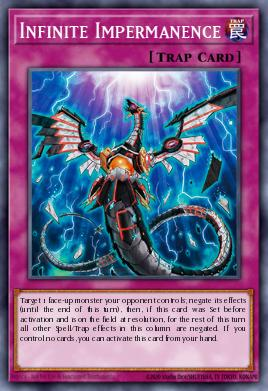

- **Copias y zona:** Main 3x. No altera las cantidades registradas.
- **Nombre oficial de referencia:** Infinito Temporal. CID cotejado con la ficha oficial; el nombre histórico del inventario se conserva aunque su grafía/traducción difiera.
- **Función principal y secundaria:** trampa · negación.
- **Estado de sinergia y función:** Utilidad independiente. Es una clasificación de juego; revisar la relación concreta en A06.
- **Papel como recurso, descarte o coste:** No se demuestra que esta carta sea recurso de descarte o pago para otra.
- **Efecto operativo (paráfrasis analítica):** Niega temporalmente un monstruo rival boca arriba; si se activó tras estar Colocada, también afecta la columna M/T correspondiente. 
- **Mapa de activación y resultados:** 1) efecto propio o continuo: niega el efecto o la activación indicada. Cada operación está sujeta a la secuencia y al «si lo haces» del texto oficial.
- **Ventanas de activación identificadas:** campo propio vacío.
- **Costes o recursos potenciales:** sin coste independiente identificado en esta síntesis; comprobar las acciones previas al punto y coma de cada efecto.
- **Restricciones y requisitos:** requiere campo propio sin las cartas indicadas. 
- **Prioridad al ir primero:** preparar Equipos, materiales Xyz y respuestas en turno rival. Para esta carta: Conservar la interrupción para el efecto clave rival; no gastarla en un efecto irrelevante.
- **Prioridad al ir segundo:** retirar amenazas y después convertir la destrucción propia en ventaja. Identificar primero la respuesta rival que afecta su función «trampa».
- **Medio/tardío y recuperación:** reciclar piezas equipadas y cartas DoomZ del Cementerio. No asumir que por sí misma recicla recursos si el texto no lo permite.
- **Sinergias y acceso a líneas:** Relación contextual con destruir recursos DoomZ para ganar ventaja, equipar monstruos y transformarlos en Xyz Máquina de VIENTO. Habilita una línea del motor sólo si coinciden recursos, objetivos y restricciones; no equivale a un combo completo validado.
- **Riesgo / brick / interrupciones:** Desde mano sólo con el campo propio vacío, conforme a la condición de activación de la Trampa. No atribuirle velocidad rápida por el solo hecho de formar parte del motor.
- **Utilidad editorial:** 3/5 para este deck (estimación por rol y zona, no probabilidad calculada). No cambiar copias; cualquier sugerencia de alta/baja pasa por el apartado 22 y aprobación.
- **Referencia oficial y trazabilidad:** https://www.db.yugioh-card.com/yugiohdb/card_search.action?cid=13631&ope=2&request_locale=es. **Confianza:** texto y tipo de efecto cotejados en Konami; síntesis táctica editorial, no demostración de combo.
- **Aplicación concreta dentro de este deck (A06):** Niega temporalmente un monstruo rival boca arriba; si se activó tras estar Colocada, también afecta la columna M/T correspondiente. Aporta respuesta o consistencia sin exigir enlace directo.

**USO PRÁCTICO Y SINERGIA — Infinito Temporal**

- **Label funcional:** Función independiente. Clasificación documental; una relación es válida solo si se satisfacen sus condiciones exactas.
- **Qué hace:** Niega temporalmente un monstruo rival boca arriba; si se activó tras estar Colocada, también afecta la columna M/T correspondiente.
- **Cómo aprovecharla en este deck:** Niega temporalmente un monstruo rival boca arriba; si se activó tras estar Colocada, también afecta la columna M/T correspondiente. Aporta respuesta o consistencia sin exigir enlace directo.
- **Al jugar primero:** preparar Equipos, materiales Xyz y respuestas en turno rival. Para esta carta: Conservar la interrupción para el efecto clave rival; no gastarla en un efecto irrelevante.
- **Al jugar segundo:** retirar amenazas y después convertir la destrucción propia en ventaja. Identificar primero la respuesta rival que afecta su función «trampa».
- **Cuándo tener precaución:** Desde mano sólo con el campo propio vacío, conforme a la condición de activación de la Trampa. No atribuirle velocidad rápida por el solo hecho de formar parte del motor.

#### 12. Fuwalos Multivadora

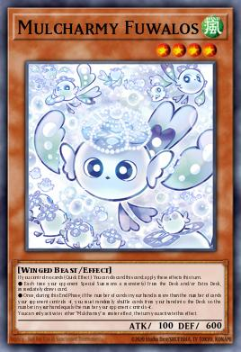

- **Copias y zona:** Main 3x. No altera las cantidades registradas.
- **Nombre oficial de referencia:** Fuwalos Multivadora. CID cotejado con la ficha oficial; el nombre histórico del inventario se conserva aunque su grafía/traducción difiera.
- **Función principal y secundaria:** handtrap · robo condicional.
- **Estado de sinergia y función:** Utilidad independiente. Es una clasificación de juego; revisar la relación concreta en A06.
- **Papel como recurso, descarte o coste:** Descarte mencionado: comprobar carta que lo exige, zona, coste frente a efecto y utilidad del recurso.
- **Efecto operativo (paráfrasis analítica):** Con campo propio sin cartas, descarta y roba al producirse Invocaciones Especiales rivales desde Deck o Extra; ajusta la mano en End Phase. 
- **Mapa de activación y resultados:** 1) con campo propio vacío: Invocación Especial desde Extra Deck, devuelve recursos a mano/Deck/Extra. Cada operación está sujeta a la secuencia y al «si lo haces» del texto oficial.
- **Ventanas de activación identificadas:** campo propio vacío; Efecto Rápido.
- **Costes o recursos potenciales:** descarte de mano; reciclaje de recurso propio.
- **Restricciones y requisitos:** requiere campo propio sin las cartas indicadas; interactúa con información oculta o resultados no siempre elegibles. 
- **Prioridad al ir primero:** preparar Equipos, materiales Xyz y respuestas en turno rival. Para esta carta: Reservar la respuesta para la ventana rival exacta; no es una pieza buscadora de nuestro motor.
- **Prioridad al ir segundo:** retirar amenazas y después convertir la destrucción propia en ventaja. Identificar primero la respuesta rival que afecta su función «handtrap».
- **Medio/tardío y recuperación:** reciclar piezas equipadas y cartas DoomZ del Cementerio. Verificar que el objetivo de recuperación continúe disponible.
- **Sinergias y acceso a líneas:** Relación contextual con destruir recursos DoomZ para ganar ventaja, equipar monstruos y transformarlos en Xyz Máquina de VIENTO. Habilita una línea del motor sólo si coinciden recursos, objetivos y restricciones; no equivale a un combo completo validado.
- **Riesgo / brick / interrupciones:** No roba por Invocaciones desde la mano; comparte restricción de efectos Mulcharmy. Puede emplearse en cadena sólo cuando se cumpla su condición concreta.
- **Utilidad editorial:** 3/5 para este deck (estimación por rol y zona, no probabilidad calculada). No cambiar copias; cualquier sugerencia de alta/baja pasa por el apartado 22 y aprobación.
- **Referencia oficial y trazabilidad:** https://www.db.yugioh-card.com/yugiohdb/card_search.action?cid=20500&ope=2&request_locale=es. **Confianza:** texto y tipo de efecto cotejados en Konami; síntesis táctica editorial, no demostración de combo.
- **Aplicación concreta dentro de este deck (A06):** Con campo propio sin cartas, descarta y roba al producirse Invocaciones Especiales rivales desde Deck o Extra; ajusta la mano en End Phase. Aporta respuesta o consistencia sin exigir enlace directo.

**USO PRÁCTICO Y SINERGIA — Fuwalos Multivadora**

- **Label funcional:** Función independiente. Clasificación documental; una relación es válida solo si se satisfacen sus condiciones exactas.
- **Qué hace:** Con campo propio sin cartas, descarta y roba al producirse Invocaciones Especiales rivales desde Deck o Extra; ajusta la mano en End Phase.
- **Cómo aprovecharla en este deck:** Con campo propio sin cartas, descarta y roba al producirse Invocaciones Especiales rivales desde Deck o Extra; ajusta la mano en End Phase. Aporta respuesta o consistencia sin exigir enlace directo.
- **Al jugar primero:** preparar Equipos, materiales Xyz y respuestas en turno rival. Para esta carta: Reservar la respuesta para la ventana rival exacta; no es una pieza buscadora de nuestro motor.
- **Al jugar segundo:** retirar amenazas y después convertir la destrucción propia en ventaja. Identificar primero la respuesta rival que afecta su función «handtrap».
- **Cuándo tener precaución:** No roba por Invocaciones desde la mano; comparte restricción de efectos Mulcharmy. Puede emplearse en cadena sólo cuando se cumpla su condición concreta.

#### 13. Portal del Modelo de Poder Desatado - Terminus

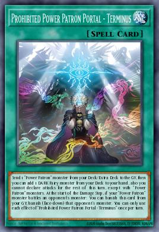

- **Copias y zona:** Main 3x. No altera las cantidades registradas.
- **Nombre oficial de referencia:** Portal de Modelo de Poder Vetado - Término. CID cotejado con la ficha oficial; el nombre histórico del inventario se conserva aunque su grafía/traducción difiera.
- **Función principal y secundaria:** searcher · buscador · removal.
- **Estado de sinergia y función:** Sin relación demostrada. Es una clasificación de juego; revisar la relación concreta en A06.
- **Papel como recurso, descarte o coste:** No se demuestra que esta carta sea recurso de descarte o pago para otra.
- **Efecto operativo (paráfrasis analítica):** búsqueda o incorporación de cartas a mano; destierro de recursos o de amenazas. Son operaciones detectadas en el texto, no efectos independientes garantizados; leer sus condiciones en la fuente.
- **Mapa de activación y resultados:** 1) efecto propio o continuo: incorpora la pieza indicada a la mano · 2) con condición explícita en la carta: destierra el recurso u objetivo previsto. Cada operación está sujeta a la secuencia y al «si lo haces» del texto oficial.
- **Ventanas de activación identificadas:** requieren la fase o condición específica indicada en el texto; sin ventana rápida general asumida.
- **Costes o recursos potenciales:** sin coste independiente identificado en esta síntesis; comprobar las acciones previas al punto y coma de cada efecto.
- **Restricciones y requisitos:** hay límite por turno según el efecto concreto; puede limitar ataques; depende de recursos en Cementerio; interactúa con información oculta o resultados no siempre elegibles. 
- **Prioridad al ir primero:** preparar Equipos, materiales Xyz y respuestas en turno rival. Para esta carta: Convertir la activación en acceso a la siguiente pieza del motor, sin duplicar buscadores inútilmente.
- **Prioridad al ir segundo:** retirar amenazas y después convertir la destrucción propia en ventaja. Identificar primero la respuesta rival que afecta su función «searcher».
- **Medio/tardío y recuperación:** reciclar piezas equipadas y cartas DoomZ del Cementerio. No asumir que por sí misma recicla recursos si el texto no lo permite.
- **Sinergias y acceso a líneas:** Relación contextual con destruir recursos DoomZ para ganar ventaja, equipar monstruos y transformarlos en Xyz Máquina de VIENTO. Habilita una línea del motor sólo si coinciden recursos, objetivos y restricciones; no equivale a un combo completo validado.
- **Riesgo / brick / interrupciones:** Depende del Cementerio y es sensible a destierro o negación de ese recurso. No atribuirle velocidad rápida por el solo hecho de formar parte del motor.
- **Utilidad editorial:** 5/5 para este deck (estimación por rol y zona, no probabilidad calculada). No cambiar copias; cualquier sugerencia de alta/baja pasa por el apartado 22 y aprobación.
- **Referencia oficial y trazabilidad:** https://www.db.yugioh-card.com/yugiohdb/card_search.action?cid=22565&ope=2&request_locale=es. **Confianza:** texto y tipo de efecto cotejados en Konami; síntesis táctica editorial, no demostración de combo.
- **Aplicación concreta dentro de este deck (A06):** búsqueda o incorporación de cartas a mano; destierro de recursos o de amenazas. A06 aún no identifica su conexión; no equivale a incompatibilidad ni borra rutas A09.

**USO PRÁCTICO Y SINERGIA — Portal del Modelo de Poder Desatado - Terminus**

- **Label funcional:** Sin sinergia demostrada. Clasificación documental; una relación es válida solo si se satisfacen sus condiciones exactas.
- **Qué hace:** búsqueda o incorporación de cartas a mano; destierro de recursos o de amenazas. Son operaciones detectadas en el texto, no efectos independientes garantizados; leer sus condiciones en la fuente.
- **Cómo aprovecharla en este deck:** búsqueda o incorporación de cartas a mano; destierro de recursos o de amenazas. A06 aún no identifica su conexión; no equivale a incompatibilidad ni borra rutas A09.
- **Al jugar primero:** preparar Equipos, materiales Xyz y respuestas en turno rival. Para esta carta: Convertir la activación en acceso a la siguiente pieza del motor, sin duplicar buscadores inútilmente.
- **Al jugar segundo:** retirar amenazas y después convertir la destrucción propia en ventaja. Identificar primero la respuesta rival que afecta su función «searcher».
- **Cuándo tener precaución:** Depende del Cementerio y es sensible a destierro o negación de ese recurso. No atribuirle velocidad rápida por el solo hecho de formar parte del motor.
- **Sinergia no demostrada:** conservar su función individual si la tiene; no vincularla con otro combo sin una interacción real.

#### 14. Incursores DoomZ

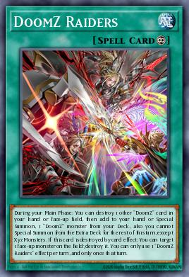

- **Copias y zona:** Main 3x. No altera las cantidades registradas.
- **Nombre oficial de referencia:** Incursores DoomZ. CID cotejado con la ficha oficial; el nombre histórico del inventario se conserva aunque su grafía/traducción difiera.
- **Función principal y secundaria:** searcher · buscador · extensor.
- **Estado de sinergia y función:** Sinergia indirecta (soporte o recursos). Es una clasificación de juego; revisar la relación concreta en A06.
- **Papel como recurso, descarte o coste:** No se demuestra que esta carta sea recurso de descarte o pago para otra.
- **Efecto operativo (paráfrasis analítica):** búsqueda o incorporación de cartas a mano; extensión mediante monstruos procedentes del Deck. Son operaciones detectadas en el texto, no efectos independientes garantizados; leer sus condiciones en la fuente.
- **Mapa de activación y resultados:** 1) en Main Phase: incorpora la pieza indicada a la mano, destruye la carta o recurso previsto. Cada operación está sujeta a la secuencia y al «si lo haces» del texto oficial.
- **Ventanas de activación identificadas:** Main Phase; al destruirse.
- **Costes o recursos potenciales:** sin coste independiente identificado en esta síntesis; comprobar las acciones previas al punto y coma de cada efecto.
- **Restricciones y requisitos:** puede bloquear tipos de Invocación del Extra Deck. 
- **Prioridad al ir primero:** preparar Equipos, materiales Xyz y respuestas en turno rival. Para esta carta: Convertir acceso al Deck en cuerpos o materiales antes de bloquearse con restricciones.
- **Prioridad al ir segundo:** retirar amenazas y después convertir la destrucción propia en ventaja. Identificar primero la respuesta rival que afecta su función «searcher».
- **Medio/tardío y recuperación:** reciclar piezas equipadas y cartas DoomZ del Cementerio. No asumir que por sí misma recicla recursos si el texto no lo permite.
- **Sinergias y acceso a líneas:** Relación contextual con destruir recursos DoomZ para ganar ventaja, equipar monstruos y transformarlos en Xyz Máquina de VIENTO. Habilita una línea del motor sólo si coinciden recursos, objetivos y restricciones; no equivale a un combo completo validado.
- **Riesgo / brick / interrupciones:** La restricción de invocaciones puede cerrar rutas alternativas; revisar el orden de activación. No atribuirle velocidad rápida por el solo hecho de formar parte del motor.
- **Utilidad editorial:** 5/5 para este deck (estimación por rol y zona, no probabilidad calculada). No cambiar copias; cualquier sugerencia de alta/baja pasa por el apartado 22 y aprobación.
- **Referencia oficial y trazabilidad:** https://www.db.yugioh-card.com/yugiohdb/card_search.action?cid=21823&ope=2&request_locale=es. **Confianza:** texto y tipo de efecto cotejados en Konami; síntesis táctica editorial, no demostración de combo.
- **Aplicación concreta dentro de este deck (A06):** búsqueda o incorporación de cartas a mano; extensión mediante monstruos procedentes del Deck.

**USO PRÁCTICO Y SINERGIA — Incursores DoomZ**

- **Label funcional:** Sinergia indirecta. Clasificación documental; una relación es válida solo si se satisfacen sus condiciones exactas.
- **Qué hace:** búsqueda o incorporación de cartas a mano; extensión mediante monstruos procedentes del Deck. Son operaciones detectadas en el texto, no efectos independientes garantizados; leer sus condiciones en la fuente.
- **Cómo aprovecharla en este deck:** búsqueda o incorporación de cartas a mano; extensión mediante monstruos procedentes del Deck.
- **Al jugar primero:** preparar Equipos, materiales Xyz y respuestas en turno rival. Para esta carta: Convertir acceso al Deck en cuerpos o materiales antes de bloquearse con restricciones.
- **Al jugar segundo:** retirar amenazas y después convertir la destrucción propia en ventaja. Identificar primero la respuesta rival que afecta su función «searcher».
- **Cuándo tener precaución:** La restricción de invocaciones puede cerrar rutas alternativas; revisar el orden de activación. No atribuirle velocidad rápida por el solo hecho de formar parte del motor.

#### 15. Vidrium, Modelo de Poder de la Exterminación del Caos

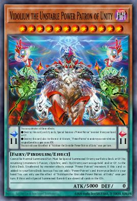

- **Copias y zona:** Main 1x. No altera las cantidades registradas.
- **Nombre oficial de referencia:** Vidolium el Inestable Modelo de Poder de Unidad. El inventario usa el nombre histórico «Vidrium»; Konami en español registra el CID como «Vidolium el Inestable Modelo de Poder de Unidad». Mantener alias original hasta cotejo visual.
- **Función principal y secundaria:** searcher · buscador · recuperación · extensor · removal.
- **Estado de sinergia y función:** Recurso Péndulo condicionado. Es una clasificación de juego; revisar la relación concreta en A06.
- **Papel como recurso, descarte o coste:** Material o destino del Extra condicionado a los requisitos de invocación.
- **Efecto operativo (paráfrasis analítica):** búsqueda o incorporación de cartas a mano; recuperación e invocación desde Cementerio/destierro; acceso al campo desde la mano; destrucción de cartas o empleo de destrucción como detonante; destierro de recursos o de amenazas; presión de combate o modificación de estadísticas; protección o resistencia contra respuestas. Son operaciones detectadas en el texto, no efectos independientes garantizados; leer sus condiciones en la fuente.
- **Efecto Péndulo:** además de su efecto de monstruo, la fuente oficial declara acciones propias de su Zona Péndulo; aplicar por separado sus requisitos, coste y límite (incluido en clasificación mecánica).
- **Mapa de activación y resultados:** 1) efecto propio o continuo: Invocación Especial desde Extra Deck · 2) con condición explícita en la carta: incorpora la pieza indicada a la mano · 3) al invocarse: destierra el recurso u objetivo previsto · 4) efecto propio o continuo: Invocación Especial desde Cementerio, destruye la carta o recurso previsto. Cada operación está sujeta a la secuencia y al «si lo haces» del texto oficial.
- **Ventanas de activación identificadas:** al producirse una Invocación.
- **Costes o recursos potenciales:** sin coste independiente identificado en esta síntesis; comprobar las acciones previas al punto y coma de cada efecto.
- **Restricciones y requisitos:** hay límite por turno según el efecto concreto; interactúa con información oculta o resultados no siempre elegibles; tiene procedimiento especial de Invocación. 
- **Prioridad al ir primero:** preparar Equipos, materiales Xyz y respuestas en turno rival. Para esta carta: Convertir la activación en acceso a la siguiente pieza del motor, sin duplicar buscadores inútilmente.
- **Prioridad al ir segundo:** retirar amenazas y después convertir la destrucción propia en ventaja. Identificar primero la respuesta rival que afecta su función «searcher».
- **Medio/tardío y recuperación:** reciclar piezas equipadas y cartas DoomZ del Cementerio. Verificar que el objetivo de recuperación continúe disponible.
- **Sinergias y acceso a líneas:** Relación contextual con destruir recursos DoomZ para ganar ventaja, equipar monstruos y transformarlos en Xyz Máquina de VIENTO. Habilita una línea del motor sólo si coinciden recursos, objetivos y restricciones; no equivale a un combo completo validado.
- **Riesgo / brick / interrupciones:** No computar como invocación normal disponible: depende de su procedimiento y de recursos previos. No atribuirle velocidad rápida por el solo hecho de formar parte del motor.
- **Utilidad editorial:** 5/5 para este deck (estimación por rol y zona, no probabilidad calculada). No cambiar copias; cualquier sugerencia de alta/baja pasa por el apartado 22 y aprobación.
- **Referencia oficial y trazabilidad:** https://www.db.yugioh-card.com/yugiohdb/card_search.action?cid=22519&ope=2&request_locale=es. **Confianza:** texto y tipo de efecto cotejados en Konami; síntesis táctica editorial, no demostración de combo.
- **Aplicación concreta dentro de este deck (A06):** Estar en Main permite activar Vidolium como Escala Péndulo; autodestruirse puede extender un Power Patron de mano/GY y su llegada boca arriba al Extra puede buscar Power Patron. La Invocación del monstruo de Nivel 12 sí necesita retornar Fusión + Sincronía + Xyz; no debe atribuirse sin prueba.

**USO PRÁCTICO Y SINERGIA — Vidrium, Modelo de Poder de la Exterminación del Caos**

- **Label funcional:** Sin sinergia demostrada (con la evidencia actual). Clasificación documental; una relación es válida solo si se satisfacen sus condiciones exactas.
- **Qué hace:** búsqueda o incorporación de cartas a mano; recuperación e invocación desde Cementerio/destierro; acceso al campo desde la mano; destrucción de cartas o empleo de destrucción como detonante; destierro de recursos o de amenazas; presión de combate o modificación de estadísticas; protección o resistencia contra respuestas. Son operaciones detectadas en el texto, no efectos independientes garantizados; leer sus condiciones en la fuente.
- **Cómo aprovecharla en este deck:** Estar en Main permite activar Vidolium como Escala Péndulo; autodestruirse puede extender un Power Patron de mano/GY y su llegada boca arriba al Extra puede buscar Power Patron. La Invocación del monstruo de Nivel 12 sí necesita retornar Fusión + Sincronía + Xyz; no debe atribuirse sin prueba.
- **Al jugar primero:** preparar Equipos, materiales Xyz y respuestas en turno rival. Para esta carta: Convertir la activación en acceso a la siguiente pieza del motor, sin duplicar buscadores inútilmente.
- **Al jugar segundo:** retirar amenazas y después convertir la destrucción propia en ventaja. Identificar primero la respuesta rival que afecta su función «searcher».
- **Cuándo tener precaución:** No computar como invocación normal disponible: depende de su procedimiento y de recursos previos. No atribuirle velocidad rápida por el solo hecho de formar parte del motor.

#### 16. Cambio DoomZ

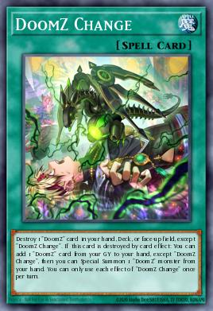

- **Copias y zona:** Main 3x. No altera las cantidades registradas.
- **Nombre oficial de referencia:** Cambio DoomZ. CID cotejado con la ficha oficial; el nombre histórico del inventario se conserva aunque su grafía/traducción difiera.
- **Función principal y secundaria:** searcher · buscador · extensor · removal.
- **Estado de sinergia y función:** Sinergia indirecta (soporte o recursos). Es una clasificación de juego; revisar la relación concreta en A06.
- **Papel como recurso, descarte o coste:** No se demuestra que esta carta sea recurso de descarte o pago para otra.
- **Efecto operativo (paráfrasis analítica):** búsqueda o incorporación de cartas a mano; acceso al campo desde la mano; destrucción de cartas o empleo de destrucción como detonante. Son operaciones detectadas en el texto, no efectos independientes garantizados; leer sus condiciones en la fuente.
- **Mapa de activación y resultados:** 1) efecto propio o continuo: destruye la carta o recurso previsto · 2) al destruirse: Invocación Especial desde Cementerio, incorpora la pieza indicada a la mano. Cada operación está sujeta a la secuencia y al «si lo haces» del texto oficial.
- **Ventanas de activación identificadas:** al destruirse.
- **Costes o recursos potenciales:** sin coste independiente identificado en esta síntesis; comprobar las acciones previas al punto y coma de cada efecto.
- **Restricciones y requisitos:** hay límite por turno según el efecto concreto; depende de recursos en Cementerio. 
- **Prioridad al ir primero:** preparar Equipos, materiales Xyz y respuestas en turno rival. Para esta carta: Convertir la activación en acceso a la siguiente pieza del motor, sin duplicar buscadores inútilmente.
- **Prioridad al ir segundo:** retirar amenazas y después convertir la destrucción propia en ventaja. Identificar primero la respuesta rival que afecta su función «searcher».
- **Medio/tardío y recuperación:** reciclar piezas equipadas y cartas DoomZ del Cementerio. No asumir que por sí misma recicla recursos si el texto no lo permite.
- **Sinergias y acceso a líneas:** Relación contextual con destruir recursos DoomZ para ganar ventaja, equipar monstruos y transformarlos en Xyz Máquina de VIENTO. Habilita una línea del motor sólo si coinciden recursos, objetivos y restricciones; no equivale a un combo completo validado.
- **Riesgo / brick / interrupciones:** Depende del Cementerio y es sensible a destierro o negación de ese recurso. No atribuirle velocidad rápida por el solo hecho de formar parte del motor.
- **Utilidad editorial:** 5/5 para este deck (estimación por rol y zona, no probabilidad calculada). No cambiar copias; cualquier sugerencia de alta/baja pasa por el apartado 22 y aprobación.
- **Referencia oficial y trazabilidad:** https://www.db.yugioh-card.com/yugiohdb/card_search.action?cid=22158&ope=2&request_locale=es. **Confianza:** texto y tipo de efecto cotejados en Konami; síntesis táctica editorial, no demostración de combo.
- **Aplicación concreta dentro de este deck (A06):** búsqueda o incorporación de cartas a mano; acceso al campo desde la mano; destrucción de cartas o empleo de destrucción como detonante.

**USO PRÁCTICO Y SINERGIA — Cambio DoomZ**

- **Label funcional:** Sinergia indirecta. Clasificación documental; una relación es válida solo si se satisfacen sus condiciones exactas.
- **Qué hace:** búsqueda o incorporación de cartas a mano; acceso al campo desde la mano; destrucción de cartas o empleo de destrucción como detonante. Son operaciones detectadas en el texto, no efectos independientes garantizados; leer sus condiciones en la fuente.
- **Cómo aprovecharla en este deck:** búsqueda o incorporación de cartas a mano; acceso al campo desde la mano; destrucción de cartas o empleo de destrucción como detonante.
- **Al jugar primero:** preparar Equipos, materiales Xyz y respuestas en turno rival. Para esta carta: Convertir la activación en acceso a la siguiente pieza del motor, sin duplicar buscadores inútilmente.
- **Al jugar segundo:** retirar amenazas y después convertir la destrucción propia en ventaja. Identificar primero la respuesta rival que afecta su función «searcher».
- **Cuándo tener precaución:** Depende del Cementerio y es sensible a destierro o negación de ese recurso. No atribuirle velocidad rápida por el solo hecho de formar parte del motor.

#### 17. Destrucción DoomZ

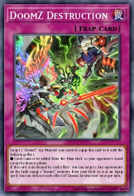

- **Copias y zona:** Main 1x. No altera las cantidades registradas.
- **Nombre oficial de referencia:** Destrucción DoomZ. CID cotejado con la ficha oficial; el nombre histórico del inventario se conserva aunque su grafía/traducción difiera.
- **Función principal y secundaria:** searcher · buscador · removal · respuesta · motor Equipo.
- **Estado de sinergia y función:** Sinergia indirecta (soporte o recursos). Es una clasificación de juego; revisar la relación concreta en A06.
- **Papel como recurso, descarte o coste:** No se demuestra que esta carta sea recurso de descarte o pago para otra.
- **Efecto operativo (paráfrasis analítica):** búsqueda o incorporación de cartas a mano; destrucción de cartas o empleo de destrucción como detonante; interacción sobre monstruos en campo; uso o producción de cartas equipadas. Son operaciones detectadas en el texto, no efectos independientes garantizados; leer sus condiciones en la fuente.
- **Mapa de activación y resultados:** 1) efecto propio o continuo: impide nuevas incorporaciones a mano. Cada operación está sujeta a la secuencia y al «si lo haces» del texto oficial.
- **Ventanas de activación identificadas:** al destruirse.
- **Costes o recursos potenciales:** sin coste independiente identificado en esta síntesis; comprobar las acciones previas al punto y coma de cada efecto.
- **Restricciones y requisitos:** hay límite por turno según el efecto concreto. 
- **Prioridad al ir primero:** preparar Equipos, materiales Xyz y respuestas en turno rival. Para esta carta: Convertir la activación en acceso a la siguiente pieza del motor, sin duplicar buscadores inútilmente.
- **Prioridad al ir segundo:** retirar amenazas y después convertir la destrucción propia en ventaja. Identificar primero la respuesta rival que afecta su función «searcher».
- **Medio/tardío y recuperación:** reciclar piezas equipadas y cartas DoomZ del Cementerio. No asumir que por sí misma recicla recursos si el texto no lo permite.
- **Sinergias y acceso a líneas:** Relación contextual con destruir recursos DoomZ para ganar ventaja, equipar monstruos y transformarlos en Xyz Máquina de VIENTO. Habilita una línea del motor sólo si coinciden recursos, objetivos y restricciones; no equivale a un combo completo validado.
- **Riesgo / brick / interrupciones:** Riesgo operativo: falta de Equipo/objetivo válido y cierres del Extra Deck a Xyz. Confirmar objetivos disponibles y costes antes de activar. No atribuirle velocidad rápida por el solo hecho de formar parte del motor.
- **Utilidad editorial:** 5/5 para este deck (estimación por rol y zona, no probabilidad calculada). No cambiar copias; cualquier sugerencia de alta/baja pasa por el apartado 22 y aprobación.
- **Referencia oficial y trazabilidad:** https://www.db.yugioh-card.com/yugiohdb/card_search.action?cid=21840&ope=2&request_locale=es. **Confianza:** texto y tipo de efecto cotejados en Konami; síntesis táctica editorial, no demostración de combo.
- **Aplicación concreta dentro de este deck (A06):** búsqueda o incorporación de cartas a mano; destrucción de cartas o empleo de destrucción como detonante; interacción sobre monstruos en campo; uso o producción de cartas equipadas.

**USO PRÁCTICO Y SINERGIA — Destrucción DoomZ**

- **Label funcional:** Sinergia indirecta. Clasificación documental; una relación es válida solo si se satisfacen sus condiciones exactas.
- **Qué hace:** búsqueda o incorporación de cartas a mano; destrucción de cartas o empleo de destrucción como detonante; interacción sobre monstruos en campo; uso o producción de cartas equipadas. Son operaciones detectadas en el texto, no efectos independientes garantizados; leer sus condiciones en la fuente.
- **Cómo aprovecharla en este deck:** búsqueda o incorporación de cartas a mano; destrucción de cartas o empleo de destrucción como detonante; interacción sobre monstruos en campo; uso o producción de cartas equipadas.
- **Al jugar primero:** preparar Equipos, materiales Xyz y respuestas en turno rival. Para esta carta: Convertir la activación en acceso a la siguiente pieza del motor, sin duplicar buscadores inútilmente.
- **Al jugar segundo:** retirar amenazas y después convertir la destrucción propia en ventaja. Identificar primero la respuesta rival que afecta su función «searcher».
- **Cuándo tener precaución:** Riesgo operativo: falta de Equipo/objetivo válido y cierres del Extra Deck a Xyz. Confirmar objetivos disponibles y costes antes de activar. No atribuirle velocidad rápida por el solo hecho de formar parte del motor.

#### 18. Mando DoomZ «A.D.R.A.S.T.E.I.A.»

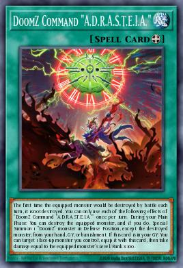

- **Copias y zona:** Main 1x. No altera las cantidades registradas.
- **Nombre oficial de referencia:** Mando DoomZ "A.D.R.A.S.T.E.I.A.". CID cotejado con la ficha oficial; el nombre histórico del inventario se conserva aunque su grafía/traducción difiera.
- **Función principal y secundaria:** extensor · cierre · respuesta · motor Equipo.
- **Estado de sinergia y función:** Sinergia indirecta (soporte o recursos). Es una clasificación de juego; revisar la relación concreta en A06.
- **Papel como recurso, descarte o coste:** No se demuestra que esta carta sea recurso de descarte o pago para otra.
- **Efecto operativo (paráfrasis analítica):** acceso al campo desde la mano; presión de combate o modificación de estadísticas; interacción sobre monstruos en campo; uso o producción de cartas equipadas. Son operaciones detectadas en el texto, no efectos independientes garantizados; leer sus condiciones en la fuente.
- **Mapa de activación y resultados:** 1) efecto propio o continuo: equipa carta/monstruo según texto · 2) en Main Phase: Invocación Especial desde Cementerio, destruye la carta o recurso previsto, equipa carta/monstruo según texto · 3) mientras está en Cementerio: equipa carta/monstruo según texto. Cada operación está sujeta a la secuencia y al «si lo haces» del texto oficial.
- **Ventanas de activación identificadas:** Main Phase; al llegar o estar en el Cementerio.
- **Costes o recursos potenciales:** sin coste independiente identificado en esta síntesis; comprobar las acciones previas al punto y coma de cada efecto.
- **Restricciones y requisitos:** hay límite por turno según el efecto concreto; depende de recursos en Cementerio. 
- **Prioridad al ir primero:** preparar Equipos, materiales Xyz y respuestas en turno rival. Para esta carta: Activar cuando las condiciones permitan obtener valor real, preservando recursos de seguimiento.
- **Prioridad al ir segundo:** retirar amenazas y después convertir la destrucción propia en ventaja. Identificar primero la respuesta rival que afecta su función «extensor».
- **Medio/tardío y recuperación:** reciclar piezas equipadas y cartas DoomZ del Cementerio. No asumir que por sí misma recicla recursos si el texto no lo permite.
- **Sinergias y acceso a líneas:** Relación contextual con destruir recursos DoomZ para ganar ventaja, equipar monstruos y transformarlos en Xyz Máquina de VIENTO. Habilita una línea del motor sólo si coinciden recursos, objetivos y restricciones; no equivale a un combo completo validado.
- **Riesgo / brick / interrupciones:** Depende del Cementerio y es sensible a destierro o negación de ese recurso. No atribuirle velocidad rápida por el solo hecho de formar parte del motor.
- **Utilidad editorial:** 4/5 para este deck (estimación por rol y zona, no probabilidad calculada). No cambiar copias; cualquier sugerencia de alta/baja pasa por el apartado 22 y aprobación.
- **Referencia oficial y trazabilidad:** https://www.db.yugioh-card.com/yugiohdb/card_search.action?cid=22567&ope=2&request_locale=es. **Confianza:** texto y tipo de efecto cotejados en Konami; síntesis táctica editorial, no demostración de combo.
- **Aplicación concreta dentro de este deck (A06):** acceso al campo desde la mano; presión de combate o modificación de estadísticas; interacción sobre monstruos en campo; uso o producción de cartas equipadas.

**USO PRÁCTICO Y SINERGIA — Mando DoomZ «A.D.R.A.S.T.E.I.A.»**

- **Label funcional:** Sinergia indirecta. Clasificación documental; una relación es válida solo si se satisfacen sus condiciones exactas.
- **Qué hace:** acceso al campo desde la mano; presión de combate o modificación de estadísticas; interacción sobre monstruos en campo; uso o producción de cartas equipadas. Son operaciones detectadas en el texto, no efectos independientes garantizados; leer sus condiciones en la fuente.
- **Cómo aprovecharla en este deck:** acceso al campo desde la mano; presión de combate o modificación de estadísticas; interacción sobre monstruos en campo; uso o producción de cartas equipadas.
- **Al jugar primero:** preparar Equipos, materiales Xyz y respuestas en turno rival. Para esta carta: Activar cuando las condiciones permitan obtener valor real, preservando recursos de seguimiento.
- **Al jugar segundo:** retirar amenazas y después convertir la destrucción propia en ventaja. Identificar primero la respuesta rival que afecta su función «extensor».
- **Cuándo tener precaución:** Depende del Cementerio y es sensible a destierro o negación de ese recurso. No atribuirle velocidad rápida por el solo hecho de formar parte del motor.

#### 19. Número F0: Futuro Draco Utópico

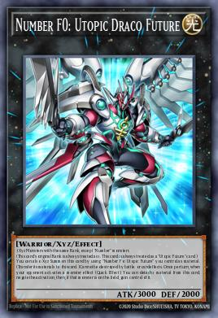

- **Copias y zona:** Extra 1x. No altera las cantidades registradas.
- **Nombre oficial de referencia:** Número F0: Futuro Draco Utópico. CID cotejado con la ficha oficial; el nombre histórico del inventario se conserva aunque su grafía/traducción difiera.
- **Función principal y secundaria:** interrupción · resultado de Extra Deck · negación · habilitador Xyz · protección.
- **Estado de sinergia y función:** Sin acceso al Extra demostrado. Es una clasificación de juego; revisar la relación concreta en A06.
- **Papel como recurso, descarte o coste:** Material o destino del Extra condicionado a los requisitos de invocación.
- **Efecto operativo (paráfrasis analítica):** negación de efectos o activaciones; gestión de materiales Xyz; protección o resistencia contra respuestas. Son operaciones detectadas en el texto, no efectos independientes garantizados; leer sus condiciones en la fuente.
- **Mapa de activación y resultados:** 1) en respuesta a activación rival: niega el efecto o la activación indicada, desacopla materiales Xyz. Cada operación está sujeta a la secuencia y al «si lo haces» del texto oficial.
- **Ventanas de activación identificadas:** respuesta a activación rival; Efecto Rápido.
- **Costes o recursos potenciales:** sin coste independiente identificado en esta síntesis; comprobar las acciones previas al punto y coma de cada efecto.
- **Restricciones y requisitos:** hay límite por turno según el efecto concreto. Invocar sólo desde el Extra Deck usando su procedimiento propio.
- **Prioridad al ir primero:** preparar Equipos, materiales Xyz y respuestas en turno rival. Para esta carta: Reservar la respuesta para la ventana rival exacta; no es una pieza buscadora de nuestro motor.
- **Prioridad al ir segundo:** retirar amenazas y después convertir la destrucción propia en ventaja. Identificar primero la respuesta rival que afecta su función «interrupción».
- **Medio/tardío y recuperación:** reciclar piezas equipadas y cartas DoomZ del Cementerio. No asumir que por sí misma recicla recursos si el texto no lo permite.
- **Sinergias y acceso a líneas:** Relación contextual con destruir recursos DoomZ para ganar ventaja, equipar monstruos y transformarlos en Xyz Máquina de VIENTO. Puede cerrar o prolongar una ruta del Extra si los materiales están disponibles.
- **Riesgo / brick / interrupciones:** Se agota al consumir materiales; no asumir material adicional al pasar de un Xyz a otro. Puede emplearse en cadena sólo cuando se cumpla su condición concreta.
- **Utilidad editorial:** 4/5 para este deck (estimación por rol y zona, no probabilidad calculada). No cambiar copias; cualquier sugerencia de alta/baja pasa por el apartado 22 y aprobación.
- **Referencia oficial y trazabilidad:** https://www.db.yugioh-card.com/yugiohdb/card_search.action?cid=14958&ope=2&request_locale=es. **Confianza:** texto y tipo de efecto cotejados en Konami; síntesis táctica editorial, no demostración de combo.
- **Aplicación concreta dentro de este deck (A06):** negación de efectos o activaciones; gestión de materiales Xyz; protección o resistencia contra respuestas. Falta arista de materiales en A06; A09 podría contener una ruta válida no indexada aquí.

**USO PRÁCTICO Y SINERGIA — Número F0: Futuro Draco Utópico**

- **Label funcional:** Sin sinergia demostrada (con la evidencia actual). Clasificación documental; una relación es válida solo si se satisfacen sus condiciones exactas.
- **Qué hace:** negación de efectos o activaciones; gestión de materiales Xyz; protección o resistencia contra respuestas. Son operaciones detectadas en el texto, no efectos independientes garantizados; leer sus condiciones en la fuente.
- **Cómo aprovecharla en este deck:** negación de efectos o activaciones; gestión de materiales Xyz; protección o resistencia contra respuestas. Falta arista de materiales en A06; A09 podría contener una ruta válida no indexada aquí.
- **Al jugar primero:** preparar Equipos, materiales Xyz y respuestas en turno rival. Para esta carta: Reservar la respuesta para la ventana rival exacta; no es una pieza buscadora de nuestro motor.
- **Al jugar segundo:** retirar amenazas y después convertir la destrucción propia en ventaja. Identificar primero la respuesta rival que afecta su función «interrupción».
- **Cuándo tener precaución:** Se agota al consumir materiales; no asumir material adicional al pasar de un Xyz a otro. Puede emplearse en cadena sólo cuando se cumpla su condición concreta.

**CÓMO LLEGAR DESDE TU DECK — SIN RUTA DEMOSTRADA**

- La biblioteca actual no contiene una ruta identificada para esta carta del Extra. No se debe exhibir una descripción genérica como sustituto de mano inicial, materiales y pasos. Para completarla, contrastar requisitos oficiales y recursos del Main; si no es alcanzable, explicar el impedimento exacto.

#### 20. Springans Fiestero

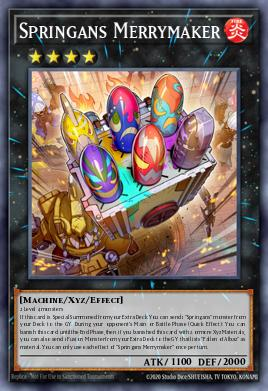

- **Copias y zona:** Extra 1x. No altera las cantidades registradas.
- **Nombre oficial de referencia:** Springans Fiestero. CID cotejado con la ficha oficial; el nombre histórico del inventario se conserva aunque su grafía/traducción difiera.
- **Función principal y secundaria:** interrupción · resultado de Extra Deck · extensor · recuperación · habilitador Xyz.
- **Estado de sinergia y función:** Sin acceso al Extra demostrado. Es una clasificación de juego; revisar la relación concreta en A06.
- **Papel como recurso, descarte o coste:** Material o destino del Extra condicionado a los requisitos de invocación.
- **Efecto operativo (paráfrasis analítica):** extensión mediante monstruos procedentes del Deck; recuperación e invocación desde Cementerio/destierro; gestión de materiales Xyz. Son operaciones detectadas en el texto, no efectos independientes garantizados; leer sus condiciones en la fuente.
- **Mapa de activación y resultados:** efecto de estadística, condición o material; no asumir un disparador adicional. Cada operación está sujeta a la secuencia y al «si lo haces» del texto oficial.
- **Ventanas de activación identificadas:** al producirse una Invocación; Efecto Rápido.
- **Costes o recursos potenciales:** sin coste independiente identificado en esta síntesis; comprobar las acciones previas al punto y coma de cada efecto.
- **Restricciones y requisitos:** hay límite por turno según el efecto concreto; exige materiales de Extra Deck o materiales adecuados. Invocar sólo desde el Extra Deck usando su procedimiento propio.
- **Prioridad al ir primero:** preparar Equipos, materiales Xyz y respuestas en turno rival. Para esta carta: Reservar la respuesta para la ventana rival exacta; no es una pieza buscadora de nuestro motor.
- **Prioridad al ir segundo:** retirar amenazas y después convertir la destrucción propia en ventaja. Identificar primero la respuesta rival que afecta su función «interrupción».
- **Medio/tardío y recuperación:** reciclar piezas equipadas y cartas DoomZ del Cementerio. Verificar que el objetivo de recuperación continúe disponible.
- **Sinergias y acceso a líneas:** Relación contextual con destruir recursos DoomZ para ganar ventaja, equipar monstruos y transformarlos en Xyz Máquina de VIENTO. Puede cerrar o prolongar una ruta del Extra si los materiales están disponibles.
- **Riesgo / brick / interrupciones:** No contarla como extensión automática: confirmar materiales, procedimiento y restricciones vigentes. Puede emplearse en cadena sólo cuando se cumpla su condición concreta.
- **Utilidad editorial:** 4/5 para este deck (estimación por rol y zona, no probabilidad calculada). No cambiar copias; cualquier sugerencia de alta/baja pasa por el apartado 22 y aprobación.
- **Referencia oficial y trazabilidad:** https://www.db.yugioh-card.com/yugiohdb/card_search.action?cid=16002&ope=2&request_locale=es. **Confianza:** texto y tipo de efecto cotejados en Konami; síntesis táctica editorial, no demostración de combo.
- **Aplicación concreta dentro de este deck (A06):** extensión mediante monstruos procedentes del Deck; recuperación e invocación desde Cementerio/destierro; gestión de materiales Xyz. Falta arista de materiales en A06; A09 podría contener una ruta válida no indexada aquí.

**USO PRÁCTICO Y SINERGIA — Springans Fiestero**

- **Label funcional:** Sin sinergia demostrada (con la evidencia actual). Clasificación documental; una relación es válida solo si se satisfacen sus condiciones exactas.
- **Qué hace:** extensión mediante monstruos procedentes del Deck; recuperación e invocación desde Cementerio/destierro; gestión de materiales Xyz. Son operaciones detectadas en el texto, no efectos independientes garantizados; leer sus condiciones en la fuente.
- **Cómo aprovecharla en este deck:** extensión mediante monstruos procedentes del Deck; recuperación e invocación desde Cementerio/destierro; gestión de materiales Xyz. Falta arista de materiales en A06; A09 podría contener una ruta válida no indexada aquí.
- **Al jugar primero:** preparar Equipos, materiales Xyz y respuestas en turno rival. Para esta carta: Reservar la respuesta para la ventana rival exacta; no es una pieza buscadora de nuestro motor.
- **Al jugar segundo:** retirar amenazas y después convertir la destrucción propia en ventaja. Identificar primero la respuesta rival que afecta su función «interrupción».
- **Cuándo tener precaución:** No contarla como extensión automática: confirmar materiales, procedimiento y restricciones vigentes. Puede emplearse en cadena sólo cuando se cumpla su condición concreta.

**CÓMO LLEGAR DESDE TU DECK — SIN RUTA DEMOSTRADA**

- La biblioteca actual no contiene una ruta identificada para esta carta del Extra. No se debe exhibir una descripción genérica como sustituto de mano inicial, materiales y pasos. Para completarla, contrastar requisitos oficiales y recursos del Main; si no es alcanzable, explicar el impedimento exacto.

#### 21. Gigantesco «Campeón» Sargas

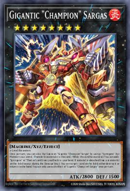

- **Copias y zona:** Extra 1x. No altera las cantidades registradas.
- **Nombre oficial de referencia:** Gigantesco "Campeón" Sargas. CID cotejado con la ficha oficial; el nombre histórico del inventario se conserva aunque su grafía/traducción difiera.
- **Función principal y secundaria:** resultado de Extra Deck · buscador · habilitador Xyz.
- **Estado de sinergia y función:** Sin acceso al Extra demostrado. Es una clasificación de juego; revisar la relación concreta en A06.
- **Papel como recurso, descarte o coste:** Material o destino del Extra condicionado a los requisitos de invocación.
- **Efecto operativo (paráfrasis analítica):** búsqueda o incorporación de cartas a mano; gestión de materiales Xyz. Son operaciones detectadas en el texto, no efectos independientes garantizados; leer sus condiciones en la fuente.
- **Mapa de activación y resultados:** 1) con condición explícita en la carta: incorpora la pieza indicada a la mano. Cada operación está sujeta a la secuencia y al «si lo haces» del texto oficial.
- **Ventanas de activación identificadas:** requieren la fase o condición específica indicada en el texto; sin ventana rápida general asumida.
- **Costes o recursos potenciales:** sin coste independiente identificado en esta síntesis; comprobar las acciones previas al punto y coma de cada efecto.
- **Restricciones y requisitos:** hay límite por turno según el efecto concreto. Invocar sólo desde el Extra Deck usando su procedimiento propio.
- **Prioridad al ir primero:** preparar Equipos, materiales Xyz y respuestas en turno rival. Para esta carta: Comprobar materiales exactos antes de buscar este objetivo en el Extra Deck.
- **Prioridad al ir segundo:** retirar amenazas y después convertir la destrucción propia en ventaja. Identificar primero la respuesta rival que afecta su función «resultado de Extra Deck».
- **Medio/tardío y recuperación:** reciclar piezas equipadas y cartas DoomZ del Cementerio. No asumir que por sí misma recicla recursos si el texto no lo permite.
- **Sinergias y acceso a líneas:** Relación contextual con destruir recursos DoomZ para ganar ventaja, equipar monstruos y transformarlos en Xyz Máquina de VIENTO. Puede cerrar o prolongar una ruta del Extra si los materiales están disponibles.
- **Riesgo / brick / interrupciones:** Se agota al consumir materiales; no asumir material adicional al pasar de un Xyz a otro. No atribuirle velocidad rápida por el solo hecho de formar parte del motor.
- **Utilidad editorial:** 4/5 para este deck (estimación por rol y zona, no probabilidad calculada). No cambiar copias; cualquier sugerencia de alta/baja pasa por el apartado 22 y aprobación.
- **Referencia oficial y trazabilidad:** https://www.db.yugioh-card.com/yugiohdb/card_search.action?cid=18190&ope=2&request_locale=es. **Confianza:** texto y tipo de efecto cotejados en Konami; síntesis táctica editorial, no demostración de combo.
- **Aplicación concreta dentro de este deck (A06):** búsqueda o incorporación de cartas a mano; gestión de materiales Xyz. Falta arista de materiales en A06; A09 podría contener una ruta válida no indexada aquí.

**USO PRÁCTICO Y SINERGIA — Gigantesco «Campeón» Sargas**

- **Label funcional:** Sin sinergia demostrada (con la evidencia actual). Clasificación documental; una relación es válida solo si se satisfacen sus condiciones exactas.
- **Qué hace:** búsqueda o incorporación de cartas a mano; gestión de materiales Xyz. Son operaciones detectadas en el texto, no efectos independientes garantizados; leer sus condiciones en la fuente.
- **Cómo aprovecharla en este deck:** búsqueda o incorporación de cartas a mano; gestión de materiales Xyz. Falta arista de materiales en A06; A09 podría contener una ruta válida no indexada aquí.
- **Al jugar primero:** preparar Equipos, materiales Xyz y respuestas en turno rival. Para esta carta: Comprobar materiales exactos antes de buscar este objetivo en el Extra Deck.
- **Al jugar segundo:** retirar amenazas y después convertir la destrucción propia en ventaja. Identificar primero la respuesta rival que afecta su función «resultado de Extra Deck».
- **Cuándo tener precaución:** Se agota al consumir materiales; no asumir material adicional al pasar de un Xyz a otro. No atribuirle velocidad rápida por el solo hecho de formar parte del motor.

**CÓMO LLEGAR DESDE TU DECK — SIN RUTA DEMOSTRADA**

- La biblioteca actual no contiene una ruta identificada para esta carta del Extra. No se debe exhibir una descripción genérica como sustituto de mano inicial, materiales y pasos. Para completarla, contrastar requisitos oficiales y recursos del Main; si no es alcanzable, explicar el impedimento exacto.

#### 22. DoomZ XII Fin - Drastrius

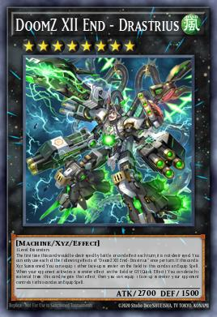

- **Copias y zona:** Extra 2x. No altera las cantidades registradas.
- **Nombre oficial de referencia:** DoomZ XII Fin - Drastrius. CID cotejado con la ficha oficial; el nombre histórico del inventario se conserva aunque su grafía/traducción difiera.
- **Función principal y secundaria:** interrupción · resultado de Extra Deck · negación · habilitador Xyz · motor Equipo.
- **Estado de sinergia y función:** Destino Extra condicionado. Es una clasificación de juego; revisar la relación concreta en A06.
- **Papel como recurso, descarte o coste:** Material o destino del Extra condicionado a los requisitos de invocación.
- **Efecto operativo (paráfrasis analítica):** negación de efectos o activaciones; gestión de materiales Xyz; uso o producción de cartas equipadas. Son operaciones detectadas en el texto, no efectos independientes garantizados; leer sus condiciones en la fuente.
- **Mapa de activación y resultados:** 1) tras su invocación desde el Extra: equipa carta/monstruo según texto · 2) en respuesta a activación rival: niega el efecto o la activación indicada, desacopla materiales Xyz, equipa carta/monstruo según texto. Cada operación está sujeta a la secuencia y al «si lo haces» del texto oficial.
- **Ventanas de activación identificadas:** al producirse una Invocación; respuesta a activación rival; Efecto Rápido.
- **Costes o recursos potenciales:** sin coste independiente identificado en esta síntesis; comprobar las acciones previas al punto y coma de cada efecto.
- **Restricciones y requisitos:** hay límite por turno según el efecto concreto. Invocar sólo desde el Extra Deck usando su procedimiento propio.
- **Prioridad al ir primero:** preparar Equipos, materiales Xyz y respuestas en turno rival. Para esta carta: Reservar la respuesta para la ventana rival exacta; no es una pieza buscadora de nuestro motor.
- **Prioridad al ir segundo:** retirar amenazas y después convertir la destrucción propia en ventaja. Identificar primero la respuesta rival que afecta su función «interrupción».
- **Medio/tardío y recuperación:** reciclar piezas equipadas y cartas DoomZ del Cementerio. No asumir que por sí misma recicla recursos si el texto no lo permite.
- **Sinergias y acceso a líneas:** Relación contextual con destruir recursos DoomZ para ganar ventaja, equipar monstruos y transformarlos en Xyz Máquina de VIENTO. Puede cerrar o prolongar una ruta del Extra si los materiales están disponibles.
- **Riesgo / brick / interrupciones:** Se agota al consumir materiales; no asumir material adicional al pasar de un Xyz a otro. Puede emplearse en cadena sólo cuando se cumpla su condición concreta.
- **Utilidad editorial:** 4/5 para este deck (estimación por rol y zona, no probabilidad calculada). No cambiar copias; cualquier sugerencia de alta/baja pasa por el apartado 22 y aprobación.
- **Referencia oficial y trazabilidad:** https://www.db.yugioh-card.com/yugiohdb/card_search.action?cid=21811&ope=2&request_locale=es. **Confianza:** texto y tipo de efecto cotejados en Konami; síntesis táctica editorial, no demostración de combo.
- **Aplicación concreta dentro de este deck (A06):** negación de efectos o activaciones; gestión de materiales Xyz; uso o producción de cartas equipadas. A06 identifica su destino, condicionado a material/procedimiento.

**USO PRÁCTICO Y SINERGIA — DoomZ XII Fin - Drastrius**

- **Label funcional:** Referencias de ruta localizadas; conexión reglamentaria sujeta al recorrido de la guía. Clasificación documental; una relación es válida solo si se satisfacen sus condiciones exactas.
- **Qué hace:** negación de efectos o activaciones; gestión de materiales Xyz; uso o producción de cartas equipadas. Son operaciones detectadas en el texto, no efectos independientes garantizados; leer sus condiciones en la fuente.
- **Cómo aprovecharla en este deck:** negación de efectos o activaciones; gestión de materiales Xyz; uso o producción de cartas equipadas. A06 identifica su destino, condicionado a material/procedimiento.
- **Al jugar primero:** preparar Equipos, materiales Xyz y respuestas en turno rival. Para esta carta: Reservar la respuesta para la ventana rival exacta; no es una pieza buscadora de nuestro motor.
- **Al jugar segundo:** retirar amenazas y después convertir la destrucción propia en ventaja. Identificar primero la respuesta rival que afecta su función «interrupción».
- **Cuándo tener precaución:** Se agota al consumir materiales; no asumir material adicional al pasar de un Xyz a otro. Puede emplearse en cadena sólo cuando se cumpla su condición concreta.

**CÓMO LLEGAR DESDE TU DECK — RUTAS DOCUMENTADAS**

- **Abrir guía `653:A09:RAIDERS:ELARA:DRAS01`:** entrada: Incursores DoomZ (21823, Mágica Continua) + DoomZ VII Siete - Elara (21776, Nivel 4). Campo y GY propios vacíos; en Main Deck queda Drastea (21774) y al menos un Mando DoomZ D.O.O.M.D.U.R.G. (21824, Equipo); en Extra Drastrius (21811, Xyz Máquina de VIENTO Rango 8). Main Phase propia; no respuesta rival ni cartas adversarias seleccionables.. Propósito descrito: Preparación de recursos / despliegue. Consulta sus pasos, consumo y resultado; comprobar si esta carta es realmente invocada o solo mencionada.
- **Abrir guía `653:A09:RAIDERS:AMALTHE:DRAS02`:** entrada: Incursores (21823) + Amalthe (21775, Nivel 4); campo/GY vacíos. En Main Deck quedan al menos 1 Drastea, 1 Elara y 1 Mando; Drastrius en Extra. Sin respuesta rival.. Propósito descrito: Preparación de recursos / despliegue. Consulta sus pasos, consumo y resultado; comprobar si esta carta es realmente invocada o solo mencionada.
- **Abrir guía `653:A09:RAIDERS:CHANGE:DRAS03`:** entrada: Incursores Incursores DoomZ (21823) + Cambio Cambio DoomZ (22158). Main Phase propia; Campo y Cementerio propios vacíos; rival sin respuestas. Deben permanecer en el Main Deck Amalthe (21775), Drastea (21774) y Mando DoomZ «D.O.O.M.D.U.R.G.» (21824), y en el Extra Drastrius (21811). La carta Cambio en la mano NO puede destruirse a sí misma con su propio efecto.. Propósito descrito: Preparación de recursos / despliegue. Consulta sus pasos, consumo y resultado; comprobar si esta carta es realmente invocada o solo mencionada.
- **Abrir guía `653:A09:MEDIUS:POWERPATRON:DIACTORUS:DRAS05`:** entrada: Medius Medius el Puro (21419) como única carta de mano; Campo/GY propios vacíos, Main Phase propia, sin respuesta rival. En Main permanecen DoomZ Modelo de Poder (21777), Cambio (22158), Amalthe (21775), Drastea (21774), Mando D.O.O.M.D.U.R.G. (21824) y, para recuperación opcional, Mando A.D.R.A.S.T.E.I.A. (22567); Extra conserva Diactorus (21812) y Drastrius (21811).. Propósito descrito: Preparación de recursos / despliegue. Consulta sus pasos, consumo y resultado; comprobar si esta carta es realmente invocada o solo mencionada.
- **Abrir guía `653:A09:MEDIUS:GRAFLAREIO:DRAS06`:** entrada: Medius Medius como única carta inicial; sin Campo/GY propios, Main Phase y sin interrupción rival. En Deck quedan DoomZ Modelo de Poder, Incursores, Cambio, Elara, Amalthe, Drastea y los dos Equipos Mando indicados; en Extra, Diactorus, Graflareio (22554), Drastrius. Ruta ramificada respecto de A09-05: en vez de destruir Modelo de Poder con Diactorus, lo pierde por el cambio Xyz a Graflareio.. Propósito descrito: Ofensivo condicional. Consulta sus pasos, consumo y resultado; comprobar si esta carta es realmente invocada o solo mencionada.
- **Abrir guía `653:A09:CHANGE:POWERPATRON:GRAFLAREIO:DRAS07`:** entrada: Cambio Cambio DoomZ (22158); propio Campo y GY vacíos, Main Phase propia y oponente sin respuestas. Deben quedar en Main Deck: DoomZ Modelo de Poder (21777), dos copias distintas de Elara (21776), al menos una Amalthe (21775), Drastea (21774), Incursores (21823) y las dos copias de Mando D.O.O.M.D.U.R.G. (21824). Extra: Diactorus (21812), Graflareio (22554) y Drastrius (21811). Esta línea consume las dos copias de Mando en destinos diferentes.. Propósito descrito: Preparación de recursos / despliegue. Consulta sus pasos, consumo y resultado; comprobar si esta carta es realmente invocada o solo mencionada.

#### 23. DoomZ XIII Over - Graflario

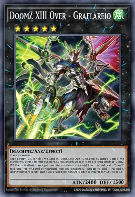

- **Copias y zona:** Extra 2x. No altera las cantidades registradas.
- **Nombre oficial de referencia:** DoomZ XIII Supremo - Graflareio. CID cotejado con la ficha oficial; el nombre histórico del inventario se conserva aunque su grafía/traducción difiera.
- **Función principal y secundaria:** resultado de Extra Deck · buscador · extensor · recuperación · habilitador Xyz.
- **Estado de sinergia y función:** Destino Extra condicionado. Es una clasificación de juego; revisar la relación concreta en A06.
- **Papel como recurso, descarte o coste:** Material o destino del Extra condicionado a los requisitos de invocación.
- **Efecto operativo (paráfrasis analítica):** búsqueda o incorporación de cartas a mano; extensión mediante monstruos procedentes del Deck; recuperación e invocación desde Cementerio/destierro; gestión de materiales Xyz. Son operaciones detectadas en el texto, no efectos independientes garantizados; leer sus condiciones en la fuente.
- **Mapa de activación y resultados:** 1) efecto propio o continuo: incorpora la pieza indicada a la mano, destruye la carta o recurso previsto, desacopla materiales Xyz · 2) al destruirse: Invocación Especial desde Deck. Cada operación está sujeta a la secuencia y al «si lo haces» del texto oficial.
- **Ventanas de activación identificadas:** al destruirse.
- **Costes o recursos potenciales:** sin coste independiente identificado en esta síntesis; comprobar las acciones previas al punto y coma de cada efecto.
- **Restricciones y requisitos:** hay límite por turno según el efecto concreto. Invocar sólo desde el Extra Deck usando su procedimiento propio.
- **Prioridad al ir primero:** preparar Equipos, materiales Xyz y respuestas en turno rival. Para esta carta: Convertir acceso al Deck en cuerpos o materiales antes de bloquearse con restricciones.
- **Prioridad al ir segundo:** retirar amenazas y después convertir la destrucción propia en ventaja. Identificar primero la respuesta rival que afecta su función «resultado de Extra Deck».
- **Medio/tardío y recuperación:** reciclar piezas equipadas y cartas DoomZ del Cementerio. Verificar que el objetivo de recuperación continúe disponible.
- **Sinergias y acceso a líneas:** Relación contextual con destruir recursos DoomZ para ganar ventaja, equipar monstruos y transformarlos en Xyz Máquina de VIENTO. Puede cerrar o prolongar una ruta del Extra si los materiales están disponibles.
- **Riesgo / brick / interrupciones:** Se agota al consumir materiales; no asumir material adicional al pasar de un Xyz a otro. No atribuirle velocidad rápida por el solo hecho de formar parte del motor.
- **Utilidad editorial:** 4/5 para este deck (estimación por rol y zona, no probabilidad calculada). No cambiar copias; cualquier sugerencia de alta/baja pasa por el apartado 22 y aprobación.
- **Referencia oficial y trazabilidad:** https://www.db.yugioh-card.com/yugiohdb/card_search.action?cid=22554&ope=2&request_locale=es. **Confianza:** texto y tipo de efecto cotejados en Konami; síntesis táctica editorial, no demostración de combo.
- **Aplicación concreta dentro de este deck (A06):** búsqueda o incorporación de cartas a mano; extensión mediante monstruos procedentes del Deck; recuperación e invocación desde Cementerio/destierro; gestión de materiales Xyz. A06 identifica su destino, condicionado a material/procedimiento.

**USO PRÁCTICO Y SINERGIA — DoomZ XIII Over - Graflario**

- **Label funcional:** Referencias de ruta localizadas; conexión reglamentaria sujeta al recorrido de la guía. Clasificación documental; una relación es válida solo si se satisfacen sus condiciones exactas.
- **Qué hace:** búsqueda o incorporación de cartas a mano; extensión mediante monstruos procedentes del Deck; recuperación e invocación desde Cementerio/destierro; gestión de materiales Xyz. Son operaciones detectadas en el texto, no efectos independientes garantizados; leer sus condiciones en la fuente.
- **Cómo aprovecharla en este deck:** búsqueda o incorporación de cartas a mano; extensión mediante monstruos procedentes del Deck; recuperación e invocación desde Cementerio/destierro; gestión de materiales Xyz. A06 identifica su destino, condicionado a material/procedimiento.
- **Al jugar primero:** preparar Equipos, materiales Xyz y respuestas en turno rival. Para esta carta: Convertir acceso al Deck en cuerpos o materiales antes de bloquearse con restricciones.
- **Al jugar segundo:** retirar amenazas y después convertir la destrucción propia en ventaja. Identificar primero la respuesta rival que afecta su función «resultado de Extra Deck».
- **Cuándo tener precaución:** Se agota al consumir materiales; no asumir material adicional al pasar de un Xyz a otro. No atribuirle velocidad rápida por el solo hecho de formar parte del motor.

**CÓMO LLEGAR DESDE TU DECK — RUTAS DOCUMENTADAS**

- **Abrir guía `653:A09:MEDIUS:GRAFLAREIO:DRAS06`:** entrada: Medius Medius como única carta inicial; sin Campo/GY propios, Main Phase y sin interrupción rival. En Deck quedan DoomZ Modelo de Poder, Incursores, Cambio, Elara, Amalthe, Drastea y los dos Equipos Mando indicados; en Extra, Diactorus, Graflareio (22554), Drastrius. Ruta ramificada respecto de A09-05: en vez de destruir Modelo de Poder con Diactorus, lo pierde por el cambio Xyz a Graflareio.. Propósito descrito: Ofensivo condicional. Consulta sus pasos, consumo y resultado; comprobar si esta carta es realmente invocada o solo mencionada.
- **Abrir guía `653:A09:CHANGE:POWERPATRON:GRAFLAREIO:DRAS07`:** entrada: Cambio Cambio DoomZ (22158); propio Campo y GY vacíos, Main Phase propia y oponente sin respuestas. Deben quedar en Main Deck: DoomZ Modelo de Poder (21777), dos copias distintas de Elara (21776), al menos una Amalthe (21775), Drastea (21774), Incursores (21823) y las dos copias de Mando D.O.O.M.D.U.R.G. (21824). Extra: Diactorus (21812), Graflareio (22554) y Drastrius (21811). Esta línea consume las dos copias de Mando en destinos diferentes.. Propósito descrito: Preparación de recursos / despliegue. Consulta sus pasos, consumo y resultado; comprobar si esta carta es realmente invocada o solo mencionada.

#### 24. Fractura DoomZ - Diactorus

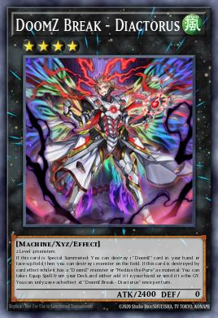

- **Copias y zona:** Extra 2x. No altera las cantidades registradas.
- **Nombre oficial de referencia:** Fractura DoomZ - Diactorus. CID cotejado con la ficha oficial; el nombre histórico del inventario se conserva aunque su grafía/traducción difiera.
- **Función principal y secundaria:** resultado de Extra Deck · extensor · motor Equipo.
- **Estado de sinergia y función:** Destino Extra condicionado. Es una clasificación de juego; revisar la relación concreta en A06.
- **Papel como recurso, descarte o coste:** Material o destino del Extra condicionado a los requisitos de invocación.
- **Efecto operativo (paráfrasis analítica):** acceso al campo desde la mano; uso o producción de cartas equipadas. Son operaciones detectadas en el texto, no efectos independientes garantizados; leer sus condiciones en la fuente.
- **Mapa de activación y resultados:** 1) al invocarse: destruye la carta o recurso previsto. Cada operación está sujeta a la secuencia y al «si lo haces» del texto oficial.
- **Ventanas de activación identificadas:** al producirse una Invocación; al destruirse.
- **Costes o recursos potenciales:** sin coste independiente identificado en esta síntesis; comprobar las acciones previas al punto y coma de cada efecto.
- **Restricciones y requisitos:** hay límite por turno según el efecto concreto. Invocar sólo desde el Extra Deck usando su procedimiento propio.
- **Prioridad al ir primero:** preparar Equipos, materiales Xyz y respuestas en turno rival. Para esta carta: Comprobar materiales exactos antes de buscar este objetivo en el Extra Deck.
- **Prioridad al ir segundo:** retirar amenazas y después convertir la destrucción propia en ventaja. Identificar primero la respuesta rival que afecta su función «resultado de Extra Deck».
- **Medio/tardío y recuperación:** reciclar piezas equipadas y cartas DoomZ del Cementerio. No asumir que por sí misma recicla recursos si el texto no lo permite.
- **Sinergias y acceso a líneas:** Relación contextual con destruir recursos DoomZ para ganar ventaja, equipar monstruos y transformarlos en Xyz Máquina de VIENTO. Puede cerrar o prolongar una ruta del Extra si los materiales están disponibles.
- **Riesgo / brick / interrupciones:** No contarla como extensión automática: confirmar materiales, procedimiento y restricciones vigentes. No atribuirle velocidad rápida por el solo hecho de formar parte del motor.
- **Utilidad editorial:** 4/5 para este deck (estimación por rol y zona, no probabilidad calculada). No cambiar copias; cualquier sugerencia de alta/baja pasa por el apartado 22 y aprobación.
- **Referencia oficial y trazabilidad:** https://www.db.yugioh-card.com/yugiohdb/card_search.action?cid=21812&ope=2&request_locale=es. **Confianza:** texto y tipo de efecto cotejados en Konami; síntesis táctica editorial, no demostración de combo.
- **Aplicación concreta dentro de este deck (A06):** acceso al campo desde la mano; uso o producción de cartas equipadas. A06 identifica su destino, condicionado a material/procedimiento.

**USO PRÁCTICO Y SINERGIA — Fractura DoomZ - Diactorus**

- **Label funcional:** Referencias de ruta localizadas; conexión reglamentaria sujeta al recorrido de la guía. Clasificación documental; una relación es válida solo si se satisfacen sus condiciones exactas.
- **Qué hace:** acceso al campo desde la mano; uso o producción de cartas equipadas. Son operaciones detectadas en el texto, no efectos independientes garantizados; leer sus condiciones en la fuente.
- **Cómo aprovecharla en este deck:** acceso al campo desde la mano; uso o producción de cartas equipadas. A06 identifica su destino, condicionado a material/procedimiento.
- **Al jugar primero:** preparar Equipos, materiales Xyz y respuestas en turno rival. Para esta carta: Comprobar materiales exactos antes de buscar este objetivo en el Extra Deck.
- **Al jugar segundo:** retirar amenazas y después convertir la destrucción propia en ventaja. Identificar primero la respuesta rival que afecta su función «resultado de Extra Deck».
- **Cuándo tener precaución:** No contarla como extensión automática: confirmar materiales, procedimiento y restricciones vigentes. No atribuirle velocidad rápida por el solo hecho de formar parte del motor.

**CÓMO LLEGAR DESDE TU DECK — RUTAS DOCUMENTADAS**

- **Abrir guía `653:A09:RAIDERS:ELARA:DRAS01`:** entrada: Incursores DoomZ (21823, Mágica Continua) + DoomZ VII Siete - Elara (21776, Nivel 4). Campo y GY propios vacíos; en Main Deck queda Drastea (21774) y al menos un Mando DoomZ D.O.O.M.D.U.R.G. (21824, Equipo); en Extra Drastrius (21811, Xyz Máquina de VIENTO Rango 8). Main Phase propia; no respuesta rival ni cartas adversarias seleccionables.. Propósito descrito: Preparación de recursos / despliegue. Consulta sus pasos, consumo y resultado; comprobar si esta carta es realmente invocada o solo mencionada.
- **Abrir guía `653:A09:RAIDERS:AMALTHE:DRAS02`:** entrada: Incursores (21823) + Amalthe (21775, Nivel 4); campo/GY vacíos. En Main Deck quedan al menos 1 Drastea, 1 Elara y 1 Mando; Drastrius en Extra. Sin respuesta rival.. Propósito descrito: Preparación de recursos / despliegue. Consulta sus pasos, consumo y resultado; comprobar si esta carta es realmente invocada o solo mencionada.
- **Abrir guía `653:A09:RAIDERS:CHANGE:DRAS03`:** entrada: Incursores Incursores DoomZ (21823) + Cambio Cambio DoomZ (22158). Main Phase propia; Campo y Cementerio propios vacíos; rival sin respuestas. Deben permanecer en el Main Deck Amalthe (21775), Drastea (21774) y Mando DoomZ «D.O.O.M.D.U.R.G.» (21824), y en el Extra Drastrius (21811). La carta Cambio en la mano NO puede destruirse a sí misma con su propio efecto.. Propósito descrito: Preparación de recursos / despliegue. Consulta sus pasos, consumo y resultado; comprobar si esta carta es realmente invocada o solo mencionada.
- **Abrir guía `653:A09:MEDIUS:POWERPATRON:DIACTORUS:DRAS05`:** entrada: Medius Medius el Puro (21419) como única carta de mano; Campo/GY propios vacíos, Main Phase propia, sin respuesta rival. En Main permanecen DoomZ Modelo de Poder (21777), Cambio (22158), Amalthe (21775), Drastea (21774), Mando D.O.O.M.D.U.R.G. (21824) y, para recuperación opcional, Mando A.D.R.A.S.T.E.I.A. (22567); Extra conserva Diactorus (21812) y Drastrius (21811).. Propósito descrito: Preparación de recursos / despliegue. Consulta sus pasos, consumo y resultado; comprobar si esta carta es realmente invocada o solo mencionada.
- **Abrir guía `653:A09:MEDIUS:GRAFLAREIO:DRAS06`:** entrada: Medius Medius como única carta inicial; sin Campo/GY propios, Main Phase y sin interrupción rival. En Deck quedan DoomZ Modelo de Poder, Incursores, Cambio, Elara, Amalthe, Drastea y los dos Equipos Mando indicados; en Extra, Diactorus, Graflareio (22554), Drastrius. Ruta ramificada respecto de A09-05: en vez de destruir Modelo de Poder con Diactorus, lo pierde por el cambio Xyz a Graflareio.. Propósito descrito: Ofensivo condicional. Consulta sus pasos, consumo y resultado; comprobar si esta carta es realmente invocada o solo mencionada.
- **Abrir guía `653:A09:CHANGE:POWERPATRON:GRAFLAREIO:DRAS07`:** entrada: Cambio Cambio DoomZ (22158); propio Campo y GY vacíos, Main Phase propia y oponente sin respuestas. Deben quedar en Main Deck: DoomZ Modelo de Poder (21777), dos copias distintas de Elara (21776), al menos una Amalthe (21775), Drastea (21774), Incursores (21823) y las dos copias de Mando D.O.O.M.D.U.R.G. (21824). Extra: Diactorus (21812), Graflareio (22554) y Drastrius (21811). Esta línea consume las dos copias de Mando en destinos diferentes.. Propósito descrito: Preparación de recursos / despliegue. Consulta sus pasos, consumo y resultado; comprobar si esta carta es realmente invocada o solo mencionada.

#### 25. Júpiter el Modelo de Poder de Destrucción

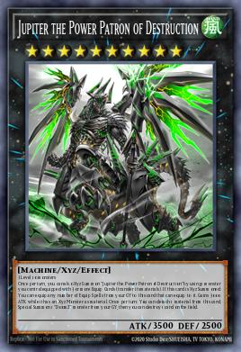

- **Copias y zona:** Extra 1x. No altera las cantidades registradas.
- **Nombre oficial de referencia:** Júpiter el Modelo de Poder de Destrucción. CID cotejado con la ficha oficial; el nombre histórico del inventario se conserva aunque su grafía/traducción difiera.
- **Función principal y secundaria:** resultado de Extra Deck · recuperación · removal · cierre · habilitador Xyz.
- **Estado de sinergia y función:** Destino Extra condicionado. Es una clasificación de juego; revisar la relación concreta en A06.
- **Papel como recurso, descarte o coste:** Material o destino del Extra condicionado a los requisitos de invocación.
- **Efecto operativo (paráfrasis analítica):** recuperación e invocación desde Cementerio/destierro; destrucción de cartas o empleo de destrucción como detonante; presión de combate o modificación de estadísticas; gestión de materiales Xyz; uso o producción de cartas equipadas. Son operaciones detectadas en el texto, no efectos independientes garantizados; leer sus condiciones en la fuente.
- **Mapa de activación y resultados:** 1) efecto propio o continuo: equipa carta/monstruo según texto · 2) tras su invocación desde el Extra: equipa carta/monstruo según texto · 3) una vez por turno: Invocación Especial desde Cementerio, destruye la carta o recurso previsto, desacopla materiales Xyz. Cada operación está sujeta a la secuencia y al «si lo haces» del texto oficial.
- **Ventanas de activación identificadas:** al producirse una Invocación.
- **Costes o recursos potenciales:** sin coste independiente identificado en esta síntesis; comprobar las acciones previas al punto y coma de cada efecto.
- **Restricciones y requisitos:** hay límite por turno según el efecto concreto; depende de recursos en Cementerio. Invocar sólo desde el Extra Deck usando su procedimiento propio.
- **Prioridad al ir primero:** preparar Equipos, materiales Xyz y respuestas en turno rival. Para esta carta: Comprobar materiales exactos antes de buscar este objetivo en el Extra Deck.
- **Prioridad al ir segundo:** retirar amenazas y después convertir la destrucción propia en ventaja. Identificar primero la respuesta rival que afecta su función «resultado de Extra Deck».
- **Medio/tardío y recuperación:** reciclar piezas equipadas y cartas DoomZ del Cementerio. Verificar que el objetivo de recuperación continúe disponible.
- **Sinergias y acceso a líneas:** Relación contextual con destruir recursos DoomZ para ganar ventaja, equipar monstruos y transformarlos en Xyz Máquina de VIENTO. Puede cerrar o prolongar una ruta del Extra si los materiales están disponibles.
- **Riesgo / brick / interrupciones:** Se agota al consumir materiales; no asumir material adicional al pasar de un Xyz a otro. No atribuirle velocidad rápida por el solo hecho de formar parte del motor.
- **Utilidad editorial:** 4/5 para este deck (estimación por rol y zona, no probabilidad calculada). No cambiar copias; cualquier sugerencia de alta/baja pasa por el apartado 22 y aprobación.
- **Referencia oficial y trazabilidad:** https://www.db.yugioh-card.com/yugiohdb/card_search.action?cid=21810&ope=2&request_locale=es. **Confianza:** texto y tipo de efecto cotejados en Konami; síntesis táctica editorial, no demostración de combo.
- **Aplicación concreta dentro de este deck (A06):** recuperación e invocación desde Cementerio/destierro. A06 identifica su destino, condicionado a material/procedimiento.

**USO PRÁCTICO Y SINERGIA — Júpiter el Modelo de Poder de Destrucción**

- **Label funcional:** Referencias de ruta localizadas; conexión reglamentaria sujeta al recorrido de la guía. Clasificación documental; una relación es válida solo si se satisfacen sus condiciones exactas.
- **Qué hace:** recuperación e invocación desde Cementerio/destierro; destrucción de cartas o empleo de destrucción como detonante; presión de combate o modificación de estadísticas; gestión de materiales Xyz; uso o producción de cartas equipadas. Son operaciones detectadas en el texto, no efectos independientes garantizados; leer sus condiciones en la fuente.
- **Cómo aprovecharla en este deck:** recuperación e invocación desde Cementerio/destierro. A06 identifica su destino, condicionado a material/procedimiento.
- **Al jugar primero:** preparar Equipos, materiales Xyz y respuestas en turno rival. Para esta carta: Comprobar materiales exactos antes de buscar este objetivo en el Extra Deck.
- **Al jugar segundo:** retirar amenazas y después convertir la destrucción propia en ventaja. Identificar primero la respuesta rival que afecta su función «resultado de Extra Deck».
- **Cuándo tener precaución:** Se agota al consumir materiales; no asumir material adicional al pasar de un Xyz a otro. No atribuirle velocidad rápida por el solo hecho de formar parte del motor.

**CÓMO LLEGAR DESDE TU DECK — RUTAS DOCUMENTADAS**

- **Abrir guía `653:A09:RAIDERS:CHANGE:DRAS03`:** entrada: Incursores Incursores DoomZ (21823) + Cambio Cambio DoomZ (22158). Main Phase propia; Campo y Cementerio propios vacíos; rival sin respuestas. Deben permanecer en el Main Deck Amalthe (21775), Drastea (21774) y Mando DoomZ «D.O.O.M.D.U.R.G.» (21824), y en el Extra Drastrius (21811). La carta Cambio en la mano NO puede destruirse a sí misma con su propio efecto.. Propósito descrito: Preparación de recursos / despliegue. Consulta sus pasos, consumo y resultado; comprobar si esta carta es realmente invocada o solo mencionada.
- **Abrir guía `653:A09:MEDIUS:JUPREDO:JUPITER04`:** entrada: Medius Medius el Puro (21419), sin otra carta necesaria; propio Campo/GY vacíos; Main Phase propia; Jupredo la Máquina Sombra Modelo de Poder (22521; alias histórico «Zegredo», 3 copias) permanece en Deck y Júpiter Júpiter el Modelo de Poder de Destrucción (21810, 1 copia) permanece en Extra. Hay al menos 3 cartas en Deck para desterrar boca abajo; no hay respuesta del rival.. Propósito descrito: Preparación de recursos / despliegue. Consulta sus pasos, consumo y resultado; comprobar si esta carta es realmente invocada o solo mencionada.
- **Abrir guía `653:A09:MEDIUS:GRAFLAREIO:DRAS06`:** entrada: Medius Medius como única carta inicial; sin Campo/GY propios, Main Phase y sin interrupción rival. En Deck quedan DoomZ Modelo de Poder, Incursores, Cambio, Elara, Amalthe, Drastea y los dos Equipos Mando indicados; en Extra, Diactorus, Graflareio (22554), Drastrius. Ruta ramificada respecto de A09-05: en vez de destruir Modelo de Poder con Diactorus, lo pierde por el cambio Xyz a Graflareio.. Propósito descrito: Ofensivo condicional. Consulta sus pasos, consumo y resultado; comprobar si esta carta es realmente invocada o solo mencionada.
- **Abrir guía `653:A09:CHANGE:POWERPATRON:GRAFLAREIO:DRAS07`:** entrada: Cambio Cambio DoomZ (22158); propio Campo y GY vacíos, Main Phase propia y oponente sin respuestas. Deben quedar en Main Deck: DoomZ Modelo de Poder (21777), dos copias distintas de Elara (21776), al menos una Amalthe (21775), Drastea (21774), Incursores (21823) y las dos copias de Mando D.O.O.M.D.U.R.G. (21824). Extra: Diactorus (21812), Graflareio (22554) y Drastrius (21811). Esta línea consume las dos copias de Mando en destinos diferentes.. Propósito descrito: Preparación de recursos / despliegue. Consulta sus pasos, consumo y resultado; comprobar si esta carta es realmente invocada o solo mencionada.

#### 26. Número F0: Futuro Utópico Zexal

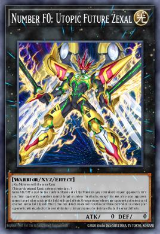

- **Copias y zona:** Extra 1x. No altera las cantidades registradas.
- **Nombre oficial de referencia:** Número F0: Futuro Utópico Zexal. CID cotejado con la ficha oficial; el nombre histórico del inventario se conserva aunque su grafía/traducción difiera.
- **Función principal y secundaria:** interrupción · resultado de Extra Deck · cierre · respuesta · habilitador Xyz.
- **Estado de sinergia y función:** Sin acceso al Extra demostrado. Es una clasificación de juego; revisar la relación concreta en A06.
- **Papel como recurso, descarte o coste:** Material o destino del Extra condicionado a los requisitos de invocación.
- **Efecto operativo (paráfrasis analítica):** presión de combate o modificación de estadísticas; interacción sobre monstruos en campo; gestión de materiales Xyz; protección o resistencia contra respuestas. Son operaciones detectadas en el texto, no efectos independientes garantizados; leer sus condiciones en la fuente.
- **Mapa de activación y resultados:** 1) una vez por turno: desacopla materiales Xyz, toma temporalmente el control. Cada operación está sujeta a la secuencia y al «si lo haces» del texto oficial.
- **Ventanas de activación identificadas:** Efecto Rápido.
- **Costes o recursos potenciales:** sin coste independiente identificado en esta síntesis; comprobar las acciones previas al punto y coma de cada efecto.
- **Restricciones y requisitos:** hay límite por turno según el efecto concreto. Invocar sólo desde el Extra Deck usando su procedimiento propio.
- **Prioridad al ir primero:** preparar Equipos, materiales Xyz y respuestas en turno rival. Para esta carta: Reservar la respuesta para la ventana rival exacta; no es una pieza buscadora de nuestro motor.
- **Prioridad al ir segundo:** retirar amenazas y después convertir la destrucción propia en ventaja. Identificar primero la respuesta rival que afecta su función «interrupción».
- **Medio/tardío y recuperación:** reciclar piezas equipadas y cartas DoomZ del Cementerio. No asumir que por sí misma recicla recursos si el texto no lo permite.
- **Sinergias y acceso a líneas:** Relación contextual con destruir recursos DoomZ para ganar ventaja, equipar monstruos y transformarlos en Xyz Máquina de VIENTO. Puede cerrar o prolongar una ruta del Extra si los materiales están disponibles.
- **Riesgo / brick / interrupciones:** Se agota al consumir materiales; no asumir material adicional al pasar de un Xyz a otro. Puede emplearse en cadena sólo cuando se cumpla su condición concreta.
- **Utilidad editorial:** 4/5 para este deck (estimación por rol y zona, no probabilidad calculada). No cambiar copias; cualquier sugerencia de alta/baja pasa por el apartado 22 y aprobación.
- **Referencia oficial y trazabilidad:** https://www.db.yugioh-card.com/yugiohdb/card_search.action?cid=21453&ope=2&request_locale=es. **Confianza:** texto y tipo de efecto cotejados en Konami; síntesis táctica editorial, no demostración de combo.
- **Aplicación concreta dentro de este deck (A06):** presión de combate o modificación de estadísticas; interacción sobre monstruos en campo; gestión de materiales Xyz; protección o resistencia contra respuestas. Falta arista de materiales en A06; A09 podría contener una ruta válida no indexada aquí.

**USO PRÁCTICO Y SINERGIA — Número F0: Futuro Utópico Zexal**

- **Label funcional:** Sin sinergia demostrada (con la evidencia actual). Clasificación documental; una relación es válida solo si se satisfacen sus condiciones exactas.
- **Qué hace:** presión de combate o modificación de estadísticas; interacción sobre monstruos en campo; gestión de materiales Xyz; protección o resistencia contra respuestas. Son operaciones detectadas en el texto, no efectos independientes garantizados; leer sus condiciones en la fuente.
- **Cómo aprovecharla en este deck:** presión de combate o modificación de estadísticas; interacción sobre monstruos en campo; gestión de materiales Xyz; protección o resistencia contra respuestas. Falta arista de materiales en A06; A09 podría contener una ruta válida no indexada aquí.
- **Al jugar primero:** preparar Equipos, materiales Xyz y respuestas en turno rival. Para esta carta: Reservar la respuesta para la ventana rival exacta; no es una pieza buscadora de nuestro motor.
- **Al jugar segundo:** retirar amenazas y después convertir la destrucción propia en ventaja. Identificar primero la respuesta rival que afecta su función «interrupción».
- **Cuándo tener precaución:** Se agota al consumir materiales; no asumir material adicional al pasar de un Xyz a otro. Puede emplearse en cadena sólo cuando se cumpla su condición concreta.

**CÓMO LLEGAR DESDE TU DECK — SIN RUTA DEMOSTRADA**

- La biblioteca actual no contiene una ruta identificada para esta carta del Extra. No se debe exhibir una descripción genérica como sustituto de mano inicial, materiales y pasos. Para completarla, contrastar requisitos oficiales y recursos del Main; si no es alcanzable, explicar el impedimento exacto.

#### 27. Varudras, el Último Portador del Fin de los Tiempos

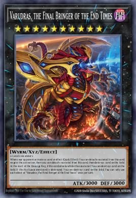

- **Copias y zona:** Extra 1x. No altera las cantidades registradas.
- **Nombre oficial de referencia:** Varudras, el Último Portador del Fin de los Tiempos. CID cotejado con la ficha oficial; el nombre histórico del inventario se conserva aunque su grafía/traducción difiera.
- **Función principal y secundaria:** interrupción · resultado de Extra Deck · removal · negación · habilitador Xyz.
- **Estado de sinergia y función:** Sin acceso al Extra demostrado. Es una clasificación de juego; revisar la relación concreta en A06.
- **Papel como recurso, descarte o coste:** Material o destino del Extra condicionado a los requisitos de invocación.
- **Efecto operativo (paráfrasis analítica):** destrucción de cartas o empleo de destrucción como detonante; negación de efectos o activaciones; gestión de materiales Xyz. Son operaciones detectadas en el texto, no efectos independientes garantizados; leer sus condiciones en la fuente.
- **Mapa de activación y resultados:** 1) en respuesta a activación rival: niega el efecto o la activación indicada, destruye la carta o recurso previsto, desacopla materiales Xyz · 2) con condición explícita en la carta: destruye la carta o recurso previsto. Cada operación está sujeta a la secuencia y al «si lo haces» del texto oficial.
- **Ventanas de activación identificadas:** respuesta a activación rival; Efecto Rápido.
- **Costes o recursos potenciales:** sin coste independiente identificado en esta síntesis; comprobar las acciones previas al punto y coma de cada efecto.
- **Restricciones y requisitos:** hay límite por turno según el efecto concreto. Invocar sólo desde el Extra Deck usando su procedimiento propio.
- **Prioridad al ir primero:** preparar Equipos, materiales Xyz y respuestas en turno rival. Para esta carta: Reservar la respuesta para la ventana rival exacta; no es una pieza buscadora de nuestro motor.
- **Prioridad al ir segundo:** retirar amenazas y después convertir la destrucción propia en ventaja. Identificar primero la respuesta rival que afecta su función «interrupción».
- **Medio/tardío y recuperación:** reciclar piezas equipadas y cartas DoomZ del Cementerio. No asumir que por sí misma recicla recursos si el texto no lo permite.
- **Sinergias y acceso a líneas:** Relación contextual con destruir recursos DoomZ para ganar ventaja, equipar monstruos y transformarlos en Xyz Máquina de VIENTO. Puede cerrar o prolongar una ruta del Extra si los materiales están disponibles.
- **Riesgo / brick / interrupciones:** Se agota al consumir materiales; no asumir material adicional al pasar de un Xyz a otro. Puede emplearse en cadena sólo cuando se cumpla su condición concreta.
- **Utilidad editorial:** 4/5 para este deck (estimación por rol y zona, no probabilidad calculada). No cambiar copias; cualquier sugerencia de alta/baja pasa por el apartado 22 y aprobación.
- **Referencia oficial y trazabilidad:** https://www.db.yugioh-card.com/yugiohdb/card_search.action?cid=19886&ope=2&request_locale=es. **Confianza:** texto y tipo de efecto cotejados en Konami; síntesis táctica editorial, no demostración de combo.
- **Aplicación concreta dentro de este deck (A06):** destrucción de cartas o empleo de destrucción como detonante; negación de efectos o activaciones; gestión de materiales Xyz. Falta arista de materiales en A06; A09 podría contener una ruta válida no indexada aquí.

**USO PRÁCTICO Y SINERGIA — Varudras, el Último Portador del Fin de los Tiempos**

- **Label funcional:** Sin sinergia demostrada (con la evidencia actual). Clasificación documental; una relación es válida solo si se satisfacen sus condiciones exactas.
- **Qué hace:** destrucción de cartas o empleo de destrucción como detonante; negación de efectos o activaciones; gestión de materiales Xyz. Son operaciones detectadas en el texto, no efectos independientes garantizados; leer sus condiciones en la fuente.
- **Cómo aprovecharla en este deck:** destrucción de cartas o empleo de destrucción como detonante; negación de efectos o activaciones; gestión de materiales Xyz. Falta arista de materiales en A06; A09 podría contener una ruta válida no indexada aquí.
- **Al jugar primero:** preparar Equipos, materiales Xyz y respuestas en turno rival. Para esta carta: Reservar la respuesta para la ventana rival exacta; no es una pieza buscadora de nuestro motor.
- **Al jugar segundo:** retirar amenazas y después convertir la destrucción propia en ventaja. Identificar primero la respuesta rival que afecta su función «interrupción».
- **Cuándo tener precaución:** Se agota al consumir materiales; no asumir material adicional al pasar de un Xyz a otro. Puede emplearse en cadena sólo cuando se cumpla su condición concreta.

**CÓMO LLEGAR DESDE TU DECK — SIN RUTA DEMOSTRADA**

- La biblioteca actual no contiene una ruta identificada para esta carta del Extra. No se debe exhibir una descripción genérica como sustituto de mano inicial, materiales y pasos. Para completarla, contrastar requisitos oficiales y recursos del Main; si no es alcanzable, explicar el impedimento exacto.

#### 28. Divino Arsenal AA-ZEUS - Trueno del Cielo

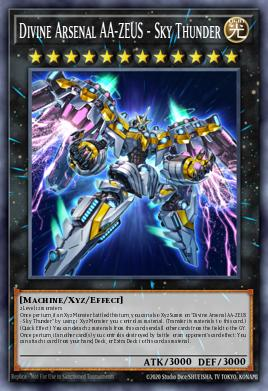

- **Copias y zona:** Extra 1x. No altera las cantidades registradas.
- **Nombre oficial de referencia:** Divino Arsenal AA-ZEUS - Trueno del Cielo. CID cotejado con la ficha oficial; el nombre histórico del inventario se conserva aunque su grafía/traducción difiera.
- **Función principal y secundaria:** interrupción · resultado de Extra Deck · habilitador Xyz.
- **Estado de sinergia y función:** Acceso condicionado **demostrado** desde Drastrius que sobreviva a batalla; el coste es renunciar a su negación individual de monstruo y conservar un barrido de ZEUS.
- **Papel como recurso, descarte o coste:** ZEUS se superpone en MP2 sobre Drastrius y hereda sus dos materiales: **3 materiales**; desacopla **2** para enviar al GY todas las otras cartas del Campo.
- **Efecto operativo (paráfrasis analítica):** Efecto Rápido de enviar **todas las demás cartas del campo al GY**, **no destruir**. Su procedimiento Xyz alternativo requiere que algún Xyz haya batallado durante ese turno. No niega activación de monstruo y no hereda la protección VIENTO del Mando.
- **Mapa de activación y resultados:** 1) efecto propio o continuo: desacopla materiales Xyz. Cada operación está sujeta a la secuencia y al «si lo haces» del texto oficial.
- **Ventanas de activación identificadas:** Efecto Rápido.
- **Costes o recursos potenciales:** 2 de los 3 materiales de la continuación; **incluye a la propia Incursores** en el barrido, si sigue boca arriba.
- **Restricciones y requisitos:** batallar primero con Xyz y conservarlo para superponer ZEUS en Main Phase 2. La limitación de Incursores a Invocaciones de Extra Xyz **sí permite** esta continuación; evitar el efecto de ataque directo del Mando que destruiría Drastrius tras batallar.
- **Prioridad al ir primero:** preparar Equipos, materiales Xyz y respuestas en turno rival. Para esta carta: Reservar la respuesta para la ventana rival exacta; no es una pieza buscadora de nuestro motor.
- **Prioridad al ir segundo:** retirar amenazas y después convertir la destrucción propia en ventaja. Identificar primero la respuesta rival que afecta su función «interrupción».
- **Medio/tardío y recuperación:** reciclar piezas equipadas y cartas DoomZ del Cementerio. No asumir que por sí misma recicla recursos si el texto no lo permite.
- **Sinergias y acceso a líneas:** Relación contextual con destruir recursos DoomZ para ganar ventaja, equipar monstruos y transformarlos en Xyz Máquina de VIENTO. Puede cerrar o prolongar una ruta del Extra si los materiales están disponibles.
- **Riesgo / brick / interrupciones:** Se agota al consumir materiales; no asumir material adicional al pasar de un Xyz a otro. Puede emplearse en cadena sólo cuando se cumpla su condición concreta.
- **Utilidad editorial:** 4/5 para este deck (estimación por rol y zona, no probabilidad calculada). No cambiar copias; cualquier sugerencia de alta/baja pasa por el apartado 22 y aprobación.
- **Referencia oficial y trazabilidad:** https://www.db.yugioh-card.com/yugiohdb/card_search.action?cid=15524&ope=2&request_locale=es. **Confianza:** texto y tipo de efecto cotejados en Konami; síntesis táctica editorial, no demostración de combo.
- **Aplicación concreta dentro de este deck (A06):** mano Incursores + Elara permite Drastrius 2700/2 materiales, batallar con monstruo de ATK inferior que no lo elimine y en MP2 superponer ZEUS 3000/3 materiales. Abrir `653:A09:RAIDERS:ELARA:DRASTRIUS_BATTLE_ZEUS08`.

**USO PRÁCTICO Y SINERGIA — Divino Arsenal AA-ZEUS - Trueno del Cielo**

- **Label funcional:** Destino Extra de continuación Xyz demostrado después de batalla.
- **Qué hace:** con 2 materiales desacoplados, envía todas las otras cartas del Campo al GY como Efecto Rápido; puede retirar amenazas que no son destruibles, siempre que sean afectables y enviables.
- **Cómo aprovecharla en este deck:** `653:A09:RAIDERS:ELARA:DRASTRIUS_BATTLE_ZEUS08`: Incursores + Elara → Drastea+Mando → Drastrius 2 materiales → batalla segura → ZEUS MP2 con **3 materiales**.
- **Al jugar primero:** sin Battle Phase en el turno inicial del primer jugador, no hay este acceso a ZEUS; conserva Drastrius como negación específica de efecto de monstruo.
- **Al jugar segundo:** después de una batalla legal con Drastrius superviviente, valorar ZEUS para la próxima respuesta al tablero rival.
- **Uso y consumo de recursos:** sacrifica negación de Drastrius y 2 de los 3 materiales de ZEUS; el barrido también envía **tu Incursores** al GY.
- **Cuándo tener precaución:** NO activar efecto de ataque directo del Mando en la línea hacia ZEUS: si Drastrius batalla con ese efecto, se destruye al final del Damage Step. ZEUS es LUZ, así que Mando como material ya no le da protección reservada a Máquina VIENTO.
- **Alcance de la guía:** siete pasos y una mano inicial exacta cotejados con Konami; no certifica las demás variantes de DoomZ.

**CÓMO LLEGAR DESDE TU DECK — GUÍA VISUAL DE 7 PASOS**

- `653:A09:RAIDERS:ELARA:DRASTRIUS_BATTLE_ZEUS08`: apertura Incursores + Elara; adversario con monstruo de 1000 ATK sin resistencia; Drastrius ataca y sobrevive, ZEUS con 3 materiales en MP2. Mostrar la decisión «conservar Drastrius vs limpieza de ZEUS» y el tablero final exacto; documento `guias/DECK_653_DRASTRIUS_BATALLA_ZEUS_GUIA.md`.

#### 29. Número F0: Futuro Utópico

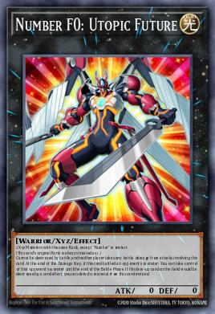

- **Copias y zona:** Extra 1x. No altera las cantidades registradas.
- **Nombre oficial de referencia:** Número F0: Futuro Utópico. CID cotejado con la ficha oficial; el nombre histórico del inventario se conserva aunque su grafía/traducción difiera.
- **Función principal y secundaria:** resultado de Extra Deck · cierre · habilitador Xyz · protección.
- **Estado de sinergia y función:** Sin acceso al Extra demostrado. Es una clasificación de juego; revisar la relación concreta en A06.
- **Papel como recurso, descarte o coste:** Material o destino del Extra condicionado a los requisitos de invocación.
- **Efecto operativo (paráfrasis analítica):** presión de combate o modificación de estadísticas; gestión de materiales Xyz; protección o resistencia contra respuestas. Son operaciones detectadas en el texto, no efectos independientes garantizados; leer sus condiciones en la fuente.
- **Mapa de activación y resultados:** 1) efecto propio o continuo: desacopla materiales Xyz. Cada operación está sujeta a la secuencia y al «si lo haces» del texto oficial.
- **Ventanas de activación identificadas:** requieren la fase o condición específica indicada en el texto; sin ventana rápida general asumida.
- **Costes o recursos potenciales:** sin coste independiente identificado en esta síntesis; comprobar las acciones previas al punto y coma de cada efecto.
- **Restricciones y requisitos:** aplicar restricciones de selección, activación y copias que consten en el texto original. Invocar sólo desde el Extra Deck usando su procedimiento propio.
- **Prioridad al ir primero:** preparar Equipos, materiales Xyz y respuestas en turno rival. Para esta carta: Comprobar materiales exactos antes de buscar este objetivo en el Extra Deck.
- **Prioridad al ir segundo:** retirar amenazas y después convertir la destrucción propia en ventaja. Identificar primero la respuesta rival que afecta su función «resultado de Extra Deck».
- **Medio/tardío y recuperación:** reciclar piezas equipadas y cartas DoomZ del Cementerio. No asumir que por sí misma recicla recursos si el texto no lo permite.
- **Sinergias y acceso a líneas:** Relación contextual con destruir recursos DoomZ para ganar ventaja, equipar monstruos y transformarlos en Xyz Máquina de VIENTO. Puede cerrar o prolongar una ruta del Extra si los materiales están disponibles.
- **Riesgo / brick / interrupciones:** Se agota al consumir materiales; no asumir material adicional al pasar de un Xyz a otro. No atribuirle velocidad rápida por el solo hecho de formar parte del motor.
- **Utilidad editorial:** 4/5 para este deck (estimación por rol y zona, no probabilidad calculada). No cambiar copias; cualquier sugerencia de alta/baja pasa por el apartado 22 y aprobación.
- **Referencia oficial y trazabilidad:** https://www.db.yugioh-card.com/yugiohdb/card_search.action?cid=11413&ope=2&request_locale=es. **Confianza:** texto y tipo de efecto cotejados en Konami; síntesis táctica editorial, no demostración de combo.
- **Aplicación concreta dentro de este deck (A06):** presión de combate o modificación de estadísticas; gestión de materiales Xyz; protección o resistencia contra respuestas. Falta arista de materiales en A06; A09 podría contener una ruta válida no indexada aquí.

**USO PRÁCTICO Y SINERGIA — Número F0: Futuro Utópico**

- **Label funcional:** Sin sinergia demostrada (con la evidencia actual). Clasificación documental; una relación es válida solo si se satisfacen sus condiciones exactas.
- **Qué hace:** presión de combate o modificación de estadísticas; gestión de materiales Xyz; protección o resistencia contra respuestas. Son operaciones detectadas en el texto, no efectos independientes garantizados; leer sus condiciones en la fuente.
- **Cómo aprovecharla en este deck:** presión de combate o modificación de estadísticas; gestión de materiales Xyz; protección o resistencia contra respuestas. Falta arista de materiales en A06; A09 podría contener una ruta válida no indexada aquí.
- **Al jugar primero:** preparar Equipos, materiales Xyz y respuestas en turno rival. Para esta carta: Comprobar materiales exactos antes de buscar este objetivo en el Extra Deck.
- **Al jugar segundo:** retirar amenazas y después convertir la destrucción propia en ventaja. Identificar primero la respuesta rival que afecta su función «resultado de Extra Deck».
- **Cuándo tener precaución:** Se agota al consumir materiales; no asumir material adicional al pasar de un Xyz a otro. No atribuirle velocidad rápida por el solo hecho de formar parte del motor.

**CÓMO LLEGAR DESDE TU DECK — SIN RUTA DEMOSTRADA**

- La biblioteca actual no contiene una ruta identificada para esta carta del Extra. No se debe exhibir una descripción genérica como sustituto de mano inicial, materiales y pasos. Para completarla, contrastar requisitos oficiales y recursos del Main; si no es alcanzable, explicar el impedimento exacto.

#### 30. Mago Gagagaga

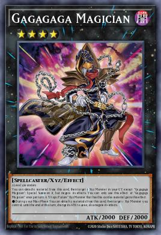

- **Copias y zona:** Extra 1x. No altera las cantidades registradas.
- **Nombre oficial de referencia:** Mago Gagagaga. CID cotejado con la ficha oficial; el nombre histórico del inventario se conserva aunque su grafía/traducción difiera.
- **Función principal y secundaria:** resultado de Extra Deck · negación · cierre · respuesta · habilitador Xyz.
- **Estado de sinergia y función:** Sin acceso al Extra demostrado. Es una clasificación de juego; revisar la relación concreta en A06.
- **Papel como recurso, descarte o coste:** Material o destino del Extra condicionado a los requisitos de invocación.
- **Efecto operativo (paráfrasis analítica):** negación de efectos o activaciones; presión de combate o modificación de estadísticas; interacción sobre monstruos en campo; gestión de materiales Xyz. Son operaciones detectadas en el texto, no efectos independientes garantizados; leer sus condiciones en la fuente.
- **Mapa de activación y resultados:** 1) efecto propio o continuo: niega el efecto o la activación indicada, desacopla materiales Xyz. Cada operación está sujeta a la secuencia y al «si lo haces» del texto oficial.
- **Ventanas de activación identificadas:** Main Phase.
- **Costes o recursos potenciales:** sin coste independiente identificado en esta síntesis; comprobar las acciones previas al punto y coma de cada efecto.
- **Restricciones y requisitos:** hay límite por turno según el efecto concreto; depende de recursos en Cementerio. Invocar sólo desde el Extra Deck usando su procedimiento propio.
- **Prioridad al ir primero:** preparar Equipos, materiales Xyz y respuestas en turno rival. Para esta carta: Conservar la interrupción para el efecto clave rival; no gastarla en un efecto irrelevante.
- **Prioridad al ir segundo:** retirar amenazas y después convertir la destrucción propia en ventaja. Identificar primero la respuesta rival que afecta su función «resultado de Extra Deck».
- **Medio/tardío y recuperación:** reciclar piezas equipadas y cartas DoomZ del Cementerio. No asumir que por sí misma recicla recursos si el texto no lo permite.
- **Sinergias y acceso a líneas:** Relación contextual con destruir recursos DoomZ para ganar ventaja, equipar monstruos y transformarlos en Xyz Máquina de VIENTO. Puede cerrar o prolongar una ruta del Extra si los materiales están disponibles.
- **Riesgo / brick / interrupciones:** Se agota al consumir materiales; no asumir material adicional al pasar de un Xyz a otro. No atribuirle velocidad rápida por el solo hecho de formar parte del motor.
- **Utilidad editorial:** 4/5 para este deck (estimación por rol y zona, no probabilidad calculada). No cambiar copias; cualquier sugerencia de alta/baja pasa por el apartado 22 y aprobación.
- **Referencia oficial y trazabilidad:** https://www.db.yugioh-card.com/yugiohdb/card_search.action?cid=14920&ope=2&request_locale=es. **Confianza:** texto y tipo de efecto cotejados en Konami; síntesis táctica editorial, no demostración de combo.
- **Aplicación concreta dentro de este deck (A06):** negación de efectos o activaciones; presión de combate o modificación de estadísticas; interacción sobre monstruos en campo; gestión de materiales Xyz. Falta arista de materiales en A06; A09 podría contener una ruta válida no indexada aquí.

**USO PRÁCTICO Y SINERGIA — Mago Gagagaga**

- **Label funcional:** Sin sinergia demostrada (con la evidencia actual). Clasificación documental; una relación es válida solo si se satisfacen sus condiciones exactas.
- **Qué hace:** negación de efectos o activaciones; presión de combate o modificación de estadísticas; interacción sobre monstruos en campo; gestión de materiales Xyz. Son operaciones detectadas en el texto, no efectos independientes garantizados; leer sus condiciones en la fuente.
- **Cómo aprovecharla en este deck:** negación de efectos o activaciones; presión de combate o modificación de estadísticas; interacción sobre monstruos en campo; gestión de materiales Xyz. Falta arista de materiales en A06; A09 podría contener una ruta válida no indexada aquí.
- **Al jugar primero:** preparar Equipos, materiales Xyz y respuestas en turno rival. Para esta carta: Conservar la interrupción para el efecto clave rival; no gastarla en un efecto irrelevante.
- **Al jugar segundo:** retirar amenazas y después convertir la destrucción propia en ventaja. Identificar primero la respuesta rival que afecta su función «resultado de Extra Deck».
- **Cuándo tener precaución:** Se agota al consumir materiales; no asumir material adicional al pasar de un Xyz a otro. No atribuirle velocidad rápida por el solo hecho de formar parte del motor.

**CÓMO LLEGAR DESDE TU DECK — SIN RUTA DEMOSTRADA**

- La biblioteca actual no contiene una ruta identificada para esta carta del Extra. No se debe exhibir una descripción genérica como sustituto de mano inicial, materiales y pasos. Para completarla, contrastar requisitos oficiales y recursos del Main; si no es alcanzable, explicar el impedimento exacto.

#### 31. Ogro Fantasma & Conejo de las Nieves

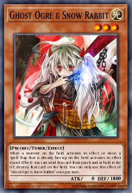

- **Copias y zona:** Side 2x. No altera las cantidades registradas.
- **Nombre oficial de referencia:** Ogro Fantasma & Conejo de las Nieves. CID cotejado con la ficha oficial; el nombre histórico del inventario se conserva aunque su grafía/traducción difiera.
- **Función principal y secundaria:** handtrap · destrucción.
- **Estado de sinergia y función:** Side utilizable entre duelos. Es una clasificación de juego; revisar la relación concreta en A06.
- **Papel como recurso, descarte o coste:** Envío mencionado en la interacción; no equivale por sí mismo a descarte desde la mano.
- **Efecto operativo (paráfrasis analítica):** Se envía desde mano o campo al Cementerio cuando un monstruo en campo o M/T ya boca arriba activa su efecto, para destruir esa carta. 
- **Mapa de activación y resultados:** 1) con condición explícita en la carta: destruye la carta o recurso previsto. Cada operación está sujeta a la secuencia y al «si lo haces» del texto oficial.
- **Ventanas de activación identificadas:** Efecto Rápido.
- **Costes o recursos potenciales:** envío de recurso propio al Cementerio.
- **Restricciones y requisitos:** hay límite por turno según el efecto concreto; solo entra al Main después de un intercambio entre duelos. 
- **Prioridad al ir primero:** preparar Equipos, materiales Xyz y respuestas en turno rival. Para esta carta: Respuesta puntual al emparejamiento; justificar el intercambio antes del siguiente duelo.
- **Prioridad al ir segundo:** retirar amenazas y después convertir la destrucción propia en ventaja. Identificar primero la respuesta rival que afecta su función «handtrap».
- **Medio/tardío y recuperación:** reciclar piezas equipadas y cartas DoomZ del Cementerio. No asumir que por sí misma recicla recursos si el texto no lo permite.
- **Sinergias y acceso a líneas:** Relación contextual con destruir recursos DoomZ para ganar ventaja, equipar monstruos y transformarlos en Xyz Máquina de VIENTO. No habilita una ruta inicial antes del intercambio.
- **Riesgo / brick / interrupciones:** Destruir no equivale a negar la resolución del efecto activado. Puede emplearse en cadena sólo cuando se cumpla su condición concreta.
- **Utilidad editorial:** 3/5 para este deck (estimación por rol y zona, no probabilidad calculada). No cambiar copias; cualquier sugerencia de alta/baja pasa por el apartado 22 y aprobación.
- **Referencia oficial y trazabilidad:** https://www.db.yugioh-card.com/yugiohdb/card_search.action?cid=11708&ope=2&request_locale=es. **Confianza:** texto y tipo de efecto cotejados en Konami; síntesis táctica editorial, no demostración de combo.
- **Aplicación concreta dentro de este deck (A06):** Solo entre duelos; Se envía desde mano o campo al Cementerio cuando un monstruo en campo o M/T ya boca arriba activa su efecto, para destruir esa carta.. No inicia la mano del Main actual.

**USO PRÁCTICO Y SINERGIA — Ogro Fantasma & Conejo de las Nieves**

- **Label funcional:** Sin sinergia demostrada (con la evidencia actual). Clasificación documental; una relación es válida solo si se satisfacen sus condiciones exactas.
- **Qué hace:** Se envía desde mano o campo al Cementerio cuando un monstruo en campo o M/T ya boca arriba activa su efecto, para destruir esa carta.
- **Cómo aprovecharla en este deck:** Solo entre duelos; Se envía desde mano o campo al Cementerio cuando un monstruo en campo o M/T ya boca arriba activa su efecto, para destruir esa carta.. No inicia la mano del Main actual.
- **Al jugar primero:** preparar Equipos, materiales Xyz y respuestas en turno rival. Para esta carta: Respuesta puntual al emparejamiento; justificar el intercambio antes del siguiente duelo.
- **Al jugar segundo:** retirar amenazas y después convertir la destrucción propia en ventaja. Identificar primero la respuesta rival que afecta su función «handtrap».
- **Cuándo tener precaución:** Destruir no equivale a negar la resolución del efecto activado. Puede emplearse en cadena sólo cuando se cumpla su condición concreta.

#### 32. Talento de Tácticas Triples

- **Copias y zona:** Side 1x. No altera las cantidades registradas.
- **Nombre oficial de referencia:** Talento de Tácticas Triples. CID cotejado con la ficha oficial; el nombre histórico del inventario se conserva aunque su grafía/traducción difiera.
- **Función principal y secundaria:** mágica de respuesta · ventaja.
- **Estado de sinergia y función:** Side utilizable entre duelos. Es una clasificación de juego; revisar la relación concreta en A06.
- **Papel como recurso, descarte o coste:** No se demuestra que esta carta sea recurso de descarte o pago para otra.
- **Efecto operativo (paráfrasis analítica):** Si el rival activó un efecto de monstruo durante tu Main Phase, permite elegir entre robar dos, tomar control temporal o devolver una carta de mano al Deck. 
- **Mapa de activación y resultados:** 1) en Main Phase: devuelve recursos a mano/Deck/Extra, roba cartas, toma temporalmente el control. Cada operación está sujeta a la secuencia y al «si lo haces» del texto oficial.
- **Ventanas de activación identificadas:** Main Phase.
- **Costes o recursos potenciales:** sin coste independiente identificado en esta síntesis; comprobar las acciones previas al punto y coma de cada efecto.
- **Restricciones y requisitos:** hay límite por turno según el efecto concreto; solo entra al Main después de un intercambio entre duelos. 
- **Prioridad al ir primero:** preparar Equipos, materiales Xyz y respuestas en turno rival. Para esta carta: Respuesta puntual al emparejamiento; justificar el intercambio antes del siguiente duelo.
- **Prioridad al ir segundo:** retirar amenazas y después convertir la destrucción propia en ventaja. Identificar primero la respuesta rival que afecta su función «mágica de respuesta».
- **Medio/tardío y recuperación:** reciclar piezas equipadas y cartas DoomZ del Cementerio. Verificar que el objetivo de recuperación continúe disponible.
- **Sinergias y acceso a líneas:** Relación contextual con destruir recursos DoomZ para ganar ventaja, equipar monstruos y transformarlos en Xyz Máquina de VIENTO. No habilita una ruta inicial antes del intercambio.
- **Riesgo / brick / interrupciones:** La condición exige activación de monstruo rival en tu Main Phase; sólo un modo. No atribuirle velocidad rápida por el solo hecho de formar parte del motor.
- **Utilidad editorial:** 3/5 para este deck (estimación por rol y zona, no probabilidad calculada). No cambiar copias; cualquier sugerencia de alta/baja pasa por el apartado 22 y aprobación.
- **Referencia oficial y trazabilidad:** https://www.db.yugioh-card.com/yugiohdb/card_search.action?cid=15296&ope=2&request_locale=es. **Confianza:** texto y tipo de efecto cotejados en Konami; síntesis táctica editorial, no demostración de combo.
- **Aplicación concreta dentro de este deck (A06):** Solo entre duelos; Si el rival activó un efecto de monstruo durante tu Main Phase, permite elegir entre robar dos, tomar control temporal o devolver una carta de mano al Deck.. No inicia la mano del Main actual.

**USO PRÁCTICO Y SINERGIA — Talento de Tácticas Triples**

- **Label funcional:** Sin sinergia demostrada (con la evidencia actual). Clasificación documental; una relación es válida solo si se satisfacen sus condiciones exactas.
- **Qué hace:** Si el rival activó un efecto de monstruo durante tu Main Phase, permite elegir entre robar dos, tomar control temporal o devolver una carta de mano al Deck.
- **Cómo aprovecharla en este deck:** Solo entre duelos; Si el rival activó un efecto de monstruo durante tu Main Phase, permite elegir entre robar dos, tomar control temporal o devolver una carta de mano al Deck.. No inicia la mano del Main actual.
- **Al jugar primero:** preparar Equipos, materiales Xyz y respuestas en turno rival. Para esta carta: Respuesta puntual al emparejamiento; justificar el intercambio antes del siguiente duelo.
- **Al jugar segundo:** retirar amenazas y después convertir la destrucción propia en ventaja. Identificar primero la respuesta rival que afecta su función «mágica de respuesta».
- **Cuándo tener precaución:** La condición exige activación de monstruo rival en tu Main Phase; sólo un modo. No atribuirle velocidad rápida por el solo hecho de formar parte del motor.

#### 33. Número 60: Dugares el Eterno

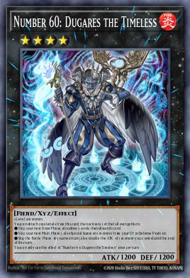

- **Copias y zona:** Side 1x. No altera las cantidades registradas.
- **Nombre oficial de referencia:** Número 60: Dugares el Eterno. CID cotejado con la ficha oficial; el nombre histórico del inventario se conserva aunque su grafía/traducción difiera.
- **Función principal y secundaria:** side técnico · recuperación · ventaja de mano · cierre · habilitador Xyz.
- **Estado de sinergia y función:** Side utilizable entre duelos. Es una clasificación de juego; revisar la relación concreta en A06.
- **Papel como recurso, descarte o coste:** Material o destino del Extra condicionado a los requisitos de invocación.
- **Efecto operativo (paráfrasis analítica):** recuperación e invocación desde Cementerio/destierro; generación de cartas por robo; presión de combate o modificación de estadísticas; gestión de materiales Xyz. Son operaciones detectadas en el texto, no efectos independientes garantizados; leer sus condiciones en la fuente.
- **Mapa de activación y resultados:** 1) efecto propio o continuo: Invocación Especial desde Cementerio, desacopla materiales Xyz, roba cartas. Cada operación está sujeta a la secuencia y al «si lo haces» del texto oficial.
- **Ventanas de activación identificadas:** requieren la fase o condición específica indicada en el texto; sin ventana rápida general asumida.
- **Costes o recursos potenciales:** descarte de mano.
- **Restricciones y requisitos:** hay límite por turno según el efecto concreto; depende de recursos en Cementerio; solo entra al Main después de un intercambio entre duelos. 
- **Prioridad al ir primero:** preparar Equipos, materiales Xyz y respuestas en turno rival. Para esta carta: Respuesta puntual al emparejamiento; justificar el intercambio antes del siguiente duelo.
- **Prioridad al ir segundo:** retirar amenazas y después convertir la destrucción propia en ventaja. Identificar primero la respuesta rival que afecta su función «side técnico».
- **Medio/tardío y recuperación:** reciclar piezas equipadas y cartas DoomZ del Cementerio. Verificar que el objetivo de recuperación continúe disponible.
- **Sinergias y acceso a líneas:** Relación contextual con destruir recursos DoomZ para ganar ventaja, equipar monstruos y transformarlos en Xyz Máquina de VIENTO. No habilita una ruta inicial antes del intercambio.
- **Riesgo / brick / interrupciones:** Se agota al consumir materiales; no asumir material adicional al pasar de un Xyz a otro. No atribuirle velocidad rápida por el solo hecho de formar parte del motor.
- **Utilidad editorial:** 3/5 para este deck (estimación por rol y zona, no probabilidad calculada). No cambiar copias; cualquier sugerencia de alta/baja pasa por el apartado 22 y aprobación.
- **Referencia oficial y trazabilidad:** https://www.db.yugioh-card.com/yugiohdb/card_search.action?cid=14564&ope=2&request_locale=es. **Confianza:** texto y tipo de efecto cotejados en Konami; síntesis táctica editorial, no demostración de combo.
- **Aplicación concreta dentro de este deck (A06):** Solo entre duelos; recuperación e invocación desde Cementerio/destierro; generación de cartas por robo; presión de combate o modificación de estadísticas; gestión de materiales Xyz.. No inicia la mano del Main actual.

**USO PRÁCTICO Y SINERGIA — Número 60: Dugares el Eterno**

- **Label funcional:** Sin sinergia demostrada (con la evidencia actual). Clasificación documental; una relación es válida solo si se satisfacen sus condiciones exactas.
- **Qué hace:** recuperación e invocación desde Cementerio/destierro; generación de cartas por robo; presión de combate o modificación de estadísticas; gestión de materiales Xyz. Son operaciones detectadas en el texto, no efectos independientes garantizados; leer sus condiciones en la fuente.
- **Cómo aprovecharla en este deck:** Solo entre duelos; recuperación e invocación desde Cementerio/destierro; generación de cartas por robo; presión de combate o modificación de estadísticas; gestión de materiales Xyz.. No inicia la mano del Main actual.
- **Al jugar primero:** preparar Equipos, materiales Xyz y respuestas en turno rival. Para esta carta: Respuesta puntual al emparejamiento; justificar el intercambio antes del siguiente duelo.
- **Al jugar segundo:** retirar amenazas y después convertir la destrucción propia en ventaja. Identificar primero la respuesta rival que afecta su función «side técnico».
- **Cuándo tener precaución:** Se agota al consumir materiales; no asumir material adicional al pasar de un Xyz a otro. No atribuirle velocidad rápida por el solo hecho de formar parte del motor.

#### 34. Llamado por la Tumba

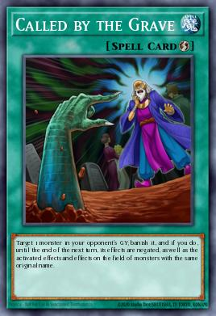

- **Copias y zona:** Side 1x. No altera las cantidades registradas.
- **Nombre oficial de referencia:** Llamado por la Tumba. CID cotejado con la ficha oficial; el nombre histórico del inventario se conserva aunque su grafía/traducción difiera.
- **Función principal y secundaria:** mágica rápida · negación de nombre.
- **Estado de sinergia y función:** Side utilizable entre duelos. Es una clasificación de juego; revisar la relación concreta en A06.
- **Papel como recurso, descarte o coste:** No se demuestra que esta carta sea recurso de descarte o pago para otra.
- **Efecto operativo (paráfrasis analítica):** Destierra un monstruo del Cementerio rival y niega sus efectos junto con los del mismo nombre original hasta el final del turno siguiente. 
- **Mapa de activación y resultados:** efecto de estadística, condición o material; no asumir un disparador adicional. Cada operación está sujeta a la secuencia y al «si lo haces» del texto oficial.
- **Ventanas de activación identificadas:** requieren la fase o condición específica indicada en el texto; sin ventana rápida general asumida.
- **Costes o recursos potenciales:** sin coste independiente identificado en esta síntesis; comprobar las acciones previas al punto y coma de cada efecto.
- **Restricciones y requisitos:** solo entra al Main después de un intercambio entre duelos. 
- **Prioridad al ir primero:** preparar Equipos, materiales Xyz y respuestas en turno rival. Para esta carta: Respuesta puntual al emparejamiento; justificar el intercambio antes del siguiente duelo.
- **Prioridad al ir segundo:** retirar amenazas y después convertir la destrucción propia en ventaja. Identificar primero la respuesta rival que afecta su función «mágica rápida».
- **Medio/tardío y recuperación:** reciclar piezas equipadas y cartas DoomZ del Cementerio. No asumir que por sí misma recicla recursos si el texto no lo permite.
- **Sinergias y acceso a líneas:** Relación contextual con destruir recursos DoomZ para ganar ventaja, equipar monstruos y transformarlos en Xyz Máquina de VIENTO. No habilita una ruta inicial antes del intercambio.
- **Riesgo / brick / interrupciones:** Exige un objetivo en el Cementerio rival; no es negación universal. No atribuirle velocidad rápida por el solo hecho de formar parte del motor.
- **Utilidad editorial:** 3/5 para este deck (estimación por rol y zona, no probabilidad calculada). No cambiar copias; cualquier sugerencia de alta/baja pasa por el apartado 22 y aprobación.
- **Referencia oficial y trazabilidad:** https://www.db.yugioh-card.com/yugiohdb/card_search.action?cid=13619&ope=2&request_locale=es. **Confianza:** texto y tipo de efecto cotejados en Konami; síntesis táctica editorial, no demostración de combo.
- **Aplicación concreta dentro de este deck (A06):** Solo entre duelos; Destierra un monstruo del Cementerio rival y niega sus efectos junto con los del mismo nombre original hasta el final del turno siguiente.. No inicia la mano del Main actual.

**USO PRÁCTICO Y SINERGIA — Llamado por la Tumba**

- **Label funcional:** Sin sinergia demostrada (con la evidencia actual). Clasificación documental; una relación es válida solo si se satisfacen sus condiciones exactas.
- **Qué hace:** Destierra un monstruo del Cementerio rival y niega sus efectos junto con los del mismo nombre original hasta el final del turno siguiente.
- **Cómo aprovecharla en este deck:** Solo entre duelos; Destierra un monstruo del Cementerio rival y niega sus efectos junto con los del mismo nombre original hasta el final del turno siguiente.. No inicia la mano del Main actual.
- **Al jugar primero:** preparar Equipos, materiales Xyz y respuestas en turno rival. Para esta carta: Respuesta puntual al emparejamiento; justificar el intercambio antes del siguiente duelo.
- **Al jugar segundo:** retirar amenazas y después convertir la destrucción propia en ventaja. Identificar primero la respuesta rival que afecta su función «mágica rápida».
- **Cuándo tener precaución:** Exige un objetivo en el Cementerio rival; no es negación universal. No atribuirle velocidad rápida por el solo hecho de formar parte del motor.

#### 35. Tormenta de Relámpagos

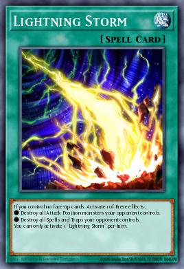

- **Copias y zona:** Side 2x. No altera las cantidades registradas.
- **Nombre oficial de referencia:** Tormenta de Relámpagos. CID cotejado con la ficha oficial; el nombre histórico del inventario se conserva aunque su grafía/traducción difiera.
- **Función principal y secundaria:** mágica · ruptura de mesa.
- **Estado de sinergia y función:** Side utilizable entre duelos. Es una clasificación de juego; revisar la relación concreta en A06.
- **Papel como recurso, descarte o coste:** No se demuestra que esta carta sea recurso de descarte o pago para otra.
- **Efecto operativo (paráfrasis analítica):** Con ningún permanente propio boca arriba, elige destruir los monstruos enemigos en ataque o las Mágicas/Trampas rivales. 
- **Mapa de activación y resultados:** 1) con campo propio vacío: destruye la carta o recurso previsto. Cada operación está sujeta a la secuencia y al «si lo haces» del texto oficial.
- **Ventanas de activación identificadas:** campo propio vacío.
- **Costes o recursos potenciales:** sin coste independiente identificado en esta síntesis; comprobar las acciones previas al punto y coma de cada efecto.
- **Restricciones y requisitos:** hay límite por turno según el efecto concreto; requiere campo propio sin las cartas indicadas; solo entra al Main después de un intercambio entre duelos. 
- **Prioridad al ir primero:** preparar Equipos, materiales Xyz y respuestas en turno rival. Para esta carta: Respuesta puntual al emparejamiento; justificar el intercambio antes del siguiente duelo.
- **Prioridad al ir segundo:** retirar amenazas y después convertir la destrucción propia en ventaja. Identificar primero la respuesta rival que afecta su función «mágica».
- **Medio/tardío y recuperación:** reciclar piezas equipadas y cartas DoomZ del Cementerio. No asumir que por sí misma recicla recursos si el texto no lo permite.
- **Sinergias y acceso a líneas:** Relación contextual con destruir recursos DoomZ para ganar ventaja, equipar monstruos y transformarlos en Xyz Máquina de VIENTO. No habilita una ruta inicial antes del intercambio.
- **Riesgo / brick / interrupciones:** No destruye monstruos en defensa con su primera opción. No atribuirle velocidad rápida por el solo hecho de formar parte del motor.
- **Utilidad editorial:** 3/5 para este deck (estimación por rol y zona, no probabilidad calculada). No cambiar copias; cualquier sugerencia de alta/baja pasa por el apartado 22 y aprobación.
- **Referencia oficial y trazabilidad:** https://www.db.yugioh-card.com/yugiohdb/card_search.action?cid=14876&ope=2&request_locale=es. **Confianza:** texto y tipo de efecto cotejados en Konami; síntesis táctica editorial, no demostración de combo.
- **Aplicación concreta dentro de este deck (A06):** Solo entre duelos; Con ningún permanente propio boca arriba, elige destruir los monstruos enemigos en ataque o las Mágicas/Trampas rivales.. No inicia la mano del Main actual.

**USO PRÁCTICO Y SINERGIA — Tormenta de Relámpagos**

- **Label funcional:** Sin sinergia demostrada (con la evidencia actual). Clasificación documental; una relación es válida solo si se satisfacen sus condiciones exactas.
- **Qué hace:** Con ningún permanente propio boca arriba, elige destruir los monstruos enemigos en ataque o las Mágicas/Trampas rivales.
- **Cómo aprovecharla en este deck:** Solo entre duelos; Con ningún permanente propio boca arriba, elige destruir los monstruos enemigos en ataque o las Mágicas/Trampas rivales.. No inicia la mano del Main actual.
- **Al jugar primero:** preparar Equipos, materiales Xyz y respuestas en turno rival. Para esta carta: Respuesta puntual al emparejamiento; justificar el intercambio antes del siguiente duelo.
- **Al jugar segundo:** retirar amenazas y después convertir la destrucción propia en ventaja. Identificar primero la respuesta rival que afecta su función «mágica».
- **Cuándo tener precaución:** No destruye monstruos en defensa con su primera opción. No atribuirle velocidad rápida por el solo hecho de formar parte del motor.

#### 36. Nibiru, el Ser Primitivo

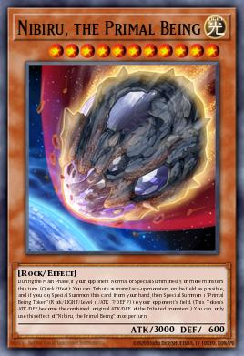

- **Copias y zona:** Side 1x. No altera las cantidades registradas.
- **Nombre oficial de referencia:** Nibiru, el Ser Primitivo. CID cotejado con la ficha oficial; el nombre histórico del inventario se conserva aunque su grafía/traducción difiera.
- **Función principal y secundaria:** handtrap · limpieza del campo.
- **Estado de sinergia y función:** Side utilizable entre duelos. Es una clasificación de juego; revisar la relación concreta en A06.
- **Papel como recurso, descarte o coste:** No se demuestra que esta carta sea recurso de descarte o pago para otra.
- **Efecto operativo (paráfrasis analítica):** En Main Phase, tras cinco o más invocaciones rivales, sacrifica los monstruos boca arriba y deja a Nibiru junto con una Ficha rival. 
- **Mapa de activación y resultados:** 1) en Main Phase: Invocación Especial desde mano. Cada operación está sujeta a la secuencia y al «si lo haces» del texto oficial.
- **Ventanas de activación identificadas:** Main Phase; Efecto Rápido.
- **Costes o recursos potenciales:** sin coste independiente identificado en esta síntesis; comprobar las acciones previas al punto y coma de cada efecto.
- **Restricciones y requisitos:** hay límite por turno según el efecto concreto; solo entra al Main después de un intercambio entre duelos. 
- **Prioridad al ir primero:** preparar Equipos, materiales Xyz y respuestas en turno rival. Para esta carta: Respuesta puntual al emparejamiento; justificar el intercambio antes del siguiente duelo.
- **Prioridad al ir segundo:** retirar amenazas y después convertir la destrucción propia en ventaja. Identificar primero la respuesta rival que afecta su función «handtrap».
- **Medio/tardío y recuperación:** reciclar piezas equipadas y cartas DoomZ del Cementerio. No asumir que por sí misma recicla recursos si el texto no lo permite.
- **Sinergias y acceso a líneas:** Relación contextual con destruir recursos DoomZ para ganar ventaja, equipar monstruos y transformarlos en Xyz Máquina de VIENTO. No habilita una ruta inicial antes del intercambio.
- **Riesgo / brick / interrupciones:** Cuenta invocaciones y entrega una Ficha cuyo ATK/DEF depende de lo sacrificado. Puede emplearse en cadena sólo cuando se cumpla su condición concreta.
- **Utilidad editorial:** 3/5 para este deck (estimación por rol y zona, no probabilidad calculada). No cambiar copias; cualquier sugerencia de alta/baja pasa por el apartado 22 y aprobación.
- **Referencia oficial y trazabilidad:** https://www.db.yugioh-card.com/yugiohdb/card_search.action?cid=14741&ope=2&request_locale=es. **Confianza:** texto y tipo de efecto cotejados en Konami; síntesis táctica editorial, no demostración de combo.
- **Aplicación concreta dentro de este deck (A06):** Solo entre duelos; En Main Phase, tras cinco o más invocaciones rivales, sacrifica los monstruos boca arriba y deja a Nibiru junto con una Ficha rival.. No inicia la mano del Main actual.

**USO PRÁCTICO Y SINERGIA — Nibiru, el Ser Primitivo**

- **Label funcional:** Sin sinergia demostrada (con la evidencia actual). Clasificación documental; una relación es válida solo si se satisfacen sus condiciones exactas.
- **Qué hace:** En Main Phase, tras cinco o más invocaciones rivales, sacrifica los monstruos boca arriba y deja a Nibiru junto con una Ficha rival.
- **Cómo aprovecharla en este deck:** Solo entre duelos; En Main Phase, tras cinco o más invocaciones rivales, sacrifica los monstruos boca arriba y deja a Nibiru junto con una Ficha rival.. No inicia la mano del Main actual.
- **Al jugar primero:** preparar Equipos, materiales Xyz y respuestas en turno rival. Para esta carta: Respuesta puntual al emparejamiento; justificar el intercambio antes del siguiente duelo.
- **Al jugar segundo:** retirar amenazas y después convertir la destrucción propia en ventaja. Identificar primero la respuesta rival que afecta su función «handtrap».
- **Cuándo tener precaución:** Cuenta invocaciones y entrega una Ficha cuyo ATK/DEF depende de lo sacrificado. Puede emplearse en cadena sólo cuando se cumpla su condición concreta.

#### 37. Súper Asesino Estelar TY-PHON - Crisis Celeste

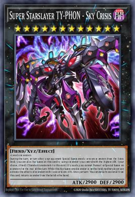

- **Copias y zona:** Side 1x. No altera las cantidades registradas.
- **Nombre oficial de referencia:** Súper Asesino Estelar TY-PHON - Crisis Celeste. CID cotejado con la ficha oficial; el nombre histórico del inventario se conserva aunque su grafía/traducción difiera.
- **Función principal y secundaria:** side técnico · recuperación · cierre · habilitador Xyz.
- **Estado de sinergia y función:** Side utilizable entre duelos. Es una clasificación de juego; revisar la relación concreta en A06.
- **Papel como recurso, descarte o coste:** Material o destino del Extra condicionado a los requisitos de invocación.
- **Efecto operativo (paráfrasis analítica):** retorno o reciclaje hacia mano/Deck/Extra; presión de combate o modificación de estadísticas; gestión de materiales Xyz. Son operaciones detectadas en el texto, no efectos independientes garantizados; leer sus condiciones en la fuente.
- **Mapa de activación y resultados:** 1) una vez por turno: devuelve recursos a mano/Deck/Extra, desacopla materiales Xyz. Cada operación está sujeta a la secuencia y al «si lo haces» del texto oficial.
- **Ventanas de activación identificadas:** requieren la fase o condición específica indicada en el texto; sin ventana rápida general asumida.
- **Costes o recursos potenciales:** sin coste independiente identificado en esta síntesis; comprobar las acciones previas al punto y coma de cada efecto.
- **Restricciones y requisitos:** hay límite por turno según el efecto concreto; solo entra al Main después de un intercambio entre duelos. 
- **Prioridad al ir primero:** preparar Equipos, materiales Xyz y respuestas en turno rival. Para esta carta: Respuesta puntual al emparejamiento; justificar el intercambio antes del siguiente duelo.
- **Prioridad al ir segundo:** retirar amenazas y después convertir la destrucción propia en ventaja. Identificar primero la respuesta rival que afecta su función «side técnico».
- **Medio/tardío y recuperación:** reciclar piezas equipadas y cartas DoomZ del Cementerio. Verificar que el objetivo de recuperación continúe disponible.
- **Sinergias y acceso a líneas:** Relación contextual con destruir recursos DoomZ para ganar ventaja, equipar monstruos y transformarlos en Xyz Máquina de VIENTO. No habilita una ruta inicial antes del intercambio.
- **Riesgo / brick / interrupciones:** Se agota al consumir materiales; no asumir material adicional al pasar de un Xyz a otro. No atribuirle velocidad rápida por el solo hecho de formar parte del motor.
- **Utilidad editorial:** 3/5 para este deck (estimación por rol y zona, no probabilidad calculada). No cambiar copias; cualquier sugerencia de alta/baja pasa por el apartado 22 y aprobación.
- **Referencia oficial y trazabilidad:** https://www.db.yugioh-card.com/yugiohdb/card_search.action?cid=19184&ope=2&request_locale=es. **Confianza:** texto y tipo de efecto cotejados en Konami; síntesis táctica editorial, no demostración de combo.
- **Aplicación concreta dentro de este deck (A06):** Solo entre duelos; retorno o reciclaje hacia mano/Deck/Extra; presión de combate o modificación de estadísticas; gestión de materiales Xyz.. No inicia la mano del Main actual.

**USO PRÁCTICO Y SINERGIA — Súper Asesino Estelar TY-PHON - Crisis Celeste**

- **Label funcional:** Sin sinergia demostrada (con la evidencia actual). Clasificación documental; una relación es válida solo si se satisfacen sus condiciones exactas.
- **Qué hace:** retorno o reciclaje hacia mano/Deck/Extra; presión de combate o modificación de estadísticas; gestión de materiales Xyz. Son operaciones detectadas en el texto, no efectos independientes garantizados; leer sus condiciones en la fuente.
- **Cómo aprovecharla en este deck:** Solo entre duelos; retorno o reciclaje hacia mano/Deck/Extra; presión de combate o modificación de estadísticas; gestión de materiales Xyz.. No inicia la mano del Main actual.
- **Al jugar primero:** preparar Equipos, materiales Xyz y respuestas en turno rival. Para esta carta: Respuesta puntual al emparejamiento; justificar el intercambio antes del siguiente duelo.
- **Al jugar segundo:** retirar amenazas y después convertir la destrucción propia en ventaja. Identificar primero la respuesta rival que afecta su función «side técnico».
- **Cuándo tener precaución:** Se agota al consumir materiales; no asumir material adicional al pasar de un Xyz a otro. No atribuirle velocidad rápida por el solo hecho de formar parte del motor.

## SINERGIAS Y MOTORES
## RESUMEN FUNCIONAL DE SINERGIAS — 653

**Medición descriptiva de etiquetas existentes (NO certificación):** 11/37 identidades con etiqueta directa/indirecta (29.7 %). Main: 11/18 (61.1 %); Extra: 0/12 (0.0 %). Se cuenta una identidad una sola vez; una carta autónoma puede ser útil sin sinergia de motor. Estas cifras provienen de clasificaciones documentales A05/A06: **no son el porcentaje final de sinergias verificadas**, ni una tasa estadística de victoria. Para promoverlas a métricas verificadas, se deben comprobar los pares de cartas y su operación legal.

#### A06.0 — En 30 segundos: cómo cooperan realmente estas cartas

- **Dictamen de conjunto:** núcleo de destrucción y Equipo coherente, con puentes a Modelo de Poder aún condicionados.
- **Motor que mueve el deck:** Incursores, Cambio y Drastea buscan o preparan cartas DoomZ; la destrucción correcta crea recursos que se convierten en Equipos y habilitan el acceso Xyz.
- **Puentes reales:** Amalthe/Elara convierten Equipos y monstruos de Nivel compatible en Xyz DoomZ; Medius/Zegredo conduce a Júpiter por procedimiento propio, no por el mismo coste de tres Equipos.
- **Sinergia indirecta:** una pieza destinada a ser destruida, equipada o enviada al GY puede ser recurso necesario y no una carta sobrante. El efecto de destrucción no es equivalente a cualquier envío.
- **Conflicto decisivo:** niveles/rangos, materiales todavía disponibles, límites por turno y bloqueos de Extra Xyz. La función Péndulo de Vidolium puede servir como apoyo aunque su Invocación como monstruo de Nivel 12 sea otra operación.
- **Decisión concreta:** conservar la arquitectura DoomZ y separar las salidas Xyz/Júpiter; comprobar el acceso de cada carta Extra y los enlaces secundarios pendientes antes de valorar reemplazos.
- **Qué aprender después:** seleccionar apertura DoomZ válida, seguir la transformación a Xyz y comprobar el material exacto antes de elegir un jefe.

#### Motores y dependencias

1. **Núcleo DoomZ: destruir cartas propias con provecho.** **Incursores DoomZ** (CID 21823) destruye otra carta DoomZ de mano/campo para añadir o Invocar desde Deck un monstruo DoomZ; su restricción permite después solo Extra **Xyz**, y **solo uno de sus dos efectos por turno**. **Cambio DoomZ** (22158) puede destruir una carta DoomZ de mano/Deck/campo, y si ese mismo Cambio es destruido por efecto puede recuperar otra carta DoomZ del GY y eventualmente extender desde la mano. No confundir «destruir» con «enviar».
2. **Buscador de monstruo frente a colocador de Magia/Trampa.** **DoomZ V Cinco – Amalthe** (21775) busca un monstruo DoomZ **al ser Invocado o destruido por efecto**; **DoomZ VII Siete – Elara** (21776) **Coloca** una Mágica/Trampa DoomZ del Deck en esos casos. Ambos pueden convertirse en Xyz Máquina de VIENTO del **Rango igual a su Nivel** mientras estén equipados; no existe autorización para saltar a cualquier Rango.
3. **Equipo, autodestrucción y Xyz.** **DoomZ XII Cero – Drastea** (21774) destruye una DoomZ propia para entrar desde mano y equipar una Mágica de Equipo desde Deck; equipada puede convertirse mediante su efecto rápido en Xyz Máquina de VIENTO de Rango igual a su Nivel, transfiriéndose con Equipos como materiales. **DoomZ Modelo de Poder** (21777) convierte otro Monstruo de Efecto en Xyz DoomZ o Júpiter de Rango igual a su Nivel, equipándose a él y bloqueando otras categorías Extra.
4. **Modelo de Poder / Júpiter alternativo.** **Medius el Puro** (21419) permite acceder a un monstruo Modelo de Poder; **Modelo de Poder Máquina de Sombras Zegredo** (22521) puede destruirse tras desterrar las tres cartas superiores del Deck boca abajo para Invocar **Júpiter** (21810) del Extra como Xyz. La alternativa propia de Júpiter exige un monstruo **equipado con al menos tres Equipos**; no atribuir esa condición a cualquier invocación de Júpiter.
5. **Destinos Extra disponibles.** **Fractura DoomZ – Diactorus** (21812) destruye una DoomZ propia al ser Invocada Especialmente y puede destruir un monstruo; **DoomZ XIII Over – Graflario** (22554) puede usar un Xyz DoomZ como material y busca Mágica/Trampa DoomZ desacoplando material, con destrucción opcional; **DoomZ XII Fin – Drastrius** (21811) equipa un monstruo boca arriba al ser Invocado Xyz y puede negar efectos de monstruo en Campo/GY desacoplando un material. Son destinos con requisitos distintos, no un mismo «boss» intercambiable.
6. **Equipos y reactivación.** **Mando DoomZ D.O.O.M.D.U.R.G.** (21824) aporta protección de selección y efecto rápido de destruir otra carta propia, ganar ATK/atacar directamente, sujeto a autodestrucción tras batalla. **Mando DoomZ A.D.R.A.S.T.E.I.A.** (22567) destruye al equipado para revivir otro DoomZ; desde GY se equipa a un monstruo y provoca daño a su controlador. **Destrucción DoomZ** (21840) equipa un Xyz con bloqueo de búsquedas rivales y, destruida por efecto, puede equipar un DoomZ desde Deck.

#### Mapa de conexiones y fuentes para fotos

| Conexión con CID | Resultado | Restricción clave | Visual |
|---|---|---|---|
| Incursores (21823) → Amalthe (21775) / Elara (21776) | Destrucción propia que habilita acceso a monstruo o Mágica/Trampa según la pieza afectada. | Efectos por turno, evento exacto de destrucción y bloqueo a Xyz. |    |
| Cambio DoomZ (22158) → Drastea (21774) / Amalthe | Preparación de recursos destruidos y extensión posterior. | La destrucción debe alcanzar la carta correcta y la salida existir en inventario. |   |
| Drastea (21774) + Mando (21824) → Drastrius (21811) | Equipamiento y transformación Xyz con materiales. | Rango = Nivel, zona/equipo legal, no invocación gratuita. |    |
| Medius (21419) → Zegredo (22521) → Júpiter (21810) | Acceso Modelo de Poder y procedimiento Xyz específico. | Desterrar 3 cartas boca abajo y destruir Zegredo; no confundir con requisito 3 Equipos. |    |
| Graflario (22554) / Diactorus (21812) → piezas DoomZ | Búsqueda de M/T y destrucción propia controlada. | Materiales y ventanas por texto, no efecto universal de todos los Xyz. |   |

#### Choques y redundancias

- **Secuenciación Extra:** Incursores y DoomZ Modelo de Poder pueden bloquear Fusión/Sincronía/Enlace; no combinar arbitrariamente con otros jefes. **Elara** y **Amalthe** cambian el valor de destruir una propia (Colocación vs búsqueda). Una carta destruida por coste/efecto debe comprobarse frente al disparador escrito.
- **Vidrium/Vidolium como Péndulo — función diferenciada:** CID 22519 figura **1x en Main**, lo cual **sí es válido** para activar su Escala Péndulo desde la mano. Su efecto Péndulo puede autodestruirse para Invocar un «Power Patron» de mano/GY, o potenciar monstruos «Power Patron» de Nivel original 12; la carta destruida puede pasar boca arriba al Extra y habilitar su búsqueda «Power Patron». **No** confundir esto con Invocar como monstruo al Vidolium de Nivel 12, que requiere retornar al Extra Fusión + Sincronía + Xyz. Esa ruta avanzada no está demostrada en DoomZ. Investigar objetivos del efecto Péndulo y relación con autodestrucción DoomZ, sin declarar la ruta avanzada operativa ni modificar copias.
- **Cartas Extra de Rango distinto:** la conversión instantánea de Amalthe o Elara no autoriza a elegir Drastrius u otra carta sin correspondencia de Rango; si no existe destino apropiado, la rama queda bloqueada.
- **Side de 9 copias:** Ogro, Talento, Dugares, Called by, Tormenta, Nibiru y TY-PHON se excluyen de las rutas de partida inicial; Dugares/TY-PHON solo serían Extra en una lista modificada y aprobada.

#### A06.1 — Arquitectura operativa de los motores (síntesis no redundante)

Las siguientes filas son **relaciones funcionales**, no secuencias certificadas ni garantía de mano inicial. La lista real y los límites están en A04/A05/A07.

| Tipo / motor | Starter o vía de acceso real | Recurso y destino | Cuello de botella |
|---|---|---|---|
| **Principal: DoomZ destrucción/equipo** | Incursores / Cambio / Drastea y piezas DoomZ destruibles | Acceso al Deck, Equipos y conversión a Xyz | Destrucción exacta, no envío; límites por turno y bloqueo Xyz |
| **Submotor: Xyz DoomZ** | Amalthe, Elara, Modelo de Poder y Equipos de rangos compatibles | Diactorus / Graflario / Drastrius | Rango igual al Nivel y material/equipo correcto |
| **Secundario: Medius / Zegredo / Júpiter** | Medius y Máquina de Sombras Zegredo | Ruta alternativa condicionada hacia Júpiter | Destierro de tres cartas y autodestrucción; alternativa de tres Equipos no es equivalente |

#### A06.2 — Estado funcional y justificación de TODAS las cartas

**Cómo leerlo:** un estado de sinergia describe el papel **de juego**, no el avance de una auditoría. No hay obligación de que cada carta tenga un enlace con otra: una defensa autónoma, una herramienta de Side o un recurso de descarte justificado también tiene propósito. Las relaciones directas descritas aquí se deben contrastar con los textos oficiales antes de representarlas como una ruta legal A09.

| Carta / CID y zona | Estado funcional de sinergia | Motivo de inclusión | Relación y condición concreta | Papel como coste, descarte o material | Límite o riesgo | Decisión táctica |
|---|---|---|---|---|---|---|
| **Medius el Puro** (CID 21419) — Main 1x | **Sinergia indirecta (soporte o recursos)** | searcher · buscador · extensor · recuperación | búsqueda o incorporación de cartas a mano; extensión mediante monstruos procedentes del Deck; recuperación e invocación desde Cementerio/destierro; retorno o reciclaje hacia mano/Deck/Extra | Coste o consumo descrito en A05: reciclaje de recurso propio | hay límite por turno según el efecto concreto; depende de recursos en Cementerio | Conservar; verificar coste y orden |
| **Mando DoomZ «D.O.O.M.D.U.R.G.»** (CID 21824) — Main 2x | **Sinergia indirecta (soporte o recursos)** | interrupción · removal · cierre · motor Equipo | destrucción de cartas o empleo de destrucción como detonante; presión de combate o modificación de estadísticas; uso o producción de cartas equipadas | No se demuestra que esta carta sea recurso de descarte o pago para otra | hay límite por turno según el efecto concreto | Conservar; verificar coste y orden |
| **DoomZ Modelo de Poder** (CID 21777) — Main 2x | **Sinergia indirecta (soporte o recursos)** | searcher · buscador · removal · respuesta · motor Equipo | búsqueda o incorporación de cartas a mano; destrucción de cartas o empleo de destrucción como detonante; interacción sobre monstruos en campo; uso o producción de cartas equipadas | No se demuestra que esta carta sea recurso de descarte o pago para otra | hay límite por turno según el efecto concreto; puede bloquear tipos de Invocación del Extra Deck | Conservar; verificar coste y orden |
| **El Bufón y el Pájaro del Candado** (CID 9279) — Main 2x | **Utilidad independiente** | handtrap · bloqueo de búsquedas | Tras una incorporación desde el Deck a la mano rival, se envía al Cementerio para impedir nuevas adiciones desde ambos Decks principales ese turno. Aporta respuesta o consistencia sin exigir enlace directo | Envío mencionado en la interacción; no equivale por sí mismo a descarte desde la mano | aplicar restricciones de selección, activación y copias que consten en el texto original | Conservar según rival y conflictos propios |
| **Modelo de Poder Máquina de Sombras Zegredo** (CID 22521) — Main 3x | **Sinergia indirecta (soporte o recursos)** | searcher · buscador · removal · habilitador Xyz | búsqueda o incorporación de cartas a mano; destrucción de cartas o empleo de destrucción como detonante; gestión de materiales Xyz | Material o destino del Extra condicionado a los requisitos de invocación | hay límite por turno según el efecto concreto; interactúa con información oculta o resultados no siempre elegibles | Conservar; verificar coste y orden |
| **Flor de Ceniza & Primavera Feliz** (CID 12950) — Main 3x | **Utilidad independiente** | handtrap · negación | Descarta desde la mano para detener efectos que buscan, invocan o mandan cartas desde el Deck. Aporta respuesta o consistencia sin exigir enlace directo | Descarte mencionado: comprobar carta que lo exige, zona, coste frente a efecto y utilidad del recurso | hay límite por turno según el efecto concreto | Conservar según rival y conflictos propios |
| **Therion «Rey» Regulus** (CID 17119) — Main 1x | **Utilidad independiente** | extensor Máquina · negación | Regulus se invoca desde mano equipando Máquina o Therion del GY y ofrece una negación con coste de envío de Therion. Aporta respuesta o consistencia sin exigir enlace directo | Coste o consumo descrito en A05: envío de recurso propio al Cementerio | hay límite por turno según el efecto concreto; depende de recursos en Cementerio | Conservar según rival y conflictos propios |
| **DoomZ XII Cero - Drastea** (CID 21774) — Main 2x | **Sinergia indirecta (soporte o recursos)** | interrupción · extensor · habilitador Xyz · motor Equipo | extensión mediante monstruos procedentes del Deck; acceso al campo desde la mano; gestión de materiales Xyz; uso o producción de cartas equipadas | Material o destino del Extra condicionado a los requisitos de invocación | hay límite por turno según el efecto concreto | Conservar; verificar coste y orden |
| **DoomZ V Cinco - Amalthe** (CID 21775) — Main 3x | **Sinergia indirecta (soporte o recursos)** | interrupción · searcher · buscador · habilitador Xyz · motor Equipo | búsqueda o incorporación de cartas a mano; gestión de materiales Xyz; uso o producción de cartas equipadas | Material o destino del Extra condicionado a los requisitos de invocación | hay límite por turno según el efecto concreto | Conservar; verificar coste y orden |
| **DoomZ VII Siete - Elara** (CID 21776) — Main 3x | **Sinergia indirecta (soporte o recursos)** | interrupción · preparación · habilitador Xyz · motor Equipo | colocación de Mágicas/Trampas o recursos; gestión de materiales Xyz; uso o producción de cartas equipadas | Material o destino del Extra condicionado a los requisitos de invocación | hay límite por turno según el efecto concreto | Conservar; verificar coste y orden |
| **Infinito Temporal** (CID 13631) — Main 3x | **Utilidad independiente** | trampa · negación | Niega temporalmente un monstruo rival boca arriba; si se activó tras estar Colocada, también afecta la columna M/T correspondiente. Aporta respuesta o consistencia sin exigir enlace directo | No se demuestra que esta carta sea recurso de descarte o pago para otra | requiere campo propio sin las cartas indicadas | Conservar según rival y conflictos propios |
| **Fuwalos Multivadora** (CID 20500) — Main 3x | **Utilidad independiente** | handtrap · robo condicional | Con campo propio sin cartas, descarta y roba al producirse Invocaciones Especiales rivales desde Deck o Extra; ajusta la mano en End Phase. Aporta respuesta o consistencia sin exigir enlace directo | Descarte mencionado: comprobar carta que lo exige, zona, coste frente a efecto y utilidad del recurso | requiere campo propio sin las cartas indicadas; interactúa con información oculta o resultados no siempre elegibles | Conservar según rival y conflictos propios |
| **Portal del Modelo de Poder Desatado - Terminus** (CID 22565) — Main 3x | **Sin relación demostrada** | Función individual: searcher · buscador · removal | No se documenta una operación concreta que conecte esta carta con el motor; no inferir inutilidad | No se demuestra que esta carta sea recurso de descarte o pago para otra | hay límite por turno según el efecto concreto; puede limitar ataques; depende de recursos en Cementerio; interactúa con información oculta o… | Cruzar A05/A09; alternativa no demostrada |
| **Incursores DoomZ** (CID 21823) — Main 3x | **Sinergia indirecta (soporte o recursos)** | searcher · buscador · extensor | búsqueda o incorporación de cartas a mano; extensión mediante monstruos procedentes del Deck | No se demuestra que esta carta sea recurso de descarte o pago para otra | puede bloquear tipos de Invocación del Extra Deck | Conservar; verificar coste y orden |
| **Vidrium, Modelo de Poder de la Exterminación del Caos** (CID 22519) — Main 1x | **Recurso Péndulo condicionado** | searcher · buscador · recuperación · extensor · removal | Estar en Main permite activar Vidolium como Escala Péndulo; autodestruirse puede extender un Power Patron de mano/GY y su llegada boca arriba al Extra puede buscar Power Patron. La Invocación del monstruo de Nivel 12 sí necesita retornar Fusión + Sincronía +… | Material o destino del Extra condicionado a los requisitos de invocación | hay límite por turno según el efecto concreto; interactúa con información oculta o resultados no siempre elegibles; tiene procedimiento especial… | Revisar zona/acceso; sustitución por validar |
| **Cambio DoomZ** (CID 22158) — Main 3x | **Sinergia indirecta (soporte o recursos)** | searcher · buscador · extensor · removal | búsqueda o incorporación de cartas a mano; acceso al campo desde la mano; destrucción de cartas o empleo de destrucción como detonante | No se demuestra que esta carta sea recurso de descarte o pago para otra | hay límite por turno según el efecto concreto; depende de recursos en Cementerio | Conservar; verificar coste y orden |
| **Destrucción DoomZ** (CID 21840) — Main 1x | **Sinergia indirecta (soporte o recursos)** | searcher · buscador · removal · respuesta · motor Equipo | búsqueda o incorporación de cartas a mano; destrucción de cartas o empleo de destrucción como detonante; interacción sobre monstruos en campo; uso o producción de cartas equipadas | No se demuestra que esta carta sea recurso de descarte o pago para otra | hay límite por turno según el efecto concreto | Conservar; verificar coste y orden |
| **Mando DoomZ «A.D.R.A.S.T.E.I.A.»** (CID 22567) — Main 1x | **Sinergia indirecta (soporte o recursos)** | extensor · cierre · respuesta · motor Equipo | acceso al campo desde la mano; presión de combate o modificación de estadísticas; interacción sobre monstruos en campo; uso o producción de cartas equipadas | No se demuestra que esta carta sea recurso de descarte o pago para otra | hay límite por turno según el efecto concreto; depende de recursos en Cementerio | Conservar; verificar coste y orden |
| **Número F0: Futuro Draco Utópico** (CID 14958) — Extra 1x | **Sin acceso al Extra demostrado** | Función individual: interrupción · resultado de Extra Deck · negación · habilitador Xyz · protección | No se documenta una operación concreta que conecte esta carta con el motor; no inferir inutilidad | Material o destino del Extra condicionado a los requisitos de invocación | hay límite por turno según el efecto concreto. Invocar sólo desde el Extra Deck usando su procedimiento propio | Cruzar A09/A07 antes de proponer reemplazo |
| **Springans Fiestero** (CID 16002) — Extra 1x | **Sin acceso al Extra demostrado** | Función individual: interrupción · resultado de Extra Deck · extensor · recuperación · habilitador Xyz | No se documenta una operación concreta que conecte esta carta con el motor; no inferir inutilidad | Material o destino del Extra condicionado a los requisitos de invocación | hay límite por turno según el efecto concreto; exige materiales de Extra Deck o materiales adecuados. Invocar sólo desde el Extra Deck usando su… | Cruzar A09/A07 antes de proponer reemplazo |
| **Gigantesco «Campeón» Sargas** (CID 18190) — Extra 1x | **Sin acceso al Extra demostrado** | Función individual: resultado de Extra Deck · buscador · habilitador Xyz | No se documenta una operación concreta que conecte esta carta con el motor; no inferir inutilidad | Material o destino del Extra condicionado a los requisitos de invocación | hay límite por turno según el efecto concreto. Invocar sólo desde el Extra Deck usando su procedimiento propio | Cruzar A09/A07 antes de proponer reemplazo |
| **DoomZ XII Fin - Drastrius** (CID 21811) — Extra 2x | **Destino Extra condicionado** | interrupción · resultado de Extra Deck · negación · habilitador Xyz · motor Equipo | negación de efectos o activaciones; gestión de materiales Xyz; uso o producción de cartas equipadas | Material o destino del Extra condicionado a los requisitos de invocación | hay límite por turno según el efecto concreto. Invocar sólo desde el Extra Deck usando su procedimiento propio | Conservar si hay materiales legales |
| **DoomZ XIII Over - Graflario** (CID 22554) — Extra 2x | **Destino Extra condicionado** | resultado de Extra Deck · buscador · extensor · recuperación · habilitador Xyz | búsqueda o incorporación de cartas a mano; extensión mediante monstruos procedentes del Deck; recuperación e invocación desde Cementerio/destierro; gestión de materiales Xyz | Material o destino del Extra condicionado a los requisitos de invocación | hay límite por turno según el efecto concreto. Invocar sólo desde el Extra Deck usando su procedimiento propio | Conservar si hay materiales legales |
| **Fractura DoomZ - Diactorus** (CID 21812) — Extra 2x | **Destino Extra condicionado** | resultado de Extra Deck · extensor · motor Equipo | acceso al campo desde la mano; uso o producción de cartas equipadas | Material o destino del Extra condicionado a los requisitos de invocación | hay límite por turno según el efecto concreto. Invocar sólo desde el Extra Deck usando su procedimiento propio | Conservar si hay materiales legales |
| **Júpiter el Modelo de Poder de Destrucción** (CID 21810) — Extra 1x | **Destino Extra condicionado** | resultado de Extra Deck · recuperación · removal · cierre · habilitador Xyz | recuperación e invocación desde Cementerio/destierro | Material o destino del Extra condicionado a los requisitos de invocación | hay límite por turno según el efecto concreto; depende de recursos en Cementerio. Invocar sólo desde el Extra Deck usando su procedimiento… | Conservar si hay materiales legales |
| **Número F0: Futuro Utópico Zexal** (CID 21453) — Extra 1x | **Sin acceso al Extra demostrado** | Función individual: interrupción · resultado de Extra Deck · cierre · respuesta · habilitador Xyz | No se documenta una operación concreta que conecte esta carta con el motor; no inferir inutilidad | Material o destino del Extra condicionado a los requisitos de invocación | hay límite por turno según el efecto concreto. Invocar sólo desde el Extra Deck usando su procedimiento propio | Cruzar A09/A07 antes de proponer reemplazo |
| **Varudras, el Último Portador del Fin de los Tiempos** (CID 19886) — Extra 1x | **Sin acceso al Extra demostrado** | Función individual: interrupción · resultado de Extra Deck · removal · negación · habilitador Xyz | No se documenta una operación concreta que conecte esta carta con el motor; no inferir inutilidad | Material o destino del Extra condicionado a los requisitos de invocación | hay límite por turno según el efecto concreto. Invocar sólo desde el Extra Deck usando su procedimiento propio | Cruzar A09/A07 antes de proponer reemplazo |
| **Divino Arsenal AA-ZEUS - Trueno del Cielo** (CID 15524) — Extra 1x | **Acceso desde Drastrius con batalla comprobado** | Xyz Rango 12; barrido de enviar al GY, no destruir | `653:A09:RAIDERS:ELARA:DRASTRIUS_BATTLE_ZEUS08`: Incursores + Elara, Drastrius con 2 materiales, batalla y MP2 superposición a ZEUS con 3 | Invocación de Extra Xyz permitida por Incursores | Desacopla 2 y envía incluso tus otras cartas; ZEUS LUZ no hereda efecto VIENTO de Mando | Abrir siete pasos; elegir entre negador Drastrius y barrido ZEUS |
| **Número F0: Futuro Utópico** (CID 11413) — Extra 1x | **Sin acceso al Extra demostrado** | Función individual: resultado de Extra Deck · cierre · habilitador Xyz · protección | No se documenta una operación concreta que conecte esta carta con el motor; no inferir inutilidad | Material o destino del Extra condicionado a los requisitos de invocación | aplicar restricciones de selección, activación y copias que consten en el texto original. Invocar sólo desde el Extra Deck usando su… | Cruzar A09/A07 antes de proponer reemplazo |
| **Mago Gagagaga** (CID 14920) — Extra 1x | **Sin acceso al Extra demostrado** | Función individual: resultado de Extra Deck · negación · cierre · respuesta · habilitador Xyz | No se documenta una operación concreta que conecte esta carta con el motor; no inferir inutilidad | Material o destino del Extra condicionado a los requisitos de invocación | hay límite por turno según el efecto concreto; depende de recursos en Cementerio. Invocar sólo desde el Extra Deck usando su procedimiento… | Cruzar A09/A07 antes de proponer reemplazo |
| **Ogro Fantasma & Conejo de las Nieves** (CID 11708) — Side 2x | **Side utilizable entre duelos** | Herramienta situacional de Side, disponible tras el intercambio permitido entre duelos | Solo entre duelos; Se envía desde mano o campo al Cementerio cuando un monstruo en campo o M/T ya boca arriba activa su efecto, para destruir esa carta.. No inicia la mano del Main actual | Envío mencionado en la interacción; no equivale por sí mismo a descarte desde la mano | hay límite por turno según el efecto concreto; solo entra al Main después de un intercambio entre duelos | Side: probar enfrentamiento antes de sustituir |
| **Talento de Tácticas Triples** (CID 15296) — Side 1x | **Side utilizable entre duelos** | Herramienta situacional de Side, disponible tras el intercambio permitido entre duelos | Solo entre duelos; Si el rival activó un efecto de monstruo durante tu Main Phase, permite elegir entre robar dos, tomar control temporal o devolver una carta de mano al Deck.. No inicia la mano del Main actual | No se demuestra que esta carta sea recurso de descarte o pago para otra | hay límite por turno según el efecto concreto; solo entra al Main después de un intercambio entre duelos | Side: probar enfrentamiento antes de sustituir |
| **Número 60: Dugares el Eterno** (CID 14564) — Side 1x | **Side utilizable entre duelos** | Herramienta situacional de Side, disponible tras el intercambio permitido entre duelos | Solo entre duelos; recuperación e invocación desde Cementerio/destierro; generación de cartas por robo; presión de combate o modificación de estadísticas; gestión de materiales Xyz.. No inicia la mano del Main actual | Material o destino del Extra condicionado a los requisitos de invocación | hay límite por turno según el efecto concreto; depende de recursos en Cementerio; solo entra al Main después de un intercambio entre duelos | Side: probar enfrentamiento antes de sustituir |
| **Llamado por la Tumba** (CID 13619) — Side 1x | **Side utilizable entre duelos** | Herramienta situacional de Side, disponible tras el intercambio permitido entre duelos | Solo entre duelos; Destierra un monstruo del Cementerio rival y niega sus efectos junto con los del mismo nombre original hasta el final del turno siguiente.. No inicia la mano del Main actual | No se demuestra que esta carta sea recurso de descarte o pago para otra | solo entra al Main después de un intercambio entre duelos | Side: probar enfrentamiento antes de sustituir |
| **Tormenta de Relámpagos** (CID 14876) — Side 2x | **Side utilizable entre duelos** | Herramienta situacional de Side, disponible tras el intercambio permitido entre duelos | Solo entre duelos; Con ningún permanente propio boca arriba, elige destruir los monstruos enemigos en ataque o las Mágicas/Trampas rivales.. No inicia la mano del Main actual | No se demuestra que esta carta sea recurso de descarte o pago para otra | hay límite por turno según el efecto concreto; requiere campo propio sin las cartas indicadas; solo entra al Main después de un intercambio… | Side: probar enfrentamiento antes de sustituir |
| **Nibiru, el Ser Primitivo** (CID 14741) — Side 1x | **Side utilizable entre duelos** | Herramienta situacional de Side, disponible tras el intercambio permitido entre duelos | Solo entre duelos; En Main Phase, tras cinco o más invocaciones rivales, sacrifica los monstruos boca arriba y deja a Nibiru junto con una Ficha rival.. No inicia la mano del Main actual | No se demuestra que esta carta sea recurso de descarte o pago para otra | hay límite por turno según el efecto concreto; solo entra al Main después de un intercambio entre duelos | Side: probar enfrentamiento antes de sustituir |
| **Súper Asesino Estelar TY-PHON - Crisis Celeste** (CID 19184) — Side 1x | **Side utilizable entre duelos** | Herramienta situacional de Side, disponible tras el intercambio permitido entre duelos | Solo entre duelos; retorno o reciclaje hacia mano/Deck/Extra; presión de combate o modificación de estadísticas; gestión de materiales Xyz.. No inicia la mano del Main actual | Material o destino del Extra condicionado a los requisitos de invocación | hay límite por turno según el efecto concreto; solo entra al Main después de un intercambio entre duelos | Side: probar enfrentamiento antes de sustituir |

## INTERACCIONES Y CLASIFICACIÓN

| ID documental | Categoría provisional | Piezas | Resultado | Requisitos | Check |
|---|---|---|---|---|---|
| 653:A08:01 | STARTER | Incursores (21823) → Amalthe (21775) / Elara (21776) | Destrucción propia que habilita acceso a monstruo o Mágica/Trampa según la pieza afectada. | Efectos por turno, evento exacto de destrucción y bloqueo a Xyz. | |
| 653:A08:02 | INTERACCION | Cambio DoomZ (22158) → Drastea (21774) / Amalthe | Preparación de recursos destruidos y extensión posterior. | La destrucción debe alcanzar la carta correcta y la salida existir en inventario. | |
| 653:A08:03 | RUTA | Drastea (21774) + Mando (21824) → Drastrius (21811) | Equipamiento y transformación Xyz con materiales. | Rango = Nivel, zona/equipo legal, no invocación gratuita. | |
| 653:A08:04 | RUTA | Medius (21419) → Zegredo (22521) → Júpiter (21810) | Acceso Modelo de Poder y procedimiento Xyz específico. | Desterrar 3 cartas boca abajo y destruir Zegredo; no confundir con requisito 3 Equipos. | |
| 653:A08:05 | INTERACCION | Graflario (22554) / Diactorus (21812) → piezas DoomZ | Búsqueda de M/T y destrucción propia controlada. | Materiales y ventanas por texto, no efecto universal de todos los Xyz. | |

#### Rol registrado por cada carta

| ID A08 | Carta registrada | Zona | Clasificación funcional | Rol documentado en A05 | Check de clasificación |
|---|---|---|---|---|---|
| 653:A08:C001 | Medius el Puro | Main | EXTENSOR_POTENCIAL | searcher · buscador · extensor · recuperación. | |
| 653:A08:C002 | Mando DoomZ «D.O.O.M.D.U.R.G.» | Main | INTERACCION_DEFENSIVA | interrupción · removal · cierre · motor Equipo. | |
| 653:A08:C003 | DoomZ Modelo de Poder | Main | BUSCADOR_INTERACCION | searcher · buscador · removal · respuesta · motor Equipo. | |
| 653:A08:C004 | El Bufón y el Pájaro del Candado | Main | BUSCADOR_INTERACCION | handtrap · bloqueo de búsquedas. | |
| 653:A08:C005 | Modelo de Poder Máquina de Sombras Zegredo | Main | BUSCADOR_INTERACCION | searcher · buscador · removal · habilitador Xyz. | |
| 653:A08:C006 | Flor de Ceniza & Primavera Feliz | Main | INTERACCION_DEFENSIVA | handtrap · negación. | |
| 653:A08:C007 | Therion «Rey» Regulus | Main | EXTENSOR_POTENCIAL | extensor Máquina · negación. | |
| 653:A08:C008 | DoomZ XII Cero - Drastea | Main | EXTENSOR_POTENCIAL | interrupción · extensor · habilitador Xyz · motor Equipo. | |
| 653:A08:C009 | DoomZ V Cinco - Amalthe | Main | BUSCADOR_INTERACCION | interrupción · searcher · buscador · habilitador Xyz · motor Equipo. | |
| 653:A08:C010 | DoomZ VII Siete - Elara | Main | INTERACCION_DEFENSIVA | interrupción · preparación · habilitador Xyz · motor Equipo. | |
| 653:A08:C011 | Infinito Temporal | Main | INTERACCION_DEFENSIVA | trampa · negación. | |
| 653:A08:C012 | Fuwalos Multivadora | Main | INTERACCION_DEFENSIVA | handtrap · robo condicional. | |
| 653:A08:C013 | Portal del Modelo de Poder Desatado - Terminus | Main | BUSCADOR_INTERACCION | searcher · buscador · removal. | |
| 653:A08:C014 | Incursores DoomZ | Main | EXTENSOR_POTENCIAL | searcher · buscador · extensor. | |
| 653:A08:C015 | Vidrium, Modelo de Poder de la Exterminación del Caos | Main | EXTENSOR_POTENCIAL | searcher · buscador · recuperación · extensor · removal. | |
| 653:A08:C016 | Cambio DoomZ | Main | EXTENSOR_POTENCIAL | searcher · buscador · extensor · removal. | |
| 653:A08:C017 | Destrucción DoomZ | Main | BUSCADOR_INTERACCION | searcher · buscador · removal · respuesta · motor Equipo. | |
| 653:A08:C018 | Mando DoomZ «A.D.R.A.S.T.E.I.A.» | Main | EXTENSOR_POTENCIAL | extensor · cierre · respuesta · motor Equipo. | |
| 653:A08:C019 | Número F0: Futuro Draco Utópico | Extra | DESTINO_EXTRA (materiales/procedimiento por comprobar) | interrupción · resultado de Extra Deck · negación · habilitador Xyz · protección. | |
| 653:A08:C020 | Springans Fiestero | Extra | DESTINO_EXTRA (materiales/procedimiento por comprobar) | interrupción · resultado de Extra Deck · extensor · recuperación · habilitador Xyz. | |
| 653:A08:C021 | Gigantesco «Campeón» Sargas | Extra | DESTINO_EXTRA (materiales/procedimiento por comprobar) | resultado de Extra Deck · buscador · habilitador Xyz. | |
| 653:A08:C022 | DoomZ XII Fin - Drastrius | Extra | DESTINO_EXTRA (materiales/procedimiento por comprobar) | interrupción · resultado de Extra Deck · negación · habilitador Xyz · motor Equipo. | |
| 653:A08:C023 | DoomZ XIII Over - Graflario | Extra | DESTINO_EXTRA (materiales/procedimiento por comprobar) | resultado de Extra Deck · buscador · extensor · recuperación · habilitador Xyz. | |
| 653:A08:C024 | Fractura DoomZ - Diactorus | Extra | DESTINO_EXTRA (materiales/procedimiento por comprobar) | resultado de Extra Deck · extensor · motor Equipo. | |
| 653:A08:C025 | Júpiter el Modelo de Poder de Destrucción | Extra | DESTINO_EXTRA (materiales/procedimiento por comprobar) | resultado de Extra Deck · recuperación · removal · cierre · habilitador Xyz. | |
| 653:A08:C026 | Número F0: Futuro Utópico Zexal | Extra | DESTINO_EXTRA (materiales/procedimiento por comprobar) | interrupción · resultado de Extra Deck · cierre · respuesta · habilitador Xyz. | |
| 653:A08:C027 | Varudras, el Último Portador del Fin de los Tiempos | Extra | DESTINO_EXTRA (materiales/procedimiento por comprobar) | interrupción · resultado de Extra Deck · removal · negación · habilitador Xyz. | |
| 653:A08:C028 | Divino Arsenal AA-ZEUS - Trueno del Cielo | Extra | CONTINUACIÓN XYZ DESPUÉS DE BATALLA | `653:A09:RAIDERS:ELARA:DRASTRIUS_BATTLE_ZEUS08`: Drastrius con dos materiales → ZEUS tres; barrido disponible a coste dos, no negación de monstruo. | |
| 653:A08:C029 | Número F0: Futuro Utópico | Extra | DESTINO_EXTRA (materiales/procedimiento por comprobar) | resultado de Extra Deck · cierre · habilitador Xyz · protección. | |
| 653:A08:C030 | Mago Gagagaga | Extra | DESTINO_EXTRA (materiales/procedimiento por comprobar) | resultado de Extra Deck · negación · cierre · respuesta · habilitador Xyz. | |
| 653:A08:C031 | Ogro Fantasma & Conejo de las Nieves | Side | SIDE (solo disponible entre duelos con sustitución) | handtrap · destrucción. | |
| 653:A08:C032 | Talento de Tácticas Triples | Side | SIDE (solo disponible entre duelos con sustitución) | mágica de respuesta · ventaja. | |
| 653:A08:C033 | Número 60: Dugares el Eterno | Side | SIDE (solo disponible entre duelos con sustitución) | side técnico · recuperación · ventaja de mano · cierre · habilitador Xyz. | |
| 653:A08:C034 | Llamado por la Tumba | Side | SIDE (solo disponible entre duelos con sustitución) | mágica rápida · negación de nombre. | |
| 653:A08:C035 | Tormenta de Relámpagos | Side | SIDE (solo disponible entre duelos con sustitución) | mágica · ruptura de mesa. | |
| 653:A08:C036 | Nibiru, el Ser Primitivo | Side | SIDE (solo disponible entre duelos con sustitución) | handtrap · limpieza del campo. | |
| 653:A08:C037 | Súper Asesino Estelar TY-PHON - Crisis Celeste | Side | SIDE (solo disponible entre duelos con sustitución) | side técnico · recuperación · cierre · habilitador Xyz. | |

## JUGADAS DOCUMENTADAS

> Requieren comprobación A11–A13 y validación de estado final. No publicar las rutas como combos certificados por tener fotografías.

#### A09 — `653:A09:RAIDERS:ELARA:DRAS01` (2 cartas; Normal disponible)

**Referencias primarias de identidad y texto:** [Incursores](https://www.db.yugioh-card.com/yugiohdb/card_search.action?cid=21823&ope=2&request_locale=es), [Elara](https://www.db.yugioh-card.com/yugiohdb/card_search.action?cid=21776&ope=2&request_locale=es), [Drastea](https://www.db.yugioh-card.com/yugiohdb/card_search.action?cid=21774&ope=2&request_locale=es), [Drastrius](https://www.db.yugioh-card.com/yugiohdb/card_search.action?cid=21811&ope=2&request_locale=es). Son fuentes para cotejar cada condición y destino de cartas; la coincidencia de CIDs no constituye por sí misma una simulación legal de esta ruta.

- **Mano inicial mínima exacta:** **Incursores DoomZ** (21823, Mágica Continua) + **DoomZ VII Siete - Elara** (21776, Nivel 4). Campo y GY propios vacíos; en Main Deck queda **Drastea** (21774) y al menos un **Mando DoomZ D.O.O.M.D.U.R.G.** (21824, Equipo); en Extra **Drastrius** (21811, Xyz Máquina de VIENTO Rango 8). Main Phase propia; no respuesta rival ni cartas adversarias seleccionables.
1. Activar Incursores en zona M/T; usar su efecto en Main Phase **CL1**, eligiendo destruir **Elara en mano**. Al resolver, Elara es destruida **por el efecto**, no enviada como coste, y **Drastea** se Invoca Especialmente **desde Deck** en Ataque (ATK 2400). La restricción de Incursores permite solo **Xyz** desde Extra el resto del turno.
2. **Nueva cadena CL1:** Elara, destruida por efecto, permite **Colocar Mando DoomZ D.O.O.M.D.U.R.G. desde Deck** en M/T. No confundir Colocar con equipar inmediatamente. Elara queda en GY.
3. En esta misma Main Phase, **activar desde su posición Colocada la Mágica de Equipo** (no es Mágica Rápida) y **equiparla a Drastea** boca arriba. Esta activación sí es legal el turno en que fue Colocada.
4. Drastea equipada activa su **Efecto Rápido** y efectúa Invocación Xyz de **Drastrius Rango 8** desde Extra, **acoplando Drastea y Mando como sus 2 materiales**. Es el **procedimiento alternativo expresamente indicado por Drastea**, no la Invocación estándar que pide 3 monstruos de Nivel 8. No se inventan dos cuerpos adicionales.
5. **Final definido:** Drastrius en Ataque, ATK 2700 y **2 materiales (Drastea + Mando)**; Incursores **Continua boca arriba**; Elara en GY; mano vacía, Normal **sin gastar**, Extra restringido a Xyz. Drastrius tiene un posible uso de negación por desacoplar 1 material ante efecto de monstruo rival en Campo/GY; **no se activó en esta ruta**, ni se equipó monstruo rival inexistente. Mando como material le otorga efectos descritos por la Mágica, pero no se activó su ataque directo ni su autodestrucción por batalla.

**Traza A09 de zonas al terminar cada paso `653:A09:RAIDERS:ELARA:DRAS01`:** apertura de dos cartas, sin respuesta rival; el material acoplado nunca se muestra como Equipo ni monstruo independiente.

| Hito | Mano | Monstruos | M/T | Cementerio | Destierro propio | Estado rival | Materiales | Normal y Extra |
|---|---|---|---|---|---|---|---|---|
| P1 | ∅: Elara fue destruida desde mano | Drastea #21774 (2400 ATK) | Incursores #21823 (Continua) | Elara #21776 (destruida por efecto) | ∅ | Sin respuesta; campo no determinado | Ninguno | Normal libre; solo Xyz desde Extra por Incursores |
| P2 | ∅ | Drastea #21774 | Incursores #21823, Mando #21824 (Colocado; NO equipado aún) | Elara #21776 | ∅ | Sin cambios acreditados | Ninguno | Normal libre; solo Xyz desde Extra |
| P3 | ∅ | Drastea #21774 (equipada) | Incursores #21823, Mando #21824 (Equipo de Drastea) | Elara #21776 | ∅ | Sin cambios acreditados | Ninguno | Normal libre; solo Xyz desde Extra |
| P4 | ∅ | Drastrius #21811 (2700 ATK, Xyz Rango 8) | Incursores #21823 | Elara #21776 | ∅ | Sin cambios acreditados | Drastrius: Drastea #21774 + Mando #21824 (2 materiales) | Normal libre; Drastrius salido de Extra; solo Xyz |
| P5 | ∅ | Drastrius #21811 (2700 ATK) | Incursores #21823 | Elara #21776 | ∅ | No se equipó monstruo rival ni usó negación | Drastrius: Drastea #21774 + Mando #21824 | Normal libre; Extra restringido a Xyz |

#### A09 — `653:A09:RAIDERS:AMALTHE:DRAS02` (2 cartas; Normal empleada)

- **Mano inicial mínima exacta:** Incursores (21823) + **Amalthe** (21775, Nivel 4); campo/GY vacíos. En Main Deck quedan al menos **1 Drastea**, **1 Elara** y **1 Mando**; Drastrius en Extra. Sin respuesta rival.
1. Activar Incursores. Su efecto CL1 **destruye Amalthe en mano por efecto** y, después, **Invoca Drastea desde Deck**. Amalthe va al GY y el resto del turno Extra solo Xyz.
2. Al acabar la cadena, **Amalthe**, destruida por efecto, inicia **nueva CL1** y **añade Elara desde Deck a mano** (no puede añadirse otra Amalthe).
3. **Invocar Normalmente Elara** en Ataque (1400 ATK). Su efecto de Invocación CL1 permite **Colocar Mando desde Deck** en M/T.
4. Activar Mando desde Colocada y **equiparlo a Drastea**; activar el Efecto Rápido de Drastea equipada para Invocar Xyz **Drastrius**, acoplando Drastea + Mando como sus **2 materiales**.
5. **Final mínimo:** Drastrius ATK 2700 con 2 materiales, **Elara boca arriba (ATK 1400)** e Incursores Continua boca arriba; Amalthe GY, sin cartas restantes en mano, Normal gastada. **Variante opcional al Invocar Xyz:** Drastrius puede activar su efecto y **equiparse a Elara**, otro monstruo boca arriba en campo, dejando Elara en zona M/T en vez de zona de monstruos. Es una elección **excluyente**, no un monstruo adicional obtenido gratuitamente.

**Fuentes oficiales:** [Incursores](https://www.db.yugioh-card.com/yugiohdb/card_search.action?cid=21823&ope=2&request_locale=es), [Elara](https://www.db.yugioh-card.com/yugiohdb/card_search.action?cid=21776&ope=2&request_locale=es), [Amalthe](https://www.db.yugioh-card.com/yugiohdb/card_search.action?cid=21775&ope=2&request_locale=es), [Drastea](https://www.db.yugioh-card.com/yugiohdb/card_search.action?cid=21774&ope=2&request_locale=es), [Mando](https://www.db.yugioh-card.com/yugiohdb/card_search.action?cid=21824&ope=2&request_locale=es), [Drastrius](https://www.db.yugioh-card.com/yugiohdb/card_search.action?cid=21811&ope=2&request_locale=es).;.

**Traza A09 de zonas al terminar cada paso `653:A09:RAIDERS:AMALTHE:DRAS02`:** se visualiza la opción base que conserva Elara como monstruo; la variante opcional de equiparla es **excluyente**, no un tercer cuerpo.

| Hito | Mano | Monstruos | M/T | Cementerio | Destierro propio | Estado rival | Materiales | Normal y Extra |
|---|---|---|---|---|---|---|---|---|
| P1 | ∅ | Drastea #21774 | Incursores #21823 | Amalthe #21775 (destruida por efecto en mano) | ∅ | Sin respuesta; campo no determinado | Ninguno | Normal libre; Extra solo Xyz |
| P2 | Elara #21776 (buscada por Amalthe) | Drastea #21774 | Incursores #21823 | Amalthe #21775 | ∅ | Sin cambios acreditados | Ninguno | Normal libre; Extra solo Xyz |
| P3 | ∅ | Drastea #21774, Elara #21776 (Normal) | Incursores #21823, Mando #21824 (Colocado desde Deck) | Amalthe #21775 | ∅ | Sin cambios acreditados | Ninguno | Normal gastada; Extra solo Xyz |
| P4 | ∅ | Drastrius #21811 (Xyz Rango 8), Elara #21776 (1400 ATK; sin activar equipamiento opcional de Drastrius) | Incursores #21823 | Amalthe #21775 | ∅ | Sin cambios acreditados | Drastrius: Drastea #21774 + Mando #21824 | Normal gastada; Drastrius desde Extra; solo Xyz |
| P5 | ∅ | Drastrius #21811 (2700 ATK), Elara #21776 (1400 ATK, opción base) | Incursores #21823 | Amalthe #21775 | ∅ | Sin negación ni equipamiento opcional ejecutados | Drastrius: Drastea #21774 + Mando #21824 | Normal gastada; Extra solo Xyz |

#### A09 — `653:A09:RAIDERS:CHANGE:DRAS03` (2 cartas; Normal disponible)

**Mano inicial exacta:**  **Incursores DoomZ** (21823) +  **Cambio DoomZ** (22158). Main Phase propia; Campo y Cementerio propios vacíos; rival sin respuestas. Deben permanecer en el Main Deck **Amalthe** (21775), **Drastea** (21774) y **Mando DoomZ «D.O.O.M.D.U.R.G.»** (21824), y en el Extra **Drastrius** (21811). La carta Cambio en la mano NO puede destruirse a sí misma con su propio efecto.

1. **Activación, sin usar el efecto de búsqueda:** poner **Incursores** boca arriba en zona M/T como Mágica Continua. Conservar su efecto principal sin utilizar; **no** destruir ninguna carta con Incursores.
2. **Destrucción desde el Deck:** activar **Cambio** (Mágica Normal) como CL1. En resolución, destruir **Amalthe del Deck por efecto** y enviar Cambio al GY al terminar su resolución. Amalthe acaba en GY. No se destruyó Cambio y, por eso, su segundo efecto de recuperar carta **no se activa**.
3. **Nueva cadena CL1:** la **Amalthe destruida por efecto** activa su búsqueda desde GY; añadir **Drastea** del Deck a la mano. No Invocar Amalthe ni tratar su búsqueda como parte de la cadena anterior.
4. **Invocación desde la mano, con coste/objetivo exactos:** activar el efecto de **Drastea en mano**, seleccionando la carta **Incursores propia boca arriba**. En resolución, **destruir Incursores por efecto**, Invocar Especialmente **Drastea** de la mano y luego **equipar desde el Deck Mando D.O.O.M.D.U.R.G.** a la Drastea recién Invocada. Incursores termina en GY. Como Incursores destruida tiene un efecto opcional de destruir un monstruo boca arriba, **declinarlo explícitamente** al acabar la cadena; no destruir a la propia Drastea. Incursores no aplicó el bloqueo a Xyz, porque nunca se usó su efecto de Main Phase.
5. **Transformación Xyz:** activar el **Efecto Rápido** de Drastea ya equipada. Invocar del Extra a  **Drastrius** (Máquina VIENTO Rango 8), **acoplando Drastea y Mando como exactamente 2 materiales** por la excepción escrita de Drastea. No exigir los 3 monstruos de Nivel 8 de la Invocación convencional. Sin otro monstruo boca arriba, omitir el equipo opcional al Invocar Xyz.
6. **Tablero verificable al cerrar:** 1 **Drastrius en Ataque, 2700 ATK, con 2 materiales [Drastea, Mando]**; Campo M/T propio vacío; GY propio = Incursores, Cambio, Amalthe; mano = 0; **Invocación Normal todavía disponible**, ninguna restricción de Extra impuesta por Incursores. Drastrius puede negar en una ventana futura un efecto rival de monstruo de Campo/GY pagando 1 material; **no se afirma que ya lo negó**. Mientras Mando siga acoplado, concede la protección correspondiente contra ser seleccionado por efectos rivales; desacoplar Mando como coste elimina esa concesión. No se promete OTK ni carta adicional.

**Interrupciones que rompen la línea:** Ash Blossom a la búsqueda de Amalthe deja la Drastea **sin acceso desde mano**; negación de Cambio evita destruir Amalthe; negación del efecto de Drastea en mano impide la Invocación; negación del Efecto Rápido de Drastea **ya en campo** impide convertirla en Drastrius. Son escenarios alternativos; el Campo final descrito exige ausencia de respuestas.

**Fuentes primarias:** [Cambio](https://www.db.yugioh-card.com/yugiohdb/card_search.action?cid=22158&ope=2&request_locale=es), [Amalthe](https://www.db.yugioh-card.com/yugiohdb/card_search.action?cid=21775&ope=2&request_locale=es), [Drastea](https://www.db.yugioh-card.com/yugiohdb/card_search.action?cid=21774&ope=2&request_locale=es), [Incursores](https://www.db.yugioh-card.com/yugiohdb/card_search.action?cid=21823&ope=2&request_locale=es), [Mando](https://www.db.yugioh-card.com/yugiohdb/card_search.action?cid=21824&ope=2&request_locale=es), [Drastrius](https://www.db.yugioh-card.com/yugiohdb/card_search.action?cid=21811&ope=2&request_locale=es).;.

**Traza A09 de zonas al terminar cada paso `653:A09:RAIDERS:CHANGE:DRAS03`:** Cambio destruye Amalthe en Deck; Incursores solo sirve como blanco de Drastea, de modo que no impone el bloqueo de Extra a Xyz.

| Hito | Mano | Monstruos | M/T | Cementerio | Destierro propio | Estado rival | Materiales | Normal y Extra |
|---|---|---|---|---|---|---|---|---|
| P1 | Cambio #22158 | ∅ | Incursores #21823 | ∅ | ∅ | Sin respuesta; campo no determinado | Ninguno | Normal libre; Extra sin bloqueo por Incursores |
| P2 | ∅ | ∅ | Incursores #21823 | Cambio #22158, Amalthe #21775 (destruida en Deck) | ∅ | Sin cambios acreditados | Ninguno | Normal libre; Extra sin bloqueo |
| P3 | Drastea #21774 (buscada) | ∅ | Incursores #21823 | Cambio #22158, Amalthe #21775 | ∅ | Sin cambios acreditados | Ninguno | Normal libre; Extra sin bloqueo |
| P4 | ∅ | Drastea #21774 (desde mano, equipada) | Mando #21824 (Equipo de Drastea) | Cambio #22158, Amalthe #21775, Incursores #21823 (destruida) | ∅ | Sin cambios acreditados | Ninguno | Normal libre; Extra sin bloqueo |
| P5 | ∅ | Drastrius #21811 (Xyz) | ∅ | Cambio #22158, Amalthe #21775, Incursores #21823 | ∅ | Sin cambios acreditados | Drastrius: Drastea #21774 + Mando #21824 | Normal libre; Drastrius desde Extra; sin bloqueo |
| P6 | ∅ | Drastrius #21811 (2700 ATK) | ∅ | Cambio #22158, Amalthe #21775, Incursores #21823 | ∅ | No se equipó o negó monstruo rival | Drastrius: Drastea #21774 + Mando #21824 | Normal libre; Extra sin bloqueo |

#### A09 — `653:A09:MEDIUS:JUPREDO:JUPITER04` (1 carta; Normal empleada)

**Mano inicial mínima:**  **Medius el Puro** (21419), sin otra carta necesaria; propio Campo/GY vacíos; Main Phase propia; **Jupredo la Máquina Sombra Modelo de Poder** (22521; alias histórico «Zegredo», 3 copias) permanece en Deck y  **Júpiter el Modelo de Poder de Destrucción** (21810, 1 copia) permanece en Extra. Hay **al menos 3 cartas en Deck** para desterrar boca abajo; no hay respuesta del rival.

1. **Invocar Normalmente Medius** en Ataque (1800 ATK); gastar la Invocación Normal. Su efecto al Invocarse (CL1) permite **Invocar Especialmente desde el Deck a  Jupredo** (Nivel 10, Péndulo). Elegir «Invocar Especialmente», no «añadir a mano». Campo propio: Medius + Jupredo.
2. **Pagar coste de Jupredo:** durante Main Phase activar el **efecto de monstruo de Jupredo**; **desterrar las 3 cartas superiores del Deck boca abajo** como coste al activar (pueden ser recursos deseados: no se conoce su identidad de antemano). En resolución, **destruir Jupredo** en zona de Monstruos por efecto y, si realmente es destruida, **Invocar Especialmente a Júpiter desde Extra tratándose como Invocación Xyz**. No usar el efecto Péndulo de Jupredo ni pedirle 3 Cartas de Equipo: ese es **otro procedimiento alternativo distinto, propio de Júpiter**.
3. **Destino correcto de Jupredo:** al ser destruido en el Campo como monstruo Péndulo, **Jupredo va boca arriba al Deck Extra**, no al Cementerio ni acoplado a Júpiter. Tras la cadena anterior, su efecto opcional por haber llegado boca arriba al Extra puede **añadir del Deck una Mágica/Trampa DoomZ o Modelo de Poder**. Ejemplo: **Cambio DoomZ** si queda copia en Deck tras desterrar las tres cartas. Esta búsqueda es una **cadena nueva**, no material Xyz adicional.
4. **Tablero base verificable:** **Júpiter Rango 10, ATK 3500, 0 materiales**, y **Medius ATK 1800** en zonas de Monstruos; Jupredo boca arriba en Extra; 3 cartas superiores del Deck desterradas boca abajo (identidad no garantizada); Invocación Normal gastada; ninguna Mágica de Equipo en GY ni equipada automáticamente. La búsqueda de Jupredo deja una DoomZ M/T en mano **si queda objetivo**. Júpiter **no gana 3000 ATK** adicionales porque no tiene un Monstruo Xyz como material; tampoco puede desacoplar para revivir un DoomZ porque tiene **cero materiales**. Su efecto de equipar Mágicas de Equipo desde GY al ser Invocado Xyz no obtiene ninguna si GY estaba vacío.
5. **Extensión condicional (opcional):** activar **Cambio** para destruir **Amalthe** desde Deck solo si Jupredo buscó Cambio y, tras los tres destierros del Deck, todavía quedan Amalthe y Drastea allí. En una **nueva cadena**, la Amalthe destruida busca Drastea a mano. No aparece un tercer monstruo: permanecen **Júpiter + Medius**, Cambio y Amalthe pasan al GY y Drastea queda en mano. Drastea no puede Invocarse sin otra carta DoomZ boca arriba que pueda destruir legalmente. Si el destierro aleatorio eliminó un objetivo necesario, **omitir esta extensión**.

**Puntos vulnerables:** Ash Blossom puede negar la Invocación desde Deck efectuada por Medius, o la búsqueda de Jupredo; si Jupredo es negado/destruido antes de resolver su efecto, no se alcanza Júpiter. La pérdida aleatoria de tres cartas boca abajo no es un efecto de enviar al GY ni desencadena efectos de destrucción. Una negación posterior de Júpiter no inventa materiales Xyz que no existen.

- **Si el rival niega la Invocación de Jupredo desde Deck por Medius:** la Normal fue gastada y **Medius queda en Campo**, salvo que la respuesta también lo retire; no hay Jupredo que destruir ni Júpiter que Invocar mediante esta línea. El Deck no pierde tres cartas por el coste de Jupredo porque su efecto nunca se activó.
- **Si el rival niega el efecto de Jupredo después de pagar el destierro del tope del Deck:** las **tres cartas permanecen desterradas boca abajo** porque eran coste, pero **Jupredo sigue en Campo si nada más lo retiró**, junto a Medius; no se invoca Júpiter, ni se activa la búsqueda de Jupredo por pasar al Extra si nunca fue destruido.
- **Si el rival niega únicamente la búsqueda posterior de Jupredo desde el Extra:** Jupredo ya fue destruido y está boca arriba en Extra, y **Júpiter sin materiales + Medius** quedan en Campo. No se añade Cambio a mano ni se ejecuta la extensión Amalthe/Drastea. Si los tres destierros aleatorios agotaron las piezas buscables, el mismo tablero Júpiter/Medius se conserva **sin asegurar carta extra**.

**Fuentes primarias:** [Medius](https://www.db.yugioh-card.com/yugiohdb/card_search.action?cid=21419&ope=2&request_locale=es), [Jupredo](https://www.db.yugioh-card.com/yugiohdb/card_search.action?cid=22521&ope=2&request_locale=es), [Júpiter](https://www.db.yugioh-card.com/yugiohdb/card_search.action?cid=21810&ope=2&request_locale=es), [Cambio](https://www.db.yugioh-card.com/yugiohdb/card_search.action?cid=22158&ope=2&request_locale=es), [Amalthe](https://www.db.yugioh-card.com/yugiohdb/card_search.action?cid=21775&ope=2&request_locale=es).;.

**Traza A09 de zonas al terminar cada paso `653:A09:MEDIUS:JUPREDO:JUPITER04`:** las 3 cartas del tope desterradas boca abajo son **identidades desconocidas**, no se dibujan como cartas específicas. En P5 se ilustra solo la extensión si quedaron Cambio, Amalthe y Drastea en Deck; de no ser así se mantiene P4.

| Hito | Mano | Monstruos | M/T | Cementerio | Destierro propio | Estado rival | Materiales | Normal y Extra |
|---|---|---|---|---|---|---|---|---|
| P1 | ∅ | Medius #21419, Jupredo #22521 (Péndulo Invocado desde Deck como monstruo) | ∅ | ∅ | ∅ | Sin respuesta; campo no determinado | Ninguno | Normal gastada; Extra intacto |
| P2 | ∅ | Medius #21419, Júpiter #21810 (Invocado como Xyz, 0 materiales) | ∅ | ∅; Jupredo destruido como Péndulo va al Extra boca arriba | 3 cartas superiores del Deck boca abajo; identidad desconocida | Sin cambios acreditados | Júpiter: ninguno, 0 materiales | Normal gastada; Júpiter salió del Extra; Jupredo boca arriba en Extra |
| P3 | Cambio #22158 (solo si quedó en Deck y se elige buscarlo) | Medius #21419, Júpiter #21810 (3500 ATK; 0 materiales) | ∅ | ∅; Jupredo boca arriba en Extra | 3 cartas desconocidas boca abajo | Sin cambios acreditados | Júpiter: 0 | Normal gastada; Jupredo boca arriba en Extra |
| P4 | Cambio #22158 (condicional; si faltó objetivo, mano vacía) | Medius #21419, Júpiter #21810 (3500 ATK; 0 materiales) | ∅ | ∅; Jupredo boca arriba en Extra | 3 cartas desconocidas boca abajo | No se usó efecto de desacoplar ni negar | Júpiter: 0 | Normal gastada; Jupredo boca arriba en Extra |
| P5 | Drastea #21774 (solo si buscar Cambio y quedan Amalthe y Drastea en Deck) | Medius #21419, Júpiter #21810 (0 materiales) | ∅ | Cambio #22158, Amalthe #21775 (solo si extensión se ejecutó); Jupredo boca arriba en Extra | 3 cartas desconocidas boca abajo | Sin cambios acreditados | Júpiter: 0 | Normal gastada; extensión condicional, no una invocación adicional |

#### A09 — `653:A09:MEDIUS:POWERPATRON:DIACTORUS:DRAS05` (1 carta; Normal empleada)

**Apertura:**  **Medius el Puro** (21419) como única carta de mano; Campo/GY propios vacíos, Main Phase propia, sin respuesta rival. En Main permanecen **DoomZ Modelo de Poder** (21777), **Cambio** (22158), **Amalthe** (21775), **Drastea** (21774), **Mando D.O.O.M.D.U.R.G.** (21824) y, para recuperación opcional, **Mando A.D.R.A.S.T.E.I.A.** (22567); Extra conserva **Diactorus** (21812) y **Drastrius** (21811).

1. **Normal Medius**, 1800 ATK. Activar su disparo (CL1) para **Invocar Especialmente DoomZ Modelo de Poder** desde el Deck (Máquina VIENTO Nivel 1, 300 ATK). Desde que Modelo de Poder esté como monstruo boca arriba, solo permite Invocaciones desde Extra de categoría Xyz.
2. **Modelo de Poder** selecciona **Medius, otro Monstruo de Efecto propio de Nivel 4**. Por su procedimiento excepcional, Invocar Xyz **Fractura DoomZ – Diactorus Rango 4** usando **Medius como único material**, y **equipar Modelo de Poder como Mágica de Equipo** a Diactorus. No invocar Diactorus mediante sus dos materiales estándar.
3. **Disparo de Diactorus por haber sido Invocado Especialmente (nueva CL1):** destruir el **Modelo de Poder propio, boca arriba y equipado en M/T**, que sigue contando como carta «DoomZ». Elegir **no destruir otro monstruo** con la parte opcional. Modelo de Poder destruido va al GY y, por su efecto **«Si esta carta es destruida»**, en cadena nueva busca **Cambio DoomZ desde Deck a mano**. Diactorus sigue con Medius como material.
4. Activar **Cambio** y destruir **Amalthe desde Deck**; en cadena nueva Amalthe destruida por efecto busca **Drastea** desde Deck a mano. Cambio y Amalthe pasan al GY, Drastea está en mano.
5. Activar Drastea desde mano **seleccionando Diactorus boca arriba**, una carta «DoomZ»: **destruir Diactorus por efecto**, Invocar Especialmente **Drastea** y **equiparle desde Deck Mando D.O.O.M.D.U.R.G.**. El material **Medius** que quedaba debajo de Diactorus se manda al GY al abandonarlo el Xyz, **no se destruye**. Como Diactorus fue destruido por efecto **teniendo a Medius como material**, en una cadena nueva puede **tomar una Mágica de Equipo del Deck y añadirla a mano o mandarla al GY**; ejemplo documentado: **Mando A.D.R.A.S.T.E.I.A. a mano** si queda en Deck. Esta recuperación es opcional y no modifica el material posterior.
6. Drastea equipada activa su **Efecto Rápido** y efectúa Invocación Xyz **Drastrius Rango 8**, anexando **Drastea + Mando** como **2 materiales**. No ha aparecido un tercer monstruo de Nivel 8; se emplea la vía alternativa de Drastea.
7. **Campo final mínimo:** **Drastrius en Ataque, 2700 ATK con 2 materiales [Drastea, Mando D.O.O.M.D.U.R.G.]**; sin otros monstruos; M/T vacío; **Normal gastada**; en GY al menos Medius, Modelo de Poder, Diactorus, Cambio y Amalthe. Si se usa la recuperación opcional, **Mando A.D.R.A.S.T.E.I.A. en mano**, sin haberse equipado todavía. Drastrius retiene la negación condicional y la protección de selección mientras Mando siga como material. No atribuirle efectos ni materiales de Diactorus.

**Riesgos:** negar Medius impide traer Modelo de Poder; negar Modelo de Poder antes de Invocar Xyz impide Diactorus; retirar Modelo de Poder antes de que Diactorus lo destruya rompe la búsqueda de Cambio; negar Amalthe corta el acceso a Drastea; negar a Drastea ya equipada impide el Xyz final. Los efectos de Diactorus y Modelo de Poder son **dos cadenas distintas**: primero se destruye Equipo, después se busca.

**Fuentes primarias:** [Medius](https://www.db.yugioh-card.com/yugiohdb/card_search.action?cid=21419&ope=2&request_locale=es), [DoomZ Modelo de Poder](https://www.db.yugioh-card.com/yugiohdb/card_search.action?cid=21777&ope=2&request_locale=es), [Diactorus](https://www.db.yugioh-card.com/yugiohdb/card_search.action?cid=21812&ope=2&request_locale=es), [Cambio](https://www.db.yugioh-card.com/yugiohdb/card_search.action?cid=22158&ope=2&request_locale=es), [Drastea](https://www.db.yugioh-card.com/yugiohdb/card_search.action?cid=21774&ope=2&request_locale=es).;.

**Traza A09 de zonas al terminar cada paso `653:A09:MEDIUS:POWERPATRON:DIACTORUS:DRAS05`:** único Medius en apertura; P3 y P5 tienen búsquedas opcionales ejecutadas como ejemplo A09, condicionadas a que exista el objetivo en Deck.

| Hito | Mano | Monstruos | M/T | Cementerio | Destierro propio | Estado rival | Materiales | Normal y Extra |
|---|---|---|---|---|---|---|---|---|
| P1 | ∅ | Medius #21419, Modelo de Poder #21777 (desde Deck) | ∅ | ∅ | ∅ | Sin respuesta; campo no determinado | Ninguno | Normal gastada; solo Xyz desde Extra tras Modelo de Poder |
| P2 | ∅ | Diactorus #21812 (Xyz Rango 4) | Modelo de Poder #21777 (Equipo de Diactorus; no monstruo) | ∅ | ∅ | Sin cambios acreditados | Diactorus: Medius #21419 (único material) | Normal gastada; Diactorus salió del Extra; solo Xyz |
| P3 | Cambio #22158 (si aún está en Deck; búsqueda de Modelo de Poder) | Diactorus #21812 | ∅ | Modelo de Poder #21777 (Equipo destruido) | ∅ | Sin cambios acreditados | Diactorus: Medius #21419 | Normal gastada; solo Xyz |
| P4 | Drastea #21774 (si Amalthe pudo buscarla) | Diactorus #21812 | ∅ | Modelo de Poder #21777, Cambio #22158, Amalthe #21775 (destruida en Deck) | ∅ | Sin cambios acreditados | Diactorus: Medius #21419 | Normal gastada; solo Xyz |
| P5 | Mando A.D.R.A.S.T.E.I.A. #22567 (opcional; si se recuperó desde Deck) | Drastea #21774 | Mando D.O.O.M.D.U.R.G. #21824 (Equipo de Drastea) | Modelo de Poder #21777, Cambio #22158, Amalthe #21775, Diactorus #21812 (destruido), Medius #21419 (material enviado, no destruido) | ∅ | Sin cambios acreditados | Ninguno: Diactorus abandonó Campo; Medius pasó a GY | Normal gastada; solo Xyz |
| P6 | Mando A.D.R.A.S.T.E.I.A. #22567 (si se buscó) | Drastrius #21811 (Xyz Rango 8) | ∅ | Modelo de Poder #21777, Cambio #22158, Amalthe #21775, Diactorus #21812, Medius #21419 | ∅ | Sin cambios acreditados | Drastrius: Drastea #21774 + Mando D.O.O.M.D.U.R.G. #21824 | Normal gastada; Drastrius salió del Extra; solo Xyz |
| P7 | Mando A.D.R.A.S.T.E.I.A. #22567 (solo si búsqueda opcional legal y resuelta) | Drastrius #21811 (2700 ATK) | ∅ | Modelo de Poder #21777, Cambio #22158, Amalthe #21775, Diactorus #21812, Medius #21419 | ∅ | No se ha usado negación | Drastrius: Drastea #21774 + Mando D.O.O.M.D.U.R.G. #21824 | Normal gastada; solo Xyz |

#### A09 — `653:A09:MEDIUS:GRAFLAREIO:DRAS06` (1 carta; Normal empleada; ruta de alto techo)

**Apertura:**  **Medius** como única carta inicial; sin Campo/GY propios, Main Phase y sin interrupción rival. En Deck quedan **DoomZ Modelo de Poder**, **Incursores**, **Cambio**, **Elara**, **Amalthe**, **Drastea** y los dos Equipos **Mando** indicados; en Extra, **Diactorus**, **Graflareio** (22554), **Drastrius**. **Ruta ramificada respecto de A09-05:** en vez de destruir Modelo de Poder con Diactorus, lo pierde por el cambio Xyz a Graflareio.

1. Normal **Medius** y, por su efecto de Invocación, **Invocar Especialmente DoomZ Modelo de Poder desde Deck**. Este selecciona Medius (Nivel 4) y efectúa la **Invocación Xyz alternativa a Diactorus Rango 4**, con **Medius como material** y Modelo de Poder equipado a Diactorus. **No activar la destrucción opcional de Diactorus** tras su Invocación.
2. Sobreponer **Graflareio (Xyz DoomZ Rango 5)** desde Extra usando **1 Xyz DoomZ propio, Diactorus** como material, transfiriendo el anterior material Medius. **Graflareio queda con 2 materiales [Diactorus, Medius]**. Al salir Diactorus del Campo, Modelo de Poder pierde el monstruo equipado y **es destruido por regla de Equipos** (no hace falta efecto que lo destruya). Al terminar la acción, Modelo de Poder activa su disparo **«Si esta carta es destruida»** desde GY y busca **Incursores DoomZ** del Deck a mano; a diferencia de Amalthe, **no exige que su destrucción sea por efecto**.
3. En Main Phase activar el efecto de **Graflareio**, **desacoplando Medius como coste** para añadir **Cambio DoomZ** desde Deck a mano. **No** ejercer la destrucción de carta del campo que Graflareio permite opcionalmente. Graflareio mantiene **1 material [Diactorus]**. Medius termina en GY. Mano: Incursores + Cambio.
4. Activar **Incursores** como Continua y usar su efecto de Main Phase: destruir **Graflareio boca arriba**, una carta DoomZ distinta de Incursores, y **Invocar Especialmente Elara desde Deck**. Tras esta resolución, queda aplicada la restricción de **solo Xyz desde Extra** por el resto del turno. Graflareio destruido fue al GY; su material Diactorus se manda al GY (no se destruye).
5. **Disparos simultáneos, en una cadena nueva:** Graflareio destruido por efecto puede **Invocar Amalthe (DoomZ no Xyz) desde Deck**, mientras **Elara Invocada Especialmente** puede **Colocar Mando A.D.R.A.S.T.E.I.A.** del Deck en M/T. Orden declarado **CL1 Graflareio, CL2 Elara**: resolver CL2 (Colocar Mando) y luego CL1 (Invocar Amalthe). Tras esa cadena, **Amalthe**, recién Invocada, inicia otra cadena CL1 y **añade Drastea desde Deck a mano**. Mano: Cambio + Drastea; Campo monstruos: Elara + Amalthe.
6. **Drastea en mano** selecciona **Incursores propia, aún boca arriba**, la destruye por efecto, **se Invoca Especialmente** y se **equipa Mando D.O.O.M.D.U.R.G.** desde Deck. Incursores destruida NO puede activar su otro efecto opcional ese turno, pues ya se utilizó su primer efecto (límite de uno de sus efectos por turno).
7. Drastea equipada activa su Efecto Rápido para **Invocar Xyz a Drastrius Rango 8** con **2 materiales [Drastea, Mando D.O.O.M.D.U.R.G.]**. Elegir **no equipar otro monstruo boca arriba** mediante el disparo opcional de Drastrius: así Elara y Amalthe permanecen en zona de monstruos.
8. **Tablero final:** Drastrius **2700 ATK con 2 materiales**, Elara **1400 ATK**, Amalthe **1600 ATK**; **Mando A.D.R.A.S.T.E.I.A. Colocado** (Equipo, activable luego desde Colocada en Main Phase), **Cambio DoomZ en mano**, Normal **gastada**, Extra **restringido a Xyz** el resto del turno. En GY: Medius, Modelo de Poder, Graflareio, Diactorus, Incursores. Las cartas destruidas no quedan como material de Drastrius ni se duplican en otra zona. No se presupone activación rival o daño directo.

**Interrupciones sensibles:** Ash a Medius corta Modelo de Poder; Veiler a Modelo de Poder impide usarlo como habilitador; detener Graflareio impide obtener Cambio pero deja Incursores si Modelo fue destruido; negar el efecto de Incursores elimina Elara y puede impedir que se destruya Graflareio según la ventana; negar Amalthe deja Drastea fuera de mano. El final no es incondicional ante interacción adversaria.

**Fuentes primarias:** [Cobertura oficial Konami del tramo Medius → Modelo de Poder → Diactorus → Graflareio → Incursores/Cambio](https://yugiohblog.konami.com/2026/ycs/advanced-format-round-13-feature-match-maurice-anderson-ickes-vs-henry-louis-gullens/), [Graflareio](https://www.db.yugioh-card.com/yugiohdb/card_search.action?cid=22554&ope=2&request_locale=es), [Modelo de Poder](https://www.db.yugioh-card.com/yugiohdb/card_search.action?cid=21777&ope=2&request_locale=es), [Incursores](https://www.db.yugioh-card.com/yugiohdb/card_search.action?cid=21823&ope=2&request_locale=es), [Elara](https://www.db.yugioh-card.com/yugiohdb/card_search.action?cid=21776&ope=2&request_locale=es), [Amalthe](https://www.db.yugioh-card.com/yugiohdb/card_search.action?cid=21775&ope=2&request_locale=es).;.

**Traza A09 de zonas al terminar cada paso `653:A09:MEDIUS:GRAFLAREIO:DRAS06`:** 1 Medius inicial, 8 pasos. Tras P2 Modelo de Poder está **en GY** por destrucción del Equipo al superponer Xyz, no sigue equipado; tras P3 Medius ya fue desacoplado.

| Hito | Mano | Monstruos | M/T | Cementerio | Destierro propio | Estado rival | Materiales | Normal y Extra |
|---|---|---|---|---|---|---|---|---|
| P1 | ∅ | Diactorus #21812 (Xyz Rango 4) | Modelo de Poder #21777 (Equipo) | ∅ | ∅ | Sin respuesta; campo no determinado | Diactorus: Medius #21419 | Normal gastada; Extra limitado a Xyz por Modelo |
| P2 | Incursores #21823 (buscada tras destruir Equipo) | Graflareio #22554 (Xyz Rango 5) | ∅ | Modelo de Poder #21777 (destruida por regla de Equipo) | ∅ | Sin cambios acreditados | Graflareio: Diactorus #21812 + Medius #21419 (dos materiales transferidos) | Normal gastada; Graflareio salió del Extra |
| P3 | Incursores #21823, Cambio #22158 (buscada) | Graflareio #22554 (2400 ATK) | ∅ | Modelo de Poder #21777, Medius #21419 (desacoplado como coste) | ∅ | Sin cambios acreditados | Graflareio: Diactorus #21812 (uno restante) | Normal gastada; solo Xyz desde Extra |
| P4 | Cambio #22158 | Elara #21776 (Invocada desde Deck) | Incursores #21823 (Continua) | Modelo de Poder #21777, Medius #21419, Graflareio #22554 (destruido), Diactorus #21812 (material enviado, no destruido) | ∅ | Sin cambios acreditados | Ninguno; el Xyz anterior abandonó Campo | Normal gastada; solo Xyz por Incursores |
| P5 | Cambio #22158, Drastea #21774 (buscada por Amalthe) | Elara #21776, Amalthe #21775 (ambas desde Deck) | Incursores #21823, Mando A.D.R.A.S.T.E.I.A. #22567 (Colocado por Elara) | Modelo de Poder #21777, Medius #21419, Graflareio #22554, Diactorus #21812 | ∅ | Sin cambios acreditados | Ninguno | Normal gastada; solo Xyz |
| P6 | Cambio #22158 | Elara #21776, Amalthe #21775, Drastea #21774 (desde mano, equipada) | Mando A.D.R.A.S.T.E.I.A. #22567 (Colocado), Mando D.O.O.M.D.U.R.G. #21824 (Equipo de Drastea) | Modelo de Poder #21777, Medius #21419, Graflareio #22554, Diactorus #21812, Incursores #21823 (destruida) | ∅ | Sin cambios acreditados | Ninguno | Normal gastada; solo Xyz |
| P7 | Cambio #22158 | Elara #21776, Amalthe #21775, Drastrius #21811 (2700 ATK) | Mando A.D.R.A.S.T.E.I.A. #22567 (Colocado) | Modelo de Poder #21777, Medius #21419, Graflareio #22554, Diactorus #21812, Incursores #21823 | ∅ | Sin cambios acreditados | Drastrius: Drastea #21774 + Mando D.O.O.M.D.U.R.G. #21824 | Normal gastada; Drastrius desde Extra; solo Xyz |
| P8 | Cambio #22158 (no activada aún) | Elara #21776 (1400 ATK), Amalthe #21775 (1600 ATK), Drastrius #21811 (2700 ATK) | Mando A.D.R.A.S.T.E.I.A. #22567 (Colocada) | Modelo de Poder #21777, Medius #21419, Graflareio #22554, Diactorus #21812, Incursores #21823 | ∅ | Sin negación ni equipamiento opcional usados | Drastrius: Drastea #21774 + Mando D.O.O.M.D.U.R.G. #21824 | Normal gastada; solo Xyz |

#### A09 — `653:A09:CHANGE:POWERPATRON:GRAFLAREIO:DRAS07` (1 carta; Normal empleada)

**Mano inicial mínima exacta:**  **Cambio DoomZ** (22158); propio Campo y GY vacíos, Main Phase propia y oponente sin respuestas. Deben quedar en Main Deck: **DoomZ Modelo de Poder** (21777), dos copias distintas de **Elara** (21776), al menos una **Amalthe** (21775), **Drastea** (21774), **Incursores** (21823) y las **dos copias** de **Mando D.O.O.M.D.U.R.G.** (21824). Extra: **Diactorus** (21812), **Graflareio** (22554) y **Drastrius** (21811). Esta línea consume **las dos copias de Mando** en destinos diferentes.

1. **Cambio** como Mágica Normal: en resolución **destruir DoomZ Modelo de Poder directamente desde el Deck**, que se manda al GY, y posteriormente Cambio al GY. No se Invoca Modelo de Poder al Campo. En **cadena nueva** su efecto «Si esta carta es destruida» añade **Elara del Deck a la mano**. La búsqueda funciona al ser destruido en Deck; su texto no exige «destruida por efecto» ni estar equipado.
2. **Invocar Normalmente Elara** (Nivel 4, ATK 1400), activando su efecto disparado por Invocación **una sola vez por nombre en el turno**. **Colocar Mando D.O.O.M.D.U.R.G. #1 desde Deck** en M/T. Activar la Mágica de Equipo desde su posición Colocada (legal para una Mágica de Equipo en Main Phase) y **equiparla a Elara**. La Normal ya está gastada.
3. Elara equipada activa su **Efecto Rápido**, invocando de Extra a  **Diactorus Rango 4** (Máquina VIENTO) con **2 materiales [Elara #1, Mando #1]**; no pedir 2 monstruos de Nivel 4 porque se usa la excepción de Elara. **Declinar el disparo opcional de Diactorus** al ser Invocado; destruir algo propio aquí no es necesario.
4. Sobreponer  **Graflareio Rango 5** mediante su procedimiento alternativo sobre **un Xyz DoomZ (Diactorus)**, transfiriendo ambos materiales: quedan **3 materiales [Diactorus, Elara #1, Mando #1]**. Graflareio activa su efecto de búsqueda desacoplando **Elara #1 como coste** y añade **Incursores** desde Deck a mano. **Omitir** la destrucción opcional de carta del Campo que permite Graflareio. Resultado intermedio válido, si se decide parar: Graflareio 2400 ATK con 2 materiales [Diactorus, Mando #1], Incursores en mano, Normal gastada; **no** se considera el resultado final de la extensión siguiente.
5. Activar **Incursores** Continua; usar su efecto de Main Phase para **destruir Graflareio propio por efecto** e **Invocar Especialmente Elara #2 desde Deck**. La destrucción envía Graflareio al GY y sus 2 materiales [Diactorus, Mando #1] al GY **sin destruirlos**; aplicar restricción **solo Xyz desde Extra** el resto del turno.
6. En la **siguiente cadena**, Graflareio destruido por efecto permite **Invocar Especialmente Amalthe desde Deck**. **Elara #2 no puede volver a Colocar una M/T:** Elara #1 ya utilizó el efecto «si es Invocada» ese turno y el límite se aplica por **nombre de carta**, no por copia. En cadena nueva, **Amalthe** recién Invocada busca **Drastea** desde Deck a mano.
7. Drastea desde mano selecciona **Incursores propia boca arriba**; la destruye por efecto, se Invoca Especialmente y **se equipa Mando D.O.O.M.D.U.R.G. #2 desde Deck**. Como Incursores ya activó su efecto principal, **no puede** utilizar en el mismo turno su efecto de ser destruida. Drastea equipada activa su Efecto Rápido e Invoca Xyz **Drastrius Rango 8**, acoplando **Drastea + Mando #2 como 2 materiales**.
8. **Final exacto:** Drastrius 2700 ATK con **2 materiales [Drastea, Mando #2]**, Elara #2 1400 ATK y Amalthe 1600 ATK como monstruos propios; sin M/T propias Colocadas, **mano vacía**, Invocación Normal gastada y Extra limitado a Xyz hasta finalizar turno. **En GY:** Cambio, Modelo de Poder, Elara #1, Diactorus, Graflareio, Mando #1 e Incursores. La segunda copia de Mando sigue **acoplada a Drastrius**. No se añade ficticiamente un segundo Mando A.D.R.A.S.T.E.I.A. por la Elara #2.

**Puntos de corte:** Ash a la búsqueda de Modelo de Poder destruido corta el acceso a Elara; Ash al primer efecto de Elara impide Colocar Equipo; negación a Graflareio impide conseguir Incursores; negar a Amalthe impide buscar Drastea; negar Drastea equipada frena Drastrius. Las cartas de esta ruta son las registradas en inventario: **no se toman copias de Side/Reserva**.

- **Si el rival niega la búsqueda del Modelo de Poder que Cambio destruyó:** **Cambio y Modelo de Poder quedan en GY** si su resolución de destrucción sucedió; **Elara no llega a la mano**, la Normal sigue libre y no existe un cuerpo propio para empezar Diactorus. No declarar Drastrius ni asumir la segunda copia de Elara ya en mano.
- **Si el rival niega la Colocación de Mando #1 por Elara pero Elara permanece en Campo:** la **Normal ya fue gastada** y Elara sigue como un Nivel 4 sin el Equipo; falta el material que habilita su Xyz propia. No se Invoca Diactorus, Graflareio ni Drastrius desde esa mano mínima.
- **Si el rival niega la búsqueda de Incursores por Graflareio después de desacoplar Elara #1:** existe un **Graflareio con 2 materiales [Diactorus, Mando #1]** y la Normal está gastada; Elara #1 queda en GY por el coste. Al no haber Incursores obtenida, **no se destruye Graflareio por su efecto** y no aparece Elara #2/Amalthe/Drastrius. Es un campo reducido concreto, no el campo final planeado.
- **Si el rival niega la búsqueda de Drastea por Amalthe después de destruir Graflareio:** **Elara #2 y Amalthe** siguen en Campo si no fueron retiradas, Incursores permanece boca arriba y su efecto de Main Phase ya se consumió; **Drastea no está en mano**, y la segunda copia de Mando sigue en Deck. No atribuir una nueva búsqueda a Elara #2: el límite ya fue usado por Elara #1.
- **Si el rival niega la colocación/equipamiento de Mando #2 o la Xyz propia de Drastea:** Elara #2, Amalthe y Drastea pueden permanecer como cuerpos si la respuesta no los retira, pero **no** se declara Drastrius ni su negación sin el Equipo y la Invocación legal correspondiente. Incursores ya destruida va al GY; cualquier Mando #2 Colocada/equipada debe mostrarse solo si ese efecto sí resolvió.

**Fuentes primarias:** [Cambio](https://www.db.yugioh-card.com/yugiohdb/card_search.action?cid=22158&ope=2&request_locale=es), [Modelo de Poder](https://www.db.yugioh-card.com/yugiohdb/card_search.action?cid=21777&ope=2&request_locale=es), [Elara](https://www.db.yugioh-card.com/yugiohdb/card_search.action?cid=21776&ope=2&request_locale=es), [Diactorus](https://www.db.yugioh-card.com/yugiohdb/card_search.action?cid=21812&ope=2&request_locale=es), [Graflareio](https://www.db.yugioh-card.com/yugiohdb/card_search.action?cid=22554&ope=2&request_locale=es), [Incursores](https://www.db.yugioh-card.com/yugiohdb/card_search.action?cid=21823&ope=2&request_locale=es), [Amalthe](https://www.db.yugioh-card.com/yugiohdb/card_search.action?cid=21775&ope=2&request_locale=es), [Drastea](https://www.db.yugioh-card.com/yugiohdb/card_search.action?cid=21774&ope=2&request_locale=es).;.

**Traza A09 de zonas al terminar cada paso `653:A09:CHANGE:POWERPATRON:GRAFLAREIO:DRAS07`:** dos ejemplares de Mando se usan en destinos distintos. La segunda Elara no puede repetir el efecto de Colocar por límite de nombre.

| Hito | Mano | Monstruos | M/T | Cementerio | Destierro propio | Estado rival | Materiales | Normal y Extra |
|---|---|---|---|---|---|---|---|---|
| P1 | Elara #21776 (buscada desde Deck) | ∅ | ∅ | Cambio #22158, Modelo de Poder #21777 (destruida desde Deck) | ∅ | Sin respuesta; campo no determinado | Ninguno | Normal libre; Extra intacto |
| P2 | ∅ | Primera Elara #21776 (Normal, equipada) | Primer Mando #21824 (Equipo de Elara) | Cambio #22158, Modelo de Poder #21777 | ∅ | Sin cambios acreditados | Ninguno | Normal gastada; Extra intacto |
| P3 | ∅ | Diactorus #21812 (Xyz Rango 4) | ∅ | Cambio #22158, Modelo de Poder #21777 | ∅ | Sin cambios acreditados | Diactorus: primera Elara #21776 + primer Mando #21824 | Normal gastada; Diactorus desde Extra |
| P4 | Incursores #21823 (buscada por Graflareio) | Graflareio #22554 (Xyz Rango 5) | ∅ | Cambio #22158, Modelo de Poder #21777, primera Elara #21776 (desacoplada) | ∅ | Sin cambios acreditados | Graflareio: Diactorus #21812 + primer Mando #21824 (2 restantes) | Normal gastada; Graflareio desde Extra |
| P5 | ∅ | Segunda Elara #21776 (desde Deck; no repite Colocación) | Incursores #21823 (Continua) | Cambio #22158, Modelo de Poder #21777, primera Elara #21776, Graflareio #22554 (destruido), Diactorus #21812, primer Mando #21824 (materiales al GY) | ∅ | Sin cambios acreditados | Ninguno | Normal gastada; solo Xyz por Incursores |
| P6 | Drastea #21774 (buscada por Amalthe) | Segunda Elara #21776, Amalthe #21775 (desde Deck) | Incursores #21823 | Cambio #22158, Modelo de Poder #21777, primera Elara #21776, Graflareio #22554, Diactorus #21812, primer Mando #21824 | ∅ | Sin cambios acreditados | Ninguno | Normal gastada; Elara #2 no recoloca Mando |
| P7 | ∅ | Segunda Elara #21776, Amalthe #21775, Drastrius #21811 (desde Drastea equipada) | ∅ | Cambio #22158, Modelo de Poder #21777, primera Elara #21776, Graflareio #22554, Diactorus #21812, primer Mando #21824, Incursores #21823 | ∅ | Sin cambios acreditados | Drastrius: Drastea #21774 + segundo Mando #21824 (no el primero) | Normal gastada; solo Xyz |
| P8 | ∅ | Segunda Elara #21776 (1400 ATK), Amalthe #21775 (1600 ATK), Drastrius #21811 (2700 ATK) | ∅ | Cambio #22158, Modelo de Poder #21777, primera Elara #21776, Graflareio #22554, Diactorus #21812, primer Mando #21824, Incursores #21823 | ∅ | No se activaron negaciones ni Equipos opcionales | Drastrius: Drastea #21774 + segundo Mando #21824 | Normal gastada; solo Xyz |

#### A09 — Selección situacional de campos DoomZ

| Situación | Apertura o transformación correcta | Resultado y razón de elegirla |
|---|---|---|
| **Primero, dos cartas y conservar Normal** | `RAIDERS:ELARA:DRAS01`: Incursores + Elara. | Drastrius **2 materiales**, Incursores activa, **Normal intacta**. Preferible si la Normal permitirá otra carta real en mano; no adjudicar cuerpo adicional. |
| **Primero, dos cartas y dejar otro monstruo** | `RAIDERS:AMALTHE:DRAS02`: Incursores + Amalthe. | Drastrius 2 materiales **más Elara en Campo**, Normal gastada. Elegir mantener Elara como cuerpo, o equiparla al Xyz por su disparo: resultados excluyentes. |
| **Primero, conservar sin restricción a Xyz** | `RAIDERS:CHANGE:DRAS03`: Incursores + Cambio, sin usar el efecto principal de Incursores. | Drastrius con dos materiales, **Normal intacta** y sin bloqueo adicional de Extra impuesto por Incursores. Incursores fue destruida y está en GY, no permanece boca arriba. |
| **Primero, una sola carta y defensa reactiva** | `MEDIUS:POWERPATRON:DIACTORUS:DRAS05`: Medius. | Drastrius con **Mando como material**, posible negación de efecto de monstruo rival; con A.D.R.A.S.T.E.I.A. obtenida opcionalmente en mano si estaba en Deck. |
| **Primero, una carta y mayor presencia** | `MEDIUS:GRAFLAREIO:DRAS06` o `CHANGE:POWERPATRON:GRAFLAREIO:DRAS07`, según la carta inicial. | **Drastrius + Elara + Amalthe**; en la ruta Medius puede quedar otro Equipo Colocado y Cambio en mano; ruta Cambio usa **dos copias distintas** de Mando. |
| **Alternativa si se busca jefe con ATK 3500** | `MEDIUS:JUPREDO:JUPITER04`: Medius → Jupredo → Júpiter. | **Júpiter 3500 ATK con 0 materiales + Medius**. No inventar su efecto de desacoplar ni protección basada en materiales, y advertir que 3 cartas de Deck se destierran **boca abajo** sin control de identidad. |
| **Segundo, retirar una amenaza sin falsificar la Fusión/Xyz** | Completar cualquiera de los Drastrius anteriores; solo si hay **otro monstruo boca arriba** elegible al Invocarlo por Xyz, evaluar su efecto opcional de equipar ese monstruo. | En `AMALTHE:DRAS02` puede equipar la Elara **propia**; contra rival, no afirmar que se equipa un adversario indestructible/no seleccionable. **No** convertir un material desacoplado en monstruo destruido. |
| **Turno rival: una interrupción real** | Con Drastrius y **materiales disponibles**, responder al efecto de monstruo rival que se active en **Campo/GY** según su texto. | Desacoplar **un material** como coste y negar si resuelve. Si se desacopla el Mando que confería protección, esa protección deja de existir; **no** negar M/T con ese efecto. |
| **Recuperar un enlace interrumpido** | En `MEDIUS:GRAFLAREIO:DRAS06`, si se niega **el efecto de búsqueda de Graflareio**, detener la línea antes de consumir Incursores inexistente y conservar el Campo **Graflareio + Equipo/Búsqueda que realmente resolvieron**. | Un Campo reducido de Graflareio no equivale a Drastrius. Si la interrupción afecta a Amalthe, no se añade Drastea; seleccionar una alternativa **solo si está ya disponible**. |

Estas son decisiones sobre **7 aperturas** y sus transformaciones de turno rival; **no nueve combos nuevos**. La secuencia completa de cada fila sigue siendo su A09 canónica y no se duplica en el TXT de checklist..

<!-- STATION_X_EJECUCION_A01_A10_20261116 -->
## EJECUCIÓN DOCUMENTAL A01–A10 Y MATRIZ CANÓNICA A06 — 16-11-2026

**Naturaleza de este corte:** comprobación automática y cruzada de fuentes ya incluidas en el paquete. **No** es replay, juicio de legalidad completo, ensayo físico, confirmación nueva del titular ni integración en producción. Los estados parciales se conservan, incluso cuando la presencia estructural es del 100 %. No se añadieron cartas, modificaron cantidades ni inventaron combos. La investigación restante es tarea de IA; no se incorporan pruebas del usuario a sus denominadores.

**Inventario base cotejado:** `653` · DoomZ · Main 40 · Extra 15 · Side 9 · Reserva 0 · 37 identidades distintas.

### Estado de ejecución por apartado (contenido de este deck)

**Control individual de DoomZ (corte 16-11-2026):** las diez filas A01–A10 de abajo son el tablero **de este deck**, no un promedio de los trece. La cobertura documental allí expresada no acredita cierres totales: el porcentaje de **cierre de cada apartado sigue sin conciliación**, y ninguno debe etiquetarse 100 % por existir una fila. En la comprobación funcional A05 reciente se contrastaron **3/37** fichas con fuente oficial para su función principal (restan **34** sin ese contraste de la misma tanda; las 3 tampoco suponen cierre integral de A05). A06 conserva **19 relaciones condicionales** y **1 accesos Extra** sin acreditar. **Próxima ejecución local recomendada:** concluir A05 por identidad, después A06/A07 con las relaciones, materiales y fuentes de este mismo inventario; finalmente A08–A10. Solo actualizar la fila A01–A10 trabajada de este archivo y su reflejo en el registro único; no actualizar otros decks ni llevar porcentajes para los módulos 11–36.

| Apartado | Estado del corte | Resultado material comprobado | Pendiente específico para cerrar |
|---|---|---|---|
| **01** Rol y propósito | DOCUMENTADO; AUDITORÍA PARCIAL | Perfil y plan de juego anteriores conservados | Contrastar condiciones de victoria y sus cartas contra A09 y amenazas reales |
| **02** Recepción e identidad | IDENTIDAD COTEJADA; AUDITORÍA PARCIAL | Deck ID, formato y cantidades confrontadas con inventario confirmado | Corroborar datos de equipo/versión cuando no consten; no cambiar inventario |
| **03** Inventario | COINCIDE ESTRUCTURALMENTE; AUDITORÍA PARCIAL | 37/37 fichas visibles; zonas A05: Main 40/40, Extra 15/15, Side 9/9, Reserva 0/0 | Cotejar requisitos mecánicos individuales y excepciones de identidad sin revisión general de banlist |
| **04** Fuentes y fotografías | COINCIDENCIA DE ARCHIVOS; AUDITORÍA PARCIAL | 37/37 imágenes CID decodificables; 37/37 fichas con URL de fuente | Cotejar texto vigente completo y fotografía correcta en fuente oficial; existencia de archivo no equivale a identidad visual validada |
| **05** Cartas individuales | COBERTURA DOCUMENTAL 37/37; AUDITORÍA PARCIAL | 37 fichas A05 enlazadas a la matriz A06; funciones preexistentes preservadas | Verificar efecto, coste, restricción, utilidad y uso autónomo por identidad |
| **06** Sinergias y motores | MATRIZ CREADA 37/37; AUDITORÍA PARCIAL | 37 filas por identidad y copias desglosadas por zona según A05; etiquetas A06 originales sin promoción de evidencia | Confirmar relaciones causales, Extra sin acceso acreditado y enlaces A08/A09 en ambos sentidos |
| **07** Reglas | CONTRATOS EXISTENTES 37/37; AUDITORÍA PARCIAL | Identidad/CID cruzados con A05 en 37/37 identidades | Resolver ventanas, materiales, cadenas, restricciones y excepciones por efecto y formato |
| **08** Jugadas y decisiones | 7 DECISIONES DOCUMENTADAS; AUDITORÍA PARCIAL | 7 casos A08 y 7 planes Side documentales; IDs referenciados en la matriz cuando consta CID | Demostrar acción legal y resultado, y ampliar combinaciones 1/2/3/4+ sin inflar combos |
| **09** Combos y rutas | 8 EJERCICIOS DOCUMENTADOS; AUDITORÍA PARCIAL | 8 ejercicios y 10 manos registradas; fotos enlazadas solo como indicios, no como participantes certificados | Reconstruir pasos, comprobar todas las cartas/materiales y asignar participantes causales antes de declarar cualquier ruta legal |
| **10** Guías visuales | CONFORME EDITORIAL SEGÚN DECISIÓN V31; REVISIÓN TÉCNICA PARCIAL | Archivo de guía existente; se conserva diseño actual | Cotejar visualmente por paso las rutas A09 comprobadas; no confundir aceptación editorial con simulación |

### APARTADO_06 — Matriz única de trazabilidad por identidad de carta

Una fila por identidad (`deck_id:CARD:CID`), con el desglose íntegro de copias y zonas que proviene de A05; cuando el mapa A06 agrupa copias bajo una zona primaria, **prevalece este desglose**. Los IDs A08 provienen de `cartas_relevantes` y representan **vínculos documentales por comprobar**. Los IDs A09 proceden únicamente de fotografías de los ejercicios; indican **candidatas a contraste**, **no** participación causal acreditada ni combo válido. No omitir una carta si todavía carece de enlaces. Los planes Side son condicionales entre duelos; Reserva nunca se trata como disponible.

| ID / Carta | Zona y copias (A05) | Función A05 | Relación A06 | A08 documentado (sin validar) | A09 candidato por foto (sin validar) | Side / Reserva | Estado / acción siguiente |
|---|---|---|---|---|---|---|---|
| `653:CARD:21419` Medius the Pure | Main ×1 | EXTENSOR_CONDICIONADO · CONSISTENCIA · CONTROL_DESTIERRO | CONDICIONAL_NO_VERIFICADA | SIN_ENLACE_A08_CID | 653:A09:MEDIUS:GRAFLAREIO:DRAS06; 653:A09:MEDIUS:JUPREDO:JUPITER04; 653:A09:MEDIUS:POWERPATRON:DIACTORUS:DRAS05 | Lista actual | PRECLASIFICACIÓN; comprobar acción concreta, enlace y legalidad |
| `653:CARD:21824` DoomZ Command "D.O.O.M.D.U.R.G." | Main ×2 | INTERACCION_DESTRUCCION · EQUIPAMIENTO · SELECCION_OBJETIVO · ACCESO_XYZ · PRES… | SINERGIA_DE_ENGINE_DOCUMENTADA | SIN_ENLACE_A08_CID | 653:A09:RAIDERS:ELARA:DRAS01; 653:A09:RAIDERS:ELARA:DRASTRIUS_BATTLE_ZEUS08 | Lista actual | PRECLASIFICACIÓN; comprobar acción concreta, enlace y legalidad |
| `653:CARD:21777` Power Patron DoomZ | Main ×2 | EXTENSOR_CONDICIONADO · EQUIPAMIENTO · SELECCION_OBJETIVO · ACCESO_XYZ | CONDICIONAL_NO_VERIFICADA | SIN_ENLACE_A08_CID | 653:A09:CHANGE:POWERPATRON:GRAFLAREIO:DRAS07; 653:A09:MEDIUS:POWERPATRON:DIACTORUS:DRAS05 | Lista actual | PRECLASIFICACIÓN; comprobar acción concreta, enlace y legalidad |
| `653:CARD:9279` Droll & Lock Bird | Main ×2 | HANDTRAP_BLOQUEO_BUSQUEDAS · CONTROL_DE_ACCESO_AL_DECK · FUNCION_AUTONOMA | CONDICIONAL_NO_VERIFICADA · FUNCIÓN_COTEJADA_CON_KONAMI | SIN_ENLACE_A08_CID | SIN_ENLACE_A09_FOTO | Lista actual | PRECLASIFICACIÓN; comprobar acción concreta, enlace y legalidad; sin referencia A08/A09 por CID/foto (no implica inutilidad) |
| `653:CARD:22521` Jupredo the Shademachine Power Patron | Main ×3 | EXTENSOR_CONDICIONADO · CONSISTENCIA · INTERACCION_DESTRUCCION · CONTROL_DESTIE… | CONDICIONAL_NO_VERIFICADA | SIN_ENLACE_A08_CID | 653:A09:MEDIUS:JUPREDO:JUPITER04 | Lista actual | PRECLASIFICACIÓN; comprobar acción concreta, enlace y legalidad |
| `653:CARD:12950` Ash Blossom & Joyous Spring | Main ×3 | HANDTRAP_NEGACION_SELECTIVA · FUNCION_AUTONOMA; posible material Cantante solo si una ruta lo demuestra | CONDICIONAL_NO_VERIFICADA · FUNCIÓN_COTEJADA_CON_KONAMI | SIN_ENLACE_A08_CID | SIN_ENLACE_A09_FOTO | Lista actual | PRECLASIFICACIÓN; comprobar acción concreta, enlace y legalidad; sin referencia A08/A09 por CID/foto (no implica inutilidad) |
| `653:CARD:17119` Therion "King" Regulus | Main ×1 | EXTENSOR_CONDICIONADO · CARGA_CEMENTERIO · EQUIPAMIENTO · RESPUESTA_NEGACION ·… | CONDICIONAL_NO_VERIFICADA | SIN_ENLACE_A08_CID | SIN_ENLACE_A09_FOTO | Lista actual | PRECLASIFICACIÓN; comprobar acción concreta, enlace y legalidad; sin referencia A08/A09 por CID/foto (no implica inutilidad) |
| `653:CARD:21774` DoomZ XII Zero - Drastea | Main ×2 | EXTENSOR_CONDICIONADO · INTERACCION_DESTRUCCION · EQUIPAMIENTO · SELECCION_OBJE… | SINERGIA_DE_ENGINE_DOCUMENTADA | A08:653:HABILIDAD_O_CONTINUIDAD; A08:653:MANO_IRREGULAR; A08:653:PRIMERO; A08:653:RECURSOS; A08:653:RESPUESTA_RIVAL; A08:653:SEGUNDO; A08:653:TURNO_TARDIO | 653:A09:CHANGE:POWERPATRON:GRAFLAREIO:DRAS07; 653:A09:MEDIUS:GRAFLAREIO:DRAS06; 653:A09:MEDIUS:POWERPATRON:DIACTORUS:DRAS05; 653:A09:RAIDERS:AMALTHE:DRAS02; 653:A09:RAIDERS:CHANGE:DRAS03; 653:A09:RAIDERS:ELARA:DRAS01; 653:A09:RAIDERS:ELARA:DRASTRIUS_BATTLE_ZEUS08 | Lista actual | PRECLASIFICACIÓN; comprobar acción concreta, enlace y legalidad |
| `653:CARD:21775` DoomZ V Five - Amalthe | Main ×3 | EXTENSOR_CONDICIONADO · CONSISTENCIA · INTERACCION_DESTRUCCION · EQUIPAMIENTO ·… | SINERGIA_DE_ENGINE_DOCUMENTADA | SIN_ENLACE_A08_CID | 653:A09:CHANGE:POWERPATRON:GRAFLAREIO:DRAS07; 653:A09:MEDIUS:GRAFLAREIO:DRAS06; 653:A09:MEDIUS:POWERPATRON:DIACTORUS:DRAS05; 653:A09:RAIDERS:AMALTHE:DRAS02; 653:A09:RAIDERS:CHANGE:DRAS03 | Lista actual | PRECLASIFICACIÓN; comprobar acción concreta, enlace y legalidad |
| `653:CARD:21776` DoomZ VII Seven - Elara | Main ×3 | EXTENSOR_CONDICIONADO · INTERACCION_DESTRUCCION · EQUIPAMIENTO · ACCESO_XYZ · P… | SINERGIA_DE_ENGINE_DOCUMENTADA | A08:653:HABILIDAD_O_CONTINUIDAD; A08:653:MANO_IRREGULAR; A08:653:PRIMERO; A08:653:RECURSOS; A08:653:RESPUESTA_RIVAL; A08:653:SEGUNDO; A08:653:TURNO_TARDIO | 653:A09:CHANGE:POWERPATRON:GRAFLAREIO:DRAS07; 653:A09:MEDIUS:GRAFLAREIO:DRAS06; 653:A09:RAIDERS:AMALTHE:DRAS02; 653:A09:RAIDERS:ELARA:DRAS01; 653:A09:RAIDERS:ELARA:DRASTRIUS_BATTLE_ZEUS08 | Lista actual | PRECLASIFICACIÓN; comprobar acción concreta, enlace y legalidad |
| `653:CARD:13631` Infinite Impermanence | Main ×3 | TRAMPA_NEGACION_MONSTRUO · CONTROL_DE_COLUMNA_CONDICIONAL · FUNCION_AUTONOMA | CONDICIONAL_NO_VERIFICADA · FUNCIÓN_COTEJADA_CON_KONAMI | SIN_ENLACE_A08_CID | SIN_ENLACE_A09_FOTO | Lista actual | PRECLASIFICACIÓN; comprobar acción concreta, enlace y legalidad; sin referencia A08/A09 por CID/foto (no implica inutilidad) |
| `653:CARD:20500` Mulcharmy Fuwalos | Main ×3 | EXTENSOR_CONDICIONADO · RECUPERACION_MANO · INTERACCION_CADENA | CONDICIONAL_NO_VERIFICADA | SIN_ENLACE_A08_CID | SIN_ENLACE_A09_FOTO | Lista actual | PRECLASIFICACIÓN; comprobar acción concreta, enlace y legalidad; sin referencia A08/A09 por CID/foto (no implica inutilidad) |
| `653:CARD:22565` Prohibited Power Patron Portal - Terminus | Main ×3 | CONSISTENCIA · CARGA_CEMENTERIO · CONTROL_DESTIERRO · PRESION_LP | CONDICIONAL_NO_VERIFICADA | SIN_ENLACE_A08_CID | SIN_ENLACE_A09_FOTO | Lista actual | PRECLASIFICACIÓN; comprobar acción concreta, enlace y legalidad; sin referencia A08/A09 por CID/foto (no implica inutilidad) |
| `653:CARD:21823` DoomZ Raiders | Main ×3 | EXTENSOR_CONDICIONADO · CONSISTENCIA · INTERACCION_DESTRUCCION · SELECCION_OBJE… | SINERGIA_DE_ENGINE_DOCUMENTADA | A08:653:HABILIDAD_O_CONTINUIDAD; A08:653:MANO_IRREGULAR; A08:653:PRIMERO; A08:653:RECURSOS; A08:653:RESPUESTA_RIVAL; A08:653:SEGUNDO; A08:653:TURNO_TARDIO | 653:A09:CHANGE:POWERPATRON:GRAFLAREIO:DRAS07; 653:A09:MEDIUS:GRAFLAREIO:DRAS06; 653:A09:RAIDERS:AMALTHE:DRAS02; 653:A09:RAIDERS:CHANGE:DRAS03; 653:A09:RAIDERS:ELARA:DRAS01; 653:A09:RAIDERS:ELARA:DRASTRIUS_BATTLE_ZEUS08 | Lista actual | PRECLASIFICACIÓN; comprobar acción concreta, enlace y legalidad |
| `653:CARD:22519` Vidrium, Modelo de Poder de la Exterminac… | Main ×1 | EXTENSOR_CONDICIONADO · ACCESO_NORMAL · CONSISTENCIA | CONDICIONAL_NO_VERIFICADA | SIN_ENLACE_A08_CID | SIN_ENLACE_A09_FOTO | Lista actual | PRECLASIFICACIÓN; comprobar acción concreta, enlace y legalidad; sin referencia A08/A09 por CID/foto (no implica inutilidad) |
| `653:CARD:22158` DoomZ Change | Main ×3 | EXTENSOR_CONDICIONADO · INTERACCION_DESTRUCCION · RECICLAJE | SINERGIA_DE_ENGINE_DOCUMENTADA | SIN_ENLACE_A08_CID | 653:A09:MEDIUS:JUPREDO:JUPITER04; 653:A09:MEDIUS:POWERPATRON:DIACTORUS:DRAS05 | Lista actual | PRECLASIFICACIÓN; comprobar acción concreta, enlace y legalidad |
| `653:CARD:21840` DoomZ Destruction | Main ×1 | CONSISTENCIA | SINERGIA_DE_ENGINE_DOCUMENTADA | SIN_ENLACE_A08_CID | SIN_ENLACE_A09_FOTO | Lista actual | PRECLASIFICACIÓN; comprobar acción concreta, enlace y legalidad; sin referencia A08/A09 por CID/foto (no implica inutilidad) |
| `653:CARD:22567` DoomZ Command "A.D.R.A.S.T.E.I.A." | Main ×1 | CONSISTENCIA | SINERGIA_DE_ENGINE_DOCUMENTADA | SIN_ENLACE_A08_CID | SIN_ENLACE_A09_FOTO | Lista actual | PRECLASIFICACIÓN; comprobar acción concreta, enlace y legalidad; sin referencia A08/A09 por CID/foto (no implica inutilidad) |
| `653:CARD:14958` Number F0: Utopic Draco Future | Extra ×1 | INTERACCION_DESTRUCCION · RESPUESTA_NEGACION · ACCESO_XYZ · INTERACCION_CADENA | ACCESO_EXTRA_CONDICIONAL_VALIDADO_EN_ESCRITORIO | SIN_ENLACE_A08_CID | SIN_ENLACE_A09_FOTO | Lista actual | PRECLASIFICACIÓN; comprobar acción concreta, enlace y legalidad; sin referencia A08/A09 por CID/foto (no implica inutilidad) |
| `653:CARD:16002` Springans Merrymaker | Extra ×1 | EXTENSOR_CONDICIONADO · CARGA_CEMENTERIO · CONTROL_DESTIERRO · ACCESO_FUSION ·… | ACCESO_EXTRA_CONDICIONAL_VALIDADO_EN_ESCRITORIO | SIN_ENLACE_A08_CID | SIN_ENLACE_A09_FOTO | Lista actual | PRECLASIFICACIÓN; comprobar acción concreta, enlace y legalidad; sin referencia A08/A09 por CID/foto (no implica inutilidad) |
| `653:CARD:18190` Gigantic "Champion" Sargas | Extra ×1 | CONSISTENCIA · INTERACCION_DESTRUCCION · SELECCION_OBJETIVO · ACCESO_XYZ · PRES… | ACCESO_EXTRA_CONDICIONAL_VALIDADO_EN_ESCRITORIO | SIN_ENLACE_A08_CID | SIN_ENLACE_A09_FOTO | Lista actual | PRECLASIFICACIÓN; comprobar acción concreta, enlace y legalidad; sin referencia A08/A09 por CID/foto (no implica inutilidad) |
| `653:CARD:21811` DoomZ XII End - Drastrius | Extra ×2 | INTERACCION_DESTRUCCION · EQUIPAMIENTO · RESPUESTA_NEGACION · ACCESO_XYZ · INTE… | SINERGIA_DE_ENGINE_DOCUMENTADA | A08:653:HABILIDAD_O_CONTINUIDAD; A08:653:MANO_IRREGULAR; A08:653:PRIMERO; A08:653:RECURSOS; A08:653:RESPUESTA_RIVAL; A08:653:SEGUNDO; A08:653:TURNO_TARDIO | 653:A09:CHANGE:POWERPATRON:GRAFLAREIO:DRAS07; 653:A09:MEDIUS:GRAFLAREIO:DRAS06; 653:A09:MEDIUS:POWERPATRON:DIACTORUS:DRAS05; 653:A09:RAIDERS:AMALTHE:DRAS02; 653:A09:RAIDERS:CHANGE:DRAS03; 653:A09:RAIDERS:ELARA:DRAS01; 653:A09:RAIDERS:ELARA:DRASTRIUS_BATTLE_ZEUS08 | Lista actual | PRECLASIFICACIÓN; comprobar acción concreta, enlace y legalidad |
| `653:CARD:22554` DoomZ XIII Over - Graflareio | Extra ×2 | EXTENSOR_CONDICIONADO · CONSISTENCIA · INTERACCION_DESTRUCCION · ACCESO_XYZ | SINERGIA_DE_ENGINE_DOCUMENTADA | SIN_ENLACE_A08_CID | SIN_ENLACE_A09_FOTO | Lista actual | PRECLASIFICACIÓN; comprobar acción concreta, enlace y legalidad; sin referencia A08/A09 por CID/foto (no implica inutilidad) |
| `653:CARD:21812` DoomZ Break - Diactorus | Extra ×2 | EXTENSOR_CONDICIONADO · CARGA_CEMENTERIO · INTERACCION_DESTRUCCION · EQUIPAMIEN… | SINERGIA_DE_ENGINE_DOCUMENTADA | SIN_ENLACE_A08_CID | 653:A09:CHANGE:POWERPATRON:GRAFLAREIO:DRAS07; 653:A09:MEDIUS:GRAFLAREIO:DRAS06; 653:A09:MEDIUS:POWERPATRON:DIACTORUS:DRAS05 | Lista actual | PRECLASIFICACIÓN; comprobar acción concreta, enlace y legalidad |
| `653:CARD:21810` Jupiter the Power Patron of Destruction | Extra ×1 | EXTENSOR_CONDICIONADO · INTERACCION_DESTRUCCION · EQUIPAMIENTO · ACCESO_XYZ | CONDICIONAL_NO_VERIFICADA | SIN_ENLACE_A08_CID | 653:A09:CHANGE:POWERPATRON:GRAFLAREIO:DRAS07; 653:A09:MEDIUS:GRAFLAREIO:DRAS06; 653:A09:MEDIUS:JUPREDO:JUPITER04; 653:A09:RAIDERS:CHANGE:DRAS03 | Lista actual | PRECLASIFICACIÓN; comprobar acción concreta, enlace y legalidad |
| `653:CARD:21453` Number F0: Utopic Future Zexal | Extra ×1 | INTERACCION_DESTRUCCION · SELECCION_OBJETIVO · ACCESO_XYZ · COMBATE · INTERACCI… | ACCESO_EXTRA_CONDICIONAL_VALIDADO_EN_ESCRITORIO | SIN_ENLACE_A08_CID | SIN_ENLACE_A09_FOTO | Lista actual | PRECLASIFICACIÓN; comprobar acción concreta, enlace y legalidad; sin referencia A08/A09 por CID/foto (no implica inutilidad) |
| `653:CARD:19886` Varudras, the Final Bringer of the End Ti… | Extra ×1 | INTERACCION_DESTRUCCION · RESPUESTA_NEGACION · ACCESO_XYZ · PRESION_LP · INTERA… | ACCESO_EXTRA_NO_ACREDITADO | SIN_ENLACE_A08_CID | SIN_ENLACE_A09_FOTO | Lista actual | SIN_RUTA_EXTRA_ACREDITADA; requisito mecánico / utilidad por examinar: Xyz Rango 10, 2+ monstruos Nivel 10; cotejar materiales, acceso real y zonas; sin referencia A08/A09 por CID/foto (no implica inutilidad) |
| `653:CARD:15524` Divine Arsenal AA-ZEUS - Sky Thunder | Extra ×1 | CARGA_CEMENTERIO · INTERACCION_DESTRUCCION · ACCESO_XYZ · INTERACCION_CADENA | CONDICIONAL_NO_VERIFICADA | SIN_ENLACE_A08_CID | 653:A09:RAIDERS:ELARA:DRASTRIUS_BATTLE_ZEUS08 | Lista actual | PRECLASIFICACIÓN; comprobar acción concreta, enlace y legalidad |
| `653:CARD:11413` Number F0: Utopic Future | Extra ×1 | INTERACCION_DESTRUCCION · ACCESO_XYZ · PRESION_LP | ACCESO_EXTRA_CONDICIONAL_VALIDADO_EN_ESCRITORIO | SIN_ENLACE_A08_CID | SIN_ENLACE_A09_FOTO | Lista actual | PRECLASIFICACIÓN; comprobar acción concreta, enlace y legalidad; sin referencia A08/A09 por CID/foto (no implica inutilidad) |
| `653:CARD:14920` Gagagaga Magician | Extra ×1 | EXTENSOR_CONDICIONADO · RESPUESTA_NEGACION · SELECCION_OBJETIVO · ACCESO_XYZ | ACCESO_EXTRA_CONDICIONAL_VALIDADO_EN_ESCRITORIO | SIN_ENLACE_A08_CID | SIN_ENLACE_A09_FOTO | Lista actual | PRECLASIFICACIÓN; comprobar acción concreta, enlace y legalidad; sin referencia A08/A09 por CID/foto (no implica inutilidad) |
| `653:CARD:11708` Ghost Ogre & Snow Rabbit | Side ×2 | CARGA_CEMENTERIO · INTERACCION_DESTRUCCION · INTERACCION_CADENA | CONDICIONAL_NO_VERIFICADA | SIN_ENLACE_A08_CID | SIN_ENLACE_A09_FOTO | Side: solo tras sustitución; 653:SIDE_PLAN:11708 | PRECLASIFICACIÓN; comprobar acción concreta, enlace y legalidad; sin referencia A08/A09 por CID/foto (no implica inutilidad) |
| `653:CARD:15296` Triple Tactics Talent | Side ×1 | RECUPERACION_MANO | CONDICIONAL_NO_VERIFICADA | SIN_ENLACE_A08_CID | SIN_ENLACE_A09_FOTO | Side: solo tras sustitución; 653:SIDE_PLAN:15296 | PRECLASIFICACIÓN; comprobar acción concreta, enlace y legalidad; sin referencia A08/A09 por CID/foto (no implica inutilidad) |
| `653:CARD:14564` Number 60: Dugares the Timeless | Side ×1 | EXTENSOR_CONDICIONADO · RECUPERACION_MANO | CONDICIONAL_NO_VERIFICADA | SIN_ENLACE_A08_CID | SIN_ENLACE_A09_FOTO | Side: solo tras sustitución; 653:SIDE_PLAN:14564 | PRECLASIFICACIÓN; comprobar acción concreta, enlace y legalidad; sin referencia A08/A09 por CID/foto (no implica inutilidad) |
| `653:CARD:13619` Called by the Grave | Side ×1 | CONTROL_DESTIERRO · RESPUESTA_NEGACION · SELECCION_OBJETIVO | CONDICIONAL_NO_VERIFICADA | SIN_ENLACE_A08_CID | SIN_ENLACE_A09_FOTO | Side: solo tras sustitución; 653:SIDE_PLAN:13619 | PRECLASIFICACIÓN; comprobar acción concreta, enlace y legalidad; sin referencia A08/A09 por CID/foto (no implica inutilidad) |
| `653:CARD:14876` Lightning Storm | Side ×2 | INTERACCION_DESTRUCCION | CONDICIONAL_NO_VERIFICADA | SIN_ENLACE_A08_CID | SIN_ENLACE_A09_FOTO | Side: solo tras sustitución; 653:SIDE_PLAN:14876 | PRECLASIFICACIÓN; comprobar acción concreta, enlace y legalidad; sin referencia A08/A09 por CID/foto (no implica inutilidad) |
| `653:CARD:14741` Nibiru, the Primal Being | Side ×1 | EXTENSOR_CONDICIONADO · TRIBUTO · COMBATE · INTERACCION_CADENA | CONDICIONAL_NO_VERIFICADA | SIN_ENLACE_A08_CID | SIN_ENLACE_A09_FOTO | Side: solo tras sustitución; 653:SIDE_PLAN:14741 | PRECLASIFICACIÓN; comprobar acción concreta, enlace y legalidad; sin referencia A08/A09 por CID/foto (no implica inutilidad) |
| `653:CARD:19184` Super Starslayer TY-PHON - Sky Crisis | Side ×1 | EXTENSOR_CONDICIONADO · ACCESO_XYZ | CONDICIONAL_NO_VERIFICADA | SIN_ENLACE_A08_CID | SIN_ENLACE_A09_FOTO | Side: solo tras sustitución; 653:SIDE_PLAN:19184 | PRECLASIFICACIÓN; comprobar acción concreta, enlace y legalidad; sin referencia A08/A09 por CID/foto (no implica inutilidad) |

### Balance de referencias y faltantes identificados

- Identidades analizadas como **datos de inventario**, no como legalidad: **37/37**. Main 40; Extra 15; Side 9; Reserva 0.
- Con referencia documental A08 mediante CID: **4/37** identidades. Sin referencia A08 por CID: **33**; ello no equivale a falta de utilidad.
- Con fotografía en algún ejercicio A09: **13/37** identidades. Sin tal indicio: **24**; las fotos no certifican pasos ni participación.
- Extra con acceso no acreditado según A06: **1** identidades; priorizar contraste de material, procedimiento, restricciones y usos alternativos.
- Decisiones A08 que mencionan CID fuera del inventario: **0**; fotos A09 con CID ajeno: **0**; rutas de fotografía ausentes: **0**. Los casos requieren revisión contextual antes de clasificarlos como error de juego.
- Hallazgos estructurales a tratar: **ninguno en los controles de existencia y conteo**.
- Próxima ejecución IA prioritaria: cotejar texto completo y materiales de cada enlace, cerrar condiciones A07/A09, separar rutas verdaderas de interacciones y actualizar estados individuales en el único registro global. No se autoriza modificar las listas ni publicar resultados en Station X.

<!-- STATION_X_CURADURIA_A05_A06_20261116 -->
### APARTADOS 05 y 06 — Rectificación funcional con fuente oficial (16-11-2026)

Se corrigen etiquetas derivadas de búsqueda automática de palabras: una carta que menciona Invocación Especial o enviar al Cementerio **no necesariamente realiza esa operación**. La tabla siguiente prevalece sobre los rótulos heurísticos anteriores para estos CID. El resto conserva su estado previo. Se verificó el **efecto/función de la carta**, no su participación en una ruta A09; las fotografías no acreditan combos. Sin revisión de banlist ni cambios al inventario.

| CID / carta | Función real comprobada | Requisito, coste y límite decisivos | Sinergia o uso dentro del deck | Estado de combo | Fuente oficial |
|---|---|---|---|---|---|
| `9279` Droll & Lock Bird | HANDTRAP_BLOQUEO_BUSQUEDAS · CONTROL_DE_ACCESO_AL_DECK · FUNCION_AUTONOMA | Enviar esta carta de la mano al Cementerio. Efecto Rápido después de que el rival añada una o más cartas desde Main Deck a mano, fuera de Draw Phase; dura lo restante del turno. | Utilidad autónoma contra motores de búsqueda; conflicto temporal con buscadores propios como Fenrir/Unicorn cuando corresponda. | **NO VALIDADO A09**; verificar si aparece causalmente en alguna ruta | [Konami CID 9279](https://www.db.yugioh-card.com/yugiohdb/card_search.action?cid=9279&ope=2&request_locale=en) |
| `12950` Ash Blossom & Joyous Spring | HANDTRAP_NEGACION_SELECTIVA · FUNCION_AUTONOMA; posible material Cantante solo si una ruta lo demuestra | Descartar esta carta desde la mano al activar su Efecto Rápido. En cadena a la activación de un efecto que incluya una de las tres operaciones previstas; efecto una vez por turno. | Función autónoma de interrupción; para usarla como material Cantante hace falta ruta específica con Nivel y restricciones comprobados. | **NO VALIDADO A09**; verificar si aparece causalmente en alguna ruta | [Konami CID 12950](https://www.db.yugioh-card.com/yugiohdb/card_search.action?cid=12950&ope=2&request_locale=en) |
| `13631` Infinite Impermanence | TRAMPA_NEGACION_MONSTRUO · CONTROL_DE_COLUMNA_CONDICIONAL · FUNCION_AUTONOMA | No exige descarte ni sacrificio; requiere monstruo rival boca arriba seleccionable. Trampa Normal; desde mano solo si no controlas cartas. La negación de columna exige que estuviera Colocada y permanezca en campo al resolver. | Interrupción autónoma que protege el desarrollo del motor, sin ser starter ni buscador. | **NO VALIDADO A09**; verificar si aparece causalmente en alguna ruta | [Konami CID 13631](https://www.db.yugioh-card.com/yugiohdb/card_search.action?cid=13631&ope=2&request_locale=en) |

Los vínculos por fotografía/ID previos siguen siendo **candidatos** hasta comprobar el paso exacto, la disponibilidad (Side/Reserva) y las restricciones del Extra. No se asume sinergia cero por falta de combo.

<!-- DATOS_EDITORIALES_CONSOLIDADOS A06_13_CANDIDATAS_CONDICIONALES_V27.json 653 -->
### Evidencia documental por carta y decisiones del deck

Fuente hist?rica: `A06_13_CANDIDATAS_CONDICIONALES_V27.json`. Se preservan los campos, estados, l?mites y pendientes tal como fueron registrados; son evidencia hist?rica y no acreditan pruebas de motor o mesa.

**Metadatos de origen:** `{"schema":"STATION_X_13_CONEXIONES_CANDIDATAS_V27","fecha":"2026-11-15","total":13,"nota":"Compatibilidad textual comprobada; no equivale a combo completo desde mano inicial."}`

**Colecci?n:** `conexiones`

**Registro 0**

- **deck id:** 653
- **cid:** 21777
- **nombre:** Power Patron DoomZ
- **objetivo cid:** 21810
- **objetivo nombre:** Jupiter the Power Patron of Destruction
- **tipo:** SINERGIA_CONDICIONAL_POR_TEXTO
- **proposito:** ACCESO_XYZ_CONDICIONAL
- **restricciones y costes:** Exige otro monstruo de Efecto propio con Nivel igual al Rango del Xyz elegido. Convierte ese monstruo en material y equipa DoomZ al resultado; no equivale a invocar libremente Jupiter.
- **compatibilidad de nombres y catalogo:** ACREDITADA
- **secuencia completa desde mano inicial:** NO_ACREDITADA
- **prueba fisica:** PENDIENTE_USUARIO
- **fuente:** https://www.db.yugioh-card.com/yugiohdb/card_search.action?cid=21777&amp;ope=2&amp;request_locale=en

**Registro 1**

- **deck id:** 653
- **cid:** 22521
- **nombre:** Jupredo the Shademachine Power Patron
- **objetivo cid:** 21810
- **objetivo nombre:** Jupiter the Power Patron of Destruction
- **tipo:** SINERGIA_CONDICIONAL_POR_TEXTO
- **proposito:** ACCESO_XYZ_Y_COSTE_CONDICIONAL
- **restricciones y costes:** Destierra las tres cartas superiores boca abajo, destruye Jupredo y, si la destrucción se cumple, Invoca a Jupiter desde Extra como Xyz. Requiere Jupredo accesible en zona adecuada.
- **compatibilidad de nombres y catalogo:** ACREDITADA
- **secuencia completa desde mano inicial:** NO_ACREDITADA
- **prueba fisica:** PENDIENTE_USUARIO
- **fuente:** https://www.db.yugioh-card.com/yugiohdb/card_search.action?cid=22521&amp;ope=2&amp;request_locale=en

<!-- DATOS_EDITORIALES_CONSOLIDADOS DECISIONES_MOTORES_INTERRUPCIONES_11_DECKS_V14.json 653 -->
### Evidencia documental por carta y decisiones del deck

Fuente hist?rica: `DECISIONES_MOTORES_INTERRUPCIONES_11_DECKS_V14.json`. Se preservan los campos, estados, l?mites y pendientes tal como fueron registrados; son evidencia hist?rica y no acreditan pruebas de motor o mesa.

**Metadatos de origen:** `{"schema":"STATION_X_11_DECKS_A01_A10_V14","fecha":"2026-11-14"}`

**Colecci?n:** `decks`

**Registro 1**

- **deck id:** 653
- **deck:** DoomZ
- **formato:** TCG
- **motor:** DoomZ Raiders destruye una pieza que se beneficia del evento; Drastea y Adrasteia habilitan Xyz y equipos; no confundir destrucción con usar como material.
- **ir primero:**
  - Con Raiders+Elara, destruye Elara en mano para habilitar su efecto de colocación y traer DoomZ específico del Deck; planifica si hará falta Drastrius o Diactorus.
  - Si Drastea ya puede ofrecer Drastrius en respuesta al rival, conserva la activación para un disparador relevante; gastar recursos antes de que aparezca amenaza reduce flexibilidad.
  - Cuando tengas 4 invocaciones y una interrupción útil, calcula si la quinta añade protección real o abre Nibiru sin compensación.
- **ir segundo:**
  - Si rival instala negación de monstruo, prioriza una M/T DoomZ que opere desde una ventana distinta de la negación.
  - No sacrifiques un Xyz con materiales solo para equiparlo cuando el jefe puede negar una carta rival por desacoplar.
  - Contra devolución a mano, un Xyz vuelve al Extra, los materiales restantes al GY; la protección contra destrucción no protege de devolver.
- **respuestas interrupcion:**
  - Detalle:
    - **evento:** Ash a Raiders
    - **respuesta:** Si el tramo usado trae del Deck, la invocación falla; la destrucción y los disparos se evalúan según qué parte fue coste o resolución.
  - Detalle:
    - **evento:** Nibiru tras quinta invocación
    - **respuesta:** Cuenta Normal, especiales y Xyz: detenerse antes del umbral es una decisión competitiva cuando ya hay respuesta.
  - Detalle:
    - **evento:** Devolución de Drastrius
    - **respuesta:** Drastrius vuelve al Extra; materiales al GY. Su protección de destrucción no evita bounce.
- **decisiones:**
  - Detalle:
    - **decision:** ¿Drastrius o Diactorus?
    - **criterio:** Si necesitas negar efecto de monstruo que acaba de activarse y hay material, prioriza Drastrius; si necesitas acceso/equipo, evalúa Diactorus.
  - Detalle:
    - **decision:** ¿Destruir Elara de mano?
    - **criterio:** Solo con salida posterior concreta: una DoomZ útil para colocar y un monstruo elegible del Deck; no lo hagas por simple conteo.
- **practica:**
  - Detalle:
    - **id:** 653:PRACTICA:V14:1
  - Detalle:
    - **id:** 653:PRACTICA:V14:2
  - Detalle:
    - **id:** 653:PRACTICA:V14:3
- **mejora sin aplicar:**
  - Agregar contador visible de invocaciones y de materiales desacoplables en las guías.
  - No llamar “destrucción” a transformación en material o devolución al Extra.
- **side y reserva:** Side real contiene Nibiru y Ghost Ogre, según inventario; comprobar matchups y cantidades antes de cualquier propuesta. No transformar Reserva en Side.

<!-- DATOS_EDITORIALES_CONSOLIDADOS PROBABILIDADES_EXACTAS_APERTURA_11_DECKS_V14.json 653 -->
### Evidencia documental por carta y decisiones del deck

Fuente hist?rica: `PROBABILIDADES_EXACTAS_APERTURA_11_DECKS_V14.json`. Se preservan los campos, estados, l?mites y pendientes tal como fueron registrados; son evidencia hist?rica y no acreditan pruebas de motor o mesa.

**Metadatos de origen:** `{"schema":"STATION_X_PROBABILIDADES_EXACTAS_V14","fecha":"2026-11-14","modelo":"Extracción hipergeométrica sin reemplazo. TCG 5 y Rush 4 cartas iniciales; ninguna Skill, Extra, Side ni Reserva se roba."}`

**Colecci?n:** `indicadores`

**Registro 2**

- **deck id:** 653
- **deck:** DoomZ
- **formato:** TCG
- **deck size:** 40
- **mano inicial:** 5
- **indicador:** DoomZ Raiders en mano
- **grupos cid:**
  - Detalle:
    - 21823
- **probabilidad exacta:** 0.3375506072874494
- **porcentaje:** 33.755
- **nota:** Necesita pieza destructible y objetivo válido en Deck.
- **metodo:** hipergeometrica exacta, sin reemplazo

**Registro 3**

- **deck id:** 653
- **deck:** DoomZ
- **formato:** TCG
- **deck size:** 40
- **mano inicial:** 5
- **indicador:** Raiders + Elara + Amalthe
- **grupos cid:**
  - Detalle:
    - 21823
  - Detalle:
    - 21776
  - Detalle:
    - 21775
- **probabilidad exacta:** 0.023060509902615167
- **porcentaje:** 2.306
- **nota:** Coaparición de 3 piezas, no promesa de Springans.
- **metodo:** hipergeometrica exacta, sin reemplazo

<!-- DATOS_EDITORIALES_CONSOLIDADOS REVISION_DE_200_CARTAS_SIN_CONEXION_V26.json 653 -->
### Evidencia documental por carta y decisiones del deck

Fuente hist?rica: `REVISION_DE_200_CARTAS_SIN_CONEXION_V26.json`. Se preservan los campos, estados, l?mites y pendientes tal como fueron registrados; son evidencia hist?rica y no acreditan pruebas de motor o mesa.

**Metadatos de origen:** `{"schema":"STATION_X_A06_REEVALUACION_200_CARTAS_V26","fecha":"2026-11-15","criterio":"Lectura de texto oficial de 149 identidades distintas sobre 200 fichas; uso textual distinto de sinergia acreditada.","resumen":{"fichas_revisadas":200,"identidades_oficiales_unicas":149,"funcion_textual_detectada":200,"referencia_a_carta_del_mismo_deck":13,"registros_no_incluidos_de_los_214":14,"por_deck":{"650":24,"653":20,"656":29,"665":25,"670":33,"684":39,"687":25,"704":5}}}`

**Colecci?n:** `fichas`

**Registro 24**

- **deck id:** 653
- **cid:** 21419
- **nombre:** Medius the Pure
- **zona:** Main
- **fuente oficial:** https://www.db.yugioh-card.com/yugiohdb/card_search.action?cid=21419&amp;ope=2&amp;request_locale=en
- **texto oficial cotejado:** Si
- **caracteres texto:** 376
- **acciones identificadas:**
  - Detalle:
    - **tipo:** DESTIERRO
    - **justificacion:** El texto menciona destierro; comprobar origen, objetivo y si es coste.
  - Detalle:
    - **tipo:** RECICLAJE
    - **justificacion:** Devuelve o baraja recursos hacia Deck u otras zonas.
  - Detalle:
    - **tipo:** INVOCACION_ESPECIAL_REFERIDA
    - **justificacion:** El texto menciona Invocación Especial, sin implicar automáticamente que la carta se invoque.
  - Detalle:
    - **tipo:** BUSQUEDA_REFERIDA
    - **justificacion:** Menciona acceso o adición de recursos; comprobar objeto y zona.
- **referencias a cartas del mismo deck:**
  - Sin elementos
- **diagnostico:** FUNCION_AUTONOMA_O_CONDICIONAL_SIN_ENLACE_VERIFICADO
- **proposito resumido:** DESTIERRO · RECICLAJE · INVOCACION_ESPECIAL_REFERIDA · BUSQUEDA_REFERIDA
- **sinergia documentada:** CERO_CONEXIONES_PREVIAMENTE_ACREDITADAS
- **clasificacion condicional:** UTILIDAD_AUTONOMA_O_CONDICIONAL
- **validacion:** COTEJO_TEXTO_Y_PATRONES_NO_JUICIO_ARBITRAL_EXHAUSTIVO

**Registro 25**

- **deck id:** 653
- **cid:** 21777
- **nombre:** Power Patron DoomZ
- **zona:** Main
- **fuente oficial:** https://www.db.yugioh-card.com/yugiohdb/card_search.action?cid=21777&amp;ope=2&amp;request_locale=en
- **texto oficial cotejado:** Si
- **caracteres texto:** 591
- **acciones identificadas:**
  - Detalle:
    - **tipo:** BUSQUEDA_O_ACCESO
    - **justificacion:** Accede a recursos del Deck conforme a un disparador.
  - Detalle:
    - **tipo:** EFECTO_AL_ENVIARSE
    - **justificacion:** Recurso activado por evento de envío, destrucción o destierro.
  - Detalle:
    - **tipo:** DESTRUCCION
    - **justificacion:** El texto menciona destrucción; identificar quién se destruye y si se paga o resuelve.
  - Detalle:
    - **tipo:** SELECCION_OBJETIVO
    - **justificacion:** Selecciona objetivo o carta conforme a la cláusula; verificar legalidad.
  - Detalle:
    - **tipo:** EQUIPO
    - **justificacion:** Interacción con carta de equipo; confirmar lugar y controlador.
  - Detalle:
    - **tipo:** INVOCACION_ESPECIAL_REFERIDA
    - **justificacion:** El texto menciona Invocación Especial, sin implicar automáticamente que la carta se invoque.
  - Detalle:
    - **tipo:** BUSQUEDA_REFERIDA
    - **justificacion:** Menciona acceso o adición de recursos; comprobar objeto y zona.
- **referencias a cartas del mismo deck:**
  - Detalle:
    - **cid:** 21810
    - **nombre:** Jupiter the Power Patron of Destruction
- **diagnostico:** REFERENCIA_TEXTUAL_A_CARTA_DEL_DECK
- **proposito resumido:** BUSQUEDA_O_ACCESO · EFECTO_AL_ENVIARSE
- **sinergia documentada:** CERO_CONEXIONES_PREVIAMENTE_ACREDITADAS
- **clasificacion condicional:** CANDIDATA_SINERGIA_CONDICIONAL_PENDIENTE_REQUISITOS
- **validacion:** COTEJO_TEXTO_Y_PATRONES_NO_JUICIO_ARBITRAL_EXHAUSTIVO

**Registro 26**

- **deck id:** 653
- **cid:** 9279
- **nombre:** Droll &amp; Lock Bird
- **zona:** Main
- **fuente oficial:** https://www.db.yugioh-card.com/yugiohdb/card_search.action?cid=9279&amp;ope=2&amp;request_locale=en
- **texto oficial cotejado:** Si
- **caracteres texto:** 252
- **acciones identificadas:**
  - Detalle:
    - **tipo:** ENVIO_AL_CEMENTERIO
    - **justificacion:** Interviene en envío al Cementerio; distinguir coste, condición y resolución.
  - Detalle:
    - **tipo:** INTERRUPCION_AUTONOMA
    - **justificacion:** Puede proporcionar interrupción o control sin combo propio.
  - Detalle:
    - **tipo:** ROBO
    - **justificacion:** El texto menciona robo condicionado.
- **referencias a cartas del mismo deck:**
  - Sin elementos
- **diagnostico:** FUNCION_AUTONOMA_O_CONDICIONAL_SIN_ENLACE_VERIFICADO
- **proposito resumido:** ENVIO_AL_CEMENTERIO · INTERRUPCION_AUTONOMA
- **sinergia documentada:** CERO_CONEXIONES_PREVIAMENTE_ACREDITADAS
- **clasificacion condicional:** UTILIDAD_AUTONOMA_O_CONDICIONAL
- **validacion:** COTEJO_TEXTO_Y_PATRONES_NO_JUICIO_ARBITRAL_EXHAUSTIVO

**Registro 27**

- **deck id:** 653
- **cid:** 22521
- **nombre:** Jupredo the Shademachine Power Patron
- **zona:** Main
- **fuente oficial:** https://www.db.yugioh-card.com/yugiohdb/card_search.action?cid=22521&amp;ope=2&amp;request_locale=en
- **texto oficial cotejado:** Si
- **caracteres texto:** 520
- **acciones identificadas:**
  - Detalle:
    - **tipo:** BUSQUEDA_O_ACCESO
    - **justificacion:** Accede a recursos del Deck conforme a un disparador.
  - Detalle:
    - **tipo:** DESTRUCCION
    - **justificacion:** El texto menciona destrucción; identificar quién se destruye y si se paga o resuelve.
  - Detalle:
    - **tipo:** DESTIERRO
    - **justificacion:** El texto menciona destierro; comprobar origen, objetivo y si es coste.
  - Detalle:
    - **tipo:** INVOCACION_ESPECIAL_REFERIDA
    - **justificacion:** El texto menciona Invocación Especial, sin implicar automáticamente que la carta se invoque.
  - Detalle:
    - **tipo:** BUSQUEDA_REFERIDA
    - **justificacion:** Menciona acceso o adición de recursos; comprobar objeto y zona.
- **referencias a cartas del mismo deck:**
  - Detalle:
    - **cid:** 21810
    - **nombre:** Jupiter the Power Patron of Destruction
- **diagnostico:** REFERENCIA_TEXTUAL_A_CARTA_DEL_DECK
- **proposito resumido:** BUSQUEDA_O_ACCESO
- **sinergia documentada:** CERO_CONEXIONES_PREVIAMENTE_ACREDITADAS
- **clasificacion condicional:** CANDIDATA_SINERGIA_CONDICIONAL_PENDIENTE_REQUISITOS
- **validacion:** COTEJO_TEXTO_Y_PATRONES_NO_JUICIO_ARBITRAL_EXHAUSTIVO

**Registro 28**

- **deck id:** 653
- **cid:** 12950
- **nombre:** Ash Blossom &amp; Joyous Spring
- **zona:** Main
- **fuente oficial:** https://www.db.yugioh-card.com/yugiohdb/card_search.action?cid=12950&amp;ope=2&amp;request_locale=en
- **texto oficial cotejado:** Si
- **caracteres texto:** 317
- **acciones identificadas:**
  - Detalle:
    - **tipo:** DESCARTE_COMO_COSTE
    - **justificacion:** El texto contempla descartar; comprobar si es coste, condición o efecto.
  - Detalle:
    - **tipo:** INTERRUPCION_AUTONOMA
    - **justificacion:** Puede proporcionar interrupción o control sin combo propio.
  - Detalle:
    - **tipo:** INVOCACION_ESPECIAL_REFERIDA
    - **justificacion:** El texto menciona Invocación Especial, sin implicar automáticamente que la carta se invoque.
- **referencias a cartas del mismo deck:**
  - Sin elementos
- **diagnostico:** FUNCION_AUTONOMA_O_CONDICIONAL_SIN_ENLACE_VERIFICADO
- **proposito resumido:** DESCARTE_COMO_COSTE · INTERRUPCION_AUTONOMA
- **sinergia documentada:** CERO_CONEXIONES_PREVIAMENTE_ACREDITADAS
- **clasificacion condicional:** UTILIDAD_AUTONOMA_O_CONDICIONAL
- **validacion:** COTEJO_TEXTO_Y_PATRONES_NO_JUICIO_ARBITRAL_EXHAUSTIVO

**Registro 29**

- **deck id:** 653
- **cid:** 17119
- **nombre:** Therion "King" Regulus
- **zona:** Main
- **fuente oficial:** https://www.db.yugioh-card.com/yugiohdb/card_search.action?cid=17119&amp;ope=2&amp;request_locale=en
- **texto oficial cotejado:** Si
- **caracteres texto:** 559
- **acciones identificadas:**
  - Detalle:
    - **tipo:** ENVIO_AL_CEMENTERIO
    - **justificacion:** Interviene en envío al Cementerio; distinguir coste, condición y resolución.
  - Detalle:
    - **tipo:** INVOCACION_DESDE_MANO
    - **justificacion:** Puede proporcionar un cuerpo si se cumplen las condiciones.
  - Detalle:
    - **tipo:** INTERRUPCION_AUTONOMA
    - **justificacion:** Puede proporcionar interrupción o control sin combo propio.
  - Detalle:
    - **tipo:** SELECCION_OBJETIVO
    - **justificacion:** Selecciona objetivo o carta conforme a la cláusula; verificar legalidad.
  - Detalle:
    - **tipo:** EQUIPO
    - **justificacion:** Interacción con carta de equipo; confirmar lugar y controlador.
  - Detalle:
    - **tipo:** INVOCACION_ESPECIAL_REFERIDA
    - **justificacion:** El texto menciona Invocación Especial, sin implicar automáticamente que la carta se invoque.
- **referencias a cartas del mismo deck:**
  - Sin elementos
- **diagnostico:** FUNCION_AUTONOMA_O_CONDICIONAL_SIN_ENLACE_VERIFICADO
- **proposito resumido:** ENVIO_AL_CEMENTERIO · INVOCACION_DESDE_MANO · INTERRUPCION_AUTONOMA
- **sinergia documentada:** CERO_CONEXIONES_PREVIAMENTE_ACREDITADAS
- **clasificacion condicional:** UTILIDAD_AUTONOMA_O_CONDICIONAL
- **validacion:** COTEJO_TEXTO_Y_PATRONES_NO_JUICIO_ARBITRAL_EXHAUSTIVO

**Registro 30**

- **deck id:** 653
- **cid:** 13631
- **nombre:** Infinite Impermanence
- **zona:** Main
- **fuente oficial:** https://www.db.yugioh-card.com/yugiohdb/card_search.action?cid=13631&amp;ope=2&amp;request_locale=en
- **texto oficial cotejado:** Si
- **caracteres texto:** 327
- **acciones identificadas:**
  - Detalle:
    - **tipo:** INTERRUPCION_AUTONOMA
    - **justificacion:** Puede proporcionar interrupción o control sin combo propio.
  - Detalle:
    - **tipo:** SELECCION_OBJETIVO
    - **justificacion:** Selecciona objetivo o carta conforme a la cláusula; verificar legalidad.
- **referencias a cartas del mismo deck:**
  - Sin elementos
- **diagnostico:** FUNCION_AUTONOMA_O_CONDICIONAL_SIN_ENLACE_VERIFICADO
- **proposito resumido:** INTERRUPCION_AUTONOMA
- **sinergia documentada:** CERO_CONEXIONES_PREVIAMENTE_ACREDITADAS
- **clasificacion condicional:** UTILIDAD_AUTONOMA_O_CONDICIONAL
- **validacion:** COTEJO_TEXTO_Y_PATRONES_NO_JUICIO_ARBITRAL_EXHAUSTIVO

**Registro 31**

- **deck id:** 653
- **cid:** 20500
- **nombre:** Mulcharmy Fuwalos
- **zona:** Main
- **fuente oficial:** https://www.db.yugioh-card.com/yugiohdb/card_search.action?cid=20500&amp;ope=2&amp;request_locale=en
- **texto oficial cotejado:** Si
- **caracteres texto:** 561
- **acciones identificadas:**
  - Detalle:
    - **tipo:** DESCARTE_COMO_COSTE
    - **justificacion:** El texto contempla descartar; comprobar si es coste, condición o efecto.
  - Detalle:
    - **tipo:** INTERRUPCION_AUTONOMA
    - **justificacion:** Puede proporcionar interrupción o control sin combo propio.
  - Detalle:
    - **tipo:** ROBO
    - **justificacion:** El texto menciona robo condicionado.
  - Detalle:
    - **tipo:** RECICLAJE
    - **justificacion:** Devuelve o baraja recursos hacia Deck u otras zonas.
  - Detalle:
    - **tipo:** INVOCACION_ESPECIAL_REFERIDA
    - **justificacion:** El texto menciona Invocación Especial, sin implicar automáticamente que la carta se invoque.
- **referencias a cartas del mismo deck:**
  - Sin elementos
- **diagnostico:** FUNCION_AUTONOMA_O_CONDICIONAL_SIN_ENLACE_VERIFICADO
- **proposito resumido:** DESCARTE_COMO_COSTE · INTERRUPCION_AUTONOMA
- **sinergia documentada:** CERO_CONEXIONES_PREVIAMENTE_ACREDITADAS
- **clasificacion condicional:** UTILIDAD_AUTONOMA_O_CONDICIONAL
- **validacion:** COTEJO_TEXTO_Y_PATRONES_NO_JUICIO_ARBITRAL_EXHAUSTIVO

**Registro 32**

- **deck id:** 653
- **cid:** 22565
- **nombre:** Prohibited Power Patron Portal - Terminus
- **zona:** Main
- **fuente oficial:** https://www.db.yugioh-card.com/yugiohdb/card_search.action?cid=22565&amp;ope=2&amp;request_locale=en
- **texto oficial cotejado:** Si
- **caracteres texto:** 498
- **acciones identificadas:**
  - Detalle:
    - **tipo:** ENVIO_AL_CEMENTERIO
    - **justificacion:** Interviene en envío al Cementerio; distinguir coste, condición y resolución.
  - Detalle:
    - **tipo:** DESTIERRO_DESDE_CEMENTERIO
    - **justificacion:** Destierro desde Cementerio sujeto a la cláusula exacta.
  - Detalle:
    - **tipo:** BUSQUEDA_O_ACCESO
    - **justificacion:** Accede a recursos del Deck conforme a un disparador.
  - Detalle:
    - **tipo:** DESTIERRO
    - **justificacion:** El texto menciona destierro; comprobar origen, objetivo y si es coste.
  - Detalle:
    - **tipo:** BUSQUEDA_REFERIDA
    - **justificacion:** Menciona acceso o adición de recursos; comprobar objeto y zona.
- **referencias a cartas del mismo deck:**
  - Sin elementos
- **diagnostico:** FUNCION_AUTONOMA_O_CONDICIONAL_SIN_ENLACE_VERIFICADO
- **proposito resumido:** ENVIO_AL_CEMENTERIO · DESTIERRO_DESDE_CEMENTERIO · BUSQUEDA_O_ACCESO
- **sinergia documentada:** CERO_CONEXIONES_PREVIAMENTE_ACREDITADAS
- **clasificacion condicional:** UTILIDAD_AUTONOMA_O_CONDICIONAL
- **validacion:** COTEJO_TEXTO_Y_PATRONES_NO_JUICIO_ARBITRAL_EXHAUSTIVO

**Registro 33**

- **deck id:** 653
- **cid:** 22519
- **nombre:** Vidrium, Modelo de Poder de la Exterminación del Caos
- **zona:** Main
- **fuente oficial:** https://www.db.yugioh-card.com/yugiohdb/card_search.action?cid=22519&amp;ope=2&amp;request_locale=en
- **texto oficial cotejado:** Si
- **caracteres texto:** 463
- **acciones identificadas:**
  - Detalle:
    - **tipo:** BUSQUEDA_O_ACCESO
    - **justificacion:** Accede a recursos del Deck conforme a un disparador.
  - Detalle:
    - **tipo:** INVOCACION_ESPECIAL_REFERIDA
    - **justificacion:** El texto menciona Invocación Especial, sin implicar automáticamente que la carta se invoque.
  - Detalle:
    - **tipo:** BUSQUEDA_REFERIDA
    - **justificacion:** Menciona acceso o adición de recursos; comprobar objeto y zona.
- **referencias a cartas del mismo deck:**
  - Sin elementos
- **diagnostico:** FUNCION_AUTONOMA_O_CONDICIONAL_SIN_ENLACE_VERIFICADO
- **proposito resumido:** BUSQUEDA_O_ACCESO
- **sinergia documentada:** CERO_CONEXIONES_PREVIAMENTE_ACREDITADAS
- **clasificacion condicional:** UTILIDAD_AUTONOMA_O_CONDICIONAL
- **validacion:** COTEJO_TEXTO_Y_PATRONES_NO_JUICIO_ARBITRAL_EXHAUSTIVO

**Registro 34**

- **deck id:** 653
- **cid:** 21810
- **nombre:** Jupiter the Power Patron of Destruction
- **zona:** Extra
- **fuente oficial:** https://www.db.yugioh-card.com/yugiohdb/card_search.action?cid=21810&amp;ope=2&amp;request_locale=en
- **texto oficial cotejado:** Si
- **caracteres texto:** 514
- **acciones identificadas:**
  - Detalle:
    - **tipo:** INVOCACION_DESDE_CEMENTERIO
    - **justificacion:** Recuperación o extensión desde Cementerio condicionada.
  - Detalle:
    - **tipo:** DESTRUCCION
    - **justificacion:** El texto menciona destrucción; identificar quién se destruye y si se paga o resuelve.
  - Detalle:
    - **tipo:** EQUIPO
    - **justificacion:** Interacción con carta de equipo; confirmar lugar y controlador.
  - Detalle:
    - **tipo:** INVOCACION_ESPECIAL_REFERIDA
    - **justificacion:** El texto menciona Invocación Especial, sin implicar automáticamente que la carta se invoque.
- **referencias a cartas del mismo deck:**
  - Sin elementos
- **diagnostico:** FUNCION_AUTONOMA_O_CONDICIONAL_SIN_ENLACE_VERIFICADO
- **proposito resumido:** INVOCACION_DESDE_CEMENTERIO
- **sinergia documentada:** CERO_CONEXIONES_PREVIAMENTE_ACREDITADAS
- **clasificacion condicional:** UTILIDAD_AUTONOMA_O_CONDICIONAL
- **validacion:** COTEJO_TEXTO_Y_PATRONES_NO_JUICIO_ARBITRAL_EXHAUSTIVO

**Registro 35**

- **deck id:** 653
- **cid:** 19886
- **nombre:** Varudras, the Final Bringer of the End Times
- **zona:** Extra
- **fuente oficial:** https://www.db.yugioh-card.com/yugiohdb/card_search.action?cid=19886&amp;ope=2&amp;request_locale=en
- **texto oficial cotejado:** Si
- **caracteres texto:** 513
- **acciones identificadas:**
  - Detalle:
    - **tipo:** INTERRUPCION_AUTONOMA
    - **justificacion:** Puede proporcionar interrupción o control sin combo propio.
  - Detalle:
    - **tipo:** MATERIALES_DECLARADOS
    - **justificacion:** Menciona materiales; su disponibilidad real requiere prueba.
  - Detalle:
    - **tipo:** DESTRUCCION
    - **justificacion:** El texto menciona destrucción; identificar quién se destruye y si se paga o resuelve.
- **referencias a cartas del mismo deck:**
  - Sin elementos
- **diagnostico:** FUNCION_AUTONOMA_O_CONDICIONAL_SIN_ENLACE_VERIFICADO
- **proposito resumido:** INTERRUPCION_AUTONOMA · MATERIALES_DECLARADOS
- **sinergia documentada:** CERO_CONEXIONES_PREVIAMENTE_ACREDITADAS
- **clasificacion condicional:** UTILIDAD_AUTONOMA_O_CONDICIONAL
- **validacion:** COTEJO_TEXTO_Y_PATRONES_NO_JUICIO_ARBITRAL_EXHAUSTIVO

**Registro 36**

- **deck id:** 653
- **cid:** 15524
- **nombre:** Divine Arsenal AA-ZEUS - Sky Thunder
- **zona:** Extra
- **fuente oficial:** https://www.db.yugioh-card.com/yugiohdb/card_search.action?cid=15524&amp;ope=2&amp;request_locale=en
- **texto oficial cotejado:** Si
- **caracteres texto:** 472
- **acciones identificadas:**
  - Detalle:
    - **tipo:** INTERRUPCION_AUTONOMA
    - **justificacion:** Puede proporcionar interrupción o control sin combo propio.
  - Detalle:
    - **tipo:** DESTRUCCION
    - **justificacion:** El texto menciona destrucción; identificar quién se destruye y si se paga o resuelve.
- **referencias a cartas del mismo deck:**
  - Sin elementos
- **diagnostico:** FUNCION_AUTONOMA_O_CONDICIONAL_SIN_ENLACE_VERIFICADO
- **proposito resumido:** INTERRUPCION_AUTONOMA
- **sinergia documentada:** CERO_CONEXIONES_PREVIAMENTE_ACREDITADAS
- **clasificacion condicional:** UTILIDAD_AUTONOMA_O_CONDICIONAL
- **validacion:** COTEJO_TEXTO_Y_PATRONES_NO_JUICIO_ARBITRAL_EXHAUSTIVO

**Registro 37**

- **deck id:** 653
- **cid:** 11708
- **nombre:** Ghost Ogre &amp; Snow Rabbit
- **zona:** Side
- **fuente oficial:** https://www.db.yugioh-card.com/yugiohdb/card_search.action?cid=11708&amp;ope=2&amp;request_locale=en
- **texto oficial cotejado:** Si
- **caracteres texto:** 308
- **acciones identificadas:**
  - Detalle:
    - **tipo:** ENVIO_AL_CEMENTERIO
    - **justificacion:** Interviene en envío al Cementerio; distinguir coste, condición y resolución.
  - Detalle:
    - **tipo:** INTERRUPCION_AUTONOMA
    - **justificacion:** Puede proporcionar interrupción o control sin combo propio.
  - Detalle:
    - **tipo:** DESTRUCCION
    - **justificacion:** El texto menciona destrucción; identificar quién se destruye y si se paga o resuelve.
- **referencias a cartas del mismo deck:**
  - Sin elementos
- **diagnostico:** FUNCION_AUTONOMA_O_CONDICIONAL_SIN_ENLACE_VERIFICADO
- **proposito resumido:** ENVIO_AL_CEMENTERIO · INTERRUPCION_AUTONOMA
- **sinergia documentada:** CERO_CONEXIONES_PREVIAMENTE_ACREDITADAS
- **clasificacion condicional:** UTILIDAD_AUTONOMA_O_CONDICIONAL
- **validacion:** COTEJO_TEXTO_Y_PATRONES_NO_JUICIO_ARBITRAL_EXHAUSTIVO

**Registro 38**

- **deck id:** 653
- **cid:** 15296
- **nombre:** Triple Tactics Talent
- **zona:** Side
- **fuente oficial:** https://www.db.yugioh-card.com/yugiohdb/card_search.action?cid=15296&amp;ope=2&amp;request_locale=en
- **texto oficial cotejado:** Si
- **caracteres texto:** 337
- **acciones identificadas:**
  - Detalle:
    - **tipo:** ROBO
    - **justificacion:** El texto menciona robo condicionado.
  - Detalle:
    - **tipo:** RECICLAJE
    - **justificacion:** Devuelve o baraja recursos hacia Deck u otras zonas.
  - Detalle:
    - **tipo:** CONTROL_RIVAL
    - **justificacion:** Puede tomar control de monstruos bajo requisitos.
- **referencias a cartas del mismo deck:**
  - Sin elementos
- **diagnostico:** FUNCION_AUTONOMA_O_CONDICIONAL_SIN_ENLACE_VERIFICADO
- **proposito resumido:** ROBO · RECICLAJE · CONTROL_RIVAL
- **sinergia documentada:** CERO_CONEXIONES_PREVIAMENTE_ACREDITADAS
- **clasificacion condicional:** UTILIDAD_AUTONOMA_O_CONDICIONAL
- **validacion:** COTEJO_TEXTO_Y_PATRONES_NO_JUICIO_ARBITRAL_EXHAUSTIVO

**Registro 39**

- **deck id:** 653
- **cid:** 14564
- **nombre:** Number 60: Dugares the Timeless
- **zona:** Side
- **fuente oficial:** https://www.db.yugioh-card.com/yugiohdb/card_search.action?cid=14564&amp;ope=2&amp;request_locale=en
- **texto oficial cotejado:** Si
- **caracteres texto:** 461
- **acciones identificadas:**
  - Detalle:
    - **tipo:** DESCARTE_COMO_COSTE
    - **justificacion:** El texto contempla descartar; comprobar si es coste, condición o efecto.
  - Detalle:
    - **tipo:** INVOCACION_DESDE_CEMENTERIO
    - **justificacion:** Recuperación o extensión desde Cementerio condicionada.
  - Detalle:
    - **tipo:** ROBO
    - **justificacion:** El texto menciona robo condicionado.
  - Detalle:
    - **tipo:** INVOCACION_ESPECIAL_REFERIDA
    - **justificacion:** El texto menciona Invocación Especial, sin implicar automáticamente que la carta se invoque.
- **referencias a cartas del mismo deck:**
  - Sin elementos
- **diagnostico:** FUNCION_AUTONOMA_O_CONDICIONAL_SIN_ENLACE_VERIFICADO
- **proposito resumido:** DESCARTE_COMO_COSTE · INVOCACION_DESDE_CEMENTERIO
- **sinergia documentada:** CERO_CONEXIONES_PREVIAMENTE_ACREDITADAS
- **clasificacion condicional:** UTILIDAD_AUTONOMA_O_CONDICIONAL
- **validacion:** COTEJO_TEXTO_Y_PATRONES_NO_JUICIO_ARBITRAL_EXHAUSTIVO

**Registro 40**

- **deck id:** 653
- **cid:** 13619
- **nombre:** Called by the Grave
- **zona:** Side
- **fuente oficial:** https://www.db.yugioh-card.com/yugiohdb/card_search.action?cid=13619&amp;ope=2&amp;request_locale=en
- **texto oficial cotejado:** Si
- **caracteres texto:** 221
- **acciones identificadas:**
  - Detalle:
    - **tipo:** DESTIERRO
    - **justificacion:** El texto menciona destierro; comprobar origen, objetivo y si es coste.
  - Detalle:
    - **tipo:** SELECCION_OBJETIVO
    - **justificacion:** Selecciona objetivo o carta conforme a la cláusula; verificar legalidad.
- **referencias a cartas del mismo deck:**
  - Sin elementos
- **diagnostico:** FUNCION_AUTONOMA_O_CONDICIONAL_SIN_ENLACE_VERIFICADO
- **proposito resumido:** DESTIERRO · SELECCION_OBJETIVO
- **sinergia documentada:** CERO_CONEXIONES_PREVIAMENTE_ACREDITADAS
- **clasificacion condicional:** UTILIDAD_AUTONOMA_O_CONDICIONAL
- **validacion:** COTEJO_TEXTO_Y_PATRONES_NO_JUICIO_ARBITRAL_EXHAUSTIVO

**Registro 41**

- **deck id:** 653
- **cid:** 14876
- **nombre:** Lightning Storm
- **zona:** Side
- **fuente oficial:** https://www.db.yugioh-card.com/yugiohdb/card_search.action?cid=14876&amp;ope=2&amp;request_locale=en
- **texto oficial cotejado:** Si
- **caracteres texto:** 229
- **acciones identificadas:**
  - Detalle:
    - **tipo:** DESTRUCCION
    - **justificacion:** El texto menciona destrucción; identificar quién se destruye y si se paga o resuelve.
- **referencias a cartas del mismo deck:**
  - Sin elementos
- **diagnostico:** FUNCION_AUTONOMA_O_CONDICIONAL_SIN_ENLACE_VERIFICADO
- **proposito resumido:** DESTRUCCION
- **sinergia documentada:** CERO_CONEXIONES_PREVIAMENTE_ACREDITADAS
- **clasificacion condicional:** UTILIDAD_AUTONOMA_O_CONDICIONAL
- **validacion:** COTEJO_TEXTO_Y_PATRONES_NO_JUICIO_ARBITRAL_EXHAUSTIVO

**Registro 42**

- **deck id:** 653
- **cid:** 14741
- **nombre:** Nibiru, the Primal Being
- **zona:** Side
- **fuente oficial:** https://www.db.yugioh-card.com/yugiohdb/card_search.action?cid=14741&amp;ope=2&amp;request_locale=en
- **texto oficial cotejado:** Si
- **caracteres texto:** 496
- **acciones identificadas:**
  - Detalle:
    - **tipo:** INVOCACION_DESDE_MANO
    - **justificacion:** Puede proporcionar un cuerpo si se cumplen las condiciones.
  - Detalle:
    - **tipo:** INTERRUPCION_AUTONOMA
    - **justificacion:** Puede proporcionar interrupción o control sin combo propio.
  - Detalle:
    - **tipo:** TRIBUTO
    - **justificacion:** Puede exigir o habilitar sacrificio; confirmar coste frente a efecto.
  - Detalle:
    - **tipo:** INVOCACION_ESPECIAL_REFERIDA
    - **justificacion:** El texto menciona Invocación Especial, sin implicar automáticamente que la carta se invoque.
- **referencias a cartas del mismo deck:**
  - Sin elementos
- **diagnostico:** FUNCION_AUTONOMA_O_CONDICIONAL_SIN_ENLACE_VERIFICADO
- **proposito resumido:** INVOCACION_DESDE_MANO · INTERRUPCION_AUTONOMA
- **sinergia documentada:** CERO_CONEXIONES_PREVIAMENTE_ACREDITADAS
- **clasificacion condicional:** UTILIDAD_AUTONOMA_O_CONDICIONAL
- **validacion:** COTEJO_TEXTO_Y_PATRONES_NO_JUICIO_ARBITRAL_EXHAUSTIVO

**Registro 43**

- **deck id:** 653
- **cid:** 19184
- **nombre:** Super Starslayer TY-PHON - Sky Crisis
- **zona:** Side
- **fuente oficial:** https://www.db.yugioh-card.com/yugiohdb/card_search.action?cid=19184&amp;ope=2&amp;request_locale=en
- **texto oficial cotejado:** Si
- **caracteres texto:** 558
- **acciones identificadas:**
  - Detalle:
    - **tipo:** INVOCACION_ESPECIAL_REFERIDA
    - **justificacion:** El texto menciona Invocación Especial, sin implicar automáticamente que la carta se invoque.
- **referencias a cartas del mismo deck:**
  - Sin elementos
- **diagnostico:** FUNCION_AUTONOMA_O_CONDICIONAL_SIN_ENLACE_VERIFICADO
- **proposito resumido:** INVOCACION_ESPECIAL_REFERIDA
- **sinergia documentada:** CERO_CONEXIONES_PREVIAMENTE_ACREDITADAS
- **clasificacion condicional:** UTILIDAD_AUTONOMA_O_CONDICIONAL
- **validacion:** COTEJO_TEXTO_Y_PATRONES_NO_JUICIO_ARBITRAL_EXHAUSTIVO

<!-- DATOS_EDITORIALES_CONSOLIDADOS SINERGIAS_A06_370_EVIDENCIA_OFICIAL_V22.json 653 -->
### Evidencia documental por carta y decisiones del deck

Fuente hist?rica: `SINERGIAS_A06_370_EVIDENCIA_OFICIAL_V22.json`. Se preservan los campos, estados, l?mites y pendientes tal como fueron registrados; son evidencia hist?rica y no acreditan pruebas de motor o mesa.

**Metadatos de origen:** `{"schema":"STATION_X_A06_370_EVALUACION_FUNCIONAL_ANCLADA_V22","fecha":"2026-11-15","total":370,"con_texto_oficial_recuperado":370,"porcentaje_cotejo_fuente":100,"relaciones_con_documento":157,"revision_editorial_anterior":162,"pendientes_editoriales":208,"nota":"100% de cartas con función anclada en texto oficial, aunque solo 162/370 recibieron cotejo editorial específico previo."}`

**Colecci?n:** `fichas`

**Registro 42**

- **modal id:** 653:CARD:21419
- **deck id:** 653
- **cid:** 21419
- **nombre:** Medius the Pure
- **zona:**
  - Detalle:
    - **zona:** Main
    - **copias:** 1
- **fuente:** https://www.db.yugioh-card.com/yugiohdb/card_search.action?cid=21419&amp;ope=2&amp;request_locale=en
- **huella texto oficial:** dcc78580
- **funcion concreta en inventario:** EXTENSOR_CONDICIONADO · CONSISTENCIA · CONTROL_DESTIERRO
- **justificacion por texto:**
  - Detalle:
    - **clave:** INVOCACION_ESPECIAL
    - **rol:** EXTENSOR_CONDICIONADO
    - **alcance:** Invoca de manera Especial cuando se cumplen origen, zona, recursos y límites.
  - Detalle:
    - **clave:** BUSQUEDA_DECK
    - **rol:** CONSISTENCIA
    - **alcance:** Accede a una carta desde el Deck en la forma autorizada, y se puede interrumpir.
  - Detalle:
    - **clave:** DESTIERRO
    - **rol:** CONTROL_DESTIERRO
    - **alcance:** El destierro exige zona, objetivo y tipo boca arriba/abajo definidos por el texto.
- **conexiones concretas:**
  - Sin elementos
- **tipo conexion:** FUNCION_AUTONOMA_SIN_ENLACE_COMPROBADO
- **sinergia no inventada:** Si
- **rol segun zona:** Carta registrada en Main; evaluar mano real, zona de campo y recursos disponibles antes de usar.
- **calidad verificacion:** COTEJO_TEXTUAL_AUTOMATICO_PENDIENTE_EDITORIAL
- **no certificacion:** Una carta sin sinergia directa comprobada no se marca como combo; una relación descrita no se marca como partida simulada.

**Registro 43**

- **modal id:** 653:CARD:21824
- **deck id:** 653
- **cid:** 21824
- **nombre:** DoomZ Command "D.O.O.M.D.U.R.G."
- **zona:**
  - Detalle:
    - **zona:** Main
    - **copias:** 2
- **fuente:** https://www.db.yugioh-card.com/yugiohdb/card_search.action?cid=21824&amp;ope=2&amp;request_locale=en
- **huella texto oficial:** 3a03307b
- **funcion concreta en inventario:** INTERACCION_DESTRUCCION · EQUIPAMIENTO · SELECCION_OBJETIVO · ACCESO_XYZ · PRESION_LP · INTERACCION_CADENA
- **justificacion por texto:**
  - Detalle:
    - **clave:** DESTRUCCION_MENCIONADA
    - **rol:** INTERACCION_DESTRUCCION
    - **alcance:** El texto menciona destrucción, ya sea como acción, disparador o protección; leer la cláusula exacta.
  - Detalle:
    - **clave:** EQUIPO
    - **rol:** EQUIPAMIENTO
    - **alcance:** Interacción con Equip; distinguir carta equipada de material Xyz y destino de equipo.
  - Detalle:
    - **clave:** OBJETIVO
    - **rol:** SELECCION_OBJETIVO
    - **alcance:** Comprobar objetivo legal al activar y persistencia al resolver.
  - Detalle:
    - **clave:** XYZ
    - **rol:** ACCESO_XYZ
    - **alcance:** Si corresponde a Xyz, comprobar Niveles, Rangos, materiales y procedimiento.
  - Detalle:
    - **clave:** DAÑO
    - **rol:** PRESION_LP
    - **alcance:** Puede modificar LP; registrar fórmula y condiciones de cálculo.
  - Detalle:
    - **clave:** EFECTO_RAPIDO
    - **rol:** INTERACCION_CADENA
    - **alcance:** Puede habilitar respuesta rápida solo en la cláusula que corresponda.
- **conexiones concretas:**
  - A06:REL:048
- **tipo conexion:** ENLACE_ESPECIFICO_DESCRITO
- **sinergia no inventada:** No
- **rol segun zona:** Carta registrada en Main; evaluar mano real, zona de campo y recursos disponibles antes de usar.
- **calidad verificacion:** COTEJO_EDITORIAL_PREVIO_Y_TEXTO_RECUPERADO
- **no certificacion:** Una carta sin sinergia directa comprobada no se marca como combo; una relación descrita no se marca como partida simulada.

**Registro 44**

- **modal id:** 653:CARD:21777
- **deck id:** 653
- **cid:** 21777
- **nombre:** Power Patron DoomZ
- **zona:**
  - Detalle:
    - **zona:** Main
    - **copias:** 2
- **fuente:** https://www.db.yugioh-card.com/yugiohdb/card_search.action?cid=21777&amp;ope=2&amp;request_locale=en
- **huella texto oficial:** 22288068
- **funcion concreta en inventario:** EXTENSOR_CONDICIONADO · EQUIPAMIENTO · SELECCION_OBJETIVO · ACCESO_XYZ
- **justificacion por texto:**
  - Detalle:
    - **clave:** INVOCACION_ESPECIAL
    - **rol:** EXTENSOR_CONDICIONADO
    - **alcance:** Invoca de manera Especial cuando se cumplen origen, zona, recursos y límites.
  - Detalle:
    - **clave:** EQUIPO
    - **rol:** EQUIPAMIENTO
    - **alcance:** Interacción con Equip; distinguir carta equipada de material Xyz y destino de equipo.
  - Detalle:
    - **clave:** OBJETIVO
    - **rol:** SELECCION_OBJETIVO
    - **alcance:** Comprobar objetivo legal al activar y persistencia al resolver.
  - Detalle:
    - **clave:** XYZ
    - **rol:** ACCESO_XYZ
    - **alcance:** Si corresponde a Xyz, comprobar Niveles, Rangos, materiales y procedimiento.
- **conexiones concretas:**
  - Sin elementos
- **tipo conexion:** FUNCION_AUTONOMA_SIN_ENLACE_COMPROBADO
- **sinergia no inventada:** Si
- **rol segun zona:** Carta registrada en Main; evaluar mano real, zona de campo y recursos disponibles antes de usar.
- **calidad verificacion:** COTEJO_TEXTUAL_AUTOMATICO_PENDIENTE_EDITORIAL
- **no certificacion:** Una carta sin sinergia directa comprobada no se marca como combo; una relación descrita no se marca como partida simulada.

**Registro 45**

- **modal id:** 653:CARD:9279
- **deck id:** 653
- **cid:** 9279
- **nombre:** Droll &amp; Lock Bird
- **zona:**
  - Detalle:
    - **zona:** Main
    - **copias:** 2
- **fuente:** https://www.db.yugioh-card.com/yugiohdb/card_search.action?cid=9279&amp;ope=2&amp;request_locale=en
- **huella texto oficial:** f2655959
- **funcion concreta en inventario:** CARGA_CEMENTERIO · RECUPERACION_MANO · INTERACCION_CADENA
- **justificacion por texto:**
  - Detalle:
    - **clave:** ENVIO_CEMENTERIO
    - **rol:** CARGA_CEMENTERIO
    - **alcance:** Envía recursos al Cementerio; no es sinónimo de destrucción ni sacrificio.
  - Detalle:
    - **clave:** ROBO
    - **rol:** RECUPERACION_MANO
    - **alcance:** Roba o menciona robo; diferenciar de añadir desde Deck.
  - Detalle:
    - **clave:** EFECTO_RAPIDO
    - **rol:** INTERACCION_CADENA
    - **alcance:** Puede habilitar respuesta rápida solo en la cláusula que corresponda.
- **conexiones concretas:**
  - Sin elementos
- **tipo conexion:** FUNCION_AUTONOMA_SIN_ENLACE_COMPROBADO
- **sinergia no inventada:** Si
- **rol segun zona:** Carta registrada en Main; evaluar mano real, zona de campo y recursos disponibles antes de usar.
- **calidad verificacion:** COTEJO_TEXTUAL_AUTOMATICO_PENDIENTE_EDITORIAL
- **no certificacion:** Una carta sin sinergia directa comprobada no se marca como combo; una relación descrita no se marca como partida simulada.

**Registro 46**

- **modal id:** 653:CARD:22521
- **deck id:** 653
- **cid:** 22521
- **nombre:** Jupredo the Shademachine Power Patron
- **zona:**
  - Detalle:
    - **zona:** Main
    - **copias:** 3
- **fuente:** https://www.db.yugioh-card.com/yugiohdb/card_search.action?cid=22521&amp;ope=2&amp;request_locale=en
- **huella texto oficial:** e2e57975
- **funcion concreta en inventario:** EXTENSOR_CONDICIONADO · CONSISTENCIA · INTERACCION_DESTRUCCION · CONTROL_DESTIERRO · ACCESO_XYZ
- **justificacion por texto:**
  - Detalle:
    - **clave:** INVOCACION_ESPECIAL
    - **rol:** EXTENSOR_CONDICIONADO
    - **alcance:** Invoca de manera Especial cuando se cumplen origen, zona, recursos y límites.
  - Detalle:
    - **clave:** BUSQUEDA_DECK
    - **rol:** CONSISTENCIA
    - **alcance:** Accede a una carta desde el Deck en la forma autorizada, y se puede interrumpir.
  - Detalle:
    - **clave:** DESTRUCCION_MENCIONADA
    - **rol:** INTERACCION_DESTRUCCION
    - **alcance:** El texto menciona destrucción, ya sea como acción, disparador o protección; leer la cláusula exacta.
  - Detalle:
    - **clave:** DESTIERRO
    - **rol:** CONTROL_DESTIERRO
    - **alcance:** El destierro exige zona, objetivo y tipo boca arriba/abajo definidos por el texto.
  - Detalle:
    - **clave:** XYZ
    - **rol:** ACCESO_XYZ
    - **alcance:** Si corresponde a Xyz, comprobar Niveles, Rangos, materiales y procedimiento.
- **conexiones concretas:**
  - Sin elementos
- **tipo conexion:** FUNCION_AUTONOMA_SIN_ENLACE_COMPROBADO
- **sinergia no inventada:** Si
- **rol segun zona:** Carta registrada en Main; evaluar mano real, zona de campo y recursos disponibles antes de usar.
- **calidad verificacion:** COTEJO_TEXTUAL_AUTOMATICO_PENDIENTE_EDITORIAL
- **no certificacion:** Una carta sin sinergia directa comprobada no se marca como combo; una relación descrita no se marca como partida simulada.

**Registro 47**

- **modal id:** 653:CARD:12950
- **deck id:** 653
- **cid:** 12950
- **nombre:** Ash Blossom &amp; Joyous Spring
- **zona:**
  - Detalle:
    - **zona:** Main
    - **copias:** 3
- **fuente:** https://www.db.yugioh-card.com/yugiohdb/card_search.action?cid=12950&amp;ope=2&amp;request_locale=en
- **huella texto oficial:** 6ecfa187
- **funcion concreta en inventario:** EXTENSOR_CONDICIONADO · CARGA_CEMENTERIO · RESPUESTA_NEGACION · INTERACCION_CADENA
- **justificacion por texto:**
  - Detalle:
    - **clave:** INVOCACION_ESPECIAL
    - **rol:** EXTENSOR_CONDICIONADO
    - **alcance:** Invoca de manera Especial cuando se cumplen origen, zona, recursos y límites.
  - Detalle:
    - **clave:** ENVIO_CEMENTERIO
    - **rol:** CARGA_CEMENTERIO
    - **alcance:** Envía recursos al Cementerio; no es sinónimo de destrucción ni sacrificio.
  - Detalle:
    - **clave:** NEGACION
    - **rol:** RESPUESTA_NEGACION
    - **alcance:** La negación afecta solamente lo que se nombra y requiere la ventana legal.
  - Detalle:
    - **clave:** EFECTO_RAPIDO
    - **rol:** INTERACCION_CADENA
    - **alcance:** Puede habilitar respuesta rápida solo en la cláusula que corresponda.
- **conexiones concretas:**
  - Sin elementos
- **tipo conexion:** FUNCION_AUTONOMA_SIN_ENLACE_COMPROBADO
- **sinergia no inventada:** Si
- **rol segun zona:** Carta registrada en Main; evaluar mano real, zona de campo y recursos disponibles antes de usar.
- **calidad verificacion:** COTEJO_TEXTUAL_AUTOMATICO_PENDIENTE_EDITORIAL
- **no certificacion:** Una carta sin sinergia directa comprobada no se marca como combo; una relación descrita no se marca como partida simulada.

**Registro 48**

- **modal id:** 653:CARD:17119
- **deck id:** 653
- **cid:** 17119
- **nombre:** Therion "King" Regulus
- **zona:**
  - Detalle:
    - **zona:** Main
    - **copias:** 1
- **fuente:** https://www.db.yugioh-card.com/yugiohdb/card_search.action?cid=17119&amp;ope=2&amp;request_locale=en
- **huella texto oficial:** 8f4b808b
- **funcion concreta en inventario:** EXTENSOR_CONDICIONADO · CARGA_CEMENTERIO · EQUIPAMIENTO · RESPUESTA_NEGACION · SELECCION_OBJETIVO · INTERACCION_CADENA
- **justificacion por texto:**
  - Detalle:
    - **clave:** INVOCACION_ESPECIAL
    - **rol:** EXTENSOR_CONDICIONADO
    - **alcance:** Invoca de manera Especial cuando se cumplen origen, zona, recursos y límites.
  - Detalle:
    - **clave:** ENVIO_CEMENTERIO
    - **rol:** CARGA_CEMENTERIO
    - **alcance:** Envía recursos al Cementerio; no es sinónimo de destrucción ni sacrificio.
  - Detalle:
    - **clave:** EQUIPO
    - **rol:** EQUIPAMIENTO
    - **alcance:** Interacción con Equip; distinguir carta equipada de material Xyz y destino de equipo.
  - Detalle:
    - **clave:** NEGACION
    - **rol:** RESPUESTA_NEGACION
    - **alcance:** La negación afecta solamente lo que se nombra y requiere la ventana legal.
  - Detalle:
    - **clave:** OBJETIVO
    - **rol:** SELECCION_OBJETIVO
    - **alcance:** Comprobar objetivo legal al activar y persistencia al resolver.
  - Detalle:
    - **clave:** EFECTO_RAPIDO
    - **rol:** INTERACCION_CADENA
    - **alcance:** Puede habilitar respuesta rápida solo en la cláusula que corresponda.
- **conexiones concretas:**
  - Sin elementos
- **tipo conexion:** FUNCION_AUTONOMA_SIN_ENLACE_COMPROBADO
- **sinergia no inventada:** Si
- **rol segun zona:** Carta registrada en Main; evaluar mano real, zona de campo y recursos disponibles antes de usar.
- **calidad verificacion:** COTEJO_TEXTUAL_AUTOMATICO_PENDIENTE_EDITORIAL
- **no certificacion:** Una carta sin sinergia directa comprobada no se marca como combo; una relación descrita no se marca como partida simulada.

**Registro 49**

- **modal id:** 653:CARD:21774
- **deck id:** 653
- **cid:** 21774
- **nombre:** DoomZ XII Zero - Drastea
- **zona:**
  - Detalle:
    - **zona:** Main
    - **copias:** 2
- **fuente:** https://www.db.yugioh-card.com/yugiohdb/card_search.action?cid=21774&amp;ope=2&amp;request_locale=en
- **huella texto oficial:** a15f5f9a
- **funcion concreta en inventario:** EXTENSOR_CONDICIONADO · INTERACCION_DESTRUCCION · EQUIPAMIENTO · SELECCION_OBJETIVO · ACCESO_XYZ · INTERACCION_CADENA
- **justificacion por texto:**
  - Detalle:
    - **clave:** INVOCACION_ESPECIAL
    - **rol:** EXTENSOR_CONDICIONADO
    - **alcance:** Invoca de manera Especial cuando se cumplen origen, zona, recursos y límites.
  - Detalle:
    - **clave:** DESTRUCCION_MENCIONADA
    - **rol:** INTERACCION_DESTRUCCION
    - **alcance:** El texto menciona destrucción, ya sea como acción, disparador o protección; leer la cláusula exacta.
  - Detalle:
    - **clave:** EQUIPO
    - **rol:** EQUIPAMIENTO
    - **alcance:** Interacción con Equip; distinguir carta equipada de material Xyz y destino de equipo.
  - Detalle:
    - **clave:** OBJETIVO
    - **rol:** SELECCION_OBJETIVO
    - **alcance:** Comprobar objetivo legal al activar y persistencia al resolver.
  - Detalle:
    - **clave:** XYZ
    - **rol:** ACCESO_XYZ
    - **alcance:** Si corresponde a Xyz, comprobar Niveles, Rangos, materiales y procedimiento.
  - Detalle:
    - **clave:** EFECTO_RAPIDO
    - **rol:** INTERACCION_CADENA
    - **alcance:** Puede habilitar respuesta rápida solo en la cláusula que corresponda.
- **conexiones concretas:**
  - A06:REL:008
  - A06:REL:009
  - A06:REL:047
  - A06:REL:120
- **tipo conexion:** ENLACE_ESPECIFICO_DESCRITO
- **sinergia no inventada:** No
- **rol segun zona:** Carta registrada en Main; evaluar mano real, zona de campo y recursos disponibles antes de usar.
- **calidad verificacion:** COTEJO_EDITORIAL_PREVIO_Y_TEXTO_RECUPERADO
- **no certificacion:** Una carta sin sinergia directa comprobada no se marca como combo; una relación descrita no se marca como partida simulada.

**Registro 50**

- **modal id:** 653:CARD:21775
- **deck id:** 653
- **cid:** 21775
- **nombre:** DoomZ V Five - Amalthe
- **zona:**
  - Detalle:
    - **zona:** Main
    - **copias:** 3
- **fuente:** https://www.db.yugioh-card.com/yugiohdb/card_search.action?cid=21775&amp;ope=2&amp;request_locale=en
- **huella texto oficial:** 4644ab75
- **funcion concreta en inventario:** EXTENSOR_CONDICIONADO · CONSISTENCIA · INTERACCION_DESTRUCCION · EQUIPAMIENTO · ACCESO_XYZ · INTERACCION_CADENA
- **justificacion por texto:**
  - Detalle:
    - **clave:** INVOCACION_ESPECIAL
    - **rol:** EXTENSOR_CONDICIONADO
    - **alcance:** Invoca de manera Especial cuando se cumplen origen, zona, recursos y límites.
  - Detalle:
    - **clave:** BUSQUEDA_DECK
    - **rol:** CONSISTENCIA
    - **alcance:** Accede a una carta desde el Deck en la forma autorizada, y se puede interrumpir.
  - Detalle:
    - **clave:** DESTRUCCION_MENCIONADA
    - **rol:** INTERACCION_DESTRUCCION
    - **alcance:** El texto menciona destrucción, ya sea como acción, disparador o protección; leer la cláusula exacta.
  - Detalle:
    - **clave:** EQUIPO
    - **rol:** EQUIPAMIENTO
    - **alcance:** Interacción con Equip; distinguir carta equipada de material Xyz y destino de equipo.
  - Detalle:
    - **clave:** XYZ
    - **rol:** ACCESO_XYZ
    - **alcance:** Si corresponde a Xyz, comprobar Niveles, Rangos, materiales y procedimiento.
  - Detalle:
    - **clave:** EFECTO_RAPIDO
    - **rol:** INTERACCION_CADENA
    - **alcance:** Puede habilitar respuesta rápida solo en la cláusula que corresponda.
- **conexiones concretas:**
  - A06:REL:007
  - A06:REL:047
  - A06:REL:119
- **tipo conexion:** ENLACE_ESPECIFICO_DESCRITO
- **sinergia no inventada:** No
- **rol segun zona:** Carta registrada en Main; evaluar mano real, zona de campo y recursos disponibles antes de usar.
- **calidad verificacion:** COTEJO_EDITORIAL_PREVIO_Y_TEXTO_RECUPERADO
- **no certificacion:** Una carta sin sinergia directa comprobada no se marca como combo; una relación descrita no se marca como partida simulada.

**Registro 51**

- **modal id:** 653:CARD:21776
- **deck id:** 653
- **cid:** 21776
- **nombre:** DoomZ VII Seven - Elara
- **zona:**
  - Detalle:
    - **zona:** Main
    - **copias:** 3
- **fuente:** https://www.db.yugioh-card.com/yugiohdb/card_search.action?cid=21776&amp;ope=2&amp;request_locale=en
- **huella texto oficial:** fa0229ba
- **funcion concreta en inventario:** EXTENSOR_CONDICIONADO · INTERACCION_DESTRUCCION · EQUIPAMIENTO · ACCESO_XYZ · PREPARACION_CAMPO · INTERACCION_CADENA
- **justificacion por texto:**
  - Detalle:
    - **clave:** INVOCACION_ESPECIAL
    - **rol:** EXTENSOR_CONDICIONADO
    - **alcance:** Invoca de manera Especial cuando se cumplen origen, zona, recursos y límites.
  - Detalle:
    - **clave:** DESTRUCCION_MENCIONADA
    - **rol:** INTERACCION_DESTRUCCION
    - **alcance:** El texto menciona destrucción, ya sea como acción, disparador o protección; leer la cláusula exacta.
  - Detalle:
    - **clave:** EQUIPO
    - **rol:** EQUIPAMIENTO
    - **alcance:** Interacción con Equip; distinguir carta equipada de material Xyz y destino de equipo.
  - Detalle:
    - **clave:** XYZ
    - **rol:** ACCESO_XYZ
    - **alcance:** Si corresponde a Xyz, comprobar Niveles, Rangos, materiales y procedimiento.
  - Detalle:
    - **clave:** COLOCACION
    - **rol:** PREPARACION_CAMPO
    - **alcance:** Prepara una carta en campo si el efecto lo permite; respetar ventana de activación.
  - Detalle:
    - **clave:** EFECTO_RAPIDO
    - **rol:** INTERACCION_CADENA
    - **alcance:** Puede habilitar respuesta rápida solo en la cláusula que corresponda.
- **conexiones concretas:**
  - A06:REL:006
  - A06:REL:009
  - A06:REL:046
  - A06:REL:118
  - A06:REL:121
- **tipo conexion:** ENLACE_ESPECIFICO_DESCRITO
- **sinergia no inventada:** No
- **rol segun zona:** Carta registrada en Main; evaluar mano real, zona de campo y recursos disponibles antes de usar.
- **calidad verificacion:** COTEJO_EDITORIAL_PREVIO_Y_TEXTO_RECUPERADO
- **no certificacion:** Una carta sin sinergia directa comprobada no se marca como combo; una relación descrita no se marca como partida simulada.

**Registro 52**

- **modal id:** 653:CARD:13631
- **deck id:** 653
- **cid:** 13631
- **nombre:** Infinite Impermanence
- **zona:**
  - Detalle:
    - **zona:** Main
    - **copias:** 3
- **fuente:** https://www.db.yugioh-card.com/yugiohdb/card_search.action?cid=13631&amp;ope=2&amp;request_locale=en
- **huella texto oficial:** 21b1b175
- **funcion concreta en inventario:** RESPUESTA_NEGACION · SELECCION_OBJETIVO · PREPARACION_CAMPO
- **justificacion por texto:**
  - Detalle:
    - **clave:** NEGACION
    - **rol:** RESPUESTA_NEGACION
    - **alcance:** La negación afecta solamente lo que se nombra y requiere la ventana legal.
  - Detalle:
    - **clave:** OBJETIVO
    - **rol:** SELECCION_OBJETIVO
    - **alcance:** Comprobar objetivo legal al activar y persistencia al resolver.
  - Detalle:
    - **clave:** COLOCACION
    - **rol:** PREPARACION_CAMPO
    - **alcance:** Prepara una carta en campo si el efecto lo permite; respetar ventana de activación.
- **conexiones concretas:**
  - Sin elementos
- **tipo conexion:** FUNCION_AUTONOMA_SIN_ENLACE_COMPROBADO
- **sinergia no inventada:** Si
- **rol segun zona:** Carta registrada en Main; evaluar mano real, zona de campo y recursos disponibles antes de usar.
- **calidad verificacion:** COTEJO_TEXTUAL_AUTOMATICO_PENDIENTE_EDITORIAL
- **no certificacion:** Una carta sin sinergia directa comprobada no se marca como combo; una relación descrita no se marca como partida simulada.

**Registro 53**

- **modal id:** 653:CARD:20500
- **deck id:** 653
- **cid:** 20500
- **nombre:** Mulcharmy Fuwalos
- **zona:**
  - Detalle:
    - **zona:** Main
    - **copias:** 3
- **fuente:** https://www.db.yugioh-card.com/yugiohdb/card_search.action?cid=20500&amp;ope=2&amp;request_locale=en
- **huella texto oficial:** 8a8de9ad
- **funcion concreta en inventario:** EXTENSOR_CONDICIONADO · RECUPERACION_MANO · INTERACCION_CADENA
- **justificacion por texto:**
  - Detalle:
    - **clave:** INVOCACION_ESPECIAL
    - **rol:** EXTENSOR_CONDICIONADO
    - **alcance:** Invoca de manera Especial cuando se cumplen origen, zona, recursos y límites.
  - Detalle:
    - **clave:** ROBO
    - **rol:** RECUPERACION_MANO
    - **alcance:** Roba o menciona robo; diferenciar de añadir desde Deck.
  - Detalle:
    - **clave:** EFECTO_RAPIDO
    - **rol:** INTERACCION_CADENA
    - **alcance:** Puede habilitar respuesta rápida solo en la cláusula que corresponda.
- **conexiones concretas:**
  - Sin elementos
- **tipo conexion:** FUNCION_AUTONOMA_SIN_ENLACE_COMPROBADO
- **sinergia no inventada:** Si
- **rol segun zona:** Carta registrada en Main; evaluar mano real, zona de campo y recursos disponibles antes de usar.
- **calidad verificacion:** COTEJO_TEXTUAL_AUTOMATICO_PENDIENTE_EDITORIAL
- **no certificacion:** Una carta sin sinergia directa comprobada no se marca como combo; una relación descrita no se marca como partida simulada.

**Registro 54**

- **modal id:** 653:CARD:22565
- **deck id:** 653
- **cid:** 22565
- **nombre:** Prohibited Power Patron Portal - Terminus
- **zona:**
  - Detalle:
    - **zona:** Main
    - **copias:** 3
- **fuente:** https://www.db.yugioh-card.com/yugiohdb/card_search.action?cid=22565&amp;ope=2&amp;request_locale=en
- **huella texto oficial:** 71cddb6a
- **funcion concreta en inventario:** CONSISTENCIA · CARGA_CEMENTERIO · CONTROL_DESTIERRO · PRESION_LP
- **justificacion por texto:**
  - Detalle:
    - **clave:** BUSQUEDA_DECK
    - **rol:** CONSISTENCIA
    - **alcance:** Accede a una carta desde el Deck en la forma autorizada, y se puede interrumpir.
  - Detalle:
    - **clave:** ENVIO_CEMENTERIO
    - **rol:** CARGA_CEMENTERIO
    - **alcance:** Envía recursos al Cementerio; no es sinónimo de destrucción ni sacrificio.
  - Detalle:
    - **clave:** DESTIERRO
    - **rol:** CONTROL_DESTIERRO
    - **alcance:** El destierro exige zona, objetivo y tipo boca arriba/abajo definidos por el texto.
  - Detalle:
    - **clave:** DAÑO
    - **rol:** PRESION_LP
    - **alcance:** Puede modificar LP; registrar fórmula y condiciones de cálculo.
- **conexiones concretas:**
  - Sin elementos
- **tipo conexion:** FUNCION_AUTONOMA_SIN_ENLACE_COMPROBADO
- **sinergia no inventada:** Si
- **rol segun zona:** Carta registrada en Main; evaluar mano real, zona de campo y recursos disponibles antes de usar.
- **calidad verificacion:** COTEJO_TEXTUAL_AUTOMATICO_PENDIENTE_EDITORIAL
- **no certificacion:** Una carta sin sinergia directa comprobada no se marca como combo; una relación descrita no se marca como partida simulada.

**Registro 55**

- **modal id:** 653:CARD:21823
- **deck id:** 653
- **cid:** 21823
- **nombre:** DoomZ Raiders
- **zona:**
  - Detalle:
    - **zona:** Main
    - **copias:** 3
- **fuente:** https://www.db.yugioh-card.com/yugiohdb/card_search.action?cid=21823&amp;ope=2&amp;request_locale=en
- **huella texto oficial:** 0e187e0c
- **funcion concreta en inventario:** EXTENSOR_CONDICIONADO · CONSISTENCIA · INTERACCION_DESTRUCCION · SELECCION_OBJETIVO · ACCESO_XYZ
- **justificacion por texto:**
  - Detalle:
    - **clave:** INVOCACION_ESPECIAL
    - **rol:** EXTENSOR_CONDICIONADO
    - **alcance:** Invoca de manera Especial cuando se cumplen origen, zona, recursos y límites.
  - Detalle:
    - **clave:** BUSQUEDA_DECK
    - **rol:** CONSISTENCIA
    - **alcance:** Accede a una carta desde el Deck en la forma autorizada, y se puede interrumpir.
  - Detalle:
    - **clave:** DESTRUCCION_MENCIONADA
    - **rol:** INTERACCION_DESTRUCCION
    - **alcance:** El texto menciona destrucción, ya sea como acción, disparador o protección; leer la cláusula exacta.
  - Detalle:
    - **clave:** OBJETIVO
    - **rol:** SELECCION_OBJETIVO
    - **alcance:** Comprobar objetivo legal al activar y persistencia al resolver.
  - Detalle:
    - **clave:** XYZ
    - **rol:** ACCESO_XYZ
    - **alcance:** Si corresponde a Xyz, comprobar Niveles, Rangos, materiales y procedimiento.
- **conexiones concretas:**
  - A06:REL:006
  - A06:REL:007
- **tipo conexion:** ENLACE_ESPECIFICO_DESCRITO
- **sinergia no inventada:** No
- **rol segun zona:** Carta registrada en Main; evaluar mano real, zona de campo y recursos disponibles antes de usar.
- **calidad verificacion:** COTEJO_EDITORIAL_PREVIO_Y_TEXTO_RECUPERADO
- **no certificacion:** Una carta sin sinergia directa comprobada no se marca como combo; una relación descrita no se marca como partida simulada.

**Registro 56**

- **modal id:** 653:CARD:22519
- **deck id:** 653
- **cid:** 22519
- **nombre:** Vidrium, Modelo de Poder de la Exterminación del Caos
- **zona:**
  - Detalle:
    - **zona:** Main
    - **copias:** 1
- **fuente:** https://www.db.yugioh-card.com/yugiohdb/card_search.action?cid=22519&amp;ope=2&amp;request_locale=en
- **huella texto oficial:** 7baeb60c
- **funcion concreta en inventario:** EXTENSOR_CONDICIONADO · ACCESO_NORMAL · CONSISTENCIA
- **justificacion por texto:**
  - Detalle:
    - **clave:** INVOCACION_ESPECIAL
    - **rol:** EXTENSOR_CONDICIONADO
    - **alcance:** Invoca de manera Especial cuando se cumplen origen, zona, recursos y límites.
  - Detalle:
    - **clave:** INVOCACION_NORMAL
    - **rol:** ACCESO_NORMAL
    - **alcance:** Interviene en una Invocación Normal; no atribuir Invocación Especial.
  - Detalle:
    - **clave:** BUSQUEDA_DECK
    - **rol:** CONSISTENCIA
    - **alcance:** Accede a una carta desde el Deck en la forma autorizada, y se puede interrumpir.
- **conexiones concretas:**
  - Sin elementos
- **tipo conexion:** FUNCION_AUTONOMA_SIN_ENLACE_COMPROBADO
- **sinergia no inventada:** Si
- **rol segun zona:** Carta registrada en Main; evaluar mano real, zona de campo y recursos disponibles antes de usar.
- **calidad verificacion:** COTEJO_TEXTUAL_AUTOMATICO_PENDIENTE_EDITORIAL
- **no certificacion:** Una carta sin sinergia directa comprobada no se marca como combo; una relación descrita no se marca como partida simulada.

**Registro 57**

- **modal id:** 653:CARD:22158
- **deck id:** 653
- **cid:** 22158
- **nombre:** DoomZ Change
- **zona:**
  - Detalle:
    - **zona:** Main
    - **copias:** 3
- **fuente:** https://www.db.yugioh-card.com/yugiohdb/card_search.action?cid=22158&amp;ope=2&amp;request_locale=en
- **huella texto oficial:** 69ae29bc
- **funcion concreta en inventario:** EXTENSOR_CONDICIONADO · INTERACCION_DESTRUCCION · RECICLAJE
- **justificacion por texto:**
  - Detalle:
    - **clave:** INVOCACION_ESPECIAL
    - **rol:** EXTENSOR_CONDICIONADO
    - **alcance:** Invoca de manera Especial cuando se cumplen origen, zona, recursos y límites.
  - Detalle:
    - **clave:** DESTRUCCION_MENCIONADA
    - **rol:** INTERACCION_DESTRUCCION
    - **alcance:** El texto menciona destrucción, ya sea como acción, disparador o protección; leer la cláusula exacta.
  - Detalle:
    - **clave:** RECUPERA_RECURSO
    - **rol:** RECICLAJE
    - **alcance:** Recupera cartas desde la zona especificada, no automáticamente desde cualquier lugar.
- **conexiones concretas:**
  - A06:REL:118
  - A06:REL:119
- **tipo conexion:** ENLACE_ESPECIFICO_DESCRITO
- **sinergia no inventada:** No
- **rol segun zona:** Carta registrada en Main; evaluar mano real, zona de campo y recursos disponibles antes de usar.
- **calidad verificacion:** COTEJO_EDITORIAL_PREVIO_Y_TEXTO_RECUPERADO
- **no certificacion:** Una carta sin sinergia directa comprobada no se marca como combo; una relación descrita no se marca como partida simulada.

**Registro 58**

- **modal id:** 653:CARD:21840
- **deck id:** 653
- **cid:** 21840
- **nombre:** DoomZ Destruction
- **zona:**
  - Detalle:
    - **zona:** Main
    - **copias:** 1
- **fuente:** https://www.db.yugioh-card.com/yugiohdb/card_search.action?cid=21840&amp;ope=2&amp;request_locale=en
- **huella texto oficial:** a15a0e0a
- **funcion concreta en inventario:** CONSISTENCIA
- **justificacion por texto:**
  - Detalle:
    - **clave:** BUSQUEDA_DECK
    - **rol:** CONSISTENCIA
    - **alcance:** Accede a una carta desde el Deck en la forma autorizada, y se puede interrumpir.
- **conexiones concretas:**
  - A06:REL:046
  - A06:REL:124
  - A06:REL:125
- **tipo conexion:** ENLACE_ESPECIFICO_DESCRITO
- **sinergia no inventada:** No
- **rol segun zona:** Carta registrada en Main; evaluar mano real, zona de campo y recursos disponibles antes de usar.
- **calidad verificacion:** COTEJO_EDITORIAL_PREVIO_Y_TEXTO_RECUPERADO
- **no certificacion:** Una carta sin sinergia directa comprobada no se marca como combo; una relación descrita no se marca como partida simulada.

**Registro 59**

- **modal id:** 653:CARD:22567
- **deck id:** 653
- **cid:** 22567
- **nombre:** DoomZ Command "A.D.R.A.S.T.E.I.A."
- **zona:**
  - Detalle:
    - **zona:** Main
    - **copias:** 1
- **fuente:** https://www.db.yugioh-card.com/yugiohdb/card_search.action?cid=22567&amp;ope=2&amp;request_locale=en
- **huella texto oficial:** a15a0e0a
- **funcion concreta en inventario:** CONSISTENCIA
- **justificacion por texto:**
  - Detalle:
    - **clave:** BUSQUEDA_DECK
    - **rol:** CONSISTENCIA
    - **alcance:** Accede a una carta desde el Deck en la forma autorizada, y se puede interrumpir.
- **conexiones concretas:**
  - A06:REL:120
- **tipo conexion:** ENLACE_ESPECIFICO_DESCRITO
- **sinergia no inventada:** No
- **rol segun zona:** Carta registrada en Main; evaluar mano real, zona de campo y recursos disponibles antes de usar.
- **calidad verificacion:** COTEJO_EDITORIAL_PREVIO_Y_TEXTO_RECUPERADO
- **no certificacion:** Una carta sin sinergia directa comprobada no se marca como combo; una relación descrita no se marca como partida simulada.

**Registro 60**

- **modal id:** 653:CARD:14958
- **deck id:** 653
- **cid:** 14958
- **nombre:** Number F0: Utopic Draco Future
- **zona:**
  - Detalle:
    - **zona:** Extra
    - **copias:** 1
- **fuente:** https://www.db.yugioh-card.com/yugiohdb/card_search.action?cid=14958&amp;ope=2&amp;request_locale=en
- **huella texto oficial:** 95c2da58
- **funcion concreta en inventario:** INTERACCION_DESTRUCCION · RESPUESTA_NEGACION · ACCESO_XYZ · INTERACCION_CADENA
- **justificacion por texto:**
  - Detalle:
    - **clave:** DESTRUCCION_MENCIONADA
    - **rol:** INTERACCION_DESTRUCCION
    - **alcance:** El texto menciona destrucción, ya sea como acción, disparador o protección; leer la cláusula exacta.
  - Detalle:
    - **clave:** NEGACION
    - **rol:** RESPUESTA_NEGACION
    - **alcance:** La negación afecta solamente lo que se nombra y requiere la ventana legal.
  - Detalle:
    - **clave:** XYZ
    - **rol:** ACCESO_XYZ
    - **alcance:** Si corresponde a Xyz, comprobar Niveles, Rangos, materiales y procedimiento.
  - Detalle:
    - **clave:** EFECTO_RAPIDO
    - **rol:** INTERACCION_CADENA
    - **alcance:** Puede habilitar respuesta rápida solo en la cláusula que corresponda.
- **conexiones concretas:**
  - Sin elementos
- **tipo conexion:** FUNCION_AUTONOMA_SIN_ENLACE_COMPROBADO
- **sinergia no inventada:** Si
- **rol segun zona:** Carta de Extra; acreditar materiales exactos y restricciones vigentes, no solo que figure en la lista.
- **calidad verificacion:** COTEJO_TEXTUAL_AUTOMATICO_PENDIENTE_EDITORIAL
- **no certificacion:** Una carta sin sinergia directa comprobada no se marca como combo; una relación descrita no se marca como partida simulada.

**Registro 61**

- **modal id:** 653:CARD:16002
- **deck id:** 653
- **cid:** 16002
- **nombre:** Springans Merrymaker
- **zona:**
  - Detalle:
    - **zona:** Extra
    - **copias:** 1
- **fuente:** https://www.db.yugioh-card.com/yugiohdb/card_search.action?cid=16002&amp;ope=2&amp;request_locale=en
- **huella texto oficial:** 2987057c
- **funcion concreta en inventario:** EXTENSOR_CONDICIONADO · CARGA_CEMENTERIO · CONTROL_DESTIERRO · ACCESO_FUSION · INTERACCION_CADENA
- **justificacion por texto:**
  - Detalle:
    - **clave:** INVOCACION_ESPECIAL
    - **rol:** EXTENSOR_CONDICIONADO
    - **alcance:** Invoca de manera Especial cuando se cumplen origen, zona, recursos y límites.
  - Detalle:
    - **clave:** ENVIO_CEMENTERIO
    - **rol:** CARGA_CEMENTERIO
    - **alcance:** Envía recursos al Cementerio; no es sinónimo de destrucción ni sacrificio.
  - Detalle:
    - **clave:** DESTIERRO
    - **rol:** CONTROL_DESTIERRO
    - **alcance:** El destierro exige zona, objetivo y tipo boca arriba/abajo definidos por el texto.
  - Detalle:
    - **clave:** FUSION
    - **rol:** ACCESO_FUSION
    - **alcance:** Si corresponde a Invocación Fusión, verificar materiales, ubicaciones y bloqueo del Extra.
  - Detalle:
    - **clave:** EFECTO_RAPIDO
    - **rol:** INTERACCION_CADENA
    - **alcance:** Puede habilitar respuesta rápida solo en la cláusula que corresponda.
- **conexiones concretas:**
  - Sin elementos
- **tipo conexion:** FUNCION_AUTONOMA_SIN_ENLACE_COMPROBADO
- **sinergia no inventada:** Si
- **rol segun zona:** Carta de Extra; acreditar materiales exactos y restricciones vigentes, no solo que figure en la lista.
- **calidad verificacion:** COTEJO_TEXTUAL_AUTOMATICO_PENDIENTE_EDITORIAL
- **no certificacion:** Una carta sin sinergia directa comprobada no se marca como combo; una relación descrita no se marca como partida simulada.

**Registro 62**

- **modal id:** 653:CARD:18190
- **deck id:** 653
- **cid:** 18190
- **nombre:** Gigantic "Champion" Sargas
- **zona:**
  - Detalle:
    - **zona:** Extra
    - **copias:** 1
- **fuente:** https://www.db.yugioh-card.com/yugiohdb/card_search.action?cid=18190&amp;ope=2&amp;request_locale=en
- **huella texto oficial:** 9a6edc09
- **funcion concreta en inventario:** CONSISTENCIA · INTERACCION_DESTRUCCION · SELECCION_OBJETIVO · ACCESO_XYZ · PRESION_LP
- **justificacion por texto:**
  - Detalle:
    - **clave:** BUSQUEDA_DECK
    - **rol:** CONSISTENCIA
    - **alcance:** Accede a una carta desde el Deck en la forma autorizada, y se puede interrumpir.
  - Detalle:
    - **clave:** DESTRUCCION_MENCIONADA
    - **rol:** INTERACCION_DESTRUCCION
    - **alcance:** El texto menciona destrucción, ya sea como acción, disparador o protección; leer la cláusula exacta.
  - Detalle:
    - **clave:** OBJETIVO
    - **rol:** SELECCION_OBJETIVO
    - **alcance:** Comprobar objetivo legal al activar y persistencia al resolver.
  - Detalle:
    - **clave:** XYZ
    - **rol:** ACCESO_XYZ
    - **alcance:** Si corresponde a Xyz, comprobar Niveles, Rangos, materiales y procedimiento.
  - Detalle:
    - **clave:** DAÑO
    - **rol:** PRESION_LP
    - **alcance:** Puede modificar LP; registrar fórmula y condiciones de cálculo.
- **conexiones concretas:**
  - Sin elementos
- **tipo conexion:** FUNCION_AUTONOMA_SIN_ENLACE_COMPROBADO
- **sinergia no inventada:** Si
- **rol segun zona:** Carta de Extra; acreditar materiales exactos y restricciones vigentes, no solo que figure en la lista.
- **calidad verificacion:** COTEJO_TEXTUAL_AUTOMATICO_PENDIENTE_EDITORIAL
- **no certificacion:** Una carta sin sinergia directa comprobada no se marca como combo; una relación descrita no se marca como partida simulada.

**Registro 63**

- **modal id:** 653:CARD:21811
- **deck id:** 653
- **cid:** 21811
- **nombre:** DoomZ XII End - Drastrius
- **zona:**
  - Detalle:
    - **zona:** Extra
    - **copias:** 2
- **fuente:** https://www.db.yugioh-card.com/yugiohdb/card_search.action?cid=21811&amp;ope=2&amp;request_locale=en
- **huella texto oficial:** 85b01538
- **funcion concreta en inventario:** INTERACCION_DESTRUCCION · EQUIPAMIENTO · RESPUESTA_NEGACION · ACCESO_XYZ · INTERACCION_CADENA
- **justificacion por texto:**
  - Detalle:
    - **clave:** DESTRUCCION_MENCIONADA
    - **rol:** INTERACCION_DESTRUCCION
    - **alcance:** El texto menciona destrucción, ya sea como acción, disparador o protección; leer la cláusula exacta.
  - Detalle:
    - **clave:** EQUIPO
    - **rol:** EQUIPAMIENTO
    - **alcance:** Interacción con Equip; distinguir carta equipada de material Xyz y destino de equipo.
  - Detalle:
    - **clave:** NEGACION
    - **rol:** RESPUESTA_NEGACION
    - **alcance:** La negación afecta solamente lo que se nombra y requiere la ventana legal.
  - Detalle:
    - **clave:** XYZ
    - **rol:** ACCESO_XYZ
    - **alcance:** Si corresponde a Xyz, comprobar Niveles, Rangos, materiales y procedimiento.
  - Detalle:
    - **clave:** EFECTO_RAPIDO
    - **rol:** INTERACCION_CADENA
    - **alcance:** Puede habilitar respuesta rápida solo en la cláusula que corresponda.
- **conexiones concretas:**
  - A06:REL:008
  - A06:REL:048
  - A06:REL:123
- **tipo conexion:** ENLACE_ESPECIFICO_DESCRITO
- **sinergia no inventada:** No
- **rol segun zona:** Carta de Extra; acreditar materiales exactos y restricciones vigentes, no solo que figure en la lista.
- **calidad verificacion:** COTEJO_EDITORIAL_PREVIO_Y_TEXTO_RECUPERADO
- **no certificacion:** Una carta sin sinergia directa comprobada no se marca como combo; una relación descrita no se marca como partida simulada.

**Registro 64**

- **modal id:** 653:CARD:22554
- **deck id:** 653
- **cid:** 22554
- **nombre:** DoomZ XIII Over - Graflareio
- **zona:**
  - Detalle:
    - **zona:** Extra
    - **copias:** 2
- **fuente:** https://www.db.yugioh-card.com/yugiohdb/card_search.action?cid=22554&amp;ope=2&amp;request_locale=en
- **huella texto oficial:** 96ed3f02
- **funcion concreta en inventario:** EXTENSOR_CONDICIONADO · CONSISTENCIA · INTERACCION_DESTRUCCION · ACCESO_XYZ
- **justificacion por texto:**
  - Detalle:
    - **clave:** INVOCACION_ESPECIAL
    - **rol:** EXTENSOR_CONDICIONADO
    - **alcance:** Invoca de manera Especial cuando se cumplen origen, zona, recursos y límites.
  - Detalle:
    - **clave:** BUSQUEDA_DECK
    - **rol:** CONSISTENCIA
    - **alcance:** Accede a una carta desde el Deck en la forma autorizada, y se puede interrumpir.
  - Detalle:
    - **clave:** DESTRUCCION_MENCIONADA
    - **rol:** INTERACCION_DESTRUCCION
    - **alcance:** El texto menciona destrucción, ya sea como acción, disparador o protección; leer la cláusula exacta.
  - Detalle:
    - **clave:** XYZ
    - **rol:** ACCESO_XYZ
    - **alcance:** Si corresponde a Xyz, comprobar Niveles, Rangos, materiales y procedimiento.
- **conexiones concretas:**
  - A06:REL:122
  - A06:REL:123
  - A06:REL:124
  - A06:REL:125
- **tipo conexion:** ENLACE_ESPECIFICO_DESCRITO
- **sinergia no inventada:** No
- **rol segun zona:** Carta de Extra; acreditar materiales exactos y restricciones vigentes, no solo que figure en la lista.
- **calidad verificacion:** COTEJO_EDITORIAL_PREVIO_Y_TEXTO_RECUPERADO
- **no certificacion:** Una carta sin sinergia directa comprobada no se marca como combo; una relación descrita no se marca como partida simulada.

**Registro 65**

- **modal id:** 653:CARD:21812
- **deck id:** 653
- **cid:** 21812
- **nombre:** DoomZ Break - Diactorus
- **zona:**
  - Detalle:
    - **zona:** Extra
    - **copias:** 2
- **fuente:** https://www.db.yugioh-card.com/yugiohdb/card_search.action?cid=21812&amp;ope=2&amp;request_locale=en
- **huella texto oficial:** 5981c1b8
- **funcion concreta en inventario:** EXTENSOR_CONDICIONADO · CARGA_CEMENTERIO · INTERACCION_DESTRUCCION · EQUIPAMIENTO
- **justificacion por texto:**
  - Detalle:
    - **clave:** INVOCACION_ESPECIAL
    - **rol:** EXTENSOR_CONDICIONADO
    - **alcance:** Invoca de manera Especial cuando se cumplen origen, zona, recursos y límites.
  - Detalle:
    - **clave:** ENVIO_CEMENTERIO
    - **rol:** CARGA_CEMENTERIO
    - **alcance:** Envía recursos al Cementerio; no es sinónimo de destrucción ni sacrificio.
  - Detalle:
    - **clave:** DESTRUCCION_MENCIONADA
    - **rol:** INTERACCION_DESTRUCCION
    - **alcance:** El texto menciona destrucción, ya sea como acción, disparador o protección; leer la cláusula exacta.
  - Detalle:
    - **clave:** EQUIPO
    - **rol:** EQUIPAMIENTO
    - **alcance:** Interacción con Equip; distinguir carta equipada de material Xyz y destino de equipo.
- **conexiones concretas:**
  - A06:REL:121
  - A06:REL:122
- **tipo conexion:** ENLACE_ESPECIFICO_DESCRITO
- **sinergia no inventada:** No
- **rol segun zona:** Carta de Extra; acreditar materiales exactos y restricciones vigentes, no solo que figure en la lista.
- **calidad verificacion:** COTEJO_EDITORIAL_PREVIO_Y_TEXTO_RECUPERADO
- **no certificacion:** Una carta sin sinergia directa comprobada no se marca como combo; una relación descrita no se marca como partida simulada.

**Registro 66**

- **modal id:** 653:CARD:21810
- **deck id:** 653
- **cid:** 21810
- **nombre:** Jupiter the Power Patron of Destruction
- **zona:**
  - Detalle:
    - **zona:** Extra
    - **copias:** 1
- **fuente:** https://www.db.yugioh-card.com/yugiohdb/card_search.action?cid=21810&amp;ope=2&amp;request_locale=en
- **huella texto oficial:** f7acd13d
- **funcion concreta en inventario:** EXTENSOR_CONDICIONADO · INTERACCION_DESTRUCCION · EQUIPAMIENTO · ACCESO_XYZ
- **justificacion por texto:**
  - Detalle:
    - **clave:** INVOCACION_ESPECIAL
    - **rol:** EXTENSOR_CONDICIONADO
    - **alcance:** Invoca de manera Especial cuando se cumplen origen, zona, recursos y límites.
  - Detalle:
    - **clave:** DESTRUCCION_MENCIONADA
    - **rol:** INTERACCION_DESTRUCCION
    - **alcance:** El texto menciona destrucción, ya sea como acción, disparador o protección; leer la cláusula exacta.
  - Detalle:
    - **clave:** EQUIPO
    - **rol:** EQUIPAMIENTO
    - **alcance:** Interacción con Equip; distinguir carta equipada de material Xyz y destino de equipo.
  - Detalle:
    - **clave:** XYZ
    - **rol:** ACCESO_XYZ
    - **alcance:** Si corresponde a Xyz, comprobar Niveles, Rangos, materiales y procedimiento.
- **conexiones concretas:**
  - Sin elementos
- **tipo conexion:** FUNCION_AUTONOMA_SIN_ENLACE_COMPROBADO
- **sinergia no inventada:** Si
- **rol segun zona:** Carta de Extra; acreditar materiales exactos y restricciones vigentes, no solo que figure en la lista.
- **calidad verificacion:** COTEJO_TEXTUAL_AUTOMATICO_PENDIENTE_EDITORIAL
- **no certificacion:** Una carta sin sinergia directa comprobada no se marca como combo; una relación descrita no se marca como partida simulada.

**Registro 67**

- **modal id:** 653:CARD:21453
- **deck id:** 653
- **cid:** 21453
- **nombre:** Number F0: Utopic Future Zexal
- **zona:**
  - Detalle:
    - **zona:** Extra
    - **copias:** 1
- **fuente:** https://www.db.yugioh-card.com/yugiohdb/card_search.action?cid=21453&amp;ope=2&amp;request_locale=en
- **huella texto oficial:** 31e325ff
- **funcion concreta en inventario:** INTERACCION_DESTRUCCION · SELECCION_OBJETIVO · ACCESO_XYZ · COMBATE · INTERACCION_CADENA
- **justificacion por texto:**
  - Detalle:
    - **clave:** DESTRUCCION_MENCIONADA
    - **rol:** INTERACCION_DESTRUCCION
    - **alcance:** El texto menciona destrucción, ya sea como acción, disparador o protección; leer la cláusula exacta.
  - Detalle:
    - **clave:** OBJETIVO
    - **rol:** SELECCION_OBJETIVO
    - **alcance:** Comprobar objetivo legal al activar y persistencia al resolver.
  - Detalle:
    - **clave:** XYZ
    - **rol:** ACCESO_XYZ
    - **alcance:** Si corresponde a Xyz, comprobar Niveles, Rangos, materiales y procedimiento.
  - Detalle:
    - **clave:** MODIFICA_ATK_DEF
    - **rol:** COMBATE
    - **alcance:** El texto modifica o fija estadísticas; calcular únicamente la fórmula autorizada.
  - Detalle:
    - **clave:** EFECTO_RAPIDO
    - **rol:** INTERACCION_CADENA
    - **alcance:** Puede habilitar respuesta rápida solo en la cláusula que corresponda.
- **conexiones concretas:**
  - Sin elementos
- **tipo conexion:** FUNCION_AUTONOMA_SIN_ENLACE_COMPROBADO
- **sinergia no inventada:** Si
- **rol segun zona:** Carta de Extra; acreditar materiales exactos y restricciones vigentes, no solo que figure en la lista.
- **calidad verificacion:** COTEJO_TEXTUAL_AUTOMATICO_PENDIENTE_EDITORIAL
- **no certificacion:** Una carta sin sinergia directa comprobada no se marca como combo; una relación descrita no se marca como partida simulada.

**Registro 68**

- **modal id:** 653:CARD:19886
- **deck id:** 653
- **cid:** 19886
- **nombre:** Varudras, the Final Bringer of the End Times
- **zona:**
  - Detalle:
    - **zona:** Extra
    - **copias:** 1
- **fuente:** https://www.db.yugioh-card.com/yugiohdb/card_search.action?cid=19886&amp;ope=2&amp;request_locale=en
- **huella texto oficial:** fb418abb
- **funcion concreta en inventario:** INTERACCION_DESTRUCCION · RESPUESTA_NEGACION · ACCESO_XYZ · PRESION_LP · INTERACCION_CADENA
- **justificacion por texto:**
  - Detalle:
    - **clave:** DESTRUCCION_MENCIONADA
    - **rol:** INTERACCION_DESTRUCCION
    - **alcance:** El texto menciona destrucción, ya sea como acción, disparador o protección; leer la cláusula exacta.
  - Detalle:
    - **clave:** NEGACION
    - **rol:** RESPUESTA_NEGACION
    - **alcance:** La negación afecta solamente lo que se nombra y requiere la ventana legal.
  - Detalle:
    - **clave:** XYZ
    - **rol:** ACCESO_XYZ
    - **alcance:** Si corresponde a Xyz, comprobar Niveles, Rangos, materiales y procedimiento.
  - Detalle:
    - **clave:** DAÑO
    - **rol:** PRESION_LP
    - **alcance:** Puede modificar LP; registrar fórmula y condiciones de cálculo.
  - Detalle:
    - **clave:** EFECTO_RAPIDO
    - **rol:** INTERACCION_CADENA
    - **alcance:** Puede habilitar respuesta rápida solo en la cláusula que corresponda.
- **conexiones concretas:**
  - Sin elementos
- **tipo conexion:** FUNCION_AUTONOMA_SIN_ENLACE_COMPROBADO
- **sinergia no inventada:** Si
- **rol segun zona:** Carta de Extra; acreditar materiales exactos y restricciones vigentes, no solo que figure en la lista.
- **calidad verificacion:** COTEJO_TEXTUAL_AUTOMATICO_PENDIENTE_EDITORIAL
- **no certificacion:** Una carta sin sinergia directa comprobada no se marca como combo; una relación descrita no se marca como partida simulada.

**Registro 69**

- **modal id:** 653:CARD:15524
- **deck id:** 653
- **cid:** 15524
- **nombre:** Divine Arsenal AA-ZEUS - Sky Thunder
- **zona:**
  - Detalle:
    - **zona:** Extra
    - **copias:** 1
- **fuente:** https://www.db.yugioh-card.com/yugiohdb/card_search.action?cid=15524&amp;ope=2&amp;request_locale=en
- **huella texto oficial:** a5920eed
- **funcion concreta en inventario:** CARGA_CEMENTERIO · INTERACCION_DESTRUCCION · ACCESO_XYZ · INTERACCION_CADENA
- **justificacion por texto:**
  - Detalle:
    - **clave:** ENVIO_CEMENTERIO
    - **rol:** CARGA_CEMENTERIO
    - **alcance:** Envía recursos al Cementerio; no es sinónimo de destrucción ni sacrificio.
  - Detalle:
    - **clave:** DESTRUCCION_MENCIONADA
    - **rol:** INTERACCION_DESTRUCCION
    - **alcance:** El texto menciona destrucción, ya sea como acción, disparador o protección; leer la cláusula exacta.
  - Detalle:
    - **clave:** XYZ
    - **rol:** ACCESO_XYZ
    - **alcance:** Si corresponde a Xyz, comprobar Niveles, Rangos, materiales y procedimiento.
  - Detalle:
    - **clave:** EFECTO_RAPIDO
    - **rol:** INTERACCION_CADENA
    - **alcance:** Puede habilitar respuesta rápida solo en la cláusula que corresponda.
- **conexiones concretas:**
  - Sin elementos
- **tipo conexion:** FUNCION_AUTONOMA_SIN_ENLACE_COMPROBADO
- **sinergia no inventada:** Si
- **rol segun zona:** Carta de Extra; acreditar materiales exactos y restricciones vigentes, no solo que figure en la lista.
- **calidad verificacion:** COTEJO_TEXTUAL_AUTOMATICO_PENDIENTE_EDITORIAL
- **no certificacion:** Una carta sin sinergia directa comprobada no se marca como combo; una relación descrita no se marca como partida simulada.

**Registro 70**

- **modal id:** 653:CARD:11413
- **deck id:** 653
- **cid:** 11413
- **nombre:** Number F0: Utopic Future
- **zona:**
  - Detalle:
    - **zona:** Extra
    - **copias:** 1
- **fuente:** https://www.db.yugioh-card.com/yugiohdb/card_search.action?cid=11413&amp;ope=2&amp;request_locale=en
- **huella texto oficial:** 58592390
- **funcion concreta en inventario:** INTERACCION_DESTRUCCION · ACCESO_XYZ · PRESION_LP
- **justificacion por texto:**
  - Detalle:
    - **clave:** DESTRUCCION_MENCIONADA
    - **rol:** INTERACCION_DESTRUCCION
    - **alcance:** El texto menciona destrucción, ya sea como acción, disparador o protección; leer la cláusula exacta.
  - Detalle:
    - **clave:** XYZ
    - **rol:** ACCESO_XYZ
    - **alcance:** Si corresponde a Xyz, comprobar Niveles, Rangos, materiales y procedimiento.
  - Detalle:
    - **clave:** DAÑO
    - **rol:** PRESION_LP
    - **alcance:** Puede modificar LP; registrar fórmula y condiciones de cálculo.
- **conexiones concretas:**
  - Sin elementos
- **tipo conexion:** FUNCION_AUTONOMA_SIN_ENLACE_COMPROBADO
- **sinergia no inventada:** Si
- **rol segun zona:** Carta de Extra; acreditar materiales exactos y restricciones vigentes, no solo que figure en la lista.
- **calidad verificacion:** COTEJO_TEXTUAL_AUTOMATICO_PENDIENTE_EDITORIAL
- **no certificacion:** Una carta sin sinergia directa comprobada no se marca como combo; una relación descrita no se marca como partida simulada.

**Registro 71**

- **modal id:** 653:CARD:14920
- **deck id:** 653
- **cid:** 14920
- **nombre:** Gagagaga Magician
- **zona:**
  - Detalle:
    - **zona:** Extra
    - **copias:** 1
- **fuente:** https://www.db.yugioh-card.com/yugiohdb/card_search.action?cid=14920&amp;ope=2&amp;request_locale=en
- **huella texto oficial:** 2a76cb67
- **funcion concreta en inventario:** EXTENSOR_CONDICIONADO · RESPUESTA_NEGACION · SELECCION_OBJETIVO · ACCESO_XYZ
- **justificacion por texto:**
  - Detalle:
    - **clave:** INVOCACION_ESPECIAL
    - **rol:** EXTENSOR_CONDICIONADO
    - **alcance:** Invoca de manera Especial cuando se cumplen origen, zona, recursos y límites.
  - Detalle:
    - **clave:** NEGACION
    - **rol:** RESPUESTA_NEGACION
    - **alcance:** La negación afecta solamente lo que se nombra y requiere la ventana legal.
  - Detalle:
    - **clave:** OBJETIVO
    - **rol:** SELECCION_OBJETIVO
    - **alcance:** Comprobar objetivo legal al activar y persistencia al resolver.
  - Detalle:
    - **clave:** XYZ
    - **rol:** ACCESO_XYZ
    - **alcance:** Si corresponde a Xyz, comprobar Niveles, Rangos, materiales y procedimiento.
- **conexiones concretas:**
  - Sin elementos
- **tipo conexion:** FUNCION_AUTONOMA_SIN_ENLACE_COMPROBADO
- **sinergia no inventada:** Si
- **rol segun zona:** Carta de Extra; acreditar materiales exactos y restricciones vigentes, no solo que figure en la lista.
- **calidad verificacion:** COTEJO_TEXTUAL_AUTOMATICO_PENDIENTE_EDITORIAL
- **no certificacion:** Una carta sin sinergia directa comprobada no se marca como combo; una relación descrita no se marca como partida simulada.

**Registro 72**

- **modal id:** 653:CARD:11708
- **deck id:** 653
- **cid:** 11708
- **nombre:** Ghost Ogre &amp; Snow Rabbit
- **zona:**
  - Detalle:
    - **zona:** Side
    - **copias:** 2
- **fuente:** https://www.db.yugioh-card.com/yugiohdb/card_search.action?cid=11708&amp;ope=2&amp;request_locale=en
- **huella texto oficial:** 306e791b
- **funcion concreta en inventario:** CARGA_CEMENTERIO · INTERACCION_DESTRUCCION · INTERACCION_CADENA
- **justificacion por texto:**
  - Detalle:
    - **clave:** ENVIO_CEMENTERIO
    - **rol:** CARGA_CEMENTERIO
    - **alcance:** Envía recursos al Cementerio; no es sinónimo de destrucción ni sacrificio.
  - Detalle:
    - **clave:** DESTRUCCION_MENCIONADA
    - **rol:** INTERACCION_DESTRUCCION
    - **alcance:** El texto menciona destrucción, ya sea como acción, disparador o protección; leer la cláusula exacta.
  - Detalle:
    - **clave:** EFECTO_RAPIDO
    - **rol:** INTERACCION_CADENA
    - **alcance:** Puede habilitar respuesta rápida solo en la cláusula que corresponda.
- **conexiones concretas:**
  - Sin elementos
- **tipo conexion:** FUNCION_AUTONOMA_SIN_ENLACE_COMPROBADO
- **sinergia no inventada:** Si
- **rol segun zona:** Carta registrada en Side; no entra en el juego principal sin un cambio expresamente autorizado.
- **calidad verificacion:** COTEJO_TEXTUAL_AUTOMATICO_PENDIENTE_EDITORIAL
- **no certificacion:** Una carta sin sinergia directa comprobada no se marca como combo; una relación descrita no se marca como partida simulada.

**Registro 73**

- **modal id:** 653:CARD:15296
- **deck id:** 653
- **cid:** 15296
- **nombre:** Triple Tactics Talent
- **zona:**
  - Detalle:
    - **zona:** Side
    - **copias:** 1
- **fuente:** https://www.db.yugioh-card.com/yugiohdb/card_search.action?cid=15296&amp;ope=2&amp;request_locale=en
- **huella texto oficial:** 6f5a85ef
- **funcion concreta en inventario:** RECUPERACION_MANO
- **justificacion por texto:**
  - Detalle:
    - **clave:** ROBO
    - **rol:** RECUPERACION_MANO
    - **alcance:** Roba o menciona robo; diferenciar de añadir desde Deck.
- **conexiones concretas:**
  - Sin elementos
- **tipo conexion:** FUNCION_AUTONOMA_SIN_ENLACE_COMPROBADO
- **sinergia no inventada:** Si
- **rol segun zona:** Carta registrada en Side; no entra en el juego principal sin un cambio expresamente autorizado.
- **calidad verificacion:** COTEJO_TEXTUAL_AUTOMATICO_PENDIENTE_EDITORIAL
- **no certificacion:** Una carta sin sinergia directa comprobada no se marca como combo; una relación descrita no se marca como partida simulada.

**Registro 74**

- **modal id:** 653:CARD:14564
- **deck id:** 653
- **cid:** 14564
- **nombre:** Number 60: Dugares the Timeless
- **zona:**
  - Detalle:
    - **zona:** Side
    - **copias:** 1
- **fuente:** https://www.db.yugioh-card.com/yugiohdb/card_search.action?cid=14564&amp;ope=2&amp;request_locale=en
- **huella texto oficial:** 061fa735
- **funcion concreta en inventario:** EXTENSOR_CONDICIONADO · RECUPERACION_MANO
- **justificacion por texto:**
  - Detalle:
    - **clave:** INVOCACION_ESPECIAL
    - **rol:** EXTENSOR_CONDICIONADO
    - **alcance:** Invoca de manera Especial cuando se cumplen origen, zona, recursos y límites.
  - Detalle:
    - **clave:** ROBO
    - **rol:** RECUPERACION_MANO
    - **alcance:** Roba o menciona robo; diferenciar de añadir desde Deck.
- **conexiones concretas:**
  - Sin elementos
- **tipo conexion:** FUNCION_AUTONOMA_SIN_ENLACE_COMPROBADO
- **sinergia no inventada:** Si
- **rol segun zona:** Carta registrada en Side; no entra en el juego principal sin un cambio expresamente autorizado.
- **calidad verificacion:** COTEJO_TEXTUAL_AUTOMATICO_PENDIENTE_EDITORIAL
- **no certificacion:** Una carta sin sinergia directa comprobada no se marca como combo; una relación descrita no se marca como partida simulada.

**Registro 75**

- **modal id:** 653:CARD:13619
- **deck id:** 653
- **cid:** 13619
- **nombre:** Called by the Grave
- **zona:**
  - Detalle:
    - **zona:** Side
    - **copias:** 1
- **fuente:** https://www.db.yugioh-card.com/yugiohdb/card_search.action?cid=13619&amp;ope=2&amp;request_locale=en
- **huella texto oficial:** 01d8bd35
- **funcion concreta en inventario:** CONTROL_DESTIERRO · RESPUESTA_NEGACION · SELECCION_OBJETIVO
- **justificacion por texto:**
  - Detalle:
    - **clave:** DESTIERRO
    - **rol:** CONTROL_DESTIERRO
    - **alcance:** El destierro exige zona, objetivo y tipo boca arriba/abajo definidos por el texto.
  - Detalle:
    - **clave:** NEGACION
    - **rol:** RESPUESTA_NEGACION
    - **alcance:** La negación afecta solamente lo que se nombra y requiere la ventana legal.
  - Detalle:
    - **clave:** OBJETIVO
    - **rol:** SELECCION_OBJETIVO
    - **alcance:** Comprobar objetivo legal al activar y persistencia al resolver.
- **conexiones concretas:**
  - Sin elementos
- **tipo conexion:** FUNCION_AUTONOMA_SIN_ENLACE_COMPROBADO
- **sinergia no inventada:** Si
- **rol segun zona:** Carta registrada en Side; no entra en el juego principal sin un cambio expresamente autorizado.
- **calidad verificacion:** COTEJO_TEXTUAL_AUTOMATICO_PENDIENTE_EDITORIAL
- **no certificacion:** Una carta sin sinergia directa comprobada no se marca como combo; una relación descrita no se marca como partida simulada.

**Registro 76**

- **modal id:** 653:CARD:14876
- **deck id:** 653
- **cid:** 14876
- **nombre:** Lightning Storm
- **zona:**
  - Detalle:
    - **zona:** Side
    - **copias:** 2
- **fuente:** https://www.db.yugioh-card.com/yugiohdb/card_search.action?cid=14876&amp;ope=2&amp;request_locale=en
- **huella texto oficial:** 4abee27e
- **funcion concreta en inventario:** INTERACCION_DESTRUCCION
- **justificacion por texto:**
  - Detalle:
    - **clave:** DESTRUCCION_MENCIONADA
    - **rol:** INTERACCION_DESTRUCCION
    - **alcance:** El texto menciona destrucción, ya sea como acción, disparador o protección; leer la cláusula exacta.
- **conexiones concretas:**
  - Sin elementos
- **tipo conexion:** FUNCION_AUTONOMA_SIN_ENLACE_COMPROBADO
- **sinergia no inventada:** Si
- **rol segun zona:** Carta registrada en Side; no entra en el juego principal sin un cambio expresamente autorizado.
- **calidad verificacion:** COTEJO_TEXTUAL_AUTOMATICO_PENDIENTE_EDITORIAL
- **no certificacion:** Una carta sin sinergia directa comprobada no se marca como combo; una relación descrita no se marca como partida simulada.

**Registro 77**

- **modal id:** 653:CARD:14741
- **deck id:** 653
- **cid:** 14741
- **nombre:** Nibiru, the Primal Being
- **zona:**
  - Detalle:
    - **zona:** Side
    - **copias:** 1
- **fuente:** https://www.db.yugioh-card.com/yugiohdb/card_search.action?cid=14741&amp;ope=2&amp;request_locale=en
- **huella texto oficial:** 318b7b85
- **funcion concreta en inventario:** EXTENSOR_CONDICIONADO · TRIBUTO · COMBATE · INTERACCION_CADENA
- **justificacion por texto:**
  - Detalle:
    - **clave:** INVOCACION_ESPECIAL
    - **rol:** EXTENSOR_CONDICIONADO
    - **alcance:** Invoca de manera Especial cuando se cumplen origen, zona, recursos y límites.
  - Detalle:
    - **clave:** SACRIFICIO
    - **rol:** TRIBUTO
    - **alcance:** Validar qué monstruos sirven como tributo y cómo se clasifican las invocaciones.
  - Detalle:
    - **clave:** MODIFICA_ATK_DEF
    - **rol:** COMBATE
    - **alcance:** El texto modifica o fija estadísticas; calcular únicamente la fórmula autorizada.
  - Detalle:
    - **clave:** EFECTO_RAPIDO
    - **rol:** INTERACCION_CADENA
    - **alcance:** Puede habilitar respuesta rápida solo en la cláusula que corresponda.
- **conexiones concretas:**
  - Sin elementos
- **tipo conexion:** FUNCION_AUTONOMA_SIN_ENLACE_COMPROBADO
- **sinergia no inventada:** Si
- **rol segun zona:** Carta registrada en Side; no entra en el juego principal sin un cambio expresamente autorizado.
- **calidad verificacion:** COTEJO_TEXTUAL_AUTOMATICO_PENDIENTE_EDITORIAL
- **no certificacion:** Una carta sin sinergia directa comprobada no se marca como combo; una relación descrita no se marca como partida simulada.

**Registro 78**

- **modal id:** 653:CARD:19184
- **deck id:** 653
- **cid:** 19184
- **nombre:** Super Starslayer TY-PHON - Sky Crisis
- **zona:**
  - Detalle:
    - **zona:** Side
    - **copias:** 1
- **fuente:** https://www.db.yugioh-card.com/yugiohdb/card_search.action?cid=19184&amp;ope=2&amp;request_locale=en
- **huella texto oficial:** 09bb2a33
- **funcion concreta en inventario:** EXTENSOR_CONDICIONADO · ACCESO_XYZ
- **justificacion por texto:**
  - Detalle:
    - **clave:** INVOCACION_ESPECIAL
    - **rol:** EXTENSOR_CONDICIONADO
    - **alcance:** Invoca de manera Especial cuando se cumplen origen, zona, recursos y límites.
  - Detalle:
    - **clave:** XYZ
    - **rol:** ACCESO_XYZ
    - **alcance:** Si corresponde a Xyz, comprobar Niveles, Rangos, materiales y procedimiento.
- **conexiones concretas:**
  - Sin elementos
- **tipo conexion:** FUNCION_AUTONOMA_SIN_ENLACE_COMPROBADO
- **sinergia no inventada:** Si
- **rol segun zona:** Carta registrada en Side; no entra en el juego principal sin un cambio expresamente autorizado.
- **calidad verificacion:** COTEJO_TEXTUAL_AUTOMATICO_PENDIENTE_EDITORIAL
- **no certificacion:** Una carta sin sinergia directa comprobada no se marca como combo; una relación descrita no se marca como partida simulada.

<!-- INTEGRADO_FICHAS_V19_653 -->
### Fichas de cartas y sinergias documentadas

Contenido editorial previo incorporado a esta ficha; conserva las condiciones y pendientes indicados y no acredita pruebas f?sicas ni de motor.

> # DoomZ — A05 y A06 V19
>
> A05 37/37 con campos completos: 11 cotejadas editorialmente, 26 estructurales desde texto oficial. A06 37/37 clasificadas, 15 relaciones específicas descritas.
>
> ## Fichas A05 — evidencia y uso
>
> ### Medius el Puro — 21419 / ESTRUCTURADA_POR_TEXTO_OFICIAL_SIN_COTEJO_EDITORIAL
>
> - **Qué hace:** Operaciones registradas en el texto de la carta: Puede Invocar Especial cuando se reúnen sus condiciones. Contempla destierro de cartas. Permite Invocación Especial desde el Deck con sus restricciones. La redacción exacta de requisitos se consulta en la fuente del CID.
> - **Cuándo:** Disparo tras la Invocación indicada. Modalidad desde el Cementerio.
> - **Costes y recursos:** Ningún coste inequívoco detectado; diferenciar la operación de resolución del coste de activación.
> - **Restricciones:** Contiene límite de uso por turno.
> - **Ir primero:** Reservar esta pieza si su efecto puede servir como interrupción en el turno rival; verificar ventana y objetivo. En este deck: preparar Equipos, materiales Xyz y respuestas en turno rival. Para esta carta: Convertir acceso al Deck en cuerpos o materiales antes de bloquearse con restricciones.
> - **Ir segundo:** Evaluar la remoción ante la amenaza rival antes de invertir otros extensores; no presuponer que la carta es efecto rápido. En este deck: retirar amenazas y después convertir la destrucción propia en ventaja. Identificar primero la respuesta rival que afecta su función «searcher».
> - **Riesgos/interrupciones:** Riesgos de esta identidad: Depende del Cementerio y es sensible a destierro o negación de ese recurso. No atribuirle velocidad rápida por el solo hecho de formar parte del motor. Una negación, destierro o retirada del objetivo no produce automáticamente todos los resultados de la carta.
> - **Propósito:** searcher · buscador · extensor · recuperación. búsqueda o incorporación de cartas a mano; extensión mediante monstruos procedentes del Deck; recuperación e invocación desde Cementerio/destierro; retorno o reciclaje hacia mano/Deck/Extra. Relación contextual con destruir recursos DoomZ para ganar ventaja, equipar monstruos y transformarlos en Xyz Máquina de VIENTO. Habilita una línea del motor sólo si coinciden recursos, objetivos y restricciones; no equivale a un combo completo validado.
> - **Fuente:** https://www.db.yugioh-card.com/yugiohdb/card_search.action?cid=21419&ope=2&request_locale=en
>
> ### Mando DoomZ «D.O.O.M.D.U.R.G.» — 21824 / REVISADA_EDITORIALMENTE
>
> - **Qué hace:** Mágica de Equipo DoomZ: en Standby causa 500 LP al controlador del monstruo equipado; protege de selección por efectos rivales a ciertos cuerpos DoomZ/Máquina VIENTO que tienen la carta equipada o como material. También permite destruir otra carta propia boca arriba para aumentar ATK según Nivel/Rango y poder atacar directamente; tras batalla existe autodestrucción descrita en su texto.
> - **Cuándo:** Aplicar efecto de Standby; efecto rápido si se cumple estado del equipo y del monstruo.
> - **Costes y recursos:** Destruir otra carta propia boca arriba ocurre dentro de la resolución del efecto de aumento.
> - **Restricciones:** No declarar inmunidad universal, no evitar daño de Standby ni efecto posterior al combate.
> - **Ir primero:** Equiparla sobre un conductor DoomZ para habilitar protección y materiales Xyz.
> - **Ir segundo:** Elegir ataque directo solo cuando el riesgo de autodestrucción sea tolerable.
> - **Riesgos/interrupciones:** Un efecto que no selecciona puede superar la protección; retirar Equipo cambia defensas.
> - **Propósito:** Recurso táctico equipable, con coste de posición y consecuencias en combate.
> - **Fuente:** https://www.db.yugioh-card.com/yugiohdb/card_search.action?cid=21824&ope=2&request_locale=en
>
> ### DoomZ Modelo de Poder — 21777 / ESTRUCTURADA_POR_TEXTO_OFICIAL_SIN_COTEJO_EDITORIAL
>
> - **Qué hace:** Operaciones registradas en el texto de la carta: Puede Invocar Especial cuando se reúnen sus condiciones. Alguna modalidad selecciona objetivo; confirmar cuál es elegible. Contempla equipar o usar un Equipo. Tiene interacción explícita con Invocación Xyz. La redacción exacta de requisitos se consulta en la fuente del CID.
> - **Cuándo:** No se reconoció disparador específico; conservar timing exacto de la carta y no asumir uso libre.
> - **Costes y recursos:** Ningún coste inequívoco detectado; diferenciar la operación de resolución del coste de activación.
> - **Restricciones:** Contiene límite de uso por turno. Contiene bloqueo de Invocaciones Especiales con excepción: no ignorar tipo permitido.
> - **Ir primero:** Priorizar su función de acceso, material o continuidad si existen los recursos requeridos. En este deck: preparar Equipos, materiales Xyz y respuestas en turno rival. Para esta carta: Convertir la activación en acceso a la siguiente pieza del motor, sin duplicar buscadores inútilmente.
> - **Ir segundo:** Evaluar si puede extender desde Deck, Cementerio o mano según sus operaciones y condiciones. En este deck: retirar amenazas y después convertir la destrucción propia en ventaja. Identificar primero la respuesta rival que afecta su función «searcher».
> - **Riesgos/interrupciones:** Riesgos de esta identidad: La restricción de invocaciones puede cerrar rutas alternativas; revisar el orden de activación. No atribuirle velocidad rápida por el solo hecho de formar parte del motor. Una negación, destierro o retirada del objetivo no produce automáticamente todos los resultados de la carta.
> - **Propósito:** searcher · buscador · removal · respuesta · motor Equipo. búsqueda o incorporación de cartas a mano; destrucción de cartas o empleo de destrucción como detonante; interacción sobre monstruos en campo; uso o producción de cartas equipadas. Relación contextual con destruir recursos DoomZ para ganar ventaja, equipar monstruos y transformarlos en Xyz Máquina de VIENTO. Habilita una línea del motor sólo si coinciden recursos, objetivos y restricciones; no equivale a un combo completo validado.
> - **Fuente:** https://www.db.yugioh-card.com/yugiohdb/card_search.action?cid=21777&ope=2&request_locale=en
>
> ### El Bufón y el Pájaro del Candado — 9279 / ESTRUCTURADA_POR_TEXTO_OFICIAL_SIN_COTEJO_EDITORIAL
>
> - **Qué hace:** Operaciones registradas en el texto de la carta: Contempla enviar una carta al Cementerio. La redacción exacta de requisitos se consulta en la fuente del CID.
> - **Cuándo:** Efecto rápido; necesita condición, velocidad y momento legales.
> - **Costes y recursos:** Enviar recurso especificado al activar.
> - **Restricciones:** Revisar condiciones específicas de materiales, objetivos y zonas antes de ejecutar.
> - **Ir primero:** Priorizar su función de acceso, material o continuidad si existen los recursos requeridos. En este deck: preparar Equipos, materiales Xyz y respuestas en turno rival. Para esta carta: Reservar la respuesta para la ventana rival exacta; no es una pieza buscadora de nuestro motor.
> - **Ir segundo:** Evaluar si puede extender desde Deck, Cementerio o mano según sus operaciones y condiciones. En este deck: retirar amenazas y después convertir la destrucción propia en ventaja. Identificar primero la respuesta rival que afecta su función «handtrap».
> - **Riesgos/interrupciones:** Riesgos de esta identidad: No niega la primera búsqueda y también restringe las adiciones del propio jugador. Puede emplearse en cadena sólo cuando se cumpla su condición concreta. Una negación, destierro o retirada del objetivo no produce automáticamente todos los resultados de la carta.
> - **Propósito:** handtrap · bloqueo de búsquedas. Tras una incorporación desde el Deck a la mano rival, se envía al Cementerio para impedir nuevas adiciones desde ambos Decks principales ese turno. Aporta respuesta o consistencia sin exigir enlace directo. Relación contextual con destruir recursos DoomZ para ganar ventaja, equipar monstruos y transformarlos en Xyz Máquina de VIENTO. Habilita una línea del motor sólo si coinciden recursos, objetivos y restricciones; no equivale a un combo completo validado.
> - **Fuente:** https://www.db.yugioh-card.com/yugiohdb/card_search.action?cid=9279&ope=2&request_locale=en
>
> ### Modelo de Poder Máquina de Sombras Zegredo — 22521 / ESTRUCTURADA_POR_TEXTO_OFICIAL_SIN_COTEJO_EDITORIAL
>
> - **Qué hace:** Operaciones registradas en el texto de la carta: Puede Invocar Especial cuando se reúnen sus condiciones. Permite agregar una carta desde el Deck a la mano. Contempla destierro de cartas. Contempla destierro boca abajo. Contempla destrucción. Tiene interacción explícita con Invocación Xyz. La redacción exacta de requisitos se consulta en la fuente del CID.
> - **Cuándo:** No se reconoció disparador específico; conservar timing exacto de la carta y no asumir uso libre.
> - **Costes y recursos:** Ningún coste inequívoco detectado; diferenciar la operación de resolución del coste de activación.
> - **Restricciones:** Revisar condiciones específicas de materiales, objetivos y zonas antes de ejecutar.
> - **Ir primero:** Reservar esta pieza si su efecto puede servir como interrupción en el turno rival; verificar ventana y objetivo. En este deck: preparar Equipos, materiales Xyz y respuestas en turno rival. Para esta carta: Convertir la activación en acceso a la siguiente pieza del motor, sin duplicar buscadores inútilmente.
> - **Ir segundo:** Evaluar la remoción ante la amenaza rival antes de invertir otros extensores; no presuponer que la carta es efecto rápido. En este deck: retirar amenazas y después convertir la destrucción propia en ventaja. Identificar primero la respuesta rival que afecta su función «searcher».
> - **Riesgos/interrupciones:** Riesgos de esta identidad: Riesgo operativo: falta de Equipo/objetivo válido y cierres del Extra Deck a Xyz. Confirmar objetivos disponibles y costes antes de activar. No atribuirle velocidad rápida por el solo hecho de formar parte del motor. Una negación, destierro o retirada del objetivo no produce automáticamente todos los resultados de la carta.
> - **Propósito:** searcher · buscador · removal · habilitador Xyz. búsqueda o incorporación de cartas a mano; destrucción de cartas o empleo de destrucción como detonante; gestión de materiales Xyz. Relación contextual con destruir recursos DoomZ para ganar ventaja, equipar monstruos y transformarlos en Xyz Máquina de VIENTO. Habilita una línea del motor sólo si coinciden recursos, objetivos y restricciones; no equivale a un combo completo validado.
> - **Fuente:** https://www.db.yugioh-card.com/yugiohdb/card_search.action?cid=22521&ope=2&request_locale=en
>
> ### Flor de Ceniza & Primavera Feliz — 12950 / ESTRUCTURADA_POR_TEXTO_OFICIAL_SIN_COTEJO_EDITORIAL
>
> - **Qué hace:** Operaciones registradas en el texto de la carta: Puede Invocar Especial cuando se reúnen sus condiciones. Contempla enviar una carta al Cementerio. Permite negar efectos o activaciones según el texto y la ventana. Permite Invocación Especial desde el Deck con sus restricciones. La redacción exacta de requisitos se consulta en la fuente del CID.
> - **Cuándo:** Efecto rápido; necesita condición, velocidad y momento legales. Respuesta a activación concreta; requiere cadena válida.
> - **Costes y recursos:** Descartar según texto, al activar la modalidad indicada.
> - **Restricciones:** Contiene límite de uso por turno.
> - **Ir primero:** Reservar esta pieza si su efecto puede servir como interrupción en el turno rival; verificar ventana y objetivo. En este deck: preparar Equipos, materiales Xyz y respuestas en turno rival. Para esta carta: Reservar la respuesta para la ventana rival exacta; no es una pieza buscadora de nuestro motor.
> - **Ir segundo:** Evaluar la remoción ante la amenaza rival antes de invertir otros extensores; no presuponer que la carta es efecto rápido. En este deck: retirar amenazas y después convertir la destrucción propia en ventaja. Identificar primero la respuesta rival que afecta su función «handtrap».
> - **Riesgos/interrupciones:** Riesgos de esta identidad: Reaccionar al efecto del Deck que habilite la jugada rival; no da búsquedas propias. Puede emplearse en cadena sólo cuando se cumpla su condición concreta. Una negación, destierro o retirada del objetivo no produce automáticamente todos los resultados de la carta.
> - **Propósito:** handtrap · negación. Descarta desde la mano para detener efectos que buscan, invocan o mandan cartas desde el Deck. Aporta respuesta o consistencia sin exigir enlace directo. Relación contextual con destruir recursos DoomZ para ganar ventaja, equipar monstruos y transformarlos en Xyz Máquina de VIENTO. Habilita una línea del motor sólo si coinciden recursos, objetivos y restricciones; no equivale a un combo completo validado.
> - **Fuente:** https://www.db.yugioh-card.com/yugiohdb/card_search.action?cid=12950&ope=2&request_locale=en
>
> ### Therion «Rey» Regulus — 17119 / ESTRUCTURADA_POR_TEXTO_OFICIAL_SIN_COTEJO_EDITORIAL
>
> - **Qué hace:** Operaciones registradas en el texto de la carta: Puede Invocar Especial cuando se reúnen sus condiciones. Contempla enviar una carta al Cementerio. Permite negar efectos o activaciones según el texto y la ventana. Alguna modalidad selecciona objetivo; confirmar cuál es elegible. Contempla equipar o usar un Equipo. La redacción exacta de requisitos se consulta en la fuente del CID.
> - **Cuándo:** Efecto rápido; necesita condición, velocidad y momento legales. Respuesta a activación concreta; requiere cadena válida.
> - **Costes y recursos:** Enviar recurso especificado al activar.
> - **Restricciones:** Contiene límite de uso por turno.
> - **Ir primero:** Reservar esta pieza si su efecto puede servir como interrupción en el turno rival; verificar ventana y objetivo. En este deck: preparar Equipos, materiales Xyz y respuestas en turno rival. Para esta carta: Conservar la interrupción para el efecto clave rival; no gastarla en un efecto irrelevante.
> - **Ir segundo:** Evaluar la remoción ante la amenaza rival antes de invertir otros extensores; no presuponer que la carta es efecto rápido. En este deck: retirar amenazas y después convertir la destrucción propia en ventaja. Identificar primero la respuesta rival que afecta su función «extensor Máquina».
> - **Riesgos/interrupciones:** Riesgos de esta identidad: Su activación exige equipo/recursos adecuados y no se confunde con una negación pasiva. Puede emplearse en cadena sólo cuando se cumpla su condición concreta. Una negación, destierro o retirada del objetivo no produce automáticamente todos los resultados de la carta.
> - **Propósito:** extensor Máquina · negación. Regulus se invoca desde mano equipando Máquina o Therion del GY y ofrece una negación con coste de envío de Therion. Aporta respuesta o consistencia sin exigir enlace directo. Relación contextual con destruir recursos DoomZ para ganar ventaja, equipar monstruos y transformarlos en Xyz Máquina de VIENTO. Habilita una línea del motor sólo si coinciden recursos, objetivos y restricciones; no equivale a un combo completo validado.
> - **Fuente:** https://www.db.yugioh-card.com/yugiohdb/card_search.action?cid=17119&ope=2&request_locale=en
>
> ### DoomZ XII Cero - Drastea — 21774 / REVISADA_EDITORIALMENTE
>
> - **Qué hace:** Destruye carta DoomZ propia en campo para Invocarse de mano y equiparse una Equip Spell desde Deck; equipada, como Quick, hace Xyz Máquina VIENTO de Rango igual a su Nivel y se acopla con sus Equip Cards.
> - **Cuándo:** Primer efecto desde mano; segundo Quick solo equipada.
> - **Costes y recursos:** Primer efecto elige carta DoomZ propia para destruirla; segundo requiere equipo vigente.
> - **Restricciones:** Cada efecto una vez por turno; Rango exacto y Tipo/Atributo de Xyz deben coincidir.
> - **Ir primero:** No equipar por inercia si el rival puede retirar Drastea antes de la ventana Xyz.
> - **Ir segundo:** El Xyz rápido es respuesta situacional al rival; respetar cadena y efecto de Invocación del Xyz.
> - **Riesgos/interrupciones:** Si la Equip desaparece antes de activar Quick, se pierde la línea; evaluar respuesta durante ventana real.
> - **Propósito:** interrupción · extensor · habilitador Xyz · motor Equipo. extensión mediante monstruos procedentes del Deck; acceso al campo desde la mano; gestión de materiales Xyz; uso o producción de cartas equipadas. Relación contextual con destruir recursos DoomZ para ganar ventaja, equipar monstruos y transformarlos en Xyz Máquina de VIENTO. Habilita una línea del motor sólo si coinciden recursos, objetivos y restricciones; no equivale a un combo completo validado.
> - **Fuente:** https://www.db.yugioh-card.com/yugiohdb/card_search.action?cid=21774&ope=2&request_locale=en
>
> ### DoomZ V Cinco - Amalthe — 21775 / REVISADA_EDITORIALMENTE
>
> - **Qué hace:** Al ser Invocada Normal/Especial o destruida por efecto añade a la mano un monstruo DoomZ que no sea Amalthe. Equipada, su efecto rápido puede producir una Xyz Máquina VIENTO del Rango igual a su Nivel, usando Amalthe y las cartas de Equipo como recursos acoplados.
> - **Cuándo:** Disparador de invocación/destrucción y Quick cuando está equipada.
> - **Costes y recursos:** Equipo vigente y monstruo de Extra con Tipo/Atributo/Rango correctos para Xyz.
> - **Restricciones:** Una vez por turno cada efecto; no busca M/T.
> - **Ir primero:** Encadenar destrucción permitida y búsqueda de la pieza monstruo ausente.
> - **Ir segundo:** La Xyz rápida sirve solo con requisitos exactos, no con cualquier Xyz.
> - **Riesgos/interrupciones:** Una negación de búsqueda no entrega monstruo; retirar equipos puede cortar Quick.
> - **Propósito:** Buscador de monstruos y conductor hacia Xyz DoomZ.
> - **Fuente:** https://www.db.yugioh-card.com/yugiohdb/card_search.action?cid=21775&ope=2&request_locale=en
>
> ### DoomZ VII Siete - Elara — 21776 / REVISADA_EDITORIALMENTE
>
> - **Qué hace:** Al ser Invocada Normal/Especial o destruida por efecto permite colocar una Mágica/Trampa DoomZ directamente desde el Deck. Si está equipada, usa efecto rápido para Invocar una Xyz Máquina VIENTO de Rango igual a su Nivel, acoplándose con las cartas equipadas.
> - **Cuándo:** Disparo al entrar o por destrucción; conversión Xyz rápida con carta de Equipo aplicada.
> - **Costes y recursos:** Para Xyz debe tener equipo y destino Máquina VIENTO de Rango adecuado.
> - **Restricciones:** Cada efecto una vez por turno; no confundir colocar M/T desde Deck con añadir a mano.
> - **Ir primero:** Usarla como objetivo de destrucción de Raiders si se necesita acceso a M/T.
> - **Ir segundo:** Guardar la conversión rápida para una ventana real de interrupción o defensa.
> - **Riesgos/interrupciones:** Quitar el equipo antes de activar su Quick impide la conversión.
> - **Propósito:** Buscador de apoyo DoomZ mediante colocación y material Xyz condicionado.
> - **Fuente:** https://www.db.yugioh-card.com/yugiohdb/card_search.action?cid=21776&ope=2&request_locale=en
>
> ### Infinito Temporal — 13631 / ESTRUCTURADA_POR_TEXTO_OFICIAL_SIN_COTEJO_EDITORIAL
>
> - **Qué hace:** Operaciones registradas en el texto de la carta: Permite negar efectos o activaciones según el texto y la ventana. Alguna modalidad selecciona objetivo; confirmar cuál es elegible. La redacción exacta de requisitos se consulta en la fuente del CID.
> - **Cuándo:** No se reconoció disparador específico; conservar timing exacto de la carta y no asumir uso libre.
> - **Costes y recursos:** Ningún coste inequívoco detectado; diferenciar la operación de resolución del coste de activación.
> - **Restricciones:** Revisar condiciones específicas de materiales, objetivos y zonas antes de ejecutar.
> - **Ir primero:** Reservar esta pieza si su efecto puede servir como interrupción en el turno rival; verificar ventana y objetivo. En este deck: preparar Equipos, materiales Xyz y respuestas en turno rival. Para esta carta: Conservar la interrupción para el efecto clave rival; no gastarla en un efecto irrelevante.
> - **Ir segundo:** Evaluar la remoción ante la amenaza rival antes de invertir otros extensores; no presuponer que la carta es efecto rápido. En este deck: retirar amenazas y después convertir la destrucción propia en ventaja. Identificar primero la respuesta rival que afecta su función «trampa».
> - **Riesgos/interrupciones:** Riesgos de esta identidad: Desde mano sólo con el campo propio vacío, conforme a la condición de activación de la Trampa. No atribuirle velocidad rápida por el solo hecho de formar parte del motor. Una negación, destierro o retirada del objetivo no produce automáticamente todos los resultados de la carta.
> - **Propósito:** trampa · negación. Niega temporalmente un monstruo rival boca arriba; si se activó tras estar Colocada, también afecta la columna M/T correspondiente. Aporta respuesta o consistencia sin exigir enlace directo. Relación contextual con destruir recursos DoomZ para ganar ventaja, equipar monstruos y transformarlos en Xyz Máquina de VIENTO. Habilita una línea del motor sólo si coinciden recursos, objetivos y restricciones; no equivale a un combo completo validado.
> - **Fuente:** https://www.db.yugioh-card.com/yugiohdb/card_search.action?cid=13631&ope=2&request_locale=en
>
> ### Fuwalos Multivadora — 20500 / ESTRUCTURADA_POR_TEXTO_OFICIAL_SIN_COTEJO_EDITORIAL
>
> - **Qué hace:** Operaciones registradas en el texto de la carta: Contiene robo de cartas. La redacción exacta de requisitos se consulta en la fuente del CID.
> - **Cuándo:** Efecto rápido; necesita condición, velocidad y momento legales.
> - **Costes y recursos:** Descartar según texto, al activar la modalidad indicada.
> - **Restricciones:** La modalidad o carta posee exclusión de usos alternativos.
> - **Ir primero:** Priorizar su función de acceso, material o continuidad si existen los recursos requeridos. En este deck: preparar Equipos, materiales Xyz y respuestas en turno rival. Para esta carta: Reservar la respuesta para la ventana rival exacta; no es una pieza buscadora de nuestro motor.
> - **Ir segundo:** Evaluar si puede extender desde Deck, Cementerio o mano según sus operaciones y condiciones. En este deck: retirar amenazas y después convertir la destrucción propia en ventaja. Identificar primero la respuesta rival que afecta su función «handtrap».
> - **Riesgos/interrupciones:** Riesgos de esta identidad: No roba por Invocaciones desde la mano; comparte restricción de efectos Mulcharmy. Puede emplearse en cadena sólo cuando se cumpla su condición concreta. Una negación, destierro o retirada del objetivo no produce automáticamente todos los resultados de la carta.
> - **Propósito:** handtrap · robo condicional. Con campo propio sin cartas, descarta y roba al producirse Invocaciones Especiales rivales desde Deck o Extra; ajusta la mano en End Phase. Aporta respuesta o consistencia sin exigir enlace directo. Relación contextual con destruir recursos DoomZ para ganar ventaja, equipar monstruos y transformarlos en Xyz Máquina de VIENTO. Habilita una línea del motor sólo si coinciden recursos, objetivos y restricciones; no equivale a un combo completo validado.
> - **Fuente:** https://www.db.yugioh-card.com/yugiohdb/card_search.action?cid=20500&ope=2&request_locale=en
>
> ### Portal del Modelo de Poder Desatado - Terminus — 22565 / ESTRUCTURADA_POR_TEXTO_OFICIAL_SIN_COTEJO_EDITORIAL
>
> - **Qué hace:** Operaciones registradas en el texto de la carta: Permite agregar una carta desde el Deck a la mano. Contempla enviar una carta al Cementerio. Contempla destierro de cartas. Contempla destierro boca abajo. La redacción exacta de requisitos se consulta en la fuente del CID.
> - **Cuándo:** Al comienzo del Damage Step, sin extenderlo a otras ventanas.
> - **Costes y recursos:** Desterrar recurso indicado al activar.
> - **Restricciones:** Contiene límite de uso por turno. Incluye restricción sobre ataques.
> - **Ir primero:** Reservar esta pieza si su efecto puede servir como interrupción en el turno rival; verificar ventana y objetivo. En este deck: preparar Equipos, materiales Xyz y respuestas en turno rival. Para esta carta: Convertir la activación en acceso a la siguiente pieza del motor, sin duplicar buscadores inútilmente.
> - **Ir segundo:** Evaluar la remoción ante la amenaza rival antes de invertir otros extensores; no presuponer que la carta es efecto rápido. En este deck: retirar amenazas y después convertir la destrucción propia en ventaja. Identificar primero la respuesta rival que afecta su función «searcher».
> - **Riesgos/interrupciones:** Riesgos de esta identidad: Depende del Cementerio y es sensible a destierro o negación de ese recurso. No atribuirle velocidad rápida por el solo hecho de formar parte del motor. Una negación, destierro o retirada del objetivo no produce automáticamente todos los resultados de la carta.
> - **Propósito:** searcher · buscador · removal. búsqueda o incorporación de cartas a mano; destierro de recursos o de amenazas. A06 aún no identifica su conexión; no equivale a incompatibilidad ni borra rutas A09. Relación contextual con destruir recursos DoomZ para ganar ventaja, equipar monstruos y transformarlos en Xyz Máquina de VIENTO. Habilita una línea del motor sólo si coinciden recursos, objetivos y restricciones; no equivale a un combo completo validado.
> - **Fuente:** https://www.db.yugioh-card.com/yugiohdb/card_search.action?cid=22565&ope=2&request_locale=en
>
> ### Incursores DoomZ — 21823 / REVISADA_EDITORIALMENTE
>
> - **Qué hace:** En propia Main destruye otra carta DoomZ en mano o boca arriba propia; después añade o Invoca monstruo DoomZ del Deck. Si Raiders es destruido por efecto puede destruir un monstruo boca arriba.
> - **Cuándo:** Efecto inicial en Main Phase; segundo disparo al ser destruido por efecto de carta.
> - **Costes y recursos:** La destrucción de otra DoomZ es parte secuencial del efecto, no un coste previo a activación.
> - **Restricciones:** Solo UNO de los dos efectos de Raiders se puede usar una vez en el turno; tras primero, Extra únicamente Xyz.
> - **Ir primero:** Destruir Elara/Amalthe cuando el disparador de destrucción y acceso del Deck sean útiles.
> - **Ir segundo:** Buscar la defensa Xyz apropiada antes del bloqueo; no planear Links/Sincros posteriores.
> - **Riesgos/interrupciones:** Ash/negación sobre la búsqueda impide la adición/Invocación; destruir material puede seguir teniendo consecuencias al resolver.
> - **Propósito:** searcher · buscador · extensor. búsqueda o incorporación de cartas a mano; extensión mediante monstruos procedentes del Deck. Relación contextual con destruir recursos DoomZ para ganar ventaja, equipar monstruos y transformarlos en Xyz Máquina de VIENTO. Habilita una línea del motor sólo si coinciden recursos, objetivos y restricciones; no equivale a un combo completo validado.
> - **Fuente:** https://www.db.yugioh-card.com/yugiohdb/card_search.action?cid=21823&ope=2&request_locale=en
>
> ### Vidrium, Modelo de Poder de la Exterminación del Caos — 22519 / ESTRUCTURADA_POR_TEXTO_OFICIAL_SIN_COTEJO_EDITORIAL
>
> - **Qué hace:** Operaciones registradas en el texto de la carta: Permite agregar una carta desde el Deck a la mano. La redacción exacta de requisitos se consulta en la fuente del CID.
> - **Cuándo:** No se reconoció disparador específico; conservar timing exacto de la carta y no asumir uso libre.
> - **Costes y recursos:** Ningún coste inequívoco detectado; diferenciar la operación de resolución del coste de activación.
> - **Restricciones:** Contiene límite de uso por turno.
> - **Ir primero:** Priorizar su función de acceso, material o continuidad si existen los recursos requeridos. En este deck: preparar Equipos, materiales Xyz y respuestas en turno rival. Para esta carta: Convertir la activación en acceso a la siguiente pieza del motor, sin duplicar buscadores inútilmente.
> - **Ir segundo:** Evaluar si puede extender desde Deck, Cementerio o mano según sus operaciones y condiciones. En este deck: retirar amenazas y después convertir la destrucción propia en ventaja. Identificar primero la respuesta rival que afecta su función «searcher».
> - **Riesgos/interrupciones:** Riesgos de esta identidad: No computar como invocación normal disponible: depende de su procedimiento y de recursos previos. No atribuirle velocidad rápida por el solo hecho de formar parte del motor. Una negación, destierro o retirada del objetivo no produce automáticamente todos los resultados de la carta.
> - **Propósito:** searcher · buscador · recuperación · extensor · removal. Estar en Main permite activar Vidolium como Escala Péndulo; autodestruirse puede extender un Power Patron de mano/GY y su llegada boca arriba al Extra puede buscar Power Patron. La Invocación del monstruo de Nivel 12 sí necesita retornar Fusión + Sincronía + Xyz; no debe atribuirse sin prueba. Relación contextual con destruir recursos DoomZ para ganar ventaja, equipar monstruos y transformarlos en Xyz Máquina de VIENTO. Habilita una línea del motor sólo si coinciden recursos, objetivos y restricciones; no equivale a un combo completo validado.
> - **Fuente:** https://www.db.yugioh-card.com/yugiohdb/card_search.action?cid=22519&ope=2&request_locale=en
>
> ### Cambio DoomZ — 22158 / REVISADA_EDITORIALMENTE
>
> - **Qué hace:** Cambio DoomZ destruye una carta DoomZ de mano, Deck o campo propio boca arriba excepto sí misma. Si Cambio es destruida por efecto de carta, puede recuperar otra carta DoomZ del GY a la mano y luego Invocar un monstruo DoomZ desde la mano.
> - **Cuándo:** Mágica Normal primera modalidad; disparo al ser destruida por efecto.
> - **Costes y recursos:** La destrucción ocurre como resultado del efecto, no coste de activación previo.
> - **Restricciones:** Cada efecto una vez por turno; segundo requiere que CAMBIO sea la carta destruida.
> - **Ir primero:** Destruir Elara o Amalthe en Deck si el disparador de destrucción aporta acceso real.
> - **Ir segundo:** Si se destruye Cambio por otro efecto, recuperar recurso del GY y extender mano.
> - **Riesgos/interrupciones:** La trampa rival puede encadenarse a activación de Cambio; destruir Cambio sin ser por efecto no dispara segunda modalidad.
> - **Propósito:** Detonador de destrucción DoomZ desde zonas inusuales.
> - **Fuente:** https://www.db.yugioh-card.com/yugiohdb/card_search.action?cid=22158&ope=2&request_locale=en
>
> ### Destrucción DoomZ — 21840 / REVISADA_EDITORIALMENTE
>
> - **Qué hace:** Destrucción DoomZ es Trampa Normal que equipa a un Xyz DoomZ propio, concediéndole un efecto continuo: el rival no puede añadir cartas del Main Deck a mano salvo mediante robo. Si esta Trampa es destruida por efecto, selecciona monstruo boca arriba de campo y le equipa un DoomZ del Deck como Mágica de Equipo.
> - **Cuándo:** Activación de Trampa con Xyz DoomZ propio; segundo disparo cuando la Trampa fue destruida por efecto.
> - **Costes y recursos:** Requiere Xyz DoomZ seleccionable y carta DoomZ en Deck para equipar por destrucción.
> - **Restricciones:** No impide robar, no es Droll universal permanente fuera de su estado equipada.
> - **Ir primero:** Equipar a Xyz DoomZ para frenar búsquedas al Main Deck rival.
> - **Ir segundo:** Elegir una ventana en que el rival intente añadir por efecto y no por robo.
> - **Riesgos/interrupciones:** Sin Xyz DoomZ en campo no puede activar la Trampa en primera modalidad.
> - **Propósito:** Interrupción de búsquedas mediante equipo Xyz.
> - **Fuente:** https://www.db.yugioh-card.com/yugiohdb/card_search.action?cid=21840&ope=2&request_locale=en
>
> ### Mando DoomZ «A.D.R.A.S.T.E.I.A.» — 22567 / REVISADA_EDITORIALMENTE
>
> - **Qué hace:** Mando A.D.R.A.S.T.E.I.A. es Equipo que evita una vez por turno la destrucción en batalla del equipado. En propia Main puede destruir al equipado y luego Invocar DoomZ en Defensa desde mano/GY/destierro excepto el destruido. Desde GY puede equiparse a monstruo propio boca arriba y después sufrir daño igual a su Nivel/Rango ×100.
> - **Cuándo:** Efecto de Equipo durante Main propia y efecto desde GY con objetivo propio.
> - **Costes y recursos:** Destruir al monstruo equipado como parte de resolución; daño de LP al reaplicarlo desde GY.
> - **Restricciones:** No protege contra destrucción por efecto ni retorno; una vez por turno cada efecto.
> - **Ir primero:** Equipar sobre pieza que convenga destruir y reemplazar para producir otro disparador DoomZ.
> - **Ir segundo:** Usar recuperación del Equipo calculando daño propio antes de extender.
> - **Riesgos/interrupciones:** Si se retira objetivo equipado, no se realiza cambio por la primera modalidad.
> - **Propósito:** Equipo de protección de batalla, reciclaje y reemplazo de monstruo.
> - **Fuente:** https://www.db.yugioh-card.com/yugiohdb/card_search.action?cid=22567&ope=2&request_locale=en
>
> ### Número F0: Futuro Draco Utópico — 14958 / ESTRUCTURADA_POR_TEXTO_OFICIAL_SIN_COTEJO_EDITORIAL
>
> - **Qué hace:** Operaciones registradas en el texto de la carta: Tiene interacción explícita con Invocación Xyz. La redacción exacta de requisitos se consulta en la fuente del CID.
> - **Cuándo:** No se reconoció disparador específico; conservar timing exacto de la carta y no asumir uso libre.
> - **Costes y recursos:** Ningún coste inequívoco detectado; diferenciar la operación de resolución del coste de activación.
> - **Restricciones:** Revisar condiciones específicas de materiales, objetivos y zonas antes de ejecutar.
> - **Ir primero:** Priorizar su función de acceso, material o continuidad si existen los recursos requeridos. En este deck: preparar Equipos, materiales Xyz y respuestas en turno rival. Para esta carta: Reservar la respuesta para la ventana rival exacta; no es una pieza buscadora de nuestro motor.
> - **Ir segundo:** Evaluar si puede extender desde Deck, Cementerio o mano según sus operaciones y condiciones. En este deck: retirar amenazas y después convertir la destrucción propia en ventaja. Identificar primero la respuesta rival que afecta su función «interrupción».
> - **Riesgos/interrupciones:** Riesgos de esta identidad: Se agota al consumir materiales; no asumir material adicional al pasar de un Xyz a otro. Puede emplearse en cadena sólo cuando se cumpla su condición concreta. Una negación, destierro o retirada del objetivo no produce automáticamente todos los resultados de la carta.
> - **Propósito:** interrupción · resultado de Extra Deck · negación · habilitador Xyz · protección. negación de efectos o activaciones; gestión de materiales Xyz; protección o resistencia contra respuestas. Falta arista de materiales en A06; A09 podría contener una ruta válida no indexada aquí. Relación contextual con destruir recursos DoomZ para ganar ventaja, equipar monstruos y transformarlos en Xyz Máquina de VIENTO. Puede cerrar o prolongar una ruta del Extra si los materiales están disponibles.
> - **Fuente:** https://www.db.yugioh-card.com/yugiohdb/card_search.action?cid=14958&ope=2&request_locale=en
>
> ### Springans Fiestero — 16002 / ESTRUCTURADA_POR_TEXTO_OFICIAL_SIN_COTEJO_EDITORIAL
>
> - **Qué hace:** Operaciones registradas en el texto de la carta: Contempla enviar una carta al Cementerio. Contempla destierro de cartas. La redacción exacta de requisitos se consulta en la fuente del CID.
> - **Cuándo:** Efecto rápido; necesita condición, velocidad y momento legales. Disparo tras la Invocación indicada.
> - **Costes y recursos:** Ningún coste inequívoco detectado; diferenciar la operación de resolución del coste de activación.
> - **Restricciones:** Contiene límite de uso por turno.
> - **Ir primero:** Reservar esta pieza si su efecto puede servir como interrupción en el turno rival; verificar ventana y objetivo. En este deck: preparar Equipos, materiales Xyz y respuestas en turno rival. Para esta carta: Reservar la respuesta para la ventana rival exacta; no es una pieza buscadora de nuestro motor.
> - **Ir segundo:** Evaluar la remoción ante la amenaza rival antes de invertir otros extensores; no presuponer que la carta es efecto rápido. En este deck: retirar amenazas y después convertir la destrucción propia en ventaja. Identificar primero la respuesta rival que afecta su función «interrupción».
> - **Riesgos/interrupciones:** Riesgos de esta identidad: No contarla como extensión automática: confirmar materiales, procedimiento y restricciones vigentes. Puede emplearse en cadena sólo cuando se cumpla su condición concreta. Una negación, destierro o retirada del objetivo no produce automáticamente todos los resultados de la carta.
> - **Propósito:** interrupción · resultado de Extra Deck · extensor · recuperación · habilitador Xyz. extensión mediante monstruos procedentes del Deck; recuperación e invocación desde Cementerio/destierro; gestión de materiales Xyz. Falta arista de materiales en A06; A09 podría contener una ruta válida no indexada aquí. Relación contextual con destruir recursos DoomZ para ganar ventaja, equipar monstruos y transformarlos en Xyz Máquina de VIENTO. Puede cerrar o prolongar una ruta del Extra si los materiales están disponibles.
> - **Fuente:** https://www.db.yugioh-card.com/yugiohdb/card_search.action?cid=16002&ope=2&request_locale=en
>
> ### Gigantesco «Campeón» Sargas — 18190 / ESTRUCTURADA_POR_TEXTO_OFICIAL_SIN_COTEJO_EDITORIAL
>
> - **Qué hace:** Operaciones registradas en el texto de la carta: Permite agregar una carta desde el Deck a la mano. Contempla destrucción. Alguna modalidad selecciona objetivo; confirmar cuál es elegible. Contempla devolución de carta a zona indicada. Tiene interacción explícita con Invocación Xyz. La redacción exacta de requisitos se consulta en la fuente del CID.
> - **Cuándo:** No se reconoció disparador específico; conservar timing exacto de la carta y no asumir uso libre.
> - **Costes y recursos:** Ningún coste inequívoco detectado; diferenciar la operación de resolución del coste de activación.
> - **Restricciones:** Contiene límite de uso por turno.
> - **Ir primero:** Reservar esta pieza si su efecto puede servir como interrupción en el turno rival; verificar ventana y objetivo. En este deck: preparar Equipos, materiales Xyz y respuestas en turno rival. Para esta carta: Comprobar materiales exactos antes de buscar este objetivo en el Extra Deck.
> - **Ir segundo:** Evaluar la remoción ante la amenaza rival antes de invertir otros extensores; no presuponer que la carta es efecto rápido. En este deck: retirar amenazas y después convertir la destrucción propia en ventaja. Identificar primero la respuesta rival que afecta su función «resultado de Extra Deck».
> - **Riesgos/interrupciones:** Riesgos de esta identidad: Se agota al consumir materiales; no asumir material adicional al pasar de un Xyz a otro. No atribuirle velocidad rápida por el solo hecho de formar parte del motor. Una negación, destierro o retirada del objetivo no produce automáticamente todos los resultados de la carta.
> - **Propósito:** resultado de Extra Deck · buscador · habilitador Xyz. búsqueda o incorporación de cartas a mano; gestión de materiales Xyz. Falta arista de materiales en A06; A09 podría contener una ruta válida no indexada aquí. Relación contextual con destruir recursos DoomZ para ganar ventaja, equipar monstruos y transformarlos en Xyz Máquina de VIENTO. Puede cerrar o prolongar una ruta del Extra si los materiales están disponibles.
> - **Fuente:** https://www.db.yugioh-card.com/yugiohdb/card_search.action?cid=18190&ope=2&request_locale=en
>
> ### DoomZ XII Fin - Drastrius — 21811 / REVISADA_EDITORIALMENTE
>
> - **Qué hace:** Xyz normalmente usa 3 Nivel 8; también puede venir del efecto DoomZ válido. Cuando es Xyz Invocado equipa otro monstruo boca arriba. Cuando rival activa efecto de monstruo en campo/GY, desacopla un material para negar y después puede equipar monstruo rival boca arriba.
> - **Cuándo:** Equipar al Invocarse por Xyz; negación Quick encadenada a efecto de monstruo rival en campo/GY.
> - **Costes y recursos:** Desacoplar 1 material como coste de la negación.
> - **Restricciones:** Protegido de la primera destrucción de batalla o efecto de cada turno; no se protege de devolver, desterrar o tributar.
> - **Ir primero:** Guardar al menos un material para negar cuando rival active su pieza clave.
> - **Ir segundo:** Si enfrenta remoción sin destrucción, no confundir su protección con inmunidad.
> - **Riesgos/interrupciones:** Tras volver al Extra, materiales se envían al Cementerio y los equipos se separan; no permanecen acoplados.
> - **Propósito:** interrupción · resultado de Extra Deck · negación · habilitador Xyz · motor Equipo. negación de efectos o activaciones; gestión de materiales Xyz; uso o producción de cartas equipadas. A06 identifica su destino, condicionado a material/procedimiento. Relación contextual con destruir recursos DoomZ para ganar ventaja, equipar monstruos y transformarlos en Xyz Máquina de VIENTO. Puede cerrar o prolongar una ruta del Extra si los materiales están disponibles.
> - **Fuente:** https://www.db.yugioh-card.com/yugiohdb/card_search.action?cid=21811&ope=2&request_locale=en
>
> ### DoomZ XIII Over - Graflario — 22554 / REVISADA_EDITORIALMENTE
>
> - **Qué hace:** Graflareio es Xyz de 3 Nivel5 o puede ponerse sobre un Xyz DoomZ propio una vez por turno transfiriendo materiales. Desacopla uno para buscar Mágica/Trampa DoomZ, luego puede destruir carta de campo. Si Graflareio es destruido por efecto, Invoca un DoomZ que no sea Xyz desde Deck/GY.
> - **Cuándo:** Xyz según procedimiento alternativo; ignición propia para buscar; disparo por destrucción.
> - **Costes y recursos:** Desacoplar un material para buscar y disponer de M/T DoomZ en Deck.
> - **Restricciones:** Su invocación sobre Xyz DoomZ debe cumplir la opción una vez por turno; no fabrica materiales si Xyz original no los tenía.
> - **Ir primero:** Superponerlo sobre Diactorus/Drastrius DoomZ para reponer M/T y provocar destrucción favorable.
> - **Ir segundo:** Buscar respuesta y retirar carta de campo con una sola activación válida.
> - **Riesgos/interrupciones:** Sin material no busca; remoción por devolución o destierro no dispara revivir.
> - **Propósito:** Ascenso Xyz DoomZ y reciclaje al destruirse.
> - **Fuente:** https://www.db.yugioh-card.com/yugiohdb/card_search.action?cid=22554&ope=2&request_locale=en
>
> ### Fractura DoomZ - Diactorus — 21812 / REVISADA_EDITORIALMENTE
>
> - **Qué hace:** Fractura DoomZ Diactorus es Xyz Rango4 de dos Nivel4. Cuando es Invocado Especial puede destruir una carta DoomZ propia de mano/campo boca arriba y después opcionalmente un monstruo de cualquier campo. Si esta Xyz con material DoomZ o Medius es destruida por efecto, puede añadir o enviar del Deck un Equipo.
> - **Cuándo:** Disparo al ser Invocado Especial; disparo al ser destruido por efecto con material exacto.
> - **Costes y recursos:** Tener DoomZ propia destruible y material específico para segundo disparo.
> - **Restricciones:** No destruye la carta rival si no realiza correctamente primer paso; no es negación.
> - **Ir primero:** Usar destrucción DoomZ propia para valor y retirar monstruo molesto.
> - **Ir segundo:** Seguir con Equipo desde Deck si el rival destruye Diactorus por efecto y tiene material.
> - **Riesgos/interrupciones:** Sin material DoomZ/Medius adecuado, destrucción de Diactorus no dispara búsqueda.
> - **Propósito:** Xyz de intercambio y acceso al Equipo.
> - **Fuente:** https://www.db.yugioh-card.com/yugiohdb/card_search.action?cid=21812&ope=2&request_locale=en
>
> ### Júpiter el Modelo de Poder de Destrucción — 21810 / ESTRUCTURADA_POR_TEXTO_OFICIAL_SIN_COTEJO_EDITORIAL
>
> - **Qué hace:** Operaciones registradas en el texto de la carta: Contempla equipar o usar un Equipo. Tiene interacción explícita con Invocación Xyz. La redacción exacta de requisitos se consulta en la fuente del CID.
> - **Cuándo:** No se reconoció disparador específico; conservar timing exacto de la carta y no asumir uso libre.
> - **Costes y recursos:** Ningún coste inequívoco detectado; diferenciar la operación de resolución del coste de activación.
> - **Restricciones:** Contiene límite de uso por turno.
> - **Ir primero:** Priorizar su función de acceso, material o continuidad si existen los recursos requeridos. En este deck: preparar Equipos, materiales Xyz y respuestas en turno rival. Para esta carta: Comprobar materiales exactos antes de buscar este objetivo en el Extra Deck.
> - **Ir segundo:** Evaluar si puede extender desde Deck, Cementerio o mano según sus operaciones y condiciones. En este deck: retirar amenazas y después convertir la destrucción propia en ventaja. Identificar primero la respuesta rival que afecta su función «resultado de Extra Deck».
> - **Riesgos/interrupciones:** Riesgos de esta identidad: Se agota al consumir materiales; no asumir material adicional al pasar de un Xyz a otro. No atribuirle velocidad rápida por el solo hecho de formar parte del motor. Una negación, destierro o retirada del objetivo no produce automáticamente todos los resultados de la carta.
> - **Propósito:** resultado de Extra Deck · recuperación · removal · cierre · habilitador Xyz. recuperación e invocación desde Cementerio/destierro. A06 identifica su destino, condicionado a material/procedimiento. Relación contextual con destruir recursos DoomZ para ganar ventaja, equipar monstruos y transformarlos en Xyz Máquina de VIENTO. Puede cerrar o prolongar una ruta del Extra si los materiales están disponibles.
> - **Fuente:** https://www.db.yugioh-card.com/yugiohdb/card_search.action?cid=21810&ope=2&request_locale=en
>
> ### Número F0: Futuro Utópico Zexal — 21453 / ESTRUCTURADA_POR_TEXTO_OFICIAL_SIN_COTEJO_EDITORIAL
>
> - **Qué hace:** Operaciones registradas en el texto de la carta: Alguna modalidad selecciona objetivo; confirmar cuál es elegible. La redacción exacta de requisitos se consulta en la fuente del CID.
> - **Cuándo:** No se reconoció disparador específico; conservar timing exacto de la carta y no asumir uso libre.
> - **Costes y recursos:** Ningún coste inequívoco detectado; diferenciar la operación de resolución del coste de activación.
> - **Restricciones:** Revisar condiciones específicas de materiales, objetivos y zonas antes de ejecutar.
> - **Ir primero:** Priorizar su función de acceso, material o continuidad si existen los recursos requeridos. En este deck: preparar Equipos, materiales Xyz y respuestas en turno rival. Para esta carta: Reservar la respuesta para la ventana rival exacta; no es una pieza buscadora de nuestro motor.
> - **Ir segundo:** Evaluar si puede extender desde Deck, Cementerio o mano según sus operaciones y condiciones. En este deck: retirar amenazas y después convertir la destrucción propia en ventaja. Identificar primero la respuesta rival que afecta su función «interrupción».
> - **Riesgos/interrupciones:** Riesgos de esta identidad: Se agota al consumir materiales; no asumir material adicional al pasar de un Xyz a otro. Puede emplearse en cadena sólo cuando se cumpla su condición concreta. Una negación, destierro o retirada del objetivo no produce automáticamente todos los resultados de la carta.
> - **Propósito:** interrupción · resultado de Extra Deck · cierre · respuesta · habilitador Xyz. presión de combate o modificación de estadísticas; interacción sobre monstruos en campo; gestión de materiales Xyz; protección o resistencia contra respuestas. Falta arista de materiales en A06; A09 podría contener una ruta válida no indexada aquí. Relación contextual con destruir recursos DoomZ para ganar ventaja, equipar monstruos y transformarlos en Xyz Máquina de VIENTO. Puede cerrar o prolongar una ruta del Extra si los materiales están disponibles.
> - **Fuente:** https://www.db.yugioh-card.com/yugiohdb/card_search.action?cid=21453&ope=2&request_locale=en
>
> ### Varudras, el Último Portador del Fin de los Tiempos — 19886 / ESTRUCTURADA_POR_TEXTO_OFICIAL_SIN_COTEJO_EDITORIAL
>
> - **Qué hace:** Operaciones registradas en el texto de la carta: Contempla destrucción. Permite negar efectos o activaciones según el texto y la ventana. La redacción exacta de requisitos se consulta en la fuente del CID.
> - **Cuándo:** Efecto rápido; necesita condición, velocidad y momento legales. Respuesta a activación concreta; requiere cadena válida. Al comienzo del Damage Step, sin extenderlo a otras ventanas.
> - **Costes y recursos:** Desacoplar material(es) Xyz para modalidad indicada.
> - **Restricciones:** Revisar condiciones específicas de materiales, objetivos y zonas antes de ejecutar.
> - **Ir primero:** Reservar esta pieza si su efecto puede servir como interrupción en el turno rival; verificar ventana y objetivo. En este deck: preparar Equipos, materiales Xyz y respuestas en turno rival. Para esta carta: Reservar la respuesta para la ventana rival exacta; no es una pieza buscadora de nuestro motor.
> - **Ir segundo:** Evaluar la remoción ante la amenaza rival antes de invertir otros extensores; no presuponer que la carta es efecto rápido. En este deck: retirar amenazas y después convertir la destrucción propia en ventaja. Identificar primero la respuesta rival que afecta su función «interrupción».
> - **Riesgos/interrupciones:** Riesgos de esta identidad: Se agota al consumir materiales; no asumir material adicional al pasar de un Xyz a otro. Puede emplearse en cadena sólo cuando se cumpla su condición concreta. Una negación, destierro o retirada del objetivo no produce automáticamente todos los resultados de la carta.
> - **Propósito:** interrupción · resultado de Extra Deck · removal · negación · habilitador Xyz. destrucción de cartas o empleo de destrucción como detonante; negación de efectos o activaciones; gestión de materiales Xyz. Falta arista de materiales en A06; A09 podría contener una ruta válida no indexada aquí. Relación contextual con destruir recursos DoomZ para ganar ventaja, equipar monstruos y transformarlos en Xyz Máquina de VIENTO. Puede cerrar o prolongar una ruta del Extra si los materiales están disponibles.
> - **Fuente:** https://www.db.yugioh-card.com/yugiohdb/card_search.action?cid=19886&ope=2&request_locale=en
>
> ### Divino Arsenal AA-ZEUS - Trueno del Cielo — 15524 / ESTRUCTURADA_POR_TEXTO_OFICIAL_SIN_COTEJO_EDITORIAL
>
> - **Qué hace:** Operaciones registradas en el texto de la carta: Contempla enviar una carta al Cementerio. Tiene interacción explícita con Invocación Xyz. La redacción exacta de requisitos se consulta en la fuente del CID.
> - **Cuándo:** Efecto rápido; necesita condición, velocidad y momento legales.
> - **Costes y recursos:** Desacoplar material(es) Xyz para modalidad indicada.
> - **Restricciones:** Contiene límite de uso por turno.
> - **Ir primero:** Priorizar su función de acceso, material o continuidad si existen los recursos requeridos. En este deck: preparar Equipos, materiales Xyz y respuestas en turno rival. Para esta carta: Reservar la respuesta para la ventana rival exacta; no es una pieza buscadora de nuestro motor.
> - **Ir segundo:** Evaluar si puede extender desde Deck, Cementerio o mano según sus operaciones y condiciones. En este deck: retirar amenazas y después convertir la destrucción propia en ventaja. Identificar primero la respuesta rival que afecta su función «interrupción».
> - **Riesgos/interrupciones:** Riesgos de esta identidad: Se agota al consumir materiales; no asumir material adicional al pasar de un Xyz a otro. Puede emplearse en cadena sólo cuando se cumpla su condición concreta. Una negación, destierro o retirada del objetivo no produce automáticamente todos los resultados de la carta.
> - **Propósito:** interrupción · resultado de Extra Deck · habilitador Xyz. mano Incursores + Elara permite Drastrius 2700/2 materiales, batallar con monstruo de ATK inferior que no lo elimine y en MP2 superponer ZEUS 3000/3 materiales. Abrir `653:A09:RAIDERS:ELARA:DRASTRIUS_BATTLE_ZEUS08`. Relación contextual con destruir recursos DoomZ para ganar ventaja, equipar monstruos y transformarlos en Xyz Máquina de VIENTO. Puede cerrar o prolongar una ruta del Extra si los materiales están disponibles.
> - **Fuente:** https://www.db.yugioh-card.com/yugiohdb/card_search.action?cid=15524&ope=2&request_locale=en
>
> ### Número F0: Futuro Utópico — 11413 / ESTRUCTURADA_POR_TEXTO_OFICIAL_SIN_COTEJO_EDITORIAL
>
> - **Qué hace:** Operaciones registradas en el texto de la carta: Carta sin operación activada identificada por el extractor; verificar si es Normal, Equipo o condición continua. La redacción exacta de requisitos se consulta en la fuente del CID.
> - **Cuándo:** No se reconoció disparador específico; conservar timing exacto de la carta y no asumir uso libre.
> - **Costes y recursos:** Ningún coste inequívoco detectado; diferenciar la operación de resolución del coste de activación.
> - **Restricciones:** Revisar condiciones específicas de materiales, objetivos y zonas antes de ejecutar.
> - **Ir primero:** Priorizar su función de acceso, material o continuidad si existen los recursos requeridos. En este deck: preparar Equipos, materiales Xyz y respuestas en turno rival. Para esta carta: Comprobar materiales exactos antes de buscar este objetivo en el Extra Deck.
> - **Ir segundo:** Evaluar si puede extender desde Deck, Cementerio o mano según sus operaciones y condiciones. En este deck: retirar amenazas y después convertir la destrucción propia en ventaja. Identificar primero la respuesta rival que afecta su función «resultado de Extra Deck».
> - **Riesgos/interrupciones:** Riesgos de esta identidad: Se agota al consumir materiales; no asumir material adicional al pasar de un Xyz a otro. No atribuirle velocidad rápida por el solo hecho de formar parte del motor. Una negación, destierro o retirada del objetivo no produce automáticamente todos los resultados de la carta.
> - **Propósito:** resultado de Extra Deck · cierre · habilitador Xyz · protección. presión de combate o modificación de estadísticas; gestión de materiales Xyz; protección o resistencia contra respuestas. Falta arista de materiales en A06; A09 podría contener una ruta válida no indexada aquí. Relación contextual con destruir recursos DoomZ para ganar ventaja, equipar monstruos y transformarlos en Xyz Máquina de VIENTO. Puede cerrar o prolongar una ruta del Extra si los materiales están disponibles.
> - **Fuente:** https://www.db.yugioh-card.com/yugiohdb/card_search.action?cid=11413&ope=2&request_locale=en
>
> ### Mago Gagagaga — 14920 / ESTRUCTURADA_POR_TEXTO_OFICIAL_SIN_COTEJO_EDITORIAL
>
> - **Qué hace:** Operaciones registradas en el texto de la carta: Puede Invocar Especial cuando se reúnen sus condiciones. Permite negar efectos o activaciones según el texto y la ventana. Alguna modalidad selecciona objetivo; confirmar cuál es elegible. La redacción exacta de requisitos se consulta en la fuente del CID.
> - **Cuándo:** En Main Phase bajo condición específica.
> - **Costes y recursos:** Desacoplar material(es) Xyz para modalidad indicada.
> - **Restricciones:** Contiene límite de uso por turno.
> - **Ir primero:** Reservar esta pieza si su efecto puede servir como interrupción en el turno rival; verificar ventana y objetivo. En este deck: preparar Equipos, materiales Xyz y respuestas en turno rival. Para esta carta: Conservar la interrupción para el efecto clave rival; no gastarla en un efecto irrelevante.
> - **Ir segundo:** Evaluar la remoción ante la amenaza rival antes de invertir otros extensores; no presuponer que la carta es efecto rápido. En este deck: retirar amenazas y después convertir la destrucción propia en ventaja. Identificar primero la respuesta rival que afecta su función «resultado de Extra Deck».
> - **Riesgos/interrupciones:** Riesgos de esta identidad: Se agota al consumir materiales; no asumir material adicional al pasar de un Xyz a otro. No atribuirle velocidad rápida por el solo hecho de formar parte del motor. Una negación, destierro o retirada del objetivo no produce automáticamente todos los resultados de la carta.
> - **Propósito:** resultado de Extra Deck · negación · cierre · respuesta · habilitador Xyz. negación de efectos o activaciones; presión de combate o modificación de estadísticas; interacción sobre monstruos en campo; gestión de materiales Xyz. Falta arista de materiales en A06; A09 podría contener una ruta válida no indexada aquí. Relación contextual con destruir recursos DoomZ para ganar ventaja, equipar monstruos y transformarlos en Xyz Máquina de VIENTO. Puede cerrar o prolongar una ruta del Extra si los materiales están disponibles.
> - **Fuente:** https://www.db.yugioh-card.com/yugiohdb/card_search.action?cid=14920&ope=2&request_locale=en
>
> ### Ogro Fantasma & Conejo de las Nieves — 11708 / ESTRUCTURADA_POR_TEXTO_OFICIAL_SIN_COTEJO_EDITORIAL
>
> - **Qué hace:** Operaciones registradas en el texto de la carta: Contempla enviar una carta al Cementerio. Contempla destrucción. La redacción exacta de requisitos se consulta en la fuente del CID.
> - **Cuándo:** Efecto rápido; necesita condición, velocidad y momento legales.
> - **Costes y recursos:** Enviar recurso especificado al activar.
> - **Restricciones:** Contiene límite de uso por turno.
> - **Ir primero:** Reservar esta pieza si su efecto puede servir como interrupción en el turno rival; verificar ventana y objetivo. En este deck: preparar Equipos, materiales Xyz y respuestas en turno rival. Para esta carta: Respuesta puntual al emparejamiento; justificar el intercambio antes del siguiente duelo.
> - **Ir segundo:** Evaluar la remoción ante la amenaza rival antes de invertir otros extensores; no presuponer que la carta es efecto rápido. En este deck: retirar amenazas y después convertir la destrucción propia en ventaja. Identificar primero la respuesta rival que afecta su función «handtrap».
> - **Riesgos/interrupciones:** Riesgos de esta identidad: Destruir no equivale a negar la resolución del efecto activado. Puede emplearse en cadena sólo cuando se cumpla su condición concreta. Una negación, destierro o retirada del objetivo no produce automáticamente todos los resultados de la carta.
> - **Propósito:** handtrap · destrucción. Solo entre duelos; Se envía desde mano o campo al Cementerio cuando un monstruo en campo o M/T ya boca arriba activa su efecto, para destruir esa carta.. No inicia la mano del Main actual. Relación contextual con destruir recursos DoomZ para ganar ventaja, equipar monstruos y transformarlos en Xyz Máquina de VIENTO. No habilita una ruta inicial antes del intercambio.
> - **Fuente:** https://www.db.yugioh-card.com/yugiohdb/card_search.action?cid=11708&ope=2&request_locale=en
>
> ### Talento de Tácticas Triples — 15296 / ESTRUCTURADA_POR_TEXTO_OFICIAL_SIN_COTEJO_EDITORIAL
>
> - **Qué hace:** Operaciones registradas en el texto de la carta: Contiene robo de cartas. La redacción exacta de requisitos se consulta en la fuente del CID.
> - **Cuándo:** En Main Phase bajo condición específica.
> - **Costes y recursos:** Ningún coste inequívoco detectado; diferenciar la operación de resolución del coste de activación.
> - **Restricciones:** La modalidad o carta posee exclusión de usos alternativos.
> - **Ir primero:** Priorizar su función de acceso, material o continuidad si existen los recursos requeridos. En este deck: preparar Equipos, materiales Xyz y respuestas en turno rival. Para esta carta: Respuesta puntual al emparejamiento; justificar el intercambio antes del siguiente duelo.
> - **Ir segundo:** Evaluar si puede extender desde Deck, Cementerio o mano según sus operaciones y condiciones. En este deck: retirar amenazas y después convertir la destrucción propia en ventaja. Identificar primero la respuesta rival que afecta su función «mágica de respuesta».
> - **Riesgos/interrupciones:** Riesgos de esta identidad: La condición exige activación de monstruo rival en tu Main Phase; sólo un modo. No atribuirle velocidad rápida por el solo hecho de formar parte del motor. Una negación, destierro o retirada del objetivo no produce automáticamente todos los resultados de la carta.
> - **Propósito:** mágica de respuesta · ventaja. Solo entre duelos; Si el rival activó un efecto de monstruo durante tu Main Phase, permite elegir entre robar dos, tomar control temporal o devolver una carta de mano al Deck.. No inicia la mano del Main actual. Relación contextual con destruir recursos DoomZ para ganar ventaja, equipar monstruos y transformarlos en Xyz Máquina de VIENTO. No habilita una ruta inicial antes del intercambio.
> - **Fuente:** https://www.db.yugioh-card.com/yugiohdb/card_search.action?cid=15296&ope=2&request_locale=en
>
> ### Número 60: Dugares el Eterno — 14564 / ESTRUCTURADA_POR_TEXTO_OFICIAL_SIN_COTEJO_EDITORIAL
>
> - **Qué hace:** Operaciones registradas en el texto de la carta: Puede Invocar Especial cuando se reúnen sus condiciones. Contiene robo de cartas. Puede recuperar un monstruo desde Cementerio. Incluye interacción con posición de batalla. La redacción exacta de requisitos se consulta en la fuente del CID.
> - **Cuándo:** No se reconoció disparador específico; conservar timing exacto de la carta y no asumir uso libre.
> - **Costes y recursos:** Ningún coste inequívoco detectado; diferenciar la operación de resolución del coste de activación.
> - **Restricciones:** Contiene límite de uso por turno.
> - **Ir primero:** Priorizar su función de acceso, material o continuidad si existen los recursos requeridos. En este deck: preparar Equipos, materiales Xyz y respuestas en turno rival. Para esta carta: Respuesta puntual al emparejamiento; justificar el intercambio antes del siguiente duelo.
> - **Ir segundo:** Evaluar si puede extender desde Deck, Cementerio o mano según sus operaciones y condiciones. En este deck: retirar amenazas y después convertir la destrucción propia en ventaja. Identificar primero la respuesta rival que afecta su función «side técnico».
> - **Riesgos/interrupciones:** Riesgos de esta identidad: Se agota al consumir materiales; no asumir material adicional al pasar de un Xyz a otro. No atribuirle velocidad rápida por el solo hecho de formar parte del motor. Una negación, destierro o retirada del objetivo no produce automáticamente todos los resultados de la carta.
> - **Propósito:** side técnico · recuperación · ventaja de mano · cierre · habilitador Xyz. Solo entre duelos; recuperación e invocación desde Cementerio/destierro; generación de cartas por robo; presión de combate o modificación de estadísticas; gestión de materiales Xyz.. No inicia la mano del Main actual. Relación contextual con destruir recursos DoomZ para ganar ventaja, equipar monstruos y transformarlos en Xyz Máquina de VIENTO. No habilita una ruta inicial antes del intercambio.
> - **Fuente:** https://www.db.yugioh-card.com/yugiohdb/card_search.action?cid=14564&ope=2&request_locale=en
>
> ### Llamado por la Tumba — 13619 / ESTRUCTURADA_POR_TEXTO_OFICIAL_SIN_COTEJO_EDITORIAL
>
> - **Qué hace:** Operaciones registradas en el texto de la carta: Contempla destierro de cartas. Alguna modalidad selecciona objetivo; confirmar cuál es elegible. La redacción exacta de requisitos se consulta en la fuente del CID.
> - **Cuándo:** No se reconoció disparador específico; conservar timing exacto de la carta y no asumir uso libre.
> - **Costes y recursos:** Ningún coste inequívoco detectado; diferenciar la operación de resolución del coste de activación.
> - **Restricciones:** Revisar condiciones específicas de materiales, objetivos y zonas antes de ejecutar.
> - **Ir primero:** Reservar esta pieza si su efecto puede servir como interrupción en el turno rival; verificar ventana y objetivo. En este deck: preparar Equipos, materiales Xyz y respuestas en turno rival. Para esta carta: Respuesta puntual al emparejamiento; justificar el intercambio antes del siguiente duelo.
> - **Ir segundo:** Evaluar la remoción ante la amenaza rival antes de invertir otros extensores; no presuponer que la carta es efecto rápido. En este deck: retirar amenazas y después convertir la destrucción propia en ventaja. Identificar primero la respuesta rival que afecta su función «mágica rápida».
> - **Riesgos/interrupciones:** Riesgos de esta identidad: Exige un objetivo en el Cementerio rival; no es negación universal. No atribuirle velocidad rápida por el solo hecho de formar parte del motor. Una negación, destierro o retirada del objetivo no produce automáticamente todos los resultados de la carta.
> - **Propósito:** mágica rápida · negación de nombre. Solo entre duelos; Destierra un monstruo del Cementerio rival y niega sus efectos junto con los del mismo nombre original hasta el final del turno siguiente.. No inicia la mano del Main actual. Relación contextual con destruir recursos DoomZ para ganar ventaja, equipar monstruos y transformarlos en Xyz Máquina de VIENTO. No habilita una ruta inicial antes del intercambio.
> - **Fuente:** https://www.db.yugioh-card.com/yugiohdb/card_search.action?cid=13619&ope=2&request_locale=en
>
> ### Tormenta de Relámpagos — 14876 / ESTRUCTURADA_POR_TEXTO_OFICIAL_SIN_COTEJO_EDITORIAL
>
> - **Qué hace:** Operaciones registradas en el texto de la carta: Contempla destrucción. Incluye interacción con posición de batalla. La redacción exacta de requisitos se consulta en la fuente del CID.
> - **Cuándo:** No se reconoció disparador específico; conservar timing exacto de la carta y no asumir uso libre.
> - **Costes y recursos:** Ningún coste inequívoco detectado; diferenciar la operación de resolución del coste de activación.
> - **Restricciones:** La modalidad o carta posee exclusión de usos alternativos.
> - **Ir primero:** Reservar esta pieza si su efecto puede servir como interrupción en el turno rival; verificar ventana y objetivo. En este deck: preparar Equipos, materiales Xyz y respuestas en turno rival. Para esta carta: Respuesta puntual al emparejamiento; justificar el intercambio antes del siguiente duelo.
> - **Ir segundo:** Evaluar la remoción ante la amenaza rival antes de invertir otros extensores; no presuponer que la carta es efecto rápido. En este deck: retirar amenazas y después convertir la destrucción propia en ventaja. Identificar primero la respuesta rival que afecta su función «mágica».
> - **Riesgos/interrupciones:** Riesgos de esta identidad: No destruye monstruos en defensa con su primera opción. No atribuirle velocidad rápida por el solo hecho de formar parte del motor. Una negación, destierro o retirada del objetivo no produce automáticamente todos los resultados de la carta.
> - **Propósito:** mágica · ruptura de mesa. Solo entre duelos; Con ningún permanente propio boca arriba, elige destruir los monstruos enemigos en ataque o las Mágicas/Trampas rivales.. No inicia la mano del Main actual. Relación contextual con destruir recursos DoomZ para ganar ventaja, equipar monstruos y transformarlos en Xyz Máquina de VIENTO. No habilita una ruta inicial antes del intercambio.
> - **Fuente:** https://www.db.yugioh-card.com/yugiohdb/card_search.action?cid=14876&ope=2&request_locale=en
>
> ### Nibiru, el Ser Primitivo — 14741 / ESTRUCTURADA_POR_TEXTO_OFICIAL_SIN_COTEJO_EDITORIAL
>
> - **Qué hace:** Operaciones registradas en el texto de la carta: Puede Invocar Especial cuando se reúnen sus condiciones. La redacción exacta de requisitos se consulta en la fuente del CID.
> - **Cuándo:** Efecto rápido; necesita condición, velocidad y momento legales. En Main Phase bajo condición específica.
> - **Costes y recursos:** Ningún coste inequívoco detectado; diferenciar la operación de resolución del coste de activación.
> - **Restricciones:** Contiene límite de uso por turno.
> - **Ir primero:** Priorizar su función de acceso, material o continuidad si existen los recursos requeridos. En este deck: preparar Equipos, materiales Xyz y respuestas en turno rival. Para esta carta: Respuesta puntual al emparejamiento; justificar el intercambio antes del siguiente duelo.
> - **Ir segundo:** Evaluar si puede extender desde Deck, Cementerio o mano según sus operaciones y condiciones. En este deck: retirar amenazas y después convertir la destrucción propia en ventaja. Identificar primero la respuesta rival que afecta su función «handtrap».
> - **Riesgos/interrupciones:** Riesgos de esta identidad: Cuenta invocaciones y entrega una Ficha cuyo ATK/DEF depende de lo sacrificado. Puede emplearse en cadena sólo cuando se cumpla su condición concreta. Una negación, destierro o retirada del objetivo no produce automáticamente todos los resultados de la carta.
> - **Propósito:** handtrap · limpieza del campo. Solo entre duelos; En Main Phase, tras cinco o más invocaciones rivales, sacrifica los monstruos boca arriba y deja a Nibiru junto con una Ficha rival.. No inicia la mano del Main actual. Relación contextual con destruir recursos DoomZ para ganar ventaja, equipar monstruos y transformarlos en Xyz Máquina de VIENTO. No habilita una ruta inicial antes del intercambio.
> - **Fuente:** https://www.db.yugioh-card.com/yugiohdb/card_search.action?cid=14741&ope=2&request_locale=en
>
> ### Súper Asesino Estelar TY-PHON - Crisis Celeste — 19184 / ESTRUCTURADA_POR_TEXTO_OFICIAL_SIN_COTEJO_EDITORIAL
>
> - **Qué hace:** Operaciones registradas en el texto de la carta: Puede Invocar Especial cuando se reúnen sus condiciones. Tiene interacción explícita con Invocación Xyz. La redacción exacta de requisitos se consulta en la fuente del CID.
> - **Cuándo:** No se reconoció disparador específico; conservar timing exacto de la carta y no asumir uso libre.
> - **Costes y recursos:** Ningún coste inequívoco detectado; diferenciar la operación de resolución del coste de activación.
> - **Restricciones:** Revisar condiciones específicas de materiales, objetivos y zonas antes de ejecutar.
> - **Ir primero:** Priorizar su función de acceso, material o continuidad si existen los recursos requeridos. En este deck: preparar Equipos, materiales Xyz y respuestas en turno rival. Para esta carta: Respuesta puntual al emparejamiento; justificar el intercambio antes del siguiente duelo.
> - **Ir segundo:** Evaluar si puede extender desde Deck, Cementerio o mano según sus operaciones y condiciones. En este deck: retirar amenazas y después convertir la destrucción propia en ventaja. Identificar primero la respuesta rival que afecta su función «side técnico».
> - **Riesgos/interrupciones:** Riesgos de esta identidad: Se agota al consumir materiales; no asumir material adicional al pasar de un Xyz a otro. No atribuirle velocidad rápida por el solo hecho de formar parte del motor. Una negación, destierro o retirada del objetivo no produce automáticamente todos los resultados de la carta.
> - **Propósito:** side técnico · recuperación · cierre · habilitador Xyz. Solo entre duelos; retorno o reciclaje hacia mano/Deck/Extra; presión de combate o modificación de estadísticas; gestión de materiales Xyz.. No inicia la mano del Main actual. Relación contextual con destruir recursos DoomZ para ganar ventaja, equipar monstruos y transformarlos en Xyz Máquina de VIENTO. No habilita una ruta inicial antes del intercambio.
> - **Fuente:** https://www.db.yugioh-card.com/yugiohdb/card_search.action?cid=19184&ope=2&request_locale=en
>
> ## A06 — clasificación por identidad
>
> - **Medius el Puro (21419):** FUNCION_AUTONOMA_EXTRAIDA_DE_TEXTO. Rol documental: Puede Invocar Especial cuando se reúnen sus condiciones. Contempla destierro de cartas. Permite Invocación Especial desde el Deck con sus restricciones. No existe relación específica comprobada con otra identidad de este deck; no atribuir combo inexistente.
> - **Mando DoomZ «D.O.O.M.D.U.R.G.» (21824):** RELACIONES_ESPECIFICAS_DOCUMENTADAS. 1 conexión(es) entre cartas; 0 Skill(s). Cada condición se evalúa por separado.
> - **DoomZ Modelo de Poder (21777):** FUNCION_AUTONOMA_EXTRAIDA_DE_TEXTO. Rol documental: Puede Invocar Especial cuando se reúnen sus condiciones. Alguna modalidad selecciona objetivo; confirmar cuál es elegible. Contempla equipar o usar un Equipo. Tiene interacción explícita con Invocación Xyz. No existe relación específica comprobada con otra identidad de este deck; no atribuir combo inexistente.
> - **El Bufón y el Pájaro del Candado (9279):** FUNCION_AUTONOMA_EXTRAIDA_DE_TEXTO. Rol documental: Contempla enviar una carta al Cementerio. No existe relación específica comprobada con otra identidad de este deck; no atribuir combo inexistente.
> - **Modelo de Poder Máquina de Sombras Zegredo (22521):** FUNCION_AUTONOMA_EXTRAIDA_DE_TEXTO. Rol documental: Puede Invocar Especial cuando se reúnen sus condiciones. Permite agregar una carta desde el Deck a la mano. Contempla destierro de cartas. Contempla destierro boca abajo. Contempla destrucción. Tiene interacción explícita con Invocación Xyz. No existe relación específica comprobada con otra identidad de este deck; no atribuir combo inexistente.
> - **Flor de Ceniza & Primavera Feliz (12950):** FUNCION_AUTONOMA_EXTRAIDA_DE_TEXTO. Rol documental: Puede Invocar Especial cuando se reúnen sus condiciones. Contempla enviar una carta al Cementerio. Permite negar efectos o activaciones según el texto y la ventana. Permite Invocación Especial desde el Deck con sus restricciones. No existe relación específica comprobada con otra identidad de este deck; no atribuir combo inexistente.
> - **Therion «Rey» Regulus (17119):** FUNCION_AUTONOMA_EXTRAIDA_DE_TEXTO. Rol documental: Puede Invocar Especial cuando se reúnen sus condiciones. Contempla enviar una carta al Cementerio. Permite negar efectos o activaciones según el texto y la ventana. Alguna modalidad selecciona objetivo; confirmar cuál es elegible. Contempla equipar o usar un Equipo. No existe relación específica comprobada con otra identidad de este deck; no atribuir combo inexistente.
> - **DoomZ XII Cero - Drastea (21774):** RELACIONES_ESPECIFICAS_DOCUMENTADAS. 4 conexión(es) entre cartas; 0 Skill(s). Cada condición se evalúa por separado.
> - **DoomZ V Cinco - Amalthe (21775):** RELACIONES_ESPECIFICAS_DOCUMENTADAS. 3 conexión(es) entre cartas; 0 Skill(s). Cada condición se evalúa por separado.
> - **DoomZ VII Siete - Elara (21776):** RELACIONES_ESPECIFICAS_DOCUMENTADAS. 5 conexión(es) entre cartas; 0 Skill(s). Cada condición se evalúa por separado.
> - **Infinito Temporal (13631):** FUNCION_AUTONOMA_EXTRAIDA_DE_TEXTO. Rol documental: Permite negar efectos o activaciones según el texto y la ventana. Alguna modalidad selecciona objetivo; confirmar cuál es elegible. No existe relación específica comprobada con otra identidad de este deck; no atribuir combo inexistente.
> - **Fuwalos Multivadora (20500):** FUNCION_AUTONOMA_EXTRAIDA_DE_TEXTO. Rol documental: Contiene robo de cartas. No existe relación específica comprobada con otra identidad de este deck; no atribuir combo inexistente.
> - **Portal del Modelo de Poder Desatado - Terminus (22565):** FUNCION_AUTONOMA_EXTRAIDA_DE_TEXTO. Rol documental: Permite agregar una carta desde el Deck a la mano. Contempla enviar una carta al Cementerio. Contempla destierro de cartas. Contempla destierro boca abajo. No existe relación específica comprobada con otra identidad de este deck; no atribuir combo inexistente.
> - **Incursores DoomZ (21823):** RELACIONES_ESPECIFICAS_DOCUMENTADAS. 2 conexión(es) entre cartas; 0 Skill(s). Cada condición se evalúa por separado.
> - **Vidrium, Modelo de Poder de la Exterminación del Caos (22519):** FUNCION_AUTONOMA_EXTRAIDA_DE_TEXTO. Rol documental: Permite agregar una carta desde el Deck a la mano. No existe relación específica comprobada con otra identidad de este deck; no atribuir combo inexistente.
> - **Cambio DoomZ (22158):** RELACIONES_ESPECIFICAS_DOCUMENTADAS. 2 conexión(es) entre cartas; 0 Skill(s). Cada condición se evalúa por separado.
> - **Destrucción DoomZ (21840):** RELACIONES_ESPECIFICAS_DOCUMENTADAS. 3 conexión(es) entre cartas; 0 Skill(s). Cada condición se evalúa por separado.
> - **Mando DoomZ «A.D.R.A.S.T.E.I.A.» (22567):** RELACIONES_ESPECIFICAS_DOCUMENTADAS. 1 conexión(es) entre cartas; 0 Skill(s). Cada condición se evalúa por separado.
> - **Número F0: Futuro Draco Utópico (14958):** FUNCION_AUTONOMA_EXTRAIDA_DE_TEXTO. Rol documental: Tiene interacción explícita con Invocación Xyz. No existe relación específica comprobada con otra identidad de este deck; no atribuir combo inexistente.
> - **Springans Fiestero (16002):** FUNCION_AUTONOMA_EXTRAIDA_DE_TEXTO. Rol documental: Contempla enviar una carta al Cementerio. Contempla destierro de cartas. No existe relación específica comprobada con otra identidad de este deck; no atribuir combo inexistente.
> - **Gigantesco «Campeón» Sargas (18190):** FUNCION_AUTONOMA_EXTRAIDA_DE_TEXTO. Rol documental: Permite agregar una carta desde el Deck a la mano. Contempla destrucción. Alguna modalidad selecciona objetivo; confirmar cuál es elegible. Contempla devolución de carta a zona indicada. Tiene interacción explícita con Invocación Xyz. No existe relación específica comprobada con otra identidad de este deck; no atribuir combo inexistente.
> - **DoomZ XII Fin - Drastrius (21811):** RELACIONES_ESPECIFICAS_DOCUMENTADAS. 3 conexión(es) entre cartas; 0 Skill(s). Cada condición se evalúa por separado.
> - **DoomZ XIII Over - Graflario (22554):** RELACIONES_ESPECIFICAS_DOCUMENTADAS. 4 conexión(es) entre cartas; 0 Skill(s). Cada condición se evalúa por separado.
> - **Fractura DoomZ - Diactorus (21812):** RELACIONES_ESPECIFICAS_DOCUMENTADAS. 2 conexión(es) entre cartas; 0 Skill(s). Cada condición se evalúa por separado.
> - **Júpiter el Modelo de Poder de Destrucción (21810):** FUNCION_AUTONOMA_EXTRAIDA_DE_TEXTO. Rol documental: Contempla equipar o usar un Equipo. Tiene interacción explícita con Invocación Xyz. No existe relación específica comprobada con otra identidad de este deck; no atribuir combo inexistente.
> - **Número F0: Futuro Utópico Zexal (21453):** FUNCION_AUTONOMA_EXTRAIDA_DE_TEXTO. Rol documental: Alguna modalidad selecciona objetivo; confirmar cuál es elegible. No existe relación específica comprobada con otra identidad de este deck; no atribuir combo inexistente.
> - **Varudras, el Último Portador del Fin de los Tiempos (19886):** FUNCION_AUTONOMA_EXTRAIDA_DE_TEXTO. Rol documental: Contempla destrucción. Permite negar efectos o activaciones según el texto y la ventana. No existe relación específica comprobada con otra identidad de este deck; no atribuir combo inexistente.
> - **Divino Arsenal AA-ZEUS - Trueno del Cielo (15524):** FUNCION_AUTONOMA_EXTRAIDA_DE_TEXTO. Rol documental: Contempla enviar una carta al Cementerio. Tiene interacción explícita con Invocación Xyz. No existe relación específica comprobada con otra identidad de este deck; no atribuir combo inexistente.
> - **Número F0: Futuro Utópico (11413):** FUNCION_AUTONOMA_EXTRAIDA_DE_TEXTO. Rol documental: Material o efecto continuo según tipo. No existe relación específica comprobada con otra identidad de este deck; no atribuir combo inexistente.
> - **Mago Gagagaga (14920):** FUNCION_AUTONOMA_EXTRAIDA_DE_TEXTO. Rol documental: Puede Invocar Especial cuando se reúnen sus condiciones. Permite negar efectos o activaciones según el texto y la ventana. Alguna modalidad selecciona objetivo; confirmar cuál es elegible. No existe relación específica comprobada con otra identidad de este deck; no atribuir combo inexistente.
> - **Ogro Fantasma & Conejo de las Nieves (11708):** FUNCION_AUTONOMA_EXTRAIDA_DE_TEXTO. Rol documental: Contempla enviar una carta al Cementerio. Contempla destrucción. No existe relación específica comprobada con otra identidad de este deck; no atribuir combo inexistente.
> - **Talento de Tácticas Triples (15296):** FUNCION_AUTONOMA_EXTRAIDA_DE_TEXTO. Rol documental: Contiene robo de cartas. No existe relación específica comprobada con otra identidad de este deck; no atribuir combo inexistente.
> - **Número 60: Dugares el Eterno (14564):** FUNCION_AUTONOMA_EXTRAIDA_DE_TEXTO. Rol documental: Puede Invocar Especial cuando se reúnen sus condiciones. Contiene robo de cartas. Puede recuperar un monstruo desde Cementerio. Incluye interacción con posición de batalla. No existe relación específica comprobada con otra identidad de este deck; no atribuir combo inexistente.
> - **Llamado por la Tumba (13619):** FUNCION_AUTONOMA_EXTRAIDA_DE_TEXTO. Rol documental: Contempla destierro de cartas. Alguna modalidad selecciona objetivo; confirmar cuál es elegible. No existe relación específica comprobada con otra identidad de este deck; no atribuir combo inexistente.
> - **Tormenta de Relámpagos (14876):** FUNCION_AUTONOMA_EXTRAIDA_DE_TEXTO. Rol documental: Contempla destrucción. Incluye interacción con posición de batalla. No existe relación específica comprobada con otra identidad de este deck; no atribuir combo inexistente.
> - **Nibiru, el Ser Primitivo (14741):** FUNCION_AUTONOMA_EXTRAIDA_DE_TEXTO. Rol documental: Puede Invocar Especial cuando se reúnen sus condiciones. No existe relación específica comprobada con otra identidad de este deck; no atribuir combo inexistente.
> - **Súper Asesino Estelar TY-PHON - Crisis Celeste (19184):** FUNCION_AUTONOMA_EXTRAIDA_DE_TEXTO. Rol documental: Puede Invocar Especial cuando se reúnen sus condiciones. Tiene interacción explícita con Invocación Xyz. No existe relación específica comprobada con otra identidad de este deck; no atribuir combo inexistente.
>
> ## A06 — relaciones explícitas con condiciones
>
> - **DIRECTA:** Incursores DoomZ → DoomZ VII Siete - Elara: DoomZ Raiders puede destruir Elara en mano y buscar o Invocar DoomZ; la destrucción de Elara alimenta su propio disparador.
> - **DIRECTA:** Incursores DoomZ → DoomZ V Cinco - Amalthe: Raiders puede destruir otra DoomZ y traer Amalthe del Deck; exige motor no interrumpido y prohíbe Extra que no sea Xyz el resto del turno.
> - **DIRECTA:** DoomZ XII Cero - Drastea → DoomZ XII Fin - Drastrius: Drastea equipada invoca Xyz Máquina VIENTO cuyo Rango iguala su Nivel, acopla Drastea y equipos; Drastrius exige validar esa condición.
> - **INDIRECTA:** DoomZ VII Siete - Elara → DoomZ XII Cero - Drastea: Elara destruida ofrece acceso a M/T DoomZ; no equivale a que Drastea aparezca automáticamente en campo.
> - **CONDICIONADA:** DoomZ VII Siete - Elara → Destrucción DoomZ: Elara al Invocarse o destruirse por efecto coloca M/T DoomZ directamente del Deck; Destrucción DoomZ es opción si su tipo y disponibilidad coinciden.
> - **DIRECTA:** DoomZ V Cinco - Amalthe → DoomZ XII Cero - Drastea: Amalthe añade Drastea desde Deck tras Invocación o destrucción, si queda copia y no se ha consumido su efecto.
> - **CONDICIONADA:** Mando DoomZ «D.O.O.M.D.U.R.G.» → DoomZ XII Fin - Drastrius: D.O.O.M.D.U.R.G. equipado puede servir de recurso al acoplarse en Xyz DoomZ; revisar daño de Standby y autodestrucción de batalla, no tratar el equipo como inmunidad total.
> - **DESTRUCCION_DISPARADOR:** Cambio DoomZ → DoomZ VII Siete - Elara: Cambio DoomZ puede destruir Elara desde Deck/hand/campo propio boca arriba, disparando su texto aplicable al ser destruida por efecto.
> - **DESTRUCCION_DISPARADOR:** Cambio DoomZ → DoomZ V Cinco - Amalthe: Cambio DoomZ puede destruir Amalthe desde Deck/mano/campo propio boca arriba; verificar disparo y zona de origen.
> - **DESTRUCCION_CON_RECAMBIO:** Mando DoomZ «A.D.R.A.S.T.E.I.A.» → DoomZ XII Cero - Drastea: Adrasteia puede destruir Drastea equipada en Main propia y después Invocar otro DoomZ permitido desde mano/GY/destierro; no recupera al destruido por ese efecto.
> - **DESTRUCCION_DISPARADOR:** Fractura DoomZ - Diactorus → DoomZ VII Siete - Elara: Diactorus al Invocarse puede destruir Elara DoomZ propia y después destruir un monstruo en campo; exige completar primera destrucción.
> - **ASCENSO_XYZ:** Fractura DoomZ - Diactorus → DoomZ XIII Over - Graflario: Graflareio puede superponerse sobre Diactorus, por ser Xyz DoomZ propio, transfiriendo sus materiales en el procedimiento alternativo.
> - **ASCENSO_XYZ:** DoomZ XII Fin - Drastrius → DoomZ XIII Over - Graflario: Graflareio puede superponerse sobre Drastrius Xyz DoomZ propio y luego desacoplar para buscar M/T DoomZ.
> - **BUSQUEDA:** DoomZ XIII Over - Graflario → Destrucción DoomZ: Graflareio con material puede buscar Destrucción DoomZ desde Deck; la Trampa recuperada deberá activarse en ventana legal.
> - **EQUIPO_Y_NEGACION_DE_BUSQUEDAS:** Destrucción DoomZ → DoomZ XIII Over - Graflario: Destrucción DoomZ se equipa al Xyz Graflareio propio y frena añadir del Main Deck rival salvo por robo mientras opere el efecto.
>
> _Las fichas estructuradas automáticamente requieren cotejo semántico para certificar rulings. No se alteran inventarios ni se consideran listas._

### Gu?as visuales hist?ricas por ruta

Estas infograf?as son apoyo documental; sus posiciones y legalidad no est?n certificadas.

| Ruta | Gu?a |
|---|---|
| `653:A09:RAIDERS:ELARA:DRAS01` | [Construir Drastrius mediante Incursores y Elara](imagenes/infografias/653_A09_RAIDERS_ELARA_DRAS01.webp) |
| `653:A09:RAIDERS:AMALTHE:DRAS02` | [Construir Drastrius mediante Incursores y Amalthe](imagenes/infografias/653_A09_RAIDERS_AMALTHE_DRAS02.webp) |
| `653:A09:RAIDERS:CHANGE:DRAS03` | [Construir Drastrius con Incursores y Cambio](imagenes/infografias/653_A09_RAIDERS_CHANGE_DRAS03.webp) |
| `653:A09:MEDIUS:JUPREDO:JUPITER04` | [Preparar el procedimiento propio de Júpiter](imagenes/infografias/653_A09_MEDIUS_JUPREDO_JUPITER04.webp) |
| `653:A09:MEDIUS:POWERPATRON:DIACTORUS:DRAS05` | [Conectar Medius, Power Patron y Diactorus a Drastrius](imagenes/infografias/653_A09_MEDIUS_POWERPATRON_DIACTORUS_DRAS05.webp) |
| `653:A09:MEDIUS:GRAFLAREIO:DRAS06` | [Llevar Medius y Graflareio hacia Drastrius](imagenes/infografias/653_A09_MEDIUS_GRAFLAREIO_DRAS06.webp) |
| `653:A09:CHANGE:POWERPATRON:GRAFLAREIO:DRAS07` | [Usar Cambio y Power Patron para alcanzar Drastrius](imagenes/infografias/653_A09_CHANGE_POWERPATRON_GRAFLAREIO_DRAS07.webp) |
| `653:A09:RAIDERS:ELARA:DRASTRIUS_BATTLE_ZEUS08` | [Drastrius tras batalla: convertirlo en ZEUS](imagenes/infografias/653_A09_RAIDERS_ELARA_DRASTRIUS_BATTLE_ZEUS08.webp) |

### Guias visuales documentales para el Extra

Casos historicos sujetos a sus condiciones y pendientes; no acreditan validacion de motor ni de mesa.

<section class="route"><header>

<small>DECK DoomZ · CID 14958</small><h2>Number F0: Utopic Draco Future</h2>Acceso legal con precondiciones · cotejo documental
<b>Mano y campo requeridos:</b> Medius, Raiders, Elara y Command en mano; Patron en Deck, Amalthe en Deck, dos Diactorus y ambos F0 en Extra.

</header><h3>Pasos de la jugada</h3><ol><li>Invocar Normalmente a Medius (Nivel 4); su efecto trae desde Deck Power Patron DoomZ (Nivel 1) al campo.</li><li>Activar Power Patron DoomZ seleccionando el otro monstruo propio Medius LV4. Invocar por su procedimiento DoomZ Break - Diactorus #1 Rango 4 usando SOLO Medius como material; equipar a él Power Patron DoomZ.</li><li>Activar DoomZ Raiders en Magia/Trampa. En Main resolver su efecto: destruir Elara desde mano y Especial desde Deck a Amalthe LV4.</li><li>Equipar desde mano DoomZ Command &quot;D.O.O.M.D.U.R.G.&quot; a Amalthe LV4. Activar efecto rápido de Amalthe equipada.</li><li>Superponer los dos Diactorus Rango 4 (AMBOS no Number) para Number F0: Utopic Future.</li><li>Sobreponer Number F0: Utopic Future debajo de Number F0: Utopic Draco Future mediante procedimiento alternativo escrito; transferir materiales de F0 a Draco.</li></ol>
<b>Campo y objetivo:</b> Medius trae Patron; Patron convierte Medius L4 en Diactorus #1 y se equipa; Raiders destruye Elara en mano para traer Amalthe L4; Command equipa Amalthe; Amalthe permite Diactorus #2; dos Diactorus Rank4 invocan F0 Utopic Future; este se superpone para Draco Future.

<b>Límite / interrupción:</b> Draco Future no se invoca directamente sobre los dos Diactorus: exige tres Xyz iguales o la alternativa de superponer sobre F0 original.
<a href="https://www.db.yugioh-card.com/yugiohdb/card_search.action?cid=14958&amp;ope=2&amp;request_locale=en">Texto oficial del monstruo del Extra</a></section>

<section class="route"><header>

<small>DECK DoomZ · CID 16002</small><h2>Springans Merrymaker</h2>Acceso legal con precondiciones · cotejo documental
<b>Mano y campo requeridos:</b> Amalthe y Raiders y Elara en mano; otra Elara en Deck; Merrymaker en Extra.

</header><h3>Pasos de la jugada</h3><ol><li>Invocar Normalmente a Amalthe Nivel 4; puedes activar su búsqueda de otro DoomZ, pero no es indispensable para el acceso.</li><li>Activar DoomZ Raiders (Continua) desde mano; usar su efecto en Main. Al resolver, destruir Elara en mano y ESPECIAL desde Deck otra copia de Elara Nivel 4.</li><li>Tras resolver los disparos de Elara y Amalthe si se eligieron, superponer Amalthe + Elara para invocar por Xyz Springans Merrymaker (Rango 4).</li></ol>
<b>Campo y objetivo:</b> Normal Amalthe L4; Raiders destruye Elara desde mano y trae otra Elara L4 de Deck; superponer los dos Nivel4 para Merrymaker Rank4.

<b>Límite / interrupción:</b> El efecto de enviar Springans desde Deck carece de objetivo si el Main no contiene Springans. La invocación sigue siendo legal.
<a href="https://www.db.yugioh-card.com/yugiohdb/card_search.action?cid=16002&amp;ope=2&amp;request_locale=en">Texto oficial del monstruo del Extra</a></section>

<section class="route"><header>

<small>DECK DoomZ · CID 18190</small><h2>Gigantic &quot;Champion&quot; Sargas</h2>Acceso legal con precondiciones · cotejo documental
<b>Mano y campo requeridos:</b> La ruta de Merrymaker anterior, Sargas en Extra y un Therion o Springans buscable en Deck.

</header><h3>Pasos de la jugada</h3><ol><li>Invocar Normalmente a Amalthe Nivel 4; puedes activar su búsqueda de otro DoomZ, pero no es indispensable para el acceso.</li><li>Activar DoomZ Raiders (Continua) desde mano; usar su efecto en Main. Al resolver, destruir Elara en mano y ESPECIAL desde Deck otra copia de Elara Nivel 4.</li><li>Tras resolver los disparos de Elara y Amalthe si se eligieron, superponer Amalthe + Elara para invocar por Xyz Springans Merrymaker (Rango 4).</li><li>Superponer Merrymaker bajo Gigantic &quot;Champion&quot; Sargas (Rango 8) por su procedimiento alternativo de un Xyz Springans, transfiriendo los materiales.</li><li>Activar Sargas para añadir del Deck Therion &quot;King&quot; Regulus (17119), presente 1x.</li></ol>
<b>Campo y objetivo:</b> Invocar Merrymaker con Amalthe y Elara. Sobreponer a Sargas mediante su procedimiento alternativo sobre un Xyz Springans. Con materiales, buscar Therion King Regulus del Deck.

<b>Límite / interrupción:</b> Si no queda objetivo buscable, Sargas se invoca pero no ejecuta búsqueda; el efecto de remoción necesita un desacople ocurrido en el campo.
<a href="https://www.db.yugioh-card.com/yugiohdb/card_search.action?cid=18190&amp;ope=2&amp;request_locale=en">Texto oficial del monstruo del Extra</a></section>

<section class="route"><header>

<small>DECK DoomZ · CID 21453</small><h2>Number F0: Utopic Future Zexal</h2>Acceso legal con precondiciones · cotejo documental
<b>Mano y campo requeridos:</b> Medius, Raiders, Elara y Command en mano; Patron Deck, Amalthe Deck, dos Diactorus en Extra.

</header><h3>Pasos de la jugada</h3><ol><li>Invocar Normalmente a Medius (Nivel 4); su efecto trae desde Deck Power Patron DoomZ (Nivel 1) al campo.</li><li>Activar Power Patron DoomZ seleccionando el otro monstruo propio Medius LV4. Invocar por su procedimiento DoomZ Break - Diactorus #1 Rango 4 usando SOLO Medius como material; equipar a él Power Patron DoomZ.</li><li>Activar DoomZ Raiders en Magia/Trampa. En Main resolver su efecto: destruir Elara desde mano y Especial desde Deck a Amalthe LV4.</li><li>Equipar desde mano DoomZ Command &quot;D.O.O.M.D.U.R.G.&quot; a Amalthe LV4. Activar efecto rápido de Amalthe equipada.</li><li>Superponer los dos Diactorus Rango 4 para Number F0: Utopic Future Zexal; su requisito son dos Xyz del mismo Rango.</li></ol>
<b>Campo y objetivo:</b> Producir Diactorus #1 con Medius+Patron y Diactorus #2 con Amalthe equipada tras Raiders. Dos Xyz Rank4 forman Number F0: Utopic Future Zexal directamente.

<b>Límite / interrupción:</b> No confundir este monstruo con Number S0: Utopic ZEXAL. Su efecto rápido de tomar control exige activación rival de carta o efecto en campo.
<a href="https://www.db.yugioh-card.com/yugiohdb/card_search.action?cid=21453&amp;ope=2&amp;request_locale=en">Texto oficial del monstruo del Extra</a></section>

<section class="route"><header>

<small>DECK DoomZ · CID 11413</small><h2>Number F0: Utopic Future</h2>Acceso legal con precondiciones · cotejo documental
<b>Mano y campo requeridos:</b> Misma mano de cuatro cartas de la ruta DoomZ F0; dos Diactorus no Number en Extra.

</header><h3>Pasos de la jugada</h3><ol><li>Invocar Normalmente a Medius (Nivel 4); su efecto trae desde Deck Power Patron DoomZ (Nivel 1) al campo.</li><li>Activar Power Patron DoomZ seleccionando el otro monstruo propio Medius LV4. Invocar por su procedimiento DoomZ Break - Diactorus #1 Rango 4 usando SOLO Medius como material; equipar a él Power Patron DoomZ.</li><li>Activar DoomZ Raiders en Magia/Trampa. En Main resolver su efecto: destruir Elara desde mano y Especial desde Deck a Amalthe LV4.</li><li>Equipar desde mano DoomZ Command &quot;D.O.O.M.D.U.R.G.&quot; a Amalthe LV4. Activar efecto rápido de Amalthe equipada.</li><li>Superponer los dos Diactorus Rango 4 (AMBOS no Number) para Number F0: Utopic Future.</li></ol>
<b>Campo y objetivo:</b> Medius→Patron→Diactorus #1; Raiders destruye Elara→Amalthe; Command equipa Amalthe→Diactorus #2; superponer dos Rank4 no Number para F0.

<b>Límite / interrupción:</b> La toma de control de F0 ocurre al final del Damage Step cuando batalla; no es un robo inmediato durante Main Phase.
<a href="https://www.db.yugioh-card.com/yugiohdb/card_search.action?cid=11413&amp;ope=2&amp;request_locale=en">Texto oficial del monstruo del Extra</a></section>

<section class="route"><header>

<small>DECK DoomZ · CID 14920</small><h2>Gagagaga Magician</h2>Acceso legal con precondiciones · cotejo documental
<b>Mano y campo requeridos:</b> Amalthe, Raiders y Elara en mano; otra Elara en Deck; Gagagaga Magician en Extra.

</header><h3>Pasos de la jugada</h3><ol><li>Invocar Normalmente a Amalthe Nivel 4; puedes activar su búsqueda de otro DoomZ, pero no es indispensable para el acceso.</li><li>Activar DoomZ Raiders (Continua) desde mano; usar su efecto en Main. Al resolver, destruir Elara en mano y ESPECIAL desde Deck otra copia de Elara Nivel 4.</li><li>Tras resolver los disparos de Elara y Amalthe si se eligieron, superponer Amalthe + Elara para invocar por Xyz Gagagaga Magician (Rango 4).</li></ol>
<b>Campo y objetivo:</b> Normal Amalthe4, Raiders destruye Elara de mano e Invoca otra Elara4 de Deck; ambos forman Gagagaga Magician Rank4.

<b>Límite / interrupción:</b> Su efecto de revivir requiere otro Xyz existente en GY; en este estado inicial vacío NO hay objetivo y no se debe anunciar ese efecto.
<a href="https://www.db.yugioh-card.com/yugiohdb/card_search.action?cid=14920&amp;ope=2&amp;request_locale=en">Texto oficial del monstruo del Extra</a></section>

### Manos reproducibles para entrenamiento

Estas manos son ejemplos documentales; no certifican jugadas, objetivos ni resoluci?n.

- **Mano 1:** Infinito Temporal (CID 13631), Cambio DoomZ (CID 22158), Fuwalos Multivadora (CID 20500), Flor de Ceniza & Primavera Feliz (CID 12950), Flor de Ceniza & Primavera Feliz (CID 12950). DoomZ Raiders en mano: no presente; Raiders + Elara + Amalthe: no presente. MANO DE PRUEBA: tener los iniciadores no certifica objetivos, Extra, restricciones ni resolución frente al rival.
- **Mano 2:** Cambio DoomZ (CID 22158), DoomZ VII Siete - Elara (CID 21776), Modelo de Poder Máquina de Sombras Zegredo (CID 22521), DoomZ V Cinco - Amalthe (CID 21775), Mando DoomZ «A.D.R.A.S.T.E.I.A.» (CID 22567). DoomZ Raiders en mano: no presente; Raiders + Elara + Amalthe: no presente. MANO DE PRUEBA: tener los iniciadores no certifica objetivos, Extra, restricciones ni resolución frente al rival.
- **Mano 3:** Incursores DoomZ (CID 21823), DoomZ VII Siete - Elara (CID 21776), Vidrium, Modelo de Poder de la Exterminación del Caos (CID 22519), El Bufón y el Pájaro del Candado (CID 9279), Therion «Rey» Regulus (CID 17119). DoomZ Raiders en mano: presente; Raiders + Elara + Amalthe: no presente. MANO DE PRUEBA: tener los iniciadores no certifica objetivos, Extra, restricciones ni resolución frente al rival.
- **Mano 4:** DoomZ Modelo de Poder (CID 21777), Mando DoomZ «A.D.R.A.S.T.E.I.A.» (CID 22567), DoomZ Modelo de Poder (CID 21777), Medius el Puro (CID 21419), Incursores DoomZ (CID 21823). DoomZ Raiders en mano: presente; Raiders + Elara + Amalthe: no presente. MANO DE PRUEBA: tener los iniciadores no certifica objetivos, Extra, restricciones ni resolución frente al rival.
- **Mano 5:** Cambio DoomZ (CID 22158), Vidrium, Modelo de Poder de la Exterminación del Caos (CID 22519), Cambio DoomZ (CID 22158), Incursores DoomZ (CID 21823), Modelo de Poder Máquina de Sombras Zegredo (CID 22521). DoomZ Raiders en mano: presente; Raiders + Elara + Amalthe: no presente. MANO DE PRUEBA: tener los iniciadores no certifica objetivos, Extra, restricciones ni resolución frente al rival.
- **Mano 6:** Therion «Rey» Regulus (CID 17119), Cambio DoomZ (CID 22158), Modelo de Poder Máquina de Sombras Zegredo (CID 22521), Medius el Puro (CID 21419), Destrucción DoomZ (CID 21840). DoomZ Raiders en mano: no presente; Raiders + Elara + Amalthe: no presente. MANO DE PRUEBA: tener los iniciadores no certifica objetivos, Extra, restricciones ni resolución frente al rival.
- **Mano 7:** Flor de Ceniza & Primavera Feliz (CID 12950), El Bufón y el Pájaro del Candado (CID 9279), DoomZ XII Cero - Drastea (CID 21774), Mando DoomZ «A.D.R.A.S.T.E.I.A.» (CID 22567), Infinito Temporal (CID 13631). DoomZ Raiders en mano: no presente; Raiders + Elara + Amalthe: no presente. MANO DE PRUEBA: tener los iniciadores no certifica objetivos, Extra, restricciones ni resolución frente al rival.
- **Mano 8:** DoomZ Modelo de Poder (CID 21777), DoomZ VII Siete - Elara (CID 21776), DoomZ V Cinco - Amalthe (CID 21775), Flor de Ceniza & Primavera Feliz (CID 12950), Flor de Ceniza & Primavera Feliz (CID 12950). DoomZ Raiders en mano: no presente; Raiders + Elara + Amalthe: no presente. MANO DE PRUEBA: tener los iniciadores no certifica objetivos, Extra, restricciones ni resolución frente al rival.
- **Mano 9:** El Bufón y el Pájaro del Candado (CID 9279), Medius el Puro (CID 21419), DoomZ V Cinco - Amalthe (CID 21775), Infinito Temporal (CID 13631), Cambio DoomZ (CID 22158). DoomZ Raiders en mano: no presente; Raiders + Elara + Amalthe: no presente. MANO DE PRUEBA: tener los iniciadores no certifica objetivos, Extra, restricciones ni resolución frente al rival.
- **Mano 10:** El Bufón y el Pájaro del Candado (CID 9279), Mando DoomZ «A.D.R.A.S.T.E.I.A.» (CID 22567), Incursores DoomZ (CID 21823), Infinito Temporal (CID 13631), Modelo de Poder Máquina de Sombras Zegredo (CID 22521). DoomZ Raiders en mano: presente; Raiders + Elara + Amalthe: no presente. MANO DE PRUEBA: tener los iniciadores no certifica objetivos, Extra, restricciones ni resolución frente al rival.

### Desafios de pr?ctica

Son ejercicios documentales; sus condiciones y respuestas requieren comprobaci?n en juego.

- **653:PRACTICA:V14:1 ? Drastrius contra bounce:** Rival apunta Drastrius con carta que lo devuelve a la mano. ¿Protección contra destrucción lo salva? **Respuesta documentada:** No: vuelve al Extra; materiales se mandan al GY. (DECISION_REAL_NO_PREDICCION).
- **653:PRACTICA:V14:2 ? Drastea en cadena:** Rival inicia Fusión; Drastea genera Xyz a la resolución. ¿Negación del nuevo Xyz interviene en esa misma cadena previa? **Respuesta documentada:** No: espera resolución y una nueva ventana para el efecto del Xyz. (DECISION_REAL_NO_PREDICCION).
- **653:PRACTICA:V14:3 ? Nibiru:** Has realizado cuatro invocaciones y tienes negación útil. ¿Debes hacer quinto Xyz? **Respuesta documentada:** No automáticamente; evalúa riesgo Nibiru y defensa existente. (DECISION_REAL_NO_PREDICCION).

### Planes de Side por situaci?n

Son propuestas no aplicadas; no cambian el inventario y requieren validaci?n.

- **Backrow: numerosas M/T fijadas o continuas:** Jugar SEGUNDO, propia zona sin cartas boca arriba cuando se pretende activar Lightning Storm. Entradas propuestas: 2 x CID 14876 (Side). Salidas propuestas: 2 x CID 9279 (Main). Droll rinde menos contra una estrategia de trampas que no añade repetidamente cartas a mano. Si no controlas cartas boca arriba, Lightning Storm puede seleccionar destruir todas las M/T que controla el rival. El efecto no destruye M/T y monstruos simultáneamente; escoger un modo y prever respuestas. Después usar Elara+Drastea; la propia trampa DoomZ Destruction se prepara para turno posterior, no sirve de rompe-campos inmediato. Si no se cambia: Buscar efectos DoomZ de destrucción propios con coste documentado; no atribuir Lightning Storm al Main. Estado: PROPUESTA_NO_APLICADA.
- **Secuencias de Invocación Especial cinco o más veces:** Contra combo que despliega antes de sus negaciones, con ventana para Nibiru. Entradas propuestas: 1 x CID 14741 (Side). Salidas propuestas: 1 x CID 9279 (Main). Reemplazo de una handtrap de búsquedas por una amenaza de campo; sólo si rival normalmente llega a 5 Invocaciones. Contar Invocaciones realizadas por el rival en ese turno, no las tuyas ni el número de cuerpos finales. Nibiru tributa monstruos boca arriba que correspondan al efecto y entrega Ficha; no prometer que siempre es victoria frente a protección. La ruta Drastrius propia no puede negarlo desde Extra cuando aún no está Invocado. Si no se cambia: Droll Main 2x conserva función si el rival busca repetidamente. Estado: PROPUESTA_NO_APLICADA.

### Ejercicios, decisiones y resultados documentales

Material hist?rico para estudio: no acredita reglas, replays ni posiciones espaciales. Se conservan sus estados y condiciones.

**Construir Drastrius mediante Incursores y Elara** ? `653:A09:RAIDERS:ELARA:DRAS01:PRACTICA_V06`, `653:A09:RAIDERS:ELARA:DRAS01`
- Route type: RUTA
- Purpose: Preparación de recursos / despliegue
- Challenge: initial state: Incursores DoomZ (21823, Mágica Continua) + DoomZ VII Siete - Elara (21776, Nivel 4). Campo y GY propios vacíos; en Main Deck queda Drastea (21774) y al menos un Mando DoomZ D.O.O.M.D.U.R.G. (21824, Equipo); en Extra Drastrius (21811, Xyz Máquina de VIENTO Rango 8). Main Phase propia; no respuesta rival ni cartas adversarias seleccionables.; question: ¿Cómo alcanzas «Preparación de recursos / despliegue» sin saltar pasos?; first action: Activar Incursores en zona M/T; usar su efecto en Main Phase CL1, eligiendo destruir Elara en mano.; last action: Final definido: Drastrius en Ataque, ATK 2700 y 2 materiales (Drastea + Mando); Incursores Continua boca arriba; Elara en GY; mano vacía, Normal sin gastar, Extra restringido a Xyz.; expected final: 5. Final definido: Drastrius en Ataque, ATK 2700 y 2 materiales (Drastea + Mando); Incursores Continua boca arriba; Elara en GY; mano vacía, Normal sin gastar, Extra restringido a Xyz. Drastrius tiene un posible uso de negación por desacoplar 1 material ante efecto de monstruo rival en Campo/GY; no se activó en esta ruta, ni se equipó monstruo rival inexistente. Mando como material le otorga efectos descritos por la Mágica, pero no se activó su ataque directo ni su autodestrucción por batalla.
- Check before play: ¿Existen Equipo, objetivo y niveles/rangos del Xyz previstos?; Separar destruir Equipos, enviarlos al GY y acoplarlos como material; ¿Se cumplieron costes, objetivos, fases y límites de uso una vez por turno?; ¿Hay cartas reales en cada zona indicada?
- Branches: id: BASE; scenario: Sin respuesta rival; expected: Secuencia documentada a comprobar; jamás marcar replay como aprobado por el texto; id: NEGACION_INICIO; scenario: Retiro del Equipamiento o negación de búsqueda antes de generar el Xyz; expected: Evaluar estado real en el punto de la respuesta; no saltar al campo final predefinido; id: FALTA_RECURSO; scenario: Se pierde el material, objetivo o carta clave antes de resolver; expected: Mostrar fallo de requisito y recurso consumido; proponer continuación únicamente si otra ruta acreditada lo permite
- Teaching: a08: Distinguir la ruta completa de sus interacciones y extensiones individuales; a09: Exigir pasos, costes, ventanas, materiales, resultado y rama rival; a10: Mostrar imágenes auténticas y campo final, sin fingir zonas espaciales no verificadas
- Images: decks/DECK_653_DOOMZ/imagenes/tcg/21823.jpg; decks/DECK_653_DOOMZ/imagenes/tcg/21776.jpg; decks/DECK_653_DOOMZ/imagenes/tcg/21774.jpg; decks/DECK_653_DOOMZ/imagenes/tcg/21824.jpg; decks/DECK_653_DOOMZ/imagenes/tcg/21811.jpg
- Validation: card text checked all: No; engine replayed: No; spatial endboard ready: No
- Codex integration: Agrupar práctica bajo ruta existente y preservar identificador; no duplicar A09 ni adjudicar una victoria por completar el ejercicio

**Construir Drastrius mediante Incursores y Amalthe** ? `653:A09:RAIDERS:AMALTHE:DRAS02:PRACTICA_V06`, `653:A09:RAIDERS:AMALTHE:DRAS02`
- Route type: RUTA
- Purpose: Preparación de recursos / despliegue
- Challenge: initial state: Incursores (21823) + Amalthe (21775, Nivel 4); campo/GY vacíos. En Main Deck quedan al menos 1 Drastea, 1 Elara y 1 Mando; Drastrius en Extra. Sin respuesta rival.; question: ¿Cómo alcanzas «Preparación de recursos / despliegue» sin saltar pasos?; first action: Activar Incursores.; last action: Final mínimo: Drastrius ATK 2700 con 2 materiales, Elara boca arriba (ATK 1400) e Incursores Continua boca arriba; Amalthe GY, sin cartas restantes en mano, Normal gastada.; expected final: 5. Final mínimo: Drastrius ATK 2700 con 2 materiales, Elara boca arriba (ATK 1400) e Incursores Continua boca arriba; Amalthe GY, sin cartas restantes en mano, Normal gastada. Variante opcional al Invocar Xyz: Drastrius puede activar su efecto y equiparse a Elara, otro monstruo boca arriba en campo, dejando Elara en zona M/T en vez de zona de monstruos. Es una elección excluyente, no un monstruo adicional obtenido gratuitamente.
- Check before play: ¿Existen Equipo, objetivo y niveles/rangos del Xyz previstos?; Separar destruir Equipos, enviarlos al GY y acoplarlos como material; ¿Se cumplieron costes, objetivos, fases y límites de uso una vez por turno?; ¿Hay cartas reales en cada zona indicada?
- Branches: id: BASE; scenario: Sin respuesta rival; expected: Secuencia documentada a comprobar; jamás marcar replay como aprobado por el texto; id: NEGACION_INICIO; scenario: Retiro del Equipamiento o negación de búsqueda antes de generar el Xyz; expected: Evaluar estado real en el punto de la respuesta; no saltar al campo final predefinido; id: FALTA_RECURSO; scenario: Se pierde el material, objetivo o carta clave antes de resolver; expected: Mostrar fallo de requisito y recurso consumido; proponer continuación únicamente si otra ruta acreditada lo permite
- Teaching: a08: Distinguir la ruta completa de sus interacciones y extensiones individuales; a09: Exigir pasos, costes, ventanas, materiales, resultado y rama rival; a10: Mostrar imágenes auténticas y campo final, sin fingir zonas espaciales no verificadas
- Images: decks/DECK_653_DOOMZ/imagenes/tcg/21823.jpg; decks/DECK_653_DOOMZ/imagenes/tcg/21775.jpg; decks/DECK_653_DOOMZ/imagenes/tcg/21774.jpg; decks/DECK_653_DOOMZ/imagenes/tcg/21776.jpg; decks/DECK_653_DOOMZ/imagenes/tcg/21811.jpg
- Validation: card text checked all: No; engine replayed: No; spatial endboard ready: No
- Codex integration: Agrupar práctica bajo ruta existente y preservar identificador; no duplicar A09 ni adjudicar una victoria por completar el ejercicio

**Construir Drastrius con Incursores y Cambio** ? `653:A09:RAIDERS:CHANGE:DRAS03:PRACTICA_V06`, `653:A09:RAIDERS:CHANGE:DRAS03`
- Route type: RUTA
- Purpose: Preparación de recursos / despliegue
- Challenge: initial state: Incursores DoomZ (21823) + Cambio DoomZ (22158). Main Phase propia; Campo y Cementerio propios vacíos; rival sin respuestas. Deben permanecer en el Main Deck Amalthe (21775), Drastea (21774) y Mando DoomZ «D.O.O.M.D.U.R.G.» (21824), y en el Extra Drastrius (21811). La carta Cambio en la mano NO puede destruirse a sí misma con su propio efecto.; question: ¿Cómo alcanzas «Preparación de recursos / despliegue» sin saltar pasos?; first action: Activación, sin usar el efecto de búsqueda: poner Incursores boca arriba en zona M/T como Mágica Continua.; last action: Tablero verificable al cerrar: 1 Drastrius en Ataque, 2700 ATK, con 2 materiales [Drastea, Mando]; Campo M/T propio vacío; GY propio = Incursores, Cambio, Amalthe; mano = 0.; expected final: 6. Tablero verificable al cerrar: 1 Drastrius en Ataque, 2700 ATK, con 2 materiales [Drastea, Mando]; Campo M/T propio vacío; GY propio = Incursores, Cambio, Amalthe; mano = 0; Invocación Normal todavía disponible, ninguna restricción de Extra impuesta por Incursores. Drastrius puede negar en una ventana futura un efecto rival de monstruo de Campo/GY pagando 1 material; no se afirma que ya lo negó. Mientras Mando siga acoplado, concede la protección correspondiente contra ser seleccionado por efectos rivales; desacoplar Mando como coste elimina esa concesión. No se promete OTK ni carta adicional.
- Check before play: ¿Existen Equipo, objetivo y niveles/rangos del Xyz previstos?; Separar destruir Equipos, enviarlos al GY y acoplarlos como material; ¿Se cumplieron costes, objetivos, fases y límites de uso una vez por turno?; ¿Hay cartas reales en cada zona indicada?
- Branches: id: BASE; scenario: Sin respuesta rival; expected: Secuencia documentada a comprobar; jamás marcar replay como aprobado por el texto; id: NEGACION_INICIO; scenario: Retiro del Equipamiento o negación de búsqueda antes de generar el Xyz; expected: Evaluar estado real en el punto de la respuesta; no saltar al campo final predefinido; id: FALTA_RECURSO; scenario: Se pierde el material, objetivo o carta clave antes de resolver; expected: Mostrar fallo de requisito y recurso consumido; proponer continuación únicamente si otra ruta acreditada lo permite
- Teaching: a08: Distinguir la ruta completa de sus interacciones y extensiones individuales; a09: Exigir pasos, costes, ventanas, materiales, resultado y rama rival; a10: Mostrar imágenes auténticas y campo final, sin fingir zonas espaciales no verificadas
- Images: decks/DECK_653_DOOMZ/imagenes/tcg/21823.jpg; decks/DECK_653_DOOMZ/imagenes/tcg/21810.jpg; decks/DECK_653_DOOMZ/imagenes/tcg/21775.jpg; decks/DECK_653_DOOMZ/imagenes/tcg/21774.jpg; decks/DECK_653_DOOMZ/imagenes/tcg/21811.jpg
- Validation: card text checked all: No; engine replayed: No; spatial endboard ready: No
- Codex integration: Agrupar práctica bajo ruta existente y preservar identificador; no duplicar A09 ni adjudicar una victoria por completar el ejercicio

**Preparar el procedimiento propio de Júpiter** ? `653:A09:MEDIUS:JUPREDO:JUPITER04:PRACTICA_V06`, `653:A09:MEDIUS:JUPREDO:JUPITER04`
- Route type: RUTA
- Purpose: Preparación de recursos / despliegue
- Challenge: initial state: Medius el Puro (21419), sin otra carta necesaria; propio Campo/GY vacíos; Main Phase propia; Jupredo la Máquina Sombra Modelo de Poder (22521; alias histórico «Zegredo», 3 copias) permanece en Deck y Júpiter el Modelo de Poder de Destrucción (21810, 1 copia) permanece en Extra. Hay al menos 3 cartas en Deck para desterrar boca abajo; no hay respuesta del rival.; question: ¿Cómo alcanzas «Preparación de recursos / despliegue» sin saltar pasos?; first action: Invocar Normalmente Medius en Ataque (1800 ATK); gastar la Invocación Normal.; last action: Extensión condicional (opcional): activar Cambio para destruir Amalthe desde Deck solo si Jupredo buscó Cambio y, tras los tres destierros del Deck, todavía quedan Amalthe y Drastea allí.; expected final: 4. Tablero base verificable: Júpiter Rango 10, ATK 3500, 0 materiales, y Medius ATK 1800 en zonas de Monstruos; Jupredo boca arriba en Extra; 3 cartas superiores del Deck desterradas boca abajo (identidad no garantizada); Invocación Normal gastada; ninguna Mágica de Equipo en GY ni equipada automáticamente. La búsqueda de Jupredo deja una DoomZ M/T en mano si queda objetivo. Júpiter no gana 3000 ATK adicionales porque no tiene un Monstruo Xyz como material; tampoco puede desacoplar para revivir un DoomZ porque tiene cero materiales. Su efecto de equipar Mágicas de Equipo desde GY al ser Invocado Xyz no obtiene ninguna si GY estaba vacío.
- Check before play: ¿Existen Equipo, objetivo y niveles/rangos del Xyz previstos?; Separar destruir Equipos, enviarlos al GY y acoplarlos como material; ¿Se cumplieron costes, objetivos, fases y límites de uso una vez por turno?; ¿Hay cartas reales en cada zona indicada?
- Branches: id: BASE; scenario: Sin respuesta rival; expected: Secuencia documentada a comprobar; jamás marcar replay como aprobado por el texto; id: NEGACION_INICIO; scenario: Retiro del Equipamiento o negación de búsqueda antes de generar el Xyz; expected: Evaluar estado real en el punto de la respuesta; no saltar al campo final predefinido; id: FALTA_RECURSO; scenario: Se pierde el material, objetivo o carta clave antes de resolver; expected: Mostrar fallo de requisito y recurso consumido; proponer continuación únicamente si otra ruta acreditada lo permite
- Teaching: a08: Distinguir la ruta completa de sus interacciones y extensiones individuales; a09: Exigir pasos, costes, ventanas, materiales, resultado y rama rival; a10: Mostrar imágenes auténticas y campo final, sin fingir zonas espaciales no verificadas
- Images: decks/DECK_653_DOOMZ/imagenes/tcg/21419.jpg; decks/DECK_653_DOOMZ/imagenes/tcg/22521.jpg; decks/DECK_653_DOOMZ/imagenes/tcg/21810.jpg; decks/DECK_653_DOOMZ/imagenes/tcg/22158.jpg
- Validation: card text checked all: No; engine replayed: No; spatial endboard ready: No
- Codex integration: Agrupar práctica bajo ruta existente y preservar identificador; no duplicar A09 ni adjudicar una victoria por completar el ejercicio

**Conectar Medius, Power Patron y Diactorus a Drastrius** ? `653:A09:MEDIUS:POWERPATRON:DIACTORUS:DRAS05:PRACTICA_V06`, `653:A09:MEDIUS:POWERPATRON:DIACTORUS:DRAS05`
- Route type: RUTA
- Purpose: Preparación de recursos / despliegue
- Challenge: initial state: Medius el Puro (21419) como única carta de mano; Campo/GY propios vacíos, Main Phase propia, sin respuesta rival. En Main permanecen DoomZ Modelo de Poder (21777), Cambio (22158), Amalthe (21775), Drastea (21774), Mando D.O.O.M.D.U.R.G. (21824) y, para recuperación opcional, Mando A.D.R.A.S.T.E.I.A. (22567); Extra conserva Diactorus (21812) y Drastrius (21811).; question: ¿Cómo alcanzas «Preparación de recursos / despliegue» sin saltar pasos?; first action: Normal Medius, 1800 ATK.; last action: Campo final mínimo: Drastrius en Ataque, 2700 ATK con 2 materiales [Drastea, Mando D.O.O.M.D.U.R.G.]; sin otros monstruos; M/T vacío; Normal gastada.; expected final: 7. Campo final mínimo: Drastrius en Ataque, 2700 ATK con 2 materiales [Drastea, Mando D.O.O.M.D.U.R.G.]; sin otros monstruos; M/T vacío; Normal gastada; en GY al menos Medius, Modelo de Poder, Diactorus, Cambio y Amalthe. Si se usa la recuperación opcional, Mando A.D.R.A.S.T.E.I.A. en mano, sin haberse equipado todavía. Drastrius retiene la negación condicional y la protección de selección mientras Mando siga como material. No atribuirle efectos ni materiales de Diactorus.
- Check before play: ¿Existen Equipo, objetivo y niveles/rangos del Xyz previstos?; Separar destruir Equipos, enviarlos al GY y acoplarlos como material; ¿Se cumplieron costes, objetivos, fases y límites de uso una vez por turno?; ¿Hay cartas reales en cada zona indicada?
- Branches: id: BASE; scenario: Sin respuesta rival; expected: Secuencia documentada a comprobar; jamás marcar replay como aprobado por el texto; id: NEGACION_INICIO; scenario: Retiro del Equipamiento o negación de búsqueda antes de generar el Xyz; expected: Evaluar estado real en el punto de la respuesta; no saltar al campo final predefinido; id: FALTA_RECURSO; scenario: Se pierde el material, objetivo o carta clave antes de resolver; expected: Mostrar fallo de requisito y recurso consumido; proponer continuación únicamente si otra ruta acreditada lo permite
- Teaching: a08: Distinguir la ruta completa de sus interacciones y extensiones individuales; a09: Exigir pasos, costes, ventanas, materiales, resultado y rama rival; a10: Mostrar imágenes auténticas y campo final, sin fingir zonas espaciales no verificadas
- Images: decks/DECK_653_DOOMZ/imagenes/tcg/21419.jpg; decks/DECK_653_DOOMZ/imagenes/tcg/21777.jpg; decks/DECK_653_DOOMZ/imagenes/tcg/21812.jpg; decks/DECK_653_DOOMZ/imagenes/tcg/22158.jpg; decks/DECK_653_DOOMZ/imagenes/tcg/21775.jpg; decks/DECK_653_DOOMZ/imagenes/tcg/21774.jpg; decks/DECK_653_DOOMZ/imagenes/tcg/21811.jpg
- Validation: card text checked all: No; engine replayed: No; spatial endboard ready: No
- Codex integration: Agrupar práctica bajo ruta existente y preservar identificador; no duplicar A09 ni adjudicar una victoria por completar el ejercicio

**Llevar Medius y Graflareio hacia Drastrius** ? `653:A09:MEDIUS:GRAFLAREIO:DRAS06:PRACTICA_V06`, `653:A09:MEDIUS:GRAFLAREIO:DRAS06`
- Route type: RUTA
- Purpose: Ofensivo condicional
- Challenge: initial state: Medius como única carta inicial; sin Campo/GY propios, Main Phase y sin interrupción rival. En Deck quedan DoomZ Modelo de Poder, Incursores, Cambio, Elara, Amalthe, Drastea y los dos Equipos Mando indicados; en Extra, Diactorus, Graflareio (22554), Drastrius. Ruta ramificada respecto de A09-05: en vez de destruir Modelo de Poder con Diactorus, lo pierde por el cambio Xyz a Graflareio.; question: ¿Cómo alcanzas «Ofensivo condicional» sin saltar pasos?; first action: Normal Medius y, por su efecto de Invocación, Invocar Especialmente DoomZ Modelo de Poder desde Deck.; last action: Tablero final: Drastrius 2700 ATK con 2 materiales, Elara 1400 ATK, Amalthe 1600 ATK; Mando A.D.R.A.S.T.E.I.A.; expected final: 8. Tablero final: Drastrius 2700 ATK con 2 materiales, Elara 1400 ATK, Amalthe 1600 ATK; Mando A.D.R.A.S.T.E.I.A. Colocado (Equipo, activable luego desde Colocada en Main Phase), Cambio DoomZ en mano, Normal gastada, Extra restringido a Xyz el resto del turno. En GY: Medius, Modelo de Poder, Graflareio, Diactorus, Incursores. Las cartas destruidas no quedan como material de Drastrius ni se duplican en otra zona. No se presupone activación rival o daño directo.
- Check before play: ¿Existen Equipo, objetivo y niveles/rangos del Xyz previstos?; Separar destruir Equipos, enviarlos al GY y acoplarlos como material; ¿Se cumplieron costes, objetivos, fases y límites de uso una vez por turno?; ¿Hay cartas reales en cada zona indicada?
- Branches: id: BASE; scenario: Sin respuesta rival; expected: Secuencia documentada a comprobar; jamás marcar replay como aprobado por el texto; id: NEGACION_INICIO; scenario: Retiro del Equipamiento o negación de búsqueda antes de generar el Xyz; expected: Evaluar estado real en el punto de la respuesta; no saltar al campo final predefinido; id: FALTA_RECURSO; scenario: Se pierde el material, objetivo o carta clave antes de resolver; expected: Mostrar fallo de requisito y recurso consumido; proponer continuación únicamente si otra ruta acreditada lo permite
- Teaching: a08: Distinguir la ruta completa de sus interacciones y extensiones individuales; a09: Exigir pasos, costes, ventanas, materiales, resultado y rama rival; a10: Mostrar imágenes auténticas y campo final, sin fingir zonas espaciales no verificadas
- Images: decks/DECK_653_DOOMZ/imagenes/tcg/21812.jpg; decks/DECK_653_DOOMZ/imagenes/tcg/21419.jpg; decks/DECK_653_DOOMZ/imagenes/tcg/21810.jpg; decks/DECK_653_DOOMZ/imagenes/tcg/21823.jpg; decks/DECK_653_DOOMZ/imagenes/tcg/21776.jpg; decks/DECK_653_DOOMZ/imagenes/tcg/21775.jpg; decks/DECK_653_DOOMZ/imagenes/tcg/21774.jpg; decks/DECK_653_DOOMZ/imagenes/tcg/21811.jpg
- Validation: card text checked all: No; engine replayed: No; spatial endboard ready: No
- Codex integration: Agrupar práctica bajo ruta existente y preservar identificador; no duplicar A09 ni adjudicar una victoria por completar el ejercicio

**Usar Cambio y Power Patron para alcanzar Drastrius** ? `653:A09:CHANGE:POWERPATRON:GRAFLAREIO:DRAS07:PRACTICA_V06`, `653:A09:CHANGE:POWERPATRON:GRAFLAREIO:DRAS07`
- Route type: RUTA
- Purpose: Preparación de recursos / despliegue
- Challenge: initial state: Cambio DoomZ (22158); propio Campo y GY vacíos, Main Phase propia y oponente sin respuestas. Deben quedar en Main Deck: DoomZ Modelo de Poder (21777), dos copias distintas de Elara (21776), al menos una Amalthe (21775), Drastea (21774), Incursores (21823) y las dos copias de Mando D.O.O.M.D.U.R.G. (21824). Extra: Diactorus (21812), Graflareio (22554) y Drastrius (21811). Esta línea consume las dos copias de Mando en destinos diferentes.; question: ¿Cómo alcanzas «Preparación de recursos / despliegue» sin saltar pasos?; first action: Cambio como Mágica Normal: en resolución destruir DoomZ Modelo de Poder directamente desde el Deck, que se manda al GY, y posteriormente Cambio al GY.; last action: Final exacto: Drastrius 2700 ATK con 2 materiales [Drastea, Mando #2], Elara #2 1400 ATK y Amalthe 1600 ATK como monstruos propios.; expected final: 8. Final exacto: Drastrius 2700 ATK con 2 materiales [Drastea, Mando #2], Elara #2 1400 ATK y Amalthe 1600 ATK como monstruos propios; sin M/T propias Colocadas, mano vacía, Invocación Normal gastada y Extra limitado a Xyz hasta finalizar turno. En GY: Cambio, Modelo de Poder, Elara #1, Diactorus, Graflareio, Mando #1 e Incursores. La segunda copia de Mando sigue acoplada a Drastrius. No se añade ficticiamente un segundo Mando A.D.R.A.S.T.E.I.A. por la Elara #2.
- Check before play: ¿Existen Equipo, objetivo y niveles/rangos del Xyz previstos?; Separar destruir Equipos, enviarlos al GY y acoplarlos como material; ¿Se cumplieron costes, objetivos, fases y límites de uso una vez por turno?; ¿Hay cartas reales en cada zona indicada?
- Branches: id: BASE; scenario: Sin respuesta rival; expected: Secuencia documentada a comprobar; jamás marcar replay como aprobado por el texto; id: NEGACION_INICIO; scenario: Retiro del Equipamiento o negación de búsqueda antes de generar el Xyz; expected: Evaluar estado real en el punto de la respuesta; no saltar al campo final predefinido; id: FALTA_RECURSO; scenario: Se pierde el material, objetivo o carta clave antes de resolver; expected: Mostrar fallo de requisito y recurso consumido; proponer continuación únicamente si otra ruta acreditada lo permite
- Teaching: a08: Distinguir la ruta completa de sus interacciones y extensiones individuales; a09: Exigir pasos, costes, ventanas, materiales, resultado y rama rival; a10: Mostrar imágenes auténticas y campo final, sin fingir zonas espaciales no verificadas
- Images: decks/DECK_653_DOOMZ/imagenes/tcg/21777.jpg; decks/DECK_653_DOOMZ/imagenes/tcg/21776.jpg; decks/DECK_653_DOOMZ/imagenes/tcg/21812.jpg; decks/DECK_653_DOOMZ/imagenes/tcg/21823.jpg; decks/DECK_653_DOOMZ/imagenes/tcg/21810.jpg; decks/DECK_653_DOOMZ/imagenes/tcg/21775.jpg; decks/DECK_653_DOOMZ/imagenes/tcg/21774.jpg; decks/DECK_653_DOOMZ/imagenes/tcg/21811.jpg
- Validation: card text checked all: No; engine replayed: No; spatial endboard ready: No
- Codex integration: Agrupar práctica bajo ruta existente y preservar identificador; no duplicar A09 ni adjudicar una victoria por completar el ejercicio

**Drastrius tras batalla: convertirlo en ZEUS** ? `653:A09:RAIDERS:ELARA:DRASTRIUS_BATTLE_ZEUS08:PRACTICA_V06`, `653:A09:RAIDERS:ELARA:DRASTRIUS_BATTLE_ZEUS08`
- Route type: CONTINUACION
- Purpose: Romper un campo amplio con ZEUS tras una batalla Xyz; decidir si abandonar la negación de Drastrius
- Challenge: initial state: Consultar requisitos exactos en la ruta técnica enlazada.; question: ¿Cómo alcanzas «Romper un campo amplio con ZEUS tras una batalla Xyz; decidir si abandonar la negación de Drastrius» sin saltar pasos?; first action: Incursores destruye Elara por efecto; last action: Campo y ventana de respuesta; expected final: ZEUS 3000 ATK/3000 DEF con 3 materiales en campo; Incursores propia boca arriba, Elara en GY, Normal libre y rival sin su monstruo inicial en el ejemplo. Limpieza con ZEUS es opcional, consume 2 materiales y enviaría otras cartas del campo al GY.
- Check before play: ¿Existen Equipo, objetivo y niveles/rangos del Xyz previstos?; Separar destruir Equipos, enviarlos al GY y acoplarlos como material; ¿Se cumplieron costes, objetivos, fases y límites de uso una vez por turno?; ¿Hay cartas reales en cada zona indicada?
- Branches: id: BASE; scenario: Sin respuesta rival; expected: Secuencia documentada a comprobar; jamás marcar replay como aprobado por el texto; id: NEGACION_INICIO; scenario: Retiro del Equipamiento o negación de búsqueda antes de generar el Xyz; expected: Evaluar estado real en el punto de la respuesta; no saltar al campo final predefinido; id: FALTA_RECURSO; scenario: Se pierde el material, objetivo o carta clave antes de resolver; expected: Mostrar fallo de requisito y recurso consumido; proponer continuación únicamente si otra ruta acreditada lo permite
- Teaching: a08: Distinguir la ruta completa de sus interacciones y extensiones individuales; a09: Exigir pasos, costes, ventanas, materiales, resultado y rama rival; a10: Mostrar imágenes auténticas y campo final, sin fingir zonas espaciales no verificadas
- Images: decks/DECK_653_DOOMZ/imagenes/tcg/21823.jpg; decks/DECK_653_DOOMZ/imagenes/tcg/21776.jpg; decks/DECK_653_DOOMZ/imagenes/tcg/21774.jpg; decks/DECK_653_DOOMZ/imagenes/tcg/21824.jpg; decks/DECK_653_DOOMZ/imagenes/tcg/21811.jpg; decks/DECK_653_DOOMZ/imagenes/tcg/15524.jpg
- Validation: card text checked all: No; engine replayed: No; spatial endboard ready: No
- Codex integration: Agrupar práctica bajo ruta existente y preservar identificador; no duplicar A09 ni adjudicar una victoria por completar el ejercicio

**PRIMERO** ? `A08:653:PRIMERO`
- Formato: TCG
- Estado inicial que debe confirmarse: Elara y Drastea disponibles
- Cartas relevantes: cid: 21774; nombre: DoomZ XII Zero - Drastea; cid: 21776; nombre: DoomZ VII Seven - Elara; cid: 21823; nombre: DoomZ Raiders; cid: 21811; nombre: DoomZ XII End - Drastrius
- Linea preferida condicionada: Destruir Elara como acción expresa de Drastea, y luego resolver el disparador de Elara cuando corresponda.
- Riesgo y respuesta: No confundir carta equipada con material Xyz.
- Alternativa: Si faltan costes, materiales, objetivos o condiciones, conservar recursos y elegir una línea disponible de la lista original; no ejecutar la línea imposible.
- Informacion obligatoria: mano real; turno y fase; campo propio; campo rival; cementerios; recursos en Deck/Extra; acción y resultado
- Indicador para prueba: Anotar interrupciones recibidas, recursos restantes, campo final y capacidad de recuperación; comparar contra alternativa con mismo estado inicial.
- No asumir: Una recomendación estratégica documentada requiere cotejo contra cartas oficiales y partidas para considerarse probada.
- Estado: DECISION_SITUACIONAL_DOCUMENTADA_SIN_PARTIDA

**SEGUNDO** ? `A08:653:SEGUNDO`
- Formato: TCG
- Estado inicial que debe confirmarse: Se necesita frenar efecto de monstruo rival en Campo/GY
- Cartas relevantes: cid: 21774; nombre: DoomZ XII Zero - Drastea; cid: 21776; nombre: DoomZ VII Seven - Elara; cid: 21823; nombre: DoomZ Raiders; cid: 21811; nombre: DoomZ XII End - Drastrius
- Linea preferida condicionada: Preparar Drastrius con material legal y guardar desacople para ventana rival.
- Riesgo y respuesta: Si solo importa bloquear adiciones del Deck, comparar la trampa Destruction.
- Alternativa: Si faltan costes, materiales, objetivos o condiciones, conservar recursos y elegir una línea disponible de la lista original; no ejecutar la línea imposible.
- Informacion obligatoria: mano real; turno y fase; campo propio; campo rival; cementerios; recursos en Deck/Extra; acción y resultado
- Indicador para prueba: Anotar interrupciones recibidas, recursos restantes, campo final y capacidad de recuperación; comparar contra alternativa con mismo estado inicial.
- No asumir: Una recomendación estratégica documentada requiere cotejo contra cartas oficiales y partidas para considerarse probada.
- Estado: DECISION_SITUACIONAL_DOCUMENTADA_SIN_PARTIDA

**RESPUESTA_RIVAL** ? `A08:653:RESPUESTA_RIVAL`
- Formato: TCG
- Estado inicial que debe confirmarse: Oponente representa Ogro Fantasma
- Cartas relevantes: cid: 21774; nombre: DoomZ XII Zero - Drastea; cid: 21776; nombre: DoomZ VII Seven - Elara; cid: 21823; nombre: DoomZ Raiders; cid: 21811; nombre: DoomZ XII End - Drastrius
- Linea preferida condicionada: Registrar cadena y qué efecto ya activó; destruir la fuente no niega automáticamente.
- Riesgo y respuesta: Si Drastrius conserva su primera protección del turno, aplicar solo a destrucción.
- Alternativa: Si faltan costes, materiales, objetivos o condiciones, conservar recursos y elegir una línea disponible de la lista original; no ejecutar la línea imposible.
- Informacion obligatoria: mano real; turno y fase; campo propio; campo rival; cementerios; recursos en Deck/Extra; acción y resultado
- Indicador para prueba: Anotar interrupciones recibidas, recursos restantes, campo final y capacidad de recuperación; comparar contra alternativa con mismo estado inicial.
- No asumir: Una recomendación estratégica documentada requiere cotejo contra cartas oficiales y partidas para considerarse probada.
- Estado: DECISION_SITUACIONAL_DOCUMENTADA_SIN_PARTIDA

**RECURSOS** ? `A08:653:RECURSOS`
- Formato: TCG
- Estado inicial que debe confirmarse: Falta equipo necesario para activar Xyz rápido
- Cartas relevantes: cid: 21774; nombre: DoomZ XII Zero - Drastea; cid: 21776; nombre: DoomZ VII Seven - Elara; cid: 21823; nombre: DoomZ Raiders; cid: 21811; nombre: DoomZ XII End - Drastrius
- Linea preferida condicionada: Priorizar conseguir Equip real antes de anunciar Drastea como material.
- Riesgo y respuesta: No equipar mentalmente una carta que no está en campo.
- Alternativa: Si faltan costes, materiales, objetivos o condiciones, conservar recursos y elegir una línea disponible de la lista original; no ejecutar la línea imposible.
- Informacion obligatoria: mano real; turno y fase; campo propio; campo rival; cementerios; recursos en Deck/Extra; acción y resultado
- Indicador para prueba: Anotar interrupciones recibidas, recursos restantes, campo final y capacidad de recuperación; comparar contra alternativa con mismo estado inicial.
- No asumir: Una recomendación estratégica documentada requiere cotejo contra cartas oficiales y partidas para considerarse probada.
- Estado: DECISION_SITUACIONAL_DOCUMENTADA_SIN_PARTIDA

**MANO_IRREGULAR** ? `A08:653:MANO_IRREGULAR`
- Formato: TCG
- Estado inicial que debe confirmarse: Se agotó Raiders y tenemos DoomZ de mano
- Cartas relevantes: cid: 21774; nombre: DoomZ XII Zero - Drastea; cid: 21776; nombre: DoomZ VII Seven - Elara; cid: 21823; nombre: DoomZ Raiders; cid: 21811; nombre: DoomZ XII End - Drastrius
- Linea preferida condicionada: Verificar límite de uso entre sus dos efectos antes de declarar otra ruta.
- Riesgo y respuesta: No activar los dos efectos si su texto limita a uno por turno.
- Alternativa: Si faltan costes, materiales, objetivos o condiciones, conservar recursos y elegir una línea disponible de la lista original; no ejecutar la línea imposible.
- Informacion obligatoria: mano real; turno y fase; campo propio; campo rival; cementerios; recursos en Deck/Extra; acción y resultado
- Indicador para prueba: Anotar interrupciones recibidas, recursos restantes, campo final y capacidad de recuperación; comparar contra alternativa con mismo estado inicial.
- No asumir: Una recomendación estratégica documentada requiere cotejo contra cartas oficiales y partidas para considerarse probada.
- Estado: DECISION_SITUACIONAL_DOCUMENTADA_SIN_PARTIDA

**HABILIDAD_O_CONTINUIDAD** ? `A08:653:HABILIDAD_O_CONTINUIDAD`
- Formato: TCG
- Estado inicial que debe confirmarse: Rival con interrupción al motor de búsqueda
- Cartas relevantes: cid: 21774; nombre: DoomZ XII Zero - Drastea; cid: 21776; nombre: DoomZ VII Seven - Elara; cid: 21823; nombre: DoomZ Raiders; cid: 21811; nombre: DoomZ XII End - Drastrius
- Linea preferida condicionada: Mantener una ruta Diactorus con dos Nivel4 reales y DoomZ destruible.
- Riesgo y respuesta: No inventar destrucción adicional sin coste propio.
- Alternativa: Si faltan costes, materiales, objetivos o condiciones, conservar recursos y elegir una línea disponible de la lista original; no ejecutar la línea imposible.
- Informacion obligatoria: mano real; turno y fase; campo propio; campo rival; cementerios; recursos en Deck/Extra; acción y resultado
- Indicador para prueba: Anotar interrupciones recibidas, recursos restantes, campo final y capacidad de recuperación; comparar contra alternativa con mismo estado inicial.
- No asumir: Una recomendación estratégica documentada requiere cotejo contra cartas oficiales y partidas para considerarse probada.
- Estado: DECISION_SITUACIONAL_DOCUMENTADA_SIN_PARTIDA

**TURNO_TARDIO** ? `A08:653:TURNO_TARDIO`
- Formato: TCG
- Estado inicial que debe confirmarse: Turno posterior: Drastrius con tres materiales
- Cartas relevantes: cid: 21774; nombre: DoomZ XII Zero - Drastea; cid: 21776; nombre: DoomZ VII Seven - Elara; cid: 21823; nombre: DoomZ Raiders; cid: 21811; nombre: DoomZ XII End - Drastrius
- Linea preferida condicionada: Usar negación solo contra activación permitida, conservar material si la amenaza es otra.
- Riesgo y respuesta: Si Drastrius vuelve al Extra, sus materiales van al GY.
- Alternativa: Si faltan costes, materiales, objetivos o condiciones, conservar recursos y elegir una línea disponible de la lista original; no ejecutar la línea imposible.
- Informacion obligatoria: mano real; turno y fase; campo propio; campo rival; cementerios; recursos en Deck/Extra; acción y resultado
- Indicador para prueba: Anotar interrupciones recibidas, recursos restantes, campo final y capacidad de recuperación; comparar contra alternativa con mismo estado inicial.
- No asumir: Una recomendación estratégica documentada requiere cotejo contra cartas oficiales y partidas para considerarse probada.
- Estado: DECISION_SITUACIONAL_DOCUMENTADA_SIN_PARTIDA

**Construir Drastrius mediante Incursores y Elara** ? `653:A09:RAIDERS:ELARA:DRAS01`
- Purpose: Preparación de recursos / despliegue
- Format: tcg
- Final state text: 5. Final definido: Drastrius en Ataque, ATK 2700 y 2 materiales (Drastea + Mando); Incursores Continua boca arriba; Elara en GY; mano vacía, Normal sin gastar, Extra restringido a Xyz. Drastrius tiene un posible uso de negación por desacoplar 1 material ante efecto de monstruo rival en Campo/GY; no se activó en esta ruta, ni se equipó monstruo rival inexistente. Mando como material le otorga efectos descritos por la Mágica, pero no se activó su ataque directo ni su autodestrucción por batalla.
- Last action: Final definido: Drastrius en Ataque, ATK 2700 y 2 materiales (Drastea + Mando); Incursores Continua boca arriba; Elara en GY; mano vacía, Normal sin gastar, Extra restringido a Xyz.
- Last detail: DoomZ XII Fin - Drastrius ESTADO / CONTEXTO → Incursores DoomZ ESTADO / CONTEXTO → DoomZ VII Siete - Elara ESTADO / CONTEXTO Final definido: Drastrius en Ataque, ATK 2700 y 2 materiales (Drastea + Mando); Incursores Continua boca arriba; Elara en GY; mano vacía, Normal sin gastar, Extra restringido a Xyz. Drastrius tiene un posible uso de negación por desacoplar 1 material ante efecto de monstruo rival en Campo/GY; no se activó en esta ruta, ni se equipó monstruo rival inexistente. Mando como material le otorga efectos descritos por la Mágica, pero no se activó su ataque directo ni su autodestrucción por batalla. *Recurso / restricción:* Drastrius tiene un posible uso de negación por desacoplar 1 material ante efecto de monstruo rival en Campo/GY; no
- Image assets: name: Incursores DoomZ; image: decks/DECK_653_DOOMZ/imagenes/tcg/21823.jpg; name: DoomZ VII Siete - Elara; image: decks/DECK_653_DOOMZ/imagenes/tcg/21776.jpg; name: DoomZ XII Cero - Drastea; image: decks/DECK_653_DOOMZ/imagenes/tcg/21774.jpg; name: Mando DoomZ «D.O.O.M.D.U.R.G.»; image: decks/DECK_653_DOOMZ/imagenes/tcg/21824.jpg; name: DoomZ XII Fin - Drastrius; image: decks/DECK_653_DOOMZ/imagenes/tcg/21811.jpg
- Spatial layout: Sin dato documentado
- Spatial layout status: REQUIRES_NATIVE_CODEX_FIELD_REPLAY
- Artwork policy: Imágenes auténticas del catálogo; la presencia de una carta en pasos NO significa que permanezca en campo final
- Source status: DOCUMENTAL_NOT_CERTIFIED
- Codex acceptance: Mostrar texto y recursos; convertir a posiciones espaciales únicamente tras replay o evidencia exacta de zonas; no poner todas las cartas mencionadas como cuerpos finales.

**Construir Drastrius mediante Incursores y Amalthe** ? `653:A09:RAIDERS:AMALTHE:DRAS02`
- Purpose: Preparación de recursos / despliegue
- Format: tcg
- Final state text: 5. Final mínimo: Drastrius ATK 2700 con 2 materiales, Elara boca arriba (ATK 1400) e Incursores Continua boca arriba; Amalthe GY, sin cartas restantes en mano, Normal gastada. Variante opcional al Invocar Xyz: Drastrius puede activar su efecto y equiparse a Elara, otro monstruo boca arriba en campo, dejando Elara en zona M/T en vez de zona de monstruos. Es una elección excluyente, no un monstruo adicional obtenido gratuitamente.
- Last action: Final mínimo: Drastrius ATK 2700 con 2 materiales, Elara boca arriba (ATK 1400) e Incursores Continua boca arriba; Amalthe GY, sin cartas restantes en mano, Normal gastada.
- Last detail: Incursores DoomZ ESTADO / CONTEXTO → DoomZ XII Fin - Drastrius INVOCAR XYZ → DoomZ VII Siete - Elara INVOCAR XYZ Final mínimo: Drastrius ATK 2700 con 2 materiales, Elara boca arriba (ATK 1400) e Incursores Continua boca arriba; Amalthe GY, sin cartas restantes en mano, Normal gastada. Variante opcional al Invocar Xyz: Drastrius puede activar su efecto y equiparse a Elara, otro monstruo boca arriba en campo, dejando Elara en zona M/T en vez de zona de monstruos. Es una elección excluyente, no un monstruo adicional obtenido gratuitamente. *Recurso / restricción:* Variante opcional al Invocar Xyz: Drastrius puede activar su efecto y equiparse a Elara, otro monstruo boca arriba en campo, dejando Elara en zona M/T en vez de zona de monstruos. Es una elecc
- Image assets: name: Incursores DoomZ; image: decks/DECK_653_DOOMZ/imagenes/tcg/21823.jpg; name: DoomZ V Cinco - Amalthe; image: decks/DECK_653_DOOMZ/imagenes/tcg/21775.jpg; name: DoomZ XII Cero - Drastea; image: decks/DECK_653_DOOMZ/imagenes/tcg/21774.jpg; name: DoomZ VII Siete - Elara; image: decks/DECK_653_DOOMZ/imagenes/tcg/21776.jpg; name: DoomZ XII Fin - Drastrius; image: decks/DECK_653_DOOMZ/imagenes/tcg/21811.jpg
- Spatial layout: Sin dato documentado
- Spatial layout status: REQUIRES_NATIVE_CODEX_FIELD_REPLAY
- Artwork policy: Imágenes auténticas del catálogo; la presencia de una carta en pasos NO significa que permanezca en campo final
- Source status: DOCUMENTAL_NOT_CERTIFIED
- Codex acceptance: Mostrar texto y recursos; convertir a posiciones espaciales únicamente tras replay o evidencia exacta de zonas; no poner todas las cartas mencionadas como cuerpos finales.

**Construir Drastrius con Incursores y Cambio** ? `653:A09:RAIDERS:CHANGE:DRAS03`
- Purpose: Preparación de recursos / despliegue
- Format: tcg
- Final state text: 6. Tablero verificable al cerrar: 1 Drastrius en Ataque, 2700 ATK, con 2 materiales [Drastea, Mando]; Campo M/T propio vacío; GY propio = Incursores, Cambio, Amalthe; mano = 0; Invocación Normal todavía disponible, ninguna restricción de Extra impuesta por Incursores. Drastrius puede negar en una ventana futura un efecto rival de monstruo de Campo/GY pagando 1 material; no se afirma que ya lo negó. Mientras Mando siga acoplado, concede la protección correspondiente contra ser seleccionado por efectos rivales; desacoplar Mando como coste elimina esa concesión. No se promete OTK ni carta adicional.
- Last action: Tablero verificable al cerrar: 1 Drastrius en Ataque, 2700 ATK, con 2 materiales [Drastea, Mando]; Campo M/T propio vacío; GY propio = Incursores, Cambio, Amalthe; mano = 0.
- Last detail: DoomZ XII Fin - Drastrius RESULTADO → DoomZ XII Cero - Drastea RESULTADO → Incursores DoomZ NORMAL Tablero verificable al cerrar: 1 Drastrius en Ataque, 2700 ATK, con 2 materiales [Drastea, Mando]; Campo M/T propio vacío; GY propio = Incursores, Cambio, Amalthe; mano = 0; Invocación Normal todavía disponible, ninguna restricción de Extra impuesta por Incursores. Drastrius puede negar en una ventana futura un efecto rival de monstruo de Campo/GY pagando 1 material; no se afirma que ya lo negó. Mientras Mando siga acoplado, concede la protección correspondiente contra ser seleccionado por efectos rivales; desacoplar Mando como coste elimina esa concesión. No se promete OTK ni carta adicional. *Recurso / restricción:* Invocación Normal todavía disponibl
- Image assets: name: Incursores DoomZ; image: decks/DECK_653_DOOMZ/imagenes/tcg/21823.jpg; name: Júpiter el Modelo de Poder de Destrucción; image: decks/DECK_653_DOOMZ/imagenes/tcg/21810.jpg; name: DoomZ V Cinco - Amalthe; image: decks/DECK_653_DOOMZ/imagenes/tcg/21775.jpg; name: DoomZ XII Cero - Drastea; image: decks/DECK_653_DOOMZ/imagenes/tcg/21774.jpg; name: DoomZ XII Fin - Drastrius; image: decks/DECK_653_DOOMZ/imagenes/tcg/21811.jpg
- Spatial layout: Sin dato documentado
- Spatial layout status: REQUIRES_NATIVE_CODEX_FIELD_REPLAY
- Artwork policy: Imágenes auténticas del catálogo; la presencia de una carta en pasos NO significa que permanezca en campo final
- Source status: DOCUMENTAL_NOT_CERTIFIED
- Codex acceptance: Mostrar texto y recursos; convertir a posiciones espaciales únicamente tras replay o evidencia exacta de zonas; no poner todas las cartas mencionadas como cuerpos finales.

**Preparar el procedimiento propio de Júpiter** ? `653:A09:MEDIUS:JUPREDO:JUPITER04`
- Purpose: Preparación de recursos / despliegue
- Format: tcg
- Final state text: 4. Tablero base verificable: Júpiter Rango 10, ATK 3500, 0 materiales, y Medius ATK 1800 en zonas de Monstruos; Jupredo boca arriba en Extra; 3 cartas superiores del Deck desterradas boca abajo (identidad no garantizada); Invocación Normal gastada; ninguna Mágica de Equipo en GY ni equipada automáticamente. La búsqueda de Jupredo deja una DoomZ M/T en mano si queda objetivo. Júpiter no gana 3000 ATK adicionales porque no tiene un Monstruo Xyz como material; tampoco puede desacoplar para revivir un DoomZ porque tiene cero materiales. Su efecto de equipar Mágicas de Equipo desde GY al ser Invocado Xyz no obtiene ninguna si GY estaba vacío.
- Last action: Extensión condicional (opcional): activar Cambio para destruir Amalthe desde Deck solo si Jupredo buscó Cambio y, tras los tres destierros del Deck, todavía quedan Amalthe y Drastea allí.
- Last detail: Modelo de Poder Máquina de Sombras Zegredo ACTIVAR → Júpiter el Modelo de Poder de Destrucción YA EN CAMPO → Medius el Puro YA EN CAMPO Extensión condicional (opcional): activar Cambio para destruir Amalthe desde Deck solo si Jupredo buscó Cambio y, tras los tres destierros del Deck, todavía quedan Amalthe y Drastea allí. En una nueva cadena, la Amalthe destruida busca Drastea a mano. No aparece un tercer monstruo: permanecen Júpiter + Medius, Cambio y Amalthe pasan al GY y Drastea queda en mano. Drastea no puede Invocarse sin otra carta DoomZ boca arriba que pueda destruir legalmente. Si el destierro aleatorio eliminó un objetivo necesario, omitir esta extensión. *Recurso / restricción:* En una nueva cadena, la Amalthe destruida busca Drastea a mano
- Image assets: name: Medius el Puro; image: decks/DECK_653_DOOMZ/imagenes/tcg/21419.jpg; name: Modelo de Poder Máquina de Sombras Zegredo; image: decks/DECK_653_DOOMZ/imagenes/tcg/22521.jpg; name: Júpiter el Modelo de Poder de Destrucción; image: decks/DECK_653_DOOMZ/imagenes/tcg/21810.jpg; name: Cambio DoomZ; image: decks/DECK_653_DOOMZ/imagenes/tcg/22158.jpg
- Spatial layout: Sin dato documentado
- Spatial layout status: REQUIRES_NATIVE_CODEX_FIELD_REPLAY
- Artwork policy: Imágenes auténticas del catálogo; la presencia de una carta en pasos NO significa que permanezca en campo final
- Source status: DOCUMENTAL_NOT_CERTIFIED
- Codex acceptance: Mostrar texto y recursos; convertir a posiciones espaciales únicamente tras replay o evidencia exacta de zonas; no poner todas las cartas mencionadas como cuerpos finales.

**Conectar Medius, Power Patron y Diactorus a Drastrius** ? `653:A09:MEDIUS:POWERPATRON:DIACTORUS:DRAS05`
- Purpose: Preparación de recursos / despliegue
- Format: tcg
- Final state text: 7. Campo final mínimo: Drastrius en Ataque, 2700 ATK con 2 materiales [Drastea, Mando D.O.O.M.D.U.R.G.]; sin otros monstruos; M/T vacío; Normal gastada; en GY al menos Medius, Modelo de Poder, Diactorus, Cambio y Amalthe. Si se usa la recuperación opcional, Mando A.D.R.A.S.T.E.I.A. en mano, sin haberse equipado todavía. Drastrius retiene la negación condicional y la protección de selección mientras Mando siga como material. No atribuirle efectos ni materiales de Diactorus.
- Last action: Campo final mínimo: Drastrius en Ataque, 2700 ATK con 2 materiales [Drastea, Mando D.O.O.M.D.U.R.G.]; sin otros monstruos; M/T vacío; Normal gastada.
- Last detail: DoomZ XII Fin - Drastrius ESTADO / CONTEXTO → Medius el Puro ESTADO / CONTEXTO → Fractura DoomZ - Diactorus ESTADO / CONTEXTO Campo final mínimo: Drastrius en Ataque, 2700 ATK con 2 materiales [Drastea, Mando D.O.O.M.D.U.R.G.]; sin otros monstruos; M/T vacío; Normal gastada; en GY al menos Medius, Modelo de Poder, Diactorus, Cambio y Amalthe. Si se usa la recuperación opcional, Mando A.D.R.A.S.T.E.I.A. en mano, sin haberse equipado todavía. Drastrius retiene la negación condicional y la protección de selección mientras Mando siga como material. No atribuirle efectos ni materiales de Diactorus. *Recurso / restricción:* en GY al menos Medius, Modelo de Poder, Diactorus, Cambio y Amalthe. Si se usa la recuperación opcional, Mando A.D.R.A.S.T.E.I.A. en m
- Image assets: name: Medius el Puro; image: decks/DECK_653_DOOMZ/imagenes/tcg/21419.jpg; name: DoomZ Modelo de Poder; image: decks/DECK_653_DOOMZ/imagenes/tcg/21777.jpg; name: Fractura DoomZ - Diactorus; image: decks/DECK_653_DOOMZ/imagenes/tcg/21812.jpg; name: Cambio DoomZ; image: decks/DECK_653_DOOMZ/imagenes/tcg/22158.jpg; name: DoomZ V Cinco - Amalthe; image: decks/DECK_653_DOOMZ/imagenes/tcg/21775.jpg; name: DoomZ XII Cero - Drastea; image: decks/DECK_653_DOOMZ/imagenes/tcg/21774.jpg; name: DoomZ XII Fin - Drastrius; image: decks/DECK_653_DOOMZ/imagenes/tcg/21811.jpg
- Spatial layout: Sin dato documentado
- Spatial layout status: REQUIRES_NATIVE_CODEX_FIELD_REPLAY
- Artwork policy: Imágenes auténticas del catálogo; la presencia de una carta en pasos NO significa que permanezca en campo final
- Source status: DOCUMENTAL_NOT_CERTIFIED
- Codex acceptance: Mostrar texto y recursos; convertir a posiciones espaciales únicamente tras replay o evidencia exacta de zonas; no poner todas las cartas mencionadas como cuerpos finales.

**Llevar Medius y Graflareio hacia Drastrius** ? `653:A09:MEDIUS:GRAFLAREIO:DRAS06`
- Purpose: Ofensivo condicional
- Format: tcg
- Final state text: 8. Tablero final: Drastrius 2700 ATK con 2 materiales, Elara 1400 ATK, Amalthe 1600 ATK; Mando A.D.R.A.S.T.E.I.A. Colocado (Equipo, activable luego desde Colocada en Main Phase), Cambio DoomZ en mano, Normal gastada, Extra restringido a Xyz el resto del turno. En GY: Medius, Modelo de Poder, Graflareio, Diactorus, Incursores. Las cartas destruidas no quedan como material de Drastrius ni se duplican en otra zona. No se presupone activación rival o daño directo.
- Last action: Tablero final: Drastrius 2700 ATK con 2 materiales, Elara 1400 ATK, Amalthe 1600 ATK; Mando A.D.R.A.S.T.E.I.A.
- Last detail: DoomZ VII Siete - Elara ESTADO / CONTEXTO → Medius el Puro ESTADO / CONTEXTO → Incursores DoomZ ESTADO / CONTEXTO Tablero final: Drastrius 2700 ATK con 2 materiales, Elara 1400 ATK, Amalthe 1600 ATK; Mando A.D.R.A.S.T.E.I.A. Colocado (Equipo, activable luego desde Colocada en Main Phase), Cambio DoomZ en mano, Normal gastada, Extra restringido a Xyz el resto del turno. En GY: Medius, Modelo de Poder, Graflareio, Diactorus, Incursores. Las cartas destruidas no quedan como material de Drastrius ni se duplican en otra zona. No se presupone activación rival o daño directo. *Recurso / restricción:* Colocado (Equipo, activable luego desde Colocada en Main Phase), Cambio DoomZ en mano, Normal gastada, Extra restringido a Xyz el resto del turno. En GY: Mediu
- Image assets: name: Fractura DoomZ - Diactorus; image: decks/DECK_653_DOOMZ/imagenes/tcg/21812.jpg; name: Medius el Puro; image: decks/DECK_653_DOOMZ/imagenes/tcg/21419.jpg; name: Júpiter el Modelo de Poder de Destrucción; image: decks/DECK_653_DOOMZ/imagenes/tcg/21810.jpg; name: Incursores DoomZ; image: decks/DECK_653_DOOMZ/imagenes/tcg/21823.jpg; name: DoomZ VII Siete - Elara; image: decks/DECK_653_DOOMZ/imagenes/tcg/21776.jpg; name: DoomZ V Cinco - Amalthe; image: decks/DECK_653_DOOMZ/imagenes/tcg/21775.jpg; name: DoomZ XII Cero - Drastea; image: decks/DECK_653_DOOMZ/imagenes/tcg/21774.jpg; name: DoomZ XII Fin - Drastrius; image: decks/DECK_653_DOOMZ/imagenes/tcg/21811.jpg
- Spatial layout: Sin dato documentado
- Spatial layout status: REQUIRES_NATIVE_CODEX_FIELD_REPLAY
- Artwork policy: Imágenes auténticas del catálogo; la presencia de una carta en pasos NO significa que permanezca en campo final
- Source status: DOCUMENTAL_NOT_CERTIFIED
- Codex acceptance: Mostrar texto y recursos; convertir a posiciones espaciales únicamente tras replay o evidencia exacta de zonas; no poner todas las cartas mencionadas como cuerpos finales.

**Usar Cambio y Power Patron para alcanzar Drastrius** ? `653:A09:CHANGE:POWERPATRON:GRAFLAREIO:DRAS07`
- Purpose: Preparación de recursos / despliegue
- Format: tcg
- Final state text: 8. Final exacto: Drastrius 2700 ATK con 2 materiales [Drastea, Mando #2], Elara #2 1400 ATK y Amalthe 1600 ATK como monstruos propios; sin M/T propias Colocadas, mano vacía, Invocación Normal gastada y Extra limitado a Xyz hasta finalizar turno. En GY: Cambio, Modelo de Poder, Elara #1, Diactorus, Graflareio, Mando #1 e Incursores. La segunda copia de Mando sigue acoplada a Drastrius. No se añade ficticiamente un segundo Mando A.D.R.A.S.T.E.I.A. por la Elara #2.
- Last action: Final exacto: Drastrius 2700 ATK con 2 materiales [Drastea, Mando #2], Elara #2 1400 ATK y Amalthe 1600 ATK como monstruos propios.
- Last detail: DoomZ VII Siete - Elara ESTADO / CONTEXTO → Fractura DoomZ - Diactorus ESTADO / CONTEXTO → Incursores DoomZ ESTADO / CONTEXTO Final exacto: Drastrius 2700 ATK con 2 materiales [Drastea, Mando #2], Elara #2 1400 ATK y Amalthe 1600 ATK como monstruos propios; sin M/T propias Colocadas, mano vacía, Invocación Normal gastada y Extra limitado a Xyz hasta finalizar turno. En GY: Cambio, Modelo de Poder, Elara #1, Diactorus, Graflareio, Mando #1 e Incursores. La segunda copia de Mando sigue acoplada a Drastrius. No se añade ficticiamente un segundo Mando A.D.R.A.S.T.E.I.A. por la Elara #2. *Recurso / restricción:* sin M/T propias Colocadas, mano vacía, Invocación Normal gastada y Extra limitado a Xyz hasta finalizar turno. En GY: Cambio, Modelo de Poder, El
- Image assets: name: DoomZ Modelo de Poder; image: decks/DECK_653_DOOMZ/imagenes/tcg/21777.jpg; name: DoomZ VII Siete - Elara; image: decks/DECK_653_DOOMZ/imagenes/tcg/21776.jpg; name: Fractura DoomZ - Diactorus; image: decks/DECK_653_DOOMZ/imagenes/tcg/21812.jpg; name: Incursores DoomZ; image: decks/DECK_653_DOOMZ/imagenes/tcg/21823.jpg; name: Júpiter el Modelo de Poder de Destrucción; image: decks/DECK_653_DOOMZ/imagenes/tcg/21810.jpg; name: DoomZ V Cinco - Amalthe; image: decks/DECK_653_DOOMZ/imagenes/tcg/21775.jpg; name: DoomZ XII Cero - Drastea; image: decks/DECK_653_DOOMZ/imagenes/tcg/21774.jpg; name: DoomZ XII Fin - Drastrius; image: decks/DECK_653_DOOMZ/imagenes/tcg/21811.jpg
- Spatial layout: Sin dato documentado
- Spatial layout status: REQUIRES_NATIVE_CODEX_FIELD_REPLAY
- Artwork policy: Imágenes auténticas del catálogo; la presencia de una carta en pasos NO significa que permanezca en campo final
- Source status: DOCUMENTAL_NOT_CERTIFIED
- Codex acceptance: Mostrar texto y recursos; convertir a posiciones espaciales únicamente tras replay o evidencia exacta de zonas; no poner todas las cartas mencionadas como cuerpos finales.

**Drastrius tras batalla: convertirlo en ZEUS** ? `653:A09:RAIDERS:ELARA:DRASTRIUS_BATTLE_ZEUS08`
- Purpose: Romper un campo amplio con ZEUS tras una batalla Xyz; decidir si abandonar la negación de Drastrius
- Format: tcg
- Final state text: ZEUS 3000 ATK/3000 DEF con 3 materiales en campo; Incursores propia boca arriba, Elara en GY, Normal libre y rival sin su monstruo inicial en el ejemplo. Limpieza con ZEUS es opcional, consume 2 materiales y enviaría otras cartas del campo al GY.
- Last action: Campo y ventana de respuesta
- Last detail: ZEUS 3000/3000, 3 materiales, Incursores propia boca arriba, Elara en GY, Normal libre; rival sin su monstruo inicial, LP 6300 en este ejemplo. ZEUS puede desacoplar 2 en ventana legal para enviar todas las demás cartas del campo al GY, incluida Incursores; una limpieza con los materiales actuales. Ya no tienes la negación de Drastrius ni la protección «Máquina VIENTO» del Mando porque ZEUS es LUZ. Guía completa y fuentes oficiales: guias_a10/DECK_653_DRASTRIUS_BATALLA_ZEUS_GUIA.md.
- Image assets: name: Incursores; image: decks/DECK_653_DOOMZ/imagenes/tcg/21823.jpg; name: Elara; image: decks/DECK_653_DOOMZ/imagenes/tcg/21776.jpg; name: Drastea; image: decks/DECK_653_DOOMZ/imagenes/tcg/21774.jpg; name: Mando; image: decks/DECK_653_DOOMZ/imagenes/tcg/21824.jpg; name: Drastrius; image: decks/DECK_653_DOOMZ/imagenes/tcg/21811.jpg; name: ZEUS; image: decks/DECK_653_DOOMZ/imagenes/tcg/15524.jpg
- Spatial layout: Sin dato documentado
- Spatial layout status: REQUIRES_NATIVE_CODEX_FIELD_REPLAY
- Artwork policy: Imágenes auténticas del catálogo; la presencia de una carta en pasos NO significa que permanezca en campo final
- Source status: DOCUMENTAL_NOT_CERTIFIED
- Codex acceptance: Mostrar texto y recursos; convertir a posiciones espaciales únicamente tras replay o evidencia exacta de zonas; no poner todas las cartas mencionadas como cuerpos finales.

**Rival depende de monstruos o permanentes boca arriba que activan efecto** ? `653:SIDE_PLAN:11708`, `653:COBERTURA:SIDE:11708`
- Format: tcg_advanced
- Source: 01_INFORMACION_PARA_IMPORTAR/guias_a10/DECK_653_DOOMZ_COBERTURA_LOTE_20261113.md
- Cid: 11708
- Card: Ghost Ogre
- Copies: 2
- Image: decks/DECK_653_DOOMZ/imagenes/tcg/11708.jpg
- Swap region: MAIN
- Matchup: Rival depende de monstruos o permanentes boca arriba que activan efecto
- Entering: 2 Ghost Ogre
- Leaving: 2 Fuwalos (20500)
- Leaving count: 2
- Exact swap confirmed by source: Si
- Leaving cid: 20500
- Leaving image: decks/DECK_653_DOOMZ/imagenes/tcg/20500.jpg
- Tactical gain and tradeoff: Pierdes robo contra Deck/Extra; Ogre destruye, no niega automáticamente
- Activation and resource note: Pierdes robo contra Deck/Extra; Ogre destruye, no niega automáticamente
- Game choice: SEGUN_PLAN_DEL_RIVAL
- Test questions: ¿Qué amenaza real justifica cambiar a Ghost Ogre?; ¿Puedes acceder a Ghost Ogre con su coste y ventana en esa partida?; ¿Cuánto pierdes al sacar 2 Fuwalos (20500)?; ¿Se mantiene el tamaño de Main 40 y la identidad del deck?; ¿Puedes demostrar un caso favorable y uno donde el cambio sea malo?
- Expected checks: verificar apertura o turno de entrada con mano real; confirmar ventana y coste de activación en el texto original; verificar que la retirada no elimina una pieza indispensable; probar el plan contra el tipo de oponente indicado; comparar con lista base; no publicar porcentaje sin datos; revisar las restricciones TCG si la propuesta cambia cartas
- Permitted inventory changes: No
- Plan status: PLAN_CON_INTERCAMBIO_CONCRETO_NO_APLICADO
- Uncertainty: Sin dato documentado
- Deck sizes before: name: DoomZ; main: 40; extra: 15; side: 9

**Juegas segundo y rival activó efecto de monstruo en tu Main Phase** ? `653:SIDE_PLAN:15296`, `653:COBERTURA:SIDE:15296`
- Format: tcg_advanced
- Source: 01_INFORMACION_PARA_IMPORTAR/guias_a10/DECK_653_DOOMZ_COBERTURA_LOTE_20261113.md
- Cid: 15296
- Card: Triple Tactics Talent
- Copies: 1
- Image: decks/DECK_653_DOOMZ/imagenes/tcg/15296.jpg
- Swap region: MAIN
- Matchup: Juegas segundo y rival activó efecto de monstruo en tu Main Phase
- Entering: 1 Triple Tactics Talent
- Leaving: 1 Fuwalos (20500)
- Leaving count: 1
- Exact swap confirmed by source: Si
- Leaving cid: 20500
- Leaving image: decks/DECK_653_DOOMZ/imagenes/tcg/20500.jpg
- Tactical gain and tradeoff: Pierdes robo proactivo; Talent no es Mágica Rápida
- Activation and resource note: Pierdes robo proactivo; Talent no es Mágica Rápida
- Game choice: IR_SEGUNDO
- Test questions: ¿Qué amenaza real justifica cambiar a Triple Tactics Talent?; ¿Puedes acceder a Triple Tactics Talent con su coste y ventana en esa partida?; ¿Cuánto pierdes al sacar 1 Fuwalos (20500)?; ¿Se mantiene el tamaño de Main 40 y la identidad del deck?; ¿Puedes demostrar un caso favorable y uno donde el cambio sea malo?
- Expected checks: verificar apertura o turno de entrada con mano real; confirmar ventana y coste de activación en el texto original; verificar que la retirada no elimina una pieza indispensable; probar el plan contra el tipo de oponente indicado; comparar con lista base; no publicar porcentaje sin datos; revisar las restricciones TCG si la propuesta cambia cartas
- Permitted inventory changes: No
- Plan status: PLAN_CON_INTERCAMBIO_CONCRETO_NO_APLICADO
- Uncertainty: Sin dato documentado
- Deck sizes before: name: DoomZ; main: 40; extra: 15; side: 9

**Necesitas juego medio con dos Nivel 4 y elección entre robo, reanimación o presión** ? `653:SIDE_PLAN:14564`, `653:COBERTURA:SIDE:14564`
- Format: tcg_advanced
- Source: 01_INFORMACION_PARA_IMPORTAR/guias_a10/DECK_653_DOOMZ_COBERTURA_LOTE_20261113.md
- Cid: 14564
- Card: Number 60: Dugares
- Copies: 1
- Image: decks/DECK_653_DOOMZ/imagenes/tcg/14564.jpg
- Swap region: EXTRA
- Matchup: Necesitas juego medio con dos Nivel 4 y elección entre robo, reanimación o presión
- Entering: 1 Number 60: Dugares
- Leaving: 1 carta de Extra **a decidir tras verificar las quince**
- Leaving count: 1
- Exact swap confirmed by source: No
- Leaving cid: Sin dato documentado
- Leaving image: Sin dato documentado
- Tactical gain and tradeoff: Es intercambio Extra, no Main; los efectos de Dugares omiten fases futuras y no garantizan extensión
- Activation and resource note: Es intercambio Extra, no Main; los efectos de Dugares omiten fases futuras y no garantizan extensión
- Game choice: SEGUN_PLAN_DEL_RIVAL
- Test questions: ¿Qué amenaza real justifica cambiar a Number 60: Dugares?; ¿Puedes acceder a Number 60: Dugares con su coste y ventana en esa partida?; ¿Cuánto pierdes al sacar 1 carta de Extra **a decidir tras verificar las quince**?; ¿Se mantiene el tamaño de Extra 15 y la identidad del deck?; ¿Puedes demostrar un caso favorable y uno donde el cambio sea malo?
- Expected checks: verificar apertura o turno de entrada con mano real; confirmar ventana y coste de activación en el texto original; verificar que la retirada no elimina una pieza indispensable; probar el plan contra el tipo de oponente indicado; comparar con lista base; no publicar porcentaje sin datos; revisar las restricciones TCG si la propuesta cambia cartas
- Permitted inventory changes: No
- Plan status: PROPUESTA_CON_SALIDA_EXTRA_PENDIENTE
- Uncertainty: Seleccionar una salida REAL del Extra entre los 15 existentes tras comparar funciones, rutas y restricciones. No completar con inventos.
- Deck sizes before: name: DoomZ; main: 40; extra: 15; side: 9
- Editorial outgoing proposal: outgoing cid: 21453; outgoing name: Number F0: Utopic Future Zexal; incoming cid: 14564; incoming name: Number 60: Dugares the Timeless; reason: Dugares ofrece una herramienta Rango 4 de valor inmediato con dos Nivel 4. El F0 Zexal utiliza dos Xyz del mismo Rango; no se documentó su acceso real en las 108 rutas.; loss: Se pierde el cuerpo de cierre F0 que puede resolver combates con protección propia. Un contador de cero rutas NO demuestra inutilidad ni imposibilidad de invocarlo.; prerequisites: Comprobar dos monstruos Nivel 4 simultáneos, efectos de Dugares y fases que se omiten, disponibilidad del F0 en partidas reales.; official incoming: https://www.db.yugioh-card.com/yugiohdb/card_search.action?cid=14564&ope=2&request_locale=en; official outgoing: https://www.db.yugioh-card.com/yugiohdb/card_search.action?cid=21453&ope=2&request_locale=en; outgoing image: decks/DECK_653_DOOMZ/imagenes/tcg/21453.jpg; comparative usage: 0 apariciones en las 108 rutas documentadas (no prueba de inexistencia de combo); status: CANDIDATO_EDITORIAL_NO_ELEGIDO_NO_APLICADO; requires approval: Si; trade rule: Si se aprueba: 1 sale de Extra; 1 entra a Extra. Tamaño Extra 15. Validar Side de 9 y límite del evento.

**Rival usa hand traps de monstruo y hay objetivo en Cementerio** ? `653:SIDE_PLAN:13619`, `653:COBERTURA:SIDE:13619`
- Format: tcg_advanced
- Source: 01_INFORMACION_PARA_IMPORTAR/guias_a10/DECK_653_DOOMZ_COBERTURA_LOTE_20261113.md
- Cid: 13619
- Card: Called by the Grave
- Copies: 1
- Image: decks/DECK_653_DOOMZ/imagenes/tcg/13619.jpg
- Swap region: MAIN
- Matchup: Rival usa hand traps de monstruo y hay objetivo en Cementerio
- Entering: 1 Called by the Grave
- Leaving: 1 Fuwalos (20500)
- Leaving count: 1
- Exact swap confirmed by source: Si
- Leaving cid: 20500
- Leaving image: decks/DECK_653_DOOMZ/imagenes/tcg/20500.jpg
- Tactical gain and tradeoff: Depende de objetivo válido en GY; restricciones y duración de negación precisas
- Activation and resource note: Depende de objetivo válido en GY; restricciones y duración de negación precisas
- Game choice: SEGUN_PLAN_DEL_RIVAL
- Test questions: ¿Qué amenaza real justifica cambiar a Called by the Grave?; ¿Puedes acceder a Called by the Grave con su coste y ventana en esa partida?; ¿Cuánto pierdes al sacar 1 Fuwalos (20500)?; ¿Se mantiene el tamaño de Main 40 y la identidad del deck?; ¿Puedes demostrar un caso favorable y uno donde el cambio sea malo?
- Expected checks: verificar apertura o turno de entrada con mano real; confirmar ventana y coste de activación en el texto original; verificar que la retirada no elimina una pieza indispensable; probar el plan contra el tipo de oponente indicado; comparar con lista base; no publicar porcentaje sin datos; revisar las restricciones TCG si la propuesta cambia cartas
- Permitted inventory changes: No
- Plan status: PLAN_CON_INTERCAMBIO_CONCRETO_NO_APLICADO
- Uncertainty: Sin dato documentado
- Deck sizes before: name: DoomZ; main: 40; extra: 15; side: 9

**Juegas segundo con campo sin cartas boca arriba propias y necesitas limpieza** ? `653:SIDE_PLAN:14876`, `653:COBERTURA:SIDE:14876`
- Format: tcg_advanced
- Source: 01_INFORMACION_PARA_IMPORTAR/guias_a10/DECK_653_DOOMZ_COBERTURA_LOTE_20261113.md
- Cid: 14876
- Card: Lightning Storm
- Copies: 2
- Image: decks/DECK_653_DOOMZ/imagenes/tcg/14876.jpg
- Swap region: MAIN
- Matchup: Juegas segundo con campo sin cartas boca arriba propias y necesitas limpieza
- Entering: 2 Lightning Storm
- Leaving: 2 Infinite Impermanence (13631)
- Leaving count: 2
- Exact swap confirmed by source: Si
- Leaving cid: 13631
- Leaving image: decks/DECK_653_DOOMZ/imagenes/tcg/13631.jpg
- Tactical gain and tradeoff: Menos negación puntual; Storm requiere condición de campo y elegir modo correcto
- Activation and resource note: Menos negación puntual; Storm requiere condición de campo y elegir modo correcto
- Game choice: IR_SEGUNDO
- Test questions: ¿Qué amenaza real justifica cambiar a Lightning Storm?; ¿Puedes acceder a Lightning Storm con su coste y ventana en esa partida?; ¿Cuánto pierdes al sacar 2 Infinite Impermanence (13631)?; ¿Se mantiene el tamaño de Main 40 y la identidad del deck?; ¿Puedes demostrar un caso favorable y uno donde el cambio sea malo?
- Expected checks: verificar apertura o turno de entrada con mano real; confirmar ventana y coste de activación en el texto original; verificar que la retirada no elimina una pieza indispensable; probar el plan contra el tipo de oponente indicado; comparar con lista base; no publicar porcentaje sin datos; revisar las restricciones TCG si la propuesta cambia cartas
- Permitted inventory changes: No
- Plan status: PLAN_CON_INTERCAMBIO_CONCRETO_NO_APLICADO
- Uncertainty: Sin dato documentado
- Deck sizes before: name: DoomZ; main: 40; extra: 15; side: 9

**Rival llega a cinco o más Invocaciones de monstruos durante turno** ? `653:SIDE_PLAN:14741`, `653:COBERTURA:SIDE:14741`
- Format: tcg_advanced
- Source: 01_INFORMACION_PARA_IMPORTAR/guias_a10/DECK_653_DOOMZ_COBERTURA_LOTE_20261113.md
- Cid: 14741
- Card: Nibiru, the Primal Being
- Copies: 1
- Image: decks/DECK_653_DOOMZ/imagenes/tcg/14741.jpg
- Swap region: MAIN
- Matchup: Rival llega a cinco o más Invocaciones de monstruos durante turno
- Entering: 1 Nibiru, the Primal Being
- Leaving: 1 Ash Blossom (12950)
- Leaving count: 1
- Exact swap confirmed by source: Si
- Leaving cid: 12950
- Leaving image: decks/DECK_653_DOOMZ/imagenes/tcg/12950.jpg
- Tactical gain and tradeoff: Menos respuesta temprana; Nibiru tributa monstruos boca arriba y genera Ficha con estadísticas según materiales
- Activation and resource note: Menos respuesta temprana; Nibiru tributa monstruos boca arriba y genera Ficha con estadísticas según materiales
- Game choice: SEGUN_PLAN_DEL_RIVAL
- Test questions: ¿Qué amenaza real justifica cambiar a Nibiru, the Primal Being?; ¿Puedes acceder a Nibiru, the Primal Being con su coste y ventana en esa partida?; ¿Cuánto pierdes al sacar 1 Ash Blossom (12950)?; ¿Se mantiene el tamaño de Main 40 y la identidad del deck?; ¿Puedes demostrar un caso favorable y uno donde el cambio sea malo?
- Expected checks: verificar apertura o turno de entrada con mano real; confirmar ventana y coste de activación en el texto original; verificar que la retirada no elimina una pieza indispensable; probar el plan contra el tipo de oponente indicado; comparar con lista base; no publicar porcentaje sin datos; revisar las restricciones TCG si la propuesta cambia cartas
- Permitted inventory changes: No
- Plan status: PLAN_CON_INTERCAMBIO_CONCRETO_NO_APLICADO
- Uncertainty: Sin dato documentado
- Deck sizes before: name: DoomZ; main: 40; extra: 15; side: 9

**Rival ya Invocó dos o más desde Extra este turno; necesitas salida de Xyz alternativa** ? `653:SIDE_PLAN:19184`, `653:COBERTURA:SIDE:19184`
- Format: tcg_advanced
- Source: 01_INFORMACION_PARA_IMPORTAR/guias_a10/DECK_653_DOOMZ_COBERTURA_LOTE_20261113.md
- Cid: 19184
- Card: Super Starslayer TY-PHON
- Copies: 1
- Image: decks/DECK_653_DOOMZ/imagenes/tcg/19184.jpg
- Swap region: EXTRA
- Matchup: Rival ya Invocó dos o más desde Extra este turno; necesitas salida de Xyz alternativa
- Entering: 1 Super Starslayer TY-PHON
- Leaving: 1 carta de Extra **a decidir tras verificar las quince**
- Leaving count: 1
- Exact swap confirmed by source: No
- Leaving cid: Sin dato documentado
- Leaving image: Sin dato documentado
- Tactical gain and tradeoff: Puede impedir tus propias Invocaciones Especiales restantes; no se incorpora al Main
- Activation and resource note: Puede impedir tus propias Invocaciones Especiales restantes; no se incorpora al Main
- Game choice: SEGUN_PLAN_DEL_RIVAL
- Test questions: ¿Qué amenaza real justifica cambiar a Super Starslayer TY-PHON?; ¿Puedes acceder a Super Starslayer TY-PHON con su coste y ventana en esa partida?; ¿Cuánto pierdes al sacar 1 carta de Extra **a decidir tras verificar las quince**?; ¿Se mantiene el tamaño de Extra 15 y la identidad del deck?; ¿Puedes demostrar un caso favorable y uno donde el cambio sea malo?
- Expected checks: verificar apertura o turno de entrada con mano real; confirmar ventana y coste de activación en el texto original; verificar que la retirada no elimina una pieza indispensable; probar el plan contra el tipo de oponente indicado; comparar con lista base; no publicar porcentaje sin datos; revisar las restricciones TCG si la propuesta cambia cartas
- Permitted inventory changes: No
- Plan status: PROPUESTA_CON_SALIDA_EXTRA_PENDIENTE
- Uncertainty: Seleccionar una salida REAL del Extra entre los 15 existentes tras comparar funciones, rutas y restricciones. No completar con inventos.
- Deck sizes before: name: DoomZ; main: 40; extra: 15; side: 9
- Editorial outgoing proposal: outgoing cid: 19886; outgoing name: Varudras, the Final Bringer of the End Times; incoming cid: 19184; incoming name: Super Starslayer TY-PHON - Sky Crisis; reason: TY-PHON puede usar tu propio monstruo con mayor ATK tras la condición del rival y ayuda a romper tablero sin requerir dos Nivel 10. Varudras requiere dos o más Nivel 10.; loss: Se pierde una negación de activación potencialmente muy fuerte de Varudras; sustituirla NO mejora automáticamente el rendimiento y su desempeño con Nivel 10 queda sin pruebas.; prerequisites: Confirmar rival con dos Especial desde Extra este o anterior turno, efecto de bloqueo de Invocación al superponer TY-PHON y acceso real a Varudras antes de descartar su hueco.; official incoming: https://www.db.yugioh-card.com/yugiohdb/card_search.action?cid=19184&ope=2&request_locale=en; official outgoing: https://www.db.yugioh-card.com/yugiohdb/card_search.action?cid=19886&ope=2&request_locale=en; outgoing image: decks/DECK_653_DOOMZ/imagenes/tcg/19886.jpg; comparative usage: 0 apariciones en las 108 rutas documentadas (no prueba de inexistencia de combo); status: CANDIDATO_EDITORIAL_NO_ELEGIDO_NO_APLICADO; requires approval: Si; trade rule: Si se aprueba: 1 sale de Extra; 1 entra a Extra. Tamaño Extra 15. Validar Side de 9 y límite del evento.
