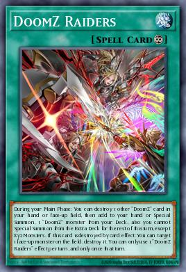
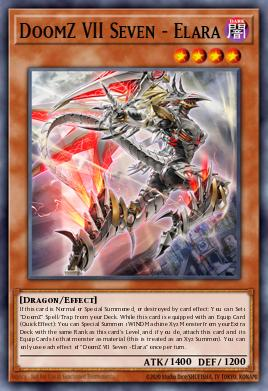
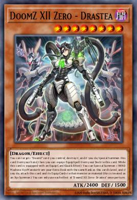
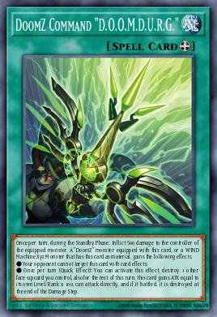
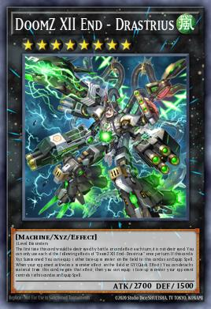
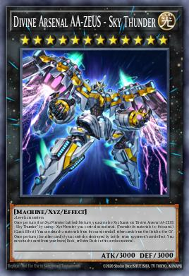

# DoomZ — de Drastrius a ZEUS: elige negación individual o limpieza masiva

**ID adicional:** `653:A09:RAIDERS:ELARA:DRASTRIUS_BATTLE_ZEUS08`

**Categoría:** continuación ofensivo/defensiva, con propósito **dejar ZEUS con una limpieza disponible** después de usar Drastrius en batalla. Amplía la ruta real `653:A09:RAIDERS:ELARA:DRAS01`; no constituye dos tableros simultáneos ni un combo de una sola carta.

**Mano inicial exacta:** Incursores DoomZ + DoomZ VII Seven - Elara. **Main Deck:** al menos 1 DoomZ XII Zero - Drastea y 1 Mando DoomZ D.O.O.M.D.U.R.G. disponibles. **Extra:** Drastrius + 1 ZEUS. Campo/GY/destierro propios vacíos, Main Phase 1 propia, Normal libre, sin acciones previas ni respuesta rival. **Estado del oponente para el ejemplo numérico:** exactamente 1 monstruo boca arriba en Ataque con 1000 ATK que puede ser destruido por batalla, sin efectos relevantes, sin otros monstruos ni respuestas; LP rivales 8000. No se presupone acceso a carta de Reserva.

## Guía visual de 7 pasos

### Paso 1 — Preparar Drastea usando las dos cartas de la mano

 +  → 

Activa Incursores (Mágica Continua). En Main Phase, activa su efecto; **destruye Elara de la mano por el efecto** y, después, Invoca Especialmente **Drastea desde el Deck** (Nivel 8, 2400 ATK). Elara va al GY. **Restricción vigente:** durante el resto del turno solo puedes Invocar Especialmente desde el Extra Deck monstruos **Xyz**. Drastrius y ZEUS sí son Xyz.

### Paso 2 — Elara, destruida por efecto, coloca un Mando

 (GY) →  (Colocado)

En una **nueva cadena**, activa el efecto opcional de Elara por haber sido destruida por carta y **Coloca desde el Deck** el Equipo Mando DoomZ D.O.O.M.D.U.R.G. En este punto NO está equipado todavía. Asegura una zona M/T disponible.

### Paso 3 — Equipar el Mando en la Main Phase

 →  (equipada)

La carta es Mágica de Equipo y se puede **activar tras Colocarla ese mismo turno**, dentro de tu Main Phase; equípala a Drastea. No la confundas con una Trampa o una Mágica Rápida colocada. Drastea ya está equipada para su efecto propio.

### Paso 4 — Drastea forma Drastrius con dos materiales reales

 +  → 

Activa el Efecto Rápido de Drastea equipada para Invocar por Xyz desde Extra **DoomZ XII End - Drastrius** (Rango 8, Máquina VIENTO), acoplando **Drastea + Mando** como **2 materiales**. Es el procedimiento excepcional de Drastea, no una falsa Invocación de tres monstruos Nivel 8. **NO actives** el efecto opcional de Drastrius al ser Invocado que equipa un monstruo rival: necesitas conservar el monstruo de 1000 ATK del rival para batallar. **Tampoco actives** el efecto concedido por Mando de ataque directo, que provocaría la destrucción de Drastrius al final del Damage Step si batalla.

### Paso 5 — Batalla controlada, sin perder Drastrius

 **ATK 2700** → monstruo rival **ATK 1000** → batalla

Entra a Battle Phase, declara un ataque de Drastrius al monstruo de 1000 ATK. En el escenario indicado, ese monstruo es destruido por batalla, el rival recibe **1700 LP de daño de batalla** (queda con 6300 LP), y Drastrius **permanece boca arriba con sus dos materiales**. No se desacoplaron recursos ni se usó un efecto de ataque directo. Si el rival afecta el ataque o Drastrius no sobrevive, **NO existe la continuación aquí descrita**.

### Paso 6 — Main Phase 2: Xyz de ZEUS sobre Drastrius

 (ya batalló) → 

Por haber batallado un monstruo Xyz este turno, se habilita el procedimiento alternativo de **Divino Arsenal AA-ZEUS - Trueno del Cielo**. En tu Main Phase 2, **superpón ZEUS sobre Drastrius** y transfiere sus **2 materiales**: ZEUS queda con **3 materiales exactos** (Drastrius + Drastea + Mando). La restricción de Incursores sigue cumplida porque ZEUS también es Xyz. No ataques con ZEUS: la Battle Phase ya ocurrió.

### Paso 7 — Campo final: respuesta masiva para el turno rival

 **ATK/DEF 3000/3000 · tres materiales**

- **Campo propio:** ZEUS con 3 materiales; **Incursores** continua boca arriba; ninguna otra carta propia.
- **GY propio:** Elara. **Mano:** vacía de las 2 cartas exactas. **Normal:** todavía disponible. **Campo rival:** sin el monstruo de 1000 ATK original; en ejemplo, LP **6300**.
- **Interrupción disponible:** cuando tengas una ventana legal para su Efecto Rápido, desacoplar **2 materiales** de ZEUS envía **TODAS LAS OTRAS CARTAS DEL CAMPO al GY**, incluida **tu propia Incursores** y las nuevas cartas del rival que puedan ser enviadas. ZEUS permanece y le queda **1 material**, por lo que no hay una segunda limpieza inmediata garantizada.
- **Pérdida relevante:** al superponer ZEUS, **pierdes la negación de efecto de monstruo de Drastrius**. El Mando adjunto a ZEUS tampoco le concede las protecciones y efectos reservados a un **Xyz Máquina VIENTO**, pues ZEUS es **LUZ**. Es una decisión entre tipos de interacción, no una mejora automática.

## ¿Qué propósito conviene según la situación?

| Situación | Elección | Por qué |
|---|---|---|
| El rival depende de activar un efecto de monstruo en campo o GY | **Conservar Drastrius** | Con material disponible, puede negar ese efecto específico; ZEUS no niega activaciones por sí mismo. |
| Ya pudiste batallar y esperas que el rival despliegue múltiples cartas | **Superponer ZEUS en MP2** | Guardas una limpieza de las otras cartas del campo para un momento posterior legal. |
| El campo rival tiene un monstruo fuerte que Drastrius no puede atacar sin perderse | **No asumir esta ruta** | La batalla debe ocurrir y sobrevivir el Xyz que usarás para ZEUS; buscar otra vía si se interrumpe. |
| Activaste el ataque directo ganado por Mando | **No prometer ZEUS con el mismo Drastrius** | Ese efecto hace que Drastrius se destruya tras batallar; no estará en campo al llegar a Main Phase 2. |
| Necesitas conservar la Mágica Continua Incursores | **Conservar Drastrius o no usar el barrido de ZEUS** | ZEUS al resolver también enviará tus otras cartas; no es destrucción y no deja Incursores en campo. |

## Fuentes oficiales y validación de estado

- [Konami — Incursores / DoomZ Raiders, CID 21823](https://www.db.yugioh-card.com/yugiohdb/card_search.action?cid=21823&ope=2&request_locale=en): destruir Elara por efecto, acceder a DoomZ del Deck y limitar futuras Invocaciones de Extra a Xyz.
- [Konami — Elara, CID 21776](https://www.db.yugioh-card.com/yugiohdb/card_search.action?cid=21776&ope=2&request_locale=en): al ser destruida por efecto puede Colocar M/T DoomZ desde Deck.
- [Konami — Drastea, CID 21774](https://www.db.yugioh-card.com/yugiohdb/card_search.action?cid=21774&ope=2&request_locale=en): Xyz de Máquina VIENTO Rango 8 usando ella y su Equipo como materiales.
- [Konami — Mando D.O.O.M.D.U.R.G., CID 21824](https://www.db.yugioh-card.com/yugiohdb/card_search.action?cid=21824&ope=2&request_locale=en): protección condicionada a Xyz Máquina VIENTO; el efecto para atacar directamente conduce a autodestrucción si batalla; **no** se usa aquí.
- [Konami — Drastrius, CID 21811](https://www.db.yugioh-card.com/yugiohdb/card_search.action?cid=21811&ope=2&request_locale=en): 2700 ATK, protección de una destrucción por turno, negación específica de efecto de monstruo a coste de desacoplar.
- [Konami — ZEUS, CID 15524](https://www.db.yugioh-card.com/yugiohdb/card_search.action?cid=15524&ope=2&request_locale=en): condición de Xyz que batalló, transferencia de materiales y envío de las otras cartas al GY por 2 materiales.

**Alcance:** comprobación secuencial para la mano, adversario y estado indicados. Este documento enlaza también con la ruta `653:A09:RAIDERS:ELARA:DRAS01` y sirve para **verificar puntualmente** su variante Elara, pero no certifica por extensión el resto de rutas A09 del deck.
