# A10 — Guías visuales documentales · DoomZ

> Guía documental: utilizar únicamente secuencias con condiciones y restricciones comprobadas.

- Deck ID: `653`. Formato declarado: `TCG`.
- Rutas visualizadas en esta entrega: **7**.
- Los pasos, movimientos y zonas se cotejan con la ficha A09; no asumir respuestas no descritas.
- Un estado desconocido se conserva como no documentado: nunca se inventa.

## RAIDERS · ELARA · DRAS01 · `653:A09:RAIDERS:ELARA:DRAS01`

**Propósito competitivo principal (lectura documental):** Preparación de recursos / despliegue. El objetivo solo se acredita si las acciones y el campo final detallados en esta guía lo permiten; no implica legalidad certificada ni garantiza el resultado ante respuestas adversarias.

**Categoría:** APERTURA

**Propósito y resultado documental:**

5. Final definido: Drastrius en Ataque, ATK 2700 y 2 materiales (Drastea + Mando); Incursores Continua boca arriba; Elara en GY; mano vacía, Normal sin gastar, Extra restringido a Xyz. Drastrius tiene un posible uso de negación por desacoplar 1 material ante efecto de monstruo rival en Campo/GY; no se activó en esta ruta, ni se equipó monstruo rival inexistente. Mando como material le otorga efectos descritos por la Mágica, pero no se activó su ataque directo ni su autodestrucción por batalla.

### Mano y estado inicial

Incursores DoomZ (21823, Mágica Continua) + DoomZ VII Siete - Elara (21776, Nivel 4). Campo y GY propios vacíos; en Main Deck queda Drastea (21774) y al menos un Mando DoomZ D.O.O.M.D.U.R.G. (21824, Equipo); en Extra Drastrius (21811, Xyz Máquina de VIENTO Rango 8). Main Phase propia; no respuesta rival ni cartas adversarias seleccionables.

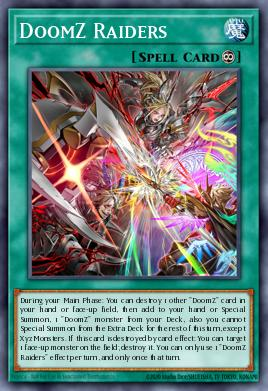 **Incursores DoomZ**
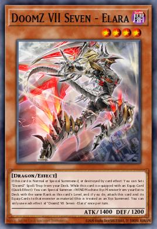 **DoomZ VII Siete - Elara**

### Ejecución numerada

#### Paso 1 — Activar Incursores en zona M/T; usar su efecto en Main Phase CL1, eligiendo destruir Elara en mano.

 **ACTIVAR** →  **ESTADO / CONTEXTO** → 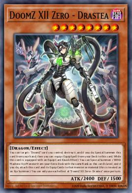 **MATERIAL / COSTE**

**Acción concreta:** Activar Incursores en zona M/T; usar su efecto en Main Phase CL1, eligiendo destruir Elara en mano. Al resolver, Elara es destruida por el efecto, no enviada como coste, y Drastea se Invoca Especialmente desde Deck en Ataque (ATK 2400). La restricción de Incursores permite solo Xyz desde Extra el resto del turno.
**Detalle técnico documentado:** Al resolver, Elara es destruida por el efecto, no enviada como coste, y Drastea se Invoca Especialmente desde Deck en Ataque (ATK 2400). La restricción de Incursores permite solo Xyz desde Extra el resto del turno.

**Estado por zonas después del paso:**

| Zona/recurso | Estado narrativo A09 |
|---|---|
| Mano | ∅: Elara fue destruida desde mano |
| Monstruos | Drastea #21774 (2400 ATK) |
| Mágicas y trampas | Incursores #21823 (Continua) |
| Cementerio | Elara #21776 (destruida por efecto) |
| Destierro propio | ∅ |
| Campo y estado rival | Sin respuesta; campo no determinado |
| Materiales Xyz/Fusión/Sincro | Ninguno |
| Normal, Extra, fase y restricciones | Normal libre; solo Xyz desde Extra por Incursores |

**Campo visual de este paso:**

**Monstruos propios:**
-  **Drastea (2400 ATK)** — zona declarada: `MONSTER`.
**Mágicas/Trampas/Campo:**
-  **Incursores (Continua)** — zona declarada: `SPELL_TRAP`.
*Relación ilustrada de cartas presentes tras este paso, documentada en A09. La posición, materiales, otras zonas y rival se leen en la tabla de estado.*

#### Paso 2 — Nueva cadena CL1: Elara, destruida por efecto, permite Colocar Mando DoomZ D.O.O.M.D.U.R.G.

 **ESTADO / CONTEXTO** → 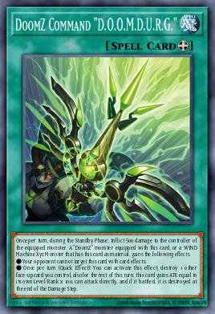 **REFERENCIA A09**

**Acción concreta:** Nueva cadena CL1: Elara, destruida por efecto, permite Colocar Mando DoomZ D.O.O.M.D.U.R.G. desde Deck en M/T. No confundir Colocar con equipar inmediatamente. Elara queda en GY.
**Detalle técnico documentado:** desde Deck en M/T. No confundir Colocar con equipar inmediatamente. Elara queda en GY.

**Estado por zonas después del paso:**

| Zona/recurso | Estado narrativo A09 |
|---|---|
| Mano | ∅ |
| Monstruos | Drastea #21774 |
| Mágicas y trampas | Incursores #21823, Mando #21824 (Colocado; NO equipado aún) |
| Cementerio | Elara #21776 |
| Destierro propio | ∅ |
| Campo y estado rival | Sin cambios acreditados |
| Materiales Xyz/Fusión/Sincro | Ninguno |
| Normal, Extra, fase y restricciones | Normal libre; solo Xyz desde Extra |

**Campo visual de este paso:**

**Monstruos propios:**
-  **Drastea** — zona declarada: `MONSTER`.
**Mágicas/Trampas/Campo:**
-  **Incursores** — zona declarada: `SPELL_TRAP`.
-  **Mando (Colocado; NO equipado aún)** — zona declarada: `SPELL_TRAP`.
*Relación ilustrada de cartas presentes tras este paso, documentada en A09. La posición, materiales, otras zonas y rival se leen en la tabla de estado.*

#### Paso 3 — En esta misma Main Phase, activar desde su posición Colocada la Mágica de Equipo (no es Mágica Rápida) y equiparla a Drastea boca arriba.

 **EQUIPAR**

**Acción concreta:** En esta misma Main Phase, activar desde su posición Colocada la Mágica de Equipo (no es Mágica Rápida) y equiparla a Drastea boca arriba. Esta activación sí es legal el turno en que fue Colocada.
**Detalle técnico documentado:** Esta activación sí es legal el turno en que fue Colocada.

**Estado por zonas después del paso:**

| Zona/recurso | Estado narrativo A09 |
|---|---|
| Mano | ∅ |
| Monstruos | Drastea #21774 (equipada) |
| Mágicas y trampas | Incursores #21823, Mando #21824 (Equipo de Drastea) |
| Cementerio | Elara #21776 |
| Destierro propio | ∅ |
| Campo y estado rival | Sin cambios acreditados |
| Materiales Xyz/Fusión/Sincro | Ninguno |
| Normal, Extra, fase y restricciones | Normal libre; solo Xyz desde Extra |

**Campo visual de este paso:**

**Monstruos propios:**
-  **Drastea (equipada)** — zona declarada: `MONSTER`.
**Mágicas/Trampas/Campo:**
-  **Incursores** — zona declarada: `SPELL_TRAP`.
-  **Mando (Equipo de Drastea)** — zona declarada: `SPELL_TRAP`.
*Relación ilustrada de cartas presentes tras este paso, documentada en A09. La posición, materiales, otras zonas y rival se leen en la tabla de estado.*

#### Paso 4 — Drastea equipada activa su Efecto Rápido y efectúa Invocación Xyz de Drastrius Rango 8 desde Extra, acoplando Drastea y Mando como sus 2 materiales.

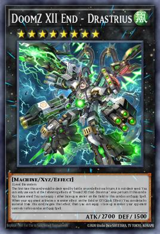 **INVOCAR XYZ** →  **INVOCAR XYZ**

**Acción concreta:** Drastea equipada activa su Efecto Rápido y efectúa Invocación Xyz de Drastrius Rango 8 desde Extra, acoplando Drastea y Mando como sus 2 materiales. Es el procedimiento alternativo expresamente indicado por Drastea, no la Invocación estándar que pide 3 monstruos de Nivel 8. No se inventan dos cuerpos adicionales.
**Detalle técnico documentado:** Es el procedimiento alternativo expresamente indicado por Drastea, no la Invocación estándar que pide 3 monstruos de Nivel 8. No se inventan dos cuerpos adicionales.

**Estado por zonas después del paso:**

| Zona/recurso | Estado narrativo A09 |
|---|---|
| Mano | ∅ |
| Monstruos | Drastrius #21811 (2700 ATK, Xyz Rango 8) |
| Mágicas y trampas | Incursores #21823 |
| Cementerio | Elara #21776 |
| Destierro propio | ∅ |
| Campo y estado rival | Sin cambios acreditados |
| Materiales Xyz/Fusión/Sincro | Drastrius: Drastea #21774 + Mando #21824 (2 materiales) |
| Normal, Extra, fase y restricciones | Normal libre; Drastrius salido de Extra; solo Xyz |

**Campo visual de este paso:**

**Monstruos propios:**
-  **Drastrius (2700 ATK, Xyz Rango 8)** — zona declarada: `MONSTER`.
**Mágicas/Trampas/Campo:**
-  **Incursores** — zona declarada: `SPELL_TRAP`.
*Relación ilustrada de cartas presentes tras este paso, documentada en A09. La posición, materiales, otras zonas y rival se leen en la tabla de estado.*

#### Paso 5 — Final definido: Drastrius en Ataque, ATK 2700 y 2 materiales (Drastea + Mando); Incursores Continua boca arriba; Elara en GY; mano vacía, Normal sin gastar, Extra restringido a Xyz.

 **ESTADO / CONTEXTO** →  **ESTADO / CONTEXTO** →  **ESTADO / CONTEXTO**

**Acción concreta:** Final definido: Drastrius en Ataque, ATK 2700 y 2 materiales (Drastea + Mando); Incursores Continua boca arriba; Elara en GY; mano vacía, Normal sin gastar, Extra restringido a Xyz. Drastrius tiene un posible uso de negación por desacoplar 1 material ante efecto de monstruo rival en Campo/GY; no se activó en esta ruta, ni se equipó monstruo rival inexistente. Mando como material le otorga efectos descritos por la Mágica, pero no se activó su ataque directo ni su autodestrucción por batalla.
**Detalle técnico documentado:** Drastrius tiene un posible uso de negación por desacoplar 1 material ante efecto de monstruo rival en Campo/GY; no se activó en esta ruta, ni se equipó monstruo rival inexistente. Mando como material le otorga efectos descritos por la Mágica, pero no se activó su ataque directo ni su autodestrucción por batalla.

**Estado por zonas después del paso:**

| Zona/recurso | Estado narrativo A09 |
|---|---|
| Mano | ∅ |
| Monstruos | Drastrius #21811 (2700 ATK) |
| Mágicas y trampas | Incursores #21823 |
| Cementerio | Elara #21776 |
| Destierro propio | ∅ |
| Campo y estado rival | No se equipó monstruo rival ni usó negación |
| Materiales Xyz/Fusión/Sincro | Drastrius: Drastea #21774 + Mando #21824 |
| Normal, Extra, fase y restricciones | Normal libre; Extra restringido a Xyz |

**Campo visual de este paso:**

**Monstruos propios:**
-  **Drastrius (2700 ATK)** — zona declarada: `MONSTER`.
**Mágicas/Trampas/Campo:**
-  **Incursores** — zona declarada: `SPELL_TRAP`.
*Relación ilustrada de cartas presentes tras este paso, documentada en A09. La posición, materiales, otras zonas y rival se leen en la tabla de estado.*

### Campo final documentado

Esta vista procede **del último paso**, no de una lista de cartas deducida del título.

**Monstruos propios:**
-  **Drastrius (2700 ATK)** — zona declarada: `MONSTER`.
**Mágicas/Trampas/Campo:**
-  **Incursores** — zona declarada: `SPELL_TRAP`.
*Relación ilustrada de cartas presentes tras este paso, documentada en A09. La posición, materiales, otras zonas y rival se leen en la tabla de estado.*

| Zona/recurso | Estado final documentado |
|---|---|
| Mano | ∅ |
| Monstruos | Drastrius #21811 (2700 ATK) |
| Mágicas y trampas | Incursores #21823 |
| Cementerio | Elara #21776 |
| Destierro propio | ∅ |
| Campo y estado rival | No se equipó monstruo rival ni usó negación |
| Materiales Xyz/Fusión/Sincro | Drastrius: Drastea #21774 + Mando #21824 |
| Normal, Extra, fase y restricciones | Normal libre; Extra restringido a Xyz |

### Si el oponente interrumpe

- **INTERRUPCIÓN A12 — paso sin anclaje confirmado: A12 — Tres ensayos de interrupción legales para Incursores (independientes)**
  - 1. A, Ash vs DRAS01: con Incursores y Elara inicialmente en mano, activar efecto de Incursores CL1 para destruir Elara y traer Drastea desde Deck. El adversario descarta Flor de Ceniza CL2; su texto alcanza la Invocación Especial desde Deck incluida en CL1. CL2 niega todo el efecto: Elara no es destruida, no se Invoca Drastea ni se aplica la restricción de Extra de esa resolución. Elara permanece en mano e Incursores boca arriba; no hay disparo de Elara por destrucción.
  - 2. B, Ash vs DRAS02: misma cadena pero la mano original era Incursores + Amalthe. Amalthe permanece en mano tras negar el efecto; no fue destruida y no puede activar el supuesto buscador desde GY. Incursores sigue boca arriba. La recuperación mediante Normal de Amalthe y búsqueda de Drastea pertenece a A13; no asumirla antes de resolver CL2.
  - 3. C, Effect Veiler vs Drastea equipada: en cualquiera de las rutas base, ya Drastea está boca arriba y equipada con Mando en Main Phase propia. Drastea activa su Efecto Rápido CL1 para Xyz. El adversario envía Effect Veiler de mano al GY como coste, seleccionando Drastea como CL2. Resolver CL2: Drastea queda con sus efectos negados hasta fin del turno; CL1 no Invoca Drastrius. Drastea permanece en Campo (ATK 2400) equipada con Mando, Incursores Continua boca arriba y, en DRAS02, también Elara. No desacoplar materiales ni declarar una Invocación Xyz que no ocurrió.
  - Fuentes oficiales: Flor de Ceniza, Effect Veiler, Incursores, Drastea. Son ensayos alternativos con cartas rivales supuestas explícitamente, no se exige que una misma mano rival tenga Ash y Veiler a la vez.;.
  - Estado de rama: `Resuelto solo en el escenario que detalla A12/A13; las otras respuestas no están demostradas.`.
- **RECUPERACIÓN A13 — paso sin anclaje confirmado: A13 — Recuperaciones contrastadas tras Ash frente a Incursores**
  - 1. Si la carta conservada era Elara (DRAS01, A12-A): tras negar Incursores, la mano aún tiene Elara, Normal sin gastar. Invocar Normalmente Elara, activar su efecto de Invocación para Colocar Mando DoomZ desde Deck. Activar la Mágica de Equipo desde su posición Colocada y equiparla a Elara. Elara equipada puede Invocar Xyz Fractura DoomZ - Diactorus (21812, Máquina VIENTO Rango 4, presente en Extra), acoplando Elara + Mando como sus 2 materiales. Final alternativo mínimo: Diactorus ATK 2400 con 2 materiales e Incursores Continua boca arriba; Normal gastada. El efecto de Diactorus al Invocarse Especialmente es opcional: en este estado no se activa y, por tanto, no se destruye Incursores ni un monstruo imaginario. No es Drastrius.
  - 2. Si la carta conservada era Amalthe (DRAS02, A12-B): tras negar Incursores, Normal Amalthe; su efecto por Invocación añade Drastea desde Deck a mano. Drastea en mano selecciona Incursores boca arriba, lo destruye por su efecto y se Invoca Especialmente desde mano, luego se equipa Mando desde Deck. Drastea equipada puede usar su Efecto Rápido para Invocar Xyz Drastrius, acoplando Drastea + Mando como 2 materiales. Final alternativo: Drastrius ATK 2700, Amalthe boca arriba ATK 1600, Incursores GY, Normal gastada y mano vacía. No activar segundo efecto de Incursores cuando se destruyó: el primero ya fue usado al intentar su CL1, aunque Ash lo negara.
  - 3. Si Veiler niega Drastea (DRAS01 o DRAS02, A12-C): Drastea y Mando permanecen en campo, no hay Drastrius. En DRAS02, Elara también permanece boca arriba; en DRAS01 la Normal sigue libre pero la mano mínima ya no aporta otro monstruo. No se demuestra una continuación adicional antes de End Phase. Negar este paso no crea por sí solo un nuevo Mando en el Deck ni rehabilita el uso del efecto negado.
  - Fuente: Diactorus y fichas oficiales A09.;.
  - Estado de rama: `Resuelto solo en el escenario que detalla A12/A13; las otras respuestas no están demostradas.`.

---

## RAIDERS · AMALTHE · DRAS02 · `653:A09:RAIDERS:AMALTHE:DRAS02`

**Propósito competitivo principal (lectura documental):** Preparación de recursos / despliegue. El objetivo solo se acredita si las acciones y el campo final detallados en esta guía lo permiten; no implica legalidad certificada ni garantiza el resultado ante respuestas adversarias.

**Categoría:** APERTURA

**Propósito y resultado documental:**

5. Final mínimo: Drastrius ATK 2700 con 2 materiales, Elara boca arriba (ATK 1400) e Incursores Continua boca arriba; Amalthe GY, sin cartas restantes en mano, Normal gastada. Variante opcional al Invocar Xyz: Drastrius puede activar su efecto y equiparse a Elara, otro monstruo boca arriba en campo, dejando Elara en zona M/T en vez de zona de monstruos. Es una elección excluyente, no un monstruo adicional obtenido gratuitamente.

### Mano y estado inicial

Incursores (21823) + Amalthe (21775, Nivel 4); campo/GY vacíos. En Main Deck quedan al menos 1 Drastea, 1 Elara y 1 Mando; Drastrius en Extra. Sin respuesta rival.

 **Incursores DoomZ**
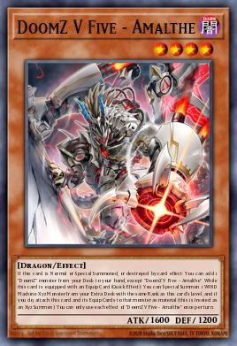 **DoomZ V Cinco - Amalthe**

### Ejecución numerada

#### Paso 1 — Activar Incursores.

 **ACTIVAR** →  **ESTADO / CONTEXTO** →  **ESTADO / CONTEXTO**

**Acción concreta:** Activar Incursores. Su efecto CL1 destruye Amalthe en mano por efecto y, después, Invoca Drastea desde Deck. Amalthe va al GY y el resto del turno Extra solo Xyz.
**Detalle técnico documentado:** Su efecto CL1 destruye Amalthe en mano por efecto y, después, Invoca Drastea desde Deck. Amalthe va al GY y el resto del turno Extra solo Xyz.

**Estado por zonas después del paso:**

| Zona/recurso | Estado narrativo A09 |
|---|---|
| Mano | ∅ |
| Monstruos | Drastea #21774 |
| Mágicas y trampas | Incursores #21823 |
| Cementerio | Amalthe #21775 (destruida por efecto en mano) |
| Destierro propio | ∅ |
| Campo y estado rival | Sin respuesta; campo no determinado |
| Materiales Xyz/Fusión/Sincro | Ninguno |
| Normal, Extra, fase y restricciones | Normal libre; Extra solo Xyz |

**Campo visual de este paso:**

**Monstruos propios:**
-  **Drastea** — zona declarada: `MONSTER`.
**Mágicas/Trampas/Campo:**
-  **Incursores** — zona declarada: `SPELL_TRAP`.
*Relación ilustrada de cartas presentes tras este paso, documentada en A09. La posición, materiales, otras zonas y rival se leen en la tabla de estado.*

#### Paso 2 — Al acabar la cadena, Amalthe, destruida por efecto, inicia nueva CL1 y añade Elara desde Deck a mano (no puede añadirse otra Amalthe).

 **ESTADO / CONTEXTO** →  **BUSCAR / AÑADIR**

**Acción concreta:** Al acabar la cadena, Amalthe, destruida por efecto, inicia nueva CL1 y añade Elara desde Deck a mano (no puede añadirse otra Amalthe).
**Detalle técnico documentado:** No documentado

**Estado por zonas después del paso:**

| Zona/recurso | Estado narrativo A09 |
|---|---|
| Mano | Elara #21776 (buscada por Amalthe) |
| Monstruos | Drastea #21774 |
| Mágicas y trampas | Incursores #21823 |
| Cementerio | Amalthe #21775 |
| Destierro propio | ∅ |
| Campo y estado rival | Sin cambios acreditados |
| Materiales Xyz/Fusión/Sincro | Ninguno |
| Normal, Extra, fase y restricciones | Normal libre; Extra solo Xyz |

**Campo visual de este paso:**

**Monstruos propios:**
-  **Drastea** — zona declarada: `MONSTER`.
**Mágicas/Trampas/Campo:**
-  **Incursores** — zona declarada: `SPELL_TRAP`.
*Relación ilustrada de cartas presentes tras este paso, documentada en A09. La posición, materiales, otras zonas y rival se leen en la tabla de estado.*

#### Paso 3 — Invocar Normalmente Elara en Ataque (1400 ATK).

 **NORMAL**

**Acción concreta:** Invocar Normalmente Elara en Ataque (1400 ATK). Su efecto de Invocación CL1 permite Colocar Mando desde Deck en M/T.
**Detalle técnico documentado:** Su efecto de Invocación CL1 permite Colocar Mando desde Deck en M/T.

**Estado por zonas después del paso:**

| Zona/recurso | Estado narrativo A09 |
|---|---|
| Mano | ∅ |
| Monstruos | Drastea #21774, Elara #21776 (Normal) |
| Mágicas y trampas | Incursores #21823, Mando #21824 (Colocado desde Deck) |
| Cementerio | Amalthe #21775 |
| Destierro propio | ∅ |
| Campo y estado rival | Sin cambios acreditados |
| Materiales Xyz/Fusión/Sincro | Ninguno |
| Normal, Extra, fase y restricciones | Normal gastada; Extra solo Xyz |

**Campo visual de este paso:**

**Monstruos propios:**
-  **Drastea** — zona declarada: `MONSTER`.
-  **Elara (Normal)** — zona declarada: `MONSTER`.
**Mágicas/Trampas/Campo:**
-  **Incursores** — zona declarada: `SPELL_TRAP`.
-  **Mando (Colocado desde Deck)** — zona declarada: `SPELL_TRAP`.
*Relación ilustrada de cartas presentes tras este paso, documentada en A09. La posición, materiales, otras zonas y rival se leen en la tabla de estado.*

#### Paso 4 — Activar Mando desde Colocada y equiparlo a Drastea; activar el Efecto Rápido de Drastea equipada para Invocar Xyz Drastrius, acoplando Drastea + Mando como sus 2 materiales.

 **INVOCAR XYZ** →  **INVOCAR XYZ**

**Acción concreta:** Activar Mando desde Colocada y equiparlo a Drastea; activar el Efecto Rápido de Drastea equipada para Invocar Xyz Drastrius, acoplando Drastea + Mando como sus 2 materiales.
**Detalle técnico documentado:** No documentado

**Estado por zonas después del paso:**

| Zona/recurso | Estado narrativo A09 |
|---|---|
| Mano | ∅ |
| Monstruos | Drastrius #21811 (Xyz Rango 8), Elara #21776 (1400 ATK; sin activar equipamiento opcional de Drastrius) |
| Mágicas y trampas | Incursores #21823 |
| Cementerio | Amalthe #21775 |
| Destierro propio | ∅ |
| Campo y estado rival | Sin cambios acreditados |
| Materiales Xyz/Fusión/Sincro | Drastrius: Drastea #21774 + Mando #21824 |
| Normal, Extra, fase y restricciones | Normal gastada; Drastrius desde Extra; solo Xyz |

**Campo visual de este paso:**

**Monstruos propios:**
-  **Drastrius (Xyz Rango 8)** — zona declarada: `MONSTER`.
-  **Elara (1400 ATK; sin activar equipamiento opcional de Drastrius)** — zona declarada: `MONSTER`.
**Mágicas/Trampas/Campo:**
-  **Incursores** — zona declarada: `SPELL_TRAP`.
*Relación ilustrada de cartas presentes tras este paso, documentada en A09. La posición, materiales, otras zonas y rival se leen en la tabla de estado.*

#### Paso 5 — Final mínimo: Drastrius ATK 2700 con 2 materiales, Elara boca arriba (ATK 1400) e Incursores Continua boca arriba; Amalthe GY, sin cartas restantes en mano, Normal gastada.

 **ESTADO / CONTEXTO** →  **INVOCAR XYZ** →  **INVOCAR XYZ**

**Acción concreta:** Final mínimo: Drastrius ATK 2700 con 2 materiales, Elara boca arriba (ATK 1400) e Incursores Continua boca arriba; Amalthe GY, sin cartas restantes en mano, Normal gastada. Variante opcional al Invocar Xyz: Drastrius puede activar su efecto y equiparse a Elara, otro monstruo boca arriba en campo, dejando Elara en zona M/T en vez de zona de monstruos. Es una elección excluyente, no un monstruo adicional obtenido gratuitamente.
**Detalle técnico documentado:** Variante opcional al Invocar Xyz: Drastrius puede activar su efecto y equiparse a Elara, otro monstruo boca arriba en campo, dejando Elara en zona M/T en vez de zona de monstruos. Es una elección excluyente, no un monstruo adicional obtenido gratuitamente.

**Estado por zonas después del paso:**

| Zona/recurso | Estado narrativo A09 |
|---|---|
| Mano | ∅ |
| Monstruos | Drastrius #21811 (2700 ATK), Elara #21776 (1400 ATK, opción base) |
| Mágicas y trampas | Incursores #21823 |
| Cementerio | Amalthe #21775 |
| Destierro propio | ∅ |
| Campo y estado rival | Sin negación ni equipamiento opcional ejecutados |
| Materiales Xyz/Fusión/Sincro | Drastrius: Drastea #21774 + Mando #21824 |
| Normal, Extra, fase y restricciones | Normal gastada; Extra solo Xyz |

**Campo visual de este paso:**

**Monstruos propios:**
-  **Drastrius (2700 ATK)** — zona declarada: `MONSTER`.
-  **Elara (1400 ATK, opción base)** — zona declarada: `MONSTER`.
**Mágicas/Trampas/Campo:**
-  **Incursores** — zona declarada: `SPELL_TRAP`.
*Relación ilustrada de cartas presentes tras este paso, documentada en A09. La posición, materiales, otras zonas y rival se leen en la tabla de estado.*

### Campo final documentado

Esta vista procede **del último paso**, no de una lista de cartas deducida del título.

**Monstruos propios:**
-  **Drastrius (2700 ATK)** — zona declarada: `MONSTER`.
-  **Elara (1400 ATK, opción base)** — zona declarada: `MONSTER`.
**Mágicas/Trampas/Campo:**
-  **Incursores** — zona declarada: `SPELL_TRAP`.
*Relación ilustrada de cartas presentes tras este paso, documentada en A09. La posición, materiales, otras zonas y rival se leen en la tabla de estado.*

| Zona/recurso | Estado final documentado |
|---|---|
| Mano | ∅ |
| Monstruos | Drastrius #21811 (2700 ATK), Elara #21776 (1400 ATK, opción base) |
| Mágicas y trampas | Incursores #21823 |
| Cementerio | Amalthe #21775 |
| Destierro propio | ∅ |
| Campo y estado rival | Sin negación ni equipamiento opcional ejecutados |
| Materiales Xyz/Fusión/Sincro | Drastrius: Drastea #21774 + Mando #21824 |
| Normal, Extra, fase y restricciones | Normal gastada; Extra solo Xyz |

### Si el oponente interrumpe

- **INTERRUPCIÓN A12 — paso sin anclaje confirmado: A12 — Tres ensayos de interrupción legales para Incursores (independientes)**
  - 1. A, Ash vs DRAS01: con Incursores y Elara inicialmente en mano, activar efecto de Incursores CL1 para destruir Elara y traer Drastea desde Deck. El adversario descarta Flor de Ceniza CL2; su texto alcanza la Invocación Especial desde Deck incluida en CL1. CL2 niega todo el efecto: Elara no es destruida, no se Invoca Drastea ni se aplica la restricción de Extra de esa resolución. Elara permanece en mano e Incursores boca arriba; no hay disparo de Elara por destrucción.
  - 2. B, Ash vs DRAS02: misma cadena pero la mano original era Incursores + Amalthe. Amalthe permanece en mano tras negar el efecto; no fue destruida y no puede activar el supuesto buscador desde GY. Incursores sigue boca arriba. La recuperación mediante Normal de Amalthe y búsqueda de Drastea pertenece a A13; no asumirla antes de resolver CL2.
  - 3. C, Effect Veiler vs Drastea equipada: en cualquiera de las rutas base, ya Drastea está boca arriba y equipada con Mando en Main Phase propia. Drastea activa su Efecto Rápido CL1 para Xyz. El adversario envía Effect Veiler de mano al GY como coste, seleccionando Drastea como CL2. Resolver CL2: Drastea queda con sus efectos negados hasta fin del turno; CL1 no Invoca Drastrius. Drastea permanece en Campo (ATK 2400) equipada con Mando, Incursores Continua boca arriba y, en DRAS02, también Elara. No desacoplar materiales ni declarar una Invocación Xyz que no ocurrió.
  - Fuentes oficiales: Flor de Ceniza, Effect Veiler, Incursores, Drastea. Son ensayos alternativos con cartas rivales supuestas explícitamente, no se exige que una misma mano rival tenga Ash y Veiler a la vez.;.
  - Estado de rama: `Resuelto solo en el escenario que detalla A12/A13; las otras respuestas no están demostradas.`.
- **RECUPERACIÓN A13 — paso sin anclaje confirmado: A13 — Recuperaciones contrastadas tras Ash frente a Incursores**
  - 1. Si la carta conservada era Elara (DRAS01, A12-A): tras negar Incursores, la mano aún tiene Elara, Normal sin gastar. Invocar Normalmente Elara, activar su efecto de Invocación para Colocar Mando DoomZ desde Deck. Activar la Mágica de Equipo desde su posición Colocada y equiparla a Elara. Elara equipada puede Invocar Xyz Fractura DoomZ - Diactorus (21812, Máquina VIENTO Rango 4, presente en Extra), acoplando Elara + Mando como sus 2 materiales. Final alternativo mínimo: Diactorus ATK 2400 con 2 materiales e Incursores Continua boca arriba; Normal gastada. El efecto de Diactorus al Invocarse Especialmente es opcional: en este estado no se activa y, por tanto, no se destruye Incursores ni un monstruo imaginario. No es Drastrius.
  - 2. Si la carta conservada era Amalthe (DRAS02, A12-B): tras negar Incursores, Normal Amalthe; su efecto por Invocación añade Drastea desde Deck a mano. Drastea en mano selecciona Incursores boca arriba, lo destruye por su efecto y se Invoca Especialmente desde mano, luego se equipa Mando desde Deck. Drastea equipada puede usar su Efecto Rápido para Invocar Xyz Drastrius, acoplando Drastea + Mando como 2 materiales. Final alternativo: Drastrius ATK 2700, Amalthe boca arriba ATK 1600, Incursores GY, Normal gastada y mano vacía. No activar segundo efecto de Incursores cuando se destruyó: el primero ya fue usado al intentar su CL1, aunque Ash lo negara.
  - 3. Si Veiler niega Drastea (DRAS01 o DRAS02, A12-C): Drastea y Mando permanecen en campo, no hay Drastrius. En DRAS02, Elara también permanece boca arriba; en DRAS01 la Normal sigue libre pero la mano mínima ya no aporta otro monstruo. No se demuestra una continuación adicional antes de End Phase. Negar este paso no crea por sí solo un nuevo Mando en el Deck ni rehabilita el uso del efecto negado.
  - Fuente: Diactorus y fichas oficiales A09.;.
  - Estado de rama: `Resuelto solo en el escenario que detalla A12/A13; las otras respuestas no están demostradas.`.

---

## RAIDERS · CHANGE · DRAS03 · `653:A09:RAIDERS:CHANGE:DRAS03`

**Propósito competitivo principal (lectura documental):** Preparación de recursos / despliegue. El objetivo solo se acredita si las acciones y el campo final detallados en esta guía lo permiten; no implica legalidad certificada ni garantiza el resultado ante respuestas adversarias.

**Categoría:** APERTURA

**Propósito y resultado documental:**

6. Tablero verificable al cerrar: 1 Drastrius en Ataque, 2700 ATK, con 2 materiales [Drastea, Mando]; Campo M/T propio vacío; GY propio = Incursores, Cambio, Amalthe; mano = 0; Invocación Normal todavía disponible, ninguna restricción de Extra impuesta por Incursores. Drastrius puede negar en una ventana futura un efecto rival de monstruo de Campo/GY pagando 1 material; no se afirma que ya lo negó. Mientras Mando siga acoplado, concede la protección correspondiente contra ser seleccionado por efectos rivales; desacoplar Mando como coste elimina esa concesión. No se promete OTK ni carta adicional.

### Mano y estado inicial

Incursores Incursores DoomZ (21823) + Cambio Cambio DoomZ (22158). Main Phase propia; Campo y Cementerio propios vacíos; rival sin respuestas. Deben permanecer en el Main Deck Amalthe (21775), Drastea (21774) y Mando DoomZ «D.O.O.M.D.U.R.G.» (21824), y en el Extra Drastrius (21811). La carta Cambio en la mano NO puede destruirse a sí misma con su propio efecto.

 **Incursores DoomZ**
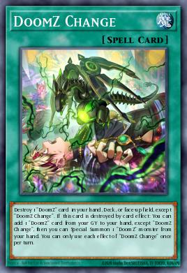 **Cambio DoomZ**

### Ejecución numerada

#### Paso 1 — Activación, sin usar el efecto de búsqueda: poner Incursores boca arriba en zona M/T como Mágica Continua.

 **ACTIVAR**

**Acción concreta:** Activación, sin usar el efecto de búsqueda: poner Incursores boca arriba en zona M/T como Mágica Continua. Conservar su efecto principal sin utilizar; no destruir ninguna carta con Incursores.
**Detalle técnico documentado:** Conservar su efecto principal sin utilizar; no destruir ninguna carta con Incursores.

**Estado por zonas después del paso:**

| Zona/recurso | Estado narrativo A09 |
|---|---|
| Mano | Cambio #22158 |
| Monstruos | ∅ |
| Mágicas y trampas | Incursores #21823 |
| Cementerio | ∅ |
| Destierro propio | ∅ |
| Campo y estado rival | Sin respuesta; campo no determinado |
| Materiales Xyz/Fusión/Sincro | Ninguno |
| Normal, Extra, fase y restricciones | Normal libre; Extra sin bloqueo por Incursores |

**Campo visual de este paso:**

**Monstruos propios:** sin carta propia demostrada en esta vista.
**Mágicas/Trampas/Campo:**
-  **Incursores** — zona declarada: `SPELL_TRAP`.
*Relación ilustrada de cartas presentes tras este paso, documentada en A09. La posición, materiales, otras zonas y rival se leen en la tabla de estado.*

#### Paso 2 — Destrucción desde el Deck: activar Cambio (Mágica Normal) como CL1.

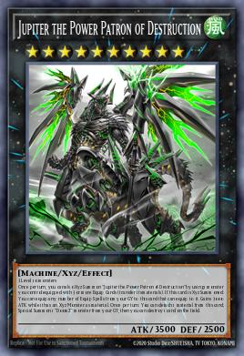 **ESTADO / CONTEXTO** →  **ESTADO / CONTEXTO**

**Acción concreta:** Destrucción desde el Deck: activar Cambio (Mágica Normal) como CL1. En resolución, destruir Amalthe del Deck por efecto y enviar Cambio al GY al terminar su resolución. Amalthe acaba en GY. No se destruyó Cambio y, por eso, su segundo efecto de recuperar carta no se activa.
**Detalle técnico documentado:** En resolución, destruir Amalthe del Deck por efecto y enviar Cambio al GY al terminar su resolución. Amalthe acaba en GY. No se destruyó Cambio y, por eso, su segundo efecto de recuperar carta no se activa.

**Estado por zonas después del paso:**

| Zona/recurso | Estado narrativo A09 |
|---|---|
| Mano | ∅ |
| Monstruos | ∅ |
| Mágicas y trampas | Incursores #21823 |
| Cementerio | Cambio #22158, Amalthe #21775 (destruida en Deck) |
| Destierro propio | ∅ |
| Campo y estado rival | Sin cambios acreditados |
| Materiales Xyz/Fusión/Sincro | Ninguno |
| Normal, Extra, fase y restricciones | Normal libre; Extra sin bloqueo |

**Campo visual de este paso:**

**Monstruos propios:** sin carta propia demostrada en esta vista.
**Mágicas/Trampas/Campo:**
-  **Incursores** — zona declarada: `SPELL_TRAP`.
*Relación ilustrada de cartas presentes tras este paso, documentada en A09. La posición, materiales, otras zonas y rival se leen en la tabla de estado.*

#### Paso 3 — Nueva cadena CL1: la Amalthe destruida por efecto activa su búsqueda desde GY; añadir Drastea del Deck a la mano.

 **ESTADO / CONTEXTO** →  **AÑADIR A MANO**

**Acción concreta:** Nueva cadena CL1: la Amalthe destruida por efecto activa su búsqueda desde GY; añadir Drastea del Deck a la mano. No Invocar Amalthe ni tratar su búsqueda como parte de la cadena anterior.
**Detalle técnico documentado:** No Invocar Amalthe ni tratar su búsqueda como parte de la cadena anterior.

**Estado por zonas después del paso:**

| Zona/recurso | Estado narrativo A09 |
|---|---|
| Mano | Drastea #21774 (buscada) |
| Monstruos | ∅ |
| Mágicas y trampas | Incursores #21823 |
| Cementerio | Cambio #22158, Amalthe #21775 |
| Destierro propio | ∅ |
| Campo y estado rival | Sin cambios acreditados |
| Materiales Xyz/Fusión/Sincro | Ninguno |
| Normal, Extra, fase y restricciones | Normal libre; Extra sin bloqueo |

**Campo visual de este paso:**

**Monstruos propios:** sin carta propia demostrada en esta vista.
**Mágicas/Trampas/Campo:**
-  **Incursores** — zona declarada: `SPELL_TRAP`.
*Relación ilustrada de cartas presentes tras este paso, documentada en A09. La posición, materiales, otras zonas y rival se leen en la tabla de estado.*

#### Paso 4 — Invocación desde la mano, con coste/objetivo exactos: activar el efecto de Drastea en mano, seleccionando la carta Incursores propia boca arriba.

 **OBJETIVO** →  **ESPECIAL**

**Acción concreta:** Invocación desde la mano, con coste/objetivo exactos: activar el efecto de Drastea en mano, seleccionando la carta Incursores propia boca arriba. En resolución, destruir Incursores por efecto, Invocar Especialmente Drastea de la mano y luego equipar desde el Deck Mando D.O.O.M.D.U.R.G. a la Drastea recién Invocada. Incursores termina en GY. Como Incursores destruida tiene un efecto opcional de destruir un monstruo boca arriba, declinarlo explícitamente al acabar la cadena; no destruir a la propia Drastea. Incursores no aplicó el bloqueo a Xyz, porque nunca se usó su efecto de Main Phase.
**Detalle técnico documentado:** En resolución, destruir Incursores por efecto, Invocar Especialmente Drastea de la mano y luego equipar desde el Deck Mando D.O.O.M.D.U.R.G. a la Drastea recién Invocada. Incursores termina en GY. Como Incursores destruida tiene un efecto opcional de destruir un monstruo boca arriba, declinarlo explícitamente al acabar la cadena; no destruir a la propia Drastea. Incursores no aplicó el bloqueo a Xyz, porque nunca se usó su efecto de Main Phase.

**Estado por zonas después del paso:**

| Zona/recurso | Estado narrativo A09 |
|---|---|
| Mano | ∅ |
| Monstruos | Drastea #21774 (desde mano, equipada) |
| Mágicas y trampas | Mando #21824 (Equipo de Drastea) |
| Cementerio | Cambio #22158, Amalthe #21775, Incursores #21823 (destruida) |
| Destierro propio | ∅ |
| Campo y estado rival | Sin cambios acreditados |
| Materiales Xyz/Fusión/Sincro | Ninguno |
| Normal, Extra, fase y restricciones | Normal libre; Extra sin bloqueo |

**Campo visual de este paso:**

**Monstruos propios:**
-  **Drastea (desde mano, equipada)** — zona declarada: `MONSTER`.
**Mágicas/Trampas/Campo:**
-  **Mando (Equipo de Drastea)** — zona declarada: `SPELL_TRAP`.
*Relación ilustrada de cartas presentes tras este paso, documentada en A09. La posición, materiales, otras zonas y rival se leen en la tabla de estado.*

#### Paso 5 — Transformación Xyz: activar el Efecto Rápido de Drastea ya equipada.

 **ACTIVAR** →  **ESTADO / CONTEXTO**

**Acción concreta:** Transformación Xyz: activar el Efecto Rápido de Drastea ya equipada. Invocar del Extra a Drastrius Drastrius (Máquina VIENTO Rango 8), acoplando Drastea y Mando como exactamente 2 materiales por la excepción escrita de Drastea. No exigir los 3 monstruos de Nivel 8 de la Invocación convencional. Sin otro monstruo boca arriba, omitir el equipo opcional al Invocar Xyz.
**Detalle técnico documentado:** Invocar del Extra a Drastrius Drastrius (Máquina VIENTO Rango 8), acoplando Drastea y Mando como exactamente 2 materiales por la excepción escrita de Drastea. No exigir los 3 monstruos de Nivel 8 de la Invocación convencional. Sin otro monstruo boca arriba, omitir el equipo opcional al Invocar Xyz.

**Estado por zonas después del paso:**

| Zona/recurso | Estado narrativo A09 |
|---|---|
| Mano | ∅ |
| Monstruos | Drastrius #21811 (Xyz) |
| Mágicas y trampas | ∅ |
| Cementerio | Cambio #22158, Amalthe #21775, Incursores #21823 |
| Destierro propio | ∅ |
| Campo y estado rival | Sin cambios acreditados |
| Materiales Xyz/Fusión/Sincro | Drastrius: Drastea #21774 + Mando #21824 |
| Normal, Extra, fase y restricciones | Normal libre; Drastrius desde Extra; sin bloqueo |

**Campo visual de este paso:**

**Monstruos propios:**
-  **Drastrius (Xyz)** — zona declarada: `MONSTER`.
**Mágicas/Trampas/Campo:** sin carta propia demostrada en esta vista.
*Relación ilustrada de cartas presentes tras este paso, documentada en A09. La posición, materiales, otras zonas y rival se leen en la tabla de estado.*

#### Paso 6 — Tablero verificable al cerrar: 1 Drastrius en Ataque, 2700 ATK, con 2 materiales [Drastea, Mando]; Campo M/T propio vacío; GY propio = Incursores, Cambio, Amalthe; mano = 0.

 **RESULTADO** →  **RESULTADO** →  **NORMAL**

**Acción concreta:** Tablero verificable al cerrar: 1 Drastrius en Ataque, 2700 ATK, con 2 materiales [Drastea, Mando]; Campo M/T propio vacío; GY propio = Incursores, Cambio, Amalthe; mano = 0; Invocación Normal todavía disponible, ninguna restricción de Extra impuesta por Incursores. Drastrius puede negar en una ventana futura un efecto rival de monstruo de Campo/GY pagando 1 material; no se afirma que ya lo negó. Mientras Mando siga acoplado, concede la protección correspondiente contra ser seleccionado por efectos rivales; desacoplar Mando como coste elimina esa concesión. No se promete OTK ni carta adicional.
**Detalle técnico documentado:** Invocación Normal todavía disponible, ninguna restricción de Extra impuesta por Incursores. Drastrius puede negar en una ventana futura un efecto rival de monstruo de Campo/GY pagando 1 material; no se afirma que ya lo negó. Mientras Mando siga acoplado, concede la protección correspondiente contra ser seleccionado por efectos rivales; desacoplar Mando como coste elimina esa concesión. No se promete OTK ni carta adicional.

**Estado por zonas después del paso:**

| Zona/recurso | Estado narrativo A09 |
|---|---|
| Mano | ∅ |
| Monstruos | Drastrius #21811 (2700 ATK) |
| Mágicas y trampas | ∅ |
| Cementerio | Cambio #22158, Amalthe #21775, Incursores #21823 |
| Destierro propio | ∅ |
| Campo y estado rival | No se equipó o negó monstruo rival |
| Materiales Xyz/Fusión/Sincro | Drastrius: Drastea #21774 + Mando #21824 |
| Normal, Extra, fase y restricciones | Normal libre; Extra sin bloqueo |

**Campo visual de este paso:**

**Monstruos propios:**
-  **Drastrius (2700 ATK)** — zona declarada: `MONSTER`.
**Mágicas/Trampas/Campo:** sin carta propia demostrada en esta vista.
*Relación ilustrada de cartas presentes tras este paso, documentada en A09. La posición, materiales, otras zonas y rival se leen en la tabla de estado.*

### Campo final documentado

Esta vista procede **del último paso**, no de una lista de cartas deducida del título.

**Monstruos propios:**
-  **Drastrius (2700 ATK)** — zona declarada: `MONSTER`.
**Mágicas/Trampas/Campo:** sin carta propia demostrada en esta vista.
*Relación ilustrada de cartas presentes tras este paso, documentada en A09. La posición, materiales, otras zonas y rival se leen en la tabla de estado.*

| Zona/recurso | Estado final documentado |
|---|---|
| Mano | ∅ |
| Monstruos | Drastrius #21811 (2700 ATK) |
| Mágicas y trampas | ∅ |
| Cementerio | Cambio #22158, Amalthe #21775, Incursores #21823 |
| Destierro propio | ∅ |
| Campo y estado rival | No se equipó o negó monstruo rival |
| Materiales Xyz/Fusión/Sincro | Drastrius: Drastea #21774 + Mando #21824 |
| Normal, Extra, fase y restricciones | Normal libre; Extra sin bloqueo |

### Si el oponente interrumpe

- **INTERRUPCIÓN A12 — paso sin anclaje confirmado: A12 — Tres ensayos de interrupción legales para Incursores (independientes)**
  - 1. A, Ash vs DRAS01: con Incursores y Elara inicialmente en mano, activar efecto de Incursores CL1 para destruir Elara y traer Drastea desde Deck. El adversario descarta Flor de Ceniza CL2; su texto alcanza la Invocación Especial desde Deck incluida en CL1. CL2 niega todo el efecto: Elara no es destruida, no se Invoca Drastea ni se aplica la restricción de Extra de esa resolución. Elara permanece en mano e Incursores boca arriba; no hay disparo de Elara por destrucción.
  - 2. B, Ash vs DRAS02: misma cadena pero la mano original era Incursores + Amalthe. Amalthe permanece en mano tras negar el efecto; no fue destruida y no puede activar el supuesto buscador desde GY. Incursores sigue boca arriba. La recuperación mediante Normal de Amalthe y búsqueda de Drastea pertenece a A13; no asumirla antes de resolver CL2.
  - 3. C, Effect Veiler vs Drastea equipada: en cualquiera de las rutas base, ya Drastea está boca arriba y equipada con Mando en Main Phase propia. Drastea activa su Efecto Rápido CL1 para Xyz. El adversario envía Effect Veiler de mano al GY como coste, seleccionando Drastea como CL2. Resolver CL2: Drastea queda con sus efectos negados hasta fin del turno; CL1 no Invoca Drastrius. Drastea permanece en Campo (ATK 2400) equipada con Mando, Incursores Continua boca arriba y, en DRAS02, también Elara. No desacoplar materiales ni declarar una Invocación Xyz que no ocurrió.
  - Fuentes oficiales: Flor de Ceniza, Effect Veiler, Incursores, Drastea. Son ensayos alternativos con cartas rivales supuestas explícitamente, no se exige que una misma mano rival tenga Ash y Veiler a la vez.;.
  - Estado de rama: `Resuelto solo en el escenario que detalla A12/A13; las otras respuestas no están demostradas.`.
- **RECUPERACIÓN A13 — paso sin anclaje confirmado: A13 — Recuperaciones contrastadas tras Ash frente a Incursores**
  - 1. Si la carta conservada era Elara (DRAS01, A12-A): tras negar Incursores, la mano aún tiene Elara, Normal sin gastar. Invocar Normalmente Elara, activar su efecto de Invocación para Colocar Mando DoomZ desde Deck. Activar la Mágica de Equipo desde su posición Colocada y equiparla a Elara. Elara equipada puede Invocar Xyz Fractura DoomZ - Diactorus (21812, Máquina VIENTO Rango 4, presente en Extra), acoplando Elara + Mando como sus 2 materiales. Final alternativo mínimo: Diactorus ATK 2400 con 2 materiales e Incursores Continua boca arriba; Normal gastada. El efecto de Diactorus al Invocarse Especialmente es opcional: en este estado no se activa y, por tanto, no se destruye Incursores ni un monstruo imaginario. No es Drastrius.
  - 2. Si la carta conservada era Amalthe (DRAS02, A12-B): tras negar Incursores, Normal Amalthe; su efecto por Invocación añade Drastea desde Deck a mano. Drastea en mano selecciona Incursores boca arriba, lo destruye por su efecto y se Invoca Especialmente desde mano, luego se equipa Mando desde Deck. Drastea equipada puede usar su Efecto Rápido para Invocar Xyz Drastrius, acoplando Drastea + Mando como 2 materiales. Final alternativo: Drastrius ATK 2700, Amalthe boca arriba ATK 1600, Incursores GY, Normal gastada y mano vacía. No activar segundo efecto de Incursores cuando se destruyó: el primero ya fue usado al intentar su CL1, aunque Ash lo negara.
  - 3. Si Veiler niega Drastea (DRAS01 o DRAS02, A12-C): Drastea y Mando permanecen en campo, no hay Drastrius. En DRAS02, Elara también permanece boca arriba; en DRAS01 la Normal sigue libre pero la mano mínima ya no aporta otro monstruo. No se demuestra una continuación adicional antes de End Phase. Negar este paso no crea por sí solo un nuevo Mando en el Deck ni rehabilita el uso del efecto negado.
  - Fuente: Diactorus y fichas oficiales A09.;.
  - Estado de rama: `Resuelto solo en el escenario que detalla A12/A13; las otras respuestas no están demostradas.`.

---

## MEDIUS · JUPREDO · JUPITER04 · `653:A09:MEDIUS:JUPREDO:JUPITER04`

**Propósito competitivo principal (lectura documental):** Preparación de recursos / despliegue. El objetivo solo se acredita si las acciones y el campo final detallados en esta guía lo permiten; no implica legalidad certificada ni garantiza el resultado ante respuestas adversarias.

**Categoría:** APERTURA

**Propósito y resultado documental:**

4. Tablero base verificable: Júpiter Rango 10, ATK 3500, 0 materiales, y Medius ATK 1800 en zonas de Monstruos; Jupredo boca arriba en Extra; 3 cartas superiores del Deck desterradas boca abajo (identidad no garantizada); Invocación Normal gastada; ninguna Mágica de Equipo en GY ni equipada automáticamente. La búsqueda de Jupredo deja una DoomZ M/T en mano si queda objetivo. Júpiter no gana 3000 ATK adicionales porque no tiene un Monstruo Xyz como material; tampoco puede desacoplar para revivir un DoomZ porque tiene cero materiales. Su efecto de equipar Mágicas de Equipo desde GY al ser Invocado Xyz no obtiene ninguna si GY estaba vacío.

### Mano y estado inicial

Medius Medius el Puro (21419), sin otra carta necesaria; propio Campo/GY vacíos; Main Phase propia; Jupredo la Máquina Sombra Modelo de Poder (22521; alias histórico «Zegredo», 3 copias) permanece en Deck y Júpiter Júpiter el Modelo de Poder de Destrucción (21810, 1 copia) permanece en Extra. Hay al menos 3 cartas en Deck para desterrar boca abajo; no hay respuesta del rival.

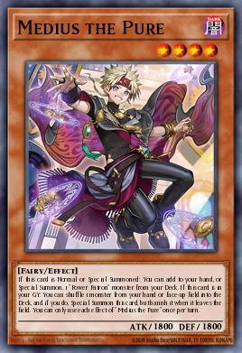 **Medius el Puro**

### Ejecución numerada

#### Paso 1 — Invocar Normalmente Medius en Ataque (1800 ATK); gastar la Invocación Normal.

 **NORMAL** → 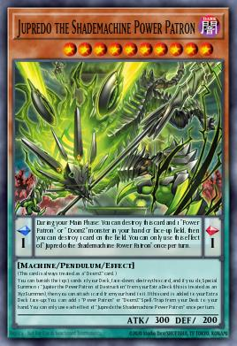 **ESPECIAL**

**Acción concreta:** Invocar Normalmente Medius en Ataque (1800 ATK); gastar la Invocación Normal. Su efecto al Invocarse (CL1) permite Invocar Especialmente desde el Deck a Jupredo Jupredo (Nivel 10, Péndulo). Elegir «Invocar Especialmente», no «añadir a mano». Campo propio: Medius + Jupredo.
**Detalle técnico documentado:** Su efecto al Invocarse (CL1) permite Invocar Especialmente desde el Deck a Jupredo Jupredo (Nivel 10, Péndulo). Elegir «Invocar Especialmente», no «añadir a mano». Campo propio: Medius + Jupredo.

**Estado por zonas después del paso:**

| Zona/recurso | Estado narrativo A09 |
|---|---|
| Mano | ∅ |
| Monstruos | Medius #21419, Jupredo #22521 (Péndulo Invocado desde Deck como monstruo) |
| Mágicas y trampas | ∅ |
| Cementerio | ∅ |
| Destierro propio | ∅ |
| Campo y estado rival | Sin respuesta; campo no determinado |
| Materiales Xyz/Fusión/Sincro | Ninguno |
| Normal, Extra, fase y restricciones | Normal gastada; Extra intacto |

**Campo visual de este paso:**

**Monstruos propios:**
-  **Medius** — zona declarada: `MONSTER`.
-  **Jupredo (Péndulo Invocado desde Deck como monstruo)** — zona declarada: `MONSTER`.
**Mágicas/Trampas/Campo:** sin carta propia demostrada en esta vista.
*Relación ilustrada de cartas presentes tras este paso, documentada en A09. La posición, materiales, otras zonas y rival se leen en la tabla de estado.*

#### Paso 2 — Pagar coste de Jupredo: durante Main Phase activar el efecto de monstruo de Jupredo.

 **ACTIVAR** →  **ESPECIAL**

**Acción concreta:** Pagar coste de Jupredo: durante Main Phase activar el efecto de monstruo de Jupredo; desterrar las 3 cartas superiores del Deck boca abajo como coste al activar (pueden ser recursos deseados: no se conoce su identidad de antemano). En resolución, destruir Jupredo en zona de Monstruos por efecto y, si realmente es destruida, Invocar Especialmente a Júpiter desde Extra tratándose como Invocación Xyz. No usar el efecto Péndulo de Jupredo ni pedirle 3 Cartas de Equipo: ese es otro procedimiento alternativo distinto, propio de Júpiter.
**Detalle técnico documentado:** desterrar las 3 cartas superiores del Deck boca abajo como coste al activar (pueden ser recursos deseados: no se conoce su identidad de antemano). En resolución, destruir Jupredo en zona de Monstruos por efecto y, si realmente es destruida, Invocar Especialmente a Júpiter desde Extra tratándose como Invocación Xyz. No usar el efecto Péndulo de Jupredo ni pedirle 3 Cartas de Equipo: ese es otro procedimiento alternativo distinto, propio de Júpiter.

**Estado por zonas después del paso:**

| Zona/recurso | Estado narrativo A09 |
|---|---|
| Mano | ∅ |
| Monstruos | Medius #21419, Júpiter #21810 (Invocado como Xyz, 0 materiales) |
| Mágicas y trampas | ∅ |
| Cementerio | ∅; Jupredo destruido como Péndulo va al Extra boca arriba |
| Destierro propio | 3 cartas superiores del Deck boca abajo; identidad desconocida |
| Campo y estado rival | Sin cambios acreditados |
| Materiales Xyz/Fusión/Sincro | Júpiter: ninguno, 0 materiales |
| Normal, Extra, fase y restricciones | Normal gastada; Júpiter salió del Extra; Jupredo boca arriba en Extra |

**Campo visual de este paso:**

**Monstruos propios:**
-  **Medius** — zona declarada: `MONSTER`.
-  **Júpiter (Invocado como Xyz, 0 materiales)** — zona declarada: `MONSTER`.
**Mágicas/Trampas/Campo:** sin carta propia demostrada en esta vista.
*Relación ilustrada de cartas presentes tras este paso, documentada en A09. La posición, materiales, otras zonas y rival se leen en la tabla de estado.*

#### Paso 3 — Destino correcto de Jupredo: al ser destruido en el Campo como monstruo Péndulo, Jupredo va boca arriba al Deck Extra, no al Cementerio ni acoplado a Júpiter.

 **ESTADO / CONTEXTO** →  **ESTADO / CONTEXTO** →  **ESTADO / CONTEXTO**

**Acción concreta:** Destino correcto de Jupredo: al ser destruido en el Campo como monstruo Péndulo, Jupredo va boca arriba al Deck Extra, no al Cementerio ni acoplado a Júpiter. Tras la cadena anterior, su efecto opcional por haber llegado boca arriba al Extra puede añadir del Deck una Mágica/Trampa DoomZ o Modelo de Poder. Ejemplo: Cambio DoomZ si queda copia en Deck tras desterrar las tres cartas. Esta búsqueda es una cadena nueva, no material Xyz adicional.
**Detalle técnico documentado:** Tras la cadena anterior, su efecto opcional por haber llegado boca arriba al Extra puede añadir del Deck una Mágica/Trampa DoomZ o Modelo de Poder. Ejemplo: Cambio DoomZ si queda copia en Deck tras desterrar las tres cartas. Esta búsqueda es una cadena nueva, no material Xyz adicional.

**Estado por zonas después del paso:**

| Zona/recurso | Estado narrativo A09 |
|---|---|
| Mano | Cambio #22158 (solo si quedó en Deck y se elige buscarlo) |
| Monstruos | Medius #21419, Júpiter #21810 (3500 ATK; 0 materiales) |
| Mágicas y trampas | ∅ |
| Cementerio | ∅; Jupredo boca arriba en Extra |
| Destierro propio | 3 cartas desconocidas boca abajo |
| Campo y estado rival | Sin cambios acreditados |
| Materiales Xyz/Fusión/Sincro | Júpiter: 0 |
| Normal, Extra, fase y restricciones | Normal gastada; Jupredo boca arriba en Extra |

**Campo visual de este paso:**

**Monstruos propios:**
-  **Medius** — zona declarada: `MONSTER`.
-  **Júpiter (3500 ATK; 0 materiales)** — zona declarada: `MONSTER`.
**Mágicas/Trampas/Campo:** sin carta propia demostrada en esta vista.
*Relación ilustrada de cartas presentes tras este paso, documentada en A09. La posición, materiales, otras zonas y rival se leen en la tabla de estado.*

#### Paso 4 — Tablero base verificable: Júpiter Rango 10, ATK 3500, 0 materiales, y Medius ATK 1800 en zonas de Monstruos; Jupredo boca arriba en Extra.

 **ESTADO / CONTEXTO** →  **ESTADO / CONTEXTO** →  **ESTADO / CONTEXTO**

**Acción concreta:** Tablero base verificable: Júpiter Rango 10, ATK 3500, 0 materiales, y Medius ATK 1800 en zonas de Monstruos; Jupredo boca arriba en Extra; 3 cartas superiores del Deck desterradas boca abajo (identidad no garantizada); Invocación Normal gastada; ninguna Mágica de Equipo en GY ni equipada automáticamente. La búsqueda de Jupredo deja una DoomZ M/T en mano si queda objetivo. Júpiter no gana 3000 ATK adicionales porque no tiene un Monstruo Xyz como material; tampoco puede desacoplar para revivir un DoomZ porque tiene cero materiales. Su efecto de equipar Mágicas de Equipo desde GY al ser Invocado Xyz no obtiene ninguna si GY estaba vacío.
**Detalle técnico documentado:** 3 cartas superiores del Deck desterradas boca abajo (identidad no garantizada); Invocación Normal gastada; ninguna Mágica de Equipo en GY ni equipada automáticamente. La búsqueda de Jupredo deja una DoomZ M/T en mano si queda objetivo. Júpiter no gana 3000 ATK adicionales porque no tiene un Monstruo Xyz como material; tampoco puede desacoplar para revivir un DoomZ porque tiene cero materiales. Su efecto de equipar Mágicas de Equipo desde GY al ser Invocado Xyz no obtiene ninguna si GY estaba vacío.

**Estado por zonas después del paso:**

| Zona/recurso | Estado narrativo A09 |
|---|---|
| Mano | Cambio #22158 (condicional; si faltó objetivo, mano vacía) |
| Monstruos | Medius #21419, Júpiter #21810 (3500 ATK; 0 materiales) |
| Mágicas y trampas | ∅ |
| Cementerio | ∅; Jupredo boca arriba en Extra |
| Destierro propio | 3 cartas desconocidas boca abajo |
| Campo y estado rival | No se usó efecto de desacoplar ni negar |
| Materiales Xyz/Fusión/Sincro | Júpiter: 0 |
| Normal, Extra, fase y restricciones | Normal gastada; Jupredo boca arriba en Extra |

**Campo visual de este paso:**

**Monstruos propios:**
-  **Medius** — zona declarada: `MONSTER`.
-  **Júpiter (3500 ATK; 0 materiales)** — zona declarada: `MONSTER`.
**Mágicas/Trampas/Campo:** sin carta propia demostrada en esta vista.
*Relación ilustrada de cartas presentes tras este paso, documentada en A09. La posición, materiales, otras zonas y rival se leen en la tabla de estado.*

#### Paso 5 — Extensión condicional (opcional): activar Cambio para destruir Amalthe desde Deck solo si Jupredo buscó Cambio y, tras los tres destierros del Deck, todavía quedan Amalthe y Drastea allí.

 **ACTIVAR** →  **YA EN CAMPO** →  **YA EN CAMPO**

**Acción concreta:** Extensión condicional (opcional): activar Cambio para destruir Amalthe desde Deck solo si Jupredo buscó Cambio y, tras los tres destierros del Deck, todavía quedan Amalthe y Drastea allí. En una nueva cadena, la Amalthe destruida busca Drastea a mano. No aparece un tercer monstruo: permanecen Júpiter + Medius, Cambio y Amalthe pasan al GY y Drastea queda en mano. Drastea no puede Invocarse sin otra carta DoomZ boca arriba que pueda destruir legalmente. Si el destierro aleatorio eliminó un objetivo necesario, omitir esta extensión.
**Detalle técnico documentado:** En una nueva cadena, la Amalthe destruida busca Drastea a mano. No aparece un tercer monstruo: permanecen Júpiter + Medius, Cambio y Amalthe pasan al GY y Drastea queda en mano. Drastea no puede Invocarse sin otra carta DoomZ boca arriba que pueda destruir legalmente. Si el destierro aleatorio eliminó un objetivo necesario, omitir esta extensión.

**Estado por zonas después del paso:**

| Zona/recurso | Estado narrativo A09 |
|---|---|
| Mano | Drastea #21774 (solo si buscar Cambio y quedan Amalthe y Drastea en Deck) |
| Monstruos | Medius #21419, Júpiter #21810 (0 materiales) |
| Mágicas y trampas | ∅ |
| Cementerio | Cambio #22158, Amalthe #21775 (solo si extensión se ejecutó); Jupredo boca arriba en Extra |
| Destierro propio | 3 cartas desconocidas boca abajo |
| Campo y estado rival | Sin cambios acreditados |
| Materiales Xyz/Fusión/Sincro | Júpiter: 0 |
| Normal, Extra, fase y restricciones | Normal gastada; extensión condicional, no una invocación adicional |

**Campo visual de este paso:**

**Monstruos propios:**
-  **Medius** — zona declarada: `MONSTER`.
-  **Júpiter (0 materiales)** — zona declarada: `MONSTER`.
**Mágicas/Trampas/Campo:** sin carta propia demostrada en esta vista.
*Relación ilustrada de cartas presentes tras este paso, documentada en A09. La posición, materiales, otras zonas y rival se leen en la tabla de estado.*

### Campo final documentado

Esta vista procede **del último paso**, no de una lista de cartas deducida del título.

**Monstruos propios:**
-  **Medius** — zona declarada: `MONSTER`.
-  **Júpiter (0 materiales)** — zona declarada: `MONSTER`.
**Mágicas/Trampas/Campo:** sin carta propia demostrada en esta vista.
*Relación ilustrada de cartas presentes tras este paso, documentada en A09. La posición, materiales, otras zonas y rival se leen en la tabla de estado.*

| Zona/recurso | Estado final documentado |
|---|---|
| Mano | Drastea #21774 (solo si buscar Cambio y quedan Amalthe y Drastea en Deck) |
| Monstruos | Medius #21419, Júpiter #21810 (0 materiales) |
| Mágicas y trampas | ∅ |
| Cementerio | Cambio #22158, Amalthe #21775 (solo si extensión se ejecutó); Jupredo boca arriba en Extra |
| Destierro propio | 3 cartas desconocidas boca abajo |
| Campo y estado rival | Sin cambios acreditados |
| Materiales Xyz/Fusión/Sincro | Júpiter: 0 |
| Normal, Extra, fase y restricciones | Normal gastada; extensión condicional, no una invocación adicional |

### Si el oponente interrumpe

- **INTERRUPCIÓN A12 — paso 1: A12 — Ash a Medius en paso P1 de MEDIUS:JUPREDO:JUPITER04**
  - CL1: después de Invocar Normalmente Medius (1800 ATK), activar su efecto disparado para Invocar Jupredo desde Deck. Medius puede añadir o Invocar desde Deck; Ash disponible en mano rival se descarta como CL2 y niega la opción escogida. La Normal ya se gastó: Ash no devuelve Medius a la mano ni lo destruye.
  - Corte: Jupredo permanece Deck, no entra al Campo y no puede activar el efecto que destierra 3 cartas del tope como coste. No se Invoca Júpiter, no hay Péndulo boca arriba en Extra ni se busca Cambio. Fuentes: Medius, Ash..
  - Estado de rama: `Resuelto solo en el escenario que detalla A12/A13; las otras respuestas no están demostradas.`.
- **RECUPERACIÓN A13 — paso 1: A13 — Medius queda solo en paso P1 de MEDIUS:JUPREDO:JUPITER04**
  - Estado residual: Medius 1800 ATK en Campo; mano inicial Medius consumida, Normal gastada, GY y destierro propios vacíos; Jupredo sigue en Main Deck, Júpiter en Extra, cero cartas del tope desterradas. No hay materiales Xyz, Equipos, cartas Péndulo boca arriba en Extra ni Cambio buscado. SIN_CONTINUACION_DEMOSTRADA_CON_MANO_MINIMA; la negación de Medius no constituye un envío o destrucción de Jupredo.
  - Estado de rama: `Resuelto solo en el escenario que detalla A12/A13; las otras respuestas no están demostradas.`.

---

## MEDIUS · POWERPATRON · DIACTORUS · DRAS05 · `653:A09:MEDIUS:POWERPATRON:DIACTORUS:DRAS05`

**Propósito competitivo principal (lectura documental):** Preparación de recursos / despliegue. El objetivo solo se acredita si las acciones y el campo final detallados en esta guía lo permiten; no implica legalidad certificada ni garantiza el resultado ante respuestas adversarias.

**Categoría:** APERTURA

**Propósito y resultado documental:**

7. Campo final mínimo: Drastrius en Ataque, 2700 ATK con 2 materiales [Drastea, Mando D.O.O.M.D.U.R.G.]; sin otros monstruos; M/T vacío; Normal gastada; en GY al menos Medius, Modelo de Poder, Diactorus, Cambio y Amalthe. Si se usa la recuperación opcional, Mando A.D.R.A.S.T.E.I.A. en mano, sin haberse equipado todavía. Drastrius retiene la negación condicional y la protección de selección mientras Mando siga como material. No atribuirle efectos ni materiales de Diactorus.

### Mano y estado inicial

Medius Medius el Puro (21419) como única carta de mano; Campo/GY propios vacíos, Main Phase propia, sin respuesta rival. En Main permanecen DoomZ Modelo de Poder (21777), Cambio (22158), Amalthe (21775), Drastea (21774), Mando D.O.O.M.D.U.R.G. (21824) y, para recuperación opcional, Mando A.D.R.A.S.T.E.I.A. (22567); Extra conserva Diactorus (21812) y Drastrius (21811).

 **Medius el Puro**

### Ejecución numerada

#### Paso 1 — Normal Medius, 1800 ATK.

 **ESTADO / CONTEXTO** → 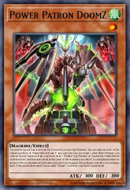 **ESPECIAL**

**Acción concreta:** Normal Medius, 1800 ATK. Activar su disparo (CL1) para Invocar Especialmente DoomZ Modelo de Poder desde el Deck (Máquina VIENTO Nivel 1, 300 ATK). Desde que Modelo de Poder esté como monstruo boca arriba, solo permite Invocaciones desde Extra de categoría Xyz.
**Detalle técnico documentado:** Activar su disparo (CL1) para Invocar Especialmente DoomZ Modelo de Poder desde el Deck (Máquina VIENTO Nivel 1, 300 ATK). Desde que Modelo de Poder esté como monstruo boca arriba, solo permite Invocaciones desde Extra de categoría Xyz.

**Estado por zonas después del paso:**

| Zona/recurso | Estado narrativo A09 |
|---|---|
| Mano | ∅ |
| Monstruos | Medius #21419, Modelo de Poder #21777 (desde Deck) |
| Mágicas y trampas | ∅ |
| Cementerio | ∅ |
| Destierro propio | ∅ |
| Campo y estado rival | Sin respuesta; campo no determinado |
| Materiales Xyz/Fusión/Sincro | Ninguno |
| Normal, Extra, fase y restricciones | Normal gastada; solo Xyz desde Extra tras Modelo de Poder |

**Campo visual de este paso:**

**Monstruos propios:**
-  **Medius** — zona declarada: `MONSTER`.
-  **Modelo de Poder (desde Deck)** — zona declarada: `MONSTER`.
**Mágicas/Trampas/Campo:** sin carta propia demostrada en esta vista.
*Relación ilustrada de cartas presentes tras este paso, documentada en A09. La posición, materiales, otras zonas y rival se leen en la tabla de estado.*

#### Paso 2 — Modelo de Poder selecciona Medius, otro Monstruo de Efecto propio de Nivel 4.

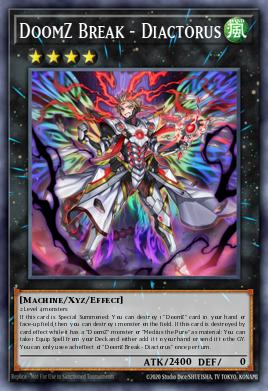 **INVOCAR XYZ** →  **INVOCAR XYZ**

**Acción concreta:** Modelo de Poder selecciona Medius, otro Monstruo de Efecto propio de Nivel 4. Por su procedimiento excepcional, Invocar Xyz Fractura DoomZ – Diactorus Rango 4 usando Medius como único material, y equipar Modelo de Poder como Mágica de Equipo a Diactorus. No invocar Diactorus mediante sus dos materiales estándar.
**Detalle técnico documentado:** Por su procedimiento excepcional, Invocar Xyz Fractura DoomZ – Diactorus Rango 4 usando Medius como único material, y equipar Modelo de Poder como Mágica de Equipo a Diactorus. No invocar Diactorus mediante sus dos materiales estándar.

**Estado por zonas después del paso:**

| Zona/recurso | Estado narrativo A09 |
|---|---|
| Mano | ∅ |
| Monstruos | Diactorus #21812 (Xyz Rango 4) |
| Mágicas y trampas | Modelo de Poder #21777 (Equipo de Diactorus; no monstruo) |
| Cementerio | ∅ |
| Destierro propio | ∅ |
| Campo y estado rival | Sin cambios acreditados |
| Materiales Xyz/Fusión/Sincro | Diactorus: Medius #21419 (único material) |
| Normal, Extra, fase y restricciones | Normal gastada; Diactorus salió del Extra; solo Xyz |

**Campo visual de este paso:**

**Monstruos propios:**
-  **Diactorus (Xyz Rango 4)** — zona declarada: `MONSTER`.
**Mágicas/Trampas/Campo:**
-  **Modelo de Poder (Equipo de Diactorus; no monstruo)** — zona declarada: `SPELL_TRAP`.
*Relación ilustrada de cartas presentes tras este paso, documentada en A09. La posición, materiales, otras zonas y rival se leen en la tabla de estado.*

#### Paso 3 — Disparo de Diactorus por haber sido Invocado Especialmente (nueva CL1): destruir el Modelo de Poder propio, boca arriba y equipado en M/T, que sigue contando como carta «DoomZ».

 **ESTADO / CONTEXTO** →  **AÑADIR A MANO** →  **ESTADO / CONTEXTO**

**Acción concreta:** Disparo de Diactorus por haber sido Invocado Especialmente (nueva CL1): destruir el Modelo de Poder propio, boca arriba y equipado en M/T, que sigue contando como carta «DoomZ». Elegir no destruir otro monstruo con la parte opcional. Modelo de Poder destruido va al GY y, por su efecto «Si esta carta es destruida», en cadena nueva busca Cambio DoomZ desde Deck a mano. Diactorus sigue con Medius como material.
**Detalle técnico documentado:** Elegir no destruir otro monstruo con la parte opcional. Modelo de Poder destruido va al GY y, por su efecto «Si esta carta es destruida», en cadena nueva busca Cambio DoomZ desde Deck a mano. Diactorus sigue con Medius como material.

**Estado por zonas después del paso:**

| Zona/recurso | Estado narrativo A09 |
|---|---|
| Mano | Cambio #22158 (si aún está en Deck; búsqueda de Modelo de Poder) |
| Monstruos | Diactorus #21812 |
| Mágicas y trampas | ∅ |
| Cementerio | Modelo de Poder #21777 (Equipo destruido) |
| Destierro propio | ∅ |
| Campo y estado rival | Sin cambios acreditados |
| Materiales Xyz/Fusión/Sincro | Diactorus: Medius #21419 |
| Normal, Extra, fase y restricciones | Normal gastada; solo Xyz |

**Campo visual de este paso:**

**Monstruos propios:**
-  **Diactorus** — zona declarada: `MONSTER`.
**Mágicas/Trampas/Campo:** sin carta propia demostrada en esta vista.
*Relación ilustrada de cartas presentes tras este paso, documentada en A09. La posición, materiales, otras zonas y rival se leen en la tabla de estado.*

#### Paso 4 — Activar Cambio y destruir Amalthe desde Deck; en cadena nueva Amalthe destruida por efecto busca Drastea desde Deck a mano.

 **ACTIVAR** →  **AÑADIR A MANO**

**Acción concreta:** Activar Cambio y destruir Amalthe desde Deck; en cadena nueva Amalthe destruida por efecto busca Drastea desde Deck a mano. Cambio y Amalthe pasan al GY, Drastea está en mano.
**Detalle técnico documentado:** Cambio y Amalthe pasan al GY, Drastea está en mano.

**Estado por zonas después del paso:**

| Zona/recurso | Estado narrativo A09 |
|---|---|
| Mano | Drastea #21774 (si Amalthe pudo buscarla) |
| Monstruos | Diactorus #21812 |
| Mágicas y trampas | ∅ |
| Cementerio | Modelo de Poder #21777, Cambio #22158, Amalthe #21775 (destruida en Deck) |
| Destierro propio | ∅ |
| Campo y estado rival | Sin cambios acreditados |
| Materiales Xyz/Fusión/Sincro | Diactorus: Medius #21419 |
| Normal, Extra, fase y restricciones | Normal gastada; solo Xyz |

**Campo visual de este paso:**

**Monstruos propios:**
-  **Diactorus** — zona declarada: `MONSTER`.
**Mágicas/Trampas/Campo:** sin carta propia demostrada en esta vista.
*Relación ilustrada de cartas presentes tras este paso, documentada en A09. La posición, materiales, otras zonas y rival se leen en la tabla de estado.*

#### Paso 5 — Activar Drastea desde mano seleccionando Diactorus boca arriba, una carta «DoomZ»: destruir Diactorus por efecto, Invocar Especialmente Drastea y equiparle desde Deck Mando D.O.O.M.D.U.R.G..

 **OBJETIVO** →  **ESPECIAL** →  **ESTADO / CONTEXTO**

**Acción concreta:** Activar Drastea desde mano seleccionando Diactorus boca arriba, una carta «DoomZ»: destruir Diactorus por efecto, Invocar Especialmente Drastea y equiparle desde Deck Mando D.O.O.M.D.U.R.G.. El material Medius que quedaba debajo de Diactorus se manda al GY al abandonarlo el Xyz, no se destruye. Como Diactorus fue destruido por efecto teniendo a Medius como material, en una cadena nueva puede tomar una Mágica de Equipo del Deck y añadirla a mano o mandarla al GY; ejemplo documentado: Mando A.D.R.A.S.T.E.I.A. a mano si queda en Deck. Esta recuperación es opcional y no modifica el material posterior.
**Detalle técnico documentado:** El material Medius que quedaba debajo de Diactorus se manda al GY al abandonarlo el Xyz, no se destruye. Como Diactorus fue destruido por efecto teniendo a Medius como material, en una cadena nueva puede tomar una Mágica de Equipo del Deck y añadirla a mano o mandarla al GY; ejemplo documentado: Mando A.D.R.A.S.T.E.I.A. a mano si queda en Deck. Esta recuperación es opcional y no modifica el material posterior.

**Estado por zonas después del paso:**

| Zona/recurso | Estado narrativo A09 |
|---|---|
| Mano | Mando A.D.R.A.S.T.E.I.A. #22567 (opcional; si se recuperó desde Deck) |
| Monstruos | Drastea #21774 |
| Mágicas y trampas | Mando D.O.O.M.D.U.R.G. #21824 (Equipo de Drastea) |
| Cementerio | Modelo de Poder #21777, Cambio #22158, Amalthe #21775, Diactorus #21812 (destruido), Medius #21419 (material enviado, no destruido) |
| Destierro propio | ∅ |
| Campo y estado rival | Sin cambios acreditados |
| Materiales Xyz/Fusión/Sincro | Ninguno: Diactorus abandonó Campo; Medius pasó a GY |
| Normal, Extra, fase y restricciones | Normal gastada; solo Xyz |

**Campo visual de este paso:**

**Monstruos propios:**
-  **Drastea** — zona declarada: `MONSTER`.
**Mágicas/Trampas/Campo:**
-  **Mando D.O.O.M.D.U.R.G. (Equipo de Drastea)** — zona declarada: `SPELL_TRAP`.
*Relación ilustrada de cartas presentes tras este paso, documentada en A09. La posición, materiales, otras zonas y rival se leen en la tabla de estado.*

#### Paso 6 — Drastea equipada activa su Efecto Rápido y efectúa Invocación Xyz Drastrius Rango 8, anexando Drastea + Mando como 2 materiales.

 **INVOCAR XYZ** →  **INVOCAR XYZ**

**Acción concreta:** Drastea equipada activa su Efecto Rápido y efectúa Invocación Xyz Drastrius Rango 8, anexando Drastea + Mando como 2 materiales. No ha aparecido un tercer monstruo de Nivel 8; se emplea la vía alternativa de Drastea.
**Detalle técnico documentado:** No ha aparecido un tercer monstruo de Nivel 8; se emplea la vía alternativa de Drastea.

**Estado por zonas después del paso:**

| Zona/recurso | Estado narrativo A09 |
|---|---|
| Mano | Mando A.D.R.A.S.T.E.I.A. #22567 (si se buscó) |
| Monstruos | Drastrius #21811 (Xyz Rango 8) |
| Mágicas y trampas | ∅ |
| Cementerio | Modelo de Poder #21777, Cambio #22158, Amalthe #21775, Diactorus #21812, Medius #21419 |
| Destierro propio | ∅ |
| Campo y estado rival | Sin cambios acreditados |
| Materiales Xyz/Fusión/Sincro | Drastrius: Drastea #21774 + Mando D.O.O.M.D.U.R.G. #21824 |
| Normal, Extra, fase y restricciones | Normal gastada; Drastrius salió del Extra; solo Xyz |

**Campo visual de este paso:**

**Monstruos propios:**
-  **Drastrius (Xyz Rango 8)** — zona declarada: `MONSTER`.
**Mágicas/Trampas/Campo:** sin carta propia demostrada en esta vista.
*Relación ilustrada de cartas presentes tras este paso, documentada en A09. La posición, materiales, otras zonas y rival se leen en la tabla de estado.*

#### Paso 7 — Campo final mínimo: Drastrius en Ataque, 2700 ATK con 2 materiales [Drastea, Mando D.O.O.M.D.U.R.G.]; sin otros monstruos; M/T vacío; Normal gastada.

 **ESTADO / CONTEXTO** →  **ESTADO / CONTEXTO** →  **ESTADO / CONTEXTO**

**Acción concreta:** Campo final mínimo: Drastrius en Ataque, 2700 ATK con 2 materiales [Drastea, Mando D.O.O.M.D.U.R.G.]; sin otros monstruos; M/T vacío; Normal gastada; en GY al menos Medius, Modelo de Poder, Diactorus, Cambio y Amalthe. Si se usa la recuperación opcional, Mando A.D.R.A.S.T.E.I.A. en mano, sin haberse equipado todavía. Drastrius retiene la negación condicional y la protección de selección mientras Mando siga como material. No atribuirle efectos ni materiales de Diactorus.
**Detalle técnico documentado:** en GY al menos Medius, Modelo de Poder, Diactorus, Cambio y Amalthe. Si se usa la recuperación opcional, Mando A.D.R.A.S.T.E.I.A. en mano, sin haberse equipado todavía. Drastrius retiene la negación condicional y la protección de selección mientras Mando siga como material. No atribuirle efectos ni materiales de Diactorus.

**Estado por zonas después del paso:**

| Zona/recurso | Estado narrativo A09 |
|---|---|
| Mano | Mando A.D.R.A.S.T.E.I.A. #22567 (solo si búsqueda opcional legal y resuelta) |
| Monstruos | Drastrius #21811 (2700 ATK) |
| Mágicas y trampas | ∅ |
| Cementerio | Modelo de Poder #21777, Cambio #22158, Amalthe #21775, Diactorus #21812, Medius #21419 |
| Destierro propio | ∅ |
| Campo y estado rival | No se ha usado negación |
| Materiales Xyz/Fusión/Sincro | Drastrius: Drastea #21774 + Mando D.O.O.M.D.U.R.G. #21824 |
| Normal, Extra, fase y restricciones | Normal gastada; solo Xyz |

**Campo visual de este paso:**

**Monstruos propios:**
-  **Drastrius (2700 ATK)** — zona declarada: `MONSTER`.
**Mágicas/Trampas/Campo:** sin carta propia demostrada en esta vista.
*Relación ilustrada de cartas presentes tras este paso, documentada en A09. La posición, materiales, otras zonas y rival se leen en la tabla de estado.*

### Campo final documentado

Esta vista procede **del último paso**, no de una lista de cartas deducida del título.

**Monstruos propios:**
-  **Drastrius (2700 ATK)** — zona declarada: `MONSTER`.
**Mágicas/Trampas/Campo:** sin carta propia demostrada en esta vista.
*Relación ilustrada de cartas presentes tras este paso, documentada en A09. La posición, materiales, otras zonas y rival se leen en la tabla de estado.*

| Zona/recurso | Estado final documentado |
|---|---|
| Mano | Mando A.D.R.A.S.T.E.I.A. #22567 (solo si búsqueda opcional legal y resuelta) |
| Monstruos | Drastrius #21811 (2700 ATK) |
| Mágicas y trampas | ∅ |
| Cementerio | Modelo de Poder #21777, Cambio #22158, Amalthe #21775, Diactorus #21812, Medius #21419 |
| Destierro propio | ∅ |
| Campo y estado rival | No se ha usado negación |
| Materiales Xyz/Fusión/Sincro | Drastrius: Drastea #21774 + Mando D.O.O.M.D.U.R.G. #21824 |
| Normal, Extra, fase y restricciones | Normal gastada; solo Xyz |

### Si el oponente interrumpe

- **INTERRUPCIÓN A12 — paso 1: A12 — Ash a Medius en paso P1 de MEDIUS:POWERPATRON:DIACTORUS:DRAS05**
  - Medius fue Invocado Normalmente y activa CL1 para Invocar DoomZ Modelo de Poder desde Deck. Ash rival CL2 niega esa Invocación; tras la resolución, Medius permanece boca arriba, Modelo de Poder en Deck y la Normal gastada. No se hace Diactorus con Medius solo porque falta la activación y el equipamiento del habilitador; tampoco hay Modelo destruido que busque Cambio.
  - No extrapolar: en una mano inicial exclusiva de Medius no se acreditan otro Xyz ni otras Mágicas. Medius oficial, Modelo de Poder oficial..
  - Estado de rama: `Resuelto solo en el escenario que detalla A12/A13; las otras respuestas no están demostradas.`.
- **RECUPERACIÓN A13 — paso 1: A13 — Medius sin Modelo en paso P1 de MEDIUS:POWERPATRON:DIACTORUS:DRAS05**
  - Estado residual: Medius 1800 ATK (Nivel 4) propio boca arriba, Normal gastada; Modelo de Poder no salió del Deck; Campo M/T vacío, GY propio vacío, Extra intacto y ningún material Xyz. El procedimiento alternativo de Diactorus exige el efecto de Modelo de Poder en Campo, inexistente aquí. No inventar Cambio ni Drastea. SIN_CONTINUACION_DEMOSTRADA_CON_MANO_MINIMA.
  - Estado de rama: `Resuelto solo en el escenario que detalla A12/A13; las otras respuestas no están demostradas.`.

---

## MEDIUS · GRAFLAREIO · DRAS06 · `653:A09:MEDIUS:GRAFLAREIO:DRAS06`

**Propósito competitivo principal (lectura documental):** Ofensivo condicional. El objetivo solo se acredita si las acciones y el campo final detallados en esta guía lo permiten; no implica legalidad certificada ni garantiza el resultado ante respuestas adversarias.

**Categoría:** APERTURA

**Propósito y resultado documental:**

8. Tablero final: Drastrius 2700 ATK con 2 materiales, Elara 1400 ATK, Amalthe 1600 ATK; Mando A.D.R.A.S.T.E.I.A. Colocado (Equipo, activable luego desde Colocada en Main Phase), Cambio DoomZ en mano, Normal gastada, Extra restringido a Xyz el resto del turno. En GY: Medius, Modelo de Poder, Graflareio, Diactorus, Incursores. Las cartas destruidas no quedan como material de Drastrius ni se duplican en otra zona. No se presupone activación rival o daño directo.

### Mano y estado inicial

Medius Medius como única carta inicial; sin Campo/GY propios, Main Phase y sin interrupción rival. En Deck quedan DoomZ Modelo de Poder, Incursores, Cambio, Elara, Amalthe, Drastea y los dos Equipos Mando indicados; en Extra, Diactorus, Graflareio (22554), Drastrius. Ruta ramificada respecto de A09-05: en vez de destruir Modelo de Poder con Diactorus, lo pierde por el cambio Xyz a Graflareio.

 **Medius el Puro**

### Ejecución numerada

#### Paso 1 — Normal Medius y, por su efecto de Invocación, Invocar Especialmente DoomZ Modelo de Poder desde Deck.

 **INVOCAR XYZ** →  **INVOCAR XYZ** →  **ACTIVAR**

**Acción concreta:** Normal Medius y, por su efecto de Invocación, Invocar Especialmente DoomZ Modelo de Poder desde Deck. Este selecciona Medius (Nivel 4) y efectúa la Invocación Xyz alternativa a Diactorus Rango 4, con Medius como material y Modelo de Poder equipado a Diactorus. No activar la destrucción opcional de Diactorus tras su Invocación.
**Detalle técnico documentado:** Este selecciona Medius (Nivel 4) y efectúa la Invocación Xyz alternativa a Diactorus Rango 4, con Medius como material y Modelo de Poder equipado a Diactorus. No activar la destrucción opcional de Diactorus tras su Invocación.

**Estado por zonas después del paso:**

| Zona/recurso | Estado narrativo A09 |
|---|---|
| Mano | ∅ |
| Monstruos | Diactorus #21812 (Xyz Rango 4) |
| Mágicas y trampas | Modelo de Poder #21777 (Equipo) |
| Cementerio | ∅ |
| Destierro propio | ∅ |
| Campo y estado rival | Sin respuesta; campo no determinado |
| Materiales Xyz/Fusión/Sincro | Diactorus: Medius #21419 |
| Normal, Extra, fase y restricciones | Normal gastada; Extra limitado a Xyz por Modelo |

**Campo visual de este paso:**

**Monstruos propios:**
-  **Diactorus (Xyz Rango 4)** — zona declarada: `MONSTER`.
**Mágicas/Trampas/Campo:**
-  **Modelo de Poder (Equipo)** — zona declarada: `SPELL_TRAP`.
*Relación ilustrada de cartas presentes tras este paso, documentada en A09. La posición, materiales, otras zonas y rival se leen en la tabla de estado.*

#### Paso 2 — Sobreponer Graflareio (Xyz DoomZ Rango 5) desde Extra usando 1 Xyz DoomZ propio, Diactorus como material, transfiriendo el anterior material Medius.

 **MATERIAL / COSTE** →  **AÑADIR A MANO** →  **ESTADO / CONTEXTO**

**Acción concreta:** Sobreponer Graflareio (Xyz DoomZ Rango 5) desde Extra usando 1 Xyz DoomZ propio, Diactorus como material, transfiriendo el anterior material Medius. Graflareio queda con 2 materiales [Diactorus, Medius]. Al salir Diactorus del Campo, Modelo de Poder pierde el monstruo equipado y es destruido por regla de Equipos (no hace falta efecto que lo destruya). Al terminar la acción, Modelo de Poder activa su disparo «Si esta carta es destruida» desde GY y busca Incursores DoomZ del Deck a mano; a diferencia de Amalthe, no exige que su destrucción sea por efecto.
**Detalle técnico documentado:** Graflareio queda con 2 materiales [Diactorus, Medius]. Al salir Diactorus del Campo, Modelo de Poder pierde el monstruo equipado y es destruido por regla de Equipos (no hace falta efecto que lo destruya). Al terminar la acción, Modelo de Poder activa su disparo «Si esta carta es destruida» desde GY y busca Incursores DoomZ del Deck a mano; a diferencia de Amalthe, no exige que su destrucción sea por efecto.

**Estado por zonas después del paso:**

| Zona/recurso | Estado narrativo A09 |
|---|---|
| Mano | Incursores #21823 (buscada tras destruir Equipo) |
| Monstruos | Graflareio #22554 (Xyz Rango 5) |
| Mágicas y trampas | ∅ |
| Cementerio | Modelo de Poder #21777 (destruida por regla de Equipo) |
| Destierro propio | ∅ |
| Campo y estado rival | Sin cambios acreditados |
| Materiales Xyz/Fusión/Sincro | Graflareio: Diactorus #21812 + Medius #21419 (dos materiales transferidos) |
| Normal, Extra, fase y restricciones | Normal gastada; Graflareio salió del Extra |

**Campo visual de este paso:**

**Monstruos propios:**
- 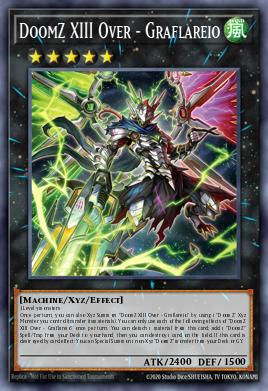 **Graflareio (Xyz Rango 5)** — zona declarada: `MONSTER`.
**Mágicas/Trampas/Campo:** sin carta propia demostrada en esta vista.
*Relación ilustrada de cartas presentes tras este paso, documentada en A09. La posición, materiales, otras zonas y rival se leen en la tabla de estado.*

#### Paso 3 — En Main Phase activar el efecto de Graflareio, desacoplando Medius como coste para añadir Cambio DoomZ desde Deck a mano.

 **ACTIVAR** →  **ESTADO / CONTEXTO** →  **ESTADO / CONTEXTO**

**Acción concreta:** En Main Phase activar el efecto de Graflareio, desacoplando Medius como coste para añadir Cambio DoomZ desde Deck a mano. No ejercer la destrucción de carta del campo que Graflareio permite opcionalmente. Graflareio mantiene 1 material [Diactorus]. Medius termina en GY. Mano: Incursores + Cambio.
**Detalle técnico documentado:** No ejercer la destrucción de carta del campo que Graflareio permite opcionalmente. Graflareio mantiene 1 material [Diactorus]. Medius termina en GY. Mano: Incursores + Cambio.

**Estado por zonas después del paso:**

| Zona/recurso | Estado narrativo A09 |
|---|---|
| Mano | Incursores #21823, Cambio #22158 (buscada) |
| Monstruos | Graflareio #22554 (2400 ATK) |
| Mágicas y trampas | ∅ |
| Cementerio | Modelo de Poder #21777, Medius #21419 (desacoplado como coste) |
| Destierro propio | ∅ |
| Campo y estado rival | Sin cambios acreditados |
| Materiales Xyz/Fusión/Sincro | Graflareio: Diactorus #21812 (uno restante) |
| Normal, Extra, fase y restricciones | Normal gastada; solo Xyz desde Extra |

**Campo visual de este paso:**

**Monstruos propios:**
-  **Graflareio (2400 ATK)** — zona declarada: `MONSTER`.
**Mágicas/Trampas/Campo:** sin carta propia demostrada en esta vista.
*Relación ilustrada de cartas presentes tras este paso, documentada en A09. La posición, materiales, otras zonas y rival se leen en la tabla de estado.*

#### Paso 4 — Activar Incursores como Continua y usar su efecto de Main Phase: destruir Graflareio boca arriba, una carta DoomZ distinta de Incursores, y Invocar Especialmente Elara desde Deck.

 **ACTIVAR** →  **ESPECIAL** →  **ESTADO / CONTEXTO**

**Acción concreta:** Activar Incursores como Continua y usar su efecto de Main Phase: destruir Graflareio boca arriba, una carta DoomZ distinta de Incursores, y Invocar Especialmente Elara desde Deck. Tras esta resolución, queda aplicada la restricción de solo Xyz desde Extra por el resto del turno. Graflareio destruido fue al GY; su material Diactorus se manda al GY (no se destruye).
**Detalle técnico documentado:** Tras esta resolución, queda aplicada la restricción de solo Xyz desde Extra por el resto del turno. Graflareio destruido fue al GY; su material Diactorus se manda al GY (no se destruye).

**Estado por zonas después del paso:**

| Zona/recurso | Estado narrativo A09 |
|---|---|
| Mano | Cambio #22158 |
| Monstruos | Elara #21776 (Invocada desde Deck) |
| Mágicas y trampas | Incursores #21823 (Continua) |
| Cementerio | Modelo de Poder #21777, Medius #21419, Graflareio #22554 (destruido), Diactorus #21812 (material enviado, no destruido) |
| Destierro propio | ∅ |
| Campo y estado rival | Sin cambios acreditados |
| Materiales Xyz/Fusión/Sincro | Ninguno; el Xyz anterior abandonó Campo |
| Normal, Extra, fase y restricciones | Normal gastada; solo Xyz por Incursores |

**Campo visual de este paso:**

**Monstruos propios:**
-  **Elara (Invocada desde Deck)** — zona declarada: `MONSTER`.
**Mágicas/Trampas/Campo:**
-  **Incursores (Continua)** — zona declarada: `SPELL_TRAP`.
*Relación ilustrada de cartas presentes tras este paso, documentada en A09. La posición, materiales, otras zonas y rival se leen en la tabla de estado.*

#### Paso 5 — Disparos simultáneos, en una cadena nueva: Graflareio destruido por efecto puede Invocar Amalthe (DoomZ no Xyz) desde Deck, mientras Elara Invocada Especialmente puede Colocar Mando A.D.R.A.S.T.E.I.A.

 **ESTADO / CONTEXTO** →  **COLOCAR** →  **ESTADO / CONTEXTO**

**Acción concreta:** Disparos simultáneos, en una cadena nueva: Graflareio destruido por efecto puede Invocar Amalthe (DoomZ no Xyz) desde Deck, mientras Elara Invocada Especialmente puede Colocar Mando A.D.R.A.S.T.E.I.A. del Deck en M/T. Orden declarado CL1 Graflareio, CL2 Elara: resolver CL2 (Colocar Mando) y luego CL1 (Invocar Amalthe). Tras esa cadena, Amalthe, recién Invocada, inicia otra cadena CL1 y añade Drastea desde Deck a mano. Mano: Cambio + Drastea; Campo monstruos: Elara + Amalthe.
**Detalle técnico documentado:** del Deck en M/T. Orden declarado CL1 Graflareio, CL2 Elara: resolver CL2 (Colocar Mando) y luego CL1 (Invocar Amalthe). Tras esa cadena, Amalthe, recién Invocada, inicia otra cadena CL1 y añade Drastea desde Deck a mano. Mano: Cambio + Drastea; Campo monstruos: Elara + Amalthe.

**Estado por zonas después del paso:**

| Zona/recurso | Estado narrativo A09 |
|---|---|
| Mano | Cambio #22158, Drastea #21774 (buscada por Amalthe) |
| Monstruos | Elara #21776, Amalthe #21775 (ambas desde Deck) |
| Mágicas y trampas | Incursores #21823, Mando A.D.R.A.S.T.E.I.A. #22567 (Colocado por Elara) |
| Cementerio | Modelo de Poder #21777, Medius #21419, Graflareio #22554, Diactorus #21812 |
| Destierro propio | ∅ |
| Campo y estado rival | Sin cambios acreditados |
| Materiales Xyz/Fusión/Sincro | Ninguno |
| Normal, Extra, fase y restricciones | Normal gastada; solo Xyz |

**Campo visual de este paso:**

**Monstruos propios:**
-  **Elara** — zona declarada: `MONSTER`.
-  **Amalthe (ambas desde Deck)** — zona declarada: `MONSTER`.
**Mágicas/Trampas/Campo:**
-  **Incursores** — zona declarada: `SPELL_TRAP`.
- 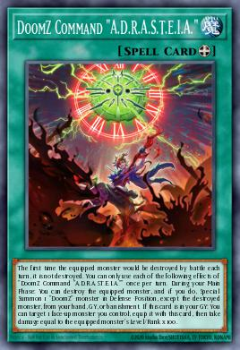 **Mando A.D.R.A.S.T.E.I.A. (Colocado por Elara)** — zona declarada: `SPELL_TRAP`.
*Relación ilustrada de cartas presentes tras este paso, documentada en A09. La posición, materiales, otras zonas y rival se leen en la tabla de estado.*

#### Paso 6 — Drastea en mano selecciona Incursores propia, aún boca arriba, la destruye por efecto, se Invoca Especialmente y se equipa Mando D.O.O.M.D.U.R.G.

 **ESTADO / CONTEXTO** →  **OBJETIVO**

**Acción concreta:** Drastea en mano selecciona Incursores propia, aún boca arriba, la destruye por efecto, se Invoca Especialmente y se equipa Mando D.O.O.M.D.U.R.G. desde Deck. Incursores destruida NO puede activar su otro efecto opcional ese turno, pues ya se utilizó su primer efecto (límite de uno de sus efectos por turno).
**Detalle técnico documentado:** desde Deck. Incursores destruida NO puede activar su otro efecto opcional ese turno, pues ya se utilizó su primer efecto (límite de uno de sus efectos por turno).

**Estado por zonas después del paso:**

| Zona/recurso | Estado narrativo A09 |
|---|---|
| Mano | Cambio #22158 |
| Monstruos | Elara #21776, Amalthe #21775, Drastea #21774 (desde mano, equipada) |
| Mágicas y trampas | Mando A.D.R.A.S.T.E.I.A. #22567 (Colocado), Mando D.O.O.M.D.U.R.G. #21824 (Equipo de Drastea) |
| Cementerio | Modelo de Poder #21777, Medius #21419, Graflareio #22554, Diactorus #21812, Incursores #21823 (destruida) |
| Destierro propio | ∅ |
| Campo y estado rival | Sin cambios acreditados |
| Materiales Xyz/Fusión/Sincro | Ninguno |
| Normal, Extra, fase y restricciones | Normal gastada; solo Xyz |

**Campo visual de este paso:**

**Monstruos propios:**
-  **Elara** — zona declarada: `MONSTER`.
-  **Amalthe** — zona declarada: `MONSTER`.
-  **Drastea (desde mano, equipada)** — zona declarada: `MONSTER`.
**Mágicas/Trampas/Campo:**
-  **Mando A.D.R.A.S.T.E.I.A. (Colocado)** — zona declarada: `SPELL_TRAP`.
-  **Mando D.O.O.M.D.U.R.G. (Equipo de Drastea)** — zona declarada: `SPELL_TRAP`.
*Relación ilustrada de cartas presentes tras este paso, documentada en A09. La posición, materiales, otras zonas y rival se leen en la tabla de estado.*

#### Paso 7 — Drastea equipada activa su Efecto Rápido para Invocar Xyz a Drastrius Rango 8 con 2 materiales [Drastea, Mando D.O.O.M.D.U.R.G.].

 **INVOCAR XYZ** →  **INVOCAR XYZ** →  **EQUIPAR**

**Acción concreta:** Drastea equipada activa su Efecto Rápido para Invocar Xyz a Drastrius Rango 8 con 2 materiales [Drastea, Mando D.O.O.M.D.U.R.G.]. Elegir no equipar otro monstruo boca arriba mediante el disparo opcional de Drastrius: así Elara y Amalthe permanecen en zona de monstruos.
**Detalle técnico documentado:** Elegir no equipar otro monstruo boca arriba mediante el disparo opcional de Drastrius: así Elara y Amalthe permanecen en zona de monstruos.

**Estado por zonas después del paso:**

| Zona/recurso | Estado narrativo A09 |
|---|---|
| Mano | Cambio #22158 |
| Monstruos | Elara #21776, Amalthe #21775, Drastrius #21811 (2700 ATK) |
| Mágicas y trampas | Mando A.D.R.A.S.T.E.I.A. #22567 (Colocado) |
| Cementerio | Modelo de Poder #21777, Medius #21419, Graflareio #22554, Diactorus #21812, Incursores #21823 |
| Destierro propio | ∅ |
| Campo y estado rival | Sin cambios acreditados |
| Materiales Xyz/Fusión/Sincro | Drastrius: Drastea #21774 + Mando D.O.O.M.D.U.R.G. #21824 |
| Normal, Extra, fase y restricciones | Normal gastada; Drastrius desde Extra; solo Xyz |

**Campo visual de este paso:**

**Monstruos propios:**
-  **Elara** — zona declarada: `MONSTER`.
-  **Amalthe** — zona declarada: `MONSTER`.
-  **Drastrius (2700 ATK)** — zona declarada: `MONSTER`.
**Mágicas/Trampas/Campo:**
-  **Mando A.D.R.A.S.T.E.I.A. (Colocado)** — zona declarada: `SPELL_TRAP`.
*Relación ilustrada de cartas presentes tras este paso, documentada en A09. La posición, materiales, otras zonas y rival se leen en la tabla de estado.*

#### Paso 8 — Tablero final: Drastrius 2700 ATK con 2 materiales, Elara 1400 ATK, Amalthe 1600 ATK; Mando A.D.R.A.S.T.E.I.A.

 **ESTADO / CONTEXTO** →  **ESTADO / CONTEXTO** →  **ESTADO / CONTEXTO**

**Acción concreta:** Tablero final: Drastrius 2700 ATK con 2 materiales, Elara 1400 ATK, Amalthe 1600 ATK; Mando A.D.R.A.S.T.E.I.A. Colocado (Equipo, activable luego desde Colocada en Main Phase), Cambio DoomZ en mano, Normal gastada, Extra restringido a Xyz el resto del turno. En GY: Medius, Modelo de Poder, Graflareio, Diactorus, Incursores. Las cartas destruidas no quedan como material de Drastrius ni se duplican en otra zona. No se presupone activación rival o daño directo.
**Detalle técnico documentado:** Colocado (Equipo, activable luego desde Colocada en Main Phase), Cambio DoomZ en mano, Normal gastada, Extra restringido a Xyz el resto del turno. En GY: Medius, Modelo de Poder, Graflareio, Diactorus, Incursores. Las cartas destruidas no quedan como material de Drastrius ni se duplican en otra zona. No se presupone activación rival o daño directo.

**Estado por zonas después del paso:**

| Zona/recurso | Estado narrativo A09 |
|---|---|
| Mano | Cambio #22158 (no activada aún) |
| Monstruos | Elara #21776 (1400 ATK), Amalthe #21775 (1600 ATK), Drastrius #21811 (2700 ATK) |
| Mágicas y trampas | Mando A.D.R.A.S.T.E.I.A. #22567 (Colocada) |
| Cementerio | Modelo de Poder #21777, Medius #21419, Graflareio #22554, Diactorus #21812, Incursores #21823 |
| Destierro propio | ∅ |
| Campo y estado rival | Sin negación ni equipamiento opcional usados |
| Materiales Xyz/Fusión/Sincro | Drastrius: Drastea #21774 + Mando D.O.O.M.D.U.R.G. #21824 |
| Normal, Extra, fase y restricciones | Normal gastada; solo Xyz |

**Campo visual de este paso:**

**Monstruos propios:**
-  **Elara (1400 ATK)** — zona declarada: `MONSTER`.
-  **Amalthe (1600 ATK)** — zona declarada: `MONSTER`.
-  **Drastrius (2700 ATK)** — zona declarada: `MONSTER`.
**Mágicas/Trampas/Campo:**
-  **Mando A.D.R.A.S.T.E.I.A. (Colocada)** — zona declarada: `SPELL_TRAP`.
*Relación ilustrada de cartas presentes tras este paso, documentada en A09. La posición, materiales, otras zonas y rival se leen en la tabla de estado.*

### Campo final documentado

Esta vista procede **del último paso**, no de una lista de cartas deducida del título.

**Monstruos propios:**
-  **Elara (1400 ATK)** — zona declarada: `MONSTER`.
-  **Amalthe (1600 ATK)** — zona declarada: `MONSTER`.
-  **Drastrius (2700 ATK)** — zona declarada: `MONSTER`.
**Mágicas/Trampas/Campo:**
-  **Mando A.D.R.A.S.T.E.I.A. (Colocada)** — zona declarada: `SPELL_TRAP`.
*Relación ilustrada de cartas presentes tras este paso, documentada en A09. La posición, materiales, otras zonas y rival se leen en la tabla de estado.*

| Zona/recurso | Estado final documentado |
|---|---|
| Mano | Cambio #22158 (no activada aún) |
| Monstruos | Elara #21776 (1400 ATK), Amalthe #21775 (1600 ATK), Drastrius #21811 (2700 ATK) |
| Mágicas y trampas | Mando A.D.R.A.S.T.E.I.A. #22567 (Colocada) |
| Cementerio | Modelo de Poder #21777, Medius #21419, Graflareio #22554, Diactorus #21812, Incursores #21823 |
| Destierro propio | ∅ |
| Campo y estado rival | Sin negación ni equipamiento opcional usados |
| Materiales Xyz/Fusión/Sincro | Drastrius: Drastea #21774 + Mando D.O.O.M.D.U.R.G. #21824 |
| Normal, Extra, fase y restricciones | Normal gastada; solo Xyz |

### Si el oponente interrumpe

- **INTERRUPCIÓN A12 — paso 1: A12 — Ash a Medius en paso P1 de MEDIUS:GRAFLAREIO:DRAS06**
  - En P1 hay varias acciones, pero la ventana exacta es la primera cadena: Normal Medius; CL1 Medius intenta Invocar DoomZ Modelo de Poder desde Deck, CL2 Ash descartada de la mano rival. Se niega el efecto de Medius, antes de que Modelo de Poder sea Invocado y active su procedimiento Xyz. No se llega a Diactorus, Graflareio ni a la destrucción del Equipo que buscaría Incursores.
  - Estado no reversible: Medius ATK 1800 permanece en Campo si ninguna otra carta lo retira; Normal gastada. Modelo de Poder, Incursores y Cambio permanecen en Deck. No se desacopla Medius, porque aún no existe Xyz. Fuentes: Medius, Ash..
  - Estado de rama: `Resuelto solo en el escenario que detalla A12/A13; las otras respuestas no están demostradas.`.
- **RECUPERACIÓN A13 — paso 1: A13 — Medius sin Graflareio en paso P1 de MEDIUS:GRAFLAREIO:DRAS06**
  - Estado residual: Medius propio boca arriba, Normal gastada; Modelo de Poder permanece en Deck, no equipado; no hay Diactorus ni Graflareio, por lo que no hay materiales acoplados ni Modelo destruido en GY que active su búsqueda. Incursores y Cambio no están en mano, sino Deck; no ha comenzado el bloqueo Xyz causado por Modelo. SIN_CONTINUACION_DEMOSTRADA_CON_MANO_MINIMA. La habilidad de Medius de regresar desde GY no puede iniciarse porque Medius sigue en Campo.
  - Estado de rama: `Resuelto solo en el escenario que detalla A12/A13; las otras respuestas no están demostradas.`.

---

## CHANGE · POWERPATRON · GRAFLAREIO · DRAS07 · `653:A09:CHANGE:POWERPATRON:GRAFLAREIO:DRAS07`

**Propósito competitivo principal (lectura documental):** Preparación de recursos / despliegue. El objetivo solo se acredita si las acciones y el campo final detallados en esta guía lo permiten; no implica legalidad certificada ni garantiza el resultado ante respuestas adversarias.

**Categoría:** APERTURA

**Propósito y resultado documental:**

8. Final exacto: Drastrius 2700 ATK con 2 materiales [Drastea, Mando #2], Elara #2 1400 ATK y Amalthe 1600 ATK como monstruos propios; sin M/T propias Colocadas, mano vacía, Invocación Normal gastada y Extra limitado a Xyz hasta finalizar turno. En GY: Cambio, Modelo de Poder, Elara #1, Diactorus, Graflareio, Mando #1 e Incursores. La segunda copia de Mando sigue acoplada a Drastrius. No se añade ficticiamente un segundo Mando A.D.R.A.S.T.E.I.A. por la Elara #2.

### Mano y estado inicial

Cambio Cambio DoomZ (22158); propio Campo y GY vacíos, Main Phase propia y oponente sin respuestas. Deben quedar en Main Deck: DoomZ Modelo de Poder (21777), dos copias distintas de Elara (21776), al menos una Amalthe (21775), Drastea (21774), Incursores (21823) y las dos copias de Mando D.O.O.M.D.U.R.G. (21824). Extra: Diactorus (21812), Graflareio (22554) y Drastrius (21811). Esta línea consume las dos copias de Mando en destinos diferentes.

 **Cambio DoomZ**

### Ejecución numerada

#### Paso 1 — Cambio como Mágica Normal: en resolución destruir DoomZ Modelo de Poder directamente desde el Deck, que se manda al GY, y posteriormente Cambio al GY.

 **ESTADO / CONTEXTO** →  **ESTADO / CONTEXTO**

**Acción concreta:** Cambio como Mágica Normal: en resolución destruir DoomZ Modelo de Poder directamente desde el Deck, que se manda al GY, y posteriormente Cambio al GY. No se Invoca Modelo de Poder al Campo. En cadena nueva su efecto «Si esta carta es destruida» añade Elara del Deck a la mano. La búsqueda funciona al ser destruido en Deck; su texto no exige «destruida por efecto» ni estar equipado.
**Detalle técnico documentado:** No se Invoca Modelo de Poder al Campo. En cadena nueva su efecto «Si esta carta es destruida» añade Elara del Deck a la mano. La búsqueda funciona al ser destruido en Deck; su texto no exige «destruida por efecto» ni estar equipado.

**Estado por zonas después del paso:**

| Zona/recurso | Estado narrativo A09 |
|---|---|
| Mano | Elara #21776 (buscada desde Deck) |
| Monstruos | ∅ |
| Mágicas y trampas | ∅ |
| Cementerio | Cambio #22158, Modelo de Poder #21777 (destruida desde Deck) |
| Destierro propio | ∅ |
| Campo y estado rival | Sin respuesta; campo no determinado |
| Materiales Xyz/Fusión/Sincro | Ninguno |
| Normal, Extra, fase y restricciones | Normal libre; Extra intacto |

**Campo visual de este paso:**

**Monstruos propios:** sin carta propia demostrada en esta vista.
**Mágicas/Trampas/Campo:** sin carta propia demostrada en esta vista.
*Relación ilustrada de cartas presentes tras este paso, documentada en A09. La posición, materiales, otras zonas y rival se leen en la tabla de estado.*

#### Paso 2 — Invocar Normalmente Elara (Nivel 4, ATK 1400), activando su efecto disparado por Invocación una sola vez por nombre en el turno.

 **NORMAL**

**Acción concreta:** Invocar Normalmente Elara (Nivel 4, ATK 1400), activando su efecto disparado por Invocación una sola vez por nombre en el turno. Colocar Mando D.O.O.M.D.U.R.G. #1 desde Deck en M/T. Activar la Mágica de Equipo desde su posición Colocada (legal para una Mágica de Equipo en Main Phase) y equiparla a Elara. La Normal ya está gastada.
**Detalle técnico documentado:** Colocar Mando D.O.O.M.D.U.R.G. #1 desde Deck en M/T. Activar la Mágica de Equipo desde su posición Colocada (legal para una Mágica de Equipo en Main Phase) y equiparla a Elara. La Normal ya está gastada.

**Estado por zonas después del paso:**

| Zona/recurso | Estado narrativo A09 |
|---|---|
| Mano | ∅ |
| Monstruos | Primera Elara #21776 (Normal, equipada) |
| Mágicas y trampas | Primer Mando #21824 (Equipo de Elara) |
| Cementerio | Cambio #22158, Modelo de Poder #21777 |
| Destierro propio | ∅ |
| Campo y estado rival | Sin cambios acreditados |
| Materiales Xyz/Fusión/Sincro | Ninguno |
| Normal, Extra, fase y restricciones | Normal gastada; Extra intacto |

**Campo visual de este paso:**

**Monstruos propios:**
-  **Primera Elara (Normal, equipada)** — zona declarada: `MONSTER`.
**Mágicas/Trampas/Campo:**
-  **Primer Mando (Equipo de Elara)** — zona declarada: `SPELL_TRAP`.
*Relación ilustrada de cartas presentes tras este paso, documentada en A09. La posición, materiales, otras zonas y rival se leen en la tabla de estado.*

#### Paso 3 — Elara equipada activa su Efecto Rápido, invocando de Extra a Diactorus Diactorus Rango 4 (Máquina VIENTO) con 2 materiales [Elara #1, Mando #1].

 **ESTADO / CONTEXTO** →  **EQUIPAR**

**Acción concreta:** Elara equipada activa su Efecto Rápido, invocando de Extra a Diactorus Diactorus Rango 4 (Máquina VIENTO) con 2 materiales [Elara #1, Mando #1]; no pedir 2 monstruos de Nivel 4 porque se usa la excepción de Elara. Declinar el disparo opcional de Diactorus al ser Invocado; destruir algo propio aquí no es necesario.
**Detalle técnico documentado:** no pedir 2 monstruos de Nivel 4 porque se usa la excepción de Elara. Declinar el disparo opcional de Diactorus al ser Invocado; destruir algo propio aquí no es necesario.

**Estado por zonas después del paso:**

| Zona/recurso | Estado narrativo A09 |
|---|---|
| Mano | ∅ |
| Monstruos | Diactorus #21812 (Xyz Rango 4) |
| Mágicas y trampas | ∅ |
| Cementerio | Cambio #22158, Modelo de Poder #21777 |
| Destierro propio | ∅ |
| Campo y estado rival | Sin cambios acreditados |
| Materiales Xyz/Fusión/Sincro | Diactorus: primera Elara #21776 + primer Mando #21824 |
| Normal, Extra, fase y restricciones | Normal gastada; Diactorus desde Extra |

**Campo visual de este paso:**

**Monstruos propios:**
-  **Diactorus (Xyz Rango 4)** — zona declarada: `MONSTER`.
**Mágicas/Trampas/Campo:** sin carta propia demostrada en esta vista.
*Relación ilustrada de cartas presentes tras este paso, documentada en A09. La posición, materiales, otras zonas y rival se leen en la tabla de estado.*

#### Paso 4 — Sobreponer Graflareio Graflareio Rango 5 mediante su procedimiento alternativo sobre un Xyz DoomZ (Diactorus), transfiriendo ambos materiales.

 **ACTIVAR** →  **MATERIAL / COSTE** →  **ESTADO / CONTEXTO**

**Acción concreta:** Sobreponer Graflareio Graflareio Rango 5 mediante su procedimiento alternativo sobre un Xyz DoomZ (Diactorus), transfiriendo ambos materiales: quedan 3 materiales [Diactorus, Elara #1, Mando #1]. Graflareio activa su efecto de búsqueda desacoplando Elara #1 como coste y añade Incursores desde Deck a mano. Omitir la destrucción opcional de carta del Campo que permite Graflareio. Resultado intermedio válido, si se decide parar: Graflareio 2400 ATK con 2 materiales [Diactorus, Mando #1], Incursores en mano, Normal gastada; no se considera el resultado final de la extensión siguiente.
**Detalle técnico documentado:** quedan 3 materiales [Diactorus, Elara #1, Mando #1]. Graflareio activa su efecto de búsqueda desacoplando Elara #1 como coste y añade Incursores desde Deck a mano. Omitir la destrucción opcional de carta del Campo que permite Graflareio. Resultado intermedio válido, si se decide parar: Graflareio 2400 ATK con 2 materiales [Diactorus, Mando #1], Incursores en mano, Normal gastada; no se considera el resultado final de la extensión siguiente.

**Estado por zonas después del paso:**

| Zona/recurso | Estado narrativo A09 |
|---|---|
| Mano | Incursores #21823 (buscada por Graflareio) |
| Monstruos | Graflareio #22554 (Xyz Rango 5) |
| Mágicas y trampas | ∅ |
| Cementerio | Cambio #22158, Modelo de Poder #21777, primera Elara #21776 (desacoplada) |
| Destierro propio | ∅ |
| Campo y estado rival | Sin cambios acreditados |
| Materiales Xyz/Fusión/Sincro | Graflareio: Diactorus #21812 + primer Mando #21824 (2 restantes) |
| Normal, Extra, fase y restricciones | Normal gastada; Graflareio desde Extra |

**Campo visual de este paso:**

**Monstruos propios:**
-  **Graflareio (Xyz Rango 5)** — zona declarada: `MONSTER`.
**Mágicas/Trampas/Campo:** sin carta propia demostrada en esta vista.
*Relación ilustrada de cartas presentes tras este paso, documentada en A09. La posición, materiales, otras zonas y rival se leen en la tabla de estado.*

#### Paso 5 — Activar Incursores Continua; usar su efecto de Main Phase para destruir Graflareio propio por efecto e Invocar Especialmente Elara #2 desde Deck.

 **ACTIVAR** →  **ESPECIAL** →  **ESTADO / CONTEXTO**

**Acción concreta:** Activar Incursores Continua; usar su efecto de Main Phase para destruir Graflareio propio por efecto e Invocar Especialmente Elara #2 desde Deck. La destrucción envía Graflareio al GY y sus 2 materiales [Diactorus, Mando #1] al GY sin destruirlos; aplicar restricción solo Xyz desde Extra el resto del turno.
**Detalle técnico documentado:** La destrucción envía Graflareio al GY y sus 2 materiales [Diactorus, Mando #1] al GY sin destruirlos; aplicar restricción solo Xyz desde Extra el resto del turno.

**Estado por zonas después del paso:**

| Zona/recurso | Estado narrativo A09 |
|---|---|
| Mano | ∅ |
| Monstruos | Segunda Elara #21776 (desde Deck; no repite Colocación) |
| Mágicas y trampas | Incursores #21823 (Continua) |
| Cementerio | Cambio #22158, Modelo de Poder #21777, primera Elara #21776, Graflareio #22554 (destruido), Diactorus #21812, primer Mando #21824 (materiales al GY) |
| Destierro propio | ∅ |
| Campo y estado rival | Sin cambios acreditados |
| Materiales Xyz/Fusión/Sincro | Ninguno |
| Normal, Extra, fase y restricciones | Normal gastada; solo Xyz por Incursores |

**Campo visual de este paso:**

**Monstruos propios:**
-  **Segunda Elara (desde Deck; no repite Colocación)** — zona declarada: `MONSTER`.
**Mágicas/Trampas/Campo:**
-  **Incursores (Continua)** — zona declarada: `SPELL_TRAP`.
*Relación ilustrada de cartas presentes tras este paso, documentada en A09. La posición, materiales, otras zonas y rival se leen en la tabla de estado.*

#### Paso 6 — En la siguiente cadena, Graflareio destruido por efecto permite Invocar Especialmente Amalthe desde Deck.

 **ESPECIAL** →  **COLOCAR** →  **AÑADIR A MANO**

**Acción concreta:** En la siguiente cadena, Graflareio destruido por efecto permite Invocar Especialmente Amalthe desde Deck. Elara #2 no puede volver a Colocar una M/T: Elara #1 ya utilizó el efecto «si es Invocada» ese turno y el límite se aplica por nombre de carta, no por copia. En cadena nueva, Amalthe recién Invocada busca Drastea desde Deck a mano.
**Detalle técnico documentado:** Elara #2 no puede volver a Colocar una M/T: Elara #1 ya utilizó el efecto «si es Invocada» ese turno y el límite se aplica por nombre de carta, no por copia. En cadena nueva, Amalthe recién Invocada busca Drastea desde Deck a mano.

**Estado por zonas después del paso:**

| Zona/recurso | Estado narrativo A09 |
|---|---|
| Mano | Drastea #21774 (buscada por Amalthe) |
| Monstruos | Segunda Elara #21776, Amalthe #21775 (desde Deck) |
| Mágicas y trampas | Incursores #21823 |
| Cementerio | Cambio #22158, Modelo de Poder #21777, primera Elara #21776, Graflareio #22554, Diactorus #21812, primer Mando #21824 |
| Destierro propio | ∅ |
| Campo y estado rival | Sin cambios acreditados |
| Materiales Xyz/Fusión/Sincro | Ninguno |
| Normal, Extra, fase y restricciones | Normal gastada; Elara #2 no recoloca Mando |

**Campo visual de este paso:**

**Monstruos propios:**
-  **Segunda Elara** — zona declarada: `MONSTER`.
-  **Amalthe (desde Deck)** — zona declarada: `MONSTER`.
**Mágicas/Trampas/Campo:**
-  **Incursores** — zona declarada: `SPELL_TRAP`.
*Relación ilustrada de cartas presentes tras este paso, documentada en A09. La posición, materiales, otras zonas y rival se leen en la tabla de estado.*

#### Paso 7 — Drastea desde mano selecciona Incursores propia boca arriba; la destruye por efecto, se Invoca Especialmente y se equipa Mando D.O.O.M.D.U.R.G.

 **OBJETIVO** →  **EQUIPAR** →  **EQUIPAR**

**Acción concreta:** Drastea desde mano selecciona Incursores propia boca arriba; la destruye por efecto, se Invoca Especialmente y se equipa Mando D.O.O.M.D.U.R.G. #2 desde Deck. Como Incursores ya activó su efecto principal, no puede utilizar en el mismo turno su efecto de ser destruida. Drastea equipada activa su Efecto Rápido e Invoca Xyz Drastrius Rango 8, acoplando Drastea + Mando #2 como 2 materiales.
**Detalle técnico documentado:** #2 desde Deck. Como Incursores ya activó su efecto principal, no puede utilizar en el mismo turno su efecto de ser destruida. Drastea equipada activa su Efecto Rápido e Invoca Xyz Drastrius Rango 8, acoplando Drastea + Mando #2 como 2 materiales.

**Estado por zonas después del paso:**

| Zona/recurso | Estado narrativo A09 |
|---|---|
| Mano | ∅ |
| Monstruos | Segunda Elara #21776, Amalthe #21775, Drastrius #21811 (desde Drastea equipada) |
| Mágicas y trampas | ∅ |
| Cementerio | Cambio #22158, Modelo de Poder #21777, primera Elara #21776, Graflareio #22554, Diactorus #21812, primer Mando #21824, Incursores #21823 |
| Destierro propio | ∅ |
| Campo y estado rival | Sin cambios acreditados |
| Materiales Xyz/Fusión/Sincro | Drastrius: Drastea #21774 + segundo Mando #21824 (no el primero) |
| Normal, Extra, fase y restricciones | Normal gastada; solo Xyz |

**Campo visual de este paso:**

**Monstruos propios:**
-  **Segunda Elara** — zona declarada: `MONSTER`.
-  **Amalthe** — zona declarada: `MONSTER`.
-  **Drastrius (desde Drastea equipada)** — zona declarada: `MONSTER`.
**Mágicas/Trampas/Campo:** sin carta propia demostrada en esta vista.
*Relación ilustrada de cartas presentes tras este paso, documentada en A09. La posición, materiales, otras zonas y rival se leen en la tabla de estado.*

#### Paso 8 — Final exacto: Drastrius 2700 ATK con 2 materiales [Drastea, Mando #2], Elara #2 1400 ATK y Amalthe 1600 ATK como monstruos propios.

 **ESTADO / CONTEXTO** →  **ESTADO / CONTEXTO** →  **ESTADO / CONTEXTO**

**Acción concreta:** Final exacto: Drastrius 2700 ATK con 2 materiales [Drastea, Mando #2], Elara #2 1400 ATK y Amalthe 1600 ATK como monstruos propios; sin M/T propias Colocadas, mano vacía, Invocación Normal gastada y Extra limitado a Xyz hasta finalizar turno. En GY: Cambio, Modelo de Poder, Elara #1, Diactorus, Graflareio, Mando #1 e Incursores. La segunda copia de Mando sigue acoplada a Drastrius. No se añade ficticiamente un segundo Mando A.D.R.A.S.T.E.I.A. por la Elara #2.
**Detalle técnico documentado:** sin M/T propias Colocadas, mano vacía, Invocación Normal gastada y Extra limitado a Xyz hasta finalizar turno. En GY: Cambio, Modelo de Poder, Elara #1, Diactorus, Graflareio, Mando #1 e Incursores. La segunda copia de Mando sigue acoplada a Drastrius. No se añade ficticiamente un segundo Mando A.D.R.A.S.T.E.I.A. por la Elara #2.

**Estado por zonas después del paso:**

| Zona/recurso | Estado narrativo A09 |
|---|---|
| Mano | ∅ |
| Monstruos | Segunda Elara #21776 (1400 ATK), Amalthe #21775 (1600 ATK), Drastrius #21811 (2700 ATK) |
| Mágicas y trampas | ∅ |
| Cementerio | Cambio #22158, Modelo de Poder #21777, primera Elara #21776, Graflareio #22554, Diactorus #21812, primer Mando #21824, Incursores #21823 |
| Destierro propio | ∅ |
| Campo y estado rival | No se activaron negaciones ni Equipos opcionales |
| Materiales Xyz/Fusión/Sincro | Drastrius: Drastea #21774 + segundo Mando #21824 |
| Normal, Extra, fase y restricciones | Normal gastada; solo Xyz |

**Campo visual de este paso:**

**Monstruos propios:**
-  **Segunda Elara (1400 ATK)** — zona declarada: `MONSTER`.
-  **Amalthe (1600 ATK)** — zona declarada: `MONSTER`.
-  **Drastrius (2700 ATK)** — zona declarada: `MONSTER`.
**Mágicas/Trampas/Campo:** sin carta propia demostrada en esta vista.
*Relación ilustrada de cartas presentes tras este paso, documentada en A09. La posición, materiales, otras zonas y rival se leen en la tabla de estado.*

### Campo final documentado

Esta vista procede **del último paso**, no de una lista de cartas deducida del título.

**Monstruos propios:**
-  **Segunda Elara (1400 ATK)** — zona declarada: `MONSTER`.
-  **Amalthe (1600 ATK)** — zona declarada: `MONSTER`.
-  **Drastrius (2700 ATK)** — zona declarada: `MONSTER`.
**Mágicas/Trampas/Campo:** sin carta propia demostrada en esta vista.
*Relación ilustrada de cartas presentes tras este paso, documentada en A09. La posición, materiales, otras zonas y rival se leen en la tabla de estado.*

| Zona/recurso | Estado final documentado |
|---|---|
| Mano | ∅ |
| Monstruos | Segunda Elara #21776 (1400 ATK), Amalthe #21775 (1600 ATK), Drastrius #21811 (2700 ATK) |
| Mágicas y trampas | ∅ |
| Cementerio | Cambio #22158, Modelo de Poder #21777, primera Elara #21776, Graflareio #22554, Diactorus #21812, primer Mando #21824, Incursores #21823 |
| Destierro propio | ∅ |
| Campo y estado rival | No se activaron negaciones ni Equipos opcionales |
| Materiales Xyz/Fusión/Sincro | Drastrius: Drastea #21774 + segundo Mando #21824 |
| Normal, Extra, fase y restricciones | Normal gastada; solo Xyz |

### Si el oponente interrumpe

- **INTERRUPCIÓN A12 — paso 1: A12 — Ash a Modelo de Poder en paso P1 de CHANGE:POWERPATRON:GRAFLAREIO:DRAS07**
  - Dos cadenas distintas: CL1 Cambio DoomZ se activa como Mágica Normal y destruye Modelo de Poder en el Deck; la destrucción y envío correspondiente ya ocurrieron y Cambio termina GY. Después, Modelo de Poder activa desde GY en nueva CL1 su efecto al ser destruido para añadir Elara desde Deck. Ash del oponente (en mano) encadena CL2 y niega esa búsqueda. Elara no llega a mano, pero la destrucción previa de Modelo y el consumo de Cambio no se revierten.
  - Separación: la respuesta está anclada a la segunda cadena dentro de P1; no se afirma aquí que Ash pueda negar la destrucción original de Cambio, ni que Modelo se Invocara antes como monstruo. No se usa la Normal. Fuentes: Cambio, Modelo de Poder, Ash..
  - <!-- A12_AUDITORIA_RUTA_INICIO -->
  - Estado de rama: `Resuelto solo en el escenario que detalla A12/A13; las otras respuestas no están demostradas.`.
- **RECUPERACIÓN A13 — paso 1: A13 — Cambio y Modelo consumidos en paso P1 de CHANGE:POWERPATRON:GRAFLAREIO:DRAS07**
  - Recurso | Estado después de Ash CL2 a la búsqueda de Modelo de Poder
  - Mano propia | Vacía: la única carta inicial Cambio fue activada; Elara no se añadió.
  - Campo propio | Sin monstruos ni M/T; no hay Equipo colocado.
  - GY propio | Cambio DoomZ y DoomZ Modelo de Poder que sí fue destruido en el Deck por resolución anterior.
  - Destierro propio | Vacío; ninguna carta fue desterrada como coste.
  - Normal / Extra | Normal disponible; Extra intacto, sin Diactorus, Graflareio ni Drastrius invocados.
  - Corte: no se ejecuta P2 porque Elara no llegó a la mano. No reinterpretar el envío de Modelo al GY como una Invocación Especial ni asumir otro buscador. SIN_CONTINUACION_DEMOSTRADA_CON_MANO_MINIMA, distinto de derrota automática.
  - <!-- A13_AUDITORIA_RUTA_INICIO -->
  - Estado de rama: `Resuelto solo en el escenario que detalla A12/A13; las otras respuestas no están demostradas.`.

---
