# Tearlaments

## APARTADO_01 — Perfil A01 importable 656

- **Arquetipo:** Tearlaments, complementado por paquetes Horus y Demoniherrero de la lista registrada.
- **Tipo de estrategia:** Fusión mediante efectos de envío al Cementerio y utilización de recursos recuperables.
- **Estilo breve:** motor de Cementerio, generación de ventajas y adaptación según qué cartas se envían.
- **Resumen para ficha:** Reinoheart, Scheiren, Merrli y Havnis ayudan a disponer piezas para las Fusiones Tearlaments; Horus y Demoniherrero aportan opciones distintas, no equivalentes al mismo disparador de Fusión.
- **Cómo se juega:** Reinoheart, Scheiren, Merrli y Havnis ayudan a disponer piezas para las Fusiones Tearlaments; Horus y Demoniherrero aportan opciones distintas, no equivalentes al mismo disparador de Fusión. Primero: abre con Reinoheart o Scheiren y distingue envío por efecto de coste. Segundo: usa Havnis como respuesta cuando se cumpla su ventana de activación. Juego medio: reutiliza recursos Tearlaments sin asumir resultados de la molienda. Juego tardío: elige una Fusión legal y protege los nombres necesarios para otra secuencia. Antes de continuar, coteja los materiales y ventanas del efecto concreto; un resultado documental no acredita una simulación.
- **Qué vigilar:** descartar como coste NO activa automáticamente un efecto que exige envío por efecto. Confirmar materiales, nombres y Cementerio disponible.

**Procedencia:** paquete estructurado de esta identidad con inventario vivo validado en solo lectura; ninguna importación de producción se atribuye a este cambio.

<!-- A01_PLAYER_STRATEGY_V2_START -->
### Plan práctico de juego

#### Primero: fusión dirigida a Kaleido-Heart

**Objetivo:** Obtener una amenaza de Fusión utilizando recursos reales en mano y Cementerio.

**Situación:** Reinoheart en mano, Havnis previamente en Cementerio o en mano según la variante, Scheiren en Deck.

**Cartas:** Tiagrimientos Reinoheart, Tiagrimientos Havnis, Tiagrimientos Scheiren, Tiagrimientos Caleido-Heart

1. Invoca Reinoheart y envía el Tiagrimientos indicado por la ruta desde Deck al Cementerio.
2. Cuando se dispare su efecto de Fusión por haber sido enviado por efecto, comprueba Reinoheart y los otros dos materiales válidos.
3. Devuelve los tres materiales al fondo del Deck e Invoca Kaleido-Heart; usa su retirada solo si existe una carta rival elegible.

**Resultado esperado:** Kaleido-Heart de 3000 ATK/DEF, materiales reciclados; no se promete una negación ni una Fusión adicional.

**Recursos que conservar:** La siguiente carta Tiagrimientos y el Cementerio que no se consumió en materiales.

**Alternativa:** Con Merrli como alternativa, usa la variante correspondiente si sigue en Deck y el resto de condiciones coincide.

#### Segundo: elegir una Fusión con el campo rival

**Objetivo:** Romper una pareja rival sin depender de un envío aleatorio desde Deck.

**Situación:** Súper Polimerización en mano y otra carta para descartar; los dos monstruos rivales cumplen los materiales exactos de Garura, Dragostapelia o Fangodragón.

**Cartas:** Súper Polimerización, Garura, Alas de Vida Resonante, Predaplanta Dragostapelia, Fangodragón del Pantano

1. Observa nombres, Tipos y Atributos de ambos monstruos; elige la Fusión cuyos materiales coincidan.
2. Paga la carta adicional de mano al activar Súper Polimerización; utiliza únicamente materiales disponibles y permitidos.
3. Después de la Fusión, conserva la Normal para Reinoheart si sigue en mano y valora la interacción real del monstruo obtenido.

**Resultado esperado:** Dos cuerpos rivales retirados como materiales y una Fusión propia, si cumplen sus requisitos.

**Recursos que conservar:** Reinoheart o un iniciador independiente para continuar y una carta de mano si no es necesario usar la Magia.

**Alternativa:** Si no hay pareja apta, no actives Súper Polimerización como si pudiera fusionar cualquier monstruo.

#### Juego medio: administrar envíos y recuperación

**Objetivo:** Conseguir recursos mediante Grito, Metarruido o Crimanto según el estado actual.

**Situación:** Bienes del Entierro Insensato y Reinoheart disponibles; quedan Grito y la Trampa correspondiente en Deck.

**Cartas:** Bienes del Entierro Insensato, Grito Tiagrimientos, Metarruido Tiagrimientos, Crimanto Tiagrimientos, Tiagrimientos Reinoheart, Tiagrimientos Havnis, Tiagrimientos Merrli, Tiagrimientos Caleido-Heart

1. Envía Grito con Bienes del Entierro Insensato para utilizar la búsqueda de Trampa que corresponda.
2. Coloca Metarruido si la línea busca resolver una Fusión posterior o Crimanto si cumple la condición de negación.
3. Durante el turno rival, conserva el Tiagrimientos en Campo que exige la Trampa y utiliza sus materiales solo si siguen disponibles.

**Resultado esperado:** Recursos y acceso condicional a Kaleido-Heart; una negación con Crimanto solo cuando su activación es legal.

**Recursos que conservar:** Un monstruo Tiagrimientos en Campo y la Trampa preparada desde el turno anterior.

**Alternativa:** Si se pierde Reinoheart antes de usar Crimanto, no anuncies su negación; conserva otro recurso para reconstruir.

#### Juego tardío: alternativa de Demoniherrero

**Objetivo:** Desarrollar una amenaza de Fusión sin exigir que el motor Tiagrimientos obtenga envíos favorables.

**Situación:** Grabador en mano; Tracto, Lurrie y las piezas Demoniherrero de Deck/Extra aún disponibles.

**Cartas:** Demoniherrero Grabador, Tracto del Demoniherrero, Fabuloso Lurrie, Réquiem del Demoniherrero, Lácrima las Lágrimas Carmesíes, Secuencia del Demoniherrero, Lácrima del Demoniherrero

1. Descarta Grabador para buscar Tracto y utiliza Tracto con Lurrie para abrir el Enlace Réquiem.
2. Usa Réquiem y el retorno de Grabador para reunir los cuerpos exigidos por Secuencia.
3. Fusiona mediante Secuencia con los materiales del Cementerio indicados; conserva la Normal para otro motor.

**Resultado esperado:** Lácrima del Demoniherrero con Equipos y reducción de ATK según la ruta; no es una Fusión Tiagrimientos adicional automática.

**Recursos que conservar:** La Normal y las zonas de Magias/Trampas necesarias para los Equipos.

**Alternativa:** Si la apertura Demoniherrero se interrumpe, vuelve a Reinoheart solo cuando esté disponible y pueda resolver.

#### Mano débil: elegir una fuente no aleatoria

**Objetivo:** Reconocer cuándo un envío dirigido es mejor que depender de cartas desconocidas del Deck.

**Situación:** Reinoheart, Grabador o Bienes del Entierro Insensato disponibles, sin asumir el contenido de las cartas superiores.

**Cartas:** Tiagrimientos Reinoheart, Tiagrimientos Scheiren, Demoniherrero Grabador, Bienes del Entierro Insensato, Trivikarma, Grito Tiagrimientos

1. Con Reinoheart, envía un Tiagrimientos específico y comprueba si los materiales de Fusión ya existen.
2. Con Bienes, considera enviar Trivikarma para acceder a Grito en lugar de confiar en un envío aleatorio.
3. Con Grabador, usa el motor Demoniherrero si sus piezas siguen disponibles y no hay restricción incompatible.

**Resultado esperado:** Una preparación concreta o una Fusión según los recursos confirmados; los envíos aleatorios no prometen nombres.

**Recursos que conservar:** La Normal hasta elegir Reinoheart y un recurso de mano para la continuación.

**Alternativa:** Si solo quedan Reinoheart y Scheiren como cuerpos Nivel 4, considera Redoer si su línea es legal, sin forzar una Fusión.

#### Interrupción: no contar un disparo que no existe

**Objetivo:** Preservar el motor restante cuando el rival niega el envío o retira un material.

**Situación:** La búsqueda, el envío al Cementerio o una Fusión recibe una respuesta del rival.

**Cartas:** Tiagrimientos Reinoheart, Tiagrimientos Havnis, Tiagrimientos Scheiren, Tiagrimientos Merrli, Súper Polimerización, Kashtira Fenrir, S:P Pequeña Caballera

1. Si Reinoheart es negado, no cuentes el Tiagrimientos que pretendías enviar como carta del Cementerio.
2. Si un material de Fusión cambia de zona, vuelve a comprobar el requisito y los nombres permitidos antes de resolver.
3. Si tienes Fenrir y Reinoheart disponibles como cuerpos y no puedes desarrollar la Fusión, considera S:P; conserva Fenrir si su interacción resulta mejor.

**Resultado esperado:** Una continuación con recursos existentes o un campo reducido; no se afirma una Fusión desde materiales ausentes.

**Recursos que conservar:** Una carta de Fusión o interacción de mano y los efectos por nombre no utilizados.

**Alternativa:** Cuando el rival tenga materiales adecuados, Súper Polimerización puede abrir otra línea si tienes su coste.

#### Ganar: reciclar y presionar

**Objetivo:** Convertir la ventaja de recursos en ataques y retirar la amenaza que bloquea el daño.

**Situación:** Kaleido-Heart, Lácrima del Demoniherrero o una Fusión de Súper Polimerización permanece en Campo.

**Cartas:** Tiagrimientos Caleido-Heart, Lácrima del Demoniherrero, Garura, Alas de Vida Resonante, Súper Polimerización

1. Usa la retirada de Kaleido-Heart en su ventana y solo contra una carta elegible.
2. Si tienes Garura, calcula su daño doble únicamente cuando realmente inflija daño de batalla.
3. Combina los ataques disponibles después de comprobar defensas y LP, conservando material para una siguiente Fusión si no es letal.

**Resultado esperado:** Daño de batalla y ventaja por reciclaje; no se garantiza victoria por haber Invocado una Fusión.

**Recursos que conservar:** Un iniciador y materiales que aún puedan regresar al Deck en un turno posterior.

**Alternativa:** Si conviene controlar en lugar de atacar, conserva tu Fusión y utiliza una interacción de mano según el estado.

#### Errores: envíos, costes y materiales

**Objetivo:** Evitar activar efectos Tiagrimientos cuando el evento de envío no es el requerido.

**Situación:** Se usan Scheiren, Sarcófago, Amset, efectos que descartan o Súper Polimerización.

**Cartas:** Tiagrimientos Scheiren, Tiagrimientos Havnis, Tiagrimientos Merrli, Sarcófago del Rey, Amset, Gloria de Horus, Tiagrimientos Kashtira, Súper Polimerización

1. Diferencia enviar al Cementerio por efecto de enviar como coste; los disparos de Fusión requieren el evento indicado por cada carta.
2. No atribuyas identidades concretas a las cartas enviadas por Vampiro Zombi o por la parte aleatoria de Scheiren.
3. Cuando los Horus estén acoplados a un Xyz, no los cuentes al mismo tiempo como monstruos disponibles en Cementerio.

**Resultado esperado:** Estado coherente de Cementerio, materiales y efectos; solo se activan disparos que realmente ocurrieron.

**Recursos que conservar:** Un efecto de Fusión no usado y los Horus o recursos que siguen en sus zonas.

**Alternativa:** Si faltan los materiales de Kaleido-Heart, elige una salida alternativa documentada con los cuerpos reales.

<!-- A01_PLAYER_STRATEGY_V2_END -->

## APARTADO_02 — Continuidad del contenido anterior

> **Alcance editorial de todas las cartas y guías de este deck:** Las fichas son interpretaciones tácticas: costes, objetivos, ventanas y límites deben cotejarse con el texto oficial antes de acreditar una secuencia A09. Las guías explican funciones derivadas; no certifican nuevas invocaciones ni cadenas.

## IDENTIDAD BÁSICA

- `deck_id`: **656**
- Nombre registrado: **Tearlaments**
- Formato: **tcg_advanced**
- Main: **44**; Extra: **15**; Side: **0**; Reserva: **16**.

## APARTADO_01 — Diagnóstico trazable del deck Tearlaments (656)

**Verificación de inventario:** ID 656, TCG Advanced. Main 44, Extra 15, Side 0, Reserva 16, 50 identidades documentadas; sin completar zonas artificialmente ni consultar banlist.

### A01-T1 — Identidad, motores, condiciones y plan del juego

- **Arquetipo:** Tearlaments, complementado por paquetes Horus y Demoniherrero de la lista registrada.
- **Tipo/estilo:** Fusión mediante efectos de envío al Cementerio y utilización de recursos recuperables.; motor de Cementerio, generación de ventajas y adaptación según qué cartas se envían.
- **Motor y plan en la fuente curada:** Reinoheart, Scheiren, Merrli y Havnis ayudan a disponer piezas para las Fusiones Tearlaments; Horus y Demoniherrero aportan opciones distintas, no equivalentes al mismo disparador de Fusión.
- **Riesgos y restricciones prioritarios:** descartar como coste NO activa automáticamente un efecto que exige envío por efecto. Confirmar materiales, nombres y Cementerio disponible.
- **Condición de victoria, siempre condicional:** convertir acceso legal a las piezas y al Extra en ventaja, control o daño real. Ninguna línea, campo o victoria se presupone sin comprobar condiciones, materiales, costes y recursos. La matriz A01-T3 vincula este diagnóstico con todos los CID de la lista.
- **Límite de la prueba:** los textos conservan las paráfrasis de la fuente. T1 acredita el diagnóstico del deck, no certifica todos los efectos A05/A07, combos A09 ni reglas ejecutables.

### A01-T2 — Seis campos propuestos (no certificados en ZIP)

- **Arquetipo:** Tearlaments, complementado por paquetes Horus y Demoniherrero de la lista registrada.
- **Tipo de estrategia:** Fusión mediante efectos de envío al Cementerio y utilización de recursos recuperables.
- **Estilo breve:** motor de Cementerio, generación de ventajas y adaptación según qué cartas se envían.
- **Resumen para ficha:** Reinoheart, Scheiren, Merrli y Havnis ayudan a disponer piezas para las Fusiones Tearlaments; Horus y Demoniherrero aportan opciones distintas, no equivalentes al mismo disparador de Fusión.
- **Cómo se juega:** Reinoheart, Scheiren, Merrli y Havnis ayudan a disponer piezas para las Fusiones Tearlaments; Horus y Demoniherrero aportan opciones distintas, no equivalentes al mismo disparador de Fusión.
- **Qué vigilar:** descartar como coste NO activa automáticamente un efecto que exige envío por efecto. Confirmar materiales, nombres y Cementerio disponible.

**Límites verificados:** Estilo breve 84/190; Resumen para ficha 190/250. T2 sigue pendiente de correspondencia literal con `record.profile` nativo.

### A01-T3 — Censo de propósito, CID, zona y limitaciones (50 identidades)

| CID de referencia | Carta | Zona/cantidad | Función en el deck | Efecto para cotejo A05/A07 | Ventana indicada | Riesgo/restricción |
|---|---|---|---|---|---|---|
| [7445](https://www.db.yugioh-card.com/yugiohdb/card_search.action?cid=7445&ope=2) | Súper Polimerización | Main 2x, Reserva 1x. No altera las cantidades registradas. | recurso situacional. | interacción propia de la carta que requiere consultar el texto íntegro enlazado. Son operaciones detectadas en el texto, no efectos independientes garantizados; leer sus condiciones en la fuente. | requieren la fase o condición específica indicada en el texto; sin ventana rápida general asumida. | aplicar restricciones de selección, activación y copias que consten en el texto original. |
| [20490](https://www.db.yugioh-card.com/yugiohdb/card_search.action?cid=20490&ope=2) | Lácrima las Lágrimas Carmesíes | Main 1x. No altera las cantidades registradas. | interrupción · recuperación. | retorno o reciclaje hacia mano/Deck/Extra. Son operaciones detectadas en el texto, no efectos independientes garantizados; leer sus condiciones en la fuente. | turno rival; al producirse una Invocación; al llegar o estar en el Cementerio; Efecto Rápido. | hay límite por turno según el efecto concreto; depende de recursos en Cementerio. |
| [17416](https://www.db.yugioh-card.com/yugiohdb/card_search.action?cid=17416&ope=2) | Tiagrimientos Havnis | Main 1x, Reserva 1x. No altera las cantidades registradas. | interrupción · recuperación · extensor · habilitador de Extra. | recuperación e invocación desde Cementerio/destierro; acceso al campo desde la mano; habilitación o continuación de una invocación del Extra Deck. Son operaciones detectadas en el texto, no efectos independientes garantizados; leer sus cond | al llegar o estar en el Cementerio; respuesta a activación rival; Efecto Rápido. | hay límite por turno según el efecto concreto; depende de recursos en Cementerio; interactúa con información oculta o resultados no siempre elegibles. |
| [17462](https://www.db.yugioh-card.com/yugiohdb/card_search.action?cid=17462&ope=2) | Planeta Primigenio Perlerreino | Main 3x. No altera las cantidades registradas. | searcher · buscador · recuperación · cierre. | búsqueda o incorporación de cartas a mano; retorno o reciclaje hacia mano/Deck/Extra; presión de combate o modificación de estadísticas. Son operaciones detectadas en el texto, no efectos independientes garantizados; leer sus condiciones en | requieren la fase o condición específica indicada en el texto; sin ventana rápida general asumida. | hay límite por turno según el efecto concreto; depende de recursos en Cementerio. |
| [17768](https://www.db.yugioh-card.com/yugiohdb/card_search.action?cid=17768&ope=2) | Kashtira Fenrir | Main 2x. No altera las cantidades registradas. | starter Kashtira · presión de destierro. | Se invoca desde mano sin monstruos propios, busca otro Kashtira y destierra boca abajo una carta rival al reaccionar a su efecto o atacar. | Main Phase; campo propio vacío; respuesta a activación rival. | hay límite por turno según el efecto concreto; requiere campo propio sin las cartas indicadas; interactúa con información oculta o resultados no siemp |
| [12950](https://www.db.yugioh-card.com/yugiohdb/card_search.action?cid=12950&ope=2) | Flor de Ceniza & Primavera Feliz | Main 3x. No altera las cantidades registradas. | handtrap · negación. | Descarta desde la mano para detener efectos que buscan, invocan o mandan cartas desde el Deck. | Efecto Rápido. | hay límite por turno según el efecto concreto. |
| [17417](https://www.db.yugioh-card.com/yugiohdb/card_search.action?cid=17417&ope=2) | Tiagrimientos Reinoheart | Main 2x. No altera las cantidades registradas. | recuperación. | recuperación e invocación desde Cementerio/destierro. Son operaciones detectadas en el texto, no efectos independientes garantizados; leer sus condiciones en la fuente. | al producirse una Invocación; al llegar o estar en el Cementerio. | hay límite por turno según el efecto concreto. |
| [17415](https://www.db.yugioh-card.com/yugiohdb/card_search.action?cid=17415&ope=2) | Tiagrimientos Scheiren | Main 1x. No altera las cantidades registradas. | recuperación · extensor · habilitador de Extra. | recuperación e invocación desde Cementerio/destierro; acceso al campo desde la mano; habilitación o continuación de una invocación del Extra Deck. Son operaciones detectadas en el texto, no efectos independientes garantizados; leer sus cond | Main Phase; al llegar o estar en el Cementerio. | hay límite por turno según el efecto concreto; depende de recursos en Cementerio; interactúa con información oculta o resultados no siempre elegibles. |
| [17414](https://www.db.yugioh-card.com/yugiohdb/card_search.action?cid=17414&ope=2) | Tiagrimientos Merrli | Main 1x. No altera las cantidades registradas. | habilitador de Extra. | habilitación o continuación de una invocación del Extra Deck. Son operaciones detectadas en el texto, no efectos independientes garantizados; leer sus condiciones en la fuente. | al producirse una Invocación; al llegar o estar en el Cementerio. | hay límite por turno según el efecto concreto; depende de recursos en Cementerio; interactúa con información oculta o resultados no siempre elegibles. |
| [12800](https://www.db.yugioh-card.com/yugiohdb/card_search.action?cid=12800&ope=2) | Bienes del Entierro Insensato | Main 3x. No altera las cantidades registradas. | recurso situacional. | interacción propia de la carta que requiere consultar el texto íntegro enlazado. Son operaciones detectadas en el texto, no efectos independientes garantizados; leer sus condiciones en la fuente. | requieren la fase o condición específica indicada en el texto; sin ventana rápida general asumida. | hay límite por turno según el efecto concreto. |
| [18219](https://www.db.yugioh-card.com/yugiohdb/card_search.action?cid=18219&ope=2) | Trivikarma | Main 1x. No altera las cantidades registradas. | searcher · buscador · negación · cierre · respuesta. | búsqueda o incorporación de cartas a mano; negación de efectos o activaciones; presión de combate o modificación de estadísticas; interacción sobre monstruos en campo. Son operaciones detectadas en el texto, no efectos independientes garant | requieren la fase o condición específica indicada en el texto; sin ventana rápida general asumida. | depende de recursos en Cementerio. |
| [17475](https://www.db.yugioh-card.com/yugiohdb/card_search.action?cid=17475&ope=2) | Crimanto Tiagrimientos | Main 2x. No altera las cantidades registradas. | removal · negación · recuperación. | destierro de recursos o de amenazas; negación de efectos o activaciones; retorno o reciclaje hacia mano/Deck/Extra. Son operaciones detectadas en el texto, no efectos independientes garantizados; leer sus condiciones en la fuente. | al llegar o estar en el Cementerio. | requiere estado de campo específico. |
| [17813](https://www.db.yugioh-card.com/yugiohdb/card_search.action?cid=17813&ope=2) | Grito Tiagrimientos | Main 1x, Reserva 1x. No altera las cantidades registradas. | searcher · buscador · cierre. | búsqueda o incorporación de cartas a mano; presión de combate o modificación de estadísticas. Son operaciones detectadas en el texto, no efectos independientes garantizados; leer sus condiciones en la fuente. | al llegar o estar en el Cementerio. | hay límite por turno según el efecto concreto; interactúa con información oculta o resultados no siempre elegibles. |
| [17604](https://www.db.yugioh-card.com/yugiohdb/card_search.action?cid=17604&ope=2) | Mudora el Oráculo de la Espada | Main 1x. No altera las cantidades registradas. | interrupción · extensor. | acceso al campo desde la mano. Son operaciones detectadas en el texto, no efectos independientes garantizados; leer sus condiciones en la fuente. | Efecto Rápido. | hay límite por turno según el efecto concreto; depende de recursos en Cementerio. |
| [19153](https://www.db.yugioh-card.com/yugiohdb/card_search.action?cid=19153&ope=2) | Amset, Gloria de Horus | Main 2x. No altera las cantidades registradas. | searcher · buscador · recuperación · ventaja de mano. | búsqueda o incorporación de cartas a mano; recuperación e invocación desde Cementerio/destierro; generación de cartas por robo. Son operaciones detectadas en el texto, no efectos independientes garantizados; leer sus condiciones en la fuent | requieren la fase o condición específica indicada en el texto; sin ventana rápida general asumida. | hay límite por turno según el efecto concreto; requiere estado de campo específico; depende de recursos en Cementerio. |
| [8933](https://www.db.yugioh-card.com/yugiohdb/card_search.action?cid=8933&ope=2) | Ocultador de Efectos | Main 2x. No altera las cantidades registradas. | handtrap · negación. | Durante la Main Phase rival, se manda desde la mano al Cementerio para negar los efectos de un monstruo rival boca arriba. | turno rival; Main Phase; Efecto Rápido. | aplicar restricciones de selección, activación y copias que consten en el texto original. |
| [22169](https://www.db.yugioh-card.com/yugiohdb/card_search.action?cid=22169&ope=2) | Corona Prohibida | Main 2x. No altera las cantidades registradas. | habilitador de Extra · negación · protección. | habilitación o continuación de una invocación del Extra Deck; negación de efectos o activaciones; protección o resistencia contra respuestas. Son operaciones detectadas en el texto, no efectos independientes garantizados; leer sus condicion | requieren la fase o condición específica indicada en el texto; sin ventana rápida general asumida. | hay límite por turno según el efecto concreto; puede limitar ataques. |
| [18153](https://www.db.yugioh-card.com/yugiohdb/card_search.action?cid=18153&ope=2) | Tiagrimientos Kashtira | Main 3x. No altera las cantidades registradas. | interrupción · extensor · removal. | acceso al campo desde la mano; destierro de recursos o de amenazas. Son operaciones detectadas en el texto, no efectos independientes garantizados; leer sus condiciones en la fuente. | Main Phase; al producirse una Invocación; al llegar o estar en el Cementerio; Efecto Rápido. | hay límite por turno según el efecto concreto; interactúa con información oculta o resultados no siempre elegibles. |
| [18204](https://www.db.yugioh-card.com/yugiohdb/card_search.action?cid=18204&ope=2) | Planeta Bajo Presión Wraitsoth | Main 1x. No altera las cantidades registradas. | searcher · buscador · cierre. | búsqueda o incorporación de cartas a mano; presión de combate o modificación de estadísticas. Son operaciones detectadas en el texto, no efectos independientes garantizados; leer sus condiciones en la fuente. | requieren la fase o condición específica indicada en el texto; sin ventana rápida general asumida. | hay límite por turno según el efecto concreto. |
| [17473](https://www.db.yugioh-card.com/yugiohdb/card_search.action?cid=17473&ope=2) | Metarruido Tiagrimientos | Main 1x. No altera las cantidades registradas. | cierre · respuesta. | presión de combate o modificación de estadísticas; interacción sobre monstruos en campo. Son operaciones detectadas en el texto, no efectos independientes garantizados; leer sus condiciones en la fuente. | al llegar o estar en el Cementerio. | requiere estado de campo específico; depende de recursos en Cementerio; interactúa con información oculta o resultados no siempre elegibles. |
| [20196](https://www.db.yugioh-card.com/yugiohdb/card_search.action?cid=20196&ope=2) | Demoniherrero Grabador | Main 3x. No altera las cantidades registradas. | searcher · buscador · recuperación · motor Equipo. | búsqueda o incorporación de cartas a mano; retorno o reciclaje hacia mano/Deck/Extra; uso o producción de cartas equipadas. Son operaciones detectadas en el texto, no efectos independientes garantizados; leer sus condiciones en la fuente. | al llegar o estar en el Cementerio. | hay límite por turno según el efecto concreto; depende de recursos en Cementerio. |
| [19200](https://www.db.yugioh-card.com/yugiohdb/card_search.action?cid=19200&ope=2) | Sarcófago del Rey | Main 2x. No altera las cantidades registradas. | recurso situacional. | interacción propia de la carta que requiere consultar el texto íntegro enlazado. Son operaciones detectadas en el texto, no efectos independientes garantizados; leer sus condiciones en la fuente. | requieren la fase o condición específica indicada en el texto; sin ventana rápida general asumida. | hay límite por turno según el efecto concreto. |
| [19155](https://www.db.yugioh-card.com/yugiohdb/card_search.action?cid=19155&ope=2) | Hapi, Guía de Horus | Main 1x. No altera las cantidades registradas. | searcher · buscador · recuperación · removal. | búsqueda o incorporación de cartas a mano; recuperación e invocación desde Cementerio/destierro; destierro de recursos o de amenazas; retorno o reciclaje hacia mano/Deck/Extra. Son operaciones detectadas en el texto, no efectos independient | requieren la fase o condición específica indicada en el texto; sin ventana rápida general asumida. | hay límite por turno según el efecto concreto; requiere estado de campo específico; depende de recursos en Cementerio. |
| [20240](https://www.db.yugioh-card.com/yugiohdb/card_search.action?cid=20240&ope=2) | Tracto del Demoniherrero | Main 1x. No altera las cantidades registradas. | searcher · buscador. | búsqueda o incorporación de cartas a mano. Son operaciones detectadas en el texto, no efectos independientes garantizados; leer sus condiciones en la fuente. | requieren la fase o condición específica indicada en el texto; sin ventana rápida general asumida. | hay límite por turno según el efecto concreto; depende de recursos en Cementerio. |
| [8092](https://www.db.yugioh-card.com/yugiohdb/card_search.action?cid=8092&ope=2) | Fabuloso Lurrie | Main 1x. No altera las cantidades registradas. | recurso situacional. | interacción propia de la carta que requiere consultar el texto íntegro enlazado. Son operaciones detectadas en el texto, no efectos independientes garantizados; leer sus condiciones en la fuente. | requieren la fase o condición específica indicada en el texto; sin ventana rápida general asumida. | aplicar restricciones de selección, activación y copias que consten en el texto original. |
| [17603](https://www.db.yugioh-card.com/yugiohdb/card_search.action?cid=17603&ope=2) | Keldo la Protectora Sagrada | Main 1x. No altera las cantidades registradas. | interrupción · searcher · buscador · extensor. | búsqueda o incorporación de cartas a mano; acceso al campo desde la mano. Son operaciones detectadas en el texto, no efectos independientes garantizados; leer sus condiciones en la fuente. | Efecto Rápido. | hay límite por turno según el efecto concreto; depende de recursos en Cementerio. |
| [20521](https://www.db.yugioh-card.com/yugiohdb/card_search.action?cid=20521&ope=2) | Agnumday del Demoniherrero | Extra 1x. No altera las cantidades registradas. | interrupción · resultado de Extra Deck · cierre · motor Equipo. | presión de combate o modificación de estadísticas; uso o producción de cartas equipadas. Son operaciones detectadas en el texto, no efectos independientes garantizados; leer sus condiciones en la fuente. | Efecto Rápido. | hay límite por turno según el efecto concreto; depende de recursos en Cementerio. Invocar sólo desde el Extra Deck usando su procedimiento propio. |
| [17803](https://www.db.yugioh-card.com/yugiohdb/card_search.action?cid=17803&ope=2) | Sprind Spright | Extra 1x. No altera las cantidades registradas. | resultado de Extra Deck · habilitador Xyz. | gestión de materiales Xyz. Son operaciones detectadas en el texto, no efectos independientes garantizados; leer sus condiciones en la fuente. | al producirse una Invocación; Invocación del Extra Deck. | exige materiales de Extra Deck o materiales adecuados. Invocar sólo desde el Extra Deck usando su procedimiento propio. |
| [19188](https://www.db.yugioh-card.com/yugiohdb/card_search.action?cid=19188&ope=2) | S:P Pequeña Caballera | Extra 1x. No altera las cantidades registradas. | interrupción · resultado de Extra Deck · removal · respuesta. | destierro de recursos o de amenazas; interacción sobre monstruos en campo. Son operaciones detectadas en el texto, no efectos independientes garantizados; leer sus condiciones en la fuente. | al producirse una Invocación; respuesta a activación rival; Efecto Rápido; Invocación del Extra Deck. | hay límite por turno según el efecto concreto; puede limitar ataques. Invocar sólo desde el Extra Deck usando su procedimiento propio. |
| [20225](https://www.db.yugioh-card.com/yugiohdb/card_search.action?cid=20225&ope=2) | Réquiem del Demoniherrero | Extra 1x. No altera las cantidades registradas. | interrupción · resultado de Extra Deck · extensor · cierre · respuesta. | acceso al campo desde la mano; presión de combate o modificación de estadísticas; interacción sobre monstruos en campo; uso o producción de cartas equipadas; uso de Sacrificios como parte del efecto. Son operaciones detectadas en el texto,  | Main Phase; Efecto Rápido. | hay límite por turno según el efecto concreto. Invocar sólo desde el Extra Deck usando su procedimiento propio. |
| [17746](https://www.db.yugioh-card.com/yugiohdb/card_search.action?cid=17746&ope=2) | Garura, Alas de Vida Resonante | Extra 1x. No altera las cantidades registradas. | resultado de Extra Deck · ventaja de mano · cierre. | generación de cartas por robo; presión de combate o modificación de estadísticas. Son operaciones detectadas en el texto, no efectos independientes garantizados; leer sus condiciones en la fuente. | al llegar o estar en el Cementerio. | hay límite por turno según el efecto concreto. Invocar sólo desde el Extra Deck usando su procedimiento propio. |
| [12870](https://www.db.yugioh-card.com/yugiohdb/card_search.action?cid=12870&ope=2) | Predaplanta Dragostapelia | Extra 1x. No altera las cantidades registradas. | interrupción · resultado de Extra Deck · negación · respuesta · recurso condicionado. | negación de efectos o activaciones; interacción sobre monstruos en campo; colocación o gasto de contadores. Son operaciones detectadas en el texto, no efectos independientes garantizados; leer sus condiciones en la fuente. | Efecto Rápido. | hay límite por turno según el efecto concreto. Invocar sólo desde el Extra Deck usando su procedimiento propio. |
| [17445](https://www.db.yugioh-card.com/yugiohdb/card_search.action?cid=17445&ope=2) | Tiagrimientos Caleido-Heart | Extra 1x. No altera las cantidades registradas. | resultado de Extra Deck · extensor · recuperación. | extensión mediante monstruos procedentes del Deck; recuperación e invocación desde Cementerio/destierro. Son operaciones detectadas en el texto, no efectos independientes garantizados; leer sus condiciones en la fuente. | al producirse una Invocación; al llegar o estar en el Cementerio. | hay límite por turno según el efecto concreto; depende de recursos en Cementerio; exige materiales de Extra Deck o materiales adecuados. Invocar sólo  |
| [14676](https://www.db.yugioh-card.com/yugiohdb/card_search.action?cid=14676&ope=2) | I:P Enmascarada | Extra 1x. No altera las cantidades registradas. | interrupción · resultado de Extra Deck · habilitador de Extra · protección. | habilitación o continuación de una invocación del Extra Deck; protección o resistencia contra respuestas. Son operaciones detectadas en el texto, no efectos independientes garantizados; leer sus condiciones en la fuente. | turno rival; Main Phase; Efecto Rápido. | hay límite por turno según el efecto concreto. Invocar sólo desde el Extra Deck usando su procedimiento propio. |
| [20226](https://www.db.yugioh-card.com/yugiohdb/card_search.action?cid=20226&ope=2) | Secuencia del Demoniherrero | Extra 1x. No altera las cantidades registradas. | resultado de Extra Deck · habilitador de Extra · recuperación · respuesta · motor Equipo. | habilitación o continuación de una invocación del Extra Deck; retorno o reciclaje hacia mano/Deck/Extra; interacción sobre monstruos en campo; uso o producción de cartas equipadas. Son operaciones detectadas en el texto, no efectos independ | Main Phase. | hay límite por turno según el efecto concreto; depende de recursos en Cementerio. Invocar sólo desde el Extra Deck usando su procedimiento propio. |
| [13454](https://www.db.yugioh-card.com/yugiohdb/card_search.action?cid=13454&ope=2) | Fangodragón del Pantano | Extra 1x. No altera las cantidades registradas. | interrupción · resultado de Extra Deck. | interacción propia de la carta que requiere consultar el texto íntegro enlazado. Son operaciones detectadas en el texto, no efectos independientes garantizados; leer sus condiciones en la fuente. | Efecto Rápido. | hay límite por turno según el efecto concreto. Invocar sólo desde el Extra Deck usando su procedimiento propio. |
| [20214](https://www.db.yugioh-card.com/yugiohdb/card_search.action?cid=20214&ope=2) | Lácrima del Demoniherrero | Extra 1x. No altera las cantidades registradas. | resultado de Extra Deck · removal · recuperación · cierre. | destierro de recursos o de amenazas; retorno o reciclaje hacia mano/Deck/Extra; presión de combate o modificación de estadísticas. Son operaciones detectadas en el texto, no efectos independientes garantizados; leer sus condiciones en la fu | al producirse una Invocación; al llegar o estar en el Cementerio; Invocación del Extra Deck. | hay límite por turno según el efecto concreto; depende de recursos en Cementerio. Invocar sólo desde el Extra Deck usando su procedimiento propio. |
| [11005](https://www.db.yugioh-card.com/yugiohdb/card_search.action?cid=11005&ope=2) | Parca Peregrina | Extra 1x. No altera las cantidades registradas. | resultado de Extra Deck · cierre · habilitador Xyz. | presión de combate o modificación de estadísticas; gestión de materiales Xyz. Son operaciones detectadas en el texto, no efectos independientes garantizados; leer sus condiciones en la fuente. | requieren la fase o condición específica indicada en el texto; sin ventana rápida general asumida. | hay límite por turno según el efecto concreto; interactúa con información oculta o resultados no siempre elegibles. Invocar sólo desde el Extra Deck u |
| [16850](https://www.db.yugioh-card.com/yugiohdb/card_search.action?cid=16850&ope=2) | El Vampiro Zombi | Extra 1x. No altera las cantidades registradas. | resultado de Extra Deck · recuperación · habilitador Xyz. | recuperación e invocación desde Cementerio/destierro; gestión de materiales Xyz. Son operaciones detectadas en el texto, no efectos independientes garantizados; leer sus condiciones en la fuente. | requieren la fase o condición específica indicada en el texto; sin ventana rápida general asumida. | hay límite por turno según el efecto concreto; interactúa con información oculta o resultados no siempre elegibles. Invocar sólo desde el Extra Deck u |
| [10942](https://www.db.yugioh-card.com/yugiohdb/card_search.action?cid=10942&ope=2) | Caballero Exciton Horda de Maldad | Extra 1x. No altera las cantidades registradas. | interrupción · resultado de Extra Deck · removal · cierre · habilitador Xyz. | destrucción de cartas o empleo de destrucción como detonante; presión de combate o modificación de estadísticas; gestión de materiales Xyz. Son operaciones detectadas en el texto, no efectos independientes garantizados; leer sus condiciones | Main Phase; Efecto Rápido. | aplicar restricciones de selección, activación y copias que consten en el texto original. Invocar sólo desde el Extra Deck usando su procedimiento pro |
| [14356](https://www.db.yugioh-card.com/yugiohdb/card_search.action?cid=14356&ope=2) | Ladrón del Tiempo Repetidor | Extra 1x. No altera las cantidades registradas. | interrupción · resultado de Extra Deck · removal · ventaja de mano · habilitador Xyz. | destierro de recursos o de amenazas; generación de cartas por robo; gestión de materiales Xyz. Son operaciones detectadas en el texto, no efectos independientes garantizados; leer sus condiciones en la fuente. | Standby Phase; Efecto Rápido. | hay límite por turno según el efecto concreto. Invocar sólo desde el Extra Deck usando su procedimiento propio. |
| [20500](https://www.db.yugioh-card.com/yugiohdb/card_search.action?cid=20500&ope=2) | Fuwalos Multivadora | Reserva 2x. No altera las cantidades registradas. | handtrap · robo condicional. | Con campo propio sin cartas, descarta y roba al producirse Invocaciones Especiales rivales desde Deck o Extra; ajusta la mano en End Phase. | campo propio vacío; Efecto Rápido. | requiere campo propio sin las cartas indicadas; interactúa con información oculta o resultados no siempre elegibles. |
| [14856](https://www.db.yugioh-card.com/yugiohdb/card_search.action?cid=14856&ope=2) | Punto de Oveja | Reserva 1x. No altera las cantidades registradas. | recuperación · ventaja de mano · cierre. | recuperación e invocación desde Cementerio/destierro; generación de cartas por robo; presión de combate o modificación de estadísticas. Son operaciones detectadas en el texto, no efectos independientes garantizados; leer sus condiciones en  | al producirse una Invocación. | hay límite por turno según el efecto concreto; depende de recursos en Cementerio. |
| [18807](https://www.db.yugioh-card.com/yugiohdb/card_search.action?cid=18807&ope=2) | Alma Desencadenada de Shyama | Reserva 1x. No altera las cantidades registradas. | respuesta. | interacción sobre monstruos en campo. Son operaciones detectadas en el texto, no efectos independientes garantizados; leer sus condiciones en la fuente. | al llegar o estar en el Cementerio. | hay límite por turno según el efecto concreto; depende de recursos en Cementerio; interactúa con información oculta o resultados no siempre elegibles. |
| [13619](https://www.db.yugioh-card.com/yugiohdb/card_search.action?cid=13619&ope=2) | Llamado por la Tumba | Reserva 1x. No altera las cantidades registradas. | mágica rápida · negación de nombre. | Destierra un monstruo del Cementerio rival y niega sus efectos junto con los del mismo nombre original hasta el final del turno siguiente. | requieren la fase o condición específica indicada en el texto; sin ventana rápida general asumida. | aplicar restricciones de selección, activación y copias que consten en el texto original. |
| [12464](https://www.db.yugioh-card.com/yugiohdb/card_search.action?cid=12464&ope=2) | Ciclón del Cosmos | Reserva 2x. No altera las cantidades registradas. | mágica rápida · remoción. | Paga 1000 LP para desterrar una Mágica/Trampa en campo. | requieren la fase o condición específica indicada en el texto; sin ventana rápida general asumida. | aplicar restricciones de selección, activación y copias que consten en el texto original. |
| [4678](https://www.db.yugioh-card.com/yugiohdb/card_search.action?cid=4678&ope=2) | Polvo de Pluma de Arpía | Reserva 1x. No altera las cantidades registradas. | mágica · eliminación masiva. | Destruye todas las Mágicas/Trampas del campo contrario. | requieren la fase o condición específica indicada en el texto; sin ventana rápida general asumida. | aplicar restricciones de selección, activación y copias que consten en el texto original. |
| [5537](https://www.db.yugioh-card.com/yugiohdb/card_search.action?cid=5537&ope=2) | Terraformación | Reserva 1x. No altera las cantidades registradas. | mágica · búsqueda de campo. | Busca una Mágica de Campo en el Deck y la lleva a la mano. | requieren la fase o condición específica indicada en el texto; sin ventana rápida general asumida. | aplicar restricciones de selección, activación y copias que consten en el texto original. |
| [15296](https://www.db.yugioh-card.com/yugiohdb/card_search.action?cid=15296&ope=2) | Talento de Tácticas Triples | Reserva 1x. No altera las cantidades registradas. | mágica de respuesta · ventaja. | Si el rival activó un efecto de monstruo durante tu Main Phase, permite elegir entre robar dos, tomar control temporal o devolver una carta de mano al Deck. | Main Phase. | hay límite por turno según el efecto concreto. |
| [13587](https://www.db.yugioh-card.com/yugiohdb/card_search.action?cid=13587&ope=2) | Bella Fantasma & Mansión Embrujada | Reserva 3x. No altera las cantidades registradas. | handtrap · negación de Cementerio. | Descarta para negar la activación de una operación que recupere, invoque o destierre cartas del Cementerio. | Efecto Rápido. | hay límite por turno según el efecto concreto. |

Los CID enlazan fichas Konami de referencia; no se atribuye traducción oficial a una paráfrasis del estudio. Los `effect_id`, `motor_id` y `route_id` que aún no están reconciliados se dejan `PENDIENTE_DE_ENLACE_A05_A09`, sin crear identificadores ni usar operadores no certificados.

### A01-T4/T5 — Bloqueos concretos

- **T4 pendiente:** requiere JSON exportado para este mismo deck, paridad literal de los seis campos, identidad, inventario y contrato A01; no fabricar `inventory_sha256`, `imported_at` ni `a01_profile_contract`.
- **T5 pendiente:** requiere importar ZIP auténtico, comprobar la exportación y el render en móvil/escritorio y los casos de rechazo, sin modificar Main/Extra/Side/Reserva ni fotos.

## CONTROL_DE_TAREAS_A01_A10

**A01:** T1 y T3 con evidencia documental arriba; T2/T4/T5 sin prueba individual de importación o paridad. A10B no solicitado.

### A01
- [x] **A01-T1** — Diagnóstico y matriz documental individual con CID/zonas/condiciones y fuentes en A01.
- [ ] **A01-T2** — Sin certificación bajo el contrato actual; conservar el estudio previo y completar evidencia antes de marcar.
- [x] **A01-T3** — Diagnóstico y matriz documental individual con CID/zonas/condiciones y fuentes en A01.
- [ ] **A01-T4** — Sin certificación bajo el contrato actual; conservar el estudio previo y completar evidencia antes de marcar.
- [ ] **A01-T5** — Sin certificación bajo el contrato actual; conservar el estudio previo y completar evidencia antes de marcar.

### A02
- [ ] **A02-T1** — Sin certificación bajo el contrato actual; conservar el estudio previo y completar evidencia antes de marcar.
- [ ] **A02-T2** — Sin certificación bajo el contrato actual; conservar el estudio previo y completar evidencia antes de marcar.
- [ ] **A02-T3** — Sin certificación bajo el contrato actual; conservar el estudio previo y completar evidencia antes de marcar.

### A03
- [ ] **A03-T1** — Sin certificación bajo el contrato actual; conservar el estudio previo y completar evidencia antes de marcar.
- [ ] **A03-T2** — Sin certificación bajo el contrato actual; conservar el estudio previo y completar evidencia antes de marcar.
- [ ] **A03-T3** — Sin certificación bajo el contrato actual; conservar el estudio previo y completar evidencia antes de marcar.

### A04
- [ ] **A04-T1** — Sin certificación bajo el contrato actual; conservar el estudio previo y completar evidencia antes de marcar.
- [ ] **A04-T2** — Sin certificación bajo el contrato actual; conservar el estudio previo y completar evidencia antes de marcar.
- [ ] **A04-T3** — Sin certificación bajo el contrato actual; conservar el estudio previo y completar evidencia antes de marcar.

### A05
- [ ] **A05-T1** — Sin certificación bajo el contrato actual; conservar el estudio previo y completar evidencia antes de marcar.
- [ ] **A05-T2** — Sin certificación bajo el contrato actual; conservar el estudio previo y completar evidencia antes de marcar.
- [ ] **A05-T3** — Sin certificación bajo el contrato actual; conservar el estudio previo y completar evidencia antes de marcar.
- [ ] **A05-T4** — Sin certificación bajo el contrato actual; conservar el estudio previo y completar evidencia antes de marcar.

### A06
- [ ] **A06-T1** — Sin certificación bajo el contrato actual; conservar el estudio previo y completar evidencia antes de marcar.
- [ ] **A06-T2** — Sin certificación bajo el contrato actual; conservar el estudio previo y completar evidencia antes de marcar.
- [ ] **A06-T3** — Sin certificación bajo el contrato actual; conservar el estudio previo y completar evidencia antes de marcar.
- [ ] **A06-T4** — Sin certificación bajo el contrato actual; conservar el estudio previo y completar evidencia antes de marcar.

### A07
- [ ] **A07-T1** — Sin certificación bajo el contrato actual; conservar el estudio previo y completar evidencia antes de marcar.
- [ ] **A07-T2** — Sin certificación bajo el contrato actual; conservar el estudio previo y completar evidencia antes de marcar.
- [ ] **A07-T3** — Sin certificación bajo el contrato actual; conservar el estudio previo y completar evidencia antes de marcar.
- [ ] **A07-T4** — Sin certificación bajo el contrato actual; conservar el estudio previo y completar evidencia antes de marcar.

### A08
- [ ] **A08-T1** — Sin certificación bajo el contrato actual; conservar el estudio previo y completar evidencia antes de marcar.
- [ ] **A08-T2** — Sin certificación bajo el contrato actual; conservar el estudio previo y completar evidencia antes de marcar.
- [ ] **A08-T3** — Sin certificación bajo el contrato actual; conservar el estudio previo y completar evidencia antes de marcar.
- [ ] **A08-T4** — Sin certificación bajo el contrato actual; conservar el estudio previo y completar evidencia antes de marcar.

### A09
- [ ] **A09-T1** — Sin certificación bajo el contrato actual; conservar el estudio previo y completar evidencia antes de marcar.
- [ ] **A09-T2** — Sin certificación bajo el contrato actual; conservar el estudio previo y completar evidencia antes de marcar.
- [ ] **A09-T3** — Sin certificación bajo el contrato actual; conservar el estudio previo y completar evidencia antes de marcar.
- [ ] **A09-T4** — Sin certificación bajo el contrato actual; conservar el estudio previo y completar evidencia antes de marcar.

### A10A
- [ ] **A10A-T1** — Sin certificación bajo el contrato actual; conservar el estudio previo y completar evidencia antes de marcar.
- [ ] **A10A-T2** — Sin certificación bajo el contrato actual; conservar el estudio previo y completar evidencia antes de marcar.
- [ ] **A10A-T3** — Sin certificación bajo el contrato actual; conservar el estudio previo y completar evidencia antes de marcar.

### A10B (opcional sin autorización)
- [ ] **A10B-T4** — Sin certificación bajo el contrato actual; conservar el estudio previo y completar evidencia antes de marcar.
- [ ] **A10B-T5** — Sin certificación bajo el contrato actual; conservar el estudio previo y completar evidencia antes de marcar.
- [ ] **A10B-T6** — Sin certificación bajo el contrato actual; conservar el estudio previo y completar evidencia antes de marcar.

---
## PERFIL BREVE — CONOCE TU DECK

- **Arquetipo:** Tearlaments, complementado por paquetes Horus y Demoniherrero de la lista registrada.
- **Tipo de estrategia:** Fusión mediante efectos de envío al Cementerio y utilización de recursos recuperables.
- **Estilo de juego:** motor de Cementerio, generación de ventajas y adaptación según qué cartas se envían.
- **Cómo se juega:** Reinoheart, Scheiren, Merrli y Havnis ayudan a disponer piezas para las Fusiones Tearlaments; Horus y Demoniherrero aportan opciones distintas, no equivalentes al mismo disparador de Fusión.
- **Cartas representativas:** Reinoheart, Scheiren, Merrli, Havnis y los destinos Tearlaments del Extra.
- **Qué vigilar:** descartar como coste NO activa automáticamente un efecto que exige envío por efecto. Confirmar materiales, nombres y Cementerio disponible.

### A02 — Decisión táctica por mano y ventana (síntesis del perfil)

- Antes de iniciar, distinguir envío por efecto de descarte como coste; con materiales distintos en Cementerio, escoger solo la Fusión cuyos requisitos y zonas se cumplen. Con la fuente de envío negada, no presuponer disparo de Fusión.
- **Estado de evidencia:** criterio orientativo basado en el perfil; los pasos, costes y campos finales se acreditan exclusivamente en A07–A09.

### A03 — Integridad del inventario físico por zonas

- **Conteo recibido:** 44 Main · 15 Extra · 0 Side recibido · 16 Reserva separada. No convertir Reserva en Side ni una Skill en carta de mano.
- **Control:** la lista individual y su CID/fotografía prevalecen ante cualquier ejemplo táctico; no se crean, sustituyen ni retiran cartas en esta sección.

## CARTAS: FUNCIÓN, RESTRICCIONES Y UTILIDAD

#### 01. Súper Polimerización

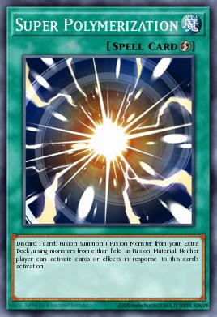

- **Copias y zona:** Main 2x, Reserva 1x. No altera las cantidades registradas.
- **Nombre oficial de referencia:** Súper Polimerización. CID cotejado con la ficha oficial; el nombre histórico del inventario se conserva aunque su grafía/traducción difiera.
- **Función principal y secundaria:** recurso situacional.
- **Estado de sinergia y función:** Sinergia indirecta de recursos. Es una clasificación de juego; revisar la relación concreta en A06.
- **Papel como recurso, descarte o coste:** Material o destino del Extra condicionado a los requisitos de invocación.
- **Efecto operativo (paráfrasis analítica):** interacción propia de la carta que requiere consultar el texto íntegro enlazado. Son operaciones detectadas en el texto, no efectos independientes garantizados; leer sus condiciones en la fuente.
- **Mapa de activación y resultados:** 1) efecto propio o continuo: realiza Fusión con materiales permitidos. Cada operación está sujeta a la secuencia y al «si lo haces» del texto oficial.
- **Ventanas de activación identificadas:** requieren la fase o condición específica indicada en el texto; sin ventana rápida general asumida.
- **Costes o recursos potenciales:** descarte de mano.
- **Restricciones y requisitos:** aplicar restricciones de selección, activación y copias que consten en el texto original. 
- **Prioridad al ir primero:** generar envíos por efecto sin malgastar recursos y preparar interacción. Para esta carta: Activar cuando las condiciones permitan obtener valor real, preservando recursos de seguimiento.
- **Prioridad al ir segundo:** forzar respuestas rivales con Fusión/retiradas y conservar cementerio utilizable. Identificar primero la respuesta rival que afecta su función «recurso situacional».
- **Medio/tardío y recuperación:** recuperar materiales y gestionar cartas enviadas o desterradas. No asumir que por sí misma recicla recursos si el texto no lo permite.
- **Sinergias y acceso a líneas:** Relación contextual con enviar cartas al Cementerio por efecto y aprovechar fusiones, reciclaje y motores Horus/Demoniherrero. Habilita una línea del motor sólo si coinciden recursos, objetivos y restricciones; no equivale a un combo completo validado.
- **Riesgo / brick / interrupciones:** Riesgo operativo: interrupción del Cementerio, restricciones de materiales y mildeos aleatorios. Confirmar objetivos disponibles y costes antes de activar. No atribuirle velocidad rápida por el solo hecho de formar parte del motor.
- **Utilidad editorial:** 3/5 para este deck (estimación por rol y zona, no probabilidad calculada). No cambiar copias; cualquier sugerencia de alta/baja pasa por el apartado 22 y aprobación.
- **Referencia oficial y trazabilidad:** https://www.db.yugioh-card.com/yugiohdb/card_search.action?cid=7445&ope=2&request_locale=es. **Confianza:** texto y tipo de efecto cotejados en Konami; síntesis táctica editorial, no demostración de combo.
- **Aplicación concreta dentro de este deck (A06):** interacción propia de la carta que requiere consultar el texto íntegro enlazado. Aportación posible como material, coste o objetivo; verificar consumidor.

**USO PRÁCTICO Y SINERGIA — Súper Polimerización**

- **Label funcional:** Sinergia indirecta. Clasificación documental; una relación es válida solo si se satisfacen sus condiciones exactas.
- **Qué hace:** interacción propia de la carta que requiere consultar el texto íntegro enlazado. Son operaciones detectadas en el texto, no efectos independientes garantizados; leer sus condiciones en la fuente.
- **Cómo aprovecharla en este deck:** interacción propia de la carta que requiere consultar el texto íntegro enlazado. Aportación posible como material, coste o objetivo; verificar consumidor.
- **Al jugar primero:** generar envíos por efecto sin malgastar recursos y preparar interacción. Para esta carta: Activar cuando las condiciones permitan obtener valor real, preservando recursos de seguimiento.
- **Al jugar segundo:** forzar respuestas rivales con Fusión/retiradas y conservar cementerio utilizable. Identificar primero la respuesta rival que afecta su función «recurso situacional».
- **Cuándo tener precaución:** Riesgo operativo: interrupción del Cementerio, restricciones de materiales y mildeos aleatorios. Confirmar objetivos disponibles y costes antes de activar. No atribuirle velocidad rápida por el solo hecho de formar parte del motor.

#### 02. Lácrima las Lágrimas Carmesíes

- **Copias y zona:** Main 1x. No altera las cantidades registradas.
- **Nombre oficial de referencia:** Lácrima las Lágrimas Carmesíes. CID cotejado con la ficha oficial; el nombre histórico del inventario se conserva aunque su grafía/traducción difiera.
- **Función principal y secundaria:** interrupción · recuperación.
- **Estado de sinergia y función:** Utilidad independiente. Es una clasificación de juego; revisar la relación concreta en A06.
- **Papel como recurso, descarte o coste:** No se demuestra que esta carta sea recurso de descarte o pago para otra.
- **Efecto operativo (paráfrasis analítica):** retorno o reciclaje hacia mano/Deck/Extra. Son operaciones detectadas en el texto, no efectos independientes garantizados; leer sus condiciones en la fuente.
- **Mapa de activación y resultados:** 1) mientras está en Cementerio: Invocación Especial desde Cementerio, devuelve recursos a mano/Deck/Extra. Cada operación está sujeta a la secuencia y al «si lo haces» del texto oficial.
- **Ventanas de activación identificadas:** turno rival; al producirse una Invocación; al llegar o estar en el Cementerio; Efecto Rápido.
- **Costes o recursos potenciales:** sin coste independiente identificado en esta síntesis; comprobar las acciones previas al punto y coma de cada efecto.
- **Restricciones y requisitos:** hay límite por turno según el efecto concreto; depende de recursos en Cementerio. 
- **Prioridad al ir primero:** generar envíos por efecto sin malgastar recursos y preparar interacción. Para esta carta: Reservar la respuesta para la ventana rival exacta; no es una pieza buscadora de nuestro motor.
- **Prioridad al ir segundo:** forzar respuestas rivales con Fusión/retiradas y conservar cementerio utilizable. Identificar primero la respuesta rival que afecta su función «interrupción».
- **Medio/tardío y recuperación:** recuperar materiales y gestionar cartas enviadas o desterradas. Verificar que el objetivo de recuperación continúe disponible.
- **Sinergias y acceso a líneas:** Relación contextual con enviar cartas al Cementerio por efecto y aprovechar fusiones, reciclaje y motores Horus/Demoniherrero. Habilita una línea del motor sólo si coinciden recursos, objetivos y restricciones; no equivale a un combo completo validado.
- **Riesgo / brick / interrupciones:** Depende del Cementerio y es sensible a destierro o negación de ese recurso. Puede emplearse en cadena sólo cuando se cumpla su condición concreta.
- **Utilidad editorial:** 3/5 para este deck (estimación por rol y zona, no probabilidad calculada). No cambiar copias; cualquier sugerencia de alta/baja pasa por el apartado 22 y aprobación.
- **Referencia oficial y trazabilidad:** https://www.db.yugioh-card.com/yugiohdb/card_search.action?cid=20490&ope=2&request_locale=es. **Confianza:** texto y tipo de efecto cotejados en Konami; síntesis táctica editorial, no demostración de combo.
- **Aplicación concreta dentro de este deck (A06):** retorno o reciclaje hacia mano/Deck/Extra. Aporta respuesta o consistencia sin exigir enlace directo.

**USO PRÁCTICO Y SINERGIA — Lácrima las Lágrimas Carmesíes**

- **Label funcional:** Función independiente. Clasificación documental; una relación es válida solo si se satisfacen sus condiciones exactas.
- **Qué hace:** retorno o reciclaje hacia mano/Deck/Extra. Son operaciones detectadas en el texto, no efectos independientes garantizados; leer sus condiciones en la fuente.
- **Cómo aprovecharla en este deck:** retorno o reciclaje hacia mano/Deck/Extra. Aporta respuesta o consistencia sin exigir enlace directo.
- **Al jugar primero:** generar envíos por efecto sin malgastar recursos y preparar interacción. Para esta carta: Reservar la respuesta para la ventana rival exacta; no es una pieza buscadora de nuestro motor.
- **Al jugar segundo:** forzar respuestas rivales con Fusión/retiradas y conservar cementerio utilizable. Identificar primero la respuesta rival que afecta su función «interrupción».
- **Cuándo tener precaución:** Depende del Cementerio y es sensible a destierro o negación de ese recurso. Puede emplearse en cadena sólo cuando se cumpla su condición concreta.

#### 03. Tiagrimientos Havnis

- **Copias y zona:** Main 1x, Reserva 1x. No altera las cantidades registradas.
- **Nombre oficial de referencia:** Tiagrimentos Havnis. CID cotejado con la ficha oficial; el nombre histórico del inventario se conserva aunque su grafía/traducción difiera.
- **Función principal y secundaria:** interrupción · recuperación · extensor · habilitador de Extra.
- **Estado de sinergia y función:** Sinergia indirecta (soporte o recursos). Es una clasificación de juego; revisar la relación concreta en A06.
- **Papel como recurso, descarte o coste:** Coste o consumo descrito en A05: envío de recurso propio al Cementerio.
- **Efecto operativo (paráfrasis analítica):** recuperación e invocación desde Cementerio/destierro; acceso al campo desde la mano; habilitación o continuación de una invocación del Extra Deck. Son operaciones detectadas en el texto, no efectos independientes garantizados; leer sus condiciones en la fuente.
- **Mapa de activación y resultados:** 1) en respuesta a activación rival: Invocación Especial desde Cementerio · 2) al llegar al Cementerio por efecto: realiza Fusión con materiales permitidos. Cada operación está sujeta a la secuencia y al «si lo haces» del texto oficial.
- **Ventanas de activación identificadas:** al llegar o estar en el Cementerio; respuesta a activación rival; Efecto Rápido.
- **Costes o recursos potenciales:** envío de recurso propio al Cementerio.
- **Restricciones y requisitos:** hay límite por turno según el efecto concreto; depende de recursos en Cementerio; interactúa con información oculta o resultados no siempre elegibles. 
- **Prioridad al ir primero:** generar envíos por efecto sin malgastar recursos y preparar interacción. Para esta carta: Reservar la respuesta para la ventana rival exacta; no es una pieza buscadora de nuestro motor.
- **Prioridad al ir segundo:** forzar respuestas rivales con Fusión/retiradas y conservar cementerio utilizable. Identificar primero la respuesta rival que afecta su función «interrupción».
- **Medio/tardío y recuperación:** recuperar materiales y gestionar cartas enviadas o desterradas. Verificar que el objetivo de recuperación continúe disponible.
- **Sinergias y acceso a líneas:** Relación contextual con enviar cartas al Cementerio por efecto y aprovechar fusiones, reciclaje y motores Horus/Demoniherrero. Habilita una línea del motor sólo si coinciden recursos, objetivos y restricciones; no equivale a un combo completo validado.
- **Riesgo / brick / interrupciones:** Depende del Cementerio y es sensible a destierro o negación de ese recurso. Puede emplearse en cadena sólo cuando se cumpla su condición concreta.
- **Utilidad editorial:** 4/5 para este deck (estimación por rol y zona, no probabilidad calculada). No cambiar copias; cualquier sugerencia de alta/baja pasa por el apartado 22 y aprobación.
- **Referencia oficial y trazabilidad:** https://www.db.yugioh-card.com/yugiohdb/card_search.action?cid=17416&ope=2&request_locale=es. **Confianza:** texto y tipo de efecto cotejados en Konami; síntesis táctica editorial, no demostración de combo.
- **Aplicación concreta dentro de este deck (A06):** recuperación e invocación desde Cementerio/destierro; acceso al campo desde la mano; habilitación o continuación de una invocación del Extra Deck.

**USO PRÁCTICO Y SINERGIA — Tiagrimientos Havnis**

- **Label funcional:** Sinergia indirecta. Clasificación documental; una relación es válida solo si se satisfacen sus condiciones exactas.
- **Qué hace:** recuperación e invocación desde Cementerio/destierro; acceso al campo desde la mano; habilitación o continuación de una invocación del Extra Deck. Son operaciones detectadas en el texto, no efectos independientes garantizados; leer sus condiciones en la fuente.
- **Cómo aprovecharla en este deck:** recuperación e invocación desde Cementerio/destierro; acceso al campo desde la mano; habilitación o continuación de una invocación del Extra Deck.
- **Al jugar primero:** generar envíos por efecto sin malgastar recursos y preparar interacción. Para esta carta: Reservar la respuesta para la ventana rival exacta; no es una pieza buscadora de nuestro motor.
- **Al jugar segundo:** forzar respuestas rivales con Fusión/retiradas y conservar cementerio utilizable. Identificar primero la respuesta rival que afecta su función «interrupción».
- **Cuándo tener precaución:** Depende del Cementerio y es sensible a destierro o negación de ese recurso. Puede emplearse en cadena sólo cuando se cumpla su condición concreta.

#### 04. Planeta Primigenio Perlerreino

- **Copias y zona:** Main 3x. No altera las cantidades registradas.
- **Nombre oficial de referencia:** Planeta Primigenio Perlerreino. CID cotejado con la ficha oficial; el nombre histórico del inventario se conserva aunque su grafía/traducción difiera.
- **Función principal y secundaria:** searcher · buscador · recuperación · cierre.
- **Estado de sinergia y función:** Sinergia indirecta (soporte o recursos). Es una clasificación de juego; revisar la relación concreta en A06.
- **Papel como recurso, descarte o coste:** No se demuestra que esta carta sea recurso de descarte o pago para otra.
- **Efecto operativo (paráfrasis analítica):** búsqueda o incorporación de cartas a mano; retorno o reciclaje hacia mano/Deck/Extra; presión de combate o modificación de estadísticas. Son operaciones detectadas en el texto, no efectos independientes garantizados; leer sus condiciones en la fuente.
- **Mapa de activación y resultados:** 1) con condición explícita en la carta: incorpora la pieza indicada a la mano. Cada operación está sujeta a la secuencia y al «si lo haces» del texto oficial.
- **Ventanas de activación identificadas:** requieren la fase o condición específica indicada en el texto; sin ventana rápida general asumida.
- **Costes o recursos potenciales:** sin coste independiente identificado en esta síntesis; comprobar las acciones previas al punto y coma de cada efecto.
- **Restricciones y requisitos:** hay límite por turno según el efecto concreto; depende de recursos en Cementerio. 
- **Prioridad al ir primero:** generar envíos por efecto sin malgastar recursos y preparar interacción. Para esta carta: Convertir la activación en acceso a la siguiente pieza del motor, sin duplicar buscadores inútilmente.
- **Prioridad al ir segundo:** forzar respuestas rivales con Fusión/retiradas y conservar cementerio utilizable. Identificar primero la respuesta rival que afecta su función «searcher».
- **Medio/tardío y recuperación:** recuperar materiales y gestionar cartas enviadas o desterradas. Verificar que el objetivo de recuperación continúe disponible.
- **Sinergias y acceso a líneas:** Relación contextual con enviar cartas al Cementerio por efecto y aprovechar fusiones, reciclaje y motores Horus/Demoniherrero. Habilita una línea del motor sólo si coinciden recursos, objetivos y restricciones; no equivale a un combo completo validado.
- **Riesgo / brick / interrupciones:** Depende del Cementerio y es sensible a destierro o negación de ese recurso. No atribuirle velocidad rápida por el solo hecho de formar parte del motor.
- **Utilidad editorial:** 5/5 para este deck (estimación por rol y zona, no probabilidad calculada). No cambiar copias; cualquier sugerencia de alta/baja pasa por el apartado 22 y aprobación.
- **Referencia oficial y trazabilidad:** https://www.db.yugioh-card.com/yugiohdb/card_search.action?cid=17462&ope=2&request_locale=es. **Confianza:** texto y tipo de efecto cotejados en Konami; síntesis táctica editorial, no demostración de combo.
- **Aplicación concreta dentro de este deck (A06):** búsqueda o incorporación de cartas a mano; retorno o reciclaje hacia mano/Deck/Extra; presión de combate o modificación de estadísticas.

**USO PRÁCTICO Y SINERGIA — Planeta Primigenio Perlerreino**

- **Label funcional:** Sinergia indirecta. Clasificación documental; una relación es válida solo si se satisfacen sus condiciones exactas.
- **Qué hace:** búsqueda o incorporación de cartas a mano; retorno o reciclaje hacia mano/Deck/Extra; presión de combate o modificación de estadísticas. Son operaciones detectadas en el texto, no efectos independientes garantizados; leer sus condiciones en la fuente.
- **Cómo aprovecharla en este deck:** búsqueda o incorporación de cartas a mano; retorno o reciclaje hacia mano/Deck/Extra; presión de combate o modificación de estadísticas.
- **Al jugar primero:** generar envíos por efecto sin malgastar recursos y preparar interacción. Para esta carta: Convertir la activación en acceso a la siguiente pieza del motor, sin duplicar buscadores inútilmente.
- **Al jugar segundo:** forzar respuestas rivales con Fusión/retiradas y conservar cementerio utilizable. Identificar primero la respuesta rival que afecta su función «searcher».
- **Cuándo tener precaución:** Depende del Cementerio y es sensible a destierro o negación de ese recurso. No atribuirle velocidad rápida por el solo hecho de formar parte del motor.

#### 05. Kashtira Fenrir

- **Copias y zona:** Main 2x. No altera las cantidades registradas.
- **Nombre oficial de referencia:** Kashtira Fenrir. CID cotejado con la ficha oficial; el nombre histórico del inventario se conserva aunque su grafía/traducción difiera.
- **Función principal y secundaria:** starter Kashtira · presión de destierro.
- **Estado de sinergia y función:** Sinergia directa descrita. Es una clasificación de juego; revisar la relación concreta en A06.
- **Papel como recurso, descarte o coste:** No se demuestra que esta carta sea recurso de descarte o pago para otra.
- **Efecto operativo (paráfrasis analítica):** Se invoca desde mano sin monstruos propios, busca otro Kashtira y destierra boca abajo una carta rival al reaccionar a su efecto o atacar. 
- **Mapa de activación y resultados:** 1) efecto propio o continuo: Invocación Especial desde mano · 2) en Main Phase: incorpora la pieza indicada a la mano. Cada operación está sujeta a la secuencia y al «si lo haces» del texto oficial.
- **Ventanas de activación identificadas:** Main Phase; campo propio vacío; respuesta a activación rival.
- **Costes o recursos potenciales:** sin coste independiente identificado en esta síntesis; comprobar las acciones previas al punto y coma de cada efecto.
- **Restricciones y requisitos:** hay límite por turno según el efecto concreto; requiere campo propio sin las cartas indicadas; interactúa con información oculta o resultados no siempre elegibles. 
- **Prioridad al ir primero:** generar envíos por efecto sin malgastar recursos y preparar interacción. Para esta carta: Convertir la activación en acceso a la siguiente pieza del motor, sin duplicar buscadores inútilmente.
- **Prioridad al ir segundo:** forzar respuestas rivales con Fusión/retiradas y conservar cementerio utilizable. Identificar primero la respuesta rival que afecta su función «starter Kashtira».
- **Medio/tardío y recuperación:** recuperar materiales y gestionar cartas enviadas o desterradas. No asumir que por sí misma recicla recursos si el texto no lo permite.
- **Sinergias y acceso a líneas:** Relación contextual con enviar cartas al Cementerio por efecto y aprovechar fusiones, reciclaje y motores Horus/Demoniherrero. Habilita una línea del motor sólo si coinciden recursos, objetivos y restricciones; no equivale a un combo completo validado.
- **Riesgo / brick / interrupciones:** El destierro no es destrucción ni se activa libremente en cualquier fase. No atribuirle velocidad rápida por el solo hecho de formar parte del motor.
- **Utilidad editorial:** 3/5 para este deck (estimación por rol y zona, no probabilidad calculada). No cambiar copias; cualquier sugerencia de alta/baja pasa por el apartado 22 y aprobación.
- **Referencia oficial y trazabilidad:** https://www.db.yugioh-card.com/yugiohdb/card_search.action?cid=17768&ope=2&request_locale=es. **Confianza:** texto y tipo de efecto cotejados en Konami; síntesis táctica editorial, no demostración de combo.
- **Aplicación concreta dentro de este deck (A06):** Se invoca desde mano sin monstruos propios, busca otro Kashtira y destierra boca abajo una carta rival al reaccionar a su efecto o atacar.

**USO PRÁCTICO Y SINERGIA — Kashtira Fenrir**

- **Label funcional:** Sinergia directa. Clasificación documental; una relación es válida solo si se satisfacen sus condiciones exactas.
- **Qué hace:** Se invoca desde mano sin monstruos propios, busca otro Kashtira y destierra boca abajo una carta rival al reaccionar a su efecto o atacar.
- **Al jugar primero:** generar envíos por efecto sin malgastar recursos y preparar interacción. Para esta carta: Convertir la activación en acceso a la siguiente pieza del motor, sin duplicar buscadores inútilmente.
- **Al jugar segundo:** forzar respuestas rivales con Fusión/retiradas y conservar cementerio utilizable. Identificar primero la respuesta rival que afecta su función «starter Kashtira».
- **Cuándo tener precaución:** El destierro no es destrucción ni se activa libremente en cualquier fase. No atribuirle velocidad rápida por el solo hecho de formar parte del motor.

#### 06. Flor de Ceniza & Primavera Feliz

- **Copias y zona:** Main 3x. No altera las cantidades registradas.
- **Nombre oficial de referencia:** Flor de Ceniza & Primavera Feliz. CID cotejado con la ficha oficial; el nombre histórico del inventario se conserva aunque su grafía/traducción difiera.
- **Función principal y secundaria:** handtrap · negación.
- **Estado de sinergia y función:** Utilidad independiente. Es una clasificación de juego; revisar la relación concreta en A06.
- **Papel como recurso, descarte o coste:** Descarte mencionado: comprobar carta que lo exige, zona, coste frente a efecto y utilidad del recurso.
- **Efecto operativo (paráfrasis analítica):** Descarta desde la mano para detener efectos que buscan, invocan o mandan cartas desde el Deck. 
- **Mapa de activación y resultados:** 1) con condición explícita en la carta: niega el efecto o la activación indicada, Invocación Especial desde Deck, incorpora la pieza indicada a la mano. Cada operación está sujeta a la secuencia y al «si lo haces» del texto oficial.
- **Ventanas de activación identificadas:** Efecto Rápido.
- **Costes o recursos potenciales:** descarte de mano.
- **Restricciones y requisitos:** hay límite por turno según el efecto concreto. 
- **Prioridad al ir primero:** generar envíos por efecto sin malgastar recursos y preparar interacción. Para esta carta: Reservar la respuesta para la ventana rival exacta; no es una pieza buscadora de nuestro motor.
- **Prioridad al ir segundo:** forzar respuestas rivales con Fusión/retiradas y conservar cementerio utilizable. Identificar primero la respuesta rival que afecta su función «handtrap».
- **Medio/tardío y recuperación:** recuperar materiales y gestionar cartas enviadas o desterradas. Verificar que el objetivo de recuperación continúe disponible.
- **Sinergias y acceso a líneas:** Relación contextual con enviar cartas al Cementerio por efecto y aprovechar fusiones, reciclaje y motores Horus/Demoniherrero. Habilita una línea del motor sólo si coinciden recursos, objetivos y restricciones; no equivale a un combo completo validado.
- **Riesgo / brick / interrupciones:** Reaccionar al efecto del Deck que habilite la jugada rival; no da búsquedas propias. Puede emplearse en cadena sólo cuando se cumpla su condición concreta.
- **Utilidad editorial:** 3/5 para este deck (estimación por rol y zona, no probabilidad calculada). No cambiar copias; cualquier sugerencia de alta/baja pasa por el apartado 22 y aprobación.
- **Referencia oficial y trazabilidad:** https://www.db.yugioh-card.com/yugiohdb/card_search.action?cid=12950&ope=2&request_locale=es. **Confianza:** texto y tipo de efecto cotejados en Konami; síntesis táctica editorial, no demostración de combo.
- **Aplicación concreta dentro de este deck (A06):** Descarta desde la mano para detener efectos que buscan, invocan o mandan cartas desde el Deck. Aporta respuesta o consistencia sin exigir enlace directo.

**USO PRÁCTICO Y SINERGIA — Flor de Ceniza & Primavera Feliz**

- **Label funcional:** Función independiente. Clasificación documental; una relación es válida solo si se satisfacen sus condiciones exactas.
- **Qué hace:** Descarta desde la mano para detener efectos que buscan, invocan o mandan cartas desde el Deck.
- **Cómo aprovecharla en este deck:** Descarta desde la mano para detener efectos que buscan, invocan o mandan cartas desde el Deck. Aporta respuesta o consistencia sin exigir enlace directo.
- **Al jugar primero:** generar envíos por efecto sin malgastar recursos y preparar interacción. Para esta carta: Reservar la respuesta para la ventana rival exacta; no es una pieza buscadora de nuestro motor.
- **Al jugar segundo:** forzar respuestas rivales con Fusión/retiradas y conservar cementerio utilizable. Identificar primero la respuesta rival que afecta su función «handtrap».
- **Cuándo tener precaución:** Reaccionar al efecto del Deck que habilite la jugada rival; no da búsquedas propias. Puede emplearse en cadena sólo cuando se cumpla su condición concreta.

#### 07. Tiagrimientos Reinoheart

- **Copias y zona:** Main 2x. No altera las cantidades registradas.
- **Nombre oficial de referencia:** Tiagrimentos Reinoheart. CID cotejado con la ficha oficial; el nombre histórico del inventario se conserva aunque su grafía/traducción difiera.
- **Función principal y secundaria:** recuperación.
- **Estado de sinergia y función:** Sinergia indirecta (soporte o recursos). Es una clasificación de juego; revisar la relación concreta en A06.
- **Papel como recurso, descarte o coste:** Coste o consumo descrito en A05: envío de recurso propio al Cementerio.
- **Efecto operativo (paráfrasis analítica):** recuperación e invocación desde Cementerio/destierro. Son operaciones detectadas en el texto, no efectos independientes garantizados; leer sus condiciones en la fuente.
- **Mapa de activación y resultados:** 1) al llegar al Cementerio por efecto: Invocación Especial desde Cementerio. Cada operación está sujeta a la secuencia y al «si lo haces» del texto oficial.
- **Ventanas de activación identificadas:** al producirse una Invocación; al llegar o estar en el Cementerio.
- **Costes o recursos potenciales:** envío de recurso propio al Cementerio.
- **Restricciones y requisitos:** hay límite por turno según el efecto concreto. 
- **Prioridad al ir primero:** generar envíos por efecto sin malgastar recursos y preparar interacción. Para esta carta: Escoger la amenaza o recurso que genere mayor ventaja de tempo; respetar selección y zona.
- **Prioridad al ir segundo:** forzar respuestas rivales con Fusión/retiradas y conservar cementerio utilizable. Identificar primero la respuesta rival que afecta su función «recuperación».
- **Medio/tardío y recuperación:** recuperar materiales y gestionar cartas enviadas o desterradas. Verificar que el objetivo de recuperación continúe disponible.
- **Sinergias y acceso a líneas:** Relación contextual con enviar cartas al Cementerio por efecto y aprovechar fusiones, reciclaje y motores Horus/Demoniherrero. Habilita una línea del motor sólo si coinciden recursos, objetivos y restricciones; no equivale a un combo completo validado.
- **Riesgo / brick / interrupciones:** Riesgo operativo: interrupción del Cementerio, restricciones de materiales y mildeos aleatorios. Confirmar objetivos disponibles y costes antes de activar. No atribuirle velocidad rápida por el solo hecho de formar parte del motor.
- **Utilidad editorial:** 3/5 para este deck (estimación por rol y zona, no probabilidad calculada). No cambiar copias; cualquier sugerencia de alta/baja pasa por el apartado 22 y aprobación.
- **Referencia oficial y trazabilidad:** https://www.db.yugioh-card.com/yugiohdb/card_search.action?cid=17417&ope=2&request_locale=es. **Confianza:** texto y tipo de efecto cotejados en Konami; síntesis táctica editorial, no demostración de combo.
- **Aplicación concreta dentro de este deck (A06):** recuperación e invocación desde Cementerio/destierro.

**USO PRÁCTICO Y SINERGIA — Tiagrimientos Reinoheart**

- **Label funcional:** Sinergia indirecta. Clasificación documental; una relación es válida solo si se satisfacen sus condiciones exactas.
- **Qué hace:** recuperación e invocación desde Cementerio/destierro. Son operaciones detectadas en el texto, no efectos independientes garantizados; leer sus condiciones en la fuente.
- **Cómo aprovecharla en este deck:** recuperación e invocación desde Cementerio/destierro.
- **Al jugar primero:** generar envíos por efecto sin malgastar recursos y preparar interacción. Para esta carta: Escoger la amenaza o recurso que genere mayor ventaja de tempo; respetar selección y zona.
- **Al jugar segundo:** forzar respuestas rivales con Fusión/retiradas y conservar cementerio utilizable. Identificar primero la respuesta rival que afecta su función «recuperación».
- **Cuándo tener precaución:** Riesgo operativo: interrupción del Cementerio, restricciones de materiales y mildeos aleatorios. Confirmar objetivos disponibles y costes antes de activar. No atribuirle velocidad rápida por el solo hecho de formar parte del motor.

#### 08. Tiagrimientos Scheiren

- **Copias y zona:** Main 1x. No altera las cantidades registradas.
- **Nombre oficial de referencia:** Tiagrimentos Scheiren. CID cotejado con la ficha oficial; el nombre histórico del inventario se conserva aunque su grafía/traducción difiera.
- **Función principal y secundaria:** recuperación · extensor · habilitador de Extra.
- **Estado de sinergia y función:** Sinergia indirecta (soporte o recursos). Es una clasificación de juego; revisar la relación concreta en A06.
- **Papel como recurso, descarte o coste:** Coste o consumo descrito en A05: envío de recurso propio al Cementerio.
- **Efecto operativo (paráfrasis analítica):** recuperación e invocación desde Cementerio/destierro; acceso al campo desde la mano; habilitación o continuación de una invocación del Extra Deck. Son operaciones detectadas en el texto, no efectos independientes garantizados; leer sus condiciones en la fuente.
- **Mapa de activación y resultados:** 1) en Main Phase: Invocación Especial desde Cementerio · 2) al llegar al Cementerio por efecto: realiza Fusión con materiales permitidos. Cada operación está sujeta a la secuencia y al «si lo haces» del texto oficial.
- **Ventanas de activación identificadas:** Main Phase; al llegar o estar en el Cementerio.
- **Costes o recursos potenciales:** envío de recurso propio al Cementerio.
- **Restricciones y requisitos:** hay límite por turno según el efecto concreto; depende de recursos en Cementerio; interactúa con información oculta o resultados no siempre elegibles. 
- **Prioridad al ir primero:** generar envíos por efecto sin malgastar recursos y preparar interacción. Para esta carta: Escoger la amenaza o recurso que genere mayor ventaja de tempo; respetar selección y zona.
- **Prioridad al ir segundo:** forzar respuestas rivales con Fusión/retiradas y conservar cementerio utilizable. Identificar primero la respuesta rival que afecta su función «recuperación».
- **Medio/tardío y recuperación:** recuperar materiales y gestionar cartas enviadas o desterradas. Verificar que el objetivo de recuperación continúe disponible.
- **Sinergias y acceso a líneas:** Relación contextual con enviar cartas al Cementerio por efecto y aprovechar fusiones, reciclaje y motores Horus/Demoniherrero. Habilita una línea del motor sólo si coinciden recursos, objetivos y restricciones; no equivale a un combo completo validado.
- **Riesgo / brick / interrupciones:** Depende del Cementerio y es sensible a destierro o negación de ese recurso. No atribuirle velocidad rápida por el solo hecho de formar parte del motor.
- **Utilidad editorial:** 4/5 para este deck (estimación por rol y zona, no probabilidad calculada). No cambiar copias; cualquier sugerencia de alta/baja pasa por el apartado 22 y aprobación.
- **Referencia oficial y trazabilidad:** https://www.db.yugioh-card.com/yugiohdb/card_search.action?cid=17415&ope=2&request_locale=es. **Confianza:** texto y tipo de efecto cotejados en Konami; síntesis táctica editorial, no demostración de combo.
- **Aplicación concreta dentro de este deck (A06):** recuperación e invocación desde Cementerio/destierro; acceso al campo desde la mano; habilitación o continuación de una invocación del Extra Deck.

**USO PRÁCTICO Y SINERGIA — Tiagrimientos Scheiren**

- **Label funcional:** Sinergia indirecta. Clasificación documental; una relación es válida solo si se satisfacen sus condiciones exactas.
- **Qué hace:** recuperación e invocación desde Cementerio/destierro; acceso al campo desde la mano; habilitación o continuación de una invocación del Extra Deck. Son operaciones detectadas en el texto, no efectos independientes garantizados; leer sus condiciones en la fuente.
- **Cómo aprovecharla en este deck:** recuperación e invocación desde Cementerio/destierro; acceso al campo desde la mano; habilitación o continuación de una invocación del Extra Deck.
- **Al jugar primero:** generar envíos por efecto sin malgastar recursos y preparar interacción. Para esta carta: Escoger la amenaza o recurso que genere mayor ventaja de tempo; respetar selección y zona.
- **Al jugar segundo:** forzar respuestas rivales con Fusión/retiradas y conservar cementerio utilizable. Identificar primero la respuesta rival que afecta su función «recuperación».
- **Cuándo tener precaución:** Depende del Cementerio y es sensible a destierro o negación de ese recurso. No atribuirle velocidad rápida por el solo hecho de formar parte del motor.

#### 09. Tiagrimientos Merrli

- **Copias y zona:** Main 1x. No altera las cantidades registradas.
- **Nombre oficial de referencia:** Tiagrimentos Merrli. CID cotejado con la ficha oficial; el nombre histórico del inventario se conserva aunque su grafía/traducción difiera.
- **Función principal y secundaria:** habilitador de Extra.
- **Estado de sinergia y función:** Sinergia indirecta (soporte o recursos). Es una clasificación de juego; revisar la relación concreta en A06.
- **Papel como recurso, descarte o coste:** Coste o consumo descrito en A05: envío de recurso propio al Cementerio.
- **Efecto operativo (paráfrasis analítica):** habilitación o continuación de una invocación del Extra Deck. Son operaciones detectadas en el texto, no efectos independientes garantizados; leer sus condiciones en la fuente.
- **Mapa de activación y resultados:** 1) al llegar al Cementerio por efecto: realiza Fusión con materiales permitidos. Cada operación está sujeta a la secuencia y al «si lo haces» del texto oficial.
- **Ventanas de activación identificadas:** al producirse una Invocación; al llegar o estar en el Cementerio.
- **Costes o recursos potenciales:** envío de recurso propio al Cementerio.
- **Restricciones y requisitos:** hay límite por turno según el efecto concreto; depende de recursos en Cementerio; interactúa con información oculta o resultados no siempre elegibles. 
- **Prioridad al ir primero:** generar envíos por efecto sin malgastar recursos y preparar interacción. Para esta carta: Activar cuando las condiciones permitan obtener valor real, preservando recursos de seguimiento.
- **Prioridad al ir segundo:** forzar respuestas rivales con Fusión/retiradas y conservar cementerio utilizable. Identificar primero la respuesta rival que afecta su función «habilitador de Extra».
- **Medio/tardío y recuperación:** recuperar materiales y gestionar cartas enviadas o desterradas. No asumir que por sí misma recicla recursos si el texto no lo permite.
- **Sinergias y acceso a líneas:** Relación contextual con enviar cartas al Cementerio por efecto y aprovechar fusiones, reciclaje y motores Horus/Demoniherrero. Habilita una línea del motor sólo si coinciden recursos, objetivos y restricciones; no equivale a un combo completo validado.
- **Riesgo / brick / interrupciones:** Depende del Cementerio y es sensible a destierro o negación de ese recurso. No atribuirle velocidad rápida por el solo hecho de formar parte del motor.
- **Utilidad editorial:** 3/5 para este deck (estimación por rol y zona, no probabilidad calculada). No cambiar copias; cualquier sugerencia de alta/baja pasa por el apartado 22 y aprobación.
- **Referencia oficial y trazabilidad:** https://www.db.yugioh-card.com/yugiohdb/card_search.action?cid=17414&ope=2&request_locale=es. **Confianza:** texto y tipo de efecto cotejados en Konami; síntesis táctica editorial, no demostración de combo.
- **Aplicación concreta dentro de este deck (A06):** habilitación o continuación de una invocación del Extra Deck.

**USO PRÁCTICO Y SINERGIA — Tiagrimientos Merrli**

- **Label funcional:** Sinergia indirecta. Clasificación documental; una relación es válida solo si se satisfacen sus condiciones exactas.
- **Qué hace:** habilitación o continuación de una invocación del Extra Deck. Son operaciones detectadas en el texto, no efectos independientes garantizados; leer sus condiciones en la fuente.
- **Cómo aprovecharla en este deck:** habilitación o continuación de una invocación del Extra Deck.
- **Al jugar primero:** generar envíos por efecto sin malgastar recursos y preparar interacción. Para esta carta: Activar cuando las condiciones permitan obtener valor real, preservando recursos de seguimiento.
- **Al jugar segundo:** forzar respuestas rivales con Fusión/retiradas y conservar cementerio utilizable. Identificar primero la respuesta rival que afecta su función «habilitador de Extra».
- **Cuándo tener precaución:** Depende del Cementerio y es sensible a destierro o negación de ese recurso. No atribuirle velocidad rápida por el solo hecho de formar parte del motor.

#### 10. Bienes del Entierro Insensato

- **Copias y zona:** Main 3x. No altera las cantidades registradas.
- **Nombre oficial de referencia:** Bienes del Entierro Insensato. CID cotejado con la ficha oficial; el nombre histórico del inventario se conserva aunque su grafía/traducción difiera.
- **Función principal y secundaria:** recurso situacional.
- **Estado de sinergia y función:** Sinergia indirecta (soporte o recursos). Es una clasificación de juego; revisar la relación concreta en A06.
- **Papel como recurso, descarte o coste:** No se demuestra que esta carta sea recurso de descarte o pago para otra.
- **Efecto operativo (paráfrasis analítica):** interacción propia de la carta que requiere consultar el texto íntegro enlazado. Son operaciones detectadas en el texto, no efectos independientes garantizados; leer sus condiciones en la fuente.
- **Mapa de activación y resultados:** efecto de estadística, condición o material; no asumir un disparador adicional. Cada operación está sujeta a la secuencia y al «si lo haces» del texto oficial.
- **Ventanas de activación identificadas:** requieren la fase o condición específica indicada en el texto; sin ventana rápida general asumida.
- **Costes o recursos potenciales:** sin coste independiente identificado en esta síntesis; comprobar las acciones previas al punto y coma de cada efecto.
- **Restricciones y requisitos:** hay límite por turno según el efecto concreto. 
- **Prioridad al ir primero:** generar envíos por efecto sin malgastar recursos y preparar interacción. Para esta carta: Activar cuando las condiciones permitan obtener valor real, preservando recursos de seguimiento.
- **Prioridad al ir segundo:** forzar respuestas rivales con Fusión/retiradas y conservar cementerio utilizable. Identificar primero la respuesta rival que afecta su función «recurso situacional».
- **Medio/tardío y recuperación:** recuperar materiales y gestionar cartas enviadas o desterradas. No asumir que por sí misma recicla recursos si el texto no lo permite.
- **Sinergias y acceso a líneas:** Relación contextual con enviar cartas al Cementerio por efecto y aprovechar fusiones, reciclaje y motores Horus/Demoniherrero. Habilita una línea del motor sólo si coinciden recursos, objetivos y restricciones; no equivale a un combo completo validado.
- **Riesgo / brick / interrupciones:** Riesgo operativo: interrupción del Cementerio, restricciones de materiales y mildeos aleatorios. Confirmar objetivos disponibles y costes antes de activar. No atribuirle velocidad rápida por el solo hecho de formar parte del motor.
- **Utilidad editorial:** 3/5 para este deck (estimación por rol y zona, no probabilidad calculada). No cambiar copias; cualquier sugerencia de alta/baja pasa por el apartado 22 y aprobación.
- **Referencia oficial y trazabilidad:** https://www.db.yugioh-card.com/yugiohdb/card_search.action?cid=12800&ope=2&request_locale=es. **Confianza:** texto y tipo de efecto cotejados en Konami; síntesis táctica editorial, no demostración de combo.
- **Aplicación concreta dentro de este deck (A06):** interacción propia de la carta que requiere consultar el texto íntegro enlazado.

**USO PRÁCTICO Y SINERGIA — Bienes del Entierro Insensato**

- **Label funcional:** Sinergia indirecta. Clasificación documental; una relación es válida solo si se satisfacen sus condiciones exactas.
- **Qué hace:** interacción propia de la carta que requiere consultar el texto íntegro enlazado. Son operaciones detectadas en el texto, no efectos independientes garantizados; leer sus condiciones en la fuente.
- **Cómo aprovecharla en este deck:** interacción propia de la carta que requiere consultar el texto íntegro enlazado.
- **Al jugar primero:** generar envíos por efecto sin malgastar recursos y preparar interacción. Para esta carta: Activar cuando las condiciones permitan obtener valor real, preservando recursos de seguimiento.
- **Al jugar segundo:** forzar respuestas rivales con Fusión/retiradas y conservar cementerio utilizable. Identificar primero la respuesta rival que afecta su función «recurso situacional».
- **Cuándo tener precaución:** Riesgo operativo: interrupción del Cementerio, restricciones de materiales y mildeos aleatorios. Confirmar objetivos disponibles y costes antes de activar. No atribuirle velocidad rápida por el solo hecho de formar parte del motor.

#### 11. Trivikarma

- **Copias y zona:** Main 1x. No altera las cantidades registradas.
- **Nombre oficial de referencia:** Trivikarma. CID cotejado con la ficha oficial; el nombre histórico del inventario se conserva aunque su grafía/traducción difiera.
- **Función principal y secundaria:** searcher · buscador · negación · cierre · respuesta.
- **Estado de sinergia y función:** Sinergia indirecta (soporte o recursos). Es una clasificación de juego; revisar la relación concreta en A06.
- **Papel como recurso, descarte o coste:** No se demuestra que esta carta sea recurso de descarte o pago para otra.
- **Efecto operativo (paráfrasis analítica):** búsqueda o incorporación de cartas a mano; negación de efectos o activaciones; presión de combate o modificación de estadísticas; interacción sobre monstruos en campo. Son operaciones detectadas en el texto, no efectos independientes garantizados; leer sus condiciones en la fuente.
- **Mapa de activación y resultados:** 1) efecto propio o continuo: niega el efecto o la activación indicada · 2) efecto propio o continuo: incorpora la pieza indicada a la mano. Cada operación está sujeta a la secuencia y al «si lo haces» del texto oficial.
- **Ventanas de activación identificadas:** requieren la fase o condición específica indicada en el texto; sin ventana rápida general asumida.
- **Costes o recursos potenciales:** sin coste independiente identificado en esta síntesis; comprobar las acciones previas al punto y coma de cada efecto.
- **Restricciones y requisitos:** depende de recursos en Cementerio. 
- **Prioridad al ir primero:** generar envíos por efecto sin malgastar recursos y preparar interacción. Para esta carta: Conservar la interrupción para el efecto clave rival; no gastarla en un efecto irrelevante.
- **Prioridad al ir segundo:** forzar respuestas rivales con Fusión/retiradas y conservar cementerio utilizable. Identificar primero la respuesta rival que afecta su función «searcher».
- **Medio/tardío y recuperación:** recuperar materiales y gestionar cartas enviadas o desterradas. No asumir que por sí misma recicla recursos si el texto no lo permite.
- **Sinergias y acceso a líneas:** Relación contextual con enviar cartas al Cementerio por efecto y aprovechar fusiones, reciclaje y motores Horus/Demoniherrero. Habilita una línea del motor sólo si coinciden recursos, objetivos y restricciones; no equivale a un combo completo validado.
- **Riesgo / brick / interrupciones:** Depende del Cementerio y es sensible a destierro o negación de ese recurso. No atribuirle velocidad rápida por el solo hecho de formar parte del motor.
- **Utilidad editorial:** 5/5 para este deck (estimación por rol y zona, no probabilidad calculada). No cambiar copias; cualquier sugerencia de alta/baja pasa por el apartado 22 y aprobación.
- **Referencia oficial y trazabilidad:** https://www.db.yugioh-card.com/yugiohdb/card_search.action?cid=18219&ope=2&request_locale=es. **Confianza:** texto y tipo de efecto cotejados en Konami; síntesis táctica editorial, no demostración de combo.
- **Aplicación concreta dentro de este deck (A06):** búsqueda o incorporación de cartas a mano; negación de efectos o activaciones; presión de combate o modificación de estadísticas; interacción sobre monstruos en campo.

**USO PRÁCTICO Y SINERGIA — Trivikarma**

- **Label funcional:** Sinergia indirecta. Clasificación documental; una relación es válida solo si se satisfacen sus condiciones exactas.
- **Qué hace:** búsqueda o incorporación de cartas a mano; negación de efectos o activaciones; presión de combate o modificación de estadísticas; interacción sobre monstruos en campo. Son operaciones detectadas en el texto, no efectos independientes garantizados; leer sus condiciones en la fuente.
- **Cómo aprovecharla en este deck:** búsqueda o incorporación de cartas a mano; negación de efectos o activaciones; presión de combate o modificación de estadísticas; interacción sobre monstruos en campo.
- **Al jugar primero:** generar envíos por efecto sin malgastar recursos y preparar interacción. Para esta carta: Conservar la interrupción para el efecto clave rival; no gastarla en un efecto irrelevante.
- **Al jugar segundo:** forzar respuestas rivales con Fusión/retiradas y conservar cementerio utilizable. Identificar primero la respuesta rival que afecta su función «searcher».
- **Cuándo tener precaución:** Depende del Cementerio y es sensible a destierro o negación de ese recurso. No atribuirle velocidad rápida por el solo hecho de formar parte del motor.

#### 12. Crimanto Tiagrimientos

- **Copias y zona:** Main 2x. No altera las cantidades registradas.
- **Nombre oficial de referencia:** Crimanto Tiagrimentos. CID cotejado con la ficha oficial; el nombre histórico del inventario se conserva aunque su grafía/traducción difiera.
- **Función principal y secundaria:** removal · negación · recuperación.
- **Estado de sinergia y función:** Sinergia indirecta (soporte o recursos). Es una clasificación de juego; revisar la relación concreta en A06.
- **Papel como recurso, descarte o coste:** Coste o consumo descrito en A05: envío de recurso propio al Cementerio; reciclaje de recurso propio.
- **Efecto operativo (paráfrasis analítica):** destierro de recursos o de amenazas; negación de efectos o activaciones; retorno o reciclaje hacia mano/Deck/Extra. Son operaciones detectadas en el texto, no efectos independientes garantizados; leer sus condiciones en la fuente.
- **Mapa de activación y resultados:** 1) con condición explícita en la carta: niega el efecto o la activación indicada, devuelve recursos a mano/Deck/Extra · 2) al llegar al Cementerio por efecto: destierra el recurso u objetivo previsto. Cada operación está sujeta a la secuencia y al «si lo haces» del texto oficial.
- **Ventanas de activación identificadas:** al llegar o estar en el Cementerio.
- **Costes o recursos potenciales:** envío de recurso propio al Cementerio; reciclaje de recurso propio.
- **Restricciones y requisitos:** requiere estado de campo específico. 
- **Prioridad al ir primero:** generar envíos por efecto sin malgastar recursos y preparar interacción. Para esta carta: Conservar la interrupción para el efecto clave rival; no gastarla en un efecto irrelevante.
- **Prioridad al ir segundo:** forzar respuestas rivales con Fusión/retiradas y conservar cementerio utilizable. Identificar primero la respuesta rival que afecta su función «removal».
- **Medio/tardío y recuperación:** recuperar materiales y gestionar cartas enviadas o desterradas. Verificar que el objetivo de recuperación continúe disponible.
- **Sinergias y acceso a líneas:** Relación contextual con enviar cartas al Cementerio por efecto y aprovechar fusiones, reciclaje y motores Horus/Demoniherrero. Habilita una línea del motor sólo si coinciden recursos, objetivos y restricciones; no equivale a un combo completo validado.
- **Riesgo / brick / interrupciones:** Riesgo operativo: interrupción del Cementerio, restricciones de materiales y mildeos aleatorios. Confirmar objetivos disponibles y costes antes de activar. No atribuirle velocidad rápida por el solo hecho de formar parte del motor.
- **Utilidad editorial:** 3/5 para este deck (estimación por rol y zona, no probabilidad calculada). No cambiar copias; cualquier sugerencia de alta/baja pasa por el apartado 22 y aprobación.
- **Referencia oficial y trazabilidad:** https://www.db.yugioh-card.com/yugiohdb/card_search.action?cid=17475&ope=2&request_locale=es. **Confianza:** texto y tipo de efecto cotejados en Konami; síntesis táctica editorial, no demostración de combo.
- **Aplicación concreta dentro de este deck (A06):** destierro de recursos o de amenazas; negación de efectos o activaciones; retorno o reciclaje hacia mano/Deck/Extra.

**USO PRÁCTICO Y SINERGIA — Crimanto Tiagrimientos**

- **Label funcional:** Sinergia indirecta. Clasificación documental; una relación es válida solo si se satisfacen sus condiciones exactas.
- **Qué hace:** destierro de recursos o de amenazas; negación de efectos o activaciones; retorno o reciclaje hacia mano/Deck/Extra. Son operaciones detectadas en el texto, no efectos independientes garantizados; leer sus condiciones en la fuente.
- **Cómo aprovecharla en este deck:** destierro de recursos o de amenazas; negación de efectos o activaciones; retorno o reciclaje hacia mano/Deck/Extra.
- **Al jugar primero:** generar envíos por efecto sin malgastar recursos y preparar interacción. Para esta carta: Conservar la interrupción para el efecto clave rival; no gastarla en un efecto irrelevante.
- **Al jugar segundo:** forzar respuestas rivales con Fusión/retiradas y conservar cementerio utilizable. Identificar primero la respuesta rival que afecta su función «removal».
- **Cuándo tener precaución:** Riesgo operativo: interrupción del Cementerio, restricciones de materiales y mildeos aleatorios. Confirmar objetivos disponibles y costes antes de activar. No atribuirle velocidad rápida por el solo hecho de formar parte del motor.

#### 13. Grito Tiagrimientos

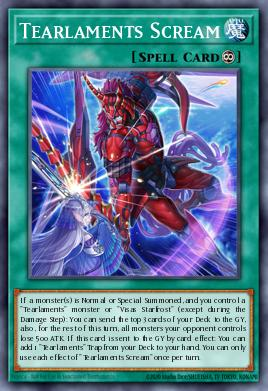

- **Copias y zona:** Main 1x, Reserva 1x. No altera las cantidades registradas.
- **Nombre oficial de referencia:** Grito Tiagrimentos. CID cotejado con la ficha oficial; el nombre histórico del inventario se conserva aunque su grafía/traducción difiera.
- **Función principal y secundaria:** searcher · buscador · cierre.
- **Estado de sinergia y función:** Sinergia indirecta (soporte o recursos). Es una clasificación de juego; revisar la relación concreta en A06.
- **Papel como recurso, descarte o coste:** No se demuestra que esta carta sea recurso de descarte o pago para otra.
- **Efecto operativo (paráfrasis analítica):** búsqueda o incorporación de cartas a mano; presión de combate o modificación de estadísticas. Son operaciones detectadas en el texto, no efectos independientes garantizados; leer sus condiciones en la fuente.
- **Mapa de activación y resultados:** 1) al llegar al Cementerio por efecto: incorpora la pieza indicada a la mano. Cada operación está sujeta a la secuencia y al «si lo haces» del texto oficial.
- **Ventanas de activación identificadas:** al llegar o estar en el Cementerio.
- **Costes o recursos potenciales:** sin coste independiente identificado en esta síntesis; comprobar las acciones previas al punto y coma de cada efecto.
- **Restricciones y requisitos:** hay límite por turno según el efecto concreto; interactúa con información oculta o resultados no siempre elegibles. 
- **Prioridad al ir primero:** generar envíos por efecto sin malgastar recursos y preparar interacción. Para esta carta: Convertir la activación en acceso a la siguiente pieza del motor, sin duplicar buscadores inútilmente.
- **Prioridad al ir segundo:** forzar respuestas rivales con Fusión/retiradas y conservar cementerio utilizable. Identificar primero la respuesta rival que afecta su función «searcher».
- **Medio/tardío y recuperación:** recuperar materiales y gestionar cartas enviadas o desterradas. No asumir que por sí misma recicla recursos si el texto no lo permite.
- **Sinergias y acceso a líneas:** Relación contextual con enviar cartas al Cementerio por efecto y aprovechar fusiones, reciclaje y motores Horus/Demoniherrero. Habilita una línea del motor sólo si coinciden recursos, objetivos y restricciones; no equivale a un combo completo validado.
- **Riesgo / brick / interrupciones:** Riesgo operativo: interrupción del Cementerio, restricciones de materiales y mildeos aleatorios. Confirmar objetivos disponibles y costes antes de activar. No atribuirle velocidad rápida por el solo hecho de formar parte del motor.
- **Utilidad editorial:** 5/5 para este deck (estimación por rol y zona, no probabilidad calculada). No cambiar copias; cualquier sugerencia de alta/baja pasa por el apartado 22 y aprobación.
- **Referencia oficial y trazabilidad:** https://www.db.yugioh-card.com/yugiohdb/card_search.action?cid=17813&ope=2&request_locale=es. **Confianza:** texto y tipo de efecto cotejados en Konami; síntesis táctica editorial, no demostración de combo.
- **Aplicación concreta dentro de este deck (A06):** búsqueda o incorporación de cartas a mano; presión de combate o modificación de estadísticas.

**USO PRÁCTICO Y SINERGIA — Grito Tiagrimientos**

- **Label funcional:** Sinergia indirecta. Clasificación documental; una relación es válida solo si se satisfacen sus condiciones exactas.
- **Qué hace:** búsqueda o incorporación de cartas a mano; presión de combate o modificación de estadísticas. Son operaciones detectadas en el texto, no efectos independientes garantizados; leer sus condiciones en la fuente.
- **Cómo aprovecharla en este deck:** búsqueda o incorporación de cartas a mano; presión de combate o modificación de estadísticas.
- **Al jugar primero:** generar envíos por efecto sin malgastar recursos y preparar interacción. Para esta carta: Convertir la activación en acceso a la siguiente pieza del motor, sin duplicar buscadores inútilmente.
- **Al jugar segundo:** forzar respuestas rivales con Fusión/retiradas y conservar cementerio utilizable. Identificar primero la respuesta rival que afecta su función «searcher».
- **Cuándo tener precaución:** Riesgo operativo: interrupción del Cementerio, restricciones de materiales y mildeos aleatorios. Confirmar objetivos disponibles y costes antes de activar. No atribuirle velocidad rápida por el solo hecho de formar parte del motor.

#### 14. Mudora el Oráculo de la Espada

- **Copias y zona:** Main 1x. No altera las cantidades registradas.
- **Nombre oficial de referencia:** Mudora el Oráculo de la Espada. CID cotejado con la ficha oficial; el nombre histórico del inventario se conserva aunque su grafía/traducción difiera.
- **Función principal y secundaria:** interrupción · extensor.
- **Estado de sinergia y función:** Sinergia indirecta (soporte o recursos). Es una clasificación de juego; revisar la relación concreta en A06.
- **Papel como recurso, descarte o coste:** Coste o consumo descrito en A05: descarte de mano.
- **Efecto operativo (paráfrasis analítica):** acceso al campo desde la mano. Son operaciones detectadas en el texto, no efectos independientes garantizados; leer sus condiciones en la fuente.
- **Mapa de activación y resultados:** 1) efecto propio o continuo: Invocación Especial desde Cementerio. Cada operación está sujeta a la secuencia y al «si lo haces» del texto oficial.
- **Ventanas de activación identificadas:** Efecto Rápido.
- **Costes o recursos potenciales:** descarte de mano.
- **Restricciones y requisitos:** hay límite por turno según el efecto concreto; depende de recursos en Cementerio. 
- **Prioridad al ir primero:** generar envíos por efecto sin malgastar recursos y preparar interacción. Para esta carta: Reservar la respuesta para la ventana rival exacta; no es una pieza buscadora de nuestro motor.
- **Prioridad al ir segundo:** forzar respuestas rivales con Fusión/retiradas y conservar cementerio utilizable. Identificar primero la respuesta rival que afecta su función «interrupción».
- **Medio/tardío y recuperación:** recuperar materiales y gestionar cartas enviadas o desterradas. No asumir que por sí misma recicla recursos si el texto no lo permite.
- **Sinergias y acceso a líneas:** Relación contextual con enviar cartas al Cementerio por efecto y aprovechar fusiones, reciclaje y motores Horus/Demoniherrero. Habilita una línea del motor sólo si coinciden recursos, objetivos y restricciones; no equivale a un combo completo validado.
- **Riesgo / brick / interrupciones:** Depende del Cementerio y es sensible a destierro o negación de ese recurso. Puede emplearse en cadena sólo cuando se cumpla su condición concreta.
- **Utilidad editorial:** 4/5 para este deck (estimación por rol y zona, no probabilidad calculada). No cambiar copias; cualquier sugerencia de alta/baja pasa por el apartado 22 y aprobación.
- **Referencia oficial y trazabilidad:** https://www.db.yugioh-card.com/yugiohdb/card_search.action?cid=17604&ope=2&request_locale=es. **Confianza:** texto y tipo de efecto cotejados en Konami; síntesis táctica editorial, no demostración de combo.
- **Aplicación concreta dentro de este deck (A06):** acceso al campo desde la mano.

**USO PRÁCTICO Y SINERGIA — Mudora el Oráculo de la Espada**

- **Label funcional:** Sinergia indirecta. Clasificación documental; una relación es válida solo si se satisfacen sus condiciones exactas.
- **Qué hace:** acceso al campo desde la mano. Son operaciones detectadas en el texto, no efectos independientes garantizados; leer sus condiciones en la fuente.
- **Cómo aprovecharla en este deck:** acceso al campo desde la mano.
- **Al jugar primero:** generar envíos por efecto sin malgastar recursos y preparar interacción. Para esta carta: Reservar la respuesta para la ventana rival exacta; no es una pieza buscadora de nuestro motor.
- **Al jugar segundo:** forzar respuestas rivales con Fusión/retiradas y conservar cementerio utilizable. Identificar primero la respuesta rival que afecta su función «interrupción».
- **Cuándo tener precaución:** Depende del Cementerio y es sensible a destierro o negación de ese recurso. Puede emplearse en cadena sólo cuando se cumpla su condición concreta.

#### 15. Amset, Gloria de Horus

- **Copias y zona:** Main 2x. No altera las cantidades registradas.
- **Nombre oficial de referencia:** Amset, Gloria de Horus. CID cotejado con la ficha oficial; el nombre histórico del inventario se conserva aunque su grafía/traducción difiera.
- **Función principal y secundaria:** searcher · buscador · recuperación · ventaja de mano.
- **Estado de sinergia y función:** Sinergia indirecta (soporte o recursos). Es una clasificación de juego; revisar la relación concreta en A06.
- **Papel como recurso, descarte o coste:** Coste o consumo descrito en A05: envío de recurso propio al Cementerio.
- **Efecto operativo (paráfrasis analítica):** búsqueda o incorporación de cartas a mano; recuperación e invocación desde Cementerio/destierro; generación de cartas por robo. Son operaciones detectadas en el texto, no efectos independientes garantizados; leer sus condiciones en la fuente.
- **Mapa de activación y resultados:** 1) efecto propio o continuo: Invocación Especial desde Cementerio · 2) efecto propio o continuo: incorpora la pieza indicada a la mano, roba cartas. Cada operación está sujeta a la secuencia y al «si lo haces» del texto oficial.
- **Ventanas de activación identificadas:** requieren la fase o condición específica indicada en el texto; sin ventana rápida general asumida.
- **Costes o recursos potenciales:** envío de recurso propio al Cementerio.
- **Restricciones y requisitos:** hay límite por turno según el efecto concreto; requiere estado de campo específico; depende de recursos en Cementerio. 
- **Prioridad al ir primero:** generar envíos por efecto sin malgastar recursos y preparar interacción. Para esta carta: Convertir la activación en acceso a la siguiente pieza del motor, sin duplicar buscadores inútilmente.
- **Prioridad al ir segundo:** forzar respuestas rivales con Fusión/retiradas y conservar cementerio utilizable. Identificar primero la respuesta rival que afecta su función «searcher».
- **Medio/tardío y recuperación:** recuperar materiales y gestionar cartas enviadas o desterradas. Verificar que el objetivo de recuperación continúe disponible.
- **Sinergias y acceso a líneas:** Relación contextual con enviar cartas al Cementerio por efecto y aprovechar fusiones, reciclaje y motores Horus/Demoniherrero. Habilita una línea del motor sólo si coinciden recursos, objetivos y restricciones; no equivale a un combo completo validado.
- **Riesgo / brick / interrupciones:** Riesgo operativo: interrupción del Cementerio, restricciones de materiales y mildeos aleatorios. Confirmar objetivos disponibles y costes antes de activar. No atribuirle velocidad rápida por el solo hecho de formar parte del motor.
- **Utilidad editorial:** 5/5 para este deck (estimación por rol y zona, no probabilidad calculada). No cambiar copias; cualquier sugerencia de alta/baja pasa por el apartado 22 y aprobación.
- **Referencia oficial y trazabilidad:** https://www.db.yugioh-card.com/yugiohdb/card_search.action?cid=19153&ope=2&request_locale=es. **Confianza:** texto y tipo de efecto cotejados en Konami; síntesis táctica editorial, no demostración de combo.
- **Aplicación concreta dentro de este deck (A06):** búsqueda o incorporación de cartas a mano; recuperación e invocación desde Cementerio/destierro; generación de cartas por robo.

**USO PRÁCTICO Y SINERGIA — Amset, Gloria de Horus**

- **Label funcional:** Sinergia indirecta. Clasificación documental; una relación es válida solo si se satisfacen sus condiciones exactas.
- **Qué hace:** búsqueda o incorporación de cartas a mano; recuperación e invocación desde Cementerio/destierro; generación de cartas por robo. Son operaciones detectadas en el texto, no efectos independientes garantizados; leer sus condiciones en la fuente.
- **Cómo aprovecharla en este deck:** búsqueda o incorporación de cartas a mano; recuperación e invocación desde Cementerio/destierro; generación de cartas por robo.
- **Al jugar primero:** generar envíos por efecto sin malgastar recursos y preparar interacción. Para esta carta: Convertir la activación en acceso a la siguiente pieza del motor, sin duplicar buscadores inútilmente.
- **Al jugar segundo:** forzar respuestas rivales con Fusión/retiradas y conservar cementerio utilizable. Identificar primero la respuesta rival que afecta su función «searcher».
- **Cuándo tener precaución:** Riesgo operativo: interrupción del Cementerio, restricciones de materiales y mildeos aleatorios. Confirmar objetivos disponibles y costes antes de activar. No atribuirle velocidad rápida por el solo hecho de formar parte del motor.

#### 16. Ocultador de Efectos

- **Copias y zona:** Main 2x. No altera las cantidades registradas.
- **Nombre oficial de referencia:** Ocultador de Efectos. CID cotejado con la ficha oficial; el nombre histórico del inventario se conserva aunque su grafía/traducción difiera.
- **Función principal y secundaria:** handtrap · negación.
- **Estado de sinergia y función:** Utilidad independiente. Es una clasificación de juego; revisar la relación concreta en A06.
- **Papel como recurso, descarte o coste:** Coste o consumo descrito en A05: envío de recurso propio al Cementerio.
- **Efecto operativo (paráfrasis analítica):** Durante la Main Phase rival, se manda desde la mano al Cementerio para negar los efectos de un monstruo rival boca arriba. 
- **Mapa de activación y resultados:** 1) en Main Phase: niega el efecto o la activación indicada. Cada operación está sujeta a la secuencia y al «si lo haces» del texto oficial.
- **Ventanas de activación identificadas:** turno rival; Main Phase; Efecto Rápido.
- **Costes o recursos potenciales:** envío de recurso propio al Cementerio.
- **Restricciones y requisitos:** aplicar restricciones de selección, activación y copias que consten en el texto original. 
- **Prioridad al ir primero:** generar envíos por efecto sin malgastar recursos y preparar interacción. Para esta carta: Reservar la respuesta para la ventana rival exacta; no es una pieza buscadora de nuestro motor.
- **Prioridad al ir segundo:** forzar respuestas rivales con Fusión/retiradas y conservar cementerio utilizable. Identificar primero la respuesta rival que afecta su función «handtrap».
- **Medio/tardío y recuperación:** recuperar materiales y gestionar cartas enviadas o desterradas. No asumir que por sí misma recicla recursos si el texto no lo permite.
- **Sinergias y acceso a líneas:** Relación contextual con enviar cartas al Cementerio por efecto y aprovechar fusiones, reciclaje y motores Horus/Demoniherrero. Habilita una línea del motor sólo si coinciden recursos, objetivos y restricciones; no equivale a un combo completo validado.
- **Riesgo / brick / interrupciones:** La ventana es la Main Phase del adversario, no cualquier fase. Puede emplearse en cadena sólo cuando se cumpla su condición concreta.
- **Utilidad editorial:** 3/5 para este deck (estimación por rol y zona, no probabilidad calculada). No cambiar copias; cualquier sugerencia de alta/baja pasa por el apartado 22 y aprobación.
- **Referencia oficial y trazabilidad:** https://www.db.yugioh-card.com/yugiohdb/card_search.action?cid=8933&ope=2&request_locale=es. **Confianza:** texto y tipo de efecto cotejados en Konami; síntesis táctica editorial, no demostración de combo.
- **Aplicación concreta dentro de este deck (A06):** Durante la Main Phase rival, se manda desde la mano al Cementerio para negar los efectos de un monstruo rival boca arriba. Aporta respuesta o consistencia sin exigir enlace directo.

**USO PRÁCTICO Y SINERGIA — Ocultador de Efectos**

- **Label funcional:** Función independiente. Clasificación documental; una relación es válida solo si se satisfacen sus condiciones exactas.
- **Qué hace:** Durante la Main Phase rival, se manda desde la mano al Cementerio para negar los efectos de un monstruo rival boca arriba.
- **Cómo aprovecharla en este deck:** Durante la Main Phase rival, se manda desde la mano al Cementerio para negar los efectos de un monstruo rival boca arriba. Aporta respuesta o consistencia sin exigir enlace directo.
- **Al jugar primero:** generar envíos por efecto sin malgastar recursos y preparar interacción. Para esta carta: Reservar la respuesta para la ventana rival exacta; no es una pieza buscadora de nuestro motor.
- **Al jugar segundo:** forzar respuestas rivales con Fusión/retiradas y conservar cementerio utilizable. Identificar primero la respuesta rival que afecta su función «handtrap».
- **Cuándo tener precaución:** La ventana es la Main Phase del adversario, no cualquier fase. Puede emplearse en cadena sólo cuando se cumpla su condición concreta.

#### 17. Corona Prohibida

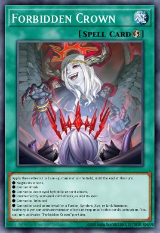

- **Copias y zona:** Main 2x. No altera las cantidades registradas.
- **Nombre oficial de referencia:** Corona Prohibida. CID cotejado con la ficha oficial; el nombre histórico del inventario se conserva aunque su grafía/traducción difiera.
- **Función principal y secundaria:** habilitador de Extra · negación · protección.
- **Estado de sinergia y función:** Utilidad independiente. Es una clasificación de juego; revisar la relación concreta en A06.
- **Papel como recurso, descarte o coste:** No se demuestra que esta carta sea recurso de descarte o pago para otra.
- **Efecto operativo (paráfrasis analítica):** habilitación o continuación de una invocación del Extra Deck; negación de efectos o activaciones; protección o resistencia contra respuestas. Son operaciones detectadas en el texto, no efectos independientes garantizados; leer sus condiciones en la fuente.
- **Mapa de activación y resultados:** 1) efecto propio o continuo: niega el efecto o la activación indicada, realiza Fusión con materiales permitidos. Cada operación está sujeta a la secuencia y al «si lo haces» del texto oficial.
- **Ventanas de activación identificadas:** requieren la fase o condición específica indicada en el texto; sin ventana rápida general asumida.
- **Costes o recursos potenciales:** sin coste independiente identificado en esta síntesis; comprobar las acciones previas al punto y coma de cada efecto.
- **Restricciones y requisitos:** hay límite por turno según el efecto concreto; puede limitar ataques. 
- **Prioridad al ir primero:** generar envíos por efecto sin malgastar recursos y preparar interacción. Para esta carta: Conservar la interrupción para el efecto clave rival; no gastarla en un efecto irrelevante.
- **Prioridad al ir segundo:** forzar respuestas rivales con Fusión/retiradas y conservar cementerio utilizable. Identificar primero la respuesta rival que afecta su función «habilitador de Extra».
- **Medio/tardío y recuperación:** recuperar materiales y gestionar cartas enviadas o desterradas. No asumir que por sí misma recicla recursos si el texto no lo permite.
- **Sinergias y acceso a líneas:** Relación contextual con enviar cartas al Cementerio por efecto y aprovechar fusiones, reciclaje y motores Horus/Demoniherrero. Habilita una línea del motor sólo si coinciden recursos, objetivos y restricciones; no equivale a un combo completo validado.
- **Riesgo / brick / interrupciones:** Riesgo operativo: interrupción del Cementerio, restricciones de materiales y mildeos aleatorios. Confirmar objetivos disponibles y costes antes de activar. No atribuirle velocidad rápida por el solo hecho de formar parte del motor.
- **Utilidad editorial:** 3/5 para este deck (estimación por rol y zona, no probabilidad calculada). No cambiar copias; cualquier sugerencia de alta/baja pasa por el apartado 22 y aprobación.
- **Referencia oficial y trazabilidad:** https://www.db.yugioh-card.com/yugiohdb/card_search.action?cid=22169&ope=2&request_locale=es. **Confianza:** texto y tipo de efecto cotejados en Konami; síntesis táctica editorial, no demostración de combo.
- **Aplicación concreta dentro de este deck (A06):** habilitación o continuación de una invocación del Extra Deck; negación de efectos o activaciones; protección o resistencia contra respuestas. Aporta respuesta o consistencia sin exigir enlace directo.

**USO PRÁCTICO Y SINERGIA — Corona Prohibida**

- **Label funcional:** Función independiente. Clasificación documental; una relación es válida solo si se satisfacen sus condiciones exactas.
- **Qué hace:** habilitación o continuación de una invocación del Extra Deck; negación de efectos o activaciones; protección o resistencia contra respuestas. Son operaciones detectadas en el texto, no efectos independientes garantizados; leer sus condiciones en la fuente.
- **Cómo aprovecharla en este deck:** habilitación o continuación de una invocación del Extra Deck; negación de efectos o activaciones; protección o resistencia contra respuestas. Aporta respuesta o consistencia sin exigir enlace directo.
- **Al jugar primero:** generar envíos por efecto sin malgastar recursos y preparar interacción. Para esta carta: Conservar la interrupción para el efecto clave rival; no gastarla en un efecto irrelevante.
- **Al jugar segundo:** forzar respuestas rivales con Fusión/retiradas y conservar cementerio utilizable. Identificar primero la respuesta rival que afecta su función «habilitador de Extra».
- **Cuándo tener precaución:** Riesgo operativo: interrupción del Cementerio, restricciones de materiales y mildeos aleatorios. Confirmar objetivos disponibles y costes antes de activar. No atribuirle velocidad rápida por el solo hecho de formar parte del motor.

#### 18. Tiagrimientos Kashtira

- **Copias y zona:** Main 3x. No altera las cantidades registradas.
- **Nombre oficial de referencia:** Tiagrimentos Kashtira. CID cotejado con la ficha oficial; el nombre histórico del inventario se conserva aunque su grafía/traducción difiera.
- **Función principal y secundaria:** interrupción · extensor · removal.
- **Estado de sinergia y función:** Sinergia indirecta (soporte o recursos). Es una clasificación de juego; revisar la relación concreta en A06.
- **Papel como recurso, descarte o coste:** Coste o consumo descrito en A05: destierro de recurso propio.
- **Efecto operativo (paráfrasis analítica):** acceso al campo desde la mano; destierro de recursos o de amenazas. Son operaciones detectadas en el texto, no efectos independientes garantizados; leer sus condiciones en la fuente.
- **Mapa de activación y resultados:** 1) en Main Phase: Invocación Especial desde Cementerio, destierra el recurso u objetivo previsto. Cada operación está sujeta a la secuencia y al «si lo haces» del texto oficial.
- **Ventanas de activación identificadas:** Main Phase; al producirse una Invocación; al llegar o estar en el Cementerio; Efecto Rápido.
- **Costes o recursos potenciales:** destierro de recurso propio.
- **Restricciones y requisitos:** hay límite por turno según el efecto concreto; interactúa con información oculta o resultados no siempre elegibles. 
- **Prioridad al ir primero:** generar envíos por efecto sin malgastar recursos y preparar interacción. Para esta carta: Reservar la respuesta para la ventana rival exacta; no es una pieza buscadora de nuestro motor.
- **Prioridad al ir segundo:** forzar respuestas rivales con Fusión/retiradas y conservar cementerio utilizable. Identificar primero la respuesta rival que afecta su función «interrupción».
- **Medio/tardío y recuperación:** recuperar materiales y gestionar cartas enviadas o desterradas. No asumir que por sí misma recicla recursos si el texto no lo permite.
- **Sinergias y acceso a líneas:** Relación contextual con enviar cartas al Cementerio por efecto y aprovechar fusiones, reciclaje y motores Horus/Demoniherrero. Habilita una línea del motor sólo si coinciden recursos, objetivos y restricciones; no equivale a un combo completo validado.
- **Riesgo / brick / interrupciones:** Riesgo operativo: interrupción del Cementerio, restricciones de materiales y mildeos aleatorios. Confirmar objetivos disponibles y costes antes de activar. Puede emplearse en cadena sólo cuando se cumpla su condición concreta.
- **Utilidad editorial:** 4/5 para este deck (estimación por rol y zona, no probabilidad calculada). No cambiar copias; cualquier sugerencia de alta/baja pasa por el apartado 22 y aprobación.
- **Referencia oficial y trazabilidad:** https://www.db.yugioh-card.com/yugiohdb/card_search.action?cid=18153&ope=2&request_locale=es. **Confianza:** texto y tipo de efecto cotejados en Konami; síntesis táctica editorial, no demostración de combo.
- **Aplicación concreta dentro de este deck (A06):** acceso al campo desde la mano; destierro de recursos o de amenazas.

**USO PRÁCTICO Y SINERGIA — Tiagrimientos Kashtira**

- **Label funcional:** Sinergia indirecta. Clasificación documental; una relación es válida solo si se satisfacen sus condiciones exactas.
- **Qué hace:** acceso al campo desde la mano; destierro de recursos o de amenazas. Son operaciones detectadas en el texto, no efectos independientes garantizados; leer sus condiciones en la fuente.
- **Cómo aprovecharla en este deck:** acceso al campo desde la mano; destierro de recursos o de amenazas.
- **Al jugar primero:** generar envíos por efecto sin malgastar recursos y preparar interacción. Para esta carta: Reservar la respuesta para la ventana rival exacta; no es una pieza buscadora de nuestro motor.
- **Al jugar segundo:** forzar respuestas rivales con Fusión/retiradas y conservar cementerio utilizable. Identificar primero la respuesta rival que afecta su función «interrupción».
- **Cuándo tener precaución:** Riesgo operativo: interrupción del Cementerio, restricciones de materiales y mildeos aleatorios. Confirmar objetivos disponibles y costes antes de activar. Puede emplearse en cadena sólo cuando se cumpla su condición concreta.

#### 19. Planeta Bajo Presión Wraitsoth

- **Copias y zona:** Main 1x. No altera las cantidades registradas.
- **Nombre oficial de referencia:** Planeta Bajo Presión Wraitsoth. CID cotejado con la ficha oficial; el nombre histórico del inventario se conserva aunque su grafía/traducción difiera.
- **Función principal y secundaria:** searcher · buscador · cierre.
- **Estado de sinergia y función:** Sinergia indirecta (soporte o recursos). Es una clasificación de juego; revisar la relación concreta en A06.
- **Papel como recurso, descarte o coste:** No se demuestra que esta carta sea recurso de descarte o pago para otra.
- **Efecto operativo (paráfrasis analítica):** búsqueda o incorporación de cartas a mano; presión de combate o modificación de estadísticas. Son operaciones detectadas en el texto, no efectos independientes garantizados; leer sus condiciones en la fuente.
- **Mapa de activación y resultados:** 1) con condición explícita en la carta: incorpora la pieza indicada a la mano. Cada operación está sujeta a la secuencia y al «si lo haces» del texto oficial.
- **Ventanas de activación identificadas:** requieren la fase o condición específica indicada en el texto; sin ventana rápida general asumida.
- **Costes o recursos potenciales:** sin coste independiente identificado en esta síntesis; comprobar las acciones previas al punto y coma de cada efecto.
- **Restricciones y requisitos:** hay límite por turno según el efecto concreto. 
- **Prioridad al ir primero:** generar envíos por efecto sin malgastar recursos y preparar interacción. Para esta carta: Convertir la activación en acceso a la siguiente pieza del motor, sin duplicar buscadores inútilmente.
- **Prioridad al ir segundo:** forzar respuestas rivales con Fusión/retiradas y conservar cementerio utilizable. Identificar primero la respuesta rival que afecta su función «searcher».
- **Medio/tardío y recuperación:** recuperar materiales y gestionar cartas enviadas o desterradas. No asumir que por sí misma recicla recursos si el texto no lo permite.
- **Sinergias y acceso a líneas:** Relación contextual con enviar cartas al Cementerio por efecto y aprovechar fusiones, reciclaje y motores Horus/Demoniherrero. Habilita una línea del motor sólo si coinciden recursos, objetivos y restricciones; no equivale a un combo completo validado.
- **Riesgo / brick / interrupciones:** Riesgo operativo: interrupción del Cementerio, restricciones de materiales y mildeos aleatorios. Confirmar objetivos disponibles y costes antes de activar. No atribuirle velocidad rápida por el solo hecho de formar parte del motor.
- **Utilidad editorial:** 5/5 para este deck (estimación por rol y zona, no probabilidad calculada). No cambiar copias; cualquier sugerencia de alta/baja pasa por el apartado 22 y aprobación.
- **Referencia oficial y trazabilidad:** https://www.db.yugioh-card.com/yugiohdb/card_search.action?cid=18204&ope=2&request_locale=es. **Confianza:** texto y tipo de efecto cotejados en Konami; síntesis táctica editorial, no demostración de combo.
- **Aplicación concreta dentro de este deck (A06):** búsqueda o incorporación de cartas a mano; presión de combate o modificación de estadísticas.

**USO PRÁCTICO Y SINERGIA — Planeta Bajo Presión Wraitsoth**

- **Label funcional:** Sinergia indirecta. Clasificación documental; una relación es válida solo si se satisfacen sus condiciones exactas.
- **Qué hace:** búsqueda o incorporación de cartas a mano; presión de combate o modificación de estadísticas. Son operaciones detectadas en el texto, no efectos independientes garantizados; leer sus condiciones en la fuente.
- **Cómo aprovecharla en este deck:** búsqueda o incorporación de cartas a mano; presión de combate o modificación de estadísticas.
- **Al jugar primero:** generar envíos por efecto sin malgastar recursos y preparar interacción. Para esta carta: Convertir la activación en acceso a la siguiente pieza del motor, sin duplicar buscadores inútilmente.
- **Al jugar segundo:** forzar respuestas rivales con Fusión/retiradas y conservar cementerio utilizable. Identificar primero la respuesta rival que afecta su función «searcher».
- **Cuándo tener precaución:** Riesgo operativo: interrupción del Cementerio, restricciones de materiales y mildeos aleatorios. Confirmar objetivos disponibles y costes antes de activar. No atribuirle velocidad rápida por el solo hecho de formar parte del motor.

#### 20. Metarruido Tiagrimientos

- **Copias y zona:** Main 1x. No altera las cantidades registradas.
- **Nombre oficial de referencia:** Metarruido Tiagrimentos. CID cotejado con la ficha oficial; el nombre histórico del inventario se conserva aunque su grafía/traducción difiera.
- **Función principal y secundaria:** cierre · respuesta.
- **Estado de sinergia y función:** Sinergia indirecta (soporte o recursos). Es una clasificación de juego; revisar la relación concreta en A06.
- **Papel como recurso, descarte o coste:** Coste o consumo descrito en A05: envío de recurso propio al Cementerio.
- **Efecto operativo (paráfrasis analítica):** presión de combate o modificación de estadísticas; interacción sobre monstruos en campo. Son operaciones detectadas en el texto, no efectos independientes garantizados; leer sus condiciones en la fuente.
- **Mapa de activación y resultados:** efecto de estadística, condición o material; no asumir un disparador adicional. Cada operación está sujeta a la secuencia y al «si lo haces» del texto oficial.
- **Ventanas de activación identificadas:** al llegar o estar en el Cementerio.
- **Costes o recursos potenciales:** envío de recurso propio al Cementerio.
- **Restricciones y requisitos:** requiere estado de campo específico; depende de recursos en Cementerio; interactúa con información oculta o resultados no siempre elegibles. 
- **Prioridad al ir primero:** generar envíos por efecto sin malgastar recursos y preparar interacción. Para esta carta: Activar cuando las condiciones permitan obtener valor real, preservando recursos de seguimiento.
- **Prioridad al ir segundo:** forzar respuestas rivales con Fusión/retiradas y conservar cementerio utilizable. Identificar primero la respuesta rival que afecta su función «cierre».
- **Medio/tardío y recuperación:** recuperar materiales y gestionar cartas enviadas o desterradas. No asumir que por sí misma recicla recursos si el texto no lo permite.
- **Sinergias y acceso a líneas:** Relación contextual con enviar cartas al Cementerio por efecto y aprovechar fusiones, reciclaje y motores Horus/Demoniherrero. Habilita una línea del motor sólo si coinciden recursos, objetivos y restricciones; no equivale a un combo completo validado.
- **Riesgo / brick / interrupciones:** Depende del Cementerio y es sensible a destierro o negación de ese recurso. No atribuirle velocidad rápida por el solo hecho de formar parte del motor.
- **Utilidad editorial:** 3/5 para este deck (estimación por rol y zona, no probabilidad calculada). No cambiar copias; cualquier sugerencia de alta/baja pasa por el apartado 22 y aprobación.
- **Referencia oficial y trazabilidad:** https://www.db.yugioh-card.com/yugiohdb/card_search.action?cid=17473&ope=2&request_locale=es. **Confianza:** texto y tipo de efecto cotejados en Konami; síntesis táctica editorial, no demostración de combo.
- **Aplicación concreta dentro de este deck (A06):** presión de combate o modificación de estadísticas; interacción sobre monstruos en campo.

**USO PRÁCTICO Y SINERGIA — Metarruido Tiagrimientos**

- **Label funcional:** Sinergia indirecta. Clasificación documental; una relación es válida solo si se satisfacen sus condiciones exactas.
- **Qué hace:** presión de combate o modificación de estadísticas; interacción sobre monstruos en campo. Son operaciones detectadas en el texto, no efectos independientes garantizados; leer sus condiciones en la fuente.
- **Cómo aprovecharla en este deck:** presión de combate o modificación de estadísticas; interacción sobre monstruos en campo.
- **Al jugar primero:** generar envíos por efecto sin malgastar recursos y preparar interacción. Para esta carta: Activar cuando las condiciones permitan obtener valor real, preservando recursos de seguimiento.
- **Al jugar segundo:** forzar respuestas rivales con Fusión/retiradas y conservar cementerio utilizable. Identificar primero la respuesta rival que afecta su función «cierre».
- **Cuándo tener precaución:** Depende del Cementerio y es sensible a destierro o negación de ese recurso. No atribuirle velocidad rápida por el solo hecho de formar parte del motor.

#### 21. Demoniherrero Grabador

- **Copias y zona:** Main 3x. No altera las cantidades registradas.
- **Nombre oficial de referencia:** Demoniherrero Grabador. CID cotejado con la ficha oficial; el nombre histórico del inventario se conserva aunque su grafía/traducción difiera.
- **Función principal y secundaria:** searcher · buscador · recuperación · motor Equipo.
- **Estado de sinergia y función:** Sinergia indirecta (soporte o recursos). Es una clasificación de juego; revisar la relación concreta en A06.
- **Papel como recurso, descarte o coste:** Coste o consumo descrito en A05: descarte de mano; reciclaje de recurso propio.
- **Efecto operativo (paráfrasis analítica):** búsqueda o incorporación de cartas a mano; retorno o reciclaje hacia mano/Deck/Extra; uso o producción de cartas equipadas. Son operaciones detectadas en el texto, no efectos independientes garantizados; leer sus condiciones en la fuente.
- **Mapa de activación y resultados:** 1) efecto propio o continuo: incorpora la pieza indicada a la mano · 2) mientras está en Cementerio: Invocación Especial desde Extra Deck, devuelve recursos a mano/Deck/Extra. Cada operación está sujeta a la secuencia y al «si lo haces» del texto oficial.
- **Ventanas de activación identificadas:** al llegar o estar en el Cementerio.
- **Costes o recursos potenciales:** descarte de mano; reciclaje de recurso propio.
- **Restricciones y requisitos:** hay límite por turno según el efecto concreto; depende de recursos en Cementerio. 
- **Prioridad al ir primero:** generar envíos por efecto sin malgastar recursos y preparar interacción. Para esta carta: Convertir la activación en acceso a la siguiente pieza del motor, sin duplicar buscadores inútilmente.
- **Prioridad al ir segundo:** forzar respuestas rivales con Fusión/retiradas y conservar cementerio utilizable. Identificar primero la respuesta rival que afecta su función «searcher».
- **Medio/tardío y recuperación:** recuperar materiales y gestionar cartas enviadas o desterradas. Verificar que el objetivo de recuperación continúe disponible.
- **Sinergias y acceso a líneas:** Relación contextual con enviar cartas al Cementerio por efecto y aprovechar fusiones, reciclaje y motores Horus/Demoniherrero. Habilita una línea del motor sólo si coinciden recursos, objetivos y restricciones; no equivale a un combo completo validado.
- **Riesgo / brick / interrupciones:** Depende del Cementerio y es sensible a destierro o negación de ese recurso. No atribuirle velocidad rápida por el solo hecho de formar parte del motor.
- **Utilidad editorial:** 5/5 para este deck (estimación por rol y zona, no probabilidad calculada). No cambiar copias; cualquier sugerencia de alta/baja pasa por el apartado 22 y aprobación.
- **Referencia oficial y trazabilidad:** https://www.db.yugioh-card.com/yugiohdb/card_search.action?cid=20196&ope=2&request_locale=es. **Confianza:** texto y tipo de efecto cotejados en Konami; síntesis táctica editorial, no demostración de combo.
- **Aplicación concreta dentro de este deck (A06):** búsqueda o incorporación de cartas a mano; retorno o reciclaje hacia mano/Deck/Extra; uso o producción de cartas equipadas.

**USO PRÁCTICO Y SINERGIA — Demoniherrero Grabador**

- **Label funcional:** Sinergia indirecta. Clasificación documental; una relación es válida solo si se satisfacen sus condiciones exactas.
- **Qué hace:** búsqueda o incorporación de cartas a mano; retorno o reciclaje hacia mano/Deck/Extra; uso o producción de cartas equipadas. Son operaciones detectadas en el texto, no efectos independientes garantizados; leer sus condiciones en la fuente.
- **Cómo aprovecharla en este deck:** búsqueda o incorporación de cartas a mano; retorno o reciclaje hacia mano/Deck/Extra; uso o producción de cartas equipadas.
- **Al jugar primero:** generar envíos por efecto sin malgastar recursos y preparar interacción. Para esta carta: Convertir la activación en acceso a la siguiente pieza del motor, sin duplicar buscadores inútilmente.
- **Al jugar segundo:** forzar respuestas rivales con Fusión/retiradas y conservar cementerio utilizable. Identificar primero la respuesta rival que afecta su función «searcher».
- **Cuándo tener precaución:** Depende del Cementerio y es sensible a destierro o negación de ese recurso. No atribuirle velocidad rápida por el solo hecho de formar parte del motor.

#### 22. Sarcófago del Rey

- **Copias y zona:** Main 2x. No altera las cantidades registradas.
- **Nombre oficial de referencia:** Sarcófago del Rey. CID cotejado con la ficha oficial; el nombre histórico del inventario se conserva aunque su grafía/traducción difiera.
- **Función principal y secundaria:** recurso situacional.
- **Estado de sinergia y función:** Sinergia indirecta (soporte o recursos). Es una clasificación de juego; revisar la relación concreta en A06.
- **Papel como recurso, descarte o coste:** Coste o consumo descrito en A05: envío de recurso propio al Cementerio.
- **Efecto operativo (paráfrasis analítica):** interacción propia de la carta que requiere consultar el texto íntegro enlazado. Son operaciones detectadas en el texto, no efectos independientes garantizados; leer sus condiciones en la fuente.
- **Mapa de activación y resultados:** efecto de estadística, condición o material; no asumir un disparador adicional. Cada operación está sujeta a la secuencia y al «si lo haces» del texto oficial.
- **Ventanas de activación identificadas:** requieren la fase o condición específica indicada en el texto; sin ventana rápida general asumida.
- **Costes o recursos potenciales:** envío de recurso propio al Cementerio.
- **Restricciones y requisitos:** hay límite por turno según el efecto concreto. 
- **Prioridad al ir primero:** generar envíos por efecto sin malgastar recursos y preparar interacción. Para esta carta: Activar cuando las condiciones permitan obtener valor real, preservando recursos de seguimiento.
- **Prioridad al ir segundo:** forzar respuestas rivales con Fusión/retiradas y conservar cementerio utilizable. Identificar primero la respuesta rival que afecta su función «recurso situacional».
- **Medio/tardío y recuperación:** recuperar materiales y gestionar cartas enviadas o desterradas. No asumir que por sí misma recicla recursos si el texto no lo permite.
- **Sinergias y acceso a líneas:** Relación contextual con enviar cartas al Cementerio por efecto y aprovechar fusiones, reciclaje y motores Horus/Demoniherrero. Habilita una línea del motor sólo si coinciden recursos, objetivos y restricciones; no equivale a un combo completo validado.
- **Riesgo / brick / interrupciones:** Riesgo operativo: interrupción del Cementerio, restricciones de materiales y mildeos aleatorios. Confirmar objetivos disponibles y costes antes de activar. No atribuirle velocidad rápida por el solo hecho de formar parte del motor.
- **Utilidad editorial:** 3/5 para este deck (estimación por rol y zona, no probabilidad calculada). No cambiar copias; cualquier sugerencia de alta/baja pasa por el apartado 22 y aprobación.
- **Referencia oficial y trazabilidad:** https://www.db.yugioh-card.com/yugiohdb/card_search.action?cid=19200&ope=2&request_locale=es. **Confianza:** texto y tipo de efecto cotejados en Konami; síntesis táctica editorial, no demostración de combo.
- **Aplicación concreta dentro de este deck (A06):** interacción propia de la carta que requiere consultar el texto íntegro enlazado.

**USO PRÁCTICO Y SINERGIA — Sarcófago del Rey**

- **Label funcional:** Sinergia indirecta. Clasificación documental; una relación es válida solo si se satisfacen sus condiciones exactas.
- **Qué hace:** interacción propia de la carta que requiere consultar el texto íntegro enlazado. Son operaciones detectadas en el texto, no efectos independientes garantizados; leer sus condiciones en la fuente.
- **Cómo aprovecharla en este deck:** interacción propia de la carta que requiere consultar el texto íntegro enlazado.
- **Al jugar primero:** generar envíos por efecto sin malgastar recursos y preparar interacción. Para esta carta: Activar cuando las condiciones permitan obtener valor real, preservando recursos de seguimiento.
- **Al jugar segundo:** forzar respuestas rivales con Fusión/retiradas y conservar cementerio utilizable. Identificar primero la respuesta rival que afecta su función «recurso situacional».
- **Cuándo tener precaución:** Riesgo operativo: interrupción del Cementerio, restricciones de materiales y mildeos aleatorios. Confirmar objetivos disponibles y costes antes de activar. No atribuirle velocidad rápida por el solo hecho de formar parte del motor.

#### 23. Hapi, Guía de Horus

- **Copias y zona:** Main 1x. No altera las cantidades registradas.
- **Nombre oficial de referencia:** Hapi, Guía de Horus. CID cotejado con la ficha oficial; el nombre histórico del inventario se conserva aunque su grafía/traducción difiera.
- **Función principal y secundaria:** searcher · buscador · recuperación · removal.
- **Estado de sinergia y función:** Sinergia indirecta (soporte o recursos). Es una clasificación de juego; revisar la relación concreta en A06.
- **Papel como recurso, descarte o coste:** No se demuestra que esta carta sea recurso de descarte o pago para otra.
- **Efecto operativo (paráfrasis analítica):** búsqueda o incorporación de cartas a mano; recuperación e invocación desde Cementerio/destierro; destierro de recursos o de amenazas; retorno o reciclaje hacia mano/Deck/Extra. Son operaciones detectadas en el texto, no efectos independientes garantizados; leer sus condiciones en la fuente.
- **Mapa de activación y resultados:** 1) efecto propio o continuo: Invocación Especial desde Cementerio · 2) con estado de campo/zona indicado: incorpora la pieza indicada a la mano, destierra el recurso u objetivo previsto, devuelve recursos a mano/Deck/Extra. Cada operación está sujeta a la secuencia y al «si lo haces» del texto oficial.
- **Ventanas de activación identificadas:** requieren la fase o condición específica indicada en el texto; sin ventana rápida general asumida.
- **Costes o recursos potenciales:** sin coste independiente identificado en esta síntesis; comprobar las acciones previas al punto y coma de cada efecto.
- **Restricciones y requisitos:** hay límite por turno según el efecto concreto; requiere estado de campo específico; depende de recursos en Cementerio. 
- **Prioridad al ir primero:** generar envíos por efecto sin malgastar recursos y preparar interacción. Para esta carta: Convertir la activación en acceso a la siguiente pieza del motor, sin duplicar buscadores inútilmente.
- **Prioridad al ir segundo:** forzar respuestas rivales con Fusión/retiradas y conservar cementerio utilizable. Identificar primero la respuesta rival que afecta su función «searcher».
- **Medio/tardío y recuperación:** recuperar materiales y gestionar cartas enviadas o desterradas. Verificar que el objetivo de recuperación continúe disponible.
- **Sinergias y acceso a líneas:** Relación contextual con enviar cartas al Cementerio por efecto y aprovechar fusiones, reciclaje y motores Horus/Demoniherrero. Habilita una línea del motor sólo si coinciden recursos, objetivos y restricciones; no equivale a un combo completo validado.
- **Riesgo / brick / interrupciones:** Riesgo operativo: interrupción del Cementerio, restricciones de materiales y mildeos aleatorios. Confirmar objetivos disponibles y costes antes de activar. No atribuirle velocidad rápida por el solo hecho de formar parte del motor.
- **Utilidad editorial:** 5/5 para este deck (estimación por rol y zona, no probabilidad calculada). No cambiar copias; cualquier sugerencia de alta/baja pasa por el apartado 22 y aprobación.
- **Referencia oficial y trazabilidad:** https://www.db.yugioh-card.com/yugiohdb/card_search.action?cid=19155&ope=2&request_locale=es. **Confianza:** texto y tipo de efecto cotejados en Konami; síntesis táctica editorial, no demostración de combo.
- **Aplicación concreta dentro de este deck (A06):** búsqueda o incorporación de cartas a mano; recuperación e invocación desde Cementerio/destierro; destierro de recursos o de amenazas; retorno o reciclaje hacia mano/Deck/Extra.

**USO PRÁCTICO Y SINERGIA — Hapi, Guía de Horus**

- **Label funcional:** Sinergia indirecta. Clasificación documental; una relación es válida solo si se satisfacen sus condiciones exactas.
- **Qué hace:** búsqueda o incorporación de cartas a mano; recuperación e invocación desde Cementerio/destierro; destierro de recursos o de amenazas; retorno o reciclaje hacia mano/Deck/Extra. Son operaciones detectadas en el texto, no efectos independientes garantizados; leer sus condiciones en la fuente.
- **Cómo aprovecharla en este deck:** búsqueda o incorporación de cartas a mano; recuperación e invocación desde Cementerio/destierro; destierro de recursos o de amenazas; retorno o reciclaje hacia mano/Deck/Extra.
- **Al jugar primero:** generar envíos por efecto sin malgastar recursos y preparar interacción. Para esta carta: Convertir la activación en acceso a la siguiente pieza del motor, sin duplicar buscadores inútilmente.
- **Al jugar segundo:** forzar respuestas rivales con Fusión/retiradas y conservar cementerio utilizable. Identificar primero la respuesta rival que afecta su función «searcher».
- **Cuándo tener precaución:** Riesgo operativo: interrupción del Cementerio, restricciones de materiales y mildeos aleatorios. Confirmar objetivos disponibles y costes antes de activar. No atribuirle velocidad rápida por el solo hecho de formar parte del motor.

#### 24. Tracto del Demoniherrero

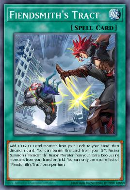

- **Copias y zona:** Main 1x. No altera las cantidades registradas.
- **Nombre oficial de referencia:** Tracto del Demoniherrero. CID cotejado con la ficha oficial; el nombre histórico del inventario se conserva aunque su grafía/traducción difiera.
- **Función principal y secundaria:** searcher · buscador.
- **Estado de sinergia y función:** Sinergia indirecta (soporte o recursos). Es una clasificación de juego; revisar la relación concreta en A06.
- **Papel como recurso, descarte o coste:** Coste o consumo descrito en A05: descarte de mano.
- **Efecto operativo (paráfrasis analítica):** búsqueda o incorporación de cartas a mano. Son operaciones detectadas en el texto, no efectos independientes garantizados; leer sus condiciones en la fuente.
- **Mapa de activación y resultados:** 1) efecto propio o continuo: incorpora la pieza indicada a la mano · 2) efecto propio o continuo: realiza Fusión con materiales permitidos. Cada operación está sujeta a la secuencia y al «si lo haces» del texto oficial.
- **Ventanas de activación identificadas:** requieren la fase o condición específica indicada en el texto; sin ventana rápida general asumida.
- **Costes o recursos potenciales:** descarte de mano.
- **Restricciones y requisitos:** hay límite por turno según el efecto concreto; depende de recursos en Cementerio. 
- **Prioridad al ir primero:** generar envíos por efecto sin malgastar recursos y preparar interacción. Para esta carta: Convertir la activación en acceso a la siguiente pieza del motor, sin duplicar buscadores inútilmente.
- **Prioridad al ir segundo:** forzar respuestas rivales con Fusión/retiradas y conservar cementerio utilizable. Identificar primero la respuesta rival que afecta su función «searcher».
- **Medio/tardío y recuperación:** recuperar materiales y gestionar cartas enviadas o desterradas. No asumir que por sí misma recicla recursos si el texto no lo permite.
- **Sinergias y acceso a líneas:** Relación contextual con enviar cartas al Cementerio por efecto y aprovechar fusiones, reciclaje y motores Horus/Demoniherrero. Habilita una línea del motor sólo si coinciden recursos, objetivos y restricciones; no equivale a un combo completo validado.
- **Riesgo / brick / interrupciones:** Depende del Cementerio y es sensible a destierro o negación de ese recurso. No atribuirle velocidad rápida por el solo hecho de formar parte del motor.
- **Utilidad editorial:** 5/5 para este deck (estimación por rol y zona, no probabilidad calculada). No cambiar copias; cualquier sugerencia de alta/baja pasa por el apartado 22 y aprobación.
- **Referencia oficial y trazabilidad:** https://www.db.yugioh-card.com/yugiohdb/card_search.action?cid=20240&ope=2&request_locale=es. **Confianza:** texto y tipo de efecto cotejados en Konami; síntesis táctica editorial, no demostración de combo.
- **Aplicación concreta dentro de este deck (A06):** búsqueda o incorporación de cartas a mano.

**USO PRÁCTICO Y SINERGIA — Tracto del Demoniherrero**

- **Label funcional:** Sinergia indirecta. Clasificación documental; una relación es válida solo si se satisfacen sus condiciones exactas.
- **Qué hace:** búsqueda o incorporación de cartas a mano. Son operaciones detectadas en el texto, no efectos independientes garantizados; leer sus condiciones en la fuente.
- **Cómo aprovecharla en este deck:** búsqueda o incorporación de cartas a mano.
- **Al jugar primero:** generar envíos por efecto sin malgastar recursos y preparar interacción. Para esta carta: Convertir la activación en acceso a la siguiente pieza del motor, sin duplicar buscadores inútilmente.
- **Al jugar segundo:** forzar respuestas rivales con Fusión/retiradas y conservar cementerio utilizable. Identificar primero la respuesta rival que afecta su función «searcher».
- **Cuándo tener precaución:** Depende del Cementerio y es sensible a destierro o negación de ese recurso. No atribuirle velocidad rápida por el solo hecho de formar parte del motor.

#### 25. Fabuloso Lurrie

- **Copias y zona:** Main 1x. No altera las cantidades registradas.
- **Nombre oficial de referencia:** Fabuloso Lurrie. CID cotejado con la ficha oficial; el nombre histórico del inventario se conserva aunque su grafía/traducción difiera.
- **Función principal y secundaria:** recurso situacional.
- **Estado de sinergia y función:** Sinergia indirecta (soporte o recursos). Es una clasificación de juego; revisar la relación concreta en A06.
- **Papel como recurso, descarte o coste:** No se demuestra que esta carta sea recurso de descarte o pago para otra.
- **Efecto operativo (paráfrasis analítica):** interacción propia de la carta que requiere consultar el texto íntegro enlazado. Son operaciones detectadas en el texto, no efectos independientes garantizados; leer sus condiciones en la fuente.
- **Mapa de activación y resultados:** efecto de estadística, condición o material; no asumir un disparador adicional. Cada operación está sujeta a la secuencia y al «si lo haces» del texto oficial.
- **Ventanas de activación identificadas:** requieren la fase o condición específica indicada en el texto; sin ventana rápida general asumida.
- **Costes o recursos potenciales:** sin coste independiente identificado en esta síntesis; comprobar las acciones previas al punto y coma de cada efecto.
- **Restricciones y requisitos:** aplicar restricciones de selección, activación y copias que consten en el texto original. 
- **Prioridad al ir primero:** generar envíos por efecto sin malgastar recursos y preparar interacción. Para esta carta: Activar cuando las condiciones permitan obtener valor real, preservando recursos de seguimiento.
- **Prioridad al ir segundo:** forzar respuestas rivales con Fusión/retiradas y conservar cementerio utilizable. Identificar primero la respuesta rival que afecta su función «recurso situacional».
- **Medio/tardío y recuperación:** recuperar materiales y gestionar cartas enviadas o desterradas. No asumir que por sí misma recicla recursos si el texto no lo permite.
- **Sinergias y acceso a líneas:** Relación contextual con enviar cartas al Cementerio por efecto y aprovechar fusiones, reciclaje y motores Horus/Demoniherrero. Habilita una línea del motor sólo si coinciden recursos, objetivos y restricciones; no equivale a un combo completo validado.
- **Riesgo / brick / interrupciones:** Riesgo operativo: interrupción del Cementerio, restricciones de materiales y mildeos aleatorios. Confirmar objetivos disponibles y costes antes de activar. No atribuirle velocidad rápida por el solo hecho de formar parte del motor.
- **Utilidad editorial:** 3/5 para este deck (estimación por rol y zona, no probabilidad calculada). No cambiar copias; cualquier sugerencia de alta/baja pasa por el apartado 22 y aprobación.
- **Referencia oficial y trazabilidad:** https://www.db.yugioh-card.com/yugiohdb/card_search.action?cid=8092&ope=2&request_locale=es. **Confianza:** texto y tipo de efecto cotejados en Konami; síntesis táctica editorial, no demostración de combo.
- **Aplicación concreta dentro de este deck (A06):** interacción propia de la carta que requiere consultar el texto íntegro enlazado.

**USO PRÁCTICO Y SINERGIA — Fabuloso Lurrie**

- **Label funcional:** Sinergia indirecta. Clasificación documental; una relación es válida solo si se satisfacen sus condiciones exactas.
- **Qué hace:** interacción propia de la carta que requiere consultar el texto íntegro enlazado. Son operaciones detectadas en el texto, no efectos independientes garantizados; leer sus condiciones en la fuente.
- **Cómo aprovecharla en este deck:** interacción propia de la carta que requiere consultar el texto íntegro enlazado.
- **Al jugar primero:** generar envíos por efecto sin malgastar recursos y preparar interacción. Para esta carta: Activar cuando las condiciones permitan obtener valor real, preservando recursos de seguimiento.
- **Al jugar segundo:** forzar respuestas rivales con Fusión/retiradas y conservar cementerio utilizable. Identificar primero la respuesta rival que afecta su función «recurso situacional».
- **Cuándo tener precaución:** Riesgo operativo: interrupción del Cementerio, restricciones de materiales y mildeos aleatorios. Confirmar objetivos disponibles y costes antes de activar. No atribuirle velocidad rápida por el solo hecho de formar parte del motor.

#### 26. Keldo la Protectora Sagrada

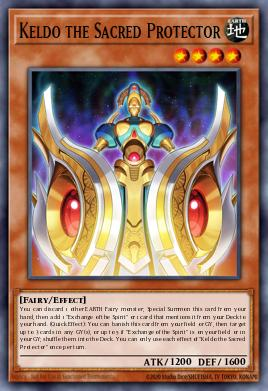

- **Copias y zona:** Main 1x. No altera las cantidades registradas.
- **Nombre oficial de referencia:** Keldo la Protectora Sagrada. CID cotejado con la ficha oficial; el nombre histórico del inventario se conserva aunque su grafía/traducción difiera.
- **Función principal y secundaria:** interrupción · searcher · buscador · extensor.
- **Estado de sinergia y función:** Sinergia indirecta (soporte o recursos). Es una clasificación de juego; revisar la relación concreta en A06.
- **Papel como recurso, descarte o coste:** Coste o consumo descrito en A05: descarte de mano.
- **Efecto operativo (paráfrasis analítica):** búsqueda o incorporación de cartas a mano; acceso al campo desde la mano. Son operaciones detectadas en el texto, no efectos independientes garantizados; leer sus condiciones en la fuente.
- **Mapa de activación y resultados:** efecto de estadística, condición o material; no asumir un disparador adicional. Cada operación está sujeta a la secuencia y al «si lo haces» del texto oficial.
- **Ventanas de activación identificadas:** Efecto Rápido.
- **Costes o recursos potenciales:** descarte de mano.
- **Restricciones y requisitos:** hay límite por turno según el efecto concreto; depende de recursos en Cementerio. 
- **Prioridad al ir primero:** generar envíos por efecto sin malgastar recursos y preparar interacción. Para esta carta: Reservar la respuesta para la ventana rival exacta; no es una pieza buscadora de nuestro motor.
- **Prioridad al ir segundo:** forzar respuestas rivales con Fusión/retiradas y conservar cementerio utilizable. Identificar primero la respuesta rival que afecta su función «interrupción».
- **Medio/tardío y recuperación:** recuperar materiales y gestionar cartas enviadas o desterradas. No asumir que por sí misma recicla recursos si el texto no lo permite.
- **Sinergias y acceso a líneas:** Relación contextual con enviar cartas al Cementerio por efecto y aprovechar fusiones, reciclaje y motores Horus/Demoniherrero. Habilita una línea del motor sólo si coinciden recursos, objetivos y restricciones; no equivale a un combo completo validado.
- **Riesgo / brick / interrupciones:** Depende del Cementerio y es sensible a destierro o negación de ese recurso. Puede emplearse en cadena sólo cuando se cumpla su condición concreta.
- **Utilidad editorial:** 5/5 para este deck (estimación por rol y zona, no probabilidad calculada). No cambiar copias; cualquier sugerencia de alta/baja pasa por el apartado 22 y aprobación.
- **Referencia oficial y trazabilidad:** https://www.db.yugioh-card.com/yugiohdb/card_search.action?cid=17603&ope=2&request_locale=es. **Confianza:** texto y tipo de efecto cotejados en Konami; síntesis táctica editorial, no demostración de combo.
- **Aplicación concreta dentro de este deck (A06):** búsqueda o incorporación de cartas a mano; acceso al campo desde la mano.

**USO PRÁCTICO Y SINERGIA — Keldo la Protectora Sagrada**

- **Label funcional:** Sinergia indirecta. Clasificación documental; una relación es válida solo si se satisfacen sus condiciones exactas.
- **Qué hace:** búsqueda o incorporación de cartas a mano; acceso al campo desde la mano. Son operaciones detectadas en el texto, no efectos independientes garantizados; leer sus condiciones en la fuente.
- **Cómo aprovecharla en este deck:** búsqueda o incorporación de cartas a mano; acceso al campo desde la mano.
- **Al jugar primero:** generar envíos por efecto sin malgastar recursos y preparar interacción. Para esta carta: Reservar la respuesta para la ventana rival exacta; no es una pieza buscadora de nuestro motor.
- **Al jugar segundo:** forzar respuestas rivales con Fusión/retiradas y conservar cementerio utilizable. Identificar primero la respuesta rival que afecta su función «interrupción».
- **Cuándo tener precaución:** Depende del Cementerio y es sensible a destierro o negación de ese recurso. Puede emplearse en cadena sólo cuando se cumpla su condición concreta.

#### 27. Agnumday del Demoniherrero

- **Copias y zona:** Extra 1x. No altera las cantidades registradas.
- **Nombre oficial de referencia:** Agnumday del Demoniherrero. CID cotejado con la ficha oficial; el nombre histórico del inventario se conserva aunque su grafía/traducción difiera.
- **Función principal y secundaria:** interrupción · resultado de Extra Deck · cierre · motor Equipo.
- **Estado de sinergia y función:** Sin acceso al Extra demostrado. Es una clasificación de juego; revisar la relación concreta en A06.
- **Papel como recurso, descarte o coste:** Material o destino del Extra condicionado a los requisitos de invocación.
- **Efecto operativo (paráfrasis analítica):** presión de combate o modificación de estadísticas; uso o producción de cartas equipadas. Son operaciones detectadas en el texto, no efectos independientes garantizados; leer sus condiciones en la fuente.
- **Mapa de activación y resultados:** 1) una vez por turno: equipa carta/monstruo según texto, inflige daño. Cada operación está sujeta a la secuencia y al «si lo haces» del texto oficial.
- **Ventanas de activación identificadas:** Efecto Rápido.
- **Costes o recursos potenciales:** sin coste independiente identificado en esta síntesis; comprobar las acciones previas al punto y coma de cada efecto.
- **Restricciones y requisitos:** hay límite por turno según el efecto concreto; depende de recursos en Cementerio. Invocar sólo desde el Extra Deck usando su procedimiento propio.
- **Prioridad al ir primero:** generar envíos por efecto sin malgastar recursos y preparar interacción. Para esta carta: Reservar la respuesta para la ventana rival exacta; no es una pieza buscadora de nuestro motor.
- **Prioridad al ir segundo:** forzar respuestas rivales con Fusión/retiradas y conservar cementerio utilizable. Identificar primero la respuesta rival que afecta su función «interrupción».
- **Medio/tardío y recuperación:** recuperar materiales y gestionar cartas enviadas o desterradas. No asumir que por sí misma recicla recursos si el texto no lo permite.
- **Sinergias y acceso a líneas:** Relación contextual con enviar cartas al Cementerio por efecto y aprovechar fusiones, reciclaje y motores Horus/Demoniherrero. Puede cerrar o prolongar una ruta del Extra si los materiales están disponibles.
- **Riesgo / brick / interrupciones:** Depende del Cementerio y es sensible a destierro o negación de ese recurso. Puede emplearse en cadena sólo cuando se cumpla su condición concreta.
- **Utilidad editorial:** 4/5 para este deck (estimación por rol y zona, no probabilidad calculada). No cambiar copias; cualquier sugerencia de alta/baja pasa por el apartado 22 y aprobación.
- **Referencia oficial y trazabilidad:** https://www.db.yugioh-card.com/yugiohdb/card_search.action?cid=20521&ope=2&request_locale=es. **Confianza:** texto y tipo de efecto cotejados en Konami; síntesis táctica editorial, no demostración de combo.
- **Aplicación concreta dentro de este deck (A06):** presión de combate o modificación de estadísticas; uso o producción de cartas equipadas. Falta arista de materiales en A06; A09 podría contener una ruta válida no indexada aquí.

**USO PRÁCTICO Y SINERGIA — Agnumday del Demoniherrero**

- **Label funcional:** Sin sinergia demostrada (con la evidencia actual). Clasificación documental; una relación es válida solo si se satisfacen sus condiciones exactas.
- **Qué hace:** presión de combate o modificación de estadísticas; uso o producción de cartas equipadas. Son operaciones detectadas en el texto, no efectos independientes garantizados; leer sus condiciones en la fuente.
- **Cómo aprovecharla en este deck:** presión de combate o modificación de estadísticas; uso o producción de cartas equipadas. Falta arista de materiales en A06; A09 podría contener una ruta válida no indexada aquí.
- **Al jugar primero:** generar envíos por efecto sin malgastar recursos y preparar interacción. Para esta carta: Reservar la respuesta para la ventana rival exacta; no es una pieza buscadora de nuestro motor.
- **Al jugar segundo:** forzar respuestas rivales con Fusión/retiradas y conservar cementerio utilizable. Identificar primero la respuesta rival que afecta su función «interrupción».
- **Cuándo tener precaución:** Depende del Cementerio y es sensible a destierro o negación de ese recurso. Puede emplearse en cadena sólo cuando se cumpla su condición concreta.

**CÓMO LLEGAR DESDE TU DECK — SIN RUTA DEMOSTRADA**

- La biblioteca actual no contiene una ruta identificada para esta carta del Extra. No se debe exhibir una descripción genérica como sustituto de mano inicial, materiales y pasos. Para completarla, contrastar requisitos oficiales y recursos del Main; si no es alcanzable, explicar el impedimento exacto.

#### 28. Sprind Spright

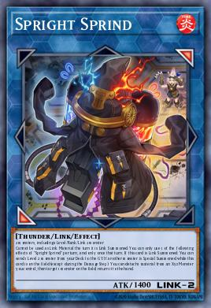

- **Copias y zona:** Extra 1x. No altera las cantidades registradas.
- **Nombre oficial de referencia:** Sprind Spright. CID cotejado con la ficha oficial; el nombre histórico del inventario se conserva aunque su grafía/traducción difiera.
- **Función principal y secundaria:** resultado de Extra Deck · habilitador Xyz.
- **Estado de sinergia y función:** Sin acceso al Extra demostrado. Es una clasificación de juego; revisar la relación concreta en A06.
- **Papel como recurso, descarte o coste:** Material o destino del Extra condicionado a los requisitos de invocación.
- **Efecto operativo (paráfrasis analítica):** gestión de materiales Xyz. Son operaciones detectadas en el texto, no efectos independientes garantizados; leer sus condiciones en la fuente.
- **Mapa de activación y resultados:** 1) efecto propio o continuo: habilita Enlace · 2) con estado de campo/zona indicado: desacopla materiales Xyz. Cada operación está sujeta a la secuencia y al «si lo haces» del texto oficial.
- **Ventanas de activación identificadas:** al producirse una Invocación; Invocación del Extra Deck.
- **Costes o recursos potenciales:** sin coste independiente identificado en esta síntesis; comprobar las acciones previas al punto y coma de cada efecto.
- **Restricciones y requisitos:** exige materiales de Extra Deck o materiales adecuados. Invocar sólo desde el Extra Deck usando su procedimiento propio.
- **Prioridad al ir primero:** generar envíos por efecto sin malgastar recursos y preparar interacción. Para esta carta: Comprobar materiales exactos antes de buscar este objetivo en el Extra Deck.
- **Prioridad al ir segundo:** forzar respuestas rivales con Fusión/retiradas y conservar cementerio utilizable. Identificar primero la respuesta rival que afecta su función «resultado de Extra Deck».
- **Medio/tardío y recuperación:** recuperar materiales y gestionar cartas enviadas o desterradas. No asumir que por sí misma recicla recursos si el texto no lo permite.
- **Sinergias y acceso a líneas:** Relación contextual con enviar cartas al Cementerio por efecto y aprovechar fusiones, reciclaje y motores Horus/Demoniherrero. Puede cerrar o prolongar una ruta del Extra si los materiales están disponibles.
- **Riesgo / brick / interrupciones:** Se agota al consumir materiales; no asumir material adicional al pasar de un Xyz a otro. No atribuirle velocidad rápida por el solo hecho de formar parte del motor.
- **Utilidad editorial:** 4/5 para este deck (estimación por rol y zona, no probabilidad calculada). No cambiar copias; cualquier sugerencia de alta/baja pasa por el apartado 22 y aprobación.
- **Referencia oficial y trazabilidad:** https://www.db.yugioh-card.com/yugiohdb/card_search.action?cid=17803&ope=2&request_locale=es. **Confianza:** texto y tipo de efecto cotejados en Konami; síntesis táctica editorial, no demostración de combo.
- **Aplicación concreta dentro de este deck (A06):** gestión de materiales Xyz. Falta arista de materiales en A06; A09 podría contener una ruta válida no indexada aquí.

**USO PRÁCTICO Y SINERGIA — Sprind Spright**

- **Label funcional:** Sin sinergia demostrada (con la evidencia actual). Clasificación documental; una relación es válida solo si se satisfacen sus condiciones exactas.
- **Qué hace:** gestión de materiales Xyz. Son operaciones detectadas en el texto, no efectos independientes garantizados; leer sus condiciones en la fuente.
- **Cómo aprovecharla en este deck:** gestión de materiales Xyz. Falta arista de materiales en A06; A09 podría contener una ruta válida no indexada aquí.
- **Al jugar primero:** generar envíos por efecto sin malgastar recursos y preparar interacción. Para esta carta: Comprobar materiales exactos antes de buscar este objetivo en el Extra Deck.
- **Al jugar segundo:** forzar respuestas rivales con Fusión/retiradas y conservar cementerio utilizable. Identificar primero la respuesta rival que afecta su función «resultado de Extra Deck».
- **Cuándo tener precaución:** Se agota al consumir materiales; no asumir material adicional al pasar de un Xyz a otro. No atribuirle velocidad rápida por el solo hecho de formar parte del motor.

**CÓMO LLEGAR DESDE TU DECK — SIN RUTA DEMOSTRADA**

- La biblioteca actual no contiene una ruta identificada para esta carta del Extra. No se debe exhibir una descripción genérica como sustituto de mano inicial, materiales y pasos. Para completarla, contrastar requisitos oficiales y recursos del Main; si no es alcanzable, explicar el impedimento exacto.

#### 29. S:P Pequeña Caballera

- **Copias y zona:** Extra 1x. No altera las cantidades registradas.
- **Nombre oficial de referencia:** S:P Pequeña Caballera. CID cotejado con la ficha oficial; el nombre histórico del inventario se conserva aunque su grafía/traducción difiera.
- **Función principal y secundaria:** interrupción · resultado de Extra Deck · removal · respuesta.
- **Estado de sinergia y función:** Destino Extra condicionado. Es una clasificación de juego; revisar la relación concreta en A06.
- **Papel como recurso, descarte o coste:** Material o destino del Extra condicionado a los requisitos de invocación.
- **Efecto operativo (paráfrasis analítica):** destierro de recursos o de amenazas; interacción sobre monstruos en campo. Son operaciones detectadas en el texto, no efectos independientes garantizados; leer sus condiciones en la fuente.
- **Mapa de activación y resultados:** 1) en respuesta a activación rival: destierra el recurso u objetivo previsto. Cada operación está sujeta a la secuencia y al «si lo haces» del texto oficial.
- **Ventanas de activación identificadas:** al producirse una Invocación; respuesta a activación rival; Efecto Rápido; Invocación del Extra Deck.
- **Costes o recursos potenciales:** sin coste independiente identificado en esta síntesis; comprobar las acciones previas al punto y coma de cada efecto.
- **Restricciones y requisitos:** hay límite por turno según el efecto concreto; puede limitar ataques. Invocar sólo desde el Extra Deck usando su procedimiento propio.
- **Prioridad al ir primero:** generar envíos por efecto sin malgastar recursos y preparar interacción. Para esta carta: Reservar la respuesta para la ventana rival exacta; no es una pieza buscadora de nuestro motor.
- **Prioridad al ir segundo:** forzar respuestas rivales con Fusión/retiradas y conservar cementerio utilizable. Identificar primero la respuesta rival que afecta su función «interrupción».
- **Medio/tardío y recuperación:** recuperar materiales y gestionar cartas enviadas o desterradas. No asumir que por sí misma recicla recursos si el texto no lo permite.
- **Sinergias y acceso a líneas:** Relación contextual con enviar cartas al Cementerio por efecto y aprovechar fusiones, reciclaje y motores Horus/Demoniherrero. Puede cerrar o prolongar una ruta del Extra si los materiales están disponibles.
- **Riesgo / brick / interrupciones:** No contarla como extensión automática: confirmar materiales, procedimiento y restricciones vigentes. Puede emplearse en cadena sólo cuando se cumpla su condición concreta.
- **Utilidad editorial:** 4/5 para este deck (estimación por rol y zona, no probabilidad calculada). No cambiar copias; cualquier sugerencia de alta/baja pasa por el apartado 22 y aprobación.
- **Referencia oficial y trazabilidad:** https://www.db.yugioh-card.com/yugiohdb/card_search.action?cid=19188&ope=2&request_locale=es. **Confianza:** texto y tipo de efecto cotejados en Konami; síntesis táctica editorial, no demostración de combo.
- **Aplicación concreta dentro de este deck (A06):** destierro de recursos o de amenazas; interacción sobre monstruos en campo. A06 identifica su destino, condicionado a material/procedimiento.

**USO PRÁCTICO Y SINERGIA — S:P Pequeña Caballera**

- **Label funcional:** Sinergia de Extra demostrada en dos manos distintas: `656:A09:FENRIR:REINO:SP_DIRECTA11` y `656:A09:FENRIR:REINO:SCHEIREN:IP_SP12`. Es una vinculación de líneas y materiales concretos, no tasa de éxito.
- **Qué hace:** destierro de recursos o de amenazas; interacción sobre monstruos en campo. Son operaciones detectadas en el texto, no efectos independientes garantizados; leer sus condiciones en la fuente.
- **Cómo aprovecharla en este deck:** destierro de recursos o de amenazas; interacción sobre monstruos en campo. A06 identifica su destino, condicionado a material/procedimiento.
- **Al jugar primero:** generar envíos por efecto sin malgastar recursos y preparar interacción. Para esta carta: Reservar la respuesta para la ventana rival exacta; no es una pieza buscadora de nuestro motor.
- **Al jugar segundo:** forzar respuestas rivales con Fusión/retiradas y conservar cementerio utilizable. Identificar primero la respuesta rival que afecta su función «interrupción».
- **Cuándo tener precaución:** No contarla como extensión automática: confirmar materiales, procedimiento y restricciones vigentes. Puede emplearse en cadena sólo cuando se cumpla su condición concreta.

**CÓMO LLEGAR DESDE TU DECK — DOS RUTAS DE ENLACE COTEJADAS**

- **Línea directa de dos cartas:**  Fenrir (Especial) +  Reinoheart (Normal) →  S:P Link-2. **No se activa destierro al Invocar**: son dos materiales Main, no de Extra. Conserva un Efecto Rápido condicionado a activación rival y dos monstruos boca arriba. [Cinco pasos, campo final y coste](guias/DECK_656_FENRIR_REINO_SP_DIRECTA_GUIA.md) · `656:A09:FENRIR:REINO:SP_DIRECTA11`.
- **Línea con I:P en turno rival:** Fenrir + Reinoheart + Scheiren + Veiler; Reinoheart/Scheiren → 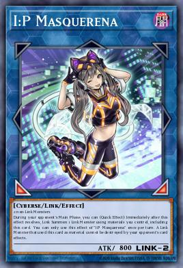 I:P (dejar Fenrir), en Main rival I:P contada como 1 + Fenrir → S:P. **Aquí sí** puede activar destierro al Invocar al haber usado un material Link. [Siete pasos, cadenas, materiales y elección de endboard](guias/DECK_656_FENRIR_REINO_SCHEIREN_IP_SP_GUIA.md) · `656:A09:FENRIR:REINO:SCHEIREN:IP_SP12`.
- **Advertencia:** Enlazar Reinoheart/Scheiren **no equivale a enviar por efecto** para activar sus efectos Tearlaments de GY; las líneas son alternativas y gastan Fenrir. No presentar una negación por S:P.

#### 30. Réquiem del Demoniherrero

- **Copias y zona:** Extra 1x. No altera las cantidades registradas.
- **Nombre oficial de referencia:** Réquiem del Demoniherrero. CID cotejado con la ficha oficial; el nombre histórico del inventario se conserva aunque su grafía/traducción difiera.
- **Función principal y secundaria:** interrupción · resultado de Extra Deck · extensor · cierre · respuesta.
- **Estado de sinergia y función:** Destino Extra condicionado. Es una clasificación de juego; revisar la relación concreta en A06.
- **Papel como recurso, descarte o coste:** Material o destino del Extra condicionado a los requisitos de invocación.
- **Efecto operativo (paráfrasis analítica):** acceso al campo desde la mano; presión de combate o modificación de estadísticas; interacción sobre monstruos en campo; uso o producción de cartas equipadas; uso de Sacrificios como parte del efecto. Son operaciones detectadas en el texto, no efectos independientes garantizados; leer sus condiciones en la fuente.
- **Mapa de activación y resultados:** 1) efecto propio o continuo: Invocación Especial desde zona permitida · 2) en Main Phase: Invocación Especial desde mano · 3) efecto propio o continuo: equipa carta/monstruo según texto. Cada operación está sujeta a la secuencia y al «si lo haces» del texto oficial.
- **Ventanas de activación identificadas:** Main Phase; Efecto Rápido.
- **Costes o recursos potenciales:** Sacrificio.
- **Restricciones y requisitos:** hay límite por turno según el efecto concreto. Invocar sólo desde el Extra Deck usando su procedimiento propio.
- **Prioridad al ir primero:** generar envíos por efecto sin malgastar recursos y preparar interacción. Para esta carta: Reservar la respuesta para la ventana rival exacta; no es una pieza buscadora de nuestro motor.
- **Prioridad al ir segundo:** forzar respuestas rivales con Fusión/retiradas y conservar cementerio utilizable. Identificar primero la respuesta rival que afecta su función «interrupción».
- **Medio/tardío y recuperación:** recuperar materiales y gestionar cartas enviadas o desterradas. No asumir que por sí misma recicla recursos si el texto no lo permite.
- **Sinergias y acceso a líneas:** Relación contextual con enviar cartas al Cementerio por efecto y aprovechar fusiones, reciclaje y motores Horus/Demoniherrero. Puede cerrar o prolongar una ruta del Extra si los materiales están disponibles.
- **Riesgo / brick / interrupciones:** No contarla como extensión automática: confirmar materiales, procedimiento y restricciones vigentes. Puede emplearse en cadena sólo cuando se cumpla su condición concreta.
- **Utilidad editorial:** 4/5 para este deck (estimación por rol y zona, no probabilidad calculada). No cambiar copias; cualquier sugerencia de alta/baja pasa por el apartado 22 y aprobación.
- **Referencia oficial y trazabilidad:** https://www.db.yugioh-card.com/yugiohdb/card_search.action?cid=20225&ope=2&request_locale=es. **Confianza:** texto y tipo de efecto cotejados en Konami; síntesis táctica editorial, no demostración de combo.
- **Aplicación concreta dentro de este deck (A06):** acceso al campo desde la mano; presión de combate o modificación de estadísticas; interacción sobre monstruos en campo; uso o producción de cartas equipadas; uso de Sacrificios como parte del efecto. A06 identifica su destino, condicionado a material/procedimiento.

**USO PRÁCTICO Y SINERGIA — Réquiem del Demoniherrero**

- **Label funcional:** Referencias de ruta localizadas; conexión reglamentaria sujeta al recorrido de la guía. Clasificación documental; una relación es válida solo si se satisfacen sus condiciones exactas.
- **Qué hace:** acceso al campo desde la mano; presión de combate o modificación de estadísticas; interacción sobre monstruos en campo; uso o producción de cartas equipadas; uso de Sacrificios como parte del efecto. Son operaciones detectadas en el texto, no efectos independientes garantizados; leer sus condiciones en la fuente.
- **Cómo aprovecharla en este deck:** acceso al campo desde la mano; presión de combate o modificación de estadísticas; interacción sobre monstruos en campo; uso o producción de cartas equipadas; uso de Sacrificios como parte del efecto. A06 identifica su destino, condicionado a material/procedimiento.
- **Al jugar primero:** generar envíos por efecto sin malgastar recursos y preparar interacción. Para esta carta: Reservar la respuesta para la ventana rival exacta; no es una pieza buscadora de nuestro motor.
- **Al jugar segundo:** forzar respuestas rivales con Fusión/retiradas y conservar cementerio utilizable. Identificar primero la respuesta rival que afecta su función «interrupción».
- **Cuándo tener precaución:** No contarla como extensión automática: confirmar materiales, procedimiento y restricciones vigentes. Puede emplearse en cadena sólo cuando se cumpla su condición concreta.

**CÓMO LLEGAR DESDE TU DECK — RUTAS DOCUMENTADAS**

- **Abrir guía `656:A09:ENGRAVER:LACRIMA01`:** entrada: Demoniherrero Grabador (20196) solamente. Campo/GY vacíos, Main Phase propia, sin interferencia rival. En Deck quedan al menos Tracto del Demoniherrero (20240), Fabuloso Lurrie (8092) y una segunda copia de Grabador (el inventario contiene 3). Extra disponible: Réquiem (20225), Secuencia (20226), Lácrima del Demoniherrero (20214). No usar cartas de la Reserva ni suponer cartas robadas.. Propósito descrito: Preparación de recursos / despliegue. Consulta sus pasos, consumo y resultado; comprobar si esta carta es realmente invocada o solo mencionada.

#### 31. Garura, Alas de Vida Resonante

**ACCESO PRÁCTICO — RUPTURA DE CAMPO:** desde Main tienes Súper Polimerización. Con ella y otra carta para descartar, si el rival controla dos monstruos boca arriba de igual Tipo y Atributo, pero distinto nombre, puedes utilizar ambos como materiales e Invocar Garura. Consulta la guía paso a paso `656:A09:SUPERPOLY:GARURA10`. Este acceso es **condicional al campo rival**: no es un starter de una sola carta ni un resultado garantizado en campo vacío.

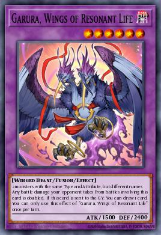

- **Copias y zona:** Extra 1x. No altera las cantidades registradas.
- **Nombre oficial de referencia:** Garura, Alas de Vida Resonante. CID cotejado con la ficha oficial; el nombre histórico del inventario se conserva aunque su grafía/traducción difiera.
- **Función principal y secundaria:** resultado de Extra Deck · ventaja de mano · cierre.
- **Estado de sinergia y función:** Destino Extra condicionado. Es una clasificación de juego; revisar la relación concreta en A06.
- **Papel como recurso, descarte o coste:** Material o destino del Extra condicionado a los requisitos de invocación.
- **Efecto operativo (paráfrasis analítica):** generación de cartas por robo; presión de combate o modificación de estadísticas. Son operaciones detectadas en el texto, no efectos independientes garantizados; leer sus condiciones en la fuente.
- **Mapa de activación y resultados:** 1) con condición explícita en la carta: roba cartas. Cada operación está sujeta a la secuencia y al «si lo haces» del texto oficial.
- **Ventanas de activación identificadas:** al llegar o estar en el Cementerio.
- **Costes o recursos potenciales:** sin coste independiente identificado en esta síntesis; comprobar las acciones previas al punto y coma de cada efecto.
- **Restricciones y requisitos:** hay límite por turno según el efecto concreto. Invocar sólo desde el Extra Deck usando su procedimiento propio.
- **Prioridad al ir primero:** generar envíos por efecto sin malgastar recursos y preparar interacción. Para esta carta: Comprobar materiales exactos antes de buscar este objetivo en el Extra Deck.
- **Prioridad al ir segundo:** forzar respuestas rivales con Fusión/retiradas y conservar cementerio utilizable. Identificar primero la respuesta rival que afecta su función «resultado de Extra Deck».
- **Medio/tardío y recuperación:** recuperar materiales y gestionar cartas enviadas o desterradas. No asumir que por sí misma recicla recursos si el texto no lo permite.
- **Sinergias y acceso a líneas:** Relación contextual con enviar cartas al Cementerio por efecto y aprovechar fusiones, reciclaje y motores Horus/Demoniherrero. Puede cerrar o prolongar una ruta del Extra si los materiales están disponibles.
- **Riesgo / brick / interrupciones:** No contarla como extensión automática: confirmar materiales, procedimiento y restricciones vigentes. No atribuirle velocidad rápida por el solo hecho de formar parte del motor.
- **Utilidad editorial:** 4/5 para este deck (estimación por rol y zona, no probabilidad calculada). No cambiar copias; cualquier sugerencia de alta/baja pasa por el apartado 22 y aprobación.
- **Referencia oficial y trazabilidad:** https://www.db.yugioh-card.com/yugiohdb/card_search.action?cid=17746&ope=2&request_locale=es. **Confianza:** texto y tipo de efecto cotejados en Konami; síntesis táctica editorial, no demostración de combo.
- **Aplicación concreta dentro de este deck (A06):** generación de cartas por robo; presión de combate o modificación de estadísticas. A06 identifica su destino, condicionado a material/procedimiento.

**USO PRÁCTICO Y SINERGIA — Garura, Alas de Vida Resonante**

- **Label funcional:** Sin sinergia demostrada (con la evidencia actual). Clasificación documental; una relación es válida solo si se satisfacen sus condiciones exactas.
- **Qué hace:** generación de cartas por robo; presión de combate o modificación de estadísticas. Son operaciones detectadas en el texto, no efectos independientes garantizados; leer sus condiciones en la fuente.
- **Cómo aprovecharla en este deck:** generación de cartas por robo; presión de combate o modificación de estadísticas. A06 identifica su destino, condicionado a material/procedimiento.
- **Al jugar primero:** generar envíos por efecto sin malgastar recursos y preparar interacción. Para esta carta: Comprobar materiales exactos antes de buscar este objetivo en el Extra Deck.
- **Al jugar segundo:** forzar respuestas rivales con Fusión/retiradas y conservar cementerio utilizable. Identificar primero la respuesta rival que afecta su función «resultado de Extra Deck».
- **Cuándo tener precaución:** No contarla como extensión automática: confirmar materiales, procedimiento y restricciones vigentes. No atribuirle velocidad rápida por el solo hecho de formar parte del motor.

**CÓMO LLEGAR DESDE TU DECK — SIN RUTA DEMOSTRADA**

- La biblioteca actual no contiene una ruta identificada para esta carta del Extra. No se debe exhibir una descripción genérica como sustituto de mano inicial, materiales y pasos. Para completarla, contrastar requisitos oficiales y recursos del Main; si no es alcanzable, explicar el impedimento exacto.

#### 32. Predaplanta Dragostapelia

- **Copias y zona:** Extra 1x. No altera las cantidades registradas.
- **Nombre oficial de referencia:** Predaplanta Dragostapelia. CID cotejado con la ficha oficial; el nombre histórico del inventario se conserva aunque su grafía/traducción difiera.
- **Función principal y secundaria:** interrupción · resultado de Extra Deck · negación · respuesta · recurso condicionado.
- **Estado de sinergia y función:** Destino Extra condicionado. Es una clasificación de juego; revisar la relación concreta en A06.
- **Papel como recurso, descarte o coste:** Material o destino del Extra condicionado a los requisitos de invocación.
- **Efecto operativo (paráfrasis analítica):** negación de efectos o activaciones; interacción sobre monstruos en campo; colocación o gasto de contadores. Son operaciones detectadas en el texto, no efectos independientes garantizados; leer sus condiciones en la fuente.
- **Mapa de activación y resultados:** 1) una vez por turno: niega el efecto o la activación indicada. Cada operación está sujeta a la secuencia y al «si lo haces» del texto oficial.
- **Ventanas de activación identificadas:** Efecto Rápido.
- **Costes o recursos potenciales:** sin coste independiente identificado en esta síntesis; comprobar las acciones previas al punto y coma de cada efecto.
- **Restricciones y requisitos:** hay límite por turno según el efecto concreto. Invocar sólo desde el Extra Deck usando su procedimiento propio.
- **Prioridad al ir primero:** generar envíos por efecto sin malgastar recursos y preparar interacción. Para esta carta: Reservar la respuesta para la ventana rival exacta; no es una pieza buscadora de nuestro motor.
- **Prioridad al ir segundo:** forzar respuestas rivales con Fusión/retiradas y conservar cementerio utilizable. Identificar primero la respuesta rival que afecta su función «interrupción».
- **Medio/tardío y recuperación:** recuperar materiales y gestionar cartas enviadas o desterradas. No asumir que por sí misma recicla recursos si el texto no lo permite.
- **Sinergias y acceso a líneas:** Relación contextual con enviar cartas al Cementerio por efecto y aprovechar fusiones, reciclaje y motores Horus/Demoniherrero. Puede cerrar o prolongar una ruta del Extra si los materiales están disponibles.
- **Riesgo / brick / interrupciones:** No contarla como extensión automática: confirmar materiales, procedimiento y restricciones vigentes. Puede emplearse en cadena sólo cuando se cumpla su condición concreta.
- **Utilidad editorial:** 4/5 para este deck (estimación por rol y zona, no probabilidad calculada). No cambiar copias; cualquier sugerencia de alta/baja pasa por el apartado 22 y aprobación.
- **Referencia oficial y trazabilidad:** https://www.db.yugioh-card.com/yugiohdb/card_search.action?cid=12870&ope=2&request_locale=es. **Confianza:** texto y tipo de efecto cotejados en Konami; síntesis táctica editorial, no demostración de combo.
- **Aplicación concreta dentro de este deck (A06):** negación de efectos o activaciones; interacción sobre monstruos en campo; colocación o gasto de contadores. A06 identifica su destino, condicionado a material/procedimiento.

**USO PRÁCTICO Y SINERGIA — Predaplanta Dragostapelia**

- **Label funcional:** Sin sinergia demostrada (con la evidencia actual). Clasificación documental; una relación es válida solo si se satisfacen sus condiciones exactas.
- **Qué hace:** negación de efectos o activaciones; interacción sobre monstruos en campo; colocación o gasto de contadores. Son operaciones detectadas en el texto, no efectos independientes garantizados; leer sus condiciones en la fuente.
- **Cómo aprovecharla en este deck:** negación de efectos o activaciones; interacción sobre monstruos en campo; colocación o gasto de contadores. A06 identifica su destino, condicionado a material/procedimiento.
- **Al jugar primero:** generar envíos por efecto sin malgastar recursos y preparar interacción. Para esta carta: Reservar la respuesta para la ventana rival exacta; no es una pieza buscadora de nuestro motor.
- **Al jugar segundo:** forzar respuestas rivales con Fusión/retiradas y conservar cementerio utilizable. Identificar primero la respuesta rival que afecta su función «interrupción».
- **Cuándo tener precaución:** No contarla como extensión automática: confirmar materiales, procedimiento y restricciones vigentes. Puede emplearse en cadena sólo cuando se cumpla su condición concreta.

**CÓMO LLEGAR DESDE TU DECK — SIN RUTA DEMOSTRADA**

- La biblioteca actual no contiene una ruta identificada para esta carta del Extra. No se debe exhibir una descripción genérica como sustituto de mano inicial, materiales y pasos. Para completarla, contrastar requisitos oficiales y recursos del Main; si no es alcanzable, explicar el impedimento exacto.

#### 33. Tiagrimientos Caleido-Heart

- **Copias y zona:** Extra 1x. No altera las cantidades registradas.
- **Nombre oficial de referencia:** Tiagrimentos Caleido-Heart. CID cotejado con la ficha oficial; el nombre histórico del inventario se conserva aunque su grafía/traducción difiera.
- **Función principal y secundaria:** resultado de Extra Deck · extensor · recuperación.
- **Estado de sinergia y función:** Destino Extra condicionado. Es una clasificación de juego; revisar la relación concreta en A06.
- **Papel como recurso, descarte o coste:** Material o destino del Extra condicionado a los requisitos de invocación.
- **Efecto operativo (paráfrasis analítica):** extensión mediante monstruos procedentes del Deck; recuperación e invocación desde Cementerio/destierro. Son operaciones detectadas en el texto, no efectos independientes garantizados; leer sus condiciones en la fuente.
- **Mapa de activación y resultados:** 1) con condición explícita en la carta: Invocación Especial desde Cementerio. Cada operación está sujeta a la secuencia y al «si lo haces» del texto oficial.
- **Ventanas de activación identificadas:** al producirse una Invocación; al llegar o estar en el Cementerio.
- **Costes o recursos potenciales:** sin coste independiente identificado en esta síntesis; comprobar las acciones previas al punto y coma de cada efecto.
- **Restricciones y requisitos:** hay límite por turno según el efecto concreto; depende de recursos en Cementerio; exige materiales de Extra Deck o materiales adecuados. Invocar sólo desde el Extra Deck usando su procedimiento propio.
- **Prioridad al ir primero:** generar envíos por efecto sin malgastar recursos y preparar interacción. Para esta carta: Convertir acceso al Deck en cuerpos o materiales antes de bloquearse con restricciones.
- **Prioridad al ir segundo:** forzar respuestas rivales con Fusión/retiradas y conservar cementerio utilizable. Identificar primero la respuesta rival que afecta su función «resultado de Extra Deck».
- **Medio/tardío y recuperación:** recuperar materiales y gestionar cartas enviadas o desterradas. Verificar que el objetivo de recuperación continúe disponible.
- **Sinergias y acceso a líneas:** Relación contextual con enviar cartas al Cementerio por efecto y aprovechar fusiones, reciclaje y motores Horus/Demoniherrero. Puede cerrar o prolongar una ruta del Extra si los materiales están disponibles.
- **Riesgo / brick / interrupciones:** No contarla como extensión automática: confirmar materiales, procedimiento y restricciones vigentes. No atribuirle velocidad rápida por el solo hecho de formar parte del motor.
- **Utilidad editorial:** 4/5 para este deck (estimación por rol y zona, no probabilidad calculada). No cambiar copias; cualquier sugerencia de alta/baja pasa por el apartado 22 y aprobación.
- **Referencia oficial y trazabilidad:** https://www.db.yugioh-card.com/yugiohdb/card_search.action?cid=17445&ope=2&request_locale=es. **Confianza:** texto y tipo de efecto cotejados en Konami; síntesis táctica editorial, no demostración de combo.
- **Aplicación concreta dentro de este deck (A06):** extensión mediante monstruos procedentes del Deck; recuperación e invocación desde Cementerio/destierro. A06 identifica su destino, condicionado a material/procedimiento.

**USO PRÁCTICO Y SINERGIA — Tiagrimientos Caleido-Heart**

- **Label funcional:** Referencias de ruta localizadas; conexión reglamentaria sujeta al recorrido de la guía. Clasificación documental; una relación es válida solo si se satisfacen sus condiciones exactas.
- **Qué hace:** extensión mediante monstruos procedentes del Deck; recuperación e invocación desde Cementerio/destierro. Son operaciones detectadas en el texto, no efectos independientes garantizados; leer sus condiciones en la fuente.
- **Cómo aprovecharla en este deck:** extensión mediante monstruos procedentes del Deck; recuperación e invocación desde Cementerio/destierro. A06 identifica su destino, condicionado a material/procedimiento.
- **Al jugar primero:** generar envíos por efecto sin malgastar recursos y preparar interacción. Para esta carta: Convertir acceso al Deck en cuerpos o materiales antes de bloquearse con restricciones.
- **Al jugar segundo:** forzar respuestas rivales con Fusión/retiradas y conservar cementerio utilizable. Identificar primero la respuesta rival que afecta su función «resultado de Extra Deck».
- **Cuándo tener precaución:** No contarla como extensión automática: confirmar materiales, procedimiento y restricciones vigentes. No atribuirle velocidad rápida por el solo hecho de formar parte del motor.

**CÓMO LLEGAR DESDE TU DECK — RUTAS DOCUMENTADAS**

- **Abrir guía `656:A09:REINO:SCHEIREN:KALEIDO01`:** entrada: Reinoheart en mano, Havnis previamente en GY, Scheiren en Deck y Kaleido-Heart disponible en Extra; Main Phase propia, Normal libre y rival sin responder.. Propósito descrito: Ofensivo condicional. Consulta sus pasos, consumo y resultado; comprobar si esta carta es realmente invocada o solo mencionada.
- **Abrir guía `656:A09:REINO:MERRLI:KALEIDO01`:** entrada: Reinoheart en mano, Havnis previamente en GY, Merrli en Deck y Kaleido-Heart en Extra; mismo estado inicial, variante excluyente de Scheiren.. Propósito descrito: Ofensivo condicional. Consulta sus pasos, consumo y resultado; comprobar si esta carta es realmente invocada o solo mencionada.
- **Abrir guía `656:A09:REINO:SCHEIREN:HAVNIS_HAND01`:** entrada: Reinoheart Reinoheart + Havnis Havnis. Deck: Scheiren Scheiren disponible; Extra: Kaleido Kaleido-Heart. Campo y GY propios vacíos, Normal libre, Main Phase propia, sin bloqueos ni respuestas. Un objetivo rival seleccionable es opcional para la remoción.. Propósito descrito: Ofensivo condicional. Consulta sus pasos, consumo y resultado; comprobar si esta carta es realmente invocada o solo mencionada.
- **Abrir guía `656:A09:REINO:MERRLI:SCHEIREN_HAND01`:** entrada: Reinoheart Reinoheart + Scheiren Scheiren. Deck: Merrli Merrli disponible. Extra: Kaleido-Heart; GY/Campo propios vacíos; Normal sin gastar; Main Phase propia sin respuestas/bloqueos. No se supone Havnis en GY ni en mano.. Propósito descrito: Preparación de recursos / despliegue. Consulta sus pasos, consumo y resultado; comprobar si esta carta es realmente invocada o solo mencionada.
- **Abrir guía `656:A09:GOODS:SCREAM:METANOISE:KALEIDO01`:** entrada: Foolish Burial Goods Bienes del Entierro Insensato + Reinoheart Tearlaments Reinoheart. Deck: Scream Grito Tiagrimientos (1x), Metanoise Metarruido Tiagrimientos (1x), Havnis Tearlaments Havnis (1x) y Merrli Tearlaments Merrli (1x) disponibles. Extra: Kaleido Kaleido-Heart (1x). Campo, GY y destierro propios inicialmente vacíos, Normal libre, Main Phase propia, sin respuestas. Condición de continuación rival: Reinoheart y Metarruido sobreviven al cambio de turno; durante el turno rival siguiente el oponente controla al menos un monstruo boca arriba que puede ponerse en Defensa boca abajo y que se puede seleccionar, sin impedir el envío desde Deck al GY ni la Invocación por Fusión.. Propósito descrito: Preparación de recursos / despliegue. Consulta sus pasos, consumo y resultado; comprobar si esta carta es realmente invocada o solo mencionada.
- **Abrir guía `656:A09:GOODS:SCREAM:CRYME:KALEIDO02`:** entrada: Bienes del Entierro Insensato Foolish Burial Goods, Reinoheart Tearlaments Reinoheart, Havnis Tearlaments Havnis. Deck: Grito Tearlaments Scream, Crimanto Tearlaments Cryme, Merrli Tearlaments Merrli. Extra: Kaleido-Heart. Estado: Main Phase propia, Campo/GY/destierro propios vacíos; Normal libre; rival no responde durante preparación. En el siguiente turno rival, Reinoheart debe continuar boca arriba y un monstruo del rival debe poder activar un efecto cuya activación se niegue y que pueda barajarse al Deck. No se presupone carta extra robada.. Propósito descrito: Ofensivo condicional. Consulta sus pasos, consumo y resultado; comprobar si esta carta es realmente invocada o solo mencionada.

#### 34. I:P Enmascarada

- **Copias y zona:** Extra 1x. No altera las cantidades registradas.
- **Nombre oficial de referencia:** I:P Enmascarada. CID cotejado con la ficha oficial; el nombre histórico del inventario se conserva aunque su grafía/traducción difiera.
- **Función principal y secundaria:** interrupción · resultado de Extra Deck · habilitador de Extra · protección.
- **Estado de sinergia y función:** Destino Extra condicionado. Es una clasificación de juego; revisar la relación concreta en A06.
- **Papel como recurso, descarte o coste:** Material o destino del Extra condicionado a los requisitos de invocación.
- **Efecto operativo (paráfrasis analítica):** habilitación o continuación de una invocación del Extra Deck; protección o resistencia contra respuestas. Son operaciones detectadas en el texto, no efectos independientes garantizados; leer sus condiciones en la fuente.
- **Mapa de activación y resultados:** 1) en Main Phase: habilita Enlace. Cada operación está sujeta a la secuencia y al «si lo haces» del texto oficial.
- **Ventanas de activación identificadas:** turno rival; Main Phase; Efecto Rápido.
- **Costes o recursos potenciales:** sin coste independiente identificado en esta síntesis; comprobar las acciones previas al punto y coma de cada efecto.
- **Restricciones y requisitos:** hay límite por turno según el efecto concreto. Invocar sólo desde el Extra Deck usando su procedimiento propio.
- **Prioridad al ir primero:** generar envíos por efecto sin malgastar recursos y preparar interacción. Para esta carta: Reservar la respuesta para la ventana rival exacta; no es una pieza buscadora de nuestro motor.
- **Prioridad al ir segundo:** forzar respuestas rivales con Fusión/retiradas y conservar cementerio utilizable. Identificar primero la respuesta rival que afecta su función «interrupción».
- **Medio/tardío y recuperación:** recuperar materiales y gestionar cartas enviadas o desterradas. No asumir que por sí misma recicla recursos si el texto no lo permite.
- **Sinergias y acceso a líneas:** Relación contextual con enviar cartas al Cementerio por efecto y aprovechar fusiones, reciclaje y motores Horus/Demoniherrero. Puede cerrar o prolongar una ruta del Extra si los materiales están disponibles.
- **Riesgo / brick / interrupciones:** No contarla como extensión automática: confirmar materiales, procedimiento y restricciones vigentes. Puede emplearse en cadena sólo cuando se cumpla su condición concreta.
- **Utilidad editorial:** 4/5 para este deck (estimación por rol y zona, no probabilidad calculada). No cambiar copias; cualquier sugerencia de alta/baja pasa por el apartado 22 y aprobación.
- **Referencia oficial y trazabilidad:** https://www.db.yugioh-card.com/yugiohdb/card_search.action?cid=14676&ope=2&request_locale=es. **Confianza:** texto y tipo de efecto cotejados en Konami; síntesis táctica editorial, no demostración de combo.
- **Aplicación concreta dentro de este deck (A06):** habilitación o continuación de una invocación del Extra Deck; protección o resistencia contra respuestas. A06 identifica su destino, condicionado a material/procedimiento.

**USO PRÁCTICO Y SINERGIA — I:P Enmascarada**

- **Label funcional:** Acceso de Enlace demostrado con `656:A09:FENRIR:REINO:SCHEIREN:IP_SP12`, bajo mano de cuatro cartas y Main rival posterior.
- **Qué hace:** habilitación o continuación de una invocación del Extra Deck; protección o resistencia contra respuestas. Son operaciones detectadas en el texto, no efectos independientes garantizados; leer sus condiciones en la fuente.
- **Cómo aprovecharla en este deck:** habilitación o continuación de una invocación del Extra Deck; protección o resistencia contra respuestas. A06 identifica su destino, condicionado a material/procedimiento.
- **Al jugar primero:** generar envíos por efecto sin malgastar recursos y preparar interacción. Para esta carta: Reservar la respuesta para la ventana rival exacta; no es una pieza buscadora de nuestro motor.
- **Al jugar segundo:** forzar respuestas rivales con Fusión/retiradas y conservar cementerio utilizable. Identificar primero la respuesta rival que afecta su función «interrupción».
- **Cuándo tener precaución:** No contarla como extensión automática: confirmar materiales, procedimiento y restricciones vigentes. Puede emplearse en cadena sólo cuando se cumpla su condición concreta.

**CÓMO LLEGAR DESDE TU DECK — RUTA COTEJADA**

- **Línea real:**  Fenrir Especial,  Reinoheart Normal,  Scheiren Especial enviando Veiler desde mano **por efecto** y moliendo tres cartas aleatorias. Enlazar Reinoheart+Scheiren (ambos no-Enlace) →  I:P Link-2. Mantener Fenrir en Campo. En Main rival, I:P (valor1) + Fenrir →  S:P con primer destierro al Invocar y protección frente a destrucción por efectos rivales. [Guía ilustrada en siete pasos](guias/DECK_656_FENRIR_REINO_SCHEIREN_IP_SP_GUIA.md) · `656:A09:FENRIR:REINO:SCHEIREN:IP_SP12`.
- **Coste/decisión:** la línea requiere 4 cartas exactas y cede Fenrir; conservar I:P+Fenrir es una alternativa válida. No contar las cartas molidas al azar como elegidas por el jugador.

#### 35. Secuencia del Demoniherrero

- **Copias y zona:** Extra 1x. No altera las cantidades registradas.
- **Nombre oficial de referencia:** Secuencia del Demoniherrero. CID cotejado con la ficha oficial; el nombre histórico del inventario se conserva aunque su grafía/traducción difiera.
- **Función principal y secundaria:** resultado de Extra Deck · habilitador de Extra · recuperación · respuesta · motor Equipo.
- **Estado de sinergia y función:** Destino Extra condicionado. Es una clasificación de juego; revisar la relación concreta en A06.
- **Papel como recurso, descarte o coste:** Material o destino del Extra condicionado a los requisitos de invocación.
- **Efecto operativo (paráfrasis analítica):** habilitación o continuación de una invocación del Extra Deck; retorno o reciclaje hacia mano/Deck/Extra; interacción sobre monstruos en campo; uso o producción de cartas equipadas. Son operaciones detectadas en el texto, no efectos independientes garantizados; leer sus condiciones en la fuente.
- **Mapa de activación y resultados:** 1) en Main Phase: realiza Fusión con materiales permitidos, devuelve recursos a mano/Deck/Extra · 2) efecto propio o continuo: equipa carta/monstruo según texto. Cada operación está sujeta a la secuencia y al «si lo haces» del texto oficial.
- **Ventanas de activación identificadas:** Main Phase.
- **Costes o recursos potenciales:** reciclaje de recurso propio.
- **Restricciones y requisitos:** hay límite por turno según el efecto concreto; depende de recursos en Cementerio. Invocar sólo desde el Extra Deck usando su procedimiento propio.
- **Prioridad al ir primero:** generar envíos por efecto sin malgastar recursos y preparar interacción. Para esta carta: Comprobar materiales exactos antes de buscar este objetivo en el Extra Deck.
- **Prioridad al ir segundo:** forzar respuestas rivales con Fusión/retiradas y conservar cementerio utilizable. Identificar primero la respuesta rival que afecta su función «resultado de Extra Deck».
- **Medio/tardío y recuperación:** recuperar materiales y gestionar cartas enviadas o desterradas. Verificar que el objetivo de recuperación continúe disponible.
- **Sinergias y acceso a líneas:** Relación contextual con enviar cartas al Cementerio por efecto y aprovechar fusiones, reciclaje y motores Horus/Demoniherrero. Puede cerrar o prolongar una ruta del Extra si los materiales están disponibles.
- **Riesgo / brick / interrupciones:** Depende del Cementerio y es sensible a destierro o negación de ese recurso. No atribuirle velocidad rápida por el solo hecho de formar parte del motor.
- **Utilidad editorial:** 4/5 para este deck (estimación por rol y zona, no probabilidad calculada). No cambiar copias; cualquier sugerencia de alta/baja pasa por el apartado 22 y aprobación.
- **Referencia oficial y trazabilidad:** https://www.db.yugioh-card.com/yugiohdb/card_search.action?cid=20226&ope=2&request_locale=es. **Confianza:** texto y tipo de efecto cotejados en Konami; síntesis táctica editorial, no demostración de combo.
- **Aplicación concreta dentro de este deck (A06):** habilitación o continuación de una invocación del Extra Deck; retorno o reciclaje hacia mano/Deck/Extra; interacción sobre monstruos en campo; uso o producción de cartas equipadas. A06 identifica su destino, condicionado a material/procedimiento.

**USO PRÁCTICO Y SINERGIA — Secuencia del Demoniherrero**

- **Label funcional:** Referencias de ruta localizadas; conexión reglamentaria sujeta al recorrido de la guía. Clasificación documental; una relación es válida solo si se satisfacen sus condiciones exactas.
- **Qué hace:** habilitación o continuación de una invocación del Extra Deck; retorno o reciclaje hacia mano/Deck/Extra; interacción sobre monstruos en campo; uso o producción de cartas equipadas. Son operaciones detectadas en el texto, no efectos independientes garantizados; leer sus condiciones en la fuente.
- **Cómo aprovecharla en este deck:** habilitación o continuación de una invocación del Extra Deck; retorno o reciclaje hacia mano/Deck/Extra; interacción sobre monstruos en campo; uso o producción de cartas equipadas. A06 identifica su destino, condicionado a material/procedimiento.
- **Al jugar primero:** generar envíos por efecto sin malgastar recursos y preparar interacción. Para esta carta: Comprobar materiales exactos antes de buscar este objetivo en el Extra Deck.
- **Al jugar segundo:** forzar respuestas rivales con Fusión/retiradas y conservar cementerio utilizable. Identificar primero la respuesta rival que afecta su función «resultado de Extra Deck».
- **Cuándo tener precaución:** Depende del Cementerio y es sensible a destierro o negación de ese recurso. No atribuirle velocidad rápida por el solo hecho de formar parte del motor.

**CÓMO LLEGAR DESDE TU DECK — RUTAS DOCUMENTADAS**

- **Abrir guía `656:A09:ENGRAVER:LACRIMA01`:** entrada: Demoniherrero Grabador (20196) solamente. Campo/GY vacíos, Main Phase propia, sin interferencia rival. En Deck quedan al menos Tracto del Demoniherrero (20240), Fabuloso Lurrie (8092) y una segunda copia de Grabador (el inventario contiene 3). Extra disponible: Réquiem (20225), Secuencia (20226), Lácrima del Demoniherrero (20214). No usar cartas de la Reserva ni suponer cartas robadas.. Propósito descrito: Preparación de recursos / despliegue. Consulta sus pasos, consumo y resultado; comprobar si esta carta es realmente invocada o solo mencionada.

#### 36. Fangodragón del Pantano

- **Copias y zona:** Extra 1x. No altera las cantidades registradas.
- **Nombre oficial de referencia:** Fangodragón del Pantano. CID cotejado con la ficha oficial; el nombre histórico del inventario se conserva aunque su grafía/traducción difiera.
- **Función principal y secundaria:** interrupción · resultado de Extra Deck.
- **Estado de sinergia y función:** Sin acceso al Extra demostrado. Es una clasificación de juego; revisar la relación concreta en A06.
- **Papel como recurso, descarte o coste:** Material o destino del Extra condicionado a los requisitos de invocación.
- **Efecto operativo (paráfrasis analítica):** interacción propia de la carta que requiere consultar el texto íntegro enlazado. Son operaciones detectadas en el texto, no efectos independientes garantizados; leer sus condiciones en la fuente.
- **Mapa de activación y resultados:** efecto de estadística, condición o material; no asumir un disparador adicional. Cada operación está sujeta a la secuencia y al «si lo haces» del texto oficial.
- **Ventanas de activación identificadas:** Efecto Rápido.
- **Costes o recursos potenciales:** sin coste independiente identificado en esta síntesis; comprobar las acciones previas al punto y coma de cada efecto.
- **Restricciones y requisitos:** hay límite por turno según el efecto concreto. Invocar sólo desde el Extra Deck usando su procedimiento propio.
- **Prioridad al ir primero:** generar envíos por efecto sin malgastar recursos y preparar interacción. Para esta carta: Reservar la respuesta para la ventana rival exacta; no es una pieza buscadora de nuestro motor.
- **Prioridad al ir segundo:** forzar respuestas rivales con Fusión/retiradas y conservar cementerio utilizable. Identificar primero la respuesta rival que afecta su función «interrupción».
- **Medio/tardío y recuperación:** recuperar materiales y gestionar cartas enviadas o desterradas. No asumir que por sí misma recicla recursos si el texto no lo permite.
- **Sinergias y acceso a líneas:** Relación contextual con enviar cartas al Cementerio por efecto y aprovechar fusiones, reciclaje y motores Horus/Demoniherrero. Puede cerrar o prolongar una ruta del Extra si los materiales están disponibles.
- **Riesgo / brick / interrupciones:** No contarla como extensión automática: confirmar materiales, procedimiento y restricciones vigentes. Puede emplearse en cadena sólo cuando se cumpla su condición concreta.
- **Utilidad editorial:** 4/5 para este deck (estimación por rol y zona, no probabilidad calculada). No cambiar copias; cualquier sugerencia de alta/baja pasa por el apartado 22 y aprobación.
- **Referencia oficial y trazabilidad:** https://www.db.yugioh-card.com/yugiohdb/card_search.action?cid=13454&ope=2&request_locale=es. **Confianza:** texto y tipo de efecto cotejados en Konami; síntesis táctica editorial, no demostración de combo.
- **Aplicación concreta dentro de este deck (A06):** interacción propia de la carta que requiere consultar el texto íntegro enlazado. Falta arista de materiales en A06; A09 podría contener una ruta válida no indexada aquí.

**USO PRÁCTICO Y SINERGIA — Fangodragón del Pantano**

- **Label funcional:** Sin sinergia demostrada (con la evidencia actual). Clasificación documental; una relación es válida solo si se satisfacen sus condiciones exactas.
- **Qué hace:** interacción propia de la carta que requiere consultar el texto íntegro enlazado. Son operaciones detectadas en el texto, no efectos independientes garantizados; leer sus condiciones en la fuente.
- **Cómo aprovecharla en este deck:** interacción propia de la carta que requiere consultar el texto íntegro enlazado. Falta arista de materiales en A06; A09 podría contener una ruta válida no indexada aquí.
- **Al jugar primero:** generar envíos por efecto sin malgastar recursos y preparar interacción. Para esta carta: Reservar la respuesta para la ventana rival exacta; no es una pieza buscadora de nuestro motor.
- **Al jugar segundo:** forzar respuestas rivales con Fusión/retiradas y conservar cementerio utilizable. Identificar primero la respuesta rival que afecta su función «interrupción».
- **Cuándo tener precaución:** No contarla como extensión automática: confirmar materiales, procedimiento y restricciones vigentes. Puede emplearse en cadena sólo cuando se cumpla su condición concreta.

**CÓMO LLEGAR DESDE TU DECK — SIN RUTA DEMOSTRADA**

- La biblioteca actual no contiene una ruta identificada para esta carta del Extra. No se debe exhibir una descripción genérica como sustituto de mano inicial, materiales y pasos. Para completarla, contrastar requisitos oficiales y recursos del Main; si no es alcanzable, explicar el impedimento exacto.

#### 37. Lácrima del Demoniherrero

- **Copias y zona:** Extra 1x. No altera las cantidades registradas.
- **Nombre oficial de referencia:** Lácrima del Demoniherrero. CID cotejado con la ficha oficial; el nombre histórico del inventario se conserva aunque su grafía/traducción difiera.
- **Función principal y secundaria:** resultado de Extra Deck · removal · recuperación · cierre.
- **Estado de sinergia y función:** Destino Extra condicionado. Es una clasificación de juego; revisar la relación concreta en A06.
- **Papel como recurso, descarte o coste:** Material o destino del Extra condicionado a los requisitos de invocación.
- **Efecto operativo (paráfrasis analítica):** destierro de recursos o de amenazas; retorno o reciclaje hacia mano/Deck/Extra; presión de combate o modificación de estadísticas. Son operaciones detectadas en el texto, no efectos independientes garantizados; leer sus condiciones en la fuente.
- **Mapa de activación y resultados:** 1) tras su invocación desde el Extra: destierra el recurso u objetivo previsto · 2) con condición explícita en la carta: devuelve recursos a mano/Deck/Extra, inflige daño. Cada operación está sujeta a la secuencia y al «si lo haces» del texto oficial.
- **Ventanas de activación identificadas:** al producirse una Invocación; al llegar o estar en el Cementerio; Invocación del Extra Deck.
- **Costes o recursos potenciales:** reciclaje de recurso propio.
- **Restricciones y requisitos:** hay límite por turno según el efecto concreto; depende de recursos en Cementerio. Invocar sólo desde el Extra Deck usando su procedimiento propio.
- **Prioridad al ir primero:** generar envíos por efecto sin malgastar recursos y preparar interacción. Para esta carta: Comprobar materiales exactos antes de buscar este objetivo en el Extra Deck.
- **Prioridad al ir segundo:** forzar respuestas rivales con Fusión/retiradas y conservar cementerio utilizable. Identificar primero la respuesta rival que afecta su función «resultado de Extra Deck».
- **Medio/tardío y recuperación:** recuperar materiales y gestionar cartas enviadas o desterradas. Verificar que el objetivo de recuperación continúe disponible.
- **Sinergias y acceso a líneas:** Relación contextual con enviar cartas al Cementerio por efecto y aprovechar fusiones, reciclaje y motores Horus/Demoniherrero. Puede cerrar o prolongar una ruta del Extra si los materiales están disponibles.
- **Riesgo / brick / interrupciones:** Depende del Cementerio y es sensible a destierro o negación de ese recurso. No atribuirle velocidad rápida por el solo hecho de formar parte del motor.
- **Utilidad editorial:** 4/5 para este deck (estimación por rol y zona, no probabilidad calculada). No cambiar copias; cualquier sugerencia de alta/baja pasa por el apartado 22 y aprobación.
- **Referencia oficial y trazabilidad:** https://www.db.yugioh-card.com/yugiohdb/card_search.action?cid=20214&ope=2&request_locale=es. **Confianza:** texto y tipo de efecto cotejados en Konami; síntesis táctica editorial, no demostración de combo.
- **Aplicación concreta dentro de este deck (A06):** destierro de recursos o de amenazas; retorno o reciclaje hacia mano/Deck/Extra; presión de combate o modificación de estadísticas. A06 identifica su destino, condicionado a material/procedimiento.

**USO PRÁCTICO Y SINERGIA — Lácrima del Demoniherrero**

- **Label funcional:** Referencias de ruta localizadas; conexión reglamentaria sujeta al recorrido de la guía. Clasificación documental; una relación es válida solo si se satisfacen sus condiciones exactas.
- **Qué hace:** destierro de recursos o de amenazas; retorno o reciclaje hacia mano/Deck/Extra; presión de combate o modificación de estadísticas. Son operaciones detectadas en el texto, no efectos independientes garantizados; leer sus condiciones en la fuente.
- **Cómo aprovecharla en este deck:** destierro de recursos o de amenazas; retorno o reciclaje hacia mano/Deck/Extra; presión de combate o modificación de estadísticas. A06 identifica su destino, condicionado a material/procedimiento.
- **Al jugar primero:** generar envíos por efecto sin malgastar recursos y preparar interacción. Para esta carta: Comprobar materiales exactos antes de buscar este objetivo en el Extra Deck.
- **Al jugar segundo:** forzar respuestas rivales con Fusión/retiradas y conservar cementerio utilizable. Identificar primero la respuesta rival que afecta su función «resultado de Extra Deck».
- **Cuándo tener precaución:** Depende del Cementerio y es sensible a destierro o negación de ese recurso. No atribuirle velocidad rápida por el solo hecho de formar parte del motor.

**CÓMO LLEGAR DESDE TU DECK — RUTAS DOCUMENTADAS**

- **Abrir guía `656:A09:ENGRAVER:LACRIMA01`:** entrada: Demoniherrero Grabador (20196) solamente. Campo/GY vacíos, Main Phase propia, sin interferencia rival. En Deck quedan al menos Tracto del Demoniherrero (20240), Fabuloso Lurrie (8092) y una segunda copia de Grabador (el inventario contiene 3). Extra disponible: Réquiem (20225), Secuencia (20226), Lácrima del Demoniherrero (20214). No usar cartas de la Reserva ni suponer cartas robadas.. Propósito descrito: Preparación de recursos / despliegue. Consulta sus pasos, consumo y resultado; comprobar si esta carta es realmente invocada o solo mencionada.

#### 38. Parca Peregrina

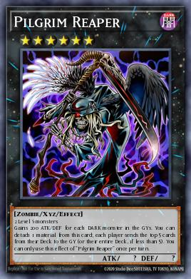

- **Copias y zona:** Extra 1x. No altera las cantidades registradas.
- **Nombre oficial de referencia:** Parca Peregrina. CID cotejado con la ficha oficial; el nombre histórico del inventario se conserva aunque su grafía/traducción difiera.
- **Función principal y secundaria:** resultado de Extra Deck · cierre · habilitador Xyz.
- **Estado de sinergia y función:** Sin acceso al Extra demostrado. Es una clasificación de juego; revisar la relación concreta en A06.
- **Papel como recurso, descarte o coste:** Material o destino del Extra condicionado a los requisitos de invocación.
- **Efecto operativo (paráfrasis analítica):** presión de combate o modificación de estadísticas; gestión de materiales Xyz. Son operaciones detectadas en el texto, no efectos independientes garantizados; leer sus condiciones en la fuente.
- **Mapa de activación y resultados:** 1) efecto propio o continuo: desacopla materiales Xyz. Cada operación está sujeta a la secuencia y al «si lo haces» del texto oficial.
- **Ventanas de activación identificadas:** requieren la fase o condición específica indicada en el texto; sin ventana rápida general asumida.
- **Costes o recursos potenciales:** sin coste independiente identificado en esta síntesis; comprobar las acciones previas al punto y coma de cada efecto.
- **Restricciones y requisitos:** hay límite por turno según el efecto concreto; interactúa con información oculta o resultados no siempre elegibles. Invocar sólo desde el Extra Deck usando su procedimiento propio.
- **Prioridad al ir primero:** generar envíos por efecto sin malgastar recursos y preparar interacción. Para esta carta: Comprobar materiales exactos antes de buscar este objetivo en el Extra Deck.
- **Prioridad al ir segundo:** forzar respuestas rivales con Fusión/retiradas y conservar cementerio utilizable. Identificar primero la respuesta rival que afecta su función «resultado de Extra Deck».
- **Medio/tardío y recuperación:** recuperar materiales y gestionar cartas enviadas o desterradas. No asumir que por sí misma recicla recursos si el texto no lo permite.
- **Sinergias y acceso a líneas:** Relación contextual con enviar cartas al Cementerio por efecto y aprovechar fusiones, reciclaje y motores Horus/Demoniherrero. Puede cerrar o prolongar una ruta del Extra si los materiales están disponibles.
- **Riesgo / brick / interrupciones:** Se agota al consumir materiales; no asumir material adicional al pasar de un Xyz a otro. No atribuirle velocidad rápida por el solo hecho de formar parte del motor.
- **Utilidad editorial:** 4/5 para este deck (estimación por rol y zona, no probabilidad calculada). No cambiar copias; cualquier sugerencia de alta/baja pasa por el apartado 22 y aprobación.
- **Referencia oficial y trazabilidad:** https://www.db.yugioh-card.com/yugiohdb/card_search.action?cid=11005&ope=2&request_locale=es. **Confianza:** texto y tipo de efecto cotejados en Konami; síntesis táctica editorial, no demostración de combo.
- **Aplicación concreta dentro de este deck (A06):** presión de combate o modificación de estadísticas; gestión de materiales Xyz. Falta arista de materiales en A06; A09 podría contener una ruta válida no indexada aquí.

**USO PRÁCTICO Y SINERGIA — Parca Peregrina**

- **Label funcional:** Sin sinergia demostrada (con la evidencia actual). Clasificación documental; una relación es válida solo si se satisfacen sus condiciones exactas.
- **Qué hace:** presión de combate o modificación de estadísticas; gestión de materiales Xyz. Son operaciones detectadas en el texto, no efectos independientes garantizados; leer sus condiciones en la fuente.
- **Cómo aprovecharla en este deck:** presión de combate o modificación de estadísticas; gestión de materiales Xyz. Falta arista de materiales en A06; A09 podría contener una ruta válida no indexada aquí.
- **Al jugar primero:** generar envíos por efecto sin malgastar recursos y preparar interacción. Para esta carta: Comprobar materiales exactos antes de buscar este objetivo en el Extra Deck.
- **Al jugar segundo:** forzar respuestas rivales con Fusión/retiradas y conservar cementerio utilizable. Identificar primero la respuesta rival que afecta su función «resultado de Extra Deck».
- **Cuándo tener precaución:** Se agota al consumir materiales; no asumir material adicional al pasar de un Xyz a otro. No atribuirle velocidad rápida por el solo hecho de formar parte del motor.

**CÓMO LLEGAR DESDE TU DECK — SIN RUTA DEMOSTRADA**

- La biblioteca actual no contiene una ruta identificada para esta carta del Extra. No se debe exhibir una descripción genérica como sustituto de mano inicial, materiales y pasos. Para completarla, contrastar requisitos oficiales y recursos del Main; si no es alcanzable, explicar el impedimento exacto.

#### 39. El Vampiro Zombi

- **Copias y zona:** Extra 1x. No altera las cantidades registradas.
- **Nombre oficial de referencia:** El Vampiro Zombi. CID cotejado con la ficha oficial; el nombre histórico del inventario se conserva aunque su grafía/traducción difiera.
- **Función principal y secundaria:** resultado de Extra Deck · recuperación · habilitador Xyz.
- **Estado de sinergia y función:** Destino Extra condicionado. Es una clasificación de juego; revisar la relación concreta en A06.
- **Papel como recurso, descarte o coste:** Material o destino del Extra condicionado a los requisitos de invocación.
- **Efecto operativo (paráfrasis analítica):** recuperación e invocación desde Cementerio/destierro; gestión de materiales Xyz. Son operaciones detectadas en el texto, no efectos independientes garantizados; leer sus condiciones en la fuente.
- **Mapa de activación y resultados:** 1) efecto propio o continuo: Invocación Especial desde Cementerio · 2) efecto propio o continuo: Invocación Especial desde Cementerio, desacopla materiales Xyz. Cada operación está sujeta a la secuencia y al «si lo haces» del texto oficial.
- **Ventanas de activación identificadas:** requieren la fase o condición específica indicada en el texto; sin ventana rápida general asumida.
- **Costes o recursos potenciales:** sin coste independiente identificado en esta síntesis; comprobar las acciones previas al punto y coma de cada efecto.
- **Restricciones y requisitos:** hay límite por turno según el efecto concreto; interactúa con información oculta o resultados no siempre elegibles. Invocar sólo desde el Extra Deck usando su procedimiento propio.
- **Prioridad al ir primero:** generar envíos por efecto sin malgastar recursos y preparar interacción. Para esta carta: Comprobar materiales exactos antes de buscar este objetivo en el Extra Deck.
- **Prioridad al ir segundo:** forzar respuestas rivales con Fusión/retiradas y conservar cementerio utilizable. Identificar primero la respuesta rival que afecta su función «resultado de Extra Deck».
- **Medio/tardío y recuperación:** recuperar materiales y gestionar cartas enviadas o desterradas. Verificar que el objetivo de recuperación continúe disponible.
- **Sinergias y acceso a líneas:** Relación contextual con enviar cartas al Cementerio por efecto y aprovechar fusiones, reciclaje y motores Horus/Demoniherrero. Puede cerrar o prolongar una ruta del Extra si los materiales están disponibles.
- **Riesgo / brick / interrupciones:** Se agota al consumir materiales; no asumir material adicional al pasar de un Xyz a otro. No atribuirle velocidad rápida por el solo hecho de formar parte del motor.
- **Utilidad editorial:** 4/5 para este deck (estimación por rol y zona, no probabilidad calculada). No cambiar copias; cualquier sugerencia de alta/baja pasa por el apartado 22 y aprobación.
- **Referencia oficial y trazabilidad:** https://www.db.yugioh-card.com/yugiohdb/card_search.action?cid=16850&ope=2&request_locale=es. **Confianza:** texto y tipo de efecto cotejados en Konami; síntesis táctica editorial, no demostración de combo.
- **Aplicación concreta dentro de este deck (A06):** recuperación e invocación desde Cementerio/destierro; gestión de materiales Xyz. A06 identifica su destino, condicionado a material/procedimiento.

**USO PRÁCTICO Y SINERGIA — El Vampiro Zombi**

- **Label funcional:** Referencias de ruta localizadas; conexión reglamentaria sujeta al recorrido de la guía. Clasificación documental; una relación es válida solo si se satisfacen sus condiciones exactas.
- **Qué hace:** recuperación e invocación desde Cementerio/destierro; gestión de materiales Xyz. Son operaciones detectadas en el texto, no efectos independientes garantizados; leer sus condiciones en la fuente.
- **Cómo aprovecharla en este deck:** recuperación e invocación desde Cementerio/destierro; gestión de materiales Xyz. A06 identifica su destino, condicionado a material/procedimiento.
- **Al jugar primero:** generar envíos por efecto sin malgastar recursos y preparar interacción. Para esta carta: Comprobar materiales exactos antes de buscar este objetivo en el Extra Deck.
- **Al jugar segundo:** forzar respuestas rivales con Fusión/retiradas y conservar cementerio utilizable. Identificar primero la respuesta rival que afecta su función «resultado de Extra Deck».
- **Cuándo tener precaución:** Se agota al consumir materiales; no asumir material adicional al pasar de un Xyz a otro. No atribuirle velocidad rápida por el solo hecho de formar parte del motor.

**CÓMO LLEGAR DESDE TU DECK — RUTAS DOCUMENTADAS**

- **Abrir guía `656:A09:SARC:IMSETY_HAPI:ZOMBIE01`:** entrada: Sarcófago 1× Sarcófago del Rey + 2× Tiagrimientos Kashtira (hay 3 copias en Main; se emplean aquí exclusivamente como cartas que pueden enviarse al GY). Campo, GY y destierro propios iniciales: vacíos; Normal: disponible; rival: sin respuesta/interferencia; restricciones previas: ninguna. Deck: Amset Amset e Hapi Hapi disponibles. Extra: El Vampiro Zombi 1 copia disponible. No incluir Reserva ni suponer robos.. Propósito descrito: Ofensivo condicional. Consulta sus pasos, consumo y resultado; comprobar si esta carta es realmente invocada o solo mencionada.
- **Abrir guía `656:A09:IMSETY:SARC_HAPI:ZOMBIE01`:** entrada: Amset 1× Amset, Gloria de Horus + 2× Tiagrimientos Kashtira de las 3 de Main. Campo/GY/destierro propios vacíos, Normal disponible, Main Phase sin respuesta; Deck contiene Sarcófago (2 copias en lista) y Hapi; Extra contiene El Vampiro Zombi. No se presume la carta de robo opcional.. Propósito descrito: Ofensivo condicional. Consulta sus pasos, consumo y resultado; comprobar si esta carta es realmente invocada o solo mencionada.

#### 40. Caballero Exciton Horda de Maldad

- **Copias y zona:** Extra 1x. No altera las cantidades registradas.
- **Nombre oficial de referencia:** Caballero Exciton Horda de Maldad. CID cotejado con la ficha oficial; el nombre histórico del inventario se conserva aunque su grafía/traducción difiera.
- **Función principal y secundaria:** interrupción · resultado de Extra Deck · removal · cierre · habilitador Xyz.
- **Estado de sinergia y función:** Sin acceso al Extra demostrado. Es una clasificación de juego; revisar la relación concreta en A06.
- **Papel como recurso, descarte o coste:** Material o destino del Extra condicionado a los requisitos de invocación.
- **Efecto operativo (paráfrasis analítica):** destrucción de cartas o empleo de destrucción como detonante; presión de combate o modificación de estadísticas; gestión de materiales Xyz. Son operaciones detectadas en el texto, no efectos independientes garantizados; leer sus condiciones en la fuente.
- **Mapa de activación y resultados:** 1) en Main Phase: destruye la carta o recurso previsto, desacopla materiales Xyz. Cada operación está sujeta a la secuencia y al «si lo haces» del texto oficial.
- **Ventanas de activación identificadas:** Main Phase; Efecto Rápido.
- **Costes o recursos potenciales:** sin coste independiente identificado en esta síntesis; comprobar las acciones previas al punto y coma de cada efecto.
- **Restricciones y requisitos:** aplicar restricciones de selección, activación y copias que consten en el texto original. Invocar sólo desde el Extra Deck usando su procedimiento propio.
- **Prioridad al ir primero:** generar envíos por efecto sin malgastar recursos y preparar interacción. Para esta carta: Reservar la respuesta para la ventana rival exacta; no es una pieza buscadora de nuestro motor.
- **Prioridad al ir segundo:** forzar respuestas rivales con Fusión/retiradas y conservar cementerio utilizable. Identificar primero la respuesta rival que afecta su función «interrupción».
- **Medio/tardío y recuperación:** recuperar materiales y gestionar cartas enviadas o desterradas. No asumir que por sí misma recicla recursos si el texto no lo permite.
- **Sinergias y acceso a líneas:** Relación contextual con enviar cartas al Cementerio por efecto y aprovechar fusiones, reciclaje y motores Horus/Demoniherrero. Puede cerrar o prolongar una ruta del Extra si los materiales están disponibles.
- **Riesgo / brick / interrupciones:** Se agota al consumir materiales; no asumir material adicional al pasar de un Xyz a otro. Puede emplearse en cadena sólo cuando se cumpla su condición concreta.
- **Utilidad editorial:** 4/5 para este deck (estimación por rol y zona, no probabilidad calculada). No cambiar copias; cualquier sugerencia de alta/baja pasa por el apartado 22 y aprobación.
- **Referencia oficial y trazabilidad:** https://www.db.yugioh-card.com/yugiohdb/card_search.action?cid=10942&ope=2&request_locale=es. **Confianza:** texto y tipo de efecto cotejados en Konami; síntesis táctica editorial, no demostración de combo.
- **Aplicación concreta dentro de este deck (A06):** destrucción de cartas o empleo de destrucción como detonante; presión de combate o modificación de estadísticas; gestión de materiales Xyz. Falta arista de materiales en A06; A09 podría contener una ruta válida no indexada aquí.

**USO PRÁCTICO Y SINERGIA — Caballero Exciton Horda de Maldad**

- **Label funcional:** Sin sinergia demostrada (con la evidencia actual). Clasificación documental; una relación es válida solo si se satisfacen sus condiciones exactas.
- **Qué hace:** destrucción de cartas o empleo de destrucción como detonante; presión de combate o modificación de estadísticas; gestión de materiales Xyz. Son operaciones detectadas en el texto, no efectos independientes garantizados; leer sus condiciones en la fuente.
- **Cómo aprovecharla en este deck:** destrucción de cartas o empleo de destrucción como detonante; presión de combate o modificación de estadísticas; gestión de materiales Xyz. Falta arista de materiales en A06; A09 podría contener una ruta válida no indexada aquí.
- **Al jugar primero:** generar envíos por efecto sin malgastar recursos y preparar interacción. Para esta carta: Reservar la respuesta para la ventana rival exacta; no es una pieza buscadora de nuestro motor.
- **Al jugar segundo:** forzar respuestas rivales con Fusión/retiradas y conservar cementerio utilizable. Identificar primero la respuesta rival que afecta su función «interrupción».
- **Cuándo tener precaución:** Se agota al consumir materiales; no asumir material adicional al pasar de un Xyz a otro. Puede emplearse en cadena sólo cuando se cumpla su condición concreta.

**CÓMO LLEGAR DESDE TU DECK — SIN RUTA DEMOSTRADA**

- La biblioteca actual no contiene una ruta identificada para esta carta del Extra. No se debe exhibir una descripción genérica como sustituto de mano inicial, materiales y pasos. Para completarla, contrastar requisitos oficiales y recursos del Main; si no es alcanzable, explicar el impedimento exacto.

#### 41. Ladrón del Tiempo Repetidor

- **Copias y zona:** Extra 1x. No altera las cantidades registradas.
- **Nombre oficial de referencia:** Ladrón del Tiempo Repetidor. CID cotejado con la ficha oficial; el nombre histórico del inventario se conserva aunque su grafía/traducción difiera.
- **Función principal y secundaria:** interrupción · resultado de Extra Deck · removal · ventaja de mano · habilitador Xyz.
- **Estado de sinergia y función:** Sin acceso al Extra demostrado. Es una clasificación de juego; revisar la relación concreta en A06.
- **Papel como recurso, descarte o coste:** Material o destino del Extra condicionado a los requisitos de invocación.
- **Efecto operativo (paráfrasis analítica):** destierro de recursos o de amenazas; generación de cartas por robo; gestión de materiales Xyz. Son operaciones detectadas en el texto, no efectos independientes garantizados; leer sus condiciones en la fuente.
- **Mapa de activación y resultados:** 1) en Standby Phase: destierra el recurso u objetivo previsto, desacopla materiales Xyz, roba cartas. Cada operación está sujeta a la secuencia y al «si lo haces» del texto oficial.
- **Ventanas de activación identificadas:** Standby Phase; Efecto Rápido.
- **Costes o recursos potenciales:** sin coste independiente identificado en esta síntesis; comprobar las acciones previas al punto y coma de cada efecto.
- **Restricciones y requisitos:** hay límite por turno según el efecto concreto. Invocar sólo desde el Extra Deck usando su procedimiento propio.
- **Prioridad al ir primero:** generar envíos por efecto sin malgastar recursos y preparar interacción. Para esta carta: Reservar la respuesta para la ventana rival exacta; no es una pieza buscadora de nuestro motor.
- **Prioridad al ir segundo:** forzar respuestas rivales con Fusión/retiradas y conservar cementerio utilizable. Identificar primero la respuesta rival que afecta su función «interrupción».
- **Medio/tardío y recuperación:** recuperar materiales y gestionar cartas enviadas o desterradas. No asumir que por sí misma recicla recursos si el texto no lo permite.
- **Sinergias y acceso a líneas:** Relación contextual con enviar cartas al Cementerio por efecto y aprovechar fusiones, reciclaje y motores Horus/Demoniherrero. Puede cerrar o prolongar una ruta del Extra si los materiales están disponibles.
- **Riesgo / brick / interrupciones:** Se agota al consumir materiales; no asumir material adicional al pasar de un Xyz a otro. Puede emplearse en cadena sólo cuando se cumpla su condición concreta.
- **Utilidad editorial:** 4/5 para este deck (estimación por rol y zona, no probabilidad calculada). No cambiar copias; cualquier sugerencia de alta/baja pasa por el apartado 22 y aprobación.
- **Referencia oficial y trazabilidad:** https://www.db.yugioh-card.com/yugiohdb/card_search.action?cid=14356&ope=2&request_locale=es. **Confianza:** texto y tipo de efecto cotejados en Konami; síntesis táctica editorial, no demostración de combo.
- **Aplicación concreta dentro de este deck (A06):** destierro de recursos o de amenazas; generación de cartas por robo; gestión de materiales Xyz. Falta arista de materiales en A06; A09 podría contener una ruta válida no indexada aquí.

**USO PRÁCTICO Y SINERGIA — Ladrón del Tiempo Repetidor**

- **Label funcional:** Sin sinergia demostrada (con la evidencia actual). Clasificación documental; una relación es válida solo si se satisfacen sus condiciones exactas.
- **Qué hace:** destierro de recursos o de amenazas; generación de cartas por robo; gestión de materiales Xyz. Son operaciones detectadas en el texto, no efectos independientes garantizados; leer sus condiciones en la fuente.
- **Cómo aprovecharla en este deck:** destierro de recursos o de amenazas; generación de cartas por robo; gestión de materiales Xyz. Falta arista de materiales en A06; A09 podría contener una ruta válida no indexada aquí.
- **Al jugar primero:** generar envíos por efecto sin malgastar recursos y preparar interacción. Para esta carta: Reservar la respuesta para la ventana rival exacta; no es una pieza buscadora de nuestro motor.
- **Al jugar segundo:** forzar respuestas rivales con Fusión/retiradas y conservar cementerio utilizable. Identificar primero la respuesta rival que afecta su función «interrupción».
- **Cuándo tener precaución:** Se agota al consumir materiales; no asumir material adicional al pasar de un Xyz a otro. Puede emplearse en cadena sólo cuando se cumpla su condición concreta.

**CÓMO LLEGAR DESDE TU DECK — SIN RUTA DEMOSTRADA**

- La biblioteca actual no contiene una ruta identificada para esta carta del Extra. No se debe exhibir una descripción genérica como sustituto de mano inicial, materiales y pasos. Para completarla, contrastar requisitos oficiales y recursos del Main; si no es alcanzable, explicar el impedimento exacto.

#### 42. Fuwalos Multivadora

- **Copias y zona:** Reserva 2x. No altera las cantidades registradas.
- **Nombre oficial de referencia:** Fuwalos Multivadora. CID cotejado con la ficha oficial; el nombre histórico del inventario se conserva aunque su grafía/traducción difiera.
- **Función principal y secundaria:** handtrap · robo condicional.
- **Estado de sinergia y función:** Reserva fuera de lista activa. Es una clasificación de juego; revisar la relación concreta en A06.
- **Papel como recurso, descarte o coste:** Coste o consumo descrito en A05: descarte de mano; reciclaje de recurso propio.
- **Efecto operativo (paráfrasis analítica):** Con campo propio sin cartas, descarta y roba al producirse Invocaciones Especiales rivales desde Deck o Extra; ajusta la mano en End Phase. 
- **Mapa de activación y resultados:** 1) con campo propio vacío: Invocación Especial desde Extra Deck, devuelve recursos a mano/Deck/Extra. Cada operación está sujeta a la secuencia y al «si lo haces» del texto oficial.
- **Ventanas de activación identificadas:** campo propio vacío; Efecto Rápido.
- **Costes o recursos potenciales:** descarte de mano; reciclaje de recurso propio.
- **Restricciones y requisitos:** requiere campo propio sin las cartas indicadas; interactúa con información oculta o resultados no siempre elegibles. 
- **Prioridad al ir primero:** generar envíos por efecto sin malgastar recursos y preparar interacción. Para esta carta: Reservar la respuesta para la ventana rival exacta; no es una pieza buscadora de nuestro motor.
- **Prioridad al ir segundo:** forzar respuestas rivales con Fusión/retiradas y conservar cementerio utilizable. Identificar primero la respuesta rival que afecta su función «handtrap».
- **Medio/tardío y recuperación:** recuperar materiales y gestionar cartas enviadas o desterradas. Verificar que el objetivo de recuperación continúe disponible.
- **Sinergias y acceso a líneas:** Relación contextual con enviar cartas al Cementerio por efecto y aprovechar fusiones, reciclaje y motores Horus/Demoniherrero. Habilita una línea del motor sólo si coinciden recursos, objetivos y restricciones; no equivale a un combo completo validado.
- **Riesgo / brick / interrupciones:** No roba por Invocaciones desde la mano; comparte restricción de efectos Mulcharmy. Puede emplearse en cadena sólo cuando se cumpla su condición concreta.
- **Utilidad editorial:** 3/5 para este deck (estimación por rol y zona, no probabilidad calculada). No cambiar copias; cualquier sugerencia de alta/baja pasa por el apartado 22 y aprobación.
- **Referencia oficial y trazabilidad:** https://www.db.yugioh-card.com/yugiohdb/card_search.action?cid=20500&ope=2&request_locale=es. **Confianza:** texto y tipo de efecto cotejados en Konami; síntesis táctica editorial, no demostración de combo.
- **Aplicación concreta dentro de este deck (A06):** Fuera de lista. Con campo propio sin cartas, descarta y roba al producirse Invocaciones Especiales rivales desde Deck o Extra; ajusta la mano en End Phase.. No aporta recursos durante este duelo.

**USO PRÁCTICO Y SINERGIA — Fuwalos Multivadora**

- **Label funcional:** Sin sinergia demostrada (con la evidencia actual). Clasificación documental; una relación es válida solo si se satisfacen sus condiciones exactas.
- **Qué hace:** Con campo propio sin cartas, descarta y roba al producirse Invocaciones Especiales rivales desde Deck o Extra; ajusta la mano en End Phase.
- **Cómo aprovecharla en este deck:** Fuera de lista. Con campo propio sin cartas, descarta y roba al producirse Invocaciones Especiales rivales desde Deck o Extra; ajusta la mano en End Phase.. No aporta recursos durante este duelo.
- **Al jugar primero:** generar envíos por efecto sin malgastar recursos y preparar interacción. Para esta carta: Reservar la respuesta para la ventana rival exacta; no es una pieza buscadora de nuestro motor.
- **Al jugar segundo:** forzar respuestas rivales con Fusión/retiradas y conservar cementerio utilizable. Identificar primero la respuesta rival que afecta su función «handtrap».
- **Cuándo tener precaución:** No roba por Invocaciones desde la mano; comparte restricción de efectos Mulcharmy. Puede emplearse en cadena sólo cuando se cumpla su condición concreta.

#### 43. Punto de Oveja

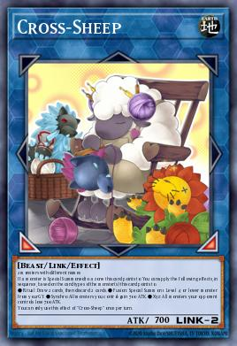

- **Copias y zona:** Reserva 1x. No altera las cantidades registradas.
- **Nombre oficial de referencia:** Punto de Oveja. CID cotejado con la ficha oficial; el nombre histórico del inventario se conserva aunque su grafía/traducción difiera.
- **Función principal y secundaria:** recuperación · ventaja de mano · cierre.
- **Estado de sinergia y función:** Reserva fuera de lista activa. Es una clasificación de juego; revisar la relación concreta en A06.
- **Papel como recurso, descarte o coste:** Coste o consumo descrito en A05: descarte de mano.
- **Efecto operativo (paráfrasis analítica):** recuperación e invocación desde Cementerio/destierro; generación de cartas por robo; presión de combate o modificación de estadísticas. Son operaciones detectadas en el texto, no efectos independientes garantizados; leer sus condiciones en la fuente.
- **Mapa de activación y resultados:** 1) con condición explícita en la carta: Invocación Especial desde Cementerio, roba cartas. Cada operación está sujeta a la secuencia y al «si lo haces» del texto oficial.
- **Ventanas de activación identificadas:** al producirse una Invocación.
- **Costes o recursos potenciales:** descarte de mano.
- **Restricciones y requisitos:** hay límite por turno según el efecto concreto; depende de recursos en Cementerio. 
- **Prioridad al ir primero:** generar envíos por efecto sin malgastar recursos y preparar interacción. Para esta carta: Escoger la amenaza o recurso que genere mayor ventaja de tempo; respetar selección y zona.
- **Prioridad al ir segundo:** forzar respuestas rivales con Fusión/retiradas y conservar cementerio utilizable. Identificar primero la respuesta rival que afecta su función «recuperación».
- **Medio/tardío y recuperación:** recuperar materiales y gestionar cartas enviadas o desterradas. Verificar que el objetivo de recuperación continúe disponible.
- **Sinergias y acceso a líneas:** Relación contextual con enviar cartas al Cementerio por efecto y aprovechar fusiones, reciclaje y motores Horus/Demoniherrero. Habilita una línea del motor sólo si coinciden recursos, objetivos y restricciones; no equivale a un combo completo validado.
- **Riesgo / brick / interrupciones:** Riesgo operativo: interrupción del Cementerio, restricciones de materiales y mildeos aleatorios. Confirmar objetivos disponibles y costes antes de activar. No atribuirle velocidad rápida por el solo hecho de formar parte del motor.
- **Utilidad editorial:** 3/5 para este deck (estimación por rol y zona, no probabilidad calculada). No cambiar copias; cualquier sugerencia de alta/baja pasa por el apartado 22 y aprobación.
- **Referencia oficial y trazabilidad:** https://www.db.yugioh-card.com/yugiohdb/card_search.action?cid=14856&ope=2&request_locale=es. **Confianza:** texto y tipo de efecto cotejados en Konami; síntesis táctica editorial, no demostración de combo.
- **Aplicación concreta dentro de este deck (A06):** Fuera de lista. recuperación e invocación desde Cementerio/destierro; generación de cartas por robo; presión de combate o modificación de estadísticas.. No aporta recursos durante este duelo.

**USO PRÁCTICO Y SINERGIA — Punto de Oveja**

- **Label funcional:** Sin sinergia demostrada (con la evidencia actual). Clasificación documental; una relación es válida solo si se satisfacen sus condiciones exactas.
- **Qué hace:** recuperación e invocación desde Cementerio/destierro; generación de cartas por robo; presión de combate o modificación de estadísticas. Son operaciones detectadas en el texto, no efectos independientes garantizados; leer sus condiciones en la fuente.
- **Cómo aprovecharla en este deck:** Fuera de lista. recuperación e invocación desde Cementerio/destierro; generación de cartas por robo; presión de combate o modificación de estadísticas.. No aporta recursos durante este duelo.
- **Al jugar primero:** generar envíos por efecto sin malgastar recursos y preparar interacción. Para esta carta: Escoger la amenaza o recurso que genere mayor ventaja de tempo; respetar selección y zona.
- **Al jugar segundo:** forzar respuestas rivales con Fusión/retiradas y conservar cementerio utilizable. Identificar primero la respuesta rival que afecta su función «recuperación».
- **Cuándo tener precaución:** Riesgo operativo: interrupción del Cementerio, restricciones de materiales y mildeos aleatorios. Confirmar objetivos disponibles y costes antes de activar. No atribuirle velocidad rápida por el solo hecho de formar parte del motor.

#### 44. Alma Desencadenada de Shyama

- **Copias y zona:** Reserva 1x. No altera las cantidades registradas.
- **Nombre oficial de referencia:** Alma Desencadenada de Shyama. CID cotejado con la ficha oficial; el nombre histórico del inventario se conserva aunque su grafía/traducción difiera.
- **Función principal y secundaria:** respuesta.
- **Estado de sinergia y función:** Reserva fuera de lista activa. Es una clasificación de juego; revisar la relación concreta en A06.
- **Papel como recurso, descarte o coste:** No se demuestra que esta carta sea recurso de descarte o pago para otra.
- **Efecto operativo (paráfrasis analítica):** interacción sobre monstruos en campo. Son operaciones detectadas en el texto, no efectos independientes garantizados; leer sus condiciones en la fuente.
- **Mapa de activación y resultados:** 1) efecto propio o continuo: destruye la carta o recurso previsto · 2) mientras está en Cementerio: Invocación Especial desde zona permitida. Cada operación está sujeta a la secuencia y al «si lo haces» del texto oficial.
- **Ventanas de activación identificadas:** al llegar o estar en el Cementerio.
- **Costes o recursos potenciales:** sin coste independiente identificado en esta síntesis; comprobar las acciones previas al punto y coma de cada efecto.
- **Restricciones y requisitos:** hay límite por turno según el efecto concreto; depende de recursos en Cementerio; interactúa con información oculta o resultados no siempre elegibles. 
- **Prioridad al ir primero:** generar envíos por efecto sin malgastar recursos y preparar interacción. Para esta carta: Activar cuando las condiciones permitan obtener valor real, preservando recursos de seguimiento.
- **Prioridad al ir segundo:** forzar respuestas rivales con Fusión/retiradas y conservar cementerio utilizable. Identificar primero la respuesta rival que afecta su función «respuesta».
- **Medio/tardío y recuperación:** recuperar materiales y gestionar cartas enviadas o desterradas. No asumir que por sí misma recicla recursos si el texto no lo permite.
- **Sinergias y acceso a líneas:** Relación contextual con enviar cartas al Cementerio por efecto y aprovechar fusiones, reciclaje y motores Horus/Demoniherrero. Habilita una línea del motor sólo si coinciden recursos, objetivos y restricciones; no equivale a un combo completo validado.
- **Riesgo / brick / interrupciones:** Depende del Cementerio y es sensible a destierro o negación de ese recurso. No atribuirle velocidad rápida por el solo hecho de formar parte del motor.
- **Utilidad editorial:** 3/5 para este deck (estimación por rol y zona, no probabilidad calculada). No cambiar copias; cualquier sugerencia de alta/baja pasa por el apartado 22 y aprobación.
- **Referencia oficial y trazabilidad:** https://www.db.yugioh-card.com/yugiohdb/card_search.action?cid=18807&ope=2&request_locale=es. **Confianza:** texto y tipo de efecto cotejados en Konami; síntesis táctica editorial, no demostración de combo.
- **Aplicación concreta dentro de este deck (A06):** Fuera de lista. interacción sobre monstruos en campo.. No aporta recursos durante este duelo.

**USO PRÁCTICO Y SINERGIA — Alma Desencadenada de Shyama**

- **Label funcional:** Sin sinergia demostrada (con la evidencia actual). Clasificación documental; una relación es válida solo si se satisfacen sus condiciones exactas.
- **Qué hace:** interacción sobre monstruos en campo. Son operaciones detectadas en el texto, no efectos independientes garantizados; leer sus condiciones en la fuente.
- **Cómo aprovecharla en este deck:** Fuera de lista. interacción sobre monstruos en campo.. No aporta recursos durante este duelo.
- **Al jugar primero:** generar envíos por efecto sin malgastar recursos y preparar interacción. Para esta carta: Activar cuando las condiciones permitan obtener valor real, preservando recursos de seguimiento.
- **Al jugar segundo:** forzar respuestas rivales con Fusión/retiradas y conservar cementerio utilizable. Identificar primero la respuesta rival que afecta su función «respuesta».
- **Cuándo tener precaución:** Depende del Cementerio y es sensible a destierro o negación de ese recurso. No atribuirle velocidad rápida por el solo hecho de formar parte del motor.

#### 45. Llamado por la Tumba

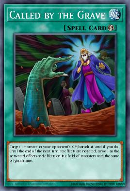

- **Copias y zona:** Reserva 1x. No altera las cantidades registradas.
- **Nombre oficial de referencia:** Llamado por la Tumba. CID cotejado con la ficha oficial; el nombre histórico del inventario se conserva aunque su grafía/traducción difiera.
- **Función principal y secundaria:** mágica rápida · negación de nombre.
- **Estado de sinergia y función:** Reserva fuera de lista activa. Es una clasificación de juego; revisar la relación concreta en A06.
- **Papel como recurso, descarte o coste:** No se demuestra que esta carta sea recurso de descarte o pago para otra.
- **Efecto operativo (paráfrasis analítica):** Destierra un monstruo del Cementerio rival y niega sus efectos junto con los del mismo nombre original hasta el final del turno siguiente. 
- **Mapa de activación y resultados:** efecto de estadística, condición o material; no asumir un disparador adicional. Cada operación está sujeta a la secuencia y al «si lo haces» del texto oficial.
- **Ventanas de activación identificadas:** requieren la fase o condición específica indicada en el texto; sin ventana rápida general asumida.
- **Costes o recursos potenciales:** sin coste independiente identificado en esta síntesis; comprobar las acciones previas al punto y coma de cada efecto.
- **Restricciones y requisitos:** aplicar restricciones de selección, activación y copias que consten en el texto original. 
- **Prioridad al ir primero:** generar envíos por efecto sin malgastar recursos y preparar interacción. Para esta carta: Activar cuando las condiciones permitan obtener valor real, preservando recursos de seguimiento.
- **Prioridad al ir segundo:** forzar respuestas rivales con Fusión/retiradas y conservar cementerio utilizable. Identificar primero la respuesta rival que afecta su función «mágica rápida».
- **Medio/tardío y recuperación:** recuperar materiales y gestionar cartas enviadas o desterradas. No asumir que por sí misma recicla recursos si el texto no lo permite.
- **Sinergias y acceso a líneas:** Relación contextual con enviar cartas al Cementerio por efecto y aprovechar fusiones, reciclaje y motores Horus/Demoniherrero. Habilita una línea del motor sólo si coinciden recursos, objetivos y restricciones; no equivale a un combo completo validado.
- **Riesgo / brick / interrupciones:** Exige un objetivo en el Cementerio rival; no es negación universal. No atribuirle velocidad rápida por el solo hecho de formar parte del motor.
- **Utilidad editorial:** 3/5 para este deck (estimación por rol y zona, no probabilidad calculada). No cambiar copias; cualquier sugerencia de alta/baja pasa por el apartado 22 y aprobación.
- **Referencia oficial y trazabilidad:** https://www.db.yugioh-card.com/yugiohdb/card_search.action?cid=13619&ope=2&request_locale=es. **Confianza:** texto y tipo de efecto cotejados en Konami; síntesis táctica editorial, no demostración de combo.
- **Aplicación concreta dentro de este deck (A06):** Fuera de lista. Destierra un monstruo del Cementerio rival y niega sus efectos junto con los del mismo nombre original hasta el final del turno siguiente.. No aporta recursos durante este duelo.

**USO PRÁCTICO Y SINERGIA — Llamado por la Tumba**

- **Label funcional:** Sin sinergia demostrada (con la evidencia actual). Clasificación documental; una relación es válida solo si se satisfacen sus condiciones exactas.
- **Qué hace:** Destierra un monstruo del Cementerio rival y niega sus efectos junto con los del mismo nombre original hasta el final del turno siguiente.
- **Cómo aprovecharla en este deck:** Fuera de lista. Destierra un monstruo del Cementerio rival y niega sus efectos junto con los del mismo nombre original hasta el final del turno siguiente.. No aporta recursos durante este duelo.
- **Al jugar primero:** generar envíos por efecto sin malgastar recursos y preparar interacción. Para esta carta: Activar cuando las condiciones permitan obtener valor real, preservando recursos de seguimiento.
- **Al jugar segundo:** forzar respuestas rivales con Fusión/retiradas y conservar cementerio utilizable. Identificar primero la respuesta rival que afecta su función «mágica rápida».
- **Cuándo tener precaución:** Exige un objetivo en el Cementerio rival; no es negación universal. No atribuirle velocidad rápida por el solo hecho de formar parte del motor.

#### 46. Ciclón del Cosmos

- **Copias y zona:** Reserva 2x. No altera las cantidades registradas.
- **Nombre oficial de referencia:** Ciclón del Cosmos. CID cotejado con la ficha oficial; el nombre histórico del inventario se conserva aunque su grafía/traducción difiera.
- **Función principal y secundaria:** mágica rápida · remoción.
- **Estado de sinergia y función:** Reserva fuera de lista activa. Es una clasificación de juego; revisar la relación concreta en A06.
- **Papel como recurso, descarte o coste:** Destierro como uso/recurso; comprobar origen, coste o efecto y recuperación.
- **Efecto operativo (paráfrasis analítica):** Paga 1000 LP para desterrar una Mágica/Trampa en campo. 
- **Mapa de activación y resultados:** efecto de estadística, condición o material; no asumir un disparador adicional. Cada operación está sujeta a la secuencia y al «si lo haces» del texto oficial.
- **Ventanas de activación identificadas:** requieren la fase o condición específica indicada en el texto; sin ventana rápida general asumida.
- **Costes o recursos potenciales:** pago de LP.
- **Restricciones y requisitos:** aplicar restricciones de selección, activación y copias que consten en el texto original. 
- **Prioridad al ir primero:** generar envíos por efecto sin malgastar recursos y preparar interacción. Para esta carta: Activar cuando las condiciones permitan obtener valor real, preservando recursos de seguimiento.
- **Prioridad al ir segundo:** forzar respuestas rivales con Fusión/retiradas y conservar cementerio utilizable. Identificar primero la respuesta rival que afecta su función «mágica rápida».
- **Medio/tardío y recuperación:** recuperar materiales y gestionar cartas enviadas o desterradas. No asumir que por sí misma recicla recursos si el texto no lo permite.
- **Sinergias y acceso a líneas:** Relación contextual con enviar cartas al Cementerio por efecto y aprovechar fusiones, reciclaje y motores Horus/Demoniherrero. Habilita una línea del motor sólo si coinciden recursos, objetivos y restricciones; no equivale a un combo completo validado.
- **Riesgo / brick / interrupciones:** El coste de LP y selección de objetivo deben pagarse/declararse antes de la resolución. No atribuirle velocidad rápida por el solo hecho de formar parte del motor.
- **Utilidad editorial:** 3/5 para este deck (estimación por rol y zona, no probabilidad calculada). No cambiar copias; cualquier sugerencia de alta/baja pasa por el apartado 22 y aprobación.
- **Referencia oficial y trazabilidad:** https://www.db.yugioh-card.com/yugiohdb/card_search.action?cid=12464&ope=2&request_locale=es. **Confianza:** texto y tipo de efecto cotejados en Konami; síntesis táctica editorial, no demostración de combo.
- **Aplicación concreta dentro de este deck (A06):** Fuera de lista. Paga 1000 LP para desterrar una Mágica/Trampa en campo.. No aporta recursos durante este duelo.

**USO PRÁCTICO Y SINERGIA — Ciclón del Cosmos**

- **Label funcional:** Sin sinergia demostrada (con la evidencia actual). Clasificación documental; una relación es válida solo si se satisfacen sus condiciones exactas.
- **Qué hace:** Paga 1000 LP para desterrar una Mágica/Trampa en campo.
- **Cómo aprovecharla en este deck:** Fuera de lista. Paga 1000 LP para desterrar una Mágica/Trampa en campo.. No aporta recursos durante este duelo.
- **Al jugar primero:** generar envíos por efecto sin malgastar recursos y preparar interacción. Para esta carta: Activar cuando las condiciones permitan obtener valor real, preservando recursos de seguimiento.
- **Al jugar segundo:** forzar respuestas rivales con Fusión/retiradas y conservar cementerio utilizable. Identificar primero la respuesta rival que afecta su función «mágica rápida».
- **Cuándo tener precaución:** El coste de LP y selección de objetivo deben pagarse/declararse antes de la resolución. No atribuirle velocidad rápida por el solo hecho de formar parte del motor.

#### 47. Polvo de Pluma de Arpía

- **Copias y zona:** Reserva 1x. No altera las cantidades registradas.
- **Nombre oficial de referencia:** Polvo de Pluma de Arpía. CID cotejado con la ficha oficial; el nombre histórico del inventario se conserva aunque su grafía/traducción difiera.
- **Función principal y secundaria:** mágica · eliminación masiva.
- **Estado de sinergia y función:** Reserva fuera de lista activa. Es una clasificación de juego; revisar la relación concreta en A06.
- **Papel como recurso, descarte o coste:** No se demuestra que esta carta sea recurso de descarte o pago para otra.
- **Efecto operativo (paráfrasis analítica):** Destruye todas las Mágicas/Trampas del campo contrario. 
- **Mapa de activación y resultados:** 1) efecto propio o continuo: destruye la carta o recurso previsto. Cada operación está sujeta a la secuencia y al «si lo haces» del texto oficial.
- **Ventanas de activación identificadas:** requieren la fase o condición específica indicada en el texto; sin ventana rápida general asumida.
- **Costes o recursos potenciales:** sin coste independiente identificado en esta síntesis; comprobar las acciones previas al punto y coma de cada efecto.
- **Restricciones y requisitos:** aplicar restricciones de selección, activación y copias que consten en el texto original. 
- **Prioridad al ir primero:** generar envíos por efecto sin malgastar recursos y preparar interacción. Para esta carta: Activar cuando las condiciones permitan obtener valor real, preservando recursos de seguimiento.
- **Prioridad al ir segundo:** forzar respuestas rivales con Fusión/retiradas y conservar cementerio utilizable. Identificar primero la respuesta rival que afecta su función «mágica».
- **Medio/tardío y recuperación:** recuperar materiales y gestionar cartas enviadas o desterradas. No asumir que por sí misma recicla recursos si el texto no lo permite.
- **Sinergias y acceso a líneas:** Relación contextual con enviar cartas al Cementerio por efecto y aprovechar fusiones, reciclaje y motores Horus/Demoniherrero. Habilita una línea del motor sólo si coinciden recursos, objetivos y restricciones; no equivale a un combo completo validado.
- **Riesgo / brick / interrupciones:** No destierra y no protege de respuestas encadenadas. No atribuirle velocidad rápida por el solo hecho de formar parte del motor.
- **Utilidad editorial:** 3/5 para este deck (estimación por rol y zona, no probabilidad calculada). No cambiar copias; cualquier sugerencia de alta/baja pasa por el apartado 22 y aprobación.
- **Referencia oficial y trazabilidad:** https://www.db.yugioh-card.com/yugiohdb/card_search.action?cid=4678&ope=2&request_locale=es. **Confianza:** texto y tipo de efecto cotejados en Konami; síntesis táctica editorial, no demostración de combo.
- **Aplicación concreta dentro de este deck (A06):** Fuera de lista. Destruye todas las Mágicas/Trampas del campo contrario.. No aporta recursos durante este duelo.

**USO PRÁCTICO Y SINERGIA — Polvo de Pluma de Arpía**

- **Label funcional:** Sin sinergia demostrada (con la evidencia actual). Clasificación documental; una relación es válida solo si se satisfacen sus condiciones exactas.
- **Qué hace:** Destruye todas las Mágicas/Trampas del campo contrario.
- **Cómo aprovecharla en este deck:** Fuera de lista. Destruye todas las Mágicas/Trampas del campo contrario.. No aporta recursos durante este duelo.
- **Al jugar primero:** generar envíos por efecto sin malgastar recursos y preparar interacción. Para esta carta: Activar cuando las condiciones permitan obtener valor real, preservando recursos de seguimiento.
- **Al jugar segundo:** forzar respuestas rivales con Fusión/retiradas y conservar cementerio utilizable. Identificar primero la respuesta rival que afecta su función «mágica».
- **Cuándo tener precaución:** No destierra y no protege de respuestas encadenadas. No atribuirle velocidad rápida por el solo hecho de formar parte del motor.

#### 48. Terraformación

- **Copias y zona:** Reserva 1x. No altera las cantidades registradas.
- **Nombre oficial de referencia:** Terraformación. CID cotejado con la ficha oficial; el nombre histórico del inventario se conserva aunque su grafía/traducción difiera.
- **Función principal y secundaria:** mágica · búsqueda de campo.
- **Estado de sinergia y función:** Reserva fuera de lista activa. Es una clasificación de juego; revisar la relación concreta en A06.
- **Papel como recurso, descarte o coste:** No se demuestra que esta carta sea recurso de descarte o pago para otra.
- **Efecto operativo (paráfrasis analítica):** Busca una Mágica de Campo en el Deck y la lleva a la mano. 
- **Mapa de activación y resultados:** 1) efecto propio o continuo: incorpora la pieza indicada a la mano. Cada operación está sujeta a la secuencia y al «si lo haces» del texto oficial.
- **Ventanas de activación identificadas:** requieren la fase o condición específica indicada en el texto; sin ventana rápida general asumida.
- **Costes o recursos potenciales:** sin coste independiente identificado en esta síntesis; comprobar las acciones previas al punto y coma de cada efecto.
- **Restricciones y requisitos:** aplicar restricciones de selección, activación y copias que consten en el texto original. 
- **Prioridad al ir primero:** generar envíos por efecto sin malgastar recursos y preparar interacción. Para esta carta: Convertir la activación en acceso a la siguiente pieza del motor, sin duplicar buscadores inútilmente.
- **Prioridad al ir segundo:** forzar respuestas rivales con Fusión/retiradas y conservar cementerio utilizable. Identificar primero la respuesta rival que afecta su función «mágica».
- **Medio/tardío y recuperación:** recuperar materiales y gestionar cartas enviadas o desterradas. No asumir que por sí misma recicla recursos si el texto no lo permite.
- **Sinergias y acceso a líneas:** Relación contextual con enviar cartas al Cementerio por efecto y aprovechar fusiones, reciclaje y motores Horus/Demoniherrero. Habilita una línea del motor sólo si coinciden recursos, objetivos y restricciones; no equivale a un combo completo validado.
- **Riesgo / brick / interrupciones:** Si el objetivo de campo ya no está en Deck, pierde utilidad. No atribuirle velocidad rápida por el solo hecho de formar parte del motor.
- **Utilidad editorial:** 3/5 para este deck (estimación por rol y zona, no probabilidad calculada). No cambiar copias; cualquier sugerencia de alta/baja pasa por el apartado 22 y aprobación.
- **Referencia oficial y trazabilidad:** https://www.db.yugioh-card.com/yugiohdb/card_search.action?cid=5537&ope=2&request_locale=es. **Confianza:** texto y tipo de efecto cotejados en Konami; síntesis táctica editorial, no demostración de combo.
- **Aplicación concreta dentro de este deck (A06):** Fuera de lista. Busca una Mágica de Campo en el Deck y la lleva a la mano.. No aporta recursos durante este duelo.

**USO PRÁCTICO Y SINERGIA — Terraformación**

- **Label funcional:** Sin sinergia demostrada (con la evidencia actual). Clasificación documental; una relación es válida solo si se satisfacen sus condiciones exactas.
- **Qué hace:** Busca una Mágica de Campo en el Deck y la lleva a la mano.
- **Cómo aprovecharla en este deck:** Fuera de lista. Busca una Mágica de Campo en el Deck y la lleva a la mano.. No aporta recursos durante este duelo.
- **Al jugar primero:** generar envíos por efecto sin malgastar recursos y preparar interacción. Para esta carta: Convertir la activación en acceso a la siguiente pieza del motor, sin duplicar buscadores inútilmente.
- **Al jugar segundo:** forzar respuestas rivales con Fusión/retiradas y conservar cementerio utilizable. Identificar primero la respuesta rival que afecta su función «mágica».
- **Cuándo tener precaución:** Si el objetivo de campo ya no está en Deck, pierde utilidad. No atribuirle velocidad rápida por el solo hecho de formar parte del motor.

#### 49. Talento de Tácticas Triples

- **Copias y zona:** Reserva 1x. No altera las cantidades registradas.
- **Nombre oficial de referencia:** Talento de Tácticas Triples. CID cotejado con la ficha oficial; el nombre histórico del inventario se conserva aunque su grafía/traducción difiera.
- **Función principal y secundaria:** mágica de respuesta · ventaja.
- **Estado de sinergia y función:** Reserva fuera de lista activa. Es una clasificación de juego; revisar la relación concreta en A06.
- **Papel como recurso, descarte o coste:** No se demuestra que esta carta sea recurso de descarte o pago para otra.
- **Efecto operativo (paráfrasis analítica):** Si el rival activó un efecto de monstruo durante tu Main Phase, permite elegir entre robar dos, tomar control temporal o devolver una carta de mano al Deck. 
- **Mapa de activación y resultados:** 1) en Main Phase: devuelve recursos a mano/Deck/Extra, roba cartas, toma temporalmente el control. Cada operación está sujeta a la secuencia y al «si lo haces» del texto oficial.
- **Ventanas de activación identificadas:** Main Phase.
- **Costes o recursos potenciales:** sin coste independiente identificado en esta síntesis; comprobar las acciones previas al punto y coma de cada efecto.
- **Restricciones y requisitos:** hay límite por turno según el efecto concreto. 
- **Prioridad al ir primero:** generar envíos por efecto sin malgastar recursos y preparar interacción. Para esta carta: Activar cuando las condiciones permitan obtener valor real, preservando recursos de seguimiento.
- **Prioridad al ir segundo:** forzar respuestas rivales con Fusión/retiradas y conservar cementerio utilizable. Identificar primero la respuesta rival que afecta su función «mágica de respuesta».
- **Medio/tardío y recuperación:** recuperar materiales y gestionar cartas enviadas o desterradas. Verificar que el objetivo de recuperación continúe disponible.
- **Sinergias y acceso a líneas:** Relación contextual con enviar cartas al Cementerio por efecto y aprovechar fusiones, reciclaje y motores Horus/Demoniherrero. Habilita una línea del motor sólo si coinciden recursos, objetivos y restricciones; no equivale a un combo completo validado.
- **Riesgo / brick / interrupciones:** La condición exige activación de monstruo rival en tu Main Phase; sólo un modo. No atribuirle velocidad rápida por el solo hecho de formar parte del motor.
- **Utilidad editorial:** 3/5 para este deck (estimación por rol y zona, no probabilidad calculada). No cambiar copias; cualquier sugerencia de alta/baja pasa por el apartado 22 y aprobación.
- **Referencia oficial y trazabilidad:** https://www.db.yugioh-card.com/yugiohdb/card_search.action?cid=15296&ope=2&request_locale=es. **Confianza:** texto y tipo de efecto cotejados en Konami; síntesis táctica editorial, no demostración de combo.
- **Aplicación concreta dentro de este deck (A06):** Fuera de lista. Si el rival activó un efecto de monstruo durante tu Main Phase, permite elegir entre robar dos, tomar control temporal o devolver una carta de mano al Deck.. No aporta recursos durante este duelo.

**USO PRÁCTICO Y SINERGIA — Talento de Tácticas Triples**

- **Label funcional:** Sin sinergia demostrada (con la evidencia actual). Clasificación documental; una relación es válida solo si se satisfacen sus condiciones exactas.
- **Qué hace:** Si el rival activó un efecto de monstruo durante tu Main Phase, permite elegir entre robar dos, tomar control temporal o devolver una carta de mano al Deck.
- **Cómo aprovecharla en este deck:** Fuera de lista. Si el rival activó un efecto de monstruo durante tu Main Phase, permite elegir entre robar dos, tomar control temporal o devolver una carta de mano al Deck.. No aporta recursos durante este duelo.
- **Al jugar primero:** generar envíos por efecto sin malgastar recursos y preparar interacción. Para esta carta: Activar cuando las condiciones permitan obtener valor real, preservando recursos de seguimiento.
- **Al jugar segundo:** forzar respuestas rivales con Fusión/retiradas y conservar cementerio utilizable. Identificar primero la respuesta rival que afecta su función «mágica de respuesta».
- **Cuándo tener precaución:** La condición exige activación de monstruo rival en tu Main Phase; sólo un modo. No atribuirle velocidad rápida por el solo hecho de formar parte del motor.

#### 50. Bella Fantasma & Mansión Embrujada

- **Copias y zona:** Reserva 3x. No altera las cantidades registradas.
- **Nombre oficial de referencia:** Bella Fantasma & Mansión Embrujada. CID cotejado con la ficha oficial; el nombre histórico del inventario se conserva aunque su grafía/traducción difiera.
- **Función principal y secundaria:** handtrap · negación de Cementerio.
- **Estado de sinergia y función:** Reserva fuera de lista activa. Es una clasificación de juego; revisar la relación concreta en A06.
- **Papel como recurso, descarte o coste:** Coste o consumo descrito en A05: descarte de mano.
- **Efecto operativo (paráfrasis analítica):** Descarta para negar la activación de una operación que recupere, invoque o destierre cartas del Cementerio. 
- **Mapa de activación y resultados:** 1) con condición explícita en la carta: Invocación Especial desde Extra Deck, incorpora la pieza indicada a la mano. Cada operación está sujeta a la secuencia y al «si lo haces» del texto oficial.
- **Ventanas de activación identificadas:** Efecto Rápido.
- **Costes o recursos potenciales:** descarte de mano.
- **Restricciones y requisitos:** hay límite por turno según el efecto concreto. 
- **Prioridad al ir primero:** generar envíos por efecto sin malgastar recursos y preparar interacción. Para esta carta: Reservar la respuesta para la ventana rival exacta; no es una pieza buscadora de nuestro motor.
- **Prioridad al ir segundo:** forzar respuestas rivales con Fusión/retiradas y conservar cementerio utilizable. Identificar primero la respuesta rival que afecta su función «handtrap».
- **Medio/tardío y recuperación:** recuperar materiales y gestionar cartas enviadas o desterradas. Verificar que el objetivo de recuperación continúe disponible.
- **Sinergias y acceso a líneas:** Relación contextual con enviar cartas al Cementerio por efecto y aprovechar fusiones, reciclaje y motores Horus/Demoniherrero. Habilita una línea del motor sólo si coinciden recursos, objetivos y restricciones; no equivale a un combo completo validado.
- **Riesgo / brick / interrupciones:** No niega todos los efectos: exige que el efecto incluya una de las acciones enumeradas. Puede emplearse en cadena sólo cuando se cumpla su condición concreta.
- **Utilidad editorial:** 3/5 para este deck (estimación por rol y zona, no probabilidad calculada). No cambiar copias; cualquier sugerencia de alta/baja pasa por el apartado 22 y aprobación.
- **Referencia oficial y trazabilidad:** https://www.db.yugioh-card.com/yugiohdb/card_search.action?cid=13587&ope=2&request_locale=es. **Confianza:** texto y tipo de efecto cotejados en Konami; síntesis táctica editorial, no demostración de combo.
- **Aplicación concreta dentro de este deck (A06):** Fuera de lista. Descarta para negar la activación de una operación que recupere, invoque o destierre cartas del Cementerio.. No aporta recursos durante este duelo.

**USO PRÁCTICO Y SINERGIA — Bella Fantasma & Mansión Embrujada**

- **Label funcional:** Sin sinergia demostrada (con la evidencia actual). Clasificación documental; una relación es válida solo si se satisfacen sus condiciones exactas.
- **Qué hace:** Descarta para negar la activación de una operación que recupere, invoque o destierre cartas del Cementerio.
- **Cómo aprovecharla en este deck:** Fuera de lista. Descarta para negar la activación de una operación que recupere, invoque o destierre cartas del Cementerio.. No aporta recursos durante este duelo.
- **Al jugar primero:** generar envíos por efecto sin malgastar recursos y preparar interacción. Para esta carta: Reservar la respuesta para la ventana rival exacta; no es una pieza buscadora de nuestro motor.
- **Al jugar segundo:** forzar respuestas rivales con Fusión/retiradas y conservar cementerio utilizable. Identificar primero la respuesta rival que afecta su función «handtrap».
- **Cuándo tener precaución:** No niega todos los efectos: exige que el efecto incluya una de las acciones enumeradas. Puede emplearse en cadena sólo cuando se cumpla su condición concreta.

## SINERGIAS Y MOTORES
## RESUMEN FUNCIONAL DE SINERGIAS — 656

**Medición descriptiva de etiquetas existentes (NO certificación):** 22/50 identidades con etiqueta directa/indirecta (44.0 %). Main: 22/26 (84.6 %); Extra: 0/15 (0.0 %). Se cuenta una identidad una sola vez; una carta autónoma puede ser útil sin sinergia de motor. Estas cifras provienen de clasificaciones documentales A05/A06: **no son el porcentaje final de sinergias verificadas**, ni una tasa estadística de victoria. Para promoverlas a métricas verificadas, se deben comprobar los pares de cartas y su operación legal.

#### A06.0 — En 30 segundos: cómo cooperan realmente estas cartas

- **Dictamen de conjunto:** varios motores funcionales que compiten por mano y Cementerio; su coexistencia es condicional, no sinergia universal.
- **Motor que mueve el deck:** Reinoheart, Scheiren, Merrli y Havnis preparan envíos por EFECTO para activar las Fusiones Tiagrimentos con nombres y materiales correctos.
- **Puentes reales:** Horus/Sarcófago ofrece cuerpos Nivel 8 y posible ruta Xyz; Demoniherrero aporta otro paquete de descarte, Equipo y Fusión; Kashtira/recicladores afectan el Cementerio.
- **Sinergia indirecta:** descartar como COSTE puede preparar el GY para otros efectos, pero no activa automáticamente los efectos Tiagrimentos que exigen envío por EFECTO.
- **Conflicto decisivo:** gastar cartas de mano para Horus o Demoniherrero reduce recursos de Fusión; las cartas que reemplazan/alteran GY, los materiales y los nombres limitan la ruta real.
- **Decisión concreta:** mantener motor Tiagrimentos como referencia y clasificar Horus/Demoniherrero como planes comparables; probar primero qué envíos disparan efectos antes de proponer cambios de cartas.
- **Qué aprender después:** elegir si se desea Fusión desde efectos o desplegar Nivel 8; no representar ambas salidas como realizadas con el mismo recurso.

#### Motores independientes y puntos de conexión

1. **Motor Tiagrimentos — envío por efecto y Fusión.** **Reinoheart** (CID 17417), al ser Invocado Normal/Especial, manda desde Deck al GY un Tiagrimentos distinto de sí mismo. **Merrli** (17414) manda las tres primeras al ser Invocada; **Scheiren** (17415) se Invoca desde mano, manda un monstruo de la mano y después tres del Deck; **Havnis** (17416) responde al efecto de monstruo rival en Campo, se Invoca de mano y manda tres. Las tres últimas pueden disparar Fusión **cuando llegan al GY por efecto** y deben incluir esa misma carta del GY entre materiales devueltos al fondo del Deck. **Reinoheart**, en cambio, si llegó al GY por efecto puede revivir y **solo si lo hace** manda una carta Tiagrimentos de la mano; no es el mismo efecto de Fusión.
2. **Campos, Mágicas y Trampas Tiagrimentos.** **Perlerreino** (17462) busca monstruo Tiagrimentos o Visas Starfrost al activarse y puede destruir una carta cuando se baraja al Deck/Extra un Tiagrimentos propio desde Campo/GY. **Grito Tiagrimentos** (17813) manda las tres superiores tras Invocación con Tiagrimentos/Visas controlado y, **si Grito fue mandado por efecto**, busca una Trampa Tiagrimentos como **Crimanto** (17475) o **Metarruido** (17473). **Bienes del Entierro Insensato** (12800) manda Mágicas/Trampas desde Deck, habilitando textos que respondan a ese envío. **Trivikarma** (18219) en GY se destierra para buscar una M/T que mencione Visas, sujeto al nombre y texto exactos.
3. **Horus — cuerpos Nivel 8 y GY.** **Sarcófago del Rey** (19200) manda un Horus desde Deck al GY a cambio de una carta de mano; **Amset** (19153) y **Hapi** (19155) se Invocan especialmente desde GY mientras se controle el Sarcófago. Dos Nivel 8 adecuados habilitan, por materiales legales, **El Vampiro Zombi** (16850), que puede mandar cartas superiores de ambos Decks al GY. No atribuir automáticamente a un descarte/coste de Sarcófago los efectos que requieren ser enviado **por efecto**.
4. **Demoniherrero — cuerpos Demonio LUZ, Equipos y Fusión.** **Grabador** (20196) puede descartarse para buscar una M/T Demoniherrero; **Tracto** (20240) busca Demonio LUZ y después descarta, de modo que **Fabuloso Lurrie** (8092) puede activarse si efectivamente fue descartado al GY. Un Demonio LUZ apropiado habilita **Réquiem** (20225) y **Secuencia** (20226); Secuencia usa materiales de Fusión desde GY para monstruo Demonio compatible, y **Lácrima del Demoniherrero** (20214) exige dos Demonios LUZ, no «cualquier dos cartas» ni el envío de una Tiagrimentos como sustituto de material no nombrado.
5. **Kashtira como apoyo de acceso y envío.** **Fenrir** (17768) busca Kashtira y puede desterrar carta rival boca abajo al atacar o responder a efecto de monstruo. **Tiagrimentos Kashtira** (18153) puede Invocarse en Main Phase desterrando una carta Kashtira/Tiagrimentos de mano/GY y manda cartas de la parte superior de un Deck; no tiene por sí misma el efecto de Fusión de Havnis/Scheiren/Merrli. **Wraitsoth** (18204) busca Kashtira, pero sus destrucciones adicionales requieren Shangri-Ira, que **no está en el Extra registrado**.
6. **Interacción de Cementerios.** **Mudora** (17604) y **Keldo** (17603) devuelven al Deck cartas seleccionadas en cualquier GY, permitiendo negar valor a recursos enemigos y reciclar piezas. No aplicar este reciclaje antes de intentar usar las mismas cartas como materiales o objetivos propios; esas decisiones compiten por el mismo recurso.
7. **Extra de Fusión/Enlace/XYZ.** **Caleido-Heart** (17445) exige **Reinoheart + dos Aqua**, y no puede usarse como Material de Fusión. **Súper Polimerización** del Main solo invoca objetivos cuyos materiales realmente cumplan sus textos: **Garura** (17746; mismo Tipo/Atributo, nombres distintos), **Fangodragón del Pantano** (13454; mismo Atributo, Tipos distintos) y **Dragostapelia** (12870; un Fusión + un OSCURIDAD). **I:P Enmascarada** (14676) prepara Enlace en Main rival; **S:P Pequeña Caballera** (19188) requiere cuerpos legales y no se genera por moler tres cartas.

#### Mapa de relaciones hacia fichas y fotografías

| Piezas con CID | Sinergia / destino | Condiciones de integridad | Visual |
|---|---|---|---|
| Reinoheart (17417) → Havnis (17416) / Merrli (17414) / Scheiren (17415) | Alimentar GY y posible Fusión del Extra. | Disparador **por efecto**, materiales completos y carta propia incluida al fondo del Deck. |     |
| Grito (17813) / Bienes (12800) → Crimanto (17475) / Metarruido (17473) | Acceso a Trampas y respuestas de Campo. | Grito debe enviarse **por efecto**; las Trampas requieren monstruo Tiagrimentos/Visas. |     |
| Sarcófago (19200) → Amset (19153) + Hapi (19155) → Vampiro Zombi (16850) | Recuperar Nivel 8 y ampliar envíos del Deck. | Sarcófago activo, dos materiales Xyz y límites de Invocación. |     |
| Grabador (20196) → Tracto (20240) → Lurrie (8092) → Réquiem (20225) | Búsqueda, descarte y cuerpo Demonio LUZ para Enlace. | Resolver descarte real y contar materiales compatibles. |     |
| Tiagrimentos → Caleido-Heart (17445) / Garura (17746) / Dragostapelia (12870) | Selección de Fusión por materiales disponibles. | No presumir que todos son posibles desde cualquier envío; cotejar tipos, Atributos y GY. |    |

#### Restricciones, redundancias y rutas excluidas

- **No convertir envío en coste en activación por efecto.** La diferencia afecta a las Fusiones Tiagrimentos, Grito y Reinoheart. El orden de cadena y las condiciones se comprobarán en 07–09.
- **Competencia entre motores por GY:** Mudora/Keldo, monstruos de Fusión, Horus y Demoniherrero reciclan o emplean cartas en lugares diferentes; ejecutar uno puede consumir los objetivos de otro.
- **Duplicidad de accesos:** Perlerreino y Reinoheart no buscan la misma categoría; Bienes busca envío de M/T, no monstruos. Fenrir da acceso Kashtira, no una Fusión Tiagrimentos automática.
- **Reserva 16:** sus cartas, incluidos los ejemplares adicionales de Havnis/Grito/Súper Polimerización y cartas de respuesta, no se computan como disponibles sin incorporación previa aprobada.

#### A06.1 — Arquitectura operativa de los motores (síntesis no redundante)

Las siguientes filas son **relaciones funcionales**, no secuencias certificadas ni garantía de mano inicial. La lista real y los límites están en A04/A05/A07.

| Tipo / motor | Starter o vía de acceso real | Recurso y destino | Cuello de botella |
|---|---|---|---|
| **Principal: Tiagrimentos GY/Fusión** | Reinoheart, Scheiren, Merrli, Havnis y envíos por efecto | Fusiones compatibles recuperando materiales al Deck | Enviado POR EFECTO, no por coste; nombre y materiales exactos |
| **Secundario: Horus/Sarcófago** | Sarcófago del Rey, Amset y Hapi | Cuerpos de Nivel 8 y posible El Vampiro Zombi | Consumo de mano y Cementerio; Xyz solo con dos materiales legales |
| **Secundario: Demoniherrero** | Grabador, Tracto, Lurrie y Link Demonio LUZ | Acceso, descarte, Equipos/Fusión | No confundir descarte como coste con envío por efecto Tiagrimentos |
| **Apoyo: Kashtira / Cementerios** | Fenrir, Tiagrimentos Kashtira, Mudora y Keldo | Interrupción, envío y reciclaje | Reutiliza GY competido; Wraitsoth no crea Shangri-Ira ausente |

#### A06.2 — Estado funcional y justificación de TODAS las cartas

**Cómo leerlo:** un estado de sinergia describe el papel **de juego**, no el avance de una auditoría. No hay obligación de que cada carta tenga un enlace con otra: una defensa autónoma, una herramienta de Side o un recurso de descarte justificado también tiene propósito. Las relaciones directas descritas aquí se deben contrastar con los textos oficiales antes de representarlas como una ruta legal A09.

| Carta / CID y zona | Estado funcional de sinergia | Motivo de inclusión | Relación y condición concreta | Papel como coste, descarte o material | Límite o riesgo | Decisión táctica |
|---|---|---|---|---|---|---|
| **Súper Polimerización** (CID 7445) — Main 2x, Reserva 1x | **Sinergia indirecta de recursos** | recurso situacional | interacción propia de la carta que requiere consultar el texto íntegro enlazado. Aportación posible como material, coste o objetivo; verificar consumidor | Material o destino del Extra condicionado a los requisitos de invocación | aplicar restricciones de selección, activación y copias que consten en el texto original | Conservar si existe consumidor legal |
| **Lácrima las Lágrimas Carmesíes** (CID 20490) — Main 1x | **Utilidad independiente** | interrupción · recuperación | retorno o reciclaje hacia mano/Deck/Extra. Aporta respuesta o consistencia sin exigir enlace directo | No se demuestra que esta carta sea recurso de descarte o pago para otra | hay límite por turno según el efecto concreto; depende de recursos en Cementerio | Conservar según rival y conflictos propios |
| **Tiagrimientos Havnis** (CID 17416) — Main 1x, Reserva 1x | **Sinergia indirecta (soporte o recursos)** | interrupción · recuperación · extensor · habilitador de Extra | recuperación e invocación desde Cementerio/destierro; acceso al campo desde la mano; habilitación o continuación de una invocación del Extra Deck | Coste o consumo descrito en A05: envío de recurso propio al Cementerio | hay límite por turno según el efecto concreto; depende de recursos en Cementerio; interactúa con información oculta o resultados no siempre… | Conservar; verificar coste y orden |
| **Planeta Primigenio Perlerreino** (CID 17462) — Main 3x | **Sinergia indirecta (soporte o recursos)** | searcher · buscador · recuperación · cierre | búsqueda o incorporación de cartas a mano; retorno o reciclaje hacia mano/Deck/Extra; presión de combate o modificación de estadísticas | No se demuestra que esta carta sea recurso de descarte o pago para otra | hay límite por turno según el efecto concreto; depende de recursos en Cementerio | Conservar; verificar coste y orden |
| **Kashtira Fenrir** (CID 17768) — Main 2x | **Sinergia directa descrita** | starter Kashtira · presión de destierro | Se invoca desde mano sin monstruos propios, busca otro Kashtira y destierra boca abajo una carta rival al reaccionar a su efecto o atacar | No se demuestra que esta carta sea recurso de descarte o pago para otra | hay límite por turno según el efecto concreto; requiere campo propio sin las cartas indicadas; interactúa con información oculta o resultados no… | Conservar; verificar coste y orden |
| **Flor de Ceniza & Primavera Feliz** (CID 12950) — Main 3x | **Utilidad independiente** | handtrap · negación | Descarta desde la mano para detener efectos que buscan, invocan o mandan cartas desde el Deck. Aporta respuesta o consistencia sin exigir enlace directo | Descarte mencionado: comprobar carta que lo exige, zona, coste frente a efecto y utilidad del recurso | hay límite por turno según el efecto concreto | Conservar según rival y conflictos propios |
| **Tiagrimientos Reinoheart** (CID 17417) — Main 2x | **Sinergia indirecta (soporte o recursos)** | recuperación | recuperación e invocación desde Cementerio/destierro | Coste o consumo descrito en A05: envío de recurso propio al Cementerio | hay límite por turno según el efecto concreto | Conservar; verificar coste y orden |
| **Tiagrimientos Scheiren** (CID 17415) — Main 1x | **Sinergia indirecta (soporte o recursos)** | recuperación · extensor · habilitador de Extra | recuperación e invocación desde Cementerio/destierro; acceso al campo desde la mano; habilitación o continuación de una invocación del Extra Deck | Coste o consumo descrito en A05: envío de recurso propio al Cementerio | hay límite por turno según el efecto concreto; depende de recursos en Cementerio; interactúa con información oculta o resultados no siempre… | Conservar; verificar coste y orden |
| **Tiagrimientos Merrli** (CID 17414) — Main 1x | **Sinergia indirecta (soporte o recursos)** | habilitador de Extra | habilitación o continuación de una invocación del Extra Deck | Coste o consumo descrito en A05: envío de recurso propio al Cementerio | hay límite por turno según el efecto concreto; depende de recursos en Cementerio; interactúa con información oculta o resultados no siempre… | Conservar; verificar coste y orden |
| **Bienes del Entierro Insensato** (CID 12800) — Main 3x | **Sinergia indirecta (soporte o recursos)** | recurso situacional | interacción propia de la carta que requiere consultar el texto íntegro enlazado | No se demuestra que esta carta sea recurso de descarte o pago para otra | hay límite por turno según el efecto concreto | Conservar; verificar coste y orden |
| **Trivikarma** (CID 18219) — Main 1x | **Sinergia indirecta (soporte o recursos)** | searcher · buscador · negación · cierre · respuesta | búsqueda o incorporación de cartas a mano; negación de efectos o activaciones; presión de combate o modificación de estadísticas; interacción sobre monstruos en campo | No se demuestra que esta carta sea recurso de descarte o pago para otra | depende de recursos en Cementerio | Conservar; verificar coste y orden |
| **Crimanto Tiagrimientos** (CID 17475) — Main 2x | **Sinergia indirecta (soporte o recursos)** | removal · negación · recuperación | destierro de recursos o de amenazas; negación de efectos o activaciones; retorno o reciclaje hacia mano/Deck/Extra | Coste o consumo descrito en A05: envío de recurso propio al Cementerio; reciclaje de recurso propio | requiere estado de campo específico | Conservar; verificar coste y orden |
| **Grito Tiagrimientos** (CID 17813) — Main 1x, Reserva 1x | **Sinergia indirecta (soporte o recursos)** | searcher · buscador · cierre | búsqueda o incorporación de cartas a mano; presión de combate o modificación de estadísticas | No se demuestra que esta carta sea recurso de descarte o pago para otra | hay límite por turno según el efecto concreto; interactúa con información oculta o resultados no siempre elegibles | Conservar; verificar coste y orden |
| **Mudora el Oráculo de la Espada** (CID 17604) — Main 1x | **Sinergia indirecta (soporte o recursos)** | interrupción · extensor | acceso al campo desde la mano | Coste o consumo descrito en A05: descarte de mano | hay límite por turno según el efecto concreto; depende de recursos en Cementerio | Conservar; verificar coste y orden |
| **Amset, Gloria de Horus** (CID 19153) — Main 2x | **Sinergia indirecta (soporte o recursos)** | searcher · buscador · recuperación · ventaja de mano | búsqueda o incorporación de cartas a mano; recuperación e invocación desde Cementerio/destierro; generación de cartas por robo | Coste o consumo descrito en A05: envío de recurso propio al Cementerio | hay límite por turno según el efecto concreto; requiere estado de campo específico; depende de recursos en Cementerio | Conservar; verificar coste y orden |
| **Ocultador de Efectos** (CID 8933) — Main 2x | **Utilidad independiente** | handtrap · negación | Durante la Main Phase rival, se manda desde la mano al Cementerio para negar los efectos de un monstruo rival boca arriba. Aporta respuesta o consistencia sin exigir enlace directo | Coste o consumo descrito en A05: envío de recurso propio al Cementerio | aplicar restricciones de selección, activación y copias que consten en el texto original | Conservar según rival y conflictos propios |
| **Corona Prohibida** (CID 22169) — Main 2x | **Utilidad independiente** | habilitador de Extra · negación · protección | habilitación o continuación de una invocación del Extra Deck; negación de efectos o activaciones; protección o resistencia contra respuestas. Aporta respuesta o consistencia sin exigir enlace directo | No se demuestra que esta carta sea recurso de descarte o pago para otra | hay límite por turno según el efecto concreto; puede limitar ataques | Conservar según rival y conflictos propios |
| **Tiagrimientos Kashtira** (CID 18153) — Main 3x | **Sinergia indirecta (soporte o recursos)** | interrupción · extensor · removal | acceso al campo desde la mano; destierro de recursos o de amenazas | Coste o consumo descrito en A05: destierro de recurso propio | hay límite por turno según el efecto concreto; interactúa con información oculta o resultados no siempre elegibles | Conservar; verificar coste y orden |
| **Planeta Bajo Presión Wraitsoth** (CID 18204) — Main 1x | **Sinergia indirecta (soporte o recursos)** | searcher · buscador · cierre | búsqueda o incorporación de cartas a mano; presión de combate o modificación de estadísticas | No se demuestra que esta carta sea recurso de descarte o pago para otra | hay límite por turno según el efecto concreto | Conservar; verificar coste y orden |
| **Metarruido Tiagrimientos** (CID 17473) — Main 1x | **Sinergia indirecta (soporte o recursos)** | cierre · respuesta | presión de combate o modificación de estadísticas; interacción sobre monstruos en campo | Coste o consumo descrito en A05: envío de recurso propio al Cementerio | requiere estado de campo específico; depende de recursos en Cementerio; interactúa con información oculta o resultados no siempre elegibles | Conservar; verificar coste y orden |
| **Demoniherrero Grabador** (CID 20196) — Main 3x | **Sinergia indirecta (soporte o recursos)** | searcher · buscador · recuperación · motor Equipo | búsqueda o incorporación de cartas a mano; retorno o reciclaje hacia mano/Deck/Extra; uso o producción de cartas equipadas | Coste o consumo descrito en A05: descarte de mano; reciclaje de recurso propio | hay límite por turno según el efecto concreto; depende de recursos en Cementerio | Conservar; verificar coste y orden |
| **Sarcófago del Rey** (CID 19200) — Main 2x | **Sinergia indirecta (soporte o recursos)** | recurso situacional | interacción propia de la carta que requiere consultar el texto íntegro enlazado | Coste o consumo descrito en A05: envío de recurso propio al Cementerio | hay límite por turno según el efecto concreto | Conservar; verificar coste y orden |
| **Hapi, Guía de Horus** (CID 19155) — Main 1x | **Sinergia indirecta (soporte o recursos)** | searcher · buscador · recuperación · removal | búsqueda o incorporación de cartas a mano; recuperación e invocación desde Cementerio/destierro; destierro de recursos o de amenazas; retorno o reciclaje hacia mano/Deck/Extra | No se demuestra que esta carta sea recurso de descarte o pago para otra | hay límite por turno según el efecto concreto; requiere estado de campo específico; depende de recursos en Cementerio | Conservar; verificar coste y orden |
| **Tracto del Demoniherrero** (CID 20240) — Main 1x | **Sinergia indirecta (soporte o recursos)** | searcher · buscador | búsqueda o incorporación de cartas a mano | Coste o consumo descrito en A05: descarte de mano | hay límite por turno según el efecto concreto; depende de recursos en Cementerio | Conservar; verificar coste y orden |
| **Fabuloso Lurrie** (CID 8092) — Main 1x | **Sinergia indirecta (soporte o recursos)** | recurso situacional | interacción propia de la carta que requiere consultar el texto íntegro enlazado | No se demuestra que esta carta sea recurso de descarte o pago para otra | aplicar restricciones de selección, activación y copias que consten en el texto original | Conservar; verificar coste y orden |
| **Keldo la Protectora Sagrada** (CID 17603) — Main 1x | **Sinergia indirecta (soporte o recursos)** | interrupción · searcher · buscador · extensor | búsqueda o incorporación de cartas a mano; acceso al campo desde la mano | Coste o consumo descrito en A05: descarte de mano | hay límite por turno según el efecto concreto; depende de recursos en Cementerio | Conservar; verificar coste y orden |
| **Agnumday del Demoniherrero** (CID 20521) — Extra 1x | **Sin acceso al Extra demostrado** | Función individual: interrupción · resultado de Extra Deck · cierre · motor Equipo | No se documenta una operación concreta que conecte esta carta con el motor; no inferir inutilidad | Material o destino del Extra condicionado a los requisitos de invocación | hay límite por turno según el efecto concreto; depende de recursos en Cementerio. Invocar sólo desde el Extra Deck usando su procedimiento… | Cruzar A09/A07 antes de proponer reemplazo |
| **Sprind Spright** (CID 17803) — Extra 1x | **Sin acceso al Extra demostrado** | Función individual: resultado de Extra Deck · habilitador Xyz | No se documenta una operación concreta que conecte esta carta con el motor; no inferir inutilidad | Material o destino del Extra condicionado a los requisitos de invocación | exige materiales de Extra Deck o materiales adecuados. Invocar sólo desde el Extra Deck usando su procedimiento propio | Cruzar A09/A07 antes de proponer reemplazo |
| **S:P Pequeña Caballera** (CID 19188) — Extra 1x | **Acceso Extra demostrado (2 rutas)** | interrupción · resultado de Extra Deck · removal · respuesta | Fenrir+Reinoheart → S:P sin primer destierro; I:P+Fenrir → S:P en Main rival con primer destierro y protección | Ambas líneas gastan Fenrir; la segunda requiere Scheiren y Veiler | no negar efectos; comprobar dos monstruos boca arriba para destierro temporal; ver A09 SP_DIRECTA11/IP_SP12 | Conservar 1x; no subir solo por estas rutas |
| **Réquiem del Demoniherrero** (CID 20225) — Extra 1x | **Destino Extra condicionado** | interrupción · resultado de Extra Deck · extensor · cierre · respuesta | acceso al campo desde la mano; presión de combate o modificación de estadísticas; interacción sobre monstruos en campo; uso o producción de cartas equipadas; uso de Sacrificios como parte del efecto | Material o destino del Extra condicionado a los requisitos de invocación | hay límite por turno según el efecto concreto. Invocar sólo desde el Extra Deck usando su procedimiento propio | Conservar si hay materiales legales |
| **Garura, Alas de Vida Resonante** (CID 17746) — Extra 1x | **Destino Extra condicionado** | resultado de Extra Deck · ventaja de mano · cierre | generación de cartas por robo; presión de combate o modificación de estadísticas | Material o destino del Extra condicionado a los requisitos de invocación | hay límite por turno según el efecto concreto. Invocar sólo desde el Extra Deck usando su procedimiento propio | Conservar si hay materiales legales |
| **Predaplanta Dragostapelia** (CID 12870) — Extra 1x | **Destino Extra condicionado** | interrupción · resultado de Extra Deck · negación · respuesta · recurso condicionado | negación de efectos o activaciones; interacción sobre monstruos en campo; colocación o gasto de contadores | Material o destino del Extra condicionado a los requisitos de invocación | hay límite por turno según el efecto concreto. Invocar sólo desde el Extra Deck usando su procedimiento propio | Conservar si hay materiales legales |
| **Tiagrimientos Caleido-Heart** (CID 17445) — Extra 1x | **Destino Extra condicionado** | resultado de Extra Deck · extensor · recuperación | extensión mediante monstruos procedentes del Deck; recuperación e invocación desde Cementerio/destierro | Material o destino del Extra condicionado a los requisitos de invocación | hay límite por turno según el efecto concreto; depende de recursos en Cementerio; exige materiales de Extra Deck o materiales adecuados. Invocar… | Conservar si hay materiales legales |
| **I:P Enmascarada** (CID 14676) — Extra 1x | **Acceso Extra demostrado (1 ruta)** | interrupción · resultado de Extra Deck · habilitador de Extra · protección | Reinoheart+Scheiren → I:P, conserva Fenrir; Main rival I:P (valor1)+Fenrir → S:P | 4 cartas Main; envío de Veiler por Scheiren; molienda aleatoria | sólo Main rival para Efecto Rápido; protección ante destrucción por efectos rivales, no total | Conservar 1x; ver A09 IP_SP12 |
| **Secuencia del Demoniherrero** (CID 20226) — Extra 1x | **Destino Extra condicionado** | resultado de Extra Deck · habilitador de Extra · recuperación · respuesta · motor Equipo | habilitación o continuación de una invocación del Extra Deck; retorno o reciclaje hacia mano/Deck/Extra; interacción sobre monstruos en campo; uso o producción de cartas equipadas | Material o destino del Extra condicionado a los requisitos de invocación | hay límite por turno según el efecto concreto; depende de recursos en Cementerio. Invocar sólo desde el Extra Deck usando su procedimiento… | Conservar si hay materiales legales |
| **Fangodragón del Pantano** (CID 13454) — Extra 1x | **Sin acceso al Extra demostrado** | Función individual: interrupción · resultado de Extra Deck | No se documenta una operación concreta que conecte esta carta con el motor; no inferir inutilidad | Material o destino del Extra condicionado a los requisitos de invocación | hay límite por turno según el efecto concreto. Invocar sólo desde el Extra Deck usando su procedimiento propio | Cruzar A09/A07 antes de proponer reemplazo |
| **Lácrima del Demoniherrero** (CID 20214) — Extra 1x | **Destino Extra condicionado** | resultado de Extra Deck · removal · recuperación · cierre | destierro de recursos o de amenazas; retorno o reciclaje hacia mano/Deck/Extra; presión de combate o modificación de estadísticas | Material o destino del Extra condicionado a los requisitos de invocación | hay límite por turno según el efecto concreto; depende de recursos en Cementerio. Invocar sólo desde el Extra Deck usando su procedimiento… | Conservar si hay materiales legales |
| **Parca Peregrina** (CID 11005) — Extra 1x | **Sin acceso al Extra demostrado** | Función individual: resultado de Extra Deck · cierre · habilitador Xyz | No se documenta una operación concreta que conecte esta carta con el motor; no inferir inutilidad | Material o destino del Extra condicionado a los requisitos de invocación | hay límite por turno según el efecto concreto; interactúa con información oculta o resultados no siempre elegibles. Invocar sólo desde el Extra… | Cruzar A09/A07 antes de proponer reemplazo |
| **El Vampiro Zombi** (CID 16850) — Extra 1x | **Destino Extra condicionado** | resultado de Extra Deck · recuperación · habilitador Xyz | recuperación e invocación desde Cementerio/destierro; gestión de materiales Xyz | Material o destino del Extra condicionado a los requisitos de invocación | hay límite por turno según el efecto concreto; interactúa con información oculta o resultados no siempre elegibles. Invocar sólo desde el Extra… | Conservar si hay materiales legales |
| **Caballero Exciton Horda de Maldad** (CID 10942) — Extra 1x | **Sin acceso al Extra demostrado** | Función individual: interrupción · resultado de Extra Deck · removal · cierre · habilitador Xyz | No se documenta una operación concreta que conecte esta carta con el motor; no inferir inutilidad | Material o destino del Extra condicionado a los requisitos de invocación | aplicar restricciones de selección, activación y copias que consten en el texto original. Invocar sólo desde el Extra Deck usando su… | Cruzar A09/A07 antes de proponer reemplazo |
| **Ladrón del Tiempo Repetidor** (CID 14356) — Extra 1x | **Sin acceso al Extra demostrado** | Función individual: interrupción · resultado de Extra Deck · removal · ventaja de mano · habilitador Xyz | No se documenta una operación concreta que conecte esta carta con el motor; no inferir inutilidad | Material o destino del Extra condicionado a los requisitos de invocación | hay límite por turno según el efecto concreto. Invocar sólo desde el Extra Deck usando su procedimiento propio | Cruzar A09/A07 antes de proponer reemplazo |
| **Fuwalos Multivadora** (CID 20500) — Reserva 2x | **Reserva fuera de lista activa** | Opción externa al listado activo; su función potencial no justifica jugarla sin incorporarla legalmente | Solo puede utilizarse si se incorpora a una lista aplicable; no es recurso del duelo activo | Coste o consumo descrito en A05: descarte de mano; reciclaje de recurso propio | requiere campo propio sin las cartas indicadas; interactúa con información oculta o resultados no siempre elegibles | Reserva; propuesta solo tras aprobación |
| **Punto de Oveja** (CID 14856) — Reserva 1x | **Reserva fuera de lista activa** | Opción externa al listado activo; su función potencial no justifica jugarla sin incorporarla legalmente | Solo puede utilizarse si se incorpora a una lista aplicable; no es recurso del duelo activo | Coste o consumo descrito en A05: descarte de mano | hay límite por turno según el efecto concreto; depende de recursos en Cementerio | Reserva; propuesta solo tras aprobación |
| **Alma Desencadenada de Shyama** (CID 18807) — Reserva 1x | **Reserva fuera de lista activa** | Opción externa al listado activo; su función potencial no justifica jugarla sin incorporarla legalmente | Solo puede utilizarse si se incorpora a una lista aplicable; no es recurso del duelo activo | No se demuestra que esta carta sea recurso de descarte o pago para otra | hay límite por turno según el efecto concreto; depende de recursos en Cementerio; interactúa con información oculta o resultados no siempre… | Reserva; propuesta solo tras aprobación |
| **Llamado por la Tumba** (CID 13619) — Reserva 1x | **Reserva fuera de lista activa** | Opción externa al listado activo; su función potencial no justifica jugarla sin incorporarla legalmente | Solo puede utilizarse si se incorpora a una lista aplicable; no es recurso del duelo activo | No se demuestra que esta carta sea recurso de descarte o pago para otra | aplicar restricciones de selección, activación y copias que consten en el texto original | Reserva; propuesta solo tras aprobación |
| **Ciclón del Cosmos** (CID 12464) — Reserva 2x | **Reserva fuera de lista activa** | Opción externa al listado activo; su función potencial no justifica jugarla sin incorporarla legalmente | Solo puede utilizarse si se incorpora a una lista aplicable; no es recurso del duelo activo | Destierro como uso/recurso; comprobar origen, coste o efecto y recuperación | aplicar restricciones de selección, activación y copias que consten en el texto original | Reserva; propuesta solo tras aprobación |
| **Polvo de Pluma de Arpía** (CID 4678) — Reserva 1x | **Reserva fuera de lista activa** | Opción externa al listado activo; su función potencial no justifica jugarla sin incorporarla legalmente | Solo puede utilizarse si se incorpora a una lista aplicable; no es recurso del duelo activo | No se demuestra que esta carta sea recurso de descarte o pago para otra | aplicar restricciones de selección, activación y copias que consten en el texto original | Reserva; propuesta solo tras aprobación |
| **Terraformación** (CID 5537) — Reserva 1x | **Reserva fuera de lista activa** | Opción externa al listado activo; su función potencial no justifica jugarla sin incorporarla legalmente | Solo puede utilizarse si se incorpora a una lista aplicable; no es recurso del duelo activo | No se demuestra que esta carta sea recurso de descarte o pago para otra | aplicar restricciones de selección, activación y copias que consten en el texto original | Reserva; propuesta solo tras aprobación |
| **Talento de Tácticas Triples** (CID 15296) — Reserva 1x | **Reserva fuera de lista activa** | Opción externa al listado activo; su función potencial no justifica jugarla sin incorporarla legalmente | Solo puede utilizarse si se incorpora a una lista aplicable; no es recurso del duelo activo | No se demuestra que esta carta sea recurso de descarte o pago para otra | hay límite por turno según el efecto concreto | Reserva; propuesta solo tras aprobación |
| **Bella Fantasma & Mansión Embrujada** (CID 13587) — Reserva 3x | **Reserva fuera de lista activa** | Opción externa al listado activo; su función potencial no justifica jugarla sin incorporarla legalmente | Solo puede utilizarse si se incorpora a una lista aplicable; no es recurso del duelo activo | Coste o consumo descrito en A05: descarte de mano | hay límite por turno según el efecto concreto | Reserva; propuesta solo tras aprobación |

## INTERACCIONES Y CLASIFICACIÓN

| ID documental | Categoría provisional | Piezas | Resultado | Requisitos | Check |
|---|---|---|---|---|---|
| 656:A08:01 | STARTER | Reinoheart (17417) → Havnis (17416) / Merrli (17414) / Scheiren (17415) | Alimentar GY y posible Fusión del Extra. | Disparador **por efecto**, materiales completos y carta propia incluida al fondo del Deck. | |
| 656:A08:02 | INTERACCION | Grito (17813) / Bienes (12800) → Crimanto (17475) / Metarruido (17473) | Acceso a Trampas y respuestas de Campo. | Grito debe enviarse **por efecto**; las Trampas requieren monstruo Tiagrimentos/Visas. | |
| 656:A08:03 | EXTENSION | Sarcófago (19200) → Amset (19153) + Hapi (19155) → Vampiro Zombi (16850) | Recuperar Nivel 8 y ampliar envíos del Deck. | Sarcófago activo, dos materiales Xyz y límites de Invocación. | |
| 656:A08:04 | EXTENSION | Grabador (20196) → Tracto (20240) → Lurrie (8092) → Réquiem (20225) | Búsqueda, descarte y cuerpo Demonio LUZ para Enlace. | Resolver descarte real y contar materiales compatibles. | |
| 656:A08:05 | RUTA | Tiagrimentos → Caleido-Heart (17445) / Garura (17746) / Dragostapelia (12870) | Selección de Fusión por materiales disponibles. | No presumir que todos son posibles desde cualquier envío; cotejar tipos, Atributos y GY. | |

#### Rol registrado por cada carta

| ID A08 | Carta registrada | Zona | Clasificación funcional | Rol documentado en A05 | Check de clasificación |
|---|---|---|---|---|---|
| 656:A08:C001 | Súper Polimerización | Main | FUNCION_A05 (recurso jugable sujeto a condición) | recurso situacional. | |
| 656:A08:C002 | Lácrima las Lágrimas Carmesíes | Main | INTERACCION_DEFENSIVA | interrupción · recuperación. | |
| 656:A08:C003 | Tiagrimientos Havnis | Main | EXTENSOR_POTENCIAL | interrupción · recuperación · extensor · habilitador de Extra. | |
| 656:A08:C004 | Planeta Primigenio Perlerreino | Main | BUSCADOR_INTERACCION | searcher · buscador · recuperación · cierre. | |
| 656:A08:C005 | Kashtira Fenrir | Main | STARTER_POTENCIAL | starter Kashtira · presión de destierro. | |
| 656:A08:C006 | Flor de Ceniza & Primavera Feliz | Main | INTERACCION_DEFENSIVA | handtrap · negación. | |
| 656:A08:C007 | Tiagrimientos Reinoheart | Main | FUNCION_A05 (recurso jugable sujeto a condición) | recuperación. | |
| 656:A08:C008 | Tiagrimientos Scheiren | Main | EXTENSOR_POTENCIAL | recuperación · extensor · habilitador de Extra. | |
| 656:A08:C009 | Tiagrimientos Merrli | Main | FUNCION_A05 (recurso jugable sujeto a condición) | habilitador de Extra. | |
| 656:A08:C010 | Bienes del Entierro Insensato | Main | FUNCION_A05 (recurso jugable sujeto a condición) | recurso situacional. | |
| 656:A08:C011 | Trivikarma | Main | BUSCADOR_INTERACCION | searcher · buscador · negación · cierre · respuesta. | |
| 656:A08:C012 | Crimanto Tiagrimientos | Main | INTERACCION_DEFENSIVA | removal · negación · recuperación. | |
| 656:A08:C013 | Grito Tiagrimientos | Main | BUSCADOR_INTERACCION | searcher · buscador · cierre. | |
| 656:A08:C014 | Mudora el Oráculo de la Espada | Main | EXTENSOR_POTENCIAL | interrupción · extensor. | |
| 656:A08:C015 | Amset, Gloria de Horus | Main | BUSCADOR_INTERACCION | searcher · buscador · recuperación · ventaja de mano. | |
| 656:A08:C016 | Ocultador de Efectos | Main | INTERACCION_DEFENSIVA | handtrap · negación. | |
| 656:A08:C017 | Corona Prohibida | Main | INTERACCION_DEFENSIVA | habilitador de Extra · negación · protección. | |
| 656:A08:C018 | Tiagrimientos Kashtira | Main | EXTENSOR_POTENCIAL | interrupción · extensor · removal. | |
| 656:A08:C019 | Planeta Bajo Presión Wraitsoth | Main | BUSCADOR_INTERACCION | searcher · buscador · cierre. | |
| 656:A08:C020 | Metarruido Tiagrimientos | Main | FUNCION_A05 (recurso jugable sujeto a condición) | cierre · respuesta. | |
| 656:A08:C021 | Demoniherrero Grabador | Main | BUSCADOR_INTERACCION | searcher · buscador · recuperación · motor Equipo. | |
| 656:A08:C022 | Sarcófago del Rey | Main | FUNCION_A05 (recurso jugable sujeto a condición) | recurso situacional. | |
| 656:A08:C023 | Hapi, Guía de Horus | Main | BUSCADOR_INTERACCION | searcher · buscador · recuperación · removal. | |
| 656:A08:C024 | Tracto del Demoniherrero | Main | BUSCADOR_INTERACCION | searcher · buscador. | |
| 656:A08:C025 | Fabuloso Lurrie | Main | FUNCION_A05 (recurso jugable sujeto a condición) | recurso situacional. | |
| 656:A08:C026 | Keldo la Protectora Sagrada | Main | EXTENSOR_POTENCIAL | interrupción · searcher · buscador · extensor. | |
| 656:A08:C027 | Agnumday del Demoniherrero | Extra | DESTINO_EXTRA (materiales/procedimiento por comprobar) | interrupción · resultado de Extra Deck · cierre · motor Equipo. | |
| 656:A08:C028 | Sprind Spright | Extra | DESTINO_EXTRA (materiales/procedimiento por comprobar) | resultado de Extra Deck · habilitador Xyz. | |
| 656:A08:C029 | S:P Pequeña Caballera | Extra | RESULTADO_LINK_DEMOSTRADO (A09 SP_DIRECTA11 / IP_SP12) | interrupción · respuesta, con primer destierro solo desde material Extra. | |
| 656:A08:C030 | Réquiem del Demoniherrero | Extra | DESTINO_EXTRA (materiales/procedimiento por comprobar) | interrupción · resultado de Extra Deck · extensor · cierre · respuesta. | |
| 656:A08:C031 | Garura, Alas de Vida Resonante | Extra | DESTINO_EXTRA (materiales/procedimiento por comprobar) | resultado de Extra Deck · ventaja de mano · cierre. | |
| 656:A08:C032 | Predaplanta Dragostapelia | Extra | DESTINO_EXTRA (materiales/procedimiento por comprobar) | interrupción · resultado de Extra Deck · negación · respuesta · recurso condicionado. | |
| 656:A08:C033 | Tiagrimientos Caleido-Heart | Extra | DESTINO_EXTRA (materiales/procedimiento por comprobar) | resultado de Extra Deck · extensor · recuperación. | |
| 656:A08:C034 | I:P Enmascarada | Extra | RESULTADO_LINK_DEMOSTRADO (A09 IP_SP12) | Enlace en Main rival y protección ante destrucción por efectos rivales. | |
| 656:A08:C035 | Secuencia del Demoniherrero | Extra | DESTINO_EXTRA (materiales/procedimiento por comprobar) | resultado de Extra Deck · habilitador de Extra · recuperación · respuesta · motor Equipo. | |
| 656:A08:C036 | Fangodragón del Pantano | Extra | DESTINO_EXTRA (materiales/procedimiento por comprobar) | interrupción · resultado de Extra Deck. | |
| 656:A08:C037 | Lácrima del Demoniherrero | Extra | DESTINO_EXTRA (materiales/procedimiento por comprobar) | resultado de Extra Deck · removal · recuperación · cierre. | |
| 656:A08:C038 | Parca Peregrina | Extra | DESTINO_EXTRA (materiales/procedimiento por comprobar) | resultado de Extra Deck · cierre · habilitador Xyz. | |
| 656:A08:C039 | El Vampiro Zombi | Extra | DESTINO_EXTRA (materiales/procedimiento por comprobar) | resultado de Extra Deck · recuperación · habilitador Xyz. | |
| 656:A08:C040 | Caballero Exciton Horda de Maldad | Extra | DESTINO_EXTRA (materiales/procedimiento por comprobar) | interrupción · resultado de Extra Deck · removal · cierre · habilitador Xyz. | |
| 656:A08:C041 | Ladrón del Tiempo Repetidor | Extra | DESTINO_EXTRA (materiales/procedimiento por comprobar) | interrupción · resultado de Extra Deck · removal · ventaja de mano · habilitador Xyz. | |
| 656:A08:C042 | Fuwalos Multivadora | Reserva | RESERVA (no disponible en el deck actual) | handtrap · robo condicional. | |
| 656:A08:C043 | Punto de Oveja | Reserva | RESERVA (no disponible en el deck actual) | recuperación · ventaja de mano · cierre. | |
| 656:A08:C044 | Alma Desencadenada de Shyama | Reserva | RESERVA (no disponible en el deck actual) | respuesta. | |
| 656:A08:C045 | Llamado por la Tumba | Reserva | RESERVA (no disponible en el deck actual) | mágica rápida · negación de nombre. | |
| 656:A08:C046 | Ciclón del Cosmos | Reserva | RESERVA (no disponible en el deck actual) | mágica rápida · remoción. | |
| 656:A08:C047 | Polvo de Pluma de Arpía | Reserva | RESERVA (no disponible en el deck actual) | mágica · eliminación masiva. | |
| 656:A08:C048 | Terraformación | Reserva | RESERVA (no disponible en el deck actual) | mágica · búsqueda de campo. | |
| 656:A08:C049 | Talento de Tácticas Triples | Reserva | RESERVA (no disponible en el deck actual) | mágica de respuesta · ventaja. | |
| 656:A08:C050 | Bella Fantasma & Mansión Embrujada | Reserva | RESERVA (no disponible en el deck actual) | handtrap · negación de Cementerio. | |

## JUGADAS DOCUMENTADAS

> Requieren comprobación A11–A13 y validación de estado final. No publicar las rutas como combos certificados por tener fotografías.

#### A09 — `656:A09:ENGRAVER:LACRIMA01` (1 carta, motor Demoniherrero)

- **Mano mínima exacta:** **Demoniherrero Grabador** (20196) solamente. Campo/GY vacíos, Main Phase propia, sin interferencia rival. En Deck quedan al menos **Tracto del Demoniherrero** (20240), **Fabuloso Lurrie** (8092) y una **segunda copia de Grabador** (el inventario contiene 3). Extra disponible: **Réquiem** (20225), **Secuencia** (20226), **Lácrima del Demoniherrero** (20214). No usar cartas de la Reserva ni suponer cartas robadas.
1. **Descartar Grabador de mano al GY como coste** para activar su efecto CL1: **añadir Tracto desde Deck**. No Invocar Grabador en este paso.
2. **Activar Tracto**, Mágica Normal, CL1: añadir **Lurrie** (Demonio LUZ Nivel 1) desde Deck a mano y **descartarlo al GY durante la resolución**. Tracto termina en GY. Como Lurrie fue descartado, puede activar después su propio efecto desde el GY en una **nueva cadena** y **se Invoca Especialmente** al Campo.
3. **Invocar por Enlace Réquiem** (Enlace-1) usando **Lurrie** del Campo como único material Demonio LUZ. Lurrie vuelve al GY.
4. Durante la Main Phase, activar el **Efecto Rápido de Réquiem CL1, Sacrificándolo como coste**; al resolver Invocar Especialmente **Grabador #2 desde Deck** al Campo (ATK 1800). Réquiem queda en GY.
5. Activar en GY el efecto de **Grabador #1** (el que fue descartado), **barajando Lurrie de GY al Deck como coste**, para Invocarse Especialmente. Ya hay **dos Grabador Nivel 6, ambos Demonio LUZ** boca arriba en Campo. Se usaron efectos distintos de Grabador, cada uno una vez.
6. Usar los **dos Grabador** como materiales para **Invocar por Enlace Secuencia** (Enlace-2, material requerido: dos monstruos, entre ellos un Demonio LUZ). Ambos Grabador van al GY; Secuencia ATK 1200 en zona legal del Extra.
7. Activar durante Main Phase el efecto de **Secuencia**: **Invocar por Fusión Lácrima del Demoniherrero** usando **los dos Grabador del GY** como los **2 Demonios LUZ** necesarios, **barajándolos al Deck**. Lácrima entra en zona legal ATK 2400. No activar su efecto de recuperación por Invocación de Fusión: el único Demonio LUZ restante en GY es **Réquiem (Enlace)**, que no puede añadirse a la mano y **no puede volver a Invocarse Especialmente ese turno** porque ya fue Invocado una vez y su texto limita las Invocaciones de Réquiem a una por turno.
8. **Equipar Secuencia desde el Campo a Lácrima** mediante su segundo efecto, que impide al rival seleccionar al monstruo equipado con efectos de cartas. Luego **equipar Réquiem desde el GY a Lácrima** mediante su propio efecto, que le otorga **600 ATK adicionales**.
9. **Estado final:** **Lácrima del Demoniherrero ATK 3000** (2400 + 600), **Secuencia y Réquiem equipados** ocupan dos zonas M/T; adversarios con monstruos pierden 600 ATK por el efecto continuo de Lácrima. Tracto en GY; **Lurrie y ambos Grabador barajados al Deck**; Normal sin gastar, mano inicial vacía. No hay dos Enlaces adicionales en zonas de monstruos: ambos son Equipos. Ninguna carta Tiagrimientos ha sido enviada ni fusionada mediante esta línea.

**Fuentes oficiales:** [Grabador](https://www.db.yugioh-card.com/yugiohdb/card_search.action?cid=20196&ope=2&request_locale=en), [Tracto](https://www.db.yugioh-card.com/yugiohdb/card_search.action?cid=20240&ope=2&request_locale=es), [Lurrie](https://www.db.yugioh-card.com/yugiohdb/card_search.action?cid=8092&ope=2&request_locale=es), [Réquiem](https://www.db.yugioh-card.com/yugiohdb/card_search.action?cid=20225&ope=2&request_locale=es), [Secuencia](https://www.db.yugioh-card.com/yugiohdb/card_search.action?cid=20226&ope=2&request_locale=en), [Lácrima](https://www.db.yugioh-card.com/yugiohdb/card_search.action?cid=20214&ope=2&request_locale=es).;.

**Traza A09 de zonas al terminar cada paso `656:A09:ENGRAVER:LACRIMA01`:** segundo Grabador procede del Deck; el primero vuelve del GY. Las cartas de Enlace pasan a ser Equipos en P8, nunca tres monstruos en Campo.

| Hito | Mano | Monstruos | M/T | Cementerio | Destierro propio | Estado rival | Materiales | Normal y Extra |
|---|---|---|---|---|---|---|---|---|
| P1 | Tracto #20240 (buscado) | ∅ | ∅ | Grabador #20196 (copia 1 descartada como coste) | ∅ | Sin respuesta; campo no determinado | Ninguno | Normal libre; Extra intacto |
| P2 | ∅ | Lurrie #8092 (revivido tras descarte, cadena nueva) | ∅ | Grabador #20196 (copia 1), Tracto #20240 (resuelta) | ∅ | Sin cambios acreditados | Ninguno | Normal libre; Extra intacto |
| P3 | ∅ | Réquiem #20225 (Enlace 1) | ∅ | Grabador #20196 (copia 1), Tracto #20240, Lurrie #8092 (material de Enlace) | ∅ | Sin cambios acreditados | Ninguno | Normal libre; Réquiem salió del Extra |
| P4 | ∅ | Grabador #20196 (copia 2 desde Deck) | ∅ | Grabador #20196 (copia 1), Tracto #20240, Lurrie #8092, Réquiem #20225 (Sacrificado como coste) | ∅ | Sin cambios acreditados | Ninguno | Normal libre; Réquiem en GY |
| P5 | ∅ | Grabador #20196 (copia 2), Grabador #20196 (copia 1 revivida) | ∅ | Tracto #20240, Réquiem #20225; Lurrie fue barajado al Deck como coste | ∅ | Sin cambios acreditados | Ninguno | Normal libre; no se invocó más Extra |
| P6 | ∅ | Secuencia #20226 (Enlace 2) | ∅ | Tracto #20240, Réquiem #20225, Grabador #20196 (copias 1 y 2, materiales de Enlace) | ∅ | Sin cambios acreditados | Ninguno | Normal libre; Secuencia salió del Extra |
| P7 | ∅ | Secuencia #20226 (Enlace 2), Lácrima #20214 (Fusión ATK 2400) | ∅ | Tracto #20240, Réquiem #20225; ambos Grabador devueltos al Deck por la Fusión | ∅ | Sin cambios acreditados | Ninguno: materiales de Fusión se barajaron al Deck | Normal libre; Secuencia y Lácrima ya salieron del Extra |
| P8 | ∅ | Lácrima #20214 (ATK 3000 por Réquiem equipado) | Secuencia #20226 (Equipo a Lácrima; no seleccionable por efectos rivales), Réquiem #20225 (Equipo a Lácrima; +600 ATK) | Tracto #20240 | ∅ | Monstruos rivales pierden 600 ATK por efecto continuo de Lácrima; identidades desconocidas | Ninguno | Normal libre; enlaces equipados, no en zona de monstruos |
| P9 | ∅ | Lácrima #20214 (3000 ATK) | Secuencia #20226 (Equipo), Réquiem #20225 (Equipo) | Tracto #20240; Lurrie y dos Grabador devueltos al Deck | ∅ | Reducción continua de 600 ATK a monstruos rivales si existen | Ninguno | Normal libre; ninguna carta Tiagrimientos usada |

#### A09 — `656:A09:REINO:SCHEIREN:KALEIDO01` (Reinoheart + Havnis previo en GY)

**Referencias primarias de identidad y texto:** [Reinoheart](https://www.db.yugioh-card.com/yugiohdb/card_search.action?cid=17417&ope=2&request_locale=es), [Scheiren](https://www.db.yugioh-card.com/yugiohdb/card_search.action?cid=17415&ope=2&request_locale=es), [Havnis](https://www.db.yugioh-card.com/yugiohdb/card_search.action?cid=17416&ope=2&request_locale=es), [Kaleido-Heart](https://www.db.yugioh-card.com/yugiohdb/card_search.action?cid=17445&ope=2&request_locale=es). Son fuentes para cotejar cada condición y destino de cartas; la coincidencia de CIDs no constituye por sí misma una simulación legal de esta ruta.

- **Familia:** Fusión Tiagrimientos desde envío garantizado por efecto. **Dificultad:** media por preparación del GY; **uso:** ir primero (endboard de Kaleido sin retirada) o segundo (puede retirar una carta rival). **Formato:** TCG, contrato 4, inventario recibido de 2026-11-03. **Mano inicial mínima:**  **1× Tearlaments Reinoheart**. **Cementerio inicial:**  **1× Tearlaments Havnis**, monstruo Aqua, previamente enviado al GY y disponible; no debe estar en otro lugar. **Deck propio:**  **1× Tearlaments Scheiren**, sin haber utilizado su efecto de Fusión este turno. **Extra:**  **1× Tearlaments Kaleido-Heart**. **Campo propio inicial:** vacío; Normal disponible; Main Phase propia, efectos disponibles, sin bloqueos ni respuestas. Para probar retirada adicional, rival controla una carta válida para ser seleccionada y barajada al Deck; no es precondición para la Fusión.

| Paso | Acción y cadena | Resultado exacto |
|---|---|---|
| 1 | **Invocar Normalmente Reinoheart** en posición de Ataque, Nivel 4 Guerrero/AGUA. | Reinoheart pasa **mano→Campo**; consume Normal. Su Invocación habilita su efecto de enviar Tiagrimientos del Deck en cadena nueva. |
| 2 | Activar el efecto de Reinoheart **CL1**; al resolver enviar **Scheiren del Deck al GY por efecto** (no como coste). | Reinoheart sigue en Campo; Scheiren está en GY. Se abre el disparador propio de Scheiren **después** de acabar esa cadena, no como CL2 de Reinoheart. |
| 3 | Activar el efecto de Fusión de Scheiren desde GY en cadena posterior, usando **Scheiren en GY + Havnis en GY + Reinoheart en Campo** como los tres materiales de `Reinoheart + 2 Aqua`. | Durante la resolución **poner las tres cartas en la parte inferior del Deck**, en el orden legal elegido, e Invocar por Fusión **Kaleido-Heart** desde Extra en Ataque. **Reinoheart ya no está en Campo**, Scheiren y Havnis ya no están en GY. |
| 4 | Si el rival controla una carta seleccionable y que puede barajarse, el efecto disparado de **Kaleido-Heart al ser Invocado Especialmente** puede seleccionar **1 carta del rival y barajarla al Deck** en nueva cadena. | Solo si había objetivo legal y la activación resuelve. Si el rival no tiene carta válida, no atribuir remoción. No afirmar otras activaciones por el Aqua devuelto: **devolver material al fondo del Deck no es enviarlo al GY**. |

**Endboard sin respuesta:** Kaleido-Heart **3000 ATK / 3000 DEF** en Zona de Monstruos propia, Normal gastada. Reinoheart, Scheiren y Havnis en la parte inferior del Deck; GY propio sin esos tres materiales; mano inicial consumida. **Si el rival tenía objetivo legal y nada responde, una carta rival fue barajada al Deck**, no destruida ni desterrada; daño causado **0 LP**, sin negación inherente por esa secuencia. No hay otras Fusiones ni monstruos Tiagrimientos en Campo. **Vulnerabilidades:** negar el envío de Reinoheart, desplazar Havnis antes de la Fusión, negar el disparador de Scheiren o impedir la Invocación Fusión; tratar en A12–A13.;.

**Traza A09 de zonas al terminar cada paso `656:A09:REINO:SCHEIREN:KALEIDO01`:** Havnis empieza **ya** en GY; no aparece por generación gratuita de la ruta. El blanco rival es opcional e indeterminado.

| Hito | Mano | Monstruos | M/T | Cementerio | Destierro propio | Estado rival | Materiales | Normal y Extra |
|---|---|---|---|---|---|---|---|---|
| P1 | ∅ | Reinoheart #17417 (Normal, 1500 ATK) | ∅ | Havnis #17416 (recurso previo) | ∅ | Sin respuesta; objetivo opcional desconocido | Ninguno | Normal gastada; Extra intacto |
| P2 | ∅ | Reinoheart #17417 | ∅ | Havnis #17416 (previa), Scheiren #17415 (enviada por efecto desde Deck) | ∅ | Sin cambios acreditados | Ninguno | Normal gastada; Extra intacto |
| P3 | ∅ | Kaleido-Heart #17445 (Fusión, 3000 ATK) | ∅ | ∅; Reinoheart, Havnis, Scheiren fueron al fondo del Deck, NO al GY | ∅ | Sin cambios acreditados | Ninguno: materiales de Fusión devueltos al Deck | Normal gastada; Kaleido-Heart salió del Extra |
| P4 | ∅ | Kaleido-Heart #17445 (3000 ATK) | ∅ | ∅ | ∅ | Solo si existió objetivo válido se barajó una carta rival al Deck; no se presume destrucción | Ninguno | Normal gastada; Extra usado para Kaleido |

#### A09 — `656:A09:REINO:MERRLI:KALEIDO01` (variante distinta con Merrli)

**Referencias primarias de identidad y texto:** [Reinoheart](https://www.db.yugioh-card.com/yugiohdb/card_search.action?cid=17417&ope=2&request_locale=es), [Merrli](https://www.db.yugioh-card.com/yugiohdb/card_search.action?cid=17414&ope=2&request_locale=es), [Havnis](https://www.db.yugioh-card.com/yugiohdb/card_search.action?cid=17416&ope=2&request_locale=es), [Kaleido-Heart](https://www.db.yugioh-card.com/yugiohdb/card_search.action?cid=17445&ope=2&request_locale=es). Son fuentes para cotejar cada condición y destino de cartas; la coincidencia de CIDs no constituye por sí misma una simulación legal de esta ruta.

- **Condición inicial:** igual a la ruta Scheiren, pero la carta disponible **en Deck** es  **1× Tearlaments Merrli** (Aqua Nivel 2) en lugar de la Scheiren que se enviaría;  Reinoheart en mano y  Havnis previamente en GY. No se presupone que Merrli pueda utilizar su efecto de Fusión dos veces en el turno. Main Phase propia, Campo propio vacío, Normal libre, Kaleido-Heart en Extra. **No es una segunda Fusión en el mismo turno de la ruta anterior**: son decisiones excluyentes del envío de Reinoheart, con material Aqua distinto devuelto al Deck.
1. **Normal Summon Reinoheart** y activar su efecto CL1 para enviar **Merrli** desde Deck al GY **por efecto**.
2. Tras resolver, activar en cadena nueva el efecto de Merrli en GY; durante su resolución poner **Merrli (GY) + Havnis (GY) + Reinoheart (Campo)** **en la parte inferior del Deck** como materiales `Reinoheart + 2 Aqua`, e Invocar **Kaleido-Heart** por Fusión desde Extra.
3. Si existe objetivo rival legal, activar el efecto de Kaleido-Heart disparado por su Invocación Especial para barajar **1 carta rival al Deck**; si no, dejar únicamente el monstruo Fusión. No añadir cartas a mano ni contar sus materiales como si siguieran en GY.
- **Resultado:** Kaleido-Heart ATK 3000 / DEF 3000, Normal usada, **Reinoheart + Merrli + Havnis devueltos al fondo**. La otra copia de Scheiren, si permanece en Deck, **no fue utilizada**. Retirada rival condicional y 0 daño automático. **Distinción útil:** consume la única Merrli de la lista en vez de la única Scheiren; por tanto recursos posteriores, efectos ya usados y respuestas difieren. Es una variante separada por materiales, no una duplicación del mismo procedimiento.;.

- **Si el rival niega el envío de Merrli por Reinoheart sin retirar a Reinoheart:** **Reinoheart 1500 ATK permanece en Campo, Normal gastada y Havnis sigue en GY**; Merrli nunca llegó allí y **no puede activar** su Fusión desde GY. No se Invoca Kaleido ni se baraja carta rival.
- **Si el rival retira Havnis del GY antes de que resuelva la Fusión de Merrli:** faltará una de las **dos Aqua** necesarias para Kaleido con esa mano. Reinoheart podría permanecer propio y Merrli en GY si sus efectos previos sí resolvieron; ninguna carta ajena a la apertura se añade como material sustituto.
- **Si el rival niega únicamente el efecto de Fusión de Merrli desde el GY:** **Reinoheart sigue en Campo** y Merrli/Havnis en sus zonas originales si la respuesta no las movió; no se devuelven los tres materiales al Deck como si la Fusión hubiera resuelto, ni aparece Kaleido. La Normal ya se utilizó.

**Traza A09 de zonas al terminar cada paso `656:A09:REINO:MERRLI:KALEIDO01`:** alternativa EXCLUYENTE a Scheiren; misma Havnis previa en GY, otro material enviado por Reinoheart.

| Hito | Mano | Monstruos | M/T | Cementerio | Destierro propio | Estado rival | Materiales | Normal y Extra |
|---|---|---|---|---|---|---|---|---|
| P1 | ∅ | Reinoheart #17417 (Normal) | ∅ | Havnis #17416 (previa), Merrli #17414 (enviada por efecto desde Deck) | ∅ | Sin respuesta; objetivo opcional desconocido | Ninguno | Normal gastada; Extra intacto |
| P2 | ∅ | Kaleido-Heart #17445 (3000 ATK) | ∅ | ∅; Reinoheart, Merrli, Havnis ahora en fondo del Deck | ∅ | Sin cambios acreditados | Ninguno: materiales de Fusión regresaron al Deck | Normal gastada; Kaleido desde Extra |
| P3 | ∅ | Kaleido-Heart #17445 | ∅ | ∅ | ∅ | Solo con objetivo rival legal se baraja 1 carta del rival al Deck; sin objetivo no hay remoción | Ninguno | Normal gastada; no hubo segunda Fusión |

#### A09 — `656:A09:REINO:SCHEIREN:HAVNIS_HAND01` (dos cartas en mano; GY vacío)

**Referencias primarias de identidad y texto:** [Reinoheart](https://www.db.yugioh-card.com/yugiohdb/card_search.action?cid=17417&ope=2&request_locale=es), [Havnis](https://www.db.yugioh-card.com/yugiohdb/card_search.action?cid=17416&ope=2&request_locale=es), [Scheiren](https://www.db.yugioh-card.com/yugiohdb/card_search.action?cid=17415&ope=2&request_locale=es), [Kaleido-Heart](https://www.db.yugioh-card.com/yugiohdb/card_search.action?cid=17445&ope=2&request_locale=es). Son fuentes para cotejar cada condición y destino de cartas; la coincidencia de CIDs no constituye por sí misma una simulación legal de esta ruta.

- **Objetivo/dificultad/uso:** mismo destino Kaleido-Heart, pero ahora **sin Havnis preparada en GY**; dificultad baja-media al necesitar **dos cartas concretas en mano**. **Mano inicial:**  Reinoheart +  Havnis. **Deck:**  Scheiren disponible; **Extra:**  Kaleido-Heart. Campo y GY propios **vacíos**, Normal libre, Main Phase propia, sin bloqueos ni respuestas. Un objetivo rival seleccionable es opcional para la remoción.
1. **Normal Summon Reinoheart** (mano→Campo), Normal gastada; activar CL1 su envío desde Deck y resolver **Scheiren Deck→GY por efecto**.
2. En una cadena posterior, activar **Scheiren desde GY** y elegir como materiales **Scheiren (GY) + Reinoheart (Campo) + Havnis (mano)**. Son exactamente Reinoheart + **dos Aqua** (Scheiren y Havnis). **Poner los tres materiales en la parte inferior del Deck** en la resolución, sin enviar Havnis al GY primero; Invocar por Fusión Kaleido-Heart del Extra.
3. Si hay una carta rival legal, el disparo de Kaleido al ser Invocado Especialmente puede **seleccionarla y barajarla al Deck** en cadena nueva; de otro modo, dejar el monstruo Fusión sin retirada.
- **Endboard:** Kaleido-Heart 3000 ATK / 3000 DEF; Reinoheart, Havnis y Scheiren **al fondo del Deck**, sin esos materiales en Campo/GY/mano; Normal gastada, **0 daño automático**, sin otros efectos de Havnis disparados (fue devuelta del área de mano al Deck como material). Esta variante tiene un recurso inicial en mano y **ninguna preparación previa de GY**, por lo que no se fusiona con `REINO:SCHEIREN:KALEIDO01`.;.

- **Si el rival niega el envío de Scheiren por Reinoheart:** el Campo conserva **Reinoheart** si sobrevivió, **Havnis sigue en mano** y la Normal está gastada. Scheiren no entró al GY, así que desde esta apertura no hay Fusión de Kaleido ni retirada de carta rival.
- **Si el rival niega la activación o la resolución de Fusión de Scheiren desde GY, sin retirar piezas:** **Scheiren permanece en GY**, Reinoheart en Campo y Havnis en mano; como no se resolvió la Fusión, **ningún material fue devuelto al fondo del Deck**. La carta de mano Havnis no activa su propio disparo por haber permanecido en mano.

**Traza A09 de zonas al terminar cada paso `656:A09:REINO:SCHEIREN:HAVNIS_HAND01`:** **dos cartas** en mano, GY vacío; Havnis nunca estuvo en GY antes de regresar al Deck como material de Fusión.

| Hito | Mano | Monstruos | M/T | Cementerio | Destierro propio | Estado rival | Materiales | Normal y Extra |
|---|---|---|---|---|---|---|---|---|
| P1 | Havnis #17416 | Reinoheart #17417 (Normal) | ∅ | Scheiren #17415 (enviada desde Deck por efecto) | ∅ | Sin respuesta; objetivo opcional indeterminado | Ninguno | Normal gastada; Extra intacto |
| P2 | ∅ | Kaleido-Heart #17445 (3000 ATK) | ∅ | ∅; Scheiren, Havnis y Reinoheart devueltos al fondo del Deck | ∅ | Sin cambios acreditados | Ninguno: Fusión devuelve 3 materiales al Deck | Normal gastada; Kaleido desde Extra |
| P3 | ∅ | Kaleido-Heart #17445 | ∅ | ∅ | ∅ | Remoción por barajar 1 carta rival solo si había objetivo legal | Ninguno | Normal gastada; no otra Fusión |

#### A09 — `656:A09:REINO:MERRLI:SCHEIREN_HAND01` (dos cartas en mano; otro material enviado)

- **Mano inicial distinta:**  Reinoheart +  Scheiren. **Deck:**  Merrli disponible. **Extra:** Kaleido-Heart; GY/Campo propios vacíos; Normal sin gastar; Main Phase propia sin respuestas/bloqueos. No se supone Havnis en GY ni en mano.
1. **Normal Summon Reinoheart** y activar CL1: enviar **Merrli Deck→GY por efecto**, consumiendo la Normal del turno.
2. Activar **Merrli desde GY** en una cadena nueva; escoger como materiales **Merrli (GY) + Reinoheart (Campo) + Scheiren (mano)**. Son exactamente Reinoheart + **dos Aqua** (Merrli y Scheiren); al resolver **poner los tres materiales al fondo del Deck** e Invocar Kaleido-Heart desde Extra. **Scheiren de mano no fue enviada al GY**, por lo que su efecto de Fusión desde GY no se activa.
3. De existir objetivo rival legal, Kaleido puede barajar 1 carta rival al Deck en una cadena posterior a su Invocación Especial; no atribuir otra destrucción, daño, extensión ni búsqueda.
- **Endboard:** Kaleido-Heart 3000 ATK / 3000 DEF; Reinoheart, Merrli y Scheiren al fondo del Deck; Normal gastada, mano inicial consumida, GY sin esos materiales. La copia de Havnis sigue donde estuviera (en este estado mínimo, Deck). Es **otra variante por material disparador y recursos iniciales**, no una segunda Fusión simultánea.;.

- **Si el rival niega el envío de Merrli por Reinoheart:** sigue **Reinoheart** en Campo si sobrevivió y **Scheiren en mano**, Normal gastada, sin Merrli en GY. No declarar Kaleido ni disparos de Fusión por el mero hecho de tener Scheiren en mano.
- **Si el rival niega la Fusión de Merrli después de su envío por efecto:** **Merrli queda en GY**, Reinoheart en Campo y Scheiren en mano mientras ninguna otra respuesta los mueva; ninguno fue devuelto al fondo del Deck porque la Fusión no resolvió. Se pierde la salida exacta de Kaleido, pero no se gastan ficticiamente materiales de una Fusión inexistente.

**Fuentes primarias de las cuatro fichas:** [Reinoheart](https://www.db.yugioh-card.com/yugiohdb/card_search.action?cid=17417&ope=2&request_locale=en), [Scheiren](https://www.db.yugioh-card.com/yugiohdb/card_search.action?cid=17415&ope=2&request_locale=en), [Merrli](https://www.db.yugioh-card.com/yugiohdb/card_search.action?cid=17414&ope=2&request_locale=en), [Havnis](https://www.db.yugioh-card.com/yugiohdb/card_search.action?cid=17416&ope=2&request_locale=en), [Kaleido-Heart](https://www.db.yugioh-card.com/yugiohdb/card_search.action?cid=17445&ope=2&request_locale=en). **Dos variantes son condicionales a GY preparado; otras dos son iniciadores de dos cartas desde GY vacío. Ninguna está para importar a Station X.**

**Traza A09 de zonas al terminar cada paso `656:A09:REINO:MERRLI:SCHEIREN_HAND01`:** aquí el segundo material Aqua es Scheiren de mano y la disparadora fue Merrli enviada desde Deck.

| Hito | Mano | Monstruos | M/T | Cementerio | Destierro propio | Estado rival | Materiales | Normal y Extra |
|---|---|---|---|---|---|---|---|---|
| P1 | Scheiren #17415 | Reinoheart #17417 (Normal) | ∅ | Merrli #17414 (enviada por efecto desde Deck) | ∅ | Sin respuesta; objetivo opcional desconocido | Ninguno | Normal gastada; Extra intacto |
| P2 | ∅ | Kaleido-Heart #17445 (3000 ATK) | ∅ | ∅; Merrli, Reinoheart y Scheiren ahora al fondo del Deck | ∅ | Sin cambios acreditados | Ninguno: material de Fusión devuelto al Deck | Normal gastada; Kaleido salió de Extra |
| P3 | ∅ | Kaleido-Heart #17445 | ∅ | ∅ | ∅ | Solo si existe objetivo seleccionable se baraja 1 carta rival al Deck | Ninguno | Normal gastada; sin otra Fusión |

#### A09 — `656:A09:SARC:IMSETY_HAPI:ZOMBIE01` (Sarcófago en mano; dos envíos de coste)

**Referencias primarias de identidad y texto:** [Sarcófago](https://www.db.yugioh-card.com/yugiohdb/card_search.action?cid=19200&ope=2&request_locale=es), [Amset](https://www.db.yugioh-card.com/yugiohdb/card_search.action?cid=19153&ope=2&request_locale=es), [Hapi](https://www.db.yugioh-card.com/yugiohdb/card_search.action?cid=19155&ope=2&request_locale=es), [Vampiro Zombi](https://www.db.yugioh-card.com/yugiohdb/card_search.action?cid=16850&ope=2&request_locale=es). Son fuentes para cotejar cada condición y destino de cartas; la coincidencia de CIDs no constituye por sí misma una simulación legal de esta ruta.

- **Familia A08:** `656:A08:03` / preficha `656:A09:C03`. **Objetivo:** establecer un Xyz de Rango 8 para continuación futura, **no** garantizar cartas enviadas desde Deck. **Dificultad:** baja-media; **uso:** ir primero o segundo, Main Phase propia. **Formato:** TCG, contrato 4, inventario del 2026-11-03.
- **Mano inicial mínima exacta (tres cartas):**  **1× Sarcófago del Rey** + **2× Tiagrimientos Kashtira** (hay 3 copias en Main; se emplean aquí exclusivamente como cartas que pueden enviarse al GY). **Campo, GY y destierro propios iniciales:** vacíos; **Normal:** disponible; **rival:** sin respuesta/interferencia; **restricciones previas:** ninguna. **Deck:**  Amset e  Hapi disponibles. **Extra:**  1 copia disponible. No incluir Reserva ni suponer robos.
1. **Activar Sarcófago del Rey** (Mágica Continua, mano→Zona M/T), CL1. Después de su resolución queda boca arriba; no se ha usado la Normal.
2. En una **nueva cadena**, activar su efecto de envío **CL1**, **mandando la primera Tiagrimientos Kashtira de mano al GY como COSTE** antes de formar la cadena (`;` en el texto oficial). Al resolver, **mandar Amset del Deck al GY POR EFECTO**. Sarcófago permanece boca arriba; la primera Kashtira ya está en GY. No activar por ese envío el efecto de Tiagrimientos Kashtira reservado para ser enviada *por efecto*: aquí fue **coste**.
3. En otra cadena y Main Phase, usar **por segunda vez** el efecto del Sarcófago (máximo 4 usos por turno): **mandar segunda Tiagrimientos Kashtira de mano al GY como COSTE**; al resolver enviar **Hapi del Deck al GY por efecto**. No hay otra carta en mano de esta apertura.
4. Con Sarcófago aún controlado, aplicar el **procedimiento de Invocación Especial desde el propio GY** de **Amset** (GY→Zona de Monstruos), y después el de **Hapi** (GY→otra Zona de Monstruos). Ambos son **Nivel 8**; cada uno emplea una vez su forma propia de Invocarse por turno, sin Normal Summon ni cadena de activación de ese procedimiento.
5. Usar **Amset Nivel 8 + Hapi Nivel 8** como materiales de la **Invocación Xyz de El Vampiro Zombi** (Extra→Zona legal de Monstruos). Amset y Hapi **quedan debajo como dos materiales Xyz**; no se consideran monstruos adicionales ni cartas en el GY. **NO activar el efecto de desacoplar y enviar cuatro cartas superiores de ambos Decks**: si se decidiera hacerlo, la identidad de las cartas enviadas y la Invocación Especial posterior serían **no garantizadas**, otra rama que exige nueva ficha.
- **Endboard reproducible sin respuesta:** **El Vampiro Zombi Rango 8 / 3000 ATK / 2800 DEF con exactamente 2 materiales (Amset + Hapi)**; Sarcófago del Rey boca arriba en M/T; 2 Tiagrimientos Kashtira en GY **por coste**; mano inicial vacía; destierro vacío; Normal **libre**; **0 daño automático, 0 negaciones atribuidas, 0 monstruos Horus sueltos**. No atribuir al Xyz la protección que el Sarcófago da únicamente a monstruos "Horus". Si el rival neutraliza Sarcófago antes de los procedimientos desde GY, no está asegurado el Xyz.;.

- **Si el rival niega el primer envío de Sarcófago después del coste:** la primera Tiagrimientos Kashtira **ya quedó en GY por coste**, pero **Amset no llegó desde Deck al GY**. Sarcófago puede seguir boca arriba y la segunda Kashtira en mano; aunque otro envío pudiera resolver, aquí **no se han producido dos Horus Nivel 8** para El Vampiro Zombi. Una Kashtira enviada como coste no activa el efecto que exige envío por efecto.
- **Si el rival retira Sarcófago después de que Amset y Hapi llegaron al GY, pero antes de sus procedimientos:** ambos Horus siguen en GY si no fueron movidos, las dos Kashtira están en GY por coste, **no se Invocan Amset/Hapi bajo la condición de controlar Sarcófago**, y no aparece el Xyz. No adjudicarles la protección de Sarcófago después de que la Mágica dejó el Campo.
- **Si el rival impide la Invocación Xyz de El Vampiro Zombi después de que los dos Horus entraron al Campo:** no existe el Xyz con dos materiales ni su efecto de envío aleatorio. El destino de Amset/Hapi depende del tipo de negación de Invocación o movimiento aplicado; **no** dibujar automáticamente los dos Nivel 8 y un Vampiro simultáneamente.

**Traza A09 de zonas al terminar cada paso `656:A09:SARC:IMSETY_HAPI:ZOMBIE01`:** apertura Sarcófago + dos Kashtira; ambas se envían **como coste**. Amset/Hapi solo pasan a materiales tras la Xyz.

| Hito | Mano | Monstruos | M/T | Cementerio | Destierro propio | Estado rival | Materiales | Normal y Extra |
|---|---|---|---|---|---|---|---|---|
| P1 | 2× Tiagrimientos Kashtira #18153 | ∅ | Sarcófago del Rey #19200 (Continua) | ∅ | ∅ | Sin respuesta; campo no determinado | Ninguno | Normal libre; Extra intacto |
| P2 | 1× Tiagrimientos Kashtira #18153 | ∅ | Sarcófago del Rey #19200 | 1× Tiagrimientos Kashtira #18153 (coste), Amset #19153 (enviado por efecto desde Deck) | ∅ | Sin cambios acreditados | Ninguno | Normal libre; Extra intacto |
| P3 | ∅ | ∅ | Sarcófago del Rey #19200 | 2× Tiagrimientos Kashtira #18153 (coste), Amset #19153, Hapi #19155 (enviado por efecto) | ∅ | Sin cambios acreditados | Ninguno | Normal libre; Extra intacto |
| P4 | ∅ | Amset #19153 (Nivel 8), Hapi #19155 (Nivel 8; revividos por propios procedimientos) | Sarcófago del Rey #19200 | 2× Tiagrimientos Kashtira #18153 (coste) | ∅ | Sin cambios acreditados | Ninguno | Normal libre; Extra intacto |
| P5 | ∅ | Vampiro Zombi #16850 (Xyz Rango 8, 3000 ATK) | Sarcófago del Rey #19200 | 2× Tiagrimientos Kashtira #18153 (coste) | ∅ | No se activó envío aleatorio de Deck ni daño automático | Vampiro: Amset #19153 + Hapi #19155 (2 materiales) | Normal libre; Vampiro salió del Extra |

#### A09 — `656:A09:IMSETY:SARC_HAPI:ZOMBIE01` (Amset en mano busca Sarcófago)

- **Diferencia material:** se inicia con **Amset** en lugar de Sarcófago; éste se **añade desde Deck mediante efecto** y no se presupone en mano. **Mano inicial exacta (3):**  **1× Amset, Gloria de Horus** + **2× Tiagrimientos Kashtira** de las 3 de Main. Campo/GY/destierro propios vacíos, Normal disponible, Main Phase sin respuesta; **Deck** contiene Sarcófago (2 copias en lista) y Hapi; **Extra** contiene El Vampiro Zombi. No se presume la carta de robo opcional.
1. Activar en mano el efecto de **Amset**: **enviar Amset y la primera Tiagrimientos Kashtira desde la mano al GY COMO COSTE**; en la resolución **añadir Sarcófago del Rey desde Deck a mano**. **Renunciar a robar** (texto `then you can draw 1 card`); por tanto no hay información ni recurso aleatorio. Amset y la primera Kashtira están en GY, no en campo.
2. **Activar Sarcófago del Rey** desde mano en M/T (cadena de activación de Mágica Continua). Una vez resuelta, activar su efecto en **nueva cadena**: enviar **segunda Tiagrimientos Kashtira de mano al GY como COSTE**; resolver enviando **Hapi desde Deck al GY por efecto**. La Kashtira de mano no dispara efectos que requieran haber sido enviada *por efecto*. Se ha usado Sarcófago 1 de hasta 4 veces.
3. Con Sarcófago boca arriba, **Invocar Especialmente Amset desde GY por su procedimiento** y **Hapi desde GY por el suyo**, una vez cada nombre. Ambos Nivel 8 ocupan dos zonas de monstruos; no se gastó Normal ni se generó una carta por robo.
4. **Invocar Xyz El Vampiro Zombi** desde Extra usando ambos Nivel 8; ahora Amset y Hapi están acoplados, no en Campo/GY. **No usar** el envío aleatorio de cuatro cartas de cada Deck ni afirmar que se revivió un monstruo por este Xyz.
- **Endboard:** El Vampiro Zombi (Rango 8, **3000/2800**) con Amset + Hapi debajo; Sarcófago boca arriba en M/T; **dos Tiagrimientos Kashtira en GY por coste**; mano vacía, Normal libre, sin destierros, sin daño/negaciones derivados. **Vulnerabilidad adicional frente a la variante anterior:** la búsqueda de Sarcófago por Amset puede ser negada y no se forma el Xyz.;.

- **Si el rival niega la búsqueda de Sarcófago por Amset después de pagar el coste desde mano:** **Amset y la primera Tiagrimientos Kashtira ya están en GY**, la segunda Kashtira permanece en mano, **Sarcófago no llega a mano ni Campo** y la Normal no se utilizó. No se puede ejecutar el envío de Hapi ni resucitar dos Horus en esta ruta.
- **Si el rival niega el envío de Hapi por Sarcófago después de mandar la segunda Kashtira como coste:** ambas Kashtira quedaron **en GY por coste**, Amset está en GY y Sarcófago puede continuar boca arriba, pero **Hapi no fue enviada**. Aun pudiendo Invocar Amset si sigue siendo legal, **no hay dos Nivel 8** para El Vampiro Zombi desde la apertura mínima.
- **Si el rival retira Sarcófago cuando ambos Horus ya estaban en GY pero antes de invocarlos:** no se cumple la condición para Invocar Amset ni Hapi por su procedimiento propio; el campo final de Xyz no se forma. No sustituir automáticamente la Mágica con un segundo Sarcófago del Deck que no fue buscado ni activado.

**Fuentes oficiales comunes de las dos variantes Horus:** [Sarcófago del Rey](https://www.db.yugioh-card.com/yugiohdb/card_search.action?cid=19200&ope=2&request_locale=en), [Amset / Imsety](https://www.db.yugioh-card.com/yugiohdb/card_search.action?cid=19153&ope=2&request_locale=en), [Hapi](https://www.db.yugioh-card.com/yugiohdb/card_search.action?cid=19155&ope=2&request_locale=en), [El Vampiro Zombi](https://www.db.yugioh-card.com/yugiohdb/card_search.action?cid=16850&ope=2&request_locale=en). **La Distinción COSTE ≠ ENVÍO POR EFECTO es obligatoria**; las cuatro fotos de CID están presentes. Estas son dos aperturas **distintas**, no un mismo duelo ejecutando dos Xyz. Ambas quedan **condicionales contrastadas, sin certificación de importación**.

**Traza A09 de zonas al terminar cada paso `656:A09:IMSETY:SARC_HAPI:ZOMBIE01`:** aquí Amset se envía desde mano como coste para **buscar** Sarcófago; se renuncia explícitamente al robo opcional.

| Hito | Mano | Monstruos | M/T | Cementerio | Destierro propio | Estado rival | Materiales | Normal y Extra |
|---|---|---|---|---|---|---|---|---|
| P1 | Sarcófago del Rey #19200 (buscado), 1× Tiagrimientos Kashtira #18153 | ∅ | ∅ | Amset #19153, 1× Tiagrimientos Kashtira #18153 (ambos coste desde mano) | ∅ | Sin respuesta; campo no determinado | Ninguno | Normal libre; Extra intacto; NO se robó carta |
| P2 | ∅ | ∅ | Sarcófago del Rey #19200 | Amset #19153, 2× Tiagrimientos Kashtira #18153 (coste), Hapi #19155 (enviado por efecto desde Deck) | ∅ | Sin cambios acreditados | Ninguno | Normal libre; Extra intacto |
| P3 | ∅ | Amset #19153 (Nivel 8), Hapi #19155 (Nivel 8) | Sarcófago del Rey #19200 | 2× Tiagrimientos Kashtira #18153 (coste) | ∅ | Sin cambios acreditados | Ninguno | Normal libre; Extra intacto |
| P4 | ∅ | Vampiro Zombi #16850 (Xyz Rango 8, 3000 ATK) | Sarcófago del Rey #19200 | 2× Tiagrimientos Kashtira #18153 (coste) | ∅ | No se activó el efecto aleatorio de Vampiro | Vampiro: Amset #19153 + Hapi #19155 | Normal libre; Vampiro salió del Extra |

#### A09 — `656:A09:GOODS:SCREAM:METANOISE:KALEIDO01` (2 cartas; Fusión en turno rival)

- **Familia:** `656:A08:02` + `656:A08:05`. **Objetivo:** preparar una Trampa propia y, **si el oponente pone un monstruo elegible al turno siguiente**, voltear ese monstruo boca abajo con Metarruido, enviar Merrli al GY, Fusion Summon Kaleido-Heart y barajar una carta rival al Deck. No confundir el instante de Colocar la Trampa con su activación ni atribuir un resultado garantizado al turno propio.
- **Mano inicial exacta:**  **Bienes del Entierro Insensato** +  **Tearlaments Reinoheart**. **Deck:**  **Grito Tiagrimientos** (1x),  **Metarruido Tiagrimientos** (1x),  **Tearlaments Havnis** (1x) y  **Tearlaments Merrli** (1x) disponibles. **Extra:**  **Kaleido-Heart** (1x). Campo, GY y destierro propios inicialmente vacíos, Normal libre, Main Phase propia, sin respuestas. **Condición de continuación rival:** Reinoheart y Metarruido sobreviven al cambio de turno; durante el turno rival siguiente el oponente controla al menos un monstruo boca arriba que **puede ponerse en Defensa boca abajo** y que se puede seleccionar, sin impedir el envío desde Deck al GY ni la Invocación por Fusión.

| Paso | Acción legal | Estado y materiales |
|---|---|---|
| 1 | Activar **Foolish Burial Goods** desde la mano; por efecto enviar **Tearlaments Scream**, Mágica Continua, desde Deck al GY. | Bienes acaba en GY; Scream no fue activada en Campo ni Colocada, fue **enviada por efecto**. |
| 2 | En nueva cadena activar el efecto disparado de **Scream** al ser enviada por efecto, y añadir **Tearlaments Metanoise** del Deck a la mano. | Metanoise queda en mano. **No** añadir simultáneamente Cryme: se resuelve una única búsqueda con el único Grito disponible. |
| 3 | Invocar **Normalmente** a **Reinoheart** desde mano y activar su efecto al ser Invocado: enviar **Havnis del Deck al GY por efecto**. | Reinoheart boca arriba 1500 ATK en Campo; Havnis en GY; Normal gastada. En este estado de dos cartas **no hay** tercera pieza Aqua para completar Kaleido todavía: no atribuir una Fusión en este punto. |
| 4 | **Colocar Metanoise** boca abajo en Zona M/T propia y pasar el turno. | **Fin del turno propio:** Reinoheart boca arriba + Metanoise Colocada; Bienes, Scream y Havnis en GY; cero daño causado, sin Fusión todavía. No activar una Trampa Normal recién Colocada este turno en condiciones ordinarias. |
| 5 | **En el siguiente turno rival**, si se conserva el estado requerido, activar **Metanoise** seleccionando un monstruo enemigo boca arriba que pueda pasar a Defensa boca abajo. Resolver: **voltear al objetivo boca abajo** y **después enviar Merrli del Deck al GY**. | Metanoise va al GY; Merrli fue enviada **por efecto de la Trampa**, no como coste. El monstruo enemigo queda boca abajo si no existe una protección u otra interferencia. |
| 6 | Tras concluir la cadena de Metanoise, activar el efecto de **Merrli** por haber sido enviada al GY por efecto. Fusion Summon **Kaleido-Heart** utilizando exactamente **Reinoheart (Campo) + Havnis (GY) + Merrli (GY)**; poner las tres cartas **en el fondo del Deck** como materiales por resolución y traer Kaleido del Extra. | Se cumplen `«Tearlaments Reinoheart» + 2 Aqua`: **Havnis y Merrli son Aqua**, Reinoheart es el material nombrado (Guerrero). Las tres cartas vuelven al Deck, no permanecen en GY; Kaleido-Heart aparece boca arriba en Campo propio, también siendo turno rival. |
| 7 | Por la Invocación Especial de **Kaleido-Heart**, activar su efecto en una cadena nueva, seleccionando la carta rival previamente volteada boca abajo (si sigue controlada por el oponente y es seleccionable). Al resolver, **barajarla al Deck correspondiente**. | Kaleido-Heart 3000 ATK permanece propio; el monstruo rival deja su Campo por barajado, **no por destrucción**. Si el objetivo era una carta del Extra, vuelve a ese Extra Deck, no a la mano; el daño infligido en esta ruta es **0 LP**. |

- **Endboard condicional al terminar el paso 7:** **Kaleido-Heart 3000 ATK** propio; Reinoheart ya no está en Campo, sino al fondo del Deck junto con Havnis y Merrli; **Bienes, Scream y Metanoise** en GY, sin cartas obtenidas extra, Normal consumida desde tu turno anterior. El monstruo rival seleccionado retorna al Deck/Extra si pudo resolverse legalmente. **Sin la supervivencia de Reinoheart/Metanoise, el monstruo rival volteable o la ventana de Trampa en turno rival, NO se garantiza esta Fusión diferida**. Variantes con Cryme no se agrupan porque exigen recursos de mano diferentes y otra respuesta.
- **Si el rival retira Reinoheart o elimina Metanoise Colocada antes de que pueda activarse en su turno:** no existe la configuración necesaria para ejecutar los pasos 5–7. Si solo desapareció Reinoheart, **Havnis sigue en GY**, Bienes y Scream también, y Metanoise puede continuar Colocada, pero **no se le atribuye una Fusión Kaleido sin su material nombrado**; si desapareció la Trampa, no se presume envío de Merrli.
- **Si el rival no controla monstruo legalmente volteable a Defensa boca abajo durante la ventana de Metanoise:** no inventar objetivo ni activar una Trampa que no cumpla sus requisitos. El final propio anterior continúa condicionado: **Reinoheart + Metanoise Colocada**, sin Merrli enviada y sin Kaleido; ninguna carta rival se baraja.
- **Si el rival niega únicamente el envío de Merrli por Metanoise, después de la activación legal de la Trampa:** Metanoise fue activada, pero **Merrli no llegó por efecto al GY** y no se dispara su Fusión. Reinoheart puede permanecer en Campo y Havnis en GY, sin Kaleido. Si Merrli sí llegó y luego el rival retira Reinoheart antes de resolver su Fusión, falta el material nombrado; tampoco se adjudica Kaleido.
- **Fuentes oficiales:** [Bienes](https://www.db.yugioh-card.com/yugiohdb/card_search.action?cid=12800&ope=2&request_locale=en), [Scream](https://www.db.yugioh-card.com/yugiohdb/card_search.action?cid=17813&ope=2&request_locale=en), [Metanoise](https://www.db.yugioh-card.com/yugiohdb/card_search.action?cid=17473&ope=2&request_locale=en), [Reinoheart](https://www.db.yugioh-card.com/yugiohdb/card_search.action?cid=17417&ope=2&request_locale=en), [Havnis](https://www.db.yugioh-card.com/yugiohdb/card_search.action?cid=17416&ope=2&request_locale=en), [Merrli](https://www.db.yugioh-card.com/yugiohdb/card_search.action?cid=17414&ope=2&request_locale=en), [Kaleido-Heart](https://www.db.yugioh-card.com/yugiohdb/card_search.action?cid=17445&ope=2&request_locale=en).;; no importable aún.

**Traza A09 de zonas al terminar cada paso `656:A09:GOODS:SCREAM:METANOISE:KALEIDO01`:** P4 es final del turno propio y P5–P7 ocurren **solo en el turno rival siguiente** si sobreviven Reinoheart y Metarruido y hay monstruo enemigo legal volteable.

| Hito | Mano | Monstruos | M/T | Cementerio | Destierro propio | Estado rival | Materiales | Normal y Extra |
|---|---|---|---|---|---|---|---|---|
| P1 | Reinoheart #17417 | ∅ | ∅ | Bienes del Entierro Insensato #12800, Grito #17813 (enviado por efecto desde Deck, no activado) | ∅ | Sin respuesta; objetivo rival aún no requerido | Ninguno | Normal libre; Extra intacto |
| P2 | Reinoheart #17417, Metarruido #17473 (buscada por Grito) | ∅ | ∅ | Bienes #12800, Grito #17813 | ∅ | Sin cambios acreditados | Ninguno | Normal libre; Extra intacto |
| P3 | Metarruido #17473 | Reinoheart #17417 (Normal) | ∅ | Bienes #12800, Grito #17813, Havnis #17416 (enviada desde Deck por efecto) | ∅ | Sin cambios acreditados | Ninguno | Normal gastada; Extra intacto |
| P4 | ∅ | Reinoheart #17417 (1500 ATK) | Metarruido #17473 (Colocada; aún no activable el mismo turno ordinario) | Bienes #12800, Grito #17813, Havnis #17416 | ∅ | Sin respuesta en preparación; aún no hay retirada ni Fusión | Ninguno | Normal gastada en turno propio; se pasa turno |
| P5 | ∅ | Reinoheart #17417 (si sobrevivió al cambio de turno) | ∅ | Bienes #12800, Grito #17813, Havnis #17416, Metarruido #17473, Merrli #17414 (enviada por efecto desde Deck) | ∅ | Monstruo rival elegible volteado boca abajo; identidad variable, solo si pudo resolverse | Ninguno | Turno rival; Normal del turno propio ya gastada; Extra intacto |
| P6 | ∅ | Kaleido-Heart #17445 (Fusión, 3000 ATK) | ∅ | Bienes #12800, Grito #17813, Metarruido #17473; los 3 materiales regresaron al fondo del Deck | ∅ | Monstruo rival boca abajo sigue si no fue retirado | Ninguno: materiales de Fusión no quedan acoplados | Turno rival; Kaleido salió del Extra |
| P7 | ∅ | Kaleido-Heart #17445 (3000 ATK) | ∅ | Bienes #12800, Grito #17813, Metarruido #17473 | ∅ | Carta rival legal que se volteó fue barajada al Deck/Extra si el efecto de Kaleido resolvió | Ninguno | Turno rival; ninguna Fusión adicional |

#### A09 — `656:A09:GOODS:SCREAM:CRYME:KALEIDO02` (3 cartas; respuesta en turno rival)

- **Objetivo:** transformar una negación de **Crimanto Tiagrimientos / Tearlaments Cryme** en envío de Havnis **por efecto** y Fusión posterior a Kaleido-Heart, sin confundir el envío de la Trampa con un coste. **Mano inicial de tres cartas registradas:**  **Foolish Burial Goods**,  **Tearlaments Reinoheart**,  **Tearlaments Havnis**. **Deck:**  **Tearlaments Scream**,  **Tearlaments Cryme**,  **Tearlaments Merrli**. **Extra:** . **Estado:** Main Phase propia, Campo/GY/destierro propios vacíos; Normal libre; rival no responde durante preparación. En el **siguiente turno rival**, Reinoheart debe continuar boca arriba y un monstruo del rival debe poder activar un efecto cuya activación se niegue y que pueda barajarse al Deck. No se presupone carta extra robada.

| Paso / ventana | Procedimiento | Estado después |
|---|---|---|
| 1, propia Main | Activar **Bienes del Entierro Insensato** para **enviar Grito desde el Deck al GY por efecto**. Tras resolver, en cadena nueva activar el disparo de **Grito** enviado por efecto y **añadir Crimanto** desde Deck a mano. | GY: Bienes y Grito. Mano: Reinoheart + Havnis + Crimanto. Ni Grito ni Crimanto son cartas en Campo todavía. |
| 2, propia Main | **Colocar Crimanto** boca abajo. **Invocar Normalmente Reinoheart** y activar su disparo para **enviar Merrli del Deck al GY por efecto**. | Campo propio: Reinoheart y Crimanto Colocada. GY: Merrli, Bienes, Grito. Mano: Havnis. **No activar** el disparo opcional de Merrli en esta ruta: se reserva Merrli como material para la Fusión posterior. Normal gastada. |
| 3, turno rival | Tras pasar turno, el oponente activa **un efecto de monstruo en Campo** susceptible de negarse y barajarse. Como **controlas Reinoheart**, responder con la **Trampa de Contraefecto Crimanto** que fue Colocada en el turno anterior; al resolver **negar esa activación, barajar esa carta rival al Deck y, después, enviar Havnis desde mano al GY por efecto**. | Crimanto va al GY tras resolver. El monstruo rival afectado abandona su Campo; Havnis GY junto a Merrli. No se trató su envío como coste ni como Fusión instantánea dentro de la resolución de Crimanto. |
| 4, cadena nueva tras el envío | Activar el disparo de **Havnis** enviada al GY por efecto; al resolver, Fusión hacia **Kaleido-Heart** usando **Reinoheart del Campo + Merrli y Havnis del GY**, **devolviendo al fondo del Deck los tres materiales** como exige el efecto de Fusión de Havnis. | Campo propio al resolver: **Kaleido-Heart ATK 3000**; Reinoheart ya no está en Campo, Havnis y Merrli ya no están en GY. Crimanto, Grito y Bienes quedan GY. No se garantiza el efecto opcional de retirar otra carta rival si no hay otra carta rival seleccionable. |

- **Estado final en el turno rival, sin respuesta adicional:** un Kaleido-Heart Invocado por Fusión, 1 activación rival negada y su carta barajada, sin daños ni otras negaciones garantizadas. Si Reinoheart desaparece antes de activar Crimanto, no se puede cumplir el requisito de control propio; si no hay monstruo en mano para enviar al GY tras la negación, no puede obtenerse este desenlace. **Distinción:** no duplicar la variante **Metarruido**, que voltea un objetivo y envía Merrli **por su propio efecto de Trampa**, mientras esta vía envía Havnis **después de negar con Crimanto**.
- **Si el rival retira Reinoheart antes de que Cryme pueda responder y no queda otro Tiagrimientos propio:** la Trampa ya Colocada no cumple su requisito de activación y **no niega el efecto enemigo**. Havnis sigue en mano, Merrli en GY si su envío previo resolvió, Cryme puede permanecer Colocada, pero **no aparece Kaleido** ni se envía Havnis gratis.
- **Si el rival niega la resolución de Cryme después de activarse legalmente:** no se acredita la negación del efecto enemigo, ni su barajado al Deck, ni el envío de Havnis **por efecto**. Sin ese envío no se dispara la Fusión de Havnis; **Reinoheart propio permanece si no fue retirado**, con Merrli en GY y Havnis todavía en mano según lo que la respuesta rival haya dejado.
- **Si el rival niega únicamente el disparo de Fusión de Havnis después de que Cryme sí resolvió:** la carta rival fue negada y barajada como indicó Cryme, y **Havnis está en GY junto a Merrli**; Reinoheart sigue en Campo si sobrevivió. **Kaleido no fue Invocado**, esos tres materiales **no** se devuelven al Deck, y no se vuelve a activar la Fusión con el mismo efecto ya usado.
- **Texto oficial:** [Bienes](https://www.db.yugioh-card.com/yugiohdb/card_search.action?cid=12800&ope=2&request_locale=en), [Grito](https://www.db.yugioh-card.com/yugiohdb/card_search.action?cid=17813&ope=2&request_locale=en), [Crimanto](https://www.db.yugioh-card.com/yugiohdb/card_search.action?cid=17475&ope=2&request_locale=en), [Havnis](https://www.db.yugioh-card.com/yugiohdb/card_search.action?cid=17416&ope=2&request_locale=en), [Reinoheart](https://www.db.yugioh-card.com/yugiohdb/card_search.action?cid=17417&ope=2&request_locale=en).;; **NO IMPORTABLE**.

**Traza A09 de zonas al terminar cada paso `656:A09:GOODS:SCREAM:CRYME:KALEIDO02`:** vía diferente de Metarruido. P3 requiere activación de monstruo rival susceptible de negación y barajado; Havnis se envía por **efecto de Crimanto**, no por coste.

| Hito | Mano | Monstruos | M/T | Cementerio | Destierro propio | Estado rival | Materiales | Normal y Extra |
|---|---|---|---|---|---|---|---|---|
| P1 | Reinoheart #17417, Havnis #17416, Crimanto #17475 (buscada por Grito) | ∅ | ∅ | Bienes #12800, Grito #17813 (enviado por efecto) | ∅ | Sin respuesta durante preparación | Ninguno | Normal libre; Extra intacto |
| P2 | Havnis #17416 | Reinoheart #17417 (Normal) | Crimanto #17475 (Colocada, no se activa este turno) | Bienes #12800, Grito #17813, Merrli #17414 (enviada por efecto desde Deck; no se usó su disparo) | ∅ | Sin respuesta durante preparación | Ninguno | Normal gastada; se pasa turno; Extra intacto |
| P3 | ∅ | Reinoheart #17417 (superviviente al cambio de turno) | ∅ | Bienes #12800, Grito #17813, Merrli #17414, Crimanto #17475, Havnis #17416 (enviada por efecto tras negar) | ∅ | Activación de monstruo rival negada y esa carta barajada al Deck solo si la respuesta fue legal y resolvió | Ninguno | Turno rival; Extra intacto |
| P4 | ∅ | Kaleido-Heart #17445 (Fusión, 3000 ATK) | ∅ | Bienes #12800, Grito #17813, Crimanto #17475; Reinoheart, Havnis, Merrli al fondo del Deck | ∅ | La carta cuya activación se negó ya fue barajada; otra remoción de Kaleido NO garantizada sin blanco adicional | Ninguno: materiales de Fusión regresaron al Deck | Turno rival; Kaleido salió del Extra |

#### A09 — Familia de contrajuego `656:A09:SUPERPOLY:THREE_FUSIONS01–03` (tres estados rivales distintos)

- **Tipo:** **rutas condicionales de ruptura de Campo** / alternativas del mismo activador, no tres combos autónomos de una carta ni líneas de milling aleatorio. Se presentan separadas porque **los requisitos de Fusión no son intercambiables**. **Precondición común:** inicio de Main Phase propia, tu Campo/GY vacíos,  **Súper Polimerización** y  **Flor de Ceniza y Primavera Feliz** en mano como dos cartas reales del Main; Ash se descarta **como COSTE**, no se activa. La Mágica Rápida se usa **desde la mano en tu turno**. Las tres Fusiones existen en el Extra original de 15. Normal sin consumir. Se suponen materiales rivales boca arriba y capaces de ir al GY como material; sin prohibición previa de Invocar desde Extra. **No afirmar que este Estado rival está garantizado en cada duelo.**

| Ruta / objetivo | Campo rival **antes** de la jugada | Secuencia y estado **después** |
|---|---|---|
| `656:A09:SUPERPOLY:GARURA01`  **Garura, Wings of Resonant Life** | **Tearlaments Havnis** (OSCURIDAD/Aqua) + **Tearlaments Scheiren** (OSCURIDAD/Aqua): dos monstruos del mismo Tipo y Atributo, **distintos nombres**, controlados por el adversario; no son materiales propios inventados. | 1. Activar Súper Polimerización desde la mano y **descartar Ash como coste**. 2. Al resolver, **utilizar ambos monstruos rivales** como materiales de Fusión y enviarlos al GY de su dueño. 3. Invocar Garura de tu Extra en una zona libre; carta de Súper Polimerización al GY. **Campo propio final:** Garura (ATK 1500); **Campo rival:** pierde los dos monstruos citados. No se roba carta por el mero hecho de Invocar a Garura: su robo exige enviarlo al GY en condición apropiada. |
| `656:A09:SUPERPOLY:DRAGOSTAPELIA02`  **Predaplant Dragostapelia** | **Lubellion the Searing Dragon** (monstruo **de Fusión**) + **Fallen of Albaz** (monstruo **OSCURIDAD**), ambos en Campo rival como cartas distintas. | 1. Activar Súper Polimerización y descartar Ash como coste. 2. Resolver usando **Lubellion como el material que exige ser Fusión** y **Albaz como el OSCURIDAD**; ambos dejan el Campo rival por material de Fusión, no por destrucción. 3. Invocar Dragostapelia desde Extra. **Campo final:** Dragostapelia (ATK 2700), con posibilidad posterior de activar su Efecto Rápido de contador Depredador frente a un monstruo rival boca arriba elegible; **no hay negación consumada automáticamente**. |
| `656:A09:SUPERPOLY:MUDRAGON03`  **Mudragon of the Swamp / Fangodragón del Pantano** | **Fallen of Albaz** (OSCURIDAD/Dragón) + **Aluber the Jester of Despia** (OSCURIDAD/Hada), ambos bajo control rival: **mismo Atributo** pero **Tipos distintos**. | 1. Activar Súper Polimerización y descartar Ash como coste. 2. Al resolver enviar **Albaz y Aluber** del Campo rival al GY como materiales; no destruirlos. 3. Invocar Fangodragón desde Extra (ATK 1900), Súper Polimerización al GY. La protección contra selección depende de Atributos y el texto vigente de Fangodragón; **no atribuir negación ni destrucción**. |

- **Ventana y cadenas:** la activación de Súper Polimerización es un solo eslabón de cadena y **ningún jugador puede encadenar cartas o efectos en respuesta a su activación**; esto no elimina restricciones continuas de legalidad ni vuelve inmunes a las Fusiones. Ash descartada no es un material de Fusión. **Destino inicial del rival:** los materiales utilizados pasan normalmente al GY de su propietario; **no** se convierten en cartas tuyas ni fueron seleccionados como objetivos de Súper Polimerización. Las nuevas Fusiones permanecen en tu Campo. **No extrapolar a una Invocación en turno rival desde tu mano**: para ello habría que haber Colocado previamente la Mágica Rápida y esperar la ventana legal.
- **Coste y cobertura:** cada ruta parte de **2 cartas propias más 2 monstruos rivales existentes**; no necesitan Normal, efectos aleatorios ni acceder a la Reserva. Las otras cartas no descritas del rival siguen donde estaban; las tres rutas **son excluyentes** en el mismo experimento inicial, no tres Invocaciones simultáneas. No contar estos tres estados como un endboard universal de Tearlaments. **Riesgo:** si uno de los materiales sale del Campo antes de resolver o deja de satisfacer el requisito, no se puede declarar el resultado descrito; no se fabrica un reemplazo.
- **Texto Konami:** [Súper Polimerización](https://www.db.yugioh-card.com/yugiohdb/card_search.action?cid=7445&ope=2&request_locale=en), [Garura](https://www.db.yugioh-card.com/yugiohdb/card_search.action?cid=17746&ope=2&request_locale=en), [Dragostapelia](https://www.db.yugioh-card.com/yugiohdb/card_search.action?cid=12870&ope=2&request_locale=en), [Fangodragón](https://www.db.yugioh-card.com/yugiohdb/card_search.action?cid=13454&ope=2&request_locale=en), [Havnis](https://www.db.yugioh-card.com/yugiohdb/card_search.action?cid=17416&ope=2&request_locale=en), [Scheiren](https://www.db.yugioh-card.com/yugiohdb/card_search.action?cid=17415&ope=2&request_locale=en).;; **NO IMPORTABLE**.

#### A09 — Situaciones de partida y líneas de recuperación

| Situación | Qué ficha ejecutar | Qué queda al final / cuándo no ejecutar |
|---|---|---|
| **Primero: abrir motor con una carta** | `ENGRAVER:LACRIMA01` si Engraver está en mano y hay piezas Demoniherrero requeridas. | Se obtiene el estado de **Lacrima** indicado en su ficha, no un Kaleido automático ni una segunda Fusión sin materiales. |
| **Primero: Fusión estable con piezas explícitas** | `REINO:SCHEIREN:KALEIDO01`, `REINO:MERRLI:KALEIDO01`, `REINO:SCHEIREN:HAVNIS_HAND01` o `REINO:MERRLI:SCHEIREN_HAND01`. | El objetivo es **Kaleido-Heart**; comprobar Reinoheart nombrado + **2 Aqua** y envío **por efecto**, no por coste. Las cuatro variantes cambian mano/GY y materiales y son excluyentes en una apertura. |
| **Primero: preparar trampa para actuar durante turno rival** | `GOODS:SCREAM:METANOISE:KALEIDO01`: Goods + Reinoheart. | **Turno propio:** Reinoheart + Metanoise **Colocada**; **turno rival:** si hay objetivo volteable y sobrevive la pieza, Fusión a **Kaleido-Heart** y barajar un monstruo. La carta no se activa al colocarla. |
| **Rival: negar y fusionar después** | `GOODS:SCREAM:CRYME:KALEIDO02`: Goods + Reinoheart + Havnis, con Cryme que ya pasó de turno. | **Negar activación rival**, devolver la carta al Deck y luego Havnis enviada **por efecto** fusiona Kaleido con Merrli GY y Reinoheart Campo; no hacerlo si Cryme no tiene monstruo propio en Campo o no hay efecto activable elegible. |
| **Segundo: rival con dos Aqua mismo Tipo/Atributo, distinto nombre** | `SUPERPOLY:GARURA01` contra Havnis + Scheiren controlados por rival. | **Garura en tu Campo**, salen **2 monstruos rivales** como materiales. No robar carta de inmediato por invocarlo. |
| **Segundo: rival con Fusión + OSCURIDAD** | `SUPERPOLY:DRAGOSTAPELIA02` contra Lubellion Fusión + Fallen of Albaz Oscuridad. | **Dragostapelia**, dos materiales rivales al GY; posible efecto rápido posterior de contador Depredador, no negación previa inventada. |
| **Segundo: rival con igual Atributo pero Tipos diferentes** | `SUPERPOLY:MUDRAGON03` contra Albaz y Aluber. | **Mudragon** y retirada de 2 monstruos rivales por Fusión, **no** destrucción. Las tres Súper Polimerizaciones anteriores requieren **configuraciones distintas del rival**. |
| **Segundo: alimentar GY con Horus sin asegurar lo excavado** | `SARC:IMSETY_HAPI:ZOMBIE01` o `IMSETY:SARC_HAPI:ZOMBIE01`; depende de quién inicia en mano. | **Vampiro Zombi** tras dos Nivel 8 preparados; no asignar cartas específicas a los envíos aleatorios de la parte superior del Deck. |
| **Después de una interrupción o destierro de material** | Si una pieza **Aqua requerida** deja el GY antes de resolver la Fusión, comprobar de nuevo los tres materiales y su ubicación real; si falta, **no declarar Kaleido**. | Mantener Reinoheart/Trampa/monstruos **que de verdad sobrevivieron**, y reservar una futura línea si existen recursos; una carta enviada **como coste** no dispara la fusión Tearlaments. |
| **Durante Battle Phase** | Ninguna de estas fichas atribuye daño fijo ni una respuesta propia garantizada durante batalla. Una Súper Polimerización **Colocada en un turno anterior** podría ser activable en una ventana legal y con materiales, pero **no** se toma como cuarta vía instantánea desde mano rival. | `CONDICIONAL`, sin contar nueva apertura. No hay una línea de daño letal comprobada solo por el ATK de Kaleido. |

**Alcance:** se conserva el cómputo de **9 rutas multietapa + 3 estados específicos de Super Poly** previamente contrastados; esta matriz ayuda a elegirlas, no multiplica el inventario ni las certifica contra todas las respuestas rivales..

<!-- STATION_X_EJECUCION_A01_A10_20261116 -->
## EJECUCIÓN DOCUMENTAL A01–A10 Y MATRIZ CANÓNICA A06 — 16-11-2026

**Naturaleza de este corte:** comprobación automática y cruzada de fuentes ya incluidas en el paquete. **No** es replay, juicio de legalidad completo, ensayo físico, confirmación nueva del titular ni integración en producción. Los estados parciales se conservan, incluso cuando la presencia estructural es del 100 %. No se añadieron cartas, modificaron cantidades ni inventaron combos. La investigación restante es tarea de IA; no se incorporan pruebas del usuario a sus denominadores.

**Inventario base cotejado:** `656` · Tearlaments · Main 44 · Extra 15 · Side 0 · Reserva 16 · 50 identidades distintas.

### Estado de ejecución por apartado (contenido de este deck)

**Control individual de Tearlaments (corte 16-11-2026):** las diez filas A01–A10 de abajo son el tablero **de este deck**, no un promedio de los trece. La cobertura documental allí expresada no acredita cierres totales: el porcentaje de **cierre de cada apartado sigue sin conciliación**, y ninguno debe etiquetarse 100 % por existir una fila. En la comprobación funcional A05 reciente se contrastaron **2/50** fichas con fuente oficial para su función principal (restan **48** sin ese contraste de la misma tanda; las 2 tampoco suponen cierre integral de A05). A06 conserva **28 relaciones condicionales** y **3 accesos Extra** sin acreditar. **Próxima ejecución local recomendada:** concluir A05 por identidad, después A06/A07 con las relaciones, materiales y fuentes de este mismo inventario; finalmente A08–A10. Solo actualizar la fila A01–A10 trabajada de este archivo y su reflejo en el registro único; no actualizar otros decks ni llevar porcentajes para los módulos 11–36.

| Apartado | Estado del corte | Resultado material comprobado | Pendiente específico para cerrar |
|---|---|---|---|
| **01** Rol y propósito | DOCUMENTADO; AUDITORÍA PARCIAL | Perfil y plan de juego anteriores conservados | Contrastar condiciones de victoria y sus cartas contra A09 y amenazas reales |
| **02** Recepción e identidad | IDENTIDAD COTEJADA; AUDITORÍA PARCIAL | Deck ID, formato y cantidades confrontadas con inventario confirmado | Corroborar datos de equipo/versión cuando no consten; no cambiar inventario |
| **03** Inventario | COINCIDE ESTRUCTURALMENTE; AUDITORÍA PARCIAL | 50/50 fichas visibles; zonas A05: Main 44/44, Extra 15/15, Side 0/0, Reserva 16/16 | Cotejar requisitos mecánicos individuales y excepciones de identidad sin revisión general de banlist |
| **04** Fuentes y fotografías | COINCIDENCIA DE ARCHIVOS; AUDITORÍA PARCIAL | 50/50 imágenes CID decodificables; 50/50 fichas con URL de fuente | Cotejar texto vigente completo y fotografía correcta en fuente oficial; existencia de archivo no equivale a identidad visual validada |
| **05** Cartas individuales | COBERTURA DOCUMENTAL 50/50; AUDITORÍA PARCIAL | 50 fichas A05 enlazadas a la matriz A06; funciones preexistentes preservadas | Verificar efecto, coste, restricción, utilidad y uso autónomo por identidad |
| **06** Sinergias y motores | MATRIZ CREADA 50/50; AUDITORÍA PARCIAL | 50 filas por identidad y copias desglosadas por zona según A05; etiquetas A06 originales sin promoción de evidencia | Confirmar relaciones causales, Extra sin acceso acreditado y enlaces A08/A09 en ambos sentidos |
| **07** Reglas | CONTRATOS EXISTENTES 50/50; AUDITORÍA PARCIAL | Identidad/CID cruzados con A05 en 50/50 identidades | Resolver ventanas, materiales, cadenas, restricciones y excepciones por efecto y formato |
| **08** Jugadas y decisiones | 7 DECISIONES DOCUMENTADAS; AUDITORÍA PARCIAL | 7 casos A08 y 0 planes Side documentales; IDs referenciados en la matriz cuando consta CID | Demostrar acción legal y resultado, y ampliar combinaciones 1/2/3/4+ sin inflar combos |
| **09** Combos y rutas | 12 EJERCICIOS DOCUMENTADOS; AUDITORÍA PARCIAL | 12 ejercicios y 10 manos registradas; fotos enlazadas solo como indicios, no como participantes certificados | Reconstruir pasos, comprobar todas las cartas/materiales y asignar participantes causales antes de declarar cualquier ruta legal |
| **10** Guías visuales | CONFORME EDITORIAL SEGÚN DECISIÓN V31; REVISIÓN TÉCNICA PARCIAL | Archivo de guía existente; se conserva diseño actual | Cotejar visualmente por paso las rutas A09 comprobadas; no confundir aceptación editorial con simulación |

### APARTADO_06 — Matriz única de trazabilidad por identidad de carta

Una fila por identidad (`deck_id:CARD:CID`), con el desglose íntegro de copias y zonas que proviene de A05; cuando el mapa A06 agrupa copias bajo una zona primaria, **prevalece este desglose**. Los IDs A08 provienen de `cartas_relevantes` y representan **vínculos documentales por comprobar**. Los IDs A09 proceden únicamente de fotografías de los ejercicios; indican **candidatas a contraste**, **no** participación causal acreditada ni combo válido. No omitir una carta si todavía carece de enlaces. Los planes Side son condicionales entre duelos; Reserva nunca se trata como disponible.

| ID / Carta | Zona y copias (A05) | Función A05 | Relación A06 | A08 documentado (sin validar) | A09 candidato por foto (sin validar) | Side / Reserva | Estado / acción siguiente |
|---|---|---|---|---|---|---|---|
| `656:CARD:7445` Super Polymerization | Main ×2; Reserva ×1 | ACCESO_FUSION | CONDICIONAL_NO_VERIFICADA | A08:656:HABILIDAD_O_CONTINUIDAD; A08:656:MANO_IRREGULAR; A08:656:PRIMERO; A08:656:RECURSOS; A08:656:RESPUESTA_RIVAL; A08:656:SEGUNDO; A08:656:TURNO_TARDIO | 656:A09:SUPERPOLY:GARURA10 | Reserva: HIPOTÉTICA | PRECLASIFICACIÓN; comprobar acción concreta, enlace y legalidad |
| `656:CARD:20490` Lacrima the Crimson Tears | Main ×1 | EXTENSOR_CONDICIONADO · CARGA_CEMENTERIO · SELECCION_OBJETIVO · INTERACCION_CAD… | CONDICIONAL_NO_VERIFICADA | SIN_ENLACE_A08_CID | SIN_ENLACE_A09_FOTO | Lista actual | PRECLASIFICACIÓN; comprobar acción concreta, enlace y legalidad; sin referencia A08/A09 por CID/foto (no implica inutilidad) |
| `656:CARD:17416` Tearlaments Havnis | Main ×1; Reserva ×1 | EXTENSOR_CONDICIONADO · CARGA_CEMENTERIO · ACCESO_FUSION · PRESION_LP · INTERAC… | SINERGIA_DE_ENGINE_DOCUMENTADA | A08:656:HABILIDAD_O_CONTINUIDAD; A08:656:MANO_IRREGULAR; A08:656:PRIMERO; A08:656:RECURSOS; A08:656:RESPUESTA_RIVAL; A08:656:SEGUNDO; A08:656:TURNO_TARDIO | 656:A09:GOODS:SCREAM:CRYME:KALEIDO02; 656:A09:GOODS:SCREAM:METANOISE:KALEIDO01; 656:A09:REINO:MERRLI:KALEIDO01 | Reserva: HIPOTÉTICA | PRECLASIFICACIÓN; comprobar acción concreta, enlace y legalidad |
| `656:CARD:17462` Primeval Planet Perlereino | Main ×3 | CONSISTENCIA · INTERACCION_DESTRUCCION · SELECCION_OBJETIVO · ACCESO_FUSION · P… | SINERGIA_DE_ENGINE_DOCUMENTADA | A08:656:HABILIDAD_O_CONTINUIDAD; A08:656:MANO_IRREGULAR; A08:656:PRIMERO; A08:656:RECURSOS; A08:656:RESPUESTA_RIVAL; A08:656:SEGUNDO; A08:656:TURNO_TARDIO | SIN_ENLACE_A09_FOTO | Lista actual | PRECLASIFICACIÓN; comprobar acción concreta, enlace y legalidad |
| `656:CARD:17768` Kashtira Fenrir | Main ×2 | EXTENSOR_CONDICIONADO · CONSISTENCIA · CONTROL_DESTIERRO · SELECCION_OBJETIVO ·… | CONDICIONAL_NO_VERIFICADA | SIN_ENLACE_A08_CID | 656:A09:FENRIR:REINO:SCHEIREN:IP_SP12; 656:A09:FENRIR:REINO:SP_DIRECTA11 | Lista actual | PRECLASIFICACIÓN; comprobar acción concreta, enlace y legalidad |
| `656:CARD:12950` Ash Blossom & Joyous Spring | Main ×3 | HANDTRAP_NEGACION_SELECTIVA · FUNCION_AUTONOMA; posible material Cantante solo si una ruta lo demuestra | CONDICIONAL_NO_VERIFICADA · FUNCIÓN_COTEJADA_CON_KONAMI | SIN_ENLACE_A08_CID | SIN_ENLACE_A09_FOTO | Lista actual | PRECLASIFICACIÓN; comprobar acción concreta, enlace y legalidad; sin referencia A08/A09 por CID/foto (no implica inutilidad) |
| `656:CARD:17417` Tearlaments Reinoheart | Main ×2 | EXTENSOR_CONDICIONADO · CARGA_CEMENTERIO · CONTROL_DESTIERRO | SINERGIA_DE_ENGINE_DOCUMENTADA | A08:656:HABILIDAD_O_CONTINUIDAD; A08:656:MANO_IRREGULAR; A08:656:PRIMERO; A08:656:RECURSOS; A08:656:RESPUESTA_RIVAL; A08:656:SEGUNDO; A08:656:TURNO_TARDIO | 656:A09:FENRIR:REINO:SCHEIREN:IP_SP12; 656:A09:FENRIR:REINO:SP_DIRECTA11; 656:A09:GOODS:SCREAM:CRYME:KALEIDO02; 656:A09:GOODS:SCREAM:METANOISE:KALEIDO01; 656:A09:REINO:MERRLI:KALEIDO01; 656:A09:REINO:MERRLI:SCHEIREN_HAND01; 656:A09:REINO:SCHEIREN:HAVNIS_HAND01; 656:A09:REINO:SCHEIREN:KALEIDO01 | Lista actual | PRECLASIFICACIÓN; comprobar acción concreta, enlace y legalidad |
| `656:CARD:17415` Tearlaments Scheiren | Main ×1 | EXTENSOR_CONDICIONADO · CARGA_CEMENTERIO · ACCESO_FUSION · PRESION_LP | CONDICIONAL_NO_VERIFICADA | SIN_ENLACE_A08_CID | 656:A09:FENRIR:REINO:SCHEIREN:IP_SP12; 656:A09:REINO:MERRLI:SCHEIREN_HAND01; 656:A09:REINO:SCHEIREN:HAVNIS_HAND01; 656:A09:REINO:SCHEIREN:KALEIDO01 | Lista actual | PRECLASIFICACIÓN; comprobar acción concreta, enlace y legalidad |
| `656:CARD:17414` Tearlaments Merrli | Main ×1 | EXTENSOR_CONDICIONADO · CARGA_CEMENTERIO · ACCESO_FUSION · PRESION_LP | SINERGIA_DE_ENGINE_DOCUMENTADA | SIN_ENLACE_A08_CID | 656:A09:GOODS:SCREAM:CRYME:KALEIDO02; 656:A09:GOODS:SCREAM:METANOISE:KALEIDO01; 656:A09:REINO:MERRLI:KALEIDO01; 656:A09:REINO:MERRLI:SCHEIREN_HAND01 | Lista actual | PRECLASIFICACIÓN; comprobar acción concreta, enlace y legalidad |
| `656:CARD:12800` Foolish Burial Goods | Main ×3 | CARGA_CEMENTERIO | CONDICIONAL_NO_VERIFICADA | SIN_ENLACE_A08_CID | 656:A09:GOODS:SCREAM:CRYME:KALEIDO02; 656:A09:GOODS:SCREAM:METANOISE:KALEIDO01 | Lista actual | PRECLASIFICACIÓN; comprobar acción concreta, enlace y legalidad |
| `656:CARD:18219` Trivikarma | Main ×1 | CONSISTENCIA · CONTROL_DESTIERRO · RESPUESTA_NEGACION · SELECCION_OBJETIVO | CONDICIONAL_NO_VERIFICADA | SIN_ENLACE_A08_CID | SIN_ENLACE_A09_FOTO | Lista actual | PRECLASIFICACIÓN; comprobar acción concreta, enlace y legalidad; sin referencia A08/A09 por CID/foto (no implica inutilidad) |
| `656:CARD:17475` Tearlaments Cryme | Main ×2 | CONTROL_DESTIERRO · SELECCION_OBJETIVO · PREPARACION_CAMPO | SINERGIA_DE_ENGINE_DOCUMENTADA | SIN_ENLACE_A08_CID | SIN_ENLACE_A09_FOTO | Lista actual | PRECLASIFICACIÓN; comprobar acción concreta, enlace y legalidad; sin referencia A08/A09 por CID/foto (no implica inutilidad) |
| `656:CARD:17813` Tearlaments Scream | Main ×1; Reserva ×1 | CONTROL_DESTIERRO · SELECCION_OBJETIVO · PREPARACION_CAMPO | SINERGIA_DE_ENGINE_DOCUMENTADA | SIN_ENLACE_A08_CID | 656:A09:GOODS:SCREAM:CRYME:KALEIDO02; 656:A09:GOODS:SCREAM:METANOISE:KALEIDO01 | Reserva: HIPOTÉTICA | PRECLASIFICACIÓN; comprobar acción concreta, enlace y legalidad |
| `656:CARD:17604` Mudora the Sword Oracle | Main ×1 | EXTENSOR_CONDICIONADO · CONTROL_DESTIERRO · SELECCION_OBJETIVO · INTERACCION_CA… | CONDICIONAL_NO_VERIFICADA | SIN_ENLACE_A08_CID | SIN_ENLACE_A09_FOTO | Lista actual | PRECLASIFICACIÓN; comprobar acción concreta, enlace y legalidad; sin referencia A08/A09 por CID/foto (no implica inutilidad) |
| `656:CARD:19153` Imsety, Glory of Horus | Main ×2 | EXTENSOR_CONDICIONADO · CONSISTENCIA · CARGA_CEMENTERIO · RECUPERACION_MANO | SINERGIA_DE_ENGINE_DOCUMENTADA | SIN_ENLACE_A08_CID | 656:A09:IMSETY:SARC_HAPI:ZOMBIE01; 656:A09:SARC:IMSETY_HAPI:ZOMBIE01 | Lista actual | PRECLASIFICACIÓN; comprobar acción concreta, enlace y legalidad |
| `656:CARD:8933` Effect Veiler | Main ×2 | CARGA_CEMENTERIO · RESPUESTA_NEGACION · SELECCION_OBJETIVO · INTERACCION_CADENA | CONDICIONAL_NO_VERIFICADA | SIN_ENLACE_A08_CID | 656:A09:ENGRAVER:LACRIMA01 | Lista actual | PRECLASIFICACIÓN; comprobar acción concreta, enlace y legalidad |
| `656:CARD:22169` Forbidden Crown | Main ×2 | EXTENSOR_CONDICIONADO · ACCESO_NORMAL · CONSISTENCIA · TRIBUTO · INTERACCION_CA… | CONDICIONAL_NO_VERIFICADA | SIN_ENLACE_A08_CID | SIN_ENLACE_A09_FOTO | Lista actual | PRECLASIFICACIÓN; comprobar acción concreta, enlace y legalidad; sin referencia A08/A09 por CID/foto (no implica inutilidad) |
| `656:CARD:18153` Tearlaments Kashtira | Main ×3 | EXTENSOR_CONDICIONADO · CARGA_CEMENTERIO · CONTROL_DESTIERRO · INTERACCION_CADE… | CONDICIONAL_NO_VERIFICADA | SIN_ENLACE_A08_CID | 656:A09:FENRIR:REINO:SCHEIREN:IP_SP12; 656:A09:IMSETY:SARC_HAPI:ZOMBIE01; 656:A09:SARC:IMSETY_HAPI:ZOMBIE01 | Lista actual | PRECLASIFICACIÓN; comprobar acción concreta, enlace y legalidad |
| `656:CARD:18204` Pressured Planet Wraitsoth | Main ×1 | CAMPO_BUSCADOR_KASHTIRA · SOPORTE_ESTADISTICAS · REMOCION_CON_SHANGRI_IRA_CONDICIONAL | CONDICIONAL_NO_VERIFICADA · FUNCIÓN_COTEJADA_CON_KONAMI | SIN_ENLACE_A08_CID | SIN_ENLACE_A09_FOTO | Lista actual | PRECLASIFICACIÓN; comprobar acción concreta, enlace y legalidad; sin referencia A08/A09 por CID/foto (no implica inutilidad) |
| `656:CARD:17473` Tearlaments Metanoise | Main ×1 | CONTROL_DESTIERRO · SELECCION_OBJETIVO · PREPARACION_CAMPO | SINERGIA_DE_ENGINE_DOCUMENTADA | SIN_ENLACE_A08_CID | 656:A09:GOODS:SCREAM:METANOISE:KALEIDO01 | Lista actual | PRECLASIFICACIÓN; comprobar acción concreta, enlace y legalidad |
| `656:CARD:20196` Fiendsmith Engraver | Main ×3 | EXTENSOR_CONDICIONADO · CONSISTENCIA · CARGA_CEMENTERIO · EQUIPAMIENTO · SELECC… | SINERGIA_DE_ENGINE_DOCUMENTADA | SIN_ENLACE_A08_CID | 656:A09:ENGRAVER:LACRIMA01 | Lista actual | PRECLASIFICACIÓN; comprobar acción concreta, enlace y legalidad |
| `656:CARD:19200` King's Sarcophagus | Main ×2 | CARGA_CEMENTERIO · INTERACCION_DESTRUCCION · SELECCION_OBJETIVO · PRESION_LP | SINERGIA_DE_ENGINE_DOCUMENTADA | A08:656:HABILIDAD_O_CONTINUIDAD; A08:656:MANO_IRREGULAR; A08:656:PRIMERO; A08:656:RECURSOS; A08:656:RESPUESTA_RIVAL; A08:656:SEGUNDO; A08:656:TURNO_TARDIO | 656:A09:IMSETY:SARC_HAPI:ZOMBIE01; 656:A09:SARC:IMSETY_HAPI:ZOMBIE01 | Lista actual | PRECLASIFICACIÓN; comprobar acción concreta, enlace y legalidad |
| `656:CARD:19155` Hapi, Guidance of Horus | Main ×1 | EXTENSOR_CONDICIONADO · CONTROL_DESTIERRO · SELECCION_OBJETIVO · PRESION_LP | SINERGIA_DE_ENGINE_DOCUMENTADA | SIN_ENLACE_A08_CID | 656:A09:IMSETY:SARC_HAPI:ZOMBIE01; 656:A09:SARC:IMSETY_HAPI:ZOMBIE01 | Lista actual | PRECLASIFICACIÓN; comprobar acción concreta, enlace y legalidad |
| `656:CARD:20240` Fiendsmith's Tract | Main ×1 | CONSISTENCIA · CONTROL_DESTIERRO · ACCESO_FUSION | SINERGIA_DE_ENGINE_DOCUMENTADA | SIN_ENLACE_A08_CID | SIN_ENLACE_A09_FOTO | Lista actual | PRECLASIFICACIÓN; comprobar acción concreta, enlace y legalidad; sin referencia A08/A09 por CID/foto (no implica inutilidad) |
| `656:CARD:8092` Fabled Lurrie | Main ×1 | EXTENSOR_CONDICIONADO | SINERGIA_DE_ENGINE_DOCUMENTADA | SIN_ENLACE_A08_CID | 656:A09:ENGRAVER:LACRIMA01 | Lista actual | PRECLASIFICACIÓN; comprobar acción concreta, enlace y legalidad |
| `656:CARD:17603` Keldo the Sacred Protector | Main ×1 | EXTENSOR_CONDICIONADO · CONSISTENCIA · CONTROL_DESTIERRO · SELECCION_OBJETIVO ·… | CONDICIONAL_NO_VERIFICADA | SIN_ENLACE_A08_CID | SIN_ENLACE_A09_FOTO | Lista actual | PRECLASIFICACIÓN; comprobar acción concreta, enlace y legalidad; sin referencia A08/A09 por CID/foto (no implica inutilidad) |
| `656:CARD:20521` Fiendsmith's Agnumday | Extra ×1 | EXTENSOR_CONDICIONADO · EQUIPAMIENTO · SELECCION_OBJETIVO · PRESION_LP · INTERA… | ACCESO_EXTRA_CONDICIONAL_VALIDADO_EN_ESCRITORIO | SIN_ENLACE_A08_CID | SIN_ENLACE_A09_FOTO | Lista actual | PRECLASIFICACIÓN; comprobar acción concreta, enlace y legalidad; sin referencia A08/A09 por CID/foto (no implica inutilidad) |
| `656:CARD:17803` Spright Sprind | Extra ×1 | EXTENSOR_CONDICIONADO · CARGA_CEMENTERIO · SELECCION_OBJETIVO · ACCESO_XYZ · PR… | ACCESO_EXTRA_CONDICIONAL_VALIDADO_EN_ESCRITORIO | SIN_ENLACE_A08_CID | SIN_ENLACE_A09_FOTO | Lista actual | PRECLASIFICACIÓN; comprobar acción concreta, enlace y legalidad; sin referencia A08/A09 por CID/foto (no implica inutilidad) |
| `656:CARD:19188` S:P Little Knight | Extra ×1 | CONTROL_DESTIERRO · SELECCION_OBJETIVO · INTERACCION_CADENA | CONDICIONAL_NO_VERIFICADA | SIN_ENLACE_A08_CID | 656:A09:FENRIR:REINO:SCHEIREN:IP_SP12; 656:A09:FENRIR:REINO:SP_DIRECTA11 | Lista actual | PRECLASIFICACIÓN; comprobar acción concreta, enlace y legalidad |
| `656:CARD:20225` Fiendsmith's Requiem | Extra ×1 | EXTENSOR_CONDICIONADO · EQUIPAMIENTO · SELECCION_OBJETIVO · TRIBUTO · INTERACCI… | CONDICIONAL_NO_VERIFICADA | SIN_ENLACE_A08_CID | SIN_ENLACE_A09_FOTO | Lista actual | PRECLASIFICACIÓN; comprobar acción concreta, enlace y legalidad; sin referencia A08/A09 por CID/foto (no implica inutilidad) |
| `656:CARD:17746` Garura, Wings of Resonant Life | Extra ×1 | RECUPERACION_MANO · TRIBUTO · PRESION_LP | CONDICIONAL_NO_VERIFICADA | SIN_ENLACE_A08_CID | 656:A09:SUPERPOLY:GARURA10 | Lista actual | PRECLASIFICACIÓN; comprobar acción concreta, enlace y legalidad |
| `656:CARD:12870` Predaplant Dragostapelia | Extra ×1 | RESPUESTA_NEGACION · SELECCION_OBJETIVO · ACCESO_FUSION · INTERACCION_CADENA | ACCESO_EXTRA_NO_ACREDITADO | SIN_ENLACE_A08_CID | SIN_ENLACE_A09_FOTO | Lista actual | SIN_RUTA_EXTRA_ACREDITADA; requisito mecánico / utilidad por examinar: Fusión que requiere un monstruo Fusión + uno OSCURIDAD; cotejar materiales, acceso real y zonas; sin referencia A08/A09 por CID/foto (no implica inutilidad) |
| `656:CARD:17445` Tearlaments Kaleido-Heart | Extra ×1 | EXTENSOR_CONDICIONADO · CARGA_CEMENTERIO · SELECCION_OBJETIVO | SINERGIA_DE_ENGINE_DOCUMENTADA | SIN_ENLACE_A08_CID | 656:A09:GOODS:SCREAM:CRYME:KALEIDO02; 656:A09:GOODS:SCREAM:METANOISE:KALEIDO01; 656:A09:REINO:MERRLI:KALEIDO01; 656:A09:REINO:MERRLI:SCHEIREN_HAND01; 656:A09:REINO:SCHEIREN:HAVNIS_HAND01; 656:A09:REINO:SCHEIREN:KALEIDO01 | Lista actual | PRECLASIFICACIÓN; comprobar acción concreta, enlace y legalidad |
| `656:CARD:14676` I:P Masquerena | Extra ×1 | INTERACCION_DESTRUCCION · INTERACCION_CADENA | CONDICIONAL_NO_VERIFICADA | SIN_ENLACE_A08_CID | 656:A09:FENRIR:REINO:SCHEIREN:IP_SP12 | Lista actual | PRECLASIFICACIÓN; comprobar acción concreta, enlace y legalidad |
| `656:CARD:20226` Fiendsmith's Sequence | Extra ×1 | EQUIPAMIENTO · SELECCION_OBJETIVO · ACCESO_FUSION | CONDICIONAL_NO_VERIFICADA | SIN_ENLACE_A08_CID | SIN_ENLACE_A09_FOTO | Lista actual | PRECLASIFICACIÓN; comprobar acción concreta, enlace y legalidad; sin referencia A08/A09 por CID/foto (no implica inutilidad) |
| `656:CARD:13454` Mudragon of the Swamp | Extra ×1 | SELECCION_OBJETIVO · TRIBUTO · INTERACCION_CADENA | ACCESO_EXTRA_NO_ACREDITADO | SIN_ENLACE_A08_CID | SIN_ENLACE_A09_FOTO | Lista actual | SIN_RUTA_EXTRA_ACREDITADA; requisito mecánico / utilidad por examinar: Fusión de dos monstruos del mismo Atributo pero Tipos diferentes; cotejar materiales, acceso real y zonas; sin referencia A08/A09 por CID/foto (no implica inutilidad) |
| `656:CARD:20214` Fiendsmith's Lacrima | Extra ×1 | EXTENSOR_CONDICIONADO · CONTROL_DESTIERRO · SELECCION_OBJETIVO · ACCESO_FUSION… | CONDICIONAL_NO_VERIFICADA | SIN_ENLACE_A08_CID | 656:A09:ENGRAVER:LACRIMA01 | Lista actual | PRECLASIFICACIÓN; comprobar acción concreta, enlace y legalidad |
| `656:CARD:11005` Pilgrim Reaper | Extra ×1 | COMBATE | ACCESO_EXTRA_CONDICIONAL_VALIDADO_EN_ESCRITORIO | SIN_ENLACE_A08_CID | SIN_ENLACE_A09_FOTO | Lista actual | PRECLASIFICACIÓN; comprobar acción concreta, enlace y legalidad; sin referencia A08/A09 por CID/foto (no implica inutilidad) |
| `656:CARD:16850` The Zombie Vampire | Extra ×1 | EXTENSOR_CONDICIONADO · SELECCION_OBJETIVO · ACCESO_XYZ | SINERGIA_DE_ENGINE_DOCUMENTADA | SIN_ENLACE_A08_CID | 656:A09:IMSETY:SARC_HAPI:ZOMBIE01; 656:A09:SARC:IMSETY_HAPI:ZOMBIE01 | Lista actual | PRECLASIFICACIÓN; comprobar acción concreta, enlace y legalidad |
| `656:CARD:10942` Evilswarm Exciton Knight | Extra ×1 | INTERACCION_DESTRUCCION · PRESION_LP · INTERACCION_CADENA | ACCESO_EXTRA_CONDICIONAL_VALIDADO_EN_ESCRITORIO | SIN_ENLACE_A08_CID | SIN_ENLACE_A09_FOTO | Lista actual | PRECLASIFICACIÓN; comprobar acción concreta, enlace y legalidad; sin referencia A08/A09 por CID/foto (no implica inutilidad) |
| `656:CARD:14356` Time Thief Redoer | Extra ×1 | CONTROL_DESTIERRO · RECUPERACION_MANO · INTERACCION_CADENA | ACCESO_EXTRA_NO_ACREDITADO | SIN_ENLACE_A08_CID | SIN_ENLACE_A09_FOTO | Lista actual | SIN_RUTA_EXTRA_ACREDITADA; requisito mecánico / utilidad por examinar: Xyz Rango 4: dos monstruos Nivel 4; cotejar materiales, acceso real y zonas; sin referencia A08/A09 por CID/foto (no implica inutilidad) |
| `656:CARD:20500` Mulcharmy Fuwalos | Reserva ×2 | EXTENSOR_CONDICIONADO · RECUPERACION_MANO · INTERACCION_CADENA | CONDICIONAL_NO_VERIFICADA | SIN_ENLACE_A08_CID | SIN_ENLACE_A09_FOTO | Reserva: HIPOTÉTICA | PRECLASIFICACIÓN; comprobar acción concreta, enlace y legalidad; sin referencia A08/A09 por CID/foto (no implica inutilidad) |
| `656:CARD:14856` Cross-Sheep | Reserva ×1 | EXTENSOR_CONDICIONADO · RECUPERACION_MANO · PRESION_LP · COMBATE | CONDICIONAL_NO_VERIFICADA | SIN_ENLACE_A08_CID | SIN_ENLACE_A09_FOTO | Reserva: HIPOTÉTICA | PRECLASIFICACIÓN; comprobar acción concreta, enlace y legalidad; sin referencia A08/A09 por CID/foto (no implica inutilidad) |
| `656:CARD:18807` Unchained Soul of Shyama | Reserva ×1 | EXTENSOR_CONDICIONADO · INTERACCION_DESTRUCCION · SELECCION_OBJETIVO | CONDICIONAL_NO_VERIFICADA | SIN_ENLACE_A08_CID | SIN_ENLACE_A09_FOTO | Reserva: HIPOTÉTICA | PRECLASIFICACIÓN; comprobar acción concreta, enlace y legalidad; sin referencia A08/A09 por CID/foto (no implica inutilidad) |
| `656:CARD:13619` Called by the Grave | Reserva ×1 | CONTROL_DESTIERRO · RESPUESTA_NEGACION · SELECCION_OBJETIVO | CONDICIONAL_NO_VERIFICADA | SIN_ENLACE_A08_CID | SIN_ENLACE_A09_FOTO | Reserva: HIPOTÉTICA | PRECLASIFICACIÓN; comprobar acción concreta, enlace y legalidad; sin referencia A08/A09 por CID/foto (no implica inutilidad) |
| `656:CARD:12464` Cosmic Cyclone | Reserva ×2 | CONTROL_DESTIERRO · SELECCION_OBJETIVO | CONDICIONAL_NO_VERIFICADA | SIN_ENLACE_A08_CID | SIN_ENLACE_A09_FOTO | Reserva: HIPOTÉTICA | PRECLASIFICACIÓN; comprobar acción concreta, enlace y legalidad; sin referencia A08/A09 por CID/foto (no implica inutilidad) |
| `656:CARD:4678` Harpie's Feather Duster | Reserva ×1 | INTERACCION_DESTRUCCION | CONDICIONAL_NO_VERIFICADA | SIN_ENLACE_A08_CID | SIN_ENLACE_A09_FOTO | Reserva: HIPOTÉTICA | PRECLASIFICACIÓN; comprobar acción concreta, enlace y legalidad; sin referencia A08/A09 por CID/foto (no implica inutilidad) |
| `656:CARD:5537` Terraforming | Reserva ×1 | CONSISTENCIA | CONDICIONAL_NO_VERIFICADA | SIN_ENLACE_A08_CID | SIN_ENLACE_A09_FOTO | Reserva: HIPOTÉTICA | PRECLASIFICACIÓN; comprobar acción concreta, enlace y legalidad; sin referencia A08/A09 por CID/foto (no implica inutilidad) |
| `656:CARD:15296` Triple Tactics Talent | Reserva ×1 | RECUPERACION_MANO | CONDICIONAL_NO_VERIFICADA | SIN_ENLACE_A08_CID | SIN_ENLACE_A09_FOTO | Reserva: HIPOTÉTICA | PRECLASIFICACIÓN; comprobar acción concreta, enlace y legalidad; sin referencia A08/A09 por CID/foto (no implica inutilidad) |
| `656:CARD:13587` Ghost Belle & Haunted Mansion | Reserva ×3 | EXTENSOR_CONDICIONADO · CONTROL_DESTIERRO · RESPUESTA_NEGACION · INTERACCION_CA… | CONDICIONAL_NO_VERIFICADA | SIN_ENLACE_A08_CID | SIN_ENLACE_A09_FOTO | Reserva: HIPOTÉTICA | PRECLASIFICACIÓN; comprobar acción concreta, enlace y legalidad; sin referencia A08/A09 por CID/foto (no implica inutilidad) |

### Balance de referencias y faltantes identificados

- Identidades analizadas como **datos de inventario**, no como legalidad: **50/50**. Main 44; Extra 15; Side 0; Reserva 16.
- Con referencia documental A08 mediante CID: **5/50** identidades. Sin referencia A08 por CID: **45**; ello no equivale a falta de utilidad.
- Con fotografía en algún ejercicio A09: **22/50** identidades. Sin tal indicio: **28**; las fotos no certifican pasos ni participación.
- Extra con acceso no acreditado según A06: **3** identidades; priorizar contraste de material, procedimiento, restricciones y usos alternativos.
- Decisiones A08 que mencionan CID fuera del inventario: **0**; fotos A09 con CID ajeno: **0**; rutas de fotografía ausentes: **0**. Los casos requieren revisión contextual antes de clasificarlos como error de juego.
- Hallazgos estructurales a tratar: **ninguno en los controles de existencia y conteo**.
- Próxima ejecución IA prioritaria: cotejar texto completo y materiales de cada enlace, cerrar condiciones A07/A09, separar rutas verdaderas de interacciones y actualizar estados individuales en el único registro global. No se autoriza modificar las listas ni publicar resultados en Station X.

<!-- STATION_X_CURADURIA_A05_A06_20261116 -->
### APARTADOS 05 y 06 — Rectificación funcional con fuente oficial (16-11-2026)

Se corrigen etiquetas derivadas de búsqueda automática de palabras: una carta que menciona Invocación Especial o enviar al Cementerio **no necesariamente realiza esa operación**. La tabla siguiente prevalece sobre los rótulos heurísticos anteriores para estos CID. El resto conserva su estado previo. Se verificó el **efecto/función de la carta**, no su participación en una ruta A09; las fotografías no acreditan combos. Sin revisión de banlist ni cambios al inventario.

| CID / carta | Función real comprobada | Requisito, coste y límite decisivos | Sinergia o uso dentro del deck | Estado de combo | Fuente oficial |
|---|---|---|---|---|---|
| `12950` Ash Blossom & Joyous Spring | HANDTRAP_NEGACION_SELECTIVA · FUNCION_AUTONOMA; posible material Cantante solo si una ruta lo demuestra | Descartar esta carta desde la mano al activar su Efecto Rápido. En cadena a la activación de un efecto que incluya una de las tres operaciones previstas; efecto una vez por turno. | Función autónoma de interrupción; para usarla como material Cantante hace falta ruta específica con Nivel y restricciones comprobados. | **NO VALIDADO A09**; verificar si aparece causalmente en alguna ruta | [Konami CID 12950](https://www.db.yugioh-card.com/yugiohdb/card_search.action?cid=12950&ope=2&request_locale=en) |
| `18204` Pressured Planet Wraitsoth | CAMPO_BUSCADOR_KASHTIRA · SOPORTE_ESTADISTICAS · REMOCION_CON_SHANGRI_IRA_CONDICIONAL | No requiere Tributo para buscar; la destrucción exige Shangri-Ira propio activando efecto y carta seleccionable. Búsqueda cuando el Campo se activa; destrucción ligada a activación propia de Shangri-Ira, fuera de Damage Step. | Puente directo con Kashtira Fenrir y Tearlaments Kashtira presentes en Main; no atribuir destrucción de Shangri-Ira sin ese monstruo en el Extra registrado. | **NO VALIDADO A09**; verificar si aparece causalmente en alguna ruta | [Konami CID 18204](https://www.db.yugioh-card.com/yugiohdb/card_search.action?cid=18204&ope=2&request_locale=en) |

Los vínculos por fotografía/ID previos siguen siendo **candidatos** hasta comprobar el paso exacto, la disponibilidad (Side/Reserva) y las restricciones del Extra. No se asume sinergia cero por falta de combo.

<!-- ESCENARIOS_DOCUMENTALES_CONSOLIDADOS_656 -->
### Escenarios documentales y bloqueos por carta

Evidencia documental hist?rica conservada con sus identificadores y estados originales; no constituye una prueba de motor ni de mesa. Los valores mantienen sus nombres de origen para preservar condiciones, referencias y pendientes.

**Datos del conjunto:** `{"schema":"station-x-scenario-contract/1","deck_id":656,"deck":"Tearlaments"}`

**656:COBERTURA:EXTRA:20521:E05:ESCENARIO ? Agnumday del Demoniherrero**

- **id:** 656:COBERTURA:EXTRA:20521:E05:ESCENARIO
- **deck id:** 656
- **deck:** Tearlaments
- **case id:** 656:COBERTURA:EXTRA:20521
- **cid:** 20521
- **card name:** Agnumday del Demoniherrero
- **zone:** extra
- **quantity:** 1
- **image:** imagenes/tcg/20521.jpg
- **reference file:** 01_INFORMACION_PARA_IMPORTAR/decks/DECK_656_TEARLAMENTS/guias/DECK_656_TEARLAMENTS_QUINCE_CASOS_20261113.md
- **purpose:** Fiendsmith Agnumday
- **scenario:**
  - **initial condition:** Enlace/Demoniherrero según requisitos oficiales de materiales
  - **action:** Aplicar solo el efecto/procedimiento registrado bajo su ventana legal, identificando coste, objetivo y origen
  - **expected outcome:** No empezar con Agnumday ya Invocado; identificar exactamente dos o más cuerpos/tipos permitidos y bloqueos
  - **risk and counterexample:** Sin requisitos completos no ofrecer activación
  - **skill gate:** No corresponde una Skill externa
  - **blocked as access:** No
- **a03:** Preservar zona y cantidad exactamente como inventario
- **a04:** Usar imagen real por CID y vincular fuente
- **a05:** Función de la carta; evaluar su uso primero/segundo según condición y resultado
- **a06:** Sinergia y conflictos: si falla «Enlace/Demoniherrero según requisitos oficiales de materiales», no ejecutar resultado.
- **a07:** Comprobar reglas de formato, zonas, costes y ventanas
- **a08:** Clasificar interacción básica, inicio, extensión, combo o continuación
- **a09:** Completar secuencia desde entrada hasta resultado, probar con y sin requisito; registrar recursos
- **a10:** Imagen real por paso, materiales, flechas y tablero final; pendiente replay Codex
- **scenario kind:** EXTRA_CONDICIONAL
- **acceptance:**
  - **given:** Enlace/Demoniherrero según requisitos oficiales de materiales
  - **when:** Se intenta la acción de Agnumday del Demoniherrero
  - **then:** No empezar con Agnumday ya Invocado; identificar exactamente dos o más cuerpos/tipos permitidos y bloqueos
  - **negative test:** Falta condición para activar
  - **requires card text check:** Si
  - **requires engine replay:** Si
- **validation:** DOCUMENTAL_SIN_REPLAY

**656:COBERTURA:EXTRA:17803:E05:ESCENARIO ? Sprind Spright**

- **id:** 656:COBERTURA:EXTRA:17803:E05:ESCENARIO
- **deck id:** 656
- **deck:** Tearlaments
- **case id:** 656:COBERTURA:EXTRA:17803
- **cid:** 17803
- **card name:** Sprind Spright
- **zone:** extra
- **quantity:** 1
- **image:** imagenes/tcg/17803.jpg
- **reference file:** 01_INFORMACION_PARA_IMPORTAR/decks/DECK_656_TEARLAMENTS/guias/DECK_656_TEARLAMENTS_QUINCE_CASOS_20261113.md
- **purpose:** Spright Sprind
- **scenario:**
  - **initial condition:** Link-2 con materiales específicos, incluido monstruo de Nivel/Rango/Link 2 según texto
  - **action:** Aplicar solo el efecto/procedimiento registrado bajo su ventana legal, identificando coste, objetivo y origen
  - **expected outcome:** No usar dos Tearlaments arbitrarios; comprobar material de Nivel/Rango 2 real y zona de Link
  - **risk and counterexample:** Sin requisitos completos no ofrecer activación
  - **skill gate:** No corresponde una Skill externa
  - **blocked as access:** No
- **a03:** Preservar zona y cantidad exactamente como inventario
- **a04:** Usar imagen real por CID y vincular fuente
- **a05:** Función de la carta; evaluar su uso primero/segundo según condición y resultado
- **a06:** Sinergia y conflictos: si falla «Link-2 con materiales específicos, incluido monstruo de Nivel/Rango/Link 2 según texto», no ejecutar resultado.
- **a07:** Comprobar reglas de formato, zonas, costes y ventanas
- **a08:** Clasificar interacción básica, inicio, extensión, combo o continuación
- **a09:** Completar secuencia desde entrada hasta resultado, probar con y sin requisito; registrar recursos
- **a10:** Imagen real por paso, materiales, flechas y tablero final; pendiente replay Codex
- **scenario kind:** EXTRA_CONDICIONAL
- **acceptance:**
  - **given:** Link-2 con materiales específicos, incluido monstruo de Nivel/Rango/Link 2 según texto
  - **when:** Se intenta la acción de Sprind Spright
  - **then:** No usar dos Tearlaments arbitrarios; comprobar material de Nivel/Rango 2 real y zona de Link
  - **negative test:** Falta condición para activar
  - **requires card text check:** Si
  - **requires engine replay:** Si
- **validation:** DOCUMENTAL_SIN_REPLAY

**656:COBERTURA:EXTRA:12870:E05:ESCENARIO ? Predaplanta Dragostapelia**

- **id:** 656:COBERTURA:EXTRA:12870:E05:ESCENARIO
- **deck id:** 656
- **deck:** Tearlaments
- **case id:** 656:COBERTURA:EXTRA:12870
- **cid:** 12870
- **card name:** Predaplanta Dragostapelia
- **zone:** extra
- **quantity:** 1
- **image:** imagenes/tcg/12870.jpg
- **reference file:** 01_INFORMACION_PARA_IMPORTAR/decks/DECK_656_TEARLAMENTS/guias/DECK_656_TEARLAMENTS_QUINCE_CASOS_20261113.md
- **purpose:** Predaplant Dragostapelia
- **scenario:**
  - **initial condition:** Fusión que requiere un monstruo Fusión + uno OSCURIDAD
  - **action:** Aplicar solo el efecto/procedimiento registrado bajo su ventana legal, identificando coste, objetivo y origen
  - **expected outcome:** Sin una Fusión obtenida y un material OSCURIDAD adicional, no existe acceso, aunque haya Super Polymerization
  - **risk and counterexample:** Sin requisitos completos no ofrecer activación
  - **skill gate:** No corresponde una Skill externa
  - **blocked as access:** No
- **a03:** Preservar zona y cantidad exactamente como inventario
- **a04:** Usar imagen real por CID y vincular fuente
- **a05:** Función de la carta; evaluar su uso primero/segundo según condición y resultado
- **a06:** Sinergia y conflictos: si falla «Fusión que requiere un monstruo Fusión + uno OSCURIDAD», no ejecutar resultado.
- **a07:** Comprobar reglas de formato, zonas, costes y ventanas
- **a08:** Clasificar interacción básica, inicio, extensión, combo o continuación
- **a09:** Completar secuencia desde entrada hasta resultado, probar con y sin requisito; registrar recursos
- **a10:** Imagen real por paso, materiales, flechas y tablero final; pendiente replay Codex
- **scenario kind:** EXTRA_CONDICIONAL
- **acceptance:**
  - **given:** Fusión que requiere un monstruo Fusión + uno OSCURIDAD
  - **when:** Se intenta la acción de Predaplanta Dragostapelia
  - **then:** Sin una Fusión obtenida y un material OSCURIDAD adicional, no existe acceso, aunque haya Super Polymerization
  - **negative test:** Falta condición para activar
  - **requires card text check:** Si
  - **requires engine replay:** Si
- **validation:** DOCUMENTAL_SIN_REPLAY

**656:COBERTURA:EXTRA:13454:E05:ESCENARIO ? Fangodragón del Pantano**

- **id:** 656:COBERTURA:EXTRA:13454:E05:ESCENARIO
- **deck id:** 656
- **deck:** Tearlaments
- **case id:** 656:COBERTURA:EXTRA:13454
- **cid:** 13454
- **card name:** Fangodragón del Pantano
- **zone:** extra
- **quantity:** 1
- **image:** imagenes/tcg/13454.jpg
- **reference file:** 01_INFORMACION_PARA_IMPORTAR/decks/DECK_656_TEARLAMENTS/guias/DECK_656_TEARLAMENTS_QUINCE_CASOS_20261113.md
- **purpose:** Mudragon of the Swamp
- **scenario:**
  - **initial condition:** Fusión de dos monstruos del mismo Atributo pero Tipos diferentes
  - **action:** Aplicar solo el efecto/procedimiento registrado bajo su ventana legal, identificando coste, objetivo y origen
  - **expected outcome:** Una Fusión con Super Polymerization solo si materiales rival/propios cumplen ambos rasgos y se permite usarlos
  - **risk and counterexample:** Sin requisitos completos no ofrecer activación
  - **skill gate:** No corresponde una Skill externa
  - **blocked as access:** No
- **a03:** Preservar zona y cantidad exactamente como inventario
- **a04:** Usar imagen real por CID y vincular fuente
- **a05:** Función de la carta; evaluar su uso primero/segundo según condición y resultado
- **a06:** Sinergia y conflictos: si falla «Fusión de dos monstruos del mismo Atributo pero Tipos diferentes», no ejecutar resultado.
- **a07:** Comprobar reglas de formato, zonas, costes y ventanas
- **a08:** Clasificar interacción básica, inicio, extensión, combo o continuación
- **a09:** Completar secuencia desde entrada hasta resultado, probar con y sin requisito; registrar recursos
- **a10:** Imagen real por paso, materiales, flechas y tablero final; pendiente replay Codex
- **scenario kind:** EXTRA_CONDICIONAL
- **acceptance:**
  - **given:** Fusión de dos monstruos del mismo Atributo pero Tipos diferentes
  - **when:** Se intenta la acción de Fangodragón del Pantano
  - **then:** Una Fusión con Super Polymerization solo si materiales rival/propios cumplen ambos rasgos y se permite usarlos
  - **negative test:** Falta condición para activar
  - **requires card text check:** Si
  - **requires engine replay:** Si
- **validation:** DOCUMENTAL_SIN_REPLAY

**656:COBERTURA:EXTRA:11005:E05:ESCENARIO ? Parca Peregrina**

- **id:** 656:COBERTURA:EXTRA:11005:E05:ESCENARIO
- **deck id:** 656
- **deck:** Tearlaments
- **case id:** 656:COBERTURA:EXTRA:11005
- **cid:** 11005
- **card name:** Parca Peregrina
- **zone:** extra
- **quantity:** 1
- **image:** imagenes/tcg/11005.jpg
- **reference file:** 01_INFORMACION_PARA_IMPORTAR/decks/DECK_656_TEARLAMENTS/guias/DECK_656_TEARLAMENTS_QUINCE_CASOS_20261113.md
- **purpose:** Pilgrim Reaper
- **scenario:**
  - **initial condition:** Xyz Rango 6: dos monstruos Nivel 6
  - **action:** Aplicar solo el efecto/procedimiento registrado bajo su ventana legal, identificando coste, objetivo y origen
  - **expected outcome:** No comenzar con dos cuerpos inexistentes; comprobar niveles reales y restricciones antes de invocar
  - **risk and counterexample:** Sin requisitos completos no ofrecer activación
  - **skill gate:** No corresponde una Skill externa
  - **blocked as access:** No
- **a03:** Preservar zona y cantidad exactamente como inventario
- **a04:** Usar imagen real por CID y vincular fuente
- **a05:** Función de la carta; evaluar su uso primero/segundo según condición y resultado
- **a06:** Sinergia y conflictos: si falla «Xyz Rango 6: dos monstruos Nivel 6», no ejecutar resultado.
- **a07:** Comprobar reglas de formato, zonas, costes y ventanas
- **a08:** Clasificar interacción básica, inicio, extensión, combo o continuación
- **a09:** Completar secuencia desde entrada hasta resultado, probar con y sin requisito; registrar recursos
- **a10:** Imagen real por paso, materiales, flechas y tablero final; pendiente replay Codex
- **scenario kind:** EXTRA_CONDICIONAL
- **acceptance:**
  - **given:** Xyz Rango 6: dos monstruos Nivel 6
  - **when:** Se intenta la acción de Parca Peregrina
  - **then:** No comenzar con dos cuerpos inexistentes; comprobar niveles reales y restricciones antes de invocar
  - **negative test:** Falta condición para activar
  - **requires card text check:** Si
  - **requires engine replay:** Si
- **validation:** DOCUMENTAL_SIN_REPLAY

**656:COBERTURA:EXTRA:10942:E05:ESCENARIO ? Caballero Exciton Horda de Maldad**

- **id:** 656:COBERTURA:EXTRA:10942:E05:ESCENARIO
- **deck id:** 656
- **deck:** Tearlaments
- **case id:** 656:COBERTURA:EXTRA:10942
- **cid:** 10942
- **card name:** Caballero Exciton Horda de Maldad
- **zone:** extra
- **quantity:** 1
- **image:** imagenes/tcg/10942.jpg
- **reference file:** 01_INFORMACION_PARA_IMPORTAR/decks/DECK_656_TEARLAMENTS/guias/DECK_656_TEARLAMENTS_QUINCE_CASOS_20261113.md
- **purpose:** Evilswarm Exciton Knight
- **scenario:**
  - **initial condition:** Xyz Rango 4: dos monstruos Nivel 4
  - **action:** Aplicar solo el efecto/procedimiento registrado bajo su ventana legal, identificando coste, objetivo y origen
  - **expected outcome:** Su activación de limpieza exige condición de cantidad de cartas y coste de desacoplar según texto; no es destrucción universal desde Invocación
  - **risk and counterexample:** Sin requisitos completos no ofrecer activación
  - **skill gate:** No corresponde una Skill externa
  - **blocked as access:** No
- **a03:** Preservar zona y cantidad exactamente como inventario
- **a04:** Usar imagen real por CID y vincular fuente
- **a05:** Función de la carta; evaluar su uso primero/segundo según condición y resultado
- **a06:** Sinergia y conflictos: si falla «Xyz Rango 4: dos monstruos Nivel 4», no ejecutar resultado.
- **a07:** Comprobar reglas de formato, zonas, costes y ventanas
- **a08:** Clasificar interacción básica, inicio, extensión, combo o continuación
- **a09:** Completar secuencia desde entrada hasta resultado, probar con y sin requisito; registrar recursos
- **a10:** Imagen real por paso, materiales, flechas y tablero final; pendiente replay Codex
- **scenario kind:** EXTRA_CONDICIONAL
- **acceptance:**
  - **given:** Xyz Rango 4: dos monstruos Nivel 4
  - **when:** Se intenta la acción de Caballero Exciton Horda de Maldad
  - **then:** Su activación de limpieza exige condición de cantidad de cartas y coste de desacoplar según texto; no es destrucción universal desde Invocación
  - **negative test:** Falta condición para activar
  - **requires card text check:** Si
  - **requires engine replay:** Si
- **validation:** DOCUMENTAL_SIN_REPLAY

**656:COBERTURA:EXTRA:14356:E05:ESCENARIO ? Ladrón del Tiempo Repetidor**

- **id:** 656:COBERTURA:EXTRA:14356:E05:ESCENARIO
- **deck id:** 656
- **deck:** Tearlaments
- **case id:** 656:COBERTURA:EXTRA:14356
- **cid:** 14356
- **card name:** Ladrón del Tiempo Repetidor
- **zone:** extra
- **quantity:** 1
- **image:** imagenes/tcg/14356.jpg
- **reference file:** 01_INFORMACION_PARA_IMPORTAR/decks/DECK_656_TEARLAMENTS/guias/DECK_656_TEARLAMENTS_QUINCE_CASOS_20261113.md
- **purpose:** Time Thief Redoer
- **scenario:**
  - **initial condition:** Xyz Rango 4: dos monstruos Nivel 4
  - **action:** Aplicar solo el efecto/procedimiento registrado bajo su ventana legal, identificando coste, objetivo y origen
  - **expected outcome:** Su efecto depende de tipos de material que desacople; no atribuir robo/rebote/destierro sin material correspondiente
  - **risk and counterexample:** Sin requisitos completos no ofrecer activación
  - **skill gate:** No corresponde una Skill externa
  - **blocked as access:** No
- **a03:** Preservar zona y cantidad exactamente como inventario
- **a04:** Usar imagen real por CID y vincular fuente
- **a05:** Función de la carta; evaluar su uso primero/segundo según condición y resultado
- **a06:** Sinergia y conflictos: si falla «Xyz Rango 4: dos monstruos Nivel 4», no ejecutar resultado.
- **a07:** Comprobar reglas de formato, zonas, costes y ventanas
- **a08:** Clasificar interacción básica, inicio, extensión, combo o continuación
- **a09:** Completar secuencia desde entrada hasta resultado, probar con y sin requisito; registrar recursos
- **a10:** Imagen real por paso, materiales, flechas y tablero final; pendiente replay Codex
- **scenario kind:** EXTRA_CONDICIONAL
- **acceptance:**
  - **given:** Xyz Rango 4: dos monstruos Nivel 4
  - **when:** Se intenta la acción de Ladrón del Tiempo Repetidor
  - **then:** Su efecto depende de tipos de material que desacople; no atribuir robo/rebote/destierro sin material correspondiente
  - **negative test:** Falta condición para activar
  - **requires card text check:** Si
  - **requires engine replay:** Si
- **validation:** DOCUMENTAL_SIN_REPLAY

**656:COBERTURA:MAIN:20490:E05:ESCENARIO ? Lácrima las Lágrimas Carmesíes**

- **id:** 656:COBERTURA:MAIN:20490:E05:ESCENARIO
- **deck id:** 656
- **deck:** Tearlaments
- **case id:** 656:COBERTURA:MAIN:20490
- **cid:** 20490
- **card name:** Lácrima las Lágrimas Carmesíes
- **zone:** main
- **quantity:** 1
- **image:** imagenes/tcg/20490.jpg
- **reference file:** 01_INFORMACION_PARA_IMPORTAR/decks/DECK_656_TEARLAMENTS/guias/DECK_656_TEARLAMENTS_QUINCE_CASOS_20261113.md
- **purpose:** Lacrima the Crimson Tears
- **scenario:**
  - **initial condition:** Recurso Demoniherrero vinculado a efectos/envíos y Fusiones según texto
  - **action:** Aplicar solo el efecto/procedimiento registrado bajo su ventana legal, identificando coste, objetivo y origen
  - **expected outcome:** Identificar origen, coste y si el envío es por efecto; no afirmar una Fusión Tearlaments sin materiales
  - **risk and counterexample:** Sin requisitos completos no ofrecer activación
  - **skill gate:** No corresponde una Skill externa
  - **blocked as access:** No
- **a03:** Preservar zona y cantidad exactamente como inventario
- **a04:** Usar imagen real por CID y vincular fuente
- **a05:** Función de la carta; evaluar su uso primero/segundo según condición y resultado
- **a06:** Sinergia y conflictos: si falla «Recurso Demoniherrero vinculado a efectos/envíos y Fusiones según texto», no ejecutar resultado.
- **a07:** Comprobar reglas de formato, zonas, costes y ventanas
- **a08:** Clasificar interacción básica, inicio, extensión, combo o continuación
- **a09:** Completar secuencia desde entrada hasta resultado, probar con y sin requisito; registrar recursos
- **a10:** Imagen real por paso, materiales, flechas y tablero final; pendiente replay Codex
- **scenario kind:** EFECTO_O_USO_CONDICIONAL
- **acceptance:**
  - **given:** Recurso Demoniherrero vinculado a efectos/envíos y Fusiones según texto
  - **when:** Se intenta la acción de Lácrima las Lágrimas Carmesíes
  - **then:** Identificar origen, coste y si el envío es por efecto; no afirmar una Fusión Tearlaments sin materiales
  - **negative test:** Falta condición para activar
  - **requires card text check:** Si
  - **requires engine replay:** Si
- **validation:** DOCUMENTAL_SIN_REPLAY

**656:COBERTURA:MAIN:17462:E05:ESCENARIO ? Planeta Primigenio Perlerreino**

- **id:** 656:COBERTURA:MAIN:17462:E05:ESCENARIO
- **deck id:** 656
- **deck:** Tearlaments
- **case id:** 656:COBERTURA:MAIN:17462
- **cid:** 17462
- **card name:** Planeta Primigenio Perlerreino
- **zone:** main
- **quantity:** 3
- **image:** imagenes/tcg/17462.jpg
- **reference file:** 01_INFORMACION_PARA_IMPORTAR/decks/DECK_656_TEARLAMENTS/guias/DECK_656_TEARLAMENTS_QUINCE_CASOS_20261113.md
- **purpose:** Primeval Planet Perlereino
- **scenario:**
  - **initial condition:** Campo de búsqueda/soporte Tearlaments y mejora de ATK; puede destruir carta al regresar monstruo Tearlaments al Deck Extra por efecto
  - **action:** Aplicar solo el efecto/procedimiento registrado bajo su ventana legal, identificando coste, objetivo y origen
  - **expected outcome:** No disparar destrucción simplemente al buscar o por cualquier movimiento a mano
  - **risk and counterexample:** Sin requisitos completos no ofrecer activación
  - **skill gate:** No corresponde una Skill externa
  - **blocked as access:** No
- **a03:** Preservar zona y cantidad exactamente como inventario
- **a04:** Usar imagen real por CID y vincular fuente
- **a05:** Función de la carta; evaluar su uso primero/segundo según condición y resultado
- **a06:** Sinergia y conflictos: si falla «Campo de búsqueda/soporte Tearlaments y mejora de ATK; puede destruir carta al regresar monstruo Tearlaments al Deck Extra por efe», no ejecutar resultado.
- **a07:** Comprobar reglas de formato, zonas, costes y ventanas
- **a08:** Clasificar interacción básica, inicio, extensión, combo o continuación
- **a09:** Completar secuencia desde entrada hasta resultado, probar con y sin requisito; registrar recursos
- **a10:** Imagen real por paso, materiales, flechas y tablero final; pendiente replay Codex
- **scenario kind:** EFECTO_O_USO_CONDICIONAL
- **acceptance:**
  - **given:** Campo de búsqueda/soporte Tearlaments y mejora de ATK; puede destruir carta al regresar monstruo Tearlaments al Deck Extra por efecto
  - **when:** Se intenta la acción de Planeta Primigenio Perlerreino
  - **then:** No disparar destrucción simplemente al buscar o por cualquier movimiento a mano
  - **negative test:** Falta condición para activar
  - **requires card text check:** Si
  - **requires engine replay:** Si
- **validation:** DOCUMENTAL_SIN_REPLAY

**656:COBERTURA:MAIN:12950:E05:ESCENARIO ? Flor de Ceniza & Primavera Feliz**

- **id:** 656:COBERTURA:MAIN:12950:E05:ESCENARIO
- **deck id:** 656
- **deck:** Tearlaments
- **case id:** 656:COBERTURA:MAIN:12950
- **cid:** 12950
- **card name:** Flor de Ceniza &amp; Primavera Feliz
- **zone:** main
- **quantity:** 3
- **image:** imagenes/tcg/12950.jpg
- **reference file:** 01_INFORMACION_PARA_IMPORTAR/decks/DECK_656_TEARLAMENTS/guias/DECK_656_TEARLAMENTS_QUINCE_CASOS_20261113.md
- **purpose:** Ash Blossom
- **scenario:**
  - **initial condition:** Rival busca/Invoca/envía del Deck por efecto; descartar Ash en cadena para negar efecto
  - **action:** Aplicar solo el efecto/procedimiento registrado bajo su ventana legal, identificando coste, objetivo y origen
  - **expected outcome:** Una respuesta autónoma; no niega por arquetipo y no recupera coste
  - **risk and counterexample:** Sin requisitos completos no ofrecer activación
  - **skill gate:** No corresponde una Skill externa
  - **blocked as access:** No
- **a03:** Preservar zona y cantidad exactamente como inventario
- **a04:** Usar imagen real por CID y vincular fuente
- **a05:** Función de la carta; evaluar su uso primero/segundo según condición y resultado
- **a06:** Sinergia y conflictos: si falla «Rival busca/Invoca/envía del Deck por efecto; descartar Ash en cadena para negar efecto», no ejecutar resultado.
- **a07:** Comprobar reglas de formato, zonas, costes y ventanas
- **a08:** Clasificar interacción básica, inicio, extensión, combo o continuación
- **a09:** Completar secuencia desde entrada hasta resultado, probar con y sin requisito; registrar recursos
- **a10:** Imagen real por paso, materiales, flechas y tablero final; pendiente replay Codex
- **scenario kind:** EFECTO_O_USO_CONDICIONAL
- **acceptance:**
  - **given:** Rival busca/Invoca/envía del Deck por efecto; descartar Ash en cadena para negar efecto
  - **when:** Se intenta la acción de Flor de Ceniza &amp; Primavera Feliz
  - **then:** Una respuesta autónoma; no niega por arquetipo y no recupera coste
  - **negative test:** Falta condición para activar
  - **requires card text check:** Si
  - **requires engine replay:** Si
- **validation:** DOCUMENTAL_SIN_REPLAY

**656:COBERTURA:MAIN:18219:E05:ESCENARIO ? Trivikarma**

- **id:** 656:COBERTURA:MAIN:18219:E05:ESCENARIO
- **deck id:** 656
- **deck:** Tearlaments
- **case id:** 656:COBERTURA:MAIN:18219
- **cid:** 18219
- **card name:** Trivikarma
- **zone:** main
- **quantity:** 1
- **image:** imagenes/tcg/18219.jpg
- **reference file:** 01_INFORMACION_PARA_IMPORTAR/decks/DECK_656_TEARLAMENTS/guias/DECK_656_TEARLAMENTS_QUINCE_CASOS_20261113.md
- **purpose:** Trivikarma
- **scenario:**
  - **initial condition:** Trampa asociada a monstruo “Visas Starfrost”; en GY su efecto puede buscar Mágica/Trampa que mencione Visas según texto
  - **action:** Aplicar solo el efecto/procedimiento registrado bajo su ventana legal, identificando coste, objetivo y origen
  - **expected outcome:** Distinguir activación Colocada y efecto de GY; no asumir que toda carta de Campo es buscable sin cumplir texto
  - **risk and counterexample:** Sin requisitos completos no ofrecer activación
  - **skill gate:** No corresponde una Skill externa
  - **blocked as access:** No
- **a03:** Preservar zona y cantidad exactamente como inventario
- **a04:** Usar imagen real por CID y vincular fuente
- **a05:** Función de la carta; evaluar su uso primero/segundo según condición y resultado
- **a06:** Sinergia y conflictos: si falla «Trampa asociada a monstruo “Visas Starfrost”; en GY su efecto puede buscar Mágica/Trampa que mencione Visas según texto», no ejecutar resultado.
- **a07:** Comprobar reglas de formato, zonas, costes y ventanas
- **a08:** Clasificar interacción básica, inicio, extensión, combo o continuación
- **a09:** Completar secuencia desde entrada hasta resultado, probar con y sin requisito; registrar recursos
- **a10:** Imagen real por paso, materiales, flechas y tablero final; pendiente replay Codex
- **scenario kind:** EFECTO_O_USO_CONDICIONAL
- **acceptance:**
  - **given:** Trampa asociada a monstruo “Visas Starfrost”; en GY su efecto puede buscar Mágica/Trampa que mencione Visas según texto
  - **when:** Se intenta la acción de Trivikarma
  - **then:** Distinguir activación Colocada y efecto de GY; no asumir que toda carta de Campo es buscable sin cumplir texto
  - **negative test:** Falta condición para activar
  - **requires card text check:** Si
  - **requires engine replay:** Si
- **validation:** DOCUMENTAL_SIN_REPLAY

**656:COBERTURA:MAIN:17604:E05:ESCENARIO ? Mudora el Oráculo de la Espada**

- **id:** 656:COBERTURA:MAIN:17604:E05:ESCENARIO
- **deck id:** 656
- **deck:** Tearlaments
- **case id:** 656:COBERTURA:MAIN:17604
- **cid:** 17604
- **card name:** Mudora el Oráculo de la Espada
- **zone:** main
- **quantity:** 1
- **image:** imagenes/tcg/17604.jpg
- **reference file:** 01_INFORMACION_PARA_IMPORTAR/decks/DECK_656_TEARLAMENTS/guias/DECK_656_TEARLAMENTS_QUINCE_CASOS_20261113.md
- **purpose:** Mudora the Sword Oracle
- **scenario:**
  - **initial condition:** Recurso Ishizu para devolver cartas de GY a Deck mediante destierro propio desde campo/GY
  - **action:** Aplicar solo el efecto/procedimiento registrado bajo su ventana legal, identificando coste, objetivo y origen
  - **expected outcome:** Cuando hay Dimension Shifter, no presuponer que Mudora estará en GY; no mezclar envío con descarte
  - **risk and counterexample:** Sin requisitos completos no ofrecer activación
  - **skill gate:** No corresponde una Skill externa
  - **blocked as access:** No
- **a03:** Preservar zona y cantidad exactamente como inventario
- **a04:** Usar imagen real por CID y vincular fuente
- **a05:** Función de la carta; evaluar su uso primero/segundo según condición y resultado
- **a06:** Sinergia y conflictos: si falla «Recurso Ishizu para devolver cartas de GY a Deck mediante destierro propio desde campo/GY», no ejecutar resultado.
- **a07:** Comprobar reglas de formato, zonas, costes y ventanas
- **a08:** Clasificar interacción básica, inicio, extensión, combo o continuación
- **a09:** Completar secuencia desde entrada hasta resultado, probar con y sin requisito; registrar recursos
- **a10:** Imagen real por paso, materiales, flechas y tablero final; pendiente replay Codex
- **scenario kind:** EFECTO_O_USO_CONDICIONAL
- **acceptance:**
  - **given:** Recurso Ishizu para devolver cartas de GY a Deck mediante destierro propio desde campo/GY
  - **when:** Se intenta la acción de Mudora el Oráculo de la Espada
  - **then:** Cuando hay Dimension Shifter, no presuponer que Mudora estará en GY; no mezclar envío con descarte
  - **negative test:** Falta condición para activar
  - **requires card text check:** Si
  - **requires engine replay:** Si
- **validation:** DOCUMENTAL_SIN_REPLAY

**656:COBERTURA:MAIN:22169:E05:ESCENARIO ? Corona Prohibida**

- **id:** 656:COBERTURA:MAIN:22169:E05:ESCENARIO
- **deck id:** 656
- **deck:** Tearlaments
- **case id:** 656:COBERTURA:MAIN:22169
- **cid:** 22169
- **card name:** Corona Prohibida
- **zone:** main
- **quantity:** 2
- **image:** imagenes/tcg/22169.jpg
- **reference file:** 01_INFORMACION_PARA_IMPORTAR/decks/DECK_656_TEARLAMENTS/guias/DECK_656_TEARLAMENTS_QUINCE_CASOS_20261113.md
- **purpose:** Forbidden Crown
- **scenario:**
  - **initial condition:** Mágica Rápida con protección/interacción de monstruos según texto específico
  - **action:** Aplicar solo el efecto/procedimiento registrado bajo su ventana legal, identificando coste, objetivo y origen
  - **expected outcome:** Establecer monstruo objetivo, ventana y reducción/alteración aplicable; no atribuir una negación de activación sin fuente
  - **risk and counterexample:** Sin requisitos completos no ofrecer activación
  - **skill gate:** No corresponde una Skill externa
  - **blocked as access:** No
- **a03:** Preservar zona y cantidad exactamente como inventario
- **a04:** Usar imagen real por CID y vincular fuente
- **a05:** Función de la carta; evaluar su uso primero/segundo según condición y resultado
- **a06:** Sinergia y conflictos: si falla «Mágica Rápida con protección/interacción de monstruos según texto específico», no ejecutar resultado.
- **a07:** Comprobar reglas de formato, zonas, costes y ventanas
- **a08:** Clasificar interacción básica, inicio, extensión, combo o continuación
- **a09:** Completar secuencia desde entrada hasta resultado, probar con y sin requisito; registrar recursos
- **a10:** Imagen real por paso, materiales, flechas y tablero final; pendiente replay Codex
- **scenario kind:** EFECTO_O_USO_CONDICIONAL
- **acceptance:**
  - **given:** Mágica Rápida con protección/interacción de monstruos según texto específico
  - **when:** Se intenta la acción de Corona Prohibida
  - **then:** Establecer monstruo objetivo, ventana y reducción/alteración aplicable; no atribuir una negación de activación sin fuente
  - **negative test:** Falta condición para activar
  - **requires card text check:** Si
  - **requires engine replay:** Si
- **validation:** DOCUMENTAL_SIN_REPLAY

**656:COBERTURA:MAIN:18204:E05:ESCENARIO ? Planeta Bajo Presión Wraitsoth**

- **id:** 656:COBERTURA:MAIN:18204:E05:ESCENARIO
- **deck id:** 656
- **deck:** Tearlaments
- **case id:** 656:COBERTURA:MAIN:18204
- **cid:** 18204
- **card name:** Planeta Bajo Presión Wraitsoth
- **zone:** main
- **quantity:** 1
- **image:** imagenes/tcg/18204.jpg
- **reference file:** 01_INFORMACION_PARA_IMPORTAR/decks/DECK_656_TEARLAMENTS/guias/DECK_656_TEARLAMENTS_QUINCE_CASOS_20261113.md
- **purpose:** Pressured Planet Wraitsoth
- **scenario:**
  - **initial condition:** Mágica de Campo Kashtira que busca Kashtira al activar y presiona posiciones/efectos según texto
  - **action:** Aplicar solo el efecto/procedimiento registrado bajo su ventana legal, identificando coste, objetivo y origen
  - **expected outcome:** Si también usas Perlereino, una Zona de Campo no sostiene dos cartas; elegir cuál permanece
  - **risk and counterexample:** Sin requisitos completos no ofrecer activación
  - **skill gate:** No corresponde una Skill externa
  - **blocked as access:** No
- **a03:** Preservar zona y cantidad exactamente como inventario
- **a04:** Usar imagen real por CID y vincular fuente
- **a05:** Función de la carta; evaluar su uso primero/segundo según condición y resultado
- **a06:** Sinergia y conflictos: si falla «Mágica de Campo Kashtira que busca Kashtira al activar y presiona posiciones/efectos según texto», no ejecutar resultado.
- **a07:** Comprobar reglas de formato, zonas, costes y ventanas
- **a08:** Clasificar interacción básica, inicio, extensión, combo o continuación
- **a09:** Completar secuencia desde entrada hasta resultado, probar con y sin requisito; registrar recursos
- **a10:** Imagen real por paso, materiales, flechas y tablero final; pendiente replay Codex
- **scenario kind:** EFECTO_O_USO_CONDICIONAL
- **acceptance:**
  - **given:** Mágica de Campo Kashtira que busca Kashtira al activar y presiona posiciones/efectos según texto
  - **when:** Se intenta la acción de Planeta Bajo Presión Wraitsoth
  - **then:** Si también usas Perlereino, una Zona de Campo no sostiene dos cartas; elegir cuál permanece
  - **negative test:** Falta condición para activar
  - **requires card text check:** Si
  - **requires engine replay:** Si
- **validation:** DOCUMENTAL_SIN_REPLAY

**656:COBERTURA:MAIN:17603:E05:ESCENARIO ? Keldo la Protectora Sagrada**

- **id:** 656:COBERTURA:MAIN:17603:E05:ESCENARIO
- **deck id:** 656
- **deck:** Tearlaments
- **case id:** 656:COBERTURA:MAIN:17603
- **cid:** 17603
- **card name:** Keldo la Protectora Sagrada
- **zone:** main
- **quantity:** 1
- **image:** imagenes/tcg/17603.jpg
- **reference file:** 01_INFORMACION_PARA_IMPORTAR/decks/DECK_656_TEARLAMENTS/guias/DECK_656_TEARLAMENTS_QUINCE_CASOS_20261113.md
- **purpose:** Keldo the Sacred Protector
- **scenario:**
  - **initial condition:** Recurso Ishizu y respuesta desde GY para regresar cartas de Cementerios
  - **action:** Aplicar solo el efecto/procedimiento registrado bajo su ventana legal, identificando coste, objetivo y origen
  - **expected outcome:** Comprobar coste y carta de apoyo requerida para Invocación desde mano; no activar efecto de GY desde destierro
  - **risk and counterexample:** Sin requisitos completos no ofrecer activación
  - **skill gate:** No corresponde una Skill externa
  - **blocked as access:** No
- **a03:** Preservar zona y cantidad exactamente como inventario
- **a04:** Usar imagen real por CID y vincular fuente
- **a05:** Función de la carta; evaluar su uso primero/segundo según condición y resultado
- **a06:** Sinergia y conflictos: si falla «Recurso Ishizu y respuesta desde GY para regresar cartas de Cementerios», no ejecutar resultado.
- **a07:** Comprobar reglas de formato, zonas, costes y ventanas
- **a08:** Clasificar interacción básica, inicio, extensión, combo o continuación
- **a09:** Completar secuencia desde entrada hasta resultado, probar con y sin requisito; registrar recursos
- **a10:** Imagen real por paso, materiales, flechas y tablero final; pendiente replay Codex
- **scenario kind:** EFECTO_O_USO_CONDICIONAL
- **acceptance:**
  - **given:** Recurso Ishizu y respuesta desde GY para regresar cartas de Cementerios
  - **when:** Se intenta la acción de Keldo la Protectora Sagrada
  - **then:** Comprobar coste y carta de apoyo requerida para Invocación desde mano; no activar efecto de GY desde destierro
  - **negative test:** Falta condición para activar
  - **requires card text check:** Si
  - **requires engine replay:** Si
- **validation:** DOCUMENTAL_SIN_REPLAY

<!-- DATOS_EDITORIALES_CONSOLIDADOS DECISIONES_MOTORES_INTERRUPCIONES_11_DECKS_V14.json 656 -->
### Evidencia documental por carta y decisiones del deck

Fuente hist?rica: `DECISIONES_MOTORES_INTERRUPCIONES_11_DECKS_V14.json`. Se preservan los campos, estados, l?mites y pendientes tal como fueron registrados; son evidencia hist?rica y no acreditan pruebas de motor o mesa.

**Metadatos de origen:** `{"schema":"STATION_X_11_DECKS_A01_A10_V14","fecha":"2026-11-14"}`

**Colecci?n:** `decks`

**Registro 2**

- **deck id:** 656
- **deck:** Tearlaments
- **formato:** TCG
- **motor:** Tearlaments fusiona cuando un nombre válido cae al GY por efecto; Horus alimenta Rango8; Fiendsmith Engraver ofrece secuencia de Extra específica sin reemplazar azar de molinos.
- **ir primero:**
  - Con Engraver y Tract/Lurrie todavía en Deck, ejecuta secuencia validada Fiendsmith y separa el bloqueo al Extra producido por cada pieza.
  - Con Sarcófago+dos cartas disponibles, Horus crea dos cuerpos Nivel8; elegir Zombie Vampire implica enviar 4 cartas de CADA Deck al GY, exponiendo al oponente a extender.
  - Con Reinoheart+Scheiren, Redoer es cuerpo Rango4 y no implica que una Fusion se active; anota resultado de mills solo cuando ocurrieron.
- **ir segundo:**
  - Super Polymerization exige Fusion objetivo y materiales reales en campo rival; identifica atributos y tipos antes de descartar el coste.
  - Si rival tiene cartas que destierran desde GY, prioriza Fusión al enviarse por efecto antes de dejar nombres expuestos.
  - Zombie Vampire puede dar recursos al rival; evita usar mill4 contra un rival que también activa efectos al ser enviado al GY salvo ventaja suficiente.
- **respuestas interrupcion:**
  - Detalle:
    - **evento:** Droll tras búsqueda Fiendsmith
    - **respuesta:** No continúes añadiendo del Deck a mano en el mismo turno bajo Droll. Distinguir envíos al GY o Invocaciones permitidas.
  - Detalle:
    - **evento:** D.D. Crow sobre objetivo de Fusion
    - **respuesta:** Si el material ya no está en GY cuando resuelva el efecto, esa Fusión puede fracasar.
  - Detalle:
    - **evento:** Ash a Zombie Vampire
    - **respuesta:** Desacoplar material fue coste; si el efecto es negado, no envíes ocho cartas a cementerios.
- **decisiones:**
  - Detalle:
    - **decision:** ¿Sarc o Reinoheart primero?
    - **criterio:** Sarc necesita descartes; Reinoheart puede preparar un objetivo de Fusión. Ahorra cartas que activen solo “por efecto” si el envío de Sarc sería coste.
  - Detalle:
    - **decision:** ¿SuperPoly ahora?
    - **criterio:** Descarta solo después de comprobar material exacto de Fusion en Extra y controlado por oponente; una pareja de monstruos OSCURIDAD no siempre basta.
- **practica:**
  - Detalle:
    - **id:** 656:PRACTICA:V14:1
  - Detalle:
    - **id:** 656:PRACTICA:V14:2
  - Detalle:
    - **id:** 656:PRACTICA:V14:3
- **mejora sin aplicar:**
  - Separar las rutas 100% deterministas de las que dependen de milling aleatorio.
  - Etiquetar los envíos “coste”, “resolución” y “material Xyz” por separado para impedir falsos disparos Tear.
- **side y reserva:** El inventario tiene Reserva (no Side validado): cualquier propuesta anti-GY o de SuperPoly es hipotética, sin aplicación ni cambio de cartas.

<!-- DATOS_EDITORIALES_CONSOLIDADOS PROBABILIDADES_EXACTAS_APERTURA_11_DECKS_V14.json 656 -->
### Evidencia documental por carta y decisiones del deck

Fuente hist?rica: `PROBABILIDADES_EXACTAS_APERTURA_11_DECKS_V14.json`. Se preservan los campos, estados, l?mites y pendientes tal como fueron registrados; son evidencia hist?rica y no acreditan pruebas de motor o mesa.

**Metadatos de origen:** `{"schema":"STATION_X_PROBABILIDADES_EXACTAS_V14","fecha":"2026-11-14","modelo":"Extracción hipergeométrica sin reemplazo. TCG 5 y Rush 4 cartas iniciales; ninguna Skill, Extra, Side ni Reserva se roba."}`

**Colecci?n:** `indicadores`

**Registro 4**

- **deck id:** 656
- **deck:** Tearlaments
- **formato:** TCG
- **deck size:** 44
- **mano inicial:** 5
- **indicador:** Engraver sin Tract ni Lurrie en mano
- **grupos cid:**
  - Detalle:
    - 20196
- **probabilidad exacta:** 0.25313901923374416
- **porcentaje:** 25.314
- **nota:** Se calcula con ausencia de Tract y Lurrie en las 5 cartas; ambos deben seguir en Deck.
- **metodo:** hipergeometrica exacta, sin reemplazo

**Registro 5**

- **deck id:** 656
- **deck:** Tearlaments
- **formato:** TCG
- **deck size:** 44
- **mano inicial:** 5
- **indicador:** Sarcófago del Rey en mano
- **grupos cid:**
  - Detalle:
    - 19200
- **probabilidad exacta:** 0.2167019027484144
- **porcentaje:** 21.67
- **nota:** Para Xyz Horus hacen falta dos envíos y dos monstruos Horus en Deck/GY.
- **metodo:** hipergeometrica exacta, sin reemplazo

<!-- DATOS_EDITORIALES_CONSOLIDADOS REVISION_DE_200_CARTAS_SIN_CONEXION_V26.json 656 -->
### Evidencia documental por carta y decisiones del deck

Fuente hist?rica: `REVISION_DE_200_CARTAS_SIN_CONEXION_V26.json`. Se preservan los campos, estados, l?mites y pendientes tal como fueron registrados; son evidencia hist?rica y no acreditan pruebas de motor o mesa.

**Metadatos de origen:** `{"schema":"STATION_X_A06_REEVALUACION_200_CARTAS_V26","fecha":"2026-11-15","criterio":"Lectura de texto oficial de 149 identidades distintas sobre 200 fichas; uso textual distinto de sinergia acreditada.","resumen":{"fichas_revisadas":200,"identidades_oficiales_unicas":149,"funcion_textual_detectada":200,"referencia_a_carta_del_mismo_deck":13,"registros_no_incluidos_de_los_214":14,"por_deck":{"650":24,"653":20,"656":29,"665":25,"670":33,"684":39,"687":25,"704":5}}}`

**Colecci?n:** `fichas`

**Registro 44**

- **deck id:** 656
- **cid:** 7445
- **nombre:** Super Polymerization
- **zona:** Main
- **fuente oficial:** https://www.db.yugioh-card.com/yugiohdb/card_search.action?cid=7445&amp;ope=2&amp;request_locale=en
- **texto oficial cotejado:** Si
- **caracteres texto:** 186
- **acciones identificadas:**
  - Detalle:
    - **tipo:** DESCARTE_COMO_COSTE
    - **justificacion:** El texto contempla descartar; comprobar si es coste, condición o efecto.
- **referencias a cartas del mismo deck:**
  - Sin elementos
- **diagnostico:** FUNCION_AUTONOMA_O_CONDICIONAL_SIN_ENLACE_VERIFICADO
- **proposito resumido:** DESCARTE_COMO_COSTE
- **sinergia documentada:** CERO_CONEXIONES_PREVIAMENTE_ACREDITADAS
- **clasificacion condicional:** UTILIDAD_AUTONOMA_O_CONDICIONAL
- **validacion:** COTEJO_TEXTO_Y_PATRONES_NO_JUICIO_ARBITRAL_EXHAUSTIVO

**Registro 45**

- **deck id:** 656
- **cid:** 20490
- **nombre:** Lacrima the Crimson Tears
- **zona:** Main
- **fuente oficial:** https://www.db.yugioh-card.com/yugiohdb/card_search.action?cid=20490&amp;ope=2&amp;request_locale=en
- **texto oficial cotejado:** Si
- **caracteres texto:** 471
- **acciones identificadas:**
  - Detalle:
    - **tipo:** ENVIO_AL_CEMENTERIO
    - **justificacion:** Interviene en envío al Cementerio; distinguir coste, condición y resolución.
  - Detalle:
    - **tipo:** INTERRUPCION_AUTONOMA
    - **justificacion:** Puede proporcionar interrupción o control sin combo propio.
  - Detalle:
    - **tipo:** SELECCION_OBJETIVO
    - **justificacion:** Selecciona objetivo o carta conforme a la cláusula; verificar legalidad.
  - Detalle:
    - **tipo:** RECICLAJE
    - **justificacion:** Devuelve o baraja recursos hacia Deck u otras zonas.
  - Detalle:
    - **tipo:** INVOCACION_ESPECIAL_REFERIDA
    - **justificacion:** El texto menciona Invocación Especial, sin implicar automáticamente que la carta se invoque.
- **referencias a cartas del mismo deck:**
  - Sin elementos
- **diagnostico:** FUNCION_AUTONOMA_O_CONDICIONAL_SIN_ENLACE_VERIFICADO
- **proposito resumido:** ENVIO_AL_CEMENTERIO · INTERRUPCION_AUTONOMA
- **sinergia documentada:** CERO_CONEXIONES_PREVIAMENTE_ACREDITADAS
- **clasificacion condicional:** UTILIDAD_AUTONOMA_O_CONDICIONAL
- **validacion:** COTEJO_TEXTO_Y_PATRONES_NO_JUICIO_ARBITRAL_EXHAUSTIVO

**Registro 46**

- **deck id:** 656
- **cid:** 17768
- **nombre:** Kashtira Fenrir
- **zona:** Main
- **fuente oficial:** https://www.db.yugioh-card.com/yugiohdb/card_search.action?cid=17768&amp;ope=2&amp;request_locale=en
- **texto oficial cotejado:** Si
- **caracteres texto:** 438
- **acciones identificadas:**
  - Detalle:
    - **tipo:** INVOCACION_DESDE_MANO
    - **justificacion:** Puede proporcionar un cuerpo si se cumplen las condiciones.
  - Detalle:
    - **tipo:** BUSQUEDA_O_ACCESO
    - **justificacion:** Accede a recursos del Deck conforme a un disparador.
  - Detalle:
    - **tipo:** DESTIERRO
    - **justificacion:** El texto menciona destierro; comprobar origen, objetivo y si es coste.
  - Detalle:
    - **tipo:** SELECCION_OBJETIVO
    - **justificacion:** Selecciona objetivo o carta conforme a la cláusula; verificar legalidad.
  - Detalle:
    - **tipo:** INVOCACION_ESPECIAL_REFERIDA
    - **justificacion:** El texto menciona Invocación Especial, sin implicar automáticamente que la carta se invoque.
  - Detalle:
    - **tipo:** BUSQUEDA_REFERIDA
    - **justificacion:** Menciona acceso o adición de recursos; comprobar objeto y zona.
- **referencias a cartas del mismo deck:**
  - Sin elementos
- **diagnostico:** FUNCION_AUTONOMA_O_CONDICIONAL_SIN_ENLACE_VERIFICADO
- **proposito resumido:** INVOCACION_DESDE_MANO · BUSQUEDA_O_ACCESO
- **sinergia documentada:** CERO_CONEXIONES_PREVIAMENTE_ACREDITADAS
- **clasificacion condicional:** UTILIDAD_AUTONOMA_O_CONDICIONAL
- **validacion:** COTEJO_TEXTO_Y_PATRONES_NO_JUICIO_ARBITRAL_EXHAUSTIVO

**Registro 47**

- **deck id:** 656
- **cid:** 12950
- **nombre:** Ash Blossom &amp; Joyous Spring
- **zona:** Main
- **fuente oficial:** https://www.db.yugioh-card.com/yugiohdb/card_search.action?cid=12950&amp;ope=2&amp;request_locale=en
- **texto oficial cotejado:** Si
- **caracteres texto:** 317
- **acciones identificadas:**
  - Detalle:
    - **tipo:** DESCARTE_COMO_COSTE
    - **justificacion:** El texto contempla descartar; comprobar si es coste, condición o efecto.
  - Detalle:
    - **tipo:** INTERRUPCION_AUTONOMA
    - **justificacion:** Puede proporcionar interrupción o control sin combo propio.
  - Detalle:
    - **tipo:** INVOCACION_ESPECIAL_REFERIDA
    - **justificacion:** El texto menciona Invocación Especial, sin implicar automáticamente que la carta se invoque.
- **referencias a cartas del mismo deck:**
  - Sin elementos
- **diagnostico:** FUNCION_AUTONOMA_O_CONDICIONAL_SIN_ENLACE_VERIFICADO
- **proposito resumido:** DESCARTE_COMO_COSTE · INTERRUPCION_AUTONOMA
- **sinergia documentada:** CERO_CONEXIONES_PREVIAMENTE_ACREDITADAS
- **clasificacion condicional:** UTILIDAD_AUTONOMA_O_CONDICIONAL
- **validacion:** COTEJO_TEXTO_Y_PATRONES_NO_JUICIO_ARBITRAL_EXHAUSTIVO

**Registro 48**

- **deck id:** 656
- **cid:** 17415
- **nombre:** Tearlaments Scheiren
- **zona:** Main
- **fuente oficial:** https://www.db.yugioh-card.com/yugiohdb/card_search.action?cid=17415&amp;ope=2&amp;request_locale=en
- **texto oficial cotejado:** Si
- **caracteres texto:** 541
- **acciones identificadas:**
  - Detalle:
    - **tipo:** ENVIO_AL_CEMENTERIO
    - **justificacion:** Interviene en envío al Cementerio; distinguir coste, condición y resolución.
  - Detalle:
    - **tipo:** INVOCACION_DESDE_MANO
    - **justificacion:** Puede proporcionar un cuerpo si se cumplen las condiciones.
  - Detalle:
    - **tipo:** MATERIALES_DECLARADOS
    - **justificacion:** Menciona materiales; su disponibilidad real requiere prueba.
  - Detalle:
    - **tipo:** EFECTO_AL_ENVIARSE
    - **justificacion:** Recurso activado por evento de envío, destrucción o destierro.
  - Detalle:
    - **tipo:** INVOCACION_ESPECIAL_REFERIDA
    - **justificacion:** El texto menciona Invocación Especial, sin implicar automáticamente que la carta se invoque.
- **referencias a cartas del mismo deck:**
  - Sin elementos
- **diagnostico:** FUNCION_AUTONOMA_O_CONDICIONAL_SIN_ENLACE_VERIFICADO
- **proposito resumido:** ENVIO_AL_CEMENTERIO · INVOCACION_DESDE_MANO · MATERIALES_DECLARADOS · EFECTO_AL_ENVIARSE
- **sinergia documentada:** CERO_CONEXIONES_PREVIAMENTE_ACREDITADAS
- **clasificacion condicional:** UTILIDAD_AUTONOMA_O_CONDICIONAL
- **validacion:** COTEJO_TEXTO_Y_PATRONES_NO_JUICIO_ARBITRAL_EXHAUSTIVO

**Registro 49**

- **deck id:** 656
- **cid:** 12800
- **nombre:** Foolish Burial Goods
- **zona:** Main
- **fuente oficial:** https://www.db.yugioh-card.com/yugiohdb/card_search.action?cid=12800&amp;ope=2&amp;request_locale=en
- **texto oficial cotejado:** Si
- **caracteres texto:** 100
- **acciones identificadas:**
  - Detalle:
    - **tipo:** ENVIO_AL_CEMENTERIO
    - **justificacion:** Interviene en envío al Cementerio; distinguir coste, condición y resolución.
- **referencias a cartas del mismo deck:**
  - Sin elementos
- **diagnostico:** FUNCION_AUTONOMA_O_CONDICIONAL_SIN_ENLACE_VERIFICADO
- **proposito resumido:** ENVIO_AL_CEMENTERIO
- **sinergia documentada:** CERO_CONEXIONES_PREVIAMENTE_ACREDITADAS
- **clasificacion condicional:** UTILIDAD_AUTONOMA_O_CONDICIONAL
- **validacion:** COTEJO_TEXTO_Y_PATRONES_NO_JUICIO_ARBITRAL_EXHAUSTIVO

**Registro 50**

- **deck id:** 656
- **cid:** 18219
- **nombre:** Trivikarma
- **zona:** Main
- **fuente oficial:** https://www.db.yugioh-card.com/yugiohdb/card_search.action?cid=18219&amp;ope=2&amp;request_locale=en
- **texto oficial cotejado:** Si
- **caracteres texto:** 470
- **acciones identificadas:**
  - Detalle:
    - **tipo:** DESTIERRO_DESDE_CEMENTERIO
    - **justificacion:** Destierro desde Cementerio sujeto a la cláusula exacta.
  - Detalle:
    - **tipo:** BUSQUEDA_O_ACCESO
    - **justificacion:** Accede a recursos del Deck conforme a un disparador.
  - Detalle:
    - **tipo:** INTERRUPCION_AUTONOMA
    - **justificacion:** Puede proporcionar interrupción o control sin combo propio.
  - Detalle:
    - **tipo:** CONTROL_DE_COMBATE
    - **justificacion:** Presión de batalla o ajuste estadístico condicionado.
  - Detalle:
    - **tipo:** DESTIERRO
    - **justificacion:** El texto menciona destierro; comprobar origen, objetivo y si es coste.
  - Detalle:
    - **tipo:** SELECCION_OBJETIVO
    - **justificacion:** Selecciona objetivo o carta conforme a la cláusula; verificar legalidad.
  - Detalle:
    - **tipo:** BUSQUEDA_REFERIDA
    - **justificacion:** Menciona acceso o adición de recursos; comprobar objeto y zona.
- **referencias a cartas del mismo deck:**
  - Sin elementos
- **diagnostico:** FUNCION_AUTONOMA_O_CONDICIONAL_SIN_ENLACE_VERIFICADO
- **proposito resumido:** DESTIERRO_DESDE_CEMENTERIO · BUSQUEDA_O_ACCESO · INTERRUPCION_AUTONOMA · CONTROL_DE_COMBATE
- **sinergia documentada:** CERO_CONEXIONES_PREVIAMENTE_ACREDITADAS
- **clasificacion condicional:** UTILIDAD_AUTONOMA_O_CONDICIONAL
- **validacion:** COTEJO_TEXTO_Y_PATRONES_NO_JUICIO_ARBITRAL_EXHAUSTIVO

**Registro 51**

- **deck id:** 656
- **cid:** 17604
- **nombre:** Mudora the Sword Oracle
- **zona:** Main
- **fuente oficial:** https://www.db.yugioh-card.com/yugiohdb/card_search.action?cid=17604&amp;ope=2&amp;request_locale=en
- **texto oficial cotejado:** Si
- **caracteres texto:** 453
- **acciones identificadas:**
  - Detalle:
    - **tipo:** INVOCACION_DESDE_MANO
    - **justificacion:** Puede proporcionar un cuerpo si se cumplen las condiciones.
  - Detalle:
    - **tipo:** INTERRUPCION_AUTONOMA
    - **justificacion:** Puede proporcionar interrupción o control sin combo propio.
  - Detalle:
    - **tipo:** DESTIERRO
    - **justificacion:** El texto menciona destierro; comprobar origen, objetivo y si es coste.
  - Detalle:
    - **tipo:** SELECCION_OBJETIVO
    - **justificacion:** Selecciona objetivo o carta conforme a la cláusula; verificar legalidad.
  - Detalle:
    - **tipo:** RECICLAJE
    - **justificacion:** Devuelve o baraja recursos hacia Deck u otras zonas.
  - Detalle:
    - **tipo:** INVOCACION_ESPECIAL_REFERIDA
    - **justificacion:** El texto menciona Invocación Especial, sin implicar automáticamente que la carta se invoque.
- **referencias a cartas del mismo deck:**
  - Sin elementos
- **diagnostico:** FUNCION_AUTONOMA_O_CONDICIONAL_SIN_ENLACE_VERIFICADO
- **proposito resumido:** INVOCACION_DESDE_MANO · INTERRUPCION_AUTONOMA
- **sinergia documentada:** CERO_CONEXIONES_PREVIAMENTE_ACREDITADAS
- **clasificacion condicional:** UTILIDAD_AUTONOMA_O_CONDICIONAL
- **validacion:** COTEJO_TEXTO_Y_PATRONES_NO_JUICIO_ARBITRAL_EXHAUSTIVO

**Registro 52**

- **deck id:** 656
- **cid:** 8933
- **nombre:** Effect Veiler
- **zona:** Main
- **fuente oficial:** https://www.db.yugioh-card.com/yugiohdb/card_search.action?cid=8933&amp;ope=2&amp;request_locale=en
- **texto oficial cotejado:** Si
- **caracteres texto:** 246
- **acciones identificadas:**
  - Detalle:
    - **tipo:** ENVIO_AL_CEMENTERIO
    - **justificacion:** Interviene en envío al Cementerio; distinguir coste, condición y resolución.
  - Detalle:
    - **tipo:** INTERRUPCION_AUTONOMA
    - **justificacion:** Puede proporcionar interrupción o control sin combo propio.
  - Detalle:
    - **tipo:** SELECCION_OBJETIVO
    - **justificacion:** Selecciona objetivo o carta conforme a la cláusula; verificar legalidad.
- **referencias a cartas del mismo deck:**
  - Sin elementos
- **diagnostico:** FUNCION_AUTONOMA_O_CONDICIONAL_SIN_ENLACE_VERIFICADO
- **proposito resumido:** ENVIO_AL_CEMENTERIO · INTERRUPCION_AUTONOMA
- **sinergia documentada:** CERO_CONEXIONES_PREVIAMENTE_ACREDITADAS
- **clasificacion condicional:** UTILIDAD_AUTONOMA_O_CONDICIONAL
- **validacion:** COTEJO_TEXTO_Y_PATRONES_NO_JUICIO_ARBITRAL_EXHAUSTIVO

**Registro 53**

- **deck id:** 656
- **cid:** 22169
- **nombre:** Forbidden Crown
- **zona:** Main
- **fuente oficial:** https://www.db.yugioh-card.com/yugiohdb/card_search.action?cid=22169&amp;ope=2&amp;request_locale=en
- **texto oficial cotejado:** Si
- **caracteres texto:** 450
- **acciones identificadas:**
  - Detalle:
    - **tipo:** INTERRUPCION_AUTONOMA
    - **justificacion:** Puede proporcionar interrupción o control sin combo propio.
  - Detalle:
    - **tipo:** DESTRUCCION
    - **justificacion:** El texto menciona destrucción; identificar quién se destruye y si se paga o resuelve.
- **referencias a cartas del mismo deck:**
  - Sin elementos
- **diagnostico:** FUNCION_AUTONOMA_O_CONDICIONAL_SIN_ENLACE_VERIFICADO
- **proposito resumido:** INTERRUPCION_AUTONOMA
- **sinergia documentada:** CERO_CONEXIONES_PREVIAMENTE_ACREDITADAS
- **clasificacion condicional:** UTILIDAD_AUTONOMA_O_CONDICIONAL
- **validacion:** COTEJO_TEXTO_Y_PATRONES_NO_JUICIO_ARBITRAL_EXHAUSTIVO

**Registro 54**

- **deck id:** 656
- **cid:** 18153
- **nombre:** Tearlaments Kashtira
- **zona:** Main
- **fuente oficial:** https://www.db.yugioh-card.com/yugiohdb/card_search.action?cid=18153&amp;ope=2&amp;request_locale=en
- **texto oficial cotejado:** Si
- **caracteres texto:** 443
- **acciones identificadas:**
  - Detalle:
    - **tipo:** ENVIO_AL_CEMENTERIO
    - **justificacion:** Interviene en envío al Cementerio; distinguir coste, condición y resolución.
  - Detalle:
    - **tipo:** INVOCACION_DESDE_MANO
    - **justificacion:** Puede proporcionar un cuerpo si se cumplen las condiciones.
  - Detalle:
    - **tipo:** INTERRUPCION_AUTONOMA
    - **justificacion:** Puede proporcionar interrupción o control sin combo propio.
  - Detalle:
    - **tipo:** EFECTO_AL_ENVIARSE
    - **justificacion:** Recurso activado por evento de envío, destrucción o destierro.
  - Detalle:
    - **tipo:** DESTIERRO
    - **justificacion:** El texto menciona destierro; comprobar origen, objetivo y si es coste.
  - Detalle:
    - **tipo:** INVOCACION_ESPECIAL_REFERIDA
    - **justificacion:** El texto menciona Invocación Especial, sin implicar automáticamente que la carta se invoque.
- **referencias a cartas del mismo deck:**
  - Sin elementos
- **diagnostico:** FUNCION_AUTONOMA_O_CONDICIONAL_SIN_ENLACE_VERIFICADO
- **proposito resumido:** ENVIO_AL_CEMENTERIO · INVOCACION_DESDE_MANO · INTERRUPCION_AUTONOMA · EFECTO_AL_ENVIARSE
- **sinergia documentada:** CERO_CONEXIONES_PREVIAMENTE_ACREDITADAS
- **clasificacion condicional:** UTILIDAD_AUTONOMA_O_CONDICIONAL
- **validacion:** COTEJO_TEXTO_Y_PATRONES_NO_JUICIO_ARBITRAL_EXHAUSTIVO

**Registro 55**

- **deck id:** 656
- **cid:** 18204
- **nombre:** Pressured Planet Wraitsoth
- **zona:** Main
- **fuente oficial:** https://www.db.yugioh-card.com/yugiohdb/card_search.action?cid=18204&amp;ope=2&amp;request_locale=en
- **texto oficial cotejado:** Si
- **caracteres texto:** 451
- **acciones identificadas:**
  - Detalle:
    - **tipo:** BUSQUEDA_O_ACCESO
    - **justificacion:** Accede a recursos del Deck conforme a un disparador.
  - Detalle:
    - **tipo:** DESTRUCCION
    - **justificacion:** El texto menciona destrucción; identificar quién se destruye y si se paga o resuelve.
  - Detalle:
    - **tipo:** SELECCION_OBJETIVO
    - **justificacion:** Selecciona objetivo o carta conforme a la cláusula; verificar legalidad.
  - Detalle:
    - **tipo:** BUSQUEDA_REFERIDA
    - **justificacion:** Menciona acceso o adición de recursos; comprobar objeto y zona.
- **referencias a cartas del mismo deck:**
  - Sin elementos
- **diagnostico:** FUNCION_AUTONOMA_O_CONDICIONAL_SIN_ENLACE_VERIFICADO
- **proposito resumido:** BUSQUEDA_O_ACCESO
- **sinergia documentada:** CERO_CONEXIONES_PREVIAMENTE_ACREDITADAS
- **clasificacion condicional:** UTILIDAD_AUTONOMA_O_CONDICIONAL
- **validacion:** COTEJO_TEXTO_Y_PATRONES_NO_JUICIO_ARBITRAL_EXHAUSTIVO

**Registro 56**

- **deck id:** 656
- **cid:** 17603
- **nombre:** Keldo the Sacred Protector
- **zona:** Main
- **fuente oficial:** https://www.db.yugioh-card.com/yugiohdb/card_search.action?cid=17603&amp;ope=2&amp;request_locale=en
- **texto oficial cotejado:** Si
- **caracteres texto:** 456
- **acciones identificadas:**
  - Detalle:
    - **tipo:** INVOCACION_DESDE_MANO
    - **justificacion:** Puede proporcionar un cuerpo si se cumplen las condiciones.
  - Detalle:
    - **tipo:** BUSQUEDA_O_ACCESO
    - **justificacion:** Accede a recursos del Deck conforme a un disparador.
  - Detalle:
    - **tipo:** INTERRUPCION_AUTONOMA
    - **justificacion:** Puede proporcionar interrupción o control sin combo propio.
  - Detalle:
    - **tipo:** DESTIERRO
    - **justificacion:** El texto menciona destierro; comprobar origen, objetivo y si es coste.
  - Detalle:
    - **tipo:** SELECCION_OBJETIVO
    - **justificacion:** Selecciona objetivo o carta conforme a la cláusula; verificar legalidad.
  - Detalle:
    - **tipo:** RECICLAJE
    - **justificacion:** Devuelve o baraja recursos hacia Deck u otras zonas.
  - Detalle:
    - **tipo:** INVOCACION_ESPECIAL_REFERIDA
    - **justificacion:** El texto menciona Invocación Especial, sin implicar automáticamente que la carta se invoque.
  - Detalle:
    - **tipo:** BUSQUEDA_REFERIDA
    - **justificacion:** Menciona acceso o adición de recursos; comprobar objeto y zona.
- **referencias a cartas del mismo deck:**
  - Sin elementos
- **diagnostico:** FUNCION_AUTONOMA_O_CONDICIONAL_SIN_ENLACE_VERIFICADO
- **proposito resumido:** INVOCACION_DESDE_MANO · BUSQUEDA_O_ACCESO · INTERRUPCION_AUTONOMA
- **sinergia documentada:** CERO_CONEXIONES_PREVIAMENTE_ACREDITADAS
- **clasificacion condicional:** UTILIDAD_AUTONOMA_O_CONDICIONAL
- **validacion:** COTEJO_TEXTO_Y_PATRONES_NO_JUICIO_ARBITRAL_EXHAUSTIVO

**Registro 57**

- **deck id:** 656
- **cid:** 19188
- **nombre:** S:P Little Knight
- **zona:** Extra
- **fuente oficial:** https://www.db.yugioh-card.com/yugiohdb/card_search.action?cid=19188&amp;ope=2&amp;request_locale=en
- **texto oficial cotejado:** Si
- **caracteres texto:** 485
- **acciones identificadas:**
  - Detalle:
    - **tipo:** INTERRUPCION_AUTONOMA
    - **justificacion:** Puede proporcionar interrupción o control sin combo propio.
  - Detalle:
    - **tipo:** MATERIALES_DECLARADOS
    - **justificacion:** Menciona materiales; su disponibilidad real requiere prueba.
  - Detalle:
    - **tipo:** DESTIERRO
    - **justificacion:** El texto menciona destierro; comprobar origen, objetivo y si es coste.
  - Detalle:
    - **tipo:** SELECCION_OBJETIVO
    - **justificacion:** Selecciona objetivo o carta conforme a la cláusula; verificar legalidad.
- **referencias a cartas del mismo deck:**
  - Sin elementos
- **diagnostico:** FUNCION_AUTONOMA_O_CONDICIONAL_SIN_ENLACE_VERIFICADO
- **proposito resumido:** INTERRUPCION_AUTONOMA · MATERIALES_DECLARADOS
- **sinergia documentada:** CERO_CONEXIONES_PREVIAMENTE_ACREDITADAS
- **clasificacion condicional:** UTILIDAD_AUTONOMA_O_CONDICIONAL
- **validacion:** COTEJO_TEXTO_Y_PATRONES_NO_JUICIO_ARBITRAL_EXHAUSTIVO

**Registro 58**

- **deck id:** 656
- **cid:** 20225
- **nombre:** Fiendsmith's Requiem
- **zona:** Extra
- **fuente oficial:** https://www.db.yugioh-card.com/yugiohdb/card_search.action?cid=20225&amp;ope=2&amp;request_locale=en
- **texto oficial cotejado:** Si
- **caracteres texto:** 453
- **acciones identificadas:**
  - Detalle:
    - **tipo:** INTERRUPCION_AUTONOMA
    - **justificacion:** Puede proporcionar interrupción o control sin combo propio.
  - Detalle:
    - **tipo:** SELECCION_OBJETIVO
    - **justificacion:** Selecciona objetivo o carta conforme a la cláusula; verificar legalidad.
  - Detalle:
    - **tipo:** TRIBUTO
    - **justificacion:** Puede exigir o habilitar sacrificio; confirmar coste frente a efecto.
  - Detalle:
    - **tipo:** EQUIPO
    - **justificacion:** Interacción con carta de equipo; confirmar lugar y controlador.
  - Detalle:
    - **tipo:** INVOCACION_ESPECIAL_REFERIDA
    - **justificacion:** El texto menciona Invocación Especial, sin implicar automáticamente que la carta se invoque.
- **referencias a cartas del mismo deck:**
  - Sin elementos
- **diagnostico:** FUNCION_AUTONOMA_O_CONDICIONAL_SIN_ENLACE_VERIFICADO
- **proposito resumido:** INTERRUPCION_AUTONOMA
- **sinergia documentada:** CERO_CONEXIONES_PREVIAMENTE_ACREDITADAS
- **clasificacion condicional:** UTILIDAD_AUTONOMA_O_CONDICIONAL
- **validacion:** COTEJO_TEXTO_Y_PATRONES_NO_JUICIO_ARBITRAL_EXHAUSTIVO

**Registro 59**

- **deck id:** 656
- **cid:** 17746
- **nombre:** Garura, Wings of Resonant Life
- **zona:** Extra
- **fuente oficial:** https://www.db.yugioh-card.com/yugiohdb/card_search.action?cid=17746&amp;ope=2&amp;request_locale=en
- **texto oficial cotejado:** Si
- **caracteres texto:** 280
- **acciones identificadas:**
  - Detalle:
    - **tipo:** ENVIO_AL_CEMENTERIO
    - **justificacion:** Interviene en envío al Cementerio; distinguir coste, condición y resolución.
  - Detalle:
    - **tipo:** EFECTO_AL_ENVIARSE
    - **justificacion:** Recurso activado por evento de envío, destrucción o destierro.
  - Detalle:
    - **tipo:** CONTROL_DE_COMBATE
    - **justificacion:** Presión de batalla o ajuste estadístico condicionado.
  - Detalle:
    - **tipo:** ROBO
    - **justificacion:** El texto menciona robo condicionado.
- **referencias a cartas del mismo deck:**
  - Sin elementos
- **diagnostico:** FUNCION_AUTONOMA_O_CONDICIONAL_SIN_ENLACE_VERIFICADO
- **proposito resumido:** ENVIO_AL_CEMENTERIO · EFECTO_AL_ENVIARSE · CONTROL_DE_COMBATE
- **sinergia documentada:** CERO_CONEXIONES_PREVIAMENTE_ACREDITADAS
- **clasificacion condicional:** UTILIDAD_AUTONOMA_O_CONDICIONAL
- **validacion:** COTEJO_TEXTO_Y_PATRONES_NO_JUICIO_ARBITRAL_EXHAUSTIVO

**Registro 60**

- **deck id:** 656
- **cid:** 14676
- **nombre:** I:P Masquerena
- **zona:** Extra
- **fuente oficial:** https://www.db.yugioh-card.com/yugiohdb/card_search.action?cid=14676&amp;ope=2&amp;request_locale=en
- **texto oficial cotejado:** Si
- **caracteres texto:** 359
- **acciones identificadas:**
  - Detalle:
    - **tipo:** INTERRUPCION_AUTONOMA
    - **justificacion:** Puede proporcionar interrupción o control sin combo propio.
  - Detalle:
    - **tipo:** DESTRUCCION
    - **justificacion:** El texto menciona destrucción; identificar quién se destruye y si se paga o resuelve.
- **referencias a cartas del mismo deck:**
  - Sin elementos
- **diagnostico:** FUNCION_AUTONOMA_O_CONDICIONAL_SIN_ENLACE_VERIFICADO
- **proposito resumido:** INTERRUPCION_AUTONOMA
- **sinergia documentada:** CERO_CONEXIONES_PREVIAMENTE_ACREDITADAS
- **clasificacion condicional:** UTILIDAD_AUTONOMA_O_CONDICIONAL
- **validacion:** COTEJO_TEXTO_Y_PATRONES_NO_JUICIO_ARBITRAL_EXHAUSTIVO

**Registro 61**

- **deck id:** 656
- **cid:** 20226
- **nombre:** Fiendsmith's Sequence
- **zona:** Extra
- **fuente oficial:** https://www.db.yugioh-card.com/yugiohdb/card_search.action?cid=20226&amp;ope=2&amp;request_locale=en
- **texto oficial cotejado:** Si
- **caracteres texto:** 499
- **acciones identificadas:**
  - Detalle:
    - **tipo:** SELECCION_OBJETIVO
    - **justificacion:** Selecciona objetivo o carta conforme a la cláusula; verificar legalidad.
  - Detalle:
    - **tipo:** EQUIPO
    - **justificacion:** Interacción con carta de equipo; confirmar lugar y controlador.
- **referencias a cartas del mismo deck:**
  - Sin elementos
- **diagnostico:** FUNCION_AUTONOMA_O_CONDICIONAL_SIN_ENLACE_VERIFICADO
- **proposito resumido:** SELECCION_OBJETIVO · EQUIPO
- **sinergia documentada:** CERO_CONEXIONES_PREVIAMENTE_ACREDITADAS
- **clasificacion condicional:** UTILIDAD_AUTONOMA_O_CONDICIONAL
- **validacion:** COTEJO_TEXTO_Y_PATRONES_NO_JUICIO_ARBITRAL_EXHAUSTIVO

**Registro 62**

- **deck id:** 656
- **cid:** 20214
- **nombre:** Fiendsmith's Lacrima
- **zona:** Extra
- **fuente oficial:** https://www.db.yugioh-card.com/yugiohdb/card_search.action?cid=20214&amp;ope=2&amp;request_locale=en
- **texto oficial cotejado:** Si
- **caracteres texto:** 462
- **acciones identificadas:**
  - Detalle:
    - **tipo:** ENVIO_AL_CEMENTERIO
    - **justificacion:** Interviene en envío al Cementerio; distinguir coste, condición y resolución.
  - Detalle:
    - **tipo:** EFECTO_AL_ENVIARSE
    - **justificacion:** Recurso activado por evento de envío, destrucción o destierro.
  - Detalle:
    - **tipo:** CONTROL_DE_COMBATE
    - **justificacion:** Presión de batalla o ajuste estadístico condicionado.
  - Detalle:
    - **tipo:** DESTIERRO
    - **justificacion:** El texto menciona destierro; comprobar origen, objetivo y si es coste.
  - Detalle:
    - **tipo:** SELECCION_OBJETIVO
    - **justificacion:** Selecciona objetivo o carta conforme a la cláusula; verificar legalidad.
  - Detalle:
    - **tipo:** RECICLAJE
    - **justificacion:** Devuelve o baraja recursos hacia Deck u otras zonas.
  - Detalle:
    - **tipo:** INVOCACION_ESPECIAL_REFERIDA
    - **justificacion:** El texto menciona Invocación Especial, sin implicar automáticamente que la carta se invoque.
- **referencias a cartas del mismo deck:**
  - Sin elementos
- **diagnostico:** FUNCION_AUTONOMA_O_CONDICIONAL_SIN_ENLACE_VERIFICADO
- **proposito resumido:** ENVIO_AL_CEMENTERIO · EFECTO_AL_ENVIARSE · CONTROL_DE_COMBATE
- **sinergia documentada:** CERO_CONEXIONES_PREVIAMENTE_ACREDITADAS
- **clasificacion condicional:** UTILIDAD_AUTONOMA_O_CONDICIONAL
- **validacion:** COTEJO_TEXTO_Y_PATRONES_NO_JUICIO_ARBITRAL_EXHAUSTIVO

**Registro 63**

- **deck id:** 656
- **cid:** 14356
- **nombre:** Time Thief Redoer
- **zona:** Extra
- **fuente oficial:** https://www.db.yugioh-card.com/yugiohdb/card_search.action?cid=14356&amp;ope=2&amp;request_locale=en
- **texto oficial cotejado:** Si
- **caracteres texto:** 483
- **acciones identificadas:**
  - Detalle:
    - **tipo:** INTERRUPCION_AUTONOMA
    - **justificacion:** Puede proporcionar interrupción o control sin combo propio.
  - Detalle:
    - **tipo:** DESTIERRO
    - **justificacion:** El texto menciona destierro; comprobar origen, objetivo y si es coste.
  - Detalle:
    - **tipo:** ROBO
    - **justificacion:** El texto menciona robo condicionado.
- **referencias a cartas del mismo deck:**
  - Sin elementos
- **diagnostico:** FUNCION_AUTONOMA_O_CONDICIONAL_SIN_ENLACE_VERIFICADO
- **proposito resumido:** INTERRUPCION_AUTONOMA
- **sinergia documentada:** CERO_CONEXIONES_PREVIAMENTE_ACREDITADAS
- **clasificacion condicional:** UTILIDAD_AUTONOMA_O_CONDICIONAL
- **validacion:** COTEJO_TEXTO_Y_PATRONES_NO_JUICIO_ARBITRAL_EXHAUSTIVO

**Registro 64**

- **deck id:** 656
- **cid:** 20500
- **nombre:** Mulcharmy Fuwalos
- **zona:** Reserva
- **fuente oficial:** https://www.db.yugioh-card.com/yugiohdb/card_search.action?cid=20500&amp;ope=2&amp;request_locale=en
- **texto oficial cotejado:** Si
- **caracteres texto:** 561
- **acciones identificadas:**
  - Detalle:
    - **tipo:** DESCARTE_COMO_COSTE
    - **justificacion:** El texto contempla descartar; comprobar si es coste, condición o efecto.
  - Detalle:
    - **tipo:** INTERRUPCION_AUTONOMA
    - **justificacion:** Puede proporcionar interrupción o control sin combo propio.
  - Detalle:
    - **tipo:** ROBO
    - **justificacion:** El texto menciona robo condicionado.
  - Detalle:
    - **tipo:** RECICLAJE
    - **justificacion:** Devuelve o baraja recursos hacia Deck u otras zonas.
  - Detalle:
    - **tipo:** INVOCACION_ESPECIAL_REFERIDA
    - **justificacion:** El texto menciona Invocación Especial, sin implicar automáticamente que la carta se invoque.
- **referencias a cartas del mismo deck:**
  - Sin elementos
- **diagnostico:** FUNCION_AUTONOMA_O_CONDICIONAL_SIN_ENLACE_VERIFICADO
- **proposito resumido:** DESCARTE_COMO_COSTE · INTERRUPCION_AUTONOMA
- **sinergia documentada:** CERO_CONEXIONES_PREVIAMENTE_ACREDITADAS
- **clasificacion condicional:** UTILIDAD_AUTONOMA_O_CONDICIONAL
- **validacion:** COTEJO_TEXTO_Y_PATRONES_NO_JUICIO_ARBITRAL_EXHAUSTIVO

**Registro 65**

- **deck id:** 656
- **cid:** 14856
- **nombre:** Cross-Sheep
- **zona:** Reserva
- **fuente oficial:** https://www.db.yugioh-card.com/yugiohdb/card_search.action?cid=14856&amp;ope=2&amp;request_locale=en
- **texto oficial cotejado:** Si
- **caracteres texto:** 516
- **acciones identificadas:**
  - Detalle:
    - **tipo:** INVOCACION_DESDE_CEMENTERIO
    - **justificacion:** Recuperación o extensión desde Cementerio condicionada.
  - Detalle:
    - **tipo:** ROBO
    - **justificacion:** El texto menciona robo condicionado.
  - Detalle:
    - **tipo:** INVOCACION_ESPECIAL_REFERIDA
    - **justificacion:** El texto menciona Invocación Especial, sin implicar automáticamente que la carta se invoque.
- **referencias a cartas del mismo deck:**
  - Sin elementos
- **diagnostico:** FUNCION_AUTONOMA_O_CONDICIONAL_SIN_ENLACE_VERIFICADO
- **proposito resumido:** INVOCACION_DESDE_CEMENTERIO
- **sinergia documentada:** CERO_CONEXIONES_PREVIAMENTE_ACREDITADAS
- **clasificacion condicional:** UTILIDAD_AUTONOMA_O_CONDICIONAL
- **validacion:** COTEJO_TEXTO_Y_PATRONES_NO_JUICIO_ARBITRAL_EXHAUSTIVO

**Registro 66**

- **deck id:** 656
- **cid:** 18807
- **nombre:** Unchained Soul of Shyama
- **zona:** Reserva
- **fuente oficial:** https://www.db.yugioh-card.com/yugiohdb/card_search.action?cid=18807&amp;ope=2&amp;request_locale=en
- **texto oficial cotejado:** Si
- **caracteres texto:** 378
- **acciones identificadas:**
  - Detalle:
    - **tipo:** DESTRUCCION
    - **justificacion:** El texto menciona destrucción; identificar quién se destruye y si se paga o resuelve.
  - Detalle:
    - **tipo:** SELECCION_OBJETIVO
    - **justificacion:** Selecciona objetivo o carta conforme a la cláusula; verificar legalidad.
  - Detalle:
    - **tipo:** INVOCACION_ESPECIAL_REFERIDA
    - **justificacion:** El texto menciona Invocación Especial, sin implicar automáticamente que la carta se invoque.
- **referencias a cartas del mismo deck:**
  - Sin elementos
- **diagnostico:** FUNCION_AUTONOMA_O_CONDICIONAL_SIN_ENLACE_VERIFICADO
- **proposito resumido:** DESTRUCCION · SELECCION_OBJETIVO · INVOCACION_ESPECIAL_REFERIDA
- **sinergia documentada:** CERO_CONEXIONES_PREVIAMENTE_ACREDITADAS
- **clasificacion condicional:** UTILIDAD_AUTONOMA_O_CONDICIONAL
- **validacion:** COTEJO_TEXTO_Y_PATRONES_NO_JUICIO_ARBITRAL_EXHAUSTIVO

**Registro 67**

- **deck id:** 656
- **cid:** 13619
- **nombre:** Called by the Grave
- **zona:** Reserva
- **fuente oficial:** https://www.db.yugioh-card.com/yugiohdb/card_search.action?cid=13619&amp;ope=2&amp;request_locale=en
- **texto oficial cotejado:** Si
- **caracteres texto:** 221
- **acciones identificadas:**
  - Detalle:
    - **tipo:** DESTIERRO
    - **justificacion:** El texto menciona destierro; comprobar origen, objetivo y si es coste.
  - Detalle:
    - **tipo:** SELECCION_OBJETIVO
    - **justificacion:** Selecciona objetivo o carta conforme a la cláusula; verificar legalidad.
- **referencias a cartas del mismo deck:**
  - Sin elementos
- **diagnostico:** FUNCION_AUTONOMA_O_CONDICIONAL_SIN_ENLACE_VERIFICADO
- **proposito resumido:** DESTIERRO · SELECCION_OBJETIVO
- **sinergia documentada:** CERO_CONEXIONES_PREVIAMENTE_ACREDITADAS
- **clasificacion condicional:** UTILIDAD_AUTONOMA_O_CONDICIONAL
- **validacion:** COTEJO_TEXTO_Y_PATRONES_NO_JUICIO_ARBITRAL_EXHAUSTIVO

**Registro 68**

- **deck id:** 656
- **cid:** 12464
- **nombre:** Cosmic Cyclone
- **zona:** Reserva
- **fuente oficial:** https://www.db.yugioh-card.com/yugiohdb/card_search.action?cid=12464&amp;ope=2&amp;request_locale=en
- **texto oficial cotejado:** Si
- **caracteres texto:** 62
- **acciones identificadas:**
  - Detalle:
    - **tipo:** DESTIERRO
    - **justificacion:** El texto menciona destierro; comprobar origen, objetivo y si es coste.
  - Detalle:
    - **tipo:** SELECCION_OBJETIVO
    - **justificacion:** Selecciona objetivo o carta conforme a la cláusula; verificar legalidad.
  - Detalle:
    - **tipo:** PAGO_LP
    - **justificacion:** Paga LP al activar si corresponde al coste.
- **referencias a cartas del mismo deck:**
  - Sin elementos
- **diagnostico:** FUNCION_AUTONOMA_O_CONDICIONAL_SIN_ENLACE_VERIFICADO
- **proposito resumido:** DESTIERRO · SELECCION_OBJETIVO · PAGO_LP
- **sinergia documentada:** CERO_CONEXIONES_PREVIAMENTE_ACREDITADAS
- **clasificacion condicional:** UTILIDAD_AUTONOMA_O_CONDICIONAL
- **validacion:** COTEJO_TEXTO_Y_PATRONES_NO_JUICIO_ARBITRAL_EXHAUSTIVO

**Registro 69**

- **deck id:** 656
- **cid:** 4678
- **nombre:** Harpie's Feather Duster
- **zona:** Reserva
- **fuente oficial:** https://www.db.yugioh-card.com/yugiohdb/card_search.action?cid=4678&amp;ope=2&amp;request_locale=en
- **texto oficial cotejado:** Si
- **caracteres texto:** 52
- **acciones identificadas:**
  - Detalle:
    - **tipo:** DESTRUCCION
    - **justificacion:** El texto menciona destrucción; identificar quién se destruye y si se paga o resuelve.
- **referencias a cartas del mismo deck:**
  - Sin elementos
- **diagnostico:** FUNCION_AUTONOMA_O_CONDICIONAL_SIN_ENLACE_VERIFICADO
- **proposito resumido:** DESTRUCCION
- **sinergia documentada:** CERO_CONEXIONES_PREVIAMENTE_ACREDITADAS
- **clasificacion condicional:** UTILIDAD_AUTONOMA_O_CONDICIONAL
- **validacion:** COTEJO_TEXTO_Y_PATRONES_NO_JUICIO_ARBITRAL_EXHAUSTIVO

**Registro 70**

- **deck id:** 656
- **cid:** 5537
- **nombre:** Terraforming
- **zona:** Reserva
- **fuente oficial:** https://www.db.yugioh-card.com/yugiohdb/card_search.action?cid=5537&amp;ope=2&amp;request_locale=en
- **texto oficial cotejado:** Si
- **caracteres texto:** 46
- **acciones identificadas:**
  - Detalle:
    - **tipo:** BUSQUEDA_O_ACCESO
    - **justificacion:** Accede a recursos del Deck conforme a un disparador.
  - Detalle:
    - **tipo:** BUSQUEDA_REFERIDA
    - **justificacion:** Menciona acceso o adición de recursos; comprobar objeto y zona.
- **referencias a cartas del mismo deck:**
  - Sin elementos
- **diagnostico:** FUNCION_AUTONOMA_O_CONDICIONAL_SIN_ENLACE_VERIFICADO
- **proposito resumido:** BUSQUEDA_O_ACCESO
- **sinergia documentada:** CERO_CONEXIONES_PREVIAMENTE_ACREDITADAS
- **clasificacion condicional:** UTILIDAD_AUTONOMA_O_CONDICIONAL
- **validacion:** COTEJO_TEXTO_Y_PATRONES_NO_JUICIO_ARBITRAL_EXHAUSTIVO

**Registro 71**

- **deck id:** 656
- **cid:** 15296
- **nombre:** Triple Tactics Talent
- **zona:** Reserva
- **fuente oficial:** https://www.db.yugioh-card.com/yugiohdb/card_search.action?cid=15296&amp;ope=2&amp;request_locale=en
- **texto oficial cotejado:** Si
- **caracteres texto:** 337
- **acciones identificadas:**
  - Detalle:
    - **tipo:** ROBO
    - **justificacion:** El texto menciona robo condicionado.
  - Detalle:
    - **tipo:** RECICLAJE
    - **justificacion:** Devuelve o baraja recursos hacia Deck u otras zonas.
  - Detalle:
    - **tipo:** CONTROL_RIVAL
    - **justificacion:** Puede tomar control de monstruos bajo requisitos.
- **referencias a cartas del mismo deck:**
  - Sin elementos
- **diagnostico:** FUNCION_AUTONOMA_O_CONDICIONAL_SIN_ENLACE_VERIFICADO
- **proposito resumido:** ROBO · RECICLAJE · CONTROL_RIVAL
- **sinergia documentada:** CERO_CONEXIONES_PREVIAMENTE_ACREDITADAS
- **clasificacion condicional:** UTILIDAD_AUTONOMA_O_CONDICIONAL
- **validacion:** COTEJO_TEXTO_Y_PATRONES_NO_JUICIO_ARBITRAL_EXHAUSTIVO

**Registro 72**

- **deck id:** 656
- **cid:** 13587
- **nombre:** Ghost Belle &amp; Haunted Mansion
- **zona:** Reserva
- **fuente oficial:** https://www.db.yugioh-card.com/yugiohdb/card_search.action?cid=13587&amp;ope=2&amp;request_locale=en
- **texto oficial cotejado:** Si
- **caracteres texto:** 358
- **acciones identificadas:**
  - Detalle:
    - **tipo:** DESCARTE_COMO_COSTE
    - **justificacion:** El texto contempla descartar; comprobar si es coste, condición o efecto.
  - Detalle:
    - **tipo:** INTERRUPCION_AUTONOMA
    - **justificacion:** Puede proporcionar interrupción o control sin combo propio.
  - Detalle:
    - **tipo:** DESTIERRO
    - **justificacion:** El texto menciona destierro; comprobar origen, objetivo y si es coste.
  - Detalle:
    - **tipo:** INVOCACION_ESPECIAL_REFERIDA
    - **justificacion:** El texto menciona Invocación Especial, sin implicar automáticamente que la carta se invoque.
- **referencias a cartas del mismo deck:**
  - Sin elementos
- **diagnostico:** FUNCION_AUTONOMA_O_CONDICIONAL_SIN_ENLACE_VERIFICADO
- **proposito resumido:** DESCARTE_COMO_COSTE · INTERRUPCION_AUTONOMA
- **sinergia documentada:** CERO_CONEXIONES_PREVIAMENTE_ACREDITADAS
- **clasificacion condicional:** UTILIDAD_AUTONOMA_O_CONDICIONAL
- **validacion:** COTEJO_TEXTO_Y_PATRONES_NO_JUICIO_ARBITRAL_EXHAUSTIVO

<!-- DATOS_EDITORIALES_CONSOLIDADOS SINERGIAS_A06_370_EVIDENCIA_OFICIAL_V22.json 656 -->
### Evidencia documental por carta y decisiones del deck

Fuente hist?rica: `SINERGIAS_A06_370_EVIDENCIA_OFICIAL_V22.json`. Se preservan los campos, estados, l?mites y pendientes tal como fueron registrados; son evidencia hist?rica y no acreditan pruebas de motor o mesa.

**Metadatos de origen:** `{"schema":"STATION_X_A06_370_EVALUACION_FUNCIONAL_ANCLADA_V22","fecha":"2026-11-15","total":370,"con_texto_oficial_recuperado":370,"porcentaje_cotejo_fuente":100,"relaciones_con_documento":157,"revision_editorial_anterior":162,"pendientes_editoriales":208,"nota":"100% de cartas con función anclada en texto oficial, aunque solo 162/370 recibieron cotejo editorial específico previo."}`

**Colecci?n:** `fichas`

**Registro 79**

- **modal id:** 656:CARD:7445
- **deck id:** 656
- **cid:** 7445
- **nombre:** Super Polymerization
- **zona:**
  - Detalle:
    - **zona:** Main
    - **copias:** 2
  - Detalle:
    - **zona:** Reserva
    - **copias:** 1
- **fuente:** https://www.db.yugioh-card.com/yugiohdb/card_search.action?cid=7445&amp;ope=2&amp;request_locale=en
- **huella texto oficial:** 402da88b
- **funcion concreta en inventario:** ACCESO_FUSION
- **justificacion por texto:**
  - Detalle:
    - **clave:** FUSION
    - **rol:** ACCESO_FUSION
    - **alcance:** Si corresponde a Invocación Fusión, verificar materiales, ubicaciones y bloqueo del Extra.
- **conexiones concretas:**
  - Sin elementos
- **tipo conexion:** FUNCION_AUTONOMA_SIN_ENLACE_COMPROBADO
- **sinergia no inventada:** Si
- **rol segun zona:** Carta registrada en Main; evaluar mano real, zona de campo y recursos disponibles antes de usar.
- **calidad verificacion:** COTEJO_TEXTUAL_AUTOMATICO_PENDIENTE_EDITORIAL
- **no certificacion:** Una carta sin sinergia directa comprobada no se marca como combo; una relación descrita no se marca como partida simulada.

**Registro 80**

- **modal id:** 656:CARD:20490
- **deck id:** 656
- **cid:** 20490
- **nombre:** Lacrima the Crimson Tears
- **zona:**
  - Detalle:
    - **zona:** Main
    - **copias:** 1
- **fuente:** https://www.db.yugioh-card.com/yugiohdb/card_search.action?cid=20490&amp;ope=2&amp;request_locale=en
- **huella texto oficial:** 1e6f18f7
- **funcion concreta en inventario:** EXTENSOR_CONDICIONADO · CARGA_CEMENTERIO · SELECCION_OBJETIVO · INTERACCION_CADENA
- **justificacion por texto:**
  - Detalle:
    - **clave:** INVOCACION_ESPECIAL
    - **rol:** EXTENSOR_CONDICIONADO
    - **alcance:** Invoca de manera Especial cuando se cumplen origen, zona, recursos y límites.
  - Detalle:
    - **clave:** ENVIO_CEMENTERIO
    - **rol:** CARGA_CEMENTERIO
    - **alcance:** Envía recursos al Cementerio; no es sinónimo de destrucción ni sacrificio.
  - Detalle:
    - **clave:** OBJETIVO
    - **rol:** SELECCION_OBJETIVO
    - **alcance:** Comprobar objetivo legal al activar y persistencia al resolver.
  - Detalle:
    - **clave:** EFECTO_RAPIDO
    - **rol:** INTERACCION_CADENA
    - **alcance:** Puede habilitar respuesta rápida solo en la cláusula que corresponda.
- **conexiones concretas:**
  - Sin elementos
- **tipo conexion:** FUNCION_AUTONOMA_SIN_ENLACE_COMPROBADO
- **sinergia no inventada:** Si
- **rol segun zona:** Carta registrada en Main; evaluar mano real, zona de campo y recursos disponibles antes de usar.
- **calidad verificacion:** COTEJO_TEXTUAL_AUTOMATICO_PENDIENTE_EDITORIAL
- **no certificacion:** Una carta sin sinergia directa comprobada no se marca como combo; una relación descrita no se marca como partida simulada.

**Registro 81**

- **modal id:** 656:CARD:17416
- **deck id:** 656
- **cid:** 17416
- **nombre:** Tearlaments Havnis
- **zona:**
  - Detalle:
    - **zona:** Main
    - **copias:** 1
  - Detalle:
    - **zona:** Reserva
    - **copias:** 1
- **fuente:** https://www.db.yugioh-card.com/yugiohdb/card_search.action?cid=17416&amp;ope=2&amp;request_locale=en
- **huella texto oficial:** 024f6310
- **funcion concreta en inventario:** EXTENSOR_CONDICIONADO · CARGA_CEMENTERIO · ACCESO_FUSION · PRESION_LP · INTERACCION_CADENA
- **justificacion por texto:**
  - Detalle:
    - **clave:** INVOCACION_ESPECIAL
    - **rol:** EXTENSOR_CONDICIONADO
    - **alcance:** Invoca de manera Especial cuando se cumplen origen, zona, recursos y límites.
  - Detalle:
    - **clave:** ENVIO_CEMENTERIO
    - **rol:** CARGA_CEMENTERIO
    - **alcance:** Envía recursos al Cementerio; no es sinónimo de destrucción ni sacrificio.
  - Detalle:
    - **clave:** FUSION
    - **rol:** ACCESO_FUSION
    - **alcance:** Si corresponde a Invocación Fusión, verificar materiales, ubicaciones y bloqueo del Extra.
  - Detalle:
    - **clave:** DAÑO
    - **rol:** PRESION_LP
    - **alcance:** Puede modificar LP; registrar fórmula y condiciones de cálculo.
  - Detalle:
    - **clave:** EFECTO_RAPIDO
    - **rol:** INTERACCION_CADENA
    - **alcance:** Puede habilitar respuesta rápida solo en la cláusula que corresponda.
- **conexiones concretas:**
  - A06:REL:049
  - A06:REL:051
- **tipo conexion:** ENLACE_ESPECIFICO_DESCRITO
- **sinergia no inventada:** No
- **rol segun zona:** Carta registrada en Main; evaluar mano real, zona de campo y recursos disponibles antes de usar.
- **calidad verificacion:** COTEJO_EDITORIAL_PREVIO_Y_TEXTO_RECUPERADO
- **no certificacion:** Una carta sin sinergia directa comprobada no se marca como combo; una relación descrita no se marca como partida simulada.

**Registro 82**

- **modal id:** 656:CARD:17462
- **deck id:** 656
- **cid:** 17462
- **nombre:** Primeval Planet Perlereino
- **zona:**
  - Detalle:
    - **zona:** Main
    - **copias:** 3
- **fuente:** https://www.db.yugioh-card.com/yugiohdb/card_search.action?cid=17462&amp;ope=2&amp;request_locale=en
- **huella texto oficial:** 1f9c9f09
- **funcion concreta en inventario:** CONSISTENCIA · INTERACCION_DESTRUCCION · SELECCION_OBJETIVO · ACCESO_FUSION · PRESION_LP · COMBATE
- **justificacion por texto:**
  - Detalle:
    - **clave:** BUSQUEDA_DECK
    - **rol:** CONSISTENCIA
    - **alcance:** Accede a una carta desde el Deck en la forma autorizada, y se puede interrumpir.
  - Detalle:
    - **clave:** DESTRUCCION_MENCIONADA
    - **rol:** INTERACCION_DESTRUCCION
    - **alcance:** El texto menciona destrucción, ya sea como acción, disparador o protección; leer la cláusula exacta.
  - Detalle:
    - **clave:** OBJETIVO
    - **rol:** SELECCION_OBJETIVO
    - **alcance:** Comprobar objetivo legal al activar y persistencia al resolver.
  - Detalle:
    - **clave:** FUSION
    - **rol:** ACCESO_FUSION
    - **alcance:** Si corresponde a Invocación Fusión, verificar materiales, ubicaciones y bloqueo del Extra.
  - Detalle:
    - **clave:** DAÑO
    - **rol:** PRESION_LP
    - **alcance:** Puede modificar LP; registrar fórmula y condiciones de cálculo.
  - Detalle:
    - **clave:** MODIFICA_ATK_DEF
    - **rol:** COMBATE
    - **alcance:** El texto modifica o fija estadísticas; calcular únicamente la fórmula autorizada.
- **conexiones concretas:**
  - A06:REL:050
- **tipo conexion:** ENLACE_ESPECIFICO_DESCRITO
- **sinergia no inventada:** No
- **rol segun zona:** Carta registrada en Main; evaluar mano real, zona de campo y recursos disponibles antes de usar.
- **calidad verificacion:** COTEJO_EDITORIAL_PREVIO_Y_TEXTO_RECUPERADO
- **no certificacion:** Una carta sin sinergia directa comprobada no se marca como combo; una relación descrita no se marca como partida simulada.

**Registro 83**

- **modal id:** 656:CARD:17768
- **deck id:** 656
- **cid:** 17768
- **nombre:** Kashtira Fenrir
- **zona:**
  - Detalle:
    - **zona:** Main
    - **copias:** 2
- **fuente:** https://www.db.yugioh-card.com/yugiohdb/card_search.action?cid=17768&amp;ope=2&amp;request_locale=en
- **huella texto oficial:** 52415128
- **funcion concreta en inventario:** EXTENSOR_CONDICIONADO · CONSISTENCIA · CONTROL_DESTIERRO · SELECCION_OBJETIVO · PRESION_LP
- **justificacion por texto:**
  - Detalle:
    - **clave:** INVOCACION_ESPECIAL
    - **rol:** EXTENSOR_CONDICIONADO
    - **alcance:** Invoca de manera Especial cuando se cumplen origen, zona, recursos y límites.
  - Detalle:
    - **clave:** BUSQUEDA_DECK
    - **rol:** CONSISTENCIA
    - **alcance:** Accede a una carta desde el Deck en la forma autorizada, y se puede interrumpir.
  - Detalle:
    - **clave:** DESTIERRO
    - **rol:** CONTROL_DESTIERRO
    - **alcance:** El destierro exige zona, objetivo y tipo boca arriba/abajo definidos por el texto.
  - Detalle:
    - **clave:** OBJETIVO
    - **rol:** SELECCION_OBJETIVO
    - **alcance:** Comprobar objetivo legal al activar y persistencia al resolver.
  - Detalle:
    - **clave:** DAÑO
    - **rol:** PRESION_LP
    - **alcance:** Puede modificar LP; registrar fórmula y condiciones de cálculo.
- **conexiones concretas:**
  - Sin elementos
- **tipo conexion:** FUNCION_AUTONOMA_SIN_ENLACE_COMPROBADO
- **sinergia no inventada:** Si
- **rol segun zona:** Carta registrada en Main; evaluar mano real, zona de campo y recursos disponibles antes de usar.
- **calidad verificacion:** COTEJO_TEXTUAL_AUTOMATICO_PENDIENTE_EDITORIAL
- **no certificacion:** Una carta sin sinergia directa comprobada no se marca como combo; una relación descrita no se marca como partida simulada.

**Registro 84**

- **modal id:** 656:CARD:12950
- **deck id:** 656
- **cid:** 12950
- **nombre:** Ash Blossom &amp; Joyous Spring
- **zona:**
  - Detalle:
    - **zona:** Main
    - **copias:** 3
- **fuente:** https://www.db.yugioh-card.com/yugiohdb/card_search.action?cid=12950&amp;ope=2&amp;request_locale=en
- **huella texto oficial:** 6ecfa187
- **funcion concreta en inventario:** EXTENSOR_CONDICIONADO · CARGA_CEMENTERIO · RESPUESTA_NEGACION · INTERACCION_CADENA
- **justificacion por texto:**
  - Detalle:
    - **clave:** INVOCACION_ESPECIAL
    - **rol:** EXTENSOR_CONDICIONADO
    - **alcance:** Invoca de manera Especial cuando se cumplen origen, zona, recursos y límites.
  - Detalle:
    - **clave:** ENVIO_CEMENTERIO
    - **rol:** CARGA_CEMENTERIO
    - **alcance:** Envía recursos al Cementerio; no es sinónimo de destrucción ni sacrificio.
  - Detalle:
    - **clave:** NEGACION
    - **rol:** RESPUESTA_NEGACION
    - **alcance:** La negación afecta solamente lo que se nombra y requiere la ventana legal.
  - Detalle:
    - **clave:** EFECTO_RAPIDO
    - **rol:** INTERACCION_CADENA
    - **alcance:** Puede habilitar respuesta rápida solo en la cláusula que corresponda.
- **conexiones concretas:**
  - Sin elementos
- **tipo conexion:** FUNCION_AUTONOMA_SIN_ENLACE_COMPROBADO
- **sinergia no inventada:** Si
- **rol segun zona:** Carta registrada en Main; evaluar mano real, zona de campo y recursos disponibles antes de usar.
- **calidad verificacion:** COTEJO_TEXTUAL_AUTOMATICO_PENDIENTE_EDITORIAL
- **no certificacion:** Una carta sin sinergia directa comprobada no se marca como combo; una relación descrita no se marca como partida simulada.

**Registro 85**

- **modal id:** 656:CARD:17417
- **deck id:** 656
- **cid:** 17417
- **nombre:** Tearlaments Reinoheart
- **zona:**
  - Detalle:
    - **zona:** Main
    - **copias:** 2
- **fuente:** https://www.db.yugioh-card.com/yugiohdb/card_search.action?cid=17417&amp;ope=2&amp;request_locale=en
- **huella texto oficial:** ae8ea74d
- **funcion concreta en inventario:** EXTENSOR_CONDICIONADO · CARGA_CEMENTERIO · CONTROL_DESTIERRO
- **justificacion por texto:**
  - Detalle:
    - **clave:** INVOCACION_ESPECIAL
    - **rol:** EXTENSOR_CONDICIONADO
    - **alcance:** Invoca de manera Especial cuando se cumplen origen, zona, recursos y límites.
  - Detalle:
    - **clave:** ENVIO_CEMENTERIO
    - **rol:** CARGA_CEMENTERIO
    - **alcance:** Envía recursos al Cementerio; no es sinónimo de destrucción ni sacrificio.
  - Detalle:
    - **clave:** DESTIERRO
    - **rol:** CONTROL_DESTIERRO
    - **alcance:** El destierro exige zona, objetivo y tipo boca arriba/abajo definidos por el texto.
- **conexiones concretas:**
  - A06:REL:013
  - A06:REL:050
  - A06:REL:051
- **tipo conexion:** ENLACE_ESPECIFICO_DESCRITO
- **sinergia no inventada:** No
- **rol segun zona:** Carta registrada en Main; evaluar mano real, zona de campo y recursos disponibles antes de usar.
- **calidad verificacion:** COTEJO_EDITORIAL_PREVIO_Y_TEXTO_RECUPERADO
- **no certificacion:** Una carta sin sinergia directa comprobada no se marca como combo; una relación descrita no se marca como partida simulada.

**Registro 86**

- **modal id:** 656:CARD:17415
- **deck id:** 656
- **cid:** 17415
- **nombre:** Tearlaments Scheiren
- **zona:**
  - Detalle:
    - **zona:** Main
    - **copias:** 1
- **fuente:** https://www.db.yugioh-card.com/yugiohdb/card_search.action?cid=17415&amp;ope=2&amp;request_locale=en
- **huella texto oficial:** bf184daf
- **funcion concreta en inventario:** EXTENSOR_CONDICIONADO · CARGA_CEMENTERIO · ACCESO_FUSION · PRESION_LP
- **justificacion por texto:**
  - Detalle:
    - **clave:** INVOCACION_ESPECIAL
    - **rol:** EXTENSOR_CONDICIONADO
    - **alcance:** Invoca de manera Especial cuando se cumplen origen, zona, recursos y límites.
  - Detalle:
    - **clave:** ENVIO_CEMENTERIO
    - **rol:** CARGA_CEMENTERIO
    - **alcance:** Envía recursos al Cementerio; no es sinónimo de destrucción ni sacrificio.
  - Detalle:
    - **clave:** FUSION
    - **rol:** ACCESO_FUSION
    - **alcance:** Si corresponde a Invocación Fusión, verificar materiales, ubicaciones y bloqueo del Extra.
  - Detalle:
    - **clave:** DAÑO
    - **rol:** PRESION_LP
    - **alcance:** Puede modificar LP; registrar fórmula y condiciones de cálculo.
- **conexiones concretas:**
  - Sin elementos
- **tipo conexion:** FUNCION_AUTONOMA_SIN_ENLACE_COMPROBADO
- **sinergia no inventada:** Si
- **rol segun zona:** Carta registrada en Main; evaluar mano real, zona de campo y recursos disponibles antes de usar.
- **calidad verificacion:** COTEJO_EDITORIAL_PREVIO_Y_TEXTO_RECUPERADO
- **no certificacion:** Una carta sin sinergia directa comprobada no se marca como combo; una relación descrita no se marca como partida simulada.

**Registro 87**

- **modal id:** 656:CARD:17414
- **deck id:** 656
- **cid:** 17414
- **nombre:** Tearlaments Merrli
- **zona:**
  - Detalle:
    - **zona:** Main
    - **copias:** 1
- **fuente:** https://www.db.yugioh-card.com/yugiohdb/card_search.action?cid=17414&amp;ope=2&amp;request_locale=en
- **huella texto oficial:** d4e3ee89
- **funcion concreta en inventario:** EXTENSOR_CONDICIONADO · CARGA_CEMENTERIO · ACCESO_FUSION · PRESION_LP
- **justificacion por texto:**
  - Detalle:
    - **clave:** INVOCACION_ESPECIAL
    - **rol:** EXTENSOR_CONDICIONADO
    - **alcance:** Invoca de manera Especial cuando se cumplen origen, zona, recursos y límites.
  - Detalle:
    - **clave:** ENVIO_CEMENTERIO
    - **rol:** CARGA_CEMENTERIO
    - **alcance:** Envía recursos al Cementerio; no es sinónimo de destrucción ni sacrificio.
  - Detalle:
    - **clave:** FUSION
    - **rol:** ACCESO_FUSION
    - **alcance:** Si corresponde a Invocación Fusión, verificar materiales, ubicaciones y bloqueo del Extra.
  - Detalle:
    - **clave:** DAÑO
    - **rol:** PRESION_LP
    - **alcance:** Puede modificar LP; registrar fórmula y condiciones de cálculo.
- **conexiones concretas:**
  - A06:REL:126
  - A06:REL:127
  - A06:REL:128
  - A06:REL:129
- **tipo conexion:** ENLACE_ESPECIFICO_DESCRITO
- **sinergia no inventada:** No
- **rol segun zona:** Carta registrada en Main; evaluar mano real, zona de campo y recursos disponibles antes de usar.
- **calidad verificacion:** COTEJO_EDITORIAL_PREVIO_Y_TEXTO_RECUPERADO
- **no certificacion:** Una carta sin sinergia directa comprobada no se marca como combo; una relación descrita no se marca como partida simulada.

**Registro 88**

- **modal id:** 656:CARD:12800
- **deck id:** 656
- **cid:** 12800
- **nombre:** Foolish Burial Goods
- **zona:**
  - Detalle:
    - **zona:** Main
    - **copias:** 3
- **fuente:** https://www.db.yugioh-card.com/yugiohdb/card_search.action?cid=12800&amp;ope=2&amp;request_locale=en
- **huella texto oficial:** be8bda1e
- **funcion concreta en inventario:** CARGA_CEMENTERIO
- **justificacion por texto:**
  - Detalle:
    - **clave:** ENVIO_CEMENTERIO
    - **rol:** CARGA_CEMENTERIO
    - **alcance:** Envía recursos al Cementerio; no es sinónimo de destrucción ni sacrificio.
- **conexiones concretas:**
  - Sin elementos
- **tipo conexion:** FUNCION_AUTONOMA_SIN_ENLACE_COMPROBADO
- **sinergia no inventada:** Si
- **rol segun zona:** Carta registrada en Main; evaluar mano real, zona de campo y recursos disponibles antes de usar.
- **calidad verificacion:** COTEJO_TEXTUAL_AUTOMATICO_PENDIENTE_EDITORIAL
- **no certificacion:** Una carta sin sinergia directa comprobada no se marca como combo; una relación descrita no se marca como partida simulada.

**Registro 89**

- **modal id:** 656:CARD:18219
- **deck id:** 656
- **cid:** 18219
- **nombre:** Trivikarma
- **zona:**
  - Detalle:
    - **zona:** Main
    - **copias:** 1
- **fuente:** https://www.db.yugioh-card.com/yugiohdb/card_search.action?cid=18219&amp;ope=2&amp;request_locale=en
- **huella texto oficial:** 886ca239
- **funcion concreta en inventario:** CONSISTENCIA · CONTROL_DESTIERRO · RESPUESTA_NEGACION · SELECCION_OBJETIVO
- **justificacion por texto:**
  - Detalle:
    - **clave:** BUSQUEDA_DECK
    - **rol:** CONSISTENCIA
    - **alcance:** Accede a una carta desde el Deck en la forma autorizada, y se puede interrumpir.
  - Detalle:
    - **clave:** DESTIERRO
    - **rol:** CONTROL_DESTIERRO
    - **alcance:** El destierro exige zona, objetivo y tipo boca arriba/abajo definidos por el texto.
  - Detalle:
    - **clave:** NEGACION
    - **rol:** RESPUESTA_NEGACION
    - **alcance:** La negación afecta solamente lo que se nombra y requiere la ventana legal.
  - Detalle:
    - **clave:** OBJETIVO
    - **rol:** SELECCION_OBJETIVO
    - **alcance:** Comprobar objetivo legal al activar y persistencia al resolver.
- **conexiones concretas:**
  - Sin elementos
- **tipo conexion:** FUNCION_AUTONOMA_SIN_ENLACE_COMPROBADO
- **sinergia no inventada:** Si
- **rol segun zona:** Carta registrada en Main; evaluar mano real, zona de campo y recursos disponibles antes de usar.
- **calidad verificacion:** COTEJO_TEXTUAL_AUTOMATICO_PENDIENTE_EDITORIAL
- **no certificacion:** Una carta sin sinergia directa comprobada no se marca como combo; una relación descrita no se marca como partida simulada.

**Registro 90**

- **modal id:** 656:CARD:17475
- **deck id:** 656
- **cid:** 17475
- **nombre:** Tearlaments Cryme
- **zona:**
  - Detalle:
    - **zona:** Main
    - **copias:** 2
- **fuente:** https://www.db.yugioh-card.com/yugiohdb/card_search.action?cid=17475&amp;ope=2&amp;request_locale=en
- **huella texto oficial:** 3e2e4cf7
- **funcion concreta en inventario:** CONTROL_DESTIERRO · SELECCION_OBJETIVO · PREPARACION_CAMPO
- **justificacion por texto:**
  - Detalle:
    - **clave:** DESTIERRO
    - **rol:** CONTROL_DESTIERRO
    - **alcance:** El destierro exige zona, objetivo y tipo boca arriba/abajo definidos por el texto.
  - Detalle:
    - **clave:** OBJETIVO
    - **rol:** SELECCION_OBJETIVO
    - **alcance:** Comprobar objetivo legal al activar y persistencia al resolver.
  - Detalle:
    - **clave:** COLOCACION
    - **rol:** PREPARACION_CAMPO
    - **alcance:** Prepara una carta en campo si el efecto lo permite; respetar ventana de activación.
- **conexiones concretas:**
  - A06:REL:128
  - A06:REL:130
- **tipo conexion:** ENLACE_ESPECIFICO_DESCRITO
- **sinergia no inventada:** No
- **rol segun zona:** Carta registrada en Main; evaluar mano real, zona de campo y recursos disponibles antes de usar.
- **calidad verificacion:** COTEJO_EDITORIAL_PREVIO_Y_TEXTO_RECUPERADO
- **no certificacion:** Una carta sin sinergia directa comprobada no se marca como combo; una relación descrita no se marca como partida simulada.

**Registro 91**

- **modal id:** 656:CARD:17813
- **deck id:** 656
- **cid:** 17813
- **nombre:** Tearlaments Scream
- **zona:**
  - Detalle:
    - **zona:** Main
    - **copias:** 1
  - Detalle:
    - **zona:** Reserva
    - **copias:** 1
- **fuente:** https://www.db.yugioh-card.com/yugiohdb/card_search.action?cid=17813&amp;ope=2&amp;request_locale=en
- **huella texto oficial:** 3e2e4cf7
- **funcion concreta en inventario:** CONTROL_DESTIERRO · SELECCION_OBJETIVO · PREPARACION_CAMPO
- **justificacion por texto:**
  - Detalle:
    - **clave:** DESTIERRO
    - **rol:** CONTROL_DESTIERRO
    - **alcance:** El destierro exige zona, objetivo y tipo boca arriba/abajo definidos por el texto.
  - Detalle:
    - **clave:** OBJETIVO
    - **rol:** SELECCION_OBJETIVO
    - **alcance:** Comprobar objetivo legal al activar y persistencia al resolver.
  - Detalle:
    - **clave:** COLOCACION
    - **rol:** PREPARACION_CAMPO
    - **alcance:** Prepara una carta en campo si el efecto lo permite; respetar ventana de activación.
- **conexiones concretas:**
  - A06:REL:126
  - A06:REL:130
- **tipo conexion:** ENLACE_ESPECIFICO_DESCRITO
- **sinergia no inventada:** No
- **rol segun zona:** Carta registrada en Main; evaluar mano real, zona de campo y recursos disponibles antes de usar.
- **calidad verificacion:** COTEJO_EDITORIAL_PREVIO_Y_TEXTO_RECUPERADO
- **no certificacion:** Una carta sin sinergia directa comprobada no se marca como combo; una relación descrita no se marca como partida simulada.

**Registro 92**

- **modal id:** 656:CARD:17604
- **deck id:** 656
- **cid:** 17604
- **nombre:** Mudora the Sword Oracle
- **zona:**
  - Detalle:
    - **zona:** Main
    - **copias:** 1
- **fuente:** https://www.db.yugioh-card.com/yugiohdb/card_search.action?cid=17604&amp;ope=2&amp;request_locale=en
- **huella texto oficial:** 906a271d
- **funcion concreta en inventario:** EXTENSOR_CONDICIONADO · CONTROL_DESTIERRO · SELECCION_OBJETIVO · INTERACCION_CADENA
- **justificacion por texto:**
  - Detalle:
    - **clave:** INVOCACION_ESPECIAL
    - **rol:** EXTENSOR_CONDICIONADO
    - **alcance:** Invoca de manera Especial cuando se cumplen origen, zona, recursos y límites.
  - Detalle:
    - **clave:** DESTIERRO
    - **rol:** CONTROL_DESTIERRO
    - **alcance:** El destierro exige zona, objetivo y tipo boca arriba/abajo definidos por el texto.
  - Detalle:
    - **clave:** OBJETIVO
    - **rol:** SELECCION_OBJETIVO
    - **alcance:** Comprobar objetivo legal al activar y persistencia al resolver.
  - Detalle:
    - **clave:** EFECTO_RAPIDO
    - **rol:** INTERACCION_CADENA
    - **alcance:** Puede habilitar respuesta rápida solo en la cláusula que corresponda.
- **conexiones concretas:**
  - Sin elementos
- **tipo conexion:** FUNCION_AUTONOMA_SIN_ENLACE_COMPROBADO
- **sinergia no inventada:** Si
- **rol segun zona:** Carta registrada en Main; evaluar mano real, zona de campo y recursos disponibles antes de usar.
- **calidad verificacion:** COTEJO_TEXTUAL_AUTOMATICO_PENDIENTE_EDITORIAL
- **no certificacion:** Una carta sin sinergia directa comprobada no se marca como combo; una relación descrita no se marca como partida simulada.

**Registro 93**

- **modal id:** 656:CARD:19153
- **deck id:** 656
- **cid:** 19153
- **nombre:** Imsety, Glory of Horus
- **zona:**
  - Detalle:
    - **zona:** Main
    - **copias:** 2
- **fuente:** https://www.db.yugioh-card.com/yugiohdb/card_search.action?cid=19153&amp;ope=2&amp;request_locale=en
- **huella texto oficial:** 5b00dbc4
- **funcion concreta en inventario:** EXTENSOR_CONDICIONADO · CONSISTENCIA · CARGA_CEMENTERIO · RECUPERACION_MANO
- **justificacion por texto:**
  - Detalle:
    - **clave:** INVOCACION_ESPECIAL
    - **rol:** EXTENSOR_CONDICIONADO
    - **alcance:** Invoca de manera Especial cuando se cumplen origen, zona, recursos y límites.
  - Detalle:
    - **clave:** BUSQUEDA_DECK
    - **rol:** CONSISTENCIA
    - **alcance:** Accede a una carta desde el Deck en la forma autorizada, y se puede interrumpir.
  - Detalle:
    - **clave:** ENVIO_CEMENTERIO
    - **rol:** CARGA_CEMENTERIO
    - **alcance:** Envía recursos al Cementerio; no es sinónimo de destrucción ni sacrificio.
  - Detalle:
    - **clave:** ROBO
    - **rol:** RECUPERACION_MANO
    - **alcance:** Roba o menciona robo; diferenciar de añadir desde Deck.
- **conexiones concretas:**
  - A06:REL:010
  - A06:REL:012
- **tipo conexion:** ENLACE_ESPECIFICO_DESCRITO
- **sinergia no inventada:** No
- **rol segun zona:** Carta registrada en Main; evaluar mano real, zona de campo y recursos disponibles antes de usar.
- **calidad verificacion:** COTEJO_EDITORIAL_PREVIO_Y_TEXTO_RECUPERADO
- **no certificacion:** Una carta sin sinergia directa comprobada no se marca como combo; una relación descrita no se marca como partida simulada.

**Registro 94**

- **modal id:** 656:CARD:8933
- **deck id:** 656
- **cid:** 8933
- **nombre:** Effect Veiler
- **zona:**
  - Detalle:
    - **zona:** Main
    - **copias:** 2
- **fuente:** https://www.db.yugioh-card.com/yugiohdb/card_search.action?cid=8933&amp;ope=2&amp;request_locale=en
- **huella texto oficial:** dbb52335
- **funcion concreta en inventario:** CARGA_CEMENTERIO · RESPUESTA_NEGACION · SELECCION_OBJETIVO · INTERACCION_CADENA
- **justificacion por texto:**
  - Detalle:
    - **clave:** ENVIO_CEMENTERIO
    - **rol:** CARGA_CEMENTERIO
    - **alcance:** Envía recursos al Cementerio; no es sinónimo de destrucción ni sacrificio.
  - Detalle:
    - **clave:** NEGACION
    - **rol:** RESPUESTA_NEGACION
    - **alcance:** La negación afecta solamente lo que se nombra y requiere la ventana legal.
  - Detalle:
    - **clave:** OBJETIVO
    - **rol:** SELECCION_OBJETIVO
    - **alcance:** Comprobar objetivo legal al activar y persistencia al resolver.
  - Detalle:
    - **clave:** EFECTO_RAPIDO
    - **rol:** INTERACCION_CADENA
    - **alcance:** Puede habilitar respuesta rápida solo en la cláusula que corresponda.
- **conexiones concretas:**
  - Sin elementos
- **tipo conexion:** FUNCION_AUTONOMA_SIN_ENLACE_COMPROBADO
- **sinergia no inventada:** Si
- **rol segun zona:** Carta registrada en Main; evaluar mano real, zona de campo y recursos disponibles antes de usar.
- **calidad verificacion:** COTEJO_TEXTUAL_AUTOMATICO_PENDIENTE_EDITORIAL
- **no certificacion:** Una carta sin sinergia directa comprobada no se marca como combo; una relación descrita no se marca como partida simulada.

**Registro 95**

- **modal id:** 656:CARD:22169
- **deck id:** 656
- **cid:** 22169
- **nombre:** Forbidden Crown
- **zona:**
  - Detalle:
    - **zona:** Main
    - **copias:** 2
- **fuente:** https://www.db.yugioh-card.com/yugiohdb/card_search.action?cid=22169&amp;ope=2&amp;request_locale=en
- **huella texto oficial:** 8a5210d7
- **funcion concreta en inventario:** EXTENSOR_CONDICIONADO · ACCESO_NORMAL · CONSISTENCIA · TRIBUTO · INTERACCION_CADENA
- **justificacion por texto:**
  - Detalle:
    - **clave:** INVOCACION_ESPECIAL
    - **rol:** EXTENSOR_CONDICIONADO
    - **alcance:** Invoca de manera Especial cuando se cumplen origen, zona, recursos y límites.
  - Detalle:
    - **clave:** INVOCACION_NORMAL
    - **rol:** ACCESO_NORMAL
    - **alcance:** Interviene en una Invocación Normal; no atribuir Invocación Especial.
  - Detalle:
    - **clave:** BUSQUEDA_DECK
    - **rol:** CONSISTENCIA
    - **alcance:** Accede a una carta desde el Deck en la forma autorizada, y se puede interrumpir.
  - Detalle:
    - **clave:** SACRIFICIO
    - **rol:** TRIBUTO
    - **alcance:** Validar qué monstruos sirven como tributo y cómo se clasifican las invocaciones.
  - Detalle:
    - **clave:** EFECTO_RAPIDO
    - **rol:** INTERACCION_CADENA
    - **alcance:** Puede habilitar respuesta rápida solo en la cláusula que corresponda.
- **conexiones concretas:**
  - Sin elementos
- **tipo conexion:** FUNCION_AUTONOMA_SIN_ENLACE_COMPROBADO
- **sinergia no inventada:** Si
- **rol segun zona:** Carta registrada en Main; evaluar mano real, zona de campo y recursos disponibles antes de usar.
- **calidad verificacion:** COTEJO_TEXTUAL_AUTOMATICO_PENDIENTE_EDITORIAL
- **no certificacion:** Una carta sin sinergia directa comprobada no se marca como combo; una relación descrita no se marca como partida simulada.

**Registro 96**

- **modal id:** 656:CARD:18153
- **deck id:** 656
- **cid:** 18153
- **nombre:** Tearlaments Kashtira
- **zona:**
  - Detalle:
    - **zona:** Main
    - **copias:** 3
- **fuente:** https://www.db.yugioh-card.com/yugiohdb/card_search.action?cid=18153&amp;ope=2&amp;request_locale=en
- **huella texto oficial:** 5381c06a
- **funcion concreta en inventario:** EXTENSOR_CONDICIONADO · CARGA_CEMENTERIO · CONTROL_DESTIERRO · INTERACCION_CADENA
- **justificacion por texto:**
  - Detalle:
    - **clave:** INVOCACION_ESPECIAL
    - **rol:** EXTENSOR_CONDICIONADO
    - **alcance:** Invoca de manera Especial cuando se cumplen origen, zona, recursos y límites.
  - Detalle:
    - **clave:** ENVIO_CEMENTERIO
    - **rol:** CARGA_CEMENTERIO
    - **alcance:** Envía recursos al Cementerio; no es sinónimo de destrucción ni sacrificio.
  - Detalle:
    - **clave:** DESTIERRO
    - **rol:** CONTROL_DESTIERRO
    - **alcance:** El destierro exige zona, objetivo y tipo boca arriba/abajo definidos por el texto.
  - Detalle:
    - **clave:** EFECTO_RAPIDO
    - **rol:** INTERACCION_CADENA
    - **alcance:** Puede habilitar respuesta rápida solo en la cláusula que corresponda.
- **conexiones concretas:**
  - Sin elementos
- **tipo conexion:** FUNCION_AUTONOMA_SIN_ENLACE_COMPROBADO
- **sinergia no inventada:** Si
- **rol segun zona:** Carta registrada en Main; evaluar mano real, zona de campo y recursos disponibles antes de usar.
- **calidad verificacion:** COTEJO_EDITORIAL_PREVIO_Y_TEXTO_RECUPERADO
- **no certificacion:** Una carta sin sinergia directa comprobada no se marca como combo; una relación descrita no se marca como partida simulada.

**Registro 97**

- **modal id:** 656:CARD:18204
- **deck id:** 656
- **cid:** 18204
- **nombre:** Pressured Planet Wraitsoth
- **zona:**
  - Detalle:
    - **zona:** Main
    - **copias:** 1
- **fuente:** https://www.db.yugioh-card.com/yugiohdb/card_search.action?cid=18204&amp;ope=2&amp;request_locale=en
- **huella texto oficial:** 110a775f
- **funcion concreta en inventario:** CONSISTENCIA · INTERACCION_DESTRUCCION · SELECCION_OBJETIVO · TRIBUTO · PRESION_LP · COMBATE
- **justificacion por texto:**
  - Detalle:
    - **clave:** BUSQUEDA_DECK
    - **rol:** CONSISTENCIA
    - **alcance:** Accede a una carta desde el Deck en la forma autorizada, y se puede interrumpir.
  - Detalle:
    - **clave:** DESTRUCCION_MENCIONADA
    - **rol:** INTERACCION_DESTRUCCION
    - **alcance:** El texto menciona destrucción, ya sea como acción, disparador o protección; leer la cláusula exacta.
  - Detalle:
    - **clave:** OBJETIVO
    - **rol:** SELECCION_OBJETIVO
    - **alcance:** Comprobar objetivo legal al activar y persistencia al resolver.
  - Detalle:
    - **clave:** SACRIFICIO
    - **rol:** TRIBUTO
    - **alcance:** Validar qué monstruos sirven como tributo y cómo se clasifican las invocaciones.
  - Detalle:
    - **clave:** DAÑO
    - **rol:** PRESION_LP
    - **alcance:** Puede modificar LP; registrar fórmula y condiciones de cálculo.
  - Detalle:
    - **clave:** MODIFICA_ATK_DEF
    - **rol:** COMBATE
    - **alcance:** El texto modifica o fija estadísticas; calcular únicamente la fórmula autorizada.
- **conexiones concretas:**
  - Sin elementos
- **tipo conexion:** FUNCION_AUTONOMA_SIN_ENLACE_COMPROBADO
- **sinergia no inventada:** Si
- **rol segun zona:** Carta registrada en Main; evaluar mano real, zona de campo y recursos disponibles antes de usar.
- **calidad verificacion:** COTEJO_TEXTUAL_AUTOMATICO_PENDIENTE_EDITORIAL
- **no certificacion:** Una carta sin sinergia directa comprobada no se marca como combo; una relación descrita no se marca como partida simulada.

**Registro 98**

- **modal id:** 656:CARD:17473
- **deck id:** 656
- **cid:** 17473
- **nombre:** Tearlaments Metanoise
- **zona:**
  - Detalle:
    - **zona:** Main
    - **copias:** 1
- **fuente:** https://www.db.yugioh-card.com/yugiohdb/card_search.action?cid=17473&amp;ope=2&amp;request_locale=en
- **huella texto oficial:** 3e2e4cf7
- **funcion concreta en inventario:** CONTROL_DESTIERRO · SELECCION_OBJETIVO · PREPARACION_CAMPO
- **justificacion por texto:**
  - Detalle:
    - **clave:** DESTIERRO
    - **rol:** CONTROL_DESTIERRO
    - **alcance:** El destierro exige zona, objetivo y tipo boca arriba/abajo definidos por el texto.
  - Detalle:
    - **clave:** OBJETIVO
    - **rol:** SELECCION_OBJETIVO
    - **alcance:** Comprobar objetivo legal al activar y persistencia al resolver.
  - Detalle:
    - **clave:** COLOCACION
    - **rol:** PREPARACION_CAMPO
    - **alcance:** Prepara una carta en campo si el efecto lo permite; respetar ventana de activación.
- **conexiones concretas:**
  - A06:REL:127
  - A06:REL:131
- **tipo conexion:** ENLACE_ESPECIFICO_DESCRITO
- **sinergia no inventada:** No
- **rol segun zona:** Carta registrada en Main; evaluar mano real, zona de campo y recursos disponibles antes de usar.
- **calidad verificacion:** COTEJO_EDITORIAL_PREVIO_Y_TEXTO_RECUPERADO
- **no certificacion:** Una carta sin sinergia directa comprobada no se marca como combo; una relación descrita no se marca como partida simulada.

**Registro 99**

- **modal id:** 656:CARD:20196
- **deck id:** 656
- **cid:** 20196
- **nombre:** Fiendsmith Engraver
- **zona:**
  - Detalle:
    - **zona:** Main
    - **copias:** 3
- **fuente:** https://www.db.yugioh-card.com/yugiohdb/card_search.action?cid=20196&amp;ope=2&amp;request_locale=en
- **huella texto oficial:** 1f3bdf8d
- **funcion concreta en inventario:** EXTENSOR_CONDICIONADO · CONSISTENCIA · CARGA_CEMENTERIO · EQUIPAMIENTO · SELECCION_OBJETIVO
- **justificacion por texto:**
  - Detalle:
    - **clave:** INVOCACION_ESPECIAL
    - **rol:** EXTENSOR_CONDICIONADO
    - **alcance:** Invoca de manera Especial cuando se cumplen origen, zona, recursos y límites.
  - Detalle:
    - **clave:** BUSQUEDA_DECK
    - **rol:** CONSISTENCIA
    - **alcance:** Accede a una carta desde el Deck en la forma autorizada, y se puede interrumpir.
  - Detalle:
    - **clave:** ENVIO_CEMENTERIO
    - **rol:** CARGA_CEMENTERIO
    - **alcance:** Envía recursos al Cementerio; no es sinónimo de destrucción ni sacrificio.
  - Detalle:
    - **clave:** EQUIPO
    - **rol:** EQUIPAMIENTO
    - **alcance:** Interacción con Equip; distinguir carta equipada de material Xyz y destino de equipo.
  - Detalle:
    - **clave:** OBJETIVO
    - **rol:** SELECCION_OBJETIVO
    - **alcance:** Comprobar objetivo legal al activar y persistencia al resolver.
- **conexiones concretas:**
  - A06:REL:014
- **tipo conexion:** ENLACE_ESPECIFICO_DESCRITO
- **sinergia no inventada:** No
- **rol segun zona:** Carta registrada en Main; evaluar mano real, zona de campo y recursos disponibles antes de usar.
- **calidad verificacion:** COTEJO_TEXTUAL_AUTOMATICO_PENDIENTE_EDITORIAL
- **no certificacion:** Una carta sin sinergia directa comprobada no se marca como combo; una relación descrita no se marca como partida simulada.

**Registro 100**

- **modal id:** 656:CARD:19200
- **deck id:** 656
- **cid:** 19200
- **nombre:** King's Sarcophagus
- **zona:**
  - Detalle:
    - **zona:** Main
    - **copias:** 2
- **fuente:** https://www.db.yugioh-card.com/yugiohdb/card_search.action?cid=19200&amp;ope=2&amp;request_locale=en
- **huella texto oficial:** afe938fe
- **funcion concreta en inventario:** CARGA_CEMENTERIO · INTERACCION_DESTRUCCION · SELECCION_OBJETIVO · PRESION_LP
- **justificacion por texto:**
  - Detalle:
    - **clave:** ENVIO_CEMENTERIO
    - **rol:** CARGA_CEMENTERIO
    - **alcance:** Envía recursos al Cementerio; no es sinónimo de destrucción ni sacrificio.
  - Detalle:
    - **clave:** DESTRUCCION_MENCIONADA
    - **rol:** INTERACCION_DESTRUCCION
    - **alcance:** El texto menciona destrucción, ya sea como acción, disparador o protección; leer la cláusula exacta.
  - Detalle:
    - **clave:** OBJETIVO
    - **rol:** SELECCION_OBJETIVO
    - **alcance:** Comprobar objetivo legal al activar y persistencia al resolver.
  - Detalle:
    - **clave:** DAÑO
    - **rol:** PRESION_LP
    - **alcance:** Puede modificar LP; registrar fórmula y condiciones de cálculo.
- **conexiones concretas:**
  - A06:REL:010
  - A06:REL:011
- **tipo conexion:** ENLACE_ESPECIFICO_DESCRITO
- **sinergia no inventada:** No
- **rol segun zona:** Carta registrada en Main; evaluar mano real, zona de campo y recursos disponibles antes de usar.
- **calidad verificacion:** COTEJO_EDITORIAL_PREVIO_Y_TEXTO_RECUPERADO
- **no certificacion:** Una carta sin sinergia directa comprobada no se marca como combo; una relación descrita no se marca como partida simulada.

**Registro 101**

- **modal id:** 656:CARD:19155
- **deck id:** 656
- **cid:** 19155
- **nombre:** Hapi, Guidance of Horus
- **zona:**
  - Detalle:
    - **zona:** Main
    - **copias:** 1
- **fuente:** https://www.db.yugioh-card.com/yugiohdb/card_search.action?cid=19155&amp;ope=2&amp;request_locale=en
- **huella texto oficial:** b01b0f3f
- **funcion concreta en inventario:** EXTENSOR_CONDICIONADO · CONTROL_DESTIERRO · SELECCION_OBJETIVO · PRESION_LP
- **justificacion por texto:**
  - Detalle:
    - **clave:** INVOCACION_ESPECIAL
    - **rol:** EXTENSOR_CONDICIONADO
    - **alcance:** Invoca de manera Especial cuando se cumplen origen, zona, recursos y límites.
  - Detalle:
    - **clave:** DESTIERRO
    - **rol:** CONTROL_DESTIERRO
    - **alcance:** El destierro exige zona, objetivo y tipo boca arriba/abajo definidos por el texto.
  - Detalle:
    - **clave:** OBJETIVO
    - **rol:** SELECCION_OBJETIVO
    - **alcance:** Comprobar objetivo legal al activar y persistencia al resolver.
  - Detalle:
    - **clave:** DAÑO
    - **rol:** PRESION_LP
    - **alcance:** Puede modificar LP; registrar fórmula y condiciones de cálculo.
- **conexiones concretas:**
  - A06:REL:011
- **tipo conexion:** ENLACE_ESPECIFICO_DESCRITO
- **sinergia no inventada:** No
- **rol segun zona:** Carta registrada en Main; evaluar mano real, zona de campo y recursos disponibles antes de usar.
- **calidad verificacion:** COTEJO_TEXTUAL_AUTOMATICO_PENDIENTE_EDITORIAL
- **no certificacion:** Una carta sin sinergia directa comprobada no se marca como combo; una relación descrita no se marca como partida simulada.

**Registro 102**

- **modal id:** 656:CARD:20240
- **deck id:** 656
- **cid:** 20240
- **nombre:** Fiendsmith's Tract
- **zona:**
  - Detalle:
    - **zona:** Main
    - **copias:** 1
- **fuente:** https://www.db.yugioh-card.com/yugiohdb/card_search.action?cid=20240&amp;ope=2&amp;request_locale=en
- **huella texto oficial:** 22be773c
- **funcion concreta en inventario:** CONSISTENCIA · CONTROL_DESTIERRO · ACCESO_FUSION
- **justificacion por texto:**
  - Detalle:
    - **clave:** BUSQUEDA_DECK
    - **rol:** CONSISTENCIA
    - **alcance:** Accede a una carta desde el Deck en la forma autorizada, y se puede interrumpir.
  - Detalle:
    - **clave:** DESTIERRO
    - **rol:** CONTROL_DESTIERRO
    - **alcance:** El destierro exige zona, objetivo y tipo boca arriba/abajo definidos por el texto.
  - Detalle:
    - **clave:** FUSION
    - **rol:** ACCESO_FUSION
    - **alcance:** Si corresponde a Invocación Fusión, verificar materiales, ubicaciones y bloqueo del Extra.
- **conexiones concretas:**
  - A06:REL:014
  - A06:REL:015
- **tipo conexion:** ENLACE_ESPECIFICO_DESCRITO
- **sinergia no inventada:** No
- **rol segun zona:** Carta registrada en Main; evaluar mano real, zona de campo y recursos disponibles antes de usar.
- **calidad verificacion:** COTEJO_TEXTUAL_AUTOMATICO_PENDIENTE_EDITORIAL
- **no certificacion:** Una carta sin sinergia directa comprobada no se marca como combo; una relación descrita no se marca como partida simulada.

**Registro 103**

- **modal id:** 656:CARD:8092
- **deck id:** 656
- **cid:** 8092
- **nombre:** Fabled Lurrie
- **zona:**
  - Detalle:
    - **zona:** Main
    - **copias:** 1
- **fuente:** https://www.db.yugioh-card.com/yugiohdb/card_search.action?cid=8092&amp;ope=2&amp;request_locale=en
- **huella texto oficial:** 32fcd230
- **funcion concreta en inventario:** EXTENSOR_CONDICIONADO
- **justificacion por texto:**
  - Detalle:
    - **clave:** INVOCACION_ESPECIAL
    - **rol:** EXTENSOR_CONDICIONADO
    - **alcance:** Invoca de manera Especial cuando se cumplen origen, zona, recursos y límites.
- **conexiones concretas:**
  - A06:REL:015
- **tipo conexion:** ENLACE_ESPECIFICO_DESCRITO
- **sinergia no inventada:** No
- **rol segun zona:** Carta registrada en Main; evaluar mano real, zona de campo y recursos disponibles antes de usar.
- **calidad verificacion:** COTEJO_TEXTUAL_AUTOMATICO_PENDIENTE_EDITORIAL
- **no certificacion:** Una carta sin sinergia directa comprobada no se marca como combo; una relación descrita no se marca como partida simulada.

**Registro 104**

- **modal id:** 656:CARD:17603
- **deck id:** 656
- **cid:** 17603
- **nombre:** Keldo the Sacred Protector
- **zona:**
  - Detalle:
    - **zona:** Main
    - **copias:** 1
- **fuente:** https://www.db.yugioh-card.com/yugiohdb/card_search.action?cid=17603&amp;ope=2&amp;request_locale=en
- **huella texto oficial:** 1ba12034
- **funcion concreta en inventario:** EXTENSOR_CONDICIONADO · CONSISTENCIA · CONTROL_DESTIERRO · SELECCION_OBJETIVO · INTERACCION_CADENA
- **justificacion por texto:**
  - Detalle:
    - **clave:** INVOCACION_ESPECIAL
    - **rol:** EXTENSOR_CONDICIONADO
    - **alcance:** Invoca de manera Especial cuando se cumplen origen, zona, recursos y límites.
  - Detalle:
    - **clave:** BUSQUEDA_DECK
    - **rol:** CONSISTENCIA
    - **alcance:** Accede a una carta desde el Deck en la forma autorizada, y se puede interrumpir.
  - Detalle:
    - **clave:** DESTIERRO
    - **rol:** CONTROL_DESTIERRO
    - **alcance:** El destierro exige zona, objetivo y tipo boca arriba/abajo definidos por el texto.
  - Detalle:
    - **clave:** OBJETIVO
    - **rol:** SELECCION_OBJETIVO
    - **alcance:** Comprobar objetivo legal al activar y persistencia al resolver.
  - Detalle:
    - **clave:** EFECTO_RAPIDO
    - **rol:** INTERACCION_CADENA
    - **alcance:** Puede habilitar respuesta rápida solo en la cláusula que corresponda.
- **conexiones concretas:**
  - Sin elementos
- **tipo conexion:** FUNCION_AUTONOMA_SIN_ENLACE_COMPROBADO
- **sinergia no inventada:** Si
- **rol segun zona:** Carta registrada en Main; evaluar mano real, zona de campo y recursos disponibles antes de usar.
- **calidad verificacion:** COTEJO_TEXTUAL_AUTOMATICO_PENDIENTE_EDITORIAL
- **no certificacion:** Una carta sin sinergia directa comprobada no se marca como combo; una relación descrita no se marca como partida simulada.

**Registro 105**

- **modal id:** 656:CARD:20521
- **deck id:** 656
- **cid:** 20521
- **nombre:** Fiendsmith's Agnumday
- **zona:**
  - Detalle:
    - **zona:** Extra
    - **copias:** 1
- **fuente:** https://www.db.yugioh-card.com/yugiohdb/card_search.action?cid=20521&amp;ope=2&amp;request_locale=en
- **huella texto oficial:** a5d796e5
- **funcion concreta en inventario:** EXTENSOR_CONDICIONADO · EQUIPAMIENTO · SELECCION_OBJETIVO · PRESION_LP · INTERACCION_CADENA
- **justificacion por texto:**
  - Detalle:
    - **clave:** INVOCACION_ESPECIAL
    - **rol:** EXTENSOR_CONDICIONADO
    - **alcance:** Invoca de manera Especial cuando se cumplen origen, zona, recursos y límites.
  - Detalle:
    - **clave:** EQUIPO
    - **rol:** EQUIPAMIENTO
    - **alcance:** Interacción con Equip; distinguir carta equipada de material Xyz y destino de equipo.
  - Detalle:
    - **clave:** OBJETIVO
    - **rol:** SELECCION_OBJETIVO
    - **alcance:** Comprobar objetivo legal al activar y persistencia al resolver.
  - Detalle:
    - **clave:** DAÑO
    - **rol:** PRESION_LP
    - **alcance:** Puede modificar LP; registrar fórmula y condiciones de cálculo.
  - Detalle:
    - **clave:** EFECTO_RAPIDO
    - **rol:** INTERACCION_CADENA
    - **alcance:** Puede habilitar respuesta rápida solo en la cláusula que corresponda.
- **conexiones concretas:**
  - Sin elementos
- **tipo conexion:** FUNCION_AUTONOMA_SIN_ENLACE_COMPROBADO
- **sinergia no inventada:** Si
- **rol segun zona:** Carta de Extra; acreditar materiales exactos y restricciones vigentes, no solo que figure en la lista.
- **calidad verificacion:** COTEJO_TEXTUAL_AUTOMATICO_PENDIENTE_EDITORIAL
- **no certificacion:** Una carta sin sinergia directa comprobada no se marca como combo; una relación descrita no se marca como partida simulada.

**Registro 106**

- **modal id:** 656:CARD:17803
- **deck id:** 656
- **cid:** 17803
- **nombre:** Spright Sprind
- **zona:**
  - Detalle:
    - **zona:** Extra
    - **copias:** 1
- **fuente:** https://www.db.yugioh-card.com/yugiohdb/card_search.action?cid=17803&amp;ope=2&amp;request_locale=en
- **huella texto oficial:** 65e61653
- **funcion concreta en inventario:** EXTENSOR_CONDICIONADO · CARGA_CEMENTERIO · SELECCION_OBJETIVO · ACCESO_XYZ · PRESION_LP
- **justificacion por texto:**
  - Detalle:
    - **clave:** INVOCACION_ESPECIAL
    - **rol:** EXTENSOR_CONDICIONADO
    - **alcance:** Invoca de manera Especial cuando se cumplen origen, zona, recursos y límites.
  - Detalle:
    - **clave:** ENVIO_CEMENTERIO
    - **rol:** CARGA_CEMENTERIO
    - **alcance:** Envía recursos al Cementerio; no es sinónimo de destrucción ni sacrificio.
  - Detalle:
    - **clave:** OBJETIVO
    - **rol:** SELECCION_OBJETIVO
    - **alcance:** Comprobar objetivo legal al activar y persistencia al resolver.
  - Detalle:
    - **clave:** XYZ
    - **rol:** ACCESO_XYZ
    - **alcance:** Si corresponde a Xyz, comprobar Niveles, Rangos, materiales y procedimiento.
  - Detalle:
    - **clave:** DAÑO
    - **rol:** PRESION_LP
    - **alcance:** Puede modificar LP; registrar fórmula y condiciones de cálculo.
- **conexiones concretas:**
  - Sin elementos
- **tipo conexion:** FUNCION_AUTONOMA_SIN_ENLACE_COMPROBADO
- **sinergia no inventada:** Si
- **rol segun zona:** Carta de Extra; acreditar materiales exactos y restricciones vigentes, no solo que figure en la lista.
- **calidad verificacion:** COTEJO_TEXTUAL_AUTOMATICO_PENDIENTE_EDITORIAL
- **no certificacion:** Una carta sin sinergia directa comprobada no se marca como combo; una relación descrita no se marca como partida simulada.

**Registro 107**

- **modal id:** 656:CARD:19188
- **deck id:** 656
- **cid:** 19188
- **nombre:** S:P Little Knight
- **zona:**
  - Detalle:
    - **zona:** Extra
    - **copias:** 1
- **fuente:** https://www.db.yugioh-card.com/yugiohdb/card_search.action?cid=19188&amp;ope=2&amp;request_locale=en
- **huella texto oficial:** 3b99386c
- **funcion concreta en inventario:** CONTROL_DESTIERRO · SELECCION_OBJETIVO · INTERACCION_CADENA
- **justificacion por texto:**
  - Detalle:
    - **clave:** DESTIERRO
    - **rol:** CONTROL_DESTIERRO
    - **alcance:** El destierro exige zona, objetivo y tipo boca arriba/abajo definidos por el texto.
  - Detalle:
    - **clave:** OBJETIVO
    - **rol:** SELECCION_OBJETIVO
    - **alcance:** Comprobar objetivo legal al activar y persistencia al resolver.
  - Detalle:
    - **clave:** EFECTO_RAPIDO
    - **rol:** INTERACCION_CADENA
    - **alcance:** Puede habilitar respuesta rápida solo en la cláusula que corresponda.
- **conexiones concretas:**
  - Sin elementos
- **tipo conexion:** FUNCION_AUTONOMA_SIN_ENLACE_COMPROBADO
- **sinergia no inventada:** Si
- **rol segun zona:** Carta de Extra; acreditar materiales exactos y restricciones vigentes, no solo que figure en la lista.
- **calidad verificacion:** COTEJO_TEXTUAL_AUTOMATICO_PENDIENTE_EDITORIAL
- **no certificacion:** Una carta sin sinergia directa comprobada no se marca como combo; una relación descrita no se marca como partida simulada.

**Registro 108**

- **modal id:** 656:CARD:20225
- **deck id:** 656
- **cid:** 20225
- **nombre:** Fiendsmith's Requiem
- **zona:**
  - Detalle:
    - **zona:** Extra
    - **copias:** 1
- **fuente:** https://www.db.yugioh-card.com/yugiohdb/card_search.action?cid=20225&amp;ope=2&amp;request_locale=en
- **huella texto oficial:** 90c35866
- **funcion concreta en inventario:** EXTENSOR_CONDICIONADO · EQUIPAMIENTO · SELECCION_OBJETIVO · TRIBUTO · INTERACCION_CADENA
- **justificacion por texto:**
  - Detalle:
    - **clave:** INVOCACION_ESPECIAL
    - **rol:** EXTENSOR_CONDICIONADO
    - **alcance:** Invoca de manera Especial cuando se cumplen origen, zona, recursos y límites.
  - Detalle:
    - **clave:** EQUIPO
    - **rol:** EQUIPAMIENTO
    - **alcance:** Interacción con Equip; distinguir carta equipada de material Xyz y destino de equipo.
  - Detalle:
    - **clave:** OBJETIVO
    - **rol:** SELECCION_OBJETIVO
    - **alcance:** Comprobar objetivo legal al activar y persistencia al resolver.
  - Detalle:
    - **clave:** SACRIFICIO
    - **rol:** TRIBUTO
    - **alcance:** Validar qué monstruos sirven como tributo y cómo se clasifican las invocaciones.
  - Detalle:
    - **clave:** EFECTO_RAPIDO
    - **rol:** INTERACCION_CADENA
    - **alcance:** Puede habilitar respuesta rápida solo en la cláusula que corresponda.
- **conexiones concretas:**
  - Sin elementos
- **tipo conexion:** FUNCION_AUTONOMA_SIN_ENLACE_COMPROBADO
- **sinergia no inventada:** Si
- **rol segun zona:** Carta de Extra; acreditar materiales exactos y restricciones vigentes, no solo que figure en la lista.
- **calidad verificacion:** COTEJO_TEXTUAL_AUTOMATICO_PENDIENTE_EDITORIAL
- **no certificacion:** Una carta sin sinergia directa comprobada no se marca como combo; una relación descrita no se marca como partida simulada.

**Registro 109**

- **modal id:** 656:CARD:17746
- **deck id:** 656
- **cid:** 17746
- **nombre:** Garura, Wings of Resonant Life
- **zona:**
  - Detalle:
    - **zona:** Extra
    - **copias:** 1
- **fuente:** https://www.db.yugioh-card.com/yugiohdb/card_search.action?cid=17746&amp;ope=2&amp;request_locale=en
- **huella texto oficial:** 449ad9a6
- **funcion concreta en inventario:** RECUPERACION_MANO · TRIBUTO · PRESION_LP
- **justificacion por texto:**
  - Detalle:
    - **clave:** ROBO
    - **rol:** RECUPERACION_MANO
    - **alcance:** Roba o menciona robo; diferenciar de añadir desde Deck.
  - Detalle:
    - **clave:** SACRIFICIO
    - **rol:** TRIBUTO
    - **alcance:** Validar qué monstruos sirven como tributo y cómo se clasifican las invocaciones.
  - Detalle:
    - **clave:** DAÑO
    - **rol:** PRESION_LP
    - **alcance:** Puede modificar LP; registrar fórmula y condiciones de cálculo.
- **conexiones concretas:**
  - Sin elementos
- **tipo conexion:** FUNCION_AUTONOMA_SIN_ENLACE_COMPROBADO
- **sinergia no inventada:** Si
- **rol segun zona:** Carta de Extra; acreditar materiales exactos y restricciones vigentes, no solo que figure en la lista.
- **calidad verificacion:** COTEJO_TEXTUAL_AUTOMATICO_PENDIENTE_EDITORIAL
- **no certificacion:** Una carta sin sinergia directa comprobada no se marca como combo; una relación descrita no se marca como partida simulada.

**Registro 110**

- **modal id:** 656:CARD:12870
- **deck id:** 656
- **cid:** 12870
- **nombre:** Predaplant Dragostapelia
- **zona:**
  - Detalle:
    - **zona:** Extra
    - **copias:** 1
- **fuente:** https://www.db.yugioh-card.com/yugiohdb/card_search.action?cid=12870&amp;ope=2&amp;request_locale=en
- **huella texto oficial:** 84fbf345
- **funcion concreta en inventario:** RESPUESTA_NEGACION · SELECCION_OBJETIVO · ACCESO_FUSION · INTERACCION_CADENA
- **justificacion por texto:**
  - Detalle:
    - **clave:** NEGACION
    - **rol:** RESPUESTA_NEGACION
    - **alcance:** La negación afecta solamente lo que se nombra y requiere la ventana legal.
  - Detalle:
    - **clave:** OBJETIVO
    - **rol:** SELECCION_OBJETIVO
    - **alcance:** Comprobar objetivo legal al activar y persistencia al resolver.
  - Detalle:
    - **clave:** FUSION
    - **rol:** ACCESO_FUSION
    - **alcance:** Si corresponde a Invocación Fusión, verificar materiales, ubicaciones y bloqueo del Extra.
  - Detalle:
    - **clave:** EFECTO_RAPIDO
    - **rol:** INTERACCION_CADENA
    - **alcance:** Puede habilitar respuesta rápida solo en la cláusula que corresponda.
- **conexiones concretas:**
  - Sin elementos
- **tipo conexion:** FUNCION_AUTONOMA_SIN_ENLACE_COMPROBADO
- **sinergia no inventada:** Si
- **rol segun zona:** Carta de Extra; acreditar materiales exactos y restricciones vigentes, no solo que figure en la lista.
- **calidad verificacion:** COTEJO_TEXTUAL_AUTOMATICO_PENDIENTE_EDITORIAL
- **no certificacion:** Una carta sin sinergia directa comprobada no se marca como combo; una relación descrita no se marca como partida simulada.

**Registro 111**

- **modal id:** 656:CARD:17445
- **deck id:** 656
- **cid:** 17445
- **nombre:** Tearlaments Kaleido-Heart
- **zona:**
  - Detalle:
    - **zona:** Extra
    - **copias:** 1
- **fuente:** https://www.db.yugioh-card.com/yugiohdb/card_search.action?cid=17445&amp;ope=2&amp;request_locale=en
- **huella texto oficial:** 488cb375
- **funcion concreta en inventario:** EXTENSOR_CONDICIONADO · CARGA_CEMENTERIO · SELECCION_OBJETIVO
- **justificacion por texto:**
  - Detalle:
    - **clave:** INVOCACION_ESPECIAL
    - **rol:** EXTENSOR_CONDICIONADO
    - **alcance:** Invoca de manera Especial cuando se cumplen origen, zona, recursos y límites.
  - Detalle:
    - **clave:** ENVIO_CEMENTERIO
    - **rol:** CARGA_CEMENTERIO
    - **alcance:** Envía recursos al Cementerio; no es sinónimo de destrucción ni sacrificio.
  - Detalle:
    - **clave:** OBJETIVO
    - **rol:** SELECCION_OBJETIVO
    - **alcance:** Comprobar objetivo legal al activar y persistencia al resolver.
- **conexiones concretas:**
  - A06:REL:013
  - A06:REL:049
  - A06:REL:129
  - A06:REL:131
- **tipo conexion:** ENLACE_ESPECIFICO_DESCRITO
- **sinergia no inventada:** No
- **rol segun zona:** Carta de Extra; acreditar materiales exactos y restricciones vigentes, no solo que figure en la lista.
- **calidad verificacion:** COTEJO_EDITORIAL_PREVIO_Y_TEXTO_RECUPERADO
- **no certificacion:** Una carta sin sinergia directa comprobada no se marca como combo; una relación descrita no se marca como partida simulada.

**Registro 112**

- **modal id:** 656:CARD:14676
- **deck id:** 656
- **cid:** 14676
- **nombre:** I:P Masquerena
- **zona:**
  - Detalle:
    - **zona:** Extra
    - **copias:** 1
- **fuente:** https://www.db.yugioh-card.com/yugiohdb/card_search.action?cid=14676&amp;ope=2&amp;request_locale=en
- **huella texto oficial:** 26e69366
- **funcion concreta en inventario:** INTERACCION_DESTRUCCION · INTERACCION_CADENA
- **justificacion por texto:**
  - Detalle:
    - **clave:** DESTRUCCION_MENCIONADA
    - **rol:** INTERACCION_DESTRUCCION
    - **alcance:** El texto menciona destrucción, ya sea como acción, disparador o protección; leer la cláusula exacta.
  - Detalle:
    - **clave:** EFECTO_RAPIDO
    - **rol:** INTERACCION_CADENA
    - **alcance:** Puede habilitar respuesta rápida solo en la cláusula que corresponda.
- **conexiones concretas:**
  - Sin elementos
- **tipo conexion:** FUNCION_AUTONOMA_SIN_ENLACE_COMPROBADO
- **sinergia no inventada:** Si
- **rol segun zona:** Carta de Extra; acreditar materiales exactos y restricciones vigentes, no solo que figure en la lista.
- **calidad verificacion:** COTEJO_TEXTUAL_AUTOMATICO_PENDIENTE_EDITORIAL
- **no certificacion:** Una carta sin sinergia directa comprobada no se marca como combo; una relación descrita no se marca como partida simulada.

**Registro 113**

- **modal id:** 656:CARD:20226
- **deck id:** 656
- **cid:** 20226
- **nombre:** Fiendsmith's Sequence
- **zona:**
  - Detalle:
    - **zona:** Extra
    - **copias:** 1
- **fuente:** https://www.db.yugioh-card.com/yugiohdb/card_search.action?cid=20226&amp;ope=2&amp;request_locale=en
- **huella texto oficial:** 19fd6940
- **funcion concreta en inventario:** EQUIPAMIENTO · SELECCION_OBJETIVO · ACCESO_FUSION
- **justificacion por texto:**
  - Detalle:
    - **clave:** EQUIPO
    - **rol:** EQUIPAMIENTO
    - **alcance:** Interacción con Equip; distinguir carta equipada de material Xyz y destino de equipo.
  - Detalle:
    - **clave:** OBJETIVO
    - **rol:** SELECCION_OBJETIVO
    - **alcance:** Comprobar objetivo legal al activar y persistencia al resolver.
  - Detalle:
    - **clave:** FUSION
    - **rol:** ACCESO_FUSION
    - **alcance:** Si corresponde a Invocación Fusión, verificar materiales, ubicaciones y bloqueo del Extra.
- **conexiones concretas:**
  - Sin elementos
- **tipo conexion:** FUNCION_AUTONOMA_SIN_ENLACE_COMPROBADO
- **sinergia no inventada:** Si
- **rol segun zona:** Carta de Extra; acreditar materiales exactos y restricciones vigentes, no solo que figure en la lista.
- **calidad verificacion:** COTEJO_TEXTUAL_AUTOMATICO_PENDIENTE_EDITORIAL
- **no certificacion:** Una carta sin sinergia directa comprobada no se marca como combo; una relación descrita no se marca como partida simulada.

**Registro 114**

- **modal id:** 656:CARD:13454
- **deck id:** 656
- **cid:** 13454
- **nombre:** Mudragon of the Swamp
- **zona:**
  - Detalle:
    - **zona:** Extra
    - **copias:** 1
- **fuente:** https://www.db.yugioh-card.com/yugiohdb/card_search.action?cid=13454&amp;ope=2&amp;request_locale=en
- **huella texto oficial:** 652f833d
- **funcion concreta en inventario:** SELECCION_OBJETIVO · TRIBUTO · INTERACCION_CADENA
- **justificacion por texto:**
  - Detalle:
    - **clave:** OBJETIVO
    - **rol:** SELECCION_OBJETIVO
    - **alcance:** Comprobar objetivo legal al activar y persistencia al resolver.
  - Detalle:
    - **clave:** SACRIFICIO
    - **rol:** TRIBUTO
    - **alcance:** Validar qué monstruos sirven como tributo y cómo se clasifican las invocaciones.
  - Detalle:
    - **clave:** EFECTO_RAPIDO
    - **rol:** INTERACCION_CADENA
    - **alcance:** Puede habilitar respuesta rápida solo en la cláusula que corresponda.
- **conexiones concretas:**
  - Sin elementos
- **tipo conexion:** FUNCION_AUTONOMA_SIN_ENLACE_COMPROBADO
- **sinergia no inventada:** Si
- **rol segun zona:** Carta de Extra; acreditar materiales exactos y restricciones vigentes, no solo que figure en la lista.
- **calidad verificacion:** COTEJO_TEXTUAL_AUTOMATICO_PENDIENTE_EDITORIAL
- **no certificacion:** Una carta sin sinergia directa comprobada no se marca como combo; una relación descrita no se marca como partida simulada.

**Registro 115**

- **modal id:** 656:CARD:20214
- **deck id:** 656
- **cid:** 20214
- **nombre:** Fiendsmith's Lacrima
- **zona:**
  - Detalle:
    - **zona:** Extra
    - **copias:** 1
- **fuente:** https://www.db.yugioh-card.com/yugiohdb/card_search.action?cid=20214&amp;ope=2&amp;request_locale=en
- **huella texto oficial:** 45d6c9a9
- **funcion concreta en inventario:** EXTENSOR_CONDICIONADO · CONTROL_DESTIERRO · SELECCION_OBJETIVO · ACCESO_FUSION · PRESION_LP · COMBATE
- **justificacion por texto:**
  - Detalle:
    - **clave:** INVOCACION_ESPECIAL
    - **rol:** EXTENSOR_CONDICIONADO
    - **alcance:** Invoca de manera Especial cuando se cumplen origen, zona, recursos y límites.
  - Detalle:
    - **clave:** DESTIERRO
    - **rol:** CONTROL_DESTIERRO
    - **alcance:** El destierro exige zona, objetivo y tipo boca arriba/abajo definidos por el texto.
  - Detalle:
    - **clave:** OBJETIVO
    - **rol:** SELECCION_OBJETIVO
    - **alcance:** Comprobar objetivo legal al activar y persistencia al resolver.
  - Detalle:
    - **clave:** FUSION
    - **rol:** ACCESO_FUSION
    - **alcance:** Si corresponde a Invocación Fusión, verificar materiales, ubicaciones y bloqueo del Extra.
  - Detalle:
    - **clave:** DAÑO
    - **rol:** PRESION_LP
    - **alcance:** Puede modificar LP; registrar fórmula y condiciones de cálculo.
  - Detalle:
    - **clave:** MODIFICA_ATK_DEF
    - **rol:** COMBATE
    - **alcance:** El texto modifica o fija estadísticas; calcular únicamente la fórmula autorizada.
- **conexiones concretas:**
  - Sin elementos
- **tipo conexion:** FUNCION_AUTONOMA_SIN_ENLACE_COMPROBADO
- **sinergia no inventada:** Si
- **rol segun zona:** Carta de Extra; acreditar materiales exactos y restricciones vigentes, no solo que figure en la lista.
- **calidad verificacion:** COTEJO_TEXTUAL_AUTOMATICO_PENDIENTE_EDITORIAL
- **no certificacion:** Una carta sin sinergia directa comprobada no se marca como combo; una relación descrita no se marca como partida simulada.

**Registro 116**

- **modal id:** 656:CARD:11005
- **deck id:** 656
- **cid:** 11005
- **nombre:** Pilgrim Reaper
- **zona:**
  - Detalle:
    - **zona:** Extra
    - **copias:** 1
- **fuente:** https://www.db.yugioh-card.com/yugiohdb/card_search.action?cid=11005&amp;ope=2&amp;request_locale=en
- **huella texto oficial:** d81036bc
- **funcion concreta en inventario:** COMBATE
- **justificacion por texto:**
  - Detalle:
    - **clave:** MODIFICA_ATK_DEF
    - **rol:** COMBATE
    - **alcance:** El texto modifica o fija estadísticas; calcular únicamente la fórmula autorizada.
- **conexiones concretas:**
  - Sin elementos
- **tipo conexion:** FUNCION_AUTONOMA_SIN_ENLACE_COMPROBADO
- **sinergia no inventada:** Si
- **rol segun zona:** Carta de Extra; acreditar materiales exactos y restricciones vigentes, no solo que figure en la lista.
- **calidad verificacion:** COTEJO_TEXTUAL_AUTOMATICO_PENDIENTE_EDITORIAL
- **no certificacion:** Una carta sin sinergia directa comprobada no se marca como combo; una relación descrita no se marca como partida simulada.

**Registro 117**

- **modal id:** 656:CARD:16850
- **deck id:** 656
- **cid:** 16850
- **nombre:** The Zombie Vampire
- **zona:**
  - Detalle:
    - **zona:** Extra
    - **copias:** 1
- **fuente:** https://www.db.yugioh-card.com/yugiohdb/card_search.action?cid=16850&amp;ope=2&amp;request_locale=en
- **huella texto oficial:** 551effd6
- **funcion concreta en inventario:** EXTENSOR_CONDICIONADO · SELECCION_OBJETIVO · ACCESO_XYZ
- **justificacion por texto:**
  - Detalle:
    - **clave:** INVOCACION_ESPECIAL
    - **rol:** EXTENSOR_CONDICIONADO
    - **alcance:** Invoca de manera Especial cuando se cumplen origen, zona, recursos y límites.
  - Detalle:
    - **clave:** OBJETIVO
    - **rol:** SELECCION_OBJETIVO
    - **alcance:** Comprobar objetivo legal al activar y persistencia al resolver.
  - Detalle:
    - **clave:** XYZ
    - **rol:** ACCESO_XYZ
    - **alcance:** Si corresponde a Xyz, comprobar Niveles, Rangos, materiales y procedimiento.
- **conexiones concretas:**
  - A06:REL:012
- **tipo conexion:** ENLACE_ESPECIFICO_DESCRITO
- **sinergia no inventada:** No
- **rol segun zona:** Carta de Extra; acreditar materiales exactos y restricciones vigentes, no solo que figure en la lista.
- **calidad verificacion:** COTEJO_TEXTUAL_AUTOMATICO_PENDIENTE_EDITORIAL
- **no certificacion:** Una carta sin sinergia directa comprobada no se marca como combo; una relación descrita no se marca como partida simulada.

**Registro 118**

- **modal id:** 656:CARD:10942
- **deck id:** 656
- **cid:** 10942
- **nombre:** Evilswarm Exciton Knight
- **zona:**
  - Detalle:
    - **zona:** Extra
    - **copias:** 1
- **fuente:** https://www.db.yugioh-card.com/yugiohdb/card_search.action?cid=10942&amp;ope=2&amp;request_locale=en
- **huella texto oficial:** eafe0ac9
- **funcion concreta en inventario:** INTERACCION_DESTRUCCION · PRESION_LP · INTERACCION_CADENA
- **justificacion por texto:**
  - Detalle:
    - **clave:** DESTRUCCION_MENCIONADA
    - **rol:** INTERACCION_DESTRUCCION
    - **alcance:** El texto menciona destrucción, ya sea como acción, disparador o protección; leer la cláusula exacta.
  - Detalle:
    - **clave:** DAÑO
    - **rol:** PRESION_LP
    - **alcance:** Puede modificar LP; registrar fórmula y condiciones de cálculo.
  - Detalle:
    - **clave:** EFECTO_RAPIDO
    - **rol:** INTERACCION_CADENA
    - **alcance:** Puede habilitar respuesta rápida solo en la cláusula que corresponda.
- **conexiones concretas:**
  - Sin elementos
- **tipo conexion:** FUNCION_AUTONOMA_SIN_ENLACE_COMPROBADO
- **sinergia no inventada:** Si
- **rol segun zona:** Carta de Extra; acreditar materiales exactos y restricciones vigentes, no solo que figure en la lista.
- **calidad verificacion:** COTEJO_TEXTUAL_AUTOMATICO_PENDIENTE_EDITORIAL
- **no certificacion:** Una carta sin sinergia directa comprobada no se marca como combo; una relación descrita no se marca como partida simulada.

**Registro 119**

- **modal id:** 656:CARD:14356
- **deck id:** 656
- **cid:** 14356
- **nombre:** Time Thief Redoer
- **zona:**
  - Detalle:
    - **zona:** Extra
    - **copias:** 1
- **fuente:** https://www.db.yugioh-card.com/yugiohdb/card_search.action?cid=14356&amp;ope=2&amp;request_locale=en
- **huella texto oficial:** 426c84cd
- **funcion concreta en inventario:** CONTROL_DESTIERRO · RECUPERACION_MANO · INTERACCION_CADENA
- **justificacion por texto:**
  - Detalle:
    - **clave:** DESTIERRO
    - **rol:** CONTROL_DESTIERRO
    - **alcance:** El destierro exige zona, objetivo y tipo boca arriba/abajo definidos por el texto.
  - Detalle:
    - **clave:** ROBO
    - **rol:** RECUPERACION_MANO
    - **alcance:** Roba o menciona robo; diferenciar de añadir desde Deck.
  - Detalle:
    - **clave:** EFECTO_RAPIDO
    - **rol:** INTERACCION_CADENA
    - **alcance:** Puede habilitar respuesta rápida solo en la cláusula que corresponda.
- **conexiones concretas:**
  - Sin elementos
- **tipo conexion:** FUNCION_AUTONOMA_SIN_ENLACE_COMPROBADO
- **sinergia no inventada:** Si
- **rol segun zona:** Carta de Extra; acreditar materiales exactos y restricciones vigentes, no solo que figure en la lista.
- **calidad verificacion:** COTEJO_TEXTUAL_AUTOMATICO_PENDIENTE_EDITORIAL
- **no certificacion:** Una carta sin sinergia directa comprobada no se marca como combo; una relación descrita no se marca como partida simulada.

**Registro 120**

- **modal id:** 656:CARD:20500
- **deck id:** 656
- **cid:** 20500
- **nombre:** Mulcharmy Fuwalos
- **zona:**
  - Detalle:
    - **zona:** Reserva
    - **copias:** 2
- **fuente:** https://www.db.yugioh-card.com/yugiohdb/card_search.action?cid=20500&amp;ope=2&amp;request_locale=en
- **huella texto oficial:** 8a8de9ad
- **funcion concreta en inventario:** EXTENSOR_CONDICIONADO · RECUPERACION_MANO · INTERACCION_CADENA
- **justificacion por texto:**
  - Detalle:
    - **clave:** INVOCACION_ESPECIAL
    - **rol:** EXTENSOR_CONDICIONADO
    - **alcance:** Invoca de manera Especial cuando se cumplen origen, zona, recursos y límites.
  - Detalle:
    - **clave:** ROBO
    - **rol:** RECUPERACION_MANO
    - **alcance:** Roba o menciona robo; diferenciar de añadir desde Deck.
  - Detalle:
    - **clave:** EFECTO_RAPIDO
    - **rol:** INTERACCION_CADENA
    - **alcance:** Puede habilitar respuesta rápida solo en la cláusula que corresponda.
- **conexiones concretas:**
  - Sin elementos
- **tipo conexion:** FUNCION_AUTONOMA_SIN_ENLACE_COMPROBADO
- **sinergia no inventada:** Si
- **rol segun zona:** Carta en Reserva; no cuenta como carta jugable de la lista activa.
- **calidad verificacion:** COTEJO_TEXTUAL_AUTOMATICO_PENDIENTE_EDITORIAL
- **no certificacion:** Una carta sin sinergia directa comprobada no se marca como combo; una relación descrita no se marca como partida simulada.

**Registro 121**

- **modal id:** 656:CARD:14856
- **deck id:** 656
- **cid:** 14856
- **nombre:** Cross-Sheep
- **zona:**
  - Detalle:
    - **zona:** Reserva
    - **copias:** 1
- **fuente:** https://www.db.yugioh-card.com/yugiohdb/card_search.action?cid=14856&amp;ope=2&amp;request_locale=en
- **huella texto oficial:** 3bc0a85e
- **funcion concreta en inventario:** EXTENSOR_CONDICIONADO · RECUPERACION_MANO · PRESION_LP · COMBATE
- **justificacion por texto:**
  - Detalle:
    - **clave:** INVOCACION_ESPECIAL
    - **rol:** EXTENSOR_CONDICIONADO
    - **alcance:** Invoca de manera Especial cuando se cumplen origen, zona, recursos y límites.
  - Detalle:
    - **clave:** ROBO
    - **rol:** RECUPERACION_MANO
    - **alcance:** Roba o menciona robo; diferenciar de añadir desde Deck.
  - Detalle:
    - **clave:** DAÑO
    - **rol:** PRESION_LP
    - **alcance:** Puede modificar LP; registrar fórmula y condiciones de cálculo.
  - Detalle:
    - **clave:** MODIFICA_ATK_DEF
    - **rol:** COMBATE
    - **alcance:** El texto modifica o fija estadísticas; calcular únicamente la fórmula autorizada.
- **conexiones concretas:**
  - Sin elementos
- **tipo conexion:** FUNCION_AUTONOMA_SIN_ENLACE_COMPROBADO
- **sinergia no inventada:** Si
- **rol segun zona:** Carta en Reserva; no cuenta como carta jugable de la lista activa.
- **calidad verificacion:** COTEJO_TEXTUAL_AUTOMATICO_PENDIENTE_EDITORIAL
- **no certificacion:** Una carta sin sinergia directa comprobada no se marca como combo; una relación descrita no se marca como partida simulada.

**Registro 122**

- **modal id:** 656:CARD:18807
- **deck id:** 656
- **cid:** 18807
- **nombre:** Unchained Soul of Shyama
- **zona:**
  - Detalle:
    - **zona:** Reserva
    - **copias:** 1
- **fuente:** https://www.db.yugioh-card.com/yugiohdb/card_search.action?cid=18807&amp;ope=2&amp;request_locale=en
- **huella texto oficial:** 192309d6
- **funcion concreta en inventario:** EXTENSOR_CONDICIONADO · INTERACCION_DESTRUCCION · SELECCION_OBJETIVO
- **justificacion por texto:**
  - Detalle:
    - **clave:** INVOCACION_ESPECIAL
    - **rol:** EXTENSOR_CONDICIONADO
    - **alcance:** Invoca de manera Especial cuando se cumplen origen, zona, recursos y límites.
  - Detalle:
    - **clave:** DESTRUCCION_MENCIONADA
    - **rol:** INTERACCION_DESTRUCCION
    - **alcance:** El texto menciona destrucción, ya sea como acción, disparador o protección; leer la cláusula exacta.
  - Detalle:
    - **clave:** OBJETIVO
    - **rol:** SELECCION_OBJETIVO
    - **alcance:** Comprobar objetivo legal al activar y persistencia al resolver.
- **conexiones concretas:**
  - Sin elementos
- **tipo conexion:** FUNCION_AUTONOMA_SIN_ENLACE_COMPROBADO
- **sinergia no inventada:** Si
- **rol segun zona:** Carta en Reserva; no cuenta como carta jugable de la lista activa.
- **calidad verificacion:** COTEJO_TEXTUAL_AUTOMATICO_PENDIENTE_EDITORIAL
- **no certificacion:** Una carta sin sinergia directa comprobada no se marca como combo; una relación descrita no se marca como partida simulada.

**Registro 123**

- **modal id:** 656:CARD:13619
- **deck id:** 656
- **cid:** 13619
- **nombre:** Called by the Grave
- **zona:**
  - Detalle:
    - **zona:** Reserva
    - **copias:** 1
- **fuente:** https://www.db.yugioh-card.com/yugiohdb/card_search.action?cid=13619&amp;ope=2&amp;request_locale=en
- **huella texto oficial:** 01d8bd35
- **funcion concreta en inventario:** CONTROL_DESTIERRO · RESPUESTA_NEGACION · SELECCION_OBJETIVO
- **justificacion por texto:**
  - Detalle:
    - **clave:** DESTIERRO
    - **rol:** CONTROL_DESTIERRO
    - **alcance:** El destierro exige zona, objetivo y tipo boca arriba/abajo definidos por el texto.
  - Detalle:
    - **clave:** NEGACION
    - **rol:** RESPUESTA_NEGACION
    - **alcance:** La negación afecta solamente lo que se nombra y requiere la ventana legal.
  - Detalle:
    - **clave:** OBJETIVO
    - **rol:** SELECCION_OBJETIVO
    - **alcance:** Comprobar objetivo legal al activar y persistencia al resolver.
- **conexiones concretas:**
  - Sin elementos
- **tipo conexion:** FUNCION_AUTONOMA_SIN_ENLACE_COMPROBADO
- **sinergia no inventada:** Si
- **rol segun zona:** Carta en Reserva; no cuenta como carta jugable de la lista activa.
- **calidad verificacion:** COTEJO_TEXTUAL_AUTOMATICO_PENDIENTE_EDITORIAL
- **no certificacion:** Una carta sin sinergia directa comprobada no se marca como combo; una relación descrita no se marca como partida simulada.

**Registro 124**

- **modal id:** 656:CARD:12464
- **deck id:** 656
- **cid:** 12464
- **nombre:** Cosmic Cyclone
- **zona:**
  - Detalle:
    - **zona:** Reserva
    - **copias:** 2
- **fuente:** https://www.db.yugioh-card.com/yugiohdb/card_search.action?cid=12464&amp;ope=2&amp;request_locale=en
- **huella texto oficial:** 6b003712
- **funcion concreta en inventario:** CONTROL_DESTIERRO · SELECCION_OBJETIVO
- **justificacion por texto:**
  - Detalle:
    - **clave:** DESTIERRO
    - **rol:** CONTROL_DESTIERRO
    - **alcance:** El destierro exige zona, objetivo y tipo boca arriba/abajo definidos por el texto.
  - Detalle:
    - **clave:** OBJETIVO
    - **rol:** SELECCION_OBJETIVO
    - **alcance:** Comprobar objetivo legal al activar y persistencia al resolver.
- **conexiones concretas:**
  - Sin elementos
- **tipo conexion:** FUNCION_AUTONOMA_SIN_ENLACE_COMPROBADO
- **sinergia no inventada:** Si
- **rol segun zona:** Carta en Reserva; no cuenta como carta jugable de la lista activa.
- **calidad verificacion:** COTEJO_TEXTUAL_AUTOMATICO_PENDIENTE_EDITORIAL
- **no certificacion:** Una carta sin sinergia directa comprobada no se marca como combo; una relación descrita no se marca como partida simulada.

**Registro 125**

- **modal id:** 656:CARD:4678
- **deck id:** 656
- **cid:** 4678
- **nombre:** Harpie's Feather Duster
- **zona:**
  - Detalle:
    - **zona:** Reserva
    - **copias:** 1
- **fuente:** https://www.db.yugioh-card.com/yugiohdb/card_search.action?cid=4678&amp;ope=2&amp;request_locale=en
- **huella texto oficial:** 4a9f2e80
- **funcion concreta en inventario:** INTERACCION_DESTRUCCION
- **justificacion por texto:**
  - Detalle:
    - **clave:** DESTRUCCION_MENCIONADA
    - **rol:** INTERACCION_DESTRUCCION
    - **alcance:** El texto menciona destrucción, ya sea como acción, disparador o protección; leer la cláusula exacta.
- **conexiones concretas:**
  - Sin elementos
- **tipo conexion:** FUNCION_AUTONOMA_SIN_ENLACE_COMPROBADO
- **sinergia no inventada:** Si
- **rol segun zona:** Carta en Reserva; no cuenta como carta jugable de la lista activa.
- **calidad verificacion:** COTEJO_TEXTUAL_AUTOMATICO_PENDIENTE_EDITORIAL
- **no certificacion:** Una carta sin sinergia directa comprobada no se marca como combo; una relación descrita no se marca como partida simulada.

**Registro 126**

- **modal id:** 656:CARD:5537
- **deck id:** 656
- **cid:** 5537
- **nombre:** Terraforming
- **zona:**
  - Detalle:
    - **zona:** Reserva
    - **copias:** 1
- **fuente:** https://www.db.yugioh-card.com/yugiohdb/card_search.action?cid=5537&amp;ope=2&amp;request_locale=en
- **huella texto oficial:** bec9a43a
- **funcion concreta en inventario:** CONSISTENCIA
- **justificacion por texto:**
  - Detalle:
    - **clave:** BUSQUEDA_DECK
    - **rol:** CONSISTENCIA
    - **alcance:** Accede a una carta desde el Deck en la forma autorizada, y se puede interrumpir.
- **conexiones concretas:**
  - Sin elementos
- **tipo conexion:** FUNCION_AUTONOMA_SIN_ENLACE_COMPROBADO
- **sinergia no inventada:** Si
- **rol segun zona:** Carta en Reserva; no cuenta como carta jugable de la lista activa.
- **calidad verificacion:** COTEJO_TEXTUAL_AUTOMATICO_PENDIENTE_EDITORIAL
- **no certificacion:** Una carta sin sinergia directa comprobada no se marca como combo; una relación descrita no se marca como partida simulada.

**Registro 127**

- **modal id:** 656:CARD:15296
- **deck id:** 656
- **cid:** 15296
- **nombre:** Triple Tactics Talent
- **zona:**
  - Detalle:
    - **zona:** Reserva
    - **copias:** 1
- **fuente:** https://www.db.yugioh-card.com/yugiohdb/card_search.action?cid=15296&amp;ope=2&amp;request_locale=en
- **huella texto oficial:** 6f5a85ef
- **funcion concreta en inventario:** RECUPERACION_MANO
- **justificacion por texto:**
  - Detalle:
    - **clave:** ROBO
    - **rol:** RECUPERACION_MANO
    - **alcance:** Roba o menciona robo; diferenciar de añadir desde Deck.
- **conexiones concretas:**
  - Sin elementos
- **tipo conexion:** FUNCION_AUTONOMA_SIN_ENLACE_COMPROBADO
- **sinergia no inventada:** Si
- **rol segun zona:** Carta en Reserva; no cuenta como carta jugable de la lista activa.
- **calidad verificacion:** COTEJO_TEXTUAL_AUTOMATICO_PENDIENTE_EDITORIAL
- **no certificacion:** Una carta sin sinergia directa comprobada no se marca como combo; una relación descrita no se marca como partida simulada.

**Registro 128**

- **modal id:** 656:CARD:13587
- **deck id:** 656
- **cid:** 13587
- **nombre:** Ghost Belle &amp; Haunted Mansion
- **zona:**
  - Detalle:
    - **zona:** Reserva
    - **copias:** 3
- **fuente:** https://www.db.yugioh-card.com/yugiohdb/card_search.action?cid=13587&amp;ope=2&amp;request_locale=en
- **huella texto oficial:** 37a14ba0
- **funcion concreta en inventario:** EXTENSOR_CONDICIONADO · CONTROL_DESTIERRO · RESPUESTA_NEGACION · INTERACCION_CADENA
- **justificacion por texto:**
  - Detalle:
    - **clave:** INVOCACION_ESPECIAL
    - **rol:** EXTENSOR_CONDICIONADO
    - **alcance:** Invoca de manera Especial cuando se cumplen origen, zona, recursos y límites.
  - Detalle:
    - **clave:** DESTIERRO
    - **rol:** CONTROL_DESTIERRO
    - **alcance:** El destierro exige zona, objetivo y tipo boca arriba/abajo definidos por el texto.
  - Detalle:
    - **clave:** NEGACION
    - **rol:** RESPUESTA_NEGACION
    - **alcance:** La negación afecta solamente lo que se nombra y requiere la ventana legal.
  - Detalle:
    - **clave:** EFECTO_RAPIDO
    - **rol:** INTERACCION_CADENA
    - **alcance:** Puede habilitar respuesta rápida solo en la cláusula que corresponda.
- **conexiones concretas:**
  - Sin elementos
- **tipo conexion:** FUNCION_AUTONOMA_SIN_ENLACE_COMPROBADO
- **sinergia no inventada:** Si
- **rol segun zona:** Carta en Reserva; no cuenta como carta jugable de la lista activa.
- **calidad verificacion:** COTEJO_TEXTUAL_AUTOMATICO_PENDIENTE_EDITORIAL
- **no certificacion:** Una carta sin sinergia directa comprobada no se marca como combo; una relación descrita no se marca como partida simulada.

<!-- INTEGRADO_FICHAS_V19_656 -->
### Fichas de cartas y sinergias documentadas

Contenido editorial previo incorporado a esta ficha; conserva las condiciones y pendientes indicados y no acredita pruebas f?sicas ni de motor.

> # Tearlaments — A05 y A06 V19
>
> A05 50/50 con campos completos: 12 cotejadas editorialmente, 38 estructurales desde texto oficial. A06 50/50 clasificadas, 15 relaciones específicas descritas.
>
> ## Fichas A05 — evidencia y uso
>
> ### Súper Polimerización — 7445 / ESTRUCTURADA_POR_TEXTO_OFICIAL_SIN_COTEJO_EDITORIAL
>
> - **Qué hace:** Operaciones registradas en el texto de la carta: Tiene interacción explícita con Invocación por Fusión. La redacción exacta de requisitos se consulta en la fuente del CID.
> - **Cuándo:** No se reconoció disparador específico; conservar timing exacto de la carta y no asumir uso libre.
> - **Costes y recursos:** Ningún coste inequívoco detectado; diferenciar la operación de resolución del coste de activación.
> - **Restricciones:** Revisar condiciones específicas de materiales, objetivos y zonas antes de ejecutar.
> - **Ir primero:** Priorizar su función de acceso, material o continuidad si existen los recursos requeridos. En este deck: generar envíos por efecto sin malgastar recursos y preparar interacción. Para esta carta: Activar cuando las condiciones permitan obtener valor real, preservando recursos de seguimiento.
> - **Ir segundo:** Evaluar si puede extender desde Deck, Cementerio o mano según sus operaciones y condiciones. En este deck: forzar respuestas rivales con Fusión/retiradas y conservar cementerio utilizable. Identificar primero la respuesta rival que afecta su función «recurso situacional».
> - **Riesgos/interrupciones:** Riesgos de esta identidad: Riesgo operativo: interrupción del Cementerio, restricciones de materiales y mildeos aleatorios. Confirmar objetivos disponibles y costes antes de activar. No atribuirle velocidad rápida por el solo hecho de formar parte del motor. Una negación, destierro o retirada del objetivo no produce automáticamente todos los resultados de la carta.
> - **Propósito:** recurso situacional. interacción propia de la carta que requiere consultar el texto íntegro enlazado. Aportación posible como material, coste o objetivo; verificar consumidor. Relación contextual con enviar cartas al Cementerio por efecto y aprovechar fusiones, reciclaje y motores Horus/Demoniherrero. Habilita una línea del motor sólo si coinciden recursos, objetivos y restricciones; no equivale a un combo completo validado.
> - **Fuente:** https://www.db.yugioh-card.com/yugiohdb/card_search.action?cid=7445&ope=2&request_locale=en
>
> ### Lácrima las Lágrimas Carmesíes — 20490 / ESTRUCTURADA_POR_TEXTO_OFICIAL_SIN_COTEJO_EDITORIAL
>
> - **Qué hace:** Operaciones registradas en el texto de la carta: Puede Invocar Especial cuando se reúnen sus condiciones. Contempla enviar una carta al Cementerio. Alguna modalidad selecciona objetivo; confirmar cuál es elegible. La redacción exacta de requisitos se consulta en la fuente del CID.
> - **Cuándo:** Efecto rápido; necesita condición, velocidad y momento legales. Durante el turno del adversario si se cumplen requisitos. Disparo tras la Invocación indicada. Modalidad desde el Cementerio.
> - **Costes y recursos:** Ningún coste inequívoco detectado; diferenciar la operación de resolución del coste de activación.
> - **Restricciones:** Contiene límite de uso por turno.
> - **Ir primero:** Priorizar su función de acceso, material o continuidad si existen los recursos requeridos. En este deck: generar envíos por efecto sin malgastar recursos y preparar interacción. Para esta carta: Reservar la respuesta para la ventana rival exacta; no es una pieza buscadora de nuestro motor.
> - **Ir segundo:** Evaluar si puede extender desde Deck, Cementerio o mano según sus operaciones y condiciones. En este deck: forzar respuestas rivales con Fusión/retiradas y conservar cementerio utilizable. Identificar primero la respuesta rival que afecta su función «interrupción».
> - **Riesgos/interrupciones:** Riesgos de esta identidad: Depende del Cementerio y es sensible a destierro o negación de ese recurso. Puede emplearse en cadena sólo cuando se cumpla su condición concreta. Una negación, destierro o retirada del objetivo no produce automáticamente todos los resultados de la carta.
> - **Propósito:** interrupción · recuperación. retorno o reciclaje hacia mano/Deck/Extra. Aporta respuesta o consistencia sin exigir enlace directo. Relación contextual con enviar cartas al Cementerio por efecto y aprovechar fusiones, reciclaje y motores Horus/Demoniherrero. Habilita una línea del motor sólo si coinciden recursos, objetivos y restricciones; no equivale a un combo completo validado.
> - **Fuente:** https://www.db.yugioh-card.com/yugiohdb/card_search.action?cid=20490&ope=2&request_locale=en
>
> ### Tiagrimientos Havnis — 17416 / REVISADA_EDITORIALMENTE
>
> - **Qué hace:** Cuando el rival activa un efecto de monstruo en campo, como Quick desde mano puede Invocarse y enviar las tres cartas superiores del Deck al GY. Si Havnis llega al GY por efecto, puede Fusionar usando materiales válidos de mano, campo o GY, devolviéndolos al fondo del Deck e incluyéndose a sí misma.
> - **Cuándo:** Respuesta rápida al efecto de monstruo rival; otro disparo solo si llega por efecto al GY.
> - **Costes y recursos:** La Fusión debe tener materiales exactos disponibles e incluir Havnis; se devuelven al Deck, no al GY.
> - **Restricciones:** Una vez por turno cada efecto; enviar 3 no garantiza que llegue material de Fusion.
> - **Ir primero:** Conservar Havnis para turno rival si el plan requiere una reacción al motor enemigo.
> - **Ir segundo:** La Fusión es ventaja condicional, no una Invocación automática tras cualquier envío.
> - **Riesgos/interrupciones:** Si la molienda no envía piezas compatibles, no prometer Fusion; negación de envío frena segunda etapa.
> - **Propósito:** Pieza reactiva que abre molinos y posibles Fusiones.
> - **Fuente:** https://www.db.yugioh-card.com/yugiohdb/card_search.action?cid=17416&ope=2&request_locale=en
>
> ### Planeta Primigenio Perlerreino — 17462 / REVISADA_EDITORIALMENTE
>
> - **Qué hace:** Al activar el Campo añade un monstruo Tearlaments o Visas Starfrost desde el Deck. Potencia +500 ATK a Fusiones y Tearlaments propios. Si un Tearlaments del campo o GY vuelve al Deck/Extra por efecto, puede seleccionar y destruir una carta en campo.
> - **Cuándo:** Búsqueda cuando se activa; destrucción tras un retorno válido como disparador.
> - **Costes y recursos:** La destrucción necesita selección válida de carta en campo.
> - **Restricciones:** Cada efecto activado conforme a su límite propio; retorno del Tear debe haberse producido.
> - **Ir primero:** Priorizar Reinoheart o pieza de arranque realmente faltante.
> - **Ir segundo:** Provocar remoción cuando se resuelven materiales Fusion que vuelven al Deck.
> - **Riesgos/interrupciones:** Si se niega el efecto que devuelve materiales, no inventar disparador de destrucción.
> - **Propósito:** Campo que vincula búsqueda, aumento y remoción.
> - **Fuente:** https://www.db.yugioh-card.com/yugiohdb/card_search.action?cid=17462&ope=2&request_locale=en
>
> ### Kashtira Fenrir — 17768 / ESTRUCTURADA_POR_TEXTO_OFICIAL_SIN_COTEJO_EDITORIAL
>
> - **Qué hace:** Operaciones registradas en el texto de la carta: Puede Invocar Especial cuando se reúnen sus condiciones. Permite agregar una carta desde el Deck a la mano. Contempla destierro de cartas. Contempla destierro boca abajo. Alguna modalidad selecciona objetivo; confirmar cuál es elegible. La redacción exacta de requisitos se consulta en la fuente del CID.
> - **Cuándo:** En Main Phase bajo condición específica.
> - **Costes y recursos:** Ningún coste inequívoco detectado; diferenciar la operación de resolución del coste de activación.
> - **Restricciones:** Contiene límite de uso por turno.
> - **Ir primero:** Reservar esta pieza si su efecto puede servir como interrupción en el turno rival; verificar ventana y objetivo. En este deck: generar envíos por efecto sin malgastar recursos y preparar interacción. Para esta carta: Convertir la activación en acceso a la siguiente pieza del motor, sin duplicar buscadores inútilmente.
> - **Ir segundo:** Evaluar la remoción ante la amenaza rival antes de invertir otros extensores; no presuponer que la carta es efecto rápido. En este deck: forzar respuestas rivales con Fusión/retiradas y conservar cementerio utilizable. Identificar primero la respuesta rival que afecta su función «starter Kashtira».
> - **Riesgos/interrupciones:** Riesgos de esta identidad: El destierro no es destrucción ni se activa libremente en cualquier fase. No atribuirle velocidad rápida por el solo hecho de formar parte del motor. Una negación, destierro o retirada del objetivo no produce automáticamente todos los resultados de la carta.
> - **Propósito:** starter Kashtira · presión de destierro. Se invoca desde mano sin monstruos propios, busca otro Kashtira y destierra boca abajo una carta rival al reaccionar a su efecto o atacar. Relación contextual con enviar cartas al Cementerio por efecto y aprovechar fusiones, reciclaje y motores Horus/Demoniherrero. Habilita una línea del motor sólo si coinciden recursos, objetivos y restricciones; no equivale a un combo completo validado.
> - **Fuente:** https://www.db.yugioh-card.com/yugiohdb/card_search.action?cid=17768&ope=2&request_locale=en
>
> ### Flor de Ceniza & Primavera Feliz — 12950 / ESTRUCTURADA_POR_TEXTO_OFICIAL_SIN_COTEJO_EDITORIAL
>
> - **Qué hace:** Operaciones registradas en el texto de la carta: Puede Invocar Especial cuando se reúnen sus condiciones. Contempla enviar una carta al Cementerio. Permite negar efectos o activaciones según el texto y la ventana. Permite Invocación Especial desde el Deck con sus restricciones. La redacción exacta de requisitos se consulta en la fuente del CID.
> - **Cuándo:** Efecto rápido; necesita condición, velocidad y momento legales. Respuesta a activación concreta; requiere cadena válida.
> - **Costes y recursos:** Descartar según texto, al activar la modalidad indicada.
> - **Restricciones:** Contiene límite de uso por turno.
> - **Ir primero:** Reservar esta pieza si su efecto puede servir como interrupción en el turno rival; verificar ventana y objetivo. En este deck: generar envíos por efecto sin malgastar recursos y preparar interacción. Para esta carta: Reservar la respuesta para la ventana rival exacta; no es una pieza buscadora de nuestro motor.
> - **Ir segundo:** Evaluar la remoción ante la amenaza rival antes de invertir otros extensores; no presuponer que la carta es efecto rápido. En este deck: forzar respuestas rivales con Fusión/retiradas y conservar cementerio utilizable. Identificar primero la respuesta rival que afecta su función «handtrap».
> - **Riesgos/interrupciones:** Riesgos de esta identidad: Reaccionar al efecto del Deck que habilite la jugada rival; no da búsquedas propias. Puede emplearse en cadena sólo cuando se cumpla su condición concreta. Una negación, destierro o retirada del objetivo no produce automáticamente todos los resultados de la carta.
> - **Propósito:** handtrap · negación. Descarta desde la mano para detener efectos que buscan, invocan o mandan cartas desde el Deck. Aporta respuesta o consistencia sin exigir enlace directo. Relación contextual con enviar cartas al Cementerio por efecto y aprovechar fusiones, reciclaje y motores Horus/Demoniherrero. Habilita una línea del motor sólo si coinciden recursos, objetivos y restricciones; no equivale a un combo completo validado.
> - **Fuente:** https://www.db.yugioh-card.com/yugiohdb/card_search.action?cid=12950&ope=2&request_locale=en
>
> ### Tiagrimientos Reinoheart — 17417 / REVISADA_EDITORIALMENTE
>
> - **Qué hace:** Al Invocarse Normal o Especial envía un monstruo Tearlaments distinto de Reinoheart del Deck al Cementerio. Si esta carta es enviada allí por efecto, puede Invocarse y después mandar una carta Tearlaments desde la mano al Cementerio; si sale después del campo se destierra.
> - **Cuándo:** Dos disparadores distintos: Invocación y envío al GY por efecto de carta.
> - **Costes y recursos:** En segunda línea debe poder enviar carta Tearlaments de mano al resolver.
> - **Restricciones:** Una vez por turno cada efecto; el envío a GY por coste no equivale a efecto.
> - **Ir primero:** Seleccionar envío según disponibilidad y potencial Fusión de la pieza enviada.
> - **Ir segundo:** Reconstituir presencia después de un envío por efecto, vigilando destierro posterior.
> - **Riesgos/interrupciones:** Negar el envío inicial detiene la selección del Deck; no asegura Fusión por sí solo.
> - **Propósito:** Starter Tear de envíos con condición de efecto comprobable.
> - **Fuente:** https://www.db.yugioh-card.com/yugiohdb/card_search.action?cid=17417&ope=2&request_locale=en
>
> ### Tiagrimientos Scheiren — 17415 / REVISADA_EDITORIALMENTE
>
> - **Qué hace:** Durante Main propia puede Invocarse desde mano y, si lo consigue, enviar otro monstruo de mano al GY y después las tres cartas superiores del Deck. Si Scheiren es enviada al GY por efecto de carta, puede Fusionar devolviendo al fondo del Deck materiales apropiados entre mano, campo y GY, incluida ella.
> - **Cuándo:** La Fusión requiere que la propia Scheiren haya sido enviada al GY por efecto; los monstruos enviados como materiales Xyz no disparan automáticamente su Fusión. Cada efecto una vez por turno.
> - **Costes y recursos:** envío de recurso propio al Cementerio.
> - **Restricciones:** hay límite por turno según el efecto concreto; depende de recursos en Cementerio; interactúa con información oculta o resultados no siempre elegibles.
> - **Ir primero:** generar envíos por efecto sin malgastar recursos y preparar interacción. Para esta carta: Escoger la amenaza o recurso que genere mayor ventaja de tempo; respetar selección y zona.
> - **Ir segundo:** forzar respuestas rivales con Fusión/retiradas y conservar cementerio utilizable. Identificar primero la respuesta rival que afecta su función «recuperación».
> - **Riesgos/interrupciones:** Depende del Cementerio y es sensible a destierro o negación de ese recurso. No atribuirle velocidad rápida por el solo hecho de formar parte del motor.
> - **Propósito:** recuperación · extensor · habilitador de Extra. recuperación e invocación desde Cementerio/destierro; acceso al campo desde la mano; habilitación o continuación de una invocación del Extra Deck. Relación contextual con enviar cartas al Cementerio por efecto y aprovechar fusiones, reciclaje y motores Horus/Demoniherrero. Habilita una línea del motor sólo si coinciden recursos, objetivos y restricciones; no equivale a un combo completo validado.
> - **Fuente:** https://www.db.yugioh-card.com/yugiohdb/card_search.action?cid=17415&ope=2&request_locale=en
>
> ### Tiagrimientos Merrli — 17414 / REVISADA_EDITORIALMENTE
>
> - **Qué hace:** Merrli al Invocarse Normal o Especial envía al GY las tres superiores del Deck. Si se envía al GY por efecto fuera de Damage Step, puede Fusionar usando materiales de mano, campo o GY, incluyéndose a sí misma desde GY y devolviéndolos al fondo del Deck.
> - **Cuándo:** Disparos por Invocación y envío al GY por efecto.
> - **Costes y recursos:** Materiales exactos de Fusión y regreso al fondo del Deck durante resolución.
> - **Restricciones:** Cada efecto una vez por turno; descartar como coste no constituye envío por efecto para Fusion.
> - **Ir primero:** Invocar Merrli y evaluar las tres superiores sin prometer objetivo fijo.
> - **Ir segundo:** Fusión reactiva si fue enviada por un efecto real y materiales están disponibles.
> - **Riesgos/interrupciones:** Sin materiales completos, la opción de Fusion no puede ejecutarse.
> - **Propósito:** Generador de molienda y Fusion condicional.
> - **Fuente:** https://www.db.yugioh-card.com/yugiohdb/card_search.action?cid=17414&ope=2&request_locale=en
>
> ### Bienes del Entierro Insensato — 12800 / ESTRUCTURADA_POR_TEXTO_OFICIAL_SIN_COTEJO_EDITORIAL
>
> - **Qué hace:** Operaciones registradas en el texto de la carta: Contempla enviar una carta al Cementerio. La redacción exacta de requisitos se consulta en la fuente del CID.
> - **Cuándo:** No se reconoció disparador específico; conservar timing exacto de la carta y no asumir uso libre.
> - **Costes y recursos:** Ningún coste inequívoco detectado; diferenciar la operación de resolución del coste de activación.
> - **Restricciones:** La modalidad o carta posee exclusión de usos alternativos.
> - **Ir primero:** Priorizar su función de acceso, material o continuidad si existen los recursos requeridos. En este deck: generar envíos por efecto sin malgastar recursos y preparar interacción. Para esta carta: Activar cuando las condiciones permitan obtener valor real, preservando recursos de seguimiento.
> - **Ir segundo:** Evaluar si puede extender desde Deck, Cementerio o mano según sus operaciones y condiciones. En este deck: forzar respuestas rivales con Fusión/retiradas y conservar cementerio utilizable. Identificar primero la respuesta rival que afecta su función «recurso situacional».
> - **Riesgos/interrupciones:** Riesgos de esta identidad: Riesgo operativo: interrupción del Cementerio, restricciones de materiales y mildeos aleatorios. Confirmar objetivos disponibles y costes antes de activar. No atribuirle velocidad rápida por el solo hecho de formar parte del motor. Una negación, destierro o retirada del objetivo no produce automáticamente todos los resultados de la carta.
> - **Propósito:** recurso situacional. interacción propia de la carta que requiere consultar el texto íntegro enlazado. Relación contextual con enviar cartas al Cementerio por efecto y aprovechar fusiones, reciclaje y motores Horus/Demoniherrero. Habilita una línea del motor sólo si coinciden recursos, objetivos y restricciones; no equivale a un combo completo validado.
> - **Fuente:** https://www.db.yugioh-card.com/yugiohdb/card_search.action?cid=12800&ope=2&request_locale=en
>
> ### Trivikarma — 18219 / ESTRUCTURADA_POR_TEXTO_OFICIAL_SIN_COTEJO_EDITORIAL
>
> - **Qué hace:** Operaciones registradas en el texto de la carta: Permite agregar una carta desde el Deck a la mano. Contempla destierro de cartas. Permite negar efectos o activaciones según el texto y la ventana. Alguna modalidad selecciona objetivo; confirmar cuál es elegible. La redacción exacta de requisitos se consulta en la fuente del CID.
> - **Cuándo:** No se reconoció disparador específico; conservar timing exacto de la carta y no asumir uso libre.
> - **Costes y recursos:** Ningún coste inequívoco detectado; diferenciar la operación de resolución del coste de activación.
> - **Restricciones:** La modalidad o carta posee exclusión de usos alternativos.
> - **Ir primero:** Reservar esta pieza si su efecto puede servir como interrupción en el turno rival; verificar ventana y objetivo. En este deck: generar envíos por efecto sin malgastar recursos y preparar interacción. Para esta carta: Conservar la interrupción para el efecto clave rival; no gastarla en un efecto irrelevante.
> - **Ir segundo:** Evaluar la remoción ante la amenaza rival antes de invertir otros extensores; no presuponer que la carta es efecto rápido. En este deck: forzar respuestas rivales con Fusión/retiradas y conservar cementerio utilizable. Identificar primero la respuesta rival que afecta su función «searcher».
> - **Riesgos/interrupciones:** Riesgos de esta identidad: Depende del Cementerio y es sensible a destierro o negación de ese recurso. No atribuirle velocidad rápida por el solo hecho de formar parte del motor. Una negación, destierro o retirada del objetivo no produce automáticamente todos los resultados de la carta.
> - **Propósito:** searcher · buscador · negación · cierre · respuesta. búsqueda o incorporación de cartas a mano; negación de efectos o activaciones; presión de combate o modificación de estadísticas; interacción sobre monstruos en campo. Relación contextual con enviar cartas al Cementerio por efecto y aprovechar fusiones, reciclaje y motores Horus/Demoniherrero. Habilita una línea del motor sólo si coinciden recursos, objetivos y restricciones; no equivale a un combo completo validado.
> - **Fuente:** https://www.db.yugioh-card.com/yugiohdb/card_search.action?cid=18219&ope=2&request_locale=en
>
> ### Crimanto Tiagrimientos — 17475 / REVISADA_EDITORIALMENTE
>
> - **Qué hace:** Crimanto Tearlaments es Contra Trampa: con Tearlaments o Visas propio, ante activación de M/T o efecto de monstruo niega la activación, mezcla la carta al Deck y después envía un monstruo de mano al GY. Si Crimanto llega al GY por efecto, recupera un Tearlaments desterrado.
> - **Cuándo:** Trampa de Contraefecto en cadena a activación; disparo al ir al GY por efecto.
> - **Costes y recursos:** Enviar monstruo de mano al GY DESPUÉS de negar/mezclar, no como coste previo.
> - **Restricciones:** Solo uno de sus dos efectos por turno, una vez; requiere controlar Tear/Visas.
> - **Ir primero:** Colocarla como negación universal condicionada con monstruo de mano disponible.
> - **Ir segundo:** Frenar la carta clave rival y reciclar carta de destierro en otra ventana.
> - **Riesgos/interrupciones:** Si no tienes monstruo en mano para resolver, evaluar legalidad/resultado; no asumir que el envío dispara Fusión del mismo modo que un coste.
> - **Propósito:** Negación de activación y recuperación de destierro.
> - **Fuente:** https://www.db.yugioh-card.com/yugiohdb/card_search.action?cid=17475&ope=2&request_locale=en
>
> ### Grito Tiagrimientos — 17813 / REVISADA_EDITORIALMENTE
>
> - **Qué hace:** Grito Tearlaments es Mágica Continua: cuando se Invoca un monstruo Normal/Especial y controlas Tearlaments o Visas (fuera Damage Step), puede enviar las tres superiores del Deck al GY y reducir 500 ATK de todos los monstruos rivales el resto del turno. Si Grito llega al GY por efecto, busca una Trampa Tearlaments del Deck.
> - **Cuándo:** Disparo por Invocación con propio Tear/Visas; otro al envío al GY por efecto.
> - **Costes y recursos:** No descarta; el envío de tres es efecto.
> - **Restricciones:** Cada efecto una vez por turno; no mola si careces de Tear/Visas.
> - **Ir primero:** Colocar Grito antes de tu propia invocación con Tear en campo.
> - **Ir segundo:** Reducir ATK rival y habilitar molinos ante Invocación del rival.
> - **Riesgos/interrupciones:** El envío de Grito como coste no es equivalente a por efecto; no hay búsqueda.
> - **Propósito:** Molienda repetible condicionada y acceso a Trampa.
> - **Fuente:** https://www.db.yugioh-card.com/yugiohdb/card_search.action?cid=17813&ope=2&request_locale=en
>
> ### Mudora el Oráculo de la Espada — 17604 / ESTRUCTURADA_POR_TEXTO_OFICIAL_SIN_COTEJO_EDITORIAL
>
> - **Qué hace:** Operaciones registradas en el texto de la carta: Puede Invocar Especial cuando se reúnen sus condiciones. Contempla destierro de cartas. Alguna modalidad selecciona objetivo; confirmar cuál es elegible. Permite Invocación Especial desde el Deck con sus restricciones. La redacción exacta de requisitos se consulta en la fuente del CID.
> - **Cuándo:** Efecto rápido; necesita condición, velocidad y momento legales.
> - **Costes y recursos:** Desterrar recurso indicado al activar.
> - **Restricciones:** Contiene límite de uso por turno.
> - **Ir primero:** Reservar esta pieza si su efecto puede servir como interrupción en el turno rival; verificar ventana y objetivo. En este deck: generar envíos por efecto sin malgastar recursos y preparar interacción. Para esta carta: Reservar la respuesta para la ventana rival exacta; no es una pieza buscadora de nuestro motor.
> - **Ir segundo:** Evaluar la remoción ante la amenaza rival antes de invertir otros extensores; no presuponer que la carta es efecto rápido. En este deck: forzar respuestas rivales con Fusión/retiradas y conservar cementerio utilizable. Identificar primero la respuesta rival que afecta su función «interrupción».
> - **Riesgos/interrupciones:** Riesgos de esta identidad: Depende del Cementerio y es sensible a destierro o negación de ese recurso. Puede emplearse en cadena sólo cuando se cumpla su condición concreta. Una negación, destierro o retirada del objetivo no produce automáticamente todos los resultados de la carta.
> - **Propósito:** interrupción · extensor. acceso al campo desde la mano. Relación contextual con enviar cartas al Cementerio por efecto y aprovechar fusiones, reciclaje y motores Horus/Demoniherrero. Habilita una línea del motor sólo si coinciden recursos, objetivos y restricciones; no equivale a un combo completo validado.
> - **Fuente:** https://www.db.yugioh-card.com/yugiohdb/card_search.action?cid=17604&ope=2&request_locale=en
>
> ### Amset, Gloria de Horus — 19153 / REVISADA_EDITORIALMENTE
>
> - **Qué hace:** Envía 2 cartas de mano al GY incluyendo a Imsety; añade Sarcophagus desde Deck y puede robar 1. Con Sarc en campo puede Invocarse de GY. Si otra carta propia sale por efecto rival puede mandar 1 carta del campo a GY.
> - **Cuándo:** Búsqueda desde mano; auto-Invocación desde GY; disparo cuando rival hace salir otra carta propia.
> - **Costes y recursos:** Enviar 2 cartas, una Imsety, al GY es coste.
> - **Restricciones:** Cada efecto activado una vez por turno; auto-Invocación de GY una vez por turno por ese procedimiento.
> - **Ir primero:** Búsqueda que habilita motor Horus solo si la mano puede asumir el coste.
> - **Ir segundo:** Aprovechar disparo reactivo de envío, no prometer negación.
> - **Riesgos/interrupciones:** Si no resuelve la búsqueda, ya se enviaron las dos cartas; no se genera Sarc.
> - **Propósito:** searcher · buscador · recuperación · ventaja de mano. búsqueda o incorporación de cartas a mano; recuperación e invocación desde Cementerio/destierro; generación de cartas por robo. Relación contextual con enviar cartas al Cementerio por efecto y aprovechar fusiones, reciclaje y motores Horus/Demoniherrero. Habilita una línea del motor sólo si coinciden recursos, objetivos y restricciones; no equivale a un combo completo validado.
> - **Fuente:** https://www.db.yugioh-card.com/yugiohdb/card_search.action?cid=19153&ope=2&request_locale=en
>
> ### Ocultador de Efectos — 8933 / ESTRUCTURADA_POR_TEXTO_OFICIAL_SIN_COTEJO_EDITORIAL
>
> - **Qué hace:** Operaciones registradas en el texto de la carta: Contempla enviar una carta al Cementerio. Permite negar efectos o activaciones según el texto y la ventana. Alguna modalidad selecciona objetivo; confirmar cuál es elegible. La redacción exacta de requisitos se consulta en la fuente del CID.
> - **Cuándo:** Efecto rápido; necesita condición, velocidad y momento legales.
> - **Costes y recursos:** Enviar recurso especificado al activar.
> - **Restricciones:** Revisar condiciones específicas de materiales, objetivos y zonas antes de ejecutar.
> - **Ir primero:** Reservar esta pieza si su efecto puede servir como interrupción en el turno rival; verificar ventana y objetivo. En este deck: generar envíos por efecto sin malgastar recursos y preparar interacción. Para esta carta: Reservar la respuesta para la ventana rival exacta; no es una pieza buscadora de nuestro motor.
> - **Ir segundo:** Evaluar la remoción ante la amenaza rival antes de invertir otros extensores; no presuponer que la carta es efecto rápido. En este deck: forzar respuestas rivales con Fusión/retiradas y conservar cementerio utilizable. Identificar primero la respuesta rival que afecta su función «handtrap».
> - **Riesgos/interrupciones:** Riesgos de esta identidad: La ventana es la Main Phase del adversario, no cualquier fase. Puede emplearse en cadena sólo cuando se cumpla su condición concreta. Una negación, destierro o retirada del objetivo no produce automáticamente todos los resultados de la carta.
> - **Propósito:** handtrap · negación. Durante la Main Phase rival, se manda desde la mano al Cementerio para negar los efectos de un monstruo rival boca arriba. Aporta respuesta o consistencia sin exigir enlace directo. Relación contextual con enviar cartas al Cementerio por efecto y aprovechar fusiones, reciclaje y motores Horus/Demoniherrero. Habilita una línea del motor sólo si coinciden recursos, objetivos y restricciones; no equivale a un combo completo validado.
> - **Fuente:** https://www.db.yugioh-card.com/yugiohdb/card_search.action?cid=8933&ope=2&request_locale=en
>
> ### Corona Prohibida — 22169 / ESTRUCTURADA_POR_TEXTO_OFICIAL_SIN_COTEJO_EDITORIAL
>
> - **Qué hace:** Operaciones registradas en el texto de la carta: Permite negar efectos o activaciones según el texto y la ventana. Tiene interacción explícita con Invocación por Enlace. La redacción exacta de requisitos se consulta en la fuente del CID.
> - **Cuándo:** No se reconoció disparador específico; conservar timing exacto de la carta y no asumir uso libre.
> - **Costes y recursos:** Ningún coste inequívoco detectado; diferenciar la operación de resolución del coste de activación.
> - **Restricciones:** Incluye restricción sobre ataques. La modalidad o carta posee exclusión de usos alternativos.
> - **Ir primero:** Reservar esta pieza si su efecto puede servir como interrupción en el turno rival; verificar ventana y objetivo. En este deck: generar envíos por efecto sin malgastar recursos y preparar interacción. Para esta carta: Conservar la interrupción para el efecto clave rival; no gastarla en un efecto irrelevante.
> - **Ir segundo:** Evaluar la remoción ante la amenaza rival antes de invertir otros extensores; no presuponer que la carta es efecto rápido. En este deck: forzar respuestas rivales con Fusión/retiradas y conservar cementerio utilizable. Identificar primero la respuesta rival que afecta su función «habilitador de Extra».
> - **Riesgos/interrupciones:** Riesgos de esta identidad: Riesgo operativo: interrupción del Cementerio, restricciones de materiales y mildeos aleatorios. Confirmar objetivos disponibles y costes antes de activar. No atribuirle velocidad rápida por el solo hecho de formar parte del motor. Una negación, destierro o retirada del objetivo no produce automáticamente todos los resultados de la carta.
> - **Propósito:** habilitador de Extra · negación · protección. habilitación o continuación de una invocación del Extra Deck; negación de efectos o activaciones; protección o resistencia contra respuestas. Aporta respuesta o consistencia sin exigir enlace directo. Relación contextual con enviar cartas al Cementerio por efecto y aprovechar fusiones, reciclaje y motores Horus/Demoniherrero. Habilita una línea del motor sólo si coinciden recursos, objetivos y restricciones; no equivale a un combo completo validado.
> - **Fuente:** https://www.db.yugioh-card.com/yugiohdb/card_search.action?cid=22169&ope=2&request_locale=en
>
> ### Tiagrimientos Kashtira — 18153 / REVISADA_EDITORIALMENTE
>
> - **Qué hace:** Puede Invocarse desde mano como Quick, luego debe desterrar una carta Kash/Tear de mano o GY; al ser Invocada manda las 3 superiores de cualquiera de los Decks al GY; si llega por efecto al GY manda 2 del propio Deck.
> - **Cuándo:** Invocación Quick desde mano; efectos disparados al Invocar y al ir al GY por efecto.
> - **Costes y recursos:** Destierro de Kash/Tear al resolver el procedimiento/efecto, no suponer carta gratis.
> - **Restricciones:** Cada uso sujeto a límites del propio texto; diferenciar envío por material/coste y envío por efecto.
> - **Ir primero:** Elegir GY propio si se busca habilitar Tear y hay cartas que disparan al ser enviadas por efecto.
> - **Ir segundo:** Puede presionar Deck rival pero enviar cartas al GY rival puede beneficiarlo.
> - **Riesgos/interrupciones:** Droll no niega por sí solo enviar del Deck al GY; Shifter puede volver esas líneas perjudiciales.
> - **Propósito:** interrupción · extensor · removal. acceso al campo desde la mano; destierro de recursos o de amenazas. Relación contextual con enviar cartas al Cementerio por efecto y aprovechar fusiones, reciclaje y motores Horus/Demoniherrero. Habilita una línea del motor sólo si coinciden recursos, objetivos y restricciones; no equivale a un combo completo validado.
> - **Fuente:** https://www.db.yugioh-card.com/yugiohdb/card_search.action?cid=18153&ope=2&request_locale=en
>
> ### Planeta Bajo Presión Wraitsoth — 18204 / ESTRUCTURADA_POR_TEXTO_OFICIAL_SIN_COTEJO_EDITORIAL
>
> - **Qué hace:** Operaciones registradas en el texto de la carta: Permite agregar una carta desde el Deck a la mano. Contempla destrucción. Alguna modalidad selecciona objetivo; confirmar cuál es elegible. La redacción exacta de requisitos se consulta en la fuente del CID.
> - **Cuándo:** No se reconoció disparador específico; conservar timing exacto de la carta y no asumir uso libre.
> - **Costes y recursos:** Ningún coste inequívoco detectado; diferenciar la operación de resolución del coste de activación.
> - **Restricciones:** Contiene límite de uso por turno. La modalidad o carta posee exclusión de usos alternativos.
> - **Ir primero:** Reservar esta pieza si su efecto puede servir como interrupción en el turno rival; verificar ventana y objetivo. En este deck: generar envíos por efecto sin malgastar recursos y preparar interacción. Para esta carta: Convertir la activación en acceso a la siguiente pieza del motor, sin duplicar buscadores inútilmente.
> - **Ir segundo:** Evaluar la remoción ante la amenaza rival antes de invertir otros extensores; no presuponer que la carta es efecto rápido. En este deck: forzar respuestas rivales con Fusión/retiradas y conservar cementerio utilizable. Identificar primero la respuesta rival que afecta su función «searcher».
> - **Riesgos/interrupciones:** Riesgos de esta identidad: Riesgo operativo: interrupción del Cementerio, restricciones de materiales y mildeos aleatorios. Confirmar objetivos disponibles y costes antes de activar. No atribuirle velocidad rápida por el solo hecho de formar parte del motor. Una negación, destierro o retirada del objetivo no produce automáticamente todos los resultados de la carta.
> - **Propósito:** searcher · buscador · cierre. búsqueda o incorporación de cartas a mano; presión de combate o modificación de estadísticas. Relación contextual con enviar cartas al Cementerio por efecto y aprovechar fusiones, reciclaje y motores Horus/Demoniherrero. Habilita una línea del motor sólo si coinciden recursos, objetivos y restricciones; no equivale a un combo completo validado.
> - **Fuente:** https://www.db.yugioh-card.com/yugiohdb/card_search.action?cid=18204&ope=2&request_locale=en
>
> ### Metarruido Tiagrimientos — 17473 / REVISADA_EDITORIALMENTE
>
> - **Qué hace:** Metarruido Tearlaments: con Tear/Visas propio, selecciona monstruo rival boca arriba, lo pone en Defensa boca abajo y después manda Tearlaments desde Deck al GY. Si Metarruido es enviada al GY por efecto, recupera monstruo Tearlaments de GY a mano.
> - **Cuándo:** Trampa Normal y disparador por envío de la Trampa al GY por efecto.
> - **Costes y recursos:** Requiere monstruo rival boca arriba seleccionable y Tear/Visas propio.
> - **Restricciones:** Solo una modalidad por turno; enviar por coste no dispara recuperación.
> - **Ir primero:** Preparar respuesta sobre monstruo rival y envío Tear concreto.
> - **Ir segundo:** Voltear amenaza y activar molino de soporte al resolver.
> - **Riesgos/interrupciones:** Monstruo Link no puede cambiar a Defensa; hay que elegir objetivo legal.
> - **Propósito:** Control de posición y envío desde Deck.
> - **Fuente:** https://www.db.yugioh-card.com/yugiohdb/card_search.action?cid=17473&ope=2&request_locale=en
>
> ### Demoniherrero Grabador — 20196 / ESTRUCTURADA_POR_TEXTO_OFICIAL_SIN_COTEJO_EDITORIAL
>
> - **Qué hace:** Operaciones registradas en el texto de la carta: Puede Invocar Especial cuando se reúnen sus condiciones. Permite agregar una carta desde el Deck a la mano. Contempla enviar una carta al Cementerio. Alguna modalidad selecciona objetivo; confirmar cuál es elegible. Contempla equipar o usar un Equipo. La redacción exacta de requisitos se consulta en la fuente del CID.
> - **Cuándo:** Modalidad desde el Cementerio.
> - **Costes y recursos:** Ningún coste inequívoco detectado; diferenciar la operación de resolución del coste de activación.
> - **Restricciones:** Contiene límite de uso por turno.
> - **Ir primero:** Priorizar su función de acceso, material o continuidad si existen los recursos requeridos. En este deck: generar envíos por efecto sin malgastar recursos y preparar interacción. Para esta carta: Convertir la activación en acceso a la siguiente pieza del motor, sin duplicar buscadores inútilmente.
> - **Ir segundo:** Evaluar si puede extender desde Deck, Cementerio o mano según sus operaciones y condiciones. En este deck: forzar respuestas rivales con Fusión/retiradas y conservar cementerio utilizable. Identificar primero la respuesta rival que afecta su función «searcher».
> - **Riesgos/interrupciones:** Riesgos de esta identidad: Depende del Cementerio y es sensible a destierro o negación de ese recurso. No atribuirle velocidad rápida por el solo hecho de formar parte del motor. Una negación, destierro o retirada del objetivo no produce automáticamente todos los resultados de la carta.
> - **Propósito:** searcher · buscador · recuperación · motor Equipo. búsqueda o incorporación de cartas a mano; retorno o reciclaje hacia mano/Deck/Extra; uso o producción de cartas equipadas. Relación contextual con enviar cartas al Cementerio por efecto y aprovechar fusiones, reciclaje y motores Horus/Demoniherrero. Habilita una línea del motor sólo si coinciden recursos, objetivos y restricciones; no equivale a un combo completo validado.
> - **Fuente:** https://www.db.yugioh-card.com/yugiohdb/card_search.action?cid=20196&ope=2&request_locale=en
>
> ### Sarcófago del Rey — 19200 / REVISADA_EDITORIALMENTE
>
> - **Qué hace:** Manda una carta de mano al GY y luego envía del Deck un monstruo Horus al GY; una vez por turno al comenzar Damage Step puede mandar a GY monstruo combatido por Horus.
> - **Cuándo:** Efecto de campo activable repetidamente hasta 4 veces durante turno.
> - **Costes y recursos:** Enviar 1 carta de mano al GY es coste separado del envío desde Deck.
> - **Restricciones:** Hasta cuatro envíos Horus por turno; protege Horus de destrucción por efectos que no seleccionen.
> - **Ir primero:** Poner Imsety/Hapi en Cementerio, medir recursos de mano antes de convertirlos en cuerpos.
> - **Ir segundo:** Ante remoción dirigida o destierro, protección contra destrucción no basta.
> - **Riesgos/interrupciones:** Ash sobre envío del Deck no recupera la carta enviada como coste.
> - **Propósito:** recurso situacional. interacción propia de la carta que requiere consultar el texto íntegro enlazado. Relación contextual con enviar cartas al Cementerio por efecto y aprovechar fusiones, reciclaje y motores Horus/Demoniherrero. Habilita una línea del motor sólo si coinciden recursos, objetivos y restricciones; no equivale a un combo completo validado.
> - **Fuente:** https://www.db.yugioh-card.com/yugiohdb/card_search.action?cid=19200&ope=2&request_locale=en
>
> ### Hapi, Guía de Horus — 19155 / ESTRUCTURADA_POR_TEXTO_OFICIAL_SIN_COTEJO_EDITORIAL
>
> - **Qué hace:** Operaciones registradas en el texto de la carta: Puede Invocar Especial cuando se reúnen sus condiciones. Alguna modalidad selecciona objetivo; confirmar cuál es elegible. Puede recuperar un monstruo desde Cementerio. La redacción exacta de requisitos se consulta en la fuente del CID.
> - **Cuándo:** No se reconoció disparador específico; conservar timing exacto de la carta y no asumir uso libre.
> - **Costes y recursos:** Ningún coste inequívoco detectado; diferenciar la operación de resolución del coste de activación.
> - **Restricciones:** Contiene límite de uso por turno.
> - **Ir primero:** Priorizar su función de acceso, material o continuidad si existen los recursos requeridos. En este deck: generar envíos por efecto sin malgastar recursos y preparar interacción. Para esta carta: Convertir la activación en acceso a la siguiente pieza del motor, sin duplicar buscadores inútilmente.
> - **Ir segundo:** Evaluar si puede extender desde Deck, Cementerio o mano según sus operaciones y condiciones. En este deck: forzar respuestas rivales con Fusión/retiradas y conservar cementerio utilizable. Identificar primero la respuesta rival que afecta su función «searcher».
> - **Riesgos/interrupciones:** Riesgos de esta identidad: Riesgo operativo: interrupción del Cementerio, restricciones de materiales y mildeos aleatorios. Confirmar objetivos disponibles y costes antes de activar. No atribuirle velocidad rápida por el solo hecho de formar parte del motor. Una negación, destierro o retirada del objetivo no produce automáticamente todos los resultados de la carta.
> - **Propósito:** searcher · buscador · recuperación · removal. búsqueda o incorporación de cartas a mano; recuperación e invocación desde Cementerio/destierro; destierro de recursos o de amenazas; retorno o reciclaje hacia mano/Deck/Extra. Relación contextual con enviar cartas al Cementerio por efecto y aprovechar fusiones, reciclaje y motores Horus/Demoniherrero. Habilita una línea del motor sólo si coinciden recursos, objetivos y restricciones; no equivale a un combo completo validado.
> - **Fuente:** https://www.db.yugioh-card.com/yugiohdb/card_search.action?cid=19155&ope=2&request_locale=en
>
> ### Tracto del Demoniherrero — 20240 / ESTRUCTURADA_POR_TEXTO_OFICIAL_SIN_COTEJO_EDITORIAL
>
> - **Qué hace:** Operaciones registradas en el texto de la carta: Permite agregar una carta desde el Deck a la mano. Contempla destierro de cartas. Tiene interacción explícita con Invocación por Fusión. La redacción exacta de requisitos se consulta en la fuente del CID.
> - **Cuándo:** No se reconoció disparador específico; conservar timing exacto de la carta y no asumir uso libre.
> - **Costes y recursos:** Ningún coste inequívoco detectado; diferenciar la operación de resolución del coste de activación.
> - **Restricciones:** Contiene límite de uso por turno.
> - **Ir primero:** Reservar esta pieza si su efecto puede servir como interrupción en el turno rival; verificar ventana y objetivo. En este deck: generar envíos por efecto sin malgastar recursos y preparar interacción. Para esta carta: Convertir la activación en acceso a la siguiente pieza del motor, sin duplicar buscadores inútilmente.
> - **Ir segundo:** Evaluar la remoción ante la amenaza rival antes de invertir otros extensores; no presuponer que la carta es efecto rápido. En este deck: forzar respuestas rivales con Fusión/retiradas y conservar cementerio utilizable. Identificar primero la respuesta rival que afecta su función «searcher».
> - **Riesgos/interrupciones:** Riesgos de esta identidad: Depende del Cementerio y es sensible a destierro o negación de ese recurso. No atribuirle velocidad rápida por el solo hecho de formar parte del motor. Una negación, destierro o retirada del objetivo no produce automáticamente todos los resultados de la carta.
> - **Propósito:** searcher · buscador. búsqueda o incorporación de cartas a mano. Relación contextual con enviar cartas al Cementerio por efecto y aprovechar fusiones, reciclaje y motores Horus/Demoniherrero. Habilita una línea del motor sólo si coinciden recursos, objetivos y restricciones; no equivale a un combo completo validado.
> - **Fuente:** https://www.db.yugioh-card.com/yugiohdb/card_search.action?cid=20240&ope=2&request_locale=en
>
> ### Fabuloso Lurrie — 8092 / ESTRUCTURADA_POR_TEXTO_OFICIAL_SIN_COTEJO_EDITORIAL
>
> - **Qué hace:** Operaciones registradas en el texto de la carta: Puede Invocar Especial cuando se reúnen sus condiciones. La redacción exacta de requisitos se consulta en la fuente del CID.
> - **Cuándo:** No se reconoció disparador específico; conservar timing exacto de la carta y no asumir uso libre.
> - **Costes y recursos:** Ningún coste inequívoco detectado; diferenciar la operación de resolución del coste de activación.
> - **Restricciones:** Revisar condiciones específicas de materiales, objetivos y zonas antes de ejecutar.
> - **Ir primero:** Priorizar su función de acceso, material o continuidad si existen los recursos requeridos. En este deck: generar envíos por efecto sin malgastar recursos y preparar interacción. Para esta carta: Activar cuando las condiciones permitan obtener valor real, preservando recursos de seguimiento.
> - **Ir segundo:** Evaluar si puede extender desde Deck, Cementerio o mano según sus operaciones y condiciones. En este deck: forzar respuestas rivales con Fusión/retiradas y conservar cementerio utilizable. Identificar primero la respuesta rival que afecta su función «recurso situacional».
> - **Riesgos/interrupciones:** Riesgos de esta identidad: Riesgo operativo: interrupción del Cementerio, restricciones de materiales y mildeos aleatorios. Confirmar objetivos disponibles y costes antes de activar. No atribuirle velocidad rápida por el solo hecho de formar parte del motor. Una negación, destierro o retirada del objetivo no produce automáticamente todos los resultados de la carta.
> - **Propósito:** recurso situacional. interacción propia de la carta que requiere consultar el texto íntegro enlazado. Relación contextual con enviar cartas al Cementerio por efecto y aprovechar fusiones, reciclaje y motores Horus/Demoniherrero. Habilita una línea del motor sólo si coinciden recursos, objetivos y restricciones; no equivale a un combo completo validado.
> - **Fuente:** https://www.db.yugioh-card.com/yugiohdb/card_search.action?cid=8092&ope=2&request_locale=en
>
> ### Keldo la Protectora Sagrada — 17603 / ESTRUCTURADA_POR_TEXTO_OFICIAL_SIN_COTEJO_EDITORIAL
>
> - **Qué hace:** Operaciones registradas en el texto de la carta: Puede Invocar Especial cuando se reúnen sus condiciones. Permite agregar una carta desde el Deck a la mano. Contempla destierro de cartas. Alguna modalidad selecciona objetivo; confirmar cuál es elegible. Permite Invocación Especial desde el Deck con sus restricciones. La redacción exacta de requisitos se consulta en la fuente del CID.
> - **Cuándo:** Efecto rápido; necesita condición, velocidad y momento legales.
> - **Costes y recursos:** Desterrar recurso indicado al activar.
> - **Restricciones:** Contiene límite de uso por turno.
> - **Ir primero:** Reservar esta pieza si su efecto puede servir como interrupción en el turno rival; verificar ventana y objetivo. En este deck: generar envíos por efecto sin malgastar recursos y preparar interacción. Para esta carta: Reservar la respuesta para la ventana rival exacta; no es una pieza buscadora de nuestro motor.
> - **Ir segundo:** Evaluar la remoción ante la amenaza rival antes de invertir otros extensores; no presuponer que la carta es efecto rápido. En este deck: forzar respuestas rivales con Fusión/retiradas y conservar cementerio utilizable. Identificar primero la respuesta rival que afecta su función «interrupción».
> - **Riesgos/interrupciones:** Riesgos de esta identidad: Depende del Cementerio y es sensible a destierro o negación de ese recurso. Puede emplearse en cadena sólo cuando se cumpla su condición concreta. Una negación, destierro o retirada del objetivo no produce automáticamente todos los resultados de la carta.
> - **Propósito:** interrupción · searcher · buscador · extensor. búsqueda o incorporación de cartas a mano; acceso al campo desde la mano. Relación contextual con enviar cartas al Cementerio por efecto y aprovechar fusiones, reciclaje y motores Horus/Demoniherrero. Habilita una línea del motor sólo si coinciden recursos, objetivos y restricciones; no equivale a un combo completo validado.
> - **Fuente:** https://www.db.yugioh-card.com/yugiohdb/card_search.action?cid=17603&ope=2&request_locale=en
>
> ### Agnumday del Demoniherrero — 20521 / ESTRUCTURADA_POR_TEXTO_OFICIAL_SIN_COTEJO_EDITORIAL
>
> - **Qué hace:** Operaciones registradas en el texto de la carta: Puede Invocar Especial cuando se reúnen sus condiciones. Alguna modalidad selecciona objetivo; confirmar cuál es elegible. Contempla equipar o usar un Equipo. Incluye interacción con posición de batalla. Produce o recibe daño por efecto bajo condiciones. La redacción exacta de requisitos se consulta en la fuente del CID.
> - **Cuándo:** Efecto rápido; necesita condición, velocidad y momento legales.
> - **Costes y recursos:** Ningún coste inequívoco detectado; diferenciar la operación de resolución del coste de activación.
> - **Restricciones:** Contiene límite de uso por turno.
> - **Ir primero:** Priorizar su función de acceso, material o continuidad si existen los recursos requeridos. En este deck: generar envíos por efecto sin malgastar recursos y preparar interacción. Para esta carta: Reservar la respuesta para la ventana rival exacta; no es una pieza buscadora de nuestro motor.
> - **Ir segundo:** Evaluar si puede extender desde Deck, Cementerio o mano según sus operaciones y condiciones. En este deck: forzar respuestas rivales con Fusión/retiradas y conservar cementerio utilizable. Identificar primero la respuesta rival que afecta su función «interrupción».
> - **Riesgos/interrupciones:** Riesgos de esta identidad: Depende del Cementerio y es sensible a destierro o negación de ese recurso. Puede emplearse en cadena sólo cuando se cumpla su condición concreta. Una negación, destierro o retirada del objetivo no produce automáticamente todos los resultados de la carta.
> - **Propósito:** interrupción · resultado de Extra Deck · cierre · motor Equipo. presión de combate o modificación de estadísticas; uso o producción de cartas equipadas. Falta arista de materiales en A06; A09 podría contener una ruta válida no indexada aquí. Relación contextual con enviar cartas al Cementerio por efecto y aprovechar fusiones, reciclaje y motores Horus/Demoniherrero. Puede cerrar o prolongar una ruta del Extra si los materiales están disponibles.
> - **Fuente:** https://www.db.yugioh-card.com/yugiohdb/card_search.action?cid=20521&ope=2&request_locale=en
>
> ### Sprind Spright — 17803 / ESTRUCTURADA_POR_TEXTO_OFICIAL_SIN_COTEJO_EDITORIAL
>
> - **Qué hace:** Operaciones registradas en el texto de la carta: Contempla enviar una carta al Cementerio. La redacción exacta de requisitos se consulta en la fuente del CID.
> - **Cuándo:** No se reconoció disparador específico; conservar timing exacto de la carta y no asumir uso libre.
> - **Costes y recursos:** Ningún coste inequívoco detectado; diferenciar la operación de resolución del coste de activación.
> - **Restricciones:** La modalidad o carta posee exclusión de usos alternativos.
> - **Ir primero:** Priorizar su función de acceso, material o continuidad si existen los recursos requeridos. En este deck: generar envíos por efecto sin malgastar recursos y preparar interacción. Para esta carta: Comprobar materiales exactos antes de buscar este objetivo en el Extra Deck.
> - **Ir segundo:** Evaluar si puede extender desde Deck, Cementerio o mano según sus operaciones y condiciones. En este deck: forzar respuestas rivales con Fusión/retiradas y conservar cementerio utilizable. Identificar primero la respuesta rival que afecta su función «resultado de Extra Deck».
> - **Riesgos/interrupciones:** Riesgos de esta identidad: Se agota al consumir materiales; no asumir material adicional al pasar de un Xyz a otro. No atribuirle velocidad rápida por el solo hecho de formar parte del motor. Una negación, destierro o retirada del objetivo no produce automáticamente todos los resultados de la carta.
> - **Propósito:** resultado de Extra Deck · habilitador Xyz. gestión de materiales Xyz. Falta arista de materiales en A06; A09 podría contener una ruta válida no indexada aquí. Relación contextual con enviar cartas al Cementerio por efecto y aprovechar fusiones, reciclaje y motores Horus/Demoniherrero. Puede cerrar o prolongar una ruta del Extra si los materiales están disponibles.
> - **Fuente:** https://www.db.yugioh-card.com/yugiohdb/card_search.action?cid=17803&ope=2&request_locale=en
>
> ### S:P Pequeña Caballera — 19188 / ESTRUCTURADA_POR_TEXTO_OFICIAL_SIN_COTEJO_EDITORIAL
>
> - **Qué hace:** Operaciones registradas en el texto de la carta: Contempla destierro de cartas. Alguna modalidad selecciona objetivo; confirmar cuál es elegible. La redacción exacta de requisitos se consulta en la fuente del CID.
> - **Cuándo:** Efecto rápido; necesita condición, velocidad y momento legales. Respuesta a activación concreta; requiere cadena válida.
> - **Costes y recursos:** Ningún coste inequívoco detectado; diferenciar la operación de resolución del coste de activación.
> - **Restricciones:** Contiene límite de uso por turno. Incluye restricción sobre ataques.
> - **Ir primero:** Reservar esta pieza si su efecto puede servir como interrupción en el turno rival; verificar ventana y objetivo. En este deck: generar envíos por efecto sin malgastar recursos y preparar interacción. Para esta carta: Reservar la respuesta para la ventana rival exacta; no es una pieza buscadora de nuestro motor.
> - **Ir segundo:** Evaluar la remoción ante la amenaza rival antes de invertir otros extensores; no presuponer que la carta es efecto rápido. En este deck: forzar respuestas rivales con Fusión/retiradas y conservar cementerio utilizable. Identificar primero la respuesta rival que afecta su función «interrupción».
> - **Riesgos/interrupciones:** Riesgos de esta identidad: No contarla como extensión automática: confirmar materiales, procedimiento y restricciones vigentes. Puede emplearse en cadena sólo cuando se cumpla su condición concreta. Una negación, destierro o retirada del objetivo no produce automáticamente todos los resultados de la carta.
> - **Propósito:** interrupción · resultado de Extra Deck · removal · respuesta. destierro de recursos o de amenazas; interacción sobre monstruos en campo. A06 identifica su destino, condicionado a material/procedimiento. Relación contextual con enviar cartas al Cementerio por efecto y aprovechar fusiones, reciclaje y motores Horus/Demoniherrero. Puede cerrar o prolongar una ruta del Extra si los materiales están disponibles.
> - **Fuente:** https://www.db.yugioh-card.com/yugiohdb/card_search.action?cid=19188&ope=2&request_locale=en
>
> ### Réquiem del Demoniherrero — 20225 / ESTRUCTURADA_POR_TEXTO_OFICIAL_SIN_COTEJO_EDITORIAL
>
> - **Qué hace:** Operaciones registradas en el texto de la carta: Puede Invocar Especial cuando se reúnen sus condiciones. Alguna modalidad selecciona objetivo; confirmar cuál es elegible. Contempla equipar o usar un Equipo. La redacción exacta de requisitos se consulta en la fuente del CID.
> - **Cuándo:** Efecto rápido; necesita condición, velocidad y momento legales. En Main Phase bajo condición específica.
> - **Costes y recursos:** Sacrificar recurso especificado al activar.
> - **Restricciones:** Contiene límite de uso por turno.
> - **Ir primero:** Priorizar su función de acceso, material o continuidad si existen los recursos requeridos. En este deck: generar envíos por efecto sin malgastar recursos y preparar interacción. Para esta carta: Reservar la respuesta para la ventana rival exacta; no es una pieza buscadora de nuestro motor.
> - **Ir segundo:** Evaluar si puede extender desde Deck, Cementerio o mano según sus operaciones y condiciones. En este deck: forzar respuestas rivales con Fusión/retiradas y conservar cementerio utilizable. Identificar primero la respuesta rival que afecta su función «interrupción».
> - **Riesgos/interrupciones:** Riesgos de esta identidad: No contarla como extensión automática: confirmar materiales, procedimiento y restricciones vigentes. Puede emplearse en cadena sólo cuando se cumpla su condición concreta. Una negación, destierro o retirada del objetivo no produce automáticamente todos los resultados de la carta.
> - **Propósito:** interrupción · resultado de Extra Deck · extensor · cierre · respuesta. acceso al campo desde la mano; presión de combate o modificación de estadísticas; interacción sobre monstruos en campo; uso o producción de cartas equipadas; uso de Sacrificios como parte del efecto. A06 identifica su destino, condicionado a material/procedimiento. Relación contextual con enviar cartas al Cementerio por efecto y aprovechar fusiones, reciclaje y motores Horus/Demoniherrero. Puede cerrar o prolongar una ruta del Extra si los materiales están disponibles.
> - **Fuente:** https://www.db.yugioh-card.com/yugiohdb/card_search.action?cid=20225&ope=2&request_locale=en
>
> ### Garura, Alas de Vida Resonante — 17746 / ESTRUCTURADA_POR_TEXTO_OFICIAL_SIN_COTEJO_EDITORIAL
>
> - **Qué hace:** Operaciones registradas en el texto de la carta: Contiene robo de cartas. La redacción exacta de requisitos se consulta en la fuente del CID.
> - **Cuándo:** Disparo condicionado al envío al Cementerio.
> - **Costes y recursos:** Ningún coste inequívoco detectado; diferenciar la operación de resolución del coste de activación.
> - **Restricciones:** Contiene límite de uso por turno.
> - **Ir primero:** Priorizar su función de acceso, material o continuidad si existen los recursos requeridos. En este deck: generar envíos por efecto sin malgastar recursos y preparar interacción. Para esta carta: Comprobar materiales exactos antes de buscar este objetivo en el Extra Deck.
> - **Ir segundo:** Evaluar si puede extender desde Deck, Cementerio o mano según sus operaciones y condiciones. En este deck: forzar respuestas rivales con Fusión/retiradas y conservar cementerio utilizable. Identificar primero la respuesta rival que afecta su función «resultado de Extra Deck».
> - **Riesgos/interrupciones:** Riesgos de esta identidad: No contarla como extensión automática: confirmar materiales, procedimiento y restricciones vigentes. No atribuirle velocidad rápida por el solo hecho de formar parte del motor. Una negación, destierro o retirada del objetivo no produce automáticamente todos los resultados de la carta.
> - **Propósito:** resultado de Extra Deck · ventaja de mano · cierre. generación de cartas por robo; presión de combate o modificación de estadísticas. A06 identifica su destino, condicionado a material/procedimiento. Relación contextual con enviar cartas al Cementerio por efecto y aprovechar fusiones, reciclaje y motores Horus/Demoniherrero. Puede cerrar o prolongar una ruta del Extra si los materiales están disponibles.
> - **Fuente:** https://www.db.yugioh-card.com/yugiohdb/card_search.action?cid=17746&ope=2&request_locale=en
>
> ### Predaplanta Dragostapelia — 12870 / ESTRUCTURADA_POR_TEXTO_OFICIAL_SIN_COTEJO_EDITORIAL
>
> - **Qué hace:** Operaciones registradas en el texto de la carta: Permite negar efectos o activaciones según el texto y la ventana. Alguna modalidad selecciona objetivo; confirmar cuál es elegible. La redacción exacta de requisitos se consulta en la fuente del CID.
> - **Cuándo:** Efecto rápido; necesita condición, velocidad y momento legales.
> - **Costes y recursos:** Ningún coste inequívoco detectado; diferenciar la operación de resolución del coste de activación.
> - **Restricciones:** Contiene límite de uso por turno.
> - **Ir primero:** Reservar esta pieza si su efecto puede servir como interrupción en el turno rival; verificar ventana y objetivo. En este deck: generar envíos por efecto sin malgastar recursos y preparar interacción. Para esta carta: Reservar la respuesta para la ventana rival exacta; no es una pieza buscadora de nuestro motor.
> - **Ir segundo:** Evaluar la remoción ante la amenaza rival antes de invertir otros extensores; no presuponer que la carta es efecto rápido. En este deck: forzar respuestas rivales con Fusión/retiradas y conservar cementerio utilizable. Identificar primero la respuesta rival que afecta su función «interrupción».
> - **Riesgos/interrupciones:** Riesgos de esta identidad: No contarla como extensión automática: confirmar materiales, procedimiento y restricciones vigentes. Puede emplearse en cadena sólo cuando se cumpla su condición concreta. Una negación, destierro o retirada del objetivo no produce automáticamente todos los resultados de la carta.
> - **Propósito:** interrupción · resultado de Extra Deck · negación · respuesta · recurso condicionado. negación de efectos o activaciones; interacción sobre monstruos en campo; colocación o gasto de contadores. A06 identifica su destino, condicionado a material/procedimiento. Relación contextual con enviar cartas al Cementerio por efecto y aprovechar fusiones, reciclaje y motores Horus/Demoniherrero. Puede cerrar o prolongar una ruta del Extra si los materiales están disponibles.
> - **Fuente:** https://www.db.yugioh-card.com/yugiohdb/card_search.action?cid=12870&ope=2&request_locale=en
>
> ### Tiagrimientos Caleido-Heart — 17445 / REVISADA_EDITORIALMENTE
>
> - **Qué hace:** Caleido-Heart exige Reinoheart + dos Aqua para Fusion; no puede usarse como material de Fusión. Al ser Invocado Especial o cuando Aqua llega al GY por efecto con este monstruo en campo, puede devolver una carta rival al Deck. Si llega al GY por efecto, puede volver a campo y luego mandar una carta Tearlaments del Deck al GY.
> - **Cuándo:** Disparo por Special Summon, envío Aqua por efecto y envío propio al GY por efecto.
> - **Costes y recursos:** Materiales exactos Reinoheart +2 Aqua y selección válida rival para barajar.
> - **Restricciones:** Una vez por turno cada efecto; devolver al Deck no equivale a destruir.
> - **Ir primero:** Preparar materiales y evitar comprometerlos en otra Fusión antes.
> - **Ir segundo:** Retirar amenazas rivales mediante retorno al Deck, incluso monstruos resistentes a destrucción.
> - **Riesgos/interrupciones:** No usar Caleido como material Fusion; falta de Aqua impide Invocación.
> - **Propósito:** Jefe Fusion de remoción no destructiva y retorno tras envío.
> - **Fuente:** https://www.db.yugioh-card.com/yugiohdb/card_search.action?cid=17445&ope=2&request_locale=en
>
> ### I:P Enmascarada — 14676 / ESTRUCTURADA_POR_TEXTO_OFICIAL_SIN_COTEJO_EDITORIAL
>
> - **Qué hace:** Operaciones registradas en el texto de la carta: Tiene interacción explícita con Invocación por Enlace. La redacción exacta de requisitos se consulta en la fuente del CID.
> - **Cuándo:** Efecto rápido; necesita condición, velocidad y momento legales.
> - **Costes y recursos:** Ningún coste inequívoco detectado; diferenciar la operación de resolución del coste de activación.
> - **Restricciones:** Contiene límite de uso por turno.
> - **Ir primero:** Priorizar su función de acceso, material o continuidad si existen los recursos requeridos. En este deck: generar envíos por efecto sin malgastar recursos y preparar interacción. Para esta carta: Reservar la respuesta para la ventana rival exacta; no es una pieza buscadora de nuestro motor.
> - **Ir segundo:** Evaluar si puede extender desde Deck, Cementerio o mano según sus operaciones y condiciones. En este deck: forzar respuestas rivales con Fusión/retiradas y conservar cementerio utilizable. Identificar primero la respuesta rival que afecta su función «interrupción».
> - **Riesgos/interrupciones:** Riesgos de esta identidad: No contarla como extensión automática: confirmar materiales, procedimiento y restricciones vigentes. Puede emplearse en cadena sólo cuando se cumpla su condición concreta. Una negación, destierro o retirada del objetivo no produce automáticamente todos los resultados de la carta.
> - **Propósito:** interrupción · resultado de Extra Deck · habilitador de Extra · protección. habilitación o continuación de una invocación del Extra Deck; protección o resistencia contra respuestas. A06 identifica su destino, condicionado a material/procedimiento. Relación contextual con enviar cartas al Cementerio por efecto y aprovechar fusiones, reciclaje y motores Horus/Demoniherrero. Puede cerrar o prolongar una ruta del Extra si los materiales están disponibles.
> - **Fuente:** https://www.db.yugioh-card.com/yugiohdb/card_search.action?cid=14676&ope=2&request_locale=en
>
> ### Secuencia del Demoniherrero — 20226 / ESTRUCTURADA_POR_TEXTO_OFICIAL_SIN_COTEJO_EDITORIAL
>
> - **Qué hace:** Operaciones registradas en el texto de la carta: Alguna modalidad selecciona objetivo; confirmar cuál es elegible. Contempla equipar o usar un Equipo. Tiene interacción explícita con Invocación por Fusión. La redacción exacta de requisitos se consulta en la fuente del CID.
> - **Cuándo:** En Main Phase bajo condición específica.
> - **Costes y recursos:** Ningún coste inequívoco detectado; diferenciar la operación de resolución del coste de activación.
> - **Restricciones:** Contiene límite de uso por turno.
> - **Ir primero:** Priorizar su función de acceso, material o continuidad si existen los recursos requeridos. En este deck: generar envíos por efecto sin malgastar recursos y preparar interacción. Para esta carta: Comprobar materiales exactos antes de buscar este objetivo en el Extra Deck.
> - **Ir segundo:** Evaluar si puede extender desde Deck, Cementerio o mano según sus operaciones y condiciones. En este deck: forzar respuestas rivales con Fusión/retiradas y conservar cementerio utilizable. Identificar primero la respuesta rival que afecta su función «resultado de Extra Deck».
> - **Riesgos/interrupciones:** Riesgos de esta identidad: Depende del Cementerio y es sensible a destierro o negación de ese recurso. No atribuirle velocidad rápida por el solo hecho de formar parte del motor. Una negación, destierro o retirada del objetivo no produce automáticamente todos los resultados de la carta.
> - **Propósito:** resultado de Extra Deck · habilitador de Extra · recuperación · respuesta · motor Equipo. habilitación o continuación de una invocación del Extra Deck; retorno o reciclaje hacia mano/Deck/Extra; interacción sobre monstruos en campo; uso o producción de cartas equipadas. A06 identifica su destino, condicionado a material/procedimiento. Relación contextual con enviar cartas al Cementerio por efecto y aprovechar fusiones, reciclaje y motores Horus/Demoniherrero. Puede cerrar o prolongar una ruta del Extra si los materiales están disponibles.
> - **Fuente:** https://www.db.yugioh-card.com/yugiohdb/card_search.action?cid=20226&ope=2&request_locale=en
>
> ### Fangodragón del Pantano — 13454 / ESTRUCTURADA_POR_TEXTO_OFICIAL_SIN_COTEJO_EDITORIAL
>
> - **Qué hace:** Operaciones registradas en el texto de la carta: Alguna modalidad selecciona objetivo; confirmar cuál es elegible. La redacción exacta de requisitos se consulta en la fuente del CID.
> - **Cuándo:** Efecto rápido; necesita condición, velocidad y momento legales.
> - **Costes y recursos:** Ningún coste inequívoco detectado; diferenciar la operación de resolución del coste de activación.
> - **Restricciones:** Contiene límite de uso por turno.
> - **Ir primero:** Priorizar su función de acceso, material o continuidad si existen los recursos requeridos. En este deck: generar envíos por efecto sin malgastar recursos y preparar interacción. Para esta carta: Reservar la respuesta para la ventana rival exacta; no es una pieza buscadora de nuestro motor.
> - **Ir segundo:** Evaluar si puede extender desde Deck, Cementerio o mano según sus operaciones y condiciones. En este deck: forzar respuestas rivales con Fusión/retiradas y conservar cementerio utilizable. Identificar primero la respuesta rival que afecta su función «interrupción».
> - **Riesgos/interrupciones:** Riesgos de esta identidad: No contarla como extensión automática: confirmar materiales, procedimiento y restricciones vigentes. Puede emplearse en cadena sólo cuando se cumpla su condición concreta. Una negación, destierro o retirada del objetivo no produce automáticamente todos los resultados de la carta.
> - **Propósito:** interrupción · resultado de Extra Deck. interacción propia de la carta que requiere consultar el texto íntegro enlazado. Falta arista de materiales en A06; A09 podría contener una ruta válida no indexada aquí. Relación contextual con enviar cartas al Cementerio por efecto y aprovechar fusiones, reciclaje y motores Horus/Demoniherrero. Puede cerrar o prolongar una ruta del Extra si los materiales están disponibles.
> - **Fuente:** https://www.db.yugioh-card.com/yugiohdb/card_search.action?cid=13454&ope=2&request_locale=en
>
> ### Lácrima del Demoniherrero — 20214 / ESTRUCTURADA_POR_TEXTO_OFICIAL_SIN_COTEJO_EDITORIAL
>
> - **Qué hace:** Operaciones registradas en el texto de la carta: Puede Invocar Especial cuando se reúnen sus condiciones. Alguna modalidad selecciona objetivo; confirmar cuál es elegible. Puede recuperar un monstruo desde Cementerio. Produce o recibe daño por efecto bajo condiciones. La redacción exacta de requisitos se consulta en la fuente del CID.
> - **Cuándo:** Disparo condicionado al envío al Cementerio.
> - **Costes y recursos:** Ningún coste inequívoco detectado; diferenciar la operación de resolución del coste de activación.
> - **Restricciones:** Contiene límite de uso por turno.
> - **Ir primero:** Priorizar su función de acceso, material o continuidad si existen los recursos requeridos. En este deck: generar envíos por efecto sin malgastar recursos y preparar interacción. Para esta carta: Comprobar materiales exactos antes de buscar este objetivo en el Extra Deck.
> - **Ir segundo:** Evaluar si puede extender desde Deck, Cementerio o mano según sus operaciones y condiciones. En este deck: forzar respuestas rivales con Fusión/retiradas y conservar cementerio utilizable. Identificar primero la respuesta rival que afecta su función «resultado de Extra Deck».
> - **Riesgos/interrupciones:** Riesgos de esta identidad: Depende del Cementerio y es sensible a destierro o negación de ese recurso. No atribuirle velocidad rápida por el solo hecho de formar parte del motor. Una negación, destierro o retirada del objetivo no produce automáticamente todos los resultados de la carta.
> - **Propósito:** resultado de Extra Deck · removal · recuperación · cierre. destierro de recursos o de amenazas; retorno o reciclaje hacia mano/Deck/Extra; presión de combate o modificación de estadísticas. A06 identifica su destino, condicionado a material/procedimiento. Relación contextual con enviar cartas al Cementerio por efecto y aprovechar fusiones, reciclaje y motores Horus/Demoniherrero. Puede cerrar o prolongar una ruta del Extra si los materiales están disponibles.
> - **Fuente:** https://www.db.yugioh-card.com/yugiohdb/card_search.action?cid=20214&ope=2&request_locale=en
>
> ### Parca Peregrina — 11005 / ESTRUCTURADA_POR_TEXTO_OFICIAL_SIN_COTEJO_EDITORIAL
>
> - **Qué hace:** Operaciones registradas en el texto de la carta: Carta sin operación activada identificada por el extractor; verificar si es Normal, Equipo o condición continua. La redacción exacta de requisitos se consulta en la fuente del CID.
> - **Cuándo:** No se reconoció disparador específico; conservar timing exacto de la carta y no asumir uso libre.
> - **Costes y recursos:** Ningún coste inequívoco detectado; diferenciar la operación de resolución del coste de activación.
> - **Restricciones:** Contiene límite de uso por turno.
> - **Ir primero:** Priorizar su función de acceso, material o continuidad si existen los recursos requeridos. En este deck: generar envíos por efecto sin malgastar recursos y preparar interacción. Para esta carta: Comprobar materiales exactos antes de buscar este objetivo en el Extra Deck.
> - **Ir segundo:** Evaluar si puede extender desde Deck, Cementerio o mano según sus operaciones y condiciones. En este deck: forzar respuestas rivales con Fusión/retiradas y conservar cementerio utilizable. Identificar primero la respuesta rival que afecta su función «resultado de Extra Deck».
> - **Riesgos/interrupciones:** Riesgos de esta identidad: Se agota al consumir materiales; no asumir material adicional al pasar de un Xyz a otro. No atribuirle velocidad rápida por el solo hecho de formar parte del motor. Una negación, destierro o retirada del objetivo no produce automáticamente todos los resultados de la carta.
> - **Propósito:** resultado de Extra Deck · cierre · habilitador Xyz. presión de combate o modificación de estadísticas; gestión de materiales Xyz. Falta arista de materiales en A06; A09 podría contener una ruta válida no indexada aquí. Relación contextual con enviar cartas al Cementerio por efecto y aprovechar fusiones, reciclaje y motores Horus/Demoniherrero. Puede cerrar o prolongar una ruta del Extra si los materiales están disponibles.
> - **Fuente:** https://www.db.yugioh-card.com/yugiohdb/card_search.action?cid=11005&ope=2&request_locale=en
>
> ### El Vampiro Zombi — 16850 / ESTRUCTURADA_POR_TEXTO_OFICIAL_SIN_COTEJO_EDITORIAL
>
> - **Qué hace:** Operaciones registradas en el texto de la carta: Puede Invocar Especial cuando se reúnen sus condiciones. Alguna modalidad selecciona objetivo; confirmar cuál es elegible. Tiene interacción explícita con Invocación Xyz. La redacción exacta de requisitos se consulta en la fuente del CID.
> - **Cuándo:** No se reconoció disparador específico; conservar timing exacto de la carta y no asumir uso libre.
> - **Costes y recursos:** Ningún coste inequívoco detectado; diferenciar la operación de resolución del coste de activación.
> - **Restricciones:** Revisar condiciones específicas de materiales, objetivos y zonas antes de ejecutar.
> - **Ir primero:** Priorizar su función de acceso, material o continuidad si existen los recursos requeridos. En este deck: generar envíos por efecto sin malgastar recursos y preparar interacción. Para esta carta: Comprobar materiales exactos antes de buscar este objetivo en el Extra Deck.
> - **Ir segundo:** Evaluar si puede extender desde Deck, Cementerio o mano según sus operaciones y condiciones. En este deck: forzar respuestas rivales con Fusión/retiradas y conservar cementerio utilizable. Identificar primero la respuesta rival que afecta su función «resultado de Extra Deck».
> - **Riesgos/interrupciones:** Riesgos de esta identidad: Se agota al consumir materiales; no asumir material adicional al pasar de un Xyz a otro. No atribuirle velocidad rápida por el solo hecho de formar parte del motor. Una negación, destierro o retirada del objetivo no produce automáticamente todos los resultados de la carta.
> - **Propósito:** resultado de Extra Deck · recuperación · habilitador Xyz. recuperación e invocación desde Cementerio/destierro; gestión de materiales Xyz. A06 identifica su destino, condicionado a material/procedimiento. Relación contextual con enviar cartas al Cementerio por efecto y aprovechar fusiones, reciclaje y motores Horus/Demoniherrero. Puede cerrar o prolongar una ruta del Extra si los materiales están disponibles.
> - **Fuente:** https://www.db.yugioh-card.com/yugiohdb/card_search.action?cid=16850&ope=2&request_locale=en
>
> ### Caballero Exciton Horda de Maldad — 10942 / ESTRUCTURADA_POR_TEXTO_OFICIAL_SIN_COTEJO_EDITORIAL
>
> - **Qué hace:** Operaciones registradas en el texto de la carta: Contempla destrucción. La redacción exacta de requisitos se consulta en la fuente del CID.
> - **Cuándo:** Efecto rápido; necesita condición, velocidad y momento legales. En Main Phase bajo condición específica.
> - **Costes y recursos:** Desacoplar material(es) Xyz para modalidad indicada.
> - **Restricciones:** Revisar condiciones específicas de materiales, objetivos y zonas antes de ejecutar.
> - **Ir primero:** Reservar esta pieza si su efecto puede servir como interrupción en el turno rival; verificar ventana y objetivo. En este deck: generar envíos por efecto sin malgastar recursos y preparar interacción. Para esta carta: Reservar la respuesta para la ventana rival exacta; no es una pieza buscadora de nuestro motor.
> - **Ir segundo:** Evaluar la remoción ante la amenaza rival antes de invertir otros extensores; no presuponer que la carta es efecto rápido. En este deck: forzar respuestas rivales con Fusión/retiradas y conservar cementerio utilizable. Identificar primero la respuesta rival que afecta su función «interrupción».
> - **Riesgos/interrupciones:** Riesgos de esta identidad: Se agota al consumir materiales; no asumir material adicional al pasar de un Xyz a otro. Puede emplearse en cadena sólo cuando se cumpla su condición concreta. Una negación, destierro o retirada del objetivo no produce automáticamente todos los resultados de la carta.
> - **Propósito:** interrupción · resultado de Extra Deck · removal · cierre · habilitador Xyz. destrucción de cartas o empleo de destrucción como detonante; presión de combate o modificación de estadísticas; gestión de materiales Xyz. Falta arista de materiales en A06; A09 podría contener una ruta válida no indexada aquí. Relación contextual con enviar cartas al Cementerio por efecto y aprovechar fusiones, reciclaje y motores Horus/Demoniherrero. Puede cerrar o prolongar una ruta del Extra si los materiales están disponibles.
> - **Fuente:** https://www.db.yugioh-card.com/yugiohdb/card_search.action?cid=10942&ope=2&request_locale=en
>
> ### Ladrón del Tiempo Repetidor — 14356 / ESTRUCTURADA_POR_TEXTO_OFICIAL_SIN_COTEJO_EDITORIAL
>
> - **Qué hace:** Operaciones registradas en el texto de la carta: Contiene robo de cartas. Contempla destierro de cartas. La redacción exacta de requisitos se consulta en la fuente del CID.
> - **Cuándo:** Efecto rápido; necesita condición, velocidad y momento legales.
> - **Costes y recursos:** Ningún coste inequívoco detectado; diferenciar la operación de resolución del coste de activación.
> - **Restricciones:** Contiene límite de uso por turno.
> - **Ir primero:** Reservar esta pieza si su efecto puede servir como interrupción en el turno rival; verificar ventana y objetivo. En este deck: generar envíos por efecto sin malgastar recursos y preparar interacción. Para esta carta: Reservar la respuesta para la ventana rival exacta; no es una pieza buscadora de nuestro motor.
> - **Ir segundo:** Evaluar la remoción ante la amenaza rival antes de invertir otros extensores; no presuponer que la carta es efecto rápido. En este deck: forzar respuestas rivales con Fusión/retiradas y conservar cementerio utilizable. Identificar primero la respuesta rival que afecta su función «interrupción».
> - **Riesgos/interrupciones:** Riesgos de esta identidad: Se agota al consumir materiales; no asumir material adicional al pasar de un Xyz a otro. Puede emplearse en cadena sólo cuando se cumpla su condición concreta. Una negación, destierro o retirada del objetivo no produce automáticamente todos los resultados de la carta.
> - **Propósito:** interrupción · resultado de Extra Deck · removal · ventaja de mano · habilitador Xyz. destierro de recursos o de amenazas; generación de cartas por robo; gestión de materiales Xyz. Falta arista de materiales en A06; A09 podría contener una ruta válida no indexada aquí. Relación contextual con enviar cartas al Cementerio por efecto y aprovechar fusiones, reciclaje y motores Horus/Demoniherrero. Puede cerrar o prolongar una ruta del Extra si los materiales están disponibles.
> - **Fuente:** https://www.db.yugioh-card.com/yugiohdb/card_search.action?cid=14356&ope=2&request_locale=en
>
> ### Fuwalos Multivadora — 20500 / ESTRUCTURADA_POR_TEXTO_OFICIAL_SIN_COTEJO_EDITORIAL
>
> - **Qué hace:** Operaciones registradas en el texto de la carta: Contiene robo de cartas. La redacción exacta de requisitos se consulta en la fuente del CID.
> - **Cuándo:** Efecto rápido; necesita condición, velocidad y momento legales.
> - **Costes y recursos:** Descartar según texto, al activar la modalidad indicada.
> - **Restricciones:** La modalidad o carta posee exclusión de usos alternativos.
> - **Ir primero:** Priorizar su función de acceso, material o continuidad si existen los recursos requeridos. En este deck: generar envíos por efecto sin malgastar recursos y preparar interacción. Para esta carta: Reservar la respuesta para la ventana rival exacta; no es una pieza buscadora de nuestro motor.
> - **Ir segundo:** Evaluar si puede extender desde Deck, Cementerio o mano según sus operaciones y condiciones. En este deck: forzar respuestas rivales con Fusión/retiradas y conservar cementerio utilizable. Identificar primero la respuesta rival que afecta su función «handtrap».
> - **Riesgos/interrupciones:** Riesgos de esta identidad: No roba por Invocaciones desde la mano; comparte restricción de efectos Mulcharmy. Puede emplearse en cadena sólo cuando se cumpla su condición concreta. Una negación, destierro o retirada del objetivo no produce automáticamente todos los resultados de la carta.
> - **Propósito:** handtrap · robo condicional. Fuera de lista. Con campo propio sin cartas, descarta y roba al producirse Invocaciones Especiales rivales desde Deck o Extra; ajusta la mano en End Phase.. No aporta recursos durante este duelo. Relación contextual con enviar cartas al Cementerio por efecto y aprovechar fusiones, reciclaje y motores Horus/Demoniherrero. Habilita una línea del motor sólo si coinciden recursos, objetivos y restricciones; no equivale a un combo completo validado.
> - **Fuente:** https://www.db.yugioh-card.com/yugiohdb/card_search.action?cid=20500&ope=2&request_locale=en
>
> ### Punto de Oveja — 14856 / ESTRUCTURADA_POR_TEXTO_OFICIAL_SIN_COTEJO_EDITORIAL
>
> - **Qué hace:** Operaciones registradas en el texto de la carta: Puede Invocar Especial cuando se reúnen sus condiciones. Contiene robo de cartas. Puede recuperar un monstruo desde Cementerio. La redacción exacta de requisitos se consulta en la fuente del CID.
> - **Cuándo:** No se reconoció disparador específico; conservar timing exacto de la carta y no asumir uso libre.
> - **Costes y recursos:** Ningún coste inequívoco detectado; diferenciar la operación de resolución del coste de activación.
> - **Restricciones:** Contiene límite de uso por turno.
> - **Ir primero:** Priorizar su función de acceso, material o continuidad si existen los recursos requeridos. En este deck: generar envíos por efecto sin malgastar recursos y preparar interacción. Para esta carta: Escoger la amenaza o recurso que genere mayor ventaja de tempo; respetar selección y zona.
> - **Ir segundo:** Evaluar si puede extender desde Deck, Cementerio o mano según sus operaciones y condiciones. En este deck: forzar respuestas rivales con Fusión/retiradas y conservar cementerio utilizable. Identificar primero la respuesta rival que afecta su función «recuperación».
> - **Riesgos/interrupciones:** Riesgos de esta identidad: Riesgo operativo: interrupción del Cementerio, restricciones de materiales y mildeos aleatorios. Confirmar objetivos disponibles y costes antes de activar. No atribuirle velocidad rápida por el solo hecho de formar parte del motor. Una negación, destierro o retirada del objetivo no produce automáticamente todos los resultados de la carta.
> - **Propósito:** recuperación · ventaja de mano · cierre. Fuera de lista. recuperación e invocación desde Cementerio/destierro; generación de cartas por robo; presión de combate o modificación de estadísticas.. No aporta recursos durante este duelo. Relación contextual con enviar cartas al Cementerio por efecto y aprovechar fusiones, reciclaje y motores Horus/Demoniherrero. Habilita una línea del motor sólo si coinciden recursos, objetivos y restricciones; no equivale a un combo completo validado.
> - **Fuente:** https://www.db.yugioh-card.com/yugiohdb/card_search.action?cid=14856&ope=2&request_locale=en
>
> ### Alma Desencadenada de Shyama — 18807 / ESTRUCTURADA_POR_TEXTO_OFICIAL_SIN_COTEJO_EDITORIAL
>
> - **Qué hace:** Operaciones registradas en el texto de la carta: Puede Invocar Especial cuando se reúnen sus condiciones. Contempla destrucción. Alguna modalidad selecciona objetivo; confirmar cuál es elegible. La redacción exacta de requisitos se consulta en la fuente del CID.
> - **Cuándo:** Modalidad desde el Cementerio.
> - **Costes y recursos:** Ningún coste inequívoco detectado; diferenciar la operación de resolución del coste de activación.
> - **Restricciones:** Contiene límite de uso por turno.
> - **Ir primero:** Reservar esta pieza si su efecto puede servir como interrupción en el turno rival; verificar ventana y objetivo. En este deck: generar envíos por efecto sin malgastar recursos y preparar interacción. Para esta carta: Activar cuando las condiciones permitan obtener valor real, preservando recursos de seguimiento.
> - **Ir segundo:** Evaluar la remoción ante la amenaza rival antes de invertir otros extensores; no presuponer que la carta es efecto rápido. En este deck: forzar respuestas rivales con Fusión/retiradas y conservar cementerio utilizable. Identificar primero la respuesta rival que afecta su función «respuesta».
> - **Riesgos/interrupciones:** Riesgos de esta identidad: Depende del Cementerio y es sensible a destierro o negación de ese recurso. No atribuirle velocidad rápida por el solo hecho de formar parte del motor. Una negación, destierro o retirada del objetivo no produce automáticamente todos los resultados de la carta.
> - **Propósito:** respuesta. Fuera de lista. interacción sobre monstruos en campo.. No aporta recursos durante este duelo. Relación contextual con enviar cartas al Cementerio por efecto y aprovechar fusiones, reciclaje y motores Horus/Demoniherrero. Habilita una línea del motor sólo si coinciden recursos, objetivos y restricciones; no equivale a un combo completo validado.
> - **Fuente:** https://www.db.yugioh-card.com/yugiohdb/card_search.action?cid=18807&ope=2&request_locale=en
>
> ### Llamado por la Tumba — 13619 / ESTRUCTURADA_POR_TEXTO_OFICIAL_SIN_COTEJO_EDITORIAL
>
> - **Qué hace:** Operaciones registradas en el texto de la carta: Contempla destierro de cartas. Alguna modalidad selecciona objetivo; confirmar cuál es elegible. La redacción exacta de requisitos se consulta en la fuente del CID.
> - **Cuándo:** No se reconoció disparador específico; conservar timing exacto de la carta y no asumir uso libre.
> - **Costes y recursos:** Ningún coste inequívoco detectado; diferenciar la operación de resolución del coste de activación.
> - **Restricciones:** Revisar condiciones específicas de materiales, objetivos y zonas antes de ejecutar.
> - **Ir primero:** Reservar esta pieza si su efecto puede servir como interrupción en el turno rival; verificar ventana y objetivo. En este deck: generar envíos por efecto sin malgastar recursos y preparar interacción. Para esta carta: Activar cuando las condiciones permitan obtener valor real, preservando recursos de seguimiento.
> - **Ir segundo:** Evaluar la remoción ante la amenaza rival antes de invertir otros extensores; no presuponer que la carta es efecto rápido. En este deck: forzar respuestas rivales con Fusión/retiradas y conservar cementerio utilizable. Identificar primero la respuesta rival que afecta su función «mágica rápida».
> - **Riesgos/interrupciones:** Riesgos de esta identidad: Exige un objetivo en el Cementerio rival; no es negación universal. No atribuirle velocidad rápida por el solo hecho de formar parte del motor. Una negación, destierro o retirada del objetivo no produce automáticamente todos los resultados de la carta.
> - **Propósito:** mágica rápida · negación de nombre. Fuera de lista. Destierra un monstruo del Cementerio rival y niega sus efectos junto con los del mismo nombre original hasta el final del turno siguiente.. No aporta recursos durante este duelo. Relación contextual con enviar cartas al Cementerio por efecto y aprovechar fusiones, reciclaje y motores Horus/Demoniherrero. Habilita una línea del motor sólo si coinciden recursos, objetivos y restricciones; no equivale a un combo completo validado.
> - **Fuente:** https://www.db.yugioh-card.com/yugiohdb/card_search.action?cid=13619&ope=2&request_locale=en
>
> ### Ciclón del Cosmos — 12464 / ESTRUCTURADA_POR_TEXTO_OFICIAL_SIN_COTEJO_EDITORIAL
>
> - **Qué hace:** Operaciones registradas en el texto de la carta: Contempla destierro de cartas. Alguna modalidad selecciona objetivo; confirmar cuál es elegible. La redacción exacta de requisitos se consulta en la fuente del CID.
> - **Cuándo:** No se reconoció disparador específico; conservar timing exacto de la carta y no asumir uso libre.
> - **Costes y recursos:** Ningún coste inequívoco detectado; diferenciar la operación de resolución del coste de activación.
> - **Restricciones:** Revisar condiciones específicas de materiales, objetivos y zonas antes de ejecutar.
> - **Ir primero:** Reservar esta pieza si su efecto puede servir como interrupción en el turno rival; verificar ventana y objetivo. En este deck: generar envíos por efecto sin malgastar recursos y preparar interacción. Para esta carta: Activar cuando las condiciones permitan obtener valor real, preservando recursos de seguimiento.
> - **Ir segundo:** Evaluar la remoción ante la amenaza rival antes de invertir otros extensores; no presuponer que la carta es efecto rápido. En este deck: forzar respuestas rivales con Fusión/retiradas y conservar cementerio utilizable. Identificar primero la respuesta rival que afecta su función «mágica rápida».
> - **Riesgos/interrupciones:** Riesgos de esta identidad: El coste de LP y selección de objetivo deben pagarse/declararse antes de la resolución. No atribuirle velocidad rápida por el solo hecho de formar parte del motor. Una negación, destierro o retirada del objetivo no produce automáticamente todos los resultados de la carta.
> - **Propósito:** mágica rápida · remoción. Fuera de lista. Paga 1000 LP para desterrar una Mágica/Trampa en campo.. No aporta recursos durante este duelo. Relación contextual con enviar cartas al Cementerio por efecto y aprovechar fusiones, reciclaje y motores Horus/Demoniherrero. Habilita una línea del motor sólo si coinciden recursos, objetivos y restricciones; no equivale a un combo completo validado.
> - **Fuente:** https://www.db.yugioh-card.com/yugiohdb/card_search.action?cid=12464&ope=2&request_locale=en
>
> ### Polvo de Pluma de Arpía — 4678 / ESTRUCTURADA_POR_TEXTO_OFICIAL_SIN_COTEJO_EDITORIAL
>
> - **Qué hace:** Operaciones registradas en el texto de la carta: Contempla destrucción. La redacción exacta de requisitos se consulta en la fuente del CID.
> - **Cuándo:** No se reconoció disparador específico; conservar timing exacto de la carta y no asumir uso libre.
> - **Costes y recursos:** Ningún coste inequívoco detectado; diferenciar la operación de resolución del coste de activación.
> - **Restricciones:** Revisar condiciones específicas de materiales, objetivos y zonas antes de ejecutar.
> - **Ir primero:** Reservar esta pieza si su efecto puede servir como interrupción en el turno rival; verificar ventana y objetivo. En este deck: generar envíos por efecto sin malgastar recursos y preparar interacción. Para esta carta: Activar cuando las condiciones permitan obtener valor real, preservando recursos de seguimiento.
> - **Ir segundo:** Evaluar la remoción ante la amenaza rival antes de invertir otros extensores; no presuponer que la carta es efecto rápido. En este deck: forzar respuestas rivales con Fusión/retiradas y conservar cementerio utilizable. Identificar primero la respuesta rival que afecta su función «mágica».
> - **Riesgos/interrupciones:** Riesgos de esta identidad: No destierra y no protege de respuestas encadenadas. No atribuirle velocidad rápida por el solo hecho de formar parte del motor. Una negación, destierro o retirada del objetivo no produce automáticamente todos los resultados de la carta.
> - **Propósito:** mágica · eliminación masiva. Fuera de lista. Destruye todas las Mágicas/Trampas del campo contrario.. No aporta recursos durante este duelo. Relación contextual con enviar cartas al Cementerio por efecto y aprovechar fusiones, reciclaje y motores Horus/Demoniherrero. Habilita una línea del motor sólo si coinciden recursos, objetivos y restricciones; no equivale a un combo completo validado.
> - **Fuente:** https://www.db.yugioh-card.com/yugiohdb/card_search.action?cid=4678&ope=2&request_locale=en
>
> ### Terraformación — 5537 / ESTRUCTURADA_POR_TEXTO_OFICIAL_SIN_COTEJO_EDITORIAL
>
> - **Qué hace:** Operaciones registradas en el texto de la carta: Permite agregar una carta desde el Deck a la mano. La redacción exacta de requisitos se consulta en la fuente del CID.
> - **Cuándo:** No se reconoció disparador específico; conservar timing exacto de la carta y no asumir uso libre.
> - **Costes y recursos:** Ningún coste inequívoco detectado; diferenciar la operación de resolución del coste de activación.
> - **Restricciones:** Revisar condiciones específicas de materiales, objetivos y zonas antes de ejecutar.
> - **Ir primero:** Priorizar su función de acceso, material o continuidad si existen los recursos requeridos. En este deck: generar envíos por efecto sin malgastar recursos y preparar interacción. Para esta carta: Convertir la activación en acceso a la siguiente pieza del motor, sin duplicar buscadores inútilmente.
> - **Ir segundo:** Evaluar si puede extender desde Deck, Cementerio o mano según sus operaciones y condiciones. En este deck: forzar respuestas rivales con Fusión/retiradas y conservar cementerio utilizable. Identificar primero la respuesta rival que afecta su función «mágica».
> - **Riesgos/interrupciones:** Riesgos de esta identidad: Si el objetivo de campo ya no está en Deck, pierde utilidad. No atribuirle velocidad rápida por el solo hecho de formar parte del motor. Una negación, destierro o retirada del objetivo no produce automáticamente todos los resultados de la carta.
> - **Propósito:** mágica · búsqueda de campo. Fuera de lista. Busca una Mágica de Campo en el Deck y la lleva a la mano.. No aporta recursos durante este duelo. Relación contextual con enviar cartas al Cementerio por efecto y aprovechar fusiones, reciclaje y motores Horus/Demoniherrero. Habilita una línea del motor sólo si coinciden recursos, objetivos y restricciones; no equivale a un combo completo validado.
> - **Fuente:** https://www.db.yugioh-card.com/yugiohdb/card_search.action?cid=5537&ope=2&request_locale=en
>
> ### Talento de Tácticas Triples — 15296 / ESTRUCTURADA_POR_TEXTO_OFICIAL_SIN_COTEJO_EDITORIAL
>
> - **Qué hace:** Operaciones registradas en el texto de la carta: Contiene robo de cartas. La redacción exacta de requisitos se consulta en la fuente del CID.
> - **Cuándo:** En Main Phase bajo condición específica.
> - **Costes y recursos:** Ningún coste inequívoco detectado; diferenciar la operación de resolución del coste de activación.
> - **Restricciones:** La modalidad o carta posee exclusión de usos alternativos.
> - **Ir primero:** Priorizar su función de acceso, material o continuidad si existen los recursos requeridos. En este deck: generar envíos por efecto sin malgastar recursos y preparar interacción. Para esta carta: Activar cuando las condiciones permitan obtener valor real, preservando recursos de seguimiento.
> - **Ir segundo:** Evaluar si puede extender desde Deck, Cementerio o mano según sus operaciones y condiciones. En este deck: forzar respuestas rivales con Fusión/retiradas y conservar cementerio utilizable. Identificar primero la respuesta rival que afecta su función «mágica de respuesta».
> - **Riesgos/interrupciones:** Riesgos de esta identidad: La condición exige activación de monstruo rival en tu Main Phase; sólo un modo. No atribuirle velocidad rápida por el solo hecho de formar parte del motor. Una negación, destierro o retirada del objetivo no produce automáticamente todos los resultados de la carta.
> - **Propósito:** mágica de respuesta · ventaja. Fuera de lista. Si el rival activó un efecto de monstruo durante tu Main Phase, permite elegir entre robar dos, tomar control temporal o devolver una carta de mano al Deck.. No aporta recursos durante este duelo. Relación contextual con enviar cartas al Cementerio por efecto y aprovechar fusiones, reciclaje y motores Horus/Demoniherrero. Habilita una línea del motor sólo si coinciden recursos, objetivos y restricciones; no equivale a un combo completo validado.
> - **Fuente:** https://www.db.yugioh-card.com/yugiohdb/card_search.action?cid=15296&ope=2&request_locale=en
>
> ### Bella Fantasma & Mansión Embrujada — 13587 / ESTRUCTURADA_POR_TEXTO_OFICIAL_SIN_COTEJO_EDITORIAL
>
> - **Qué hace:** Operaciones registradas en el texto de la carta: Puede Invocar Especial cuando se reúnen sus condiciones. Contempla destierro de cartas. Permite negar efectos o activaciones según el texto y la ventana. Puede recuperar un monstruo desde Cementerio. La redacción exacta de requisitos se consulta en la fuente del CID.
> - **Cuándo:** Efecto rápido; necesita condición, velocidad y momento legales. Respuesta a activación concreta; requiere cadena válida.
> - **Costes y recursos:** Descartar según texto, al activar la modalidad indicada.
> - **Restricciones:** Contiene límite de uso por turno.
> - **Ir primero:** Reservar esta pieza si su efecto puede servir como interrupción en el turno rival; verificar ventana y objetivo. En este deck: generar envíos por efecto sin malgastar recursos y preparar interacción. Para esta carta: Reservar la respuesta para la ventana rival exacta; no es una pieza buscadora de nuestro motor.
> - **Ir segundo:** Evaluar la remoción ante la amenaza rival antes de invertir otros extensores; no presuponer que la carta es efecto rápido. En este deck: forzar respuestas rivales con Fusión/retiradas y conservar cementerio utilizable. Identificar primero la respuesta rival que afecta su función «handtrap».
> - **Riesgos/interrupciones:** Riesgos de esta identidad: No niega todos los efectos: exige que el efecto incluya una de las acciones enumeradas. Puede emplearse en cadena sólo cuando se cumpla su condición concreta. Una negación, destierro o retirada del objetivo no produce automáticamente todos los resultados de la carta.
> - **Propósito:** handtrap · negación de Cementerio. Fuera de lista. Descarta para negar la activación de una operación que recupere, invoque o destierre cartas del Cementerio.. No aporta recursos durante este duelo. Relación contextual con enviar cartas al Cementerio por efecto y aprovechar fusiones, reciclaje y motores Horus/Demoniherrero. Habilita una línea del motor sólo si coinciden recursos, objetivos y restricciones; no equivale a un combo completo validado.
> - **Fuente:** https://www.db.yugioh-card.com/yugiohdb/card_search.action?cid=13587&ope=2&request_locale=en
>
> ## A06 — clasificación por identidad
>
> - **Súper Polimerización (7445):** FUNCION_AUTONOMA_EXTRAIDA_DE_TEXTO. Rol documental: Tiene interacción explícita con Invocación por Fusión. No existe relación específica comprobada con otra identidad de este deck; no atribuir combo inexistente.
> - **Lácrima las Lágrimas Carmesíes (20490):** FUNCION_AUTONOMA_EXTRAIDA_DE_TEXTO. Rol documental: Puede Invocar Especial cuando se reúnen sus condiciones. Contempla enviar una carta al Cementerio. Alguna modalidad selecciona objetivo; confirmar cuál es elegible. No existe relación específica comprobada con otra identidad de este deck; no atribuir combo inexistente.
> - **Tiagrimientos Havnis (17416):** RELACIONES_ESPECIFICAS_DOCUMENTADAS. 2 conexión(es) entre cartas; 0 Skill(s). Cada condición se evalúa por separado.
> - **Planeta Primigenio Perlerreino (17462):** RELACIONES_ESPECIFICAS_DOCUMENTADAS. 1 conexión(es) entre cartas; 0 Skill(s). Cada condición se evalúa por separado.
> - **Kashtira Fenrir (17768):** FUNCION_AUTONOMA_EXTRAIDA_DE_TEXTO. Rol documental: Puede Invocar Especial cuando se reúnen sus condiciones. Permite agregar una carta desde el Deck a la mano. Contempla destierro de cartas. Contempla destierro boca abajo. Alguna modalidad selecciona objetivo; confirmar cuál es elegible. No existe relación específica comprobada con otra identidad de este deck; no atribuir combo inexistente.
> - **Flor de Ceniza & Primavera Feliz (12950):** FUNCION_AUTONOMA_EXTRAIDA_DE_TEXTO. Rol documental: Puede Invocar Especial cuando se reúnen sus condiciones. Contempla enviar una carta al Cementerio. Permite negar efectos o activaciones según el texto y la ventana. Permite Invocación Especial desde el Deck con sus restricciones. No existe relación específica comprobada con otra identidad de este deck; no atribuir combo inexistente.
> - **Tiagrimientos Reinoheart (17417):** RELACIONES_ESPECIFICAS_DOCUMENTADAS. 3 conexión(es) entre cartas; 0 Skill(s). Cada condición se evalúa por separado.
> - **Tiagrimientos Scheiren (17415):** FUNCION_AUTONOMA_COTEJADA. Función propia identificada sin relación directa nueva demostrada.
> - **Tiagrimientos Merrli (17414):** RELACIONES_ESPECIFICAS_DOCUMENTADAS. 4 conexión(es) entre cartas; 0 Skill(s). Cada condición se evalúa por separado.
> - **Bienes del Entierro Insensato (12800):** FUNCION_AUTONOMA_EXTRAIDA_DE_TEXTO. Rol documental: Contempla enviar una carta al Cementerio. No existe relación específica comprobada con otra identidad de este deck; no atribuir combo inexistente.
> - **Trivikarma (18219):** FUNCION_AUTONOMA_EXTRAIDA_DE_TEXTO. Rol documental: Permite agregar una carta desde el Deck a la mano. Contempla destierro de cartas. Permite negar efectos o activaciones según el texto y la ventana. Alguna modalidad selecciona objetivo; confirmar cuál es elegible. No existe relación específica comprobada con otra identidad de este deck; no atribuir combo inexistente.
> - **Crimanto Tiagrimientos (17475):** RELACIONES_ESPECIFICAS_DOCUMENTADAS. 2 conexión(es) entre cartas; 0 Skill(s). Cada condición se evalúa por separado.
> - **Grito Tiagrimientos (17813):** RELACIONES_ESPECIFICAS_DOCUMENTADAS. 2 conexión(es) entre cartas; 0 Skill(s). Cada condición se evalúa por separado.
> - **Mudora el Oráculo de la Espada (17604):** FUNCION_AUTONOMA_EXTRAIDA_DE_TEXTO. Rol documental: Puede Invocar Especial cuando se reúnen sus condiciones. Contempla destierro de cartas. Alguna modalidad selecciona objetivo; confirmar cuál es elegible. Permite Invocación Especial desde el Deck con sus restricciones. No existe relación específica comprobada con otra identidad de este deck; no atribuir combo inexistente.
> - **Amset, Gloria de Horus (19153):** RELACIONES_ESPECIFICAS_DOCUMENTADAS. 2 conexión(es) entre cartas; 0 Skill(s). Cada condición se evalúa por separado.
> - **Ocultador de Efectos (8933):** FUNCION_AUTONOMA_EXTRAIDA_DE_TEXTO. Rol documental: Contempla enviar una carta al Cementerio. Permite negar efectos o activaciones según el texto y la ventana. Alguna modalidad selecciona objetivo; confirmar cuál es elegible. No existe relación específica comprobada con otra identidad de este deck; no atribuir combo inexistente.
> - **Corona Prohibida (22169):** FUNCION_AUTONOMA_EXTRAIDA_DE_TEXTO. Rol documental: Permite negar efectos o activaciones según el texto y la ventana. Tiene interacción explícita con Invocación por Enlace. No existe relación específica comprobada con otra identidad de este deck; no atribuir combo inexistente.
> - **Tiagrimientos Kashtira (18153):** FUNCION_AUTONOMA_COTEJADA. Rol documental: Puede Invocar Especial cuando se reúnen sus condiciones. Contempla enviar una carta al Cementerio. Contempla destierro de cartas. No existe relación específica comprobada con otra identidad de este deck; no atribuir combo inexistente.
> - **Planeta Bajo Presión Wraitsoth (18204):** FUNCION_AUTONOMA_EXTRAIDA_DE_TEXTO. Rol documental: Permite agregar una carta desde el Deck a la mano. Contempla destrucción. Alguna modalidad selecciona objetivo; confirmar cuál es elegible. No existe relación específica comprobada con otra identidad de este deck; no atribuir combo inexistente.
> - **Metarruido Tiagrimientos (17473):** RELACIONES_ESPECIFICAS_DOCUMENTADAS. 2 conexión(es) entre cartas; 0 Skill(s). Cada condición se evalúa por separado.
> - **Demoniherrero Grabador (20196):** RELACIONES_ESPECIFICAS_DOCUMENTADAS. 1 conexión(es) entre cartas; 0 Skill(s). Cada condición se evalúa por separado.
> - **Sarcófago del Rey (19200):** RELACIONES_ESPECIFICAS_DOCUMENTADAS. 2 conexión(es) entre cartas; 0 Skill(s). Cada condición se evalúa por separado.
> - **Hapi, Guía de Horus (19155):** RELACIONES_ESPECIFICAS_DOCUMENTADAS. 1 conexión(es) entre cartas; 0 Skill(s). Cada condición se evalúa por separado.
> - **Tracto del Demoniherrero (20240):** RELACIONES_ESPECIFICAS_DOCUMENTADAS. 2 conexión(es) entre cartas; 0 Skill(s). Cada condición se evalúa por separado.
> - **Fabuloso Lurrie (8092):** RELACIONES_ESPECIFICAS_DOCUMENTADAS. 1 conexión(es) entre cartas; 0 Skill(s). Cada condición se evalúa por separado.
> - **Keldo la Protectora Sagrada (17603):** FUNCION_AUTONOMA_EXTRAIDA_DE_TEXTO. Rol documental: Puede Invocar Especial cuando se reúnen sus condiciones. Permite agregar una carta desde el Deck a la mano. Contempla destierro de cartas. Alguna modalidad selecciona objetivo; confirmar cuál es elegible. Permite Invocación Especial desde el Deck con sus restricciones. No existe relación específica comprobada con otra identidad de este deck; no atribuir combo inexistente.
> - **Agnumday del Demoniherrero (20521):** FUNCION_AUTONOMA_EXTRAIDA_DE_TEXTO. Rol documental: Puede Invocar Especial cuando se reúnen sus condiciones. Alguna modalidad selecciona objetivo; confirmar cuál es elegible. Contempla equipar o usar un Equipo. Incluye interacción con posición de batalla. Produce o recibe daño por efecto bajo condiciones. No existe relación específica comprobada con otra identidad de este deck; no atribuir combo inexistente.
> - **Sprind Spright (17803):** FUNCION_AUTONOMA_EXTRAIDA_DE_TEXTO. Rol documental: Contempla enviar una carta al Cementerio. No existe relación específica comprobada con otra identidad de este deck; no atribuir combo inexistente.
> - **S:P Pequeña Caballera (19188):** FUNCION_AUTONOMA_EXTRAIDA_DE_TEXTO. Rol documental: Contempla destierro de cartas. Alguna modalidad selecciona objetivo; confirmar cuál es elegible. No existe relación específica comprobada con otra identidad de este deck; no atribuir combo inexistente.
> - **Réquiem del Demoniherrero (20225):** FUNCION_AUTONOMA_EXTRAIDA_DE_TEXTO. Rol documental: Puede Invocar Especial cuando se reúnen sus condiciones. Alguna modalidad selecciona objetivo; confirmar cuál es elegible. Contempla equipar o usar un Equipo. No existe relación específica comprobada con otra identidad de este deck; no atribuir combo inexistente.
> - **Garura, Alas de Vida Resonante (17746):** FUNCION_AUTONOMA_EXTRAIDA_DE_TEXTO. Rol documental: Contiene robo de cartas. No existe relación específica comprobada con otra identidad de este deck; no atribuir combo inexistente.
> - **Predaplanta Dragostapelia (12870):** FUNCION_AUTONOMA_EXTRAIDA_DE_TEXTO. Rol documental: Permite negar efectos o activaciones según el texto y la ventana. Alguna modalidad selecciona objetivo; confirmar cuál es elegible. No existe relación específica comprobada con otra identidad de este deck; no atribuir combo inexistente.
> - **Tiagrimientos Caleido-Heart (17445):** RELACIONES_ESPECIFICAS_DOCUMENTADAS. 4 conexión(es) entre cartas; 0 Skill(s). Cada condición se evalúa por separado.
> - **I:P Enmascarada (14676):** FUNCION_AUTONOMA_EXTRAIDA_DE_TEXTO. Rol documental: Tiene interacción explícita con Invocación por Enlace. No existe relación específica comprobada con otra identidad de este deck; no atribuir combo inexistente.
> - **Secuencia del Demoniherrero (20226):** FUNCION_AUTONOMA_EXTRAIDA_DE_TEXTO. Rol documental: Alguna modalidad selecciona objetivo; confirmar cuál es elegible. Contempla equipar o usar un Equipo. Tiene interacción explícita con Invocación por Fusión. No existe relación específica comprobada con otra identidad de este deck; no atribuir combo inexistente.
> - **Fangodragón del Pantano (13454):** FUNCION_AUTONOMA_EXTRAIDA_DE_TEXTO. Rol documental: Alguna modalidad selecciona objetivo; confirmar cuál es elegible. No existe relación específica comprobada con otra identidad de este deck; no atribuir combo inexistente.
> - **Lácrima del Demoniherrero (20214):** FUNCION_AUTONOMA_EXTRAIDA_DE_TEXTO. Rol documental: Puede Invocar Especial cuando se reúnen sus condiciones. Alguna modalidad selecciona objetivo; confirmar cuál es elegible. Puede recuperar un monstruo desde Cementerio. Produce o recibe daño por efecto bajo condiciones. No existe relación específica comprobada con otra identidad de este deck; no atribuir combo inexistente.
> - **Parca Peregrina (11005):** FUNCION_AUTONOMA_EXTRAIDA_DE_TEXTO. Rol documental: Material o efecto continuo según tipo. No existe relación específica comprobada con otra identidad de este deck; no atribuir combo inexistente.
> - **El Vampiro Zombi (16850):** RELACIONES_ESPECIFICAS_DOCUMENTADAS. 1 conexión(es) entre cartas; 0 Skill(s). Cada condición se evalúa por separado.
> - **Caballero Exciton Horda de Maldad (10942):** FUNCION_AUTONOMA_EXTRAIDA_DE_TEXTO. Rol documental: Contempla destrucción. No existe relación específica comprobada con otra identidad de este deck; no atribuir combo inexistente.
> - **Ladrón del Tiempo Repetidor (14356):** FUNCION_AUTONOMA_EXTRAIDA_DE_TEXTO. Rol documental: Contiene robo de cartas. Contempla destierro de cartas. No existe relación específica comprobada con otra identidad de este deck; no atribuir combo inexistente.
> - **Fuwalos Multivadora (20500):** FUNCION_AUTONOMA_EXTRAIDA_DE_TEXTO. Rol documental: Contiene robo de cartas. No existe relación específica comprobada con otra identidad de este deck; no atribuir combo inexistente.
> - **Punto de Oveja (14856):** FUNCION_AUTONOMA_EXTRAIDA_DE_TEXTO. Rol documental: Puede Invocar Especial cuando se reúnen sus condiciones. Contiene robo de cartas. Puede recuperar un monstruo desde Cementerio. No existe relación específica comprobada con otra identidad de este deck; no atribuir combo inexistente.
> - **Alma Desencadenada de Shyama (18807):** FUNCION_AUTONOMA_EXTRAIDA_DE_TEXTO. Rol documental: Puede Invocar Especial cuando se reúnen sus condiciones. Contempla destrucción. Alguna modalidad selecciona objetivo; confirmar cuál es elegible. No existe relación específica comprobada con otra identidad de este deck; no atribuir combo inexistente.
> - **Llamado por la Tumba (13619):** FUNCION_AUTONOMA_EXTRAIDA_DE_TEXTO. Rol documental: Contempla destierro de cartas. Alguna modalidad selecciona objetivo; confirmar cuál es elegible. No existe relación específica comprobada con otra identidad de este deck; no atribuir combo inexistente.
> - **Ciclón del Cosmos (12464):** FUNCION_AUTONOMA_EXTRAIDA_DE_TEXTO. Rol documental: Contempla destierro de cartas. Alguna modalidad selecciona objetivo; confirmar cuál es elegible. No existe relación específica comprobada con otra identidad de este deck; no atribuir combo inexistente.
> - **Polvo de Pluma de Arpía (4678):** FUNCION_AUTONOMA_EXTRAIDA_DE_TEXTO. Rol documental: Contempla destrucción. No existe relación específica comprobada con otra identidad de este deck; no atribuir combo inexistente.
> - **Terraformación (5537):** FUNCION_AUTONOMA_EXTRAIDA_DE_TEXTO. Rol documental: Permite agregar una carta desde el Deck a la mano. No existe relación específica comprobada con otra identidad de este deck; no atribuir combo inexistente.
> - **Talento de Tácticas Triples (15296):** FUNCION_AUTONOMA_EXTRAIDA_DE_TEXTO. Rol documental: Contiene robo de cartas. No existe relación específica comprobada con otra identidad de este deck; no atribuir combo inexistente.
> - **Bella Fantasma & Mansión Embrujada (13587):** FUNCION_AUTONOMA_EXTRAIDA_DE_TEXTO. Rol documental: Puede Invocar Especial cuando se reúnen sus condiciones. Contempla destierro de cartas. Permite negar efectos o activaciones según el texto y la ventana. Puede recuperar un monstruo desde Cementerio. No existe relación específica comprobada con otra identidad de este deck; no atribuir combo inexistente.
>
> ## A06 — relaciones explícitas con condiciones
>
> - **DIRECTA:** Sarcófago del Rey → Amset, Gloria de Horus: King Sarcophagus manda Horus del Deck al GY tras enviar otra carta de mano como coste; Imsety se Invoca del GY si sigues controlando Sarc.
> - **DIRECTA:** Sarcófago del Rey → Hapi, Guía de Horus: King Sarcophagus envía Hapi del Deck; Hapi puede Invocarse del GY mientras Sarc permanezca.
> - **INDIRECTA:** Amset, Gloria de Horus → El Vampiro Zombi: Dos cuerpos Horus Nivel8, no uno, permiten hacer Zombie Vampire Rango8; Vampiro envía 4 cartas de ambos Decks al GY.
> - **CONDICIONADA:** Tiagrimientos Reinoheart → Tiagrimientos Caleido-Heart: Kaleido-Heart exige los materiales exactos de Fusión: Reinoheart por sí solo no convierte el envío en Fusión garantizada.
> - **DIRECTA:** Demoniherrero Grabador → Tracto del Demoniherrero: Engraver puede buscar Tract desde su efecto en mano; verificar que Tract permanezca en Deck y se permita búsqueda.
> - **DIRECTA:** Tracto del Demoniherrero → Fabuloso Lurrie: Tract puede añadir Lurrie y luego descartar una carta por resolución; el envío no es un coste.
> - **CONDICIONADA:** Tiagrimientos Havnis → Tiagrimientos Caleido-Heart: Havnis enviada al GY por efecto puede Fusionar si hay materiales completos; Kaleido-Heart exige Reinoheart + dos AQUA y Havnis sola no basta.
> - **DIRECTA:** Planeta Primigenio Perlerreino → Tiagrimientos Reinoheart: Perlereino al activarse añade Reinoheart del Deck, si continúa disponible; Reinoheart puede enviar Tear al GY tras su Invocación.
> - **DIRECTA:** Tiagrimientos Reinoheart → Tiagrimientos Havnis: Reinoheart al Invocarse puede enviar Havnis del Deck al GY; la Fusión de Havnis requiere que el envío sea por efecto y haya materiales exactos.
> - **MOLIENDA_CONDICIONAL:** Grito Tiagrimientos → Tiagrimientos Merrli: Grito manda las tres cartas superiores por efecto; si entre ellas está Merrli, ésta puede activar su disparador de Fusión si hay materiales válidos.
> - **ENVIO_DESDE_DECK:** Metarruido Tiagrimientos → Tiagrimientos Merrli: Metarruido, al voltear un monstruo rival boca abajo, puede mandar Merrli desde Deck al GY por efecto y habilitar su disparador de Fusión.
> - **ENVIO_EN_RESOLUCION:** Crimanto Tiagrimientos → Tiagrimientos Merrli: Crimanto, tras negar y mezclar, envía un monstruo de mano al GY por efecto; si el elegido es Merrli, puede disparar su Fusión después de resolver la cadena.
> - **FUSION_MATERIAL_EXACTO:** Tiagrimientos Merrli → Tiagrimientos Caleido-Heart: Merrli es Aqua disponible potencialmente para Caleido-Heart, pero se requieren además Reinoheart + otro Aqua y una Fusión válida.
> - **BUSQUEDA_SI_ENVIO:** Grito Tiagrimientos → Crimanto Tiagrimientos: Si Grito llega al GY por efecto, puede buscar Crimanto Tearlaments (Trampa), no por simple descarte como coste.
> - **REENVIO_CONDICIONAL:** Tiagrimientos Caleido-Heart → Metarruido Tiagrimientos: Si Caleido-Heart fue enviado al GY por efecto y revive, puede enviar una carta Tearlaments como Metarruido desde Deck al GY, disparando su efecto de recuperación si corresponde.
>
> _Las fichas estructuradas automáticamente requieren cotejo semántico para certificar rulings. No se alteran inventarios ni se consideran listas._

<!-- INTEGRADO_ESCENARIOS_A03_A10_656 -->
### Escenarios y bloqueos documentados

Contenido editorial previo incorporado a esta ficha; conserva las condiciones y pendientes indicados y no acredita pruebas f?sicas ni de motor.

> # Tearlaments — escenarios individuales y decisiones A03–A10
>
> Casos procesados: **15 de 15**. No se ha ejecutado el motor; las siguientes pruebas son contratos documentales derivados de las fichas existentes.
>
> | CID | Carta | Requisito o escenario | Resultado documentado | Contraejemplo o riesgo |
> |---:|---|---|---|---|
> | 20521 | Agnumday del Demoniherrero | Enlace/Demoniherrero según requisitos oficiales de materiales | No empezar con Agnumday ya Invocado; identificar exactamente dos o más cuerpos/tipos permitidos y bloqueos | Sin requisitos completos no ofrecer activación |
> | 17803 | Sprind Spright | Link-2 con materiales específicos, incluido monstruo de Nivel/Rango/Link 2 según texto | No usar dos Tearlaments arbitrarios; comprobar material de Nivel/Rango 2 real y zona de Link | Sin requisitos completos no ofrecer activación |
> | 12870 | Predaplanta Dragostapelia | Fusión que requiere un monstruo Fusión + uno OSCURIDAD | Sin una Fusión obtenida y un material OSCURIDAD adicional, no existe acceso, aunque haya Super Polymerization | Sin requisitos completos no ofrecer activación |
> | 13454 | Fangodragón del Pantano | Fusión de dos monstruos del mismo Atributo pero Tipos diferentes | Una Fusión con Super Polymerization solo si materiales rival/propios cumplen ambos rasgos y se permite usarlos | Sin requisitos completos no ofrecer activación |
> | 11005 | Parca Peregrina | Xyz Rango 6: dos monstruos Nivel 6 | No comenzar con dos cuerpos inexistentes; comprobar niveles reales y restricciones antes de invocar | Sin requisitos completos no ofrecer activación |
> | 10942 | Caballero Exciton Horda de Maldad | Xyz Rango 4: dos monstruos Nivel 4 | Su activación de limpieza exige condición de cantidad de cartas y coste de desacoplar según texto; no es destrucción universal desde Invocación | Sin requisitos completos no ofrecer activación |
> | 14356 | Ladrón del Tiempo Repetidor | Xyz Rango 4: dos monstruos Nivel 4 | Su efecto depende de tipos de material que desacople; no atribuir robo/rebote/destierro sin material correspondiente | Sin requisitos completos no ofrecer activación |
> | 20490 | Lácrima las Lágrimas Carmesíes | Recurso Demoniherrero vinculado a efectos/envíos y Fusiones según texto | Identificar origen, coste y si el envío es por efecto; no afirmar una Fusión Tearlaments sin materiales | Sin requisitos completos no ofrecer activación |
> | 17462 | Planeta Primigenio Perlerreino | Campo de búsqueda/soporte Tearlaments y mejora de ATK; puede destruir carta al regresar monstruo Tearlaments al Deck Extra por efecto | No disparar destrucción simplemente al buscar o por cualquier movimiento a mano | Sin requisitos completos no ofrecer activación |
> | 12950 | Flor de Ceniza & Primavera Feliz | Rival busca/Invoca/envía del Deck por efecto; descartar Ash en cadena para negar efecto | Una respuesta autónoma; no niega por arquetipo y no recupera coste | Sin requisitos completos no ofrecer activación |
> | 18219 | Trivikarma | Trampa asociada a monstruo “Visas Starfrost”; en GY su efecto puede buscar Mágica/Trampa que mencione Visas según texto | Distinguir activación Colocada y efecto de GY; no asumir que toda carta de Campo es buscable sin cumplir texto | Sin requisitos completos no ofrecer activación |
> | 17604 | Mudora el Oráculo de la Espada | Recurso Ishizu para devolver cartas de GY a Deck mediante destierro propio desde campo/GY | Cuando hay Dimension Shifter, no presuponer que Mudora estará en GY; no mezclar envío con descarte | Sin requisitos completos no ofrecer activación |
> | 22169 | Corona Prohibida | Mágica Rápida con protección/interacción de monstruos según texto específico | Establecer monstruo objetivo, ventana y reducción/alteración aplicable; no atribuir una negación de activación sin fuente | Sin requisitos completos no ofrecer activación |
> | 18204 | Planeta Bajo Presión Wraitsoth | Mágica de Campo Kashtira que busca Kashtira al activar y presiona posiciones/efectos según texto | Si también usas Perlereino, una Zona de Campo no sostiene dos cartas; elegir cuál permanece | Sin requisitos completos no ofrecer activación |
> | 17603 | Keldo la Protectora Sagrada | Recurso Ishizu y respuesta desde GY para regresar cartas de Cementerios | Comprobar coste y carta de apoyo requerida para Invocación desde mano; no activar efecto de GY desde destierro | Sin requisitos completos no ofrecer activación |
>
> ## Instrucciones de decisión y práctica
>
> 1. **A03/A04:** mantener inventario por zonas, CID e imagen auténtica; no insertar cartas por inferencia.
> 2. **A05/A06:** función de cada carta, costes, sinergias, conflictos, uso primero/segundo y decisión ante rival.
> 3. **A07:** comprobar formato, materiales, zonas, ventanas y Skills; no transportar cadenas TCG a Rush.
> 4. **A08:** distinguir interacción básica, starter, extensión, combo completo y continuación.
> 5. **A09:** probar una versión con requisito cumplido y otra sin cumplirlo; exigir mano, pasos, recursos y campo final.
> 6. **A10:** fotografía por paso y tablero final; no poner marca de validación hasta cotejar texto y probar replay.
>
> Skill: Sin Skill externa en este dossier

### Gu?as visuales hist?ricas por ruta

Estas infograf?as son apoyo documental; sus posiciones y legalidad no est?n certificadas.

| Ruta | Gu?a |
|---|---|
| `656:A09:ENGRAVER:LACRIMA01` | [Desarrollar el motor Demoniherrero hacia Lacrima](imagenes/infografias/656_A09_ENGRAVER_LACRIMA01.webp) |
| `656:A09:REINO:SCHEIREN:KALEIDO01` | [Conseguir materiales para Kaleido-Heart con Reinoheart/Scheiren](imagenes/infografias/656_A09_REINO_SCHEIREN_KALEIDO01.webp) |
| `656:A09:REINO:MERRLI:KALEIDO01` | [Ruta alternativa a Kaleido-Heart mediante Merrli](imagenes/infografias/656_A09_REINO_MERRLI_KALEIDO01.webp) |
| `656:A09:REINO:SCHEIREN:HAVNIS_HAND01` | [Administrar Havnis desde mano y desarrollar el motor Tearlaments](imagenes/infografias/656_A09_REINO_SCHEIREN_HAVNIS_HAND01.webp) |
| `656:A09:REINO:MERRLI:SCHEIREN_HAND01` | [Manejar Merrli/Scheiren disponibles en mano](imagenes/infografias/656_A09_REINO_MERRLI_SCHEIREN_HAND01.webp) |
| `656:A09:SARC:IMSETY_HAPI:ZOMBIE01` | [Preparar cuerpos Horus para un Xyz propio del paquete](imagenes/infografias/656_A09_SARC_IMSETY_HAPI_ZOMBIE01.webp) |
| `656:A09:IMSETY:SARC_HAPI:ZOMBIE01` | [Acceso alternativo al Xyz Horus desde Imsety](imagenes/infografias/656_A09_IMSETY_SARC_HAPI_ZOMBIE01.webp) |
| `656:A09:GOODS:SCREAM:METANOISE:KALEIDO01` | [Llevar Scream/Metanoise hacia la ruta de Fusión](imagenes/infografias/656_A09_GOODS_SCREAM_METANOISE_KALEIDO01.webp) |
| `656:A09:GOODS:SCREAM:CRYME:KALEIDO02` | [Variante con Scream/Cryme para preparar la Fusión](imagenes/infografias/656_A09_GOODS_SCREAM_CRYME_KALEIDO02.webp) |
| `656:A09:SUPERPOLY:GARURA10` | [Súper Polimerización: invocar Garura usando el campo rival](imagenes/infografias/656_A09_SUPERPOLY_GARURA10.webp) |
| `656:A09:FENRIR:REINO:SP_DIRECTA11` | [Fenrir + Reinoheart: S:P como defensa temporal](imagenes/infografias/656_A09_FENRIR_REINO_SP_DIRECTA11.webp) |
| `656:A09:FENRIR:REINO:SCHEIREN:IP_SP12` | [Fenrir + Reinoheart: preparar I:P y continuar hacia S:P](imagenes/infografias/656_A09_FENRIR_REINO_SCHEIREN_IP_SP12.webp) |

### Guias visuales documentales para el Extra

Casos historicos sujetos a sus condiciones y pendientes; no acreditan validacion de motor ni de mesa.

<section class="route"><header>

<small>DECK Tearlaments · CID 20521</small><h2>Fiendsmith&#39;s Agnumday</h2>Acceso legal con precondiciones · cotejo documental
<b>Mano y campo requeridos:</b> Engraver en mano; Tract, Lurrie y Lacrima Crimson en Deck; Requiem, Sequence, Fusion Lacrima y Agnumday en Extra.

</header><h3>Pasos de la jugada</h3><ol><li>Activar Fiendsmith Engraver desde mano: DESCARTARLO como coste; añadir del Deck Fiendsmith&#39;s Tract (20240).</li><li>Activar Fiendsmith&#39;s Tract: añadir Fabled Lurrie (8092) del Deck y después DESCARTARLO por resolución (no coste).</li><li>Usar Lurrie (LIGHT Fiend Nivel 1) para Invocación por Enlace de Fiendsmith&#39;s Requiem (20225), Link 1.</li><li>Tributar Requiem como coste para Invocar Especial desde Deck a Lacrima the Crimson Tears (20490, Nivel4 LIGHT Fiend).</li><li>Opcional, Lacrima Crimson al llegar puede mandar otra carta Fiendsmith del Deck al GY; no se necesita para el camino base.</li><li>En GY, Engraver (descartado inicialmente) devuelve Requiem LIGHT Fiend del GY al Extra Deck como coste y se Invoca Especial.</li><li>Enlazar Engraver + Lacrima Crimson para Fiendsmith&#39;s Sequence Link2 (requiere incluir LIGHT Fiend).</li><li>Sequence activa su efecto de Fusión en Main; barajar desde GY Engraver + Lacrima Crimson (ambos LIGHT Fiend) para Invocar Fiendsmith&#39;s Lacrima (Fusion LV6).</li><li>Invocar Agnumday Link3 usando Sequence como valor Link2 + Fiendsmith&#39;s Lacrima como valor1; dos cuerpos, uno LIGHT Fiend.</li><li>Nueva cadena de la Fusion Lacrima enviada al GY: si aún tienes Lurrie LIGHT Fiend en GY, barajarlo para infligir 1200. Después, Agnumday puede seleccionar Fusion Lacrima en GY, Invocarla y equiparse a ella como Equip Spell.</li></ol>
<b>Campo y objetivo:</b> Descartar Engraver→Tract; Tract busca y descarta Lurrie que se Invoca; Lurrie→Requiem; tributar Requiem para traer Lacrima Crimson; Engraver desde GY devuelve Requiem al Extra e Invoca; Engraver+Lacrima→Sequence; Sequence Fusion invoca Lacrima usando esos dos del GY; Sequence Link2 + Fusion Lacrima forman Agnumday Link3.

<b>Límite / interrupción:</b> La Fusion Lacrima requiere dos Demonios LUZ (ambos disponibles). La invocación posterior/equipado por Agnumday requiere objetivo Demonio LUZ no Link en GY; no simular batalla.
<a href="https://www.db.yugioh-card.com/yugiohdb/card_search.action?cid=20521&amp;ope=2&amp;request_locale=en">Texto oficial del monstruo del Extra</a></section>

<section class="route"><header>

<small>DECK Tearlaments · CID 17803</small><h2>Spright Sprind</h2>Acceso legal con precondiciones · cotejo documental
<b>Mano y campo requeridos:</b> Fenrir y Merrli en mano, campo propio vacío, Sprind en Extra.

</header><h3>Pasos de la jugada</h3><ol><li>Con campo propio vacío, Invocar Especial a Kashtira Fenrir Lv7 desde mano por su condición.</li><li>Invocar Normalmente a Tearlaments Merrli Nivel2; su mill de 3 al Invocarse es opcional y puede resolverse si es oportuno.</li><li>Invocar por Enlace Spright Sprind Link2 con Fenrir y Merrli (se cumple el requisito de incluir un monstruo Nivel2).</li><li>No activar el efecto de Sprind que manda Nivel2 del Deck si no queda OTRO Nivel2 real. En inventario no figura segunda Merrli ni otra carta Nivel2 en Main.</li></ol>
<b>Campo y objetivo:</b> Invocar Especial Fenrir por su condición de campo vacío. Normal Merrli Nivel2. Enlazar Fenrir + Merrli para Spright Sprind Link2 (incluye monstruo Nivel2).

<b>Límite / interrupción:</b> No activar el envío de Nivel2 al cementerio si la lista no tiene otro objetivo Nivel2 en Deck. Sprind no puede utilizarse de material Link ese turno.
<a href="https://www.db.yugioh-card.com/yugiohdb/card_search.action?cid=17803&amp;ope=2&amp;request_locale=en">Texto oficial del monstruo del Extra</a></section>

<section class="route"><header>

<small>DECK Tearlaments · CID 11005</small><h2>Pilgrim Reaper</h2>Acceso legal con precondiciones · cotejo documental
<b>Mano y campo requeridos:</b> Engraver en mano, segunda copia Engraver en Deck, Tract y Lurrie en Deck; Requiem en Extra.

</header><h3>Pasos de la jugada</h3><ol><li>Activar Fiendsmith Engraver desde mano: DESCARTARLO como coste; añadir del Deck Fiendsmith&#39;s Tract (20240).</li><li>Activar Fiendsmith&#39;s Tract: añadir Fabled Lurrie (8092) del Deck y después DESCARTARLO por resolución (no coste).</li><li>Usar Lurrie (LIGHT Fiend Nivel 1) para Invocación por Enlace de Fiendsmith&#39;s Requiem (20225), Link 1.</li><li>Tributar Fiendsmith&#39;s Requiem como COSTE para Invocar Especial del Deck una SEGUNDA copia de Fiendsmith Engraver (Nivel6 LIGHT Fiend).</li><li>Desde GY, activar el Engraver #1 descartado antes; devolver al Deck el Fabled Lurrie LIGHT Fiend que quedó en GY como material de Requiem.</li><li>Superponer los 2 Engraver Nivel6 para Pilgrim Reaper Rank6. Opcional: desacoplar 1 material para mandar las 5 cartas superiores de AMBOS Decks al GY.</li></ol>
<b>Campo y objetivo:</b> Descartar Engraver→Tract→Lurrie descartada y auto-Invocada; Link Requiem con Lurrie; tributar Requiem para traer Engraver #2 de Deck; Engraver #1 desde GY devuelve Lurrie de GY a Deck y se Invoca; dos Nivel6 forman Pilgrim Reaper.

<b>Límite / interrupción:</b> Su desacople envía cinco cartas de AMBOS Decks; calcular riesgo de recursos propios y de activar efectos rivales.
<a href="https://www.db.yugioh-card.com/yugiohdb/card_search.action?cid=11005&amp;ope=2&amp;request_locale=en">Texto oficial del monstruo del Extra</a></section>

<section class="route"><header>

<small>DECK Tearlaments · CID 10942</small><h2>Evilswarm Exciton Knight</h2>Acceso legal con precondiciones · cotejo documental
<b>Mano y campo requeridos:</b> Reinoheart y Scheiren y otro monstruo descartable en mano; rival con más cartas entre mano+campo que tú en la ventana de activación.

</header><h3>Pasos de la jugada</h3><ol><li>Normal Summon a Reinoheart Nivel4; su envío Tearlaments desde Deck al GY es opcional y no se presupone para esta línea.</li><li>Activar Scheiren en mano: Especial Scheiren Nivel4, y al resolver ENVIAR otro monstruo desde mano al GY, luego enviar 3 cartas superiores del Deck al GY.</li><li>Xyz Summon Evilswarm Exciton Knight Rank4 usando ambos monstruos.</li><li>Si el rival tiene MÁS cartas en mano+campo que tú, durante Main propia o Battle rival activar efecto de Exciton desacoplando un material: destruir todas las otras cartas en campo.</li></ol>
<b>Campo y objetivo:</b> Normal Reinoheart4. Especial Scheiren4, envía otro monstruo desde mano al GY y tres cartas desde Deck al GY. Superponer ambos Nivel4 para Evilswarm Exciton Knight.

<b>Límite / interrupción:</b> Su destrucción global NO es incondicional: requiere desventaja numérica y Main propia o Battle rival; tras resolver impide daño al adversario ese turno.
<a href="https://www.db.yugioh-card.com/yugiohdb/card_search.action?cid=10942&amp;ope=2&amp;request_locale=en">Texto oficial del monstruo del Extra</a></section>

### Manos reproducibles para entrenamiento

Estas manos son ejemplos documentales; no certifican jugadas, objetivos ni resoluci?n.

- **Mano 1:** Ocultador de Efectos (CID 8933), Keldo la Protectora Sagrada (CID 17603), Trivikarma (CID 18219), Tracto del Demoniherrero (CID 20240), Crimanto Tiagrimientos (CID 17475). Engraver sin Tract ni Lurrie en mano: no presente; Sarcófago del Rey en mano: no presente. MANO DE PRUEBA: tener los iniciadores no certifica objetivos, Extra, restricciones ni resolución frente al rival.
- **Mano 2:** Corona Prohibida (CID 22169), Bienes del Entierro Insensato (CID 12800), Bienes del Entierro Insensato (CID 12800), Crimanto Tiagrimientos (CID 17475), Planeta Bajo Presión Wraitsoth (CID 18204). Engraver sin Tract ni Lurrie en mano: no presente; Sarcófago del Rey en mano: no presente. MANO DE PRUEBA: tener los iniciadores no certifica objetivos, Extra, restricciones ni resolución frente al rival.
- **Mano 3:** Crimanto Tiagrimientos (CID 17475), Corona Prohibida (CID 22169), Tiagrimientos Kashtira (CID 18153), Kashtira Fenrir (CID 17768), Flor de Ceniza & Primavera Feliz (CID 12950). Engraver sin Tract ni Lurrie en mano: no presente; Sarcófago del Rey en mano: no presente. MANO DE PRUEBA: tener los iniciadores no certifica objetivos, Extra, restricciones ni resolución frente al rival.
- **Mano 4:** Tiagrimientos Reinoheart (CID 17417), Corona Prohibida (CID 22169), Tiagrimientos Kashtira (CID 18153), Trivikarma (CID 18219), Amset, Gloria de Horus (CID 19153). Engraver sin Tract ni Lurrie en mano: no presente; Sarcófago del Rey en mano: no presente. MANO DE PRUEBA: tener los iniciadores no certifica objetivos, Extra, restricciones ni resolución frente al rival.
- **Mano 5:** Kashtira Fenrir (CID 17768), Demoniherrero Grabador (CID 20196), Ocultador de Efectos (CID 8933), Sarcófago del Rey (CID 19200), Grito Tiagrimientos (CID 17813). Engraver sin Tract ni Lurrie en mano: presente; Sarcófago del Rey en mano: presente. MANO DE PRUEBA: tener los iniciadores no certifica objetivos, Extra, restricciones ni resolución frente al rival.
- **Mano 6:** Amset, Gloria de Horus (CID 19153), Tiagrimientos Kashtira (CID 18153), Kashtira Fenrir (CID 17768), Bienes del Entierro Insensato (CID 12800), Mudora el Oráculo de la Espada (CID 17604). Engraver sin Tract ni Lurrie en mano: no presente; Sarcófago del Rey en mano: no presente. MANO DE PRUEBA: tener los iniciadores no certifica objetivos, Extra, restricciones ni resolución frente al rival.
- **Mano 7:** Mudora el Oráculo de la Espada (CID 17604), Planeta Primigenio Perlerreino (CID 17462), Ocultador de Efectos (CID 8933), Corona Prohibida (CID 22169), Amset, Gloria de Horus (CID 19153). Engraver sin Tract ni Lurrie en mano: no presente; Sarcófago del Rey en mano: no presente. MANO DE PRUEBA: tener los iniciadores no certifica objetivos, Extra, restricciones ni resolución frente al rival.
- **Mano 8:** Fabuloso Lurrie (CID 8092), Tiagrimientos Kashtira (CID 18153), Mudora el Oráculo de la Espada (CID 17604), Demoniherrero Grabador (CID 20196), Tiagrimientos Kashtira (CID 18153). Engraver sin Tract ni Lurrie en mano: presente; Sarcófago del Rey en mano: no presente. MANO DE PRUEBA: tener los iniciadores no certifica objetivos, Extra, restricciones ni resolución frente al rival.
- **Mano 9:** Grito Tiagrimientos (CID 17813), Súper Polimerización (CID 7445), Kashtira Fenrir (CID 17768), Flor de Ceniza & Primavera Feliz (CID 12950), Bienes del Entierro Insensato (CID 12800). Engraver sin Tract ni Lurrie en mano: no presente; Sarcófago del Rey en mano: no presente. MANO DE PRUEBA: tener los iniciadores no certifica objetivos, Extra, restricciones ni resolución frente al rival.
- **Mano 10:** Bienes del Entierro Insensato (CID 12800), Tiagrimientos Kashtira (CID 18153), Keldo la Protectora Sagrada (CID 17603), Planeta Bajo Presión Wraitsoth (CID 18204), Metarruido Tiagrimientos (CID 17473). Engraver sin Tract ni Lurrie en mano: no presente; Sarcófago del Rey en mano: no presente. MANO DE PRUEBA: tener los iniciadores no certifica objetivos, Extra, restricciones ni resolución frente al rival.

### Desafios de pr?ctica

Son ejercicios documentales; sus condiciones y respuestas requieren comprobaci?n en juego.

- **656:PRACTICA:V14:1 ? Horus y Tear:** Envío una Tearlaments Kashtira de mano al GY como coste de Sarc. ¿Se activa un efecto que dice enviada por efecto? **Respuesta documentada:** No: un coste no cumple enviada por efecto. (DECISION_REAL_NO_PREDICCION).
- **656:PRACTICA:V14:2 ? Zombie Vampire:** Rival juega motor que activa mill del GY. ¿Debo usar Zombie Vampire siempre? **Respuesta documentada:** No: el mill4 de ambas barajas puede dar más ventaja al rival; evaluar antes de desacoplar. (DECISION_REAL_NO_PREDICCION).
- **656:PRACTICA:V14:3 ? SuperPoly:** Rival solo controla un OSCURIDAD; tienes Garura en Extra. ¿Es Fusion garantizada? **Respuesta documentada:** No: comprobar materiales exactos, atributos y número; no puedes inventar segundo cuerpo. (DECISION_REAL_NO_PREDICCION).

### Planes de Side por situaci?n

Son propuestas no aplicadas; no cambian el inventario y requieren validaci?n.

- **Backrow continua o cartas que conviene desterrar:** Necesitas respuesta rápida a M/T sin exigir que Scream/Mill produzcan destrucción azarosa. Entradas propuestas: 2 x CID 12464 (Reserva). Salidas propuestas: 2 x CID 22169 (Main). Candidata sustituir dos Forbidden Crown solo si tu mesa requiere menos negociación de monstruos; no es un Side operativo actual. Cosmic Cyclone requiere pagar 1000 LP y seleccionar una M/T para DESTERRARLA, sin destruir. No contar este cambio ni recurso como jugable hasta convertirlo en una lista nueva aprobada. Goods→Trivikarma y Reinoheart siguen usando el Main original sin modificación. Si no se cambia: El plan legal actual incluye Super Polymerization y las M/T del Main; Cosmic sólo está en Reserva. Estado: CANDIDATO_RESERVA_NO_JUGABLE.
- **Cementerio con reciclaje/reanimación clave:** El valor está en responder activaciones relativas al GY, no en forzar mil3 del rival. Entradas propuestas: 3 x CID 13587 (Reserva). Salidas propuestas: 3 x CID 12950 (Main). Intercambio hipotético de handtraps sólo contra objetivo de GY verificable; 3 Ash actuales siguen vigentes hasta autorización. Ghost Belle responde sólo a efectos que incluyen una de sus acciones cubiertas relativas al GY; NO niega cualquier efecto por estar en el cementerio. Evita mandar tres cartas del Deck rival al GY mediante Tearlaments Kashtira si alimenta su motor. Registrar activación concreta y recurso que se niega, no solo nombre de arquetipo. Si no se cambia: Ash Blossom del Main puede interactuar con búsqueda/mill desde Deck pero no reemplaza automáticamente Ghost Belle. Estado: CANDIDATO_RESERVA_NO_JUGABLE.

### Ejercicios, decisiones y resultados documentales

Material hist?rico para estudio: no acredita reglas, replays ni posiciones espaciales. Se conservan sus estados y condiciones.

**Desarrollar el motor Demoniherrero hacia Lacrima** ? `656:A09:ENGRAVER:LACRIMA01:PRACTICA_V06`, `656:A09:ENGRAVER:LACRIMA01`
- Route type: RUTA
- Purpose: Preparación de recursos / despliegue
- Challenge: initial state: Demoniherrero Grabador (20196) solamente. Campo/GY vacíos, Main Phase propia, sin interferencia rival. En Deck quedan al menos Tracto del Demoniherrero (20240), Fabuloso Lurrie (8092) y una segunda copia de Grabador (el inventario contiene 3). Extra disponible: Réquiem (20225), Secuencia (20226), Lácrima del Demoniherrero (20214). No usar cartas de la Reserva ni suponer cartas robadas.; question: ¿Cómo alcanzas «Preparación de recursos / despliegue» sin saltar pasos?; first action: Descartar Grabador de mano al GY como coste para activar su efecto CL1: añadir Tracto desde Deck.; last action: Estado final: Lácrima del Demoniherrero ATK 3000 (2400 + 600), Secuencia y Réquiem equipados ocupan dos zonas M/T.; expected final: 9. Estado final: Lácrima del Demoniherrero ATK 3000 (2400 + 600), Secuencia y Réquiem equipados ocupan dos zonas M/T; adversarios con monstruos pierden 600 ATK por el efecto continuo de Lácrima. Tracto en GY; Lurrie y ambos Grabador barajados al Deck; Normal sin gastar, mano inicial vacía. No hay dos Enlaces adicionales en zonas de monstruos: ambos son Equipos. Ninguna carta Tiagrimientos ha sido enviada ni fusionada mediante esta línea.
- Check before play: ¿Los materiales Fusión llegaron al GY por efecto y aún son elegibles?; No confundir descarte como coste con envío por efecto; ¿Se cumplieron costes, objetivos, fases y límites de uso una vez por turno?; ¿Hay cartas reales en cada zona indicada?
- Branches: id: BASE; scenario: Sin respuesta rival; expected: Secuencia documentada a comprobar; jamás marcar replay como aprobado por el texto; id: NEGACION_INICIO; scenario: Destierro o negación del disparo de GY; expected: Evaluar estado real en el punto de la respuesta; no saltar al campo final predefinido; id: FALTA_RECURSO; scenario: Se pierde el material, objetivo o carta clave antes de resolver; expected: Mostrar fallo de requisito y recurso consumido; proponer continuación únicamente si otra ruta acreditada lo permite
- Teaching: a08: Distinguir la ruta completa de sus interacciones y extensiones individuales; a09: Exigir pasos, costes, ventanas, materiales, resultado y rama rival; a10: Mostrar imágenes auténticas y campo final, sin fingir zonas espaciales no verificadas
- Images: decks/DECK_656_TEARLAMENTS/imagenes/tcg/20196.jpg; decks/DECK_656_TEARLAMENTS/imagenes/tcg/8092.jpg; decks/DECK_656_TEARLAMENTS/imagenes/tcg/8933.jpg; decks/DECK_656_TEARLAMENTS/imagenes/tcg/20214.jpg
- Validation: card text checked all: No; engine replayed: No; spatial endboard ready: No
- Codex integration: Agrupar práctica bajo ruta existente y preservar identificador; no duplicar A09 ni adjudicar una victoria por completar el ejercicio

**Conseguir materiales para Kaleido-Heart con Reinoheart/Scheiren** ? `656:A09:REINO:SCHEIREN:KALEIDO01:PRACTICA_V06`, `656:A09:REINO:SCHEIREN:KALEIDO01`
- Route type: RUTA
- Purpose: Ofensivo condicional
- Challenge: initial state: Reinoheart en mano, Havnis previamente en GY, Scheiren en Deck y Kaleido-Heart disponible en Extra; Main Phase propia, Normal libre y rival sin responder.; question: ¿Cómo alcanzas «Ofensivo condicional» sin saltar pasos?; first action: Invocar Normalmente Reinoheart en posición de Ataque, Nivel 4 Guerrero/AGUA.; last action: Si el rival controla una carta seleccionable y que puede barajarse, el efecto disparado de Kaleido-Heart al ser Invocado Especialmente puede seleccionar 1 carta del rival y barajarla al Deck en nueva cadena.; expected final: Endboard sin respuesta: Kaleido-Heart 3000 ATK / 3000 DEF en Zona de Monstruos propia, Normal gastada. Reinoheart, Scheiren y Havnis en la parte inferior del Deck; GY propio sin esos tres materiales; mano inicial consumida. Si el rival tenía objetivo legal y nada responde, una carta rival fue barajada al Deck, no destruida ni desterrada; daño causado 0 LP, sin negación inherente por esa secuencia. No hay otras Fusiones ni monstruos Tiagrimientos en Campo. Vulnerabilidades: negar el envío de Reinoheart, desplazar Havnis antes de la Fusión, negar el disparador de Scheiren o impedir la Invocación Fusión; tratar en A12–A13.;.
- Check before play: ¿Los materiales Fusión llegaron al GY por efecto y aún son elegibles?; No confundir descarte como coste con envío por efecto; ¿Se cumplieron costes, objetivos, fases y límites de uso una vez por turno?; ¿Hay cartas reales en cada zona indicada?
- Branches: id: BASE; scenario: Sin respuesta rival; expected: Secuencia documentada a comprobar; jamás marcar replay como aprobado por el texto; id: NEGACION_INICIO; scenario: Destierro o negación del disparo de GY; expected: Evaluar estado real en el punto de la respuesta; no saltar al campo final predefinido; id: FALTA_RECURSO; scenario: Se pierde el material, objetivo o carta clave antes de resolver; expected: Mostrar fallo de requisito y recurso consumido; proponer continuación únicamente si otra ruta acreditada lo permite
- Teaching: a08: Distinguir la ruta completa de sus interacciones y extensiones individuales; a09: Exigir pasos, costes, ventanas, materiales, resultado y rama rival; a10: Mostrar imágenes auténticas y campo final, sin fingir zonas espaciales no verificadas
- Images: decks/DECK_656_TEARLAMENTS/imagenes/tcg/17417.jpg; decks/DECK_656_TEARLAMENTS/imagenes/tcg/17415.jpg; decks/DECK_656_TEARLAMENTS/imagenes/tcg/17445.jpg
- Validation: card text checked all: No; engine replayed: No; spatial endboard ready: No
- Codex integration: Agrupar práctica bajo ruta existente y preservar identificador; no duplicar A09 ni adjudicar una victoria por completar el ejercicio

**Ruta alternativa a Kaleido-Heart mediante Merrli** ? `656:A09:REINO:MERRLI:KALEIDO01:PRACTICA_V06`, `656:A09:REINO:MERRLI:KALEIDO01`
- Route type: RUTA
- Purpose: Ofensivo condicional
- Challenge: initial state: Reinoheart en mano, Havnis previamente en GY, Merrli en Deck y Kaleido-Heart en Extra; mismo estado inicial, variante excluyente de Scheiren.; question: ¿Cómo alcanzas «Ofensivo condicional» sin saltar pasos?; first action: Normal Summon Reinoheart y activar su efecto CL1 para enviar Merrli desde Deck al GY por efecto.; last action: Si existe objetivo rival legal, activar el efecto de Kaleido-Heart disparado por su Invocación Especial para barajar 1 carta rival al Deck; si no, dejar únicamente el monstruo Fusión.; expected final: Resultado: Kaleido-Heart ATK 3000 / DEF 3000, Normal usada, Reinoheart + Merrli + Havnis devueltos al fondo. La otra copia de Scheiren, si permanece en Deck, no fue utilizada. Retirada rival condicional y 0 daño automático. Distinción útil: consume la única Merrli de la lista en vez de la única Scheiren; por tanto recursos posteriores, efectos ya usados y respuestas difieren. Es una variante separada por materiales, no una duplicación del mismo procedimiento.;.
- Check before play: ¿Los materiales Fusión llegaron al GY por efecto y aún son elegibles?; No confundir descarte como coste con envío por efecto; ¿Se cumplieron costes, objetivos, fases y límites de uso una vez por turno?; ¿Hay cartas reales en cada zona indicada?
- Branches: id: BASE; scenario: Sin respuesta rival; expected: Secuencia documentada a comprobar; jamás marcar replay como aprobado por el texto; id: NEGACION_INICIO; scenario: Destierro o negación del disparo de GY; expected: Evaluar estado real en el punto de la respuesta; no saltar al campo final predefinido; id: FALTA_RECURSO; scenario: Se pierde el material, objetivo o carta clave antes de resolver; expected: Mostrar fallo de requisito y recurso consumido; proponer continuación únicamente si otra ruta acreditada lo permite
- Teaching: a08: Distinguir la ruta completa de sus interacciones y extensiones individuales; a09: Exigir pasos, costes, ventanas, materiales, resultado y rama rival; a10: Mostrar imágenes auténticas y campo final, sin fingir zonas espaciales no verificadas
- Images: decks/DECK_656_TEARLAMENTS/imagenes/tcg/17417.jpg; decks/DECK_656_TEARLAMENTS/imagenes/tcg/17414.jpg; decks/DECK_656_TEARLAMENTS/imagenes/tcg/17416.jpg; decks/DECK_656_TEARLAMENTS/imagenes/tcg/17445.jpg
- Validation: card text checked all: No; engine replayed: No; spatial endboard ready: No
- Codex integration: Agrupar práctica bajo ruta existente y preservar identificador; no duplicar A09 ni adjudicar una victoria por completar el ejercicio

**Administrar Havnis desde mano y desarrollar el motor Tearlaments** ? `656:A09:REINO:SCHEIREN:HAVNIS_HAND01:PRACTICA_V06`, `656:A09:REINO:SCHEIREN:HAVNIS_HAND01`
- Route type: RUTA
- Purpose: Ofensivo condicional
- Challenge: initial state: Reinoheart + Havnis. Deck: Scheiren disponible; Extra: Kaleido-Heart. Campo y GY propios vacíos, Normal libre, Main Phase propia, sin bloqueos ni respuestas. Un objetivo rival seleccionable es opcional para la remoción.; question: ¿Cómo alcanzas «Ofensivo condicional» sin saltar pasos?; first action: Normal Summon Reinoheart (mano→Campo), Normal gastada; activar CL1 su envío desde Deck y resolver Scheiren Deck→GY por efecto.; last action: Si hay una carta rival legal, el disparo de Kaleido al ser Invocado Especialmente puede seleccionarla y barajarla al Deck en cadena nueva.; expected final: Endboard: Kaleido-Heart 3000 ATK / 3000 DEF; Reinoheart, Havnis y Scheiren al fondo del Deck, sin esos materiales en Campo/GY/mano; Normal gastada, 0 daño automático, sin otros efectos de Havnis disparados (fue devuelta del área de mano al Deck como material). Esta variante tiene un recurso inicial en mano y ninguna preparación previa de GY, por lo que no se fusiona con REINO:SCHEIREN:KALEIDO01.;.
- Check before play: ¿Los materiales Fusión llegaron al GY por efecto y aún son elegibles?; No confundir descarte como coste con envío por efecto; ¿Se cumplieron costes, objetivos, fases y límites de uso una vez por turno?; ¿Hay cartas reales en cada zona indicada?
- Branches: id: BASE; scenario: Sin respuesta rival; expected: Secuencia documentada a comprobar; jamás marcar replay como aprobado por el texto; id: NEGACION_INICIO; scenario: Destierro o negación del disparo de GY; expected: Evaluar estado real en el punto de la respuesta; no saltar al campo final predefinido; id: FALTA_RECURSO; scenario: Se pierde el material, objetivo o carta clave antes de resolver; expected: Mostrar fallo de requisito y recurso consumido; proponer continuación únicamente si otra ruta acreditada lo permite
- Teaching: a08: Distinguir la ruta completa de sus interacciones y extensiones individuales; a09: Exigir pasos, costes, ventanas, materiales, resultado y rama rival; a10: Mostrar imágenes auténticas y campo final, sin fingir zonas espaciales no verificadas
- Images: decks/DECK_656_TEARLAMENTS/imagenes/tcg/17417.jpg; decks/DECK_656_TEARLAMENTS/imagenes/tcg/17415.jpg; decks/DECK_656_TEARLAMENTS/imagenes/tcg/17445.jpg
- Validation: card text checked all: No; engine replayed: No; spatial endboard ready: No
- Codex integration: Agrupar práctica bajo ruta existente y preservar identificador; no duplicar A09 ni adjudicar una victoria por completar el ejercicio

**Manejar Merrli/Scheiren disponibles en mano** ? `656:A09:REINO:MERRLI:SCHEIREN_HAND01:PRACTICA_V06`, `656:A09:REINO:MERRLI:SCHEIREN_HAND01`
- Route type: RUTA
- Purpose: Preparación de recursos / despliegue
- Challenge: initial state: Reinoheart + Scheiren. Deck: Merrli disponible. Extra: Kaleido-Heart; GY/Campo propios vacíos; Normal sin gastar; Main Phase propia sin respuestas/bloqueos. No se supone Havnis en GY ni en mano.; question: ¿Cómo alcanzas «Preparación de recursos / despliegue» sin saltar pasos?; first action: Normal Summon Reinoheart y activar CL1: enviar Merrli Deck→GY por efecto, consumiendo la Normal del turno.; last action: De existir objetivo rival legal, Kaleido puede barajar 1 carta rival al Deck en una cadena posterior a su Invocación Especial; no atribuir otra destrucción, daño, extensión ni búsqueda.; expected final: Endboard: Kaleido-Heart 3000 ATK / 3000 DEF; Reinoheart, Merrli y Scheiren al fondo del Deck; Normal gastada, mano inicial consumida, GY sin esos materiales. La copia de Havnis sigue donde estuviera (en este estado mínimo, Deck). Es otra variante por material disparador y recursos iniciales, no una segunda Fusión simultánea.;.
- Check before play: ¿Los materiales Fusión llegaron al GY por efecto y aún son elegibles?; No confundir descarte como coste con envío por efecto; ¿Se cumplieron costes, objetivos, fases y límites de uso una vez por turno?; ¿Hay cartas reales en cada zona indicada?
- Branches: id: BASE; scenario: Sin respuesta rival; expected: Secuencia documentada a comprobar; jamás marcar replay como aprobado por el texto; id: NEGACION_INICIO; scenario: Destierro o negación del disparo de GY; expected: Evaluar estado real en el punto de la respuesta; no saltar al campo final predefinido; id: FALTA_RECURSO; scenario: Se pierde el material, objetivo o carta clave antes de resolver; expected: Mostrar fallo de requisito y recurso consumido; proponer continuación únicamente si otra ruta acreditada lo permite
- Teaching: a08: Distinguir la ruta completa de sus interacciones y extensiones individuales; a09: Exigir pasos, costes, ventanas, materiales, resultado y rama rival; a10: Mostrar imágenes auténticas y campo final, sin fingir zonas espaciales no verificadas
- Images: decks/DECK_656_TEARLAMENTS/imagenes/tcg/17417.jpg; decks/DECK_656_TEARLAMENTS/imagenes/tcg/17414.jpg; decks/DECK_656_TEARLAMENTS/imagenes/tcg/17415.jpg; decks/DECK_656_TEARLAMENTS/imagenes/tcg/17445.jpg
- Validation: card text checked all: No; engine replayed: No; spatial endboard ready: No
- Codex integration: Agrupar práctica bajo ruta existente y preservar identificador; no duplicar A09 ni adjudicar una victoria por completar el ejercicio

**Preparar cuerpos Horus para un Xyz propio del paquete** ? `656:A09:SARC:IMSETY_HAPI:ZOMBIE01:PRACTICA_V06`, `656:A09:SARC:IMSETY_HAPI:ZOMBIE01`
- Route type: RUTA
- Purpose: Ofensivo condicional
- Challenge: initial state: 1× Sarcófago del Rey + 2× Tiagrimientos Kashtira (hay 3 copias en Main; se emplean aquí exclusivamente como cartas que pueden enviarse al GY). Campo, GY y destierro propios iniciales: vacíos; Normal: disponible; rival: sin respuesta/interferencia; restricciones previas: ninguna. Deck: Amset e Hapi disponibles. Extra: El Vampiro Zombi 1 copia disponible. No incluir Reserva ni suponer robos.; question: ¿Cómo alcanzas «Ofensivo condicional» sin saltar pasos?; first action: Activar Sarcófago del Rey (Mágica Continua, mano→Zona M/T), CL1.; last action: Usar Amset Nivel 8 + Hapi Nivel 8 como materiales de la Invocación Xyz de El Vampiro Zombi (Extra→Zona legal de Monstruos).; expected final: Endboard reproducible sin respuesta: El Vampiro Zombi Rango 8 / 3000 ATK / 2800 DEF con exactamente 2 materiales (Amset + Hapi); Sarcófago del Rey boca arriba en M/T; 2 Tiagrimientos Kashtira en GY por coste; mano inicial vacía; destierro vacío; Normal libre; 0 daño automático, 0 negaciones atribuidas, 0 monstruos Horus sueltos. No atribuir al Xyz la protección que el Sarcófago da únicamente a monstruos "Horus". Si el rival neutraliza Sarcófago antes de los procedimientos desde GY, no está asegurado el Xyz.;.
- Check before play: ¿Los materiales Fusión llegaron al GY por efecto y aún son elegibles?; No confundir descarte como coste con envío por efecto; ¿Se cumplieron costes, objetivos, fases y límites de uso una vez por turno?; ¿Hay cartas reales en cada zona indicada?
- Branches: id: BASE; scenario: Sin respuesta rival; expected: Secuencia documentada a comprobar; jamás marcar replay como aprobado por el texto; id: NEGACION_INICIO; scenario: Destierro o negación del disparo de GY; expected: Evaluar estado real en el punto de la respuesta; no saltar al campo final predefinido; id: FALTA_RECURSO; scenario: Se pierde el material, objetivo o carta clave antes de resolver; expected: Mostrar fallo de requisito y recurso consumido; proponer continuación únicamente si otra ruta acreditada lo permite
- Teaching: a08: Distinguir la ruta completa de sus interacciones y extensiones individuales; a09: Exigir pasos, costes, ventanas, materiales, resultado y rama rival; a10: Mostrar imágenes auténticas y campo final, sin fingir zonas espaciales no verificadas
- Images: decks/DECK_656_TEARLAMENTS/imagenes/tcg/19200.jpg; decks/DECK_656_TEARLAMENTS/imagenes/tcg/18153.jpg; decks/DECK_656_TEARLAMENTS/imagenes/tcg/19153.jpg; decks/DECK_656_TEARLAMENTS/imagenes/tcg/19155.jpg; decks/DECK_656_TEARLAMENTS/imagenes/tcg/16850.jpg
- Validation: card text checked all: No; engine replayed: No; spatial endboard ready: No
- Codex integration: Agrupar práctica bajo ruta existente y preservar identificador; no duplicar A09 ni adjudicar una victoria por completar el ejercicio

**Acceso alternativo al Xyz Horus desde Imsety** ? `656:A09:IMSETY:SARC_HAPI:ZOMBIE01:PRACTICA_V06`, `656:A09:IMSETY:SARC_HAPI:ZOMBIE01`
- Route type: RUTA
- Purpose: Ofensivo condicional
- Challenge: initial state: Amset 1× Amset, Gloria de Horus + 2× Tiagrimientos Kashtira de las 3 de Main. Campo/GY/destierro propios vacíos, Normal disponible, Main Phase sin respuesta; Deck contiene Sarcófago (2 copias en lista) y Hapi; Extra contiene El Vampiro Zombi. No se presume la carta de robo opcional.; question: ¿Cómo alcanzas «Ofensivo condicional» sin saltar pasos?; first action: Activar en mano el efecto de Amset: enviar Amset y la primera Tiagrimientos Kashtira desde la mano al GY COMO COSTE; en la resolución añadir Sarcófago del Rey desde Deck a mano.; last action: Invocar Xyz El Vampiro Zombi desde Extra usando ambos Nivel 8; ahora Amset y Hapi están acoplados, no en Campo/GY.; expected final: Endboard: El Vampiro Zombi (Rango 8, 3000/2800) con Amset + Hapi debajo; Sarcófago boca arriba en M/T; dos Tiagrimientos Kashtira en GY por coste; mano vacía, Normal libre, sin destierros, sin daño/negaciones derivados. Vulnerabilidad adicional frente a la variante anterior: la búsqueda de Sarcófago por Amset puede ser negada y no se forma el Xyz.;.
- Check before play: ¿Los materiales Fusión llegaron al GY por efecto y aún son elegibles?; No confundir descarte como coste con envío por efecto; ¿Se cumplieron costes, objetivos, fases y límites de uso una vez por turno?; ¿Hay cartas reales en cada zona indicada?
- Branches: id: BASE; scenario: Sin respuesta rival; expected: Secuencia documentada a comprobar; jamás marcar replay como aprobado por el texto; id: NEGACION_INICIO; scenario: Destierro o negación del disparo de GY; expected: Evaluar estado real en el punto de la respuesta; no saltar al campo final predefinido; id: FALTA_RECURSO; scenario: Se pierde el material, objetivo o carta clave antes de resolver; expected: Mostrar fallo de requisito y recurso consumido; proponer continuación únicamente si otra ruta acreditada lo permite
- Teaching: a08: Distinguir la ruta completa de sus interacciones y extensiones individuales; a09: Exigir pasos, costes, ventanas, materiales, resultado y rama rival; a10: Mostrar imágenes auténticas y campo final, sin fingir zonas espaciales no verificadas
- Images: decks/DECK_656_TEARLAMENTS/imagenes/tcg/19153.jpg; decks/DECK_656_TEARLAMENTS/imagenes/tcg/18153.jpg; decks/DECK_656_TEARLAMENTS/imagenes/tcg/19200.jpg; decks/DECK_656_TEARLAMENTS/imagenes/tcg/19155.jpg; decks/DECK_656_TEARLAMENTS/imagenes/tcg/16850.jpg
- Validation: card text checked all: No; engine replayed: No; spatial endboard ready: No
- Codex integration: Agrupar práctica bajo ruta existente y preservar identificador; no duplicar A09 ni adjudicar una victoria por completar el ejercicio

**Llevar Scream/Metanoise hacia la ruta de Fusión** ? `656:A09:GOODS:SCREAM:METANOISE:KALEIDO01:PRACTICA_V06`, `656:A09:GOODS:SCREAM:METANOISE:KALEIDO01`
- Route type: RUTA
- Purpose: Preparación de recursos / despliegue
- Challenge: initial state: Foolish Burial Goods Bienes del Entierro Insensato + Reinoheart Tearlaments Reinoheart. Deck: Scream Grito Tiagrimientos (1x), Metanoise Metarruido Tiagrimientos (1x), Havnis Tearlaments Havnis (1x) y Merrli Tearlaments Merrli (1x) disponibles. Extra: Kaleido-Heart (1x). Campo, GY y destierro propios inicialmente vacíos, Normal libre, Main Phase propia, sin respuestas. Condición de continuación rival: Reinoheart y Metarruido sobreviven al cambio de turno; durante el turno rival siguiente el oponente controla al menos un monstruo boca arriba que puede ponerse en Defensa boca abajo y que se puede seleccionar, sin impedir el envío desde Deck al GY ni la Invocación por Fusión.; question: ¿Cómo alcanzas «Preparación de recursos / despliegue» sin saltar pasos?; first action: Activar Foolish Burial Goods desde la mano; por efecto enviar Tearlaments Scream, Mágica Continua, desde Deck al GY.; last action: Por la Invocación Especial de Kaleido-Heart, activar su efecto en una cadena nueva, seleccionando la carta rival previamente volteada boca abajo (si sigue controlada por el oponente y es seleccionable).; expected final: Endboard condicional al terminar el paso 7: Kaleido-Heart 3000 ATK propio; Reinoheart ya no está en Campo, sino al fondo del Deck junto con Havnis y Merrli; Bienes, Scream y Metanoise en GY, sin cartas obtenidas extra, Normal consumida desde tu turno anterior. El monstruo rival seleccionado retorna al Deck/Extra si pudo resolverse legalmente. Sin la supervivencia de Reinoheart/Metanoise, el monstruo rival volteable o la ventana de Trampa en turno rival, NO se garantiza esta Fusión diferida. Variantes con Cryme no se agrupan porque exigen recursos de mano diferentes y otra respuesta.
- Check before play: ¿Los materiales Fusión llegaron al GY por efecto y aún son elegibles?; No confundir descarte como coste con envío por efecto; ¿Se cumplieron costes, objetivos, fases y límites de uso una vez por turno?; ¿Hay cartas reales en cada zona indicada?
- Branches: id: BASE; scenario: Sin respuesta rival; expected: Secuencia documentada a comprobar; jamás marcar replay como aprobado por el texto; id: NEGACION_INICIO; scenario: Destierro o negación del disparo de GY; expected: Evaluar estado real en el punto de la respuesta; no saltar al campo final predefinido; id: FALTA_RECURSO; scenario: Se pierde el material, objetivo o carta clave antes de resolver; expected: Mostrar fallo de requisito y recurso consumido; proponer continuación únicamente si otra ruta acreditada lo permite
- Teaching: a08: Distinguir la ruta completa de sus interacciones y extensiones individuales; a09: Exigir pasos, costes, ventanas, materiales, resultado y rama rival; a10: Mostrar imágenes auténticas y campo final, sin fingir zonas espaciales no verificadas
- Images: decks/DECK_656_TEARLAMENTS/imagenes/tcg/12800.jpg; decks/DECK_656_TEARLAMENTS/imagenes/tcg/17813.jpg; decks/DECK_656_TEARLAMENTS/imagenes/tcg/17473.jpg; decks/DECK_656_TEARLAMENTS/imagenes/tcg/17417.jpg; decks/DECK_656_TEARLAMENTS/imagenes/tcg/17416.jpg; decks/DECK_656_TEARLAMENTS/imagenes/tcg/17445.jpg; decks/DECK_656_TEARLAMENTS/imagenes/tcg/17414.jpg
- Validation: card text checked all: No; engine replayed: No; spatial endboard ready: No
- Codex integration: Agrupar práctica bajo ruta existente y preservar identificador; no duplicar A09 ni adjudicar una victoria por completar el ejercicio

**Variante con Scream/Cryme para preparar la Fusión** ? `656:A09:GOODS:SCREAM:CRYME:KALEIDO02:PRACTICA_V06`, `656:A09:GOODS:SCREAM:CRYME:KALEIDO02`
- Route type: RUTA
- Purpose: Ofensivo condicional
- Challenge: initial state: Bienes del Entierro Insensato Foolish Burial Goods, Reinoheart Tearlaments Reinoheart, Havnis Tearlaments Havnis. Deck: Grito Tearlaments Scream, Crimanto Tearlaments Cryme, Merrli Tearlaments Merrli. Extra: Kaleido-Heart. Estado: Main Phase propia, Campo/GY/destierro propios vacíos; Normal libre; rival no responde durante preparación. En el siguiente turno rival, Reinoheart debe continuar boca arriba y un monstruo del rival debe poder activar un efecto cuya activación se niegue y que pueda barajarse al Deck. No se presupone carta extra robada.; question: ¿Cómo alcanzas «Ofensivo condicional» sin saltar pasos?; first action: Activar Bienes del Entierro Insensato para enviar Grito desde el Deck al GY por efecto.; last action: Activar el disparo de Havnis enviada al GY por efecto; al resolver, Fusión hacia Kaleido-Heart usando Reinoheart del Campo + Merrli y Havnis del GY, devolviendo al fondo del Deck los tres materiales como exige el efecto de Fusión de Havnis.; expected final: Estado final en el turno rival, sin respuesta adicional: un Kaleido-Heart Invocado por Fusión, 1 activación rival negada y su carta barajada, sin daños ni otras negaciones garantizadas. Si Reinoheart desaparece antes de activar Crimanto, no se puede cumplir el requisito de control propio; si no hay monstruo en mano para enviar al GY tras la negación, no puede obtenerse este desenlace. Distinción: no duplicar la variante Metarruido, que voltea un objetivo y envía Merrli por su propio efecto de Trampa, mientras esta vía envía Havnis después de negar con Crimanto.
- Check before play: ¿Los materiales Fusión llegaron al GY por efecto y aún son elegibles?; No confundir descarte como coste con envío por efecto; ¿Se cumplieron costes, objetivos, fases y límites de uso una vez por turno?; ¿Hay cartas reales en cada zona indicada?
- Branches: id: BASE; scenario: Sin respuesta rival; expected: Secuencia documentada a comprobar; jamás marcar replay como aprobado por el texto; id: NEGACION_INICIO; scenario: Destierro o negación del disparo de GY; expected: Evaluar estado real en el punto de la respuesta; no saltar al campo final predefinido; id: FALTA_RECURSO; scenario: Se pierde el material, objetivo o carta clave antes de resolver; expected: Mostrar fallo de requisito y recurso consumido; proponer continuación únicamente si otra ruta acreditada lo permite
- Teaching: a08: Distinguir la ruta completa de sus interacciones y extensiones individuales; a09: Exigir pasos, costes, ventanas, materiales, resultado y rama rival; a10: Mostrar imágenes auténticas y campo final, sin fingir zonas espaciales no verificadas
- Images: decks/DECK_656_TEARLAMENTS/imagenes/tcg/12800.jpg; decks/DECK_656_TEARLAMENTS/imagenes/tcg/17813.jpg; decks/DECK_656_TEARLAMENTS/imagenes/tcg/17417.jpg; decks/DECK_656_TEARLAMENTS/imagenes/tcg/17416.jpg; decks/DECK_656_TEARLAMENTS/imagenes/tcg/17414.jpg; decks/DECK_656_TEARLAMENTS/imagenes/tcg/17445.jpg
- Validation: card text checked all: No; engine replayed: No; spatial endboard ready: No
- Codex integration: Agrupar práctica bajo ruta existente y preservar identificador; no duplicar A09 ni adjudicar una victoria por completar el ejercicio

**Súper Polimerización: invocar Garura usando el campo rival** ? `656:A09:SUPERPOLY:GARURA10:PRACTICA_V06`, `656:A09:SUPERPOLY:GARURA10`
- Route type: CONTINUACION
- Purpose: Retirar dos monstruos rivales de mismo Tipo/Atributo y distinto nombre; dejar a Garura en campo
- Challenge: initial state: Súper Polimerización + 1 carta adicional para descartar como coste.; question: ¿Cómo alcanzas «Retirar dos monstruos rivales de mismo Tipo/Atributo y distinto nombre; dejar a Garura en campo» sin saltar pasos?; first action: Comprobar los materiales; last action: Resolver y construir el campo; expected final: Al resolver, los dos monstruos rivales utilizados dejan el campo como materiales de Fusión y Garura se Invoca por Fusión desde tu Extra Deck. Su capacidad de duplicar daño se aplica solo si efectivamente se produce daño de batalla con esta carta. No afirmar daño, destrucción adicional o carta robada automáticamente.
- Check before play: ¿Los materiales Fusión llegaron al GY por efecto y aún son elegibles?; No confundir descarte como coste con envío por efecto; ¿Se cumplieron costes, objetivos, fases y límites de uso una vez por turno?; ¿Hay cartas reales en cada zona indicada?
- Branches: id: BASE; scenario: Sin respuesta rival; expected: Secuencia documentada a comprobar; jamás marcar replay como aprobado por el texto; id: NEGACION_INICIO; scenario: Destierro o negación del disparo de GY; expected: Evaluar estado real en el punto de la respuesta; no saltar al campo final predefinido; id: FALTA_RECURSO; scenario: Se pierde el material, objetivo o carta clave antes de resolver; expected: Mostrar fallo de requisito y recurso consumido; proponer continuación únicamente si otra ruta acreditada lo permite
- Teaching: a08: Distinguir la ruta completa de sus interacciones y extensiones individuales; a09: Exigir pasos, costes, ventanas, materiales, resultado y rama rival; a10: Mostrar imágenes auténticas y campo final, sin fingir zonas espaciales no verificadas
- Images: decks/DECK_656_TEARLAMENTS/imagenes/tcg/17746.jpg; decks/DECK_656_TEARLAMENTS/imagenes/tcg/7445.jpg
- Validation: card text checked all: No; engine replayed: No; spatial endboard ready: No
- Codex integration: Agrupar práctica bajo ruta existente y preservar identificador; no duplicar A09 ni adjudicar una victoria por completar el ejercicio

**Fenrir + Reinoheart: S:P como defensa temporal** ? `656:A09:FENRIR:REINO:SP_DIRECTA11:PRACTICA_V06`, `656:A09:FENRIR:REINO:SP_DIRECTA11`
- Route type: CONTINUACION
- Purpose: Preparar el Efecto Rápido de S:P ante una activación rival; no habilita destierro inicial
- Challenge: initial state: Consultar requisitos exactos en la ruta técnica enlazada.; question: ¿Cómo alcanzas «Preparar el Efecto Rápido de S:P ante una activación rival; no habilita destierro inicial» sin saltar pasos?; first action: Fenrir Especial desde mano porque no controlas monstruos.; last action: S:P Al activar el rival carta/efecto, puede desterrar temporalmente dos monstruos boca arriba, incluido uno propio, hasta End Phase. No niega.; expected final: S:P sola; Fenrir y Reinoheart en Cementerio por materiales, Normal consumida. Alternativa: conservar la presión de Fenrir y el motor de Reinoheart en vez de convertirlos. Guía detallada: guias_a10/DECK_656_FENRIR_REINO_SP_DIRECTA_GUIA.md.
- Check before play: ¿Los materiales Fusión llegaron al GY por efecto y aún son elegibles?; No confundir descarte como coste con envío por efecto; ¿Se cumplieron costes, objetivos, fases y límites de uso una vez por turno?; ¿Hay cartas reales en cada zona indicada?
- Branches: id: BASE; scenario: Sin respuesta rival; expected: Secuencia documentada a comprobar; jamás marcar replay como aprobado por el texto; id: NEGACION_INICIO; scenario: Destierro o negación del disparo de GY; expected: Evaluar estado real en el punto de la respuesta; no saltar al campo final predefinido; id: FALTA_RECURSO; scenario: Se pierde el material, objetivo o carta clave antes de resolver; expected: Mostrar fallo de requisito y recurso consumido; proponer continuación únicamente si otra ruta acreditada lo permite
- Teaching: a08: Distinguir la ruta completa de sus interacciones y extensiones individuales; a09: Exigir pasos, costes, ventanas, materiales, resultado y rama rival; a10: Mostrar imágenes auténticas y campo final, sin fingir zonas espaciales no verificadas
- Images: decks/DECK_656_TEARLAMENTS/imagenes/tcg/17768.jpg; decks/DECK_656_TEARLAMENTS/imagenes/tcg/17417.jpg; decks/DECK_656_TEARLAMENTS/imagenes/tcg/19188.jpg
- Validation: card text checked all: No; engine replayed: No; spatial endboard ready: No
- Codex integration: Agrupar práctica bajo ruta existente y preservar identificador; no duplicar A09 ni adjudicar una victoria por completar el ejercicio

**Fenrir + Reinoheart: preparar I:P y continuar hacia S:P** ? `656:A09:FENRIR:REINO:SCHEIREN:IP_SP12:PRACTICA_V06`, `656:A09:FENRIR:REINO:SCHEIREN:IP_SP12`
- Route type: CONTINUACION
- Purpose: Responder durante la Main rival desde un campo previo con I:P y materiales realmente disponibles
- Challenge: initial state: Consultar requisitos exactos en la ruta técnica enlazada.; question: ¿Cómo alcanzas «Responder durante la Main rival desde un campo previo con I:P y materiales realmente disponibles» sin saltar pasos?; first action: Fenrir Especial; opcionalmente busca Tearlaments Kashtira a mano desde Deck (sin invocarla).; last action: S:P Ahora sí puede activar al Invocarse el destierro de una carta del Campo/GY, porque I:P fue material de Enlace. Recibe protección frente a destrucción por efectos rivales, no frente a toda retirada.; expected final: S:P Little Knight en campo Invocada mediante I:P: primer efecto de destierro posible si hay objetivo legal y resuelve; recibe protección contra destrucción por efectos rivales, no contra toda retirada. Conservar GY y demás recursos según pasos precedentes.
- Check before play: ¿Los materiales Fusión llegaron al GY por efecto y aún son elegibles?; No confundir descarte como coste con envío por efecto; ¿Se cumplieron costes, objetivos, fases y límites de uso una vez por turno?; ¿Hay cartas reales en cada zona indicada?
- Branches: id: BASE; scenario: Sin respuesta rival; expected: Secuencia documentada a comprobar; jamás marcar replay como aprobado por el texto; id: NEGACION_INICIO; scenario: Destierro o negación del disparo de GY; expected: Evaluar estado real en el punto de la respuesta; no saltar al campo final predefinido; id: FALTA_RECURSO; scenario: Se pierde el material, objetivo o carta clave antes de resolver; expected: Mostrar fallo de requisito y recurso consumido; proponer continuación únicamente si otra ruta acreditada lo permite
- Teaching: a08: Distinguir la ruta completa de sus interacciones y extensiones individuales; a09: Exigir pasos, costes, ventanas, materiales, resultado y rama rival; a10: Mostrar imágenes auténticas y campo final, sin fingir zonas espaciales no verificadas
- Images: decks/DECK_656_TEARLAMENTS/imagenes/tcg/17768.jpg; decks/DECK_656_TEARLAMENTS/imagenes/tcg/18153.jpg; decks/DECK_656_TEARLAMENTS/imagenes/tcg/17417.jpg; decks/DECK_656_TEARLAMENTS/imagenes/tcg/17415.jpg; decks/DECK_656_TEARLAMENTS/imagenes/tcg/14676.jpg; decks/DECK_656_TEARLAMENTS/imagenes/tcg/19188.jpg
- Validation: card text checked all: No; engine replayed: No; spatial endboard ready: No
- Codex integration: Agrupar práctica bajo ruta existente y preservar identificador; no duplicar A09 ni adjudicar una victoria por completar el ejercicio

**PRIMERO** ? `A08:656:PRIMERO`
- Formato: TCG
- Estado inicial que debe confirmarse: Reinoheart y Scream como acceso
- Cartas relevantes: cid: 17417; nombre: Tearlaments Reinoheart; cid: 17416; nombre: Tearlaments Havnis; cid: 19200; nombre: King's Sarcophagus; cid: 7445; nombre: Super Polymerization; cid: 17462; nombre: Primeval Planet Perlereino
- Linea preferida condicionada: Definir envío dirigido y mill azaroso como acciones separadas; registrar cada CID enviado.
- Riesgo y respuesta: No activar efectos de cartas que no fueron enviadas por el mecanismo exigido.
- Alternativa: Si faltan costes, materiales, objetivos o condiciones, conservar recursos y elegir una línea disponible de la lista original; no ejecutar la línea imposible.
- Informacion obligatoria: mano real; turno y fase; campo propio; campo rival; cementerios; recursos en Deck/Extra; acción y resultado
- Indicador para prueba: Anotar interrupciones recibidas, recursos restantes, campo final y capacidad de recuperación; comparar contra alternativa con mismo estado inicial.
- No asumir: Una recomendación estratégica documentada requiere cotejo contra cartas oficiales y partidas para considerarse probada.
- Estado: DECISION_SITUACIONAL_DOCUMENTADA_SIN_PARTIDA

**SEGUNDO** ? `A08:656:SEGUNDO`
- Formato: TCG
- Estado inicial que debe confirmarse: Rival presenta monstruos con materiales aptos para Super Polymerization
- Cartas relevantes: cid: 17417; nombre: Tearlaments Reinoheart; cid: 17416; nombre: Tearlaments Havnis; cid: 19200; nombre: King's Sarcophagus; cid: 7445; nombre: Super Polymerization; cid: 17462; nombre: Primeval Planet Perlereino
- Linea preferida condicionada: Comparar Fusión exacta en Extra y materiales permitidos antes de activar.
- Riesgo y respuesta: No prometer retirada de monstruos que no coinciden con material.
- Alternativa: Si faltan costes, materiales, objetivos o condiciones, conservar recursos y elegir una línea disponible de la lista original; no ejecutar la línea imposible.
- Informacion obligatoria: mano real; turno y fase; campo propio; campo rival; cementerios; recursos en Deck/Extra; acción y resultado
- Indicador para prueba: Anotar interrupciones recibidas, recursos restantes, campo final y capacidad de recuperación; comparar contra alternativa con mismo estado inicial.
- No asumir: Una recomendación estratégica documentada requiere cotejo contra cartas oficiales y partidas para considerarse probada.
- Estado: DECISION_SITUACIONAL_DOCUMENTADA_SIN_PARTIDA

**RESPUESTA_RIVAL** ? `A08:656:RESPUESTA_RIVAL`
- Formato: TCG
- Estado inicial que debe confirmarse: Ash o Imperm disponible contra Reinoheart
- Cartas relevantes: cid: 17417; nombre: Tearlaments Reinoheart; cid: 17416; nombre: Tearlaments Havnis; cid: 19200; nombre: King's Sarcophagus; cid: 7445; nombre: Super Polymerization; cid: 17462; nombre: Primeval Planet Perlereino
- Linea preferida condicionada: Si es negado, mantener Scream como posible motor independiente, solo si se cumplen condiciones.
- Riesgo y respuesta: No repetir envío dirigido de Reinoheart por el mero hecho de tener Scream.
- Alternativa: Si faltan costes, materiales, objetivos o condiciones, conservar recursos y elegir una línea disponible de la lista original; no ejecutar la línea imposible.
- Informacion obligatoria: mano real; turno y fase; campo propio; campo rival; cementerios; recursos en Deck/Extra; acción y resultado
- Indicador para prueba: Anotar interrupciones recibidas, recursos restantes, campo final y capacidad de recuperación; comparar contra alternativa con mismo estado inicial.
- No asumir: Una recomendación estratégica documentada requiere cotejo contra cartas oficiales y partidas para considerarse probada.
- Estado: DECISION_SITUACIONAL_DOCUMENTADA_SIN_PARTIDA

**RECURSOS** ? `A08:656:RECURSOS`
- Formato: TCG
- Estado inicial que debe confirmarse: Sarcófago del Rey y Horus en GY
- Cartas relevantes: cid: 17417; nombre: Tearlaments Reinoheart; cid: 17416; nombre: Tearlaments Havnis; cid: 19200; nombre: King's Sarcophagus; cid: 7445; nombre: Super Polymerization; cid: 17462; nombre: Primeval Planet Perlereino
- Linea preferida condicionada: Registrar qué carta fue enviada como coste y qué Horus tiene procedimiento activo.
- Riesgo y respuesta: Enviar al GY no equivale a destruir.
- Alternativa: Si faltan costes, materiales, objetivos o condiciones, conservar recursos y elegir una línea disponible de la lista original; no ejecutar la línea imposible.
- Informacion obligatoria: mano real; turno y fase; campo propio; campo rival; cementerios; recursos en Deck/Extra; acción y resultado
- Indicador para prueba: Anotar interrupciones recibidas, recursos restantes, campo final y capacidad de recuperación; comparar contra alternativa con mismo estado inicial.
- No asumir: Una recomendación estratégica documentada requiere cotejo contra cartas oficiales y partidas para considerarse probada.
- Estado: DECISION_SITUACIONAL_DOCUMENTADA_SIN_PARTIDA

**MANO_IRREGULAR** ? `A08:656:MANO_IRREGULAR`
- Formato: TCG
- Estado inicial que debe confirmarse: Mano con Tearlaments Kashtira y Cementerio rival activo
- Cartas relevantes: cid: 17417; nombre: Tearlaments Reinoheart; cid: 17416; nombre: Tearlaments Havnis; cid: 19200; nombre: King's Sarcophagus; cid: 7445; nombre: Super Polymerization; cid: 17462; nombre: Primeval Planet Perlereino
- Linea preferida condicionada: Evitar mill que alimente gratis al oponente salvo que exista beneficio concreto superior.
- Riesgo y respuesta: Elegir jugador objetivo y cartas enviadas de manera explícita.
- Alternativa: Si faltan costes, materiales, objetivos o condiciones, conservar recursos y elegir una línea disponible de la lista original; no ejecutar la línea imposible.
- Informacion obligatoria: mano real; turno y fase; campo propio; campo rival; cementerios; recursos en Deck/Extra; acción y resultado
- Indicador para prueba: Anotar interrupciones recibidas, recursos restantes, campo final y capacidad de recuperación; comparar contra alternativa con mismo estado inicial.
- No asumir: Una recomendación estratégica documentada requiere cotejo contra cartas oficiales y partidas para considerarse probada.
- Estado: DECISION_SITUACIONAL_DOCUMENTADA_SIN_PARTIDA

**HABILIDAD_O_CONTINUIDAD** ? `A08:656:HABILIDAD_O_CONTINUIDAD`
- Formato: TCG
- Estado inicial que debe confirmarse: Dos Horus Nivel8 presentes
- Cartas relevantes: cid: 17417; nombre: Tearlaments Reinoheart; cid: 17416; nombre: Tearlaments Havnis; cid: 19200; nombre: King's Sarcophagus; cid: 7445; nombre: Super Polymerization; cid: 17462; nombre: Primeval Planet Perlereino
- Linea preferida condicionada: Considerar Zombie Vampire solo si no compromete mejor plan de Fusión.
- Riesgo y respuesta: Un solo Horus no forma Xyz Rango8.
- Alternativa: Si faltan costes, materiales, objetivos o condiciones, conservar recursos y elegir una línea disponible de la lista original; no ejecutar la línea imposible.
- Informacion obligatoria: mano real; turno y fase; campo propio; campo rival; cementerios; recursos en Deck/Extra; acción y resultado
- Indicador para prueba: Anotar interrupciones recibidas, recursos restantes, campo final y capacidad de recuperación; comparar contra alternativa con mismo estado inicial.
- No asumir: Una recomendación estratégica documentada requiere cotejo contra cartas oficiales y partidas para considerarse probada.
- Estado: DECISION_SITUACIONAL_DOCUMENTADA_SIN_PARTIDA

**TURNO_TARDIO** ? `A08:656:TURNO_TARDIO`
- Formato: TCG
- Estado inicial que debe confirmarse: Turno largo con GY y destierros
- Cartas relevantes: cid: 17417; nombre: Tearlaments Reinoheart; cid: 17416; nombre: Tearlaments Havnis; cid: 19200; nombre: King's Sarcophagus; cid: 7445; nombre: Super Polymerization; cid: 17462; nombre: Primeval Planet Perlereino
- Linea preferida condicionada: Buscar Fusión materialmente accesible, preservando otra interrupción.
- Riesgo y respuesta: Kaleido no aparece sin material y procedimiento.
- Alternativa: Si faltan costes, materiales, objetivos o condiciones, conservar recursos y elegir una línea disponible de la lista original; no ejecutar la línea imposible.
- Informacion obligatoria: mano real; turno y fase; campo propio; campo rival; cementerios; recursos en Deck/Extra; acción y resultado
- Indicador para prueba: Anotar interrupciones recibidas, recursos restantes, campo final y capacidad de recuperación; comparar contra alternativa con mismo estado inicial.
- No asumir: Una recomendación estratégica documentada requiere cotejo contra cartas oficiales y partidas para considerarse probada.
- Estado: DECISION_SITUACIONAL_DOCUMENTADA_SIN_PARTIDA

**Desarrollar el motor Demoniherrero hacia Lacrima** ? `656:A09:ENGRAVER:LACRIMA01`
- Purpose: Preparación de recursos / despliegue
- Format: tcg
- Final state text: 9. Estado final: Lácrima del Demoniherrero ATK 3000 (2400 + 600), Secuencia y Réquiem equipados ocupan dos zonas M/T; adversarios con monstruos pierden 600 ATK por el efecto continuo de Lácrima. Tracto en GY; Lurrie y ambos Grabador barajados al Deck; Normal sin gastar, mano inicial vacía. No hay dos Enlaces adicionales en zonas de monstruos: ambos son Equipos. Ninguna carta Tiagrimientos ha sido enviada ni fusionada mediante esta línea.
- Last action: Estado final: Lácrima del Demoniherrero ATK 3000 (2400 + 600), Secuencia y Réquiem equipados ocupan dos zonas M/T.
- Last detail: Lácrima del Demoniherrero RESULTADO → Fabuloso Lurrie ESTADO / CONTEXTO → Demoniherrero Grabador ESTADO / CONTEXTO Estado final: Lácrima del Demoniherrero ATK 3000 (2400 + 600), Secuencia y Réquiem equipados ocupan dos zonas M/T; adversarios con monstruos pierden 600 ATK por el efecto continuo de Lácrima. Tracto en GY; Lurrie y ambos Grabador barajados al Deck; Normal sin gastar, mano inicial vacía. No hay dos Enlaces adicionales en zonas de monstruos: ambos son Equipos. Ninguna carta Tiagrimientos ha sido enviada ni fusionada mediante esta línea. *Recurso / restricción:* adversarios con monstruos pierden 600 ATK por el efecto continuo de Lácrima. Tracto en GY; Lurrie y ambos Grabador barajados al Deck; Normal sin gastar, mano inicial vacía. No hay d
- Image assets: name: Demoniherrero Grabador; image: decks/DECK_656_TEARLAMENTS/imagenes/tcg/20196.jpg; name: Fabuloso Lurrie; image: decks/DECK_656_TEARLAMENTS/imagenes/tcg/8092.jpg; name: Ocultador de Efectos; image: decks/DECK_656_TEARLAMENTS/imagenes/tcg/8933.jpg; name: Lácrima del Demoniherrero; image: decks/DECK_656_TEARLAMENTS/imagenes/tcg/20214.jpg
- Spatial layout: Sin dato documentado
- Spatial layout status: REQUIRES_NATIVE_CODEX_FIELD_REPLAY
- Artwork policy: Imágenes auténticas del catálogo; la presencia de una carta en pasos NO significa que permanezca en campo final
- Source status: DOCUMENTAL_NOT_CERTIFIED
- Codex acceptance: Mostrar texto y recursos; convertir a posiciones espaciales únicamente tras replay o evidencia exacta de zonas; no poner todas las cartas mencionadas como cuerpos finales.

**Conseguir materiales para Kaleido-Heart con Reinoheart/Scheiren** ? `656:A09:REINO:SCHEIREN:KALEIDO01`
- Purpose: Ofensivo condicional
- Format: tcg
- Final state text: Endboard sin respuesta: Kaleido-Heart 3000 ATK / 3000 DEF en Zona de Monstruos propia, Normal gastada. Reinoheart, Scheiren y Havnis en la parte inferior del Deck; GY propio sin esos tres materiales; mano inicial consumida. Si el rival tenía objetivo legal y nada responde, una carta rival fue barajada al Deck, no destruida ni desterrada; daño causado 0 LP, sin negación inherente por esa secuencia. No hay otras Fusiones ni monstruos Tiagrimientos en Campo. Vulnerabilidades: negar el envío de Reinoheart, desplazar Havnis antes de la Fusión, negar el disparador de Scheiren o impedir la Invocación Fusión; tratar en A12–A13.;.
- Last action: Si el rival controla una carta seleccionable y que puede barajarse, el efecto disparado de Kaleido-Heart al ser Invocado Especialmente puede seleccionar 1 carta del rival y barajarla al Deck en nueva cadena.
- Last detail: Tiagrimientos Caleido-Heart OBJETIVO Si el rival controla una carta seleccionable y que puede barajarse, el efecto disparado de Kaleido-Heart al ser Invocado Especialmente puede seleccionar 1 carta del rival y barajarla al Deck en nueva cadena. *Recurso / restricción:* Solo si había objetivo legal y la activación resuelve. Si el rival no tiene carta válida, no atribuir remoción. No afirmar otras activaciones por el Aqua devuelto: devolver material al fondo del Deck no es enviarlo al GY.
- Image assets: name: Tiagrimientos Reinoheart; image: decks/DECK_656_TEARLAMENTS/imagenes/tcg/17417.jpg; name: Tiagrimientos Scheiren; image: decks/DECK_656_TEARLAMENTS/imagenes/tcg/17415.jpg; name: Tiagrimientos Caleido-Heart; image: decks/DECK_656_TEARLAMENTS/imagenes/tcg/17445.jpg
- Spatial layout: Sin dato documentado
- Spatial layout status: REQUIRES_NATIVE_CODEX_FIELD_REPLAY
- Artwork policy: Imágenes auténticas del catálogo; la presencia de una carta en pasos NO significa que permanezca en campo final
- Source status: DOCUMENTAL_NOT_CERTIFIED
- Codex acceptance: Mostrar texto y recursos; convertir a posiciones espaciales únicamente tras replay o evidencia exacta de zonas; no poner todas las cartas mencionadas como cuerpos finales.

**Ruta alternativa a Kaleido-Heart mediante Merrli** ? `656:A09:REINO:MERRLI:KALEIDO01`
- Purpose: Ofensivo condicional
- Format: tcg
- Final state text: Resultado: Kaleido-Heart ATK 3000 / DEF 3000, Normal usada, Reinoheart + Merrli + Havnis devueltos al fondo. La otra copia de Scheiren, si permanece en Deck, no fue utilizada. Retirada rival condicional y 0 daño automático. Distinción útil: consume la única Merrli de la lista en vez de la única Scheiren; por tanto recursos posteriores, efectos ya usados y respuestas difieren. Es una variante separada por materiales, no una duplicación del mismo procedimiento.;.
- Last action: Si existe objetivo rival legal, activar el efecto de Kaleido-Heart disparado por su Invocación Especial para barajar 1 carta rival al Deck; si no, dejar únicamente el monstruo Fusión.
- Last detail: Tiagrimientos Caleido-Heart OBJETIVO Si existe objetivo rival legal, activar el efecto de Kaleido-Heart disparado por su Invocación Especial para barajar 1 carta rival al Deck; si no, dejar únicamente el monstruo Fusión. No añadir cartas a mano ni contar sus materiales como si siguieran en GY. *Recurso / restricción:* No añadir cartas a mano ni contar sus materiales como si siguieran en GY.
- Image assets: name: Tiagrimientos Reinoheart; image: decks/DECK_656_TEARLAMENTS/imagenes/tcg/17417.jpg; name: Tiagrimientos Merrli; image: decks/DECK_656_TEARLAMENTS/imagenes/tcg/17414.jpg; name: Tiagrimientos Havnis; image: decks/DECK_656_TEARLAMENTS/imagenes/tcg/17416.jpg; name: Tiagrimientos Caleido-Heart; image: decks/DECK_656_TEARLAMENTS/imagenes/tcg/17445.jpg
- Spatial layout: Sin dato documentado
- Spatial layout status: REQUIRES_NATIVE_CODEX_FIELD_REPLAY
- Artwork policy: Imágenes auténticas del catálogo; la presencia de una carta en pasos NO significa que permanezca en campo final
- Source status: DOCUMENTAL_NOT_CERTIFIED
- Codex acceptance: Mostrar texto y recursos; convertir a posiciones espaciales únicamente tras replay o evidencia exacta de zonas; no poner todas las cartas mencionadas como cuerpos finales.

**Administrar Havnis desde mano y desarrollar el motor Tearlaments** ? `656:A09:REINO:SCHEIREN:HAVNIS_HAND01`
- Purpose: Ofensivo condicional
- Format: tcg
- Final state text: Endboard: Kaleido-Heart 3000 ATK / 3000 DEF; Reinoheart, Havnis y Scheiren al fondo del Deck, sin esos materiales en Campo/GY/mano; Normal gastada, 0 daño automático, sin otros efectos de Havnis disparados (fue devuelta del área de mano al Deck como material). Esta variante tiene un recurso inicial en mano y ninguna preparación previa de GY, por lo que no se fusiona con REINO:SCHEIREN:KALEIDO01.;.
- Last action: Si hay una carta rival legal, el disparo de Kaleido al ser Invocado Especialmente puede seleccionarla y barajarla al Deck en cadena nueva.
- Last detail: Tiagrimientos Caleido-Heart ESTADO / CONTEXTO Si hay una carta rival legal, el disparo de Kaleido al ser Invocado Especialmente puede seleccionarla y barajarla al Deck en cadena nueva; de otro modo, dejar el monstruo Fusión sin retirada. *Recurso / restricción:* de otro modo, dejar el monstruo Fusión sin retirada.
- Image assets: name: Tiagrimientos Reinoheart; image: decks/DECK_656_TEARLAMENTS/imagenes/tcg/17417.jpg; name: Tiagrimientos Scheiren; image: decks/DECK_656_TEARLAMENTS/imagenes/tcg/17415.jpg; name: Tiagrimientos Caleido-Heart; image: decks/DECK_656_TEARLAMENTS/imagenes/tcg/17445.jpg
- Spatial layout: Sin dato documentado
- Spatial layout status: REQUIRES_NATIVE_CODEX_FIELD_REPLAY
- Artwork policy: Imágenes auténticas del catálogo; la presencia de una carta en pasos NO significa que permanezca en campo final
- Source status: DOCUMENTAL_NOT_CERTIFIED
- Codex acceptance: Mostrar texto y recursos; convertir a posiciones espaciales únicamente tras replay o evidencia exacta de zonas; no poner todas las cartas mencionadas como cuerpos finales.

**Manejar Merrli/Scheiren disponibles en mano** ? `656:A09:REINO:MERRLI:SCHEIREN_HAND01`
- Purpose: Preparación de recursos / despliegue
- Format: tcg
- Final state text: Endboard: Kaleido-Heart 3000 ATK / 3000 DEF; Reinoheart, Merrli y Scheiren al fondo del Deck; Normal gastada, mano inicial consumida, GY sin esos materiales. La copia de Havnis sigue donde estuviera (en este estado mínimo, Deck). Es otra variante por material disparador y recursos iniciales, no una segunda Fusión simultánea.;.
- Last action: De existir objetivo rival legal, Kaleido puede barajar 1 carta rival al Deck en una cadena posterior a su Invocación Especial; no atribuir otra destrucción, daño, extensión ni búsqueda.
- Last detail: Tiagrimientos Caleido-Heart OBJETIVO De existir objetivo rival legal, Kaleido puede barajar 1 carta rival al Deck en una cadena posterior a su Invocación Especial; no atribuir otra destrucción, daño, extensión ni búsqueda.
- Image assets: name: Tiagrimientos Reinoheart; image: decks/DECK_656_TEARLAMENTS/imagenes/tcg/17417.jpg; name: Tiagrimientos Merrli; image: decks/DECK_656_TEARLAMENTS/imagenes/tcg/17414.jpg; name: Tiagrimientos Scheiren; image: decks/DECK_656_TEARLAMENTS/imagenes/tcg/17415.jpg; name: Tiagrimientos Caleido-Heart; image: decks/DECK_656_TEARLAMENTS/imagenes/tcg/17445.jpg
- Spatial layout: Sin dato documentado
- Spatial layout status: REQUIRES_NATIVE_CODEX_FIELD_REPLAY
- Artwork policy: Imágenes auténticas del catálogo; la presencia de una carta en pasos NO significa que permanezca en campo final
- Source status: DOCUMENTAL_NOT_CERTIFIED
- Codex acceptance: Mostrar texto y recursos; convertir a posiciones espaciales únicamente tras replay o evidencia exacta de zonas; no poner todas las cartas mencionadas como cuerpos finales.

**Preparar cuerpos Horus para un Xyz propio del paquete** ? `656:A09:SARC:IMSETY_HAPI:ZOMBIE01`
- Purpose: Ofensivo condicional
- Format: tcg
- Final state text: Endboard reproducible sin respuesta: El Vampiro Zombi Rango 8 / 3000 ATK / 2800 DEF con exactamente 2 materiales (Amset + Hapi); Sarcófago del Rey boca arriba en M/T; 2 Tiagrimientos Kashtira en GY por coste; mano inicial vacía; destierro vacío; Normal libre; 0 daño automático, 0 negaciones atribuidas, 0 monstruos Horus sueltos. No atribuir al Xyz la protección que el Sarcófago da únicamente a monstruos "Horus". Si el rival neutraliza Sarcófago antes de los procedimientos desde GY, no está asegurado el Xyz.;.
- Last action: Usar Amset Nivel 8 + Hapi Nivel 8 como materiales de la Invocación Xyz de El Vampiro Zombi (Extra→Zona legal de Monstruos).
- Last detail: Amset, Gloria de Horus ESTADO / CONTEXTO → Hapi, Guía de Horus ESTADO / CONTEXTO → El Vampiro Zombi MATERIAL XYZ Usar Amset Nivel 8 + Hapi Nivel 8 como materiales de la Invocación Xyz de El Vampiro Zombi (Extra→Zona legal de Monstruos). Amset y Hapi quedan debajo como dos materiales Xyz; no se consideran monstruos adicionales ni cartas en el GY. NO activar el efecto de desacoplar y enviar cuatro cartas superiores de ambos Decks: si se decidiera hacerlo, la identidad de las cartas enviadas y la Invocación Especial posterior serían no garantizadas, otra rama que exige nueva ficha. *Recurso / restricción:* Amset y Hapi quedan debajo como dos materiales Xyz; no se consideran monstruos adicionales ni cartas en el GY. NO activar el efecto de desacoplar y e
- Image assets: name: Sarcófago del Rey; image: decks/DECK_656_TEARLAMENTS/imagenes/tcg/19200.jpg; name: Tiagrimientos Kashtira; image: decks/DECK_656_TEARLAMENTS/imagenes/tcg/18153.jpg; name: Amset, Gloria de Horus; image: decks/DECK_656_TEARLAMENTS/imagenes/tcg/19153.jpg; name: Hapi, Guía de Horus; image: decks/DECK_656_TEARLAMENTS/imagenes/tcg/19155.jpg; name: El Vampiro Zombi; image: decks/DECK_656_TEARLAMENTS/imagenes/tcg/16850.jpg
- Spatial layout: Sin dato documentado
- Spatial layout status: REQUIRES_NATIVE_CODEX_FIELD_REPLAY
- Artwork policy: Imágenes auténticas del catálogo; la presencia de una carta en pasos NO significa que permanezca en campo final
- Source status: DOCUMENTAL_NOT_CERTIFIED
- Codex acceptance: Mostrar texto y recursos; convertir a posiciones espaciales únicamente tras replay o evidencia exacta de zonas; no poner todas las cartas mencionadas como cuerpos finales.

**Acceso alternativo al Xyz Horus desde Imsety** ? `656:A09:IMSETY:SARC_HAPI:ZOMBIE01`
- Purpose: Ofensivo condicional
- Format: tcg
- Final state text: Endboard: El Vampiro Zombi (Rango 8, 3000/2800) con Amset + Hapi debajo; Sarcófago boca arriba en M/T; dos Tiagrimientos Kashtira en GY por coste; mano vacía, Normal libre, sin destierros, sin daño/negaciones derivados. Vulnerabilidad adicional frente a la variante anterior: la búsqueda de Sarcófago por Amset puede ser negada y no se forma el Xyz.;.
- Last action: Invocar Xyz El Vampiro Zombi desde Extra usando ambos Nivel 8; ahora Amset y Hapi están acoplados, no en Campo/GY.
- Last detail: El Vampiro Zombi INVOCAR XYZ → Amset, Gloria de Horus YA EN CAMPO → Hapi, Guía de Horus YA EN CAMPO Invocar Xyz El Vampiro Zombi desde Extra usando ambos Nivel 8; ahora Amset y Hapi están acoplados, no en Campo/GY. No usar el envío aleatorio de cuatro cartas de cada Deck ni afirmar que se revivió un monstruo por este Xyz. *Recurso / restricción:* No usar el envío aleatorio de cuatro cartas de cada Deck ni afirmar que se revivió un monstruo por este Xyz.
- Image assets: name: Amset, Gloria de Horus; image: decks/DECK_656_TEARLAMENTS/imagenes/tcg/19153.jpg; name: Tiagrimientos Kashtira; image: decks/DECK_656_TEARLAMENTS/imagenes/tcg/18153.jpg; name: Sarcófago del Rey; image: decks/DECK_656_TEARLAMENTS/imagenes/tcg/19200.jpg; name: Hapi, Guía de Horus; image: decks/DECK_656_TEARLAMENTS/imagenes/tcg/19155.jpg; name: El Vampiro Zombi; image: decks/DECK_656_TEARLAMENTS/imagenes/tcg/16850.jpg
- Spatial layout: Sin dato documentado
- Spatial layout status: REQUIRES_NATIVE_CODEX_FIELD_REPLAY
- Artwork policy: Imágenes auténticas del catálogo; la presencia de una carta en pasos NO significa que permanezca en campo final
- Source status: DOCUMENTAL_NOT_CERTIFIED
- Codex acceptance: Mostrar texto y recursos; convertir a posiciones espaciales únicamente tras replay o evidencia exacta de zonas; no poner todas las cartas mencionadas como cuerpos finales.

**Llevar Scream/Metanoise hacia la ruta de Fusión** ? `656:A09:GOODS:SCREAM:METANOISE:KALEIDO01`
- Purpose: Preparación de recursos / despliegue
- Format: tcg
- Final state text: Endboard condicional al terminar el paso 7: Kaleido-Heart 3000 ATK propio; Reinoheart ya no está en Campo, sino al fondo del Deck junto con Havnis y Merrli; Bienes, Scream y Metanoise en GY, sin cartas obtenidas extra, Normal consumida desde tu turno anterior. El monstruo rival seleccionado retorna al Deck/Extra si pudo resolverse legalmente. Sin la supervivencia de Reinoheart/Metanoise, el monstruo rival volteable o la ventana de Trampa en turno rival, NO se garantiza esta Fusión diferida. Variantes con Cryme no se agrupan porque exigen recursos de mano diferentes y otra respuesta.
- Last action: Por la Invocación Especial de Kaleido-Heart, activar su efecto en una cadena nueva, seleccionando la carta rival previamente volteada boca abajo (si sigue controlada por el oponente y es seleccionable).
- Last detail: Tiagrimientos Caleido-Heart ESPECIAL Por la Invocación Especial de Kaleido-Heart, activar su efecto en una cadena nueva, seleccionando la carta rival previamente volteada boca abajo (si sigue controlada por el oponente y es seleccionable). Al resolver, barajarla al Deck correspondiente. *Recurso / restricción:* Al resolver, barajarla al Deck correspondiente. Kaleido-Heart 3000 ATK permanece propio; el monstruo rival deja su Campo por barajado, no por destrucción. Si el objetivo era una carta del Extra, vuelve a ese Extra Deck, no a la mano; el daño infligido en esta ruta es 0 LP.
- Image assets: name: Bienes del Entierro Insensato; image: decks/DECK_656_TEARLAMENTS/imagenes/tcg/12800.jpg; name: Grito Tiagrimientos; image: decks/DECK_656_TEARLAMENTS/imagenes/tcg/17813.jpg; name: Metarruido Tiagrimientos; image: decks/DECK_656_TEARLAMENTS/imagenes/tcg/17473.jpg; name: Tiagrimientos Reinoheart; image: decks/DECK_656_TEARLAMENTS/imagenes/tcg/17417.jpg; name: Tiagrimientos Havnis; image: decks/DECK_656_TEARLAMENTS/imagenes/tcg/17416.jpg; name: Tiagrimientos Caleido-Heart; image: decks/DECK_656_TEARLAMENTS/imagenes/tcg/17445.jpg; name: Tiagrimientos Merrli; image: decks/DECK_656_TEARLAMENTS/imagenes/tcg/17414.jpg
- Spatial layout: Sin dato documentado
- Spatial layout status: REQUIRES_NATIVE_CODEX_FIELD_REPLAY
- Artwork policy: Imágenes auténticas del catálogo; la presencia de una carta en pasos NO significa que permanezca en campo final
- Source status: DOCUMENTAL_NOT_CERTIFIED
- Codex acceptance: Mostrar texto y recursos; convertir a posiciones espaciales únicamente tras replay o evidencia exacta de zonas; no poner todas las cartas mencionadas como cuerpos finales.

**Variante con Scream/Cryme para preparar la Fusión** ? `656:A09:GOODS:SCREAM:CRYME:KALEIDO02`
- Purpose: Ofensivo condicional
- Format: tcg
- Final state text: Estado final en el turno rival, sin respuesta adicional: un Kaleido-Heart Invocado por Fusión, 1 activación rival negada y su carta barajada, sin daños ni otras negaciones garantizadas. Si Reinoheart desaparece antes de activar Crimanto, no se puede cumplir el requisito de control propio; si no hay monstruo en mano para enviar al GY tras la negación, no puede obtenerse este desenlace. Distinción: no duplicar la variante Metarruido, que voltea un objetivo y envía Merrli por su propio efecto de Trampa, mientras esta vía envía Havnis después de negar con Crimanto.
- Last action: Activar el disparo de Havnis enviada al GY por efecto; al resolver, Fusión hacia Kaleido-Heart usando Reinoheart del Campo + Merrli y Havnis del GY, devolviendo al fondo del Deck los tres materiales como exige el efecto de Fusión de Havnis.
- Last detail: Tiagrimientos Caleido-Heart YA EN CAMPO → Tiagrimientos Reinoheart YA EN CAMPO → Grito Tiagrimientos ESTADO / CONTEXTO Activar el disparo de Havnis enviada al GY por efecto; al resolver, Fusión hacia Kaleido-Heart usando Reinoheart del Campo + Merrli y Havnis del GY, devolviendo al fondo del Deck los tres materiales como exige el efecto de Fusión de Havnis. *Recurso / restricción:* Campo propio al resolver: Kaleido-Heart ATK 3000; Reinoheart ya no está en Campo, Havnis y Merrli ya no están en GY. Crimanto, Grito y Bienes quedan GY. No se garantiza el efecto opcional de retirar otra carta rival si no hay otra carta rival seleccionable.
- Image assets: name: Bienes del Entierro Insensato; image: decks/DECK_656_TEARLAMENTS/imagenes/tcg/12800.jpg; name: Grito Tiagrimientos; image: decks/DECK_656_TEARLAMENTS/imagenes/tcg/17813.jpg; name: Tiagrimientos Reinoheart; image: decks/DECK_656_TEARLAMENTS/imagenes/tcg/17417.jpg; name: Tiagrimientos Havnis; image: decks/DECK_656_TEARLAMENTS/imagenes/tcg/17416.jpg; name: Tiagrimientos Merrli; image: decks/DECK_656_TEARLAMENTS/imagenes/tcg/17414.jpg; name: Tiagrimientos Caleido-Heart; image: decks/DECK_656_TEARLAMENTS/imagenes/tcg/17445.jpg
- Spatial layout: Sin dato documentado
- Spatial layout status: REQUIRES_NATIVE_CODEX_FIELD_REPLAY
- Artwork policy: Imágenes auténticas del catálogo; la presencia de una carta en pasos NO significa que permanezca en campo final
- Source status: DOCUMENTAL_NOT_CERTIFIED
- Codex acceptance: Mostrar texto y recursos; convertir a posiciones espaciales únicamente tras replay o evidencia exacta de zonas; no poner todas las cartas mencionadas como cuerpos finales.

**Súper Polimerización: invocar Garura usando el campo rival** ? `656:A09:SUPERPOLY:GARURA10`
- Purpose: Retirar dos monstruos rivales de mismo Tipo/Atributo y distinto nombre; dejar a Garura en campo
- Format: tcg
- Final state text: Al resolver, los dos monstruos rivales utilizados dejan el campo como materiales de Fusión y Garura se Invoca por Fusión desde tu Extra Deck. Su capacidad de duplicar daño se aplica solo si efectivamente se produce daño de batalla con esta carta. No afirmar daño, destrucción adicional o carta robada automáticamente.
- Last action: Resolver y construir el campo
- Last detail: Al resolver, los dos monstruos rivales utilizados dejan el campo como materiales de Fusión y Garura se Invoca por Fusión desde tu Extra Deck. Su capacidad de duplicar daño se aplica solo si efectivamente se produce daño de batalla con esta carta. No afirmar daño, destrucción adicional o carta robada automáticamente.
- Image assets: name: Garura; image: decks/DECK_656_TEARLAMENTS/imagenes/tcg/17746.jpg; name: Súper Polimerización; image: decks/DECK_656_TEARLAMENTS/imagenes/tcg/7445.jpg
- Spatial layout: Sin dato documentado
- Spatial layout status: REQUIRES_NATIVE_CODEX_FIELD_REPLAY
- Artwork policy: Imágenes auténticas del catálogo; la presencia de una carta en pasos NO significa que permanezca en campo final
- Source status: DOCUMENTAL_NOT_CERTIFIED
- Codex acceptance: Mostrar texto y recursos; convertir a posiciones espaciales únicamente tras replay o evidencia exacta de zonas; no poner todas las cartas mencionadas como cuerpos finales.

**Fenrir + Reinoheart: S:P como defensa temporal** ? `656:A09:FENRIR:REINO:SP_DIRECTA11`
- Purpose: Preparar el Efecto Rápido de S:P ante una activación rival; no habilita destierro inicial
- Format: tcg
- Final state text: S:P sola; Fenrir y Reinoheart en Cementerio por materiales, Normal consumida. Alternativa: conservar la presión de Fenrir y el motor de Reinoheart en vez de convertirlos. Guía detallada: guias_a10/DECK_656_FENRIR_REINO_SP_DIRECTA_GUIA.md.
- Last action: S:P Al activar el rival carta/efecto, puede desterrar temporalmente dos monstruos boca arriba, incluido uno propio, hasta End Phase. No niega.
- Last detail: S:P Al activar el rival carta/efecto, puede desterrar temporalmente dos monstruos boca arriba, incluido uno propio, hasta End Phase. No niega.
- Image assets: name: Fenrir; image: decks/DECK_656_TEARLAMENTS/imagenes/tcg/17768.jpg; name: Reinoheart; image: decks/DECK_656_TEARLAMENTS/imagenes/tcg/17417.jpg; name: S:P; image: decks/DECK_656_TEARLAMENTS/imagenes/tcg/19188.jpg
- Spatial layout: Sin dato documentado
- Spatial layout status: REQUIRES_NATIVE_CODEX_FIELD_REPLAY
- Artwork policy: Imágenes auténticas del catálogo; la presencia de una carta en pasos NO significa que permanezca en campo final
- Source status: DOCUMENTAL_NOT_CERTIFIED
- Codex acceptance: Mostrar texto y recursos; convertir a posiciones espaciales únicamente tras replay o evidencia exacta de zonas; no poner todas las cartas mencionadas como cuerpos finales.

**Fenrir + Reinoheart: preparar I:P y continuar hacia S:P** ? `656:A09:FENRIR:REINO:SCHEIREN:IP_SP12`
- Purpose: Responder durante la Main rival desde un campo previo con I:P y materiales realmente disponibles
- Format: tcg
- Final state text: S:P Little Knight en campo Invocada mediante I:P: primer efecto de destierro posible si hay objetivo legal y resuelve; recibe protección contra destrucción por efectos rivales, no contra toda retirada. Conservar GY y demás recursos según pasos precedentes.
- Last action: S:P Ahora sí puede activar al Invocarse el destierro de una carta del Campo/GY, porque I:P fue material de Enlace. Recibe protección frente a destrucción por efectos rivales, no frente a toda retirada.
- Last detail: S:P Ahora sí puede activar al Invocarse el destierro de una carta del Campo/GY, porque I:P fue material de Enlace. Recibe protección frente a destrucción por efectos rivales, no frente a toda retirada.
- Image assets: name: Fenrir; image: decks/DECK_656_TEARLAMENTS/imagenes/tcg/17768.jpg; name: Tearlaments Kashtira; image: decks/DECK_656_TEARLAMENTS/imagenes/tcg/18153.jpg; name: Reinoheart; image: decks/DECK_656_TEARLAMENTS/imagenes/tcg/17417.jpg; name: Scheiren; image: decks/DECK_656_TEARLAMENTS/imagenes/tcg/17415.jpg; name: I:P; image: decks/DECK_656_TEARLAMENTS/imagenes/tcg/14676.jpg; name: S:P; image: decks/DECK_656_TEARLAMENTS/imagenes/tcg/19188.jpg
- Spatial layout: Sin dato documentado
- Spatial layout status: REQUIRES_NATIVE_CODEX_FIELD_REPLAY
- Artwork policy: Imágenes auténticas del catálogo; la presencia de una carta en pasos NO significa que permanezca en campo final
- Source status: DOCUMENTAL_NOT_CERTIFIED
- Codex acceptance: Mostrar texto y recursos; convertir a posiciones espaciales únicamente tras replay o evidencia exacta de zonas; no poner todas las cartas mencionadas como cuerpos finales.
