# Tearlaments

> **Alcance editorial de todas las cartas y guías de este deck:** Las fichas son interpretaciones tácticas: costes, objetivos, ventanas y límites deben cotejarse con el texto oficial antes de acreditar una secuencia A09. Las guías explican funciones derivadas; no certifican nuevas invocaciones ni cadenas.

## IDENTIDAD BÁSICA

- `deck_id`: **656**
- Nombre registrado: **Tearlaments**
- Formato: **tcg_advanced**
- Main: **44**; Extra: **15**; Side: **0**; Reserva: **16**.

## PERFIL BREVE — CONOCE TU DECK

- **Arquetipo:** Tearlaments, complementado por paquetes Horus y Demoniherrero de la lista registrada.
- **Tipo de estrategia:** Fusión mediante efectos de envío al Cementerio y utilización de recursos recuperables.
- **Estilo de juego:** motor de Cementerio, generación de ventajas y adaptación según qué cartas se envían.
- **Cómo se juega:** Reinoheart, Scheiren, Merrli y Havnis ayudan a disponer piezas para las Fusiones Tearlaments; Horus y Demoniherrero aportan opciones distintas, no equivalentes al mismo disparador de Fusión.
- **Cartas representativas:** Reinoheart, Scheiren, Merrli, Havnis y los destinos Tearlaments del Extra.
- **Qué vigilar:** descartar como coste NO activa automáticamente un efecto que exige envío por efecto. Confirmar materiales, nombres y Cementerio disponible.

## CARTAS: FUNCIÓN, RESTRICCIONES Y UTILIDAD

#### 01. Súper Polimerización

- **Copias y zona:** Main 2x, Reserva 1x. No altera las cantidades registradas.
- **Nombre oficial de referencia:** Súper Polimerización. CID cotejado con la ficha oficial; el nombre histórico del inventario se conserva aunque su grafía/traducción difiera.
- **Función principal y secundaria:** recurso situacional.
- **Estado de sinergia y función:** Sinergia indirecta de recursos. Es una clasificación de juego; revisar la relación concreta en A06.
- **Papel como recurso, descarte o coste:** Material o destino del Extra condicionado a los requisitos de invocación.
- **Efecto operativo (paráfrasis analítica):** interacción propia de la carta que requiere consultar el texto íntegro enlazado. Son operaciones detectadas en el texto, no efectos independientes garantizados; leer sus condiciones en la fuente.
- **Mapa de activación y resultados:** 1) efecto propio o continuo: realiza Fusión con materiales permitidos. Cada operación está sujeta a la secuencia y al «si lo haces» del texto oficial.
- **Ventanas de activación identificadas:** requieren la fase o condición específica indicada en el texto; sin ventana rápida general asumida.
- **Costes o recursos potenciales:** descarte de mano.
- **Restricciones y requisitos:** aplicar restricciones de selección, activación y copias que consten en el texto original. 
- **Prioridad al ir primero:** generar envíos por efecto sin malgastar recursos y preparar interacción. Para esta carta: Activar cuando las condiciones permitan obtener valor real, preservando recursos de seguimiento.
- **Prioridad al ir segundo:** forzar respuestas rivales con Fusión/retiradas y conservar cementerio utilizable. Identificar primero la respuesta rival que afecta su función «recurso situacional».
- **Medio/tardío y recuperación:** recuperar materiales y gestionar cartas enviadas o desterradas. No asumir que por sí misma recicla recursos si el texto no lo permite.
- **Sinergias y acceso a líneas:** Relación contextual con enviar cartas al Cementerio por efecto y aprovechar fusiones, reciclaje y motores Horus/Demoniherrero. Habilita una línea del motor sólo si coinciden recursos, objetivos y restricciones; no equivale a un combo completo validado.
- **Riesgo / brick / interrupciones:** Riesgo operativo: interrupción del Cementerio, restricciones de materiales y mildeos aleatorios. Confirmar objetivos disponibles y costes antes de activar. No atribuirle velocidad rápida por el solo hecho de formar parte del motor.
- **Utilidad editorial:** 3/5 para este deck (estimación por rol y zona, no probabilidad calculada). No cambiar copias; cualquier sugerencia de alta/baja pasa por el apartado 22 y aprobación.
- **Referencia oficial y trazabilidad:** https://www.db.yugioh-card.com/yugiohdb/card_search.action?cid=7445&ope=2&request_locale=es. **Confianza:** texto y tipo de efecto cotejados en Konami; síntesis táctica editorial, no demostración de combo.
- **Aplicación concreta dentro de este deck (A06):** interacción propia de la carta que requiere consultar el texto íntegro enlazado. Aportación posible como material, coste o objetivo; verificar consumidor.

**USO PRÁCTICO Y SINERGIA — Súper Polimerización**

- **Label funcional:** Sinergia indirecta. Clasificación documental; una relación es válida solo si se satisfacen sus condiciones exactas.
- **Qué hace:** interacción propia de la carta que requiere consultar el texto íntegro enlazado. Son operaciones detectadas en el texto, no efectos independientes garantizados; leer sus condiciones en la fuente.
- **Cómo aprovecharla en este deck:** interacción propia de la carta que requiere consultar el texto íntegro enlazado. Aportación posible como material, coste o objetivo; verificar consumidor.
- **Al jugar primero:** generar envíos por efecto sin malgastar recursos y preparar interacción. Para esta carta: Activar cuando las condiciones permitan obtener valor real, preservando recursos de seguimiento.
- **Al jugar segundo:** forzar respuestas rivales con Fusión/retiradas y conservar cementerio utilizable. Identificar primero la respuesta rival que afecta su función «recurso situacional».
- **Cuándo tener precaución:** Riesgo operativo: interrupción del Cementerio, restricciones de materiales y mildeos aleatorios. Confirmar objetivos disponibles y costes antes de activar. No atribuirle velocidad rápida por el solo hecho de formar parte del motor.

#### 02. Lácrima las Lágrimas Carmesíes

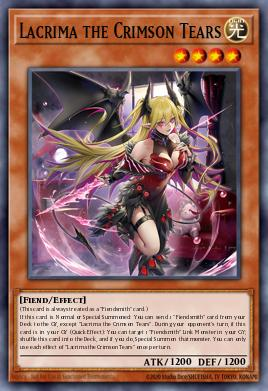

- **Copias y zona:** Main 1x. No altera las cantidades registradas.
- **Nombre oficial de referencia:** Lácrima las Lágrimas Carmesíes. CID cotejado con la ficha oficial; el nombre histórico del inventario se conserva aunque su grafía/traducción difiera.
- **Función principal y secundaria:** interrupción · recuperación.
- **Estado de sinergia y función:** Utilidad independiente. Es una clasificación de juego; revisar la relación concreta en A06.
- **Papel como recurso, descarte o coste:** No se demuestra que esta carta sea recurso de descarte o pago para otra.
- **Efecto operativo (paráfrasis analítica):** retorno o reciclaje hacia mano/Deck/Extra. Son operaciones detectadas en el texto, no efectos independientes garantizados; leer sus condiciones en la fuente.
- **Mapa de activación y resultados:** 1) mientras está en Cementerio: Invocación Especial desde Cementerio, devuelve recursos a mano/Deck/Extra. Cada operación está sujeta a la secuencia y al «si lo haces» del texto oficial.
- **Ventanas de activación identificadas:** turno rival; al producirse una Invocación; al llegar o estar en el Cementerio; Efecto Rápido.
- **Costes o recursos potenciales:** sin coste independiente identificado en esta síntesis; comprobar las acciones previas al punto y coma de cada efecto.
- **Restricciones y requisitos:** hay límite por turno según el efecto concreto; depende de recursos en Cementerio. 
- **Prioridad al ir primero:** generar envíos por efecto sin malgastar recursos y preparar interacción. Para esta carta: Reservar la respuesta para la ventana rival exacta; no es una pieza buscadora de nuestro motor.
- **Prioridad al ir segundo:** forzar respuestas rivales con Fusión/retiradas y conservar cementerio utilizable. Identificar primero la respuesta rival que afecta su función «interrupción».
- **Medio/tardío y recuperación:** recuperar materiales y gestionar cartas enviadas o desterradas. Verificar que el objetivo de recuperación continúe disponible.
- **Sinergias y acceso a líneas:** Relación contextual con enviar cartas al Cementerio por efecto y aprovechar fusiones, reciclaje y motores Horus/Demoniherrero. Habilita una línea del motor sólo si coinciden recursos, objetivos y restricciones; no equivale a un combo completo validado.
- **Riesgo / brick / interrupciones:** Depende del Cementerio y es sensible a destierro o negación de ese recurso. Puede emplearse en cadena sólo cuando se cumpla su condición concreta.
- **Utilidad editorial:** 3/5 para este deck (estimación por rol y zona, no probabilidad calculada). No cambiar copias; cualquier sugerencia de alta/baja pasa por el apartado 22 y aprobación.
- **Referencia oficial y trazabilidad:** https://www.db.yugioh-card.com/yugiohdb/card_search.action?cid=20490&ope=2&request_locale=es. **Confianza:** texto y tipo de efecto cotejados en Konami; síntesis táctica editorial, no demostración de combo.
- **Aplicación concreta dentro de este deck (A06):** retorno o reciclaje hacia mano/Deck/Extra. Aporta respuesta o consistencia sin exigir enlace directo.

**USO PRÁCTICO Y SINERGIA — Lácrima las Lágrimas Carmesíes**

- **Label funcional:** Función independiente. Clasificación documental; una relación es válida solo si se satisfacen sus condiciones exactas.
- **Qué hace:** retorno o reciclaje hacia mano/Deck/Extra. Son operaciones detectadas en el texto, no efectos independientes garantizados; leer sus condiciones en la fuente.
- **Cómo aprovecharla en este deck:** retorno o reciclaje hacia mano/Deck/Extra. Aporta respuesta o consistencia sin exigir enlace directo.
- **Al jugar primero:** generar envíos por efecto sin malgastar recursos y preparar interacción. Para esta carta: Reservar la respuesta para la ventana rival exacta; no es una pieza buscadora de nuestro motor.
- **Al jugar segundo:** forzar respuestas rivales con Fusión/retiradas y conservar cementerio utilizable. Identificar primero la respuesta rival que afecta su función «interrupción».
- **Cuándo tener precaución:** Depende del Cementerio y es sensible a destierro o negación de ese recurso. Puede emplearse en cadena sólo cuando se cumpla su condición concreta.

#### 03. Tiagrimientos Havnis

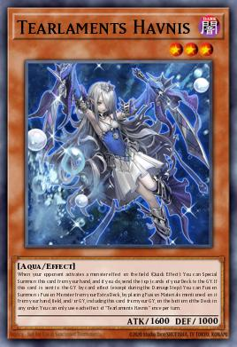

- **Copias y zona:** Main 1x, Reserva 1x. No altera las cantidades registradas.
- **Nombre oficial de referencia:** Tiagrimentos Havnis. CID cotejado con la ficha oficial; el nombre histórico del inventario se conserva aunque su grafía/traducción difiera.
- **Función principal y secundaria:** interrupción · recuperación · extensor · habilitador de Extra.
- **Estado de sinergia y función:** Sinergia indirecta (soporte o recursos). Es una clasificación de juego; revisar la relación concreta en A06.
- **Papel como recurso, descarte o coste:** Coste o consumo descrito en A05: envío de recurso propio al Cementerio.
- **Efecto operativo (paráfrasis analítica):** recuperación e invocación desde Cementerio/destierro; acceso al campo desde la mano; habilitación o continuación de una invocación del Extra Deck. Son operaciones detectadas en el texto, no efectos independientes garantizados; leer sus condiciones en la fuente.
- **Mapa de activación y resultados:** 1) en respuesta a activación rival: Invocación Especial desde Cementerio · 2) al llegar al Cementerio por efecto: realiza Fusión con materiales permitidos. Cada operación está sujeta a la secuencia y al «si lo haces» del texto oficial.
- **Ventanas de activación identificadas:** al llegar o estar en el Cementerio; respuesta a activación rival; Efecto Rápido.
- **Costes o recursos potenciales:** envío de recurso propio al Cementerio.
- **Restricciones y requisitos:** hay límite por turno según el efecto concreto; depende de recursos en Cementerio; interactúa con información oculta o resultados no siempre elegibles. 
- **Prioridad al ir primero:** generar envíos por efecto sin malgastar recursos y preparar interacción. Para esta carta: Reservar la respuesta para la ventana rival exacta; no es una pieza buscadora de nuestro motor.
- **Prioridad al ir segundo:** forzar respuestas rivales con Fusión/retiradas y conservar cementerio utilizable. Identificar primero la respuesta rival que afecta su función «interrupción».
- **Medio/tardío y recuperación:** recuperar materiales y gestionar cartas enviadas o desterradas. Verificar que el objetivo de recuperación continúe disponible.
- **Sinergias y acceso a líneas:** Relación contextual con enviar cartas al Cementerio por efecto y aprovechar fusiones, reciclaje y motores Horus/Demoniherrero. Habilita una línea del motor sólo si coinciden recursos, objetivos y restricciones; no equivale a un combo completo validado.
- **Riesgo / brick / interrupciones:** Depende del Cementerio y es sensible a destierro o negación de ese recurso. Puede emplearse en cadena sólo cuando se cumpla su condición concreta.
- **Utilidad editorial:** 4/5 para este deck (estimación por rol y zona, no probabilidad calculada). No cambiar copias; cualquier sugerencia de alta/baja pasa por el apartado 22 y aprobación.
- **Referencia oficial y trazabilidad:** https://www.db.yugioh-card.com/yugiohdb/card_search.action?cid=17416&ope=2&request_locale=es. **Confianza:** texto y tipo de efecto cotejados en Konami; síntesis táctica editorial, no demostración de combo.
- **Aplicación concreta dentro de este deck (A06):** recuperación e invocación desde Cementerio/destierro; acceso al campo desde la mano; habilitación o continuación de una invocación del Extra Deck.

**USO PRÁCTICO Y SINERGIA — Tiagrimientos Havnis**

- **Label funcional:** Sinergia indirecta. Clasificación documental; una relación es válida solo si se satisfacen sus condiciones exactas.
- **Qué hace:** recuperación e invocación desde Cementerio/destierro; acceso al campo desde la mano; habilitación o continuación de una invocación del Extra Deck. Son operaciones detectadas en el texto, no efectos independientes garantizados; leer sus condiciones en la fuente.
- **Cómo aprovecharla en este deck:** recuperación e invocación desde Cementerio/destierro; acceso al campo desde la mano; habilitación o continuación de una invocación del Extra Deck.
- **Al jugar primero:** generar envíos por efecto sin malgastar recursos y preparar interacción. Para esta carta: Reservar la respuesta para la ventana rival exacta; no es una pieza buscadora de nuestro motor.
- **Al jugar segundo:** forzar respuestas rivales con Fusión/retiradas y conservar cementerio utilizable. Identificar primero la respuesta rival que afecta su función «interrupción».
- **Cuándo tener precaución:** Depende del Cementerio y es sensible a destierro o negación de ese recurso. Puede emplearse en cadena sólo cuando se cumpla su condición concreta.

#### 04. Planeta Primigenio Perlerreino

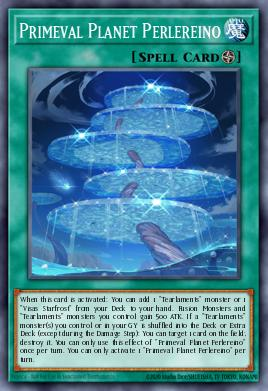

- **Copias y zona:** Main 3x. No altera las cantidades registradas.
- **Nombre oficial de referencia:** Planeta Primigenio Perlerreino. CID cotejado con la ficha oficial; el nombre histórico del inventario se conserva aunque su grafía/traducción difiera.
- **Función principal y secundaria:** searcher · buscador · recuperación · cierre.
- **Estado de sinergia y función:** Sinergia indirecta (soporte o recursos). Es una clasificación de juego; revisar la relación concreta en A06.
- **Papel como recurso, descarte o coste:** No se demuestra que esta carta sea recurso de descarte o pago para otra.
- **Efecto operativo (paráfrasis analítica):** búsqueda o incorporación de cartas a mano; retorno o reciclaje hacia mano/Deck/Extra; presión de combate o modificación de estadísticas. Son operaciones detectadas en el texto, no efectos independientes garantizados; leer sus condiciones en la fuente.
- **Mapa de activación y resultados:** 1) con condición explícita en la carta: incorpora la pieza indicada a la mano. Cada operación está sujeta a la secuencia y al «si lo haces» del texto oficial.
- **Ventanas de activación identificadas:** requieren la fase o condición específica indicada en el texto; sin ventana rápida general asumida.
- **Costes o recursos potenciales:** sin coste independiente identificado en esta síntesis; comprobar las acciones previas al punto y coma de cada efecto.
- **Restricciones y requisitos:** hay límite por turno según el efecto concreto; depende de recursos en Cementerio. 
- **Prioridad al ir primero:** generar envíos por efecto sin malgastar recursos y preparar interacción. Para esta carta: Convertir la activación en acceso a la siguiente pieza del motor, sin duplicar buscadores inútilmente.
- **Prioridad al ir segundo:** forzar respuestas rivales con Fusión/retiradas y conservar cementerio utilizable. Identificar primero la respuesta rival que afecta su función «searcher».
- **Medio/tardío y recuperación:** recuperar materiales y gestionar cartas enviadas o desterradas. Verificar que el objetivo de recuperación continúe disponible.
- **Sinergias y acceso a líneas:** Relación contextual con enviar cartas al Cementerio por efecto y aprovechar fusiones, reciclaje y motores Horus/Demoniherrero. Habilita una línea del motor sólo si coinciden recursos, objetivos y restricciones; no equivale a un combo completo validado.
- **Riesgo / brick / interrupciones:** Depende del Cementerio y es sensible a destierro o negación de ese recurso. No atribuirle velocidad rápida por el solo hecho de formar parte del motor.
- **Utilidad editorial:** 5/5 para este deck (estimación por rol y zona, no probabilidad calculada). No cambiar copias; cualquier sugerencia de alta/baja pasa por el apartado 22 y aprobación.
- **Referencia oficial y trazabilidad:** https://www.db.yugioh-card.com/yugiohdb/card_search.action?cid=17462&ope=2&request_locale=es. **Confianza:** texto y tipo de efecto cotejados en Konami; síntesis táctica editorial, no demostración de combo.
- **Aplicación concreta dentro de este deck (A06):** búsqueda o incorporación de cartas a mano; retorno o reciclaje hacia mano/Deck/Extra; presión de combate o modificación de estadísticas.

**USO PRÁCTICO Y SINERGIA — Planeta Primigenio Perlerreino**

- **Label funcional:** Sinergia indirecta. Clasificación documental; una relación es válida solo si se satisfacen sus condiciones exactas.
- **Qué hace:** búsqueda o incorporación de cartas a mano; retorno o reciclaje hacia mano/Deck/Extra; presión de combate o modificación de estadísticas. Son operaciones detectadas en el texto, no efectos independientes garantizados; leer sus condiciones en la fuente.
- **Cómo aprovecharla en este deck:** búsqueda o incorporación de cartas a mano; retorno o reciclaje hacia mano/Deck/Extra; presión de combate o modificación de estadísticas.
- **Al jugar primero:** generar envíos por efecto sin malgastar recursos y preparar interacción. Para esta carta: Convertir la activación en acceso a la siguiente pieza del motor, sin duplicar buscadores inútilmente.
- **Al jugar segundo:** forzar respuestas rivales con Fusión/retiradas y conservar cementerio utilizable. Identificar primero la respuesta rival que afecta su función «searcher».
- **Cuándo tener precaución:** Depende del Cementerio y es sensible a destierro o negación de ese recurso. No atribuirle velocidad rápida por el solo hecho de formar parte del motor.

#### 05. Kashtira Fenrir

- **Copias y zona:** Main 2x. No altera las cantidades registradas.
- **Nombre oficial de referencia:** Kashtira Fenrir. CID cotejado con la ficha oficial; el nombre histórico del inventario se conserva aunque su grafía/traducción difiera.
- **Función principal y secundaria:** starter Kashtira · presión de destierro.
- **Estado de sinergia y función:** Sinergia directa descrita. Es una clasificación de juego; revisar la relación concreta en A06.
- **Papel como recurso, descarte o coste:** No se demuestra que esta carta sea recurso de descarte o pago para otra.
- **Efecto operativo (paráfrasis analítica):** Se invoca desde mano sin monstruos propios, busca otro Kashtira y destierra boca abajo una carta rival al reaccionar a su efecto o atacar. 
- **Mapa de activación y resultados:** 1) efecto propio o continuo: Invocación Especial desde mano · 2) en Main Phase: incorpora la pieza indicada a la mano. Cada operación está sujeta a la secuencia y al «si lo haces» del texto oficial.
- **Ventanas de activación identificadas:** Main Phase; campo propio vacío; respuesta a activación rival.
- **Costes o recursos potenciales:** sin coste independiente identificado en esta síntesis; comprobar las acciones previas al punto y coma de cada efecto.
- **Restricciones y requisitos:** hay límite por turno según el efecto concreto; requiere campo propio sin las cartas indicadas; interactúa con información oculta o resultados no siempre elegibles. 
- **Prioridad al ir primero:** generar envíos por efecto sin malgastar recursos y preparar interacción. Para esta carta: Convertir la activación en acceso a la siguiente pieza del motor, sin duplicar buscadores inútilmente.
- **Prioridad al ir segundo:** forzar respuestas rivales con Fusión/retiradas y conservar cementerio utilizable. Identificar primero la respuesta rival que afecta su función «starter Kashtira».
- **Medio/tardío y recuperación:** recuperar materiales y gestionar cartas enviadas o desterradas. No asumir que por sí misma recicla recursos si el texto no lo permite.
- **Sinergias y acceso a líneas:** Relación contextual con enviar cartas al Cementerio por efecto y aprovechar fusiones, reciclaje y motores Horus/Demoniherrero. Habilita una línea del motor sólo si coinciden recursos, objetivos y restricciones; no equivale a un combo completo validado.
- **Riesgo / brick / interrupciones:** El destierro no es destrucción ni se activa libremente en cualquier fase. No atribuirle velocidad rápida por el solo hecho de formar parte del motor.
- **Utilidad editorial:** 3/5 para este deck (estimación por rol y zona, no probabilidad calculada). No cambiar copias; cualquier sugerencia de alta/baja pasa por el apartado 22 y aprobación.
- **Referencia oficial y trazabilidad:** https://www.db.yugioh-card.com/yugiohdb/card_search.action?cid=17768&ope=2&request_locale=es. **Confianza:** texto y tipo de efecto cotejados en Konami; síntesis táctica editorial, no demostración de combo.
- **Aplicación concreta dentro de este deck (A06):** Se invoca desde mano sin monstruos propios, busca otro Kashtira y destierra boca abajo una carta rival al reaccionar a su efecto o atacar.

**USO PRÁCTICO Y SINERGIA — Kashtira Fenrir**

- **Label funcional:** Sinergia directa. Clasificación documental; una relación es válida solo si se satisfacen sus condiciones exactas.
- **Qué hace:** Se invoca desde mano sin monstruos propios, busca otro Kashtira y destierra boca abajo una carta rival al reaccionar a su efecto o atacar.
- **Al jugar primero:** generar envíos por efecto sin malgastar recursos y preparar interacción. Para esta carta: Convertir la activación en acceso a la siguiente pieza del motor, sin duplicar buscadores inútilmente.
- **Al jugar segundo:** forzar respuestas rivales con Fusión/retiradas y conservar cementerio utilizable. Identificar primero la respuesta rival que afecta su función «starter Kashtira».
- **Cuándo tener precaución:** El destierro no es destrucción ni se activa libremente en cualquier fase. No atribuirle velocidad rápida por el solo hecho de formar parte del motor.

#### 06. Flor de Ceniza & Primavera Feliz

- **Copias y zona:** Main 3x. No altera las cantidades registradas.
- **Nombre oficial de referencia:** Flor de Ceniza & Primavera Feliz. CID cotejado con la ficha oficial; el nombre histórico del inventario se conserva aunque su grafía/traducción difiera.
- **Función principal y secundaria:** handtrap · negación.
- **Estado de sinergia y función:** Utilidad independiente. Es una clasificación de juego; revisar la relación concreta en A06.
- **Papel como recurso, descarte o coste:** Descarte mencionado: comprobar carta que lo exige, zona, coste frente a efecto y utilidad del recurso.
- **Efecto operativo (paráfrasis analítica):** Descarta desde la mano para detener efectos que buscan, invocan o mandan cartas desde el Deck. 
- **Mapa de activación y resultados:** 1) con condición explícita en la carta: niega el efecto o la activación indicada, Invocación Especial desde Deck, incorpora la pieza indicada a la mano. Cada operación está sujeta a la secuencia y al «si lo haces» del texto oficial.
- **Ventanas de activación identificadas:** Efecto Rápido.
- **Costes o recursos potenciales:** descarte de mano.
- **Restricciones y requisitos:** hay límite por turno según el efecto concreto. 
- **Prioridad al ir primero:** generar envíos por efecto sin malgastar recursos y preparar interacción. Para esta carta: Reservar la respuesta para la ventana rival exacta; no es una pieza buscadora de nuestro motor.
- **Prioridad al ir segundo:** forzar respuestas rivales con Fusión/retiradas y conservar cementerio utilizable. Identificar primero la respuesta rival que afecta su función «handtrap».
- **Medio/tardío y recuperación:** recuperar materiales y gestionar cartas enviadas o desterradas. Verificar que el objetivo de recuperación continúe disponible.
- **Sinergias y acceso a líneas:** Relación contextual con enviar cartas al Cementerio por efecto y aprovechar fusiones, reciclaje y motores Horus/Demoniherrero. Habilita una línea del motor sólo si coinciden recursos, objetivos y restricciones; no equivale a un combo completo validado.
- **Riesgo / brick / interrupciones:** Reaccionar al efecto del Deck que habilite la jugada rival; no da búsquedas propias. Puede emplearse en cadena sólo cuando se cumpla su condición concreta.
- **Utilidad editorial:** 3/5 para este deck (estimación por rol y zona, no probabilidad calculada). No cambiar copias; cualquier sugerencia de alta/baja pasa por el apartado 22 y aprobación.
- **Referencia oficial y trazabilidad:** https://www.db.yugioh-card.com/yugiohdb/card_search.action?cid=12950&ope=2&request_locale=es. **Confianza:** texto y tipo de efecto cotejados en Konami; síntesis táctica editorial, no demostración de combo.
- **Aplicación concreta dentro de este deck (A06):** Descarta desde la mano para detener efectos que buscan, invocan o mandan cartas desde el Deck. Aporta respuesta o consistencia sin exigir enlace directo.

**USO PRÁCTICO Y SINERGIA — Flor de Ceniza & Primavera Feliz**

- **Label funcional:** Función independiente. Clasificación documental; una relación es válida solo si se satisfacen sus condiciones exactas.
- **Qué hace:** Descarta desde la mano para detener efectos que buscan, invocan o mandan cartas desde el Deck.
- **Cómo aprovecharla en este deck:** Descarta desde la mano para detener efectos que buscan, invocan o mandan cartas desde el Deck. Aporta respuesta o consistencia sin exigir enlace directo.
- **Al jugar primero:** generar envíos por efecto sin malgastar recursos y preparar interacción. Para esta carta: Reservar la respuesta para la ventana rival exacta; no es una pieza buscadora de nuestro motor.
- **Al jugar segundo:** forzar respuestas rivales con Fusión/retiradas y conservar cementerio utilizable. Identificar primero la respuesta rival que afecta su función «handtrap».
- **Cuándo tener precaución:** Reaccionar al efecto del Deck que habilite la jugada rival; no da búsquedas propias. Puede emplearse en cadena sólo cuando se cumpla su condición concreta.

#### 07. Tiagrimientos Reinoheart

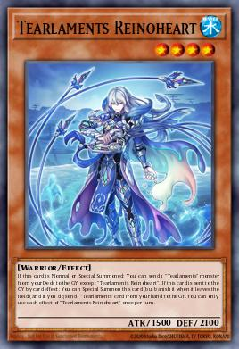

- **Copias y zona:** Main 2x. No altera las cantidades registradas.
- **Nombre oficial de referencia:** Tiagrimentos Reinoheart. CID cotejado con la ficha oficial; el nombre histórico del inventario se conserva aunque su grafía/traducción difiera.
- **Función principal y secundaria:** recuperación.
- **Estado de sinergia y función:** Sinergia indirecta (soporte o recursos). Es una clasificación de juego; revisar la relación concreta en A06.
- **Papel como recurso, descarte o coste:** Coste o consumo descrito en A05: envío de recurso propio al Cementerio.
- **Efecto operativo (paráfrasis analítica):** recuperación e invocación desde Cementerio/destierro. Son operaciones detectadas en el texto, no efectos independientes garantizados; leer sus condiciones en la fuente.
- **Mapa de activación y resultados:** 1) al llegar al Cementerio por efecto: Invocación Especial desde Cementerio. Cada operación está sujeta a la secuencia y al «si lo haces» del texto oficial.
- **Ventanas de activación identificadas:** al producirse una Invocación; al llegar o estar en el Cementerio.
- **Costes o recursos potenciales:** envío de recurso propio al Cementerio.
- **Restricciones y requisitos:** hay límite por turno según el efecto concreto. 
- **Prioridad al ir primero:** generar envíos por efecto sin malgastar recursos y preparar interacción. Para esta carta: Escoger la amenaza o recurso que genere mayor ventaja de tempo; respetar selección y zona.
- **Prioridad al ir segundo:** forzar respuestas rivales con Fusión/retiradas y conservar cementerio utilizable. Identificar primero la respuesta rival que afecta su función «recuperación».
- **Medio/tardío y recuperación:** recuperar materiales y gestionar cartas enviadas o desterradas. Verificar que el objetivo de recuperación continúe disponible.
- **Sinergias y acceso a líneas:** Relación contextual con enviar cartas al Cementerio por efecto y aprovechar fusiones, reciclaje y motores Horus/Demoniherrero. Habilita una línea del motor sólo si coinciden recursos, objetivos y restricciones; no equivale a un combo completo validado.
- **Riesgo / brick / interrupciones:** Riesgo operativo: interrupción del Cementerio, restricciones de materiales y mildeos aleatorios. Confirmar objetivos disponibles y costes antes de activar. No atribuirle velocidad rápida por el solo hecho de formar parte del motor.
- **Utilidad editorial:** 3/5 para este deck (estimación por rol y zona, no probabilidad calculada). No cambiar copias; cualquier sugerencia de alta/baja pasa por el apartado 22 y aprobación.
- **Referencia oficial y trazabilidad:** https://www.db.yugioh-card.com/yugiohdb/card_search.action?cid=17417&ope=2&request_locale=es. **Confianza:** texto y tipo de efecto cotejados en Konami; síntesis táctica editorial, no demostración de combo.
- **Aplicación concreta dentro de este deck (A06):** recuperación e invocación desde Cementerio/destierro.

**USO PRÁCTICO Y SINERGIA — Tiagrimientos Reinoheart**

- **Label funcional:** Sinergia indirecta. Clasificación documental; una relación es válida solo si se satisfacen sus condiciones exactas.
- **Qué hace:** recuperación e invocación desde Cementerio/destierro. Son operaciones detectadas en el texto, no efectos independientes garantizados; leer sus condiciones en la fuente.
- **Cómo aprovecharla en este deck:** recuperación e invocación desde Cementerio/destierro.
- **Al jugar primero:** generar envíos por efecto sin malgastar recursos y preparar interacción. Para esta carta: Escoger la amenaza o recurso que genere mayor ventaja de tempo; respetar selección y zona.
- **Al jugar segundo:** forzar respuestas rivales con Fusión/retiradas y conservar cementerio utilizable. Identificar primero la respuesta rival que afecta su función «recuperación».
- **Cuándo tener precaución:** Riesgo operativo: interrupción del Cementerio, restricciones de materiales y mildeos aleatorios. Confirmar objetivos disponibles y costes antes de activar. No atribuirle velocidad rápida por el solo hecho de formar parte del motor.

#### 08. Tiagrimientos Scheiren

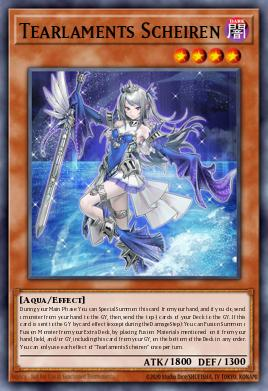

- **Copias y zona:** Main 1x. No altera las cantidades registradas.
- **Nombre oficial de referencia:** Tiagrimentos Scheiren. CID cotejado con la ficha oficial; el nombre histórico del inventario se conserva aunque su grafía/traducción difiera.
- **Función principal y secundaria:** recuperación · extensor · habilitador de Extra.
- **Estado de sinergia y función:** Sinergia indirecta (soporte o recursos). Es una clasificación de juego; revisar la relación concreta en A06.
- **Papel como recurso, descarte o coste:** Coste o consumo descrito en A05: envío de recurso propio al Cementerio.
- **Efecto operativo (paráfrasis analítica):** recuperación e invocación desde Cementerio/destierro; acceso al campo desde la mano; habilitación o continuación de una invocación del Extra Deck. Son operaciones detectadas en el texto, no efectos independientes garantizados; leer sus condiciones en la fuente.
- **Mapa de activación y resultados:** 1) en Main Phase: Invocación Especial desde Cementerio · 2) al llegar al Cementerio por efecto: realiza Fusión con materiales permitidos. Cada operación está sujeta a la secuencia y al «si lo haces» del texto oficial.
- **Ventanas de activación identificadas:** Main Phase; al llegar o estar en el Cementerio.
- **Costes o recursos potenciales:** envío de recurso propio al Cementerio.
- **Restricciones y requisitos:** hay límite por turno según el efecto concreto; depende de recursos en Cementerio; interactúa con información oculta o resultados no siempre elegibles. 
- **Prioridad al ir primero:** generar envíos por efecto sin malgastar recursos y preparar interacción. Para esta carta: Escoger la amenaza o recurso que genere mayor ventaja de tempo; respetar selección y zona.
- **Prioridad al ir segundo:** forzar respuestas rivales con Fusión/retiradas y conservar cementerio utilizable. Identificar primero la respuesta rival que afecta su función «recuperación».
- **Medio/tardío y recuperación:** recuperar materiales y gestionar cartas enviadas o desterradas. Verificar que el objetivo de recuperación continúe disponible.
- **Sinergias y acceso a líneas:** Relación contextual con enviar cartas al Cementerio por efecto y aprovechar fusiones, reciclaje y motores Horus/Demoniherrero. Habilita una línea del motor sólo si coinciden recursos, objetivos y restricciones; no equivale a un combo completo validado.
- **Riesgo / brick / interrupciones:** Depende del Cementerio y es sensible a destierro o negación de ese recurso. No atribuirle velocidad rápida por el solo hecho de formar parte del motor.
- **Utilidad editorial:** 4/5 para este deck (estimación por rol y zona, no probabilidad calculada). No cambiar copias; cualquier sugerencia de alta/baja pasa por el apartado 22 y aprobación.
- **Referencia oficial y trazabilidad:** https://www.db.yugioh-card.com/yugiohdb/card_search.action?cid=17415&ope=2&request_locale=es. **Confianza:** texto y tipo de efecto cotejados en Konami; síntesis táctica editorial, no demostración de combo.
- **Aplicación concreta dentro de este deck (A06):** recuperación e invocación desde Cementerio/destierro; acceso al campo desde la mano; habilitación o continuación de una invocación del Extra Deck.

**USO PRÁCTICO Y SINERGIA — Tiagrimientos Scheiren**

- **Label funcional:** Sinergia indirecta. Clasificación documental; una relación es válida solo si se satisfacen sus condiciones exactas.
- **Qué hace:** recuperación e invocación desde Cementerio/destierro; acceso al campo desde la mano; habilitación o continuación de una invocación del Extra Deck. Son operaciones detectadas en el texto, no efectos independientes garantizados; leer sus condiciones en la fuente.
- **Cómo aprovecharla en este deck:** recuperación e invocación desde Cementerio/destierro; acceso al campo desde la mano; habilitación o continuación de una invocación del Extra Deck.
- **Al jugar primero:** generar envíos por efecto sin malgastar recursos y preparar interacción. Para esta carta: Escoger la amenaza o recurso que genere mayor ventaja de tempo; respetar selección y zona.
- **Al jugar segundo:** forzar respuestas rivales con Fusión/retiradas y conservar cementerio utilizable. Identificar primero la respuesta rival que afecta su función «recuperación».
- **Cuándo tener precaución:** Depende del Cementerio y es sensible a destierro o negación de ese recurso. No atribuirle velocidad rápida por el solo hecho de formar parte del motor.

#### 09. Tiagrimientos Merrli

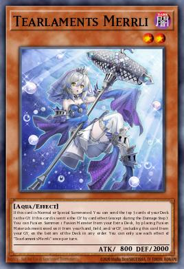

- **Copias y zona:** Main 1x. No altera las cantidades registradas.
- **Nombre oficial de referencia:** Tiagrimentos Merrli. CID cotejado con la ficha oficial; el nombre histórico del inventario se conserva aunque su grafía/traducción difiera.
- **Función principal y secundaria:** habilitador de Extra.
- **Estado de sinergia y función:** Sinergia indirecta (soporte o recursos). Es una clasificación de juego; revisar la relación concreta en A06.
- **Papel como recurso, descarte o coste:** Coste o consumo descrito en A05: envío de recurso propio al Cementerio.
- **Efecto operativo (paráfrasis analítica):** habilitación o continuación de una invocación del Extra Deck. Son operaciones detectadas en el texto, no efectos independientes garantizados; leer sus condiciones en la fuente.
- **Mapa de activación y resultados:** 1) al llegar al Cementerio por efecto: realiza Fusión con materiales permitidos. Cada operación está sujeta a la secuencia y al «si lo haces» del texto oficial.
- **Ventanas de activación identificadas:** al producirse una Invocación; al llegar o estar en el Cementerio.
- **Costes o recursos potenciales:** envío de recurso propio al Cementerio.
- **Restricciones y requisitos:** hay límite por turno según el efecto concreto; depende de recursos en Cementerio; interactúa con información oculta o resultados no siempre elegibles. 
- **Prioridad al ir primero:** generar envíos por efecto sin malgastar recursos y preparar interacción. Para esta carta: Activar cuando las condiciones permitan obtener valor real, preservando recursos de seguimiento.
- **Prioridad al ir segundo:** forzar respuestas rivales con Fusión/retiradas y conservar cementerio utilizable. Identificar primero la respuesta rival que afecta su función «habilitador de Extra».
- **Medio/tardío y recuperación:** recuperar materiales y gestionar cartas enviadas o desterradas. No asumir que por sí misma recicla recursos si el texto no lo permite.
- **Sinergias y acceso a líneas:** Relación contextual con enviar cartas al Cementerio por efecto y aprovechar fusiones, reciclaje y motores Horus/Demoniherrero. Habilita una línea del motor sólo si coinciden recursos, objetivos y restricciones; no equivale a un combo completo validado.
- **Riesgo / brick / interrupciones:** Depende del Cementerio y es sensible a destierro o negación de ese recurso. No atribuirle velocidad rápida por el solo hecho de formar parte del motor.
- **Utilidad editorial:** 3/5 para este deck (estimación por rol y zona, no probabilidad calculada). No cambiar copias; cualquier sugerencia de alta/baja pasa por el apartado 22 y aprobación.
- **Referencia oficial y trazabilidad:** https://www.db.yugioh-card.com/yugiohdb/card_search.action?cid=17414&ope=2&request_locale=es. **Confianza:** texto y tipo de efecto cotejados en Konami; síntesis táctica editorial, no demostración de combo.
- **Aplicación concreta dentro de este deck (A06):** habilitación o continuación de una invocación del Extra Deck.

**USO PRÁCTICO Y SINERGIA — Tiagrimientos Merrli**

- **Label funcional:** Sinergia indirecta. Clasificación documental; una relación es válida solo si se satisfacen sus condiciones exactas.
- **Qué hace:** habilitación o continuación de una invocación del Extra Deck. Son operaciones detectadas en el texto, no efectos independientes garantizados; leer sus condiciones en la fuente.
- **Cómo aprovecharla en este deck:** habilitación o continuación de una invocación del Extra Deck.
- **Al jugar primero:** generar envíos por efecto sin malgastar recursos y preparar interacción. Para esta carta: Activar cuando las condiciones permitan obtener valor real, preservando recursos de seguimiento.
- **Al jugar segundo:** forzar respuestas rivales con Fusión/retiradas y conservar cementerio utilizable. Identificar primero la respuesta rival que afecta su función «habilitador de Extra».
- **Cuándo tener precaución:** Depende del Cementerio y es sensible a destierro o negación de ese recurso. No atribuirle velocidad rápida por el solo hecho de formar parte del motor.

#### 10. Bienes del Entierro Insensato

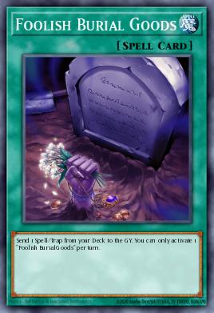

- **Copias y zona:** Main 3x. No altera las cantidades registradas.
- **Nombre oficial de referencia:** Bienes del Entierro Insensato. CID cotejado con la ficha oficial; el nombre histórico del inventario se conserva aunque su grafía/traducción difiera.
- **Función principal y secundaria:** recurso situacional.
- **Estado de sinergia y función:** Sinergia indirecta (soporte o recursos). Es una clasificación de juego; revisar la relación concreta en A06.
- **Papel como recurso, descarte o coste:** No se demuestra que esta carta sea recurso de descarte o pago para otra.
- **Efecto operativo (paráfrasis analítica):** interacción propia de la carta que requiere consultar el texto íntegro enlazado. Son operaciones detectadas en el texto, no efectos independientes garantizados; leer sus condiciones en la fuente.
- **Mapa de activación y resultados:** efecto de estadística, condición o material; no asumir un disparador adicional. Cada operación está sujeta a la secuencia y al «si lo haces» del texto oficial.
- **Ventanas de activación identificadas:** requieren la fase o condición específica indicada en el texto; sin ventana rápida general asumida.
- **Costes o recursos potenciales:** sin coste independiente identificado en esta síntesis; comprobar las acciones previas al punto y coma de cada efecto.
- **Restricciones y requisitos:** hay límite por turno según el efecto concreto. 
- **Prioridad al ir primero:** generar envíos por efecto sin malgastar recursos y preparar interacción. Para esta carta: Activar cuando las condiciones permitan obtener valor real, preservando recursos de seguimiento.
- **Prioridad al ir segundo:** forzar respuestas rivales con Fusión/retiradas y conservar cementerio utilizable. Identificar primero la respuesta rival que afecta su función «recurso situacional».
- **Medio/tardío y recuperación:** recuperar materiales y gestionar cartas enviadas o desterradas. No asumir que por sí misma recicla recursos si el texto no lo permite.
- **Sinergias y acceso a líneas:** Relación contextual con enviar cartas al Cementerio por efecto y aprovechar fusiones, reciclaje y motores Horus/Demoniherrero. Habilita una línea del motor sólo si coinciden recursos, objetivos y restricciones; no equivale a un combo completo validado.
- **Riesgo / brick / interrupciones:** Riesgo operativo: interrupción del Cementerio, restricciones de materiales y mildeos aleatorios. Confirmar objetivos disponibles y costes antes de activar. No atribuirle velocidad rápida por el solo hecho de formar parte del motor.
- **Utilidad editorial:** 3/5 para este deck (estimación por rol y zona, no probabilidad calculada). No cambiar copias; cualquier sugerencia de alta/baja pasa por el apartado 22 y aprobación.
- **Referencia oficial y trazabilidad:** https://www.db.yugioh-card.com/yugiohdb/card_search.action?cid=12800&ope=2&request_locale=es. **Confianza:** texto y tipo de efecto cotejados en Konami; síntesis táctica editorial, no demostración de combo.
- **Aplicación concreta dentro de este deck (A06):** interacción propia de la carta que requiere consultar el texto íntegro enlazado.

**USO PRÁCTICO Y SINERGIA — Bienes del Entierro Insensato**

- **Label funcional:** Sinergia indirecta. Clasificación documental; una relación es válida solo si se satisfacen sus condiciones exactas.
- **Qué hace:** interacción propia de la carta que requiere consultar el texto íntegro enlazado. Son operaciones detectadas en el texto, no efectos independientes garantizados; leer sus condiciones en la fuente.
- **Cómo aprovecharla en este deck:** interacción propia de la carta que requiere consultar el texto íntegro enlazado.
- **Al jugar primero:** generar envíos por efecto sin malgastar recursos y preparar interacción. Para esta carta: Activar cuando las condiciones permitan obtener valor real, preservando recursos de seguimiento.
- **Al jugar segundo:** forzar respuestas rivales con Fusión/retiradas y conservar cementerio utilizable. Identificar primero la respuesta rival que afecta su función «recurso situacional».
- **Cuándo tener precaución:** Riesgo operativo: interrupción del Cementerio, restricciones de materiales y mildeos aleatorios. Confirmar objetivos disponibles y costes antes de activar. No atribuirle velocidad rápida por el solo hecho de formar parte del motor.

#### 11. Trivikarma

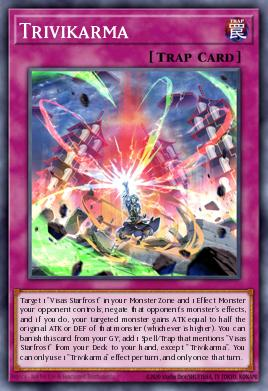

- **Copias y zona:** Main 1x. No altera las cantidades registradas.
- **Nombre oficial de referencia:** Trivikarma. CID cotejado con la ficha oficial; el nombre histórico del inventario se conserva aunque su grafía/traducción difiera.
- **Función principal y secundaria:** searcher · buscador · negación · cierre · respuesta.
- **Estado de sinergia y función:** Sinergia indirecta (soporte o recursos). Es una clasificación de juego; revisar la relación concreta en A06.
- **Papel como recurso, descarte o coste:** No se demuestra que esta carta sea recurso de descarte o pago para otra.
- **Efecto operativo (paráfrasis analítica):** búsqueda o incorporación de cartas a mano; negación de efectos o activaciones; presión de combate o modificación de estadísticas; interacción sobre monstruos en campo. Son operaciones detectadas en el texto, no efectos independientes garantizados; leer sus condiciones en la fuente.
- **Mapa de activación y resultados:** 1) efecto propio o continuo: niega el efecto o la activación indicada · 2) efecto propio o continuo: incorpora la pieza indicada a la mano. Cada operación está sujeta a la secuencia y al «si lo haces» del texto oficial.
- **Ventanas de activación identificadas:** requieren la fase o condición específica indicada en el texto; sin ventana rápida general asumida.
- **Costes o recursos potenciales:** sin coste independiente identificado en esta síntesis; comprobar las acciones previas al punto y coma de cada efecto.
- **Restricciones y requisitos:** depende de recursos en Cementerio. 
- **Prioridad al ir primero:** generar envíos por efecto sin malgastar recursos y preparar interacción. Para esta carta: Conservar la interrupción para el efecto clave rival; no gastarla en un efecto irrelevante.
- **Prioridad al ir segundo:** forzar respuestas rivales con Fusión/retiradas y conservar cementerio utilizable. Identificar primero la respuesta rival que afecta su función «searcher».
- **Medio/tardío y recuperación:** recuperar materiales y gestionar cartas enviadas o desterradas. No asumir que por sí misma recicla recursos si el texto no lo permite.
- **Sinergias y acceso a líneas:** Relación contextual con enviar cartas al Cementerio por efecto y aprovechar fusiones, reciclaje y motores Horus/Demoniherrero. Habilita una línea del motor sólo si coinciden recursos, objetivos y restricciones; no equivale a un combo completo validado.
- **Riesgo / brick / interrupciones:** Depende del Cementerio y es sensible a destierro o negación de ese recurso. No atribuirle velocidad rápida por el solo hecho de formar parte del motor.
- **Utilidad editorial:** 5/5 para este deck (estimación por rol y zona, no probabilidad calculada). No cambiar copias; cualquier sugerencia de alta/baja pasa por el apartado 22 y aprobación.
- **Referencia oficial y trazabilidad:** https://www.db.yugioh-card.com/yugiohdb/card_search.action?cid=18219&ope=2&request_locale=es. **Confianza:** texto y tipo de efecto cotejados en Konami; síntesis táctica editorial, no demostración de combo.
- **Aplicación concreta dentro de este deck (A06):** búsqueda o incorporación de cartas a mano; negación de efectos o activaciones; presión de combate o modificación de estadísticas; interacción sobre monstruos en campo.

**USO PRÁCTICO Y SINERGIA — Trivikarma**

- **Label funcional:** Sinergia indirecta. Clasificación documental; una relación es válida solo si se satisfacen sus condiciones exactas.
- **Qué hace:** búsqueda o incorporación de cartas a mano; negación de efectos o activaciones; presión de combate o modificación de estadísticas; interacción sobre monstruos en campo. Son operaciones detectadas en el texto, no efectos independientes garantizados; leer sus condiciones en la fuente.
- **Cómo aprovecharla en este deck:** búsqueda o incorporación de cartas a mano; negación de efectos o activaciones; presión de combate o modificación de estadísticas; interacción sobre monstruos en campo.
- **Al jugar primero:** generar envíos por efecto sin malgastar recursos y preparar interacción. Para esta carta: Conservar la interrupción para el efecto clave rival; no gastarla en un efecto irrelevante.
- **Al jugar segundo:** forzar respuestas rivales con Fusión/retiradas y conservar cementerio utilizable. Identificar primero la respuesta rival que afecta su función «searcher».
- **Cuándo tener precaución:** Depende del Cementerio y es sensible a destierro o negación de ese recurso. No atribuirle velocidad rápida por el solo hecho de formar parte del motor.

#### 12. Crimanto Tiagrimientos

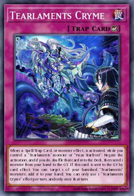

- **Copias y zona:** Main 2x. No altera las cantidades registradas.
- **Nombre oficial de referencia:** Crimanto Tiagrimentos. CID cotejado con la ficha oficial; el nombre histórico del inventario se conserva aunque su grafía/traducción difiera.
- **Función principal y secundaria:** removal · negación · recuperación.
- **Estado de sinergia y función:** Sinergia indirecta (soporte o recursos). Es una clasificación de juego; revisar la relación concreta en A06.
- **Papel como recurso, descarte o coste:** Coste o consumo descrito en A05: envío de recurso propio al Cementerio; reciclaje de recurso propio.
- **Efecto operativo (paráfrasis analítica):** destierro de recursos o de amenazas; negación de efectos o activaciones; retorno o reciclaje hacia mano/Deck/Extra. Son operaciones detectadas en el texto, no efectos independientes garantizados; leer sus condiciones en la fuente.
- **Mapa de activación y resultados:** 1) con condición explícita en la carta: niega el efecto o la activación indicada, devuelve recursos a mano/Deck/Extra · 2) al llegar al Cementerio por efecto: destierra el recurso u objetivo previsto. Cada operación está sujeta a la secuencia y al «si lo haces» del texto oficial.
- **Ventanas de activación identificadas:** al llegar o estar en el Cementerio.
- **Costes o recursos potenciales:** envío de recurso propio al Cementerio; reciclaje de recurso propio.
- **Restricciones y requisitos:** requiere estado de campo específico. 
- **Prioridad al ir primero:** generar envíos por efecto sin malgastar recursos y preparar interacción. Para esta carta: Conservar la interrupción para el efecto clave rival; no gastarla en un efecto irrelevante.
- **Prioridad al ir segundo:** forzar respuestas rivales con Fusión/retiradas y conservar cementerio utilizable. Identificar primero la respuesta rival que afecta su función «removal».
- **Medio/tardío y recuperación:** recuperar materiales y gestionar cartas enviadas o desterradas. Verificar que el objetivo de recuperación continúe disponible.
- **Sinergias y acceso a líneas:** Relación contextual con enviar cartas al Cementerio por efecto y aprovechar fusiones, reciclaje y motores Horus/Demoniherrero. Habilita una línea del motor sólo si coinciden recursos, objetivos y restricciones; no equivale a un combo completo validado.
- **Riesgo / brick / interrupciones:** Riesgo operativo: interrupción del Cementerio, restricciones de materiales y mildeos aleatorios. Confirmar objetivos disponibles y costes antes de activar. No atribuirle velocidad rápida por el solo hecho de formar parte del motor.
- **Utilidad editorial:** 3/5 para este deck (estimación por rol y zona, no probabilidad calculada). No cambiar copias; cualquier sugerencia de alta/baja pasa por el apartado 22 y aprobación.
- **Referencia oficial y trazabilidad:** https://www.db.yugioh-card.com/yugiohdb/card_search.action?cid=17475&ope=2&request_locale=es. **Confianza:** texto y tipo de efecto cotejados en Konami; síntesis táctica editorial, no demostración de combo.
- **Aplicación concreta dentro de este deck (A06):** destierro de recursos o de amenazas; negación de efectos o activaciones; retorno o reciclaje hacia mano/Deck/Extra.

**USO PRÁCTICO Y SINERGIA — Crimanto Tiagrimientos**

- **Label funcional:** Sinergia indirecta. Clasificación documental; una relación es válida solo si se satisfacen sus condiciones exactas.
- **Qué hace:** destierro de recursos o de amenazas; negación de efectos o activaciones; retorno o reciclaje hacia mano/Deck/Extra. Son operaciones detectadas en el texto, no efectos independientes garantizados; leer sus condiciones en la fuente.
- **Cómo aprovecharla en este deck:** destierro de recursos o de amenazas; negación de efectos o activaciones; retorno o reciclaje hacia mano/Deck/Extra.
- **Al jugar primero:** generar envíos por efecto sin malgastar recursos y preparar interacción. Para esta carta: Conservar la interrupción para el efecto clave rival; no gastarla en un efecto irrelevante.
- **Al jugar segundo:** forzar respuestas rivales con Fusión/retiradas y conservar cementerio utilizable. Identificar primero la respuesta rival que afecta su función «removal».
- **Cuándo tener precaución:** Riesgo operativo: interrupción del Cementerio, restricciones de materiales y mildeos aleatorios. Confirmar objetivos disponibles y costes antes de activar. No atribuirle velocidad rápida por el solo hecho de formar parte del motor.

#### 13. Grito Tiagrimientos

- **Copias y zona:** Main 1x, Reserva 1x. No altera las cantidades registradas.
- **Nombre oficial de referencia:** Grito Tiagrimentos. CID cotejado con la ficha oficial; el nombre histórico del inventario se conserva aunque su grafía/traducción difiera.
- **Función principal y secundaria:** searcher · buscador · cierre.
- **Estado de sinergia y función:** Sinergia indirecta (soporte o recursos). Es una clasificación de juego; revisar la relación concreta en A06.
- **Papel como recurso, descarte o coste:** No se demuestra que esta carta sea recurso de descarte o pago para otra.
- **Efecto operativo (paráfrasis analítica):** búsqueda o incorporación de cartas a mano; presión de combate o modificación de estadísticas. Son operaciones detectadas en el texto, no efectos independientes garantizados; leer sus condiciones en la fuente.
- **Mapa de activación y resultados:** 1) al llegar al Cementerio por efecto: incorpora la pieza indicada a la mano. Cada operación está sujeta a la secuencia y al «si lo haces» del texto oficial.
- **Ventanas de activación identificadas:** al llegar o estar en el Cementerio.
- **Costes o recursos potenciales:** sin coste independiente identificado en esta síntesis; comprobar las acciones previas al punto y coma de cada efecto.
- **Restricciones y requisitos:** hay límite por turno según el efecto concreto; interactúa con información oculta o resultados no siempre elegibles. 
- **Prioridad al ir primero:** generar envíos por efecto sin malgastar recursos y preparar interacción. Para esta carta: Convertir la activación en acceso a la siguiente pieza del motor, sin duplicar buscadores inútilmente.
- **Prioridad al ir segundo:** forzar respuestas rivales con Fusión/retiradas y conservar cementerio utilizable. Identificar primero la respuesta rival que afecta su función «searcher».
- **Medio/tardío y recuperación:** recuperar materiales y gestionar cartas enviadas o desterradas. No asumir que por sí misma recicla recursos si el texto no lo permite.
- **Sinergias y acceso a líneas:** Relación contextual con enviar cartas al Cementerio por efecto y aprovechar fusiones, reciclaje y motores Horus/Demoniherrero. Habilita una línea del motor sólo si coinciden recursos, objetivos y restricciones; no equivale a un combo completo validado.
- **Riesgo / brick / interrupciones:** Riesgo operativo: interrupción del Cementerio, restricciones de materiales y mildeos aleatorios. Confirmar objetivos disponibles y costes antes de activar. No atribuirle velocidad rápida por el solo hecho de formar parte del motor.
- **Utilidad editorial:** 5/5 para este deck (estimación por rol y zona, no probabilidad calculada). No cambiar copias; cualquier sugerencia de alta/baja pasa por el apartado 22 y aprobación.
- **Referencia oficial y trazabilidad:** https://www.db.yugioh-card.com/yugiohdb/card_search.action?cid=17813&ope=2&request_locale=es. **Confianza:** texto y tipo de efecto cotejados en Konami; síntesis táctica editorial, no demostración de combo.
- **Aplicación concreta dentro de este deck (A06):** búsqueda o incorporación de cartas a mano; presión de combate o modificación de estadísticas.

**USO PRÁCTICO Y SINERGIA — Grito Tiagrimientos**

- **Label funcional:** Sinergia indirecta. Clasificación documental; una relación es válida solo si se satisfacen sus condiciones exactas.
- **Qué hace:** búsqueda o incorporación de cartas a mano; presión de combate o modificación de estadísticas. Son operaciones detectadas en el texto, no efectos independientes garantizados; leer sus condiciones en la fuente.
- **Cómo aprovecharla en este deck:** búsqueda o incorporación de cartas a mano; presión de combate o modificación de estadísticas.
- **Al jugar primero:** generar envíos por efecto sin malgastar recursos y preparar interacción. Para esta carta: Convertir la activación en acceso a la siguiente pieza del motor, sin duplicar buscadores inútilmente.
- **Al jugar segundo:** forzar respuestas rivales con Fusión/retiradas y conservar cementerio utilizable. Identificar primero la respuesta rival que afecta su función «searcher».
- **Cuándo tener precaución:** Riesgo operativo: interrupción del Cementerio, restricciones de materiales y mildeos aleatorios. Confirmar objetivos disponibles y costes antes de activar. No atribuirle velocidad rápida por el solo hecho de formar parte del motor.

#### 14. Mudora el Oráculo de la Espada

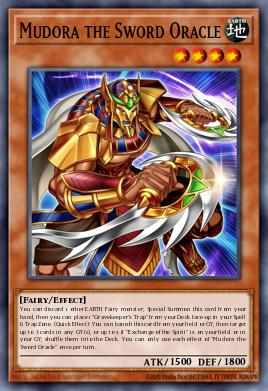

- **Copias y zona:** Main 1x. No altera las cantidades registradas.
- **Nombre oficial de referencia:** Mudora el Oráculo de la Espada. CID cotejado con la ficha oficial; el nombre histórico del inventario se conserva aunque su grafía/traducción difiera.
- **Función principal y secundaria:** interrupción · extensor.
- **Estado de sinergia y función:** Sinergia indirecta (soporte o recursos). Es una clasificación de juego; revisar la relación concreta en A06.
- **Papel como recurso, descarte o coste:** Coste o consumo descrito en A05: descarte de mano.
- **Efecto operativo (paráfrasis analítica):** acceso al campo desde la mano. Son operaciones detectadas en el texto, no efectos independientes garantizados; leer sus condiciones en la fuente.
- **Mapa de activación y resultados:** 1) efecto propio o continuo: Invocación Especial desde Cementerio. Cada operación está sujeta a la secuencia y al «si lo haces» del texto oficial.
- **Ventanas de activación identificadas:** Efecto Rápido.
- **Costes o recursos potenciales:** descarte de mano.
- **Restricciones y requisitos:** hay límite por turno según el efecto concreto; depende de recursos en Cementerio. 
- **Prioridad al ir primero:** generar envíos por efecto sin malgastar recursos y preparar interacción. Para esta carta: Reservar la respuesta para la ventana rival exacta; no es una pieza buscadora de nuestro motor.
- **Prioridad al ir segundo:** forzar respuestas rivales con Fusión/retiradas y conservar cementerio utilizable. Identificar primero la respuesta rival que afecta su función «interrupción».
- **Medio/tardío y recuperación:** recuperar materiales y gestionar cartas enviadas o desterradas. No asumir que por sí misma recicla recursos si el texto no lo permite.
- **Sinergias y acceso a líneas:** Relación contextual con enviar cartas al Cementerio por efecto y aprovechar fusiones, reciclaje y motores Horus/Demoniherrero. Habilita una línea del motor sólo si coinciden recursos, objetivos y restricciones; no equivale a un combo completo validado.
- **Riesgo / brick / interrupciones:** Depende del Cementerio y es sensible a destierro o negación de ese recurso. Puede emplearse en cadena sólo cuando se cumpla su condición concreta.
- **Utilidad editorial:** 4/5 para este deck (estimación por rol y zona, no probabilidad calculada). No cambiar copias; cualquier sugerencia de alta/baja pasa por el apartado 22 y aprobación.
- **Referencia oficial y trazabilidad:** https://www.db.yugioh-card.com/yugiohdb/card_search.action?cid=17604&ope=2&request_locale=es. **Confianza:** texto y tipo de efecto cotejados en Konami; síntesis táctica editorial, no demostración de combo.
- **Aplicación concreta dentro de este deck (A06):** acceso al campo desde la mano.

**USO PRÁCTICO Y SINERGIA — Mudora el Oráculo de la Espada**

- **Label funcional:** Sinergia indirecta. Clasificación documental; una relación es válida solo si se satisfacen sus condiciones exactas.
- **Qué hace:** acceso al campo desde la mano. Son operaciones detectadas en el texto, no efectos independientes garantizados; leer sus condiciones en la fuente.
- **Cómo aprovecharla en este deck:** acceso al campo desde la mano.
- **Al jugar primero:** generar envíos por efecto sin malgastar recursos y preparar interacción. Para esta carta: Reservar la respuesta para la ventana rival exacta; no es una pieza buscadora de nuestro motor.
- **Al jugar segundo:** forzar respuestas rivales con Fusión/retiradas y conservar cementerio utilizable. Identificar primero la respuesta rival que afecta su función «interrupción».
- **Cuándo tener precaución:** Depende del Cementerio y es sensible a destierro o negación de ese recurso. Puede emplearse en cadena sólo cuando se cumpla su condición concreta.

#### 15. Amset, Gloria de Horus

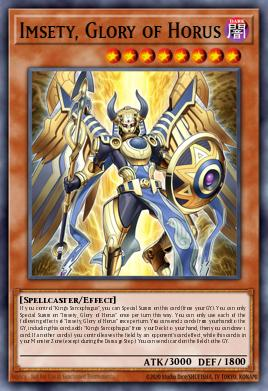

- **Copias y zona:** Main 2x. No altera las cantidades registradas.
- **Nombre oficial de referencia:** Amset, Gloria de Horus. CID cotejado con la ficha oficial; el nombre histórico del inventario se conserva aunque su grafía/traducción difiera.
- **Función principal y secundaria:** searcher · buscador · recuperación · ventaja de mano.
- **Estado de sinergia y función:** Sinergia indirecta (soporte o recursos). Es una clasificación de juego; revisar la relación concreta en A06.
- **Papel como recurso, descarte o coste:** Coste o consumo descrito en A05: envío de recurso propio al Cementerio.
- **Efecto operativo (paráfrasis analítica):** búsqueda o incorporación de cartas a mano; recuperación e invocación desde Cementerio/destierro; generación de cartas por robo. Son operaciones detectadas en el texto, no efectos independientes garantizados; leer sus condiciones en la fuente.
- **Mapa de activación y resultados:** 1) efecto propio o continuo: Invocación Especial desde Cementerio · 2) efecto propio o continuo: incorpora la pieza indicada a la mano, roba cartas. Cada operación está sujeta a la secuencia y al «si lo haces» del texto oficial.
- **Ventanas de activación identificadas:** requieren la fase o condición específica indicada en el texto; sin ventana rápida general asumida.
- **Costes o recursos potenciales:** envío de recurso propio al Cementerio.
- **Restricciones y requisitos:** hay límite por turno según el efecto concreto; requiere estado de campo específico; depende de recursos en Cementerio. 
- **Prioridad al ir primero:** generar envíos por efecto sin malgastar recursos y preparar interacción. Para esta carta: Convertir la activación en acceso a la siguiente pieza del motor, sin duplicar buscadores inútilmente.
- **Prioridad al ir segundo:** forzar respuestas rivales con Fusión/retiradas y conservar cementerio utilizable. Identificar primero la respuesta rival que afecta su función «searcher».
- **Medio/tardío y recuperación:** recuperar materiales y gestionar cartas enviadas o desterradas. Verificar que el objetivo de recuperación continúe disponible.
- **Sinergias y acceso a líneas:** Relación contextual con enviar cartas al Cementerio por efecto y aprovechar fusiones, reciclaje y motores Horus/Demoniherrero. Habilita una línea del motor sólo si coinciden recursos, objetivos y restricciones; no equivale a un combo completo validado.
- **Riesgo / brick / interrupciones:** Riesgo operativo: interrupción del Cementerio, restricciones de materiales y mildeos aleatorios. Confirmar objetivos disponibles y costes antes de activar. No atribuirle velocidad rápida por el solo hecho de formar parte del motor.
- **Utilidad editorial:** 5/5 para este deck (estimación por rol y zona, no probabilidad calculada). No cambiar copias; cualquier sugerencia de alta/baja pasa por el apartado 22 y aprobación.
- **Referencia oficial y trazabilidad:** https://www.db.yugioh-card.com/yugiohdb/card_search.action?cid=19153&ope=2&request_locale=es. **Confianza:** texto y tipo de efecto cotejados en Konami; síntesis táctica editorial, no demostración de combo.
- **Aplicación concreta dentro de este deck (A06):** búsqueda o incorporación de cartas a mano; recuperación e invocación desde Cementerio/destierro; generación de cartas por robo.

**USO PRÁCTICO Y SINERGIA — Amset, Gloria de Horus**

- **Label funcional:** Sinergia indirecta. Clasificación documental; una relación es válida solo si se satisfacen sus condiciones exactas.
- **Qué hace:** búsqueda o incorporación de cartas a mano; recuperación e invocación desde Cementerio/destierro; generación de cartas por robo. Son operaciones detectadas en el texto, no efectos independientes garantizados; leer sus condiciones en la fuente.
- **Cómo aprovecharla en este deck:** búsqueda o incorporación de cartas a mano; recuperación e invocación desde Cementerio/destierro; generación de cartas por robo.
- **Al jugar primero:** generar envíos por efecto sin malgastar recursos y preparar interacción. Para esta carta: Convertir la activación en acceso a la siguiente pieza del motor, sin duplicar buscadores inútilmente.
- **Al jugar segundo:** forzar respuestas rivales con Fusión/retiradas y conservar cementerio utilizable. Identificar primero la respuesta rival que afecta su función «searcher».
- **Cuándo tener precaución:** Riesgo operativo: interrupción del Cementerio, restricciones de materiales y mildeos aleatorios. Confirmar objetivos disponibles y costes antes de activar. No atribuirle velocidad rápida por el solo hecho de formar parte del motor.

#### 16. Ocultador de Efectos

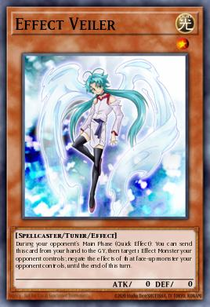

- **Copias y zona:** Main 2x. No altera las cantidades registradas.
- **Nombre oficial de referencia:** Ocultador de Efectos. CID cotejado con la ficha oficial; el nombre histórico del inventario se conserva aunque su grafía/traducción difiera.
- **Función principal y secundaria:** handtrap · negación.
- **Estado de sinergia y función:** Utilidad independiente. Es una clasificación de juego; revisar la relación concreta en A06.
- **Papel como recurso, descarte o coste:** Coste o consumo descrito en A05: envío de recurso propio al Cementerio.
- **Efecto operativo (paráfrasis analítica):** Durante la Main Phase rival, se manda desde la mano al Cementerio para negar los efectos de un monstruo rival boca arriba. 
- **Mapa de activación y resultados:** 1) en Main Phase: niega el efecto o la activación indicada. Cada operación está sujeta a la secuencia y al «si lo haces» del texto oficial.
- **Ventanas de activación identificadas:** turno rival; Main Phase; Efecto Rápido.
- **Costes o recursos potenciales:** envío de recurso propio al Cementerio.
- **Restricciones y requisitos:** aplicar restricciones de selección, activación y copias que consten en el texto original. 
- **Prioridad al ir primero:** generar envíos por efecto sin malgastar recursos y preparar interacción. Para esta carta: Reservar la respuesta para la ventana rival exacta; no es una pieza buscadora de nuestro motor.
- **Prioridad al ir segundo:** forzar respuestas rivales con Fusión/retiradas y conservar cementerio utilizable. Identificar primero la respuesta rival que afecta su función «handtrap».
- **Medio/tardío y recuperación:** recuperar materiales y gestionar cartas enviadas o desterradas. No asumir que por sí misma recicla recursos si el texto no lo permite.
- **Sinergias y acceso a líneas:** Relación contextual con enviar cartas al Cementerio por efecto y aprovechar fusiones, reciclaje y motores Horus/Demoniherrero. Habilita una línea del motor sólo si coinciden recursos, objetivos y restricciones; no equivale a un combo completo validado.
- **Riesgo / brick / interrupciones:** La ventana es la Main Phase del adversario, no cualquier fase. Puede emplearse en cadena sólo cuando se cumpla su condición concreta.
- **Utilidad editorial:** 3/5 para este deck (estimación por rol y zona, no probabilidad calculada). No cambiar copias; cualquier sugerencia de alta/baja pasa por el apartado 22 y aprobación.
- **Referencia oficial y trazabilidad:** https://www.db.yugioh-card.com/yugiohdb/card_search.action?cid=8933&ope=2&request_locale=es. **Confianza:** texto y tipo de efecto cotejados en Konami; síntesis táctica editorial, no demostración de combo.
- **Aplicación concreta dentro de este deck (A06):** Durante la Main Phase rival, se manda desde la mano al Cementerio para negar los efectos de un monstruo rival boca arriba. Aporta respuesta o consistencia sin exigir enlace directo.

**USO PRÁCTICO Y SINERGIA — Ocultador de Efectos**

- **Label funcional:** Función independiente. Clasificación documental; una relación es válida solo si se satisfacen sus condiciones exactas.
- **Qué hace:** Durante la Main Phase rival, se manda desde la mano al Cementerio para negar los efectos de un monstruo rival boca arriba.
- **Cómo aprovecharla en este deck:** Durante la Main Phase rival, se manda desde la mano al Cementerio para negar los efectos de un monstruo rival boca arriba. Aporta respuesta o consistencia sin exigir enlace directo.
- **Al jugar primero:** generar envíos por efecto sin malgastar recursos y preparar interacción. Para esta carta: Reservar la respuesta para la ventana rival exacta; no es una pieza buscadora de nuestro motor.
- **Al jugar segundo:** forzar respuestas rivales con Fusión/retiradas y conservar cementerio utilizable. Identificar primero la respuesta rival que afecta su función «handtrap».
- **Cuándo tener precaución:** La ventana es la Main Phase del adversario, no cualquier fase. Puede emplearse en cadena sólo cuando se cumpla su condición concreta.

#### 17. Corona Prohibida

- **Copias y zona:** Main 2x. No altera las cantidades registradas.
- **Nombre oficial de referencia:** Corona Prohibida. CID cotejado con la ficha oficial; el nombre histórico del inventario se conserva aunque su grafía/traducción difiera.
- **Función principal y secundaria:** habilitador de Extra · negación · protección.
- **Estado de sinergia y función:** Utilidad independiente. Es una clasificación de juego; revisar la relación concreta en A06.
- **Papel como recurso, descarte o coste:** No se demuestra que esta carta sea recurso de descarte o pago para otra.
- **Efecto operativo (paráfrasis analítica):** habilitación o continuación de una invocación del Extra Deck; negación de efectos o activaciones; protección o resistencia contra respuestas. Son operaciones detectadas en el texto, no efectos independientes garantizados; leer sus condiciones en la fuente.
- **Mapa de activación y resultados:** 1) efecto propio o continuo: niega el efecto o la activación indicada, realiza Fusión con materiales permitidos. Cada operación está sujeta a la secuencia y al «si lo haces» del texto oficial.
- **Ventanas de activación identificadas:** requieren la fase o condición específica indicada en el texto; sin ventana rápida general asumida.
- **Costes o recursos potenciales:** sin coste independiente identificado en esta síntesis; comprobar las acciones previas al punto y coma de cada efecto.
- **Restricciones y requisitos:** hay límite por turno según el efecto concreto; puede limitar ataques. 
- **Prioridad al ir primero:** generar envíos por efecto sin malgastar recursos y preparar interacción. Para esta carta: Conservar la interrupción para el efecto clave rival; no gastarla en un efecto irrelevante.
- **Prioridad al ir segundo:** forzar respuestas rivales con Fusión/retiradas y conservar cementerio utilizable. Identificar primero la respuesta rival que afecta su función «habilitador de Extra».
- **Medio/tardío y recuperación:** recuperar materiales y gestionar cartas enviadas o desterradas. No asumir que por sí misma recicla recursos si el texto no lo permite.
- **Sinergias y acceso a líneas:** Relación contextual con enviar cartas al Cementerio por efecto y aprovechar fusiones, reciclaje y motores Horus/Demoniherrero. Habilita una línea del motor sólo si coinciden recursos, objetivos y restricciones; no equivale a un combo completo validado.
- **Riesgo / brick / interrupciones:** Riesgo operativo: interrupción del Cementerio, restricciones de materiales y mildeos aleatorios. Confirmar objetivos disponibles y costes antes de activar. No atribuirle velocidad rápida por el solo hecho de formar parte del motor.
- **Utilidad editorial:** 3/5 para este deck (estimación por rol y zona, no probabilidad calculada). No cambiar copias; cualquier sugerencia de alta/baja pasa por el apartado 22 y aprobación.
- **Referencia oficial y trazabilidad:** https://www.db.yugioh-card.com/yugiohdb/card_search.action?cid=22169&ope=2&request_locale=es. **Confianza:** texto y tipo de efecto cotejados en Konami; síntesis táctica editorial, no demostración de combo.
- **Aplicación concreta dentro de este deck (A06):** habilitación o continuación de una invocación del Extra Deck; negación de efectos o activaciones; protección o resistencia contra respuestas. Aporta respuesta o consistencia sin exigir enlace directo.

**USO PRÁCTICO Y SINERGIA — Corona Prohibida**

- **Label funcional:** Función independiente. Clasificación documental; una relación es válida solo si se satisfacen sus condiciones exactas.
- **Qué hace:** habilitación o continuación de una invocación del Extra Deck; negación de efectos o activaciones; protección o resistencia contra respuestas. Son operaciones detectadas en el texto, no efectos independientes garantizados; leer sus condiciones en la fuente.
- **Cómo aprovecharla en este deck:** habilitación o continuación de una invocación del Extra Deck; negación de efectos o activaciones; protección o resistencia contra respuestas. Aporta respuesta o consistencia sin exigir enlace directo.
- **Al jugar primero:** generar envíos por efecto sin malgastar recursos y preparar interacción. Para esta carta: Conservar la interrupción para el efecto clave rival; no gastarla en un efecto irrelevante.
- **Al jugar segundo:** forzar respuestas rivales con Fusión/retiradas y conservar cementerio utilizable. Identificar primero la respuesta rival que afecta su función «habilitador de Extra».
- **Cuándo tener precaución:** Riesgo operativo: interrupción del Cementerio, restricciones de materiales y mildeos aleatorios. Confirmar objetivos disponibles y costes antes de activar. No atribuirle velocidad rápida por el solo hecho de formar parte del motor.

#### 18. Tiagrimientos Kashtira

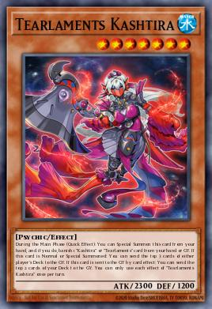

- **Copias y zona:** Main 3x. No altera las cantidades registradas.
- **Nombre oficial de referencia:** Tiagrimentos Kashtira. CID cotejado con la ficha oficial; el nombre histórico del inventario se conserva aunque su grafía/traducción difiera.
- **Función principal y secundaria:** interrupción · extensor · removal.
- **Estado de sinergia y función:** Sinergia indirecta (soporte o recursos). Es una clasificación de juego; revisar la relación concreta en A06.
- **Papel como recurso, descarte o coste:** Coste o consumo descrito en A05: destierro de recurso propio.
- **Efecto operativo (paráfrasis analítica):** acceso al campo desde la mano; destierro de recursos o de amenazas. Son operaciones detectadas en el texto, no efectos independientes garantizados; leer sus condiciones en la fuente.
- **Mapa de activación y resultados:** 1) en Main Phase: Invocación Especial desde Cementerio, destierra el recurso u objetivo previsto. Cada operación está sujeta a la secuencia y al «si lo haces» del texto oficial.
- **Ventanas de activación identificadas:** Main Phase; al producirse una Invocación; al llegar o estar en el Cementerio; Efecto Rápido.
- **Costes o recursos potenciales:** destierro de recurso propio.
- **Restricciones y requisitos:** hay límite por turno según el efecto concreto; interactúa con información oculta o resultados no siempre elegibles. 
- **Prioridad al ir primero:** generar envíos por efecto sin malgastar recursos y preparar interacción. Para esta carta: Reservar la respuesta para la ventana rival exacta; no es una pieza buscadora de nuestro motor.
- **Prioridad al ir segundo:** forzar respuestas rivales con Fusión/retiradas y conservar cementerio utilizable. Identificar primero la respuesta rival que afecta su función «interrupción».
- **Medio/tardío y recuperación:** recuperar materiales y gestionar cartas enviadas o desterradas. No asumir que por sí misma recicla recursos si el texto no lo permite.
- **Sinergias y acceso a líneas:** Relación contextual con enviar cartas al Cementerio por efecto y aprovechar fusiones, reciclaje y motores Horus/Demoniherrero. Habilita una línea del motor sólo si coinciden recursos, objetivos y restricciones; no equivale a un combo completo validado.
- **Riesgo / brick / interrupciones:** Riesgo operativo: interrupción del Cementerio, restricciones de materiales y mildeos aleatorios. Confirmar objetivos disponibles y costes antes de activar. Puede emplearse en cadena sólo cuando se cumpla su condición concreta.
- **Utilidad editorial:** 4/5 para este deck (estimación por rol y zona, no probabilidad calculada). No cambiar copias; cualquier sugerencia de alta/baja pasa por el apartado 22 y aprobación.
- **Referencia oficial y trazabilidad:** https://www.db.yugioh-card.com/yugiohdb/card_search.action?cid=18153&ope=2&request_locale=es. **Confianza:** texto y tipo de efecto cotejados en Konami; síntesis táctica editorial, no demostración de combo.
- **Aplicación concreta dentro de este deck (A06):** acceso al campo desde la mano; destierro de recursos o de amenazas.

**USO PRÁCTICO Y SINERGIA — Tiagrimientos Kashtira**

- **Label funcional:** Sinergia indirecta. Clasificación documental; una relación es válida solo si se satisfacen sus condiciones exactas.
- **Qué hace:** acceso al campo desde la mano; destierro de recursos o de amenazas. Son operaciones detectadas en el texto, no efectos independientes garantizados; leer sus condiciones en la fuente.
- **Cómo aprovecharla en este deck:** acceso al campo desde la mano; destierro de recursos o de amenazas.
- **Al jugar primero:** generar envíos por efecto sin malgastar recursos y preparar interacción. Para esta carta: Reservar la respuesta para la ventana rival exacta; no es una pieza buscadora de nuestro motor.
- **Al jugar segundo:** forzar respuestas rivales con Fusión/retiradas y conservar cementerio utilizable. Identificar primero la respuesta rival que afecta su función «interrupción».
- **Cuándo tener precaución:** Riesgo operativo: interrupción del Cementerio, restricciones de materiales y mildeos aleatorios. Confirmar objetivos disponibles y costes antes de activar. Puede emplearse en cadena sólo cuando se cumpla su condición concreta.

#### 19. Planeta Bajo Presión Wraitsoth

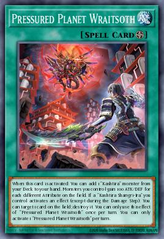

- **Copias y zona:** Main 1x. No altera las cantidades registradas.
- **Nombre oficial de referencia:** Planeta Bajo Presión Wraitsoth. CID cotejado con la ficha oficial; el nombre histórico del inventario se conserva aunque su grafía/traducción difiera.
- **Función principal y secundaria:** searcher · buscador · cierre.
- **Estado de sinergia y función:** Sinergia indirecta (soporte o recursos). Es una clasificación de juego; revisar la relación concreta en A06.
- **Papel como recurso, descarte o coste:** No se demuestra que esta carta sea recurso de descarte o pago para otra.
- **Efecto operativo (paráfrasis analítica):** búsqueda o incorporación de cartas a mano; presión de combate o modificación de estadísticas. Son operaciones detectadas en el texto, no efectos independientes garantizados; leer sus condiciones en la fuente.
- **Mapa de activación y resultados:** 1) con condición explícita en la carta: incorpora la pieza indicada a la mano. Cada operación está sujeta a la secuencia y al «si lo haces» del texto oficial.
- **Ventanas de activación identificadas:** requieren la fase o condición específica indicada en el texto; sin ventana rápida general asumida.
- **Costes o recursos potenciales:** sin coste independiente identificado en esta síntesis; comprobar las acciones previas al punto y coma de cada efecto.
- **Restricciones y requisitos:** hay límite por turno según el efecto concreto. 
- **Prioridad al ir primero:** generar envíos por efecto sin malgastar recursos y preparar interacción. Para esta carta: Convertir la activación en acceso a la siguiente pieza del motor, sin duplicar buscadores inútilmente.
- **Prioridad al ir segundo:** forzar respuestas rivales con Fusión/retiradas y conservar cementerio utilizable. Identificar primero la respuesta rival que afecta su función «searcher».
- **Medio/tardío y recuperación:** recuperar materiales y gestionar cartas enviadas o desterradas. No asumir que por sí misma recicla recursos si el texto no lo permite.
- **Sinergias y acceso a líneas:** Relación contextual con enviar cartas al Cementerio por efecto y aprovechar fusiones, reciclaje y motores Horus/Demoniherrero. Habilita una línea del motor sólo si coinciden recursos, objetivos y restricciones; no equivale a un combo completo validado.
- **Riesgo / brick / interrupciones:** Riesgo operativo: interrupción del Cementerio, restricciones de materiales y mildeos aleatorios. Confirmar objetivos disponibles y costes antes de activar. No atribuirle velocidad rápida por el solo hecho de formar parte del motor.
- **Utilidad editorial:** 5/5 para este deck (estimación por rol y zona, no probabilidad calculada). No cambiar copias; cualquier sugerencia de alta/baja pasa por el apartado 22 y aprobación.
- **Referencia oficial y trazabilidad:** https://www.db.yugioh-card.com/yugiohdb/card_search.action?cid=18204&ope=2&request_locale=es. **Confianza:** texto y tipo de efecto cotejados en Konami; síntesis táctica editorial, no demostración de combo.
- **Aplicación concreta dentro de este deck (A06):** búsqueda o incorporación de cartas a mano; presión de combate o modificación de estadísticas.

**USO PRÁCTICO Y SINERGIA — Planeta Bajo Presión Wraitsoth**

- **Label funcional:** Sinergia indirecta. Clasificación documental; una relación es válida solo si se satisfacen sus condiciones exactas.
- **Qué hace:** búsqueda o incorporación de cartas a mano; presión de combate o modificación de estadísticas. Son operaciones detectadas en el texto, no efectos independientes garantizados; leer sus condiciones en la fuente.
- **Cómo aprovecharla en este deck:** búsqueda o incorporación de cartas a mano; presión de combate o modificación de estadísticas.
- **Al jugar primero:** generar envíos por efecto sin malgastar recursos y preparar interacción. Para esta carta: Convertir la activación en acceso a la siguiente pieza del motor, sin duplicar buscadores inútilmente.
- **Al jugar segundo:** forzar respuestas rivales con Fusión/retiradas y conservar cementerio utilizable. Identificar primero la respuesta rival que afecta su función «searcher».
- **Cuándo tener precaución:** Riesgo operativo: interrupción del Cementerio, restricciones de materiales y mildeos aleatorios. Confirmar objetivos disponibles y costes antes de activar. No atribuirle velocidad rápida por el solo hecho de formar parte del motor.

#### 20. Metarruido Tiagrimientos

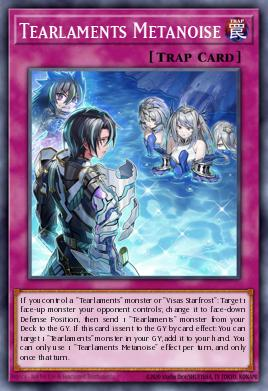

- **Copias y zona:** Main 1x. No altera las cantidades registradas.
- **Nombre oficial de referencia:** Metarruido Tiagrimentos. CID cotejado con la ficha oficial; el nombre histórico del inventario se conserva aunque su grafía/traducción difiera.
- **Función principal y secundaria:** cierre · respuesta.
- **Estado de sinergia y función:** Sinergia indirecta (soporte o recursos). Es una clasificación de juego; revisar la relación concreta en A06.
- **Papel como recurso, descarte o coste:** Coste o consumo descrito en A05: envío de recurso propio al Cementerio.
- **Efecto operativo (paráfrasis analítica):** presión de combate o modificación de estadísticas; interacción sobre monstruos en campo. Son operaciones detectadas en el texto, no efectos independientes garantizados; leer sus condiciones en la fuente.
- **Mapa de activación y resultados:** efecto de estadística, condición o material; no asumir un disparador adicional. Cada operación está sujeta a la secuencia y al «si lo haces» del texto oficial.
- **Ventanas de activación identificadas:** al llegar o estar en el Cementerio.
- **Costes o recursos potenciales:** envío de recurso propio al Cementerio.
- **Restricciones y requisitos:** requiere estado de campo específico; depende de recursos en Cementerio; interactúa con información oculta o resultados no siempre elegibles. 
- **Prioridad al ir primero:** generar envíos por efecto sin malgastar recursos y preparar interacción. Para esta carta: Activar cuando las condiciones permitan obtener valor real, preservando recursos de seguimiento.
- **Prioridad al ir segundo:** forzar respuestas rivales con Fusión/retiradas y conservar cementerio utilizable. Identificar primero la respuesta rival que afecta su función «cierre».
- **Medio/tardío y recuperación:** recuperar materiales y gestionar cartas enviadas o desterradas. No asumir que por sí misma recicla recursos si el texto no lo permite.
- **Sinergias y acceso a líneas:** Relación contextual con enviar cartas al Cementerio por efecto y aprovechar fusiones, reciclaje y motores Horus/Demoniherrero. Habilita una línea del motor sólo si coinciden recursos, objetivos y restricciones; no equivale a un combo completo validado.
- **Riesgo / brick / interrupciones:** Depende del Cementerio y es sensible a destierro o negación de ese recurso. No atribuirle velocidad rápida por el solo hecho de formar parte del motor.
- **Utilidad editorial:** 3/5 para este deck (estimación por rol y zona, no probabilidad calculada). No cambiar copias; cualquier sugerencia de alta/baja pasa por el apartado 22 y aprobación.
- **Referencia oficial y trazabilidad:** https://www.db.yugioh-card.com/yugiohdb/card_search.action?cid=17473&ope=2&request_locale=es. **Confianza:** texto y tipo de efecto cotejados en Konami; síntesis táctica editorial, no demostración de combo.
- **Aplicación concreta dentro de este deck (A06):** presión de combate o modificación de estadísticas; interacción sobre monstruos en campo.

**USO PRÁCTICO Y SINERGIA — Metarruido Tiagrimientos**

- **Label funcional:** Sinergia indirecta. Clasificación documental; una relación es válida solo si se satisfacen sus condiciones exactas.
- **Qué hace:** presión de combate o modificación de estadísticas; interacción sobre monstruos en campo. Son operaciones detectadas en el texto, no efectos independientes garantizados; leer sus condiciones en la fuente.
- **Cómo aprovecharla en este deck:** presión de combate o modificación de estadísticas; interacción sobre monstruos en campo.
- **Al jugar primero:** generar envíos por efecto sin malgastar recursos y preparar interacción. Para esta carta: Activar cuando las condiciones permitan obtener valor real, preservando recursos de seguimiento.
- **Al jugar segundo:** forzar respuestas rivales con Fusión/retiradas y conservar cementerio utilizable. Identificar primero la respuesta rival que afecta su función «cierre».
- **Cuándo tener precaución:** Depende del Cementerio y es sensible a destierro o negación de ese recurso. No atribuirle velocidad rápida por el solo hecho de formar parte del motor.

#### 21. Demoniherrero Grabador

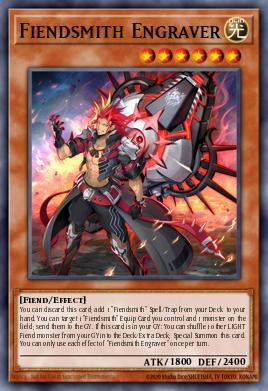

- **Copias y zona:** Main 3x. No altera las cantidades registradas.
- **Nombre oficial de referencia:** Demoniherrero Grabador. CID cotejado con la ficha oficial; el nombre histórico del inventario se conserva aunque su grafía/traducción difiera.
- **Función principal y secundaria:** searcher · buscador · recuperación · motor Equipo.
- **Estado de sinergia y función:** Sinergia indirecta (soporte o recursos). Es una clasificación de juego; revisar la relación concreta en A06.
- **Papel como recurso, descarte o coste:** Coste o consumo descrito en A05: descarte de mano; reciclaje de recurso propio.
- **Efecto operativo (paráfrasis analítica):** búsqueda o incorporación de cartas a mano; retorno o reciclaje hacia mano/Deck/Extra; uso o producción de cartas equipadas. Son operaciones detectadas en el texto, no efectos independientes garantizados; leer sus condiciones en la fuente.
- **Mapa de activación y resultados:** 1) efecto propio o continuo: incorpora la pieza indicada a la mano · 2) mientras está en Cementerio: Invocación Especial desde Extra Deck, devuelve recursos a mano/Deck/Extra. Cada operación está sujeta a la secuencia y al «si lo haces» del texto oficial.
- **Ventanas de activación identificadas:** al llegar o estar en el Cementerio.
- **Costes o recursos potenciales:** descarte de mano; reciclaje de recurso propio.
- **Restricciones y requisitos:** hay límite por turno según el efecto concreto; depende de recursos en Cementerio. 
- **Prioridad al ir primero:** generar envíos por efecto sin malgastar recursos y preparar interacción. Para esta carta: Convertir la activación en acceso a la siguiente pieza del motor, sin duplicar buscadores inútilmente.
- **Prioridad al ir segundo:** forzar respuestas rivales con Fusión/retiradas y conservar cementerio utilizable. Identificar primero la respuesta rival que afecta su función «searcher».
- **Medio/tardío y recuperación:** recuperar materiales y gestionar cartas enviadas o desterradas. Verificar que el objetivo de recuperación continúe disponible.
- **Sinergias y acceso a líneas:** Relación contextual con enviar cartas al Cementerio por efecto y aprovechar fusiones, reciclaje y motores Horus/Demoniherrero. Habilita una línea del motor sólo si coinciden recursos, objetivos y restricciones; no equivale a un combo completo validado.
- **Riesgo / brick / interrupciones:** Depende del Cementerio y es sensible a destierro o negación de ese recurso. No atribuirle velocidad rápida por el solo hecho de formar parte del motor.
- **Utilidad editorial:** 5/5 para este deck (estimación por rol y zona, no probabilidad calculada). No cambiar copias; cualquier sugerencia de alta/baja pasa por el apartado 22 y aprobación.
- **Referencia oficial y trazabilidad:** https://www.db.yugioh-card.com/yugiohdb/card_search.action?cid=20196&ope=2&request_locale=es. **Confianza:** texto y tipo de efecto cotejados en Konami; síntesis táctica editorial, no demostración de combo.
- **Aplicación concreta dentro de este deck (A06):** búsqueda o incorporación de cartas a mano; retorno o reciclaje hacia mano/Deck/Extra; uso o producción de cartas equipadas.

**USO PRÁCTICO Y SINERGIA — Demoniherrero Grabador**

- **Label funcional:** Sinergia indirecta. Clasificación documental; una relación es válida solo si se satisfacen sus condiciones exactas.
- **Qué hace:** búsqueda o incorporación de cartas a mano; retorno o reciclaje hacia mano/Deck/Extra; uso o producción de cartas equipadas. Son operaciones detectadas en el texto, no efectos independientes garantizados; leer sus condiciones en la fuente.
- **Cómo aprovecharla en este deck:** búsqueda o incorporación de cartas a mano; retorno o reciclaje hacia mano/Deck/Extra; uso o producción de cartas equipadas.
- **Al jugar primero:** generar envíos por efecto sin malgastar recursos y preparar interacción. Para esta carta: Convertir la activación en acceso a la siguiente pieza del motor, sin duplicar buscadores inútilmente.
- **Al jugar segundo:** forzar respuestas rivales con Fusión/retiradas y conservar cementerio utilizable. Identificar primero la respuesta rival que afecta su función «searcher».
- **Cuándo tener precaución:** Depende del Cementerio y es sensible a destierro o negación de ese recurso. No atribuirle velocidad rápida por el solo hecho de formar parte del motor.

#### 22. Sarcófago del Rey

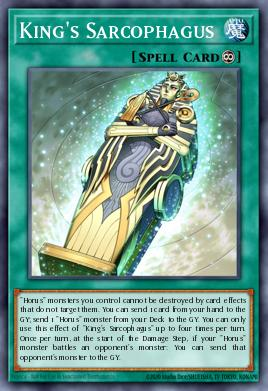

- **Copias y zona:** Main 2x. No altera las cantidades registradas.
- **Nombre oficial de referencia:** Sarcófago del Rey. CID cotejado con la ficha oficial; el nombre histórico del inventario se conserva aunque su grafía/traducción difiera.
- **Función principal y secundaria:** recurso situacional.
- **Estado de sinergia y función:** Sinergia indirecta (soporte o recursos). Es una clasificación de juego; revisar la relación concreta en A06.
- **Papel como recurso, descarte o coste:** Coste o consumo descrito en A05: envío de recurso propio al Cementerio.
- **Efecto operativo (paráfrasis analítica):** interacción propia de la carta que requiere consultar el texto íntegro enlazado. Son operaciones detectadas en el texto, no efectos independientes garantizados; leer sus condiciones en la fuente.
- **Mapa de activación y resultados:** efecto de estadística, condición o material; no asumir un disparador adicional. Cada operación está sujeta a la secuencia y al «si lo haces» del texto oficial.
- **Ventanas de activación identificadas:** requieren la fase o condición específica indicada en el texto; sin ventana rápida general asumida.
- **Costes o recursos potenciales:** envío de recurso propio al Cementerio.
- **Restricciones y requisitos:** hay límite por turno según el efecto concreto. 
- **Prioridad al ir primero:** generar envíos por efecto sin malgastar recursos y preparar interacción. Para esta carta: Activar cuando las condiciones permitan obtener valor real, preservando recursos de seguimiento.
- **Prioridad al ir segundo:** forzar respuestas rivales con Fusión/retiradas y conservar cementerio utilizable. Identificar primero la respuesta rival que afecta su función «recurso situacional».
- **Medio/tardío y recuperación:** recuperar materiales y gestionar cartas enviadas o desterradas. No asumir que por sí misma recicla recursos si el texto no lo permite.
- **Sinergias y acceso a líneas:** Relación contextual con enviar cartas al Cementerio por efecto y aprovechar fusiones, reciclaje y motores Horus/Demoniherrero. Habilita una línea del motor sólo si coinciden recursos, objetivos y restricciones; no equivale a un combo completo validado.
- **Riesgo / brick / interrupciones:** Riesgo operativo: interrupción del Cementerio, restricciones de materiales y mildeos aleatorios. Confirmar objetivos disponibles y costes antes de activar. No atribuirle velocidad rápida por el solo hecho de formar parte del motor.
- **Utilidad editorial:** 3/5 para este deck (estimación por rol y zona, no probabilidad calculada). No cambiar copias; cualquier sugerencia de alta/baja pasa por el apartado 22 y aprobación.
- **Referencia oficial y trazabilidad:** https://www.db.yugioh-card.com/yugiohdb/card_search.action?cid=19200&ope=2&request_locale=es. **Confianza:** texto y tipo de efecto cotejados en Konami; síntesis táctica editorial, no demostración de combo.
- **Aplicación concreta dentro de este deck (A06):** interacción propia de la carta que requiere consultar el texto íntegro enlazado.

**USO PRÁCTICO Y SINERGIA — Sarcófago del Rey**

- **Label funcional:** Sinergia indirecta. Clasificación documental; una relación es válida solo si se satisfacen sus condiciones exactas.
- **Qué hace:** interacción propia de la carta que requiere consultar el texto íntegro enlazado. Son operaciones detectadas en el texto, no efectos independientes garantizados; leer sus condiciones en la fuente.
- **Cómo aprovecharla en este deck:** interacción propia de la carta que requiere consultar el texto íntegro enlazado.
- **Al jugar primero:** generar envíos por efecto sin malgastar recursos y preparar interacción. Para esta carta: Activar cuando las condiciones permitan obtener valor real, preservando recursos de seguimiento.
- **Al jugar segundo:** forzar respuestas rivales con Fusión/retiradas y conservar cementerio utilizable. Identificar primero la respuesta rival que afecta su función «recurso situacional».
- **Cuándo tener precaución:** Riesgo operativo: interrupción del Cementerio, restricciones de materiales y mildeos aleatorios. Confirmar objetivos disponibles y costes antes de activar. No atribuirle velocidad rápida por el solo hecho de formar parte del motor.

#### 23. Hapi, Guía de Horus

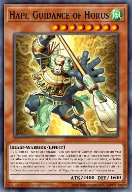

- **Copias y zona:** Main 1x. No altera las cantidades registradas.
- **Nombre oficial de referencia:** Hapi, Guía de Horus. CID cotejado con la ficha oficial; el nombre histórico del inventario se conserva aunque su grafía/traducción difiera.
- **Función principal y secundaria:** searcher · buscador · recuperación · removal.
- **Estado de sinergia y función:** Sinergia indirecta (soporte o recursos). Es una clasificación de juego; revisar la relación concreta en A06.
- **Papel como recurso, descarte o coste:** No se demuestra que esta carta sea recurso de descarte o pago para otra.
- **Efecto operativo (paráfrasis analítica):** búsqueda o incorporación de cartas a mano; recuperación e invocación desde Cementerio/destierro; destierro de recursos o de amenazas; retorno o reciclaje hacia mano/Deck/Extra. Son operaciones detectadas en el texto, no efectos independientes garantizados; leer sus condiciones en la fuente.
- **Mapa de activación y resultados:** 1) efecto propio o continuo: Invocación Especial desde Cementerio · 2) con estado de campo/zona indicado: incorpora la pieza indicada a la mano, destierra el recurso u objetivo previsto, devuelve recursos a mano/Deck/Extra. Cada operación está sujeta a la secuencia y al «si lo haces» del texto oficial.
- **Ventanas de activación identificadas:** requieren la fase o condición específica indicada en el texto; sin ventana rápida general asumida.
- **Costes o recursos potenciales:** sin coste independiente identificado en esta síntesis; comprobar las acciones previas al punto y coma de cada efecto.
- **Restricciones y requisitos:** hay límite por turno según el efecto concreto; requiere estado de campo específico; depende de recursos en Cementerio. 
- **Prioridad al ir primero:** generar envíos por efecto sin malgastar recursos y preparar interacción. Para esta carta: Convertir la activación en acceso a la siguiente pieza del motor, sin duplicar buscadores inútilmente.
- **Prioridad al ir segundo:** forzar respuestas rivales con Fusión/retiradas y conservar cementerio utilizable. Identificar primero la respuesta rival que afecta su función «searcher».
- **Medio/tardío y recuperación:** recuperar materiales y gestionar cartas enviadas o desterradas. Verificar que el objetivo de recuperación continúe disponible.
- **Sinergias y acceso a líneas:** Relación contextual con enviar cartas al Cementerio por efecto y aprovechar fusiones, reciclaje y motores Horus/Demoniherrero. Habilita una línea del motor sólo si coinciden recursos, objetivos y restricciones; no equivale a un combo completo validado.
- **Riesgo / brick / interrupciones:** Riesgo operativo: interrupción del Cementerio, restricciones de materiales y mildeos aleatorios. Confirmar objetivos disponibles y costes antes de activar. No atribuirle velocidad rápida por el solo hecho de formar parte del motor.
- **Utilidad editorial:** 5/5 para este deck (estimación por rol y zona, no probabilidad calculada). No cambiar copias; cualquier sugerencia de alta/baja pasa por el apartado 22 y aprobación.
- **Referencia oficial y trazabilidad:** https://www.db.yugioh-card.com/yugiohdb/card_search.action?cid=19155&ope=2&request_locale=es. **Confianza:** texto y tipo de efecto cotejados en Konami; síntesis táctica editorial, no demostración de combo.
- **Aplicación concreta dentro de este deck (A06):** búsqueda o incorporación de cartas a mano; recuperación e invocación desde Cementerio/destierro; destierro de recursos o de amenazas; retorno o reciclaje hacia mano/Deck/Extra.

**USO PRÁCTICO Y SINERGIA — Hapi, Guía de Horus**

- **Label funcional:** Sinergia indirecta. Clasificación documental; una relación es válida solo si se satisfacen sus condiciones exactas.
- **Qué hace:** búsqueda o incorporación de cartas a mano; recuperación e invocación desde Cementerio/destierro; destierro de recursos o de amenazas; retorno o reciclaje hacia mano/Deck/Extra. Son operaciones detectadas en el texto, no efectos independientes garantizados; leer sus condiciones en la fuente.
- **Cómo aprovecharla en este deck:** búsqueda o incorporación de cartas a mano; recuperación e invocación desde Cementerio/destierro; destierro de recursos o de amenazas; retorno o reciclaje hacia mano/Deck/Extra.
- **Al jugar primero:** generar envíos por efecto sin malgastar recursos y preparar interacción. Para esta carta: Convertir la activación en acceso a la siguiente pieza del motor, sin duplicar buscadores inútilmente.
- **Al jugar segundo:** forzar respuestas rivales con Fusión/retiradas y conservar cementerio utilizable. Identificar primero la respuesta rival que afecta su función «searcher».
- **Cuándo tener precaución:** Riesgo operativo: interrupción del Cementerio, restricciones de materiales y mildeos aleatorios. Confirmar objetivos disponibles y costes antes de activar. No atribuirle velocidad rápida por el solo hecho de formar parte del motor.

#### 24. Tracto del Demoniherrero

- **Copias y zona:** Main 1x. No altera las cantidades registradas.
- **Nombre oficial de referencia:** Tracto del Demoniherrero. CID cotejado con la ficha oficial; el nombre histórico del inventario se conserva aunque su grafía/traducción difiera.
- **Función principal y secundaria:** searcher · buscador.
- **Estado de sinergia y función:** Sinergia indirecta (soporte o recursos). Es una clasificación de juego; revisar la relación concreta en A06.
- **Papel como recurso, descarte o coste:** Coste o consumo descrito en A05: descarte de mano.
- **Efecto operativo (paráfrasis analítica):** búsqueda o incorporación de cartas a mano. Son operaciones detectadas en el texto, no efectos independientes garantizados; leer sus condiciones en la fuente.
- **Mapa de activación y resultados:** 1) efecto propio o continuo: incorpora la pieza indicada a la mano · 2) efecto propio o continuo: realiza Fusión con materiales permitidos. Cada operación está sujeta a la secuencia y al «si lo haces» del texto oficial.
- **Ventanas de activación identificadas:** requieren la fase o condición específica indicada en el texto; sin ventana rápida general asumida.
- **Costes o recursos potenciales:** descarte de mano.
- **Restricciones y requisitos:** hay límite por turno según el efecto concreto; depende de recursos en Cementerio. 
- **Prioridad al ir primero:** generar envíos por efecto sin malgastar recursos y preparar interacción. Para esta carta: Convertir la activación en acceso a la siguiente pieza del motor, sin duplicar buscadores inútilmente.
- **Prioridad al ir segundo:** forzar respuestas rivales con Fusión/retiradas y conservar cementerio utilizable. Identificar primero la respuesta rival que afecta su función «searcher».
- **Medio/tardío y recuperación:** recuperar materiales y gestionar cartas enviadas o desterradas. No asumir que por sí misma recicla recursos si el texto no lo permite.
- **Sinergias y acceso a líneas:** Relación contextual con enviar cartas al Cementerio por efecto y aprovechar fusiones, reciclaje y motores Horus/Demoniherrero. Habilita una línea del motor sólo si coinciden recursos, objetivos y restricciones; no equivale a un combo completo validado.
- **Riesgo / brick / interrupciones:** Depende del Cementerio y es sensible a destierro o negación de ese recurso. No atribuirle velocidad rápida por el solo hecho de formar parte del motor.
- **Utilidad editorial:** 5/5 para este deck (estimación por rol y zona, no probabilidad calculada). No cambiar copias; cualquier sugerencia de alta/baja pasa por el apartado 22 y aprobación.
- **Referencia oficial y trazabilidad:** https://www.db.yugioh-card.com/yugiohdb/card_search.action?cid=20240&ope=2&request_locale=es. **Confianza:** texto y tipo de efecto cotejados en Konami; síntesis táctica editorial, no demostración de combo.
- **Aplicación concreta dentro de este deck (A06):** búsqueda o incorporación de cartas a mano.

**USO PRÁCTICO Y SINERGIA — Tracto del Demoniherrero**

- **Label funcional:** Sinergia indirecta. Clasificación documental; una relación es válida solo si se satisfacen sus condiciones exactas.
- **Qué hace:** búsqueda o incorporación de cartas a mano. Son operaciones detectadas en el texto, no efectos independientes garantizados; leer sus condiciones en la fuente.
- **Cómo aprovecharla en este deck:** búsqueda o incorporación de cartas a mano.
- **Al jugar primero:** generar envíos por efecto sin malgastar recursos y preparar interacción. Para esta carta: Convertir la activación en acceso a la siguiente pieza del motor, sin duplicar buscadores inútilmente.
- **Al jugar segundo:** forzar respuestas rivales con Fusión/retiradas y conservar cementerio utilizable. Identificar primero la respuesta rival que afecta su función «searcher».
- **Cuándo tener precaución:** Depende del Cementerio y es sensible a destierro o negación de ese recurso. No atribuirle velocidad rápida por el solo hecho de formar parte del motor.

#### 25. Fabuloso Lurrie

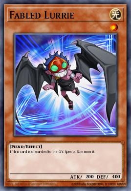

- **Copias y zona:** Main 1x. No altera las cantidades registradas.
- **Nombre oficial de referencia:** Fabuloso Lurrie. CID cotejado con la ficha oficial; el nombre histórico del inventario se conserva aunque su grafía/traducción difiera.
- **Función principal y secundaria:** recurso situacional.
- **Estado de sinergia y función:** Sinergia indirecta (soporte o recursos). Es una clasificación de juego; revisar la relación concreta en A06.
- **Papel como recurso, descarte o coste:** No se demuestra que esta carta sea recurso de descarte o pago para otra.
- **Efecto operativo (paráfrasis analítica):** interacción propia de la carta que requiere consultar el texto íntegro enlazado. Son operaciones detectadas en el texto, no efectos independientes garantizados; leer sus condiciones en la fuente.
- **Mapa de activación y resultados:** efecto de estadística, condición o material; no asumir un disparador adicional. Cada operación está sujeta a la secuencia y al «si lo haces» del texto oficial.
- **Ventanas de activación identificadas:** requieren la fase o condición específica indicada en el texto; sin ventana rápida general asumida.
- **Costes o recursos potenciales:** sin coste independiente identificado en esta síntesis; comprobar las acciones previas al punto y coma de cada efecto.
- **Restricciones y requisitos:** aplicar restricciones de selección, activación y copias que consten en el texto original. 
- **Prioridad al ir primero:** generar envíos por efecto sin malgastar recursos y preparar interacción. Para esta carta: Activar cuando las condiciones permitan obtener valor real, preservando recursos de seguimiento.
- **Prioridad al ir segundo:** forzar respuestas rivales con Fusión/retiradas y conservar cementerio utilizable. Identificar primero la respuesta rival que afecta su función «recurso situacional».
- **Medio/tardío y recuperación:** recuperar materiales y gestionar cartas enviadas o desterradas. No asumir que por sí misma recicla recursos si el texto no lo permite.
- **Sinergias y acceso a líneas:** Relación contextual con enviar cartas al Cementerio por efecto y aprovechar fusiones, reciclaje y motores Horus/Demoniherrero. Habilita una línea del motor sólo si coinciden recursos, objetivos y restricciones; no equivale a un combo completo validado.
- **Riesgo / brick / interrupciones:** Riesgo operativo: interrupción del Cementerio, restricciones de materiales y mildeos aleatorios. Confirmar objetivos disponibles y costes antes de activar. No atribuirle velocidad rápida por el solo hecho de formar parte del motor.
- **Utilidad editorial:** 3/5 para este deck (estimación por rol y zona, no probabilidad calculada). No cambiar copias; cualquier sugerencia de alta/baja pasa por el apartado 22 y aprobación.
- **Referencia oficial y trazabilidad:** https://www.db.yugioh-card.com/yugiohdb/card_search.action?cid=8092&ope=2&request_locale=es. **Confianza:** texto y tipo de efecto cotejados en Konami; síntesis táctica editorial, no demostración de combo.
- **Aplicación concreta dentro de este deck (A06):** interacción propia de la carta que requiere consultar el texto íntegro enlazado.

**USO PRÁCTICO Y SINERGIA — Fabuloso Lurrie**

- **Label funcional:** Sinergia indirecta. Clasificación documental; una relación es válida solo si se satisfacen sus condiciones exactas.
- **Qué hace:** interacción propia de la carta que requiere consultar el texto íntegro enlazado. Son operaciones detectadas en el texto, no efectos independientes garantizados; leer sus condiciones en la fuente.
- **Cómo aprovecharla en este deck:** interacción propia de la carta que requiere consultar el texto íntegro enlazado.
- **Al jugar primero:** generar envíos por efecto sin malgastar recursos y preparar interacción. Para esta carta: Activar cuando las condiciones permitan obtener valor real, preservando recursos de seguimiento.
- **Al jugar segundo:** forzar respuestas rivales con Fusión/retiradas y conservar cementerio utilizable. Identificar primero la respuesta rival que afecta su función «recurso situacional».
- **Cuándo tener precaución:** Riesgo operativo: interrupción del Cementerio, restricciones de materiales y mildeos aleatorios. Confirmar objetivos disponibles y costes antes de activar. No atribuirle velocidad rápida por el solo hecho de formar parte del motor.

#### 26. Keldo la Protectora Sagrada

- **Copias y zona:** Main 1x. No altera las cantidades registradas.
- **Nombre oficial de referencia:** Keldo la Protectora Sagrada. CID cotejado con la ficha oficial; el nombre histórico del inventario se conserva aunque su grafía/traducción difiera.
- **Función principal y secundaria:** interrupción · searcher · buscador · extensor.
- **Estado de sinergia y función:** Sinergia indirecta (soporte o recursos). Es una clasificación de juego; revisar la relación concreta en A06.
- **Papel como recurso, descarte o coste:** Coste o consumo descrito en A05: descarte de mano.
- **Efecto operativo (paráfrasis analítica):** búsqueda o incorporación de cartas a mano; acceso al campo desde la mano. Son operaciones detectadas en el texto, no efectos independientes garantizados; leer sus condiciones en la fuente.
- **Mapa de activación y resultados:** efecto de estadística, condición o material; no asumir un disparador adicional. Cada operación está sujeta a la secuencia y al «si lo haces» del texto oficial.
- **Ventanas de activación identificadas:** Efecto Rápido.
- **Costes o recursos potenciales:** descarte de mano.
- **Restricciones y requisitos:** hay límite por turno según el efecto concreto; depende de recursos en Cementerio. 
- **Prioridad al ir primero:** generar envíos por efecto sin malgastar recursos y preparar interacción. Para esta carta: Reservar la respuesta para la ventana rival exacta; no es una pieza buscadora de nuestro motor.
- **Prioridad al ir segundo:** forzar respuestas rivales con Fusión/retiradas y conservar cementerio utilizable. Identificar primero la respuesta rival que afecta su función «interrupción».
- **Medio/tardío y recuperación:** recuperar materiales y gestionar cartas enviadas o desterradas. No asumir que por sí misma recicla recursos si el texto no lo permite.
- **Sinergias y acceso a líneas:** Relación contextual con enviar cartas al Cementerio por efecto y aprovechar fusiones, reciclaje y motores Horus/Demoniherrero. Habilita una línea del motor sólo si coinciden recursos, objetivos y restricciones; no equivale a un combo completo validado.
- **Riesgo / brick / interrupciones:** Depende del Cementerio y es sensible a destierro o negación de ese recurso. Puede emplearse en cadena sólo cuando se cumpla su condición concreta.
- **Utilidad editorial:** 5/5 para este deck (estimación por rol y zona, no probabilidad calculada). No cambiar copias; cualquier sugerencia de alta/baja pasa por el apartado 22 y aprobación.
- **Referencia oficial y trazabilidad:** https://www.db.yugioh-card.com/yugiohdb/card_search.action?cid=17603&ope=2&request_locale=es. **Confianza:** texto y tipo de efecto cotejados en Konami; síntesis táctica editorial, no demostración de combo.
- **Aplicación concreta dentro de este deck (A06):** búsqueda o incorporación de cartas a mano; acceso al campo desde la mano.

**USO PRÁCTICO Y SINERGIA — Keldo la Protectora Sagrada**

- **Label funcional:** Sinergia indirecta. Clasificación documental; una relación es válida solo si se satisfacen sus condiciones exactas.
- **Qué hace:** búsqueda o incorporación de cartas a mano; acceso al campo desde la mano. Son operaciones detectadas en el texto, no efectos independientes garantizados; leer sus condiciones en la fuente.
- **Cómo aprovecharla en este deck:** búsqueda o incorporación de cartas a mano; acceso al campo desde la mano.
- **Al jugar primero:** generar envíos por efecto sin malgastar recursos y preparar interacción. Para esta carta: Reservar la respuesta para la ventana rival exacta; no es una pieza buscadora de nuestro motor.
- **Al jugar segundo:** forzar respuestas rivales con Fusión/retiradas y conservar cementerio utilizable. Identificar primero la respuesta rival que afecta su función «interrupción».
- **Cuándo tener precaución:** Depende del Cementerio y es sensible a destierro o negación de ese recurso. Puede emplearse en cadena sólo cuando se cumpla su condición concreta.

#### 27. Agnumday del Demoniherrero

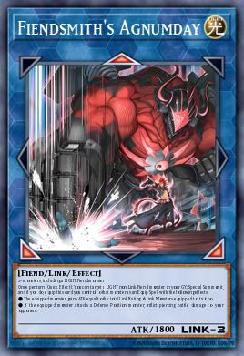

- **Copias y zona:** Extra 1x. No altera las cantidades registradas.
- **Nombre oficial de referencia:** Agnumday del Demoniherrero. CID cotejado con la ficha oficial; el nombre histórico del inventario se conserva aunque su grafía/traducción difiera.
- **Función principal y secundaria:** interrupción · resultado de Extra Deck · cierre · motor Equipo.
- **Estado de sinergia y función:** Sin acceso al Extra demostrado. Es una clasificación de juego; revisar la relación concreta en A06.
- **Papel como recurso, descarte o coste:** Material o destino del Extra condicionado a los requisitos de invocación.
- **Efecto operativo (paráfrasis analítica):** presión de combate o modificación de estadísticas; uso o producción de cartas equipadas. Son operaciones detectadas en el texto, no efectos independientes garantizados; leer sus condiciones en la fuente.
- **Mapa de activación y resultados:** 1) una vez por turno: equipa carta/monstruo según texto, inflige daño. Cada operación está sujeta a la secuencia y al «si lo haces» del texto oficial.
- **Ventanas de activación identificadas:** Efecto Rápido.
- **Costes o recursos potenciales:** sin coste independiente identificado en esta síntesis; comprobar las acciones previas al punto y coma de cada efecto.
- **Restricciones y requisitos:** hay límite por turno según el efecto concreto; depende de recursos en Cementerio. Invocar sólo desde el Extra Deck usando su procedimiento propio.
- **Prioridad al ir primero:** generar envíos por efecto sin malgastar recursos y preparar interacción. Para esta carta: Reservar la respuesta para la ventana rival exacta; no es una pieza buscadora de nuestro motor.
- **Prioridad al ir segundo:** forzar respuestas rivales con Fusión/retiradas y conservar cementerio utilizable. Identificar primero la respuesta rival que afecta su función «interrupción».
- **Medio/tardío y recuperación:** recuperar materiales y gestionar cartas enviadas o desterradas. No asumir que por sí misma recicla recursos si el texto no lo permite.
- **Sinergias y acceso a líneas:** Relación contextual con enviar cartas al Cementerio por efecto y aprovechar fusiones, reciclaje y motores Horus/Demoniherrero. Puede cerrar o prolongar una ruta del Extra si los materiales están disponibles.
- **Riesgo / brick / interrupciones:** Depende del Cementerio y es sensible a destierro o negación de ese recurso. Puede emplearse en cadena sólo cuando se cumpla su condición concreta.
- **Utilidad editorial:** 4/5 para este deck (estimación por rol y zona, no probabilidad calculada). No cambiar copias; cualquier sugerencia de alta/baja pasa por el apartado 22 y aprobación.
- **Referencia oficial y trazabilidad:** https://www.db.yugioh-card.com/yugiohdb/card_search.action?cid=20521&ope=2&request_locale=es. **Confianza:** texto y tipo de efecto cotejados en Konami; síntesis táctica editorial, no demostración de combo.
- **Aplicación concreta dentro de este deck (A06):** presión de combate o modificación de estadísticas; uso o producción de cartas equipadas. Falta arista de materiales en A06; A09 podría contener una ruta válida no indexada aquí.

**USO PRÁCTICO Y SINERGIA — Agnumday del Demoniherrero**

- **Label funcional:** Sin sinergia demostrada (con la evidencia actual). Clasificación documental; una relación es válida solo si se satisfacen sus condiciones exactas.
- **Qué hace:** presión de combate o modificación de estadísticas; uso o producción de cartas equipadas. Son operaciones detectadas en el texto, no efectos independientes garantizados; leer sus condiciones en la fuente.
- **Cómo aprovecharla en este deck:** presión de combate o modificación de estadísticas; uso o producción de cartas equipadas. Falta arista de materiales en A06; A09 podría contener una ruta válida no indexada aquí.
- **Al jugar primero:** generar envíos por efecto sin malgastar recursos y preparar interacción. Para esta carta: Reservar la respuesta para la ventana rival exacta; no es una pieza buscadora de nuestro motor.
- **Al jugar segundo:** forzar respuestas rivales con Fusión/retiradas y conservar cementerio utilizable. Identificar primero la respuesta rival que afecta su función «interrupción».
- **Cuándo tener precaución:** Depende del Cementerio y es sensible a destierro o negación de ese recurso. Puede emplearse en cadena sólo cuando se cumpla su condición concreta.

**CÓMO LLEGAR DESDE TU DECK — SIN RUTA DEMOSTRADA**

- La biblioteca actual no contiene una ruta identificada para esta carta del Extra. No se debe exhibir una descripción genérica como sustituto de mano inicial, materiales y pasos. Para completarla, contrastar requisitos oficiales y recursos del Main; si no es alcanzable, explicar el impedimento exacto.

#### 28. Sprind Spright

- **Copias y zona:** Extra 1x. No altera las cantidades registradas.
- **Nombre oficial de referencia:** Sprind Spright. CID cotejado con la ficha oficial; el nombre histórico del inventario se conserva aunque su grafía/traducción difiera.
- **Función principal y secundaria:** resultado de Extra Deck · habilitador Xyz.
- **Estado de sinergia y función:** Sin acceso al Extra demostrado. Es una clasificación de juego; revisar la relación concreta en A06.
- **Papel como recurso, descarte o coste:** Material o destino del Extra condicionado a los requisitos de invocación.
- **Efecto operativo (paráfrasis analítica):** gestión de materiales Xyz. Son operaciones detectadas en el texto, no efectos independientes garantizados; leer sus condiciones en la fuente.
- **Mapa de activación y resultados:** 1) efecto propio o continuo: habilita Enlace · 2) con estado de campo/zona indicado: desacopla materiales Xyz. Cada operación está sujeta a la secuencia y al «si lo haces» del texto oficial.
- **Ventanas de activación identificadas:** al producirse una Invocación; Invocación del Extra Deck.
- **Costes o recursos potenciales:** sin coste independiente identificado en esta síntesis; comprobar las acciones previas al punto y coma de cada efecto.
- **Restricciones y requisitos:** exige materiales de Extra Deck o materiales adecuados. Invocar sólo desde el Extra Deck usando su procedimiento propio.
- **Prioridad al ir primero:** generar envíos por efecto sin malgastar recursos y preparar interacción. Para esta carta: Comprobar materiales exactos antes de buscar este objetivo en el Extra Deck.
- **Prioridad al ir segundo:** forzar respuestas rivales con Fusión/retiradas y conservar cementerio utilizable. Identificar primero la respuesta rival que afecta su función «resultado de Extra Deck».
- **Medio/tardío y recuperación:** recuperar materiales y gestionar cartas enviadas o desterradas. No asumir que por sí misma recicla recursos si el texto no lo permite.
- **Sinergias y acceso a líneas:** Relación contextual con enviar cartas al Cementerio por efecto y aprovechar fusiones, reciclaje y motores Horus/Demoniherrero. Puede cerrar o prolongar una ruta del Extra si los materiales están disponibles.
- **Riesgo / brick / interrupciones:** Se agota al consumir materiales; no asumir material adicional al pasar de un Xyz a otro. No atribuirle velocidad rápida por el solo hecho de formar parte del motor.
- **Utilidad editorial:** 4/5 para este deck (estimación por rol y zona, no probabilidad calculada). No cambiar copias; cualquier sugerencia de alta/baja pasa por el apartado 22 y aprobación.
- **Referencia oficial y trazabilidad:** https://www.db.yugioh-card.com/yugiohdb/card_search.action?cid=17803&ope=2&request_locale=es. **Confianza:** texto y tipo de efecto cotejados en Konami; síntesis táctica editorial, no demostración de combo.
- **Aplicación concreta dentro de este deck (A06):** gestión de materiales Xyz. Falta arista de materiales en A06; A09 podría contener una ruta válida no indexada aquí.

**USO PRÁCTICO Y SINERGIA — Sprind Spright**

- **Label funcional:** Sin sinergia demostrada (con la evidencia actual). Clasificación documental; una relación es válida solo si se satisfacen sus condiciones exactas.
- **Qué hace:** gestión de materiales Xyz. Son operaciones detectadas en el texto, no efectos independientes garantizados; leer sus condiciones en la fuente.
- **Cómo aprovecharla en este deck:** gestión de materiales Xyz. Falta arista de materiales en A06; A09 podría contener una ruta válida no indexada aquí.
- **Al jugar primero:** generar envíos por efecto sin malgastar recursos y preparar interacción. Para esta carta: Comprobar materiales exactos antes de buscar este objetivo en el Extra Deck.
- **Al jugar segundo:** forzar respuestas rivales con Fusión/retiradas y conservar cementerio utilizable. Identificar primero la respuesta rival que afecta su función «resultado de Extra Deck».
- **Cuándo tener precaución:** Se agota al consumir materiales; no asumir material adicional al pasar de un Xyz a otro. No atribuirle velocidad rápida por el solo hecho de formar parte del motor.

**CÓMO LLEGAR DESDE TU DECK — SIN RUTA DEMOSTRADA**

- La biblioteca actual no contiene una ruta identificada para esta carta del Extra. No se debe exhibir una descripción genérica como sustituto de mano inicial, materiales y pasos. Para completarla, contrastar requisitos oficiales y recursos del Main; si no es alcanzable, explicar el impedimento exacto.

#### 29. S:P Pequeña Caballera

- **Copias y zona:** Extra 1x. No altera las cantidades registradas.
- **Nombre oficial de referencia:** S:P Pequeña Caballera. CID cotejado con la ficha oficial; el nombre histórico del inventario se conserva aunque su grafía/traducción difiera.
- **Función principal y secundaria:** interrupción · resultado de Extra Deck · removal · respuesta.
- **Estado de sinergia y función:** Destino Extra condicionado. Es una clasificación de juego; revisar la relación concreta en A06.
- **Papel como recurso, descarte o coste:** Material o destino del Extra condicionado a los requisitos de invocación.
- **Efecto operativo (paráfrasis analítica):** destierro de recursos o de amenazas; interacción sobre monstruos en campo. Son operaciones detectadas en el texto, no efectos independientes garantizados; leer sus condiciones en la fuente.
- **Mapa de activación y resultados:** 1) en respuesta a activación rival: destierra el recurso u objetivo previsto. Cada operación está sujeta a la secuencia y al «si lo haces» del texto oficial.
- **Ventanas de activación identificadas:** al producirse una Invocación; respuesta a activación rival; Efecto Rápido; Invocación del Extra Deck.
- **Costes o recursos potenciales:** sin coste independiente identificado en esta síntesis; comprobar las acciones previas al punto y coma de cada efecto.
- **Restricciones y requisitos:** hay límite por turno según el efecto concreto; puede limitar ataques. Invocar sólo desde el Extra Deck usando su procedimiento propio.
- **Prioridad al ir primero:** generar envíos por efecto sin malgastar recursos y preparar interacción. Para esta carta: Reservar la respuesta para la ventana rival exacta; no es una pieza buscadora de nuestro motor.
- **Prioridad al ir segundo:** forzar respuestas rivales con Fusión/retiradas y conservar cementerio utilizable. Identificar primero la respuesta rival que afecta su función «interrupción».
- **Medio/tardío y recuperación:** recuperar materiales y gestionar cartas enviadas o desterradas. No asumir que por sí misma recicla recursos si el texto no lo permite.
- **Sinergias y acceso a líneas:** Relación contextual con enviar cartas al Cementerio por efecto y aprovechar fusiones, reciclaje y motores Horus/Demoniherrero. Puede cerrar o prolongar una ruta del Extra si los materiales están disponibles.
- **Riesgo / brick / interrupciones:** No contarla como extensión automática: confirmar materiales, procedimiento y restricciones vigentes. Puede emplearse en cadena sólo cuando se cumpla su condición concreta.
- **Utilidad editorial:** 4/5 para este deck (estimación por rol y zona, no probabilidad calculada). No cambiar copias; cualquier sugerencia de alta/baja pasa por el apartado 22 y aprobación.
- **Referencia oficial y trazabilidad:** https://www.db.yugioh-card.com/yugiohdb/card_search.action?cid=19188&ope=2&request_locale=es. **Confianza:** texto y tipo de efecto cotejados en Konami; síntesis táctica editorial, no demostración de combo.
- **Aplicación concreta dentro de este deck (A06):** destierro de recursos o de amenazas; interacción sobre monstruos en campo. A06 identifica su destino, condicionado a material/procedimiento.

**USO PRÁCTICO Y SINERGIA — S:P Pequeña Caballera**

- **Label funcional:** Sinergia de Extra demostrada en dos manos distintas: `656:A09:FENRIR:REINO:SP_DIRECTA11` y `656:A09:FENRIR:REINO:SCHEIREN:IP_SP12`. Es una vinculación de líneas y materiales concretos, no tasa de éxito.
- **Qué hace:** destierro de recursos o de amenazas; interacción sobre monstruos en campo. Son operaciones detectadas en el texto, no efectos independientes garantizados; leer sus condiciones en la fuente.
- **Cómo aprovecharla en este deck:** destierro de recursos o de amenazas; interacción sobre monstruos en campo. A06 identifica su destino, condicionado a material/procedimiento.
- **Al jugar primero:** generar envíos por efecto sin malgastar recursos y preparar interacción. Para esta carta: Reservar la respuesta para la ventana rival exacta; no es una pieza buscadora de nuestro motor.
- **Al jugar segundo:** forzar respuestas rivales con Fusión/retiradas y conservar cementerio utilizable. Identificar primero la respuesta rival que afecta su función «interrupción».
- **Cuándo tener precaución:** No contarla como extensión automática: confirmar materiales, procedimiento y restricciones vigentes. Puede emplearse en cadena sólo cuando se cumpla su condición concreta.

**CÓMO LLEGAR DESDE TU DECK — DOS RUTAS DE ENLACE COTEJADAS**

- **Línea directa de dos cartas:**  Fenrir (Especial) +  Reinoheart (Normal) →  S:P Link-2. **No se activa destierro al Invocar**: son dos materiales Main, no de Extra. Conserva un Efecto Rápido condicionado a activación rival y dos monstruos boca arriba. [Cinco pasos, campo final y coste](guias/DECK_656_FENRIR_REINO_SP_DIRECTA_GUIA.md) · `656:A09:FENRIR:REINO:SP_DIRECTA11`.
- **Línea con I:P en turno rival:** Fenrir + Reinoheart + Scheiren + Veiler; Reinoheart/Scheiren →  I:P (dejar Fenrir), en Main rival I:P contada como 1 + Fenrir → S:P. **Aquí sí** puede activar destierro al Invocar al haber usado un material Link. [Siete pasos, cadenas, materiales y elección de endboard](guias/DECK_656_FENRIR_REINO_SCHEIREN_IP_SP_GUIA.md) · `656:A09:FENRIR:REINO:SCHEIREN:IP_SP12`.
- **Advertencia:** Enlazar Reinoheart/Scheiren **no equivale a enviar por efecto** para activar sus efectos Tearlaments de GY; las líneas son alternativas y gastan Fenrir. No presentar una negación por S:P.

#### 30. Réquiem del Demoniherrero

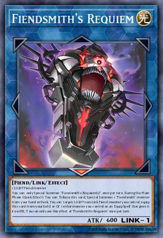

- **Copias y zona:** Extra 1x. No altera las cantidades registradas.
- **Nombre oficial de referencia:** Réquiem del Demoniherrero. CID cotejado con la ficha oficial; el nombre histórico del inventario se conserva aunque su grafía/traducción difiera.
- **Función principal y secundaria:** interrupción · resultado de Extra Deck · extensor · cierre · respuesta.
- **Estado de sinergia y función:** Destino Extra condicionado. Es una clasificación de juego; revisar la relación concreta en A06.
- **Papel como recurso, descarte o coste:** Material o destino del Extra condicionado a los requisitos de invocación.
- **Efecto operativo (paráfrasis analítica):** acceso al campo desde la mano; presión de combate o modificación de estadísticas; interacción sobre monstruos en campo; uso o producción de cartas equipadas; uso de Sacrificios como parte del efecto. Son operaciones detectadas en el texto, no efectos independientes garantizados; leer sus condiciones en la fuente.
- **Mapa de activación y resultados:** 1) efecto propio o continuo: Invocación Especial desde zona permitida · 2) en Main Phase: Invocación Especial desde mano · 3) efecto propio o continuo: equipa carta/monstruo según texto. Cada operación está sujeta a la secuencia y al «si lo haces» del texto oficial.
- **Ventanas de activación identificadas:** Main Phase; Efecto Rápido.
- **Costes o recursos potenciales:** Sacrificio.
- **Restricciones y requisitos:** hay límite por turno según el efecto concreto. Invocar sólo desde el Extra Deck usando su procedimiento propio.
- **Prioridad al ir primero:** generar envíos por efecto sin malgastar recursos y preparar interacción. Para esta carta: Reservar la respuesta para la ventana rival exacta; no es una pieza buscadora de nuestro motor.
- **Prioridad al ir segundo:** forzar respuestas rivales con Fusión/retiradas y conservar cementerio utilizable. Identificar primero la respuesta rival que afecta su función «interrupción».
- **Medio/tardío y recuperación:** recuperar materiales y gestionar cartas enviadas o desterradas. No asumir que por sí misma recicla recursos si el texto no lo permite.
- **Sinergias y acceso a líneas:** Relación contextual con enviar cartas al Cementerio por efecto y aprovechar fusiones, reciclaje y motores Horus/Demoniherrero. Puede cerrar o prolongar una ruta del Extra si los materiales están disponibles.
- **Riesgo / brick / interrupciones:** No contarla como extensión automática: confirmar materiales, procedimiento y restricciones vigentes. Puede emplearse en cadena sólo cuando se cumpla su condición concreta.
- **Utilidad editorial:** 4/5 para este deck (estimación por rol y zona, no probabilidad calculada). No cambiar copias; cualquier sugerencia de alta/baja pasa por el apartado 22 y aprobación.
- **Referencia oficial y trazabilidad:** https://www.db.yugioh-card.com/yugiohdb/card_search.action?cid=20225&ope=2&request_locale=es. **Confianza:** texto y tipo de efecto cotejados en Konami; síntesis táctica editorial, no demostración de combo.
- **Aplicación concreta dentro de este deck (A06):** acceso al campo desde la mano; presión de combate o modificación de estadísticas; interacción sobre monstruos en campo; uso o producción de cartas equipadas; uso de Sacrificios como parte del efecto. A06 identifica su destino, condicionado a material/procedimiento.

**USO PRÁCTICO Y SINERGIA — Réquiem del Demoniherrero**

- **Label funcional:** Referencias de ruta localizadas; conexión reglamentaria sujeta al recorrido de la guía. Clasificación documental; una relación es válida solo si se satisfacen sus condiciones exactas.
- **Qué hace:** acceso al campo desde la mano; presión de combate o modificación de estadísticas; interacción sobre monstruos en campo; uso o producción de cartas equipadas; uso de Sacrificios como parte del efecto. Son operaciones detectadas en el texto, no efectos independientes garantizados; leer sus condiciones en la fuente.
- **Cómo aprovecharla en este deck:** acceso al campo desde la mano; presión de combate o modificación de estadísticas; interacción sobre monstruos en campo; uso o producción de cartas equipadas; uso de Sacrificios como parte del efecto. A06 identifica su destino, condicionado a material/procedimiento.
- **Al jugar primero:** generar envíos por efecto sin malgastar recursos y preparar interacción. Para esta carta: Reservar la respuesta para la ventana rival exacta; no es una pieza buscadora de nuestro motor.
- **Al jugar segundo:** forzar respuestas rivales con Fusión/retiradas y conservar cementerio utilizable. Identificar primero la respuesta rival que afecta su función «interrupción».
- **Cuándo tener precaución:** No contarla como extensión automática: confirmar materiales, procedimiento y restricciones vigentes. Puede emplearse en cadena sólo cuando se cumpla su condición concreta.

**CÓMO LLEGAR DESDE TU DECK — RUTAS DOCUMENTADAS**

- **Abrir guía `656:A09:ENGRAVER:LACRIMA01`:** entrada: Demoniherrero Grabador (20196) solamente. Campo/GY vacíos, Main Phase propia, sin interferencia rival. En Deck quedan al menos Tracto del Demoniherrero (20240), Fabuloso Lurrie (8092) y una segunda copia de Grabador (el inventario contiene 3). Extra disponible: Réquiem (20225), Secuencia (20226), Lácrima del Demoniherrero (20214). No usar cartas de la Reserva ni suponer cartas robadas.. Propósito descrito: Preparación de recursos / despliegue. Consulta sus pasos, consumo y resultado; comprobar si esta carta es realmente invocada o solo mencionada.

#### 31. Garura, Alas de Vida Resonante

**ACCESO PRÁCTICO — RUPTURA DE CAMPO:** desde Main tienes Súper Polimerización. Con ella y otra carta para descartar, si el rival controla dos monstruos boca arriba de igual Tipo y Atributo, pero distinto nombre, puedes utilizar ambos como materiales e Invocar Garura. Consulta la guía paso a paso `656:A09:SUPERPOLY:GARURA10`. Este acceso es **condicional al campo rival**: no es un starter de una sola carta ni un resultado garantizado en campo vacío.

- **Copias y zona:** Extra 1x. No altera las cantidades registradas.
- **Nombre oficial de referencia:** Garura, Alas de Vida Resonante. CID cotejado con la ficha oficial; el nombre histórico del inventario se conserva aunque su grafía/traducción difiera.
- **Función principal y secundaria:** resultado de Extra Deck · ventaja de mano · cierre.
- **Estado de sinergia y función:** Destino Extra condicionado. Es una clasificación de juego; revisar la relación concreta en A06.
- **Papel como recurso, descarte o coste:** Material o destino del Extra condicionado a los requisitos de invocación.
- **Efecto operativo (paráfrasis analítica):** generación de cartas por robo; presión de combate o modificación de estadísticas. Son operaciones detectadas en el texto, no efectos independientes garantizados; leer sus condiciones en la fuente.
- **Mapa de activación y resultados:** 1) con condición explícita en la carta: roba cartas. Cada operación está sujeta a la secuencia y al «si lo haces» del texto oficial.
- **Ventanas de activación identificadas:** al llegar o estar en el Cementerio.
- **Costes o recursos potenciales:** sin coste independiente identificado en esta síntesis; comprobar las acciones previas al punto y coma de cada efecto.
- **Restricciones y requisitos:** hay límite por turno según el efecto concreto. Invocar sólo desde el Extra Deck usando su procedimiento propio.
- **Prioridad al ir primero:** generar envíos por efecto sin malgastar recursos y preparar interacción. Para esta carta: Comprobar materiales exactos antes de buscar este objetivo en el Extra Deck.
- **Prioridad al ir segundo:** forzar respuestas rivales con Fusión/retiradas y conservar cementerio utilizable. Identificar primero la respuesta rival que afecta su función «resultado de Extra Deck».
- **Medio/tardío y recuperación:** recuperar materiales y gestionar cartas enviadas o desterradas. No asumir que por sí misma recicla recursos si el texto no lo permite.
- **Sinergias y acceso a líneas:** Relación contextual con enviar cartas al Cementerio por efecto y aprovechar fusiones, reciclaje y motores Horus/Demoniherrero. Puede cerrar o prolongar una ruta del Extra si los materiales están disponibles.
- **Riesgo / brick / interrupciones:** No contarla como extensión automática: confirmar materiales, procedimiento y restricciones vigentes. No atribuirle velocidad rápida por el solo hecho de formar parte del motor.
- **Utilidad editorial:** 4/5 para este deck (estimación por rol y zona, no probabilidad calculada). No cambiar copias; cualquier sugerencia de alta/baja pasa por el apartado 22 y aprobación.
- **Referencia oficial y trazabilidad:** https://www.db.yugioh-card.com/yugiohdb/card_search.action?cid=17746&ope=2&request_locale=es. **Confianza:** texto y tipo de efecto cotejados en Konami; síntesis táctica editorial, no demostración de combo.
- **Aplicación concreta dentro de este deck (A06):** generación de cartas por robo; presión de combate o modificación de estadísticas. A06 identifica su destino, condicionado a material/procedimiento.

**USO PRÁCTICO Y SINERGIA — Garura, Alas de Vida Resonante**

- **Label funcional:** Sin sinergia demostrada (con la evidencia actual). Clasificación documental; una relación es válida solo si se satisfacen sus condiciones exactas.
- **Qué hace:** generación de cartas por robo; presión de combate o modificación de estadísticas. Son operaciones detectadas en el texto, no efectos independientes garantizados; leer sus condiciones en la fuente.
- **Cómo aprovecharla en este deck:** generación de cartas por robo; presión de combate o modificación de estadísticas. A06 identifica su destino, condicionado a material/procedimiento.
- **Al jugar primero:** generar envíos por efecto sin malgastar recursos y preparar interacción. Para esta carta: Comprobar materiales exactos antes de buscar este objetivo en el Extra Deck.
- **Al jugar segundo:** forzar respuestas rivales con Fusión/retiradas y conservar cementerio utilizable. Identificar primero la respuesta rival que afecta su función «resultado de Extra Deck».
- **Cuándo tener precaución:** No contarla como extensión automática: confirmar materiales, procedimiento y restricciones vigentes. No atribuirle velocidad rápida por el solo hecho de formar parte del motor.

**CÓMO LLEGAR DESDE TU DECK — SIN RUTA DEMOSTRADA**

- La biblioteca actual no contiene una ruta identificada para esta carta del Extra. No se debe exhibir una descripción genérica como sustituto de mano inicial, materiales y pasos. Para completarla, contrastar requisitos oficiales y recursos del Main; si no es alcanzable, explicar el impedimento exacto.

#### 32. Predaplanta Dragostapelia

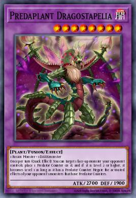

- **Copias y zona:** Extra 1x. No altera las cantidades registradas.
- **Nombre oficial de referencia:** Predaplanta Dragostapelia. CID cotejado con la ficha oficial; el nombre histórico del inventario se conserva aunque su grafía/traducción difiera.
- **Función principal y secundaria:** interrupción · resultado de Extra Deck · negación · respuesta · recurso condicionado.
- **Estado de sinergia y función:** Destino Extra condicionado. Es una clasificación de juego; revisar la relación concreta en A06.
- **Papel como recurso, descarte o coste:** Material o destino del Extra condicionado a los requisitos de invocación.
- **Efecto operativo (paráfrasis analítica):** negación de efectos o activaciones; interacción sobre monstruos en campo; colocación o gasto de contadores. Son operaciones detectadas en el texto, no efectos independientes garantizados; leer sus condiciones en la fuente.
- **Mapa de activación y resultados:** 1) una vez por turno: niega el efecto o la activación indicada. Cada operación está sujeta a la secuencia y al «si lo haces» del texto oficial.
- **Ventanas de activación identificadas:** Efecto Rápido.
- **Costes o recursos potenciales:** sin coste independiente identificado en esta síntesis; comprobar las acciones previas al punto y coma de cada efecto.
- **Restricciones y requisitos:** hay límite por turno según el efecto concreto. Invocar sólo desde el Extra Deck usando su procedimiento propio.
- **Prioridad al ir primero:** generar envíos por efecto sin malgastar recursos y preparar interacción. Para esta carta: Reservar la respuesta para la ventana rival exacta; no es una pieza buscadora de nuestro motor.
- **Prioridad al ir segundo:** forzar respuestas rivales con Fusión/retiradas y conservar cementerio utilizable. Identificar primero la respuesta rival que afecta su función «interrupción».
- **Medio/tardío y recuperación:** recuperar materiales y gestionar cartas enviadas o desterradas. No asumir que por sí misma recicla recursos si el texto no lo permite.
- **Sinergias y acceso a líneas:** Relación contextual con enviar cartas al Cementerio por efecto y aprovechar fusiones, reciclaje y motores Horus/Demoniherrero. Puede cerrar o prolongar una ruta del Extra si los materiales están disponibles.
- **Riesgo / brick / interrupciones:** No contarla como extensión automática: confirmar materiales, procedimiento y restricciones vigentes. Puede emplearse en cadena sólo cuando se cumpla su condición concreta.
- **Utilidad editorial:** 4/5 para este deck (estimación por rol y zona, no probabilidad calculada). No cambiar copias; cualquier sugerencia de alta/baja pasa por el apartado 22 y aprobación.
- **Referencia oficial y trazabilidad:** https://www.db.yugioh-card.com/yugiohdb/card_search.action?cid=12870&ope=2&request_locale=es. **Confianza:** texto y tipo de efecto cotejados en Konami; síntesis táctica editorial, no demostración de combo.
- **Aplicación concreta dentro de este deck (A06):** negación de efectos o activaciones; interacción sobre monstruos en campo; colocación o gasto de contadores. A06 identifica su destino, condicionado a material/procedimiento.

**USO PRÁCTICO Y SINERGIA — Predaplanta Dragostapelia**

- **Label funcional:** Sin sinergia demostrada (con la evidencia actual). Clasificación documental; una relación es válida solo si se satisfacen sus condiciones exactas.
- **Qué hace:** negación de efectos o activaciones; interacción sobre monstruos en campo; colocación o gasto de contadores. Son operaciones detectadas en el texto, no efectos independientes garantizados; leer sus condiciones en la fuente.
- **Cómo aprovecharla en este deck:** negación de efectos o activaciones; interacción sobre monstruos en campo; colocación o gasto de contadores. A06 identifica su destino, condicionado a material/procedimiento.
- **Al jugar primero:** generar envíos por efecto sin malgastar recursos y preparar interacción. Para esta carta: Reservar la respuesta para la ventana rival exacta; no es una pieza buscadora de nuestro motor.
- **Al jugar segundo:** forzar respuestas rivales con Fusión/retiradas y conservar cementerio utilizable. Identificar primero la respuesta rival que afecta su función «interrupción».
- **Cuándo tener precaución:** No contarla como extensión automática: confirmar materiales, procedimiento y restricciones vigentes. Puede emplearse en cadena sólo cuando se cumpla su condición concreta.

**CÓMO LLEGAR DESDE TU DECK — SIN RUTA DEMOSTRADA**

- La biblioteca actual no contiene una ruta identificada para esta carta del Extra. No se debe exhibir una descripción genérica como sustituto de mano inicial, materiales y pasos. Para completarla, contrastar requisitos oficiales y recursos del Main; si no es alcanzable, explicar el impedimento exacto.

#### 33. Tiagrimientos Caleido-Heart

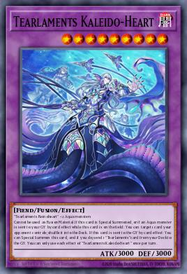

- **Copias y zona:** Extra 1x. No altera las cantidades registradas.
- **Nombre oficial de referencia:** Tiagrimentos Caleido-Heart. CID cotejado con la ficha oficial; el nombre histórico del inventario se conserva aunque su grafía/traducción difiera.
- **Función principal y secundaria:** resultado de Extra Deck · extensor · recuperación.
- **Estado de sinergia y función:** Destino Extra condicionado. Es una clasificación de juego; revisar la relación concreta en A06.
- **Papel como recurso, descarte o coste:** Material o destino del Extra condicionado a los requisitos de invocación.
- **Efecto operativo (paráfrasis analítica):** extensión mediante monstruos procedentes del Deck; recuperación e invocación desde Cementerio/destierro. Son operaciones detectadas en el texto, no efectos independientes garantizados; leer sus condiciones en la fuente.
- **Mapa de activación y resultados:** 1) con condición explícita en la carta: Invocación Especial desde Cementerio. Cada operación está sujeta a la secuencia y al «si lo haces» del texto oficial.
- **Ventanas de activación identificadas:** al producirse una Invocación; al llegar o estar en el Cementerio.
- **Costes o recursos potenciales:** sin coste independiente identificado en esta síntesis; comprobar las acciones previas al punto y coma de cada efecto.
- **Restricciones y requisitos:** hay límite por turno según el efecto concreto; depende de recursos en Cementerio; exige materiales de Extra Deck o materiales adecuados. Invocar sólo desde el Extra Deck usando su procedimiento propio.
- **Prioridad al ir primero:** generar envíos por efecto sin malgastar recursos y preparar interacción. Para esta carta: Convertir acceso al Deck en cuerpos o materiales antes de bloquearse con restricciones.
- **Prioridad al ir segundo:** forzar respuestas rivales con Fusión/retiradas y conservar cementerio utilizable. Identificar primero la respuesta rival que afecta su función «resultado de Extra Deck».
- **Medio/tardío y recuperación:** recuperar materiales y gestionar cartas enviadas o desterradas. Verificar que el objetivo de recuperación continúe disponible.
- **Sinergias y acceso a líneas:** Relación contextual con enviar cartas al Cementerio por efecto y aprovechar fusiones, reciclaje y motores Horus/Demoniherrero. Puede cerrar o prolongar una ruta del Extra si los materiales están disponibles.
- **Riesgo / brick / interrupciones:** No contarla como extensión automática: confirmar materiales, procedimiento y restricciones vigentes. No atribuirle velocidad rápida por el solo hecho de formar parte del motor.
- **Utilidad editorial:** 4/5 para este deck (estimación por rol y zona, no probabilidad calculada). No cambiar copias; cualquier sugerencia de alta/baja pasa por el apartado 22 y aprobación.
- **Referencia oficial y trazabilidad:** https://www.db.yugioh-card.com/yugiohdb/card_search.action?cid=17445&ope=2&request_locale=es. **Confianza:** texto y tipo de efecto cotejados en Konami; síntesis táctica editorial, no demostración de combo.
- **Aplicación concreta dentro de este deck (A06):** extensión mediante monstruos procedentes del Deck; recuperación e invocación desde Cementerio/destierro. A06 identifica su destino, condicionado a material/procedimiento.

**USO PRÁCTICO Y SINERGIA — Tiagrimientos Caleido-Heart**

- **Label funcional:** Referencias de ruta localizadas; conexión reglamentaria sujeta al recorrido de la guía. Clasificación documental; una relación es válida solo si se satisfacen sus condiciones exactas.
- **Qué hace:** extensión mediante monstruos procedentes del Deck; recuperación e invocación desde Cementerio/destierro. Son operaciones detectadas en el texto, no efectos independientes garantizados; leer sus condiciones en la fuente.
- **Cómo aprovecharla en este deck:** extensión mediante monstruos procedentes del Deck; recuperación e invocación desde Cementerio/destierro. A06 identifica su destino, condicionado a material/procedimiento.
- **Al jugar primero:** generar envíos por efecto sin malgastar recursos y preparar interacción. Para esta carta: Convertir acceso al Deck en cuerpos o materiales antes de bloquearse con restricciones.
- **Al jugar segundo:** forzar respuestas rivales con Fusión/retiradas y conservar cementerio utilizable. Identificar primero la respuesta rival que afecta su función «resultado de Extra Deck».
- **Cuándo tener precaución:** No contarla como extensión automática: confirmar materiales, procedimiento y restricciones vigentes. No atribuirle velocidad rápida por el solo hecho de formar parte del motor.

**CÓMO LLEGAR DESDE TU DECK — RUTAS DOCUMENTADAS**

- **Abrir guía `656:A09:REINO:SCHEIREN:KALEIDO01`:** entrada: Reinoheart en mano, Havnis previamente en GY, Scheiren en Deck y Kaleido-Heart disponible en Extra; Main Phase propia, Normal libre y rival sin responder.. Propósito descrito: Ofensivo condicional. Consulta sus pasos, consumo y resultado; comprobar si esta carta es realmente invocada o solo mencionada.
- **Abrir guía `656:A09:REINO:MERRLI:KALEIDO01`:** entrada: Reinoheart en mano, Havnis previamente en GY, Merrli en Deck y Kaleido-Heart en Extra; mismo estado inicial, variante excluyente de Scheiren.. Propósito descrito: Ofensivo condicional. Consulta sus pasos, consumo y resultado; comprobar si esta carta es realmente invocada o solo mencionada.
- **Abrir guía `656:A09:REINO:SCHEIREN:HAVNIS_HAND01`:** entrada: Reinoheart Reinoheart + Havnis Havnis. Deck: Scheiren Scheiren disponible; Extra: Kaleido Kaleido-Heart. Campo y GY propios vacíos, Normal libre, Main Phase propia, sin bloqueos ni respuestas. Un objetivo rival seleccionable es opcional para la remoción.. Propósito descrito: Ofensivo condicional. Consulta sus pasos, consumo y resultado; comprobar si esta carta es realmente invocada o solo mencionada.
- **Abrir guía `656:A09:REINO:MERRLI:SCHEIREN_HAND01`:** entrada: Reinoheart Reinoheart + Scheiren Scheiren. Deck: Merrli Merrli disponible. Extra: Kaleido-Heart; GY/Campo propios vacíos; Normal sin gastar; Main Phase propia sin respuestas/bloqueos. No se supone Havnis en GY ni en mano.. Propósito descrito: Preparación de recursos / despliegue. Consulta sus pasos, consumo y resultado; comprobar si esta carta es realmente invocada o solo mencionada.
- **Abrir guía `656:A09:GOODS:SCREAM:METANOISE:KALEIDO01`:** entrada: Foolish Burial Goods Bienes del Entierro Insensato + Reinoheart Tearlaments Reinoheart. Deck: Scream Grito Tiagrimientos (1x), Metanoise Metarruido Tiagrimientos (1x), Havnis Tearlaments Havnis (1x) y Merrli Tearlaments Merrli (1x) disponibles. Extra: Kaleido Kaleido-Heart (1x). Campo, GY y destierro propios inicialmente vacíos, Normal libre, Main Phase propia, sin respuestas. Condición de continuación rival: Reinoheart y Metarruido sobreviven al cambio de turno; durante el turno rival siguiente el oponente controla al menos un monstruo boca arriba que puede ponerse en Defensa boca abajo y que se puede seleccionar, sin impedir el envío desde Deck al GY ni la Invocación por Fusión.. Propósito descrito: Preparación de recursos / despliegue. Consulta sus pasos, consumo y resultado; comprobar si esta carta es realmente invocada o solo mencionada.
- **Abrir guía `656:A09:GOODS:SCREAM:CRYME:KALEIDO02`:** entrada: Bienes del Entierro Insensato Foolish Burial Goods, Reinoheart Tearlaments Reinoheart, Havnis Tearlaments Havnis. Deck: Grito Tearlaments Scream, Crimanto Tearlaments Cryme, Merrli Tearlaments Merrli. Extra: Kaleido-Heart. Estado: Main Phase propia, Campo/GY/destierro propios vacíos; Normal libre; rival no responde durante preparación. En el siguiente turno rival, Reinoheart debe continuar boca arriba y un monstruo del rival debe poder activar un efecto cuya activación se niegue y que pueda barajarse al Deck. No se presupone carta extra robada.. Propósito descrito: Ofensivo condicional. Consulta sus pasos, consumo y resultado; comprobar si esta carta es realmente invocada o solo mencionada.

#### 34. I:P Enmascarada

- **Copias y zona:** Extra 1x. No altera las cantidades registradas.
- **Nombre oficial de referencia:** I:P Enmascarada. CID cotejado con la ficha oficial; el nombre histórico del inventario se conserva aunque su grafía/traducción difiera.
- **Función principal y secundaria:** interrupción · resultado de Extra Deck · habilitador de Extra · protección.
- **Estado de sinergia y función:** Destino Extra condicionado. Es una clasificación de juego; revisar la relación concreta en A06.
- **Papel como recurso, descarte o coste:** Material o destino del Extra condicionado a los requisitos de invocación.
- **Efecto operativo (paráfrasis analítica):** habilitación o continuación de una invocación del Extra Deck; protección o resistencia contra respuestas. Son operaciones detectadas en el texto, no efectos independientes garantizados; leer sus condiciones en la fuente.
- **Mapa de activación y resultados:** 1) en Main Phase: habilita Enlace. Cada operación está sujeta a la secuencia y al «si lo haces» del texto oficial.
- **Ventanas de activación identificadas:** turno rival; Main Phase; Efecto Rápido.
- **Costes o recursos potenciales:** sin coste independiente identificado en esta síntesis; comprobar las acciones previas al punto y coma de cada efecto.
- **Restricciones y requisitos:** hay límite por turno según el efecto concreto. Invocar sólo desde el Extra Deck usando su procedimiento propio.
- **Prioridad al ir primero:** generar envíos por efecto sin malgastar recursos y preparar interacción. Para esta carta: Reservar la respuesta para la ventana rival exacta; no es una pieza buscadora de nuestro motor.
- **Prioridad al ir segundo:** forzar respuestas rivales con Fusión/retiradas y conservar cementerio utilizable. Identificar primero la respuesta rival que afecta su función «interrupción».
- **Medio/tardío y recuperación:** recuperar materiales y gestionar cartas enviadas o desterradas. No asumir que por sí misma recicla recursos si el texto no lo permite.
- **Sinergias y acceso a líneas:** Relación contextual con enviar cartas al Cementerio por efecto y aprovechar fusiones, reciclaje y motores Horus/Demoniherrero. Puede cerrar o prolongar una ruta del Extra si los materiales están disponibles.
- **Riesgo / brick / interrupciones:** No contarla como extensión automática: confirmar materiales, procedimiento y restricciones vigentes. Puede emplearse en cadena sólo cuando se cumpla su condición concreta.
- **Utilidad editorial:** 4/5 para este deck (estimación por rol y zona, no probabilidad calculada). No cambiar copias; cualquier sugerencia de alta/baja pasa por el apartado 22 y aprobación.
- **Referencia oficial y trazabilidad:** https://www.db.yugioh-card.com/yugiohdb/card_search.action?cid=14676&ope=2&request_locale=es. **Confianza:** texto y tipo de efecto cotejados en Konami; síntesis táctica editorial, no demostración de combo.
- **Aplicación concreta dentro de este deck (A06):** habilitación o continuación de una invocación del Extra Deck; protección o resistencia contra respuestas. A06 identifica su destino, condicionado a material/procedimiento.

**USO PRÁCTICO Y SINERGIA — I:P Enmascarada**

- **Label funcional:** Acceso de Enlace demostrado con `656:A09:FENRIR:REINO:SCHEIREN:IP_SP12`, bajo mano de cuatro cartas y Main rival posterior.
- **Qué hace:** habilitación o continuación de una invocación del Extra Deck; protección o resistencia contra respuestas. Son operaciones detectadas en el texto, no efectos independientes garantizados; leer sus condiciones en la fuente.
- **Cómo aprovecharla en este deck:** habilitación o continuación de una invocación del Extra Deck; protección o resistencia contra respuestas. A06 identifica su destino, condicionado a material/procedimiento.
- **Al jugar primero:** generar envíos por efecto sin malgastar recursos y preparar interacción. Para esta carta: Reservar la respuesta para la ventana rival exacta; no es una pieza buscadora de nuestro motor.
- **Al jugar segundo:** forzar respuestas rivales con Fusión/retiradas y conservar cementerio utilizable. Identificar primero la respuesta rival que afecta su función «interrupción».
- **Cuándo tener precaución:** No contarla como extensión automática: confirmar materiales, procedimiento y restricciones vigentes. Puede emplearse en cadena sólo cuando se cumpla su condición concreta.

**CÓMO LLEGAR DESDE TU DECK — RUTA COTEJADA**

- **Línea real:**  Fenrir Especial,  Reinoheart Normal,  Scheiren Especial enviando Veiler desde mano **por efecto** y moliendo tres cartas aleatorias. Enlazar Reinoheart+Scheiren (ambos no-Enlace) →  I:P Link-2. Mantener Fenrir en Campo. En Main rival, I:P (valor1) + Fenrir →  S:P con primer destierro al Invocar y protección frente a destrucción por efectos rivales. [Guía ilustrada en siete pasos](guias/DECK_656_FENRIR_REINO_SCHEIREN_IP_SP_GUIA.md) · `656:A09:FENRIR:REINO:SCHEIREN:IP_SP12`.
- **Coste/decisión:** la línea requiere 4 cartas exactas y cede Fenrir; conservar I:P+Fenrir es una alternativa válida. No contar las cartas molidas al azar como elegidas por el jugador.

#### 35. Secuencia del Demoniherrero

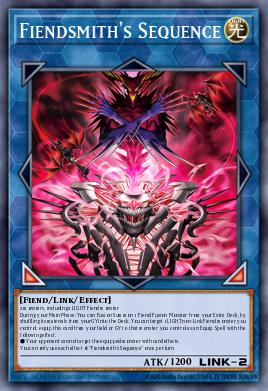

- **Copias y zona:** Extra 1x. No altera las cantidades registradas.
- **Nombre oficial de referencia:** Secuencia del Demoniherrero. CID cotejado con la ficha oficial; el nombre histórico del inventario se conserva aunque su grafía/traducción difiera.
- **Función principal y secundaria:** resultado de Extra Deck · habilitador de Extra · recuperación · respuesta · motor Equipo.
- **Estado de sinergia y función:** Destino Extra condicionado. Es una clasificación de juego; revisar la relación concreta en A06.
- **Papel como recurso, descarte o coste:** Material o destino del Extra condicionado a los requisitos de invocación.
- **Efecto operativo (paráfrasis analítica):** habilitación o continuación de una invocación del Extra Deck; retorno o reciclaje hacia mano/Deck/Extra; interacción sobre monstruos en campo; uso o producción de cartas equipadas. Son operaciones detectadas en el texto, no efectos independientes garantizados; leer sus condiciones en la fuente.
- **Mapa de activación y resultados:** 1) en Main Phase: realiza Fusión con materiales permitidos, devuelve recursos a mano/Deck/Extra · 2) efecto propio o continuo: equipa carta/monstruo según texto. Cada operación está sujeta a la secuencia y al «si lo haces» del texto oficial.
- **Ventanas de activación identificadas:** Main Phase.
- **Costes o recursos potenciales:** reciclaje de recurso propio.
- **Restricciones y requisitos:** hay límite por turno según el efecto concreto; depende de recursos en Cementerio. Invocar sólo desde el Extra Deck usando su procedimiento propio.
- **Prioridad al ir primero:** generar envíos por efecto sin malgastar recursos y preparar interacción. Para esta carta: Comprobar materiales exactos antes de buscar este objetivo en el Extra Deck.
- **Prioridad al ir segundo:** forzar respuestas rivales con Fusión/retiradas y conservar cementerio utilizable. Identificar primero la respuesta rival que afecta su función «resultado de Extra Deck».
- **Medio/tardío y recuperación:** recuperar materiales y gestionar cartas enviadas o desterradas. Verificar que el objetivo de recuperación continúe disponible.
- **Sinergias y acceso a líneas:** Relación contextual con enviar cartas al Cementerio por efecto y aprovechar fusiones, reciclaje y motores Horus/Demoniherrero. Puede cerrar o prolongar una ruta del Extra si los materiales están disponibles.
- **Riesgo / brick / interrupciones:** Depende del Cementerio y es sensible a destierro o negación de ese recurso. No atribuirle velocidad rápida por el solo hecho de formar parte del motor.
- **Utilidad editorial:** 4/5 para este deck (estimación por rol y zona, no probabilidad calculada). No cambiar copias; cualquier sugerencia de alta/baja pasa por el apartado 22 y aprobación.
- **Referencia oficial y trazabilidad:** https://www.db.yugioh-card.com/yugiohdb/card_search.action?cid=20226&ope=2&request_locale=es. **Confianza:** texto y tipo de efecto cotejados en Konami; síntesis táctica editorial, no demostración de combo.
- **Aplicación concreta dentro de este deck (A06):** habilitación o continuación de una invocación del Extra Deck; retorno o reciclaje hacia mano/Deck/Extra; interacción sobre monstruos en campo; uso o producción de cartas equipadas. A06 identifica su destino, condicionado a material/procedimiento.

**USO PRÁCTICO Y SINERGIA — Secuencia del Demoniherrero**

- **Label funcional:** Referencias de ruta localizadas; conexión reglamentaria sujeta al recorrido de la guía. Clasificación documental; una relación es válida solo si se satisfacen sus condiciones exactas.
- **Qué hace:** habilitación o continuación de una invocación del Extra Deck; retorno o reciclaje hacia mano/Deck/Extra; interacción sobre monstruos en campo; uso o producción de cartas equipadas. Son operaciones detectadas en el texto, no efectos independientes garantizados; leer sus condiciones en la fuente.
- **Cómo aprovecharla en este deck:** habilitación o continuación de una invocación del Extra Deck; retorno o reciclaje hacia mano/Deck/Extra; interacción sobre monstruos en campo; uso o producción de cartas equipadas. A06 identifica su destino, condicionado a material/procedimiento.
- **Al jugar primero:** generar envíos por efecto sin malgastar recursos y preparar interacción. Para esta carta: Comprobar materiales exactos antes de buscar este objetivo en el Extra Deck.
- **Al jugar segundo:** forzar respuestas rivales con Fusión/retiradas y conservar cementerio utilizable. Identificar primero la respuesta rival que afecta su función «resultado de Extra Deck».
- **Cuándo tener precaución:** Depende del Cementerio y es sensible a destierro o negación de ese recurso. No atribuirle velocidad rápida por el solo hecho de formar parte del motor.

**CÓMO LLEGAR DESDE TU DECK — RUTAS DOCUMENTADAS**

- **Abrir guía `656:A09:ENGRAVER:LACRIMA01`:** entrada: Demoniherrero Grabador (20196) solamente. Campo/GY vacíos, Main Phase propia, sin interferencia rival. En Deck quedan al menos Tracto del Demoniherrero (20240), Fabuloso Lurrie (8092) y una segunda copia de Grabador (el inventario contiene 3). Extra disponible: Réquiem (20225), Secuencia (20226), Lácrima del Demoniherrero (20214). No usar cartas de la Reserva ni suponer cartas robadas.. Propósito descrito: Preparación de recursos / despliegue. Consulta sus pasos, consumo y resultado; comprobar si esta carta es realmente invocada o solo mencionada.

#### 36. Fangodragón del Pantano

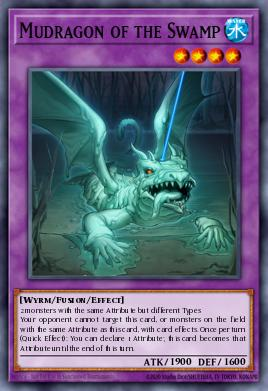

- **Copias y zona:** Extra 1x. No altera las cantidades registradas.
- **Nombre oficial de referencia:** Fangodragón del Pantano. CID cotejado con la ficha oficial; el nombre histórico del inventario se conserva aunque su grafía/traducción difiera.
- **Función principal y secundaria:** interrupción · resultado de Extra Deck.
- **Estado de sinergia y función:** Sin acceso al Extra demostrado. Es una clasificación de juego; revisar la relación concreta en A06.
- **Papel como recurso, descarte o coste:** Material o destino del Extra condicionado a los requisitos de invocación.
- **Efecto operativo (paráfrasis analítica):** interacción propia de la carta que requiere consultar el texto íntegro enlazado. Son operaciones detectadas en el texto, no efectos independientes garantizados; leer sus condiciones en la fuente.
- **Mapa de activación y resultados:** efecto de estadística, condición o material; no asumir un disparador adicional. Cada operación está sujeta a la secuencia y al «si lo haces» del texto oficial.
- **Ventanas de activación identificadas:** Efecto Rápido.
- **Costes o recursos potenciales:** sin coste independiente identificado en esta síntesis; comprobar las acciones previas al punto y coma de cada efecto.
- **Restricciones y requisitos:** hay límite por turno según el efecto concreto. Invocar sólo desde el Extra Deck usando su procedimiento propio.
- **Prioridad al ir primero:** generar envíos por efecto sin malgastar recursos y preparar interacción. Para esta carta: Reservar la respuesta para la ventana rival exacta; no es una pieza buscadora de nuestro motor.
- **Prioridad al ir segundo:** forzar respuestas rivales con Fusión/retiradas y conservar cementerio utilizable. Identificar primero la respuesta rival que afecta su función «interrupción».
- **Medio/tardío y recuperación:** recuperar materiales y gestionar cartas enviadas o desterradas. No asumir que por sí misma recicla recursos si el texto no lo permite.
- **Sinergias y acceso a líneas:** Relación contextual con enviar cartas al Cementerio por efecto y aprovechar fusiones, reciclaje y motores Horus/Demoniherrero. Puede cerrar o prolongar una ruta del Extra si los materiales están disponibles.
- **Riesgo / brick / interrupciones:** No contarla como extensión automática: confirmar materiales, procedimiento y restricciones vigentes. Puede emplearse en cadena sólo cuando se cumpla su condición concreta.
- **Utilidad editorial:** 4/5 para este deck (estimación por rol y zona, no probabilidad calculada). No cambiar copias; cualquier sugerencia de alta/baja pasa por el apartado 22 y aprobación.
- **Referencia oficial y trazabilidad:** https://www.db.yugioh-card.com/yugiohdb/card_search.action?cid=13454&ope=2&request_locale=es. **Confianza:** texto y tipo de efecto cotejados en Konami; síntesis táctica editorial, no demostración de combo.
- **Aplicación concreta dentro de este deck (A06):** interacción propia de la carta que requiere consultar el texto íntegro enlazado. Falta arista de materiales en A06; A09 podría contener una ruta válida no indexada aquí.

**USO PRÁCTICO Y SINERGIA — Fangodragón del Pantano**

- **Label funcional:** Sin sinergia demostrada (con la evidencia actual). Clasificación documental; una relación es válida solo si se satisfacen sus condiciones exactas.
- **Qué hace:** interacción propia de la carta que requiere consultar el texto íntegro enlazado. Son operaciones detectadas en el texto, no efectos independientes garantizados; leer sus condiciones en la fuente.
- **Cómo aprovecharla en este deck:** interacción propia de la carta que requiere consultar el texto íntegro enlazado. Falta arista de materiales en A06; A09 podría contener una ruta válida no indexada aquí.
- **Al jugar primero:** generar envíos por efecto sin malgastar recursos y preparar interacción. Para esta carta: Reservar la respuesta para la ventana rival exacta; no es una pieza buscadora de nuestro motor.
- **Al jugar segundo:** forzar respuestas rivales con Fusión/retiradas y conservar cementerio utilizable. Identificar primero la respuesta rival que afecta su función «interrupción».
- **Cuándo tener precaución:** No contarla como extensión automática: confirmar materiales, procedimiento y restricciones vigentes. Puede emplearse en cadena sólo cuando se cumpla su condición concreta.

**CÓMO LLEGAR DESDE TU DECK — SIN RUTA DEMOSTRADA**

- La biblioteca actual no contiene una ruta identificada para esta carta del Extra. No se debe exhibir una descripción genérica como sustituto de mano inicial, materiales y pasos. Para completarla, contrastar requisitos oficiales y recursos del Main; si no es alcanzable, explicar el impedimento exacto.

#### 37. Lácrima del Demoniherrero

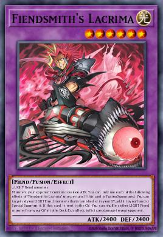

- **Copias y zona:** Extra 1x. No altera las cantidades registradas.
- **Nombre oficial de referencia:** Lácrima del Demoniherrero. CID cotejado con la ficha oficial; el nombre histórico del inventario se conserva aunque su grafía/traducción difiera.
- **Función principal y secundaria:** resultado de Extra Deck · removal · recuperación · cierre.
- **Estado de sinergia y función:** Destino Extra condicionado. Es una clasificación de juego; revisar la relación concreta en A06.
- **Papel como recurso, descarte o coste:** Material o destino del Extra condicionado a los requisitos de invocación.
- **Efecto operativo (paráfrasis analítica):** destierro de recursos o de amenazas; retorno o reciclaje hacia mano/Deck/Extra; presión de combate o modificación de estadísticas. Son operaciones detectadas en el texto, no efectos independientes garantizados; leer sus condiciones en la fuente.
- **Mapa de activación y resultados:** 1) tras su invocación desde el Extra: destierra el recurso u objetivo previsto · 2) con condición explícita en la carta: devuelve recursos a mano/Deck/Extra, inflige daño. Cada operación está sujeta a la secuencia y al «si lo haces» del texto oficial.
- **Ventanas de activación identificadas:** al producirse una Invocación; al llegar o estar en el Cementerio; Invocación del Extra Deck.
- **Costes o recursos potenciales:** reciclaje de recurso propio.
- **Restricciones y requisitos:** hay límite por turno según el efecto concreto; depende de recursos en Cementerio. Invocar sólo desde el Extra Deck usando su procedimiento propio.
- **Prioridad al ir primero:** generar envíos por efecto sin malgastar recursos y preparar interacción. Para esta carta: Comprobar materiales exactos antes de buscar este objetivo en el Extra Deck.
- **Prioridad al ir segundo:** forzar respuestas rivales con Fusión/retiradas y conservar cementerio utilizable. Identificar primero la respuesta rival que afecta su función «resultado de Extra Deck».
- **Medio/tardío y recuperación:** recuperar materiales y gestionar cartas enviadas o desterradas. Verificar que el objetivo de recuperación continúe disponible.
- **Sinergias y acceso a líneas:** Relación contextual con enviar cartas al Cementerio por efecto y aprovechar fusiones, reciclaje y motores Horus/Demoniherrero. Puede cerrar o prolongar una ruta del Extra si los materiales están disponibles.
- **Riesgo / brick / interrupciones:** Depende del Cementerio y es sensible a destierro o negación de ese recurso. No atribuirle velocidad rápida por el solo hecho de formar parte del motor.
- **Utilidad editorial:** 4/5 para este deck (estimación por rol y zona, no probabilidad calculada). No cambiar copias; cualquier sugerencia de alta/baja pasa por el apartado 22 y aprobación.
- **Referencia oficial y trazabilidad:** https://www.db.yugioh-card.com/yugiohdb/card_search.action?cid=20214&ope=2&request_locale=es. **Confianza:** texto y tipo de efecto cotejados en Konami; síntesis táctica editorial, no demostración de combo.
- **Aplicación concreta dentro de este deck (A06):** destierro de recursos o de amenazas; retorno o reciclaje hacia mano/Deck/Extra; presión de combate o modificación de estadísticas. A06 identifica su destino, condicionado a material/procedimiento.

**USO PRÁCTICO Y SINERGIA — Lácrima del Demoniherrero**

- **Label funcional:** Referencias de ruta localizadas; conexión reglamentaria sujeta al recorrido de la guía. Clasificación documental; una relación es válida solo si se satisfacen sus condiciones exactas.
- **Qué hace:** destierro de recursos o de amenazas; retorno o reciclaje hacia mano/Deck/Extra; presión de combate o modificación de estadísticas. Son operaciones detectadas en el texto, no efectos independientes garantizados; leer sus condiciones en la fuente.
- **Cómo aprovecharla en este deck:** destierro de recursos o de amenazas; retorno o reciclaje hacia mano/Deck/Extra; presión de combate o modificación de estadísticas. A06 identifica su destino, condicionado a material/procedimiento.
- **Al jugar primero:** generar envíos por efecto sin malgastar recursos y preparar interacción. Para esta carta: Comprobar materiales exactos antes de buscar este objetivo en el Extra Deck.
- **Al jugar segundo:** forzar respuestas rivales con Fusión/retiradas y conservar cementerio utilizable. Identificar primero la respuesta rival que afecta su función «resultado de Extra Deck».
- **Cuándo tener precaución:** Depende del Cementerio y es sensible a destierro o negación de ese recurso. No atribuirle velocidad rápida por el solo hecho de formar parte del motor.

**CÓMO LLEGAR DESDE TU DECK — RUTAS DOCUMENTADAS**

- **Abrir guía `656:A09:ENGRAVER:LACRIMA01`:** entrada: Demoniherrero Grabador (20196) solamente. Campo/GY vacíos, Main Phase propia, sin interferencia rival. En Deck quedan al menos Tracto del Demoniherrero (20240), Fabuloso Lurrie (8092) y una segunda copia de Grabador (el inventario contiene 3). Extra disponible: Réquiem (20225), Secuencia (20226), Lácrima del Demoniherrero (20214). No usar cartas de la Reserva ni suponer cartas robadas.. Propósito descrito: Preparación de recursos / despliegue. Consulta sus pasos, consumo y resultado; comprobar si esta carta es realmente invocada o solo mencionada.

#### 38. Parca Peregrina

- **Copias y zona:** Extra 1x. No altera las cantidades registradas.
- **Nombre oficial de referencia:** Parca Peregrina. CID cotejado con la ficha oficial; el nombre histórico del inventario se conserva aunque su grafía/traducción difiera.
- **Función principal y secundaria:** resultado de Extra Deck · cierre · habilitador Xyz.
- **Estado de sinergia y función:** Sin acceso al Extra demostrado. Es una clasificación de juego; revisar la relación concreta en A06.
- **Papel como recurso, descarte o coste:** Material o destino del Extra condicionado a los requisitos de invocación.
- **Efecto operativo (paráfrasis analítica):** presión de combate o modificación de estadísticas; gestión de materiales Xyz. Son operaciones detectadas en el texto, no efectos independientes garantizados; leer sus condiciones en la fuente.
- **Mapa de activación y resultados:** 1) efecto propio o continuo: desacopla materiales Xyz. Cada operación está sujeta a la secuencia y al «si lo haces» del texto oficial.
- **Ventanas de activación identificadas:** requieren la fase o condición específica indicada en el texto; sin ventana rápida general asumida.
- **Costes o recursos potenciales:** sin coste independiente identificado en esta síntesis; comprobar las acciones previas al punto y coma de cada efecto.
- **Restricciones y requisitos:** hay límite por turno según el efecto concreto; interactúa con información oculta o resultados no siempre elegibles. Invocar sólo desde el Extra Deck usando su procedimiento propio.
- **Prioridad al ir primero:** generar envíos por efecto sin malgastar recursos y preparar interacción. Para esta carta: Comprobar materiales exactos antes de buscar este objetivo en el Extra Deck.
- **Prioridad al ir segundo:** forzar respuestas rivales con Fusión/retiradas y conservar cementerio utilizable. Identificar primero la respuesta rival que afecta su función «resultado de Extra Deck».
- **Medio/tardío y recuperación:** recuperar materiales y gestionar cartas enviadas o desterradas. No asumir que por sí misma recicla recursos si el texto no lo permite.
- **Sinergias y acceso a líneas:** Relación contextual con enviar cartas al Cementerio por efecto y aprovechar fusiones, reciclaje y motores Horus/Demoniherrero. Puede cerrar o prolongar una ruta del Extra si los materiales están disponibles.
- **Riesgo / brick / interrupciones:** Se agota al consumir materiales; no asumir material adicional al pasar de un Xyz a otro. No atribuirle velocidad rápida por el solo hecho de formar parte del motor.
- **Utilidad editorial:** 4/5 para este deck (estimación por rol y zona, no probabilidad calculada). No cambiar copias; cualquier sugerencia de alta/baja pasa por el apartado 22 y aprobación.
- **Referencia oficial y trazabilidad:** https://www.db.yugioh-card.com/yugiohdb/card_search.action?cid=11005&ope=2&request_locale=es. **Confianza:** texto y tipo de efecto cotejados en Konami; síntesis táctica editorial, no demostración de combo.
- **Aplicación concreta dentro de este deck (A06):** presión de combate o modificación de estadísticas; gestión de materiales Xyz. Falta arista de materiales en A06; A09 podría contener una ruta válida no indexada aquí.

**USO PRÁCTICO Y SINERGIA — Parca Peregrina**

- **Label funcional:** Sin sinergia demostrada (con la evidencia actual). Clasificación documental; una relación es válida solo si se satisfacen sus condiciones exactas.
- **Qué hace:** presión de combate o modificación de estadísticas; gestión de materiales Xyz. Son operaciones detectadas en el texto, no efectos independientes garantizados; leer sus condiciones en la fuente.
- **Cómo aprovecharla en este deck:** presión de combate o modificación de estadísticas; gestión de materiales Xyz. Falta arista de materiales en A06; A09 podría contener una ruta válida no indexada aquí.
- **Al jugar primero:** generar envíos por efecto sin malgastar recursos y preparar interacción. Para esta carta: Comprobar materiales exactos antes de buscar este objetivo en el Extra Deck.
- **Al jugar segundo:** forzar respuestas rivales con Fusión/retiradas y conservar cementerio utilizable. Identificar primero la respuesta rival que afecta su función «resultado de Extra Deck».
- **Cuándo tener precaución:** Se agota al consumir materiales; no asumir material adicional al pasar de un Xyz a otro. No atribuirle velocidad rápida por el solo hecho de formar parte del motor.

**CÓMO LLEGAR DESDE TU DECK — SIN RUTA DEMOSTRADA**

- La biblioteca actual no contiene una ruta identificada para esta carta del Extra. No se debe exhibir una descripción genérica como sustituto de mano inicial, materiales y pasos. Para completarla, contrastar requisitos oficiales y recursos del Main; si no es alcanzable, explicar el impedimento exacto.

#### 39. El Vampiro Zombi

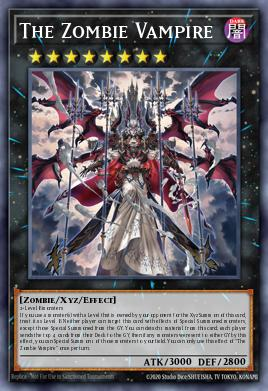

- **Copias y zona:** Extra 1x. No altera las cantidades registradas.
- **Nombre oficial de referencia:** El Vampiro Zombi. CID cotejado con la ficha oficial; el nombre histórico del inventario se conserva aunque su grafía/traducción difiera.
- **Función principal y secundaria:** resultado de Extra Deck · recuperación · habilitador Xyz.
- **Estado de sinergia y función:** Destino Extra condicionado. Es una clasificación de juego; revisar la relación concreta en A06.
- **Papel como recurso, descarte o coste:** Material o destino del Extra condicionado a los requisitos de invocación.
- **Efecto operativo (paráfrasis analítica):** recuperación e invocación desde Cementerio/destierro; gestión de materiales Xyz. Son operaciones detectadas en el texto, no efectos independientes garantizados; leer sus condiciones en la fuente.
- **Mapa de activación y resultados:** 1) efecto propio o continuo: Invocación Especial desde Cementerio · 2) efecto propio o continuo: Invocación Especial desde Cementerio, desacopla materiales Xyz. Cada operación está sujeta a la secuencia y al «si lo haces» del texto oficial.
- **Ventanas de activación identificadas:** requieren la fase o condición específica indicada en el texto; sin ventana rápida general asumida.
- **Costes o recursos potenciales:** sin coste independiente identificado en esta síntesis; comprobar las acciones previas al punto y coma de cada efecto.
- **Restricciones y requisitos:** hay límite por turno según el efecto concreto; interactúa con información oculta o resultados no siempre elegibles. Invocar sólo desde el Extra Deck usando su procedimiento propio.
- **Prioridad al ir primero:** generar envíos por efecto sin malgastar recursos y preparar interacción. Para esta carta: Comprobar materiales exactos antes de buscar este objetivo en el Extra Deck.
- **Prioridad al ir segundo:** forzar respuestas rivales con Fusión/retiradas y conservar cementerio utilizable. Identificar primero la respuesta rival que afecta su función «resultado de Extra Deck».
- **Medio/tardío y recuperación:** recuperar materiales y gestionar cartas enviadas o desterradas. Verificar que el objetivo de recuperación continúe disponible.
- **Sinergias y acceso a líneas:** Relación contextual con enviar cartas al Cementerio por efecto y aprovechar fusiones, reciclaje y motores Horus/Demoniherrero. Puede cerrar o prolongar una ruta del Extra si los materiales están disponibles.
- **Riesgo / brick / interrupciones:** Se agota al consumir materiales; no asumir material adicional al pasar de un Xyz a otro. No atribuirle velocidad rápida por el solo hecho de formar parte del motor.
- **Utilidad editorial:** 4/5 para este deck (estimación por rol y zona, no probabilidad calculada). No cambiar copias; cualquier sugerencia de alta/baja pasa por el apartado 22 y aprobación.
- **Referencia oficial y trazabilidad:** https://www.db.yugioh-card.com/yugiohdb/card_search.action?cid=16850&ope=2&request_locale=es. **Confianza:** texto y tipo de efecto cotejados en Konami; síntesis táctica editorial, no demostración de combo.
- **Aplicación concreta dentro de este deck (A06):** recuperación e invocación desde Cementerio/destierro; gestión de materiales Xyz. A06 identifica su destino, condicionado a material/procedimiento.

**USO PRÁCTICO Y SINERGIA — El Vampiro Zombi**

- **Label funcional:** Referencias de ruta localizadas; conexión reglamentaria sujeta al recorrido de la guía. Clasificación documental; una relación es válida solo si se satisfacen sus condiciones exactas.
- **Qué hace:** recuperación e invocación desde Cementerio/destierro; gestión de materiales Xyz. Son operaciones detectadas en el texto, no efectos independientes garantizados; leer sus condiciones en la fuente.
- **Cómo aprovecharla en este deck:** recuperación e invocación desde Cementerio/destierro; gestión de materiales Xyz. A06 identifica su destino, condicionado a material/procedimiento.
- **Al jugar primero:** generar envíos por efecto sin malgastar recursos y preparar interacción. Para esta carta: Comprobar materiales exactos antes de buscar este objetivo en el Extra Deck.
- **Al jugar segundo:** forzar respuestas rivales con Fusión/retiradas y conservar cementerio utilizable. Identificar primero la respuesta rival que afecta su función «resultado de Extra Deck».
- **Cuándo tener precaución:** Se agota al consumir materiales; no asumir material adicional al pasar de un Xyz a otro. No atribuirle velocidad rápida por el solo hecho de formar parte del motor.

**CÓMO LLEGAR DESDE TU DECK — RUTAS DOCUMENTADAS**

- **Abrir guía `656:A09:SARC:IMSETY_HAPI:ZOMBIE01`:** entrada: Sarcófago 1× Sarcófago del Rey + 2× Tiagrimientos Kashtira (hay 3 copias en Main; se emplean aquí exclusivamente como cartas que pueden enviarse al GY). Campo, GY y destierro propios iniciales: vacíos; Normal: disponible; rival: sin respuesta/interferencia; restricciones previas: ninguna. Deck: Amset Amset e Hapi Hapi disponibles. Extra: El Vampiro Zombi 1 copia disponible. No incluir Reserva ni suponer robos.. Propósito descrito: Ofensivo condicional. Consulta sus pasos, consumo y resultado; comprobar si esta carta es realmente invocada o solo mencionada.
- **Abrir guía `656:A09:IMSETY:SARC_HAPI:ZOMBIE01`:** entrada: Amset 1× Amset, Gloria de Horus + 2× Tiagrimientos Kashtira de las 3 de Main. Campo/GY/destierro propios vacíos, Normal disponible, Main Phase sin respuesta; Deck contiene Sarcófago (2 copias en lista) y Hapi; Extra contiene El Vampiro Zombi. No se presume la carta de robo opcional.. Propósito descrito: Ofensivo condicional. Consulta sus pasos, consumo y resultado; comprobar si esta carta es realmente invocada o solo mencionada.

#### 40. Caballero Exciton Horda de Maldad

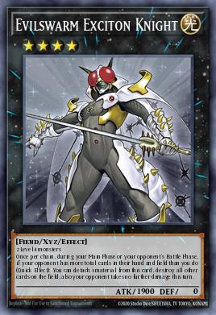

- **Copias y zona:** Extra 1x. No altera las cantidades registradas.
- **Nombre oficial de referencia:** Caballero Exciton Horda de Maldad. CID cotejado con la ficha oficial; el nombre histórico del inventario se conserva aunque su grafía/traducción difiera.
- **Función principal y secundaria:** interrupción · resultado de Extra Deck · removal · cierre · habilitador Xyz.
- **Estado de sinergia y función:** Sin acceso al Extra demostrado. Es una clasificación de juego; revisar la relación concreta en A06.
- **Papel como recurso, descarte o coste:** Material o destino del Extra condicionado a los requisitos de invocación.
- **Efecto operativo (paráfrasis analítica):** destrucción de cartas o empleo de destrucción como detonante; presión de combate o modificación de estadísticas; gestión de materiales Xyz. Son operaciones detectadas en el texto, no efectos independientes garantizados; leer sus condiciones en la fuente.
- **Mapa de activación y resultados:** 1) en Main Phase: destruye la carta o recurso previsto, desacopla materiales Xyz. Cada operación está sujeta a la secuencia y al «si lo haces» del texto oficial.
- **Ventanas de activación identificadas:** Main Phase; Efecto Rápido.
- **Costes o recursos potenciales:** sin coste independiente identificado en esta síntesis; comprobar las acciones previas al punto y coma de cada efecto.
- **Restricciones y requisitos:** aplicar restricciones de selección, activación y copias que consten en el texto original. Invocar sólo desde el Extra Deck usando su procedimiento propio.
- **Prioridad al ir primero:** generar envíos por efecto sin malgastar recursos y preparar interacción. Para esta carta: Reservar la respuesta para la ventana rival exacta; no es una pieza buscadora de nuestro motor.
- **Prioridad al ir segundo:** forzar respuestas rivales con Fusión/retiradas y conservar cementerio utilizable. Identificar primero la respuesta rival que afecta su función «interrupción».
- **Medio/tardío y recuperación:** recuperar materiales y gestionar cartas enviadas o desterradas. No asumir que por sí misma recicla recursos si el texto no lo permite.
- **Sinergias y acceso a líneas:** Relación contextual con enviar cartas al Cementerio por efecto y aprovechar fusiones, reciclaje y motores Horus/Demoniherrero. Puede cerrar o prolongar una ruta del Extra si los materiales están disponibles.
- **Riesgo / brick / interrupciones:** Se agota al consumir materiales; no asumir material adicional al pasar de un Xyz a otro. Puede emplearse en cadena sólo cuando se cumpla su condición concreta.
- **Utilidad editorial:** 4/5 para este deck (estimación por rol y zona, no probabilidad calculada). No cambiar copias; cualquier sugerencia de alta/baja pasa por el apartado 22 y aprobación.
- **Referencia oficial y trazabilidad:** https://www.db.yugioh-card.com/yugiohdb/card_search.action?cid=10942&ope=2&request_locale=es. **Confianza:** texto y tipo de efecto cotejados en Konami; síntesis táctica editorial, no demostración de combo.
- **Aplicación concreta dentro de este deck (A06):** destrucción de cartas o empleo de destrucción como detonante; presión de combate o modificación de estadísticas; gestión de materiales Xyz. Falta arista de materiales en A06; A09 podría contener una ruta válida no indexada aquí.

**USO PRÁCTICO Y SINERGIA — Caballero Exciton Horda de Maldad**

- **Label funcional:** Sin sinergia demostrada (con la evidencia actual). Clasificación documental; una relación es válida solo si se satisfacen sus condiciones exactas.
- **Qué hace:** destrucción de cartas o empleo de destrucción como detonante; presión de combate o modificación de estadísticas; gestión de materiales Xyz. Son operaciones detectadas en el texto, no efectos independientes garantizados; leer sus condiciones en la fuente.
- **Cómo aprovecharla en este deck:** destrucción de cartas o empleo de destrucción como detonante; presión de combate o modificación de estadísticas; gestión de materiales Xyz. Falta arista de materiales en A06; A09 podría contener una ruta válida no indexada aquí.
- **Al jugar primero:** generar envíos por efecto sin malgastar recursos y preparar interacción. Para esta carta: Reservar la respuesta para la ventana rival exacta; no es una pieza buscadora de nuestro motor.
- **Al jugar segundo:** forzar respuestas rivales con Fusión/retiradas y conservar cementerio utilizable. Identificar primero la respuesta rival que afecta su función «interrupción».
- **Cuándo tener precaución:** Se agota al consumir materiales; no asumir material adicional al pasar de un Xyz a otro. Puede emplearse en cadena sólo cuando se cumpla su condición concreta.

**CÓMO LLEGAR DESDE TU DECK — SIN RUTA DEMOSTRADA**

- La biblioteca actual no contiene una ruta identificada para esta carta del Extra. No se debe exhibir una descripción genérica como sustituto de mano inicial, materiales y pasos. Para completarla, contrastar requisitos oficiales y recursos del Main; si no es alcanzable, explicar el impedimento exacto.

#### 41. Ladrón del Tiempo Repetidor

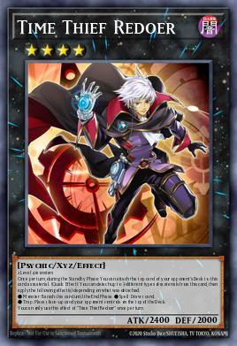

- **Copias y zona:** Extra 1x. No altera las cantidades registradas.
- **Nombre oficial de referencia:** Ladrón del Tiempo Repetidor. CID cotejado con la ficha oficial; el nombre histórico del inventario se conserva aunque su grafía/traducción difiera.
- **Función principal y secundaria:** interrupción · resultado de Extra Deck · removal · ventaja de mano · habilitador Xyz.
- **Estado de sinergia y función:** Sin acceso al Extra demostrado. Es una clasificación de juego; revisar la relación concreta en A06.
- **Papel como recurso, descarte o coste:** Material o destino del Extra condicionado a los requisitos de invocación.
- **Efecto operativo (paráfrasis analítica):** destierro de recursos o de amenazas; generación de cartas por robo; gestión de materiales Xyz. Son operaciones detectadas en el texto, no efectos independientes garantizados; leer sus condiciones en la fuente.
- **Mapa de activación y resultados:** 1) en Standby Phase: destierra el recurso u objetivo previsto, desacopla materiales Xyz, roba cartas. Cada operación está sujeta a la secuencia y al «si lo haces» del texto oficial.
- **Ventanas de activación identificadas:** Standby Phase; Efecto Rápido.
- **Costes o recursos potenciales:** sin coste independiente identificado en esta síntesis; comprobar las acciones previas al punto y coma de cada efecto.
- **Restricciones y requisitos:** hay límite por turno según el efecto concreto. Invocar sólo desde el Extra Deck usando su procedimiento propio.
- **Prioridad al ir primero:** generar envíos por efecto sin malgastar recursos y preparar interacción. Para esta carta: Reservar la respuesta para la ventana rival exacta; no es una pieza buscadora de nuestro motor.
- **Prioridad al ir segundo:** forzar respuestas rivales con Fusión/retiradas y conservar cementerio utilizable. Identificar primero la respuesta rival que afecta su función «interrupción».
- **Medio/tardío y recuperación:** recuperar materiales y gestionar cartas enviadas o desterradas. No asumir que por sí misma recicla recursos si el texto no lo permite.
- **Sinergias y acceso a líneas:** Relación contextual con enviar cartas al Cementerio por efecto y aprovechar fusiones, reciclaje y motores Horus/Demoniherrero. Puede cerrar o prolongar una ruta del Extra si los materiales están disponibles.
- **Riesgo / brick / interrupciones:** Se agota al consumir materiales; no asumir material adicional al pasar de un Xyz a otro. Puede emplearse en cadena sólo cuando se cumpla su condición concreta.
- **Utilidad editorial:** 4/5 para este deck (estimación por rol y zona, no probabilidad calculada). No cambiar copias; cualquier sugerencia de alta/baja pasa por el apartado 22 y aprobación.
- **Referencia oficial y trazabilidad:** https://www.db.yugioh-card.com/yugiohdb/card_search.action?cid=14356&ope=2&request_locale=es. **Confianza:** texto y tipo de efecto cotejados en Konami; síntesis táctica editorial, no demostración de combo.
- **Aplicación concreta dentro de este deck (A06):** destierro de recursos o de amenazas; generación de cartas por robo; gestión de materiales Xyz. Falta arista de materiales en A06; A09 podría contener una ruta válida no indexada aquí.

**USO PRÁCTICO Y SINERGIA — Ladrón del Tiempo Repetidor**

- **Label funcional:** Sin sinergia demostrada (con la evidencia actual). Clasificación documental; una relación es válida solo si se satisfacen sus condiciones exactas.
- **Qué hace:** destierro de recursos o de amenazas; generación de cartas por robo; gestión de materiales Xyz. Son operaciones detectadas en el texto, no efectos independientes garantizados; leer sus condiciones en la fuente.
- **Cómo aprovecharla en este deck:** destierro de recursos o de amenazas; generación de cartas por robo; gestión de materiales Xyz. Falta arista de materiales en A06; A09 podría contener una ruta válida no indexada aquí.
- **Al jugar primero:** generar envíos por efecto sin malgastar recursos y preparar interacción. Para esta carta: Reservar la respuesta para la ventana rival exacta; no es una pieza buscadora de nuestro motor.
- **Al jugar segundo:** forzar respuestas rivales con Fusión/retiradas y conservar cementerio utilizable. Identificar primero la respuesta rival que afecta su función «interrupción».
- **Cuándo tener precaución:** Se agota al consumir materiales; no asumir material adicional al pasar de un Xyz a otro. Puede emplearse en cadena sólo cuando se cumpla su condición concreta.

**CÓMO LLEGAR DESDE TU DECK — SIN RUTA DEMOSTRADA**

- La biblioteca actual no contiene una ruta identificada para esta carta del Extra. No se debe exhibir una descripción genérica como sustituto de mano inicial, materiales y pasos. Para completarla, contrastar requisitos oficiales y recursos del Main; si no es alcanzable, explicar el impedimento exacto.

#### 42. Fuwalos Multivadora

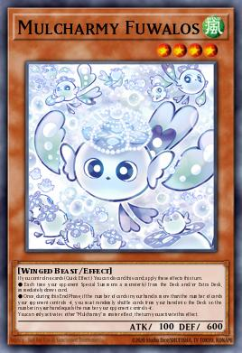

- **Copias y zona:** Reserva 2x. No altera las cantidades registradas.
- **Nombre oficial de referencia:** Fuwalos Multivadora. CID cotejado con la ficha oficial; el nombre histórico del inventario se conserva aunque su grafía/traducción difiera.
- **Función principal y secundaria:** handtrap · robo condicional.
- **Estado de sinergia y función:** Reserva fuera de lista activa. Es una clasificación de juego; revisar la relación concreta en A06.
- **Papel como recurso, descarte o coste:** Coste o consumo descrito en A05: descarte de mano; reciclaje de recurso propio.
- **Efecto operativo (paráfrasis analítica):** Con campo propio sin cartas, descarta y roba al producirse Invocaciones Especiales rivales desde Deck o Extra; ajusta la mano en End Phase. 
- **Mapa de activación y resultados:** 1) con campo propio vacío: Invocación Especial desde Extra Deck, devuelve recursos a mano/Deck/Extra. Cada operación está sujeta a la secuencia y al «si lo haces» del texto oficial.
- **Ventanas de activación identificadas:** campo propio vacío; Efecto Rápido.
- **Costes o recursos potenciales:** descarte de mano; reciclaje de recurso propio.
- **Restricciones y requisitos:** requiere campo propio sin las cartas indicadas; interactúa con información oculta o resultados no siempre elegibles. 
- **Prioridad al ir primero:** generar envíos por efecto sin malgastar recursos y preparar interacción. Para esta carta: Reservar la respuesta para la ventana rival exacta; no es una pieza buscadora de nuestro motor.
- **Prioridad al ir segundo:** forzar respuestas rivales con Fusión/retiradas y conservar cementerio utilizable. Identificar primero la respuesta rival que afecta su función «handtrap».
- **Medio/tardío y recuperación:** recuperar materiales y gestionar cartas enviadas o desterradas. Verificar que el objetivo de recuperación continúe disponible.
- **Sinergias y acceso a líneas:** Relación contextual con enviar cartas al Cementerio por efecto y aprovechar fusiones, reciclaje y motores Horus/Demoniherrero. Habilita una línea del motor sólo si coinciden recursos, objetivos y restricciones; no equivale a un combo completo validado.
- **Riesgo / brick / interrupciones:** No roba por Invocaciones desde la mano; comparte restricción de efectos Mulcharmy. Puede emplearse en cadena sólo cuando se cumpla su condición concreta.
- **Utilidad editorial:** 3/5 para este deck (estimación por rol y zona, no probabilidad calculada). No cambiar copias; cualquier sugerencia de alta/baja pasa por el apartado 22 y aprobación.
- **Referencia oficial y trazabilidad:** https://www.db.yugioh-card.com/yugiohdb/card_search.action?cid=20500&ope=2&request_locale=es. **Confianza:** texto y tipo de efecto cotejados en Konami; síntesis táctica editorial, no demostración de combo.
- **Aplicación concreta dentro de este deck (A06):** Fuera de lista. Con campo propio sin cartas, descarta y roba al producirse Invocaciones Especiales rivales desde Deck o Extra; ajusta la mano en End Phase.. No aporta recursos durante este duelo.

**USO PRÁCTICO Y SINERGIA — Fuwalos Multivadora**

- **Label funcional:** Sin sinergia demostrada (con la evidencia actual). Clasificación documental; una relación es válida solo si se satisfacen sus condiciones exactas.
- **Qué hace:** Con campo propio sin cartas, descarta y roba al producirse Invocaciones Especiales rivales desde Deck o Extra; ajusta la mano en End Phase.
- **Cómo aprovecharla en este deck:** Fuera de lista. Con campo propio sin cartas, descarta y roba al producirse Invocaciones Especiales rivales desde Deck o Extra; ajusta la mano en End Phase.. No aporta recursos durante este duelo.
- **Al jugar primero:** generar envíos por efecto sin malgastar recursos y preparar interacción. Para esta carta: Reservar la respuesta para la ventana rival exacta; no es una pieza buscadora de nuestro motor.
- **Al jugar segundo:** forzar respuestas rivales con Fusión/retiradas y conservar cementerio utilizable. Identificar primero la respuesta rival que afecta su función «handtrap».
- **Cuándo tener precaución:** No roba por Invocaciones desde la mano; comparte restricción de efectos Mulcharmy. Puede emplearse en cadena sólo cuando se cumpla su condición concreta.

#### 43. Punto de Oveja

- **Copias y zona:** Reserva 1x. No altera las cantidades registradas.
- **Nombre oficial de referencia:** Punto de Oveja. CID cotejado con la ficha oficial; el nombre histórico del inventario se conserva aunque su grafía/traducción difiera.
- **Función principal y secundaria:** recuperación · ventaja de mano · cierre.
- **Estado de sinergia y función:** Reserva fuera de lista activa. Es una clasificación de juego; revisar la relación concreta en A06.
- **Papel como recurso, descarte o coste:** Coste o consumo descrito en A05: descarte de mano.
- **Efecto operativo (paráfrasis analítica):** recuperación e invocación desde Cementerio/destierro; generación de cartas por robo; presión de combate o modificación de estadísticas. Son operaciones detectadas en el texto, no efectos independientes garantizados; leer sus condiciones en la fuente.
- **Mapa de activación y resultados:** 1) con condición explícita en la carta: Invocación Especial desde Cementerio, roba cartas. Cada operación está sujeta a la secuencia y al «si lo haces» del texto oficial.
- **Ventanas de activación identificadas:** al producirse una Invocación.
- **Costes o recursos potenciales:** descarte de mano.
- **Restricciones y requisitos:** hay límite por turno según el efecto concreto; depende de recursos en Cementerio. 
- **Prioridad al ir primero:** generar envíos por efecto sin malgastar recursos y preparar interacción. Para esta carta: Escoger la amenaza o recurso que genere mayor ventaja de tempo; respetar selección y zona.
- **Prioridad al ir segundo:** forzar respuestas rivales con Fusión/retiradas y conservar cementerio utilizable. Identificar primero la respuesta rival que afecta su función «recuperación».
- **Medio/tardío y recuperación:** recuperar materiales y gestionar cartas enviadas o desterradas. Verificar que el objetivo de recuperación continúe disponible.
- **Sinergias y acceso a líneas:** Relación contextual con enviar cartas al Cementerio por efecto y aprovechar fusiones, reciclaje y motores Horus/Demoniherrero. Habilita una línea del motor sólo si coinciden recursos, objetivos y restricciones; no equivale a un combo completo validado.
- **Riesgo / brick / interrupciones:** Riesgo operativo: interrupción del Cementerio, restricciones de materiales y mildeos aleatorios. Confirmar objetivos disponibles y costes antes de activar. No atribuirle velocidad rápida por el solo hecho de formar parte del motor.
- **Utilidad editorial:** 3/5 para este deck (estimación por rol y zona, no probabilidad calculada). No cambiar copias; cualquier sugerencia de alta/baja pasa por el apartado 22 y aprobación.
- **Referencia oficial y trazabilidad:** https://www.db.yugioh-card.com/yugiohdb/card_search.action?cid=14856&ope=2&request_locale=es. **Confianza:** texto y tipo de efecto cotejados en Konami; síntesis táctica editorial, no demostración de combo.
- **Aplicación concreta dentro de este deck (A06):** Fuera de lista. recuperación e invocación desde Cementerio/destierro; generación de cartas por robo; presión de combate o modificación de estadísticas.. No aporta recursos durante este duelo.

**USO PRÁCTICO Y SINERGIA — Punto de Oveja**

- **Label funcional:** Sin sinergia demostrada (con la evidencia actual). Clasificación documental; una relación es válida solo si se satisfacen sus condiciones exactas.
- **Qué hace:** recuperación e invocación desde Cementerio/destierro; generación de cartas por robo; presión de combate o modificación de estadísticas. Son operaciones detectadas en el texto, no efectos independientes garantizados; leer sus condiciones en la fuente.
- **Cómo aprovecharla en este deck:** Fuera de lista. recuperación e invocación desde Cementerio/destierro; generación de cartas por robo; presión de combate o modificación de estadísticas.. No aporta recursos durante este duelo.
- **Al jugar primero:** generar envíos por efecto sin malgastar recursos y preparar interacción. Para esta carta: Escoger la amenaza o recurso que genere mayor ventaja de tempo; respetar selección y zona.
- **Al jugar segundo:** forzar respuestas rivales con Fusión/retiradas y conservar cementerio utilizable. Identificar primero la respuesta rival que afecta su función «recuperación».
- **Cuándo tener precaución:** Riesgo operativo: interrupción del Cementerio, restricciones de materiales y mildeos aleatorios. Confirmar objetivos disponibles y costes antes de activar. No atribuirle velocidad rápida por el solo hecho de formar parte del motor.

#### 44. Alma Desencadenada de Shyama

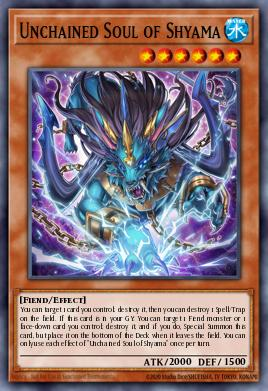

- **Copias y zona:** Reserva 1x. No altera las cantidades registradas.
- **Nombre oficial de referencia:** Alma Desencadenada de Shyama. CID cotejado con la ficha oficial; el nombre histórico del inventario se conserva aunque su grafía/traducción difiera.
- **Función principal y secundaria:** respuesta.
- **Estado de sinergia y función:** Reserva fuera de lista activa. Es una clasificación de juego; revisar la relación concreta en A06.
- **Papel como recurso, descarte o coste:** No se demuestra que esta carta sea recurso de descarte o pago para otra.
- **Efecto operativo (paráfrasis analítica):** interacción sobre monstruos en campo. Son operaciones detectadas en el texto, no efectos independientes garantizados; leer sus condiciones en la fuente.
- **Mapa de activación y resultados:** 1) efecto propio o continuo: destruye la carta o recurso previsto · 2) mientras está en Cementerio: Invocación Especial desde zona permitida. Cada operación está sujeta a la secuencia y al «si lo haces» del texto oficial.
- **Ventanas de activación identificadas:** al llegar o estar en el Cementerio.
- **Costes o recursos potenciales:** sin coste independiente identificado en esta síntesis; comprobar las acciones previas al punto y coma de cada efecto.
- **Restricciones y requisitos:** hay límite por turno según el efecto concreto; depende de recursos en Cementerio; interactúa con información oculta o resultados no siempre elegibles. 
- **Prioridad al ir primero:** generar envíos por efecto sin malgastar recursos y preparar interacción. Para esta carta: Activar cuando las condiciones permitan obtener valor real, preservando recursos de seguimiento.
- **Prioridad al ir segundo:** forzar respuestas rivales con Fusión/retiradas y conservar cementerio utilizable. Identificar primero la respuesta rival que afecta su función «respuesta».
- **Medio/tardío y recuperación:** recuperar materiales y gestionar cartas enviadas o desterradas. No asumir que por sí misma recicla recursos si el texto no lo permite.
- **Sinergias y acceso a líneas:** Relación contextual con enviar cartas al Cementerio por efecto y aprovechar fusiones, reciclaje y motores Horus/Demoniherrero. Habilita una línea del motor sólo si coinciden recursos, objetivos y restricciones; no equivale a un combo completo validado.
- **Riesgo / brick / interrupciones:** Depende del Cementerio y es sensible a destierro o negación de ese recurso. No atribuirle velocidad rápida por el solo hecho de formar parte del motor.
- **Utilidad editorial:** 3/5 para este deck (estimación por rol y zona, no probabilidad calculada). No cambiar copias; cualquier sugerencia de alta/baja pasa por el apartado 22 y aprobación.
- **Referencia oficial y trazabilidad:** https://www.db.yugioh-card.com/yugiohdb/card_search.action?cid=18807&ope=2&request_locale=es. **Confianza:** texto y tipo de efecto cotejados en Konami; síntesis táctica editorial, no demostración de combo.
- **Aplicación concreta dentro de este deck (A06):** Fuera de lista. interacción sobre monstruos en campo.. No aporta recursos durante este duelo.

**USO PRÁCTICO Y SINERGIA — Alma Desencadenada de Shyama**

- **Label funcional:** Sin sinergia demostrada (con la evidencia actual). Clasificación documental; una relación es válida solo si se satisfacen sus condiciones exactas.
- **Qué hace:** interacción sobre monstruos en campo. Son operaciones detectadas en el texto, no efectos independientes garantizados; leer sus condiciones en la fuente.
- **Cómo aprovecharla en este deck:** Fuera de lista. interacción sobre monstruos en campo.. No aporta recursos durante este duelo.
- **Al jugar primero:** generar envíos por efecto sin malgastar recursos y preparar interacción. Para esta carta: Activar cuando las condiciones permitan obtener valor real, preservando recursos de seguimiento.
- **Al jugar segundo:** forzar respuestas rivales con Fusión/retiradas y conservar cementerio utilizable. Identificar primero la respuesta rival que afecta su función «respuesta».
- **Cuándo tener precaución:** Depende del Cementerio y es sensible a destierro o negación de ese recurso. No atribuirle velocidad rápida por el solo hecho de formar parte del motor.

#### 45. Llamado por la Tumba

- **Copias y zona:** Reserva 1x. No altera las cantidades registradas.
- **Nombre oficial de referencia:** Llamado por la Tumba. CID cotejado con la ficha oficial; el nombre histórico del inventario se conserva aunque su grafía/traducción difiera.
- **Función principal y secundaria:** mágica rápida · negación de nombre.
- **Estado de sinergia y función:** Reserva fuera de lista activa. Es una clasificación de juego; revisar la relación concreta en A06.
- **Papel como recurso, descarte o coste:** No se demuestra que esta carta sea recurso de descarte o pago para otra.
- **Efecto operativo (paráfrasis analítica):** Destierra un monstruo del Cementerio rival y niega sus efectos junto con los del mismo nombre original hasta el final del turno siguiente. 
- **Mapa de activación y resultados:** efecto de estadística, condición o material; no asumir un disparador adicional. Cada operación está sujeta a la secuencia y al «si lo haces» del texto oficial.
- **Ventanas de activación identificadas:** requieren la fase o condición específica indicada en el texto; sin ventana rápida general asumida.
- **Costes o recursos potenciales:** sin coste independiente identificado en esta síntesis; comprobar las acciones previas al punto y coma de cada efecto.
- **Restricciones y requisitos:** aplicar restricciones de selección, activación y copias que consten en el texto original. 
- **Prioridad al ir primero:** generar envíos por efecto sin malgastar recursos y preparar interacción. Para esta carta: Activar cuando las condiciones permitan obtener valor real, preservando recursos de seguimiento.
- **Prioridad al ir segundo:** forzar respuestas rivales con Fusión/retiradas y conservar cementerio utilizable. Identificar primero la respuesta rival que afecta su función «mágica rápida».
- **Medio/tardío y recuperación:** recuperar materiales y gestionar cartas enviadas o desterradas. No asumir que por sí misma recicla recursos si el texto no lo permite.
- **Sinergias y acceso a líneas:** Relación contextual con enviar cartas al Cementerio por efecto y aprovechar fusiones, reciclaje y motores Horus/Demoniherrero. Habilita una línea del motor sólo si coinciden recursos, objetivos y restricciones; no equivale a un combo completo validado.
- **Riesgo / brick / interrupciones:** Exige un objetivo en el Cementerio rival; no es negación universal. No atribuirle velocidad rápida por el solo hecho de formar parte del motor.
- **Utilidad editorial:** 3/5 para este deck (estimación por rol y zona, no probabilidad calculada). No cambiar copias; cualquier sugerencia de alta/baja pasa por el apartado 22 y aprobación.
- **Referencia oficial y trazabilidad:** https://www.db.yugioh-card.com/yugiohdb/card_search.action?cid=13619&ope=2&request_locale=es. **Confianza:** texto y tipo de efecto cotejados en Konami; síntesis táctica editorial, no demostración de combo.
- **Aplicación concreta dentro de este deck (A06):** Fuera de lista. Destierra un monstruo del Cementerio rival y niega sus efectos junto con los del mismo nombre original hasta el final del turno siguiente.. No aporta recursos durante este duelo.

**USO PRÁCTICO Y SINERGIA — Llamado por la Tumba**

- **Label funcional:** Sin sinergia demostrada (con la evidencia actual). Clasificación documental; una relación es válida solo si se satisfacen sus condiciones exactas.
- **Qué hace:** Destierra un monstruo del Cementerio rival y niega sus efectos junto con los del mismo nombre original hasta el final del turno siguiente.
- **Cómo aprovecharla en este deck:** Fuera de lista. Destierra un monstruo del Cementerio rival y niega sus efectos junto con los del mismo nombre original hasta el final del turno siguiente.. No aporta recursos durante este duelo.
- **Al jugar primero:** generar envíos por efecto sin malgastar recursos y preparar interacción. Para esta carta: Activar cuando las condiciones permitan obtener valor real, preservando recursos de seguimiento.
- **Al jugar segundo:** forzar respuestas rivales con Fusión/retiradas y conservar cementerio utilizable. Identificar primero la respuesta rival que afecta su función «mágica rápida».
- **Cuándo tener precaución:** Exige un objetivo en el Cementerio rival; no es negación universal. No atribuirle velocidad rápida por el solo hecho de formar parte del motor.

#### 46. Ciclón del Cosmos

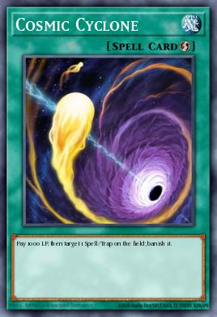

- **Copias y zona:** Reserva 2x. No altera las cantidades registradas.
- **Nombre oficial de referencia:** Ciclón del Cosmos. CID cotejado con la ficha oficial; el nombre histórico del inventario se conserva aunque su grafía/traducción difiera.
- **Función principal y secundaria:** mágica rápida · remoción.
- **Estado de sinergia y función:** Reserva fuera de lista activa. Es una clasificación de juego; revisar la relación concreta en A06.
- **Papel como recurso, descarte o coste:** Destierro como uso/recurso; comprobar origen, coste o efecto y recuperación.
- **Efecto operativo (paráfrasis analítica):** Paga 1000 LP para desterrar una Mágica/Trampa en campo. 
- **Mapa de activación y resultados:** efecto de estadística, condición o material; no asumir un disparador adicional. Cada operación está sujeta a la secuencia y al «si lo haces» del texto oficial.
- **Ventanas de activación identificadas:** requieren la fase o condición específica indicada en el texto; sin ventana rápida general asumida.
- **Costes o recursos potenciales:** pago de LP.
- **Restricciones y requisitos:** aplicar restricciones de selección, activación y copias que consten en el texto original. 
- **Prioridad al ir primero:** generar envíos por efecto sin malgastar recursos y preparar interacción. Para esta carta: Activar cuando las condiciones permitan obtener valor real, preservando recursos de seguimiento.
- **Prioridad al ir segundo:** forzar respuestas rivales con Fusión/retiradas y conservar cementerio utilizable. Identificar primero la respuesta rival que afecta su función «mágica rápida».
- **Medio/tardío y recuperación:** recuperar materiales y gestionar cartas enviadas o desterradas. No asumir que por sí misma recicla recursos si el texto no lo permite.
- **Sinergias y acceso a líneas:** Relación contextual con enviar cartas al Cementerio por efecto y aprovechar fusiones, reciclaje y motores Horus/Demoniherrero. Habilita una línea del motor sólo si coinciden recursos, objetivos y restricciones; no equivale a un combo completo validado.
- **Riesgo / brick / interrupciones:** El coste de LP y selección de objetivo deben pagarse/declararse antes de la resolución. No atribuirle velocidad rápida por el solo hecho de formar parte del motor.
- **Utilidad editorial:** 3/5 para este deck (estimación por rol y zona, no probabilidad calculada). No cambiar copias; cualquier sugerencia de alta/baja pasa por el apartado 22 y aprobación.
- **Referencia oficial y trazabilidad:** https://www.db.yugioh-card.com/yugiohdb/card_search.action?cid=12464&ope=2&request_locale=es. **Confianza:** texto y tipo de efecto cotejados en Konami; síntesis táctica editorial, no demostración de combo.
- **Aplicación concreta dentro de este deck (A06):** Fuera de lista. Paga 1000 LP para desterrar una Mágica/Trampa en campo.. No aporta recursos durante este duelo.

**USO PRÁCTICO Y SINERGIA — Ciclón del Cosmos**

- **Label funcional:** Sin sinergia demostrada (con la evidencia actual). Clasificación documental; una relación es válida solo si se satisfacen sus condiciones exactas.
- **Qué hace:** Paga 1000 LP para desterrar una Mágica/Trampa en campo.
- **Cómo aprovecharla en este deck:** Fuera de lista. Paga 1000 LP para desterrar una Mágica/Trampa en campo.. No aporta recursos durante este duelo.
- **Al jugar primero:** generar envíos por efecto sin malgastar recursos y preparar interacción. Para esta carta: Activar cuando las condiciones permitan obtener valor real, preservando recursos de seguimiento.
- **Al jugar segundo:** forzar respuestas rivales con Fusión/retiradas y conservar cementerio utilizable. Identificar primero la respuesta rival que afecta su función «mágica rápida».
- **Cuándo tener precaución:** El coste de LP y selección de objetivo deben pagarse/declararse antes de la resolución. No atribuirle velocidad rápida por el solo hecho de formar parte del motor.

#### 47. Polvo de Pluma de Arpía

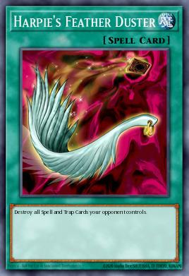

- **Copias y zona:** Reserva 1x. No altera las cantidades registradas.
- **Nombre oficial de referencia:** Polvo de Pluma de Arpía. CID cotejado con la ficha oficial; el nombre histórico del inventario se conserva aunque su grafía/traducción difiera.
- **Función principal y secundaria:** mágica · eliminación masiva.
- **Estado de sinergia y función:** Reserva fuera de lista activa. Es una clasificación de juego; revisar la relación concreta en A06.
- **Papel como recurso, descarte o coste:** No se demuestra que esta carta sea recurso de descarte o pago para otra.
- **Efecto operativo (paráfrasis analítica):** Destruye todas las Mágicas/Trampas del campo contrario. 
- **Mapa de activación y resultados:** 1) efecto propio o continuo: destruye la carta o recurso previsto. Cada operación está sujeta a la secuencia y al «si lo haces» del texto oficial.
- **Ventanas de activación identificadas:** requieren la fase o condición específica indicada en el texto; sin ventana rápida general asumida.
- **Costes o recursos potenciales:** sin coste independiente identificado en esta síntesis; comprobar las acciones previas al punto y coma de cada efecto.
- **Restricciones y requisitos:** aplicar restricciones de selección, activación y copias que consten en el texto original. 
- **Prioridad al ir primero:** generar envíos por efecto sin malgastar recursos y preparar interacción. Para esta carta: Activar cuando las condiciones permitan obtener valor real, preservando recursos de seguimiento.
- **Prioridad al ir segundo:** forzar respuestas rivales con Fusión/retiradas y conservar cementerio utilizable. Identificar primero la respuesta rival que afecta su función «mágica».
- **Medio/tardío y recuperación:** recuperar materiales y gestionar cartas enviadas o desterradas. No asumir que por sí misma recicla recursos si el texto no lo permite.
- **Sinergias y acceso a líneas:** Relación contextual con enviar cartas al Cementerio por efecto y aprovechar fusiones, reciclaje y motores Horus/Demoniherrero. Habilita una línea del motor sólo si coinciden recursos, objetivos y restricciones; no equivale a un combo completo validado.
- **Riesgo / brick / interrupciones:** No destierra y no protege de respuestas encadenadas. No atribuirle velocidad rápida por el solo hecho de formar parte del motor.
- **Utilidad editorial:** 3/5 para este deck (estimación por rol y zona, no probabilidad calculada). No cambiar copias; cualquier sugerencia de alta/baja pasa por el apartado 22 y aprobación.
- **Referencia oficial y trazabilidad:** https://www.db.yugioh-card.com/yugiohdb/card_search.action?cid=4678&ope=2&request_locale=es. **Confianza:** texto y tipo de efecto cotejados en Konami; síntesis táctica editorial, no demostración de combo.
- **Aplicación concreta dentro de este deck (A06):** Fuera de lista. Destruye todas las Mágicas/Trampas del campo contrario.. No aporta recursos durante este duelo.

**USO PRÁCTICO Y SINERGIA — Polvo de Pluma de Arpía**

- **Label funcional:** Sin sinergia demostrada (con la evidencia actual). Clasificación documental; una relación es válida solo si se satisfacen sus condiciones exactas.
- **Qué hace:** Destruye todas las Mágicas/Trampas del campo contrario.
- **Cómo aprovecharla en este deck:** Fuera de lista. Destruye todas las Mágicas/Trampas del campo contrario.. No aporta recursos durante este duelo.
- **Al jugar primero:** generar envíos por efecto sin malgastar recursos y preparar interacción. Para esta carta: Activar cuando las condiciones permitan obtener valor real, preservando recursos de seguimiento.
- **Al jugar segundo:** forzar respuestas rivales con Fusión/retiradas y conservar cementerio utilizable. Identificar primero la respuesta rival que afecta su función «mágica».
- **Cuándo tener precaución:** No destierra y no protege de respuestas encadenadas. No atribuirle velocidad rápida por el solo hecho de formar parte del motor.

#### 48. Terraformación

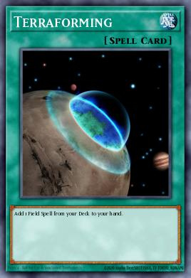

- **Copias y zona:** Reserva 1x. No altera las cantidades registradas.
- **Nombre oficial de referencia:** Terraformación. CID cotejado con la ficha oficial; el nombre histórico del inventario se conserva aunque su grafía/traducción difiera.
- **Función principal y secundaria:** mágica · búsqueda de campo.
- **Estado de sinergia y función:** Reserva fuera de lista activa. Es una clasificación de juego; revisar la relación concreta en A06.
- **Papel como recurso, descarte o coste:** No se demuestra que esta carta sea recurso de descarte o pago para otra.
- **Efecto operativo (paráfrasis analítica):** Busca una Mágica de Campo en el Deck y la lleva a la mano. 
- **Mapa de activación y resultados:** 1) efecto propio o continuo: incorpora la pieza indicada a la mano. Cada operación está sujeta a la secuencia y al «si lo haces» del texto oficial.
- **Ventanas de activación identificadas:** requieren la fase o condición específica indicada en el texto; sin ventana rápida general asumida.
- **Costes o recursos potenciales:** sin coste independiente identificado en esta síntesis; comprobar las acciones previas al punto y coma de cada efecto.
- **Restricciones y requisitos:** aplicar restricciones de selección, activación y copias que consten en el texto original. 
- **Prioridad al ir primero:** generar envíos por efecto sin malgastar recursos y preparar interacción. Para esta carta: Convertir la activación en acceso a la siguiente pieza del motor, sin duplicar buscadores inútilmente.
- **Prioridad al ir segundo:** forzar respuestas rivales con Fusión/retiradas y conservar cementerio utilizable. Identificar primero la respuesta rival que afecta su función «mágica».
- **Medio/tardío y recuperación:** recuperar materiales y gestionar cartas enviadas o desterradas. No asumir que por sí misma recicla recursos si el texto no lo permite.
- **Sinergias y acceso a líneas:** Relación contextual con enviar cartas al Cementerio por efecto y aprovechar fusiones, reciclaje y motores Horus/Demoniherrero. Habilita una línea del motor sólo si coinciden recursos, objetivos y restricciones; no equivale a un combo completo validado.
- **Riesgo / brick / interrupciones:** Si el objetivo de campo ya no está en Deck, pierde utilidad. No atribuirle velocidad rápida por el solo hecho de formar parte del motor.
- **Utilidad editorial:** 3/5 para este deck (estimación por rol y zona, no probabilidad calculada). No cambiar copias; cualquier sugerencia de alta/baja pasa por el apartado 22 y aprobación.
- **Referencia oficial y trazabilidad:** https://www.db.yugioh-card.com/yugiohdb/card_search.action?cid=5537&ope=2&request_locale=es. **Confianza:** texto y tipo de efecto cotejados en Konami; síntesis táctica editorial, no demostración de combo.
- **Aplicación concreta dentro de este deck (A06):** Fuera de lista. Busca una Mágica de Campo en el Deck y la lleva a la mano.. No aporta recursos durante este duelo.

**USO PRÁCTICO Y SINERGIA — Terraformación**

- **Label funcional:** Sin sinergia demostrada (con la evidencia actual). Clasificación documental; una relación es válida solo si se satisfacen sus condiciones exactas.
- **Qué hace:** Busca una Mágica de Campo en el Deck y la lleva a la mano.
- **Cómo aprovecharla en este deck:** Fuera de lista. Busca una Mágica de Campo en el Deck y la lleva a la mano.. No aporta recursos durante este duelo.
- **Al jugar primero:** generar envíos por efecto sin malgastar recursos y preparar interacción. Para esta carta: Convertir la activación en acceso a la siguiente pieza del motor, sin duplicar buscadores inútilmente.
- **Al jugar segundo:** forzar respuestas rivales con Fusión/retiradas y conservar cementerio utilizable. Identificar primero la respuesta rival que afecta su función «mágica».
- **Cuándo tener precaución:** Si el objetivo de campo ya no está en Deck, pierde utilidad. No atribuirle velocidad rápida por el solo hecho de formar parte del motor.

#### 49. Talento de Tácticas Triples

- **Copias y zona:** Reserva 1x. No altera las cantidades registradas.
- **Nombre oficial de referencia:** Talento de Tácticas Triples. CID cotejado con la ficha oficial; el nombre histórico del inventario se conserva aunque su grafía/traducción difiera.
- **Función principal y secundaria:** mágica de respuesta · ventaja.
- **Estado de sinergia y función:** Reserva fuera de lista activa. Es una clasificación de juego; revisar la relación concreta en A06.
- **Papel como recurso, descarte o coste:** No se demuestra que esta carta sea recurso de descarte o pago para otra.
- **Efecto operativo (paráfrasis analítica):** Si el rival activó un efecto de monstruo durante tu Main Phase, permite elegir entre robar dos, tomar control temporal o devolver una carta de mano al Deck. 
- **Mapa de activación y resultados:** 1) en Main Phase: devuelve recursos a mano/Deck/Extra, roba cartas, toma temporalmente el control. Cada operación está sujeta a la secuencia y al «si lo haces» del texto oficial.
- **Ventanas de activación identificadas:** Main Phase.
- **Costes o recursos potenciales:** sin coste independiente identificado en esta síntesis; comprobar las acciones previas al punto y coma de cada efecto.
- **Restricciones y requisitos:** hay límite por turno según el efecto concreto. 
- **Prioridad al ir primero:** generar envíos por efecto sin malgastar recursos y preparar interacción. Para esta carta: Activar cuando las condiciones permitan obtener valor real, preservando recursos de seguimiento.
- **Prioridad al ir segundo:** forzar respuestas rivales con Fusión/retiradas y conservar cementerio utilizable. Identificar primero la respuesta rival que afecta su función «mágica de respuesta».
- **Medio/tardío y recuperación:** recuperar materiales y gestionar cartas enviadas o desterradas. Verificar que el objetivo de recuperación continúe disponible.
- **Sinergias y acceso a líneas:** Relación contextual con enviar cartas al Cementerio por efecto y aprovechar fusiones, reciclaje y motores Horus/Demoniherrero. Habilita una línea del motor sólo si coinciden recursos, objetivos y restricciones; no equivale a un combo completo validado.
- **Riesgo / brick / interrupciones:** La condición exige activación de monstruo rival en tu Main Phase; sólo un modo. No atribuirle velocidad rápida por el solo hecho de formar parte del motor.
- **Utilidad editorial:** 3/5 para este deck (estimación por rol y zona, no probabilidad calculada). No cambiar copias; cualquier sugerencia de alta/baja pasa por el apartado 22 y aprobación.
- **Referencia oficial y trazabilidad:** https://www.db.yugioh-card.com/yugiohdb/card_search.action?cid=15296&ope=2&request_locale=es. **Confianza:** texto y tipo de efecto cotejados en Konami; síntesis táctica editorial, no demostración de combo.
- **Aplicación concreta dentro de este deck (A06):** Fuera de lista. Si el rival activó un efecto de monstruo durante tu Main Phase, permite elegir entre robar dos, tomar control temporal o devolver una carta de mano al Deck.. No aporta recursos durante este duelo.

**USO PRÁCTICO Y SINERGIA — Talento de Tácticas Triples**

- **Label funcional:** Sin sinergia demostrada (con la evidencia actual). Clasificación documental; una relación es válida solo si se satisfacen sus condiciones exactas.
- **Qué hace:** Si el rival activó un efecto de monstruo durante tu Main Phase, permite elegir entre robar dos, tomar control temporal o devolver una carta de mano al Deck.
- **Cómo aprovecharla en este deck:** Fuera de lista. Si el rival activó un efecto de monstruo durante tu Main Phase, permite elegir entre robar dos, tomar control temporal o devolver una carta de mano al Deck.. No aporta recursos durante este duelo.
- **Al jugar primero:** generar envíos por efecto sin malgastar recursos y preparar interacción. Para esta carta: Activar cuando las condiciones permitan obtener valor real, preservando recursos de seguimiento.
- **Al jugar segundo:** forzar respuestas rivales con Fusión/retiradas y conservar cementerio utilizable. Identificar primero la respuesta rival que afecta su función «mágica de respuesta».
- **Cuándo tener precaución:** La condición exige activación de monstruo rival en tu Main Phase; sólo un modo. No atribuirle velocidad rápida por el solo hecho de formar parte del motor.

#### 50. Bella Fantasma & Mansión Embrujada

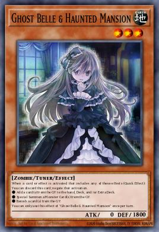

- **Copias y zona:** Reserva 3x. No altera las cantidades registradas.
- **Nombre oficial de referencia:** Bella Fantasma & Mansión Embrujada. CID cotejado con la ficha oficial; el nombre histórico del inventario se conserva aunque su grafía/traducción difiera.
- **Función principal y secundaria:** handtrap · negación de Cementerio.
- **Estado de sinergia y función:** Reserva fuera de lista activa. Es una clasificación de juego; revisar la relación concreta en A06.
- **Papel como recurso, descarte o coste:** Coste o consumo descrito en A05: descarte de mano.
- **Efecto operativo (paráfrasis analítica):** Descarta para negar la activación de una operación que recupere, invoque o destierre cartas del Cementerio. 
- **Mapa de activación y resultados:** 1) con condición explícita en la carta: Invocación Especial desde Extra Deck, incorpora la pieza indicada a la mano. Cada operación está sujeta a la secuencia y al «si lo haces» del texto oficial.
- **Ventanas de activación identificadas:** Efecto Rápido.
- **Costes o recursos potenciales:** descarte de mano.
- **Restricciones y requisitos:** hay límite por turno según el efecto concreto. 
- **Prioridad al ir primero:** generar envíos por efecto sin malgastar recursos y preparar interacción. Para esta carta: Reservar la respuesta para la ventana rival exacta; no es una pieza buscadora de nuestro motor.
- **Prioridad al ir segundo:** forzar respuestas rivales con Fusión/retiradas y conservar cementerio utilizable. Identificar primero la respuesta rival que afecta su función «handtrap».
- **Medio/tardío y recuperación:** recuperar materiales y gestionar cartas enviadas o desterradas. Verificar que el objetivo de recuperación continúe disponible.
- **Sinergias y acceso a líneas:** Relación contextual con enviar cartas al Cementerio por efecto y aprovechar fusiones, reciclaje y motores Horus/Demoniherrero. Habilita una línea del motor sólo si coinciden recursos, objetivos y restricciones; no equivale a un combo completo validado.
- **Riesgo / brick / interrupciones:** No niega todos los efectos: exige que el efecto incluya una de las acciones enumeradas. Puede emplearse en cadena sólo cuando se cumpla su condición concreta.
- **Utilidad editorial:** 3/5 para este deck (estimación por rol y zona, no probabilidad calculada). No cambiar copias; cualquier sugerencia de alta/baja pasa por el apartado 22 y aprobación.
- **Referencia oficial y trazabilidad:** https://www.db.yugioh-card.com/yugiohdb/card_search.action?cid=13587&ope=2&request_locale=es. **Confianza:** texto y tipo de efecto cotejados en Konami; síntesis táctica editorial, no demostración de combo.
- **Aplicación concreta dentro de este deck (A06):** Fuera de lista. Descarta para negar la activación de una operación que recupere, invoque o destierre cartas del Cementerio.. No aporta recursos durante este duelo.

**USO PRÁCTICO Y SINERGIA — Bella Fantasma & Mansión Embrujada**

- **Label funcional:** Sin sinergia demostrada (con la evidencia actual). Clasificación documental; una relación es válida solo si se satisfacen sus condiciones exactas.
- **Qué hace:** Descarta para negar la activación de una operación que recupere, invoque o destierre cartas del Cementerio.
- **Cómo aprovecharla en este deck:** Fuera de lista. Descarta para negar la activación de una operación que recupere, invoque o destierre cartas del Cementerio.. No aporta recursos durante este duelo.
- **Al jugar primero:** generar envíos por efecto sin malgastar recursos y preparar interacción. Para esta carta: Reservar la respuesta para la ventana rival exacta; no es una pieza buscadora de nuestro motor.
- **Al jugar segundo:** forzar respuestas rivales con Fusión/retiradas y conservar cementerio utilizable. Identificar primero la respuesta rival que afecta su función «handtrap».
- **Cuándo tener precaución:** No niega todos los efectos: exige que el efecto incluya una de las acciones enumeradas. Puede emplearse en cadena sólo cuando se cumpla su condición concreta.

## SINERGIAS Y MOTORES
## RESUMEN FUNCIONAL DE SINERGIAS — 656

**Medición descriptiva de etiquetas existentes (NO certificación):** 22/50 identidades con etiqueta directa/indirecta (44.0 %). Main: 22/26 (84.6 %); Extra: 0/15 (0.0 %). Se cuenta una identidad una sola vez; una carta autónoma puede ser útil sin sinergia de motor. Estas cifras provienen de clasificaciones documentales A05/A06: **no son el porcentaje final de sinergias verificadas**, ni una tasa estadística de victoria. Para promoverlas a métricas verificadas, se deben comprobar los pares de cartas y su operación legal.

#### A06.0 — En 30 segundos: cómo cooperan realmente estas cartas

- **Dictamen de conjunto:** varios motores funcionales que compiten por mano y Cementerio; su coexistencia es condicional, no sinergia universal.
- **Motor que mueve el deck:** Reinoheart, Scheiren, Merrli y Havnis preparan envíos por EFECTO para activar las Fusiones Tiagrimentos con nombres y materiales correctos.
- **Puentes reales:** Horus/Sarcófago ofrece cuerpos Nivel 8 y posible ruta Xyz; Demoniherrero aporta otro paquete de descarte, Equipo y Fusión; Kashtira/recicladores afectan el Cementerio.
- **Sinergia indirecta:** descartar como COSTE puede preparar el GY para otros efectos, pero no activa automáticamente los efectos Tiagrimentos que exigen envío por EFECTO.
- **Conflicto decisivo:** gastar cartas de mano para Horus o Demoniherrero reduce recursos de Fusión; las cartas que reemplazan/alteran GY, los materiales y los nombres limitan la ruta real.
- **Decisión concreta:** mantener motor Tiagrimentos como referencia y clasificar Horus/Demoniherrero como planes comparables; probar primero qué envíos disparan efectos antes de proponer cambios de cartas.
- **Qué aprender después:** elegir si se desea Fusión desde efectos o desplegar Nivel 8; no representar ambas salidas como realizadas con el mismo recurso.

#### Motores independientes y puntos de conexión

1. **Motor Tiagrimentos — envío por efecto y Fusión.** **Reinoheart** (CID 17417), al ser Invocado Normal/Especial, manda desde Deck al GY un Tiagrimentos distinto de sí mismo. **Merrli** (17414) manda las tres primeras al ser Invocada; **Scheiren** (17415) se Invoca desde mano, manda un monstruo de la mano y después tres del Deck; **Havnis** (17416) responde al efecto de monstruo rival en Campo, se Invoca de mano y manda tres. Las tres últimas pueden disparar Fusión **cuando llegan al GY por efecto** y deben incluir esa misma carta del GY entre materiales devueltos al fondo del Deck. **Reinoheart**, en cambio, si llegó al GY por efecto puede revivir y **solo si lo hace** manda una carta Tiagrimentos de la mano; no es el mismo efecto de Fusión.
2. **Campos, Mágicas y Trampas Tiagrimentos.** **Perlerreino** (17462) busca monstruo Tiagrimentos o Visas Starfrost al activarse y puede destruir una carta cuando se baraja al Deck/Extra un Tiagrimentos propio desde Campo/GY. **Grito Tiagrimentos** (17813) manda las tres superiores tras Invocación con Tiagrimentos/Visas controlado y, **si Grito fue mandado por efecto**, busca una Trampa Tiagrimentos como **Crimanto** (17475) o **Metarruido** (17473). **Bienes del Entierro Insensato** (12800) manda Mágicas/Trampas desde Deck, habilitando textos que respondan a ese envío. **Trivikarma** (18219) en GY se destierra para buscar una M/T que mencione Visas, sujeto al nombre y texto exactos.
3. **Horus — cuerpos Nivel 8 y GY.** **Sarcófago del Rey** (19200) manda un Horus desde Deck al GY a cambio de una carta de mano; **Amset** (19153) y **Hapi** (19155) se Invocan especialmente desde GY mientras se controle el Sarcófago. Dos Nivel 8 adecuados habilitan, por materiales legales, **El Vampiro Zombi** (16850), que puede mandar cartas superiores de ambos Decks al GY. No atribuir automáticamente a un descarte/coste de Sarcófago los efectos que requieren ser enviado **por efecto**.
4. **Demoniherrero — cuerpos Demonio LUZ, Equipos y Fusión.** **Grabador** (20196) puede descartarse para buscar una M/T Demoniherrero; **Tracto** (20240) busca Demonio LUZ y después descarta, de modo que **Fabuloso Lurrie** (8092) puede activarse si efectivamente fue descartado al GY. Un Demonio LUZ apropiado habilita **Réquiem** (20225) y **Secuencia** (20226); Secuencia usa materiales de Fusión desde GY para monstruo Demonio compatible, y **Lácrima del Demoniherrero** (20214) exige dos Demonios LUZ, no «cualquier dos cartas» ni el envío de una Tiagrimentos como sustituto de material no nombrado.
5. **Kashtira como apoyo de acceso y envío.** **Fenrir** (17768) busca Kashtira y puede desterrar carta rival boca abajo al atacar o responder a efecto de monstruo. **Tiagrimentos Kashtira** (18153) puede Invocarse en Main Phase desterrando una carta Kashtira/Tiagrimentos de mano/GY y manda cartas de la parte superior de un Deck; no tiene por sí misma el efecto de Fusión de Havnis/Scheiren/Merrli. **Wraitsoth** (18204) busca Kashtira, pero sus destrucciones adicionales requieren Shangri-Ira, que **no está en el Extra registrado**.
6. **Interacción de Cementerios.** **Mudora** (17604) y **Keldo** (17603) devuelven al Deck cartas seleccionadas en cualquier GY, permitiendo negar valor a recursos enemigos y reciclar piezas. No aplicar este reciclaje antes de intentar usar las mismas cartas como materiales o objetivos propios; esas decisiones compiten por el mismo recurso.
7. **Extra de Fusión/Enlace/XYZ.** **Caleido-Heart** (17445) exige **Reinoheart + dos Aqua**, y no puede usarse como Material de Fusión. **Súper Polimerización** del Main solo invoca objetivos cuyos materiales realmente cumplan sus textos: **Garura** (17746; mismo Tipo/Atributo, nombres distintos), **Fangodragón del Pantano** (13454; mismo Atributo, Tipos distintos) y **Dragostapelia** (12870; un Fusión + un OSCURIDAD). **I:P Enmascarada** (14676) prepara Enlace en Main rival; **S:P Pequeña Caballera** (19188) requiere cuerpos legales y no se genera por moler tres cartas.

#### Mapa de relaciones hacia fichas y fotografías

| Piezas con CID | Sinergia / destino | Condiciones de integridad | Visual |
|---|---|---|---|
| Reinoheart (17417) → Havnis (17416) / Merrli (17414) / Scheiren (17415) | Alimentar GY y posible Fusión del Extra. | Disparador **por efecto**, materiales completos y carta propia incluida al fondo del Deck. |     |
| Grito (17813) / Bienes (12800) → Crimanto (17475) / Metarruido (17473) | Acceso a Trampas y respuestas de Campo. | Grito debe enviarse **por efecto**; las Trampas requieren monstruo Tiagrimentos/Visas. |     |
| Sarcófago (19200) → Amset (19153) + Hapi (19155) → Vampiro Zombi (16850) | Recuperar Nivel 8 y ampliar envíos del Deck. | Sarcófago activo, dos materiales Xyz y límites de Invocación. |     |
| Grabador (20196) → Tracto (20240) → Lurrie (8092) → Réquiem (20225) | Búsqueda, descarte y cuerpo Demonio LUZ para Enlace. | Resolver descarte real y contar materiales compatibles. |     |
| Tiagrimentos → Caleido-Heart (17445) / Garura (17746) / Dragostapelia (12870) | Selección de Fusión por materiales disponibles. | No presumir que todos son posibles desde cualquier envío; cotejar tipos, Atributos y GY. |    |

#### Restricciones, redundancias y rutas excluidas

- **No convertir envío en coste en activación por efecto.** La diferencia afecta a las Fusiones Tiagrimentos, Grito y Reinoheart. El orden de cadena y las condiciones se comprobarán en 07–09.
- **Competencia entre motores por GY:** Mudora/Keldo, monstruos de Fusión, Horus y Demoniherrero reciclan o emplean cartas en lugares diferentes; ejecutar uno puede consumir los objetivos de otro.
- **Duplicidad de accesos:** Perlerreino y Reinoheart no buscan la misma categoría; Bienes busca envío de M/T, no monstruos. Fenrir da acceso Kashtira, no una Fusión Tiagrimentos automática.
- **Reserva 16:** sus cartas, incluidos los ejemplares adicionales de Havnis/Grito/Súper Polimerización y cartas de respuesta, no se computan como disponibles sin incorporación previa aprobada.

#### A06.1 — Arquitectura operativa de los motores (síntesis no redundante)

Las siguientes filas son **relaciones funcionales**, no secuencias certificadas ni garantía de mano inicial. La lista real y los límites están en A04/A05/A07.

| Tipo / motor | Starter o vía de acceso real | Recurso y destino | Cuello de botella |
|---|---|---|---|
| **Principal: Tiagrimentos GY/Fusión** | Reinoheart, Scheiren, Merrli, Havnis y envíos por efecto | Fusiones compatibles recuperando materiales al Deck | Enviado POR EFECTO, no por coste; nombre y materiales exactos |
| **Secundario: Horus/Sarcófago** | Sarcófago del Rey, Amset y Hapi | Cuerpos de Nivel 8 y posible El Vampiro Zombi | Consumo de mano y Cementerio; Xyz solo con dos materiales legales |
| **Secundario: Demoniherrero** | Grabador, Tracto, Lurrie y Link Demonio LUZ | Acceso, descarte, Equipos/Fusión | No confundir descarte como coste con envío por efecto Tiagrimentos |
| **Apoyo: Kashtira / Cementerios** | Fenrir, Tiagrimentos Kashtira, Mudora y Keldo | Interrupción, envío y reciclaje | Reutiliza GY competido; Wraitsoth no crea Shangri-Ira ausente |

#### A06.2 — Estado funcional y justificación de TODAS las cartas

**Cómo leerlo:** un estado de sinergia describe el papel **de juego**, no el avance de una auditoría. No hay obligación de que cada carta tenga un enlace con otra: una defensa autónoma, una herramienta de Side o un recurso de descarte justificado también tiene propósito. Las relaciones directas descritas aquí se deben contrastar con los textos oficiales antes de representarlas como una ruta legal A09.

| Carta / CID y zona | Estado funcional de sinergia | Motivo de inclusión | Relación y condición concreta | Papel como coste, descarte o material | Límite o riesgo | Decisión táctica |
|---|---|---|---|---|---|---|
| **Súper Polimerización** (CID 7445) — Main 2x, Reserva 1x | **Sinergia indirecta de recursos** | recurso situacional | interacción propia de la carta que requiere consultar el texto íntegro enlazado. Aportación posible como material, coste o objetivo; verificar consumidor | Material o destino del Extra condicionado a los requisitos de invocación | aplicar restricciones de selección, activación y copias que consten en el texto original | Conservar si existe consumidor legal |
| **Lácrima las Lágrimas Carmesíes** (CID 20490) — Main 1x | **Utilidad independiente** | interrupción · recuperación | retorno o reciclaje hacia mano/Deck/Extra. Aporta respuesta o consistencia sin exigir enlace directo | No se demuestra que esta carta sea recurso de descarte o pago para otra | hay límite por turno según el efecto concreto; depende de recursos en Cementerio | Conservar según rival y conflictos propios |
| **Tiagrimientos Havnis** (CID 17416) — Main 1x, Reserva 1x | **Sinergia indirecta (soporte o recursos)** | interrupción · recuperación · extensor · habilitador de Extra | recuperación e invocación desde Cementerio/destierro; acceso al campo desde la mano; habilitación o continuación de una invocación del Extra Deck | Coste o consumo descrito en A05: envío de recurso propio al Cementerio | hay límite por turno según el efecto concreto; depende de recursos en Cementerio; interactúa con información oculta o resultados no siempre… | Conservar; verificar coste y orden |
| **Planeta Primigenio Perlerreino** (CID 17462) — Main 3x | **Sinergia indirecta (soporte o recursos)** | searcher · buscador · recuperación · cierre | búsqueda o incorporación de cartas a mano; retorno o reciclaje hacia mano/Deck/Extra; presión de combate o modificación de estadísticas | No se demuestra que esta carta sea recurso de descarte o pago para otra | hay límite por turno según el efecto concreto; depende de recursos en Cementerio | Conservar; verificar coste y orden |
| **Kashtira Fenrir** (CID 17768) — Main 2x | **Sinergia directa descrita** | starter Kashtira · presión de destierro | Se invoca desde mano sin monstruos propios, busca otro Kashtira y destierra boca abajo una carta rival al reaccionar a su efecto o atacar | No se demuestra que esta carta sea recurso de descarte o pago para otra | hay límite por turno según el efecto concreto; requiere campo propio sin las cartas indicadas; interactúa con información oculta o resultados no… | Conservar; verificar coste y orden |
| **Flor de Ceniza & Primavera Feliz** (CID 12950) — Main 3x | **Utilidad independiente** | handtrap · negación | Descarta desde la mano para detener efectos que buscan, invocan o mandan cartas desde el Deck. Aporta respuesta o consistencia sin exigir enlace directo | Descarte mencionado: comprobar carta que lo exige, zona, coste frente a efecto y utilidad del recurso | hay límite por turno según el efecto concreto | Conservar según rival y conflictos propios |
| **Tiagrimientos Reinoheart** (CID 17417) — Main 2x | **Sinergia indirecta (soporte o recursos)** | recuperación | recuperación e invocación desde Cementerio/destierro | Coste o consumo descrito en A05: envío de recurso propio al Cementerio | hay límite por turno según el efecto concreto | Conservar; verificar coste y orden |
| **Tiagrimientos Scheiren** (CID 17415) — Main 1x | **Sinergia indirecta (soporte o recursos)** | recuperación · extensor · habilitador de Extra | recuperación e invocación desde Cementerio/destierro; acceso al campo desde la mano; habilitación o continuación de una invocación del Extra Deck | Coste o consumo descrito en A05: envío de recurso propio al Cementerio | hay límite por turno según el efecto concreto; depende de recursos en Cementerio; interactúa con información oculta o resultados no siempre… | Conservar; verificar coste y orden |
| **Tiagrimientos Merrli** (CID 17414) — Main 1x | **Sinergia indirecta (soporte o recursos)** | habilitador de Extra | habilitación o continuación de una invocación del Extra Deck | Coste o consumo descrito en A05: envío de recurso propio al Cementerio | hay límite por turno según el efecto concreto; depende de recursos en Cementerio; interactúa con información oculta o resultados no siempre… | Conservar; verificar coste y orden |
| **Bienes del Entierro Insensato** (CID 12800) — Main 3x | **Sinergia indirecta (soporte o recursos)** | recurso situacional | interacción propia de la carta que requiere consultar el texto íntegro enlazado | No se demuestra que esta carta sea recurso de descarte o pago para otra | hay límite por turno según el efecto concreto | Conservar; verificar coste y orden |
| **Trivikarma** (CID 18219) — Main 1x | **Sinergia indirecta (soporte o recursos)** | searcher · buscador · negación · cierre · respuesta | búsqueda o incorporación de cartas a mano; negación de efectos o activaciones; presión de combate o modificación de estadísticas; interacción sobre monstruos en campo | No se demuestra que esta carta sea recurso de descarte o pago para otra | depende de recursos en Cementerio | Conservar; verificar coste y orden |
| **Crimanto Tiagrimientos** (CID 17475) — Main 2x | **Sinergia indirecta (soporte o recursos)** | removal · negación · recuperación | destierro de recursos o de amenazas; negación de efectos o activaciones; retorno o reciclaje hacia mano/Deck/Extra | Coste o consumo descrito en A05: envío de recurso propio al Cementerio; reciclaje de recurso propio | requiere estado de campo específico | Conservar; verificar coste y orden |
| **Grito Tiagrimientos** (CID 17813) — Main 1x, Reserva 1x | **Sinergia indirecta (soporte o recursos)** | searcher · buscador · cierre | búsqueda o incorporación de cartas a mano; presión de combate o modificación de estadísticas | No se demuestra que esta carta sea recurso de descarte o pago para otra | hay límite por turno según el efecto concreto; interactúa con información oculta o resultados no siempre elegibles | Conservar; verificar coste y orden |
| **Mudora el Oráculo de la Espada** (CID 17604) — Main 1x | **Sinergia indirecta (soporte o recursos)** | interrupción · extensor | acceso al campo desde la mano | Coste o consumo descrito en A05: descarte de mano | hay límite por turno según el efecto concreto; depende de recursos en Cementerio | Conservar; verificar coste y orden |
| **Amset, Gloria de Horus** (CID 19153) — Main 2x | **Sinergia indirecta (soporte o recursos)** | searcher · buscador · recuperación · ventaja de mano | búsqueda o incorporación de cartas a mano; recuperación e invocación desde Cementerio/destierro; generación de cartas por robo | Coste o consumo descrito en A05: envío de recurso propio al Cementerio | hay límite por turno según el efecto concreto; requiere estado de campo específico; depende de recursos en Cementerio | Conservar; verificar coste y orden |
| **Ocultador de Efectos** (CID 8933) — Main 2x | **Utilidad independiente** | handtrap · negación | Durante la Main Phase rival, se manda desde la mano al Cementerio para negar los efectos de un monstruo rival boca arriba. Aporta respuesta o consistencia sin exigir enlace directo | Coste o consumo descrito en A05: envío de recurso propio al Cementerio | aplicar restricciones de selección, activación y copias que consten en el texto original | Conservar según rival y conflictos propios |
| **Corona Prohibida** (CID 22169) — Main 2x | **Utilidad independiente** | habilitador de Extra · negación · protección | habilitación o continuación de una invocación del Extra Deck; negación de efectos o activaciones; protección o resistencia contra respuestas. Aporta respuesta o consistencia sin exigir enlace directo | No se demuestra que esta carta sea recurso de descarte o pago para otra | hay límite por turno según el efecto concreto; puede limitar ataques | Conservar según rival y conflictos propios |
| **Tiagrimientos Kashtira** (CID 18153) — Main 3x | **Sinergia indirecta (soporte o recursos)** | interrupción · extensor · removal | acceso al campo desde la mano; destierro de recursos o de amenazas | Coste o consumo descrito en A05: destierro de recurso propio | hay límite por turno según el efecto concreto; interactúa con información oculta o resultados no siempre elegibles | Conservar; verificar coste y orden |
| **Planeta Bajo Presión Wraitsoth** (CID 18204) — Main 1x | **Sinergia indirecta (soporte o recursos)** | searcher · buscador · cierre | búsqueda o incorporación de cartas a mano; presión de combate o modificación de estadísticas | No se demuestra que esta carta sea recurso de descarte o pago para otra | hay límite por turno según el efecto concreto | Conservar; verificar coste y orden |
| **Metarruido Tiagrimientos** (CID 17473) — Main 1x | **Sinergia indirecta (soporte o recursos)** | cierre · respuesta | presión de combate o modificación de estadísticas; interacción sobre monstruos en campo | Coste o consumo descrito en A05: envío de recurso propio al Cementerio | requiere estado de campo específico; depende de recursos en Cementerio; interactúa con información oculta o resultados no siempre elegibles | Conservar; verificar coste y orden |
| **Demoniherrero Grabador** (CID 20196) — Main 3x | **Sinergia indirecta (soporte o recursos)** | searcher · buscador · recuperación · motor Equipo | búsqueda o incorporación de cartas a mano; retorno o reciclaje hacia mano/Deck/Extra; uso o producción de cartas equipadas | Coste o consumo descrito en A05: descarte de mano; reciclaje de recurso propio | hay límite por turno según el efecto concreto; depende de recursos en Cementerio | Conservar; verificar coste y orden |
| **Sarcófago del Rey** (CID 19200) — Main 2x | **Sinergia indirecta (soporte o recursos)** | recurso situacional | interacción propia de la carta que requiere consultar el texto íntegro enlazado | Coste o consumo descrito en A05: envío de recurso propio al Cementerio | hay límite por turno según el efecto concreto | Conservar; verificar coste y orden |
| **Hapi, Guía de Horus** (CID 19155) — Main 1x | **Sinergia indirecta (soporte o recursos)** | searcher · buscador · recuperación · removal | búsqueda o incorporación de cartas a mano; recuperación e invocación desde Cementerio/destierro; destierro de recursos o de amenazas; retorno o reciclaje hacia mano/Deck/Extra | No se demuestra que esta carta sea recurso de descarte o pago para otra | hay límite por turno según el efecto concreto; requiere estado de campo específico; depende de recursos en Cementerio | Conservar; verificar coste y orden |
| **Tracto del Demoniherrero** (CID 20240) — Main 1x | **Sinergia indirecta (soporte o recursos)** | searcher · buscador | búsqueda o incorporación de cartas a mano | Coste o consumo descrito en A05: descarte de mano | hay límite por turno según el efecto concreto; depende de recursos en Cementerio | Conservar; verificar coste y orden |
| **Fabuloso Lurrie** (CID 8092) — Main 1x | **Sinergia indirecta (soporte o recursos)** | recurso situacional | interacción propia de la carta que requiere consultar el texto íntegro enlazado | No se demuestra que esta carta sea recurso de descarte o pago para otra | aplicar restricciones de selección, activación y copias que consten en el texto original | Conservar; verificar coste y orden |
| **Keldo la Protectora Sagrada** (CID 17603) — Main 1x | **Sinergia indirecta (soporte o recursos)** | interrupción · searcher · buscador · extensor | búsqueda o incorporación de cartas a mano; acceso al campo desde la mano | Coste o consumo descrito en A05: descarte de mano | hay límite por turno según el efecto concreto; depende de recursos en Cementerio | Conservar; verificar coste y orden |
| **Agnumday del Demoniherrero** (CID 20521) — Extra 1x | **Sin acceso al Extra demostrado** | Función individual: interrupción · resultado de Extra Deck · cierre · motor Equipo | No se documenta una operación concreta que conecte esta carta con el motor; no inferir inutilidad | Material o destino del Extra condicionado a los requisitos de invocación | hay límite por turno según el efecto concreto; depende de recursos en Cementerio. Invocar sólo desde el Extra Deck usando su procedimiento… | Cruzar A09/A07 antes de proponer reemplazo |
| **Sprind Spright** (CID 17803) — Extra 1x | **Sin acceso al Extra demostrado** | Función individual: resultado de Extra Deck · habilitador Xyz | No se documenta una operación concreta que conecte esta carta con el motor; no inferir inutilidad | Material o destino del Extra condicionado a los requisitos de invocación | exige materiales de Extra Deck o materiales adecuados. Invocar sólo desde el Extra Deck usando su procedimiento propio | Cruzar A09/A07 antes de proponer reemplazo |
| **S:P Pequeña Caballera** (CID 19188) — Extra 1x | **Acceso Extra demostrado (2 rutas)** | interrupción · resultado de Extra Deck · removal · respuesta | Fenrir+Reinoheart → S:P sin primer destierro; I:P+Fenrir → S:P en Main rival con primer destierro y protección | Ambas líneas gastan Fenrir; la segunda requiere Scheiren y Veiler | no negar efectos; comprobar dos monstruos boca arriba para destierro temporal; ver A09 SP_DIRECTA11/IP_SP12 | Conservar 1x; no subir solo por estas rutas |
| **Réquiem del Demoniherrero** (CID 20225) — Extra 1x | **Destino Extra condicionado** | interrupción · resultado de Extra Deck · extensor · cierre · respuesta | acceso al campo desde la mano; presión de combate o modificación de estadísticas; interacción sobre monstruos en campo; uso o producción de cartas equipadas; uso de Sacrificios como parte del efecto | Material o destino del Extra condicionado a los requisitos de invocación | hay límite por turno según el efecto concreto. Invocar sólo desde el Extra Deck usando su procedimiento propio | Conservar si hay materiales legales |
| **Garura, Alas de Vida Resonante** (CID 17746) — Extra 1x | **Destino Extra condicionado** | resultado de Extra Deck · ventaja de mano · cierre | generación de cartas por robo; presión de combate o modificación de estadísticas | Material o destino del Extra condicionado a los requisitos de invocación | hay límite por turno según el efecto concreto. Invocar sólo desde el Extra Deck usando su procedimiento propio | Conservar si hay materiales legales |
| **Predaplanta Dragostapelia** (CID 12870) — Extra 1x | **Destino Extra condicionado** | interrupción · resultado de Extra Deck · negación · respuesta · recurso condicionado | negación de efectos o activaciones; interacción sobre monstruos en campo; colocación o gasto de contadores | Material o destino del Extra condicionado a los requisitos de invocación | hay límite por turno según el efecto concreto. Invocar sólo desde el Extra Deck usando su procedimiento propio | Conservar si hay materiales legales |
| **Tiagrimientos Caleido-Heart** (CID 17445) — Extra 1x | **Destino Extra condicionado** | resultado de Extra Deck · extensor · recuperación | extensión mediante monstruos procedentes del Deck; recuperación e invocación desde Cementerio/destierro | Material o destino del Extra condicionado a los requisitos de invocación | hay límite por turno según el efecto concreto; depende de recursos en Cementerio; exige materiales de Extra Deck o materiales adecuados. Invocar… | Conservar si hay materiales legales |
| **I:P Enmascarada** (CID 14676) — Extra 1x | **Acceso Extra demostrado (1 ruta)** | interrupción · resultado de Extra Deck · habilitador de Extra · protección | Reinoheart+Scheiren → I:P, conserva Fenrir; Main rival I:P (valor1)+Fenrir → S:P | 4 cartas Main; envío de Veiler por Scheiren; molienda aleatoria | sólo Main rival para Efecto Rápido; protección ante destrucción por efectos rivales, no total | Conservar 1x; ver A09 IP_SP12 |
| **Secuencia del Demoniherrero** (CID 20226) — Extra 1x | **Destino Extra condicionado** | resultado de Extra Deck · habilitador de Extra · recuperación · respuesta · motor Equipo | habilitación o continuación de una invocación del Extra Deck; retorno o reciclaje hacia mano/Deck/Extra; interacción sobre monstruos en campo; uso o producción de cartas equipadas | Material o destino del Extra condicionado a los requisitos de invocación | hay límite por turno según el efecto concreto; depende de recursos en Cementerio. Invocar sólo desde el Extra Deck usando su procedimiento… | Conservar si hay materiales legales |
| **Fangodragón del Pantano** (CID 13454) — Extra 1x | **Sin acceso al Extra demostrado** | Función individual: interrupción · resultado de Extra Deck | No se documenta una operación concreta que conecte esta carta con el motor; no inferir inutilidad | Material o destino del Extra condicionado a los requisitos de invocación | hay límite por turno según el efecto concreto. Invocar sólo desde el Extra Deck usando su procedimiento propio | Cruzar A09/A07 antes de proponer reemplazo |
| **Lácrima del Demoniherrero** (CID 20214) — Extra 1x | **Destino Extra condicionado** | resultado de Extra Deck · removal · recuperación · cierre | destierro de recursos o de amenazas; retorno o reciclaje hacia mano/Deck/Extra; presión de combate o modificación de estadísticas | Material o destino del Extra condicionado a los requisitos de invocación | hay límite por turno según el efecto concreto; depende de recursos en Cementerio. Invocar sólo desde el Extra Deck usando su procedimiento… | Conservar si hay materiales legales |
| **Parca Peregrina** (CID 11005) — Extra 1x | **Sin acceso al Extra demostrado** | Función individual: resultado de Extra Deck · cierre · habilitador Xyz | No se documenta una operación concreta que conecte esta carta con el motor; no inferir inutilidad | Material o destino del Extra condicionado a los requisitos de invocación | hay límite por turno según el efecto concreto; interactúa con información oculta o resultados no siempre elegibles. Invocar sólo desde el Extra… | Cruzar A09/A07 antes de proponer reemplazo |
| **El Vampiro Zombi** (CID 16850) — Extra 1x | **Destino Extra condicionado** | resultado de Extra Deck · recuperación · habilitador Xyz | recuperación e invocación desde Cementerio/destierro; gestión de materiales Xyz | Material o destino del Extra condicionado a los requisitos de invocación | hay límite por turno según el efecto concreto; interactúa con información oculta o resultados no siempre elegibles. Invocar sólo desde el Extra… | Conservar si hay materiales legales |
| **Caballero Exciton Horda de Maldad** (CID 10942) — Extra 1x | **Sin acceso al Extra demostrado** | Función individual: interrupción · resultado de Extra Deck · removal · cierre · habilitador Xyz | No se documenta una operación concreta que conecte esta carta con el motor; no inferir inutilidad | Material o destino del Extra condicionado a los requisitos de invocación | aplicar restricciones de selección, activación y copias que consten en el texto original. Invocar sólo desde el Extra Deck usando su… | Cruzar A09/A07 antes de proponer reemplazo |
| **Ladrón del Tiempo Repetidor** (CID 14356) — Extra 1x | **Sin acceso al Extra demostrado** | Función individual: interrupción · resultado de Extra Deck · removal · ventaja de mano · habilitador Xyz | No se documenta una operación concreta que conecte esta carta con el motor; no inferir inutilidad | Material o destino del Extra condicionado a los requisitos de invocación | hay límite por turno según el efecto concreto. Invocar sólo desde el Extra Deck usando su procedimiento propio | Cruzar A09/A07 antes de proponer reemplazo |
| **Fuwalos Multivadora** (CID 20500) — Reserva 2x | **Reserva fuera de lista activa** | Opción externa al listado activo; su función potencial no justifica jugarla sin incorporarla legalmente | Solo puede utilizarse si se incorpora a una lista aplicable; no es recurso del duelo activo | Coste o consumo descrito en A05: descarte de mano; reciclaje de recurso propio | requiere campo propio sin las cartas indicadas; interactúa con información oculta o resultados no siempre elegibles | Reserva; propuesta solo tras aprobación |
| **Punto de Oveja** (CID 14856) — Reserva 1x | **Reserva fuera de lista activa** | Opción externa al listado activo; su función potencial no justifica jugarla sin incorporarla legalmente | Solo puede utilizarse si se incorpora a una lista aplicable; no es recurso del duelo activo | Coste o consumo descrito en A05: descarte de mano | hay límite por turno según el efecto concreto; depende de recursos en Cementerio | Reserva; propuesta solo tras aprobación |
| **Alma Desencadenada de Shyama** (CID 18807) — Reserva 1x | **Reserva fuera de lista activa** | Opción externa al listado activo; su función potencial no justifica jugarla sin incorporarla legalmente | Solo puede utilizarse si se incorpora a una lista aplicable; no es recurso del duelo activo | No se demuestra que esta carta sea recurso de descarte o pago para otra | hay límite por turno según el efecto concreto; depende de recursos en Cementerio; interactúa con información oculta o resultados no siempre… | Reserva; propuesta solo tras aprobación |
| **Llamado por la Tumba** (CID 13619) — Reserva 1x | **Reserva fuera de lista activa** | Opción externa al listado activo; su función potencial no justifica jugarla sin incorporarla legalmente | Solo puede utilizarse si se incorpora a una lista aplicable; no es recurso del duelo activo | No se demuestra que esta carta sea recurso de descarte o pago para otra | aplicar restricciones de selección, activación y copias que consten en el texto original | Reserva; propuesta solo tras aprobación |
| **Ciclón del Cosmos** (CID 12464) — Reserva 2x | **Reserva fuera de lista activa** | Opción externa al listado activo; su función potencial no justifica jugarla sin incorporarla legalmente | Solo puede utilizarse si se incorpora a una lista aplicable; no es recurso del duelo activo | Destierro como uso/recurso; comprobar origen, coste o efecto y recuperación | aplicar restricciones de selección, activación y copias que consten en el texto original | Reserva; propuesta solo tras aprobación |
| **Polvo de Pluma de Arpía** (CID 4678) — Reserva 1x | **Reserva fuera de lista activa** | Opción externa al listado activo; su función potencial no justifica jugarla sin incorporarla legalmente | Solo puede utilizarse si se incorpora a una lista aplicable; no es recurso del duelo activo | No se demuestra que esta carta sea recurso de descarte o pago para otra | aplicar restricciones de selección, activación y copias que consten en el texto original | Reserva; propuesta solo tras aprobación |
| **Terraformación** (CID 5537) — Reserva 1x | **Reserva fuera de lista activa** | Opción externa al listado activo; su función potencial no justifica jugarla sin incorporarla legalmente | Solo puede utilizarse si se incorpora a una lista aplicable; no es recurso del duelo activo | No se demuestra que esta carta sea recurso de descarte o pago para otra | aplicar restricciones de selección, activación y copias que consten en el texto original | Reserva; propuesta solo tras aprobación |
| **Talento de Tácticas Triples** (CID 15296) — Reserva 1x | **Reserva fuera de lista activa** | Opción externa al listado activo; su función potencial no justifica jugarla sin incorporarla legalmente | Solo puede utilizarse si se incorpora a una lista aplicable; no es recurso del duelo activo | No se demuestra que esta carta sea recurso de descarte o pago para otra | hay límite por turno según el efecto concreto | Reserva; propuesta solo tras aprobación |
| **Bella Fantasma & Mansión Embrujada** (CID 13587) — Reserva 3x | **Reserva fuera de lista activa** | Opción externa al listado activo; su función potencial no justifica jugarla sin incorporarla legalmente | Solo puede utilizarse si se incorpora a una lista aplicable; no es recurso del duelo activo | Coste o consumo descrito en A05: descarte de mano | hay límite por turno según el efecto concreto | Reserva; propuesta solo tras aprobación |

## INTERACCIONES Y CLASIFICACIÓN

| ID documental | Categoría provisional | Piezas | Resultado | Requisitos | Check |
|---|---|---|---|---|---|
| 656:A08:01 | STARTER | Reinoheart (17417) → Havnis (17416) / Merrli (17414) / Scheiren (17415) | Alimentar GY y posible Fusión del Extra. | Disparador **por efecto**, materiales completos y carta propia incluida al fondo del Deck. | |
| 656:A08:02 | INTERACCION | Grito (17813) / Bienes (12800) → Crimanto (17475) / Metarruido (17473) | Acceso a Trampas y respuestas de Campo. | Grito debe enviarse **por efecto**; las Trampas requieren monstruo Tiagrimentos/Visas. | |
| 656:A08:03 | EXTENSION | Sarcófago (19200) → Amset (19153) + Hapi (19155) → Vampiro Zombi (16850) | Recuperar Nivel 8 y ampliar envíos del Deck. | Sarcófago activo, dos materiales Xyz y límites de Invocación. | |
| 656:A08:04 | EXTENSION | Grabador (20196) → Tracto (20240) → Lurrie (8092) → Réquiem (20225) | Búsqueda, descarte y cuerpo Demonio LUZ para Enlace. | Resolver descarte real y contar materiales compatibles. | |
| 656:A08:05 | RUTA | Tiagrimentos → Caleido-Heart (17445) / Garura (17746) / Dragostapelia (12870) | Selección de Fusión por materiales disponibles. | No presumir que todos son posibles desde cualquier envío; cotejar tipos, Atributos y GY. | |

#### Rol registrado por cada carta

| ID A08 | Carta registrada | Zona | Clasificación funcional | Rol documentado en A05 | Check de clasificación |
|---|---|---|---|---|---|
| 656:A08:C001 | Súper Polimerización | Main | FUNCION_A05 (recurso jugable sujeto a condición) | recurso situacional. | |
| 656:A08:C002 | Lácrima las Lágrimas Carmesíes | Main | INTERACCION_DEFENSIVA | interrupción · recuperación. | |
| 656:A08:C003 | Tiagrimientos Havnis | Main | EXTENSOR_POTENCIAL | interrupción · recuperación · extensor · habilitador de Extra. | |
| 656:A08:C004 | Planeta Primigenio Perlerreino | Main | BUSCADOR_INTERACCION | searcher · buscador · recuperación · cierre. | |
| 656:A08:C005 | Kashtira Fenrir | Main | STARTER_POTENCIAL | starter Kashtira · presión de destierro. | |
| 656:A08:C006 | Flor de Ceniza & Primavera Feliz | Main | INTERACCION_DEFENSIVA | handtrap · negación. | |
| 656:A08:C007 | Tiagrimientos Reinoheart | Main | FUNCION_A05 (recurso jugable sujeto a condición) | recuperación. | |
| 656:A08:C008 | Tiagrimientos Scheiren | Main | EXTENSOR_POTENCIAL | recuperación · extensor · habilitador de Extra. | |
| 656:A08:C009 | Tiagrimientos Merrli | Main | FUNCION_A05 (recurso jugable sujeto a condición) | habilitador de Extra. | |
| 656:A08:C010 | Bienes del Entierro Insensato | Main | FUNCION_A05 (recurso jugable sujeto a condición) | recurso situacional. | |
| 656:A08:C011 | Trivikarma | Main | BUSCADOR_INTERACCION | searcher · buscador · negación · cierre · respuesta. | |
| 656:A08:C012 | Crimanto Tiagrimientos | Main | INTERACCION_DEFENSIVA | removal · negación · recuperación. | |
| 656:A08:C013 | Grito Tiagrimientos | Main | BUSCADOR_INTERACCION | searcher · buscador · cierre. | |
| 656:A08:C014 | Mudora el Oráculo de la Espada | Main | EXTENSOR_POTENCIAL | interrupción · extensor. | |
| 656:A08:C015 | Amset, Gloria de Horus | Main | BUSCADOR_INTERACCION | searcher · buscador · recuperación · ventaja de mano. | |
| 656:A08:C016 | Ocultador de Efectos | Main | INTERACCION_DEFENSIVA | handtrap · negación. | |
| 656:A08:C017 | Corona Prohibida | Main | INTERACCION_DEFENSIVA | habilitador de Extra · negación · protección. | |
| 656:A08:C018 | Tiagrimientos Kashtira | Main | EXTENSOR_POTENCIAL | interrupción · extensor · removal. | |
| 656:A08:C019 | Planeta Bajo Presión Wraitsoth | Main | BUSCADOR_INTERACCION | searcher · buscador · cierre. | |
| 656:A08:C020 | Metarruido Tiagrimientos | Main | FUNCION_A05 (recurso jugable sujeto a condición) | cierre · respuesta. | |
| 656:A08:C021 | Demoniherrero Grabador | Main | BUSCADOR_INTERACCION | searcher · buscador · recuperación · motor Equipo. | |
| 656:A08:C022 | Sarcófago del Rey | Main | FUNCION_A05 (recurso jugable sujeto a condición) | recurso situacional. | |
| 656:A08:C023 | Hapi, Guía de Horus | Main | BUSCADOR_INTERACCION | searcher · buscador · recuperación · removal. | |
| 656:A08:C024 | Tracto del Demoniherrero | Main | BUSCADOR_INTERACCION | searcher · buscador. | |
| 656:A08:C025 | Fabuloso Lurrie | Main | FUNCION_A05 (recurso jugable sujeto a condición) | recurso situacional. | |
| 656:A08:C026 | Keldo la Protectora Sagrada | Main | EXTENSOR_POTENCIAL | interrupción · searcher · buscador · extensor. | |
| 656:A08:C027 | Agnumday del Demoniherrero | Extra | DESTINO_EXTRA (materiales/procedimiento por comprobar) | interrupción · resultado de Extra Deck · cierre · motor Equipo. | |
| 656:A08:C028 | Sprind Spright | Extra | DESTINO_EXTRA (materiales/procedimiento por comprobar) | resultado de Extra Deck · habilitador Xyz. | |
| 656:A08:C029 | S:P Pequeña Caballera | Extra | RESULTADO_LINK_DEMOSTRADO (A09 SP_DIRECTA11 / IP_SP12) | interrupción · respuesta, con primer destierro solo desde material Extra. | |
| 656:A08:C030 | Réquiem del Demoniherrero | Extra | DESTINO_EXTRA (materiales/procedimiento por comprobar) | interrupción · resultado de Extra Deck · extensor · cierre · respuesta. | |
| 656:A08:C031 | Garura, Alas de Vida Resonante | Extra | DESTINO_EXTRA (materiales/procedimiento por comprobar) | resultado de Extra Deck · ventaja de mano · cierre. | |
| 656:A08:C032 | Predaplanta Dragostapelia | Extra | DESTINO_EXTRA (materiales/procedimiento por comprobar) | interrupción · resultado de Extra Deck · negación · respuesta · recurso condicionado. | |
| 656:A08:C033 | Tiagrimientos Caleido-Heart | Extra | DESTINO_EXTRA (materiales/procedimiento por comprobar) | resultado de Extra Deck · extensor · recuperación. | |
| 656:A08:C034 | I:P Enmascarada | Extra | RESULTADO_LINK_DEMOSTRADO (A09 IP_SP12) | Enlace en Main rival y protección ante destrucción por efectos rivales. | |
| 656:A08:C035 | Secuencia del Demoniherrero | Extra | DESTINO_EXTRA (materiales/procedimiento por comprobar) | resultado de Extra Deck · habilitador de Extra · recuperación · respuesta · motor Equipo. | |
| 656:A08:C036 | Fangodragón del Pantano | Extra | DESTINO_EXTRA (materiales/procedimiento por comprobar) | interrupción · resultado de Extra Deck. | |
| 656:A08:C037 | Lácrima del Demoniherrero | Extra | DESTINO_EXTRA (materiales/procedimiento por comprobar) | resultado de Extra Deck · removal · recuperación · cierre. | |
| 656:A08:C038 | Parca Peregrina | Extra | DESTINO_EXTRA (materiales/procedimiento por comprobar) | resultado de Extra Deck · cierre · habilitador Xyz. | |
| 656:A08:C039 | El Vampiro Zombi | Extra | DESTINO_EXTRA (materiales/procedimiento por comprobar) | resultado de Extra Deck · recuperación · habilitador Xyz. | |
| 656:A08:C040 | Caballero Exciton Horda de Maldad | Extra | DESTINO_EXTRA (materiales/procedimiento por comprobar) | interrupción · resultado de Extra Deck · removal · cierre · habilitador Xyz. | |
| 656:A08:C041 | Ladrón del Tiempo Repetidor | Extra | DESTINO_EXTRA (materiales/procedimiento por comprobar) | interrupción · resultado de Extra Deck · removal · ventaja de mano · habilitador Xyz. | |
| 656:A08:C042 | Fuwalos Multivadora | Reserva | RESERVA (no disponible en el deck actual) | handtrap · robo condicional. | |
| 656:A08:C043 | Punto de Oveja | Reserva | RESERVA (no disponible en el deck actual) | recuperación · ventaja de mano · cierre. | |
| 656:A08:C044 | Alma Desencadenada de Shyama | Reserva | RESERVA (no disponible en el deck actual) | respuesta. | |
| 656:A08:C045 | Llamado por la Tumba | Reserva | RESERVA (no disponible en el deck actual) | mágica rápida · negación de nombre. | |
| 656:A08:C046 | Ciclón del Cosmos | Reserva | RESERVA (no disponible en el deck actual) | mágica rápida · remoción. | |
| 656:A08:C047 | Polvo de Pluma de Arpía | Reserva | RESERVA (no disponible en el deck actual) | mágica · eliminación masiva. | |
| 656:A08:C048 | Terraformación | Reserva | RESERVA (no disponible en el deck actual) | mágica · búsqueda de campo. | |
| 656:A08:C049 | Talento de Tácticas Triples | Reserva | RESERVA (no disponible en el deck actual) | mágica de respuesta · ventaja. | |
| 656:A08:C050 | Bella Fantasma & Mansión Embrujada | Reserva | RESERVA (no disponible en el deck actual) | handtrap · negación de Cementerio. | |

## JUGADAS DOCUMENTADAS

> Requieren comprobación A11–A13 y validación de estado final. No publicar las rutas como combos certificados por tener fotografías.

#### A09 — `656:A09:ENGRAVER:LACRIMA01` (1 carta, motor Demoniherrero)

- **Mano mínima exacta:** **Demoniherrero Grabador** (20196) solamente. Campo/GY vacíos, Main Phase propia, sin interferencia rival. En Deck quedan al menos **Tracto del Demoniherrero** (20240), **Fabuloso Lurrie** (8092) y una **segunda copia de Grabador** (el inventario contiene 3). Extra disponible: **Réquiem** (20225), **Secuencia** (20226), **Lácrima del Demoniherrero** (20214). No usar cartas de la Reserva ni suponer cartas robadas.
1. **Descartar Grabador de mano al GY como coste** para activar su efecto CL1: **añadir Tracto desde Deck**. No Invocar Grabador en este paso.
2. **Activar Tracto**, Mágica Normal, CL1: añadir **Lurrie** (Demonio LUZ Nivel 1) desde Deck a mano y **descartarlo al GY durante la resolución**. Tracto termina en GY. Como Lurrie fue descartado, puede activar después su propio efecto desde el GY en una **nueva cadena** y **se Invoca Especialmente** al Campo.
3. **Invocar por Enlace Réquiem** (Enlace-1) usando **Lurrie** del Campo como único material Demonio LUZ. Lurrie vuelve al GY.
4. Durante la Main Phase, activar el **Efecto Rápido de Réquiem CL1, Sacrificándolo como coste**; al resolver Invocar Especialmente **Grabador #2 desde Deck** al Campo (ATK 1800). Réquiem queda en GY.
5. Activar en GY el efecto de **Grabador #1** (el que fue descartado), **barajando Lurrie de GY al Deck como coste**, para Invocarse Especialmente. Ya hay **dos Grabador Nivel 6, ambos Demonio LUZ** boca arriba en Campo. Se usaron efectos distintos de Grabador, cada uno una vez.
6. Usar los **dos Grabador** como materiales para **Invocar por Enlace Secuencia** (Enlace-2, material requerido: dos monstruos, entre ellos un Demonio LUZ). Ambos Grabador van al GY; Secuencia ATK 1200 en zona legal del Extra.
7. Activar durante Main Phase el efecto de **Secuencia**: **Invocar por Fusión Lácrima del Demoniherrero** usando **los dos Grabador del GY** como los **2 Demonios LUZ** necesarios, **barajándolos al Deck**. Lácrima entra en zona legal ATK 2400. No activar su efecto de recuperación por Invocación de Fusión: el único Demonio LUZ restante en GY es **Réquiem (Enlace)**, que no puede añadirse a la mano y **no puede volver a Invocarse Especialmente ese turno** porque ya fue Invocado una vez y su texto limita las Invocaciones de Réquiem a una por turno.
8. **Equipar Secuencia desde el Campo a Lácrima** mediante su segundo efecto, que impide al rival seleccionar al monstruo equipado con efectos de cartas. Luego **equipar Réquiem desde el GY a Lácrima** mediante su propio efecto, que le otorga **600 ATK adicionales**.
9. **Estado final:** **Lácrima del Demoniherrero ATK 3000** (2400 + 600), **Secuencia y Réquiem equipados** ocupan dos zonas M/T; adversarios con monstruos pierden 600 ATK por el efecto continuo de Lácrima. Tracto en GY; **Lurrie y ambos Grabador barajados al Deck**; Normal sin gastar, mano inicial vacía. No hay dos Enlaces adicionales en zonas de monstruos: ambos son Equipos. Ninguna carta Tiagrimientos ha sido enviada ni fusionada mediante esta línea.

**Fuentes oficiales:** [Grabador](https://www.db.yugioh-card.com/yugiohdb/card_search.action?cid=20196&ope=2&request_locale=en), [Tracto](https://www.db.yugioh-card.com/yugiohdb/card_search.action?cid=20240&ope=2&request_locale=es), [Lurrie](https://www.db.yugioh-card.com/yugiohdb/card_search.action?cid=8092&ope=2&request_locale=es), [Réquiem](https://www.db.yugioh-card.com/yugiohdb/card_search.action?cid=20225&ope=2&request_locale=es), [Secuencia](https://www.db.yugioh-card.com/yugiohdb/card_search.action?cid=20226&ope=2&request_locale=en), [Lácrima](https://www.db.yugioh-card.com/yugiohdb/card_search.action?cid=20214&ope=2&request_locale=es).;.

**Traza A09 de zonas al terminar cada paso `656:A09:ENGRAVER:LACRIMA01`:** segundo Grabador procede del Deck; el primero vuelve del GY. Las cartas de Enlace pasan a ser Equipos en P8, nunca tres monstruos en Campo.

| Hito | Mano | Monstruos | M/T | Cementerio | Destierro propio | Estado rival | Materiales | Normal y Extra |
|---|---|---|---|---|---|---|---|---|
| P1 | Tracto #20240 (buscado) | ∅ | ∅ | Grabador #20196 (copia 1 descartada como coste) | ∅ | Sin respuesta; campo no determinado | Ninguno | Normal libre; Extra intacto |
| P2 | ∅ | Lurrie #8092 (revivido tras descarte, cadena nueva) | ∅ | Grabador #20196 (copia 1), Tracto #20240 (resuelta) | ∅ | Sin cambios acreditados | Ninguno | Normal libre; Extra intacto |
| P3 | ∅ | Réquiem #20225 (Enlace 1) | ∅ | Grabador #20196 (copia 1), Tracto #20240, Lurrie #8092 (material de Enlace) | ∅ | Sin cambios acreditados | Ninguno | Normal libre; Réquiem salió del Extra |
| P4 | ∅ | Grabador #20196 (copia 2 desde Deck) | ∅ | Grabador #20196 (copia 1), Tracto #20240, Lurrie #8092, Réquiem #20225 (Sacrificado como coste) | ∅ | Sin cambios acreditados | Ninguno | Normal libre; Réquiem en GY |
| P5 | ∅ | Grabador #20196 (copia 2), Grabador #20196 (copia 1 revivida) | ∅ | Tracto #20240, Réquiem #20225; Lurrie fue barajado al Deck como coste | ∅ | Sin cambios acreditados | Ninguno | Normal libre; no se invocó más Extra |
| P6 | ∅ | Secuencia #20226 (Enlace 2) | ∅ | Tracto #20240, Réquiem #20225, Grabador #20196 (copias 1 y 2, materiales de Enlace) | ∅ | Sin cambios acreditados | Ninguno | Normal libre; Secuencia salió del Extra |
| P7 | ∅ | Secuencia #20226 (Enlace 2), Lácrima #20214 (Fusión ATK 2400) | ∅ | Tracto #20240, Réquiem #20225; ambos Grabador devueltos al Deck por la Fusión | ∅ | Sin cambios acreditados | Ninguno: materiales de Fusión se barajaron al Deck | Normal libre; Secuencia y Lácrima ya salieron del Extra |
| P8 | ∅ | Lácrima #20214 (ATK 3000 por Réquiem equipado) | Secuencia #20226 (Equipo a Lácrima; no seleccionable por efectos rivales), Réquiem #20225 (Equipo a Lácrima; +600 ATK) | Tracto #20240 | ∅ | Monstruos rivales pierden 600 ATK por efecto continuo de Lácrima; identidades desconocidas | Ninguno | Normal libre; enlaces equipados, no en zona de monstruos |
| P9 | ∅ | Lácrima #20214 (3000 ATK) | Secuencia #20226 (Equipo), Réquiem #20225 (Equipo) | Tracto #20240; Lurrie y dos Grabador devueltos al Deck | ∅ | Reducción continua de 600 ATK a monstruos rivales si existen | Ninguno | Normal libre; ninguna carta Tiagrimientos usada |

#### A09 — `656:A09:REINO:SCHEIREN:KALEIDO01` (Reinoheart + Havnis previo en GY)

**Referencias primarias de identidad y texto:** [Reinoheart](https://www.db.yugioh-card.com/yugiohdb/card_search.action?cid=17417&ope=2&request_locale=es), [Scheiren](https://www.db.yugioh-card.com/yugiohdb/card_search.action?cid=17415&ope=2&request_locale=es), [Havnis](https://www.db.yugioh-card.com/yugiohdb/card_search.action?cid=17416&ope=2&request_locale=es), [Kaleido-Heart](https://www.db.yugioh-card.com/yugiohdb/card_search.action?cid=17445&ope=2&request_locale=es). Son fuentes para cotejar cada condición y destino de cartas; la coincidencia de CIDs no constituye por sí misma una simulación legal de esta ruta.

- **Familia:** Fusión Tiagrimientos desde envío garantizado por efecto. **Dificultad:** media por preparación del GY; **uso:** ir primero (endboard de Kaleido sin retirada) o segundo (puede retirar una carta rival). **Formato:** TCG, contrato 4, inventario recibido de 2026-11-03. **Mano inicial mínima:**  **1× Tearlaments Reinoheart**. **Cementerio inicial:**  **1× Tearlaments Havnis**, monstruo Aqua, previamente enviado al GY y disponible; no debe estar en otro lugar. **Deck propio:**  **1× Tearlaments Scheiren**, sin haber utilizado su efecto de Fusión este turno. **Extra:**  **1× Tearlaments Kaleido-Heart**. **Campo propio inicial:** vacío; Normal disponible; Main Phase propia, efectos disponibles, sin bloqueos ni respuestas. Para probar retirada adicional, rival controla una carta válida para ser seleccionada y barajada al Deck; no es precondición para la Fusión.

| Paso | Acción y cadena | Resultado exacto |
|---|---|---|
| 1 | **Invocar Normalmente Reinoheart** en posición de Ataque, Nivel 4 Guerrero/AGUA. | Reinoheart pasa **mano→Campo**; consume Normal. Su Invocación habilita su efecto de enviar Tiagrimientos del Deck en cadena nueva. |
| 2 | Activar el efecto de Reinoheart **CL1**; al resolver enviar **Scheiren del Deck al GY por efecto** (no como coste). | Reinoheart sigue en Campo; Scheiren está en GY. Se abre el disparador propio de Scheiren **después** de acabar esa cadena, no como CL2 de Reinoheart. |
| 3 | Activar el efecto de Fusión de Scheiren desde GY en cadena posterior, usando **Scheiren en GY + Havnis en GY + Reinoheart en Campo** como los tres materiales de `Reinoheart + 2 Aqua`. | Durante la resolución **poner las tres cartas en la parte inferior del Deck**, en el orden legal elegido, e Invocar por Fusión **Kaleido-Heart** desde Extra en Ataque. **Reinoheart ya no está en Campo**, Scheiren y Havnis ya no están en GY. |
| 4 | Si el rival controla una carta seleccionable y que puede barajarse, el efecto disparado de **Kaleido-Heart al ser Invocado Especialmente** puede seleccionar **1 carta del rival y barajarla al Deck** en nueva cadena. | Solo si había objetivo legal y la activación resuelve. Si el rival no tiene carta válida, no atribuir remoción. No afirmar otras activaciones por el Aqua devuelto: **devolver material al fondo del Deck no es enviarlo al GY**. |

**Endboard sin respuesta:** Kaleido-Heart **3000 ATK / 3000 DEF** en Zona de Monstruos propia, Normal gastada. Reinoheart, Scheiren y Havnis en la parte inferior del Deck; GY propio sin esos tres materiales; mano inicial consumida. **Si el rival tenía objetivo legal y nada responde, una carta rival fue barajada al Deck**, no destruida ni desterrada; daño causado **0 LP**, sin negación inherente por esa secuencia. No hay otras Fusiones ni monstruos Tiagrimientos en Campo. **Vulnerabilidades:** negar el envío de Reinoheart, desplazar Havnis antes de la Fusión, negar el disparador de Scheiren o impedir la Invocación Fusión; tratar en A12–A13.;.

**Traza A09 de zonas al terminar cada paso `656:A09:REINO:SCHEIREN:KALEIDO01`:** Havnis empieza **ya** en GY; no aparece por generación gratuita de la ruta. El blanco rival es opcional e indeterminado.

| Hito | Mano | Monstruos | M/T | Cementerio | Destierro propio | Estado rival | Materiales | Normal y Extra |
|---|---|---|---|---|---|---|---|---|
| P1 | ∅ | Reinoheart #17417 (Normal, 1500 ATK) | ∅ | Havnis #17416 (recurso previo) | ∅ | Sin respuesta; objetivo opcional desconocido | Ninguno | Normal gastada; Extra intacto |
| P2 | ∅ | Reinoheart #17417 | ∅ | Havnis #17416 (previa), Scheiren #17415 (enviada por efecto desde Deck) | ∅ | Sin cambios acreditados | Ninguno | Normal gastada; Extra intacto |
| P3 | ∅ | Kaleido-Heart #17445 (Fusión, 3000 ATK) | ∅ | ∅; Reinoheart, Havnis, Scheiren fueron al fondo del Deck, NO al GY | ∅ | Sin cambios acreditados | Ninguno: materiales de Fusión devueltos al Deck | Normal gastada; Kaleido-Heart salió del Extra |
| P4 | ∅ | Kaleido-Heart #17445 (3000 ATK) | ∅ | ∅ | ∅ | Solo si existió objetivo válido se barajó una carta rival al Deck; no se presume destrucción | Ninguno | Normal gastada; Extra usado para Kaleido |

#### A09 — `656:A09:REINO:MERRLI:KALEIDO01` (variante distinta con Merrli)

**Referencias primarias de identidad y texto:** [Reinoheart](https://www.db.yugioh-card.com/yugiohdb/card_search.action?cid=17417&ope=2&request_locale=es), [Merrli](https://www.db.yugioh-card.com/yugiohdb/card_search.action?cid=17414&ope=2&request_locale=es), [Havnis](https://www.db.yugioh-card.com/yugiohdb/card_search.action?cid=17416&ope=2&request_locale=es), [Kaleido-Heart](https://www.db.yugioh-card.com/yugiohdb/card_search.action?cid=17445&ope=2&request_locale=es). Son fuentes para cotejar cada condición y destino de cartas; la coincidencia de CIDs no constituye por sí misma una simulación legal de esta ruta.

- **Condición inicial:** igual a la ruta Scheiren, pero la carta disponible **en Deck** es  **1× Tearlaments Merrli** (Aqua Nivel 2) en lugar de la Scheiren que se enviaría;  Reinoheart en mano y  Havnis previamente en GY. No se presupone que Merrli pueda utilizar su efecto de Fusión dos veces en el turno. Main Phase propia, Campo propio vacío, Normal libre, Kaleido-Heart en Extra. **No es una segunda Fusión en el mismo turno de la ruta anterior**: son decisiones excluyentes del envío de Reinoheart, con material Aqua distinto devuelto al Deck.
1. **Normal Summon Reinoheart** y activar su efecto CL1 para enviar **Merrli** desde Deck al GY **por efecto**.
2. Tras resolver, activar en cadena nueva el efecto de Merrli en GY; durante su resolución poner **Merrli (GY) + Havnis (GY) + Reinoheart (Campo)** **en la parte inferior del Deck** como materiales `Reinoheart + 2 Aqua`, e Invocar **Kaleido-Heart** por Fusión desde Extra.
3. Si existe objetivo rival legal, activar el efecto de Kaleido-Heart disparado por su Invocación Especial para barajar **1 carta rival al Deck**; si no, dejar únicamente el monstruo Fusión. No añadir cartas a mano ni contar sus materiales como si siguieran en GY.
- **Resultado:** Kaleido-Heart ATK 3000 / DEF 3000, Normal usada, **Reinoheart + Merrli + Havnis devueltos al fondo**. La otra copia de Scheiren, si permanece en Deck, **no fue utilizada**. Retirada rival condicional y 0 daño automático. **Distinción útil:** consume la única Merrli de la lista en vez de la única Scheiren; por tanto recursos posteriores, efectos ya usados y respuestas difieren. Es una variante separada por materiales, no una duplicación del mismo procedimiento.;.

- **Si el rival niega el envío de Merrli por Reinoheart sin retirar a Reinoheart:** **Reinoheart 1500 ATK permanece en Campo, Normal gastada y Havnis sigue en GY**; Merrli nunca llegó allí y **no puede activar** su Fusión desde GY. No se Invoca Kaleido ni se baraja carta rival.
- **Si el rival retira Havnis del GY antes de que resuelva la Fusión de Merrli:** faltará una de las **dos Aqua** necesarias para Kaleido con esa mano. Reinoheart podría permanecer propio y Merrli en GY si sus efectos previos sí resolvieron; ninguna carta ajena a la apertura se añade como material sustituto.
- **Si el rival niega únicamente el efecto de Fusión de Merrli desde el GY:** **Reinoheart sigue en Campo** y Merrli/Havnis en sus zonas originales si la respuesta no las movió; no se devuelven los tres materiales al Deck como si la Fusión hubiera resuelto, ni aparece Kaleido. La Normal ya se utilizó.

**Traza A09 de zonas al terminar cada paso `656:A09:REINO:MERRLI:KALEIDO01`:** alternativa EXCLUYENTE a Scheiren; misma Havnis previa en GY, otro material enviado por Reinoheart.

| Hito | Mano | Monstruos | M/T | Cementerio | Destierro propio | Estado rival | Materiales | Normal y Extra |
|---|---|---|---|---|---|---|---|---|
| P1 | ∅ | Reinoheart #17417 (Normal) | ∅ | Havnis #17416 (previa), Merrli #17414 (enviada por efecto desde Deck) | ∅ | Sin respuesta; objetivo opcional desconocido | Ninguno | Normal gastada; Extra intacto |
| P2 | ∅ | Kaleido-Heart #17445 (3000 ATK) | ∅ | ∅; Reinoheart, Merrli, Havnis ahora en fondo del Deck | ∅ | Sin cambios acreditados | Ninguno: materiales de Fusión regresaron al Deck | Normal gastada; Kaleido desde Extra |
| P3 | ∅ | Kaleido-Heart #17445 | ∅ | ∅ | ∅ | Solo con objetivo rival legal se baraja 1 carta del rival al Deck; sin objetivo no hay remoción | Ninguno | Normal gastada; no hubo segunda Fusión |

#### A09 — `656:A09:REINO:SCHEIREN:HAVNIS_HAND01` (dos cartas en mano; GY vacío)

**Referencias primarias de identidad y texto:** [Reinoheart](https://www.db.yugioh-card.com/yugiohdb/card_search.action?cid=17417&ope=2&request_locale=es), [Havnis](https://www.db.yugioh-card.com/yugiohdb/card_search.action?cid=17416&ope=2&request_locale=es), [Scheiren](https://www.db.yugioh-card.com/yugiohdb/card_search.action?cid=17415&ope=2&request_locale=es), [Kaleido-Heart](https://www.db.yugioh-card.com/yugiohdb/card_search.action?cid=17445&ope=2&request_locale=es). Son fuentes para cotejar cada condición y destino de cartas; la coincidencia de CIDs no constituye por sí misma una simulación legal de esta ruta.

- **Objetivo/dificultad/uso:** mismo destino Kaleido-Heart, pero ahora **sin Havnis preparada en GY**; dificultad baja-media al necesitar **dos cartas concretas en mano**. **Mano inicial:**  Reinoheart +  Havnis. **Deck:**  Scheiren disponible; **Extra:**  Kaleido-Heart. Campo y GY propios **vacíos**, Normal libre, Main Phase propia, sin bloqueos ni respuestas. Un objetivo rival seleccionable es opcional para la remoción.
1. **Normal Summon Reinoheart** (mano→Campo), Normal gastada; activar CL1 su envío desde Deck y resolver **Scheiren Deck→GY por efecto**.
2. En una cadena posterior, activar **Scheiren desde GY** y elegir como materiales **Scheiren (GY) + Reinoheart (Campo) + Havnis (mano)**. Son exactamente Reinoheart + **dos Aqua** (Scheiren y Havnis). **Poner los tres materiales en la parte inferior del Deck** en la resolución, sin enviar Havnis al GY primero; Invocar por Fusión Kaleido-Heart del Extra.
3. Si hay una carta rival legal, el disparo de Kaleido al ser Invocado Especialmente puede **seleccionarla y barajarla al Deck** en cadena nueva; de otro modo, dejar el monstruo Fusión sin retirada.
- **Endboard:** Kaleido-Heart 3000 ATK / 3000 DEF; Reinoheart, Havnis y Scheiren **al fondo del Deck**, sin esos materiales en Campo/GY/mano; Normal gastada, **0 daño automático**, sin otros efectos de Havnis disparados (fue devuelta del área de mano al Deck como material). Esta variante tiene un recurso inicial en mano y **ninguna preparación previa de GY**, por lo que no se fusiona con `REINO:SCHEIREN:KALEIDO01`.;.

- **Si el rival niega el envío de Scheiren por Reinoheart:** el Campo conserva **Reinoheart** si sobrevivió, **Havnis sigue en mano** y la Normal está gastada. Scheiren no entró al GY, así que desde esta apertura no hay Fusión de Kaleido ni retirada de carta rival.
- **Si el rival niega la activación o la resolución de Fusión de Scheiren desde GY, sin retirar piezas:** **Scheiren permanece en GY**, Reinoheart en Campo y Havnis en mano; como no se resolvió la Fusión, **ningún material fue devuelto al fondo del Deck**. La carta de mano Havnis no activa su propio disparo por haber permanecido en mano.

**Traza A09 de zonas al terminar cada paso `656:A09:REINO:SCHEIREN:HAVNIS_HAND01`:** **dos cartas** en mano, GY vacío; Havnis nunca estuvo en GY antes de regresar al Deck como material de Fusión.

| Hito | Mano | Monstruos | M/T | Cementerio | Destierro propio | Estado rival | Materiales | Normal y Extra |
|---|---|---|---|---|---|---|---|---|
| P1 | Havnis #17416 | Reinoheart #17417 (Normal) | ∅ | Scheiren #17415 (enviada desde Deck por efecto) | ∅ | Sin respuesta; objetivo opcional indeterminado | Ninguno | Normal gastada; Extra intacto |
| P2 | ∅ | Kaleido-Heart #17445 (3000 ATK) | ∅ | ∅; Scheiren, Havnis y Reinoheart devueltos al fondo del Deck | ∅ | Sin cambios acreditados | Ninguno: Fusión devuelve 3 materiales al Deck | Normal gastada; Kaleido desde Extra |
| P3 | ∅ | Kaleido-Heart #17445 | ∅ | ∅ | ∅ | Remoción por barajar 1 carta rival solo si había objetivo legal | Ninguno | Normal gastada; no otra Fusión |

#### A09 — `656:A09:REINO:MERRLI:SCHEIREN_HAND01` (dos cartas en mano; otro material enviado)

- **Mano inicial distinta:**  Reinoheart +  Scheiren. **Deck:**  Merrli disponible. **Extra:** Kaleido-Heart; GY/Campo propios vacíos; Normal sin gastar; Main Phase propia sin respuestas/bloqueos. No se supone Havnis en GY ni en mano.
1. **Normal Summon Reinoheart** y activar CL1: enviar **Merrli Deck→GY por efecto**, consumiendo la Normal del turno.
2. Activar **Merrli desde GY** en una cadena nueva; escoger como materiales **Merrli (GY) + Reinoheart (Campo) + Scheiren (mano)**. Son exactamente Reinoheart + **dos Aqua** (Merrli y Scheiren); al resolver **poner los tres materiales al fondo del Deck** e Invocar Kaleido-Heart desde Extra. **Scheiren de mano no fue enviada al GY**, por lo que su efecto de Fusión desde GY no se activa.
3. De existir objetivo rival legal, Kaleido puede barajar 1 carta rival al Deck en una cadena posterior a su Invocación Especial; no atribuir otra destrucción, daño, extensión ni búsqueda.
- **Endboard:** Kaleido-Heart 3000 ATK / 3000 DEF; Reinoheart, Merrli y Scheiren al fondo del Deck; Normal gastada, mano inicial consumida, GY sin esos materiales. La copia de Havnis sigue donde estuviera (en este estado mínimo, Deck). Es **otra variante por material disparador y recursos iniciales**, no una segunda Fusión simultánea.;.

- **Si el rival niega el envío de Merrli por Reinoheart:** sigue **Reinoheart** en Campo si sobrevivió y **Scheiren en mano**, Normal gastada, sin Merrli en GY. No declarar Kaleido ni disparos de Fusión por el mero hecho de tener Scheiren en mano.
- **Si el rival niega la Fusión de Merrli después de su envío por efecto:** **Merrli queda en GY**, Reinoheart en Campo y Scheiren en mano mientras ninguna otra respuesta los mueva; ninguno fue devuelto al fondo del Deck porque la Fusión no resolvió. Se pierde la salida exacta de Kaleido, pero no se gastan ficticiamente materiales de una Fusión inexistente.

**Fuentes primarias de las cuatro fichas:** [Reinoheart](https://www.db.yugioh-card.com/yugiohdb/card_search.action?cid=17417&ope=2&request_locale=en), [Scheiren](https://www.db.yugioh-card.com/yugiohdb/card_search.action?cid=17415&ope=2&request_locale=en), [Merrli](https://www.db.yugioh-card.com/yugiohdb/card_search.action?cid=17414&ope=2&request_locale=en), [Havnis](https://www.db.yugioh-card.com/yugiohdb/card_search.action?cid=17416&ope=2&request_locale=en), [Kaleido-Heart](https://www.db.yugioh-card.com/yugiohdb/card_search.action?cid=17445&ope=2&request_locale=en). **Dos variantes son condicionales a GY preparado; otras dos son iniciadores de dos cartas desde GY vacío. Ninguna está para importar a Station X.**

**Traza A09 de zonas al terminar cada paso `656:A09:REINO:MERRLI:SCHEIREN_HAND01`:** aquí el segundo material Aqua es Scheiren de mano y la disparadora fue Merrli enviada desde Deck.

| Hito | Mano | Monstruos | M/T | Cementerio | Destierro propio | Estado rival | Materiales | Normal y Extra |
|---|---|---|---|---|---|---|---|---|
| P1 | Scheiren #17415 | Reinoheart #17417 (Normal) | ∅ | Merrli #17414 (enviada por efecto desde Deck) | ∅ | Sin respuesta; objetivo opcional desconocido | Ninguno | Normal gastada; Extra intacto |
| P2 | ∅ | Kaleido-Heart #17445 (3000 ATK) | ∅ | ∅; Merrli, Reinoheart y Scheiren ahora al fondo del Deck | ∅ | Sin cambios acreditados | Ninguno: material de Fusión devuelto al Deck | Normal gastada; Kaleido salió de Extra |
| P3 | ∅ | Kaleido-Heart #17445 | ∅ | ∅ | ∅ | Solo si existe objetivo seleccionable se baraja 1 carta rival al Deck | Ninguno | Normal gastada; sin otra Fusión |

#### A09 — `656:A09:SARC:IMSETY_HAPI:ZOMBIE01` (Sarcófago en mano; dos envíos de coste)

**Referencias primarias de identidad y texto:** [Sarcófago](https://www.db.yugioh-card.com/yugiohdb/card_search.action?cid=19200&ope=2&request_locale=es), [Amset](https://www.db.yugioh-card.com/yugiohdb/card_search.action?cid=19153&ope=2&request_locale=es), [Hapi](https://www.db.yugioh-card.com/yugiohdb/card_search.action?cid=19155&ope=2&request_locale=es), [Vampiro Zombi](https://www.db.yugioh-card.com/yugiohdb/card_search.action?cid=16850&ope=2&request_locale=es). Son fuentes para cotejar cada condición y destino de cartas; la coincidencia de CIDs no constituye por sí misma una simulación legal de esta ruta.

- **Familia A08:** `656:A08:03` / preficha `656:A09:C03`. **Objetivo:** establecer un Xyz de Rango 8 para continuación futura, **no** garantizar cartas enviadas desde Deck. **Dificultad:** baja-media; **uso:** ir primero o segundo, Main Phase propia. **Formato:** TCG, contrato 4, inventario del 2026-11-03.
- **Mano inicial mínima exacta (tres cartas):**  **1× Sarcófago del Rey** + **2× Tiagrimientos Kashtira** (hay 3 copias en Main; se emplean aquí exclusivamente como cartas que pueden enviarse al GY). **Campo, GY y destierro propios iniciales:** vacíos; **Normal:** disponible; **rival:** sin respuesta/interferencia; **restricciones previas:** ninguna. **Deck:**  Amset e  Hapi disponibles. **Extra:**  1 copia disponible. No incluir Reserva ni suponer robos.
1. **Activar Sarcófago del Rey** (Mágica Continua, mano→Zona M/T), CL1. Después de su resolución queda boca arriba; no se ha usado la Normal.
2. En una **nueva cadena**, activar su efecto de envío **CL1**, **mandando la primera Tiagrimientos Kashtira de mano al GY como COSTE** antes de formar la cadena (`;` en el texto oficial). Al resolver, **mandar Amset del Deck al GY POR EFECTO**. Sarcófago permanece boca arriba; la primera Kashtira ya está en GY. No activar por ese envío el efecto de Tiagrimientos Kashtira reservado para ser enviada *por efecto*: aquí fue **coste**.
3. En otra cadena y Main Phase, usar **por segunda vez** el efecto del Sarcófago (máximo 4 usos por turno): **mandar segunda Tiagrimientos Kashtira de mano al GY como COSTE**; al resolver enviar **Hapi del Deck al GY por efecto**. No hay otra carta en mano de esta apertura.
4. Con Sarcófago aún controlado, aplicar el **procedimiento de Invocación Especial desde el propio GY** de **Amset** (GY→Zona de Monstruos), y después el de **Hapi** (GY→otra Zona de Monstruos). Ambos son **Nivel 8**; cada uno emplea una vez su forma propia de Invocarse por turno, sin Normal Summon ni cadena de activación de ese procedimiento.
5. Usar **Amset Nivel 8 + Hapi Nivel 8** como materiales de la **Invocación Xyz de El Vampiro Zombi** (Extra→Zona legal de Monstruos). Amset y Hapi **quedan debajo como dos materiales Xyz**; no se consideran monstruos adicionales ni cartas en el GY. **NO activar el efecto de desacoplar y enviar cuatro cartas superiores de ambos Decks**: si se decidiera hacerlo, la identidad de las cartas enviadas y la Invocación Especial posterior serían **no garantizadas**, otra rama que exige nueva ficha.
- **Endboard reproducible sin respuesta:** **El Vampiro Zombi Rango 8 / 3000 ATK / 2800 DEF con exactamente 2 materiales (Amset + Hapi)**; Sarcófago del Rey boca arriba en M/T; 2 Tiagrimientos Kashtira en GY **por coste**; mano inicial vacía; destierro vacío; Normal **libre**; **0 daño automático, 0 negaciones atribuidas, 0 monstruos Horus sueltos**. No atribuir al Xyz la protección que el Sarcófago da únicamente a monstruos "Horus". Si el rival neutraliza Sarcófago antes de los procedimientos desde GY, no está asegurado el Xyz.;.

- **Si el rival niega el primer envío de Sarcófago después del coste:** la primera Tiagrimientos Kashtira **ya quedó en GY por coste**, pero **Amset no llegó desde Deck al GY**. Sarcófago puede seguir boca arriba y la segunda Kashtira en mano; aunque otro envío pudiera resolver, aquí **no se han producido dos Horus Nivel 8** para El Vampiro Zombi. Una Kashtira enviada como coste no activa el efecto que exige envío por efecto.
- **Si el rival retira Sarcófago después de que Amset y Hapi llegaron al GY, pero antes de sus procedimientos:** ambos Horus siguen en GY si no fueron movidos, las dos Kashtira están en GY por coste, **no se Invocan Amset/Hapi bajo la condición de controlar Sarcófago**, y no aparece el Xyz. No adjudicarles la protección de Sarcófago después de que la Mágica dejó el Campo.
- **Si el rival impide la Invocación Xyz de El Vampiro Zombi después de que los dos Horus entraron al Campo:** no existe el Xyz con dos materiales ni su efecto de envío aleatorio. El destino de Amset/Hapi depende del tipo de negación de Invocación o movimiento aplicado; **no** dibujar automáticamente los dos Nivel 8 y un Vampiro simultáneamente.

**Traza A09 de zonas al terminar cada paso `656:A09:SARC:IMSETY_HAPI:ZOMBIE01`:** apertura Sarcófago + dos Kashtira; ambas se envían **como coste**. Amset/Hapi solo pasan a materiales tras la Xyz.

| Hito | Mano | Monstruos | M/T | Cementerio | Destierro propio | Estado rival | Materiales | Normal y Extra |
|---|---|---|---|---|---|---|---|---|
| P1 | 2× Tiagrimientos Kashtira #18153 | ∅ | Sarcófago del Rey #19200 (Continua) | ∅ | ∅ | Sin respuesta; campo no determinado | Ninguno | Normal libre; Extra intacto |
| P2 | 1× Tiagrimientos Kashtira #18153 | ∅ | Sarcófago del Rey #19200 | 1× Tiagrimientos Kashtira #18153 (coste), Amset #19153 (enviado por efecto desde Deck) | ∅ | Sin cambios acreditados | Ninguno | Normal libre; Extra intacto |
| P3 | ∅ | ∅ | Sarcófago del Rey #19200 | 2× Tiagrimientos Kashtira #18153 (coste), Amset #19153, Hapi #19155 (enviado por efecto) | ∅ | Sin cambios acreditados | Ninguno | Normal libre; Extra intacto |
| P4 | ∅ | Amset #19153 (Nivel 8), Hapi #19155 (Nivel 8; revividos por propios procedimientos) | Sarcófago del Rey #19200 | 2× Tiagrimientos Kashtira #18153 (coste) | ∅ | Sin cambios acreditados | Ninguno | Normal libre; Extra intacto |
| P5 | ∅ | Vampiro Zombi #16850 (Xyz Rango 8, 3000 ATK) | Sarcófago del Rey #19200 | 2× Tiagrimientos Kashtira #18153 (coste) | ∅ | No se activó envío aleatorio de Deck ni daño automático | Vampiro: Amset #19153 + Hapi #19155 (2 materiales) | Normal libre; Vampiro salió del Extra |

#### A09 — `656:A09:IMSETY:SARC_HAPI:ZOMBIE01` (Amset en mano busca Sarcófago)

- **Diferencia material:** se inicia con **Amset** en lugar de Sarcófago; éste se **añade desde Deck mediante efecto** y no se presupone en mano. **Mano inicial exacta (3):**  **1× Amset, Gloria de Horus** + **2× Tiagrimientos Kashtira** de las 3 de Main. Campo/GY/destierro propios vacíos, Normal disponible, Main Phase sin respuesta; **Deck** contiene Sarcófago (2 copias en lista) y Hapi; **Extra** contiene El Vampiro Zombi. No se presume la carta de robo opcional.
1. Activar en mano el efecto de **Amset**: **enviar Amset y la primera Tiagrimientos Kashtira desde la mano al GY COMO COSTE**; en la resolución **añadir Sarcófago del Rey desde Deck a mano**. **Renunciar a robar** (texto `then you can draw 1 card`); por tanto no hay información ni recurso aleatorio. Amset y la primera Kashtira están en GY, no en campo.
2. **Activar Sarcófago del Rey** desde mano en M/T (cadena de activación de Mágica Continua). Una vez resuelta, activar su efecto en **nueva cadena**: enviar **segunda Tiagrimientos Kashtira de mano al GY como COSTE**; resolver enviando **Hapi desde Deck al GY por efecto**. La Kashtira de mano no dispara efectos que requieran haber sido enviada *por efecto*. Se ha usado Sarcófago 1 de hasta 4 veces.
3. Con Sarcófago boca arriba, **Invocar Especialmente Amset desde GY por su procedimiento** y **Hapi desde GY por el suyo**, una vez cada nombre. Ambos Nivel 8 ocupan dos zonas de monstruos; no se gastó Normal ni se generó una carta por robo.
4. **Invocar Xyz El Vampiro Zombi** desde Extra usando ambos Nivel 8; ahora Amset y Hapi están acoplados, no en Campo/GY. **No usar** el envío aleatorio de cuatro cartas de cada Deck ni afirmar que se revivió un monstruo por este Xyz.
- **Endboard:** El Vampiro Zombi (Rango 8, **3000/2800**) con Amset + Hapi debajo; Sarcófago boca arriba en M/T; **dos Tiagrimientos Kashtira en GY por coste**; mano vacía, Normal libre, sin destierros, sin daño/negaciones derivados. **Vulnerabilidad adicional frente a la variante anterior:** la búsqueda de Sarcófago por Amset puede ser negada y no se forma el Xyz.;.

- **Si el rival niega la búsqueda de Sarcófago por Amset después de pagar el coste desde mano:** **Amset y la primera Tiagrimientos Kashtira ya están en GY**, la segunda Kashtira permanece en mano, **Sarcófago no llega a mano ni Campo** y la Normal no se utilizó. No se puede ejecutar el envío de Hapi ni resucitar dos Horus en esta ruta.
- **Si el rival niega el envío de Hapi por Sarcófago después de mandar la segunda Kashtira como coste:** ambas Kashtira quedaron **en GY por coste**, Amset está en GY y Sarcófago puede continuar boca arriba, pero **Hapi no fue enviada**. Aun pudiendo Invocar Amset si sigue siendo legal, **no hay dos Nivel 8** para El Vampiro Zombi desde la apertura mínima.
- **Si el rival retira Sarcófago cuando ambos Horus ya estaban en GY pero antes de invocarlos:** no se cumple la condición para Invocar Amset ni Hapi por su procedimiento propio; el campo final de Xyz no se forma. No sustituir automáticamente la Mágica con un segundo Sarcófago del Deck que no fue buscado ni activado.

**Fuentes oficiales comunes de las dos variantes Horus:** [Sarcófago del Rey](https://www.db.yugioh-card.com/yugiohdb/card_search.action?cid=19200&ope=2&request_locale=en), [Amset / Imsety](https://www.db.yugioh-card.com/yugiohdb/card_search.action?cid=19153&ope=2&request_locale=en), [Hapi](https://www.db.yugioh-card.com/yugiohdb/card_search.action?cid=19155&ope=2&request_locale=en), [El Vampiro Zombi](https://www.db.yugioh-card.com/yugiohdb/card_search.action?cid=16850&ope=2&request_locale=en). **La Distinción COSTE ≠ ENVÍO POR EFECTO es obligatoria**; las cuatro fotos de CID están presentes. Estas son dos aperturas **distintas**, no un mismo duelo ejecutando dos Xyz. Ambas quedan **condicionales contrastadas, sin certificación de importación**.

**Traza A09 de zonas al terminar cada paso `656:A09:IMSETY:SARC_HAPI:ZOMBIE01`:** aquí Amset se envía desde mano como coste para **buscar** Sarcófago; se renuncia explícitamente al robo opcional.

| Hito | Mano | Monstruos | M/T | Cementerio | Destierro propio | Estado rival | Materiales | Normal y Extra |
|---|---|---|---|---|---|---|---|---|
| P1 | Sarcófago del Rey #19200 (buscado), 1× Tiagrimientos Kashtira #18153 | ∅ | ∅ | Amset #19153, 1× Tiagrimientos Kashtira #18153 (ambos coste desde mano) | ∅ | Sin respuesta; campo no determinado | Ninguno | Normal libre; Extra intacto; NO se robó carta |
| P2 | ∅ | ∅ | Sarcófago del Rey #19200 | Amset #19153, 2× Tiagrimientos Kashtira #18153 (coste), Hapi #19155 (enviado por efecto desde Deck) | ∅ | Sin cambios acreditados | Ninguno | Normal libre; Extra intacto |
| P3 | ∅ | Amset #19153 (Nivel 8), Hapi #19155 (Nivel 8) | Sarcófago del Rey #19200 | 2× Tiagrimientos Kashtira #18153 (coste) | ∅ | Sin cambios acreditados | Ninguno | Normal libre; Extra intacto |
| P4 | ∅ | Vampiro Zombi #16850 (Xyz Rango 8, 3000 ATK) | Sarcófago del Rey #19200 | 2× Tiagrimientos Kashtira #18153 (coste) | ∅ | No se activó el efecto aleatorio de Vampiro | Vampiro: Amset #19153 + Hapi #19155 | Normal libre; Vampiro salió del Extra |

#### A09 — `656:A09:GOODS:SCREAM:METANOISE:KALEIDO01` (2 cartas; Fusión en turno rival)

- **Familia:** `656:A08:02` + `656:A08:05`. **Objetivo:** preparar una Trampa propia y, **si el oponente pone un monstruo elegible al turno siguiente**, voltear ese monstruo boca abajo con Metarruido, enviar Merrli al GY, Fusion Summon Kaleido-Heart y barajar una carta rival al Deck. No confundir el instante de Colocar la Trampa con su activación ni atribuir un resultado garantizado al turno propio.
- **Mano inicial exacta:**  **Bienes del Entierro Insensato** +  **Tearlaments Reinoheart**. **Deck:**  **Grito Tiagrimientos** (1x),  **Metarruido Tiagrimientos** (1x),  **Tearlaments Havnis** (1x) y  **Tearlaments Merrli** (1x) disponibles. **Extra:**  **Kaleido-Heart** (1x). Campo, GY y destierro propios inicialmente vacíos, Normal libre, Main Phase propia, sin respuestas. **Condición de continuación rival:** Reinoheart y Metarruido sobreviven al cambio de turno; durante el turno rival siguiente el oponente controla al menos un monstruo boca arriba que **puede ponerse en Defensa boca abajo** y que se puede seleccionar, sin impedir el envío desde Deck al GY ni la Invocación por Fusión.

| Paso | Acción legal | Estado y materiales |
|---|---|---|
| 1 | Activar **Foolish Burial Goods** desde la mano; por efecto enviar **Tearlaments Scream**, Mágica Continua, desde Deck al GY. | Bienes acaba en GY; Scream no fue activada en Campo ni Colocada, fue **enviada por efecto**. |
| 2 | En nueva cadena activar el efecto disparado de **Scream** al ser enviada por efecto, y añadir **Tearlaments Metanoise** del Deck a la mano. | Metanoise queda en mano. **No** añadir simultáneamente Cryme: se resuelve una única búsqueda con el único Grito disponible. |
| 3 | Invocar **Normalmente** a **Reinoheart** desde mano y activar su efecto al ser Invocado: enviar **Havnis del Deck al GY por efecto**. | Reinoheart boca arriba 1500 ATK en Campo; Havnis en GY; Normal gastada. En este estado de dos cartas **no hay** tercera pieza Aqua para completar Kaleido todavía: no atribuir una Fusión en este punto. |
| 4 | **Colocar Metanoise** boca abajo en Zona M/T propia y pasar el turno. | **Fin del turno propio:** Reinoheart boca arriba + Metanoise Colocada; Bienes, Scream y Havnis en GY; cero daño causado, sin Fusión todavía. No activar una Trampa Normal recién Colocada este turno en condiciones ordinarias. |
| 5 | **En el siguiente turno rival**, si se conserva el estado requerido, activar **Metanoise** seleccionando un monstruo enemigo boca arriba que pueda pasar a Defensa boca abajo. Resolver: **voltear al objetivo boca abajo** y **después enviar Merrli del Deck al GY**. | Metanoise va al GY; Merrli fue enviada **por efecto de la Trampa**, no como coste. El monstruo enemigo queda boca abajo si no existe una protección u otra interferencia. |
| 6 | Tras concluir la cadena de Metanoise, activar el efecto de **Merrli** por haber sido enviada al GY por efecto. Fusion Summon **Kaleido-Heart** utilizando exactamente **Reinoheart (Campo) + Havnis (GY) + Merrli (GY)**; poner las tres cartas **en el fondo del Deck** como materiales por resolución y traer Kaleido del Extra. | Se cumplen `«Tearlaments Reinoheart» + 2 Aqua`: **Havnis y Merrli son Aqua**, Reinoheart es el material nombrado (Guerrero). Las tres cartas vuelven al Deck, no permanecen en GY; Kaleido-Heart aparece boca arriba en Campo propio, también siendo turno rival. |
| 7 | Por la Invocación Especial de **Kaleido-Heart**, activar su efecto en una cadena nueva, seleccionando la carta rival previamente volteada boca abajo (si sigue controlada por el oponente y es seleccionable). Al resolver, **barajarla al Deck correspondiente**. | Kaleido-Heart 3000 ATK permanece propio; el monstruo rival deja su Campo por barajado, **no por destrucción**. Si el objetivo era una carta del Extra, vuelve a ese Extra Deck, no a la mano; el daño infligido en esta ruta es **0 LP**. |

- **Endboard condicional al terminar el paso 7:** **Kaleido-Heart 3000 ATK** propio; Reinoheart ya no está en Campo, sino al fondo del Deck junto con Havnis y Merrli; **Bienes, Scream y Metanoise** en GY, sin cartas obtenidas extra, Normal consumida desde tu turno anterior. El monstruo rival seleccionado retorna al Deck/Extra si pudo resolverse legalmente. **Sin la supervivencia de Reinoheart/Metanoise, el monstruo rival volteable o la ventana de Trampa en turno rival, NO se garantiza esta Fusión diferida**. Variantes con Cryme no se agrupan porque exigen recursos de mano diferentes y otra respuesta.
- **Si el rival retira Reinoheart o elimina Metanoise Colocada antes de que pueda activarse en su turno:** no existe la configuración necesaria para ejecutar los pasos 5–7. Si solo desapareció Reinoheart, **Havnis sigue en GY**, Bienes y Scream también, y Metanoise puede continuar Colocada, pero **no se le atribuye una Fusión Kaleido sin su material nombrado**; si desapareció la Trampa, no se presume envío de Merrli.
- **Si el rival no controla monstruo legalmente volteable a Defensa boca abajo durante la ventana de Metanoise:** no inventar objetivo ni activar una Trampa que no cumpla sus requisitos. El final propio anterior continúa condicionado: **Reinoheart + Metanoise Colocada**, sin Merrli enviada y sin Kaleido; ninguna carta rival se baraja.
- **Si el rival niega únicamente el envío de Merrli por Metanoise, después de la activación legal de la Trampa:** Metanoise fue activada, pero **Merrli no llegó por efecto al GY** y no se dispara su Fusión. Reinoheart puede permanecer en Campo y Havnis en GY, sin Kaleido. Si Merrli sí llegó y luego el rival retira Reinoheart antes de resolver su Fusión, falta el material nombrado; tampoco se adjudica Kaleido.
- **Fuentes oficiales:** [Bienes](https://www.db.yugioh-card.com/yugiohdb/card_search.action?cid=12800&ope=2&request_locale=en), [Scream](https://www.db.yugioh-card.com/yugiohdb/card_search.action?cid=17813&ope=2&request_locale=en), [Metanoise](https://www.db.yugioh-card.com/yugiohdb/card_search.action?cid=17473&ope=2&request_locale=en), [Reinoheart](https://www.db.yugioh-card.com/yugiohdb/card_search.action?cid=17417&ope=2&request_locale=en), [Havnis](https://www.db.yugioh-card.com/yugiohdb/card_search.action?cid=17416&ope=2&request_locale=en), [Merrli](https://www.db.yugioh-card.com/yugiohdb/card_search.action?cid=17414&ope=2&request_locale=en), [Kaleido-Heart](https://www.db.yugioh-card.com/yugiohdb/card_search.action?cid=17445&ope=2&request_locale=en).;; no importable aún.

**Traza A09 de zonas al terminar cada paso `656:A09:GOODS:SCREAM:METANOISE:KALEIDO01`:** P4 es final del turno propio y P5–P7 ocurren **solo en el turno rival siguiente** si sobreviven Reinoheart y Metarruido y hay monstruo enemigo legal volteable.

| Hito | Mano | Monstruos | M/T | Cementerio | Destierro propio | Estado rival | Materiales | Normal y Extra |
|---|---|---|---|---|---|---|---|---|
| P1 | Reinoheart #17417 | ∅ | ∅ | Bienes del Entierro Insensato #12800, Grito #17813 (enviado por efecto desde Deck, no activado) | ∅ | Sin respuesta; objetivo rival aún no requerido | Ninguno | Normal libre; Extra intacto |
| P2 | Reinoheart #17417, Metarruido #17473 (buscada por Grito) | ∅ | ∅ | Bienes #12800, Grito #17813 | ∅ | Sin cambios acreditados | Ninguno | Normal libre; Extra intacto |
| P3 | Metarruido #17473 | Reinoheart #17417 (Normal) | ∅ | Bienes #12800, Grito #17813, Havnis #17416 (enviada desde Deck por efecto) | ∅ | Sin cambios acreditados | Ninguno | Normal gastada; Extra intacto |
| P4 | ∅ | Reinoheart #17417 (1500 ATK) | Metarruido #17473 (Colocada; aún no activable el mismo turno ordinario) | Bienes #12800, Grito #17813, Havnis #17416 | ∅ | Sin respuesta en preparación; aún no hay retirada ni Fusión | Ninguno | Normal gastada en turno propio; se pasa turno |
| P5 | ∅ | Reinoheart #17417 (si sobrevivió al cambio de turno) | ∅ | Bienes #12800, Grito #17813, Havnis #17416, Metarruido #17473, Merrli #17414 (enviada por efecto desde Deck) | ∅ | Monstruo rival elegible volteado boca abajo; identidad variable, solo si pudo resolverse | Ninguno | Turno rival; Normal del turno propio ya gastada; Extra intacto |
| P6 | ∅ | Kaleido-Heart #17445 (Fusión, 3000 ATK) | ∅ | Bienes #12800, Grito #17813, Metarruido #17473; los 3 materiales regresaron al fondo del Deck | ∅ | Monstruo rival boca abajo sigue si no fue retirado | Ninguno: materiales de Fusión no quedan acoplados | Turno rival; Kaleido salió del Extra |
| P7 | ∅ | Kaleido-Heart #17445 (3000 ATK) | ∅ | Bienes #12800, Grito #17813, Metarruido #17473 | ∅ | Carta rival legal que se volteó fue barajada al Deck/Extra si el efecto de Kaleido resolvió | Ninguno | Turno rival; ninguna Fusión adicional |

#### A09 — `656:A09:GOODS:SCREAM:CRYME:KALEIDO02` (3 cartas; respuesta en turno rival)

- **Objetivo:** transformar una negación de **Crimanto Tiagrimientos / Tearlaments Cryme** en envío de Havnis **por efecto** y Fusión posterior a Kaleido-Heart, sin confundir el envío de la Trampa con un coste. **Mano inicial de tres cartas registradas:**  **Foolish Burial Goods**,  **Tearlaments Reinoheart**,  **Tearlaments Havnis**. **Deck:**  **Tearlaments Scream**,  **Tearlaments Cryme**,  **Tearlaments Merrli**. **Extra:** . **Estado:** Main Phase propia, Campo/GY/destierro propios vacíos; Normal libre; rival no responde durante preparación. En el **siguiente turno rival**, Reinoheart debe continuar boca arriba y un monstruo del rival debe poder activar un efecto cuya activación se niegue y que pueda barajarse al Deck. No se presupone carta extra robada.

| Paso / ventana | Procedimiento | Estado después |
|---|---|---|
| 1, propia Main | Activar **Bienes del Entierro Insensato** para **enviar Grito desde el Deck al GY por efecto**. Tras resolver, en cadena nueva activar el disparo de **Grito** enviado por efecto y **añadir Crimanto** desde Deck a mano. | GY: Bienes y Grito. Mano: Reinoheart + Havnis + Crimanto. Ni Grito ni Crimanto son cartas en Campo todavía. |
| 2, propia Main | **Colocar Crimanto** boca abajo. **Invocar Normalmente Reinoheart** y activar su disparo para **enviar Merrli del Deck al GY por efecto**. | Campo propio: Reinoheart y Crimanto Colocada. GY: Merrli, Bienes, Grito. Mano: Havnis. **No activar** el disparo opcional de Merrli en esta ruta: se reserva Merrli como material para la Fusión posterior. Normal gastada. |
| 3, turno rival | Tras pasar turno, el oponente activa **un efecto de monstruo en Campo** susceptible de negarse y barajarse. Como **controlas Reinoheart**, responder con la **Trampa de Contraefecto Crimanto** que fue Colocada en el turno anterior; al resolver **negar esa activación, barajar esa carta rival al Deck y, después, enviar Havnis desde mano al GY por efecto**. | Crimanto va al GY tras resolver. El monstruo rival afectado abandona su Campo; Havnis GY junto a Merrli. No se trató su envío como coste ni como Fusión instantánea dentro de la resolución de Crimanto. |
| 4, cadena nueva tras el envío | Activar el disparo de **Havnis** enviada al GY por efecto; al resolver, Fusión hacia **Kaleido-Heart** usando **Reinoheart del Campo + Merrli y Havnis del GY**, **devolviendo al fondo del Deck los tres materiales** como exige el efecto de Fusión de Havnis. | Campo propio al resolver: **Kaleido-Heart ATK 3000**; Reinoheart ya no está en Campo, Havnis y Merrli ya no están en GY. Crimanto, Grito y Bienes quedan GY. No se garantiza el efecto opcional de retirar otra carta rival si no hay otra carta rival seleccionable. |

- **Estado final en el turno rival, sin respuesta adicional:** un Kaleido-Heart Invocado por Fusión, 1 activación rival negada y su carta barajada, sin daños ni otras negaciones garantizadas. Si Reinoheart desaparece antes de activar Crimanto, no se puede cumplir el requisito de control propio; si no hay monstruo en mano para enviar al GY tras la negación, no puede obtenerse este desenlace. **Distinción:** no duplicar la variante **Metarruido**, que voltea un objetivo y envía Merrli **por su propio efecto de Trampa**, mientras esta vía envía Havnis **después de negar con Crimanto**.
- **Si el rival retira Reinoheart antes de que Cryme pueda responder y no queda otro Tiagrimientos propio:** la Trampa ya Colocada no cumple su requisito de activación y **no niega el efecto enemigo**. Havnis sigue en mano, Merrli en GY si su envío previo resolvió, Cryme puede permanecer Colocada, pero **no aparece Kaleido** ni se envía Havnis gratis.
- **Si el rival niega la resolución de Cryme después de activarse legalmente:** no se acredita la negación del efecto enemigo, ni su barajado al Deck, ni el envío de Havnis **por efecto**. Sin ese envío no se dispara la Fusión de Havnis; **Reinoheart propio permanece si no fue retirado**, con Merrli en GY y Havnis todavía en mano según lo que la respuesta rival haya dejado.
- **Si el rival niega únicamente el disparo de Fusión de Havnis después de que Cryme sí resolvió:** la carta rival fue negada y barajada como indicó Cryme, y **Havnis está en GY junto a Merrli**; Reinoheart sigue en Campo si sobrevivió. **Kaleido no fue Invocado**, esos tres materiales **no** se devuelven al Deck, y no se vuelve a activar la Fusión con el mismo efecto ya usado.
- **Texto oficial:** [Bienes](https://www.db.yugioh-card.com/yugiohdb/card_search.action?cid=12800&ope=2&request_locale=en), [Grito](https://www.db.yugioh-card.com/yugiohdb/card_search.action?cid=17813&ope=2&request_locale=en), [Crimanto](https://www.db.yugioh-card.com/yugiohdb/card_search.action?cid=17475&ope=2&request_locale=en), [Havnis](https://www.db.yugioh-card.com/yugiohdb/card_search.action?cid=17416&ope=2&request_locale=en), [Reinoheart](https://www.db.yugioh-card.com/yugiohdb/card_search.action?cid=17417&ope=2&request_locale=en).;; **NO IMPORTABLE**.

**Traza A09 de zonas al terminar cada paso `656:A09:GOODS:SCREAM:CRYME:KALEIDO02`:** vía diferente de Metarruido. P3 requiere activación de monstruo rival susceptible de negación y barajado; Havnis se envía por **efecto de Crimanto**, no por coste.

| Hito | Mano | Monstruos | M/T | Cementerio | Destierro propio | Estado rival | Materiales | Normal y Extra |
|---|---|---|---|---|---|---|---|---|
| P1 | Reinoheart #17417, Havnis #17416, Crimanto #17475 (buscada por Grito) | ∅ | ∅ | Bienes #12800, Grito #17813 (enviado por efecto) | ∅ | Sin respuesta durante preparación | Ninguno | Normal libre; Extra intacto |
| P2 | Havnis #17416 | Reinoheart #17417 (Normal) | Crimanto #17475 (Colocada, no se activa este turno) | Bienes #12800, Grito #17813, Merrli #17414 (enviada por efecto desde Deck; no se usó su disparo) | ∅ | Sin respuesta durante preparación | Ninguno | Normal gastada; se pasa turno; Extra intacto |
| P3 | ∅ | Reinoheart #17417 (superviviente al cambio de turno) | ∅ | Bienes #12800, Grito #17813, Merrli #17414, Crimanto #17475, Havnis #17416 (enviada por efecto tras negar) | ∅ | Activación de monstruo rival negada y esa carta barajada al Deck solo si la respuesta fue legal y resolvió | Ninguno | Turno rival; Extra intacto |
| P4 | ∅ | Kaleido-Heart #17445 (Fusión, 3000 ATK) | ∅ | Bienes #12800, Grito #17813, Crimanto #17475; Reinoheart, Havnis, Merrli al fondo del Deck | ∅ | La carta cuya activación se negó ya fue barajada; otra remoción de Kaleido NO garantizada sin blanco adicional | Ninguno: materiales de Fusión regresaron al Deck | Turno rival; Kaleido salió del Extra |

#### A09 — Familia de contrajuego `656:A09:SUPERPOLY:THREE_FUSIONS01–03` (tres estados rivales distintos)

- **Tipo:** **rutas condicionales de ruptura de Campo** / alternativas del mismo activador, no tres combos autónomos de una carta ni líneas de milling aleatorio. Se presentan separadas porque **los requisitos de Fusión no son intercambiables**. **Precondición común:** inicio de Main Phase propia, tu Campo/GY vacíos,  **Súper Polimerización** y  **Flor de Ceniza y Primavera Feliz** en mano como dos cartas reales del Main; Ash se descarta **como COSTE**, no se activa. La Mágica Rápida se usa **desde la mano en tu turno**. Las tres Fusiones existen en el Extra original de 15. Normal sin consumir. Se suponen materiales rivales boca arriba y capaces de ir al GY como material; sin prohibición previa de Invocar desde Extra. **No afirmar que este Estado rival está garantizado en cada duelo.**

| Ruta / objetivo | Campo rival **antes** de la jugada | Secuencia y estado **después** |
|---|---|---|
| `656:A09:SUPERPOLY:GARURA01`  **Garura, Wings of Resonant Life** | **Tearlaments Havnis** (OSCURIDAD/Aqua) + **Tearlaments Scheiren** (OSCURIDAD/Aqua): dos monstruos del mismo Tipo y Atributo, **distintos nombres**, controlados por el adversario; no son materiales propios inventados. | 1. Activar Súper Polimerización desde la mano y **descartar Ash como coste**. 2. Al resolver, **utilizar ambos monstruos rivales** como materiales de Fusión y enviarlos al GY de su dueño. 3. Invocar Garura de tu Extra en una zona libre; carta de Súper Polimerización al GY. **Campo propio final:** Garura (ATK 1500); **Campo rival:** pierde los dos monstruos citados. No se roba carta por el mero hecho de Invocar a Garura: su robo exige enviarlo al GY en condición apropiada. |
| `656:A09:SUPERPOLY:DRAGOSTAPELIA02`  **Predaplant Dragostapelia** | **Lubellion the Searing Dragon** (monstruo **de Fusión**) + **Fallen of Albaz** (monstruo **OSCURIDAD**), ambos en Campo rival como cartas distintas. | 1. Activar Súper Polimerización y descartar Ash como coste. 2. Resolver usando **Lubellion como el material que exige ser Fusión** y **Albaz como el OSCURIDAD**; ambos dejan el Campo rival por material de Fusión, no por destrucción. 3. Invocar Dragostapelia desde Extra. **Campo final:** Dragostapelia (ATK 2700), con posibilidad posterior de activar su Efecto Rápido de contador Depredador frente a un monstruo rival boca arriba elegible; **no hay negación consumada automáticamente**. |
| `656:A09:SUPERPOLY:MUDRAGON03`  **Mudragon of the Swamp / Fangodragón del Pantano** | **Fallen of Albaz** (OSCURIDAD/Dragón) + **Aluber the Jester of Despia** (OSCURIDAD/Hada), ambos bajo control rival: **mismo Atributo** pero **Tipos distintos**. | 1. Activar Súper Polimerización y descartar Ash como coste. 2. Al resolver enviar **Albaz y Aluber** del Campo rival al GY como materiales; no destruirlos. 3. Invocar Fangodragón desde Extra (ATK 1900), Súper Polimerización al GY. La protección contra selección depende de Atributos y el texto vigente de Fangodragón; **no atribuir negación ni destrucción**. |

- **Ventana y cadenas:** la activación de Súper Polimerización es un solo eslabón de cadena y **ningún jugador puede encadenar cartas o efectos en respuesta a su activación**; esto no elimina restricciones continuas de legalidad ni vuelve inmunes a las Fusiones. Ash descartada no es un material de Fusión. **Destino inicial del rival:** los materiales utilizados pasan normalmente al GY de su propietario; **no** se convierten en cartas tuyas ni fueron seleccionados como objetivos de Súper Polimerización. Las nuevas Fusiones permanecen en tu Campo. **No extrapolar a una Invocación en turno rival desde tu mano**: para ello habría que haber Colocado previamente la Mágica Rápida y esperar la ventana legal.
- **Coste y cobertura:** cada ruta parte de **2 cartas propias más 2 monstruos rivales existentes**; no necesitan Normal, efectos aleatorios ni acceder a la Reserva. Las otras cartas no descritas del rival siguen donde estaban; las tres rutas **son excluyentes** en el mismo experimento inicial, no tres Invocaciones simultáneas. No contar estos tres estados como un endboard universal de Tearlaments. **Riesgo:** si uno de los materiales sale del Campo antes de resolver o deja de satisfacer el requisito, no se puede declarar el resultado descrito; no se fabrica un reemplazo.
- **Texto Konami:** [Súper Polimerización](https://www.db.yugioh-card.com/yugiohdb/card_search.action?cid=7445&ope=2&request_locale=en), [Garura](https://www.db.yugioh-card.com/yugiohdb/card_search.action?cid=17746&ope=2&request_locale=en), [Dragostapelia](https://www.db.yugioh-card.com/yugiohdb/card_search.action?cid=12870&ope=2&request_locale=en), [Fangodragón](https://www.db.yugioh-card.com/yugiohdb/card_search.action?cid=13454&ope=2&request_locale=en), [Havnis](https://www.db.yugioh-card.com/yugiohdb/card_search.action?cid=17416&ope=2&request_locale=en), [Scheiren](https://www.db.yugioh-card.com/yugiohdb/card_search.action?cid=17415&ope=2&request_locale=en).;; **NO IMPORTABLE**.

#### A09 — Situaciones de partida y líneas de recuperación

| Situación | Qué ficha ejecutar | Qué queda al final / cuándo no ejecutar |
|---|---|---|
| **Primero: abrir motor con una carta** | `ENGRAVER:LACRIMA01` si Engraver está en mano y hay piezas Demoniherrero requeridas. | Se obtiene el estado de **Lacrima** indicado en su ficha, no un Kaleido automático ni una segunda Fusión sin materiales. |
| **Primero: Fusión estable con piezas explícitas** | `REINO:SCHEIREN:KALEIDO01`, `REINO:MERRLI:KALEIDO01`, `REINO:SCHEIREN:HAVNIS_HAND01` o `REINO:MERRLI:SCHEIREN_HAND01`. | El objetivo es **Kaleido-Heart**; comprobar Reinoheart nombrado + **2 Aqua** y envío **por efecto**, no por coste. Las cuatro variantes cambian mano/GY y materiales y son excluyentes en una apertura. |
| **Primero: preparar trampa para actuar durante turno rival** | `GOODS:SCREAM:METANOISE:KALEIDO01`: Goods + Reinoheart. | **Turno propio:** Reinoheart + Metanoise **Colocada**; **turno rival:** si hay objetivo volteable y sobrevive la pieza, Fusión a **Kaleido-Heart** y barajar un monstruo. La carta no se activa al colocarla. |
| **Rival: negar y fusionar después** | `GOODS:SCREAM:CRYME:KALEIDO02`: Goods + Reinoheart + Havnis, con Cryme que ya pasó de turno. | **Negar activación rival**, devolver la carta al Deck y luego Havnis enviada **por efecto** fusiona Kaleido con Merrli GY y Reinoheart Campo; no hacerlo si Cryme no tiene monstruo propio en Campo o no hay efecto activable elegible. |
| **Segundo: rival con dos Aqua mismo Tipo/Atributo, distinto nombre** | `SUPERPOLY:GARURA01` contra Havnis + Scheiren controlados por rival. | **Garura en tu Campo**, salen **2 monstruos rivales** como materiales. No robar carta de inmediato por invocarlo. |
| **Segundo: rival con Fusión + OSCURIDAD** | `SUPERPOLY:DRAGOSTAPELIA02` contra Lubellion Fusión + Fallen of Albaz Oscuridad. | **Dragostapelia**, dos materiales rivales al GY; posible efecto rápido posterior de contador Depredador, no negación previa inventada. |
| **Segundo: rival con igual Atributo pero Tipos diferentes** | `SUPERPOLY:MUDRAGON03` contra Albaz y Aluber. | **Mudragon** y retirada de 2 monstruos rivales por Fusión, **no** destrucción. Las tres Súper Polimerizaciones anteriores requieren **configuraciones distintas del rival**. |
| **Segundo: alimentar GY con Horus sin asegurar lo excavado** | `SARC:IMSETY_HAPI:ZOMBIE01` o `IMSETY:SARC_HAPI:ZOMBIE01`; depende de quién inicia en mano. | **Vampiro Zombi** tras dos Nivel 8 preparados; no asignar cartas específicas a los envíos aleatorios de la parte superior del Deck. |
| **Después de una interrupción o destierro de material** | Si una pieza **Aqua requerida** deja el GY antes de resolver la Fusión, comprobar de nuevo los tres materiales y su ubicación real; si falta, **no declarar Kaleido**. | Mantener Reinoheart/Trampa/monstruos **que de verdad sobrevivieron**, y reservar una futura línea si existen recursos; una carta enviada **como coste** no dispara la fusión Tearlaments. |
| **Durante Battle Phase** | Ninguna de estas fichas atribuye daño fijo ni una respuesta propia garantizada durante batalla. Una Súper Polimerización **Colocada en un turno anterior** podría ser activable en una ventana legal y con materiales, pero **no** se toma como cuarta vía instantánea desde mano rival. | `CONDICIONAL`, sin contar nueva apertura. No hay una línea de daño letal comprobada solo por el ATK de Kaleido. |

**Alcance:** se conserva el cómputo de **9 rutas multietapa + 3 estados específicos de Super Poly** previamente contrastados; esta matriz ayuda a elegirlas, no multiplica el inventario ni las certifica contra todas las respuestas rivales..

<!-- STATION_X_EJECUCION_A01_A10_20261116 -->
## EJECUCIÓN DOCUMENTAL A01–A10 Y MATRIZ CANÓNICA A06 — 16-11-2026

**Naturaleza de este corte:** comprobación automática y cruzada de fuentes ya incluidas en el paquete. **No** es replay, juicio de legalidad completo, ensayo físico, confirmación nueva del titular ni integración en producción. Los estados parciales se conservan, incluso cuando la presencia estructural es del 100 %. No se añadieron cartas, modificaron cantidades ni inventaron combos. La investigación restante es tarea de IA; no se incorporan pruebas del usuario a sus denominadores.

**Inventario base cotejado:** `656` · Tearlaments · Main 44 · Extra 15 · Side 0 · Reserva 16 · 50 identidades distintas.

### Estado de ejecución por apartado (contenido de este deck)

**Control individual de Tearlaments (corte 16-11-2026):** las diez filas A01–A10 de abajo son el tablero **de este deck**, no un promedio de los trece. La cobertura documental allí expresada no acredita cierres totales: el porcentaje de **cierre de cada apartado sigue sin conciliación**, y ninguno debe etiquetarse 100 % por existir una fila. En la comprobación funcional A05 reciente se contrastaron **2/50** fichas con fuente oficial para su función principal (restan **48** sin ese contraste de la misma tanda; las 2 tampoco suponen cierre integral de A05). A06 conserva **28 relaciones condicionales** y **3 accesos Extra** sin acreditar. **Próxima ejecución local recomendada:** concluir A05 por identidad, después A06/A07 con las relaciones, materiales y fuentes de este mismo inventario; finalmente A08–A10. Solo actualizar la fila A01–A10 trabajada de este archivo y su reflejo en el registro único; no actualizar otros decks ni llevar porcentajes para los módulos 11–36.

| Apartado | Estado del corte | Resultado material comprobado | Pendiente específico para cerrar |
|---|---|---|---|
| **01** Rol y propósito | DOCUMENTADO; AUDITORÍA PARCIAL | Perfil y plan de juego anteriores conservados | Contrastar condiciones de victoria y sus cartas contra A09 y amenazas reales |
| **02** Recepción e identidad | IDENTIDAD COTEJADA; AUDITORÍA PARCIAL | Deck ID, formato y cantidades confrontadas con inventario confirmado | Corroborar datos de equipo/versión cuando no consten; no cambiar inventario |
| **03** Inventario | COINCIDE ESTRUCTURALMENTE; AUDITORÍA PARCIAL | 50/50 fichas visibles; zonas A05: Main 44/44, Extra 15/15, Side 0/0, Reserva 16/16 | Cotejar requisitos mecánicos individuales y excepciones de identidad sin revisión general de banlist |
| **04** Fuentes y fotografías | COINCIDENCIA DE ARCHIVOS; AUDITORÍA PARCIAL | 50/50 imágenes CID decodificables; 50/50 fichas con URL de fuente | Cotejar texto vigente completo y fotografía correcta en fuente oficial; existencia de archivo no equivale a identidad visual validada |
| **05** Cartas individuales | COBERTURA DOCUMENTAL 50/50; AUDITORÍA PARCIAL | 50 fichas A05 enlazadas a la matriz A06; funciones preexistentes preservadas | Verificar efecto, coste, restricción, utilidad y uso autónomo por identidad |
| **06** Sinergias y motores | MATRIZ CREADA 50/50; AUDITORÍA PARCIAL | 50 filas por identidad y copias desglosadas por zona según A05; etiquetas A06 originales sin promoción de evidencia | Confirmar relaciones causales, Extra sin acceso acreditado y enlaces A08/A09 en ambos sentidos |
| **07** Reglas | CONTRATOS EXISTENTES 50/50; AUDITORÍA PARCIAL | Identidad/CID cruzados con A05 en 50/50 identidades | Resolver ventanas, materiales, cadenas, restricciones y excepciones por efecto y formato |
| **08** Jugadas y decisiones | 7 DECISIONES DOCUMENTADAS; AUDITORÍA PARCIAL | 7 casos A08 y 0 planes Side documentales; IDs referenciados en la matriz cuando consta CID | Demostrar acción legal y resultado, y ampliar combinaciones 1/2/3/4+ sin inflar combos |
| **09** Combos y rutas | 12 EJERCICIOS DOCUMENTADOS; AUDITORÍA PARCIAL | 12 ejercicios y 10 manos registradas; fotos enlazadas solo como indicios, no como participantes certificados | Reconstruir pasos, comprobar todas las cartas/materiales y asignar participantes causales antes de declarar cualquier ruta legal |
| **10** Guías visuales | CONFORME EDITORIAL SEGÚN DECISIÓN V31; REVISIÓN TÉCNICA PARCIAL | Archivo de guía existente; se conserva diseño actual | Cotejar visualmente por paso las rutas A09 comprobadas; no confundir aceptación editorial con simulación |

### APARTADO_06 — Matriz única de trazabilidad por identidad de carta

Una fila por identidad (`deck_id:CARD:CID`), con el desglose íntegro de copias y zonas que proviene de A05; cuando el mapa A06 agrupa copias bajo una zona primaria, **prevalece este desglose**. Los IDs A08 provienen de `cartas_relevantes` y representan **vínculos documentales por comprobar**. Los IDs A09 proceden únicamente de fotografías de los ejercicios; indican **candidatas a contraste**, **no** participación causal acreditada ni combo válido. No omitir una carta si todavía carece de enlaces. Los planes Side son condicionales entre duelos; Reserva nunca se trata como disponible.

| ID / Carta | Zona y copias (A05) | Función A05 | Relación A06 | A08 documentado (sin validar) | A09 candidato por foto (sin validar) | Side / Reserva | Estado / acción siguiente |
|---|---|---|---|---|---|---|---|
| `656:CARD:7445` Super Polymerization | Main ×2; Reserva ×1 | ACCESO_FUSION | CONDICIONAL_NO_VERIFICADA | A08:656:HABILIDAD_O_CONTINUIDAD; A08:656:MANO_IRREGULAR; A08:656:PRIMERO; A08:656:RECURSOS; A08:656:RESPUESTA_RIVAL; A08:656:SEGUNDO; A08:656:TURNO_TARDIO | 656:A09:SUPERPOLY:GARURA10 | Reserva: HIPOTÉTICA | PRECLASIFICACIÓN; comprobar acción concreta, enlace y legalidad |
| `656:CARD:20490` Lacrima the Crimson Tears | Main ×1 | EXTENSOR_CONDICIONADO · CARGA_CEMENTERIO · SELECCION_OBJETIVO · INTERACCION_CAD… | CONDICIONAL_NO_VERIFICADA | SIN_ENLACE_A08_CID | SIN_ENLACE_A09_FOTO | Lista actual | PRECLASIFICACIÓN; comprobar acción concreta, enlace y legalidad; sin referencia A08/A09 por CID/foto (no implica inutilidad) |
| `656:CARD:17416` Tearlaments Havnis | Main ×1; Reserva ×1 | EXTENSOR_CONDICIONADO · CARGA_CEMENTERIO · ACCESO_FUSION · PRESION_LP · INTERAC… | SINERGIA_DE_ENGINE_DOCUMENTADA | A08:656:HABILIDAD_O_CONTINUIDAD; A08:656:MANO_IRREGULAR; A08:656:PRIMERO; A08:656:RECURSOS; A08:656:RESPUESTA_RIVAL; A08:656:SEGUNDO; A08:656:TURNO_TARDIO | 656:A09:GOODS:SCREAM:CRYME:KALEIDO02; 656:A09:GOODS:SCREAM:METANOISE:KALEIDO01; 656:A09:REINO:MERRLI:KALEIDO01 | Reserva: HIPOTÉTICA | PRECLASIFICACIÓN; comprobar acción concreta, enlace y legalidad |
| `656:CARD:17462` Primeval Planet Perlereino | Main ×3 | CONSISTENCIA · INTERACCION_DESTRUCCION · SELECCION_OBJETIVO · ACCESO_FUSION · P… | SINERGIA_DE_ENGINE_DOCUMENTADA | A08:656:HABILIDAD_O_CONTINUIDAD; A08:656:MANO_IRREGULAR; A08:656:PRIMERO; A08:656:RECURSOS; A08:656:RESPUESTA_RIVAL; A08:656:SEGUNDO; A08:656:TURNO_TARDIO | SIN_ENLACE_A09_FOTO | Lista actual | PRECLASIFICACIÓN; comprobar acción concreta, enlace y legalidad |
| `656:CARD:17768` Kashtira Fenrir | Main ×2 | EXTENSOR_CONDICIONADO · CONSISTENCIA · CONTROL_DESTIERRO · SELECCION_OBJETIVO ·… | CONDICIONAL_NO_VERIFICADA | SIN_ENLACE_A08_CID | 656:A09:FENRIR:REINO:SCHEIREN:IP_SP12; 656:A09:FENRIR:REINO:SP_DIRECTA11 | Lista actual | PRECLASIFICACIÓN; comprobar acción concreta, enlace y legalidad |
| `656:CARD:12950` Ash Blossom & Joyous Spring | Main ×3 | HANDTRAP_NEGACION_SELECTIVA · FUNCION_AUTONOMA; posible material Cantante solo si una ruta lo demuestra | CONDICIONAL_NO_VERIFICADA · FUNCIÓN_COTEJADA_CON_KONAMI | SIN_ENLACE_A08_CID | SIN_ENLACE_A09_FOTO | Lista actual | PRECLASIFICACIÓN; comprobar acción concreta, enlace y legalidad; sin referencia A08/A09 por CID/foto (no implica inutilidad) |
| `656:CARD:17417` Tearlaments Reinoheart | Main ×2 | EXTENSOR_CONDICIONADO · CARGA_CEMENTERIO · CONTROL_DESTIERRO | SINERGIA_DE_ENGINE_DOCUMENTADA | A08:656:HABILIDAD_O_CONTINUIDAD; A08:656:MANO_IRREGULAR; A08:656:PRIMERO; A08:656:RECURSOS; A08:656:RESPUESTA_RIVAL; A08:656:SEGUNDO; A08:656:TURNO_TARDIO | 656:A09:FENRIR:REINO:SCHEIREN:IP_SP12; 656:A09:FENRIR:REINO:SP_DIRECTA11; 656:A09:GOODS:SCREAM:CRYME:KALEIDO02; 656:A09:GOODS:SCREAM:METANOISE:KALEIDO01; 656:A09:REINO:MERRLI:KALEIDO01; 656:A09:REINO:MERRLI:SCHEIREN_HAND01; 656:A09:REINO:SCHEIREN:HAVNIS_HAND01; 656:A09:REINO:SCHEIREN:KALEIDO01 | Lista actual | PRECLASIFICACIÓN; comprobar acción concreta, enlace y legalidad |
| `656:CARD:17415` Tearlaments Scheiren | Main ×1 | EXTENSOR_CONDICIONADO · CARGA_CEMENTERIO · ACCESO_FUSION · PRESION_LP | CONDICIONAL_NO_VERIFICADA | SIN_ENLACE_A08_CID | 656:A09:FENRIR:REINO:SCHEIREN:IP_SP12; 656:A09:REINO:MERRLI:SCHEIREN_HAND01; 656:A09:REINO:SCHEIREN:HAVNIS_HAND01; 656:A09:REINO:SCHEIREN:KALEIDO01 | Lista actual | PRECLASIFICACIÓN; comprobar acción concreta, enlace y legalidad |
| `656:CARD:17414` Tearlaments Merrli | Main ×1 | EXTENSOR_CONDICIONADO · CARGA_CEMENTERIO · ACCESO_FUSION · PRESION_LP | SINERGIA_DE_ENGINE_DOCUMENTADA | SIN_ENLACE_A08_CID | 656:A09:GOODS:SCREAM:CRYME:KALEIDO02; 656:A09:GOODS:SCREAM:METANOISE:KALEIDO01; 656:A09:REINO:MERRLI:KALEIDO01; 656:A09:REINO:MERRLI:SCHEIREN_HAND01 | Lista actual | PRECLASIFICACIÓN; comprobar acción concreta, enlace y legalidad |
| `656:CARD:12800` Foolish Burial Goods | Main ×3 | CARGA_CEMENTERIO | CONDICIONAL_NO_VERIFICADA | SIN_ENLACE_A08_CID | 656:A09:GOODS:SCREAM:CRYME:KALEIDO02; 656:A09:GOODS:SCREAM:METANOISE:KALEIDO01 | Lista actual | PRECLASIFICACIÓN; comprobar acción concreta, enlace y legalidad |
| `656:CARD:18219` Trivikarma | Main ×1 | CONSISTENCIA · CONTROL_DESTIERRO · RESPUESTA_NEGACION · SELECCION_OBJETIVO | CONDICIONAL_NO_VERIFICADA | SIN_ENLACE_A08_CID | SIN_ENLACE_A09_FOTO | Lista actual | PRECLASIFICACIÓN; comprobar acción concreta, enlace y legalidad; sin referencia A08/A09 por CID/foto (no implica inutilidad) |
| `656:CARD:17475` Tearlaments Cryme | Main ×2 | CONTROL_DESTIERRO · SELECCION_OBJETIVO · PREPARACION_CAMPO | SINERGIA_DE_ENGINE_DOCUMENTADA | SIN_ENLACE_A08_CID | SIN_ENLACE_A09_FOTO | Lista actual | PRECLASIFICACIÓN; comprobar acción concreta, enlace y legalidad; sin referencia A08/A09 por CID/foto (no implica inutilidad) |
| `656:CARD:17813` Tearlaments Scream | Main ×1; Reserva ×1 | CONTROL_DESTIERRO · SELECCION_OBJETIVO · PREPARACION_CAMPO | SINERGIA_DE_ENGINE_DOCUMENTADA | SIN_ENLACE_A08_CID | 656:A09:GOODS:SCREAM:CRYME:KALEIDO02; 656:A09:GOODS:SCREAM:METANOISE:KALEIDO01 | Reserva: HIPOTÉTICA | PRECLASIFICACIÓN; comprobar acción concreta, enlace y legalidad |
| `656:CARD:17604` Mudora the Sword Oracle | Main ×1 | EXTENSOR_CONDICIONADO · CONTROL_DESTIERRO · SELECCION_OBJETIVO · INTERACCION_CA… | CONDICIONAL_NO_VERIFICADA | SIN_ENLACE_A08_CID | SIN_ENLACE_A09_FOTO | Lista actual | PRECLASIFICACIÓN; comprobar acción concreta, enlace y legalidad; sin referencia A08/A09 por CID/foto (no implica inutilidad) |
| `656:CARD:19153` Imsety, Glory of Horus | Main ×2 | EXTENSOR_CONDICIONADO · CONSISTENCIA · CARGA_CEMENTERIO · RECUPERACION_MANO | SINERGIA_DE_ENGINE_DOCUMENTADA | SIN_ENLACE_A08_CID | 656:A09:IMSETY:SARC_HAPI:ZOMBIE01; 656:A09:SARC:IMSETY_HAPI:ZOMBIE01 | Lista actual | PRECLASIFICACIÓN; comprobar acción concreta, enlace y legalidad |
| `656:CARD:8933` Effect Veiler | Main ×2 | CARGA_CEMENTERIO · RESPUESTA_NEGACION · SELECCION_OBJETIVO · INTERACCION_CADENA | CONDICIONAL_NO_VERIFICADA | SIN_ENLACE_A08_CID | 656:A09:ENGRAVER:LACRIMA01 | Lista actual | PRECLASIFICACIÓN; comprobar acción concreta, enlace y legalidad |
| `656:CARD:22169` Forbidden Crown | Main ×2 | EXTENSOR_CONDICIONADO · ACCESO_NORMAL · CONSISTENCIA · TRIBUTO · INTERACCION_CA… | CONDICIONAL_NO_VERIFICADA | SIN_ENLACE_A08_CID | SIN_ENLACE_A09_FOTO | Lista actual | PRECLASIFICACIÓN; comprobar acción concreta, enlace y legalidad; sin referencia A08/A09 por CID/foto (no implica inutilidad) |
| `656:CARD:18153` Tearlaments Kashtira | Main ×3 | EXTENSOR_CONDICIONADO · CARGA_CEMENTERIO · CONTROL_DESTIERRO · INTERACCION_CADE… | CONDICIONAL_NO_VERIFICADA | SIN_ENLACE_A08_CID | 656:A09:FENRIR:REINO:SCHEIREN:IP_SP12; 656:A09:IMSETY:SARC_HAPI:ZOMBIE01; 656:A09:SARC:IMSETY_HAPI:ZOMBIE01 | Lista actual | PRECLASIFICACIÓN; comprobar acción concreta, enlace y legalidad |
| `656:CARD:18204` Pressured Planet Wraitsoth | Main ×1 | CAMPO_BUSCADOR_KASHTIRA · SOPORTE_ESTADISTICAS · REMOCION_CON_SHANGRI_IRA_CONDICIONAL | CONDICIONAL_NO_VERIFICADA · FUNCIÓN_COTEJADA_CON_KONAMI | SIN_ENLACE_A08_CID | SIN_ENLACE_A09_FOTO | Lista actual | PRECLASIFICACIÓN; comprobar acción concreta, enlace y legalidad; sin referencia A08/A09 por CID/foto (no implica inutilidad) |
| `656:CARD:17473` Tearlaments Metanoise | Main ×1 | CONTROL_DESTIERRO · SELECCION_OBJETIVO · PREPARACION_CAMPO | SINERGIA_DE_ENGINE_DOCUMENTADA | SIN_ENLACE_A08_CID | 656:A09:GOODS:SCREAM:METANOISE:KALEIDO01 | Lista actual | PRECLASIFICACIÓN; comprobar acción concreta, enlace y legalidad |
| `656:CARD:20196` Fiendsmith Engraver | Main ×3 | EXTENSOR_CONDICIONADO · CONSISTENCIA · CARGA_CEMENTERIO · EQUIPAMIENTO · SELECC… | SINERGIA_DE_ENGINE_DOCUMENTADA | SIN_ENLACE_A08_CID | 656:A09:ENGRAVER:LACRIMA01 | Lista actual | PRECLASIFICACIÓN; comprobar acción concreta, enlace y legalidad |
| `656:CARD:19200` King's Sarcophagus | Main ×2 | CARGA_CEMENTERIO · INTERACCION_DESTRUCCION · SELECCION_OBJETIVO · PRESION_LP | SINERGIA_DE_ENGINE_DOCUMENTADA | A08:656:HABILIDAD_O_CONTINUIDAD; A08:656:MANO_IRREGULAR; A08:656:PRIMERO; A08:656:RECURSOS; A08:656:RESPUESTA_RIVAL; A08:656:SEGUNDO; A08:656:TURNO_TARDIO | 656:A09:IMSETY:SARC_HAPI:ZOMBIE01; 656:A09:SARC:IMSETY_HAPI:ZOMBIE01 | Lista actual | PRECLASIFICACIÓN; comprobar acción concreta, enlace y legalidad |
| `656:CARD:19155` Hapi, Guidance of Horus | Main ×1 | EXTENSOR_CONDICIONADO · CONTROL_DESTIERRO · SELECCION_OBJETIVO · PRESION_LP | SINERGIA_DE_ENGINE_DOCUMENTADA | SIN_ENLACE_A08_CID | 656:A09:IMSETY:SARC_HAPI:ZOMBIE01; 656:A09:SARC:IMSETY_HAPI:ZOMBIE01 | Lista actual | PRECLASIFICACIÓN; comprobar acción concreta, enlace y legalidad |
| `656:CARD:20240` Fiendsmith's Tract | Main ×1 | CONSISTENCIA · CONTROL_DESTIERRO · ACCESO_FUSION | SINERGIA_DE_ENGINE_DOCUMENTADA | SIN_ENLACE_A08_CID | SIN_ENLACE_A09_FOTO | Lista actual | PRECLASIFICACIÓN; comprobar acción concreta, enlace y legalidad; sin referencia A08/A09 por CID/foto (no implica inutilidad) |
| `656:CARD:8092` Fabled Lurrie | Main ×1 | EXTENSOR_CONDICIONADO | SINERGIA_DE_ENGINE_DOCUMENTADA | SIN_ENLACE_A08_CID | 656:A09:ENGRAVER:LACRIMA01 | Lista actual | PRECLASIFICACIÓN; comprobar acción concreta, enlace y legalidad |
| `656:CARD:17603` Keldo the Sacred Protector | Main ×1 | EXTENSOR_CONDICIONADO · CONSISTENCIA · CONTROL_DESTIERRO · SELECCION_OBJETIVO ·… | CONDICIONAL_NO_VERIFICADA | SIN_ENLACE_A08_CID | SIN_ENLACE_A09_FOTO | Lista actual | PRECLASIFICACIÓN; comprobar acción concreta, enlace y legalidad; sin referencia A08/A09 por CID/foto (no implica inutilidad) |
| `656:CARD:20521` Fiendsmith's Agnumday | Extra ×1 | EXTENSOR_CONDICIONADO · EQUIPAMIENTO · SELECCION_OBJETIVO · PRESION_LP · INTERA… | ACCESO_EXTRA_CONDICIONAL_VALIDADO_EN_ESCRITORIO | SIN_ENLACE_A08_CID | SIN_ENLACE_A09_FOTO | Lista actual | PRECLASIFICACIÓN; comprobar acción concreta, enlace y legalidad; sin referencia A08/A09 por CID/foto (no implica inutilidad) |
| `656:CARD:17803` Spright Sprind | Extra ×1 | EXTENSOR_CONDICIONADO · CARGA_CEMENTERIO · SELECCION_OBJETIVO · ACCESO_XYZ · PR… | ACCESO_EXTRA_CONDICIONAL_VALIDADO_EN_ESCRITORIO | SIN_ENLACE_A08_CID | SIN_ENLACE_A09_FOTO | Lista actual | PRECLASIFICACIÓN; comprobar acción concreta, enlace y legalidad; sin referencia A08/A09 por CID/foto (no implica inutilidad) |
| `656:CARD:19188` S:P Little Knight | Extra ×1 | CONTROL_DESTIERRO · SELECCION_OBJETIVO · INTERACCION_CADENA | CONDICIONAL_NO_VERIFICADA | SIN_ENLACE_A08_CID | 656:A09:FENRIR:REINO:SCHEIREN:IP_SP12; 656:A09:FENRIR:REINO:SP_DIRECTA11 | Lista actual | PRECLASIFICACIÓN; comprobar acción concreta, enlace y legalidad |
| `656:CARD:20225` Fiendsmith's Requiem | Extra ×1 | EXTENSOR_CONDICIONADO · EQUIPAMIENTO · SELECCION_OBJETIVO · TRIBUTO · INTERACCI… | CONDICIONAL_NO_VERIFICADA | SIN_ENLACE_A08_CID | SIN_ENLACE_A09_FOTO | Lista actual | PRECLASIFICACIÓN; comprobar acción concreta, enlace y legalidad; sin referencia A08/A09 por CID/foto (no implica inutilidad) |
| `656:CARD:17746` Garura, Wings of Resonant Life | Extra ×1 | RECUPERACION_MANO · TRIBUTO · PRESION_LP | CONDICIONAL_NO_VERIFICADA | SIN_ENLACE_A08_CID | 656:A09:SUPERPOLY:GARURA10 | Lista actual | PRECLASIFICACIÓN; comprobar acción concreta, enlace y legalidad |
| `656:CARD:12870` Predaplant Dragostapelia | Extra ×1 | RESPUESTA_NEGACION · SELECCION_OBJETIVO · ACCESO_FUSION · INTERACCION_CADENA | ACCESO_EXTRA_NO_ACREDITADO | SIN_ENLACE_A08_CID | SIN_ENLACE_A09_FOTO | Lista actual | SIN_RUTA_EXTRA_ACREDITADA; verificar materiales o uso alternativo; sin referencia A08/A09 por CID/foto (no implica inutilidad) |
| `656:CARD:17445` Tearlaments Kaleido-Heart | Extra ×1 | EXTENSOR_CONDICIONADO · CARGA_CEMENTERIO · SELECCION_OBJETIVO | SINERGIA_DE_ENGINE_DOCUMENTADA | SIN_ENLACE_A08_CID | 656:A09:GOODS:SCREAM:CRYME:KALEIDO02; 656:A09:GOODS:SCREAM:METANOISE:KALEIDO01; 656:A09:REINO:MERRLI:KALEIDO01; 656:A09:REINO:MERRLI:SCHEIREN_HAND01; 656:A09:REINO:SCHEIREN:HAVNIS_HAND01; 656:A09:REINO:SCHEIREN:KALEIDO01 | Lista actual | PRECLASIFICACIÓN; comprobar acción concreta, enlace y legalidad |
| `656:CARD:14676` I:P Masquerena | Extra ×1 | INTERACCION_DESTRUCCION · INTERACCION_CADENA | CONDICIONAL_NO_VERIFICADA | SIN_ENLACE_A08_CID | 656:A09:FENRIR:REINO:SCHEIREN:IP_SP12 | Lista actual | PRECLASIFICACIÓN; comprobar acción concreta, enlace y legalidad |
| `656:CARD:20226` Fiendsmith's Sequence | Extra ×1 | EQUIPAMIENTO · SELECCION_OBJETIVO · ACCESO_FUSION | CONDICIONAL_NO_VERIFICADA | SIN_ENLACE_A08_CID | SIN_ENLACE_A09_FOTO | Lista actual | PRECLASIFICACIÓN; comprobar acción concreta, enlace y legalidad; sin referencia A08/A09 por CID/foto (no implica inutilidad) |
| `656:CARD:13454` Mudragon of the Swamp | Extra ×1 | SELECCION_OBJETIVO · TRIBUTO · INTERACCION_CADENA | ACCESO_EXTRA_NO_ACREDITADO | SIN_ENLACE_A08_CID | SIN_ENLACE_A09_FOTO | Lista actual | SIN_RUTA_EXTRA_ACREDITADA; verificar materiales o uso alternativo; sin referencia A08/A09 por CID/foto (no implica inutilidad) |
| `656:CARD:20214` Fiendsmith's Lacrima | Extra ×1 | EXTENSOR_CONDICIONADO · CONTROL_DESTIERRO · SELECCION_OBJETIVO · ACCESO_FUSION… | CONDICIONAL_NO_VERIFICADA | SIN_ENLACE_A08_CID | 656:A09:ENGRAVER:LACRIMA01 | Lista actual | PRECLASIFICACIÓN; comprobar acción concreta, enlace y legalidad |
| `656:CARD:11005` Pilgrim Reaper | Extra ×1 | COMBATE | ACCESO_EXTRA_CONDICIONAL_VALIDADO_EN_ESCRITORIO | SIN_ENLACE_A08_CID | SIN_ENLACE_A09_FOTO | Lista actual | PRECLASIFICACIÓN; comprobar acción concreta, enlace y legalidad; sin referencia A08/A09 por CID/foto (no implica inutilidad) |
| `656:CARD:16850` The Zombie Vampire | Extra ×1 | EXTENSOR_CONDICIONADO · SELECCION_OBJETIVO · ACCESO_XYZ | SINERGIA_DE_ENGINE_DOCUMENTADA | SIN_ENLACE_A08_CID | 656:A09:IMSETY:SARC_HAPI:ZOMBIE01; 656:A09:SARC:IMSETY_HAPI:ZOMBIE01 | Lista actual | PRECLASIFICACIÓN; comprobar acción concreta, enlace y legalidad |
| `656:CARD:10942` Evilswarm Exciton Knight | Extra ×1 | INTERACCION_DESTRUCCION · PRESION_LP · INTERACCION_CADENA | ACCESO_EXTRA_CONDICIONAL_VALIDADO_EN_ESCRITORIO | SIN_ENLACE_A08_CID | SIN_ENLACE_A09_FOTO | Lista actual | PRECLASIFICACIÓN; comprobar acción concreta, enlace y legalidad; sin referencia A08/A09 por CID/foto (no implica inutilidad) |
| `656:CARD:14356` Time Thief Redoer | Extra ×1 | CONTROL_DESTIERRO · RECUPERACION_MANO · INTERACCION_CADENA | ACCESO_EXTRA_NO_ACREDITADO | SIN_ENLACE_A08_CID | SIN_ENLACE_A09_FOTO | Lista actual | SIN_RUTA_EXTRA_ACREDITADA; verificar materiales o uso alternativo; sin referencia A08/A09 por CID/foto (no implica inutilidad) |
| `656:CARD:20500` Mulcharmy Fuwalos | Reserva ×2 | EXTENSOR_CONDICIONADO · RECUPERACION_MANO · INTERACCION_CADENA | CONDICIONAL_NO_VERIFICADA | SIN_ENLACE_A08_CID | SIN_ENLACE_A09_FOTO | Reserva: HIPOTÉTICA | PRECLASIFICACIÓN; comprobar acción concreta, enlace y legalidad; sin referencia A08/A09 por CID/foto (no implica inutilidad) |
| `656:CARD:14856` Cross-Sheep | Reserva ×1 | EXTENSOR_CONDICIONADO · RECUPERACION_MANO · PRESION_LP · COMBATE | CONDICIONAL_NO_VERIFICADA | SIN_ENLACE_A08_CID | SIN_ENLACE_A09_FOTO | Reserva: HIPOTÉTICA | PRECLASIFICACIÓN; comprobar acción concreta, enlace y legalidad; sin referencia A08/A09 por CID/foto (no implica inutilidad) |
| `656:CARD:18807` Unchained Soul of Shyama | Reserva ×1 | EXTENSOR_CONDICIONADO · INTERACCION_DESTRUCCION · SELECCION_OBJETIVO | CONDICIONAL_NO_VERIFICADA | SIN_ENLACE_A08_CID | SIN_ENLACE_A09_FOTO | Reserva: HIPOTÉTICA | PRECLASIFICACIÓN; comprobar acción concreta, enlace y legalidad; sin referencia A08/A09 por CID/foto (no implica inutilidad) |
| `656:CARD:13619` Called by the Grave | Reserva ×1 | CONTROL_DESTIERRO · RESPUESTA_NEGACION · SELECCION_OBJETIVO | CONDICIONAL_NO_VERIFICADA | SIN_ENLACE_A08_CID | SIN_ENLACE_A09_FOTO | Reserva: HIPOTÉTICA | PRECLASIFICACIÓN; comprobar acción concreta, enlace y legalidad; sin referencia A08/A09 por CID/foto (no implica inutilidad) |
| `656:CARD:12464` Cosmic Cyclone | Reserva ×2 | CONTROL_DESTIERRO · SELECCION_OBJETIVO | CONDICIONAL_NO_VERIFICADA | SIN_ENLACE_A08_CID | SIN_ENLACE_A09_FOTO | Reserva: HIPOTÉTICA | PRECLASIFICACIÓN; comprobar acción concreta, enlace y legalidad; sin referencia A08/A09 por CID/foto (no implica inutilidad) |
| `656:CARD:4678` Harpie's Feather Duster | Reserva ×1 | INTERACCION_DESTRUCCION | CONDICIONAL_NO_VERIFICADA | SIN_ENLACE_A08_CID | SIN_ENLACE_A09_FOTO | Reserva: HIPOTÉTICA | PRECLASIFICACIÓN; comprobar acción concreta, enlace y legalidad; sin referencia A08/A09 por CID/foto (no implica inutilidad) |
| `656:CARD:5537` Terraforming | Reserva ×1 | CONSISTENCIA | CONDICIONAL_NO_VERIFICADA | SIN_ENLACE_A08_CID | SIN_ENLACE_A09_FOTO | Reserva: HIPOTÉTICA | PRECLASIFICACIÓN; comprobar acción concreta, enlace y legalidad; sin referencia A08/A09 por CID/foto (no implica inutilidad) |
| `656:CARD:15296` Triple Tactics Talent | Reserva ×1 | RECUPERACION_MANO | CONDICIONAL_NO_VERIFICADA | SIN_ENLACE_A08_CID | SIN_ENLACE_A09_FOTO | Reserva: HIPOTÉTICA | PRECLASIFICACIÓN; comprobar acción concreta, enlace y legalidad; sin referencia A08/A09 por CID/foto (no implica inutilidad) |
| `656:CARD:13587` Ghost Belle & Haunted Mansion | Reserva ×3 | EXTENSOR_CONDICIONADO · CONTROL_DESTIERRO · RESPUESTA_NEGACION · INTERACCION_CA… | CONDICIONAL_NO_VERIFICADA | SIN_ENLACE_A08_CID | SIN_ENLACE_A09_FOTO | Reserva: HIPOTÉTICA | PRECLASIFICACIÓN; comprobar acción concreta, enlace y legalidad; sin referencia A08/A09 por CID/foto (no implica inutilidad) |

### Balance de referencias y faltantes identificados

- Identidades analizadas como **datos de inventario**, no como legalidad: **50/50**. Main 44; Extra 15; Side 0; Reserva 16.
- Con referencia documental A08 mediante CID: **5/50** identidades. Sin referencia A08 por CID: **45**; ello no equivale a falta de utilidad.
- Con fotografía en algún ejercicio A09: **22/50** identidades. Sin tal indicio: **28**; las fotos no certifican pasos ni participación.
- Extra con acceso no acreditado según A06: **3** identidades; priorizar contraste de material, procedimiento, restricciones y usos alternativos.
- Decisiones A08 que mencionan CID fuera del inventario: **0**; fotos A09 con CID ajeno: **0**; rutas de fotografía ausentes: **0**. Los casos requieren revisión contextual antes de clasificarlos como error de juego.
- Hallazgos estructurales a tratar: **ninguno en los controles de existencia y conteo**.
- Próxima ejecución IA prioritaria: cotejar texto completo y materiales de cada enlace, cerrar condiciones A07/A09, separar rutas verdaderas de interacciones y actualizar estados individuales en el único registro global. No se autoriza modificar las listas ni publicar resultados en Station X.

<!-- STATION_X_CURADURIA_A05_A06_20261116 -->
### APARTADOS 05 y 06 — Rectificación funcional con fuente oficial (16-11-2026)

Se corrigen etiquetas derivadas de búsqueda automática de palabras: una carta que menciona Invocación Especial o enviar al Cementerio **no necesariamente realiza esa operación**. La tabla siguiente prevalece sobre los rótulos heurísticos anteriores para estos CID. El resto conserva su estado previo. Se verificó el **efecto/función de la carta**, no su participación en una ruta A09; las fotografías no acreditan combos. Sin revisión de banlist ni cambios al inventario.

| CID / carta | Función real comprobada | Requisito, coste y límite decisivos | Sinergia o uso dentro del deck | Estado de combo | Fuente oficial |
|---|---|---|---|---|---|
| `12950` Ash Blossom & Joyous Spring | HANDTRAP_NEGACION_SELECTIVA · FUNCION_AUTONOMA; posible material Cantante solo si una ruta lo demuestra | Descartar esta carta desde la mano al activar su Efecto Rápido. En cadena a la activación de un efecto que incluya una de las tres operaciones previstas; efecto una vez por turno. | Función autónoma de interrupción; para usarla como material Cantante hace falta ruta específica con Nivel y restricciones comprobados. | **NO VALIDADO A09**; verificar si aparece causalmente en alguna ruta | [Konami CID 12950](https://www.db.yugioh-card.com/yugiohdb/card_search.action?cid=12950&ope=2&request_locale=en) |
| `18204` Pressured Planet Wraitsoth | CAMPO_BUSCADOR_KASHTIRA · SOPORTE_ESTADISTICAS · REMOCION_CON_SHANGRI_IRA_CONDICIONAL | No requiere Tributo para buscar; la destrucción exige Shangri-Ira propio activando efecto y carta seleccionable. Búsqueda cuando el Campo se activa; destrucción ligada a activación propia de Shangri-Ira, fuera de Damage Step. | Puente directo con Kashtira Fenrir y Tearlaments Kashtira presentes en Main; no atribuir destrucción de Shangri-Ira sin ese monstruo en el Extra registrado. | **NO VALIDADO A09**; verificar si aparece causalmente en alguna ruta | [Konami CID 18204](https://www.db.yugioh-card.com/yugiohdb/card_search.action?cid=18204&ope=2&request_locale=en) |

Los vínculos por fotografía/ID previos siguen siendo **candidatos** hasta comprobar el paso exacto, la disponibilidad (Side/Reserva) y las restricciones del Extra. No se asume sinergia cero por falta de combo.
