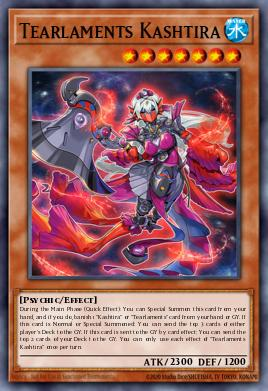
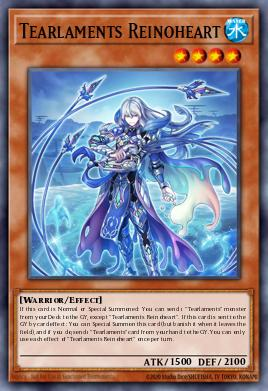
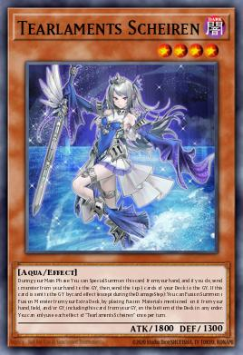
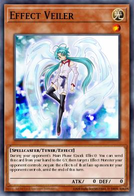

# Tearlaments — Fenrir + Reinoheart + Scheiren → I:P → S:P en turno rival

**Ruta:** `656:A09:FENRIR:REINO:SCHEIREN:IP_SP12` · **Tipo:** preparación defensiva + extensión de Enlace en el turno adversario, **no** fusión garantizada. Se contrapone a `656:A09:FENRIR:REINO:SP_DIRECTA11`: más cartas de mano a cambio de conservar la presión de Fenrir antes de usar I:P.

**Mano inicial exacta del Main:** 1× Kashtira Fenrir (Main2), 1× Tearlaments Reinoheart (Main2), 1× Tearlaments Scheiren (Main1), 1× Effect Veiler/Ocultador de Efectos (Main2, monstruo para enviar al GY, **no se activa**). **Deck:** 1× Tearlaments Kashtira disponible (Main3) si se hará búsqueda de Fenrir; al menos tres cartas para la molienda de Scheiren. **Extra:** I:P Enmascarada 1×, S:P Pequeña Caballera 1×. **Estado:** propio Campo/GY/destierro vacíos; Main Phase propia y Normal disponible; espacio libre para dos enlaces; sin efectos de bloqueo anteriores. Rival sin respuestas durante montaje y con posterior Main Phase disponible para actuar. Las tres cartas enviadas desde la parte superior del Deck por Scheiren son **variables**, no se conocen ni se eligen: en la línea modelo no se activa ningún efecto opcional derivado de esa molienda, y cualquier efecto obligatorio real se resolvería antes de continuar.

## Guía de siete pasos

### 1. Fenrir Especial y búsqueda opcional de Tearlaments Kashtira

 → 

Con Campo propio vacío, Invoca Especialmente a Fenrir. En tu Main Phase, **puedes** activar su búsqueda y añadir **Tearlaments Kashtira** del Deck a la mano si está disponible (contiene «Kashtira» en su nombre). Es una carta conservada en mano, **no** se invoca gratuitamente ni participa en los enlaces. Sin copia en Deck, omitir búsqueda o escoger otro «Kashtira» legal registrado, sin inventar copias.

### 2. Reinoheart Normal, sin desviar el motor de Fusión

 **NORMAL**

Invoca Normalmente a Reinoheart. En esta ruta se **declina su efecto opcional** de enviar un «Tearlaments» del Deck al GY. Reinoheart queda en Campo para formar I:P; no se le atribuye reciclaje por efecto.

### 3. Scheiren Especial: enviar Veiler y moler tres

 →  **AL GY** + **3 CARTAS DE LA PARTE SUPERIOR DEL DECK → GY**

Durante la Main Phase, activa el efecto de **Scheiren** en mano para Invocarla Especialmente. Si se Invoca, **envía** un monstruo de tu mano al GY (aquí Veiler), **después** envía las tres cartas superiores del Deck al GY. Esto es **enviar por efecto, NO «descartar»**; no atribuir un efecto de descarte a Fabled Lurrie si se sustituyera Veiler. No se presupone resultado de la molienda ni una Fusión inmediata. Si se activan o deben resolverse otros efectos por esta molienda, resuélvelos con sus condiciones antes de continuar.

### 4. Reinoheart + Scheiren → I:P, Fenrir permanece

 +  → 

I:P requiere **2 monstruos que no sean de Enlace**: Reinoheart y Scheiren son ambos de Efecto y proceden del Main, por lo que sirven. Se envían al GY como **materiales de Enlace**, no por efecto: no activar las habilidades de Reinoheart/Scheiren que exigen «enviado al GY por efecto de carta». **Fenrir permanece en Campo**. El cementerio contiene Veiler, Reinoheart, Scheiren y las tres cartas molidas.

### 5. Endboard de tu turno: mantener dos opciones

 +  **EN CAMPO** ·  **EN MANO, SI SE BUSCÓ**

**Campo antes del rival:** I:P Link-2 (800 ATK) + Fenrir (2400 ATK), y Tearlaments Kashtira opcional en mano. **Decisión:** conservar Fenrir para aprovechar su efecto ante activación de monstruo rival o convertir ambos a S:P cuando el momento de remover una amenaza sea más útil. No prometer ambas opciones tras gastar Fenrir como material.

### 6. Main Phase rival: I:P + Fenrir → S:P

 +  → 

**Solo durante la Main Phase del adversario**, activa el Efecto Rápido de I:P y, inmediatamente después de resolver, Invoca por Enlace a S:P usando **I:P como un material (valor de Enlace 1 para esta invocación)** y Fenrir como el segundo monstruo de Efecto. Aunque I:P sea Link-2, puede contarse como **1** material de Enlace para hacer exactamente Link-2 con Fenrir. Ambos pasan al GY. S:P queda protegida contra **destrucción por efectos del rival** por haber usado I:P como material; esta protección **no** impide destierro, devolución, negación ni otros tipos de retirada.

### 7. Primer destierro de S:P: ahora sí se puede activar

 **LINK-2 DESDE I:P** → **DESTERRAR 1 CARTA EN CAMPO O GY**

Al ser Invocada por Enlace **con I:P, un monstruo Enlace**, S:P **sí** puede activar su primer efecto: seleccionar una carta del Campo o de cualquier Cementerio y desterrarla si la selección/resolución es legal. Como se usa en turno rival, la restricción de no atacar directamente afecta a tus monstruos ese turno rival; **no** se transforma en una prohibición general de atacar tu siguiente turno. S:P también conserva su efecto rápido potencial ante activaciones posteriores del oponente: dos monstruos boca arriba, incluido uno propio, desterrados hasta End Phase; **no niega**.

## Decisiones e interrupciones

| Caso | Decisión concreta |
|---|---|
| El rival depende de un monstruo que Fenrir puede responder y controlar | Considerar **guardar Fenrir + I:P** antes de gastar ambos en S:P. |
| El rival inicia un combo en su Main Phase y conviene desterrar una pieza o recurso de GY | Activar I:P en ventana legal y convertirla con Fenrir a S:P; **primer destierro de S:P habilitado por material Enlace**. |
| Scheiren es negada o no se resuelve su Invocación | **No afirmar I:P**: faltaría el segundo cuerpo de Main de esta línea. |
| No tienes monstruo adicional para enviar desde mano al activar Scheiren | No iniciar la línea de cuatro cartas como si Scheiren apareciera gratis. |
| Fenrir es retirado antes de que resuelva I:P o se ocupa la zona necesaria | Puede fallar la Invocación Link prevista; el endboard no está garantizado. |
| Los tres envíos aleatorios de Scheiren generan efectos adicionales | Resolver las cadenas efectivas primero; **no** fijar un Cementerio de tres cartas elegidas a voluntad. |

**Dificultad:** media (dos turnos, cadena y Link rating) · **Recursos:** cuatro cartas iniciales, Normal, dos Extra y tres envíos aleatorios de Deck · **Utilidad:** preparar interrupción y decidir entre conservar Fenrir o convertir I:P en S:P con destierro inmediato. No hay OTK ni negación automática.

**Fuentes oficiales:** [Fenrir CID 17768](https://www.db.yugioh-card.com/yugiohdb/card_search.action?cid=17768&ope=2&request_locale=en), [Reinoheart CID 17417](https://www.db.yugioh-card.com/yugiohdb/card_search.action?cid=17417&ope=2&request_locale=en), [Scheiren CID 17415](https://www.db.yugioh-card.com/yugiohdb/card_search.action?cid=17415&ope=2&request_locale=en), [I:P CID 14676](https://www.db.yugioh-card.com/yugiohdb/card_search.action?cid=14676&ope=2&request_locale=en), [S:P CID 19188](https://www.db.yugioh-card.com/yugiohdb/card_search.action?cid=19188&ope=2&request_locale=en), [guía oficial sobre Link Rating](https://www.yugioh-card.com/en/downloads/rulebook/YS17_BG_EN.pdf).

**Estado:** cotejo individual del recorrido base, no garantía de ausencia de respuestas o de una molienda favorable. Se mantiene la composición aprobada de los decks.
