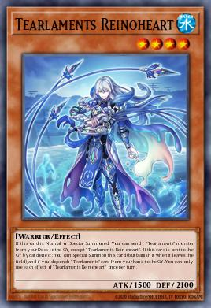

# Tearlaments — Fenrir + Reinoheart → S:P: opción defensiva de dos cartas

**Ruta:** `656:A09:FENRIR:REINO:SP_DIRECTA11` · **Tipo:** interacción básica de acceso a Extra, no combo largo ni OTK. **Objetivo:** disponer de la respuesta rápida de S:P sin depender de que el Cementerio esté cargado.

**Mano mínima real del Main:** Kashtira Fenrir 1× (Main 2x) + Tearlaments Reinoheart 1× (Main 2x). **Extra:** S:P Pequeña Caballera 1×. **Campo propio inicial:** vacío, Invocación Normal disponible, Main Phase, sin bloqueo previo de Extra/Enlace/Tipo OSCURIDAD; sin respuestas rivales durante los pasos iniciales. **Rival:** no necesita controlar monstruos para invocar Fenrir. Para que la interrupción de S:P funcione después, debe activar una carta/efecto y haber dos monstruos boca arriba seleccionables, incluido al menos uno propio.

## Cinco pasos con fotografías

### 1. Fenrir de la mano al Campo, sin gastar Normal

 **ESPECIAL · 2400 ATK**

Como no controlas monstruos, Invoca Especialmente a **Fenrir** de tu mano. **No** necesitas que el rival controle alguno. Este cuerpo de Nivel 7 será material de Enlace, no Xyz. Aquí se omite opcionalmente su efecto de búsqueda para distinguir la línea de dos cartas de variantes que requieren objetivos específicos en Deck.

### 2. Reinoheart ocupa la Invocación Normal

 **NORMAL**

Invoca Normalmente a **Reinoheart** (Guerrero AGUA Nivel 4). Su envío de un «Tearlaments» del Deck al GY es **opcional** y no se utiliza aquí: así evitamos suponer una Fusión o cartas adicionales. Controlas dos monstruos de efecto, Fenrir y Reinoheart.

### 3. Enlace-2 con ambos monstruos

 +  →  **LINK-2**

Envía Fenrir y Reinoheart al GY **como materiales de Enlace** e Invoca S:P del Extra en una zona permitida. **Reinoheart NO fue enviado al GY por efecto de carta**, por lo que su efecto de revivir al ir al GY por efecto **no** se habilita.

### 4. No anunciar el destierro de Invocación de S:P

 **1600 ATK · SIN PRIMER DESTIERRO**

El primer efecto de S:P solo es utilizable si fue Invocada por Enlace **usando como material un monstruo Fusión, Sincronía, Xyz o Enlace**. Ambos monstruos utilizados procedían del Main; por tanto, **esta línea NO destierra una carta al Invocar a S:P**.

### 5. Turno rival: responder en una ventana real

 → **S:P + 1 monstruo rival boca arriba → destierro temporal**

**Campo final propio:** S:P boca arriba, Fenrir y Reinoheart en GY, Normal gastada. Cuando el rival **activa una carta o efecto**, el Efecto Rápido de S:P puede seleccionar **dos monstruos boca arriba del Campo, incluido al menos uno que controles**, por ejemplo S:P y un monstruo del adversario. Los destierra **hasta la End Phase**. **No es negar la activación, destruir ni desterrar definitivamente.** Si falta un objetivo, la respuesta no está garantizada.

## ¿Cuándo NO conviene gastar Fenrir?

| Situación | Decisión razonada |
|---|---|
| El rival amenaza una carta que S:P puede esquivar temporalmente al activar efectos | Considerar S:P con una mano de dos cartas. |
| Puedes aprovechar Fenrir en Campo para su presión de 2400 ATK y destierro boca abajo | **Conservar Fenrir** y mantener Reinoheart como recurso; convertirlos a S:P sacrifica ambos cuerpos. |
| Quieres iniciar el motor Fusión de Tearlaments enviando del Deck al GY | Considerar usar el efecto opcional de Reinoheart **y otra ruta**. Esta guía no acredita Fusión simultánea ni un campo con ambos monstruos y S:P. |
| No hay segunda carta boca arriba que S:P pueda seleccionar | S:P existe, pero **no** prometemos su Efecto Rápido contra un blanco inexistente. |

**Dificultad:** baja · **Recursos:** dos cartas Main y una Normal, un Extra · **Utilidad:** defensa situacional; suele ser un cambio fuerte de recursos por interacción y se recomienda solo cuando ese efecto vale más que Fenrir+Reinoheart en Campo.

**Referencias oficiales:** [Fenrir CID 17768](https://www.db.yugioh-card.com/yugiohdb/card_search.action?cid=17768&ope=2&request_locale=en), [Reinoheart CID 17417](https://www.db.yugioh-card.com/yugiohdb/card_search.action?cid=17417&ope=2&request_locale=en), [S:P CID 19188](https://www.db.yugioh-card.com/yugiohdb/card_search.action?cid=19188&ope=2&request_locale=en).

**Estado:** secuencia individual revisada bajo el estado descrito; no certifica los demás combos de Tearlaments ni justifica aumentar copias de S:P.
