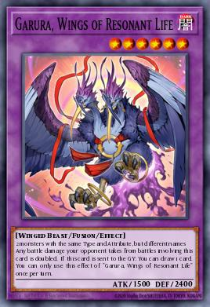
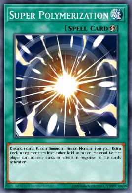

# Tearlaments — Súper Polimerización → Garura (romper campo)

- **Deck ID:** `656` · **Ruta:** `656:A09:SUPERPOLY:GARURA10` · **Clase:** respuesta condicional.
- **Propósito:** usar dos monstruos rivales como materiales para retirar amenazas y obtener una Fusión propia. **No** es una apertura garantizada sin campo rival.
- **Mano mínima:** Súper Polimerización + 1 carta adicional para descartar como coste.
- **Extra propio:** Garura, Alas de Vida Resonante.
- **Campo rival requerido:** al menos 2 monstruos boca arriba con **mismo Tipo y Atributo, pero nombres diferentes**; no se garantiza que un adversario concreto los controle.
- **Ventana:** Main Phase propia (también puede activarse en ventanas legales de Mágicas Rápidas cuando se cumplen sus condiciones); sin efecto previo que impida Fusion Summon ni uso de monstruos de campo.

## Paso 1 — Comprobar los materiales

Identifica **dos monstruos rivales distintos** y comprueba los tres requisitos de Garura: mismo Tipo, mismo Atributo y **nombres diferentes**. Si falla uno, esta línea no existe. No uses cartas de tu mano, Deck o GY como materiales de Súper Polimerización.

## Paso 2 — Activar Súper Polimerización

 → 

Descarta 1 carta de tu mano **como coste de activación**. Selecciona la Fusión que puedas realizar al resolver, y utiliza los dos monstruos rivales válidos del campo como materiales. Ningún jugador puede activar cartas o efectos **en respuesta a la activación** de Súper Polimerización. Esto no significa que Garura sea inmune después de la Invocación.

## Paso 3 — Resolver y construir el campo

Al resolver, los dos monstruos rivales utilizados dejan el campo como materiales de Fusión y Garura se Invoca por Fusión desde tu Extra Deck. Su capacidad de duplicar daño se aplica solo si efectivamente se produce daño de batalla con esta carta. No afirmar daño, destrucción adicional o carta robada automáticamente.

## Campo final sin respuestas previas

| Zona | Estado |
|---|---|
| Monstruos propios | Garura Invocado por Fusión |
| Monstruos rivales | Dos monstruos empleados como materiales ya no están en campo; su destino final depende de reemplazos aplicables |
| Mano propia | 2 cartas consumidas: Súper Polimerización y descarte |
| Cementerio | Súper Polimerización y la carta descartada normalmente en GY, salvo efectos de reemplazo |
| Objetivo logrado | Ruptura de campo condicional + un cuerpo de Fusión propio |

### Cuándo elegirla

- **Ir segundo:** cuando el rival ha dejado dos monstruos que satisfacen exactamente los materiales de Garura.
- **Ir primero:** conservar Súper Polimerización si no hay materiales válidos; no activarla por el mero hecho de tener Garura en Extra.
- **Ante interrupciones:** el descarte se paga incluso si el efecto es negado por una interacción previa legal o el estado cambia antes de resolver; no adjudicar Invocación garantizada.
- **Restricciones propias:** si una jugada Tearlaments o Demoniherrero te restringió las Fusiones o los materiales, volver a comprobar legalidad antes de activar.

**Fuentes oficiales:** [Súper Polimerización CID 7445](https://www.db.yugioh-card.com/yugiohdb/card_search.action?cid=7445&ope=2&request_locale=en); [Garura CID 17746](https://www.db.yugioh-card.com/yugiohdb/card_search.action?cid=17746&ope=2&request_locale=en).

**Integración:** nueva tarjeta por propósito «Romper campo» enlazada desde las modales de Súper Polimerización y Garura. El ejemplo no sustituye ninguna de las nueve rutas históricas de Tearlaments.
