# A10 — Guías visuales documentales · Tearlaments

> Guía documental: utilizar únicamente secuencias con condiciones y restricciones comprobadas.

- Deck ID: `656`. Formato declarado: `TCG`.
- Rutas visualizadas en esta entrega: **9**.
- Los pasos, movimientos y zonas se cotejan con la ficha A09; no asumir respuestas no descritas.
- Un estado desconocido se conserva como no documentado: nunca se inventa.

## ENGRAVER · LACRIMA01 · `656:A09:ENGRAVER:LACRIMA01`

**Propósito competitivo principal (lectura documental):** Preparación de recursos / despliegue. El objetivo solo se acredita si las acciones y el campo final detallados en esta guía lo permiten; no implica legalidad certificada ni garantiza el resultado ante respuestas adversarias.

**Categoría:** APERTURA

**Propósito y resultado documental:**

9. Estado final: Lácrima del Demoniherrero ATK 3000 (2400 + 600), Secuencia y Réquiem equipados ocupan dos zonas M/T; adversarios con monstruos pierden 600 ATK por el efecto continuo de Lácrima. Tracto en GY; Lurrie y ambos Grabador barajados al Deck; Normal sin gastar, mano inicial vacía. No hay dos Enlaces adicionales en zonas de monstruos: ambos son Equipos. Ninguna carta Tiagrimientos ha sido enviada ni fusionada mediante esta línea.

### Mano y estado inicial

Demoniherrero Grabador (20196) solamente. Campo/GY vacíos, Main Phase propia, sin interferencia rival. En Deck quedan al menos Tracto del Demoniherrero (20240), Fabuloso Lurrie (8092) y una segunda copia de Grabador (el inventario contiene 3). Extra disponible: Réquiem (20225), Secuencia (20226), Lácrima del Demoniherrero (20214). No usar cartas de la Reserva ni suponer cartas robadas.

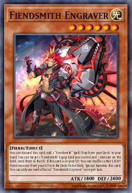 **Demoniherrero Grabador**

### Ejecución numerada

#### Paso 1 — Descartar Grabador de mano al GY como coste para activar su efecto CL1: añadir Tracto desde Deck.

 **DESCARTAR**

**Acción concreta:** Descartar Grabador de mano al GY como coste para activar su efecto CL1: añadir Tracto desde Deck. No Invocar Grabador en este paso.
**Detalle técnico documentado:** No Invocar Grabador en este paso.

**Estado por zonas después del paso:**

| Zona/recurso | Estado narrativo A09 |
|---|---|
| Mano | Tracto #20240 (buscado) |
| Monstruos | ∅ |
| Mágicas y trampas | ∅ |
| Cementerio | Grabador #20196 (copia 1 descartada como coste) |
| Destierro propio | ∅ |
| Campo y estado rival | Sin respuesta; campo no determinado |
| Materiales Xyz/Fusión/Sincro | Ninguno |
| Normal, Extra, fase y restricciones | Normal libre; Extra intacto |

**Campo visual de este paso:**

**Monstruos propios:** sin carta propia demostrada en esta vista.
**Mágicas/Trampas/Campo:** sin carta propia demostrada en esta vista.
*Relación ilustrada de cartas presentes tras este paso, documentada en A09. La posición, materiales, otras zonas y rival se leen en la tabla de estado.*

#### Paso 2 — Activar Tracto, Mágica Normal, CL1: añadir Lurrie (Demonio LUZ Nivel 1) desde Deck a mano y descartarlo al GY durante la resolución.

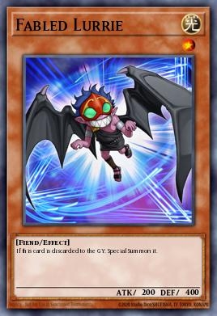 **AÑADIR A MANO**

**Acción concreta:** Activar Tracto, Mágica Normal, CL1: añadir Lurrie (Demonio LUZ Nivel 1) desde Deck a mano y descartarlo al GY durante la resolución. Tracto termina en GY. Como Lurrie fue descartado, puede activar después su propio efecto desde el GY en una nueva cadena y se Invoca Especialmente al Campo.
**Detalle técnico documentado:** Tracto termina en GY. Como Lurrie fue descartado, puede activar después su propio efecto desde el GY en una nueva cadena y se Invoca Especialmente al Campo.

**Estado por zonas después del paso:**

| Zona/recurso | Estado narrativo A09 |
|---|---|
| Mano | ∅ |
| Monstruos | Lurrie #8092 (revivido tras descarte, cadena nueva) |
| Mágicas y trampas | ∅ |
| Cementerio | Grabador #20196 (copia 1), Tracto #20240 (resuelta) |
| Destierro propio | ∅ |
| Campo y estado rival | Sin cambios acreditados |
| Materiales Xyz/Fusión/Sincro | Ninguno |
| Normal, Extra, fase y restricciones | Normal libre; Extra intacto |

**Campo visual de este paso:**

**Monstruos propios:**
-  **Lurrie (revivido tras descarte, cadena nueva)** — zona declarada: `MONSTER`.
**Mágicas/Trampas/Campo:** sin carta propia demostrada en esta vista.
*Relación ilustrada de cartas presentes tras este paso, documentada en A09. La posición, materiales, otras zonas y rival se leen en la tabla de estado.*

#### Paso 3 — Invocar por Enlace Réquiem (Enlace-1) usando Lurrie del Campo como único material Demonio LUZ.

 **ENLACE**

**Acción concreta:** Invocar por Enlace Réquiem (Enlace-1) usando Lurrie del Campo como único material Demonio LUZ. Lurrie vuelve al GY.
**Detalle técnico documentado:** Lurrie vuelve al GY.

**Estado por zonas después del paso:**

| Zona/recurso | Estado narrativo A09 |
|---|---|
| Mano | ∅ |
| Monstruos | Réquiem #20225 (Enlace 1) |
| Mágicas y trampas | ∅ |
| Cementerio | Grabador #20196 (copia 1), Tracto #20240, Lurrie #8092 (material de Enlace) |
| Destierro propio | ∅ |
| Campo y estado rival | Sin cambios acreditados |
| Materiales Xyz/Fusión/Sincro | Ninguno |
| Normal, Extra, fase y restricciones | Normal libre; Réquiem salió del Extra |

**Campo visual de este paso:**

**Monstruos propios:**
- 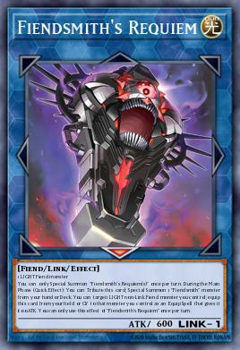 **Réquiem (Enlace 1)** — zona declarada: `MONSTER`.
**Mágicas/Trampas/Campo:** sin carta propia demostrada en esta vista.
*Relación ilustrada de cartas presentes tras este paso, documentada en A09. La posición, materiales, otras zonas y rival se leen en la tabla de estado.*

#### Paso 4 — Durante la Main Phase, activar el Efecto Rápido de Réquiem CL1, Sacrificándolo como coste; al resolver Invocar Especialmente Grabador #2 desde Deck al Campo (ATK 1800).

 **ESPECIAL**

**Acción concreta:** Durante la Main Phase, activar el Efecto Rápido de Réquiem CL1, Sacrificándolo como coste; al resolver Invocar Especialmente Grabador #2 desde Deck al Campo (ATK 1800). Réquiem queda en GY.
**Detalle técnico documentado:** Réquiem queda en GY.

**Estado por zonas después del paso:**

| Zona/recurso | Estado narrativo A09 |
|---|---|
| Mano | ∅ |
| Monstruos | Grabador #20196 (copia 2 desde Deck) |
| Mágicas y trampas | ∅ |
| Cementerio | Grabador #20196 (copia 1), Tracto #20240, Lurrie #8092, Réquiem #20225 (Sacrificado como coste) |
| Destierro propio | ∅ |
| Campo y estado rival | Sin cambios acreditados |
| Materiales Xyz/Fusión/Sincro | Ninguno |
| Normal, Extra, fase y restricciones | Normal libre; Réquiem en GY |

**Campo visual de este paso:**

**Monstruos propios:**
-  **Grabador (copia 2 desde Deck)** — zona declarada: `MONSTER`.
**Mágicas/Trampas/Campo:** sin carta propia demostrada en esta vista.
*Relación ilustrada de cartas presentes tras este paso, documentada en A09. La posición, materiales, otras zonas y rival se leen en la tabla de estado.*

#### Paso 5 — Activar en GY el efecto de Grabador #1 (el que fue descartado), barajando Lurrie de GY al Deck como coste, para Invocarse Especialmente.

 **ACTIVAR** →  **DESCARTAR** → 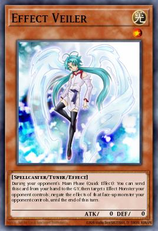 **ESTADO / CONTEXTO**

**Acción concreta:** Activar en GY el efecto de Grabador #1 (el que fue descartado), barajando Lurrie de GY al Deck como coste, para Invocarse Especialmente. Ya hay dos Grabador Nivel 6, ambos Demonio LUZ boca arriba en Campo. Se usaron efectos distintos de Grabador, cada uno una vez.
**Detalle técnico documentado:** Ya hay dos Grabador Nivel 6, ambos Demonio LUZ boca arriba en Campo. Se usaron efectos distintos de Grabador, cada uno una vez.

**Estado por zonas después del paso:**

| Zona/recurso | Estado narrativo A09 |
|---|---|
| Mano | ∅ |
| Monstruos | Grabador #20196 (copia 2), Grabador #20196 (copia 1 revivida) |
| Mágicas y trampas | ∅ |
| Cementerio | Tracto #20240, Réquiem #20225; Lurrie fue barajado al Deck como coste |
| Destierro propio | ∅ |
| Campo y estado rival | Sin cambios acreditados |
| Materiales Xyz/Fusión/Sincro | Ninguno |
| Normal, Extra, fase y restricciones | Normal libre; no se invocó más Extra |

**Campo visual de este paso:**

**Monstruos propios:**
-  **Grabador (copia 2)** — zona declarada: `MONSTER`.
-  **Grabador (copia 1 revivida)** — zona declarada: `MONSTER`.
**Mágicas/Trampas/Campo:** sin carta propia demostrada en esta vista.
*Relación ilustrada de cartas presentes tras este paso, documentada en A09. La posición, materiales, otras zonas y rival se leen en la tabla de estado.*

#### Paso 6 — Usar los dos Grabador como materiales para Invocar por Enlace Secuencia (Enlace-2, material requerido: dos monstruos, entre ellos un Demonio LUZ).

 **MATERIAL**

**Acción concreta:** Usar los dos Grabador como materiales para Invocar por Enlace Secuencia (Enlace-2, material requerido: dos monstruos, entre ellos un Demonio LUZ). Ambos Grabador van al GY; Secuencia ATK 1200 en zona legal del Extra.
**Detalle técnico documentado:** Ambos Grabador van al GY; Secuencia ATK 1200 en zona legal del Extra.

**Estado por zonas después del paso:**

| Zona/recurso | Estado narrativo A09 |
|---|---|
| Mano | ∅ |
| Monstruos | Secuencia #20226 (Enlace 2) |
| Mágicas y trampas | ∅ |
| Cementerio | Tracto #20240, Réquiem #20225, Grabador #20196 (copias 1 y 2, materiales de Enlace) |
| Destierro propio | ∅ |
| Campo y estado rival | Sin cambios acreditados |
| Materiales Xyz/Fusión/Sincro | Ninguno |
| Normal, Extra, fase y restricciones | Normal libre; Secuencia salió del Extra |

**Campo visual de este paso:**

**Monstruos propios:**
- 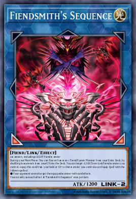 **Secuencia (Enlace 2)** — zona declarada: `MONSTER`.
**Mágicas/Trampas/Campo:** sin carta propia demostrada en esta vista.
*Relación ilustrada de cartas presentes tras este paso, documentada en A09. La posición, materiales, otras zonas y rival se leen en la tabla de estado.*

#### Paso 7 — Activar durante Main Phase el efecto de Secuencia: Invocar por Fusión Lácrima del Demoniherrero usando los dos Grabador del GY como los 2 Demonios LUZ necesarios, barajándolos al Deck.

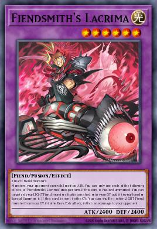 **FUSIÓN** →  **FUSIÓN**

**Acción concreta:** Activar durante Main Phase el efecto de Secuencia: Invocar por Fusión Lácrima del Demoniherrero usando los dos Grabador del GY como los 2 Demonios LUZ necesarios, barajándolos al Deck. Lácrima entra en zona legal ATK 2400. No activar su efecto de recuperación por Invocación de Fusión: el único Demonio LUZ restante en GY es Réquiem (Enlace), que no puede añadirse a la mano y no puede volver a Invocarse Especialmente ese turno porque ya fue Invocado una vez y su texto limita las Invocaciones de Réquiem a una por turno.
**Detalle técnico documentado:** Lácrima entra en zona legal ATK 2400. No activar su efecto de recuperación por Invocación de Fusión: el único Demonio LUZ restante en GY es Réquiem (Enlace), que no puede añadirse a la mano y no puede volver a Invocarse Especialmente ese turno porque ya fue Invocado una vez y su texto limita las Invocaciones de Réquiem a una por turno.

**Estado por zonas después del paso:**

| Zona/recurso | Estado narrativo A09 |
|---|---|
| Mano | ∅ |
| Monstruos | Secuencia #20226 (Enlace 2), Lácrima #20214 (Fusión ATK 2400) |
| Mágicas y trampas | ∅ |
| Cementerio | Tracto #20240, Réquiem #20225; ambos Grabador devueltos al Deck por la Fusión |
| Destierro propio | ∅ |
| Campo y estado rival | Sin cambios acreditados |
| Materiales Xyz/Fusión/Sincro | Ninguno: materiales de Fusión se barajaron al Deck |
| Normal, Extra, fase y restricciones | Normal libre; Secuencia y Lácrima ya salieron del Extra |

**Campo visual de este paso:**

**Monstruos propios:**
-  **Secuencia (Enlace 2)** — zona declarada: `MONSTER`.
-  **Lácrima (Fusión ATK 2400)** — zona declarada: `MONSTER`.
**Mágicas/Trampas/Campo:** sin carta propia demostrada en esta vista.
*Relación ilustrada de cartas presentes tras este paso, documentada en A09. La posición, materiales, otras zonas y rival se leen en la tabla de estado.*

#### Paso 8 — Equipar Secuencia desde el Campo a Lácrima mediante su segundo efecto, que impide al rival seleccionar al monstruo equipado con efectos de cartas.

 **OBJETIVO**

**Acción concreta:** Equipar Secuencia desde el Campo a Lácrima mediante su segundo efecto, que impide al rival seleccionar al monstruo equipado con efectos de cartas. Luego equipar Réquiem desde el GY a Lácrima mediante su propio efecto, que le otorga 600 ATK adicionales.
**Detalle técnico documentado:** Luego equipar Réquiem desde el GY a Lácrima mediante su propio efecto, que le otorga 600 ATK adicionales.

**Estado por zonas después del paso:**

| Zona/recurso | Estado narrativo A09 |
|---|---|
| Mano | ∅ |
| Monstruos | Lácrima #20214 (ATK 3000 por Réquiem equipado) |
| Mágicas y trampas | Secuencia #20226 (Equipo a Lácrima; no seleccionable por efectos rivales), Réquiem #20225 (Equipo a Lácrima; +600 ATK) |
| Cementerio | Tracto #20240 |
| Destierro propio | ∅ |
| Campo y estado rival | Monstruos rivales pierden 600 ATK por efecto continuo de Lácrima; identidades desconocidas |
| Materiales Xyz/Fusión/Sincro | Ninguno |
| Normal, Extra, fase y restricciones | Normal libre; enlaces equipados, no en zona de monstruos |

**Campo visual de este paso:**

**Monstruos propios:**
-  **Lácrima (ATK 3000 por Réquiem equipado)** — zona declarada: `MONSTER`.
**Mágicas/Trampas/Campo:**
-  **Secuencia (Equipo a Lácrima; no seleccionable por efectos rivales)** — zona declarada: `SPELL_TRAP`.
-  **Réquiem (Equipo a Lácrima; +600 ATK)** — zona declarada: `SPELL_TRAP`.
*Relación ilustrada de cartas presentes tras este paso, documentada en A09. La posición, materiales, otras zonas y rival se leen en la tabla de estado.*

#### Paso 9 — Estado final: Lácrima del Demoniherrero ATK 3000 (2400 + 600), Secuencia y Réquiem equipados ocupan dos zonas M/T.

 **RESULTADO** →  **ESTADO / CONTEXTO** →  **ESTADO / CONTEXTO**

**Acción concreta:** Estado final: Lácrima del Demoniherrero ATK 3000 (2400 + 600), Secuencia y Réquiem equipados ocupan dos zonas M/T; adversarios con monstruos pierden 600 ATK por el efecto continuo de Lácrima. Tracto en GY; Lurrie y ambos Grabador barajados al Deck; Normal sin gastar, mano inicial vacía. No hay dos Enlaces adicionales en zonas de monstruos: ambos son Equipos. Ninguna carta Tiagrimientos ha sido enviada ni fusionada mediante esta línea.
**Detalle técnico documentado:** adversarios con monstruos pierden 600 ATK por el efecto continuo de Lácrima. Tracto en GY; Lurrie y ambos Grabador barajados al Deck; Normal sin gastar, mano inicial vacía. No hay dos Enlaces adicionales en zonas de monstruos: ambos son Equipos. Ninguna carta Tiagrimientos ha sido enviada ni fusionada mediante esta línea.

**Estado por zonas después del paso:**

| Zona/recurso | Estado narrativo A09 |
|---|---|
| Mano | ∅ |
| Monstruos | Lácrima #20214 (3000 ATK) |
| Mágicas y trampas | Secuencia #20226 (Equipo), Réquiem #20225 (Equipo) |
| Cementerio | Tracto #20240; Lurrie y dos Grabador devueltos al Deck |
| Destierro propio | ∅ |
| Campo y estado rival | Reducción continua de 600 ATK a monstruos rivales si existen |
| Materiales Xyz/Fusión/Sincro | Ninguno |
| Normal, Extra, fase y restricciones | Normal libre; ninguna carta Tiagrimientos usada |

**Campo visual de este paso:**

**Monstruos propios:**
-  **Lácrima (3000 ATK)** — zona declarada: `MONSTER`.
**Mágicas/Trampas/Campo:**
-  **Secuencia (Equipo)** — zona declarada: `SPELL_TRAP`.
-  **Réquiem (Equipo)** — zona declarada: `SPELL_TRAP`.
*Relación ilustrada de cartas presentes tras este paso, documentada en A09. La posición, materiales, otras zonas y rival se leen en la tabla de estado.*

### Campo final documentado

Esta vista procede **del último paso**, no de una lista de cartas deducida del título.

**Monstruos propios:**
-  **Lácrima (3000 ATK)** — zona declarada: `MONSTER`.
**Mágicas/Trampas/Campo:**
-  **Secuencia (Equipo)** — zona declarada: `SPELL_TRAP`.
-  **Réquiem (Equipo)** — zona declarada: `SPELL_TRAP`.
*Relación ilustrada de cartas presentes tras este paso, documentada en A09. La posición, materiales, otras zonas y rival se leen en la tabla de estado.*

| Zona/recurso | Estado final documentado |
|---|---|
| Mano | ∅ |
| Monstruos | Lácrima #20214 (3000 ATK) |
| Mágicas y trampas | Secuencia #20226 (Equipo), Réquiem #20225 (Equipo) |
| Cementerio | Tracto #20240; Lurrie y dos Grabador devueltos al Deck |
| Destierro propio | ∅ |
| Campo y estado rival | Reducción continua de 600 ATK a monstruos rivales si existen |
| Materiales Xyz/Fusión/Sincro | Ninguno |
| Normal, Extra, fase y restricciones | Normal libre; ninguna carta Tiagrimientos usada |

### Si el oponente interrumpe

- **INTERRUPCIÓN A12 — paso sin anclaje confirmado: A12 — Cuatro cortes sobre la ruta Demoniherrero de una carta**
  - 1. Ash al Grabador inicial (A): Grabador se descarta como coste al GY para buscar Tracto del Deck, CL1. Rival descarta Flor de Ceniza CL2 (buscador desde Deck); CL2 niega la búsqueda. Grabador permanece GY, no existe Tracto en mano, Lurrie permanece Deck y no se puede seguir la ruta de una carta.
  - 2. Ash a Tracto (B): dejar resolver búsqueda inicial de Grabador. Activar Tracto CL1 que pretende añadir Lurrie desde Deck y luego descartarlo; adversario responde con Flor de Ceniza CL2. Al negarse el efecto no se añade ni descarta Lurrie; Tracto va GY, Grabador ya estaba GY y no hay cuerpo para Réquiem. No se activa el disparo de Lurrie por un descarte inexistente.
  - 3. Ash al Réquiem (C): dejar resolver Tracto, Lurrie y Enlace-1. Réquiem activa su Efecto Rápido CL1 Sacrificándose como coste para Invocar Grabador desde Deck; rival descarta Flor de Ceniza CL2. El efecto es negado, no aparece Grabador #2; Réquiem y Lurrie están GY, igual que Grabador #1 y Tracto. La recuperación posible con Grabador #1 se documenta en A13.
  - 4. Effect Veiler a Secuencia (D): se deja resolver toda la ruta hasta Secuencia Enlace-2 boca arriba en Main Phase, con dos Grabador en GY y Réquiem en GY. Secuencia activa su efecto CL1 para Fusión; el rival envía Effect Veiler de mano al GY como coste y la selecciona CL2. Al resolverse, Secuencia queda negada hasta la End Phase, no se Invoca Lácrima y sus dos materiales siguen GY. Secuencia permanece en Campo ATK 1200. No crear la Fusión ni equipar una Secuencia ya negada.
  - Pruebas negativas: Flor de Ceniza no niega la Invocación de Lurrie desde GY, la Invocación de Grabador desde GY, ni la Fusión de Secuencia que baraja materiales desde GY (no Special Summon desde Deck, ni envío desde Deck al GY). Los cuatro ensayos A/B/C/D son alternativos, con carta rival definida; no presuponen cuatro interrupciones simultáneas. Flor de Ceniza oficial, Effect Veiler oficial.;.
  - Estado de rama: `Resuelto solo en el escenario que detalla A12/A13; las otras respuestas no están demostradas.`.
- **RECUPERACIÓN A13 — paso sin anclaje confirmado: A13 — Ramas exactas del motor Demoniherrero**
  - 1. Ash a búsqueda inicial (A): Grabador (coste) queda GY, mano vacía, Tracto/Lurrie en Deck. Sin otro Demonio LUZ en GY no puede utilizar su efecto de reanimación. Campo final vacío; sin continuación demostrada.
  - 2. Ash a Tracto (B): Grabador y Tracto en GY, Lurrie no fue descartado, campo vacío. Grabador sigue sin otro Demonio LUZ en GY que barajar para Invocarse. Sin continuación demostrada.
  - 3. Ash a Réquiem (C): Réquiem fue Sacrificado como coste; permanecen Lurrie y Grabador #1 en GY. Grabador puede barajar Lurrie del GY al Deck como coste e Invocarse al Campo. Después, el efecto no usado de Réquiem desde GY puede equiparse a Grabador, Demonio LUZ no-Enlace, aportándole +600 ATK. Tablero de recuperación: Grabador ATK 2400 (1800 + 600), Réquiem como Equipo, Tracto GY, Lurrie Deck, Normal libre; no hay Secuencia ni Lácrima. No activar un segundo uso del efecto de GY de Grabador por copia en ese mismo turno.
  - 4. Effect Veiler a Secuencia (D): Secuencia permanece boca arriba con sus efectos negados ese turno; Grabador #1 y #2 siguen GY, Réquiem GY y Lurrie Deck. El efecto de GY de Grabador ya fue usado antes por su nombre en esta misma ruta y no puede repetirse con la segunda copia. Tracto desde GY solo Fusiona usando materiales en mano o Campo, y la mano está vacía. No hay Lácrima ni recuperación adicional probada.
  - Estas ramas describen resultados legales, no una tasa de victoria ni un catálogo exhaustivo.;.
  - Estado de rama: `Resuelto solo en el escenario que detalla A12/A13; las otras respuestas no están demostradas.`.

---

## REINO · SCHEIREN · KALEIDO01 · `656:A09:REINO:SCHEIREN:KALEIDO01`

**Propósito competitivo principal (lectura documental):** Ofensivo condicional. El objetivo solo se acredita si las acciones y el campo final detallados en esta guía lo permiten; no implica legalidad certificada ni garantiza el resultado ante respuestas adversarias.

**Categoría:** APERTURA

**Propósito y resultado documental:**

Endboard sin respuesta: Kaleido-Heart 3000 ATK / 3000 DEF en Zona de Monstruos propia, Normal gastada. Reinoheart, Scheiren y Havnis en la parte inferior del Deck; GY propio sin esos tres materiales; mano inicial consumida. Si el rival tenía objetivo legal y nada responde, una carta rival fue barajada al Deck, no destruida ni desterrada; daño causado 0 LP, sin negación inherente por esa secuencia. No hay otras Fusiones ni monstruos Tiagrimientos en Campo. Vulnerabilidades: negar el envío de Reinoheart, desplazar Havnis antes de la Fusión, negar el disparador de Scheiren o impedir la Invocación Fusión; tratar en A12–A13.;.

### Mano y estado inicial

Reinoheart en mano, Havnis previamente en GY, Scheiren en Deck y Kaleido-Heart disponible en Extra; Main Phase propia, Normal libre y rival sin responder.

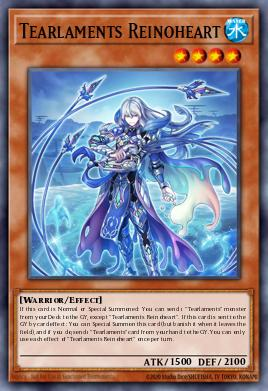 **Tiagrimientos Reinoheart**

### Ejecución numerada

#### Paso 1 — Invocar Normalmente Reinoheart en posición de Ataque, Nivel 4 Guerrero/AGUA.

 **NORMAL**

**Acción concreta:** Invocar Normalmente Reinoheart en posición de Ataque, Nivel 4 Guerrero/AGUA.
**Detalle técnico documentado:** Reinoheart pasa mano→Campo; consume Normal. Su Invocación habilita su efecto de enviar Tiagrimientos del Deck en cadena nueva.

**Estado por zonas después del paso:**

| Zona/recurso | Estado narrativo A09 |
|---|---|
| Mano | ∅ |
| Monstruos | Reinoheart #17417 (Normal, 1500 ATK) |
| Mágicas y trampas | ∅ |
| Cementerio | Havnis #17416 (recurso previo) |
| Destierro propio | ∅ |
| Campo y estado rival | Sin respuesta; objetivo opcional desconocido |
| Materiales Xyz/Fusión/Sincro | Ninguno |
| Normal, Extra, fase y restricciones | Normal gastada; Extra intacto |

**Campo visual de este paso:**

**Monstruos propios:**
-  **Reinoheart (Normal, 1500 ATK)** — zona declarada: `MONSTER`.
**Mágicas/Trampas/Campo:** sin carta propia demostrada en esta vista.
*Relación ilustrada de cartas presentes tras este paso, documentada en A09. La posición, materiales, otras zonas y rival se leen en la tabla de estado.*

#### Paso 2 — Activar el efecto de Reinoheart CL1; al resolver enviar Scheiren del Deck al GY por efecto (no como coste).

 **ACTIVAR** → 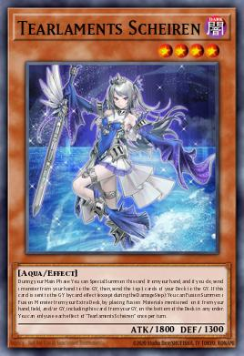 **ENVIAR**

**Acción concreta:** Activar el efecto de Reinoheart CL1; al resolver enviar Scheiren del Deck al GY por efecto (no como coste).
**Detalle técnico documentado:** Reinoheart sigue en Campo; Scheiren está en GY. Se abre el disparador propio de Scheiren después de acabar esa cadena, no como CL2 de Reinoheart.

**Estado por zonas después del paso:**

| Zona/recurso | Estado narrativo A09 |
|---|---|
| Mano | ∅ |
| Monstruos | Reinoheart #17417 |
| Mágicas y trampas | ∅ |
| Cementerio | Havnis #17416 (previa), Scheiren #17415 (enviada por efecto desde Deck) |
| Destierro propio | ∅ |
| Campo y estado rival | Sin cambios acreditados |
| Materiales Xyz/Fusión/Sincro | Ninguno |
| Normal, Extra, fase y restricciones | Normal gastada; Extra intacto |

**Campo visual de este paso:**

**Monstruos propios:**
-  **Reinoheart** — zona declarada: `MONSTER`.
**Mágicas/Trampas/Campo:** sin carta propia demostrada en esta vista.
*Relación ilustrada de cartas presentes tras este paso, documentada en A09. La posición, materiales, otras zonas y rival se leen en la tabla de estado.*

#### Paso 3 — Activar el efecto de Fusión de Scheiren desde GY en cadena posterior, usando Scheiren en GY + Havnis en GY + Reinoheart en Campo como los tres materiales de Reinoheart + 2 Aqua.

 **ACTIVAR** →  **YA EN CAMPO** → 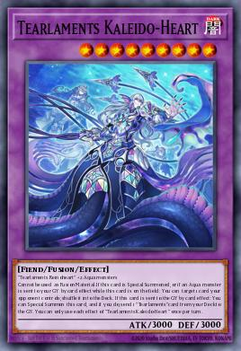 **FUSIÓN**

**Acción concreta:** Activar el efecto de Fusión de Scheiren desde GY en cadena posterior, usando Scheiren en GY + Havnis en GY + Reinoheart en Campo como los tres materiales de Reinoheart + 2 Aqua.
**Detalle técnico documentado:** Durante la resolución poner las tres cartas en la parte inferior del Deck, en el orden legal elegido, e Invocar por Fusión Kaleido-Heart desde Extra en Ataque. Reinoheart ya no está en Campo, Scheiren y Havnis ya no están en GY.

**Estado por zonas después del paso:**

| Zona/recurso | Estado narrativo A09 |
|---|---|
| Mano | ∅ |
| Monstruos | Kaleido-Heart #17445 (Fusión, 3000 ATK) |
| Mágicas y trampas | ∅ |
| Cementerio | ∅; Reinoheart, Havnis, Scheiren fueron al fondo del Deck, NO al GY |
| Destierro propio | ∅ |
| Campo y estado rival | Sin cambios acreditados |
| Materiales Xyz/Fusión/Sincro | Ninguno: materiales de Fusión devueltos al Deck |
| Normal, Extra, fase y restricciones | Normal gastada; Kaleido-Heart salió del Extra |

**Campo visual de este paso:**

**Monstruos propios:**
-  **Kaleido-Heart (Fusión, 3000 ATK)** — zona declarada: `MONSTER`.
**Mágicas/Trampas/Campo:** sin carta propia demostrada en esta vista.
*Relación ilustrada de cartas presentes tras este paso, documentada en A09. La posición, materiales, otras zonas y rival se leen en la tabla de estado.*

#### Paso 4 — Si el rival controla una carta seleccionable y que puede barajarse, el efecto disparado de Kaleido-Heart al ser Invocado Especialmente puede seleccionar 1 carta del rival y barajarla al Deck en nueva cadena.

 **OBJETIVO**

**Acción concreta:** Si el rival controla una carta seleccionable y que puede barajarse, el efecto disparado de Kaleido-Heart al ser Invocado Especialmente puede seleccionar 1 carta del rival y barajarla al Deck en nueva cadena.
**Detalle técnico documentado:** Solo si había objetivo legal y la activación resuelve. Si el rival no tiene carta válida, no atribuir remoción. No afirmar otras activaciones por el Aqua devuelto: devolver material al fondo del Deck no es enviarlo al GY.

**Estado por zonas después del paso:**

| Zona/recurso | Estado narrativo A09 |
|---|---|
| Mano | ∅ |
| Monstruos | Kaleido-Heart #17445 (3000 ATK) |
| Mágicas y trampas | ∅ |
| Cementerio | ∅ |
| Destierro propio | ∅ |
| Campo y estado rival | Solo si existió objetivo válido se barajó una carta rival al Deck; no se presume destrucción |
| Materiales Xyz/Fusión/Sincro | Ninguno |
| Normal, Extra, fase y restricciones | Normal gastada; Extra usado para Kaleido |

**Campo visual de este paso:**

**Monstruos propios:**
-  **Kaleido-Heart (3000 ATK)** — zona declarada: `MONSTER`.
**Mágicas/Trampas/Campo:** sin carta propia demostrada en esta vista.
*Relación ilustrada de cartas presentes tras este paso, documentada en A09. La posición, materiales, otras zonas y rival se leen en la tabla de estado.*

### Campo final documentado

Esta vista procede **del último paso**, no de una lista de cartas deducida del título.

**Monstruos propios:**
-  **Kaleido-Heart (3000 ATK)** — zona declarada: `MONSTER`.
**Mágicas/Trampas/Campo:** sin carta propia demostrada en esta vista.
*Relación ilustrada de cartas presentes tras este paso, documentada en A09. La posición, materiales, otras zonas y rival se leen en la tabla de estado.*

| Zona/recurso | Estado final documentado |
|---|---|
| Mano | ∅ |
| Monstruos | Kaleido-Heart #17445 (3000 ATK) |
| Mágicas y trampas | ∅ |
| Cementerio | ∅ |
| Destierro propio | ∅ |
| Campo y estado rival | Solo si existió objetivo válido se barajó una carta rival al Deck; no se presume destrucción |
| Materiales Xyz/Fusión/Sincro | Ninguno |
| Normal, Extra, fase y restricciones | Normal gastada; Extra usado para Kaleido |

### Si el oponente interrumpe

- **INTERRUPCIÓN A12 — paso 2: A12 — Ash a Reinoheart en paso P2 de REINO:SCHEIREN:KALEIDO01**
  - Estado: Reinoheart fue Invocado Normalmente en P1, Havnis ya estaba en GY; al iniciar P2, Reinoheart CL1 pretende enviar Scheiren desde Deck al GY por efecto. El rival, con Ash en mano, descarta Ash como CL2: la negación impide el envío, no la Invocación Normal anterior.
  - Corte: Reinoheart sigue en Campo 1500 ATK, Havnis permanece GY y Scheiren sigue en Deck. No se desencadena la Fusión de Scheiren. Reinoheart, Ash..
  - Estado de rama: `Resuelto solo en el escenario que detalla A12/A13; las otras respuestas no están demostradas.`.
- **RECUPERACIÓN A13 — paso 2: A13 — Reinoheart y Havnis tras Ash en paso P2 de REINO:SCHEIREN:KALEIDO01**
  - Residual A12: Reinoheart 1500 ATK en Campo, Normal gastada, Havnis preparada en GY desde antes del turno, Scheiren en Deck, mano mínima vacía, Extra intacto. Sin Scheiren en GY no existe el disparo necesario para esa Fusión; SIN_CONTINUACION_DEMOSTRADA_CON_MANO_MINIMA. Havnis no se devuelve al Deck por una Fusión que nunca ocurrió.
  - Estado de rama: `Resuelto solo en el escenario que detalla A12/A13; las otras respuestas no están demostradas.`.

---

## REINO · MERRLI · KALEIDO01 · `656:A09:REINO:MERRLI:KALEIDO01`

**Propósito competitivo principal (lectura documental):** Ofensivo condicional. El objetivo solo se acredita si las acciones y el campo final detallados en esta guía lo permiten; no implica legalidad certificada ni garantiza el resultado ante respuestas adversarias.

**Categoría:** APERTURA

**Propósito y resultado documental:**

Resultado: Kaleido-Heart ATK 3000 / DEF 3000, Normal usada, Reinoheart + Merrli + Havnis devueltos al fondo. La otra copia de Scheiren, si permanece en Deck, no fue utilizada. Retirada rival condicional y 0 daño automático. Distinción útil: consume la única Merrli de la lista en vez de la única Scheiren; por tanto recursos posteriores, efectos ya usados y respuestas difieren. Es una variante separada por materiales, no una duplicación del mismo procedimiento.;.

### Mano y estado inicial

Reinoheart en mano, Havnis previamente en GY, Merrli en Deck y Kaleido-Heart en Extra; mismo estado inicial, variante excluyente de Scheiren.

 **Tiagrimientos Reinoheart**

### Ejecución numerada

#### Paso 1 — Normal Summon Reinoheart y activar su efecto CL1 para enviar Merrli desde Deck al GY por efecto.

 **NORMAL** → 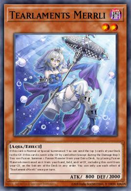 **NORMAL**

**Acción concreta:** Normal Summon Reinoheart y activar su efecto CL1 para enviar Merrli desde Deck al GY por efecto.
**Detalle técnico documentado:** No documentado

**Estado por zonas después del paso:**

| Zona/recurso | Estado narrativo A09 |
|---|---|
| Mano | ∅ |
| Monstruos | Reinoheart #17417 (Normal) |
| Mágicas y trampas | ∅ |
| Cementerio | Havnis #17416 (previa), Merrli #17414 (enviada por efecto desde Deck) |
| Destierro propio | ∅ |
| Campo y estado rival | Sin respuesta; objetivo opcional desconocido |
| Materiales Xyz/Fusión/Sincro | Ninguno |
| Normal, Extra, fase y restricciones | Normal gastada; Extra intacto |

**Campo visual de este paso:**

**Monstruos propios:**
-  **Reinoheart (Normal)** — zona declarada: `MONSTER`.
**Mágicas/Trampas/Campo:** sin carta propia demostrada en esta vista.
*Relación ilustrada de cartas presentes tras este paso, documentada en A09. La posición, materiales, otras zonas y rival se leen en la tabla de estado.*

#### Paso 2 — Tras resolver, activar en cadena nueva el efecto de Merrli en GY.

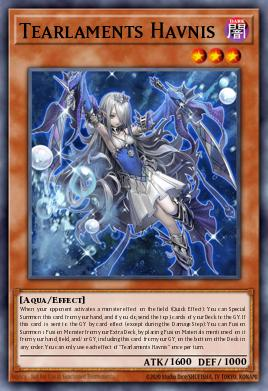 **ESTADO / CONTEXTO** →  **MATERIAL XYZ** →  **MATERIAL XYZ**

**Acción concreta:** Tras resolver, activar en cadena nueva el efecto de Merrli en GY; durante su resolución poner Merrli (GY) + Havnis (GY) + Reinoheart (Campo) en la parte inferior del Deck como materiales Reinoheart + 2 Aqua, e Invocar Kaleido-Heart por Fusión desde Extra.
**Detalle técnico documentado:** durante su resolución poner Merrli (GY) + Havnis (GY) + Reinoheart (Campo) en la parte inferior del Deck como materiales Reinoheart + 2 Aqua, e Invocar Kaleido-Heart por Fusión desde Extra.

**Estado por zonas después del paso:**

| Zona/recurso | Estado narrativo A09 |
|---|---|
| Mano | ∅ |
| Monstruos | Kaleido-Heart #17445 (3000 ATK) |
| Mágicas y trampas | ∅ |
| Cementerio | ∅; Reinoheart, Merrli, Havnis ahora en fondo del Deck |
| Destierro propio | ∅ |
| Campo y estado rival | Sin cambios acreditados |
| Materiales Xyz/Fusión/Sincro | Ninguno: materiales de Fusión regresaron al Deck |
| Normal, Extra, fase y restricciones | Normal gastada; Kaleido desde Extra |

**Campo visual de este paso:**

**Monstruos propios:**
-  **Kaleido-Heart (3000 ATK)** — zona declarada: `MONSTER`.
**Mágicas/Trampas/Campo:** sin carta propia demostrada en esta vista.
*Relación ilustrada de cartas presentes tras este paso, documentada en A09. La posición, materiales, otras zonas y rival se leen en la tabla de estado.*

#### Paso 3 — Si existe objetivo rival legal, activar el efecto de Kaleido-Heart disparado por su Invocación Especial para barajar 1 carta rival al Deck; si no, dejar únicamente el monstruo Fusión.

 **OBJETIVO**

**Acción concreta:** Si existe objetivo rival legal, activar el efecto de Kaleido-Heart disparado por su Invocación Especial para barajar 1 carta rival al Deck; si no, dejar únicamente el monstruo Fusión. No añadir cartas a mano ni contar sus materiales como si siguieran en GY.
**Detalle técnico documentado:** No añadir cartas a mano ni contar sus materiales como si siguieran en GY.

**Estado por zonas después del paso:**

| Zona/recurso | Estado narrativo A09 |
|---|---|
| Mano | ∅ |
| Monstruos | Kaleido-Heart #17445 |
| Mágicas y trampas | ∅ |
| Cementerio | ∅ |
| Destierro propio | ∅ |
| Campo y estado rival | Solo con objetivo rival legal se baraja 1 carta del rival al Deck; sin objetivo no hay remoción |
| Materiales Xyz/Fusión/Sincro | Ninguno |
| Normal, Extra, fase y restricciones | Normal gastada; no hubo segunda Fusión |

**Campo visual de este paso:**

**Monstruos propios:**
-  **Kaleido-Heart** — zona declarada: `MONSTER`.
**Mágicas/Trampas/Campo:** sin carta propia demostrada en esta vista.
*Relación ilustrada de cartas presentes tras este paso, documentada en A09. La posición, materiales, otras zonas y rival se leen en la tabla de estado.*

### Campo final documentado

Esta vista procede **del último paso**, no de una lista de cartas deducida del título.

**Monstruos propios:**
-  **Kaleido-Heart** — zona declarada: `MONSTER`.
**Mágicas/Trampas/Campo:** sin carta propia demostrada en esta vista.
*Relación ilustrada de cartas presentes tras este paso, documentada en A09. La posición, materiales, otras zonas y rival se leen en la tabla de estado.*

| Zona/recurso | Estado final documentado |
|---|---|
| Mano | ∅ |
| Monstruos | Kaleido-Heart #17445 |
| Mágicas y trampas | ∅ |
| Cementerio | ∅ |
| Destierro propio | ∅ |
| Campo y estado rival | Solo con objetivo rival legal se baraja 1 carta del rival al Deck; sin objetivo no hay remoción |
| Materiales Xyz/Fusión/Sincro | Ninguno |
| Normal, Extra, fase y restricciones | Normal gastada; no hubo segunda Fusión |

### Si el oponente interrumpe

- **INTERRUPCIÓN A12 — paso 1: A12 — Ash a Reinoheart en paso P1 de REINO:MERRLI:KALEIDO01**
  - CL1: el disparo de Reinoheart tras su Normal quiere enviar Merrli desde Deck a GY. CL2 Ash, descartada por el rival, niega el envío. La Normal no se restaura, Havnis inicial no sale del GY y Merrli nunca entró al GY para activar su Fusión. No se Invoca Kaleido-Heart desde esta mano mínima..
  - Estado de rama: `Resuelto solo en el escenario que detalla A12/A13; las otras respuestas no están demostradas.`.
- **RECUPERACIÓN A13 — paso 1: A13 — Reinoheart sin Merrli en paso P1 de REINO:MERRLI:KALEIDO01**
  - Residual A12: Reinoheart 1500 ATK propio, Normal gastada, Havnis inicial GY, Merrli en Deck. No hay segundo material Aqua ni disparo de Merrli al GY; Kaleido-Heart sigue Extra y no se barajó carta rival. SIN_CONTINUACION_DEMOSTRADA_CON_MANO_MINIMA.
  - Estado de rama: `Resuelto solo en el escenario que detalla A12/A13; las otras respuestas no están demostradas.`.

---

## REINO · SCHEIREN · HAVNIS HAND01 · `656:A09:REINO:SCHEIREN:HAVNIS_HAND01`

**Propósito competitivo principal (lectura documental):** Ofensivo condicional. El objetivo solo se acredita si las acciones y el campo final detallados en esta guía lo permiten; no implica legalidad certificada ni garantiza el resultado ante respuestas adversarias.

**Categoría:** APERTURA

**Propósito y resultado documental:**

Endboard: Kaleido-Heart 3000 ATK / 3000 DEF; Reinoheart, Havnis y Scheiren al fondo del Deck, sin esos materiales en Campo/GY/mano; Normal gastada, 0 daño automático, sin otros efectos de Havnis disparados (fue devuelta del área de mano al Deck como material). Esta variante tiene un recurso inicial en mano y ninguna preparación previa de GY, por lo que no se fusiona con REINO:SCHEIREN:KALEIDO01.;.

### Mano y estado inicial

Reinoheart Reinoheart + Havnis Havnis. Deck: Scheiren Scheiren disponible; Extra: Kaleido Kaleido-Heart. Campo y GY propios vacíos, Normal libre, Main Phase propia, sin bloqueos ni respuestas. Un objetivo rival seleccionable es opcional para la remoción.

 **Tiagrimientos Reinoheart**
 **Tiagrimientos Havnis**

### Ejecución numerada

#### Paso 1 — Normal Summon Reinoheart (mano→Campo), Normal gastada; activar CL1 su envío desde Deck y resolver Scheiren Deck→GY por efecto.

 **NORMAL** →  **ACTIVAR**

**Acción concreta:** Normal Summon Reinoheart (mano→Campo), Normal gastada; activar CL1 su envío desde Deck y resolver Scheiren Deck→GY por efecto.
**Detalle técnico documentado:** No documentado

**Estado por zonas después del paso:**

| Zona/recurso | Estado narrativo A09 |
|---|---|
| Mano | Havnis #17416 |
| Monstruos | Reinoheart #17417 (Normal) |
| Mágicas y trampas | ∅ |
| Cementerio | Scheiren #17415 (enviada desde Deck por efecto) |
| Destierro propio | ∅ |
| Campo y estado rival | Sin respuesta; objetivo opcional indeterminado |
| Materiales Xyz/Fusión/Sincro | Ninguno |
| Normal, Extra, fase y restricciones | Normal gastada; Extra intacto |

**Campo visual de este paso:**

**Monstruos propios:**
-  **Reinoheart (Normal)** — zona declarada: `MONSTER`.
**Mágicas/Trampas/Campo:** sin carta propia demostrada en esta vista.
*Relación ilustrada de cartas presentes tras este paso, documentada en A09. La posición, materiales, otras zonas y rival se leen en la tabla de estado.*

#### Paso 2 — En una cadena posterior, activar Scheiren desde GY y elegir como materiales Scheiren (GY) + Reinoheart (Campo) + Havnis (mano).

 **MATERIAL XYZ** →  **MATERIAL XYZ** →  **FUSIÓN**

**Acción concreta:** En una cadena posterior, activar Scheiren desde GY y elegir como materiales Scheiren (GY) + Reinoheart (Campo) + Havnis (mano). Son exactamente Reinoheart + dos Aqua (Scheiren y Havnis). Poner los tres materiales en la parte inferior del Deck en la resolución, sin enviar Havnis al GY primero; Invocar por Fusión Kaleido-Heart del Extra.
**Detalle técnico documentado:** Son exactamente Reinoheart + dos Aqua (Scheiren y Havnis). Poner los tres materiales en la parte inferior del Deck en la resolución, sin enviar Havnis al GY primero; Invocar por Fusión Kaleido-Heart del Extra.

**Estado por zonas después del paso:**

| Zona/recurso | Estado narrativo A09 |
|---|---|
| Mano | ∅ |
| Monstruos | Kaleido-Heart #17445 (3000 ATK) |
| Mágicas y trampas | ∅ |
| Cementerio | ∅; Scheiren, Havnis y Reinoheart devueltos al fondo del Deck |
| Destierro propio | ∅ |
| Campo y estado rival | Sin cambios acreditados |
| Materiales Xyz/Fusión/Sincro | Ninguno: Fusión devuelve 3 materiales al Deck |
| Normal, Extra, fase y restricciones | Normal gastada; Kaleido desde Extra |

**Campo visual de este paso:**

**Monstruos propios:**
-  **Kaleido-Heart (3000 ATK)** — zona declarada: `MONSTER`.
**Mágicas/Trampas/Campo:** sin carta propia demostrada en esta vista.
*Relación ilustrada de cartas presentes tras este paso, documentada en A09. La posición, materiales, otras zonas y rival se leen en la tabla de estado.*

#### Paso 3 — Si hay una carta rival legal, el disparo de Kaleido al ser Invocado Especialmente puede seleccionarla y barajarla al Deck en cadena nueva.

 **ESTADO / CONTEXTO**

**Acción concreta:** Si hay una carta rival legal, el disparo de Kaleido al ser Invocado Especialmente puede seleccionarla y barajarla al Deck en cadena nueva; de otro modo, dejar el monstruo Fusión sin retirada.
**Detalle técnico documentado:** de otro modo, dejar el monstruo Fusión sin retirada.

**Estado por zonas después del paso:**

| Zona/recurso | Estado narrativo A09 |
|---|---|
| Mano | ∅ |
| Monstruos | Kaleido-Heart #17445 |
| Mágicas y trampas | ∅ |
| Cementerio | ∅ |
| Destierro propio | ∅ |
| Campo y estado rival | Remoción por barajar 1 carta rival solo si había objetivo legal |
| Materiales Xyz/Fusión/Sincro | Ninguno |
| Normal, Extra, fase y restricciones | Normal gastada; no otra Fusión |

**Campo visual de este paso:**

**Monstruos propios:**
-  **Kaleido-Heart** — zona declarada: `MONSTER`.
**Mágicas/Trampas/Campo:** sin carta propia demostrada en esta vista.
*Relación ilustrada de cartas presentes tras este paso, documentada en A09. La posición, materiales, otras zonas y rival se leen en la tabla de estado.*

### Campo final documentado

Esta vista procede **del último paso**, no de una lista de cartas deducida del título.

**Monstruos propios:**
-  **Kaleido-Heart** — zona declarada: `MONSTER`.
**Mágicas/Trampas/Campo:** sin carta propia demostrada en esta vista.
*Relación ilustrada de cartas presentes tras este paso, documentada en A09. La posición, materiales, otras zonas y rival se leen en la tabla de estado.*

| Zona/recurso | Estado final documentado |
|---|---|
| Mano | ∅ |
| Monstruos | Kaleido-Heart #17445 |
| Mágicas y trampas | ∅ |
| Cementerio | ∅ |
| Destierro propio | ∅ |
| Campo y estado rival | Remoción por barajar 1 carta rival solo si había objetivo legal |
| Materiales Xyz/Fusión/Sincro | Ninguno |
| Normal, Extra, fase y restricciones | Normal gastada; no otra Fusión |

### Si el oponente interrumpe

- **INTERRUPCIÓN A12 — paso 1: A12 — Ash a Reinoheart en paso P1 de REINO:SCHEIREN:HAVNIS_HAND01**
  - Reinoheart + Havnis son las dos cartas iniciales de mano, GY vacío. Tras Normal de Reinoheart, su envío de Scheiren Deck→GY es CL1; Ash CL2 lo niega. Havnis conserva su ubicación en mano y Reinoheart permanece en Campo; no se envió material Aqua al GY ni se activa la Fusión de Scheiren..
  - Estado de rama: `Resuelto solo en el escenario que detalla A12/A13; las otras respuestas no están demostradas.`.
- **RECUPERACIÓN A13 — paso 1: A13 — Reinoheart y Havnis de mano en paso P1 de REINO:SCHEIREN:HAVNIS_HAND01**
  - Residual A12: Reinoheart propio boca arriba, Normal gastada, Havnis en mano (no en GY), Scheiren en Deck, GY propio vacío y Kaleido Extra. El recurso de mano no constituye por sí solo un disparo de Fusión, y no se inventa un descarte. SIN_CONTINUACION_DEMOSTRADA_CON_MANO_MINIMA.
  - Estado de rama: `Resuelto solo en el escenario que detalla A12/A13; las otras respuestas no están demostradas.`.

---

## REINO · MERRLI · SCHEIREN HAND01 · `656:A09:REINO:MERRLI:SCHEIREN_HAND01`

**Propósito competitivo principal (lectura documental):** Preparación de recursos / despliegue. El objetivo solo se acredita si las acciones y el campo final detallados en esta guía lo permiten; no implica legalidad certificada ni garantiza el resultado ante respuestas adversarias.

**Categoría:** APERTURA

**Propósito y resultado documental:**

Endboard: Kaleido-Heart 3000 ATK / 3000 DEF; Reinoheart, Merrli y Scheiren al fondo del Deck; Normal gastada, mano inicial consumida, GY sin esos materiales. La copia de Havnis sigue donde estuviera (en este estado mínimo, Deck). Es otra variante por material disparador y recursos iniciales, no una segunda Fusión simultánea.;.

### Mano y estado inicial

Reinoheart Reinoheart + Scheiren Scheiren. Deck: Merrli Merrli disponible. Extra: Kaleido-Heart; GY/Campo propios vacíos; Normal sin gastar; Main Phase propia sin respuestas/bloqueos. No se supone Havnis en GY ni en mano.

 **Tiagrimientos Reinoheart**
 **Tiagrimientos Scheiren**

### Ejecución numerada

#### Paso 1 — Normal Summon Reinoheart y activar CL1: enviar Merrli Deck→GY por efecto, consumiendo la Normal del turno.

 **NORMAL** →  **NORMAL**

**Acción concreta:** Normal Summon Reinoheart y activar CL1: enviar Merrli Deck→GY por efecto, consumiendo la Normal del turno.
**Detalle técnico documentado:** No documentado

**Estado por zonas después del paso:**

| Zona/recurso | Estado narrativo A09 |
|---|---|
| Mano | Scheiren #17415 |
| Monstruos | Reinoheart #17417 (Normal) |
| Mágicas y trampas | ∅ |
| Cementerio | Merrli #17414 (enviada por efecto desde Deck) |
| Destierro propio | ∅ |
| Campo y estado rival | Sin respuesta; objetivo opcional desconocido |
| Materiales Xyz/Fusión/Sincro | Ninguno |
| Normal, Extra, fase y restricciones | Normal gastada; Extra intacto |

**Campo visual de este paso:**

**Monstruos propios:**
-  **Reinoheart (Normal)** — zona declarada: `MONSTER`.
**Mágicas/Trampas/Campo:** sin carta propia demostrada en esta vista.
*Relación ilustrada de cartas presentes tras este paso, documentada en A09. La posición, materiales, otras zonas y rival se leen en la tabla de estado.*

#### Paso 2 — Activar Merrli desde GY en una cadena nueva; escoger como materiales Merrli (GY) + Reinoheart (Campo) + Scheiren (mano).

 **MATERIAL XYZ** →  **MATERIAL XYZ** →  **ESTADO / CONTEXTO**

**Acción concreta:** Activar Merrli desde GY en una cadena nueva; escoger como materiales Merrli (GY) + Reinoheart (Campo) + Scheiren (mano). Son exactamente Reinoheart + dos Aqua (Merrli y Scheiren); al resolver poner los tres materiales al fondo del Deck e Invocar Kaleido-Heart desde Extra. Scheiren de mano no fue enviada al GY, por lo que su efecto de Fusión desde GY no se activa.
**Detalle técnico documentado:** Son exactamente Reinoheart + dos Aqua (Merrli y Scheiren); al resolver poner los tres materiales al fondo del Deck e Invocar Kaleido-Heart desde Extra. Scheiren de mano no fue enviada al GY, por lo que su efecto de Fusión desde GY no se activa.

**Estado por zonas después del paso:**

| Zona/recurso | Estado narrativo A09 |
|---|---|
| Mano | ∅ |
| Monstruos | Kaleido-Heart #17445 (3000 ATK) |
| Mágicas y trampas | ∅ |
| Cementerio | ∅; Merrli, Reinoheart y Scheiren ahora al fondo del Deck |
| Destierro propio | ∅ |
| Campo y estado rival | Sin cambios acreditados |
| Materiales Xyz/Fusión/Sincro | Ninguno: material de Fusión devuelto al Deck |
| Normal, Extra, fase y restricciones | Normal gastada; Kaleido salió de Extra |

**Campo visual de este paso:**

**Monstruos propios:**
-  **Kaleido-Heart (3000 ATK)** — zona declarada: `MONSTER`.
**Mágicas/Trampas/Campo:** sin carta propia demostrada en esta vista.
*Relación ilustrada de cartas presentes tras este paso, documentada en A09. La posición, materiales, otras zonas y rival se leen en la tabla de estado.*

#### Paso 3 — De existir objetivo rival legal, Kaleido puede barajar 1 carta rival al Deck en una cadena posterior a su Invocación Especial; no atribuir otra destrucción, daño, extensión ni búsqueda.

 **OBJETIVO**

**Acción concreta:** De existir objetivo rival legal, Kaleido puede barajar 1 carta rival al Deck en una cadena posterior a su Invocación Especial; no atribuir otra destrucción, daño, extensión ni búsqueda.
**Detalle técnico documentado:** No documentado

**Estado por zonas después del paso:**

| Zona/recurso | Estado narrativo A09 |
|---|---|
| Mano | ∅ |
| Monstruos | Kaleido-Heart #17445 |
| Mágicas y trampas | ∅ |
| Cementerio | ∅ |
| Destierro propio | ∅ |
| Campo y estado rival | Solo si existe objetivo seleccionable se baraja 1 carta rival al Deck |
| Materiales Xyz/Fusión/Sincro | Ninguno |
| Normal, Extra, fase y restricciones | Normal gastada; sin otra Fusión |

**Campo visual de este paso:**

**Monstruos propios:**
-  **Kaleido-Heart** — zona declarada: `MONSTER`.
**Mágicas/Trampas/Campo:** sin carta propia demostrada en esta vista.
*Relación ilustrada de cartas presentes tras este paso, documentada en A09. La posición, materiales, otras zonas y rival se leen en la tabla de estado.*

### Campo final documentado

Esta vista procede **del último paso**, no de una lista de cartas deducida del título.

**Monstruos propios:**
-  **Kaleido-Heart** — zona declarada: `MONSTER`.
**Mágicas/Trampas/Campo:** sin carta propia demostrada en esta vista.
*Relación ilustrada de cartas presentes tras este paso, documentada en A09. La posición, materiales, otras zonas y rival se leen en la tabla de estado.*

| Zona/recurso | Estado final documentado |
|---|---|
| Mano | ∅ |
| Monstruos | Kaleido-Heart #17445 |
| Mágicas y trampas | ∅ |
| Cementerio | ∅ |
| Destierro propio | ∅ |
| Campo y estado rival | Solo si existe objetivo seleccionable se baraja 1 carta rival al Deck |
| Materiales Xyz/Fusión/Sincro | Ninguno |
| Normal, Extra, fase y restricciones | Normal gastada; sin otra Fusión |

### Si el oponente interrumpe

- **INTERRUPCIÓN A12 — paso 1: A12 — Ash a Reinoheart en paso P1 de REINO:MERRLI:SCHEIREN_HAND01**
  - Con Reinoheart + Scheiren iniciales y GY vacío, Ash CL2 niega el efecto CL1 de Reinoheart que enviaría Merrli del Deck. Scheiren no se descarta ni se envía, sigue en mano; Merrli permanece Deck. Normal gastada; Kaleido-Heart no puede atribuirse a esta apertura negada..
  - Estado de rama: `Resuelto solo en el escenario que detalla A12/A13; las otras respuestas no están demostradas.`.
- **RECUPERACIÓN A13 — paso 1: A13 — Reinoheart y Scheiren de mano en paso P1 de REINO:MERRLI:SCHEIREN_HAND01**
  - Residual A12: Reinoheart en Campo, Normal gastada, Scheiren en mano, Merrli Deck, GY propio vacío, Extra intacto. No ocurrió ningún envío por efecto ni Fusión. SIN_CONTINUACION_DEMOSTRADA_CON_MANO_MINIMA.
  - Estado de rama: `Resuelto solo en el escenario que detalla A12/A13; las otras respuestas no están demostradas.`.

---

## SARC · IMSETY HAPI · ZOMBIE01 · `656:A09:SARC:IMSETY_HAPI:ZOMBIE01`

**Propósito competitivo principal (lectura documental):** Ofensivo condicional. El objetivo solo se acredita si las acciones y el campo final detallados en esta guía lo permiten; no implica legalidad certificada ni garantiza el resultado ante respuestas adversarias.

**Categoría:** APERTURA

**Propósito y resultado documental:**

Endboard reproducible sin respuesta: El Vampiro Zombi Rango 8 / 3000 ATK / 2800 DEF con exactamente 2 materiales (Amset + Hapi); Sarcófago del Rey boca arriba en M/T; 2 Tiagrimientos Kashtira en GY por coste; mano inicial vacía; destierro vacío; Normal libre; 0 daño automático, 0 negaciones atribuidas, 0 monstruos Horus sueltos. No atribuir al Xyz la protección que el Sarcófago da únicamente a monstruos "Horus". Si el rival neutraliza Sarcófago antes de los procedimientos desde GY, no está asegurado el Xyz.;.

### Mano y estado inicial

Sarcófago 1× Sarcófago del Rey + 2× Tiagrimientos Kashtira (hay 3 copias en Main; se emplean aquí exclusivamente como cartas que pueden enviarse al GY). Campo, GY y destierro propios iniciales: vacíos; Normal: disponible; rival: sin respuesta/interferencia; restricciones previas: ninguna. Deck: Amset Amset e Hapi Hapi disponibles. Extra: El Vampiro Zombi 1 copia disponible. No incluir Reserva ni suponer robos.

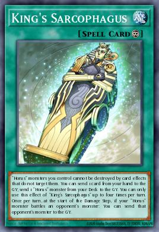 **Sarcófago del Rey**
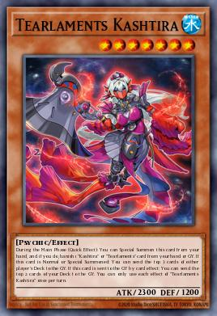 **Tiagrimientos Kashtira**
 **Tiagrimientos Kashtira**

### Ejecución numerada

#### Paso 1 — Activar Sarcófago del Rey (Mágica Continua, mano→Zona M/T), CL1.

 **ACTIVAR**

**Acción concreta:** Activar Sarcófago del Rey (Mágica Continua, mano→Zona M/T), CL1. Después de su resolución queda boca arriba; no se ha usado la Normal.
**Detalle técnico documentado:** Después de su resolución queda boca arriba; no se ha usado la Normal.

**Estado por zonas después del paso:**

| Zona/recurso | Estado narrativo A09 |
|---|---|
| Mano | 2× Tiagrimientos Kashtira #18153 |
| Monstruos | ∅ |
| Mágicas y trampas | Sarcófago del Rey #19200 (Continua) |
| Cementerio | ∅ |
| Destierro propio | ∅ |
| Campo y estado rival | Sin respuesta; campo no determinado |
| Materiales Xyz/Fusión/Sincro | Ninguno |
| Normal, Extra, fase y restricciones | Normal libre; Extra intacto |

**Campo visual de este paso:**

**Monstruos propios:** sin carta propia demostrada en esta vista.
**Mágicas/Trampas/Campo:**
-  **Sarcófago del Rey (Continua)** — zona declarada: `SPELL_TRAP`.
*Relación ilustrada de cartas presentes tras este paso, documentada en A09. La posición, materiales, otras zonas y rival se leen en la tabla de estado.*

#### Paso 2 — En una nueva cadena, activar su efecto de envío CL1, mandando la primera Tiagrimientos Kashtira de mano al GY como COSTE antes de formar la cadena (; en el texto oficial).

 **ENVIAR** → 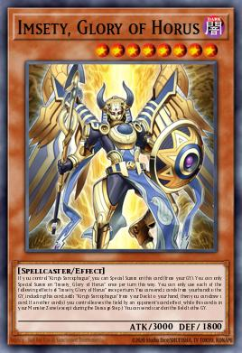 **ENVIAR** →  **YA EN CAMPO**

**Acción concreta:** En una nueva cadena, activar su efecto de envío CL1, mandando la primera Tiagrimientos Kashtira de mano al GY como COSTE antes de formar la cadena (; en el texto oficial). Al resolver, mandar Amset del Deck al GY POR EFECTO. Sarcófago permanece boca arriba; la primera Kashtira ya está en GY. No activar por ese envío el efecto de Tiagrimientos Kashtira reservado para ser enviada por efecto: aquí fue coste.
**Detalle técnico documentado:** Al resolver, mandar Amset del Deck al GY POR EFECTO. Sarcófago permanece boca arriba; la primera Kashtira ya está en GY. No activar por ese envío el efecto de Tiagrimientos Kashtira reservado para ser enviada por efecto: aquí fue coste.

**Estado por zonas después del paso:**

| Zona/recurso | Estado narrativo A09 |
|---|---|
| Mano | 1× Tiagrimientos Kashtira #18153 |
| Monstruos | ∅ |
| Mágicas y trampas | Sarcófago del Rey #19200 |
| Cementerio | 1× Tiagrimientos Kashtira #18153 (coste), Amset #19153 (enviado por efecto desde Deck) |
| Destierro propio | ∅ |
| Campo y estado rival | Sin cambios acreditados |
| Materiales Xyz/Fusión/Sincro | Ninguno |
| Normal, Extra, fase y restricciones | Normal libre; Extra intacto |

**Campo visual de este paso:**

**Monstruos propios:** sin carta propia demostrada en esta vista.
**Mágicas/Trampas/Campo:**
-  **Sarcófago del Rey** — zona declarada: `SPELL_TRAP`.
*Relación ilustrada de cartas presentes tras este paso, documentada en A09. La posición, materiales, otras zonas y rival se leen en la tabla de estado.*

#### Paso 3 — En otra cadena y Main Phase, usar por segunda vez el efecto del Sarcófago (máximo 4 usos por turno): mandar segunda Tiagrimientos Kashtira de mano al GY como COSTE.

 **ESTADO / CONTEXTO** →  **ENVIAR** → 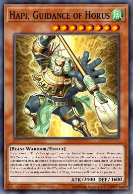 **ENVIAR**

**Acción concreta:** En otra cadena y Main Phase, usar por segunda vez el efecto del Sarcófago (máximo 4 usos por turno): mandar segunda Tiagrimientos Kashtira de mano al GY como COSTE; al resolver enviar Hapi del Deck al GY por efecto. No hay otra carta en mano de esta apertura.
**Detalle técnico documentado:** al resolver enviar Hapi del Deck al GY por efecto. No hay otra carta en mano de esta apertura.

**Estado por zonas después del paso:**

| Zona/recurso | Estado narrativo A09 |
|---|---|
| Mano | ∅ |
| Monstruos | ∅ |
| Mágicas y trampas | Sarcófago del Rey #19200 |
| Cementerio | 2× Tiagrimientos Kashtira #18153 (coste), Amset #19153, Hapi #19155 (enviado por efecto) |
| Destierro propio | ∅ |
| Campo y estado rival | Sin cambios acreditados |
| Materiales Xyz/Fusión/Sincro | Ninguno |
| Normal, Extra, fase y restricciones | Normal libre; Extra intacto |

**Campo visual de este paso:**

**Monstruos propios:** sin carta propia demostrada en esta vista.
**Mágicas/Trampas/Campo:**
-  **Sarcófago del Rey** — zona declarada: `SPELL_TRAP`.
*Relación ilustrada de cartas presentes tras este paso, documentada en A09. La posición, materiales, otras zonas y rival se leen en la tabla de estado.*

#### Paso 4 — Con Sarcófago aún controlado, aplicar el procedimiento de Invocación Especial desde el propio GY de Amset (GY→Zona de Monstruos), y después el de Hapi (GY→otra Zona de Monstruos).

 **ESTADO / CONTEXTO** →  **ESPECIAL** →  **ESPECIAL**

**Acción concreta:** Con Sarcófago aún controlado, aplicar el procedimiento de Invocación Especial desde el propio GY de Amset (GY→Zona de Monstruos), y después el de Hapi (GY→otra Zona de Monstruos). Ambos son Nivel 8; cada uno emplea una vez su forma propia de Invocarse por turno, sin Normal Summon ni cadena de activación de ese procedimiento.
**Detalle técnico documentado:** Ambos son Nivel 8; cada uno emplea una vez su forma propia de Invocarse por turno, sin Normal Summon ni cadena de activación de ese procedimiento.

**Estado por zonas después del paso:**

| Zona/recurso | Estado narrativo A09 |
|---|---|
| Mano | ∅ |
| Monstruos | Amset #19153 (Nivel 8), Hapi #19155 (Nivel 8; revividos por propios procedimientos) |
| Mágicas y trampas | Sarcófago del Rey #19200 |
| Cementerio | 2× Tiagrimientos Kashtira #18153 (coste) |
| Destierro propio | ∅ |
| Campo y estado rival | Sin cambios acreditados |
| Materiales Xyz/Fusión/Sincro | Ninguno |
| Normal, Extra, fase y restricciones | Normal libre; Extra intacto |

**Campo visual de este paso:**

**Monstruos propios:**
-  **Amset (Nivel 8)** — zona declarada: `MONSTER`.
-  **Hapi (Nivel 8; revividos por propios procedimientos)** — zona declarada: `MONSTER`.
**Mágicas/Trampas/Campo:**
-  **Sarcófago del Rey** — zona declarada: `SPELL_TRAP`.
*Relación ilustrada de cartas presentes tras este paso, documentada en A09. La posición, materiales, otras zonas y rival se leen en la tabla de estado.*

#### Paso 5 — Usar Amset Nivel 8 + Hapi Nivel 8 como materiales de la Invocación Xyz de El Vampiro Zombi (Extra→Zona legal de Monstruos).

 **ESTADO / CONTEXTO** →  **ESTADO / CONTEXTO** → 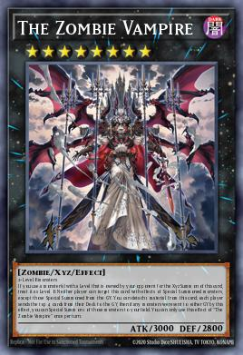 **MATERIAL XYZ**

**Acción concreta:** Usar Amset Nivel 8 + Hapi Nivel 8 como materiales de la Invocación Xyz de El Vampiro Zombi (Extra→Zona legal de Monstruos). Amset y Hapi quedan debajo como dos materiales Xyz; no se consideran monstruos adicionales ni cartas en el GY. NO activar el efecto de desacoplar y enviar cuatro cartas superiores de ambos Decks: si se decidiera hacerlo, la identidad de las cartas enviadas y la Invocación Especial posterior serían no garantizadas, otra rama que exige nueva ficha.
**Detalle técnico documentado:** Amset y Hapi quedan debajo como dos materiales Xyz; no se consideran monstruos adicionales ni cartas en el GY. NO activar el efecto de desacoplar y enviar cuatro cartas superiores de ambos Decks: si se decidiera hacerlo, la identidad de las cartas enviadas y la Invocación Especial posterior serían no garantizadas, otra rama que exige nueva ficha.

**Estado por zonas después del paso:**

| Zona/recurso | Estado narrativo A09 |
|---|---|
| Mano | ∅ |
| Monstruos | Vampiro Zombi #16850 (Xyz Rango 8, 3000 ATK) |
| Mágicas y trampas | Sarcófago del Rey #19200 |
| Cementerio | 2× Tiagrimientos Kashtira #18153 (coste) |
| Destierro propio | ∅ |
| Campo y estado rival | No se activó envío aleatorio de Deck ni daño automático |
| Materiales Xyz/Fusión/Sincro | Vampiro: Amset #19153 + Hapi #19155 (2 materiales) |
| Normal, Extra, fase y restricciones | Normal libre; Vampiro salió del Extra |

**Campo visual de este paso:**

**Monstruos propios:**
-  **Vampiro Zombi (Xyz Rango 8, 3000 ATK)** — zona declarada: `MONSTER`.
**Mágicas/Trampas/Campo:**
-  **Sarcófago del Rey** — zona declarada: `SPELL_TRAP`.
*Relación ilustrada de cartas presentes tras este paso, documentada en A09. La posición, materiales, otras zonas y rival se leen en la tabla de estado.*

### Campo final documentado

Esta vista procede **del último paso**, no de una lista de cartas deducida del título.

**Monstruos propios:**
-  **Vampiro Zombi (Xyz Rango 8, 3000 ATK)** — zona declarada: `MONSTER`.
**Mágicas/Trampas/Campo:**
-  **Sarcófago del Rey** — zona declarada: `SPELL_TRAP`.
*Relación ilustrada de cartas presentes tras este paso, documentada en A09. La posición, materiales, otras zonas y rival se leen en la tabla de estado.*

| Zona/recurso | Estado final documentado |
|---|---|
| Mano | ∅ |
| Monstruos | Vampiro Zombi #16850 (Xyz Rango 8, 3000 ATK) |
| Mágicas y trampas | Sarcófago del Rey #19200 |
| Cementerio | 2× Tiagrimientos Kashtira #18153 (coste) |
| Destierro propio | ∅ |
| Campo y estado rival | No se activó envío aleatorio de Deck ni daño automático |
| Materiales Xyz/Fusión/Sincro | Vampiro: Amset #19153 + Hapi #19155 (2 materiales) |
| Normal, Extra, fase y restricciones | Normal libre; Vampiro salió del Extra |

### Si el oponente interrumpe

- **INTERRUPCIÓN A12 — paso 2: A12 — Ash a Sarcófago en paso P2 de SARC:IMSETY_HAPI:ZOMBIE01**
  - Sarcófago ya está boca arriba (P1). En P2 activar su efecto CL1 para enviar una Tiagrimientos Kashtira desde mano al GY como COSTE, intentando luego enviar Amset desde Deck al GY. Ash CL2 niega solo el efecto; la Kashtira enviada como coste no regresa. Sarcófago permanece boca arriba y Amset sigue en Deck. Enviar una segunda Kashtira con otra activación es posible en principio, pero no justifica dos Horus de Nivel 8 con la mano mínima restante. Sarcófago oficial..
  - Estado de rama: `Resuelto solo en el escenario que detalla A12/A13; las otras respuestas no están demostradas.`.
- **RECUPERACIÓN A13 — paso 2: A13 — Sarcófago conserva una reactivación en paso P2 de SARC:IMSETY_HAPI:ZOMBIE01**
  - 1. Tras Ash: Sarcófago boca arriba, una Kashtira GY como coste, otra Kashtira en mano, Amset y Hapi aún en Deck; Normal sin gastar.
  - 2. Si el rival no interviene de nuevo, se puede activar otra vez el efecto de Sarcófago en la Main Phase (límite de 4 usos): enviar segunda Kashtira como coste y, al resolver, Amset del Deck al GY.
  - 3. Mientras Sarcófago siga boca arriba, Invocar Especialmente Amset desde GY por su procedimiento. Final alternativo mínimo: Sarcófago M/T, Amset 3000 ATK en Campo, las dos Kashtira GY, mano vacía, Normal disponible; Hapi en Deck, sin Vampiro Zombi: falta el segundo monstruo de Nivel 8. No atribuir el efecto de GY de Kashtira a un envío realizado como coste..
  - Estado de rama: `Resuelto solo en el escenario que detalla A12/A13; las otras respuestas no están demostradas.`.

---

## IMSETY · SARC HAPI · ZOMBIE01 · `656:A09:IMSETY:SARC_HAPI:ZOMBIE01`

**Propósito competitivo principal (lectura documental):** Ofensivo condicional. El objetivo solo se acredita si las acciones y el campo final detallados en esta guía lo permiten; no implica legalidad certificada ni garantiza el resultado ante respuestas adversarias.

**Categoría:** APERTURA

**Propósito y resultado documental:**

Endboard: El Vampiro Zombi (Rango 8, 3000/2800) con Amset + Hapi debajo; Sarcófago boca arriba en M/T; dos Tiagrimientos Kashtira en GY por coste; mano vacía, Normal libre, sin destierros, sin daño/negaciones derivados. Vulnerabilidad adicional frente a la variante anterior: la búsqueda de Sarcófago por Amset puede ser negada y no se forma el Xyz.;.

### Mano y estado inicial

Amset 1× Amset, Gloria de Horus + 2× Tiagrimientos Kashtira de las 3 de Main. Campo/GY/destierro propios vacíos, Normal disponible, Main Phase sin respuesta; Deck contiene Sarcófago (2 copias en lista) y Hapi; Extra contiene El Vampiro Zombi. No se presume la carta de robo opcional.

 **Amset, Gloria de Horus**
 **Tiagrimientos Kashtira**
 **Tiagrimientos Kashtira**

### Ejecución numerada

#### Paso 1 — Activar en mano el efecto de Amset: enviar Amset y la primera Tiagrimientos Kashtira desde la mano al GY COMO COSTE; en la resolución añadir Sarcófago del Rey desde Deck a mano.

 **ACTIVAR** →  **ENVIAR** →  **AÑADIR A MANO**

**Acción concreta:** Activar en mano el efecto de Amset: enviar Amset y la primera Tiagrimientos Kashtira desde la mano al GY COMO COSTE; en la resolución añadir Sarcófago del Rey desde Deck a mano. Renunciar a robar (texto then you can draw 1 card); por tanto no hay información ni recurso aleatorio. Amset y la primera Kashtira están en GY, no en campo.
**Detalle técnico documentado:** Renunciar a robar (texto then you can draw 1 card); por tanto no hay información ni recurso aleatorio. Amset y la primera Kashtira están en GY, no en campo.

**Estado por zonas después del paso:**

| Zona/recurso | Estado narrativo A09 |
|---|---|
| Mano | Sarcófago del Rey #19200 (buscado), 1× Tiagrimientos Kashtira #18153 |
| Monstruos | ∅ |
| Mágicas y trampas | ∅ |
| Cementerio | Amset #19153, 1× Tiagrimientos Kashtira #18153 (ambos coste desde mano) |
| Destierro propio | ∅ |
| Campo y estado rival | Sin respuesta; campo no determinado |
| Materiales Xyz/Fusión/Sincro | Ninguno |
| Normal, Extra, fase y restricciones | Normal libre; Extra intacto; NO se robó carta |

**Campo visual de este paso:**

**Monstruos propios:** sin carta propia demostrada en esta vista.
**Mágicas/Trampas/Campo:** sin carta propia demostrada en esta vista.
*Relación ilustrada de cartas presentes tras este paso, documentada en A09. La posición, materiales, otras zonas y rival se leen en la tabla de estado.*

#### Paso 2 — Activar Sarcófago del Rey desde mano en M/T (cadena de activación de Mágica Continua).

 **ACTIVAR** →  **ENVIAR** →  **ENVIAR**

**Acción concreta:** Activar Sarcófago del Rey desde mano en M/T (cadena de activación de Mágica Continua). Una vez resuelta, activar su efecto en nueva cadena: enviar segunda Tiagrimientos Kashtira de mano al GY como COSTE; resolver enviando Hapi desde Deck al GY por efecto. La Kashtira de mano no dispara efectos que requieran haber sido enviada por efecto. Se ha usado Sarcófago 1 de hasta 4 veces.
**Detalle técnico documentado:** Una vez resuelta, activar su efecto en nueva cadena: enviar segunda Tiagrimientos Kashtira de mano al GY como COSTE; resolver enviando Hapi desde Deck al GY por efecto. La Kashtira de mano no dispara efectos que requieran haber sido enviada por efecto. Se ha usado Sarcófago 1 de hasta 4 veces.

**Estado por zonas después del paso:**

| Zona/recurso | Estado narrativo A09 |
|---|---|
| Mano | ∅ |
| Monstruos | ∅ |
| Mágicas y trampas | Sarcófago del Rey #19200 |
| Cementerio | Amset #19153, 2× Tiagrimientos Kashtira #18153 (coste), Hapi #19155 (enviado por efecto desde Deck) |
| Destierro propio | ∅ |
| Campo y estado rival | Sin cambios acreditados |
| Materiales Xyz/Fusión/Sincro | Ninguno |
| Normal, Extra, fase y restricciones | Normal libre; Extra intacto |

**Campo visual de este paso:**

**Monstruos propios:** sin carta propia demostrada en esta vista.
**Mágicas/Trampas/Campo:**
-  **Sarcófago del Rey** — zona declarada: `SPELL_TRAP`.
*Relación ilustrada de cartas presentes tras este paso, documentada en A09. La posición, materiales, otras zonas y rival se leen en la tabla de estado.*

#### Paso 3 — Con Sarcófago boca arriba, Invocar Especialmente Amset desde GY por su procedimiento y Hapi desde GY por el suyo, una vez cada nombre.

 **YA EN CAMPO** →  **ESPECIAL** →  **ESPECIAL**

**Acción concreta:** Con Sarcófago boca arriba, Invocar Especialmente Amset desde GY por su procedimiento y Hapi desde GY por el suyo, una vez cada nombre. Ambos Nivel 8 ocupan dos zonas de monstruos; no se gastó Normal ni se generó una carta por robo.
**Detalle técnico documentado:** Ambos Nivel 8 ocupan dos zonas de monstruos; no se gastó Normal ni se generó una carta por robo.

**Estado por zonas después del paso:**

| Zona/recurso | Estado narrativo A09 |
|---|---|
| Mano | ∅ |
| Monstruos | Amset #19153 (Nivel 8), Hapi #19155 (Nivel 8) |
| Mágicas y trampas | Sarcófago del Rey #19200 |
| Cementerio | 2× Tiagrimientos Kashtira #18153 (coste) |
| Destierro propio | ∅ |
| Campo y estado rival | Sin cambios acreditados |
| Materiales Xyz/Fusión/Sincro | Ninguno |
| Normal, Extra, fase y restricciones | Normal libre; Extra intacto |

**Campo visual de este paso:**

**Monstruos propios:**
-  **Amset (Nivel 8)** — zona declarada: `MONSTER`.
-  **Hapi (Nivel 8)** — zona declarada: `MONSTER`.
**Mágicas/Trampas/Campo:**
-  **Sarcófago del Rey** — zona declarada: `SPELL_TRAP`.
*Relación ilustrada de cartas presentes tras este paso, documentada en A09. La posición, materiales, otras zonas y rival se leen en la tabla de estado.*

#### Paso 4 — Invocar Xyz El Vampiro Zombi desde Extra usando ambos Nivel 8; ahora Amset y Hapi están acoplados, no en Campo/GY.

 **INVOCAR XYZ** →  **YA EN CAMPO** →  **YA EN CAMPO**

**Acción concreta:** Invocar Xyz El Vampiro Zombi desde Extra usando ambos Nivel 8; ahora Amset y Hapi están acoplados, no en Campo/GY. No usar el envío aleatorio de cuatro cartas de cada Deck ni afirmar que se revivió un monstruo por este Xyz.
**Detalle técnico documentado:** No usar el envío aleatorio de cuatro cartas de cada Deck ni afirmar que se revivió un monstruo por este Xyz.

**Estado por zonas después del paso:**

| Zona/recurso | Estado narrativo A09 |
|---|---|
| Mano | ∅ |
| Monstruos | Vampiro Zombi #16850 (Xyz Rango 8, 3000 ATK) |
| Mágicas y trampas | Sarcófago del Rey #19200 |
| Cementerio | 2× Tiagrimientos Kashtira #18153 (coste) |
| Destierro propio | ∅ |
| Campo y estado rival | No se activó el efecto aleatorio de Vampiro |
| Materiales Xyz/Fusión/Sincro | Vampiro: Amset #19153 + Hapi #19155 |
| Normal, Extra, fase y restricciones | Normal libre; Vampiro salió del Extra |

**Campo visual de este paso:**

**Monstruos propios:**
-  **Vampiro Zombi (Xyz Rango 8, 3000 ATK)** — zona declarada: `MONSTER`.
**Mágicas/Trampas/Campo:**
-  **Sarcófago del Rey** — zona declarada: `SPELL_TRAP`.
*Relación ilustrada de cartas presentes tras este paso, documentada en A09. La posición, materiales, otras zonas y rival se leen en la tabla de estado.*

### Campo final documentado

Esta vista procede **del último paso**, no de una lista de cartas deducida del título.

**Monstruos propios:**
-  **Vampiro Zombi (Xyz Rango 8, 3000 ATK)** — zona declarada: `MONSTER`.
**Mágicas/Trampas/Campo:**
-  **Sarcófago del Rey** — zona declarada: `SPELL_TRAP`.
*Relación ilustrada de cartas presentes tras este paso, documentada en A09. La posición, materiales, otras zonas y rival se leen en la tabla de estado.*

| Zona/recurso | Estado final documentado |
|---|---|
| Mano | ∅ |
| Monstruos | Vampiro Zombi #16850 (Xyz Rango 8, 3000 ATK) |
| Mágicas y trampas | Sarcófago del Rey #19200 |
| Cementerio | 2× Tiagrimientos Kashtira #18153 (coste) |
| Destierro propio | ∅ |
| Campo y estado rival | No se activó el efecto aleatorio de Vampiro |
| Materiales Xyz/Fusión/Sincro | Vampiro: Amset #19153 + Hapi #19155 |
| Normal, Extra, fase y restricciones | Normal libre; Vampiro salió del Extra |

### Si el oponente interrumpe

- **INTERRUPCIÓN A12 — paso 1: A12 — Ash a Amset en paso P1 de IMSETY:SARC_HAPI:ZOMBIE01**
  - Amset activa desde mano CL1: envía dos cartas como COSTE, incluyendo Amset y una Tiagrimientos Kashtira, para añadir Sarcófago del Rey del Deck (con robo opcional posterior). Ash CL2, descartada de mano rival, niega la búsqueda y cualquier robo de esa resolución; ambas cartas propias permanecen GY. No hay Sarcófago en Campo, no se envió Hapi desde Deck y la Normal queda disponible. Amset oficial..
  - Estado de rama: `Resuelto solo en el escenario que detalla A12/A13; las otras respuestas no están demostradas.`.
- **RECUPERACIÓN A13 — paso 1: A13 — Amset y Kashtira permanecen en GY en paso P1 de IMSETY:SARC_HAPI:ZOMBIE01**
  - Residual A12: Amset y primera Kashtira están en GY tras el pago del coste de dos cartas. La segunda Kashtira sigue en mano; Sarcófago no fue añadido ni activado, Hapi permanece Deck, Campo y M/T propios vacíos, Normal libre. No se puede Invocar Amset del GY por su procedimiento sin controlar Sarcófago; SIN_CONTINUACION_DEMOSTRADA_CON_MANO_MINIMA.
  - Estado de rama: `Resuelto solo en el escenario que detalla A12/A13; las otras respuestas no están demostradas.`.

---

## GOODS · SCREAM · METANOISE · KALEIDO01 · `656:A09:GOODS:SCREAM:METANOISE:KALEIDO01`

**Propósito competitivo principal (lectura documental):** Preparación de recursos / despliegue. El objetivo solo se acredita si las acciones y el campo final detallados en esta guía lo permiten; no implica legalidad certificada ni garantiza el resultado ante respuestas adversarias.

**Categoría:** APERTURA

**Propósito y resultado documental:**

Endboard condicional al terminar el paso 7: Kaleido-Heart 3000 ATK propio; Reinoheart ya no está en Campo, sino al fondo del Deck junto con Havnis y Merrli; Bienes, Scream y Metanoise en GY, sin cartas obtenidas extra, Normal consumida desde tu turno anterior. El monstruo rival seleccionado retorna al Deck/Extra si pudo resolverse legalmente. Sin la supervivencia de Reinoheart/Metanoise, el monstruo rival volteable o la ventana de Trampa en turno rival, NO se garantiza esta Fusión diferida. Variantes con Cryme no se agrupan porque exigen recursos de mano diferentes y otra respuesta.

### Mano y estado inicial

Foolish Burial Goods Bienes del Entierro Insensato + Reinoheart Tearlaments Reinoheart. Deck: Scream Grito Tiagrimientos (1x), Metanoise Metarruido Tiagrimientos (1x), Havnis Tearlaments Havnis (1x) y Merrli Tearlaments Merrli (1x) disponibles. Extra: Kaleido Kaleido-Heart (1x). Campo, GY y destierro propios inicialmente vacíos, Normal libre, Main Phase propia, sin respuestas. Condición de continuación rival: Reinoheart y Metarruido sobreviven al cambio de turno; durante el turno rival siguiente el oponente controla al menos un monstruo boca arriba que puede ponerse en Defensa boca abajo y que se puede seleccionar, sin impedir el envío desde Deck al GY ni la Invocación por Fusión.

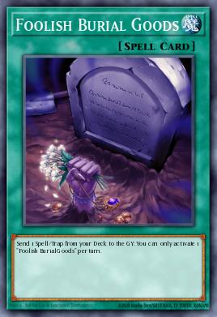 **Bienes del Entierro Insensato**
 **Tiagrimientos Reinoheart**

### Ejecución numerada

#### Paso 1 — Activar Foolish Burial Goods desde la mano; por efecto enviar Tearlaments Scream, Mágica Continua, desde Deck al GY.

 **ACTIVAR** → 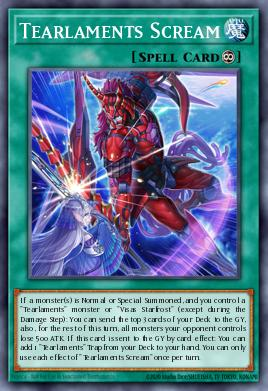 **ENVIAR**

**Acción concreta:** Activar Foolish Burial Goods desde la mano; por efecto enviar Tearlaments Scream, Mágica Continua, desde Deck al GY.
**Detalle técnico documentado:** Bienes acaba en GY; Scream no fue activada en Campo ni Colocada, fue enviada por efecto.

**Estado por zonas después del paso:**

| Zona/recurso | Estado narrativo A09 |
|---|---|
| Mano | Reinoheart #17417 |
| Monstruos | ∅ |
| Mágicas y trampas | ∅ |
| Cementerio | Bienes del Entierro Insensato #12800, Grito #17813 (enviado por efecto desde Deck, no activado) |
| Destierro propio | ∅ |
| Campo y estado rival | Sin respuesta; objetivo rival aún no requerido |
| Materiales Xyz/Fusión/Sincro | Ninguno |
| Normal, Extra, fase y restricciones | Normal libre; Extra intacto |

**Campo visual de este paso:**

**Monstruos propios:** sin carta propia demostrada en esta vista.
**Mágicas/Trampas/Campo:** sin carta propia demostrada en esta vista.
*Relación ilustrada de cartas presentes tras este paso, documentada en A09. La posición, materiales, otras zonas y rival se leen en la tabla de estado.*

#### Paso 2 — En nueva cadena activar el efecto disparado de Scream al ser enviada por efecto, y añadir Tearlaments Metanoise del Deck a la mano.

 **ACTIVAR** → 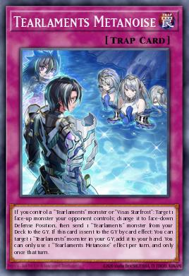 **BUSCAR / AÑADIR**

**Acción concreta:** En nueva cadena activar el efecto disparado de Scream al ser enviada por efecto, y añadir Tearlaments Metanoise del Deck a la mano.
**Detalle técnico documentado:** Metanoise queda en mano. No añadir simultáneamente Cryme: se resuelve una única búsqueda con el único Grito disponible.

**Estado por zonas después del paso:**

| Zona/recurso | Estado narrativo A09 |
|---|---|
| Mano | Reinoheart #17417, Metarruido #17473 (buscada por Grito) |
| Monstruos | ∅ |
| Mágicas y trampas | ∅ |
| Cementerio | Bienes #12800, Grito #17813 |
| Destierro propio | ∅ |
| Campo y estado rival | Sin cambios acreditados |
| Materiales Xyz/Fusión/Sincro | Ninguno |
| Normal, Extra, fase y restricciones | Normal libre; Extra intacto |

**Campo visual de este paso:**

**Monstruos propios:** sin carta propia demostrada en esta vista.
**Mágicas/Trampas/Campo:** sin carta propia demostrada en esta vista.
*Relación ilustrada de cartas presentes tras este paso, documentada en A09. La posición, materiales, otras zonas y rival se leen en la tabla de estado.*

#### Paso 3 — Invocar Normalmente a Reinoheart desde mano y activar su efecto al ser Invocado: enviar Havnis del Deck al GY por efecto.

 **NORMAL** →  **NORMAL** →  **ESTADO / CONTEXTO**

**Acción concreta:** Invocar Normalmente a Reinoheart desde mano y activar su efecto al ser Invocado: enviar Havnis del Deck al GY por efecto.
**Detalle técnico documentado:** Reinoheart boca arriba 1500 ATK en Campo; Havnis en GY; Normal gastada. En este estado de dos cartas no hay tercera pieza Aqua para completar Kaleido todavía: no atribuir una Fusión en este punto.

**Estado por zonas después del paso:**

| Zona/recurso | Estado narrativo A09 |
|---|---|
| Mano | Metarruido #17473 |
| Monstruos | Reinoheart #17417 (Normal) |
| Mágicas y trampas | ∅ |
| Cementerio | Bienes #12800, Grito #17813, Havnis #17416 (enviada desde Deck por efecto) |
| Destierro propio | ∅ |
| Campo y estado rival | Sin cambios acreditados |
| Materiales Xyz/Fusión/Sincro | Ninguno |
| Normal, Extra, fase y restricciones | Normal gastada; Extra intacto |

**Campo visual de este paso:**

**Monstruos propios:**
-  **Reinoheart (Normal)** — zona declarada: `MONSTER`.
**Mágicas/Trampas/Campo:** sin carta propia demostrada en esta vista.
*Relación ilustrada de cartas presentes tras este paso, documentada en A09. La posición, materiales, otras zonas y rival se leen en la tabla de estado.*

#### Paso 4 — Colocar Metanoise boca abajo en Zona M/T propia y pasar el turno.

 **COLOCAR** →  **ESTADO / CONTEXTO** →  **ESTADO / CONTEXTO**

**Acción concreta:** Colocar Metanoise boca abajo en Zona M/T propia y pasar el turno.
**Detalle técnico documentado:** Fin del turno propio: Reinoheart boca arriba + Metanoise Colocada; Bienes, Scream y Havnis en GY; cero daño causado, sin Fusión todavía. No activar una Trampa Normal recién Colocada este turno en condiciones ordinarias.

**Estado por zonas después del paso:**

| Zona/recurso | Estado narrativo A09 |
|---|---|
| Mano | ∅ |
| Monstruos | Reinoheart #17417 (1500 ATK) |
| Mágicas y trampas | Metarruido #17473 (Colocada; aún no activable el mismo turno ordinario) |
| Cementerio | Bienes #12800, Grito #17813, Havnis #17416 |
| Destierro propio | ∅ |
| Campo y estado rival | Sin respuesta en preparación; aún no hay retirada ni Fusión |
| Materiales Xyz/Fusión/Sincro | Ninguno |
| Normal, Extra, fase y restricciones | Normal gastada en turno propio; se pasa turno |

**Campo visual de este paso:**

**Monstruos propios:**
-  **Reinoheart (1500 ATK)** — zona declarada: `MONSTER`.
**Mágicas/Trampas/Campo:**
-  **Metarruido (Colocada; aún no activable el mismo turno ordinario)** — zona declarada: `SPELL_TRAP`.
*Relación ilustrada de cartas presentes tras este paso, documentada en A09. La posición, materiales, otras zonas y rival se leen en la tabla de estado.*

#### Paso 5 — En el siguiente turno rival, si se conserva el estado requerido, activar Metanoise seleccionando un monstruo enemigo boca arriba que pueda pasar a Defensa boca abajo.

 **ACTIVAR** →  **OBJETIVO**

**Acción concreta:** En el siguiente turno rival, si se conserva el estado requerido, activar Metanoise seleccionando un monstruo enemigo boca arriba que pueda pasar a Defensa boca abajo. Resolver: voltear al objetivo boca abajo y después enviar Merrli del Deck al GY.
**Detalle técnico documentado:** Resolver: voltear al objetivo boca abajo y después enviar Merrli del Deck al GY. Metanoise va al GY; Merrli fue enviada por efecto de la Trampa, no como coste. El monstruo enemigo queda boca abajo si no existe una protección u otra interferencia.

**Estado por zonas después del paso:**

| Zona/recurso | Estado narrativo A09 |
|---|---|
| Mano | ∅ |
| Monstruos | Reinoheart #17417 (si sobrevivió al cambio de turno) |
| Mágicas y trampas | ∅ |
| Cementerio | Bienes #12800, Grito #17813, Havnis #17416, Metarruido #17473, Merrli #17414 (enviada por efecto desde Deck) |
| Destierro propio | ∅ |
| Campo y estado rival | Monstruo rival elegible volteado boca abajo; identidad variable, solo si pudo resolverse |
| Materiales Xyz/Fusión/Sincro | Ninguno |
| Normal, Extra, fase y restricciones | Turno rival; Normal del turno propio ya gastada; Extra intacto |

**Campo visual de este paso:**

**Monstruos propios:**
-  **Reinoheart (si sobrevivió al cambio de turno)** — zona declarada: `MONSTER`.
**Mágicas/Trampas/Campo:** sin carta propia demostrada en esta vista.
*Relación ilustrada de cartas presentes tras este paso, documentada en A09. La posición, materiales, otras zonas y rival se leen en la tabla de estado.*

#### Paso 6 — Tras concluir la cadena de Metanoise, activar el efecto de Merrli por haber sido enviada al GY por efecto.

 **ESTADO / CONTEXTO** →  **FUSIÓN** →  **FUSIÓN**

**Acción concreta:** Tras concluir la cadena de Metanoise, activar el efecto de Merrli por haber sido enviada al GY por efecto. Fusion Summon Kaleido-Heart utilizando exactamente Reinoheart (Campo) + Havnis (GY) + Merrli (GY); poner las tres cartas en el fondo del Deck como materiales por resolución y traer Kaleido del Extra.
**Detalle técnico documentado:** Fusion Summon Kaleido-Heart utilizando exactamente Reinoheart (Campo) + Havnis (GY) + Merrli (GY); poner las tres cartas en el fondo del Deck como materiales por resolución y traer Kaleido del Extra. Se cumplen «Tearlaments Reinoheart» + 2 Aqua: Havnis y Merrli son Aqua, Reinoheart es el material nombrado (Guerrero). Las tres cartas vuelven al Deck, no permanecen en GY; Kaleido-Heart aparece boca arriba en Campo propio, también siendo turno rival.

**Estado por zonas después del paso:**

| Zona/recurso | Estado narrativo A09 |
|---|---|
| Mano | ∅ |
| Monstruos | Kaleido-Heart #17445 (Fusión, 3000 ATK) |
| Mágicas y trampas | ∅ |
| Cementerio | Bienes #12800, Grito #17813, Metarruido #17473; los 3 materiales regresaron al fondo del Deck |
| Destierro propio | ∅ |
| Campo y estado rival | Monstruo rival boca abajo sigue si no fue retirado |
| Materiales Xyz/Fusión/Sincro | Ninguno: materiales de Fusión no quedan acoplados |
| Normal, Extra, fase y restricciones | Turno rival; Kaleido salió del Extra |

**Campo visual de este paso:**

**Monstruos propios:**
-  **Kaleido-Heart (Fusión, 3000 ATK)** — zona declarada: `MONSTER`.
**Mágicas/Trampas/Campo:** sin carta propia demostrada en esta vista.
*Relación ilustrada de cartas presentes tras este paso, documentada en A09. La posición, materiales, otras zonas y rival se leen en la tabla de estado.*

#### Paso 7 — Por la Invocación Especial de Kaleido-Heart, activar su efecto en una cadena nueva, seleccionando la carta rival previamente volteada boca abajo (si sigue controlada por el oponente y es seleccionable).

 **ESPECIAL**

**Acción concreta:** Por la Invocación Especial de Kaleido-Heart, activar su efecto en una cadena nueva, seleccionando la carta rival previamente volteada boca abajo (si sigue controlada por el oponente y es seleccionable). Al resolver, barajarla al Deck correspondiente.
**Detalle técnico documentado:** Al resolver, barajarla al Deck correspondiente. Kaleido-Heart 3000 ATK permanece propio; el monstruo rival deja su Campo por barajado, no por destrucción. Si el objetivo era una carta del Extra, vuelve a ese Extra Deck, no a la mano; el daño infligido en esta ruta es 0 LP.

**Estado por zonas después del paso:**

| Zona/recurso | Estado narrativo A09 |
|---|---|
| Mano | ∅ |
| Monstruos | Kaleido-Heart #17445 (3000 ATK) |
| Mágicas y trampas | ∅ |
| Cementerio | Bienes #12800, Grito #17813, Metarruido #17473 |
| Destierro propio | ∅ |
| Campo y estado rival | Carta rival legal que se volteó fue barajada al Deck/Extra si el efecto de Kaleido resolvió |
| Materiales Xyz/Fusión/Sincro | Ninguno |
| Normal, Extra, fase y restricciones | Turno rival; ninguna Fusión adicional |

**Campo visual de este paso:**

**Monstruos propios:**
-  **Kaleido-Heart (3000 ATK)** — zona declarada: `MONSTER`.
**Mágicas/Trampas/Campo:** sin carta propia demostrada en esta vista.
*Relación ilustrada de cartas presentes tras este paso, documentada en A09. La posición, materiales, otras zonas y rival se leen en la tabla de estado.*

### Campo final documentado

Esta vista procede **del último paso**, no de una lista de cartas deducida del título.

**Monstruos propios:**
-  **Kaleido-Heart (3000 ATK)** — zona declarada: `MONSTER`.
**Mágicas/Trampas/Campo:** sin carta propia demostrada en esta vista.
*Relación ilustrada de cartas presentes tras este paso, documentada en A09. La posición, materiales, otras zonas y rival se leen en la tabla de estado.*

| Zona/recurso | Estado final documentado |
|---|---|
| Mano | ∅ |
| Monstruos | Kaleido-Heart #17445 (3000 ATK) |
| Mágicas y trampas | ∅ |
| Cementerio | Bienes #12800, Grito #17813, Metarruido #17473 |
| Destierro propio | ∅ |
| Campo y estado rival | Carta rival legal que se volteó fue barajada al Deck/Extra si el efecto de Kaleido resolvió |
| Materiales Xyz/Fusión/Sincro | Ninguno |
| Normal, Extra, fase y restricciones | Turno rival; ninguna Fusión adicional |

### Si el oponente interrumpe

- **INTERRUPCIÓN A12 — paso 1: A12 — Ash a Bienes en paso P1 de GOODS:SCREAM:METANOISE:KALEIDO01**
  - CL1 Bienes del Entierro Insensato pretende enviar Grito Tiagrimientos desde Deck al GY por efecto. Ash CL2 niega ese efecto. Bienes se ha activado y termina en GY; Grito queda en Deck, por lo que no activa su búsqueda de Metarruido. Reinoheart permanece en mano y la Normal aún no se usó. Bienes..
  - Estado de rama: `Resuelto solo en el escenario que detalla A12/A13; las otras respuestas no están demostradas.`.
- **RECUPERACIÓN A13 — paso 1: A13 — Reinoheart solo tras Bienes negados en paso P1 de GOODS:SCREAM:METANOISE:KALEIDO01**
  - Residual A12: Bienes en GY, Grito y Metarruido en Deck, Reinoheart aún en mano, Normal disponible. Una continuación válida es Normal de Reinoheart y CL1 envío de Havnis del Deck a GY, si el rival no lo niega; Havnis puede activar su disparo, pero la mano mínima ya no contiene otra Aqua para Kaleido-Heart. Resultado mínimo: Reinoheart 1500 ATK en Campo, Havnis GY, Normal gastada, no hay Metarruido Colocada ni Kaleido. No afirmar otra Fusión.
  - Estado de rama: `Resuelto solo en el escenario que detalla A12/A13; las otras respuestas no están demostradas.`.

---

## GOODS · SCREAM · CRYME · KALEIDO02 · `656:A09:GOODS:SCREAM:CRYME:KALEIDO02`

**Propósito competitivo principal (lectura documental):** Ofensivo condicional. El objetivo solo se acredita si las acciones y el campo final detallados en esta guía lo permiten; no implica legalidad certificada ni garantiza el resultado ante respuestas adversarias.

**Categoría:** APERTURA

**Propósito y resultado documental:**

Estado final en el turno rival, sin respuesta adicional: un Kaleido-Heart Invocado por Fusión, 1 activación rival negada y su carta barajada, sin daños ni otras negaciones garantizadas. Si Reinoheart desaparece antes de activar Crimanto, no se puede cumplir el requisito de control propio; si no hay monstruo en mano para enviar al GY tras la negación, no puede obtenerse este desenlace. Distinción: no duplicar la variante Metarruido, que voltea un objetivo y envía Merrli por su propio efecto de Trampa, mientras esta vía envía Havnis después de negar con Crimanto.

### Mano y estado inicial

Bienes del Entierro Insensato Foolish Burial Goods, Reinoheart Tearlaments Reinoheart, Havnis Tearlaments Havnis. Deck: Grito Tearlaments Scream, Crimanto Tearlaments Cryme, Merrli Tearlaments Merrli. Extra: Kaleido-Heart. Estado: Main Phase propia, Campo/GY/destierro propios vacíos; Normal libre; rival no responde durante preparación. En el siguiente turno rival, Reinoheart debe continuar boca arriba y un monstruo del rival debe poder activar un efecto cuya activación se niegue y que pueda barajarse al Deck. No se presupone carta extra robada.

 **Bienes del Entierro Insensato**
 **Tiagrimientos Reinoheart**
 **Tiagrimientos Havnis**

### Ejecución numerada

#### Paso 1 — Activar Bienes del Entierro Insensato para enviar Grito desde el Deck al GY por efecto.

 **ACTIVAR** →  **ENVIAR** →  **ESTADO / CONTEXTO**

**Acción concreta:** Activar Bienes del Entierro Insensato para enviar Grito desde el Deck al GY por efecto. Tras resolver, en cadena nueva activar el disparo de Grito enviado por efecto y añadir Crimanto desde Deck a mano.
**Detalle técnico documentado:** Tras resolver, en cadena nueva activar el disparo de Grito enviado por efecto y añadir Crimanto desde Deck a mano. GY: Bienes y Grito. Mano: Reinoheart + Havnis + Crimanto. Ni Grito ni Crimanto son cartas en Campo todavía.

**Estado por zonas después del paso:**

| Zona/recurso | Estado narrativo A09 |
|---|---|
| Mano | Reinoheart #17417, Havnis #17416, Crimanto #17475 (buscada por Grito) |
| Monstruos | ∅ |
| Mágicas y trampas | ∅ |
| Cementerio | Bienes #12800, Grito #17813 (enviado por efecto) |
| Destierro propio | ∅ |
| Campo y estado rival | Sin respuesta durante preparación |
| Materiales Xyz/Fusión/Sincro | Ninguno |
| Normal, Extra, fase y restricciones | Normal libre; Extra intacto |

**Campo visual de este paso:**

**Monstruos propios:** sin carta propia demostrada en esta vista.
**Mágicas/Trampas/Campo:** sin carta propia demostrada en esta vista.
*Relación ilustrada de cartas presentes tras este paso, documentada en A09. La posición, materiales, otras zonas y rival se leen en la tabla de estado.*

#### Paso 2 — Colocar Crimanto boca abajo. Invocar Normalmente Reinoheart y activar su disparo para enviar Merrli del Deck al GY por efecto.

 **NORMAL** →  **ESTADO / CONTEXTO** →  **ESTADO / CONTEXTO**

**Acción concreta:** Colocar Crimanto boca abajo. Invocar Normalmente Reinoheart y activar su disparo para enviar Merrli del Deck al GY por efecto.
**Detalle técnico documentado:** Campo propio: Reinoheart y Crimanto Colocada. GY: Merrli, Bienes, Grito. Mano: Havnis. No activar el disparo opcional de Merrli en esta ruta: se reserva Merrli como material para la Fusión posterior. Normal gastada.

**Estado por zonas después del paso:**

| Zona/recurso | Estado narrativo A09 |
|---|---|
| Mano | Havnis #17416 |
| Monstruos | Reinoheart #17417 (Normal) |
| Mágicas y trampas | Crimanto #17475 (Colocada, no se activa este turno) |
| Cementerio | Bienes #12800, Grito #17813, Merrli #17414 (enviada por efecto desde Deck; no se usó su disparo) |
| Destierro propio | ∅ |
| Campo y estado rival | Sin respuesta durante preparación |
| Materiales Xyz/Fusión/Sincro | Ninguno |
| Normal, Extra, fase y restricciones | Normal gastada; se pasa turno; Extra intacto |

**Campo visual de este paso:**

**Monstruos propios:**
-  **Reinoheart (Normal)** — zona declarada: `MONSTER`.
**Mágicas/Trampas/Campo:**
- 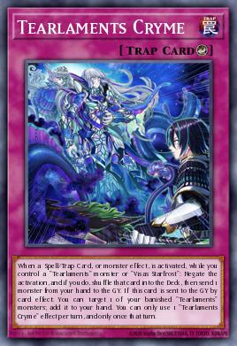 **Crimanto (Colocada, no se activa este turno)** — zona declarada: `SPELL_TRAP`.
*Relación ilustrada de cartas presentes tras este paso, documentada en A09. La posición, materiales, otras zonas y rival se leen en la tabla de estado.*

#### Paso 3 — Tras pasar turno, el oponente activa un efecto de monstruo en Campo susceptible de negarse y barajarse.

 **ESTADO / CONTEXTO** →  **ENVIAR** →  **ESTADO / CONTEXTO**

**Acción concreta:** Tras pasar turno, el oponente activa un efecto de monstruo en Campo susceptible de negarse y barajarse. Como controlas Reinoheart, responder con la Trampa de Contraefecto Crimanto que fue Colocada en el turno anterior; al resolver negar esa activación, barajar esa carta rival al Deck y, después, enviar Havnis desde mano al GY por efecto.
**Detalle técnico documentado:** Como controlas Reinoheart, responder con la Trampa de Contraefecto Crimanto que fue Colocada en el turno anterior; al resolver negar esa activación, barajar esa carta rival al Deck y, después, enviar Havnis desde mano al GY por efecto. Crimanto va al GY tras resolver. El monstruo rival afectado abandona su Campo; Havnis GY junto a Merrli. No se trató su envío como coste ni como Fusión instantánea dentro de la resolución de Crimanto.

**Estado por zonas después del paso:**

| Zona/recurso | Estado narrativo A09 |
|---|---|
| Mano | ∅ |
| Monstruos | Reinoheart #17417 (superviviente al cambio de turno) |
| Mágicas y trampas | ∅ |
| Cementerio | Bienes #12800, Grito #17813, Merrli #17414, Crimanto #17475, Havnis #17416 (enviada por efecto tras negar) |
| Destierro propio | ∅ |
| Campo y estado rival | Activación de monstruo rival negada y esa carta barajada al Deck solo si la respuesta fue legal y resolvió |
| Materiales Xyz/Fusión/Sincro | Ninguno |
| Normal, Extra, fase y restricciones | Turno rival; Extra intacto |

**Campo visual de este paso:**

**Monstruos propios:**
-  **Reinoheart (superviviente al cambio de turno)** — zona declarada: `MONSTER`.
**Mágicas/Trampas/Campo:** sin carta propia demostrada en esta vista.
*Relación ilustrada de cartas presentes tras este paso, documentada en A09. La posición, materiales, otras zonas y rival se leen en la tabla de estado.*

#### Paso 4 — Activar el disparo de Havnis enviada al GY por efecto; al resolver, Fusión hacia Kaleido-Heart usando Reinoheart del Campo + Merrli y Havnis del GY, devolviendo al fondo del Deck los tres materiales como exige el efecto de Fusión de Havnis.

 **YA EN CAMPO** →  **YA EN CAMPO** →  **ESTADO / CONTEXTO**

**Acción concreta:** Activar el disparo de Havnis enviada al GY por efecto; al resolver, Fusión hacia Kaleido-Heart usando Reinoheart del Campo + Merrli y Havnis del GY, devolviendo al fondo del Deck los tres materiales como exige el efecto de Fusión de Havnis.
**Detalle técnico documentado:** Campo propio al resolver: Kaleido-Heart ATK 3000; Reinoheart ya no está en Campo, Havnis y Merrli ya no están en GY. Crimanto, Grito y Bienes quedan GY. No se garantiza el efecto opcional de retirar otra carta rival si no hay otra carta rival seleccionable.

**Estado por zonas después del paso:**

| Zona/recurso | Estado narrativo A09 |
|---|---|
| Mano | ∅ |
| Monstruos | Kaleido-Heart #17445 (Fusión, 3000 ATK) |
| Mágicas y trampas | ∅ |
| Cementerio | Bienes #12800, Grito #17813, Crimanto #17475; Reinoheart, Havnis, Merrli al fondo del Deck |
| Destierro propio | ∅ |
| Campo y estado rival | La carta cuya activación se negó ya fue barajada; otra remoción de Kaleido NO garantizada sin blanco adicional |
| Materiales Xyz/Fusión/Sincro | Ninguno: materiales de Fusión regresaron al Deck |
| Normal, Extra, fase y restricciones | Turno rival; Kaleido salió del Extra |

**Campo visual de este paso:**

**Monstruos propios:**
-  **Kaleido-Heart (Fusión, 3000 ATK)** — zona declarada: `MONSTER`.
**Mágicas/Trampas/Campo:** sin carta propia demostrada en esta vista.
*Relación ilustrada de cartas presentes tras este paso, documentada en A09. La posición, materiales, otras zonas y rival se leen en la tabla de estado.*

### Campo final documentado

Esta vista procede **del último paso**, no de una lista de cartas deducida del título.

**Monstruos propios:**
-  **Kaleido-Heart (Fusión, 3000 ATK)** — zona declarada: `MONSTER`.
**Mágicas/Trampas/Campo:** sin carta propia demostrada en esta vista.
*Relación ilustrada de cartas presentes tras este paso, documentada en A09. La posición, materiales, otras zonas y rival se leen en la tabla de estado.*

| Zona/recurso | Estado final documentado |
|---|---|
| Mano | ∅ |
| Monstruos | Kaleido-Heart #17445 (Fusión, 3000 ATK) |
| Mágicas y trampas | ∅ |
| Cementerio | Bienes #12800, Grito #17813, Crimanto #17475; Reinoheart, Havnis, Merrli al fondo del Deck |
| Destierro propio | ∅ |
| Campo y estado rival | La carta cuya activación se negó ya fue barajada; otra remoción de Kaleido NO garantizada sin blanco adicional |
| Materiales Xyz/Fusión/Sincro | Ninguno: materiales de Fusión regresaron al Deck |
| Normal, Extra, fase y restricciones | Turno rival; Kaleido salió del Extra |

### Si el oponente interrumpe

- **INTERRUPCIÓN A12 — paso 1: A12 — Ash a Bienes en paso P1 de GOODS:SCREAM:CRYME:KALEIDO02**
  - Mismo tipo de cadena, distinta mano: Bienes CL1 intentaría enviar Grito del Deck; Ash CL2 niega el envío. Bienes GY; Grito y Crimanto en Deck; Reinoheart y Havnis aún en mano, Normal libre. Se pierde esta ruta de Crimanto Colocada, pero no se ha negado el futuro disparo de Reinoheart; la alternativa real de Fusión se documenta en A13..
  - Alcance: ocho pruebas distintas ligadas a la mano y paso de cada ruta; los cuatro casos de Reinoheart comparten mecanismo de Ash, pero no comparten recursos residuales. Fuentes comunes: Ash, Reinoheart, Sarcófago. Ninguna rama equivale a probar todos los rivales o interrupciones.
  - <!-- A12_AUDITORIA_RUTA_INICIO -->
  - Estado de rama: `Resuelto solo en el escenario que detalla A12/A13; las otras respuestas no están demostradas.`.
- **RECUPERACIÓN A13 — paso 1: A13 — Kaleido directo sin Crimanto en paso P1 de GOODS:SCREAM:CRYME:KALEIDO02**
  - 1. Después de Ash: Bienes GY; Grito y Crimanto siguen Deck; Reinoheart + Havnis permanecen en mano. Normal disponible, GY sin monstruos.
  - 2. Invocar Normalmente Reinoheart y activar su CL1 para enviar Merrli del Deck al GY por efecto (Ash rival ya se usó en este escenario; se presupone que ninguna segunda respuesta impide la resolución).
  - 3. En cadena nueva, Merrli activa su efecto desde GY y, al resolver, colocar Merrli (GY) + Reinoheart (Campo) + Havnis (mano) al fondo del Deck como los tres materiales: Invocar Kaleido-Heart por Fusión desde Extra.
  - 4. Tablero alternativo: Kaleido-Heart 3000 ATK, Normal gastada, Bienes GY, Grito/Crimanto en Deck y tres materiales devueltos al Deck; puede barajar 1 carta rival solo si existe objetivo legal. No hubo Crimanto ni negación en turno rival. Merrli oficial, Kaleido-Heart oficial..
  - Límite común: estos ocho desenlaces corresponden a ocho aperturas alternativas. Cada inventario conserva únicamente las cartas iniciales anotadas y los costes pagados; los cortes no son partidas simultáneas ni demuestran resistencia a todas las respuestas rivales.
  - <!-- A13_AUDITORIA_RUTA_INICIO -->
  - Estado de rama: `Resuelto solo en el escenario que detalla A12/A13; las otras respuestas no están demostradas.`.

---
