# Kashtira Pure

## CONTROL_DE_TAREAS_A01_A10 — Kashtira Pure 665 · contrato 35 tareas (22-11-2026)

**Cierre documental A09:** 32/35 tareas acreditadas; faltan exclusivamente A10A-T1–T3. A09 certifica un análisis documental condicional de las rutas, NO la legalidad universal ni 16 replays ejecutados. Ningún combo se certifica mediante el motor en esta etapa. A05: 38 fichas, 90 cláusulas con fuente y 630 casos lógicos iniciales; 0 replays de motor. **Excepción expresa del usuario:** A01 se puede verificar con `side=0` solo para el deck 665; el usuario pidió continuar hasta terminar A01 sin bloquear por Side. La excepción no asigna, mueve o agrega cartas; A02 tiene su propia autorización posterior limitada a identidad/paquete y **no habilita A03–A10A**. Main 42 / Extra 15 / Side 0 / Reserva 19; ninguna banlist evaluada. A10B opcional no solicitado. Registro fuente: Station X V40 `665.json`, 38 CIDs, 44 slots, 16 rutas históricas; el paquete `datos/stationx-deck.json` se generó en A02 desde V40 con los 44 slots y 16 rutas reales, sin hash de inventario ficticio.

- [x] **A01-T1** Evidencia A01.1–A01.3, CID/ID, fuentes y auditoría específica; alcance documental, sin replays.
- [x] **A01-T2** Evidencia A01.1–A01.3, CID/ID, fuentes y auditoría específica; alcance documental, sin replays.
- [x] **A01-T3** Evidencia A01.1–A01.3, CID/ID, fuentes y auditoría específica; alcance documental, sin replays.
- [x] **A02-T1** Identidad 665, formato tcg_advanced, V40 SHA de Git real y 44 filas `card_id` verificadas sin alteración; excepción de Side=0 acotada solo a A02.
- [x] **A02-T2** Paquete `station-x-deck-package/1`, ZIP de carpeta única y preflight nativo PHP aislado; 38 CID, 16 rutas, 92 pasos y 44 fotos; ninguna regla de calculadora inventada.
- [x] **A02-T3** `deck-slots-v1`, IDs originales, nombres, secciones Main/Extra/Side/Reserva y procedencia versionada; 7 guías Markdown intactas, perfil A01 sincronizado.
- [x] **A03-T1** 100 % de Main, Extra, Side, Reserva y Skill cotejados: 38 CID, 44 card_id, 76 copias y Side 0 preservado sin inventar cartas.
- [x] **A03-T2** 44 correspondencias card_id↔CID↔nombre histórico/oficial (source_aliases), referencias Konami e imágenes reales; cero identidades ambiguas o IDs repetidos.
- [x] **A03-T3** Inventario físico 42/15/0/19 congelado por referencia a V40 y JSON portátil; denominadores A04–A10 identificados sin completar sus análisis.
- [x] **A04-T1** 38/38 CID físicos identificados, fuente Konami por CID y 44 JPG de procedencia real, con seis referencias extras separadas; ninguna FOTO_PENDIENTE en la lista física.
- [x] **A04-T2** 44 JPEG + 19 WebP decodificables, firma Git del archivo y ruta real verificados; miniaturas 268×391, sin afirmar HD para A10A.
- [x] **A04-T3** Zonas/estados y disponibilidad definidos, 16 rutas/92 pasos, 116 fotos de paso, 24 hand_photos y 10 endboards ilustrativos sin certificación espacial.
- [x] **A05-T1** 38 identidades y 44 card_id comprobados contra fuente A03, foto A04, función específica, fuentes oficiales y rol Main/Extra/Reserva sin uso automático de Reserva.
- [x] **A05-T2** 90 cláusulas separadas y tipadas por effect_id y CID; PRO/ACT/TRG/QCK/CONT/REP, sin colapsar modalidades ni inventar motor.
- [x] **A05-T3** 90 cláusulas con actor, zona, guardia, ventana, costes, objetivo, resolución, HOPT/OPT, cadena, negación, restricciones y fuente Konami; NO_APLICA documentado.
- [x] **A05-T4** 630 casos de papel iniciales P/N/NO_APLICA con antes, costes, eventos, después, fuente y referencias previas A06/A07/A09; sin afirmar ejecución.
- [x] **A06-T1** Evidencia documental de 38 identidades, 21 relaciones y 42 casos de papel; sin motor ni calculadora.
- [x] **A06-T2** Evidencia documental de 38 identidades, 21 relaciones y 42 casos de papel; sin motor ni calculadora.
- [x] **A06-T3** Evidencia documental de 38 identidades, 21 relaciones y 42 casos de papel; sin motor ni calculadora.
- [x] **A06-T4** Evidencia documental de 38 identidades, 21 relaciones y 42 casos de papel; sin motor ni calculadora.
- [x] **A07-T1** Documentación A07 independiente: 90 reglas, 900 casos de papel, A05 effect_id y 38 CID; auditoría CI pendiente, sin motor.
- [x] **A07-T2** Documentación A07 independiente: 90 reglas, 900 casos de papel, A05 effect_id y 38 CID; auditoría CI pendiente, sin motor.
- [x] **A07-T3** Documentación A07 independiente: 90 reglas, 900 casos de papel, A05 effect_id y 38 CID; auditoría CI pendiente, sin motor.
- [x] **A07-T4** Documentación A07 independiente: 90 reglas, 900 casos de papel, A05 effect_id y 38 CID; auditoría CI pendiente, sin motor.
- [x] **A08-T1** 16 rutas históricas clasificadas, 21 enlaces A06, 38 roles y 48 contrastes de papel; pendientes A09 certificados.
- [x] **A08-T2** 16 rutas históricas clasificadas, 21 enlaces A06, 38 roles y 48 contrastes de papel; pendientes A09 certificados.
- [x] **A08-T3** 16 rutas históricas clasificadas, 21 enlaces A06, 38 roles y 48 contrastes de papel; pendientes A09 certificados.
- [x] **A08-T4** 16 rutas históricas clasificadas, 21 enlaces A06, 38 roles y 48 contrastes de papel; pendientes A09 certificados.
- [x] **A09-T1** 16 rutas/92 pasos inventariados mediante IDs estables, manos de A08 por CID, alertas por fotos y estados faltantes; auditor independiente sin replays.
- [x] **A09-T2** 92/92 transiciones documentales con estados antes/después y UIDs físicos sin duplicación; 75 pasos con regla A07 explícita y 17 estados/procedimientos. Son hipótesis condicionadas, NO simulaciones PSCT.
- [x] **A09-T3** 16 escenarios positivos/negativos A08, 520 referencias reales A07 y 16 interrupciones ancladas en regla/coste/causa, siempre SIN_CONTINUACION_DEMOSTRADA si falla guardia; 0 replays.
- [x] **A09-T4** 16 cierres por CIDs, materiales Xyz, M/T, GY, destierro, Normal y fase; sin asignar M1–M5 ni rival desconocido. 92 fotos en pasos y dos campos de turno rival separados.
- [ ] **A10A-T1** PENDIENTE de auditoría independiente de su apartado; el material histórico no equivale a certificación.
- [ ] **A10A-T2** PENDIENTE de auditoría independiente de su apartado; el material histórico no equivale a certificación.
- [ ] **A10A-T3** PENDIENTE de auditoría independiente de su apartado; el material histórico no equivale a certificación.

---

## APARTADO_01 — Kashtira Pure · COMPLETA (documental, sin Side inventado)

### A01.1 — Arquetipo, plan de victoria, recursos, precondiciones y riesgos

- **Deck_id:** 665; **Formato de mecánicas:** TCG Advanced; **Arquetipo:** Kashtira.
- **Inventario físico inmutable:** Main 42 · Extra 15 · Side 0 · Reserva 19; **38 CIDs distintos y 44 filas por card_id**. No se considera Reserva un Side.
- **Motor real:** Wraitsoth 18204 busca monstruo, Unicornio 17769 busca Mágica Kashtira, Fenrir 17768 busca monstruo y puede desterrar rival, Teosis 18203 trae monstruo Kashtira de Atributo distinto y Riseheart 18151 puede completar Nivel 7 para Xyz. Enlaces oficiales: [Konami CID 18204](https://www.db.yugioh-card.com/yugiohdb/card_search.action?cid=18204&ope=2&request_locale=es) · [Konami CID 17769](https://www.db.yugioh-card.com/yugiohdb/card_search.action?cid=17769&ope=2&request_locale=es) · [Konami CID 17768](https://www.db.yugioh-card.com/yugiohdb/card_search.action?cid=17768&ope=2&request_locale=es) · [Konami CID 18203](https://www.db.yugioh-card.com/yugiohdb/card_search.action?cid=18203&ope=2&request_locale=es) · [Konami CID 18151](https://www.db.yugioh-card.com/yugiohdb/card_search.action?cid=18151&ope=2&request_locale=es).
- **Objetivo estratégico comprobable:** reunir dos Nivel 7 reales para Shangri-Ira 17800, que sostiene presión en Standby y puede bloquear zona cuando una carta de propiedad rival es desterrada boca abajo; elegir Arise-Heart 18191 únicamente con materiales o procedimiento alternativo legal tras una activación válida de Shangri-Ira. Referencias: [Konami CID 17800](https://www.db.yugioh-card.com/yugiohdb/card_search.action?cid=17800&ope=2&request_locale=es) · [Konami CID 18191](https://www.db.yugioh-card.com/yugiohdb/card_search.action?cid=18191&ope=2&request_locale=es).
- **Amenazas situacionales:** Fenrir destierra carta boca arriba en la ventana correcta sin negar activación; Ojo Grande 9861 puede apropiarse de un monstruo rival gastando un material y sin atacar ese turno; Nacimiento 17815 y Big Bang 18220 recuperan únicamente recursos elegibles. Referencias: [Konami CID 9861](https://www.db.yugioh-card.com/yugiohdb/card_search.action?cid=9861&ope=2&request_locale=es) · [Konami CID 17815](https://www.db.yugioh-card.com/yugiohdb/card_search.action?cid=17815&ope=2&request_locale=es) · [Konami CID 18220](https://www.db.yugioh-card.com/yugiohdb/card_search.action?cid=18220&ope=2&request_locale=es).
- **Riesgos verificados:** (a) no invocar libremente Fenrir y luego Unicornio si se perdió el Campo propio vacío; (b) Teosis/Riseheart limitan el Extra a Xyz; (c) dos materiales acoplados no son dos monstruos independientes; (d) Shangri-Ira no bloquea al ser Invocada sin disparador; (e) Arise-Heart no destierra por Efecto Rápido sin tres materiales; (f) rival, cadenas y robos desconocidos no se adivinan.
- **Condición de victoria:** ventaja de recursos y ataques tras limitar rutas rivales mediante presión progresiva y destierros reales. No se garantiza OTK, control total, bloqueo universal ni respuesta rival predeterminada.
- **Evidencia:** Konami CID + IDs nativos del inventario + rutas históricas enlazadas en A01.3. No se certifica A05/A07/A09 por completar A01.

### A01.2 — Perfil específico y plan completo para ficha de Station X

- **Arquetipo:** Kashtira
- **Tipo de estrategia:** Control de recursos y zonas mediante destierro y Xyz de Rango 7
- **Estilo breve:** Kashtira enlaza buscadores y monstruos de Nivel 7 para desplegar Xyz que destierran amenazas, presionan recursos y condicionan las zonas rivales.
- **Resumen para ficha:** Con Wraitsoth, Unicornio o Fenrir accede a Teosis y Nacimiento, reúne dos Nivel 7 para Shangri-Ira y elige entre presión por destierro, Arise-Heart o retirada situacional según materiales y ventanas.
- **Qué vigilar:** Fenrir y Unicornio se Invocan libremente solo con Campo propio vacío; Teosis y Riseheart restringen el Extra a Xyz; Shangri-Ira necesita destierro boca abajo real para bloquear zonas; Arise-Heart requiere materiales y ventana legal.
- **Cartas representativas:** Wraitsoth, Fenrir, Unicornio, Teosis, Riseheart, Shangri-Ira, Arise-Heart.

**Cómo se juega:**

**Primero.** Comienza valorando si controlas monstruos: Fenrir y Unicornio pueden Invocarse de modo especial desde la mano por su propio procedimiento solo cuando no controlas ninguno. Si Wraitsoth está disponible, su activación puede buscar un monstruo Kashtira. Con Unicornio activo, busca Teosis durante Main Phase; Teosis necesita seleccionar un Kashtira propio y traer desde Deck otro con Atributo diferente en Defensa. La meta documentada de Wraitsoth → Unicornio → Teosis → Fenrir es Xyz Shangri-Ira con dos materiales; no promete bloquear zonas al invocarlo.

**Elección de campo final.** Si el plan exige presión diferida, Shangri-Ira puede Invocar un Kashtira del Deck en Standby. Bloquea una zona sin uso solo tras el destierro boca abajo de una carta que pertenezca y posea el rival, con Shangri-Ira boca arriba. Riseheart puede desterrar un Kashtira del Deck, desterrar tres cartas superiores rivales y pasar a Nivel 7 si se cumple su condición; al Invocarlo de forma especial desde la mano restringe el Extra a Xyz. Arise-Heart usa tres Nivel 7 o su procedimiento alternativo después de que un efecto de Shangri-Ira se haya activado con éxito ese turno. Para su Efecto Rápido de destierro debe desacoplar tres materiales reales. No se cuentan materiales Xyz simultáneamente como cuerpos libres.

**Segundo.** Si el rival presenta una amenaza, Fenrir puede desterrar boca abajo una carta boca arriba rival al declarar ataque o en respuesta a una activación de efecto de monstruo rival; esto no niega esa activación. Con dos Nivel 7 y un monstruo enemigo elegible, Número 11: Ojo Grande ofrece control del monstruo seleccionado, a cambio de un material y de no poder atacar él mismo ese turno. Dark Armed puede retirar una carta concreta por su efecto documentado; no debe recomendarse como limpieza de campo universal. Si un Xyz realmente ha batallado y la línea lo admite, ZEUS es una continuación posible, no un resultado automático.

**Medio y tardío.** Nacimiento permite Invocar Normal un Nivel 7 sin Sacrificio y puede recuperar un Kashtira no Xyz desde Cementerio o destierro durante tu Main Phase. Si Big Bang es desterrada y hay un Kashtira acoplado a un Xyz propio, puede recuperarlo a mano y luego Invocarlo. Es importante comprobar dónde está cada copia: un monstruo debajo de un Xyz no está simultáneamente en el Cementerio, la mano ni como cuerpo libre. No declarar recuperación si el destino u objetivo no existe.

**Gestión y riesgos.** Respeta el uso por turno de los buscadores y el orden de la primera Invocación cuando el Campo está vacío. Teosis y Riseheart pueden limitar el Extra a Xyz; usar antes una opción Link/Sincronía puede ser incompatible según el orden. Pot of Prosperity consume cartas del Extra y reduce rutas alternativas. No inferir cartas de la mano, objetivos del rival, daño, bloqueos ni resultados de una respuesta. Las cartas de Reserva (19) no están disponibles automáticamente en un duelo: Side continúa en cero por decisión de conservar el inventario.

**Condición de victoria realista.** Este mazo pretende privar al adversario de recursos y de líneas útiles mediante destierros con disparadores válidos, presión progresiva de Shangri-Ira y Arise-Heart, y ataques cuando el tablero lo permita; puede elegir una salida de retirada con Big Eye, Dark Armed o ZEUS según la situación. Ninguna pieza asegura la victoria por sí sola y los 16 ID A09 heredados son rutas documentales, no replays del motor.

**Control de presentación A01-T2:** Estilo breve 145/190 caracteres; Resumen para ficha 199/250. El plan detallado se ubica en sección expandible y no sustituye el resumen de portada. `record.profile` será actualizado en A02 cuando se disponga del ZIP base verificable del usuario; el registro histórico V40 no debe reescribirse ni suplantar al paquete de exportación actual. La falta de ese paquete no crea una fuente o un hash imaginarios en A01.

### A01.3 — Relación de objetivos, CIDs, card_id, referencias de efecto y rutas existentes

**Las referencias `665:A01:EF:...` son identificadores documentales nuevos, respaldados por el texto de carta oficial, no PSCT A05 ejecutable.** No se les atribuye ser `record.calculator.rules` ni efectos portátiles validados; A05 los conectará a un `effect_id` tipado cuando se analice. Cada `route_id` siguiente ya existe exactamente en el registro histórico V40, pero A01 no declara que se haya reejecutado esa jugada.

**Registro de referencias de efecto (CID y operación concreta):**

| effect_ref A01 (no ejecutable) | CID / card_id real | Descripción y ventana | Fuente oficial |
|---|---|---|---|
| `665:A01:EF:18204:BUSQUEDA` | 18204 / 18204 / card_id 100 | Al activar Wraitsoth, búsqueda de un monstruo Kashtira del Deck. **ACTIVACION_CAMPO** | [Konami CID 18204](https://www.db.yugioh-card.com/yugiohdb/card_search.action?cid=18204&ope=2&request_locale=es) |
| `665:A01:EF:17769:BUSCAR_MAGICA` | 17769 / 17769 / card_id 93 | Unicornio añade una Mágica Kashtira desde Deck en Main Phase. **MAIN** | [Konami CID 17769](https://www.db.yugioh-card.com/yugiohdb/card_search.action?cid=17769&ope=2&request_locale=es) |
| `665:A01:EF:18203:ATRIBUTO_DISTINTO` | 18203 / 18203 / card_id 102 | Teosis Invoca un Kashtira de Atributo diferente en Defensa y restringe Extra a Xyz. **MAIN** | [Konami CID 18203](https://www.db.yugioh-card.com/yugiohdb/card_search.action?cid=18203&ope=2&request_locale=es) |
| `665:A01:EF:17768:DESTIERRO_RIVAL` | 17768 / 17768 / card_id 92 | Fenrir ante ataque propio o efecto de monstruo rival selecciona carta boca arriba rival y la destierra boca abajo, sin negar el efecto original. **DISPARADOR** | [Konami CID 17768](https://www.db.yugioh-card.com/yugiohdb/card_search.action?cid=17768&ope=2&request_locale=es) |
| `665:A01:EF:18151:DESTERRAR_TRES` | 18151 / 18151 / card_id 94 | Riseheart destierra un Kashtira del Deck, después tres cartas superiores rivales boca abajo, pudiendo pasar a Nivel 7. **MAIN** | [Konami CID 18151](https://www.db.yugioh-card.com/yugiohdb/card_search.action?cid=18151&ope=2&request_locale=es) |
| `665:A01:EF:17800:BLOQUEAR_ZONA` | 17800 / 17800 / card_id 113 | Shangri-Ira bloquea zona no usada solamente tras destierro boca abajo de carta que pertenezca y posea rival. **DISPARADOR** | [Konami CID 17800](https://www.db.yugioh-card.com/yugiohdb/card_search.action?cid=17800&ope=2&request_locale=es) |
| `665:A01:EF:17800:INVOCAR_STANDBY` | 17800 / 17800 / card_id 113 | Shangri-Ira puede Invocar un Kashtira del Deck durante Standby Phase. **STANDBY** | [Konami CID 17800](https://www.db.yugioh-card.com/yugiohdb/card_search.action?cid=17800&ope=2&request_locale=es) |
| `665:A01:EF:18191:REEMPLAZO_CEMENTERIO` | 18191 / 18191 / card_id 114 | Arise-Heart destierra cartas que debieran ser enviadas al Cementerio, mientras aplique su efecto. **CONTINUO** | [Konami CID 18191](https://www.db.yugioh-card.com/yugiohdb/card_search.action?cid=18191&ope=2&request_locale=es) |
| `665:A01:EF:18191:DESTIERRO_TRES_MATERIALES` | 18191 / 18191 / card_id 114 | Arise-Heart desacopla tres materiales y selecciona una carta en Campo para desterrarla boca abajo. **RAPIDO** | [Konami CID 18191](https://www.db.yugioh-card.com/yugiohdb/card_search.action?cid=18191&ope=2&request_locale=es) |
| `665:A01:EF:13974:DESTRUIR_CARTA` | 13974 / 13974 / card_id 117 | Dark Armed Xyz desacopla material para destruir carta rival seleccionada, con condiciones posteriores. **MAIN** | [Konami CID 13974](https://www.db.yugioh-card.com/yugiohdb/card_search.action?cid=13974&ope=2&request_locale=es) |
| `665:A01:EF:17815:NORMAL_NIVEL_SIETE` | 17815 / 17815 / card_id 101 | Nacimiento permite la Invocación Normal de Nivel 7 sin Sacrificio. **CONTINUO** | [Konami CID 17815](https://www.db.yugioh-card.com/yugiohdb/card_search.action?cid=17815&ope=2&request_locale=es) |
| `665:A01:EF:17815:REVIVIR_KASHTIRA` | 17815 / 17815 / card_id 101 | Nacimiento Invoca un Kashtira no Xyz desde Cementerio o destierro durante Main Phase. **MAIN** | [Konami CID 17815](https://www.db.yugioh-card.com/yugiohdb/card_search.action?cid=17815&ope=2&request_locale=es) |
| `665:A01:EF:9861:TOMAR_CONTROL` | 9861 / 9861 / card_id 115 | Ojo Grande desacopla un material, toma control del monstruo rival objetivo y no puede atacar ese turno. **MAIN** | [Konami CID 9861](https://www.db.yugioh-card.com/yugiohdb/card_search.action?cid=9861&ope=2&request_locale=es) |
| `665:A01:EF:18220:RECUPERAR_MATERIAL` | 18220 / 18220 / card_id 112 | Big Bang desterrada puede llevar un monstruo Kashtira acoplado a Xyz propio a la mano y luego invocarlo. **DISPARADOR** | [Konami CID 18220](https://www.db.yugioh-card.com/yugiohdb/card_search.action?cid=18220&ope=2&request_locale=es) |
| `665:A01:EF:15524:RETIRAR_CAMPO` | 15524 / 15524 / card_id 116 | ZEUS desacopla dos materiales para enviar las demás cartas del Campo al Cementerio, sujeto a reemplazos y respuestas. **RAPIDO** | [Konami CID 15524](https://www.db.yugioh-card.com/yugiohdb/card_search.action?cid=15524&ope=2&request_locale=es) |

**Matriz causal de seis propósitos (no nuevas rutas):**

| Propósito A01 | Precondición o estado inicial | CIDs y card_id físicos | Effect_ref documentales | Route_id histórico existente | Resultado útil y límite | Fuentes oficiales / A06 |
|---|---|---|---|---|---|---|
| `A01-R01` — Acceso y desarrollo de Nivel 7 | Campo propio vacío y búsqueda no negada; Teosis debe tener objetivo propio y Kashtira del Deck de Atributo diferente. | 18204 / card_id 100; 17769 / card_id 93; 18203 / card_id 102; 17768 / card_id 92 | `665:A01:EF:18204:BUSQUEDA`, `665:A01:EF:17769:BUSCAR_MAGICA`, `665:A01:EF:18203:ATRIBUTO_DISTINTO` | `665:A09:WRAITSOTH:SHANGRI01` | Dos cuerpos Nivel 7 producen Shangri-Ira; no se atribuye bloqueo instantáneo de zonas. | [Konami CID 18204](https://www.db.yugioh-card.com/yugiohdb/card_search.action?cid=18204&ope=2&request_locale=es) · [Konami CID 17769](https://www.db.yugioh-card.com/yugiohdb/card_search.action?cid=17769&ope=2&request_locale=es) · `A06:REL:017` |
| `A01-R02` — Presión por destierro y bloqueo de zonas | Riseheart debe poder desterrar desde Deck; Shangri-Ira boca arriba y destierro boca abajo de propiedad rival para elegir zona no usada. | 18151 / card_id 94; 17800 / card_id 113; 18191 / card_id 114 | `665:A01:EF:18151:DESTERRAR_TRES`, `665:A01:EF:17800:BLOQUEAR_ZONA`, `665:A01:EF:18191:REEMPLAZO_CEMENTERIO` | `665:A09:WRAITSOTH:RISEHEART:ARISE3MAT08` | El bloqueo de Shangri-Ira depende de su disparador; Arise-Heart no entra automáticamente y su destierro rápido requiere tres materiales. | [Konami CID 18151](https://www.db.yugioh-card.com/yugiohdb/card_search.action?cid=18151&ope=2&request_locale=es) · [Konami CID 17800](https://www.db.yugioh-card.com/yugiohdb/card_search.action?cid=17800&ope=2&request_locale=es) · `A06:REL:019` |
| `A01-R03` — Retirada puntual de una amenaza rival | Fenrir requiere ataque propio o activación de efecto de monstruo rival; Dark Armed requiere dos Nivel 7 y objetivo legal. | 17768 / card_id 92; 13974 / card_id 117; 17815 / card_id 101 | `665:A01:EF:17768:DESTIERRO_RIVAL`, `665:A01:EF:13974:DESTRUIR_CARTA`, `665:A01:EF:17815:NORMAL_NIVEL_SIETE` | `665:A09:FENRIR:BIRTH:DARKARMED10` | Fenrir destierra pero no niega la cadena; Dark Armed no es limpieza completa ni ataque garantizado. | [Konami CID 17768](https://www.db.yugioh-card.com/yugiohdb/card_search.action?cid=17768&ope=2&request_locale=es) · [Konami CID 13974](https://www.db.yugioh-card.com/yugiohdb/card_search.action?cid=13974&ope=2&request_locale=es) · `A06:REL:018` |
| `A01-R04` — Tomar control de un monstruo rival | Con dos cuerpos Nivel 7 reales y un monstruo rival seleccionable; Big Eye debe disponer de material. | 17768 / card_id 92; 17815 / card_id 101; 9861 / card_id 115 | `665:A01:EF:17815:NORMAL_NIVEL_SIETE`, `665:A01:EF:9861:TOMAR_CONTROL` | `665:A09:FENRIR:BIRTH:BIGEYE06` | Big Eye no puede atacar en el turno en que activa su efecto; no se supone objetivo enemigo. | [Konami CID 17768](https://www.db.yugioh-card.com/yugiohdb/card_search.action?cid=17768&ope=2&request_locale=es) · [Konami CID 17815](https://www.db.yugioh-card.com/yugiohdb/card_search.action?cid=17815&ope=2&request_locale=es) · `A06:REL:020` |
| `A01-R05` — Reciclar recursos y sostener el motor | Nacimiento boca arriba con Kashtira no Xyz en GY/destierro; Big Bang debe desterrarse y haber material Kashtira en Xyz propio. | 17815 / card_id 101; 18220 / card_id 112; 17800 / card_id 113; 18151 / card_id 94 | `665:A01:EF:17815:REVIVIR_KASHTIRA`, `665:A01:EF:18220:RECUPERAR_MATERIAL`, `665:A01:EF:17800:INVOCAR_STANDBY` | `665:A09:FENRIR:BIRTH:BIGBANG:ARISE14` | Big Bang no trae del Deck ni crea copias; Shangri-Ira solo invoca en Standby si resuelve. | [Konami CID 17815](https://www.db.yugioh-card.com/yugiohdb/card_search.action?cid=17815&ope=2&request_locale=es) · [Konami CID 18220](https://www.db.yugioh-card.com/yugiohdb/card_search.action?cid=18220&ope=2&request_locale=es) · `A06:REL:133` |
| `A01-R06` — Retirar un tablero tras combate Xyz | Un Monstruo Xyz debe haber batallado; ZEUS ha de estar disponible y conservar al menos dos materiales para resolver. | 9861 / card_id 115; 15524 / card_id 116; 17768 / card_id 92 | `665:A01:EF:9861:TOMAR_CONTROL`, `665:A01:EF:15524:RETIRAR_CAMPO` | `665:A09:BIGEYE:BATTLE:ZEUS11` | ZEUS necesita condiciones de Invocación y pago real; no se anticipan respuestas ni cartas desconocidas rivales. | [Konami CID 9861](https://www.db.yugioh-card.com/yugiohdb/card_search.action?cid=9861&ope=2&request_locale=es) · [Konami CID 15524](https://www.db.yugioh-card.com/yugiohdb/card_search.action?cid=15524&ope=2&request_locale=es) · `A06:REL:020` |

**Regla de resultado:** una ruta escrita con sus requisitos no equivale a replay, ejecución de calculadora ni garantía de victoria. A01 se cierra solo como perfil y trazabilidad documental; A05/A06/A07/A08/A09/A10A deben conservar sus pendientes independientes.

**A01-T1 [x]:** fuentes Konami y CIDs, inventario físico, condiciones de victoria y riesgos documentados en A01.1.

**A01-T2 [x]:** perfil de lectura breve, resumen y plan desarrollado con condiciones reales y límites en A01.2.

**A01-T3 [x]:** seis propósitos ↔ 15 referencias de efecto por CID ↔ 16 rutas existentes (las seis enlazadas son reales), card_id y A06 previas en A01.3; ninguna nueva secuencia fabricada.

> **Alcance editorial de todas las cartas y guías de este deck:** Las fichas son interpretaciones tácticas: costes, objetivos, ventanas y límites deben cotejarse con el texto oficial antes de acreditar una secuencia A09. Las guías explican funciones derivadas; no certifican nuevas invocaciones ni cadenas.

## IDENTIDAD BÁSICA

- `deck_id`: **665**
- Nombre registrado: **Kashtira Pure**
- Formato: **tcg_advanced**
- Main: **42**; Extra: **15**; Side: **0**; Reserva: **19**.

## PERFIL BREVE — CONOCE TU DECK

- **Arquetipo:** Kashtira
- **Tipo de estrategia:** Control de recursos y zonas mediante destierro y Xyz de Rango 7
- **Estilo de juego:** Kashtira enlaza buscadores y monstruos de Nivel 7 para desplegar Xyz que destierran amenazas, presionan recursos y condicionan las zonas rivales.
- **Estilo breve:** Kashtira enlaza buscadores y monstruos de Nivel 7 para desplegar Xyz que destierran amenazas, presionan recursos y condicionan las zonas rivales.
- **Resumen para ficha:** Con Wraitsoth, Unicornio o Fenrir accede a Teosis y Nacimiento, reúne dos Nivel 7 para Shangri-Ira y elige entre presión por destierro, Arise-Heart o retirada situacional según materiales y ventanas.
- **Cómo se juega:** el plan de juego completo y verificable está en la sección `A01.2` superior, con todos sus pasos tácticos y límites; no se reemplaza por un resumen genérico.
- **Cartas representativas:** Wraitsoth, Fenrir, Unicorn, Riseheart, Shangri-Ira y Arise-Heart.
- **Qué vigilar:** Fenrir y Unicornio se Invocan libremente solo con Campo propio vacío; Teosis y Riseheart restringen el Extra a Xyz; Shangri-Ira necesita destierro boca abajo real para bloquear zonas; Arise-Heart requiere materiales y ventana legal.

### A02 — Decisión táctica por mano y ventana (síntesis del perfil)

- Con dos Niveles 7 reales, considerar Xyz y su coste; si solo existe un Nivel 7, priorizar acceso y conservar la acción alternativa. Las decisiones de destierro deben vincularse a un disparador real y no al mero control de la carta.
- **Estado de evidencia:** criterio orientativo basado en el perfil; los pasos, costes y campos finales se acreditan exclusivamente en A07–A09.

### A03 — Integridad del inventario físico por zonas

- **Conteo recibido:** 42 Main · 15 Extra · 0 Side recibido · 19 Reserva separada. No convertir Reserva en Side ni una Skill en carta de mano.
- **Control:** la lista individual y su CID/fotografía prevalecen ante cualquier ejemplo táctico; no se crean, sustituyen ni retiran cartas en esta sección.

## CARTAS: FUNCIÓN, RESTRICCIONES Y UTILIDAD

#### 01. Kashtira Fenrir

- **Copias y zona:** Main 3x. No altera las cantidades registradas.
- **Nombre oficial de referencia:** Kashtira Fenrir. CID cotejado con la ficha oficial; el nombre histórico del inventario se conserva aunque su grafía/traducción difiera.
- **Función principal y secundaria:** starter Kashtira · presión de destierro.
- **Estado de sinergia y función:** Sinergia directa descrita. Es una clasificación de juego; revisar la relación concreta en A06.
- **Papel como recurso, descarte o coste:** No se demuestra que esta carta sea recurso de descarte o pago para otra.
- **Efecto operativo (paráfrasis analítica):** Se invoca desde mano sin monstruos propios, busca otro Kashtira y destierra boca abajo una carta rival al reaccionar a su efecto o atacar. 
- **Mapa de activación y resultados:** 1) efecto propio o continuo: Invocación Especial desde mano · 2) en Main Phase: incorpora la pieza indicada a la mano. Cada operación está sujeta a la secuencia y al «si lo haces» del texto oficial.
- **Ventanas de activación identificadas:** Main Phase; campo propio vacío; respuesta a activación rival.
- **Costes o recursos potenciales:** sin coste independiente identificado en esta síntesis; comprobar las acciones previas al punto y coma de cada efecto.
- **Restricciones y requisitos:** hay límite por turno según el efecto concreto; requiere campo propio sin las cartas indicadas; interactúa con información oculta o resultados no siempre elegibles. 
- **Prioridad al ir primero:** extender hacia Xyz y disponer de presión de zonas sin exponerse innecesariamente. Para esta carta: Convertir la activación en acceso a la siguiente pieza del motor, sin duplicar buscadores inútilmente.
- **Prioridad al ir segundo:** superar campo rival con destierros y herramientas de ruptura. Identificar primero la respuesta rival que afecta su función «starter Kashtira».
- **Medio/tardío y recuperación:** recuperar Kashtira del destierro/Cementerio y medir materiales Xyz. No asumir que por sí misma recicla recursos si el texto no lo permite.
- **Sinergias y acceso a líneas:** Relación contextual con monstruos de Nivel 7, Xyz y destierro boca abajo con presión de zonas. Habilita una línea del motor sólo si coinciden recursos, objetivos y restricciones; no equivale a un combo completo validado.
- **Riesgo / brick / interrupciones:** El destierro no es destrucción ni se activa libremente en cualquier fase. No atribuirle velocidad rápida por el solo hecho de formar parte del motor.
- **Utilidad editorial:** 3/5 para este deck (estimación por rol y zona, no probabilidad calculada). No cambiar copias; cualquier sugerencia de alta/baja pasa por el apartado 22 y aprobación.
- **Referencia oficial y trazabilidad:** https://www.db.yugioh-card.com/yugiohdb/card_search.action?cid=17768&ope=2&request_locale=es. **Confianza:** texto y tipo de efecto cotejados en Konami; síntesis táctica editorial, no demostración de combo.
- **Aplicación concreta dentro de este deck (A06):** Se invoca desde mano sin monstruos propios, busca otro Kashtira y destierra boca abajo una carta rival al reaccionar a su efecto o atacar.

**USO PRÁCTICO Y SINERGIA — Kashtira Fenrir**

- **Label funcional:** Sinergia directa. Clasificación documental; una relación es válida solo si se satisfacen sus condiciones exactas.
- **Qué hace:** Se invoca desde mano sin monstruos propios, busca otro Kashtira y destierra boca abajo una carta rival al reaccionar a su efecto o atacar.
- **Al jugar primero:** extender hacia Xyz y disponer de presión de zonas sin exponerse innecesariamente. Para esta carta: Convertir la activación en acceso a la siguiente pieza del motor, sin duplicar buscadores inútilmente.
- **Al jugar segundo:** superar campo rival con destierros y herramientas de ruptura. Identificar primero la respuesta rival que afecta su función «starter Kashtira».
- **Cuándo tener precaución:** El destierro no es destrucción ni se activa libremente en cualquier fase. No atribuirle velocidad rápida por el solo hecho de formar parte del motor.

#### 02. Kashtira Unicorn

- **Copias y zona:** Main 2x, Reserva 1x. No altera las cantidades registradas.
- **Nombre oficial de referencia:** Kashtira Unicornio. CID cotejado con la ficha oficial; el nombre histórico del inventario se conserva aunque su grafía/traducción difiera.
- **Función principal y secundaria:** starter Kashtira · presión de Extra.
- **Estado de sinergia y función:** Sinergia directa descrita. Es una clasificación de juego; revisar la relación concreta en A06.
- **Papel como recurso, descarte o coste:** No se demuestra que esta carta sea recurso de descarte o pago para otra.
- **Efecto operativo (paráfrasis analítica):** Se invoca desde mano sin monstruos propios, busca una Mágica Kashtira e inspecciona/destierra del Extra rival según su disparador. 
- **Mapa de activación y resultados:** 1) efecto propio o continuo: Invocación Especial desde mano · 2) en Main Phase: incorpora la pieza indicada a la mano · 3) en respuesta a activación rival: destierra el recurso u objetivo previsto. Cada operación está sujeta a la secuencia y al «si lo haces» del texto oficial.
- **Ventanas de activación identificadas:** Main Phase; campo propio vacío; respuesta a activación rival.
- **Costes o recursos potenciales:** sin coste independiente identificado en esta síntesis; comprobar las acciones previas al punto y coma de cada efecto.
- **Restricciones y requisitos:** hay límite por turno según el efecto concreto; requiere campo propio sin las cartas indicadas; interactúa con información oculta o resultados no siempre elegibles. 
- **Prioridad al ir primero:** extender hacia Xyz y disponer de presión de zonas sin exponerse innecesariamente. Para esta carta: Convertir la activación en acceso a la siguiente pieza del motor, sin duplicar buscadores inútilmente.
- **Prioridad al ir segundo:** superar campo rival con destierros y herramientas de ruptura. Identificar primero la respuesta rival que afecta su función «starter Kashtira».
- **Medio/tardío y recuperación:** recuperar Kashtira del destierro/Cementerio y medir materiales Xyz. No asumir que por sí misma recicla recursos si el texto no lo permite.
- **Sinergias y acceso a líneas:** Relación contextual con monstruos de Nivel 7, Xyz y destierro boca abajo con presión de zonas. Habilita una línea del motor sólo si coinciden recursos, objetivos y restricciones; no equivale a un combo completo validado.
- **Riesgo / brick / interrupciones:** La presión del Extra rival tiene su ventana; no es una negación genérica. No atribuirle velocidad rápida por el solo hecho de formar parte del motor.
- **Utilidad editorial:** 3/5 para este deck (estimación por rol y zona, no probabilidad calculada). No cambiar copias; cualquier sugerencia de alta/baja pasa por el apartado 22 y aprobación.
- **Referencia oficial y trazabilidad:** https://www.db.yugioh-card.com/yugiohdb/card_search.action?cid=17769&ope=2&request_locale=es. **Confianza:** texto y tipo de efecto cotejados en Konami; síntesis táctica editorial, no demostración de combo.
- **Aplicación concreta dentro de este deck (A06):** Se invoca desde mano sin monstruos propios, busca una Mágica Kashtira e inspecciona/destierra del Extra rival según su disparador.

**USO PRÁCTICO Y SINERGIA — Kashtira Unicorn**

- **Label funcional:** Sinergia directa. Clasificación documental; una relación es válida solo si se satisfacen sus condiciones exactas.
- **Qué hace:** Se invoca desde mano sin monstruos propios, busca una Mágica Kashtira e inspecciona/destierra del Extra rival según su disparador.
- **Al jugar primero:** extender hacia Xyz y disponer de presión de zonas sin exponerse innecesariamente. Para esta carta: Convertir la activación en acceso a la siguiente pieza del motor, sin duplicar buscadores inútilmente.
- **Al jugar segundo:** superar campo rival con destierros y herramientas de ruptura. Identificar primero la respuesta rival que afecta su función «starter Kashtira».
- **Cuándo tener precaución:** La presión del Extra rival tiene su ventana; no es una negación genérica. No atribuirle velocidad rápida por el solo hecho de formar parte del motor.

#### 03. Kashtira Riseheart

- **Copias y zona:** Main 3x. No altera las cantidades registradas.
- **Nombre oficial de referencia:** Kashtira Riseheart. CID cotejado con la ficha oficial; el nombre histórico del inventario se conserva aunque su grafía/traducción difiera.
- **Función principal y secundaria:** extensor Kashtira · ajuste de Nivel.
- **Estado de sinergia y función:** Sinergia directa descrita. Es una clasificación de juego; revisar la relación concreta en A06.
- **Papel como recurso, descarte o coste:** Material o destino del Extra condicionado a los requisitos de invocación.
- **Efecto operativo (paráfrasis analítica):** Se invoca si controlas Kashtira y transforma recursos por destierro para habilitar Nivel 7/Xyz. 
- **Mapa de activación y resultados:** 1) en Main Phase: destierra el recurso u objetivo previsto. Cada operación está sujeta a la secuencia y al «si lo haces» del texto oficial.
- **Ventanas de activación identificadas:** Main Phase.
- **Costes o recursos potenciales:** sin coste independiente identificado en esta síntesis; comprobar las acciones previas al punto y coma de cada efecto.
- **Restricciones y requisitos:** hay límite por turno según el efecto concreto; puede bloquear tipos de Invocación del Extra Deck; requiere estado de campo específico; interactúa con información oculta o resultados no siempre elegibles. 
- **Prioridad al ir primero:** extender hacia Xyz y disponer de presión de zonas sin exponerse innecesariamente. Para esta carta: Escoger la amenaza o recurso que genere mayor ventaja de tempo; respetar selección y zona.
- **Prioridad al ir segundo:** superar campo rival con destierros y herramientas de ruptura. Identificar primero la respuesta rival que afecta su función «extensor Kashtira».
- **Medio/tardío y recuperación:** recuperar Kashtira del destierro/Cementerio y medir materiales Xyz. No asumir que por sí misma recicla recursos si el texto no lo permite.
- **Sinergias y acceso a líneas:** Relación contextual con monstruos de Nivel 7, Xyz y destierro boca abajo con presión de zonas. Habilita una línea del motor sólo si coinciden recursos, objetivos y restricciones; no equivale a un combo completo validado.
- **Riesgo / brick / interrupciones:** Su extensión restringe el Extra a Xyz durante el turno. No atribuirle velocidad rápida por el solo hecho de formar parte del motor.
- **Utilidad editorial:** 3/5 para este deck (estimación por rol y zona, no probabilidad calculada). No cambiar copias; cualquier sugerencia de alta/baja pasa por el apartado 22 y aprobación.
- **Referencia oficial y trazabilidad:** https://www.db.yugioh-card.com/yugiohdb/card_search.action?cid=18151&ope=2&request_locale=es. **Confianza:** texto y tipo de efecto cotejados en Konami; síntesis táctica editorial, no demostración de combo.
- **Aplicación concreta dentro de este deck (A06):** Se invoca si controlas Kashtira y transforma recursos por destierro para habilitar Nivel 7/Xyz.

**USO PRÁCTICO Y SINERGIA — Kashtira Riseheart**

- **Label funcional:** Sinergia directa. Clasificación documental; una relación es válida solo si se satisfacen sus condiciones exactas.
- **Qué hace:** Se invoca si controlas Kashtira y transforma recursos por destierro para habilitar Nivel 7/Xyz.
- **Al jugar primero:** extender hacia Xyz y disponer de presión de zonas sin exponerse innecesariamente. Para esta carta: Escoger la amenaza o recurso que genere mayor ventaja de tempo; respetar selección y zona.
- **Al jugar segundo:** superar campo rival con destierros y herramientas de ruptura. Identificar primero la respuesta rival que afecta su función «extensor Kashtira».
- **Cuándo tener precaución:** Su extensión restringe el Extra a Xyz durante el turno. No atribuirle velocidad rápida por el solo hecho de formar parte del motor.

#### 04. Kashtira Ogre

- **Copias y zona:** Main 1x. No altera las cantidades registradas.
- **Nombre oficial de referencia:** Kashtira Ogro. CID cotejado con la ficha oficial; el nombre histórico del inventario se conserva aunque su grafía/traducción difiera.
- **Función principal y secundaria:** acceso condicionado a campo vacío · interrupción · searcher · buscador · extensor.
- **Estado de sinergia y función:** Sinergia directa descrita. Es una clasificación de juego; revisar la relación concreta en A06.
- **Papel como recurso, descarte o coste:** No se demuestra que esta carta sea recurso de descarte o pago para otra.
- **Efecto operativo (paráfrasis analítica):** búsqueda o incorporación de cartas a mano; acceso al campo desde la mano; destierro de recursos o de amenazas. Son operaciones detectadas en el texto, no efectos independientes garantizados; leer sus condiciones en la fuente.
- **Mapa de activación y resultados:** 1) efecto propio o continuo: Invocación Especial desde mano · 2) en Main Phase: incorpora la pieza indicada a la mano · 3) en respuesta a activación rival: destierra el recurso u objetivo previsto. Cada operación está sujeta a la secuencia y al «si lo haces» del texto oficial.
- **Ventanas de activación identificadas:** Main Phase; campo propio vacío; respuesta a activación rival.
- **Costes o recursos potenciales:** sin coste independiente identificado en esta síntesis; comprobar las acciones previas al punto y coma de cada efecto.
- **Restricciones y requisitos:** hay límite por turno según el efecto concreto; requiere campo propio sin las cartas indicadas; interactúa con información oculta o resultados no siempre elegibles. 
- **Prioridad al ir primero:** extender hacia Xyz y disponer de presión de zonas sin exponerse innecesariamente. Para esta carta: Reservar la respuesta para la ventana rival exacta; no es una pieza buscadora de nuestro motor.
- **Prioridad al ir segundo:** superar campo rival con destierros y herramientas de ruptura. Identificar primero la respuesta rival que afecta su función «acceso condicionado a campo vacío».
- **Medio/tardío y recuperación:** recuperar Kashtira del destierro/Cementerio y medir materiales Xyz. No asumir que por sí misma recicla recursos si el texto no lo permite.
- **Sinergias y acceso a líneas:** Relación contextual con monstruos de Nivel 7, Xyz y destierro boca abajo con presión de zonas. Habilita una línea del motor sólo si coinciden recursos, objetivos y restricciones; no equivale a un combo completo validado.
- **Riesgo / brick / interrupciones:** Con campo desarrollado puede quedarse sin procedimiento gratuito; considerar jugarla antes de ocupar zonas. No atribuirle velocidad rápida por el solo hecho de formar parte del motor.
- **Utilidad editorial:** 5/5 para este deck (estimación por rol y zona, no probabilidad calculada). No cambiar copias; cualquier sugerencia de alta/baja pasa por el apartado 22 y aprobación.
- **Referencia oficial y trazabilidad:** https://www.db.yugioh-card.com/yugiohdb/card_search.action?cid=17770&ope=2&request_locale=es. **Confianza:** texto y tipo de efecto cotejados en Konami; síntesis táctica editorial, no demostración de combo.
- **Aplicación concreta dentro de este deck (A06):** búsqueda o incorporación de cartas a mano; acceso al campo desde la mano; destierro de recursos o de amenazas.

**USO PRÁCTICO Y SINERGIA — Kashtira Ogre**

- **Label funcional:** Sinergia directa. Clasificación documental; una relación es válida solo si se satisfacen sus condiciones exactas.
- **Qué hace:** búsqueda o incorporación de cartas a mano; acceso al campo desde la mano; destierro de recursos o de amenazas. Son operaciones detectadas en el texto, no efectos independientes garantizados; leer sus condiciones en la fuente.
- **Cómo aprovecharla en este deck:** búsqueda o incorporación de cartas a mano; acceso al campo desde la mano; destierro de recursos o de amenazas.
- **Al jugar primero:** extender hacia Xyz y disponer de presión de zonas sin exponerse innecesariamente. Para esta carta: Reservar la respuesta para la ventana rival exacta; no es una pieza buscadora de nuestro motor.
- **Al jugar segundo:** superar campo rival con destierros y herramientas de ruptura. Identificar primero la respuesta rival que afecta su función «acceso condicionado a campo vacío».
- **Cuándo tener precaución:** Con campo desarrollado puede quedarse sin procedimiento gratuito; considerar jugarla antes de ocupar zonas. No atribuirle velocidad rápida por el solo hecho de formar parte del motor.

#### 05. Scareclaw Kashtira

- **Copias y zona:** Main 1x. No altera las cantidades registradas.
- **Nombre oficial de referencia:** Terrogarra Kashtira. CID cotejado con la ficha oficial; el nombre histórico del inventario se conserva aunque su grafía/traducción difiera.
- **Función principal y secundaria:** interrupción · extensor · removal · cierre.
- **Estado de sinergia y función:** Sinergia indirecta (soporte o recursos). Es una clasificación de juego; revisar la relación concreta en A06.
- **Papel como recurso, descarte o coste:** Coste o consumo descrito en A05: destierro de recurso propio.
- **Efecto operativo (paráfrasis analítica):** acceso al campo desde la mano; destierro de recursos o de amenazas; presión de combate o modificación de estadísticas. Son operaciones detectadas en el texto, no efectos independientes garantizados; leer sus condiciones en la fuente.
- **Mapa de activación y resultados:** 1) en Main Phase: Invocación Especial desde Cementerio, destierra el recurso u objetivo previsto. Cada operación está sujeta a la secuencia y al «si lo haces» del texto oficial.
- **Ventanas de activación identificadas:** Main Phase; Efecto Rápido.
- **Costes o recursos potenciales:** destierro de recurso propio.
- **Restricciones y requisitos:** hay límite por turno según el efecto concreto. 
- **Prioridad al ir primero:** extender hacia Xyz y disponer de presión de zonas sin exponerse innecesariamente. Para esta carta: Reservar la respuesta para la ventana rival exacta; no es una pieza buscadora de nuestro motor.
- **Prioridad al ir segundo:** superar campo rival con destierros y herramientas de ruptura. Identificar primero la respuesta rival que afecta su función «interrupción».
- **Medio/tardío y recuperación:** recuperar Kashtira del destierro/Cementerio y medir materiales Xyz. No asumir que por sí misma recicla recursos si el texto no lo permite.
- **Sinergias y acceso a líneas:** Relación contextual con monstruos de Nivel 7, Xyz y destierro boca abajo con presión de zonas. Habilita una línea del motor sólo si coinciden recursos, objetivos y restricciones; no equivale a un combo completo validado.
- **Riesgo / brick / interrupciones:** Riesgo operativo: efectos que niegan búsquedas, combaten Xyz o castigan campo saturado. Confirmar objetivos disponibles y costes antes de activar. Puede emplearse en cadena sólo cuando se cumpla su condición concreta.
- **Utilidad editorial:** 4/5 para este deck (estimación por rol y zona, no probabilidad calculada). No cambiar copias; cualquier sugerencia de alta/baja pasa por el apartado 22 y aprobación.
- **Referencia oficial y trazabilidad:** https://www.db.yugioh-card.com/yugiohdb/card_search.action?cid=18152&ope=2&request_locale=es. **Confianza:** texto y tipo de efecto cotejados en Konami; síntesis táctica editorial, no demostración de combo.
- **Aplicación concreta dentro de este deck (A06):** acceso al campo desde la mano; destierro de recursos o de amenazas; presión de combate o modificación de estadísticas.

**USO PRÁCTICO Y SINERGIA — Scareclaw Kashtira**

- **Label funcional:** Sinergia indirecta. Clasificación documental; una relación es válida solo si se satisfacen sus condiciones exactas.
- **Qué hace:** acceso al campo desde la mano; destierro de recursos o de amenazas; presión de combate o modificación de estadísticas. Son operaciones detectadas en el texto, no efectos independientes garantizados; leer sus condiciones en la fuente.
- **Cómo aprovecharla en este deck:** acceso al campo desde la mano; destierro de recursos o de amenazas; presión de combate o modificación de estadísticas.
- **Al jugar primero:** extender hacia Xyz y disponer de presión de zonas sin exponerse innecesariamente. Para esta carta: Reservar la respuesta para la ventana rival exacta; no es una pieza buscadora de nuestro motor.
- **Al jugar segundo:** superar campo rival con destierros y herramientas de ruptura. Identificar primero la respuesta rival que afecta su función «interrupción».
- **Cuándo tener precaución:** Riesgo operativo: efectos que niegan búsquedas, combaten Xyz o castigan campo saturado. Confirmar objetivos disponibles y costes antes de activar. Puede emplearse en cadena sólo cuando se cumpla su condición concreta.

#### 06. Tearlaments Kashtira

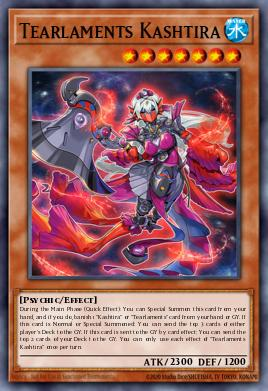

- **Copias y zona:** Main 1x. No altera las cantidades registradas.
- **Nombre oficial de referencia:** Tiagrimentos Kashtira. CID cotejado con la ficha oficial; el nombre histórico del inventario se conserva aunque su grafía/traducción difiera.
- **Función principal y secundaria:** interrupción · extensor · removal.
- **Estado de sinergia y función:** Sinergia indirecta (soporte o recursos). Es una clasificación de juego; revisar la relación concreta en A06.
- **Papel como recurso, descarte o coste:** Coste o consumo descrito en A05: destierro de recurso propio.
- **Efecto operativo (paráfrasis analítica):** acceso al campo desde la mano; destierro de recursos o de amenazas. Son operaciones detectadas en el texto, no efectos independientes garantizados; leer sus condiciones en la fuente.
- **Mapa de activación y resultados:** 1) en Main Phase: Invocación Especial desde Cementerio, destierra el recurso u objetivo previsto. Cada operación está sujeta a la secuencia y al «si lo haces» del texto oficial.
- **Ventanas de activación identificadas:** Main Phase; al producirse una Invocación; al llegar o estar en el Cementerio; Efecto Rápido.
- **Costes o recursos potenciales:** destierro de recurso propio.
- **Restricciones y requisitos:** hay límite por turno según el efecto concreto; interactúa con información oculta o resultados no siempre elegibles. 
- **Prioridad al ir primero:** extender hacia Xyz y disponer de presión de zonas sin exponerse innecesariamente. Para esta carta: Reservar la respuesta para la ventana rival exacta; no es una pieza buscadora de nuestro motor.
- **Prioridad al ir segundo:** superar campo rival con destierros y herramientas de ruptura. Identificar primero la respuesta rival que afecta su función «interrupción».
- **Medio/tardío y recuperación:** recuperar Kashtira del destierro/Cementerio y medir materiales Xyz. No asumir que por sí misma recicla recursos si el texto no lo permite.
- **Sinergias y acceso a líneas:** Relación contextual con monstruos de Nivel 7, Xyz y destierro boca abajo con presión de zonas. Habilita una línea del motor sólo si coinciden recursos, objetivos y restricciones; no equivale a un combo completo validado.
- **Riesgo / brick / interrupciones:** Riesgo operativo: efectos que niegan búsquedas, combaten Xyz o castigan campo saturado. Confirmar objetivos disponibles y costes antes de activar. Puede emplearse en cadena sólo cuando se cumpla su condición concreta.
- **Utilidad editorial:** 4/5 para este deck (estimación por rol y zona, no probabilidad calculada). No cambiar copias; cualquier sugerencia de alta/baja pasa por el apartado 22 y aprobación.
- **Referencia oficial y trazabilidad:** https://www.db.yugioh-card.com/yugiohdb/card_search.action?cid=18153&ope=2&request_locale=es. **Confianza:** texto y tipo de efecto cotejados en Konami; síntesis táctica editorial, no demostración de combo.
- **Aplicación concreta dentro de este deck (A06):** acceso al campo desde la mano; destierro de recursos o de amenazas.

**USO PRÁCTICO Y SINERGIA — Tearlaments Kashtira**

- **Label funcional:** Sinergia indirecta. Clasificación documental; una relación es válida solo si se satisfacen sus condiciones exactas.
- **Qué hace:** acceso al campo desde la mano; destierro de recursos o de amenazas. Son operaciones detectadas en el texto, no efectos independientes garantizados; leer sus condiciones en la fuente.
- **Cómo aprovecharla en este deck:** acceso al campo desde la mano; destierro de recursos o de amenazas.
- **Al jugar primero:** extender hacia Xyz y disponer de presión de zonas sin exponerse innecesariamente. Para esta carta: Reservar la respuesta para la ventana rival exacta; no es una pieza buscadora de nuestro motor.
- **Al jugar segundo:** superar campo rival con destierros y herramientas de ruptura. Identificar primero la respuesta rival que afecta su función «interrupción».
- **Cuándo tener precaución:** Riesgo operativo: efectos que niegan búsquedas, combaten Xyz o castigan campo saturado. Confirmar objetivos disponibles y costes antes de activar. Puede emplearse en cadena sólo cuando se cumpla su condición concreta.

#### 07. Ash Blossom & Joyous Spring

- **Copias y zona:** Main 3x. No altera las cantidades registradas.
- **Nombre oficial de referencia:** Flor de Ceniza & Primavera Feliz. CID cotejado con la ficha oficial; el nombre histórico del inventario se conserva aunque su grafía/traducción difiera.
- **Función principal y secundaria:** handtrap · negación.
- **Estado de sinergia y función:** Utilidad independiente. Es una clasificación de juego; revisar la relación concreta en A06.
- **Papel como recurso, descarte o coste:** Descarte mencionado: comprobar carta que lo exige, zona, coste frente a efecto y utilidad del recurso.
- **Efecto operativo (paráfrasis analítica):** Descarta desde la mano para detener efectos que buscan, invocan o mandan cartas desde el Deck. 
- **Mapa de activación y resultados:** 1) con condición explícita en la carta: niega el efecto o la activación indicada, Invocación Especial desde Deck, incorpora la pieza indicada a la mano. Cada operación está sujeta a la secuencia y al «si lo haces» del texto oficial.
- **Ventanas de activación identificadas:** Efecto Rápido.
- **Costes o recursos potenciales:** descarte de mano.
- **Restricciones y requisitos:** hay límite por turno según el efecto concreto. 
- **Prioridad al ir primero:** extender hacia Xyz y disponer de presión de zonas sin exponerse innecesariamente. Para esta carta: Reservar la respuesta para la ventana rival exacta; no es una pieza buscadora de nuestro motor.
- **Prioridad al ir segundo:** superar campo rival con destierros y herramientas de ruptura. Identificar primero la respuesta rival que afecta su función «handtrap».
- **Medio/tardío y recuperación:** recuperar Kashtira del destierro/Cementerio y medir materiales Xyz. Verificar que el objetivo de recuperación continúe disponible.
- **Sinergias y acceso a líneas:** Relación contextual con monstruos de Nivel 7, Xyz y destierro boca abajo con presión de zonas. Habilita una línea del motor sólo si coinciden recursos, objetivos y restricciones; no equivale a un combo completo validado.
- **Riesgo / brick / interrupciones:** Reaccionar al efecto del Deck que habilite la jugada rival; no da búsquedas propias. Puede emplearse en cadena sólo cuando se cumpla su condición concreta.
- **Utilidad editorial:** 3/5 para este deck (estimación por rol y zona, no probabilidad calculada). No cambiar copias; cualquier sugerencia de alta/baja pasa por el apartado 22 y aprobación.
- **Referencia oficial y trazabilidad:** https://www.db.yugioh-card.com/yugiohdb/card_search.action?cid=12950&ope=2&request_locale=es. **Confianza:** texto y tipo de efecto cotejados en Konami; síntesis táctica editorial, no demostración de combo.
- **Aplicación concreta dentro de este deck (A06):** Descarta desde la mano para detener efectos que buscan, invocan o mandan cartas desde el Deck. Aporta respuesta o consistencia sin exigir enlace directo.

**USO PRÁCTICO Y SINERGIA — Ash Blossom & Joyous Spring**

- **Label funcional:** Función independiente. Clasificación documental; una relación es válida solo si se satisfacen sus condiciones exactas.
- **Qué hace:** Descarta desde la mano para detener efectos que buscan, invocan o mandan cartas desde el Deck.
- **Cómo aprovecharla en este deck:** Descarta desde la mano para detener efectos que buscan, invocan o mandan cartas desde el Deck. Aporta respuesta o consistencia sin exigir enlace directo.
- **Al jugar primero:** extender hacia Xyz y disponer de presión de zonas sin exponerse innecesariamente. Para esta carta: Reservar la respuesta para la ventana rival exacta; no es una pieza buscadora de nuestro motor.
- **Al jugar segundo:** superar campo rival con destierros y herramientas de ruptura. Identificar primero la respuesta rival que afecta su función «handtrap».
- **Cuándo tener precaución:** Reaccionar al efecto del Deck que habilite la jugada rival; no da búsquedas propias. Puede emplearse en cadena sólo cuando se cumpla su condición concreta.

#### 08. Dimension Shifter

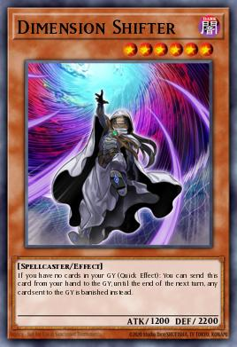

- **Copias y zona:** Main 1x, Reserva 2x. No altera las cantidades registradas.
- **Nombre oficial de referencia:** Variador Dimensional. CID cotejado con la ficha oficial; el nombre histórico del inventario se conserva aunque su grafía/traducción difiera.
- **Función principal y secundaria:** handtrap · macro-destierro.
- **Estado de sinergia y función:** Utilidad independiente. Es una clasificación de juego; revisar la relación concreta en A06.
- **Papel como recurso, descarte o coste:** Envío mencionado en la interacción; no equivale por sí mismo a descarte desde la mano.
- **Efecto operativo (paráfrasis analítica):** Si el Cementerio propio está vacío, se envía desde mano y hace que las cartas que irían al Cementerio se destierren hasta el final del turno siguiente. 
- **Mapa de activación y resultados:** 1) con condición explícita en la carta: destierra el recurso u objetivo previsto. Cada operación está sujeta a la secuencia y al «si lo haces» del texto oficial.
- **Ventanas de activación identificadas:** Efecto Rápido.
- **Costes o recursos potenciales:** envío de recurso propio al Cementerio.
- **Restricciones y requisitos:** depende de recursos en Cementerio. 
- **Prioridad al ir primero:** extender hacia Xyz y disponer de presión de zonas sin exponerse innecesariamente. Para esta carta: Reservar la respuesta para la ventana rival exacta; no es una pieza buscadora de nuestro motor.
- **Prioridad al ir segundo:** superar campo rival con destierros y herramientas de ruptura. Identificar primero la respuesta rival que afecta su función «handtrap».
- **Medio/tardío y recuperación:** recuperar Kashtira del destierro/Cementerio y medir materiales Xyz. No asumir que por sí misma recicla recursos si el texto no lo permite.
- **Sinergias y acceso a líneas:** Relación contextual con monstruos de Nivel 7, Xyz y destierro boca abajo con presión de zonas. Habilita una línea del motor sólo si coinciden recursos, objetivos y restricciones; no equivale a un combo completo validado.
- **Riesgo / brick / interrupciones:** Afecta también los envíos propios; no activarlo tras llenar el Cementerio. Puede emplearse en cadena sólo cuando se cumpla su condición concreta.
- **Utilidad editorial:** 3/5 para este deck (estimación por rol y zona, no probabilidad calculada). No cambiar copias; cualquier sugerencia de alta/baja pasa por el apartado 22 y aprobación.
- **Referencia oficial y trazabilidad:** https://www.db.yugioh-card.com/yugiohdb/card_search.action?cid=14740&ope=2&request_locale=es. **Confianza:** texto y tipo de efecto cotejados en Konami; síntesis táctica editorial, no demostración de combo.
- **Aplicación concreta dentro de este deck (A06):** Si el Cementerio propio está vacío, se envía desde mano y hace que las cartas que irían al Cementerio se destierren hasta el final del turno siguiente. Aporta respuesta o consistencia sin exigir enlace directo.

**USO PRÁCTICO Y SINERGIA — Dimension Shifter**

- **Label funcional:** Función independiente. Clasificación documental; una relación es válida solo si se satisfacen sus condiciones exactas.
- **Qué hace:** Si el Cementerio propio está vacío, se envía desde mano y hace que las cartas que irían al Cementerio se destierren hasta el final del turno siguiente.
- **Cómo aprovecharla en este deck:** Si el Cementerio propio está vacío, se envía desde mano y hace que las cartas que irían al Cementerio se destierren hasta el final del turno siguiente. Aporta respuesta o consistencia sin exigir enlace directo.
- **Al jugar primero:** extender hacia Xyz y disponer de presión de zonas sin exponerse innecesariamente. Para esta carta: Reservar la respuesta para la ventana rival exacta; no es una pieza buscadora de nuestro motor.
- **Al jugar segundo:** superar campo rival con destierros y herramientas de ruptura. Identificar primero la respuesta rival que afecta su función «handtrap».
- **Cuándo tener precaución:** Afecta también los envíos propios; no activarlo tras llenar el Cementerio. Puede emplearse en cadena sólo cuando se cumpla su condición concreta.

#### 09. Pressured Planet Wraitsoth

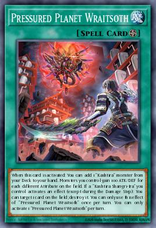

- **Copias y zona:** Main 3x. No altera las cantidades registradas.
- **Nombre oficial de referencia:** Planeta Bajo Presión Wraitsoth. CID cotejado con la ficha oficial; el nombre histórico del inventario se conserva aunque su grafía/traducción difiera.
- **Función principal y secundaria:** searcher · buscador · cierre.
- **Estado de sinergia y función:** Sinergia directa descrita. Es una clasificación de juego; revisar la relación concreta en A06.
- **Papel como recurso, descarte o coste:** No se demuestra que esta carta sea recurso de descarte o pago para otra.
- **Efecto operativo (paráfrasis analítica):** búsqueda o incorporación de cartas a mano; presión de combate o modificación de estadísticas. Son operaciones detectadas en el texto, no efectos independientes garantizados; leer sus condiciones en la fuente.
- **Mapa de activación y resultados:** 1) con condición explícita en la carta: incorpora la pieza indicada a la mano. Cada operación está sujeta a la secuencia y al «si lo haces» del texto oficial.
- **Ventanas de activación identificadas:** requieren la fase o condición específica indicada en el texto; sin ventana rápida general asumida.
- **Costes o recursos potenciales:** sin coste independiente identificado en esta síntesis; comprobar las acciones previas al punto y coma de cada efecto.
- **Restricciones y requisitos:** hay límite por turno según el efecto concreto. 
- **Prioridad al ir primero:** extender hacia Xyz y disponer de presión de zonas sin exponerse innecesariamente. Para esta carta: Convertir la activación en acceso a la siguiente pieza del motor, sin duplicar buscadores inútilmente.
- **Prioridad al ir segundo:** superar campo rival con destierros y herramientas de ruptura. Identificar primero la respuesta rival que afecta su función «searcher».
- **Medio/tardío y recuperación:** recuperar Kashtira del destierro/Cementerio y medir materiales Xyz. No asumir que por sí misma recicla recursos si el texto no lo permite.
- **Sinergias y acceso a líneas:** Relación contextual con monstruos de Nivel 7, Xyz y destierro boca abajo con presión de zonas. Habilita una línea del motor sólo si coinciden recursos, objetivos y restricciones; no equivale a un combo completo validado.
- **Riesgo / brick / interrupciones:** Riesgo operativo: efectos que niegan búsquedas, combaten Xyz o castigan campo saturado. Confirmar objetivos disponibles y costes antes de activar. No atribuirle velocidad rápida por el solo hecho de formar parte del motor.
- **Utilidad editorial:** 5/5 para este deck (estimación por rol y zona, no probabilidad calculada). No cambiar copias; cualquier sugerencia de alta/baja pasa por el apartado 22 y aprobación.
- **Referencia oficial y trazabilidad:** https://www.db.yugioh-card.com/yugiohdb/card_search.action?cid=18204&ope=2&request_locale=es. **Confianza:** texto y tipo de efecto cotejados en Konami; síntesis táctica editorial, no demostración de combo.
- **Aplicación concreta dentro de este deck (A06):** búsqueda o incorporación de cartas a mano; presión de combate o modificación de estadísticas.

**USO PRÁCTICO Y SINERGIA — Pressured Planet Wraitsoth**

- **Label funcional:** Sinergia directa. Clasificación documental; una relación es válida solo si se satisfacen sus condiciones exactas.
- **Qué hace:** búsqueda o incorporación de cartas a mano; presión de combate o modificación de estadísticas. Son operaciones detectadas en el texto, no efectos independientes garantizados; leer sus condiciones en la fuente.
- **Cómo aprovecharla en este deck:** búsqueda o incorporación de cartas a mano; presión de combate o modificación de estadísticas.
- **Al jugar primero:** extender hacia Xyz y disponer de presión de zonas sin exponerse innecesariamente. Para esta carta: Convertir la activación en acceso a la siguiente pieza del motor, sin duplicar buscadores inútilmente.
- **Al jugar segundo:** superar campo rival con destierros y herramientas de ruptura. Identificar primero la respuesta rival que afecta su función «searcher».
- **Cuándo tener precaución:** Riesgo operativo: efectos que niegan búsquedas, combaten Xyz o castigan campo saturado. Confirmar objetivos disponibles y costes antes de activar. No atribuirle velocidad rápida por el solo hecho de formar parte del motor.

#### 10. Kashtira Birth

- **Copias y zona:** Main 3x. No altera las cantidades registradas.
- **Nombre oficial de referencia:** Nacimiento Kashtira. CID cotejado con la ficha oficial; el nombre histórico del inventario se conserva aunque su grafía/traducción difiera.
- **Función principal y secundaria:** recuperación · removal · coste/recurso.
- **Estado de sinergia y función:** Sinergia directa descrita. Es una clasificación de juego; revisar la relación concreta en A06.
- **Papel como recurso, descarte o coste:** No se demuestra que esta carta sea recurso de descarte o pago para otra.
- **Efecto operativo (paráfrasis analítica):** recuperación e invocación desde Cementerio/destierro; destierro de recursos o de amenazas; uso de Sacrificios como parte del efecto. Son operaciones detectadas en el texto, no efectos independientes garantizados; leer sus condiciones en la fuente.
- **Mapa de activación y resultados:** 1) en Main Phase: Invocación Especial desde Cementerio, destierra el recurso u objetivo previsto. Cada operación está sujeta a la secuencia y al «si lo haces» del texto oficial.
- **Ventanas de activación identificadas:** Main Phase; respuesta a activación rival.
- **Costes o recursos potenciales:** sin coste independiente identificado en esta síntesis; comprobar las acciones previas al punto y coma de cada efecto.
- **Restricciones y requisitos:** hay límite por turno según el efecto concreto; depende de recursos en Cementerio; interactúa con información oculta o resultados no siempre elegibles. 
- **Prioridad al ir primero:** extender hacia Xyz y disponer de presión de zonas sin exponerse innecesariamente. Para esta carta: Escoger la amenaza o recurso que genere mayor ventaja de tempo; respetar selección y zona.
- **Prioridad al ir segundo:** superar campo rival con destierros y herramientas de ruptura. Identificar primero la respuesta rival que afecta su función «recuperación».
- **Medio/tardío y recuperación:** recuperar Kashtira del destierro/Cementerio y medir materiales Xyz. Verificar que el objetivo de recuperación continúe disponible.
- **Sinergias y acceso a líneas:** Relación contextual con monstruos de Nivel 7, Xyz y destierro boca abajo con presión de zonas. Habilita una línea del motor sólo si coinciden recursos, objetivos y restricciones; no equivale a un combo completo validado.
- **Riesgo / brick / interrupciones:** Depende del Cementerio y es sensible a destierro o negación de ese recurso. No atribuirle velocidad rápida por el solo hecho de formar parte del motor.
- **Utilidad editorial:** 3/5 para este deck (estimación por rol y zona, no probabilidad calculada). No cambiar copias; cualquier sugerencia de alta/baja pasa por el apartado 22 y aprobación.
- **Referencia oficial y trazabilidad:** https://www.db.yugioh-card.com/yugiohdb/card_search.action?cid=17815&ope=2&request_locale=es. **Confianza:** texto y tipo de efecto cotejados en Konami; síntesis táctica editorial, no demostración de combo.
- **Aplicación concreta dentro de este deck (A06):** recuperación e invocación desde Cementerio/destierro; destierro de recursos o de amenazas; uso de Sacrificios como parte del efecto.

**USO PRÁCTICO Y SINERGIA — Kashtira Birth**

- **Label funcional:** Sinergia directa. Clasificación documental; una relación es válida solo si se satisfacen sus condiciones exactas.
- **Qué hace:** recuperación e invocación desde Cementerio/destierro; destierro de recursos o de amenazas; uso de Sacrificios como parte del efecto. Son operaciones detectadas en el texto, no efectos independientes garantizados; leer sus condiciones en la fuente.
- **Cómo aprovecharla en este deck:** recuperación e invocación desde Cementerio/destierro; destierro de recursos o de amenazas; uso de Sacrificios como parte del efecto.
- **Al jugar primero:** extender hacia Xyz y disponer de presión de zonas sin exponerse innecesariamente. Para esta carta: Escoger la amenaza o recurso que genere mayor ventaja de tempo; respetar selección y zona.
- **Al jugar segundo:** superar campo rival con destierros y herramientas de ruptura. Identificar primero la respuesta rival que afecta su función «recuperación».
- **Cuándo tener precaución:** Depende del Cementerio y es sensible a destierro o negación de ese recurso. No atribuirle velocidad rápida por el solo hecho de formar parte del motor.

#### 11. Kashtiratheosis

- **Copias y zona:** Main 3x. No altera las cantidades registradas.
- **Nombre oficial de referencia:** Kashtirateosis. CID cotejado con la ficha oficial; el nombre histórico del inventario se conserva aunque su grafía/traducción difiera.
- **Función principal y secundaria:** extensor · recuperación · removal · cierre · respuesta.
- **Estado de sinergia y función:** Sinergia directa descrita. Es una clasificación de juego; revisar la relación concreta en A06.
- **Papel como recurso, descarte o coste:** No se demuestra que esta carta sea recurso de descarte o pago para otra.
- **Efecto operativo (paráfrasis analítica):** extensión mediante monstruos procedentes del Deck; recuperación e invocación desde Cementerio/destierro; destierro de recursos o de amenazas; presión de combate o modificación de estadísticas; interacción sobre monstruos en campo. Son operaciones detectadas en el texto, no efectos independientes garantizados; leer sus condiciones en la fuente.
- **Mapa de activación y resultados:** 1) con condición explícita en la carta: destierra el recurso u objetivo previsto. Cada operación está sujeta a la secuencia y al «si lo haces» del texto oficial.
- **Ventanas de activación identificadas:** al ser desterrada.
- **Costes o recursos potenciales:** sin coste independiente identificado en esta síntesis; comprobar las acciones previas al punto y coma de cada efecto.
- **Restricciones y requisitos:** hay límite por turno según el efecto concreto; puede bloquear tipos de Invocación del Extra Deck. 
- **Prioridad al ir primero:** extender hacia Xyz y disponer de presión de zonas sin exponerse innecesariamente. Para esta carta: Convertir acceso al Deck en cuerpos o materiales antes de bloquearse con restricciones.
- **Prioridad al ir segundo:** superar campo rival con destierros y herramientas de ruptura. Identificar primero la respuesta rival que afecta su función «extensor».
- **Medio/tardío y recuperación:** recuperar Kashtira del destierro/Cementerio y medir materiales Xyz. Verificar que el objetivo de recuperación continúe disponible.
- **Sinergias y acceso a líneas:** Relación contextual con monstruos de Nivel 7, Xyz y destierro boca abajo con presión de zonas. Habilita una línea del motor sólo si coinciden recursos, objetivos y restricciones; no equivale a un combo completo validado.
- **Riesgo / brick / interrupciones:** La restricción de invocaciones puede cerrar rutas alternativas; revisar el orden de activación. No atribuirle velocidad rápida por el solo hecho de formar parte del motor.
- **Utilidad editorial:** 4/5 para este deck (estimación por rol y zona, no probabilidad calculada). No cambiar copias; cualquier sugerencia de alta/baja pasa por el apartado 22 y aprobación.
- **Referencia oficial y trazabilidad:** https://www.db.yugioh-card.com/yugiohdb/card_search.action?cid=18203&ope=2&request_locale=es. **Confianza:** texto y tipo de efecto cotejados en Konami; síntesis táctica editorial, no demostración de combo.
- **Aplicación concreta dentro de este deck (A06):** extensión mediante monstruos procedentes del Deck; recuperación e invocación desde Cementerio/destierro; destierro de recursos o de amenazas; presión de combate o modificación de estadísticas; interacción sobre monstruos en campo.

**USO PRÁCTICO Y SINERGIA — Kashtiratheosis**

- **Label funcional:** Sinergia directa. Clasificación documental; una relación es válida solo si se satisfacen sus condiciones exactas.
- **Qué hace:** extensión mediante monstruos procedentes del Deck; recuperación e invocación desde Cementerio/destierro; destierro de recursos o de amenazas; presión de combate o modificación de estadísticas; interacción sobre monstruos en campo. Son operaciones detectadas en el texto, no efectos independientes garantizados; leer sus condiciones en la fuente.
- **Cómo aprovecharla en este deck:** extensión mediante monstruos procedentes del Deck; recuperación e invocación desde Cementerio/destierro; destierro de recursos o de amenazas; presión de combate o modificación de estadísticas; interacción sobre monstruos en campo.
- **Al jugar primero:** extender hacia Xyz y disponer de presión de zonas sin exponerse innecesariamente. Para esta carta: Convertir acceso al Deck en cuerpos o materiales antes de bloquearse con restricciones.
- **Al jugar segundo:** superar campo rival con destierros y herramientas de ruptura. Identificar primero la respuesta rival que afecta su función «extensor».
- **Cuándo tener precaución:** La restricción de invocaciones puede cerrar rutas alternativas; revisar el orden de activación. No atribuirle velocidad rápida por el solo hecho de formar parte del motor.

#### 12. Terraforming

- **Copias y zona:** Main 1x. No altera las cantidades registradas.
- **Nombre oficial de referencia:** Terraformación. CID cotejado con la ficha oficial; el nombre histórico del inventario se conserva aunque su grafía/traducción difiera.
- **Función principal y secundaria:** mágica · búsqueda de campo.
- **Estado de sinergia y función:** Utilidad independiente. Es una clasificación de juego; revisar la relación concreta en A06.
- **Papel como recurso, descarte o coste:** No se demuestra que esta carta sea recurso de descarte o pago para otra.
- **Efecto operativo (paráfrasis analítica):** Busca una Mágica de Campo en el Deck y la lleva a la mano. 
- **Mapa de activación y resultados:** 1) efecto propio o continuo: incorpora la pieza indicada a la mano. Cada operación está sujeta a la secuencia y al «si lo haces» del texto oficial.
- **Ventanas de activación identificadas:** requieren la fase o condición específica indicada en el texto; sin ventana rápida general asumida.
- **Costes o recursos potenciales:** sin coste independiente identificado en esta síntesis; comprobar las acciones previas al punto y coma de cada efecto.
- **Restricciones y requisitos:** aplicar restricciones de selección, activación y copias que consten en el texto original. 
- **Prioridad al ir primero:** extender hacia Xyz y disponer de presión de zonas sin exponerse innecesariamente. Para esta carta: Convertir la activación en acceso a la siguiente pieza del motor, sin duplicar buscadores inútilmente.
- **Prioridad al ir segundo:** superar campo rival con destierros y herramientas de ruptura. Identificar primero la respuesta rival que afecta su función «mágica».
- **Medio/tardío y recuperación:** recuperar Kashtira del destierro/Cementerio y medir materiales Xyz. No asumir que por sí misma recicla recursos si el texto no lo permite.
- **Sinergias y acceso a líneas:** Relación contextual con monstruos de Nivel 7, Xyz y destierro boca abajo con presión de zonas. Habilita una línea del motor sólo si coinciden recursos, objetivos y restricciones; no equivale a un combo completo validado.
- **Riesgo / brick / interrupciones:** Si el objetivo de campo ya no está en Deck, pierde utilidad. No atribuirle velocidad rápida por el solo hecho de formar parte del motor.
- **Utilidad editorial:** 3/5 para este deck (estimación por rol y zona, no probabilidad calculada). No cambiar copias; cualquier sugerencia de alta/baja pasa por el apartado 22 y aprobación.
- **Referencia oficial y trazabilidad:** https://www.db.yugioh-card.com/yugiohdb/card_search.action?cid=5537&ope=2&request_locale=es. **Confianza:** texto y tipo de efecto cotejados en Konami; síntesis táctica editorial, no demostración de combo.
- **Aplicación concreta dentro de este deck (A06):** Busca una Mágica de Campo en el Deck y la lleva a la mano. Aporta respuesta o consistencia sin exigir enlace directo.

**USO PRÁCTICO Y SINERGIA — Terraforming**

- **Label funcional:** Función independiente. Clasificación documental; una relación es válida solo si se satisfacen sus condiciones exactas.
- **Qué hace:** Busca una Mágica de Campo en el Deck y la lleva a la mano.
- **Cómo aprovecharla en este deck:** Busca una Mágica de Campo en el Deck y la lleva a la mano. Aporta respuesta o consistencia sin exigir enlace directo.
- **Al jugar primero:** extender hacia Xyz y disponer de presión de zonas sin exponerse innecesariamente. Para esta carta: Convertir la activación en acceso a la siguiente pieza del motor, sin duplicar buscadores inútilmente.
- **Al jugar segundo:** superar campo rival con destierros y herramientas de ruptura. Identificar primero la respuesta rival que afecta su función «mágica».
- **Cuándo tener precaución:** Si el objetivo de campo ya no está en Deck, pierde utilidad. No atribuirle velocidad rápida por el solo hecho de formar parte del motor.

#### 13. Book of Moon

- **Copias y zona:** Main 2x, Reserva 1x. No altera las cantidades registradas.
- **Nombre oficial de referencia:** Libro de la Luna. CID cotejado con la ficha oficial; el nombre histórico del inventario se conserva aunque su grafía/traducción difiera.
- **Función principal y secundaria:** control de zonas · cierre.
- **Estado de sinergia y función:** Utilidad independiente. Es una clasificación de juego; revisar la relación concreta en A06.
- **Papel como recurso, descarte o coste:** No se demuestra que esta carta sea recurso de descarte o pago para otra.
- **Efecto operativo (paráfrasis analítica):** manipulación de posiciones o zonas; presión de combate o modificación de estadísticas. Son operaciones detectadas en el texto, no efectos independientes garantizados; leer sus condiciones en la fuente.
- **Mapa de activación y resultados:** 1) efecto propio o continuo: modifica posiciones o zonas. Cada operación está sujeta a la secuencia y al «si lo haces» del texto oficial.
- **Ventanas de activación identificadas:** requieren la fase o condición específica indicada en el texto; sin ventana rápida general asumida.
- **Costes o recursos potenciales:** sin coste independiente identificado en esta síntesis; comprobar las acciones previas al punto y coma de cada efecto.
- **Restricciones y requisitos:** interactúa con información oculta o resultados no siempre elegibles. 
- **Prioridad al ir primero:** extender hacia Xyz y disponer de presión de zonas sin exponerse innecesariamente. Para esta carta: Activar cuando las condiciones permitan obtener valor real, preservando recursos de seguimiento.
- **Prioridad al ir segundo:** superar campo rival con destierros y herramientas de ruptura. Identificar primero la respuesta rival que afecta su función «control de zonas».
- **Medio/tardío y recuperación:** recuperar Kashtira del destierro/Cementerio y medir materiales Xyz. No asumir que por sí misma recicla recursos si el texto no lo permite.
- **Sinergias y acceso a líneas:** Relación contextual con monstruos de Nivel 7, Xyz y destierro boca abajo con presión de zonas. Habilita una línea del motor sólo si coinciden recursos, objetivos y restricciones; no equivale a un combo completo validado.
- **Riesgo / brick / interrupciones:** Riesgo operativo: efectos que niegan búsquedas, combaten Xyz o castigan campo saturado. Confirmar objetivos disponibles y costes antes de activar. No atribuirle velocidad rápida por el solo hecho de formar parte del motor.
- **Utilidad editorial:** 3/5 para este deck (estimación por rol y zona, no probabilidad calculada). No cambiar copias; cualquier sugerencia de alta/baja pasa por el apartado 22 y aprobación.
- **Referencia oficial y trazabilidad:** https://www.db.yugioh-card.com/yugiohdb/card_search.action?cid=5432&ope=2&request_locale=es. **Confianza:** texto y tipo de efecto cotejados en Konami; síntesis táctica editorial, no demostración de combo.
- **Aplicación concreta dentro de este deck (A06):** manipulación de posiciones o zonas; presión de combate o modificación de estadísticas. Aporta respuesta o consistencia sin exigir enlace directo.

**USO PRÁCTICO Y SINERGIA — Book of Moon**

- **Label funcional:** Función independiente. Clasificación documental; una relación es válida solo si se satisfacen sus condiciones exactas.
- **Qué hace:** manipulación de posiciones o zonas; presión de combate o modificación de estadísticas. Son operaciones detectadas en el texto, no efectos independientes garantizados; leer sus condiciones en la fuente.
- **Cómo aprovecharla en este deck:** manipulación de posiciones o zonas; presión de combate o modificación de estadísticas. Aporta respuesta o consistencia sin exigir enlace directo.
- **Al jugar primero:** extender hacia Xyz y disponer de presión de zonas sin exponerse innecesariamente. Para esta carta: Activar cuando las condiciones permitan obtener valor real, preservando recursos de seguimiento.
- **Al jugar segundo:** superar campo rival con destierros y herramientas de ruptura. Identificar primero la respuesta rival que afecta su función «control de zonas».
- **Cuándo tener precaución:** Riesgo operativo: efectos que niegan búsquedas, combaten Xyz o castigan campo saturado. Confirmar objetivos disponibles y costes antes de activar. No atribuirle velocidad rápida por el solo hecho de formar parte del motor.

#### 14. Dark Hole

- **Copias y zona:** Main 3x. No altera las cantidades registradas.
- **Nombre oficial de referencia:** Agujero Oscuro. CID cotejado con la ficha oficial; el nombre histórico del inventario se conserva aunque su grafía/traducción difiera.
- **Función principal y secundaria:** removal.
- **Estado de sinergia y función:** Utilidad independiente. Es una clasificación de juego; revisar la relación concreta en A06.
- **Papel como recurso, descarte o coste:** No se demuestra que esta carta sea recurso de descarte o pago para otra.
- **Efecto operativo (paráfrasis analítica):** destrucción de cartas o empleo de destrucción como detonante. Son operaciones detectadas en el texto, no efectos independientes garantizados; leer sus condiciones en la fuente.
- **Mapa de activación y resultados:** 1) efecto propio o continuo: destruye la carta o recurso previsto. Cada operación está sujeta a la secuencia y al «si lo haces» del texto oficial.
- **Ventanas de activación identificadas:** requieren la fase o condición específica indicada en el texto; sin ventana rápida general asumida.
- **Costes o recursos potenciales:** sin coste independiente identificado en esta síntesis; comprobar las acciones previas al punto y coma de cada efecto.
- **Restricciones y requisitos:** aplicar restricciones de selección, activación y copias que consten en el texto original. 
- **Prioridad al ir primero:** extender hacia Xyz y disponer de presión de zonas sin exponerse innecesariamente. Para esta carta: Activar cuando las condiciones permitan obtener valor real, preservando recursos de seguimiento.
- **Prioridad al ir segundo:** superar campo rival con destierros y herramientas de ruptura. Identificar primero la respuesta rival que afecta su función «removal».
- **Medio/tardío y recuperación:** recuperar Kashtira del destierro/Cementerio y medir materiales Xyz. No asumir que por sí misma recicla recursos si el texto no lo permite.
- **Sinergias y acceso a líneas:** Relación contextual con monstruos de Nivel 7, Xyz y destierro boca abajo con presión de zonas. Habilita una línea del motor sólo si coinciden recursos, objetivos y restricciones; no equivale a un combo completo validado.
- **Riesgo / brick / interrupciones:** Riesgo operativo: efectos que niegan búsquedas, combaten Xyz o castigan campo saturado. Confirmar objetivos disponibles y costes antes de activar. No atribuirle velocidad rápida por el solo hecho de formar parte del motor.
- **Utilidad editorial:** 3/5 para este deck (estimación por rol y zona, no probabilidad calculada). No cambiar copias; cualquier sugerencia de alta/baja pasa por el apartado 22 y aprobación.
- **Referencia oficial y trazabilidad:** https://www.db.yugioh-card.com/yugiohdb/card_search.action?cid=4342&ope=2&request_locale=es. **Confianza:** texto y tipo de efecto cotejados en Konami; síntesis táctica editorial, no demostración de combo.
- **Aplicación concreta dentro de este deck (A06):** destrucción de cartas o empleo de destrucción como detonante. Aporta respuesta o consistencia sin exigir enlace directo.

**USO PRÁCTICO Y SINERGIA — Dark Hole**

- **Label funcional:** Función independiente. Clasificación documental; una relación es válida solo si se satisfacen sus condiciones exactas.
- **Qué hace:** destrucción de cartas o empleo de destrucción como detonante. Son operaciones detectadas en el texto, no efectos independientes garantizados; leer sus condiciones en la fuente.
- **Cómo aprovecharla en este deck:** destrucción de cartas o empleo de destrucción como detonante. Aporta respuesta o consistencia sin exigir enlace directo.
- **Al jugar primero:** extender hacia Xyz y disponer de presión de zonas sin exponerse innecesariamente. Para esta carta: Activar cuando las condiciones permitan obtener valor real, preservando recursos de seguimiento.
- **Al jugar segundo:** superar campo rival con destierros y herramientas de ruptura. Identificar primero la respuesta rival que afecta su función «removal».
- **Cuándo tener precaución:** Riesgo operativo: efectos que niegan búsquedas, combaten Xyz o castigan campo saturado. Confirmar objetivos disponibles y costes antes de activar. No atribuirle velocidad rápida por el solo hecho de formar parte del motor.

#### 15. Pot of Prosperity

- **Copias y zona:** Main 2x, Reserva 1x. No altera las cantidades registradas.
- **Nombre oficial de referencia:** Olla de la Prosperidad. CID cotejado con la ficha oficial; el nombre histórico del inventario se conserva aunque su grafía/traducción difiera.
- **Función principal y secundaria:** searcher · buscador · removal · ventaja de mano · cierre.
- **Estado de sinergia y función:** Utilidad independiente. Es una clasificación de juego; revisar la relación concreta en A06.
- **Papel como recurso, descarte o coste:** No se demuestra que esta carta sea recurso de descarte o pago para otra.
- **Efecto operativo (paráfrasis analítica):** búsqueda o incorporación de cartas a mano; destierro de recursos o de amenazas; generación de cartas por robo; presión de combate o modificación de estadísticas. Son operaciones detectadas en el texto, no efectos independientes garantizados; leer sus condiciones en la fuente.
- **Mapa de activación y resultados:** 1) efecto propio o continuo: incorpora la pieza indicada a la mano, destierra el recurso u objetivo previsto. Cada operación está sujeta a la secuencia y al «si lo haces» del texto oficial.
- **Ventanas de activación identificadas:** requieren la fase o condición específica indicada en el texto; sin ventana rápida general asumida.
- **Costes o recursos potenciales:** sin coste independiente identificado en esta síntesis; comprobar las acciones previas al punto y coma de cada efecto.
- **Restricciones y requisitos:** hay límite por turno según el efecto concreto; interactúa con información oculta o resultados no siempre elegibles. 
- **Prioridad al ir primero:** extender hacia Xyz y disponer de presión de zonas sin exponerse innecesariamente. Para esta carta: Convertir la activación en acceso a la siguiente pieza del motor, sin duplicar buscadores inútilmente.
- **Prioridad al ir segundo:** superar campo rival con destierros y herramientas de ruptura. Identificar primero la respuesta rival que afecta su función «searcher».
- **Medio/tardío y recuperación:** recuperar Kashtira del destierro/Cementerio y medir materiales Xyz. No asumir que por sí misma recicla recursos si el texto no lo permite.
- **Sinergias y acceso a líneas:** Relación contextual con monstruos de Nivel 7, Xyz y destierro boca abajo con presión de zonas. Habilita una línea del motor sólo si coinciden recursos, objetivos y restricciones; no equivale a un combo completo validado.
- **Riesgo / brick / interrupciones:** Riesgo operativo: efectos que niegan búsquedas, combaten Xyz o castigan campo saturado. Confirmar objetivos disponibles y costes antes de activar. No atribuirle velocidad rápida por el solo hecho de formar parte del motor.
- **Utilidad editorial:** 5/5 para este deck (estimación por rol y zona, no probabilidad calculada). No cambiar copias; cualquier sugerencia de alta/baja pasa por el apartado 22 y aprobación.
- **Referencia oficial y trazabilidad:** https://www.db.yugioh-card.com/yugiohdb/card_search.action?cid=15756&ope=2&request_locale=es. **Confianza:** texto y tipo de efecto cotejados en Konami; síntesis táctica editorial, no demostración de combo.
- **Aplicación concreta dentro de este deck (A06):** búsqueda o incorporación de cartas a mano; destierro de recursos o de amenazas; generación de cartas por robo; presión de combate o modificación de estadísticas. Aporta respuesta o consistencia sin exigir enlace directo.

**USO PRÁCTICO Y SINERGIA — Pot of Prosperity**

- **Label funcional:** Función independiente. Clasificación documental; una relación es válida solo si se satisfacen sus condiciones exactas.
- **Qué hace:** búsqueda o incorporación de cartas a mano; destierro de recursos o de amenazas; generación de cartas por robo; presión de combate o modificación de estadísticas. Son operaciones detectadas en el texto, no efectos independientes garantizados; leer sus condiciones en la fuente.
- **Cómo aprovecharla en este deck:** búsqueda o incorporación de cartas a mano; destierro de recursos o de amenazas; generación de cartas por robo; presión de combate o modificación de estadísticas. Aporta respuesta o consistencia sin exigir enlace directo.
- **Al jugar primero:** extender hacia Xyz y disponer de presión de zonas sin exponerse innecesariamente. Para esta carta: Convertir la activación en acceso a la siguiente pieza del motor, sin duplicar buscadores inútilmente.
- **Al jugar segundo:** superar campo rival con destierros y herramientas de ruptura. Identificar primero la respuesta rival que afecta su función «searcher».
- **Cuándo tener precaución:** Riesgo operativo: efectos que niegan búsquedas, combaten Xyz o castigan campo saturado. Confirmar objetivos disponibles y costes antes de activar. No atribuirle velocidad rápida por el solo hecho de formar parte del motor.

#### 16. Cosmic Cyclone

- **Copias y zona:** Main 2x. No altera las cantidades registradas.
- **Nombre oficial de referencia:** Ciclón del Cosmos. CID cotejado con la ficha oficial; el nombre histórico del inventario se conserva aunque su grafía/traducción difiera.
- **Función principal y secundaria:** mágica rápida · remoción.
- **Estado de sinergia y función:** Utilidad independiente. Es una clasificación de juego; revisar la relación concreta en A06.
- **Papel como recurso, descarte o coste:** Destierro como uso/recurso; comprobar origen, coste o efecto y recuperación.
- **Efecto operativo (paráfrasis analítica):** Paga 1000 LP para desterrar una Mágica/Trampa en campo. 
- **Mapa de activación y resultados:** efecto de estadística, condición o material; no asumir un disparador adicional. Cada operación está sujeta a la secuencia y al «si lo haces» del texto oficial.
- **Ventanas de activación identificadas:** requieren la fase o condición específica indicada en el texto; sin ventana rápida general asumida.
- **Costes o recursos potenciales:** pago de LP.
- **Restricciones y requisitos:** aplicar restricciones de selección, activación y copias que consten en el texto original. 
- **Prioridad al ir primero:** extender hacia Xyz y disponer de presión de zonas sin exponerse innecesariamente. Para esta carta: Activar cuando las condiciones permitan obtener valor real, preservando recursos de seguimiento.
- **Prioridad al ir segundo:** superar campo rival con destierros y herramientas de ruptura. Identificar primero la respuesta rival que afecta su función «mágica rápida».
- **Medio/tardío y recuperación:** recuperar Kashtira del destierro/Cementerio y medir materiales Xyz. No asumir que por sí misma recicla recursos si el texto no lo permite.
- **Sinergias y acceso a líneas:** Relación contextual con monstruos de Nivel 7, Xyz y destierro boca abajo con presión de zonas. Habilita una línea del motor sólo si coinciden recursos, objetivos y restricciones; no equivale a un combo completo validado.
- **Riesgo / brick / interrupciones:** El coste de LP y selección de objetivo deben pagarse/declararse antes de la resolución. No atribuirle velocidad rápida por el solo hecho de formar parte del motor.
- **Utilidad editorial:** 3/5 para este deck (estimación por rol y zona, no probabilidad calculada). No cambiar copias; cualquier sugerencia de alta/baja pasa por el apartado 22 y aprobación.
- **Referencia oficial y trazabilidad:** https://www.db.yugioh-card.com/yugiohdb/card_search.action?cid=12464&ope=2&request_locale=es. **Confianza:** texto y tipo de efecto cotejados en Konami; síntesis táctica editorial, no demostración de combo.
- **Aplicación concreta dentro de este deck (A06):** Paga 1000 LP para desterrar una Mágica/Trampa en campo. Aporta respuesta o consistencia sin exigir enlace directo.

**USO PRÁCTICO Y SINERGIA — Cosmic Cyclone**

- **Label funcional:** Función independiente. Clasificación documental; una relación es válida solo si se satisfacen sus condiciones exactas.
- **Qué hace:** Paga 1000 LP para desterrar una Mágica/Trampa en campo.
- **Cómo aprovecharla en este deck:** Paga 1000 LP para desterrar una Mágica/Trampa en campo. Aporta respuesta o consistencia sin exigir enlace directo.
- **Al jugar primero:** extender hacia Xyz y disponer de presión de zonas sin exponerse innecesariamente. Para esta carta: Activar cuando las condiciones permitan obtener valor real, preservando recursos de seguimiento.
- **Al jugar segundo:** superar campo rival con destierros y herramientas de ruptura. Identificar primero la respuesta rival que afecta su función «mágica rápida».
- **Cuándo tener precaución:** El coste de LP y selección de objetivo deben pagarse/declararse antes de la resolución. No atribuirle velocidad rápida por el solo hecho de formar parte del motor.

#### 17. Forbidden Lance

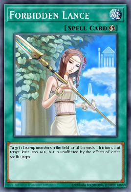

- **Copias y zona:** Main 2x, Reserva 1x. No altera las cantidades registradas.
- **Nombre oficial de referencia:** Lanza Prohibida. CID cotejado con la ficha oficial; el nombre histórico del inventario se conserva aunque su grafía/traducción difiera.
- **Función principal y secundaria:** cierre · protección.
- **Estado de sinergia y función:** Utilidad independiente. Es una clasificación de juego; revisar la relación concreta en A06.
- **Papel como recurso, descarte o coste:** No se demuestra que esta carta sea recurso de descarte o pago para otra.
- **Efecto operativo (paráfrasis analítica):** presión de combate o modificación de estadísticas; protección o resistencia contra respuestas. Son operaciones detectadas en el texto, no efectos independientes garantizados; leer sus condiciones en la fuente.
- **Mapa de activación y resultados:** efecto de estadística, condición o material; no asumir un disparador adicional. Cada operación está sujeta a la secuencia y al «si lo haces» del texto oficial.
- **Ventanas de activación identificadas:** requieren la fase o condición específica indicada en el texto; sin ventana rápida general asumida.
- **Costes o recursos potenciales:** sin coste independiente identificado en esta síntesis; comprobar las acciones previas al punto y coma de cada efecto.
- **Restricciones y requisitos:** aplicar restricciones de selección, activación y copias que consten en el texto original. 
- **Prioridad al ir primero:** extender hacia Xyz y disponer de presión de zonas sin exponerse innecesariamente. Para esta carta: Activar cuando las condiciones permitan obtener valor real, preservando recursos de seguimiento.
- **Prioridad al ir segundo:** superar campo rival con destierros y herramientas de ruptura. Identificar primero la respuesta rival que afecta su función «cierre».
- **Medio/tardío y recuperación:** recuperar Kashtira del destierro/Cementerio y medir materiales Xyz. No asumir que por sí misma recicla recursos si el texto no lo permite.
- **Sinergias y acceso a líneas:** Relación contextual con monstruos de Nivel 7, Xyz y destierro boca abajo con presión de zonas. Habilita una línea del motor sólo si coinciden recursos, objetivos y restricciones; no equivale a un combo completo validado.
- **Riesgo / brick / interrupciones:** Riesgo operativo: efectos que niegan búsquedas, combaten Xyz o castigan campo saturado. Confirmar objetivos disponibles y costes antes de activar. No atribuirle velocidad rápida por el solo hecho de formar parte del motor.
- **Utilidad editorial:** 3/5 para este deck (estimación por rol y zona, no probabilidad calculada). No cambiar copias; cualquier sugerencia de alta/baja pasa por el apartado 22 y aprobación.
- **Referencia oficial y trazabilidad:** https://www.db.yugioh-card.com/yugiohdb/card_search.action?cid=9352&ope=2&request_locale=es. **Confianza:** texto y tipo de efecto cotejados en Konami; síntesis táctica editorial, no demostración de combo.
- **Aplicación concreta dentro de este deck (A06):** presión de combate o modificación de estadísticas; protección o resistencia contra respuestas. Aporta respuesta o consistencia sin exigir enlace directo.

**USO PRÁCTICO Y SINERGIA — Forbidden Lance**

- **Label funcional:** Función independiente. Clasificación documental; una relación es válida solo si se satisfacen sus condiciones exactas.
- **Qué hace:** presión de combate o modificación de estadísticas; protección o resistencia contra respuestas. Son operaciones detectadas en el texto, no efectos independientes garantizados; leer sus condiciones en la fuente.
- **Cómo aprovecharla en este deck:** presión de combate o modificación de estadísticas; protección o resistencia contra respuestas. Aporta respuesta o consistencia sin exigir enlace directo.
- **Al jugar primero:** extender hacia Xyz y disponer de presión de zonas sin exponerse innecesariamente. Para esta carta: Activar cuando las condiciones permitan obtener valor real, preservando recursos de seguimiento.
- **Al jugar segundo:** superar campo rival con destierros y herramientas de ruptura. Identificar primero la respuesta rival que afecta su función «cierre».
- **Cuándo tener precaución:** Riesgo operativo: efectos que niegan búsquedas, combaten Xyz o castigan campo saturado. Confirmar objetivos disponibles y costes antes de activar. No atribuirle velocidad rápida por el solo hecho de formar parte del motor.

#### 18. Triple Tactics Talent

- **Copias y zona:** Main 1x, Reserva 1x. No altera las cantidades registradas.
- **Nombre oficial de referencia:** Talento de Tácticas Triples. CID cotejado con la ficha oficial; el nombre histórico del inventario se conserva aunque su grafía/traducción difiera.
- **Función principal y secundaria:** mágica de respuesta · ventaja.
- **Estado de sinergia y función:** Utilidad independiente. Es una clasificación de juego; revisar la relación concreta en A06.
- **Papel como recurso, descarte o coste:** No se demuestra que esta carta sea recurso de descarte o pago para otra.
- **Efecto operativo (paráfrasis analítica):** Si el rival activó un efecto de monstruo durante tu Main Phase, permite elegir entre robar dos, tomar control temporal o devolver una carta de mano al Deck. 
- **Mapa de activación y resultados:** 1) en Main Phase: devuelve recursos a mano/Deck/Extra, roba cartas, toma temporalmente el control. Cada operación está sujeta a la secuencia y al «si lo haces» del texto oficial.
- **Ventanas de activación identificadas:** Main Phase.
- **Costes o recursos potenciales:** sin coste independiente identificado en esta síntesis; comprobar las acciones previas al punto y coma de cada efecto.
- **Restricciones y requisitos:** hay límite por turno según el efecto concreto. 
- **Prioridad al ir primero:** extender hacia Xyz y disponer de presión de zonas sin exponerse innecesariamente. Para esta carta: Activar cuando las condiciones permitan obtener valor real, preservando recursos de seguimiento.
- **Prioridad al ir segundo:** superar campo rival con destierros y herramientas de ruptura. Identificar primero la respuesta rival que afecta su función «mágica de respuesta».
- **Medio/tardío y recuperación:** recuperar Kashtira del destierro/Cementerio y medir materiales Xyz. Verificar que el objetivo de recuperación continúe disponible.
- **Sinergias y acceso a líneas:** Relación contextual con monstruos de Nivel 7, Xyz y destierro boca abajo con presión de zonas. Habilita una línea del motor sólo si coinciden recursos, objetivos y restricciones; no equivale a un combo completo validado.
- **Riesgo / brick / interrupciones:** La condición exige activación de monstruo rival en tu Main Phase; sólo un modo. No atribuirle velocidad rápida por el solo hecho de formar parte del motor.
- **Utilidad editorial:** 3/5 para este deck (estimación por rol y zona, no probabilidad calculada). No cambiar copias; cualquier sugerencia de alta/baja pasa por el apartado 22 y aprobación.
- **Referencia oficial y trazabilidad:** https://www.db.yugioh-card.com/yugiohdb/card_search.action?cid=15296&ope=2&request_locale=es. **Confianza:** texto y tipo de efecto cotejados en Konami; síntesis táctica editorial, no demostración de combo.
- **Aplicación concreta dentro de este deck (A06):** Si el rival activó un efecto de monstruo durante tu Main Phase, permite elegir entre robar dos, tomar control temporal o devolver una carta de mano al Deck. Aporta respuesta o consistencia sin exigir enlace directo.

**USO PRÁCTICO Y SINERGIA — Triple Tactics Talent**

- **Label funcional:** Función independiente. Clasificación documental; una relación es válida solo si se satisfacen sus condiciones exactas.
- **Qué hace:** Si el rival activó un efecto de monstruo durante tu Main Phase, permite elegir entre robar dos, tomar control temporal o devolver una carta de mano al Deck.
- **Cómo aprovecharla en este deck:** Si el rival activó un efecto de monstruo durante tu Main Phase, permite elegir entre robar dos, tomar control temporal o devolver una carta de mano al Deck. Aporta respuesta o consistencia sin exigir enlace directo.
- **Al jugar primero:** extender hacia Xyz y disponer de presión de zonas sin exponerse innecesariamente. Para esta carta: Activar cuando las condiciones permitan obtener valor real, preservando recursos de seguimiento.
- **Al jugar segundo:** superar campo rival con destierros y herramientas de ruptura. Identificar primero la respuesta rival que afecta su función «mágica de respuesta».
- **Cuándo tener precaución:** La condición exige activación de monstruo rival en tu Main Phase; sólo un modo. No atribuirle velocidad rápida por el solo hecho de formar parte del motor.

#### 19. Infinite Impermanence

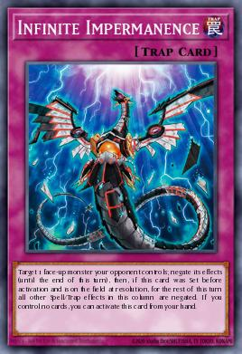

- **Copias y zona:** Main 3x. No altera las cantidades registradas.
- **Nombre oficial de referencia:** Infinito Temporal. CID cotejado con la ficha oficial; el nombre histórico del inventario se conserva aunque su grafía/traducción difiera.
- **Función principal y secundaria:** trampa · negación.
- **Estado de sinergia y función:** Utilidad independiente. Es una clasificación de juego; revisar la relación concreta en A06.
- **Papel como recurso, descarte o coste:** No se demuestra que esta carta sea recurso de descarte o pago para otra.
- **Efecto operativo (paráfrasis analítica):** Niega temporalmente un monstruo rival boca arriba; si se activó tras estar Colocada, también afecta la columna M/T correspondiente. 
- **Mapa de activación y resultados:** 1) efecto propio o continuo: niega el efecto o la activación indicada. Cada operación está sujeta a la secuencia y al «si lo haces» del texto oficial.
- **Ventanas de activación identificadas:** campo propio vacío.
- **Costes o recursos potenciales:** sin coste independiente identificado en esta síntesis; comprobar las acciones previas al punto y coma de cada efecto.
- **Restricciones y requisitos:** requiere campo propio sin las cartas indicadas. 
- **Prioridad al ir primero:** extender hacia Xyz y disponer de presión de zonas sin exponerse innecesariamente. Para esta carta: Conservar la interrupción para el efecto clave rival; no gastarla en un efecto irrelevante.
- **Prioridad al ir segundo:** superar campo rival con destierros y herramientas de ruptura. Identificar primero la respuesta rival que afecta su función «trampa».
- **Medio/tardío y recuperación:** recuperar Kashtira del destierro/Cementerio y medir materiales Xyz. No asumir que por sí misma recicla recursos si el texto no lo permite.
- **Sinergias y acceso a líneas:** Relación contextual con monstruos de Nivel 7, Xyz y destierro boca abajo con presión de zonas. Habilita una línea del motor sólo si coinciden recursos, objetivos y restricciones; no equivale a un combo completo validado.
- **Riesgo / brick / interrupciones:** Desde mano sólo con el campo propio vacío, conforme a la condición de activación de la Trampa. No atribuirle velocidad rápida por el solo hecho de formar parte del motor.
- **Utilidad editorial:** 3/5 para este deck (estimación por rol y zona, no probabilidad calculada). No cambiar copias; cualquier sugerencia de alta/baja pasa por el apartado 22 y aprobación.
- **Referencia oficial y trazabilidad:** https://www.db.yugioh-card.com/yugiohdb/card_search.action?cid=13631&ope=2&request_locale=es. **Confianza:** texto y tipo de efecto cotejados en Konami; síntesis táctica editorial, no demostración de combo.
- **Aplicación concreta dentro de este deck (A06):** Niega temporalmente un monstruo rival boca arriba; si se activó tras estar Colocada, también afecta la columna M/T correspondiente. Aporta respuesta o consistencia sin exigir enlace directo.

**USO PRÁCTICO Y SINERGIA — Infinite Impermanence**

- **Label funcional:** Función independiente. Clasificación documental; una relación es válida solo si se satisfacen sus condiciones exactas.
- **Qué hace:** Niega temporalmente un monstruo rival boca arriba; si se activó tras estar Colocada, también afecta la columna M/T correspondiente.
- **Cómo aprovecharla en este deck:** Niega temporalmente un monstruo rival boca arriba; si se activó tras estar Colocada, también afecta la columna M/T correspondiente. Aporta respuesta o consistencia sin exigir enlace directo.
- **Al jugar primero:** extender hacia Xyz y disponer de presión de zonas sin exponerse innecesariamente. Para esta carta: Conservar la interrupción para el efecto clave rival; no gastarla en un efecto irrelevante.
- **Al jugar segundo:** superar campo rival con destierros y herramientas de ruptura. Identificar primero la respuesta rival que afecta su función «trampa».
- **Cuándo tener precaución:** Desde mano sólo con el campo propio vacío, conforme a la condición de activación de la Trampa. No atribuirle velocidad rápida por el solo hecho de formar parte del motor.

#### 20. Kashtira Preparations

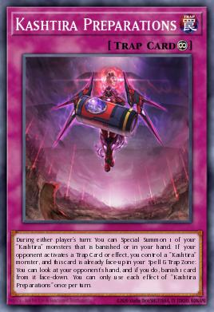

- **Copias y zona:** Main 1x. No altera las cantidades registradas.
- **Nombre oficial de referencia:** Preparaciones Kashtira. CID cotejado con la ficha oficial; el nombre histórico del inventario se conserva aunque su grafía/traducción difiera.
- **Función principal y secundaria:** recuperación · extensor · removal.
- **Estado de sinergia y función:** Sinergia indirecta (soporte o recursos). Es una clasificación de juego; revisar la relación concreta en A06.
- **Papel como recurso, descarte o coste:** No se demuestra que esta carta sea recurso de descarte o pago para otra.
- **Efecto operativo (paráfrasis analítica):** recuperación e invocación desde Cementerio/destierro; acceso al campo desde la mano; destierro de recursos o de amenazas. Son operaciones detectadas en el texto, no efectos independientes garantizados; leer sus condiciones en la fuente.
- **Mapa de activación y resultados:** 1) con condición explícita en la carta: Invocación Especial desde mano, destierra el recurso u objetivo previsto · 2) en respuesta a activación rival: destierra el recurso u objetivo previsto. Cada operación está sujeta a la secuencia y al «si lo haces» del texto oficial.
- **Ventanas de activación identificadas:** respuesta a activación rival.
- **Costes o recursos potenciales:** sin coste independiente identificado en esta síntesis; comprobar las acciones previas al punto y coma de cada efecto.
- **Restricciones y requisitos:** hay límite por turno según el efecto concreto; interactúa con información oculta o resultados no siempre elegibles. 
- **Prioridad al ir primero:** extender hacia Xyz y disponer de presión de zonas sin exponerse innecesariamente. Para esta carta: Escoger la amenaza o recurso que genere mayor ventaja de tempo; respetar selección y zona.
- **Prioridad al ir segundo:** superar campo rival con destierros y herramientas de ruptura. Identificar primero la respuesta rival que afecta su función «recuperación».
- **Medio/tardío y recuperación:** recuperar Kashtira del destierro/Cementerio y medir materiales Xyz. Verificar que el objetivo de recuperación continúe disponible.
- **Sinergias y acceso a líneas:** Relación contextual con monstruos de Nivel 7, Xyz y destierro boca abajo con presión de zonas. Habilita una línea del motor sólo si coinciden recursos, objetivos y restricciones; no equivale a un combo completo validado.
- **Riesgo / brick / interrupciones:** Riesgo operativo: efectos que niegan búsquedas, combaten Xyz o castigan campo saturado. Confirmar objetivos disponibles y costes antes de activar. No atribuirle velocidad rápida por el solo hecho de formar parte del motor.
- **Utilidad editorial:** 4/5 para este deck (estimación por rol y zona, no probabilidad calculada). No cambiar copias; cualquier sugerencia de alta/baja pasa por el apartado 22 y aprobación.
- **Referencia oficial y trazabilidad:** https://www.db.yugioh-card.com/yugiohdb/card_search.action?cid=17831&ope=2&request_locale=es. **Confianza:** texto y tipo de efecto cotejados en Konami; síntesis táctica editorial, no demostración de combo.
- **Aplicación concreta dentro de este deck (A06):** recuperación e invocación desde Cementerio/destierro; acceso al campo desde la mano; destierro de recursos o de amenazas.

**USO PRÁCTICO Y SINERGIA — Kashtira Preparations**

- **Label funcional:** Sinergia indirecta. Clasificación documental; una relación es válida solo si se satisfacen sus condiciones exactas.
- **Qué hace:** recuperación e invocación desde Cementerio/destierro; acceso al campo desde la mano; destierro de recursos o de amenazas. Son operaciones detectadas en el texto, no efectos independientes garantizados; leer sus condiciones en la fuente.
- **Cómo aprovecharla en este deck:** recuperación e invocación desde Cementerio/destierro; acceso al campo desde la mano; destierro de recursos o de amenazas.
- **Al jugar primero:** extender hacia Xyz y disponer de presión de zonas sin exponerse innecesariamente. Para esta carta: Escoger la amenaza o recurso que genere mayor ventaja de tempo; respetar selección y zona.
- **Al jugar segundo:** superar campo rival con destierros y herramientas de ruptura. Identificar primero la respuesta rival que afecta su función «recuperación».
- **Cuándo tener precaución:** Riesgo operativo: efectos que niegan búsquedas, combaten Xyz o castigan campo saturado. Confirmar objetivos disponibles y costes antes de activar. No atribuirle velocidad rápida por el solo hecho de formar parte del motor.

#### 21. Kashtira Big Bang

- **Copias y zona:** Main 1x. No altera las cantidades registradas.
- **Nombre oficial de referencia:** Big Bang Kashtira. CID cotejado con la ficha oficial; el nombre histórico del inventario se conserva aunque su grafía/traducción difiera.
- **Función principal y secundaria:** searcher · buscador · extensor · removal · respuesta.
- **Estado de sinergia y función:** Sinergia indirecta (soporte o recursos). Es una clasificación de juego; revisar la relación concreta en A06.
- **Papel como recurso, descarte o coste:** Material o destino del Extra condicionado a los requisitos de invocación.
- **Efecto operativo (paráfrasis analítica):** búsqueda o incorporación de cartas a mano; acceso al campo desde la mano; destierro de recursos o de amenazas; interacción sobre monstruos en campo; gestión de materiales Xyz. Son operaciones detectadas en el texto, no efectos independientes garantizados; leer sus condiciones en la fuente.
- **Mapa de activación y resultados:** 1) con condición explícita en la carta: Invocación Especial desde mano, incorpora la pieza indicada a la mano. Cada operación está sujeta a la secuencia y al «si lo haces» del texto oficial.
- **Ventanas de activación identificadas:** al ser desterrada.
- **Costes o recursos potenciales:** sin coste independiente identificado en esta síntesis; comprobar las acciones previas al punto y coma de cada efecto.
- **Restricciones y requisitos:** hay límite por turno según el efecto concreto; interactúa con información oculta o resultados no siempre elegibles. 
- **Prioridad al ir primero:** extender hacia Xyz y disponer de presión de zonas sin exponerse innecesariamente. Para esta carta: Convertir la activación en acceso a la siguiente pieza del motor, sin duplicar buscadores inútilmente.
- **Prioridad al ir segundo:** superar campo rival con destierros y herramientas de ruptura. Identificar primero la respuesta rival que afecta su función «searcher».
- **Medio/tardío y recuperación:** recuperar Kashtira del destierro/Cementerio y medir materiales Xyz. No asumir que por sí misma recicla recursos si el texto no lo permite.
- **Sinergias y acceso a líneas:** Relación contextual con monstruos de Nivel 7, Xyz y destierro boca abajo con presión de zonas. Habilita una línea del motor sólo si coinciden recursos, objetivos y restricciones; no equivale a un combo completo validado.
- **Riesgo / brick / interrupciones:** Riesgo operativo: efectos que niegan búsquedas, combaten Xyz o castigan campo saturado. Confirmar objetivos disponibles y costes antes de activar. No atribuirle velocidad rápida por el solo hecho de formar parte del motor.
- **Utilidad editorial:** 5/5 para este deck (estimación por rol y zona, no probabilidad calculada). No cambiar copias; cualquier sugerencia de alta/baja pasa por el apartado 22 y aprobación.
- **Referencia oficial y trazabilidad:** https://www.db.yugioh-card.com/yugiohdb/card_search.action?cid=18220&ope=2&request_locale=es. **Confianza:** texto y tipo de efecto cotejados en Konami; síntesis táctica editorial, no demostración de combo.
- **Aplicación concreta dentro de este deck (A06):** búsqueda o incorporación de cartas a mano; acceso al campo desde la mano; destierro de recursos o de amenazas; interacción sobre monstruos en campo; gestión de materiales Xyz.

**USO PRÁCTICO Y SINERGIA — Kashtira Big Bang**

- **Label funcional:** Sinergia indirecta. Clasificación documental; una relación es válida solo si se satisfacen sus condiciones exactas.
- **Qué hace:** búsqueda o incorporación de cartas a mano; acceso al campo desde la mano; destierro de recursos o de amenazas; interacción sobre monstruos en campo; gestión de materiales Xyz. Son operaciones detectadas en el texto, no efectos independientes garantizados; leer sus condiciones en la fuente.
- **Cómo aprovecharla en este deck:** búsqueda o incorporación de cartas a mano; acceso al campo desde la mano; destierro de recursos o de amenazas; interacción sobre monstruos en campo; gestión de materiales Xyz.
- **Al jugar primero:** extender hacia Xyz y disponer de presión de zonas sin exponerse innecesariamente. Para esta carta: Convertir la activación en acceso a la siguiente pieza del motor, sin duplicar buscadores inútilmente.
- **Al jugar segundo:** superar campo rival con destierros y herramientas de ruptura. Identificar primero la respuesta rival que afecta su función «searcher».
- **Cuándo tener precaución:** Riesgo operativo: efectos que niegan búsquedas, combaten Xyz o castigan campo saturado. Confirmar objetivos disponibles y costes antes de activar. No atribuirle velocidad rápida por el solo hecho de formar parte del motor.

#### 22. Kashtira Shangri-Ira [Xyz rango 7]

- **Copias y zona:** Extra 3x. No altera las cantidades registradas.
- **Nombre oficial de referencia:** Kashtira Shangri-Ira. CID cotejado con la ficha oficial; el nombre histórico del inventario se conserva aunque su grafía/traducción difiera.
- **Función principal y secundaria:** jefe Xyz Kashtira · bloqueo de zonas.
- **Estado de sinergia y función:** Destino Extra condicionado. Es una clasificación de juego; revisar la relación concreta en A06.
- **Papel como recurso, descarte o coste:** Material o destino del Extra condicionado a los requisitos de invocación.
- **Efecto operativo (paráfrasis analítica):** En cada Standby Phase invoca Kashtira desde Deck y bloquea zonas libres al dispararse destierro boca abajo. 
- **Mapa de activación y resultados:** 1) con condición explícita en la carta: Invocación Especial desde Deck, destierra el recurso u objetivo previsto · 2) efecto propio o continuo: desacopla materiales Xyz. Cada operación está sujeta a la secuencia y al «si lo haces» del texto oficial.
- **Ventanas de activación identificadas:** requieren la fase o condición específica indicada en el texto; sin ventana rápida general asumida.
- **Costes o recursos potenciales:** sin coste independiente identificado en esta síntesis; comprobar las acciones previas al punto y coma de cada efecto.
- **Restricciones y requisitos:** hay límite por turno según el efecto concreto; interactúa con información oculta o resultados no siempre elegibles. Invocar sólo desde el Extra Deck usando su procedimiento propio.
- **Prioridad al ir primero:** extender hacia Xyz y disponer de presión de zonas sin exponerse innecesariamente. Para esta carta: Convertir acceso al Deck en cuerpos o materiales antes de bloquearse con restricciones.
- **Prioridad al ir segundo:** superar campo rival con destierros y herramientas de ruptura. Identificar primero la respuesta rival que afecta su función «jefe Xyz Kashtira».
- **Medio/tardío y recuperación:** recuperar Kashtira del destierro/Cementerio y medir materiales Xyz. No asumir que por sí misma recicla recursos si el texto no lo permite.
- **Sinergias y acceso a líneas:** Relación contextual con monstruos de Nivel 7, Xyz y destierro boca abajo con presión de zonas. Puede cerrar o prolongar una ruta del Extra si los materiales están disponibles.
- **Riesgo / brick / interrupciones:** Los bloqueos dependen de la resolución y de zonas válidas disponibles. No atribuirle velocidad rápida por el solo hecho de formar parte del motor.
- **Utilidad editorial:** 4/5 para este deck (estimación por rol y zona, no probabilidad calculada). No cambiar copias; cualquier sugerencia de alta/baja pasa por el apartado 22 y aprobación.
- **Referencia oficial y trazabilidad:** https://www.db.yugioh-card.com/yugiohdb/card_search.action?cid=17800&ope=2&request_locale=es. **Confianza:** texto y tipo de efecto cotejados en Konami; síntesis táctica editorial, no demostración de combo.
- **Aplicación concreta dentro de este deck (A06):** En cada Standby Phase invoca Kashtira desde Deck y bloquea zonas libres al dispararse destierro boca abajo. A06 identifica su destino, condicionado a material/procedimiento.

**USO PRÁCTICO Y SINERGIA — Kashtira Shangri-Ira [Xyz rango 7]**

- **Label funcional:** Referencias de ruta localizadas; conexión reglamentaria sujeta al recorrido de la guía. Clasificación documental; una relación es válida solo si se satisfacen sus condiciones exactas.
- **Qué hace:** En cada Standby Phase invoca Kashtira desde Deck y bloquea zonas libres al dispararse destierro boca abajo.
- **Cómo aprovecharla en este deck:** En cada Standby Phase invoca Kashtira desde Deck y bloquea zonas libres al dispararse destierro boca abajo. A06 identifica su destino, condicionado a material/procedimiento.
- **Al jugar primero:** extender hacia Xyz y disponer de presión de zonas sin exponerse innecesariamente. Para esta carta: Convertir acceso al Deck en cuerpos o materiales antes de bloquearse con restricciones.
- **Al jugar segundo:** superar campo rival con destierros y herramientas de ruptura. Identificar primero la respuesta rival que afecta su función «jefe Xyz Kashtira».
- **Cuándo tener precaución:** Los bloqueos dependen de la resolución y de zonas válidas disponibles. No atribuirle velocidad rápida por el solo hecho de formar parte del motor.

**CÓMO LLEGAR DESDE TU DECK — RUTAS DOCUMENTADAS**

- **Abrir guía `665:A09:WRAITSOTH:SHANGRI01`:** entrada: Mano de apertura: solo Pressured Planet Wraitsoth. Campo/GY propios vacíos, Main Phase 1; Unicornio, Fenrir y Kashtiratheosis en Deck, Shangri-Ira en Extra; rival sin responder.. Propósito descrito: Preparar Shangri-Ira con Wraitsoth y dos materiales Xyz. Consulta sus pasos, consumo y resultado; comprobar si esta carta es realmente invocada o solo mencionada.
- **Abrir guía `665:A09:FENRIR:RISEHEART:SHANGRI02`:** entrada: solo Kashtira Fenrir (17768); campo propio vacío y Main Phase. En Deck: Kashtira Riseheart (18151) y Big Bang Kashtira (18220, 1 copia); en Extra Shangri-Ira (17800). Adversario tiene al menos 3 cartas en el Deck. No hay respuesta adversaria ni restricciones previas.. Propósito descrito: Invocar Shangri-Ira; desterrar tres cartas del Deck rival. Consulta sus pasos, consumo y resultado; comprobar si esta carta es realmente invocada o solo mencionada.
- **Abrir guía `665:A09:UNICORN:THEOSIS:FENRIR:SHANGRI03`:** entrada: solo Kashtira Unicorn. Campo/GY propios: vacíos. Deck: 1× Kashtiratheosis, 1× Kashtira Fenrir (TIERRA), 1× Kashtira Riseheart (FUEGO) y 1× Kashtira Big Bang disponibles. Extra: Shangri-Ira. Rival con mínimo 3 cartas en Deck; sin negaciones ni bloqueos previos. Es Main Phase propia y la Invocación Normal sigue libre.. Propósito descrito: Invocar Shangri-Ira y conservar Fenrir para el turno rival. Consulta sus pasos, consumo y resultado; comprobar si esta carta es realmente invocada o solo mencionada.
- **Abrir guía `665:A09:SHANGRI:STANDBY:ARISE04`:** entrada: Apertura del turno 1: Wraitsoth únicamente Wraitsoth en mano, con Unicorn, Kashtiratheosis y Fenrir en Deck, y Shangri Shangri-Ira en Extra; aplicar exactamente los pasos 1–5 de la ficha previa WRAITSOTH:SHANGRI01. Se termina con Shangri en Defensa, 2 materiales Xyz originales (Unicorn + primer Fenrir) y Wraitsoth en Zona de Campo. Normal del turno 1 libre. No ocurre destierro rival boca abajo en esos pasos. Nueva condición de estado: Shangri-Ira debe permanecer en Campo durante el turno del rival sin ser neutralizado, volteado boca abajo ni perder la capacidad de activar sus efectos. La mano/carta de robo del siguiente turno no se usan ni se presuponen conocidas.. Propósito descrito: Continuar a Arise-Heart desde Shangri-Ira en un turno posterior. Consulta sus pasos, consumo y resultado; comprobar si esta carta es realmente invocada o solo mencionada.
- **Abrir guía `665:A09:FENRIR:BIRTH:SHANGRI05`:** entrada: Kashtira Fenrir (17768) + Nacimiento Kashtira (17815) en mano; propio Campo/GY vacíos, Main Phase propia, sin respuesta rival. En Main Deck quedan al menos Unicornio (17769, VIENTO), Kashtirateosis (18203), Ogro (17770, AGUA) y Preparaciones Kashtira (17831, Trampa); Extra incluye Shangri-Ira (17800). No requiere Riseheart ni desterrar cartas rivales.. Propósito descrito: Invocar Shangri-Ira y preparar Nacimiento y Preparaciones. Consulta sus pasos, consumo y resultado; comprobar si esta carta es realmente invocada o solo mencionada.
- **Abrir guía `665:A09:FENRIR:BIRTH:BIGEYE06`:** entrada: igual que FENRIR:BIRTH:SHANGRI05, pero el rival controla al menos un monstruo boca arriba elegible para tomar el control; sin respuestas a las activaciones. En Extra Número 11: Ojo Grande (9861, Rango 7, ATK 2600) sustituye a Shangri como destino. No se presupone ATK ni efectos del monstruo capturado.. Propósito descrito: Romper campo. Consulta sus pasos, consumo y resultado; comprobar si esta carta es realmente invocada o solo mencionada.
- **Abrir guía `665:A09:WRAITSOTH:RISEHEART:BIGBANG:BIGEYE07`:** entrada: Wraitsoth Planeta Bajo Presión Wraitsoth (18204) + Riseheart Kashtira Riseheart (18151) en mano; propio Campo/GY vacíos, Main Phase propia, sin respuesta rival. Deck con Unicornio, Teosis, Fenrir y Big Bang; Extra con Shangri-Ira y Número 11: Ojo Grande. El adversario tiene al menos tres cartas en el Deck. No hace falta que controle monstruos. Se presupone el desarrollo de una carta WRAITSOTH:SHANGRI01, descrito antes.. Propósito descrito: Romper campo. Consulta sus pasos, consumo y resultado; comprobar si esta carta es realmente invocada o solo mencionada.
- **Abrir guía `665:A09:WRAITSOTH:RISEHEART:ARISE3MAT08`:** entrada: Wraitsoth Planeta Bajo Presión Wraitsoth + Riseheart Kashtira Riseheart. Campo y GY propios vacíos; durante la Main Phase propia; rival sin respuestas y con al menos tres cartas en el Deck. El Main conserva Unicornio, Fenrir, Teosis y Big Bang; el Extra contiene Shangri-Ira y Arise-Heart Arise-Heart. Es una bifurcación incompatible con la ruta 07: aquí no se recupera Fenrir mediante Big Bang. Se describe la mecánica de las cartas del inventario, sin evaluación de listas de prohibiciones.. Propósito descrito: Terminar en Arise-Heart con tres materiales Xyz. Consulta sus pasos, consumo y resultado; comprobar si esta carta es realmente invocada o solo mencionada.

#### 23. Kashtira Arise-Heart [Xyz rango 7]

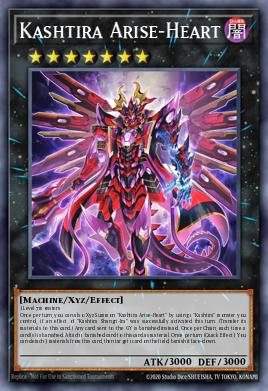

- **Copias y zona:** Extra 2x. No altera las cantidades registradas.
- **Nombre oficial de referencia:** Kashtira Arise-Heart. CID cotejado con la ficha oficial; el nombre histórico del inventario se conserva aunque su grafía/traducción difiera.
- **Función principal y secundaria:** jefe Xyz Kashtira · destierro.
- **Estado de sinergia y función:** Destino Extra condicionado. Es una clasificación de juego; revisar la relación concreta en A06.
- **Papel como recurso, descarte o coste:** Material o destino del Extra condicionado a los requisitos de invocación.
- **Efecto operativo (paráfrasis analítica):** Puede Invocarse Xyz sobre un solo Kashtira propio **si un efecto de Shangri-Ira fue activado con éxito ese turno** (no es lo mismo que exigir que su resolución haya producido el resultado previsto); también puede entrar con tres monstruos de Nivel 7. Las cartas que irían al Cementerio se destierran y su Efecto Rápido de retirar una carta exige desacoplar **tres** materiales. Distinguir la prohibición competitiva vigente de las condiciones mecánicas del procedimiento.
- **Mapa de activación y resultados:** 1) efecto propio o continuo: destierra el recurso u objetivo previsto · 2) con condición explícita en la carta: destierra el recurso u objetivo previsto · 3) una vez por turno: desacopla materiales Xyz. Cada operación está sujeta a la secuencia y al «si lo haces» del texto oficial.
- **Ventanas de activación identificadas:** Efecto Rápido.
- **Costes o recursos potenciales:** sin coste independiente identificado en esta síntesis; comprobar las acciones previas al punto y coma de cada efecto.
- **Restricciones y requisitos:** hay límite por turno según el efecto concreto; interactúa con información oculta o resultados no siempre elegibles. Invocar sólo desde el Extra Deck usando su procedimiento propio.
- **Prioridad al ir primero:** extender hacia Xyz y disponer de presión de zonas sin exponerse innecesariamente. Para esta carta: Escoger la amenaza o recurso que genere mayor ventaja de tempo; respetar selección y zona.
- **Prioridad al ir segundo:** superar campo rival con destierros y herramientas de ruptura. Identificar primero la respuesta rival que afecta su función «jefe Xyz Kashtira».
- **Medio/tardío y recuperación:** recuperar Kashtira del destierro/Cementerio y medir materiales Xyz. No asumir que por sí misma recicla recursos si el texto no lo permite.
- **Sinergias y acceso a líneas:** Relación contextual con monstruos de Nivel 7, Xyz y destierro boca abajo con presión de zonas. Puede cerrar o prolongar una ruta del Extra si los materiales están disponibles.
- **Riesgo / brick / interrupciones:** Comprobar condición de invocación alternativa y material disponible. Puede emplearse en cadena sólo cuando se cumpla su condición concreta.
- **Utilidad editorial:** 4/5 para este deck (estimación por rol y zona, no probabilidad calculada). No cambiar copias; cualquier sugerencia de alta/baja pasa por el apartado 22 y aprobación.
- **Referencia oficial y trazabilidad:** https://www.db.yugioh-card.com/yugiohdb/card_search.action?cid=18191&ope=2&request_locale=es. **Confianza:** texto y tipo de efecto cotejados en Konami; síntesis táctica editorial, no demostración de combo.
- **Aplicación concreta dentro de este deck (A06):** Puede subir sobre Kashtira si se resolvió Shangri-Ira y convierte cartas enviadas al Cementerio en destierro; remueve con materiales. A06 identifica su destino, condicionado a material/procedimiento.

**USO PRÁCTICO Y SINERGIA — Kashtira Arise-Heart [Xyz rango 7]**

- **Label funcional:** Referencias de ruta localizadas; conexión reglamentaria sujeta al recorrido de la guía. Clasificación documental; una relación es válida solo si se satisfacen sus condiciones exactas.
- **Qué hace:** Puede Invocarse Xyz sobre un solo Kashtira propio **si un efecto de Shangri-Ira fue activado con éxito ese turno** (no es lo mismo que exigir que su resolución haya producido el resultado previsto); también puede entrar con tres monstruos de Nivel 7. Las cartas que irían al Cementerio se destierran y su Efecto Rápido de retirar una carta exige desacoplar **tres** materiales. Distinguir la prohibición competitiva vigente de las condiciones mecánicas del procedimiento.
- **Cómo aprovecharla en este deck:** Puede subir sobre Kashtira si se resolvió Shangri-Ira y convierte cartas enviadas al Cementerio en destierro; remueve con materiales. A06 identifica su destino, condicionado a material/procedimiento.
- **Al jugar primero:** extender hacia Xyz y disponer de presión de zonas sin exponerse innecesariamente. Para esta carta: Escoger la amenaza o recurso que genere mayor ventaja de tempo; respetar selección y zona.
- **Al jugar segundo:** superar campo rival con destierros y herramientas de ruptura. Identificar primero la respuesta rival que afecta su función «jefe Xyz Kashtira».
- **Cuándo tener precaución:** Comprobar condición de invocación alternativa y material disponible. Puede emplearse en cadena sólo cuando se cumpla su condición concreta.

**CÓMO LLEGAR DESDE TU DECK — RUTAS DOCUMENTADAS**

- **Abrir guía `665:A09:SHANGRI:STANDBY:ARISE04`:** entrada: Apertura del turno 1: Wraitsoth únicamente Wraitsoth en mano, con Unicorn, Kashtiratheosis y Fenrir en Deck, y Shangri Shangri-Ira en Extra; aplicar exactamente los pasos 1–5 de la ficha previa WRAITSOTH:SHANGRI01. Se termina con Shangri en Defensa, 2 materiales Xyz originales (Unicorn + primer Fenrir) y Wraitsoth en Zona de Campo. Normal del turno 1 libre. No ocurre destierro rival boca abajo en esos pasos. Nueva condición de estado: Shangri-Ira debe permanecer en Campo durante el turno del rival sin ser neutralizado, volteado boca abajo ni perder la capacidad de activar sus efectos. La mano/carta de robo del siguiente turno no se usan ni se presuponen conocidas.. Propósito descrito: Continuar a Arise-Heart desde Shangri-Ira en un turno posterior. Consulta sus pasos, consumo y resultado; comprobar si esta carta es realmente invocada o solo mencionada.
- **Abrir guía `665:A09:WRAITSOTH:RISEHEART:ARISE3MAT08`:** entrada: Wraitsoth Planeta Bajo Presión Wraitsoth + Riseheart Kashtira Riseheart. Campo y GY propios vacíos; durante la Main Phase propia; rival sin respuestas y con al menos tres cartas en el Deck. El Main conserva Unicornio, Fenrir, Teosis y Big Bang; el Extra contiene Shangri-Ira y Arise-Heart Arise-Heart. Es una bifurcación incompatible con la ruta 07: aquí no se recupera Fenrir mediante Big Bang. Se describe la mecánica de las cartas del inventario, sin evaluación de listas de prohibiciones.. Propósito descrito: Terminar en Arise-Heart con tres materiales Xyz. Consulta sus pasos, consumo y resultado; comprobar si esta carta es realmente invocada o solo mencionada.
- **Abrir guía `665:A09:WRAITSOTH:RISEHEART:BIGBANG:ARISE1MAT09`:** entrada: las mismas dos cartas, condiciones y ubicaciones iniciales de ARISE3MAT08. Objetivo alternativo: conservar Shangri-Ira boca arriba y su zona bloqueada, además de Invocar a Arise-Heart sobre Riseheart, aceptando que comienza con un único material y no puede pagar todavía el coste de tres materiales de su destierro rápido. No se combina con ruta 07 ni ruta 08: se elige un destino del Extra diferente para Riseheart.. Propósito descrito: Conservar Shangri-Ira y Arise-Heart con un material. Consulta sus pasos, consumo y resultado; comprobar si esta carta es realmente invocada o solo mencionada.

#### 24. Number 11: Big Eye [Xyz rango 7]

- **Copias y zona:** Extra 2x. No altera las cantidades registradas.
- **Nombre oficial de referencia:** Número 11: Ojo Grande. CID cotejado con la ficha oficial; el nombre histórico del inventario se conserva aunque su grafía/traducción difiera.
- **Función principal y secundaria:** resultado de Extra Deck · respuesta · habilitador Xyz.
- **Estado de sinergia y función:** Destino Extra condicionado. Es una clasificación de juego; revisar la relación concreta en A06.
- **Papel como recurso, descarte o coste:** Material o destino del Extra condicionado a los requisitos de invocación.
- **Efecto operativo (paráfrasis analítica):** interacción sobre monstruos en campo; gestión de materiales Xyz. Son operaciones detectadas en el texto, no efectos independientes garantizados; leer sus condiciones en la fuente.
- **Mapa de activación y resultados:** 1) una vez por turno: desacopla materiales Xyz, toma temporalmente el control. Cada operación está sujeta a la secuencia y al «si lo haces» del texto oficial.
- **Ventanas de activación identificadas:** requieren la fase o condición específica indicada en el texto; sin ventana rápida general asumida.
- **Costes o recursos potenciales:** sin coste independiente identificado en esta síntesis; comprobar las acciones previas al punto y coma de cada efecto.
- **Restricciones y requisitos:** hay límite por turno según el efecto concreto; puede limitar ataques. Invocar sólo desde el Extra Deck usando su procedimiento propio.
- **Prioridad al ir primero:** extender hacia Xyz y disponer de presión de zonas sin exponerse innecesariamente. Para esta carta: Comprobar materiales exactos antes de buscar este objetivo en el Extra Deck.
- **Prioridad al ir segundo:** superar campo rival con destierros y herramientas de ruptura. Identificar primero la respuesta rival que afecta su función «resultado de Extra Deck».
- **Medio/tardío y recuperación:** recuperar Kashtira del destierro/Cementerio y medir materiales Xyz. No asumir que por sí misma recicla recursos si el texto no lo permite.
- **Sinergias y acceso a líneas:** Relación contextual con monstruos de Nivel 7, Xyz y destierro boca abajo con presión de zonas. Puede cerrar o prolongar una ruta del Extra si los materiales están disponibles.
- **Riesgo / brick / interrupciones:** Se agota al consumir materiales; no asumir material adicional al pasar de un Xyz a otro. No atribuirle velocidad rápida por el solo hecho de formar parte del motor.
- **Utilidad editorial:** 4/5 para este deck (estimación por rol y zona, no probabilidad calculada). No cambiar copias; cualquier sugerencia de alta/baja pasa por el apartado 22 y aprobación.
- **Referencia oficial y trazabilidad:** https://www.db.yugioh-card.com/yugiohdb/card_search.action?cid=9861&ope=2&request_locale=es. **Confianza:** texto y tipo de efecto cotejados en Konami; síntesis táctica editorial, no demostración de combo.
- **Aplicación concreta dentro de este deck (A06):** interacción sobre monstruos en campo; gestión de materiales Xyz. A06 identifica su destino, condicionado a material/procedimiento.

**USO PRÁCTICO Y SINERGIA — Number 11: Big Eye [Xyz rango 7]**

- **Label funcional:** Referencias de ruta localizadas; conexión reglamentaria sujeta al recorrido de la guía. Clasificación documental; una relación es válida solo si se satisfacen sus condiciones exactas.
- **Qué hace:** interacción sobre monstruos en campo; gestión de materiales Xyz. Son operaciones detectadas en el texto, no efectos independientes garantizados; leer sus condiciones en la fuente.
- **Cómo aprovecharla en este deck:** interacción sobre monstruos en campo; gestión de materiales Xyz. A06 identifica su destino, condicionado a material/procedimiento.
- **Al jugar primero:** extender hacia Xyz y disponer de presión de zonas sin exponerse innecesariamente. Para esta carta: Comprobar materiales exactos antes de buscar este objetivo en el Extra Deck.
- **Al jugar segundo:** superar campo rival con destierros y herramientas de ruptura. Identificar primero la respuesta rival que afecta su función «resultado de Extra Deck».
- **Cuándo tener precaución:** Se agota al consumir materiales; no asumir material adicional al pasar de un Xyz a otro. No atribuirle velocidad rápida por el solo hecho de formar parte del motor.

**CÓMO LLEGAR DESDE TU DECK — RUTAS DOCUMENTADAS**

- **Abrir guía `665:A09:FENRIR:BIRTH:BIGEYE06`:** entrada: igual que FENRIR:BIRTH:SHANGRI05, pero el rival controla al menos un monstruo boca arriba elegible para tomar el control; sin respuestas a las activaciones. En Extra Número 11: Ojo Grande (9861, Rango 7, ATK 2600) sustituye a Shangri como destino. No se presupone ATK ni efectos del monstruo capturado.. Propósito descrito: Romper campo. Consulta sus pasos, consumo y resultado; comprobar si esta carta es realmente invocada o solo mencionada.
- **Abrir guía `665:A09:WRAITSOTH:RISEHEART:BIGBANG:BIGEYE07`:** entrada: Wraitsoth Planeta Bajo Presión Wraitsoth (18204) + Riseheart Kashtira Riseheart (18151) en mano; propio Campo/GY vacíos, Main Phase propia, sin respuesta rival. Deck con Unicornio, Teosis, Fenrir y Big Bang; Extra con Shangri-Ira y Número 11: Ojo Grande. El adversario tiene al menos tres cartas en el Deck. No hace falta que controle monstruos. Se presupone el desarrollo de una carta WRAITSOTH:SHANGRI01, descrito antes.. Propósito descrito: Romper campo. Consulta sus pasos, consumo y resultado; comprobar si esta carta es realmente invocada o solo mencionada.

#### 25. Divine Arsenal AA-ZEUS – Sky Thunder [Xyz]

- **Copias y zona:** Extra 2x. No altera las cantidades registradas.
- **Nombre oficial de referencia:** Divino Arsenal AA-ZEUS - Trueno del Cielo. CID cotejado con la ficha oficial; el nombre histórico del inventario se conserva aunque su grafía/traducción difiera.
- **Función principal y secundaria:** interrupción · resultado de Extra Deck · habilitador Xyz.
- **Estado de sinergia y función:** **Acceso condicional ahora demostrado** mediante batalla de Ojo Grande que sobrevive → ZEUS superpuesto en Main Phase 2. Ver `665:A09:BIGEYE:BATTLE:ZEUS11`. No se Invoca directamente con Dark Armed en ausencia de batalla previa de Xyz.
- **Papel como recurso, descarte o coste:** Material o destino del Extra condicionado a los requisitos de invocación.
- **Efecto operativo (paráfrasis analítica):** tras batalla de un Xyz, ZEUS puede superponerse en Main Phase 2; desacoplar dos materiales como Efecto Rápido para **enviar todas las demás cartas del campo al GY** (incluidas las propias). Con Big Eye de 2 materiales, ZEUS entra con 3 y solo dispone de un pago inmediato.
- **Mapa de activación y resultados:** 1) efecto propio o continuo: desacopla materiales Xyz. Cada operación está sujeta a la secuencia y al «si lo haces» del texto oficial.
- **Ventanas de activación identificadas:** Efecto Rápido.
- **Costes o recursos potenciales:** 2 materiales Xyz por cada barrido; invocar ZEUS encima del Xyz utilizado conserva el Xyz y los materiales que tenía.
- **Restricciones y requisitos:** hay límite por turno según el efecto concreto. Invocar sólo desde el Extra Deck usando su procedimiento propio.
- **Prioridad al ir primero:** extender hacia Xyz y disponer de presión de zonas sin exponerse innecesariamente. Para esta carta: Reservar la respuesta para la ventana rival exacta; no es una pieza buscadora de nuestro motor.
- **Prioridad al ir segundo:** superar campo rival con destierros y herramientas de ruptura. Identificar primero la respuesta rival que afecta su función «interrupción».
- **Medio/tardío y recuperación:** recuperar Kashtira del destierro/Cementerio y medir materiales Xyz. No asumir que por sí misma recicla recursos si el texto no lo permite.
- **Sinergias y acceso a líneas:** Relación contextual con monstruos de Nivel 7, Xyz y destierro boca abajo con presión de zonas. Puede cerrar o prolongar una ruta del Extra si los materiales están disponibles.
- **Riesgo / brick / interrupciones:** Se agota al consumir materiales; no asumir material adicional al pasar de un Xyz a otro. Puede emplearse en cadena sólo cuando se cumpla su condición concreta.
- **Utilidad editorial:** 4/5 para este deck (estimación por rol y zona, no probabilidad calculada). No cambiar copias; cualquier sugerencia de alta/baja pasa por el apartado 22 y aprobación.
- **Referencia oficial y trazabilidad:** https://www.db.yugioh-card.com/yugiohdb/card_search.action?cid=15524&ope=2&request_locale=es. **Confianza:** texto y tipo de efecto cotejados en Konami; síntesis táctica editorial, no demostración de combo.
- **Aplicación concreta dentro de este deck (A06):** `665:A09:BIGEYE:BATTLE:ZEUS11`: Fenrir + Birth llevan a Fenrir/Ogre, Big Eye, Battle Phase superviviente y Zeus en Main Phase 2. Campo final 3 materiales; el barrido puede quitar tus propias cartas.

**USO PRÁCTICO Y SINERGIA — Divine Arsenal AA-ZEUS – Sky Thunder [Xyz]**

- **Label funcional:** Sinergia concreta condicional demostrada; nueva ruta documental, aún sin certificación integral de todas las interrupciones del duelo.
- **Qué hace:** tras una batalla con Xyz, permite la Invocación superpuesta de ZEUS en Main Phase 2; su Efecto Rápido desacopla dos materiales y envía todas las demás cartas del campo al Cementerio.
- **Cómo aprovecharla en este deck:** la variante Fenrir + Birth, Fenrir/Ogre → Ojo Grande → batalla → ZEUS deja tres materiales. Elige **este plan o el de controlar un monstruo con Ojo Grande**, porque Big Eye no puede atacar el turno en que activa ese efecto.
- **Al jugar primero:** extender hacia Xyz y disponer de presión de zonas sin exponerse innecesariamente. Para esta carta: Reservar la respuesta para la ventana rival exacta; no es una pieza buscadora de nuestro motor.
- **Al jugar segundo:** superar campo rival con destierros y herramientas de ruptura. Identificar primero la respuesta rival que afecta su función «interrupción».
- **Cuándo tener precaución:** Se agota al consumir materiales; no asumir material adicional al pasar de un Xyz a otro. Puede emplearse en cadena sólo cuando se cumpla su condición concreta.

**CÓMO LLEGAR DESDE TU DECK — CONTINUACIÓN VISUAL NUEVA**

- **Abrir guía:** `665:A09:BIGEYE:BATTLE:ZEUS11` — Fenrir + Birth; cuerpos Nivel 7 Fenrir/Ogre → Big Eye; su batalla sobrevive; en Main Phase 2 superponer ZEUS con tres materiales. Consultar cinco fotos/pasos, restricciones, dos propósitos alternativos y campo final.

#### 26. Dark Armed, the Dragon of Annihilation [Xyz rango 7]

- **Copias y zona:** Extra 1x. No altera las cantidades registradas.
- **Nombre oficial de referencia:** Armado Oscuro, el Dragón de la Aniquilación. CID cotejado con la ficha oficial; el nombre histórico del inventario se conserva aunque su grafía/traducción difiera.
- **Función principal y secundaria:** resultado de Extra Deck · removal · habilitador Xyz.
- **Estado de sinergia y función:** Acceso Xyz directo demostrado mediante dos Kashtira de Nivel 7; ruta concreta `665:A09:FENRIR:BIRTH:DARKARMED10`. El procedimiento alternativo de un Dragón OSCURIDAD con cinco monstruos OSCURIDAD exactos en GY no es necesario en esta línea.
- **Papel como recurso, descarte o coste:** Material o destino del Extra condicionado a los requisitos de invocación.
- **Efecto operativo (paráfrasis analítica):** desacoplar un material, seleccionar una carta rival, destruirla y después desterrar una carta del Cementerio propio. Este efecto impide que Dark Armed ataque el resto del turno. No destierra directamente la carta rival.
- **Mapa de activación y resultados:** 1) efecto propio o continuo: destierra el recurso u objetivo previsto, desacopla materiales Xyz. Cada operación está sujeta a la secuencia y al «si lo haces» del texto oficial.
- **Ventanas de activación identificadas:** requieren la fase o condición específica indicada en el texto; sin ventana rápida general asumida.
- **Costes o recursos potenciales:** destierro de recurso propio.
- **Restricciones y requisitos:** Invocación Xyz ordinaria con 2 o más monstruos Nivel 7. Alternativamente, una vez por turno puede usar 1 Dragón OSCURIDAD de Nivel 5 o mayor si hay exactamente 5 monstruos OSCURIDAD en el GY. El efecto de destrucción no indica una vez por turno, pero requiere material, objetivo y una carta en GY que se pueda desterrar después de destruir.
- **Prioridad al ir primero:** extender hacia Xyz y disponer de presión de zonas sin exponerse innecesariamente. Para esta carta: Comprobar materiales exactos antes de buscar este objetivo en el Extra Deck.
- **Prioridad al ir segundo:** superar campo rival con destierros y herramientas de ruptura. Identificar primero la respuesta rival que afecta su función «resultado de Extra Deck».
- **Medio/tardío y recuperación:** recuperar Kashtira del destierro/Cementerio y medir materiales Xyz. No asumir que por sí misma recicla recursos si el texto no lo permite.
- **Sinergias y acceso a líneas:** Relación contextual con monstruos de Nivel 7, Xyz y destierro boca abajo con presión de zonas. Puede cerrar o prolongar una ruta del Extra si los materiales están disponibles.
- **Riesgo / brick / interrupciones:** Se agota al consumir materiales; no asumir material adicional al pasar de un Xyz a otro. No atribuirle velocidad rápida por el solo hecho de formar parte del motor.
- **Utilidad editorial:** 4/5 para este deck (estimación por rol y zona, no probabilidad calculada). No cambiar copias; cualquier sugerencia de alta/baja pasa por el apartado 22 y aprobación.
- **Referencia oficial y trazabilidad:** https://www.db.yugioh-card.com/yugiohdb/card_search.action?cid=13974&ope=2&request_locale=es. **Confianza:** texto y tipo de efecto cotejados en Konami; síntesis táctica editorial, no demostración de combo.
- **Aplicación concreta dentro de este deck (A06):** Fenrir + Birth permite buscar y hacer Normal de Unicorn sin tributos. Los dos cuerpos Nivel 7 se convierten en Dark Armed para destruir una carta rival. El material desacoplado queda en el GY y puede ser desterrado por el mismo efecto si la destrucción se realizó.

**USO PRÁCTICO Y SINERGIA — Dark Armed, the Dragon of Annihilation [Xyz rango 7]**

- **Label funcional:** Sinergia directa de materiales con Fenrir, Unicorn y Birth; destino Xyz de ruptura.
- **Qué hace:** destruye una carta del campo rival al desacoplar material, luego destierra una carta de tu GY; ya no puede atacar ese turno después de usar el efecto.
- **Cómo aprovecharla en este deck:** con Fenrir + Birth, buscar Unicorn, invocarlo Normal sin tributos y usar ambos de Nivel 7 para Dark Armed. Ver guía `665:A09:FENRIR:BIRTH:DARKARMED10`.
- **Al jugar primero:** no priorizar su Invocación únicamente por ATK: su efecto de destrucción necesita una carta rival para seleccionar y no crea una negación.
- **Al jugar segundo:** elegirlo cuando una carta rival destruible sea más importante que mantener Fenrir/Unicorn en el campo o construir Shangri-Ira. No prometer destrucción frente a protección o negación.
- **Cuándo tener precaución:** su efecto no es rápido; no puede destruir en respuesta al rival. Al usarlo ya no podrá atacar ese turno. Con Arise-Heart activo, el material desacoplado puede acabar desterrado y dejar sin carta en GY para la parte posterior.

**CÓMO LLEGAR DESDE TU DECK — RUTAS DOCUMENTADAS**

- **Abrir guía `665:A09:FENRIR:BIRTH:DARKARMED10`:** entrada: Fenrir + Birth. Propósito descrito: Romper campo. Consulta sus pasos, consumo y resultado; comprobar si esta carta es realmente invocada o solo mencionada.

#### 27. Baronne de Fleur [Synchro nivel 10]

- **Copias y zona:** Extra 1x. No altera las cantidades registradas.
- **Nombre oficial de referencia:** Baronesa de la Flor. CID cotejado con la ficha oficial; el nombre histórico del inventario se conserva aunque su grafía/traducción difiera.
- **Función principal y secundaria:** interrupción · resultado de Extra Deck · removal · negación · recuperación.
- **Estado de sinergia y función:** Sin acceso al Extra demostrado. Es una clasificación de juego; revisar la relación concreta en A06.
- **Papel como recurso, descarte o coste:** Material o destino del Extra condicionado a los requisitos de invocación.
- **Efecto operativo (paráfrasis analítica):** destrucción de cartas o empleo de destrucción como detonante; negación de efectos o activaciones; retorno o reciclaje hacia mano/Deck/Extra. Son operaciones detectadas en el texto, no efectos independientes garantizados; leer sus condiciones en la fuente.
- **Mapa de activación y resultados:** 1) con estado de campo/zona indicado: destruye la carta o recurso previsto · 2) en Standby Phase: Invocación Especial desde Extra Deck, devuelve recursos a mano/Deck/Extra. Cada operación está sujeta a la secuencia y al «si lo haces» del texto oficial.
- **Ventanas de activación identificadas:** Standby Phase; Efecto Rápido.
- **Costes o recursos potenciales:** sin coste independiente identificado en esta síntesis; comprobar las acciones previas al punto y coma de cada efecto.
- **Restricciones y requisitos:** hay límite por turno según el efecto concreto; depende de recursos en Cementerio. Invocar sólo desde el Extra Deck usando su procedimiento propio.
- **Prioridad al ir primero:** extender hacia Xyz y disponer de presión de zonas sin exponerse innecesariamente. Para esta carta: Reservar la respuesta para la ventana rival exacta; no es una pieza buscadora de nuestro motor.
- **Prioridad al ir segundo:** superar campo rival con destierros y herramientas de ruptura. Identificar primero la respuesta rival que afecta su función «interrupción».
- **Medio/tardío y recuperación:** recuperar Kashtira del destierro/Cementerio y medir materiales Xyz. Verificar que el objetivo de recuperación continúe disponible.
- **Sinergias y acceso a líneas:** Relación contextual con monstruos de Nivel 7, Xyz y destierro boca abajo con presión de zonas. Puede cerrar o prolongar una ruta del Extra si los materiales están disponibles.
- **Riesgo / brick / interrupciones:** Depende del Cementerio y es sensible a destierro o negación de ese recurso. Puede emplearse en cadena sólo cuando se cumpla su condición concreta.
- **Utilidad editorial:** 4/5 para este deck (estimación por rol y zona, no probabilidad calculada). No cambiar copias; cualquier sugerencia de alta/baja pasa por el apartado 22 y aprobación.
- **Referencia oficial y trazabilidad:** https://www.db.yugioh-card.com/yugiohdb/card_search.action?cid=16386&ope=2&request_locale=es. **Confianza:** texto y tipo de efecto cotejados en Konami; síntesis táctica editorial, no demostración de combo.
- **Aplicación concreta dentro de este deck (A06):** destrucción de cartas o empleo de destrucción como detonante; negación de efectos o activaciones; retorno o reciclaje hacia mano/Deck/Extra. Falta arista de materiales en A06; A09 podría contener una ruta válida no indexada aquí.

**USO PRÁCTICO Y SINERGIA — Baronne de Fleur [Synchro nivel 10]**

- **Label funcional:** Sin sinergia demostrada (con la evidencia actual). Clasificación documental; una relación es válida solo si se satisfacen sus condiciones exactas.
- **Qué hace:** destrucción de cartas o empleo de destrucción como detonante; negación de efectos o activaciones; retorno o reciclaje hacia mano/Deck/Extra. Son operaciones detectadas en el texto, no efectos independientes garantizados; leer sus condiciones en la fuente.
- **Cómo aprovecharla en este deck:** destrucción de cartas o empleo de destrucción como detonante; negación de efectos o activaciones; retorno o reciclaje hacia mano/Deck/Extra. Falta arista de materiales en A06; A09 podría contener una ruta válida no indexada aquí.
- **Al jugar primero:** extender hacia Xyz y disponer de presión de zonas sin exponerse innecesariamente. Para esta carta: Reservar la respuesta para la ventana rival exacta; no es una pieza buscadora de nuestro motor.
- **Al jugar segundo:** superar campo rival con destierros y herramientas de ruptura. Identificar primero la respuesta rival que afecta su función «interrupción».
- **Cuándo tener precaución:** Depende del Cementerio y es sensible a destierro o negación de ese recurso. Puede emplearse en cadena sólo cuando se cumpla su condición concreta.

**CÓMO LLEGAR DESDE TU DECK — SIN RUTA DEMOSTRADA**

- La biblioteca actual no contiene una ruta identificada para esta carta del Extra. No se debe exhibir una descripción genérica como sustituto de mano inicial, materiales y pasos. Para completarla, contrastar requisitos oficiales y recursos del Main; si no es alcanzable, explicar el impedimento exacto.

#### 28. Donner, Dagger Fur Hire [Link-2]

**Novedad V13 (solo material de continuación):** `665:A09:DONNER:FENRIR:UNICORN:GODDESS12` **usa a Donner Link2 ya en campo** junto con Fenrir + Unicorn + monstruo de Efecto no-Link rival para crear Diosa Link5. **NO se demostró cómo invocar primero a Donner** con las cartas concretas del Main; su índice de destino sigue sin acceso probado. [Ver guía fotográfica de la continuación](guias/DECK_665_670_687_TYPHON_GODDESS_GUIA_V13.md). Propuesta de copias 1→0 solo puede aprobarse si se elimina o sustituye esa línea.

- **Copias y zona:** Extra 1x. No altera las cantidades registradas.
- **Nombre oficial de referencia:** Donner, Daga Mascota a Sueldo. CID cotejado con la ficha oficial; el nombre histórico del inventario se conserva aunque su grafía/traducción difiera.
- **Función principal y secundaria:** resultado de Extra Deck · recuperación · extensor · respuesta · coste/recurso.
- **Estado de sinergia y función:** Sin acceso al Extra demostrado. Es una clasificación de juego; revisar la relación concreta en A06.
- **Papel como recurso, descarte o coste:** Material o destino del Extra condicionado a los requisitos de invocación.
- **Efecto operativo (paráfrasis analítica):** recuperación e invocación desde Cementerio/destierro; acceso al campo desde la mano; interacción sobre monstruos en campo; uso de Sacrificios como parte del efecto. Son operaciones detectadas en el texto, no efectos independientes garantizados; leer sus condiciones en la fuente.
- **Mapa de activación y resultados:** 1) efecto propio o continuo: Invocación Especial desde Cementerio. Cada operación está sujeta a la secuencia y al «si lo haces» del texto oficial.
- **Ventanas de activación identificadas:** requieren la fase o condición específica indicada en el texto; sin ventana rápida general asumida.
- **Costes o recursos potenciales:** sin coste independiente identificado en esta síntesis; comprobar las acciones previas al punto y coma de cada efecto.
- **Restricciones y requisitos:** aplicar restricciones de selección, activación y copias que consten en el texto original. Invocar sólo desde el Extra Deck usando su procedimiento propio.
- **Prioridad al ir primero:** extender hacia Xyz y disponer de presión de zonas sin exponerse innecesariamente. Para esta carta: Comprobar materiales exactos antes de buscar este objetivo en el Extra Deck.
- **Prioridad al ir segundo:** superar campo rival con destierros y herramientas de ruptura. Identificar primero la respuesta rival que afecta su función «resultado de Extra Deck».
- **Medio/tardío y recuperación:** recuperar Kashtira del destierro/Cementerio y medir materiales Xyz. Verificar que el objetivo de recuperación continúe disponible.
- **Sinergias y acceso a líneas:** Relación contextual con monstruos de Nivel 7, Xyz y destierro boca abajo con presión de zonas. Puede cerrar o prolongar una ruta del Extra si los materiales están disponibles.
- **Riesgo / brick / interrupciones:** No contarla como extensión automática: confirmar materiales, procedimiento y restricciones vigentes. No atribuirle velocidad rápida por el solo hecho de formar parte del motor.
- **Utilidad editorial:** 4/5 para este deck (estimación por rol y zona, no probabilidad calculada). No cambiar copias; cualquier sugerencia de alta/baja pasa por el apartado 22 y aprobación.
- **Referencia oficial y trazabilidad:** https://www.db.yugioh-card.com/yugiohdb/card_search.action?cid=17804&ope=2&request_locale=es. **Confianza:** texto y tipo de efecto cotejados en Konami; síntesis táctica editorial, no demostración de combo.
- **Aplicación concreta dentro de este deck (A06):** recuperación e invocación desde Cementerio/destierro; acceso al campo desde la mano; interacción sobre monstruos en campo; uso de Sacrificios como parte del efecto. Falta arista de materiales en A06; A09 podría contener una ruta válida no indexada aquí.

**USO PRÁCTICO Y SINERGIA — Donner, Dagger Fur Hire [Link-2]**

- **Label funcional:** Sin sinergia demostrada (con la evidencia actual). Clasificación documental; una relación es válida solo si se satisfacen sus condiciones exactas.
- **Qué hace:** recuperación e invocación desde Cementerio/destierro; acceso al campo desde la mano; interacción sobre monstruos en campo; uso de Sacrificios como parte del efecto. Son operaciones detectadas en el texto, no efectos independientes garantizados; leer sus condiciones en la fuente.
- **Cómo aprovecharla en este deck:** recuperación e invocación desde Cementerio/destierro; acceso al campo desde la mano; interacción sobre monstruos en campo; uso de Sacrificios como parte del efecto. Falta arista de materiales en A06; A09 podría contener una ruta válida no indexada aquí.
- **Al jugar primero:** extender hacia Xyz y disponer de presión de zonas sin exponerse innecesariamente. Para esta carta: Comprobar materiales exactos antes de buscar este objetivo en el Extra Deck.
- **Al jugar segundo:** superar campo rival con destierros y herramientas de ruptura. Identificar primero la respuesta rival que afecta su función «resultado de Extra Deck».
- **Cuándo tener precaución:** No contarla como extensión automática: confirmar materiales, procedimiento y restricciones vigentes. No atribuirle velocidad rápida por el solo hecho de formar parte del motor.

**CÓMO LLEGAR DESDE TU DECK — SIN RUTA DEMOSTRADA**

- La biblioteca actual no contiene una ruta identificada para esta carta del Extra. No se debe exhibir una descripción genérica como sustituto de mano inicial, materiales y pasos. Para completarla, contrastar requisitos oficiales y recursos del Main; si no es alcanzable, explicar el impedimento exacto.

#### 29. Underworld Goddess of the Closed World [Link-5]

**Ruta de acceso V13:** `665:A09:DONNER:FENRIR:UNICORN:GODDESS12` — **continuación condicionada** con Donner Link2, Fenrir y Unicorn propios ya boca arriba y 1 monstruo de Efecto no-Link rival: 4 cuerpos de Efecto, valor Link exacto **2+1+1+1=5**. Diosa usa el monstruo rival como material, sin seleccionarlo por efecto. Puede negar los efectos de monstruos rivales actualmente boca arriba después de Invocación. **No es posible si Kashtiratheosis ha restringido el Extra a Xyz ese turno.** [Cinco pasos con fotos y campo final](guias/DECK_665_670_687_TYPHON_GODDESS_GUIA_V13.md). No afirmar que tres cartas de mano crean por sí solas el campo inicial requerido.

- **Copias y zona:** Extra 1x. No altera las cantidades registradas.
- **Nombre oficial de referencia:** Diosa del Inframundo del Mundo Cerrado. CID cotejado con la ficha oficial; el nombre histórico del inventario se conserva aunque su grafía/traducción difiera.
- **Función principal y secundaria:** interrupción · resultado de Extra Deck · habilitador de Extra · negación · protección.
- **Estado de sinergia y función:** Acceso condicional al Extra enlazado por V13; no apertura automática ni certificación integral.
- **Papel como recurso, descarte o coste:** Material o destino del Extra condicionado a los requisitos de invocación.
- **Efecto operativo (paráfrasis analítica):** habilitación o continuación de una invocación del Extra Deck; negación de efectos o activaciones; protección o resistencia contra respuestas. Son operaciones detectadas en el texto, no efectos independientes garantizados; leer sus condiciones en la fuente.
- **Mapa de activación y resultados:** 1) efecto propio o continuo: habilita Enlace. Cada operación está sujeta a la secuencia y al «si lo haces» del texto oficial.
- **Ventanas de activación identificadas:** al producirse una Invocación; Efecto Rápido; Invocación del Extra Deck.
- **Costes o recursos potenciales:** sin coste independiente identificado en esta síntesis; comprobar las acciones previas al punto y coma de cada efecto.
- **Restricciones y requisitos:** hay límite por turno según el efecto concreto. Invocar sólo desde el Extra Deck usando su procedimiento propio.
- **Prioridad al ir primero:** extender hacia Xyz y disponer de presión de zonas sin exponerse innecesariamente. Para esta carta: Reservar la respuesta para la ventana rival exacta; no es una pieza buscadora de nuestro motor.
- **Prioridad al ir segundo:** superar campo rival con destierros y herramientas de ruptura. Identificar primero la respuesta rival que afecta su función «interrupción».
- **Medio/tardío y recuperación:** recuperar Kashtira del destierro/Cementerio y medir materiales Xyz. No asumir que por sí misma recicla recursos si el texto no lo permite.
- **Sinergias y acceso a líneas:** Relación contextual con monstruos de Nivel 7, Xyz y destierro boca abajo con presión de zonas. Puede cerrar o prolongar una ruta del Extra si los materiales están disponibles.
- **Riesgo / brick / interrupciones:** No contarla como extensión automática: confirmar materiales, procedimiento y restricciones vigentes. Puede emplearse en cadena sólo cuando se cumpla su condición concreta.
- **Utilidad editorial:** 4/5 para este deck (estimación por rol y zona, no probabilidad calculada). No cambiar copias; cualquier sugerencia de alta/baja pasa por el apartado 22 y aprobación.
- **Referencia oficial y trazabilidad:** https://www.db.yugioh-card.com/yugiohdb/card_search.action?cid=15741&ope=2&request_locale=es. **Confianza:** texto y tipo de efecto cotejados en Konami; síntesis táctica editorial, no demostración de combo.
- **Aplicación concreta dentro de este deck (A06):** `665:A09:DONNER:FENRIR:UNICORN:GODDESS12`. Los tres propios + uno rival cumplen la Invocación por Enlace a Diosa 3000; el bloqueo de Theosis es excluyente.

**USO PRÁCTICO Y SINERGIA — Underworld Goddess of the Closed World [Link-5]**

- **Label funcional:** Sinergia condicional demostrada para acceso de Extra desde tablero previo; no implica etiqueta directa de Main ni modifica el porcentaje documentado.
- **Qué hace:** habilitación o continuación de una invocación del Extra Deck; negación de efectos o activaciones; protección o resistencia contra respuestas. Son operaciones detectadas en el texto, no efectos independientes garantizados; leer sus condiciones en la fuente.
- **Cómo aprovecharla en este deck:** desde tablero previo Donner Link2 + Fenrir + Unicorn y 1 Efecto no-Link rival, abrir `665:A09:DONNER:FENRIR:UNICORN:GODDESS12`; evita invertir estas piezas simultáneamente en Xyz.
- **Al jugar primero:** extender hacia Xyz y disponer de presión de zonas sin exponerse innecesariamente. Para esta carta: Reservar la respuesta para la ventana rival exacta; no es una pieza buscadora de nuestro motor.
- **Al jugar segundo:** superar campo rival con destierros y herramientas de ruptura. Identificar primero la respuesta rival que afecta su función «interrupción».
- **Cuándo tener precaución:** No contarla como extensión automática: confirmar materiales, procedimiento y restricciones vigentes. Puede emplearse en cadena sólo cuando se cumpla su condición concreta.

**CÓMO LLEGAR DESDE TU DECK — SIN RUTA DEMOSTRADA**

- La biblioteca actual no contiene una ruta identificada para esta carta del Extra. No se debe exhibir una descripción genérica como sustituto de mano inicial, materiales y pasos. Para completarla, contrastar requisitos oficiales y recursos del Main; si no es alcanzable, explicar el impedimento exacto.

#### 30. Fossil Warrior Skull Knight [Fusión]

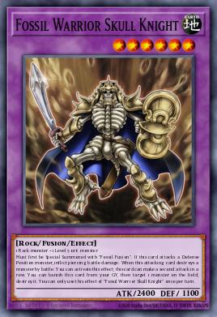

- **Copias y zona:** Extra 1x. No altera las cantidades registradas.
- **Nombre oficial de referencia:** Guerrero Fósil Caballero del Cráneo. CID cotejado con la ficha oficial; el nombre histórico del inventario se conserva aunque su grafía/traducción difiera.
- **Función principal y secundaria:** resultado de Extra Deck · removal · cierre.
- **Estado de sinergia y función:** Sin acceso demostrado con el inventario. Es una clasificación de juego; revisar la relación concreta en A06.
- **Papel como recurso, descarte o coste:** No se demuestra que esta carta sea recurso de descarte o pago para otra.
- **Efecto operativo (paráfrasis analítica):** destrucción de cartas o empleo de destrucción como detonante; presión de combate o modificación de estadísticas. Son operaciones detectadas en el texto, no efectos independientes garantizados; leer sus condiciones en la fuente.
- **Mapa de activación y resultados:** 1) efecto propio o continuo: Invocación Especial desde zona permitida · 2) efecto propio o continuo: inflige daño. Cada operación está sujeta a la secuencia y al «si lo haces» del texto oficial.
- **Ventanas de activación identificadas:** requieren la fase o condición específica indicada en el texto; sin ventana rápida general asumida.
- **Costes o recursos potenciales:** sin coste independiente identificado en esta síntesis; comprobar las acciones previas al punto y coma de cada efecto.
- **Restricciones y requisitos:** hay límite por turno según el efecto concreto; depende de recursos en Cementerio; tiene procedimiento especial de Invocación. Invocar sólo desde el Extra Deck usando su procedimiento propio.
- **Prioridad al ir primero:** extender hacia Xyz y disponer de presión de zonas sin exponerse innecesariamente. Para esta carta: Comprobar materiales exactos antes de buscar este objetivo en el Extra Deck.
- **Prioridad al ir segundo:** superar campo rival con destierros y herramientas de ruptura. Identificar primero la respuesta rival que afecta su función «resultado de Extra Deck».
- **Medio/tardío y recuperación:** recuperar Kashtira del destierro/Cementerio y medir materiales Xyz. No asumir que por sí misma recicla recursos si el texto no lo permite.
- **Sinergias y acceso a líneas:** Relación contextual con monstruos de Nivel 7, Xyz y destierro boca abajo con presión de zonas. Puede cerrar o prolongar una ruta del Extra si los materiales están disponibles.
- **Riesgo / brick / interrupciones:** Depende del Cementerio y es sensible a destierro o negación de ese recurso. No atribuirle velocidad rápida por el solo hecho de formar parte del motor.
- **Utilidad editorial:** 4/5 para este deck (estimación por rol y zona, no probabilidad calculada). No cambiar copias; cualquier sugerencia de alta/baja pasa por el apartado 22 y aprobación.
- **Referencia oficial y trazabilidad:** https://www.db.yugioh-card.com/yugiohdb/card_search.action?cid=15366&ope=2&request_locale=es. **Confianza:** texto y tipo de efecto cotejados en Konami; síntesis táctica editorial, no demostración de combo.
- **Aplicación concreta dentro de este deck (A06):** Fossil Warrior Skull Knight carece de procedimiento de Fusión Fósil disponible en Main; su efecto en Cementerio no demuestra que pueda Invocarse legalmente.

**USO PRÁCTICO Y SINERGIA — Fossil Warrior Skull Knight [Fusión]**

- **Label funcional:** Sin sinergia demostrada (con la evidencia actual). Clasificación documental; una relación es válida solo si se satisfacen sus condiciones exactas.
- **Qué hace:** destrucción de cartas o empleo de destrucción como detonante; presión de combate o modificación de estadísticas. Son operaciones detectadas en el texto, no efectos independientes garantizados; leer sus condiciones en la fuente.
- **Cómo aprovecharla en este deck:** Fossil Warrior Skull Knight carece de procedimiento de Fusión Fósil disponible en Main; su efecto en Cementerio no demuestra que pueda Invocarse legalmente.
- **Al jugar primero:** extender hacia Xyz y disponer de presión de zonas sin exponerse innecesariamente. Para esta carta: Comprobar materiales exactos antes de buscar este objetivo en el Extra Deck.
- **Al jugar segundo:** superar campo rival con destierros y herramientas de ruptura. Identificar primero la respuesta rival que afecta su función «resultado de Extra Deck».
- **Cuándo tener precaución:** Depende del Cementerio y es sensible a destierro o negación de ese recurso. No atribuirle velocidad rápida por el solo hecho de formar parte del motor.

**CÓMO LLEGAR DESDE TU DECK — SIN RUTA DEMOSTRADA**

- La biblioteca actual no contiene una ruta identificada para esta carta del Extra. No se debe exhibir una descripción genérica como sustituto de mano inicial, materiales y pasos. Para completarla, contrastar requisitos oficiales y recursos del Main; si no es alcanzable, explicar el impedimento exacto.

#### 31. Fossil Machine Skull Wagon [Fusión]

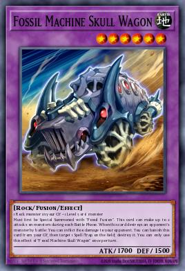

- **Copias y zona:** Extra 1x. No altera las cantidades registradas.
- **Nombre oficial de referencia:** Máquina Fósil Camioneta Cráneo. CID cotejado con la ficha oficial; el nombre histórico del inventario se conserva aunque su grafía/traducción difiera.
- **Función principal y secundaria:** interrupción · resultado de Extra Deck · removal · cierre.
- **Estado de sinergia y función:** Sin acceso demostrado con el inventario. Es una clasificación de juego; revisar la relación concreta en A06.
- **Papel como recurso, descarte o coste:** No se demuestra que esta carta sea recurso de descarte o pago para otra.
- **Efecto operativo (paráfrasis analítica):** destrucción de cartas o empleo de destrucción como detonante; presión de combate o modificación de estadísticas. Son operaciones detectadas en el texto, no efectos independientes garantizados; leer sus condiciones en la fuente.
- **Mapa de activación y resultados:** 1) efecto propio o continuo: Invocación Especial desde Cementerio. Cada operación está sujeta a la secuencia y al «si lo haces» del texto oficial.
- **Ventanas de activación identificadas:** requieren la fase o condición específica indicada en el texto; sin ventana rápida general asumida.
- **Costes o recursos potenciales:** sin coste independiente identificado en esta síntesis; comprobar las acciones previas al punto y coma de cada efecto.
- **Restricciones y requisitos:** hay límite por turno según el efecto concreto; depende de recursos en Cementerio; tiene procedimiento especial de Invocación. Invocar sólo desde el Extra Deck usando su procedimiento propio.
- **Prioridad al ir primero:** extender hacia Xyz y disponer de presión de zonas sin exponerse innecesariamente. Para esta carta: Reservar la respuesta para la ventana rival exacta; no es una pieza buscadora de nuestro motor.
- **Prioridad al ir segundo:** superar campo rival con destierros y herramientas de ruptura. Identificar primero la respuesta rival que afecta su función «interrupción».
- **Medio/tardío y recuperación:** recuperar Kashtira del destierro/Cementerio y medir materiales Xyz. No asumir que por sí misma recicla recursos si el texto no lo permite.
- **Sinergias y acceso a líneas:** Relación contextual con monstruos de Nivel 7, Xyz y destierro boca abajo con presión de zonas. Puede cerrar o prolongar una ruta del Extra si los materiales están disponibles.
- **Riesgo / brick / interrupciones:** Depende del Cementerio y es sensible a destierro o negación de ese recurso. No atribuirle velocidad rápida por el solo hecho de formar parte del motor.
- **Utilidad editorial:** 4/5 para este deck (estimación por rol y zona, no probabilidad calculada). No cambiar copias; cualquier sugerencia de alta/baja pasa por el apartado 22 y aprobación.
- **Referencia oficial y trazabilidad:** https://www.db.yugioh-card.com/yugiohdb/card_search.action?cid=15882&ope=2&request_locale=es. **Confianza:** texto y tipo de efecto cotejados en Konami; síntesis táctica editorial, no demostración de combo.
- **Aplicación concreta dentro de este deck (A06):** Fossil Machine Skull Wagon carece de procedimiento de Fusión Fósil disponible en Main; una carta en Extra no entra directamente en Cementerio.

**USO PRÁCTICO Y SINERGIA — Fossil Machine Skull Wagon [Fusión]**

- **Label funcional:** Sin sinergia demostrada (con la evidencia actual). Clasificación documental; una relación es válida solo si se satisfacen sus condiciones exactas.
- **Qué hace:** destrucción de cartas o empleo de destrucción como detonante; presión de combate o modificación de estadísticas. Son operaciones detectadas en el texto, no efectos independientes garantizados; leer sus condiciones en la fuente.
- **Cómo aprovecharla en este deck:** Fossil Machine Skull Wagon carece de procedimiento de Fusión Fósil disponible en Main; una carta en Extra no entra directamente en Cementerio.
- **Al jugar primero:** extender hacia Xyz y disponer de presión de zonas sin exponerse innecesariamente. Para esta carta: Reservar la respuesta para la ventana rival exacta; no es una pieza buscadora de nuestro motor.
- **Al jugar segundo:** superar campo rival con destierros y herramientas de ruptura. Identificar primero la respuesta rival que afecta su función «interrupción».
- **Cuándo tener precaución:** Depende del Cementerio y es sensible a destierro o negación de ese recurso. No atribuirle velocidad rápida por el solo hecho de formar parte del motor.

**CÓMO LLEGAR DESDE TU DECK — SIN RUTA DEMOSTRADA**

- La biblioteca actual no contiene una ruta identificada para esta carta del Extra. No se debe exhibir una descripción genérica como sustituto de mano inicial, materiales y pasos. Para completarla, contrastar requisitos oficiales y recursos del Main; si no es alcanzable, explicar el impedimento exacto.

#### 32. Eradicator Epidemic Virus

- **Copias y zona:** Reserva 2x. No altera las cantidades registradas.
- **Nombre oficial de referencia:** Virus Epidémico Erradicador. CID cotejado con la ficha oficial; el nombre histórico del inventario se conserva aunque su grafía/traducción difiera.
- **Función principal y secundaria:** removal · cierre · coste/recurso.
- **Estado de sinergia y función:** Reserva fuera de lista activa. Es una clasificación de juego; revisar la relación concreta en A06.
- **Papel como recurso, descarte o coste:** Coste o consumo descrito en A05: Sacrificio.
- **Efecto operativo (paráfrasis analítica):** destrucción de cartas o empleo de destrucción como detonante; presión de combate o modificación de estadísticas; uso de Sacrificios como parte del efecto. Son operaciones detectadas en el texto, no efectos independientes garantizados; leer sus condiciones en la fuente.
- **Mapa de activación y resultados:** 1) efecto propio o continuo: destruye la carta o recurso previsto. Cada operación está sujeta a la secuencia y al «si lo haces» del texto oficial.
- **Ventanas de activación identificadas:** requieren la fase o condición específica indicada en el texto; sin ventana rápida general asumida.
- **Costes o recursos potenciales:** Sacrificio.
- **Restricciones y requisitos:** aplicar restricciones de selección, activación y copias que consten en el texto original. 
- **Prioridad al ir primero:** extender hacia Xyz y disponer de presión de zonas sin exponerse innecesariamente. Para esta carta: Activar cuando las condiciones permitan obtener valor real, preservando recursos de seguimiento.
- **Prioridad al ir segundo:** superar campo rival con destierros y herramientas de ruptura. Identificar primero la respuesta rival que afecta su función «removal».
- **Medio/tardío y recuperación:** recuperar Kashtira del destierro/Cementerio y medir materiales Xyz. No asumir que por sí misma recicla recursos si el texto no lo permite.
- **Sinergias y acceso a líneas:** Relación contextual con monstruos de Nivel 7, Xyz y destierro boca abajo con presión de zonas. Habilita una línea del motor sólo si coinciden recursos, objetivos y restricciones; no equivale a un combo completo validado.
- **Riesgo / brick / interrupciones:** Riesgo operativo: efectos que niegan búsquedas, combaten Xyz o castigan campo saturado. Confirmar objetivos disponibles y costes antes de activar. No atribuirle velocidad rápida por el solo hecho de formar parte del motor.
- **Utilidad editorial:** 3/5 para este deck (estimación por rol y zona, no probabilidad calculada). No cambiar copias; cualquier sugerencia de alta/baja pasa por el apartado 22 y aprobación.
- **Referencia oficial y trazabilidad:** https://www.db.yugioh-card.com/yugiohdb/card_search.action?cid=7153&ope=2&request_locale=es. **Confianza:** texto y tipo de efecto cotejados en Konami; síntesis táctica editorial, no demostración de combo.
- **Aplicación concreta dentro de este deck (A06):** Fuera de lista. destrucción de cartas o empleo de destrucción como detonante; presión de combate o modificación de estadísticas; uso de Sacrificios como parte del efecto.. No aporta recursos durante este duelo.

**USO PRÁCTICO Y SINERGIA — Eradicator Epidemic Virus**

- **Label funcional:** Sin sinergia demostrada (con la evidencia actual). Clasificación documental; una relación es válida solo si se satisfacen sus condiciones exactas.
- **Qué hace:** destrucción de cartas o empleo de destrucción como detonante; presión de combate o modificación de estadísticas; uso de Sacrificios como parte del efecto. Son operaciones detectadas en el texto, no efectos independientes garantizados; leer sus condiciones en la fuente.
- **Cómo aprovecharla en este deck:** Fuera de lista. destrucción de cartas o empleo de destrucción como detonante; presión de combate o modificación de estadísticas; uso de Sacrificios como parte del efecto.. No aporta recursos durante este duelo.
- **Al jugar primero:** extender hacia Xyz y disponer de presión de zonas sin exponerse innecesariamente. Para esta carta: Activar cuando las condiciones permitan obtener valor real, preservando recursos de seguimiento.
- **Al jugar segundo:** superar campo rival con destierros y herramientas de ruptura. Identificar primero la respuesta rival que afecta su función «removal».
- **Cuándo tener precaución:** Riesgo operativo: efectos que niegan búsquedas, combaten Xyz o castigan campo saturado. Confirmar objetivos disponibles y costes antes de activar. No atribuirle velocidad rápida por el solo hecho de formar parte del motor.

#### 33. Dinowrestler Pankratops

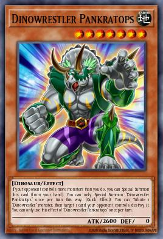

- **Copias y zona:** Reserva 1x. No altera las cantidades registradas.
- **Nombre oficial de referencia:** Dinoluchador Pancrateratops. CID cotejado con la ficha oficial; el nombre histórico del inventario se conserva aunque su grafía/traducción difiera.
- **Función principal y secundaria:** interrupción · extensor · coste/recurso.
- **Estado de sinergia y función:** Reserva fuera de lista activa. Es una clasificación de juego; revisar la relación concreta en A06.
- **Papel como recurso, descarte o coste:** No se demuestra que esta carta sea recurso de descarte o pago para otra.
- **Efecto operativo (paráfrasis analítica):** acceso al campo desde la mano; uso de Sacrificios como parte del efecto. Son operaciones detectadas en el texto, no efectos independientes garantizados; leer sus condiciones en la fuente.
- **Mapa de activación y resultados:** 1) efecto propio o continuo: Invocación Especial desde mano. Cada operación está sujeta a la secuencia y al «si lo haces» del texto oficial.
- **Ventanas de activación identificadas:** Efecto Rápido.
- **Costes o recursos potenciales:** sin coste independiente identificado en esta síntesis; comprobar las acciones previas al punto y coma de cada efecto.
- **Restricciones y requisitos:** hay límite por turno según el efecto concreto. 
- **Prioridad al ir primero:** extender hacia Xyz y disponer de presión de zonas sin exponerse innecesariamente. Para esta carta: Reservar la respuesta para la ventana rival exacta; no es una pieza buscadora de nuestro motor.
- **Prioridad al ir segundo:** superar campo rival con destierros y herramientas de ruptura. Identificar primero la respuesta rival que afecta su función «interrupción».
- **Medio/tardío y recuperación:** recuperar Kashtira del destierro/Cementerio y medir materiales Xyz. No asumir que por sí misma recicla recursos si el texto no lo permite.
- **Sinergias y acceso a líneas:** Relación contextual con monstruos de Nivel 7, Xyz y destierro boca abajo con presión de zonas. Habilita una línea del motor sólo si coinciden recursos, objetivos y restricciones; no equivale a un combo completo validado.
- **Riesgo / brick / interrupciones:** Riesgo operativo: efectos que niegan búsquedas, combaten Xyz o castigan campo saturado. Confirmar objetivos disponibles y costes antes de activar. Puede emplearse en cadena sólo cuando se cumpla su condición concreta.
- **Utilidad editorial:** 4/5 para este deck (estimación por rol y zona, no probabilidad calculada). No cambiar copias; cualquier sugerencia de alta/baja pasa por el apartado 22 y aprobación.
- **Referencia oficial y trazabilidad:** https://www.db.yugioh-card.com/yugiohdb/card_search.action?cid=13896&ope=2&request_locale=es. **Confianza:** texto y tipo de efecto cotejados en Konami; síntesis táctica editorial, no demostración de combo.
- **Aplicación concreta dentro de este deck (A06):** Fuera de lista. acceso al campo desde la mano; uso de Sacrificios como parte del efecto.. No aporta recursos durante este duelo.

**USO PRÁCTICO Y SINERGIA — Dinowrestler Pankratops**

- **Label funcional:** Sin sinergia demostrada (con la evidencia actual). Clasificación documental; una relación es válida solo si se satisfacen sus condiciones exactas.
- **Qué hace:** acceso al campo desde la mano; uso de Sacrificios como parte del efecto. Son operaciones detectadas en el texto, no efectos independientes garantizados; leer sus condiciones en la fuente.
- **Cómo aprovecharla en este deck:** Fuera de lista. acceso al campo desde la mano; uso de Sacrificios como parte del efecto.. No aporta recursos durante este duelo.
- **Al jugar primero:** extender hacia Xyz y disponer de presión de zonas sin exponerse innecesariamente. Para esta carta: Reservar la respuesta para la ventana rival exacta; no es una pieza buscadora de nuestro motor.
- **Al jugar segundo:** superar campo rival con destierros y herramientas de ruptura. Identificar primero la respuesta rival que afecta su función «interrupción».
- **Cuándo tener precaución:** Riesgo operativo: efectos que niegan búsquedas, combaten Xyz o castigan campo saturado. Confirmar objetivos disponibles y costes antes de activar. Puede emplearse en cadena sólo cuando se cumpla su condición concreta.

#### 34. Dimensional Barrier

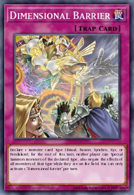

- **Copias y zona:** Reserva 2x. No altera las cantidades registradas.
- **Nombre oficial de referencia:** Barrera Dimensional. CID cotejado con la ficha oficial; el nombre histórico del inventario se conserva aunque su grafía/traducción difiera.
- **Función principal y secundaria:** trampa · bloqueo del Extra.
- **Estado de sinergia y función:** Reserva fuera de lista activa. Es una clasificación de juego; revisar la relación concreta en A06.
- **Papel como recurso, descarte o coste:** No se demuestra que esta carta sea recurso de descarte o pago para otra.
- **Efecto operativo (paráfrasis analítica):** Declara un tipo de monstruo y bloquea sus Invocaciones Especiales y efectos ese turno. 
- **Mapa de activación y resultados:** 1) efecto propio o continuo: niega el efecto o la activación indicada, Invocación Especial desde zona permitida. Cada operación está sujeta a la secuencia y al «si lo haces» del texto oficial.
- **Ventanas de activación identificadas:** requieren la fase o condición específica indicada en el texto; sin ventana rápida general asumida.
- **Costes o recursos potenciales:** sin coste independiente identificado en esta síntesis; comprobar las acciones previas al punto y coma de cada efecto.
- **Restricciones y requisitos:** hay límite por turno según el efecto concreto. 
- **Prioridad al ir primero:** extender hacia Xyz y disponer de presión de zonas sin exponerse innecesariamente. Para esta carta: Activar cuando las condiciones permitan obtener valor real, preservando recursos de seguimiento.
- **Prioridad al ir segundo:** superar campo rival con destierros y herramientas de ruptura. Identificar primero la respuesta rival que afecta su función «trampa».
- **Medio/tardío y recuperación:** recuperar Kashtira del destierro/Cementerio y medir materiales Xyz. No asumir que por sí misma recicla recursos si el texto no lo permite.
- **Sinergias y acceso a líneas:** Relación contextual con monstruos de Nivel 7, Xyz y destierro boca abajo con presión de zonas. Habilita una línea del motor sólo si coinciden recursos, objetivos y restricciones; no equivale a un combo completo validado.
- **Riesgo / brick / interrupciones:** Se declara un tipo; impacta a ambos jugadores. No atribuirle velocidad rápida por el solo hecho de formar parte del motor.
- **Utilidad editorial:** 3/5 para este deck (estimación por rol y zona, no probabilidad calculada). No cambiar copias; cualquier sugerencia de alta/baja pasa por el apartado 22 y aprobación.
- **Referencia oficial y trazabilidad:** https://www.db.yugioh-card.com/yugiohdb/card_search.action?cid=12668&ope=2&request_locale=es. **Confianza:** texto y tipo de efecto cotejados en Konami; síntesis táctica editorial, no demostración de combo.
- **Aplicación concreta dentro de este deck (A06):** Fuera de lista. Declara un tipo de monstruo y bloquea sus Invocaciones Especiales y efectos ese turno.. No aporta recursos durante este duelo.

**USO PRÁCTICO Y SINERGIA — Dimensional Barrier**

- **Label funcional:** Sin sinergia demostrada (con la evidencia actual). Clasificación documental; una relación es válida solo si se satisfacen sus condiciones exactas.
- **Qué hace:** Declara un tipo de monstruo y bloquea sus Invocaciones Especiales y efectos ese turno.
- **Cómo aprovecharla en este deck:** Fuera de lista. Declara un tipo de monstruo y bloquea sus Invocaciones Especiales y efectos ese turno.. No aporta recursos durante este duelo.
- **Al jugar primero:** extender hacia Xyz y disponer de presión de zonas sin exponerse innecesariamente. Para esta carta: Activar cuando las condiciones permitan obtener valor real, preservando recursos de seguimiento.
- **Al jugar segundo:** superar campo rival con destierros y herramientas de ruptura. Identificar primero la respuesta rival que afecta su función «trampa».
- **Cuándo tener precaución:** Se declara un tipo; impacta a ambos jugadores. No atribuirle velocidad rápida por el solo hecho de formar parte del motor.

#### 35. Nibiru, the Primal Being

- **Copias y zona:** Reserva 1x. No altera las cantidades registradas.
- **Nombre oficial de referencia:** Nibiru, el Ser Primitivo. CID cotejado con la ficha oficial; el nombre histórico del inventario se conserva aunque su grafía/traducción difiera.
- **Función principal y secundaria:** handtrap · limpieza del campo.
- **Estado de sinergia y función:** Reserva fuera de lista activa. Es una clasificación de juego; revisar la relación concreta en A06.
- **Papel como recurso, descarte o coste:** No se demuestra que esta carta sea recurso de descarte o pago para otra.
- **Efecto operativo (paráfrasis analítica):** En Main Phase, tras cinco o más invocaciones rivales, sacrifica los monstruos boca arriba y deja a Nibiru junto con una Ficha rival. 
- **Mapa de activación y resultados:** 1) en Main Phase: Invocación Especial desde mano. Cada operación está sujeta a la secuencia y al «si lo haces» del texto oficial.
- **Ventanas de activación identificadas:** Main Phase; Efecto Rápido.
- **Costes o recursos potenciales:** sin coste independiente identificado en esta síntesis; comprobar las acciones previas al punto y coma de cada efecto.
- **Restricciones y requisitos:** hay límite por turno según el efecto concreto. 
- **Prioridad al ir primero:** extender hacia Xyz y disponer de presión de zonas sin exponerse innecesariamente. Para esta carta: Reservar la respuesta para la ventana rival exacta; no es una pieza buscadora de nuestro motor.
- **Prioridad al ir segundo:** superar campo rival con destierros y herramientas de ruptura. Identificar primero la respuesta rival que afecta su función «handtrap».
- **Medio/tardío y recuperación:** recuperar Kashtira del destierro/Cementerio y medir materiales Xyz. No asumir que por sí misma recicla recursos si el texto no lo permite.
- **Sinergias y acceso a líneas:** Relación contextual con monstruos de Nivel 7, Xyz y destierro boca abajo con presión de zonas. Habilita una línea del motor sólo si coinciden recursos, objetivos y restricciones; no equivale a un combo completo validado.
- **Riesgo / brick / interrupciones:** Cuenta invocaciones y entrega una Ficha cuyo ATK/DEF depende de lo sacrificado. Puede emplearse en cadena sólo cuando se cumpla su condición concreta.
- **Utilidad editorial:** 3/5 para este deck (estimación por rol y zona, no probabilidad calculada). No cambiar copias; cualquier sugerencia de alta/baja pasa por el apartado 22 y aprobación.
- **Referencia oficial y trazabilidad:** https://www.db.yugioh-card.com/yugiohdb/card_search.action?cid=14741&ope=2&request_locale=es. **Confianza:** texto y tipo de efecto cotejados en Konami; síntesis táctica editorial, no demostración de combo.
- **Aplicación concreta dentro de este deck (A06):** Fuera de lista. En Main Phase, tras cinco o más invocaciones rivales, sacrifica los monstruos boca arriba y deja a Nibiru junto con una Ficha rival.. No aporta recursos durante este duelo.

**USO PRÁCTICO Y SINERGIA — Nibiru, the Primal Being**

- **Label funcional:** Sin sinergia demostrada (con la evidencia actual). Clasificación documental; una relación es válida solo si se satisfacen sus condiciones exactas.
- **Qué hace:** En Main Phase, tras cinco o más invocaciones rivales, sacrifica los monstruos boca arriba y deja a Nibiru junto con una Ficha rival.
- **Cómo aprovecharla en este deck:** Fuera de lista. En Main Phase, tras cinco o más invocaciones rivales, sacrifica los monstruos boca arriba y deja a Nibiru junto con una Ficha rival.. No aporta recursos durante este duelo.
- **Al jugar primero:** extender hacia Xyz y disponer de presión de zonas sin exponerse innecesariamente. Para esta carta: Reservar la respuesta para la ventana rival exacta; no es una pieza buscadora de nuestro motor.
- **Al jugar segundo:** superar campo rival con destierros y herramientas de ruptura. Identificar primero la respuesta rival que afecta su función «handtrap».
- **Cuándo tener precaución:** Cuenta invocaciones y entrega una Ficha cuyo ATK/DEF depende de lo sacrificado. Puede emplearse en cadena sólo cuando se cumpla su condición concreta.

#### 36. Droll & Lock Bird

- **Copias y zona:** Reserva 3x. No altera las cantidades registradas.
- **Nombre oficial de referencia:** El Bufón y el Pájaro del Candado. CID cotejado con la ficha oficial; el nombre histórico del inventario se conserva aunque su grafía/traducción difiera.
- **Función principal y secundaria:** handtrap · bloqueo de búsquedas.
- **Estado de sinergia y función:** Reserva fuera de lista activa. Es una clasificación de juego; revisar la relación concreta en A06.
- **Papel como recurso, descarte o coste:** Envío mencionado en la interacción; no equivale por sí mismo a descarte desde la mano.
- **Efecto operativo (paráfrasis analítica):** Tras una incorporación desde el Deck a la mano rival, se envía al Cementerio para impedir nuevas adiciones desde ambos Decks principales ese turno. 
- **Mapa de activación y resultados:** 1) con condición explícita en la carta: impide nuevas incorporaciones a mano. Cada operación está sujeta a la secuencia y al «si lo haces» del texto oficial.
- **Ventanas de activación identificadas:** Efecto Rápido.
- **Costes o recursos potenciales:** envío de recurso propio al Cementerio.
- **Restricciones y requisitos:** aplicar restricciones de selección, activación y copias que consten en el texto original. 
- **Prioridad al ir primero:** extender hacia Xyz y disponer de presión de zonas sin exponerse innecesariamente. Para esta carta: Reservar la respuesta para la ventana rival exacta; no es una pieza buscadora de nuestro motor.
- **Prioridad al ir segundo:** superar campo rival con destierros y herramientas de ruptura. Identificar primero la respuesta rival que afecta su función «handtrap».
- **Medio/tardío y recuperación:** recuperar Kashtira del destierro/Cementerio y medir materiales Xyz. No asumir que por sí misma recicla recursos si el texto no lo permite.
- **Sinergias y acceso a líneas:** Relación contextual con monstruos de Nivel 7, Xyz y destierro boca abajo con presión de zonas. Habilita una línea del motor sólo si coinciden recursos, objetivos y restricciones; no equivale a un combo completo validado.
- **Riesgo / brick / interrupciones:** No niega la primera búsqueda y también restringe las adiciones del propio jugador. Puede emplearse en cadena sólo cuando se cumpla su condición concreta.
- **Utilidad editorial:** 3/5 para este deck (estimación por rol y zona, no probabilidad calculada). No cambiar copias; cualquier sugerencia de alta/baja pasa por el apartado 22 y aprobación.
- **Referencia oficial y trazabilidad:** https://www.db.yugioh-card.com/yugiohdb/card_search.action?cid=9279&ope=2&request_locale=es. **Confianza:** texto y tipo de efecto cotejados en Konami; síntesis táctica editorial, no demostración de combo.
- **Aplicación concreta dentro de este deck (A06):** Fuera de lista. Tras una incorporación desde el Deck a la mano rival, se envía al Cementerio para impedir nuevas adiciones desde ambos Decks principales ese turno.. No aporta recursos durante este duelo.

**USO PRÁCTICO Y SINERGIA — Droll & Lock Bird**

- **Label funcional:** Sin sinergia demostrada (con la evidencia actual). Clasificación documental; una relación es válida solo si se satisfacen sus condiciones exactas.
- **Qué hace:** Tras una incorporación desde el Deck a la mano rival, se envía al Cementerio para impedir nuevas adiciones desde ambos Decks principales ese turno.
- **Cómo aprovecharla en este deck:** Fuera de lista. Tras una incorporación desde el Deck a la mano rival, se envía al Cementerio para impedir nuevas adiciones desde ambos Decks principales ese turno.. No aporta recursos durante este duelo.
- **Al jugar primero:** extender hacia Xyz y disponer de presión de zonas sin exponerse innecesariamente. Para esta carta: Reservar la respuesta para la ventana rival exacta; no es una pieza buscadora de nuestro motor.
- **Al jugar segundo:** superar campo rival con destierros y herramientas de ruptura. Identificar primero la respuesta rival que afecta su función «handtrap».
- **Cuándo tener precaución:** No niega la primera búsqueda y también restringe las adiciones del propio jugador. Puede emplearse en cadena sólo cuando se cumpla su condición concreta.

#### 37. Ghost Belle & Haunted Mansion

- **Copias y zona:** Reserva 2x. No altera las cantidades registradas.
- **Nombre oficial de referencia:** Bella Fantasma & Mansión Embrujada. CID cotejado con la ficha oficial; el nombre histórico del inventario se conserva aunque su grafía/traducción difiera.
- **Función principal y secundaria:** handtrap · negación de Cementerio.
- **Estado de sinergia y función:** Reserva fuera de lista activa. Es una clasificación de juego; revisar la relación concreta en A06.
- **Papel como recurso, descarte o coste:** Coste o consumo descrito en A05: descarte de mano.
- **Efecto operativo (paráfrasis analítica):** Descarta para negar la activación de una operación que recupere, invoque o destierre cartas del Cementerio. 
- **Mapa de activación y resultados:** 1) con condición explícita en la carta: Invocación Especial desde Extra Deck, incorpora la pieza indicada a la mano. Cada operación está sujeta a la secuencia y al «si lo haces» del texto oficial.
- **Ventanas de activación identificadas:** Efecto Rápido.
- **Costes o recursos potenciales:** descarte de mano.
- **Restricciones y requisitos:** hay límite por turno según el efecto concreto. 
- **Prioridad al ir primero:** extender hacia Xyz y disponer de presión de zonas sin exponerse innecesariamente. Para esta carta: Reservar la respuesta para la ventana rival exacta; no es una pieza buscadora de nuestro motor.
- **Prioridad al ir segundo:** superar campo rival con destierros y herramientas de ruptura. Identificar primero la respuesta rival que afecta su función «handtrap».
- **Medio/tardío y recuperación:** recuperar Kashtira del destierro/Cementerio y medir materiales Xyz. Verificar que el objetivo de recuperación continúe disponible.
- **Sinergias y acceso a líneas:** Relación contextual con monstruos de Nivel 7, Xyz y destierro boca abajo con presión de zonas. Habilita una línea del motor sólo si coinciden recursos, objetivos y restricciones; no equivale a un combo completo validado.
- **Riesgo / brick / interrupciones:** No niega todos los efectos: exige que el efecto incluya una de las acciones enumeradas. Puede emplearse en cadena sólo cuando se cumpla su condición concreta.
- **Utilidad editorial:** 3/5 para este deck (estimación por rol y zona, no probabilidad calculada). No cambiar copias; cualquier sugerencia de alta/baja pasa por el apartado 22 y aprobación.
- **Referencia oficial y trazabilidad:** https://www.db.yugioh-card.com/yugiohdb/card_search.action?cid=13587&ope=2&request_locale=es. **Confianza:** texto y tipo de efecto cotejados en Konami; síntesis táctica editorial, no demostración de combo.
- **Aplicación concreta dentro de este deck (A06):** Fuera de lista. Descarta para negar la activación de una operación que recupere, invoque o destierre cartas del Cementerio.. No aporta recursos durante este duelo.

**USO PRÁCTICO Y SINERGIA — Ghost Belle & Haunted Mansion**

- **Label funcional:** Sin sinergia demostrada (con la evidencia actual). Clasificación documental; una relación es válida solo si se satisfacen sus condiciones exactas.
- **Qué hace:** Descarta para negar la activación de una operación que recupere, invoque o destierre cartas del Cementerio.
- **Cómo aprovecharla en este deck:** Fuera de lista. Descarta para negar la activación de una operación que recupere, invoque o destierre cartas del Cementerio.. No aporta recursos durante este duelo.
- **Al jugar primero:** extender hacia Xyz y disponer de presión de zonas sin exponerse innecesariamente. Para esta carta: Reservar la respuesta para la ventana rival exacta; no es una pieza buscadora de nuestro motor.
- **Al jugar segundo:** superar campo rival con destierros y herramientas de ruptura. Identificar primero la respuesta rival que afecta su función «handtrap».
- **Cuándo tener precaución:** No niega todos los efectos: exige que el efecto incluya una de las acciones enumeradas. Puede emplearse en cadena sólo cuando se cumpla su condición concreta.

#### 38. Infinitrack Goliath [monstruo Link para intercambio con Extra Deck]

- **Copias y zona:** Reserva 1x. No altera las cantidades registradas.
- **Nombre oficial de referencia:** Infinitrack Goliat. CID cotejado con la ficha oficial; el nombre histórico del inventario se conserva aunque su grafía/traducción difiera.
- **Función principal y secundaria:** respuesta · habilitador Xyz · protección.
- **Estado de sinergia y función:** Reserva fuera de lista activa. Es una clasificación de juego; revisar la relación concreta en A06.
- **Papel como recurso, descarte o coste:** Material o destino del Extra condicionado a los requisitos de invocación.
- **Efecto operativo (paráfrasis analítica):** interacción sobre monstruos en campo; gestión de materiales Xyz; protección o resistencia contra respuestas. Son operaciones detectadas en el texto, no efectos independientes garantizados; leer sus condiciones en la fuente.
- **Mapa de activación y resultados:** efecto de estadística, condición o material; no asumir un disparador adicional. Cada operación está sujeta a la secuencia y al «si lo haces» del texto oficial.
- **Ventanas de activación identificadas:** requieren la fase o condición específica indicada en el texto; sin ventana rápida general asumida.
- **Costes o recursos potenciales:** sin coste independiente identificado en esta síntesis; comprobar las acciones previas al punto y coma de cada efecto.
- **Restricciones y requisitos:** hay límite por turno según el efecto concreto. 
- **Prioridad al ir primero:** extender hacia Xyz y disponer de presión de zonas sin exponerse innecesariamente. Para esta carta: Activar cuando las condiciones permitan obtener valor real, preservando recursos de seguimiento.
- **Prioridad al ir segundo:** superar campo rival con destierros y herramientas de ruptura. Identificar primero la respuesta rival que afecta su función «respuesta».
- **Medio/tardío y recuperación:** recuperar Kashtira del destierro/Cementerio y medir materiales Xyz. No asumir que por sí misma recicla recursos si el texto no lo permite.
- **Sinergias y acceso a líneas:** Relación contextual con monstruos de Nivel 7, Xyz y destierro boca abajo con presión de zonas. Habilita una línea del motor sólo si coinciden recursos, objetivos y restricciones; no equivale a un combo completo validado.
- **Riesgo / brick / interrupciones:** Riesgo operativo: efectos que niegan búsquedas, combaten Xyz o castigan campo saturado. Confirmar objetivos disponibles y costes antes de activar. No atribuirle velocidad rápida por el solo hecho de formar parte del motor.
- **Utilidad editorial:** 3/5 para este deck (estimación por rol y zona, no probabilidad calculada). No cambiar copias; cualquier sugerencia de alta/baja pasa por el apartado 22 y aprobación.
- **Referencia oficial y trazabilidad:** https://www.db.yugioh-card.com/yugiohdb/card_search.action?cid=14400&ope=2&request_locale=es. **Confianza:** texto y tipo de efecto cotejados en Konami; síntesis táctica editorial, no demostración de combo.
- **Aplicación concreta dentro de este deck (A06):** Fuera de lista. interacción sobre monstruos en campo; gestión de materiales Xyz; protección o resistencia contra respuestas.. No aporta recursos durante este duelo.

**USO PRÁCTICO Y SINERGIA — Infinitrack Goliath [monstruo Link para intercambio con Extra Deck]**

- **Label funcional:** Sin sinergia demostrada (con la evidencia actual). Clasificación documental; una relación es válida solo si se satisfacen sus condiciones exactas.
- **Qué hace:** interacción sobre monstruos en campo; gestión de materiales Xyz; protección o resistencia contra respuestas. Son operaciones detectadas en el texto, no efectos independientes garantizados; leer sus condiciones en la fuente.
- **Cómo aprovecharla en este deck:** Fuera de lista. interacción sobre monstruos en campo; gestión de materiales Xyz; protección o resistencia contra respuestas.. No aporta recursos durante este duelo.
- **Al jugar primero:** extender hacia Xyz y disponer de presión de zonas sin exponerse innecesariamente. Para esta carta: Activar cuando las condiciones permitan obtener valor real, preservando recursos de seguimiento.
- **Al jugar segundo:** superar campo rival con destierros y herramientas de ruptura. Identificar primero la respuesta rival que afecta su función «respuesta».
- **Cuándo tener precaución:** Riesgo operativo: efectos que niegan búsquedas, combaten Xyz o castigan campo saturado. Confirmar objetivos disponibles y costes antes de activar. No atribuirle velocidad rápida por el solo hecho de formar parte del motor.

## SINERGIAS Y MOTORES
## RESUMEN FUNCIONAL DE SINERGIAS — 665

**Medición descriptiva de etiquetas existentes (NO certificación):** 11/38 identidades con etiqueta directa/indirecta (28.9 %). Main: 11/21 (52.4 %); Extra: 0/10 (0.0 %). Se cuenta una identidad una sola vez; una carta autónoma puede ser útil sin sinergia de motor. Estas cifras provienen de clasificaciones documentales A05/A06: **no son el porcentaje final de sinergias verificadas**, ni una tasa estadística de victoria. Para promoverlas a métricas verificadas, se deben comprobar los pares de cartas y su operación legal.

#### A06.0 — En 30 segundos: cómo cooperan realmente estas cartas

- **Dictamen de conjunto:** motor central Kashtira coherente, pero el Extra incluye dos Fusiones Fósil sin procedimiento demostrado y cinco destinos Extra cuyo acceso aún debe enlazarse.
- **Motor que mueve el deck:** Wraitsoth y Fenrir/Unicornio/Ogro consiguen piezas; Nacimiento y Kashtirateosis permiten mantener y extender Nivel 7. Dos cuerpos compatibles habilitan Shangri-Ira según sus materiales.
- **Puentes reales:** Riseheart convierte recursos y facilita la lógica de destierro; Shangri-Ira genera presión sobre zonas cuando su disparador realmente ocurre; Arise-Heart exige método Xyz ordinario o activación válida del efecto de Shangri-Ira para el procedimiento alternativo.
- **Sinergia indirecta:** Big Bang y Kashtirateosis pueden tener valor al ser desterradas; Shifter y cartas de respuesta son piezas autónomas. Una carta que no busque Kashtira no es automáticamente incompatible.
- **Conflicto decisivo:** Teosis/Riseheart restringen Extra a Xyz; Prosperidad consume cartas del Extra; Shifter/Arise modifican el destino GY y afectan recuperaciones que requieren ese lugar. No prometer bloqueo de zonas por un destierro distinto al descrito.
- **Decisión concreta:** revisar acceso a Fossil Warrior Skull Knight y Fossil Machine Skull Wagon antes de conservar sus ranuras; valorar destinos Xyz alcanzables sin modificar aún lista/cantidades.
- **Qué aprender después:** escoger entre ruta Shangri-Ira, Arise-Heart o retirada rival según mano y condiciones; contrastar cada endboard con su variante A09.

#### Motores y acceso real

1. **Motor principal de Nivel 7 y destierro.** **Wraitsoth** (CID 18204) añade un Kashtira del Deck. **Fenrir** (17768) busca otro monstruo Kashtira, **Unicornio** (17769) busca una Mágica Kashtira y **Ogro** (17770) una Trampa Kashtira. Los tres Nivel 7 mencionados pueden Invocarse desde mano sin monstruos propios; una vez ocupado el campo no repetir esa condición como si siguiera vacío.
2. **Expansión y conversión de Nivel.** **Kashtirateosis** (18203) selecciona un Kashtira propio y trae del Deck otro de **Atributo diferente** en Defensa; al resolver bloquea el Extra a **Xyz** el resto del turno. **Nacimiento Kashtira** (17815) permite Invocar de Modo Normal un Nivel 7 sin Sacrificio y recuperar un Kashtira no Xyz del GY o destierro. **Riseheart** (18151) se Invoca desde mano si hay Kashtira; desterrar un Kashtira desde Deck le permite desterrar tres cartas superiores rivales boca abajo y cambiar su Nivel a 7, con bloqueo del Extra a Xyz desde su Invocación.
3. **Shangri-Ira / Arise-Heart: dos condiciones distintas.** Dos Nivel 7 pueden dar **Shangri-Ira** (17800), que invoca un Kashtira desde Deck durante Standby Phase y puede bloquear zonas cuando se destierran cartas propias del adversario **boca abajo**. **Arise-Heart** (18191) puede entrar sobre un Kashtira propio por su método alternativo **solo si se activó con éxito un efecto de Shangri-Ira ese turno**, o por su método ordinario de materiales. Arise-Heart destierra las cartas que irían al GY, acopla cartas desterradas y necesita **tres materiales desacoplables** para su destierro rápido.
4. **Recuperación por destierro.** Si **Kashtirateosis** es desterrada, puede recuperar otra carta Kashtira desterrada. **Big Bang Kashtira** (18220), si es desterrada, recupera de un Xyz Kashtira una carta Kashtira acoplada y puede Invocarla; su efecto de Trampa en Campo exige un Xyz Kashtira y la situación de monstruos que describe. **Preparaciones Kashtira** (17831) Invoca desde mano/destierro y puede castigar activación de Trampa rival si permanece boca arriba bajo los requisitos indicados.
5. **Apoyos de batalla e interrupción.** **Terrogarra Kashtira** (18152) se Invoca pagando destierro y debilita efectos de monstruos rivales en batalla; **Tiagrimentos Kashtira** (18153) manda cartas de la parte superior del Deck, pero su uso como relleno de GY pierde valor bajo Arise-Heart o Shifter. **Fenrir**, Unicornio y Ogro poseen respuestas al ataque/efecto rival con destierros de diferente tipo y lugar: no equivalen a una negación genérica.
6. **Extra auxiliar condicionado.** **Número 11: Ojo Grande** (9861) requiere dos Nivel 7 y desacopla para tomar control de monstruo sin poder atacar ese turno; **ZEUS** necesita las condiciones de Invocación Xyz aplicables tras batalla de un Xyz. **Baronesa de Flor** (CID en APARTADO_05) requiere Cantante y materiales/niveles adecuados y queda incompatible **después** de activar restricciones a Xyz. **Guerrero Fósil Caballero Calavera** y **Máquina Fósil Vagón Calavera** están listados en el Extra, pero no aparece en Main un procedimiento de Fusión Fósil que los habilite: no presentarlos como rutas listas.

#### Mapa de relaciones para fotografías oficiales

| Arista por CID | Relación operativa | Condición que impide el salto automático | Visual |
|---|---|---|---|
| Wraitsoth (18204) → Unicornio (17769) → Kashtirateosis (18203) | Campo busca monstruo; Unicornio busca Mágica; Teosis extiende otro Atributo. | Monstruo en campo, objetivo de Atributo distinto y bloqueo Xyz. |    |
| Fenrir (17768) / Nacimiento (17815) → dos Nivel 7 → Shangri-Ira (17800) | Acceso a Xyz y despliegue desde Deck en Standby. | Materiales reales y fase Standby; no Invocación al instante de Shangri. |    |
| Riseheart (18151) → destierro boca abajo → Shangri-Ira (17800) | Destierro rival puede activar bloqueo de zonas. | Deben ser cartas del oponente desterradas boca abajo; bloqueo sujeto al monstruo boca arriba. |   |
| Shangri-Ira (17800) → Arise-Heart (18191) | Procedimiento Xyz alternativo sobre Kashtira. | Efecto de Shangri-Ira activado **con éxito** en ese turno. |   |
| Kashtirateosis (18203) / Big Bang (18220) → recursos desterrados | Recuperar pieza del destierro o material de Xyz. | Solo al desterrarse la carta indicada y con objetivo válido. |   |

#### Choques, consumo y redundancia

- **Shifter / Arise-Heart:** ambos reemplazan el envío al GY por destierro; esto protege el plan Kashtira, pero reduce el valor de cualquier motor que realmente necesite cartas **en Cementerio** (por ejemplo, recuperación de Nacimiento cuando no hay desterrados o los envíos de Tiagrimentos Kashtira).
- **Prosperidad:** destierra cartas **elegidas** del Extra boca abajo, comprometiendo recursos como Shangri, Arise o ZEUS. **Agujero Oscuro** destruye también tus monstruos; no atribuirle retirada selectiva. **Lanza Prohibida** y **Libro de la Luna** interactúan con zonas/monstruos bajo condiciones específicas, no rompen cualquier bloqueo.
- **Reservas y rutas no demostradas:** 19 copias de Reserva no están en el Deck actual; **Infinitrack Goliat** sería un Link para un deck modificado y no puede invocarse como si ya estuviera en Extra. Las Fusiones Fósil no se dan por invocables sin materiales y método.

#### A06.1 — Arquitectura operativa de los motores (síntesis no redundante)

Las siguientes filas son **relaciones funcionales**, no secuencias certificadas ni garantía de mano inicial. La lista real y los límites están en A04/A05/A07.

| Tipo / motor | Starter o vía de acceso real | Recurso y destino | Cuello de botella |
|---|---|---|---|
| **Principal: Kashtira Nivel 7** | Wraitsoth, Fenrir, Unicornio, Ogre, Teosis y Nacimiento | Dos cuerpos Nivel 7, Shangri-Ira y continuidad | Fenrir/Unicornio desde mano solo con campo sin monstruos; Teosis bloquea Extra Xyz |
| **Submotor: Destierro/zonas** | Riseheart, Shangri-Ira, Arise-Heart y Big Bang | Destierro boca abajo, bloqueo de zona y reciclaje | No equiparar destierro con destrucción; Arise-Heart exige activación de Shangri para su método alternativo |
| **Apoyo autónomo: romper campo** | Dark Hole, Book of Moon, Cosmic Cyclone, Impermanence | Retirada y protección de la línea, sin ser starters Kashtira | Elegir ventana/objetivo; Agujero Oscuro destruye también el campo propio |

#### A06.2 — Estado funcional y justificación de TODAS las cartas

**Cómo leerlo:** un estado de sinergia describe el papel **de juego**, no el avance de una auditoría. No hay obligación de que cada carta tenga un enlace con otra: una defensa autónoma, una herramienta de Side o un recurso de descarte justificado también tiene propósito. Las relaciones directas descritas aquí se deben contrastar con los textos oficiales antes de representarlas como una ruta legal A09.

| Carta / CID y zona | Estado funcional de sinergia | Motivo de inclusión | Relación y condición concreta | Papel como coste, descarte o material | Límite o riesgo | Decisión táctica |
|---|---|---|---|---|---|---|
| **Kashtira Fenrir** (CID 17768) — Main 3x | **Sinergia directa descrita** | starter Kashtira · presión de destierro | Se invoca desde mano sin monstruos propios, busca otro Kashtira y destierra boca abajo una carta rival al reaccionar a su efecto o atacar | No se demuestra que esta carta sea recurso de descarte o pago para otra | hay límite por turno según el efecto concreto; requiere campo propio sin las cartas indicadas; interactúa con información oculta o resultados no… | Conservar; verificar coste y orden |
| **Kashtira Unicorn** (CID 17769) — Main 2x, Reserva 1x | **Sinergia directa descrita** | starter Kashtira · presión de Extra | Se invoca desde mano sin monstruos propios, busca una Mágica Kashtira e inspecciona/destierra del Extra rival según su disparador | No se demuestra que esta carta sea recurso de descarte o pago para otra | hay límite por turno según el efecto concreto; requiere campo propio sin las cartas indicadas; interactúa con información oculta o resultados no… | Conservar; verificar coste y orden |
| **Kashtira Riseheart** (CID 18151) — Main 3x | **Sinergia directa descrita** | extensor Kashtira · ajuste de Nivel | Se invoca si controlas Kashtira y transforma recursos por destierro para habilitar Nivel 7/Xyz | Material o destino del Extra condicionado a los requisitos de invocación | hay límite por turno según el efecto concreto; puede bloquear tipos de Invocación del Extra Deck; requiere estado de campo específico… | Conservar; verificar coste y orden |
| **Kashtira Ogre** (CID 17770) — Main 1x | **Sinergia directa descrita** | acceso condicionado a campo vacío · interrupción · searcher · buscador · extensor | búsqueda o incorporación de cartas a mano; acceso al campo desde la mano; destierro de recursos o de amenazas | No se demuestra que esta carta sea recurso de descarte o pago para otra | hay límite por turno según el efecto concreto; requiere campo propio sin las cartas indicadas; interactúa con información oculta o resultados no… | Conservar; verificar coste y orden |
| **Scareclaw Kashtira** (CID 18152) — Main 1x | **Sinergia indirecta (soporte o recursos)** | interrupción · extensor · removal · cierre | acceso al campo desde la mano; destierro de recursos o de amenazas; presión de combate o modificación de estadísticas | Coste o consumo descrito en A05: destierro de recurso propio | hay límite por turno según el efecto concreto | Conservar; verificar coste y orden |
| **Tearlaments Kashtira** (CID 18153) — Main 1x | **Sinergia indirecta (soporte o recursos)** | interrupción · extensor · removal | acceso al campo desde la mano; destierro de recursos o de amenazas | Coste o consumo descrito en A05: destierro de recurso propio | hay límite por turno según el efecto concreto; interactúa con información oculta o resultados no siempre elegibles | Conservar; verificar coste y orden |
| **Ash Blossom & Joyous Spring** (CID 12950) — Main 3x | **Utilidad independiente** | handtrap · negación | Descarta desde la mano para detener efectos que buscan, invocan o mandan cartas desde el Deck. Aporta respuesta o consistencia sin exigir enlace directo | Descarte mencionado: comprobar carta que lo exige, zona, coste frente a efecto y utilidad del recurso | hay límite por turno según el efecto concreto | Conservar según rival y conflictos propios |
| **Dimension Shifter** (CID 14740) — Main 1x, Reserva 2x | **Utilidad independiente** | handtrap · macro-destierro | Si el Cementerio propio está vacío, se envía desde mano y hace que las cartas que irían al Cementerio se destierren hasta el final del turno siguiente. Aporta respuesta o consistencia sin exigir enlace directo | Envío mencionado en la interacción; no equivale por sí mismo a descarte desde la mano | depende de recursos en Cementerio | Conservar según rival y conflictos propios |
| **Pressured Planet Wraitsoth** (CID 18204) — Main 3x | **Sinergia directa descrita** | searcher · buscador · cierre | búsqueda o incorporación de cartas a mano; presión de combate o modificación de estadísticas | No se demuestra que esta carta sea recurso de descarte o pago para otra | hay límite por turno según el efecto concreto | Conservar; verificar coste y orden |
| **Kashtira Birth** (CID 17815) — Main 3x | **Sinergia directa descrita** | recuperación · removal · coste/recurso | recuperación e invocación desde Cementerio/destierro; destierro de recursos o de amenazas; uso de Sacrificios como parte del efecto | No se demuestra que esta carta sea recurso de descarte o pago para otra | hay límite por turno según el efecto concreto; depende de recursos en Cementerio; interactúa con información oculta o resultados no siempre… | Conservar; verificar coste y orden |
| **Kashtiratheosis** (CID 18203) — Main 3x | **Sinergia directa descrita** | extensor · recuperación · removal · cierre · respuesta | extensión mediante monstruos procedentes del Deck; recuperación e invocación desde Cementerio/destierro; destierro de recursos o de amenazas; presión de combate o modificación de estadísticas; interacción sobre monstruos en campo | No se demuestra que esta carta sea recurso de descarte o pago para otra | hay límite por turno según el efecto concreto; puede bloquear tipos de Invocación del Extra Deck | Conservar; verificar coste y orden |
| **Terraforming** (CID 5537) — Main 1x | **Utilidad independiente** | mágica · búsqueda de campo | Busca una Mágica de Campo en el Deck y la lleva a la mano. Aporta respuesta o consistencia sin exigir enlace directo | No se demuestra que esta carta sea recurso de descarte o pago para otra | aplicar restricciones de selección, activación y copias que consten en el texto original | Conservar según rival y conflictos propios |
| **Book of Moon** (CID 5432) — Main 2x, Reserva 1x | **Utilidad independiente** | control de zonas · cierre | manipulación de posiciones o zonas; presión de combate o modificación de estadísticas. Aporta respuesta o consistencia sin exigir enlace directo | No se demuestra que esta carta sea recurso de descarte o pago para otra | interactúa con información oculta o resultados no siempre elegibles | Conservar según rival y conflictos propios |
| **Dark Hole** (CID 4342) — Main 3x | **Utilidad independiente** | removal | destrucción de cartas o empleo de destrucción como detonante. Aporta respuesta o consistencia sin exigir enlace directo | No se demuestra que esta carta sea recurso de descarte o pago para otra | aplicar restricciones de selección, activación y copias que consten en el texto original | Conservar según rival y conflictos propios |
| **Pot of Prosperity** (CID 15756) — Main 2x, Reserva 1x | **Utilidad independiente** | searcher · buscador · removal · ventaja de mano · cierre | búsqueda o incorporación de cartas a mano; destierro de recursos o de amenazas; generación de cartas por robo; presión de combate o modificación de estadísticas. Aporta respuesta o consistencia sin exigir enlace directo | No se demuestra que esta carta sea recurso de descarte o pago para otra | hay límite por turno según el efecto concreto; interactúa con información oculta o resultados no siempre elegibles | Conservar según rival y conflictos propios |
| **Cosmic Cyclone** (CID 12464) — Main 2x | **Utilidad independiente** | mágica rápida · remoción | Paga 1000 LP para desterrar una Mágica/Trampa en campo. Aporta respuesta o consistencia sin exigir enlace directo | Destierro como uso/recurso; comprobar origen, coste o efecto y recuperación | aplicar restricciones de selección, activación y copias que consten en el texto original | Conservar según rival y conflictos propios |
| **Forbidden Lance** (CID 9352) — Main 2x, Reserva 1x | **Utilidad independiente** | cierre · protección | presión de combate o modificación de estadísticas; protección o resistencia contra respuestas. Aporta respuesta o consistencia sin exigir enlace directo | No se demuestra que esta carta sea recurso de descarte o pago para otra | aplicar restricciones de selección, activación y copias que consten en el texto original | Conservar según rival y conflictos propios |
| **Triple Tactics Talent** (CID 15296) — Main 1x, Reserva 1x | **Utilidad independiente** | mágica de respuesta · ventaja | Si el rival activó un efecto de monstruo durante tu Main Phase, permite elegir entre robar dos, tomar control temporal o devolver una carta de mano al Deck. Aporta respuesta o consistencia sin exigir enlace directo | No se demuestra que esta carta sea recurso de descarte o pago para otra | hay límite por turno según el efecto concreto | Conservar según rival y conflictos propios |
| **Infinite Impermanence** (CID 13631) — Main 3x | **Utilidad independiente** | trampa · negación | Niega temporalmente un monstruo rival boca arriba; si se activó tras estar Colocada, también afecta la columna M/T correspondiente. Aporta respuesta o consistencia sin exigir enlace directo | No se demuestra que esta carta sea recurso de descarte o pago para otra | requiere campo propio sin las cartas indicadas | Conservar según rival y conflictos propios |
| **Kashtira Preparations** (CID 17831) — Main 1x | **Sinergia indirecta (soporte o recursos)** | recuperación · extensor · removal | recuperación e invocación desde Cementerio/destierro; acceso al campo desde la mano; destierro de recursos o de amenazas | No se demuestra que esta carta sea recurso de descarte o pago para otra | hay límite por turno según el efecto concreto; interactúa con información oculta o resultados no siempre elegibles | Conservar; verificar coste y orden |
| **Kashtira Big Bang** (CID 18220) — Main 1x | **Sinergia indirecta (soporte o recursos)** | searcher · buscador · extensor · removal · respuesta | búsqueda o incorporación de cartas a mano; acceso al campo desde la mano; destierro de recursos o de amenazas; interacción sobre monstruos en campo; gestión de materiales Xyz | Material o destino del Extra condicionado a los requisitos de invocación | hay límite por turno según el efecto concreto; interactúa con información oculta o resultados no siempre elegibles | Conservar; verificar coste y orden |
| **Kashtira Shangri-Ira [Xyz rango 7]** (CID 17800) — Extra 3x | **Destino Extra condicionado** | jefe Xyz Kashtira · bloqueo de zonas | En cada Standby Phase invoca Kashtira desde Deck y bloquea zonas libres al dispararse destierro boca abajo | Material o destino del Extra condicionado a los requisitos de invocación | hay límite por turno según el efecto concreto; interactúa con información oculta o resultados no siempre elegibles. Invocar sólo desde el Extra… | Conservar si hay materiales legales |
| **Kashtira Arise-Heart [Xyz rango 7]** (CID 18191) — Extra 2x | **Destino Extra condicionado** | jefe Xyz Kashtira · destierro | Puede subir sobre Kashtira si se resolvió Shangri-Ira y convierte cartas enviadas al Cementerio en destierro; remueve con materiales | Material o destino del Extra condicionado a los requisitos de invocación | hay límite por turno según el efecto concreto; interactúa con información oculta o resultados no siempre elegibles. Invocar sólo desde el Extra… | Conservar si hay materiales legales |
| **Number 11: Big Eye [Xyz rango 7]** (CID 9861) — Extra 2x | **Destino Extra condicionado** | resultado de Extra Deck · respuesta · habilitador Xyz | interacción sobre monstruos en campo; gestión de materiales Xyz | Material o destino del Extra condicionado a los requisitos de invocación | hay límite por turno según el efecto concreto; puede limitar ataques. Invocar sólo desde el Extra Deck usando su procedimiento propio | Conservar si hay materiales legales |
| **Divine Arsenal AA-ZEUS – Sky Thunder [Xyz]** (CID 15524) — Extra 2x | **Sin acceso al Extra demostrado** | Función individual: interrupción · resultado de Extra Deck · habilitador Xyz | No se documenta una operación concreta que conecte esta carta con el motor; no inferir inutilidad | Material o destino del Extra condicionado a los requisitos de invocación | hay límite por turno según el efecto concreto. Invocar sólo desde el Extra Deck usando su procedimiento propio | Cruzar A09/A07 antes de proponer reemplazo |
| **Dark Armed, the Dragon of Annihilation [Xyz rango 7]** (CID 13974) — Extra 1x | **Sinergia directa: acceso Xyz demostrado** | Romper campo: destruir una carta rival | Fenrir busca Unicorn; Birth permite su Normal sin tributos; ambos Nivel 7 invocan Dark Armed | Fenrir y Unicorn pasan a materiales Xyz; desacoplar uno para efecto de destrucción | Selecciona y destruye una carta rival, luego destierra carta del GY propio; no ataca ese turno tras usar efecto | Guía `665:A09:FENRIR:BIRTH:DARKARMED10` |
| **Baronne de Fleur [Synchro nivel 10]** (CID 16386) — Extra 1x | **Sin acceso al Extra demostrado** | Función individual: interrupción · resultado de Extra Deck · removal · negación · recuperación | No se documenta una operación concreta que conecte esta carta con el motor; no inferir inutilidad | Material o destino del Extra condicionado a los requisitos de invocación | hay límite por turno según el efecto concreto; depende de recursos en Cementerio. Invocar sólo desde el Extra Deck usando su procedimiento… | Cruzar A09/A07 antes de proponer reemplazo |
| **Donner, Dagger Fur Hire [Link-2]** (CID 17804) — Extra 1x | **Sin acceso al Extra demostrado** | Función individual: resultado de Extra Deck · recuperación · extensor · respuesta · coste/recurso | No se documenta una operación concreta que conecte esta carta con el motor; no inferir inutilidad | Material o destino del Extra condicionado a los requisitos de invocación | aplicar restricciones de selección, activación y copias que consten en el texto original. Invocar sólo desde el Extra Deck usando su… | Cruzar A09/A07 antes de proponer reemplazo |
| **Underworld Goddess of the Closed World [Link-5]** (CID 15741) — Extra 1x | **Acceso condicional V13** | `665:A09:DONNER:FENRIR:UNICORN:GODDESS12`, Diosa Link5 usando 1 material rival | Donner Link2 + Fenrir + Unicorn + monstruo de Efecto no-Link rival = 4 cuerpos, valor 5 | No se construye el campo previo desde una mano de tres cartas; Theosis con solo Xyz lo bloquea | La negación al Invocar solo afecta monstruos rivales boca arriba presentes, si resuelve | Conservar como opción situacional; revisar A09/A07 antes de proponer cambio |
| **Fossil Warrior Skull Knight [Fusión]** (CID 15366) — Extra 1x | **Sin acceso demostrado con el inventario** | resultado de Extra Deck · removal · cierre | Fossil Warrior Skull Knight carece de procedimiento de Fusión Fósil disponible en Main; su efecto en Cementerio no demuestra que pueda Invocarse legalmente | No se demuestra que esta carta sea recurso de descarte o pago para otra | hay límite por turno según el efecto concreto; depende de recursos en Cementerio; tiene procedimiento especial de Invocación. Invocar sólo desde… | Revisar zona/acceso; sustitución por validar |
| **Fossil Machine Skull Wagon [Fusión]** (CID 15882) — Extra 1x | **Sin acceso demostrado con el inventario** | interrupción · resultado de Extra Deck · removal · cierre | Fossil Machine Skull Wagon carece de procedimiento de Fusión Fósil disponible en Main; una carta en Extra no entra directamente en Cementerio | No se demuestra que esta carta sea recurso de descarte o pago para otra | hay límite por turno según el efecto concreto; depende de recursos en Cementerio; tiene procedimiento especial de Invocación. Invocar sólo desde… | Revisar zona/acceso; sustitución por validar |
| **Eradicator Epidemic Virus** (CID 7153) — Reserva 2x | **Reserva fuera de lista activa** | Opción externa al listado activo; su función potencial no justifica jugarla sin incorporarla legalmente | Solo puede utilizarse si se incorpora a una lista aplicable; no es recurso del duelo activo | Coste o consumo descrito en A05: Sacrificio | aplicar restricciones de selección, activación y copias que consten en el texto original | Reserva; propuesta solo tras aprobación |
| **Dinowrestler Pankratops** (CID 13896) — Reserva 1x | **Reserva fuera de lista activa** | Opción externa al listado activo; su función potencial no justifica jugarla sin incorporarla legalmente | Solo puede utilizarse si se incorpora a una lista aplicable; no es recurso del duelo activo | No se demuestra que esta carta sea recurso de descarte o pago para otra | hay límite por turno según el efecto concreto | Reserva; propuesta solo tras aprobación |
| **Dimensional Barrier** (CID 12668) — Reserva 2x | **Reserva fuera de lista activa** | Opción externa al listado activo; su función potencial no justifica jugarla sin incorporarla legalmente | Solo puede utilizarse si se incorpora a una lista aplicable; no es recurso del duelo activo | No se demuestra que esta carta sea recurso de descarte o pago para otra | hay límite por turno según el efecto concreto | Reserva; propuesta solo tras aprobación |
| **Nibiru, the Primal Being** (CID 14741) — Reserva 1x | **Reserva fuera de lista activa** | Opción externa al listado activo; su función potencial no justifica jugarla sin incorporarla legalmente | Solo puede utilizarse si se incorpora a una lista aplicable; no es recurso del duelo activo | No se demuestra que esta carta sea recurso de descarte o pago para otra | hay límite por turno según el efecto concreto | Reserva; propuesta solo tras aprobación |
| **Droll & Lock Bird** (CID 9279) — Reserva 3x | **Reserva fuera de lista activa** | Opción externa al listado activo; su función potencial no justifica jugarla sin incorporarla legalmente | Solo puede utilizarse si se incorpora a una lista aplicable; no es recurso del duelo activo | Envío mencionado en la interacción; no equivale por sí mismo a descarte desde la mano | aplicar restricciones de selección, activación y copias que consten en el texto original | Reserva; propuesta solo tras aprobación |
| **Ghost Belle & Haunted Mansion** (CID 13587) — Reserva 2x | **Reserva fuera de lista activa** | Opción externa al listado activo; su función potencial no justifica jugarla sin incorporarla legalmente | Solo puede utilizarse si se incorpora a una lista aplicable; no es recurso del duelo activo | Coste o consumo descrito en A05: descarte de mano | hay límite por turno según el efecto concreto | Reserva; propuesta solo tras aprobación |
| **Infinitrack Goliath [monstruo Link para intercambio con Extra Deck]** (CID 14400) — Reserva 1x | **Reserva fuera de lista activa** | Opción externa al listado activo; su función potencial no justifica jugarla sin incorporarla legalmente | Solo puede utilizarse si se incorpora a una lista aplicable; no es recurso del duelo activo | Material o destino del Extra condicionado a los requisitos de invocación | hay límite por turno según el efecto concreto | Reserva; propuesta solo tras aprobación |

## INTERACCIONES Y CLASIFICACIÓN

| ID documental | Categoría provisional | Piezas | Resultado | Requisitos | Check |
|---|---|---|---|---|---|
| 665:A08:01 | STARTER | Wraitsoth (18204) → Unicornio (17769) → Kashtirateosis (18203) | Campo busca monstruo; Unicornio busca Mágica; Teosis extiende otro Atributo. | Monstruo en campo, objetivo de Atributo distinto y bloqueo Xyz. |; ruta extendida `665:A09:WRAITSOTH:SHANGRI01`, A10 documental generada; legalidad A11–A13 pendiente. |
| 665:A08:02 | RUTA | Fenrir (17768) / Nacimiento (17815) → dos Nivel 7 → Shangri-Ira (17800) | Acceso a Xyz y despliegue desde Deck en Standby. | Materiales reales y fase Standby; no Invocación al instante de Shangri. | |
| 665:A08:03 | PLAN | Riseheart (18151) → destierro boca abajo → Shangri-Ira (17800) | Destierro rival puede activar bloqueo de zonas. | Deben ser cartas del oponente desterradas boca abajo; bloqueo sujeto al monstruo boca arriba. | |
| 665:A08:04 | RUTA | Shangri-Ira (17800) → Arise-Heart (18191) | Procedimiento Xyz alternativo sobre Kashtira. | Efecto de Shangri-Ira activado **con éxito** en ese turno. | |
| 665:A08:05 | INTERACCION | Kashtirateosis (18203) / Big Bang (18220) → recursos desterrados | Recuperar pieza del destierro o material de Xyz. | Solo al desterrarse la carta indicada y con objetivo válido. | |

#### Rol registrado por cada carta

| ID A08 | Carta registrada | Zona | Clasificación funcional | Rol documentado en A05 | Check de clasificación |
|---|---|---|---|---|---|
| 665:A08:C001 | Kashtira Fenrir | Main | STARTER_POTENCIAL | starter Kashtira · presión de destierro. | |
| 665:A08:C002 | Kashtira Unicorn | Main | STARTER_POTENCIAL | starter Kashtira · presión de Extra. | |
| 665:A08:C003 | Kashtira Riseheart | Main | EXTENSOR_POTENCIAL | extensor Kashtira · ajuste de Nivel. | |
| 665:A08:C004 | Kashtira Ogre | Main | EXTENSOR_POTENCIAL | acceso condicionado a campo vacío · interrupción · searcher · buscador · extensor. | |
| 665:A08:C005 | Scareclaw Kashtira | Main | EXTENSOR_POTENCIAL | interrupción · extensor · removal · cierre. | |
| 665:A08:C006 | Tearlaments Kashtira | Main | EXTENSOR_POTENCIAL | interrupción · extensor · removal. | |
| 665:A08:C007 | Ash Blossom & Joyous Spring | Main | INTERACCION_DEFENSIVA | handtrap · negación. | |
| 665:A08:C008 | Dimension Shifter | Main | INTERACCION_DEFENSIVA | handtrap · macro-destierro. | |
| 665:A08:C009 | Pressured Planet Wraitsoth | Main | BUSCADOR_INTERACCION | searcher · buscador · cierre. | |
| 665:A08:C010 | Kashtira Birth | Main | FUNCION_A05 (recurso jugable sujeto a condición) | recuperación · removal · coste/recurso. | |
| 665:A08:C011 | Kashtiratheosis | Main | EXTENSOR_POTENCIAL | extensor · recuperación · removal · cierre · respuesta. | |
| 665:A08:C012 | Terraforming | Main | BUSCADOR_INTERACCION | mágica · búsqueda de campo. | |
| 665:A08:C013 | Book of Moon | Main | FUNCION_A05 (recurso jugable sujeto a condición) | control de zonas · cierre. | |
| 665:A08:C014 | Dark Hole | Main | FUNCION_A05 (recurso jugable sujeto a condición) | removal. | |
| 665:A08:C015 | Pot of Prosperity | Main | BUSCADOR_INTERACCION | searcher · buscador · removal · ventaja de mano · cierre. | |
| 665:A08:C016 | Cosmic Cyclone | Main | FUNCION_A05 (recurso jugable sujeto a condición) | mágica rápida · remoción. | |
| 665:A08:C017 | Forbidden Lance | Main | FUNCION_A05 (recurso jugable sujeto a condición) | cierre · protección. | |
| 665:A08:C018 | Triple Tactics Talent | Main | FUNCION_A05 (recurso jugable sujeto a condición) | mágica de respuesta · ventaja. | |
| 665:A08:C019 | Infinite Impermanence | Main | INTERACCION_DEFENSIVA | trampa · negación. | |
| 665:A08:C020 | Kashtira Preparations | Main | EXTENSOR_POTENCIAL | recuperación · extensor · removal. | |
| 665:A08:C021 | Kashtira Big Bang | Main | EXTENSOR_POTENCIAL | searcher · buscador · extensor · removal · respuesta. | |
| 665:A08:C022 | Kashtira Shangri-Ira [Xyz rango 7] | Extra | DESTINO_EXTRA (materiales/procedimiento por comprobar) | jefe Xyz Kashtira · bloqueo de zonas. | |
| 665:A08:C023 | Kashtira Arise-Heart [Xyz rango 7] | Extra | DESTINO_EXTRA (materiales/procedimiento por comprobar) | jefe Xyz Kashtira · destierro. | |
| 665:A08:C024 | Number 11: Big Eye [Xyz rango 7] | Extra | DESTINO_EXTRA (materiales/procedimiento por comprobar) | resultado de Extra Deck · respuesta · habilitador Xyz. | |
| 665:A08:C025 | Divine Arsenal AA-ZEUS – Sky Thunder [Xyz] | Extra | DESTINO_EXTRA (materiales/procedimiento por comprobar) | interrupción · resultado de Extra Deck · habilitador Xyz. | |
| 665:A08:C026 | Dark Armed, the Dragon of Annihilation [Xyz rango 7] | Extra | DESTINO_EXTRA_ACCESIBLE | Fenrir + Birth → Unicorn + Fenrir Nivel 7 → Dark Armed → destrucción de una carta rival | 665:A09:FENRIR:BIRTH:DARKARMED10 |
| 665:A08:C027 | Baronne de Fleur [Synchro nivel 10] | Extra | DESTINO_EXTRA (materiales/procedimiento por comprobar) | interrupción · resultado de Extra Deck · removal · negación · recuperación. | |
| 665:A08:C028 | Donner, Dagger Fur Hire [Link-2] | Extra | DESTINO_EXTRA (materiales/procedimiento por comprobar) | resultado de Extra Deck · recuperación · extensor · respuesta · coste/recurso. | |
| 665:A08:C029 | Underworld Goddess of the Closed World [Link-5] | Extra | DESTINO_EXTRA (materiales/procedimiento por comprobar) | interrupción · resultado de Extra Deck · habilitador de Extra · negación · protección. | |
| 665:A08:C030 | Fossil Warrior Skull Knight [Fusión] | Extra | DESTINO_EXTRA (materiales/procedimiento por comprobar) | resultado de Extra Deck · removal · cierre. | |
| 665:A08:C031 | Fossil Machine Skull Wagon [Fusión] | Extra | DESTINO_EXTRA (materiales/procedimiento por comprobar) | interrupción · resultado de Extra Deck · removal · cierre. | |
| 665:A08:C032 | Eradicator Epidemic Virus | Reserva | RESERVA (no disponible en el deck actual) | removal · cierre · coste/recurso. | |
| 665:A08:C033 | Dinowrestler Pankratops | Reserva | RESERVA (no disponible en el deck actual) | interrupción · extensor · coste/recurso. | |
| 665:A08:C034 | Dimensional Barrier | Reserva | RESERVA (no disponible en el deck actual) | trampa · bloqueo del Extra. | |
| 665:A08:C035 | Nibiru, the Primal Being | Reserva | RESERVA (no disponible en el deck actual) | handtrap · limpieza del campo. | |
| 665:A08:C036 | Droll & Lock Bird | Reserva | RESERVA (no disponible en el deck actual) | handtrap · bloqueo de búsquedas. | |
| 665:A08:C037 | Ghost Belle & Haunted Mansion | Reserva | RESERVA (no disponible en el deck actual) | handtrap · negación de Cementerio. | |
| 665:A08:C038 | Infinitrack Goliath [monstruo Link para intercambio con Extra Deck] | Reserva | RESERVA (no disponible en el deck actual) | respuesta · habilitador Xyz · protección. | |

## JUGADAS DOCUMENTADAS

### NUEVA RUTA VERIFICADA DE RUPTURA — `665:A09:FENRIR:BIRTH:DARKARMED10`

**Fenrir + Birth → Unicorn → Dark Armed.** Propósito: romper campo mediante destrucción de una carta rival. Mano de dos cartas: Fenrir y Birth; Fenrir se Invoca Especialmente con campo vacío y busca Unicorn; Birth permite la Invocación Normal de Unicorn Nivel 7 sin tributos; Fenrir + Unicorn se superponen como materiales de Dark Armed. Dark Armed desacopla un material y selecciona una carta rival para destruirla; después destierra una carta del Cementerio propio si la destruyó. **Dark Armed no puede atacar el resto de este turno.** Con campo rival sin objetivos, no hay destrucción. Los pasos, imágenes, estado por zonas y fuentes oficiales están en `guias/DECK_665_DARK_ARMED_GUIA_ADICIONAL.md`. Esta nueva ruta no sustituye las nueve anteriores.

> Requieren comprobación A11–A13 y validación de estado final. No publicar las rutas como combos certificados por tener fotografías.

#### A09 — Ruta reproducida KASHTIRA-WRAITSOTH-01 (sin respuesta adversaria)

- **ID canónico:** `665:A09:WRAITSOTH:SHANGRI01` · **familia:** 1 carta inicial, acceso Rank 7 de control · **formato:** TCG · **condición editorial:** `SECUENCIA_LEGAL_CONTRASTADA`, **publicación NO_AUTORIZADA; guía A10 interactiva incompleta**.
- **Objetivo exacto:** con **Pressured Planet Wraitsoth** como única carta de apertura demostrada, terminar la Main Phase con **Kashtira Shangri-Ira** en Defensa y 2 materiales; no se genera bloqueo de zonas automáticamente ni se invoca Arise-Heart en el mismo turno por este procedimiento.
- **Precondiciones:** turno propio Main Phase 1, campo propio y GY inicialmente vacíos, ninguna Normal utilizada, Wraitsoth en mano, **Unicornio** (2 copias Main), **Fenrir** (3 Main) y **Kashtiratheosis** (3 Main) disponibles en Deck, **Shangri-Ira** disponible en Extra. Rival no responde; zonas de Monstruos y Mágicas libres; no hay bloqueos previos. La mano puede contener otras cartas, pero la ruta no las utiliza.

| Paso | Acción / origen y carta | Coste, ventana y resolución verificable | Estado relevante después del paso |
|---|---|---|---|
| 1 | Activar **Wraitsoth** desde mano a Zona de Campo. | Al activarla CL1, buscar **Kashtira Unicornio** del Deck a la mano tras resolver; si es negada la búsqueda no ocurre. | Campo Wraitsoth; mano Unicornio; Main -1, búsqueda resuelta. |
| 2 | Invocar Especialmente **Unicornio** desde mano. | Procedimiento propio: no se controlan monstruos en ese instante; no consume Invocación Normal. | Unicornio Nivel 7 VIENTO en Zona de Monstruos. |
| 3 | Activar el efecto de búsqueda de **Unicornio** (CL1). | Durante Main Phase, añadir 1 Mágica «Kashtira»: **Kashtiratheosis** del Deck; respetar el uso por turno de ese efecto. | Wraitsoth y Unicornio en Campo; Teosis en mano. |
| 4 | Activar **Kashtiratheosis** de la mano seleccionando Unicornio. | Al resolver, Invocar Especialmente **Kashtira Fenrir** del Deck en **Defensa** (TIERRA ≠ VIENTO); desde entonces el Extra queda restringido a **Xyz** ese turno. | Unicornio VIENTO y Fenrir TIERRA Nivel 7 en Campo; Teosis en GY. |
| 5 | Invocar por Xyz **Kashtira Shangri-Ira** del Extra. | Superponer Unicornio y Fenrir, ambos Nivel 7; requiere **2+ monstruos Nivel 7**. Ambos quedan **debajo como materiales**, no permanecen como monstruos independientes. | Shangri-Ira (Rango 7) en Defensa con **2 materiales**; Zona de Campo Wraitsoth; Normal sin utilizar. |

**Traza A09 de zonas al terminar cada paso (apertura mínima, rival sin responder):** la Mágica de Campo continúa activa y no se atribuye un bloqueo de zona antes de un destierro rival boca abajo. Las dos cartas usadas como materiales desaparecen como monstruos independientes cuando aparece Shangri.

| Hito | Mano | Monstruos | M/T | Cementerio | Destierro propio | Estado rival | Materiales | Normal y Extra |
|---|---|---|---|---|---|---|---|---|
| P1 | Unicornio en mano | — | Wraitsoth #18204 (Campo boca arriba) | — | — | No hubo destierros rivales por esta línea | — | Normal libre; Extra sin restricción de esta ruta |
| P2 | — | Unicornio #17769 (Ataque, Nivel 7) | Wraitsoth #18204 (Campo boca arriba) | — | — | No hubo destierros ni bloqueos | — | Normal libre; Extra sin restricción de esta ruta |
| P3 | Teosis en mano | Unicornio #17769 (Ataque, Nivel 7) | Wraitsoth #18204 (Campo boca arriba) | — | — | No hubo destierros ni bloqueos | — | Normal libre; Extra sin restricción todavía |
| P4 | — | Unicornio #17769 (Ataque, Nivel 7), Fenrir #17768 (Defensa, Nivel 7) | Wraitsoth #18204 (Campo boca arriba) | Teosis en GY | — | No hubo destierros ni bloqueos | — | Normal libre; Extra solo Xyz por Teosis |
| P5 | — | Shangri-Ira #17800 (Defensa, Rango 7) | Wraitsoth #18204 (Campo boca arriba) | Teosis en GY | — | 0 cartas desterradas boca abajo por la ruta y 0 zonas bloqueadas | Shangri-Ira: Unicornio y Fenrir acoplados (2) | Normal libre; Extra solo Xyz |

**Endboard comprobado al finalizar la secuencia:** Shangri-Ira boca arriba con dos materiales (Unicornio/Fenrir), Wraitsoth en zona de Campo; sin Mágicas/Trampas adicionales generadas y sin monstruos independientes Unicornio/Fenrir. **No atribuir destrucción, negación, banish ni bloqueo de zona inmediatos**: Shangri-Ira ofrece Invocación desde Deck en Standby Phase futura, si permanece y el efecto puede utilizarse. Mano inicial restante y otras cartas robadas no especificadas; el motor consumió Wraitsoth desde mano. Efectos de Wraitsoth por Shangri-Ira aún condicionados a activaciones futuras.

**Fuentes oficiales:** Neuron CIDs [18204](https://www.db.yugioh-card.com/yugiohdb/card_search.action?cid=18204&ope=2&request_locale=en), [17769](https://www.db.yugioh-card.com/yugiohdb/card_search.action?cid=17769&ope=2&request_locale=en), [18203](https://www.db.yugioh-card.com/yugiohdb/card_search.action?cid=18203&ope=2&request_locale=en), [17768](https://www.db.yugioh-card.com/yugiohdb/card_search.action?cid=17768&ope=2&request_locale=en), [17800](https://www.db.yugioh-card.com/yugiohdb/card_search.action?cid=17800&ope=2&request_locale=en). **Sin análisis general de banlist**, conforme al acuerdo de inventario.

#### A09 — `665:A09:FENRIR:RISEHEART:SHANGRI02` (1 carta; Normal gastada)

- **Mano inicial mínima:** solo **Kashtira Fenrir** (17768); campo propio vacío y Main Phase. En Deck: **Kashtira Riseheart** (18151) y **Big Bang Kashtira** (18220, 1 copia); en Extra **Shangri-Ira** (17800). Adversario tiene **al menos 3 cartas en el Deck**. No hay respuesta adversaria ni restricciones previas.
1. **Invocar Especialmente Fenrir** desde mano porque no controlas monstruos (Nivel 7 TIERRA, ATK 2400). Normal aún libre.
2. Activar su efecto de Main Phase **CL1** para **añadir Riseheart desde Deck a mano**. Solo se buscó una carta, no otra Fenrir.
3. **Invocar Normalmente Riseheart**, Nivel 4 FUEGO ATK 1500, en zona de monstruo libre. Normal gastada.
4. Como Riseheart fue Invocado Normalmente ese turno, activar su efecto **CL1**, **desterrando Big Bang Kashtira del Deck como coste** (texto anterior al punto y coma). Al resolver, desterrar boca abajo las **3 cartas superiores del Deck del adversario**; como alguna fue desterrada, **el Nivel de Riseheart pasa a 7**. No considerar conocimiento de las identidades de las tres cartas desterradas.
5. **Big Bang fue desterrada como coste**, pero su disparo requiere seleccionar **un Xyz «Kashtira» que controles**. En este momento todavía no existe ninguno: no se puede utilizar su efecto para recuperar materiales retroactivamente después de la próxima Invocación.
6. **Invocar por Xyz Shangri-Ira** usando Fenrir Nivel 7 y Riseheart convertido en Nivel 7. Ambos se acoplan como **2 materiales Xyz**. Elegir Defensa para el monstruo final; su Invocación desde Deck corresponde a **Standby Phase**, no a este instante.
7. **Final definido:** Shangri-Ira DEF 3000 con 2 materiales Fenrir/Riseheart, **Big Bang desterrada boca arriba**, **3 cartas rivales desterradas boca abajo**, sin monstruos Kashtira adicionales, sin M/T propias activas, Normal gastada y mano vacía. **Ninguna zona bloqueada aún**: el destierro rival ocurrió antes de que Shangri-Ira existiera y su efecto no actúa retroactivamente. No se ejecuta Arise-Heart sin el requisito previo de otro procedimiento.

**Traza A09 de zonas al terminar cada paso (apertura mínima, rival sin responder):** cada fila se refiere al estado **después** del paso indicado; `—` significa que la apertura mínima no dejó cartas en esa zona, no que se conocen todas las cartas del adversario. Los nombres con `#CID` identifican únicamente monstruos **independientes** o M/T propios presentes; los materiales Xyz se indican aparte y nunca se dibujan como monstruos libres.

| Hito | Mano | Monstruos | M/T | Cementerio | Destierro propio | Estado rival | Materiales | Normal y Extra |
|---|---|---|---|---|---|---|---|---|
| P1 | — | Fenrir #17768 (Ataque, Nivel 7) | — | — | — | Mínimo 3 cartas siguen en Deck rival; 0 destierros por esta línea | — | Normal libre; Extra sin restricción de esta ruta |
| P2 | Riseheart en mano | Fenrir #17768 (Ataque, Nivel 7) | — | — | — | 0 destierros por esta línea | — | Normal libre; Extra sin restricción de esta ruta |
| P3 | — | Fenrir #17768 (Ataque, Nivel 7), Riseheart #18151 (Ataque, Nivel 4) | — | — | — | 0 destierros por esta línea | — | Normal gastada; Extra sin restricción aún |
| P4 | — | Fenrir #17768 (Ataque, Nivel 7), Riseheart #18151 (Ataque, ahora Nivel 7) | — | — | Big Bang (boca arriba) | Tres cartas del Deck rival desterradas boca abajo; identidades desconocidas | — | Normal gastada; Extra solo Xyz por efecto de Riseheart |
| P5 | — | Fenrir #17768 (Ataque, Nivel 7), Riseheart #18151 (Ataque, Nivel 7) | — | — | Big Bang (boca arriba) | Tres cartas del Deck rival desterradas boca abajo; sin bloqueo de zonas | —; Big Bang sin Xyz propio legal al dispararse | Normal gastada; Extra solo Xyz |
| P6 | — | Shangri-Ira #17800 (Defensa, Rango 7) | — | — | Big Bang (boca arriba) | Tres cartas del Deck rival desterradas boca abajo; 0 zonas bloqueadas | Shangri-Ira: Fenrir y Riseheart acoplados (2) | Normal gastada; Extra solo Xyz |
| P7 | — | Shangri-Ira #17800 (Defensa, Rango 7) | — | — | Big Bang (boca arriba) | Tres cartas del Deck rival desterradas boca abajo; 0 zonas bloqueadas | Shangri-Ira: Fenrir y Riseheart acoplados (2) | Normal gastada; Extra solo Xyz; no activación retroactiva |

**Fuentes oficiales:** [Fenrir](https://www.db.yugioh-card.com/yugiohdb/card_search.action?cid=17768&ope=2&request_locale=es), [Riseheart](https://www.db.yugioh-card.com/yugiohdb/card_search.action?cid=18151&ope=2&request_locale=en), [Big Bang](https://www.db.yugioh-card.com/yugiohdb/card_search.action?cid=18220&ope=2&request_locale=es), [Shangri-Ira](https://www.db.yugioh-card.com/yugiohdb/card_search.action?cid=17800&ope=2&request_locale=en).;.

#### A09 — `665:A09:UNICORN:THEOSIS:FENRIR:SHANGRI03` (1 carta; Normal libre)

- **Categoría:** apertura de una carta, **sin adversario respondiendo**; ruta distinta de Wraitsoth y de Fenrir. **Estado:** `LEGALIDAD_CONTRASTADA_SIN_RESPUESTA`, pero **A10 interactivo incompleto**.
- **Mano inicial:** solo **Kashtira Unicorn**. **Campo/GY propios:** vacíos. **Deck:** 1× Kashtiratheosis, 1× Kashtira Fenrir (TIERRA), 1× Kashtira Riseheart (FUEGO) y 1× Kashtira Big Bang disponibles. **Extra:** Shangri-Ira. Rival con mínimo 3 cartas en Deck; sin negaciones ni bloqueos previos. Es Main Phase propia y la Invocación Normal sigue libre.
- **Objetivo concreto:** Shangri-Ira con **Unicorn + Riseheart como sus 2 materiales**, **Fenrir en Defensa como monstruo independiente**, y tres cartas rivales desterradas boca abajo; no promete bloqueo de zonas inmediato.

| Paso | Activación / material | Resolución y recurso verificable |
|---|---|---|
| 1 | Invocar Especialmente **Unicorn** desde mano, ya que no controlas monstruos. | Unicorn VIENTO Nivel 7 en Campo; Normal no gastada. Es su procedimiento de Invocación, no una búsqueda ni nueva Cadena. |
| 2 | Activar su efecto de Main Phase **CL1**. | Añadir **Kashtiratheosis** desde Deck a mano; una búsqueda resuelta. |
| 3 | Activar **Kashtiratheosis CL1** seleccionando a Unicorn. | Invocar **Fenrir** TIERRA (Atributo distinto de Unicorn VIENTO) desde Deck **en Defensa**. Después de resolver, Extra solo admite Xyz durante el resto del turno. Teosis va al GY. |
| 4 | Activar el efecto de búsqueda **CL1** de Fenrir en Main Phase. | Añadir **Riseheart** desde Deck a mano. Fenrir permanece en Defensa; su búsqueda no requiere estar en Ataque. |
| 5 | Invocar Especialmente Riseheart **desde mano** al controlar monstruo «Kashtira». | Riseheart FUEGO Nivel 4 queda en Campo. Su procedimiento limita el Extra a Xyz; no se usó la Normal. |
| 6 | Activar el efecto de Riseheart **CL1**: desterrar **Big Bang** del Deck boca arriba **como coste**, antes de que el rival pueda encadenar. | Al resolver, desterrar boca abajo las 3 cartas superiores del Deck rival. Riseheart pasa a **Nivel 7** al haberse desterrado al menos una. El efecto desterrado de Big Bang no puede elegir Xyz «Kashtira» propio, porque todavía no hay Xyz en Campo. |
| 7 | Superponer **Unicorn + Riseheart** Nivel 7 para Invocar por Xyz **Shangri-Ira** en Defensa. | Shangri-Ira con 2 materiales Unicorn/Riseheart. **Fenrir no fue usado como material** y permanece en Defensa en el Campo. |

**Traza A09 de zonas al terminar cada paso (apertura mínima, rival sin responder):** el tablero intermedio tiene fotos solo de cuerpos y M/T **independientes** citados por CID; materiales del Xyz, GY, mano y destierro se consultan en columnas separadas. El resto del rival no se presume vacío.

| Hito | Mano | Monstruos | M/T | Cementerio | Destierro propio | Estado rival | Materiales | Normal y Extra |
|---|---|---|---|---|---|---|---|---|
| P1 | — | Unicornio #17769 (Ataque, Nivel 7) | — | — | — | Mínimo 3 cartas siguen en Deck rival; sin destierros por esta línea | — | Normal libre; Extra sin restricción de esta ruta |
| P2 | Kashtiratheosis en mano | Unicornio #17769 (Ataque, Nivel 7) | — | — | — | Sin destierros por esta línea | — | Normal libre; Extra sin restricción de esta ruta |
| P3 | — | Unicornio #17769 (Ataque, Nivel 7), Fenrir #17768 (Defensa, Nivel 7) | — | Teosis en GY | — | Sin destierros por esta línea | — | Normal libre; Extra solo Xyz por resolución de Teosis |
| P4 | Riseheart en mano | Unicornio #17769 (Ataque, Nivel 7), Fenrir #17768 (Defensa, Nivel 7) | — | Teosis en GY | — | Sin destierros por esta línea | — | Normal libre; Extra solo Xyz |
| P5 | — | Unicornio #17769 (Ataque, Nivel 7), Fenrir #17768 (Defensa, Nivel 7), Riseheart #18151 (Ataque, Nivel 4) | — | Teosis en GY | — | Sin destierros por esta línea | — | Normal libre; Extra solo Xyz |
| P6 | — | Unicornio #17769 (Ataque, Nivel 7), Fenrir #17768 (Defensa, Nivel 7), Riseheart #18151 (Ataque, ahora Nivel 7) | — | Teosis en GY | Big Bang (boca arriba) | Tres cartas del Deck rival desterradas boca abajo; identidades desconocidas | —; Big Bang sin Xyz propio legal en esa ventana | Normal libre; Extra solo Xyz |
| P7 | — | Shangri-Ira #17800 (Defensa, Rango 7), Fenrir #17768 (Defensa, Nivel 7) | — | Teosis en GY | Big Bang (boca arriba) | Tres cartas del Deck rival desterradas boca abajo; sin zonas bloqueadas | Shangri-Ira: Unicornio y Riseheart acoplados (2) | Normal libre; Extra solo Xyz |

**Endboard estricto:** Shangri-Ira DEF 3000 (dos materiales), Fenrir en Defensa, Kashtiratheosis en GY, Big Bang desterrada **boca arriba**, tres cartas del adversario desterradas **boca abajo**, **cero zonas bloqueadas todavía**, Invocación Normal **libre**, sin M/T propias continuas. No anunciar Arise-Heart, bloqueo de zonas retroactivo ni ataque en el mismo turno de un Fenrir en Defensa. La amenaza de destierro futuro de Fenrir está condicionada a su propio disparador y objetivo legal.

**Fuentes oficiales:** [Unicorn](https://www.db.yugioh-card.com/yugiohdb/card_search.action?cid=17769&ope=2&request_locale=en), [Kashtiratheosis](https://www.db.yugioh-card.com/yugiohdb/card_search.action?cid=18203&ope=2&request_locale=en), [Fenrir](https://www.db.yugioh-card.com/yugiohdb/card_search.action?cid=17768&ope=2&request_locale=en), [Riseheart](https://www.db.yugioh-card.com/yugiohdb/card_search.action?cid=18151&ope=2&request_locale=en), [Big Bang](https://www.db.yugioh-card.com/yugiohdb/card_search.action?cid=18220&ope=2&request_locale=en). **No importable:** faltan A10 final y aprobación individual.

#### A09 — `665:A09:SHANGRI:STANDBY:ARISE04` (continuación real de dos turnos)

- **Familia y referencia:** `665:A08:04` / `665:A09:C04`; esta ficha **depende** de completar en el turno 1 `665:A09:WRAITSOTH:SHANGRI01`. **Objetivo:** preparar **Arise-Heart con tres materiales** conservando un Fenrir independiente. **Dificultad:** media por supervivencia entre turnos; **formato:** TCG, versión contrato 4. **No equivale a un combo OTK ni a invocar Arise en el turno 1**.
- **Apertura del turno 1:**  **únicamente Wraitsoth** en mano, con Unicorn, Kashtiratheosis y Fenrir en Deck, y  Shangri-Ira en Extra; aplicar **exactamente los pasos 1–5** de la ficha previa `WRAITSOTH:SHANGRI01`. Se termina con Shangri en Defensa, **2 materiales Xyz originales (Unicorn + primer Fenrir)** y Wraitsoth en Zona de Campo. **Normal del turno 1 libre**. No ocurre destierro rival boca abajo en esos pasos. **Nueva condición de estado:** Shangri-Ira debe permanecer en Campo durante el turno del rival sin ser neutralizado, volteado boca abajo ni perder la capacidad de activar sus efectos. La mano/carta de robo del siguiente turno no se usan ni se presuponen conocidas.
1. **Turno 2 propio, Standby Phase:** activar el primer efecto de **Shangri-Ira** (CL1) y, al resolver, **Invocar Especialmente un segundo Kashtira Fenrir desde Deck** en Defensa en una Zona de Monstruos libre. Este Fenrir no es el material Fenrir #1 bajo Shangri; el inventario contiene **3 copias de Fenrir**. La **activación exitosa del efecto de Shangri-Ira sucedió en este mismo turno**, que es la precondición expresa del procedimiento alternativo de Arise-Heart. No usar otro efecto de búsqueda de Fenrir en esta ficha.
2. **Turno 2 propio, Main Phase:**  **Invocar Xyz Kashtira Arise-Heart** desde el Extra utilizando **Shangri-Ira (monstruo «Kashtira» que controlas) como su único material mediante el procedimiento alternativo** habilitado por el paso 1. No exigir tres monstruos de Nivel 7: el propio texto de Arise-Heart prevé este procedimiento especial **una vez por turno** si Shangri-Ira activó con éxito un efecto ese turno. **Trasladar los 2 materiales originales** (Unicorn y Fenrir #1) de Shangri a Arise; ahora Arise tiene **3 materiales**: Shangri + Unicorn + Fenrir #1. El segundo Fenrir que llegó de Deck en Standby **no** fue material y permanece en Defensa.
3. **Cierre:** conservar Arise-Heart en Campo; **no activar** su efecto rápido de destierro en esta secuencia. Ese efecto exige desacoplar **tres materiales** y un objetivo legal para desterrar una carta del Campo boca abajo; aquí no se paga ese coste. Distinguir este efecto del reemplazo de envío al GY por destierro y de los posibles nuevos materiales. No adjudicar zonas bloqueadas por Shangri-Ira si ya no permanece boca arriba en Campo.

**Traza A09 de zonas al terminar cada paso (continuación al turno 2 propio):** el resultado presupone que sobrevivieron Shangri, sus dos materiales y Wraitsoth. La carta robada en el nuevo turno **no se identifica ni utiliza**, así que la mano completa real es desconocida; el visor no la muestra como vacía. La restricción de Extra impuesta por Teosis **terminó con el turno 1**.

| Hito | Mano | Monstruos | M/T | Cementerio | Destierro propio | Estado rival | Materiales | Normal y Extra |
|---|---|---|---|---|---|---|---|---|
| P1 | Robo del turno 2 no identificado ni usado | Shangri-Ira #17800 (Defensa, Rango 7), Fenrir #17768 (Defensa, segundo ejemplar) | Wraitsoth #18204 (Campo boca arriba) | Teosis del turno 1 en GY | — | No hubo destierro causado por la ruta ni bloqueo; demás estado rival no especificado | Shangri-Ira: Unicornio y Fenrir primer ejemplar (2) | Normal del turno 2 libre; restricción de Teosis del turno 1 terminada |
| P2 | Robo del turno 2 no identificado ni usado | Arise-Heart #18191 (Ataque, Rango 7), Fenrir #17768 (Defensa, segundo ejemplar) | Wraitsoth #18204 (Campo boca arriba) | Teosis del turno 1 en GY | — | La línea no desterró cartas del adversario ni dejó bloqueo de Shangri | Arise-Heart: Shangri-Ira y originales Unicornio y Fenrir primer ejemplar (3) | Normal del turno 2 libre; no persiste limitación Extra de Teosis del turno 1 |
| P3 | Robo del turno 2 no identificado ni usado | Arise-Heart #18191 (Ataque, Rango 7), Fenrir #17768 (Defensa, segundo ejemplar) | Wraitsoth #18204 (Campo boca arriba) | Teosis del turno 1 en GY | — | Ningún destierro boca abajo efectuado por este cierre y 0 zonas bloqueadas | Arise-Heart: Shangri-Ira y originales Unicornio y Fenrir primer ejemplar (3), no desacopló | Normal del turno 2 libre; efecto rápido de Arise no ejecutado |

- **Endboard exacto sin interferencia:** **Arise-Heart Rango 7 / ATK 3000 DEF 3000 con 3 materiales (Shangri-Ira, Unicorn y Fenrir #1)**, **Fenrir #2 en Defensa / 2400 DEF**, **Wraitsoth en Campo**. El efecto continuo de Arise-Heart **destierra las cartas que irían al GY mientras permanezca boca arriba**. Normal del **turno 2 libre**; ninguna carta rival fue desterrada ni ninguna zona bloqueada por esta línea; sin daño garantizado. Si se hubiera negado la activación o no sobreviviera Shangri, **no se puede ejecutar la promoción así descrita**. **No** garantizar que Arise esté ya presente al terminar el primer turno, ni una retirada que no se activó.;.
- **Si el rival retira Shangri-Ira antes de la Standby propia:** desaparece el monstruo que debía activar el efecto y servir como material; el Fenrir que está debajo no se convierte automáticamente en monstruo. No hay segunda Invocación de Fenrir por esta ficha ni Arise-Heart de tres materiales. Solo permanece Wraitsoth si tampoco fue retirada; cualquier nueva jugada requiere cartas realmente disponibles y otra ficha A09 cuyas precondiciones coincidan.
- **Si el rival niega la activación del efecto de Shangri-Ira en Standby:** no se Invoca Fenrir #2 por ese efecto ni se acredita una activación exitosa de Shangri para el procedimiento alternativo de Arise. Shangri puede permanecer con sus dos materiales si el efecto de negación no lo retiró; comprobar el resultado exacto de la carta oponente. **Negar efectos sin negar la activación** es un supuesto distinto y aquí no se adjudica automáticamente la misma consecuencia.
- **Distinción probada con Ash (niega EFECTO, no ACTIVACIÓN):** Ash puede impedir que Shangri-Ira traiga Fenrir #2 del Deck durante Standby, pero su activación CL1 **sí se realizó válidamente**. En Main Phase, si Shangri sobrevivió con sus dos materiales y no hay otra restricción, **Arise-Heart sigue pudiendo superponerse sobre Shangri** por su procedimiento alternativo: queda Arise con **3 materiales [Shangri, Unicornio, Fenrir #1]**, Wraitsoth en Campo, **sin Fenrir #2**. No tratar Ash como una negación de activación; ver A11–A13. La comprobación del texto de Arise versa sobre activación exitosa, no resolución efectiva de la Invocación de Fenrir.
- **Si el rival retira Shangri-Ira después de que su Invocación de Fenrir #2 ya resolvió:** Fenrir #2 continúa en Defensa si no fue afectado, pero Shangri no existe para ser el material único de Arise ni para transferir sus dos materiales. El campo alternativo demostrado por este corte es **Fenrir #2** y Wraitsoth solo si sobrevivió; Arise de tres materiales queda descartado.
- **Fuentes oficiales:** [Shangri-Ira](https://www.db.yugioh-card.com/yugiohdb/card_search.action?cid=17800&ope=2&request_locale=en), [Arise-Heart](https://www.db.yugioh-card.com/yugiohdb/card_search.action?cid=18191&ope=2&request_locale=en), [Fenrir](https://www.db.yugioh-card.com/yugiohdb/card_search.action?cid=17768&ope=2&request_locale=en), [Wraitsoth](https://www.db.yugioh-card.com/yugiohdb/card_search.action?cid=18204&ope=2&request_locale=en). Imágenes por CID presentes; **sin certificación de importación**.

#### A09 — `665:A09:FENRIR:BIRTH:SHANGRI05` (2 cartas; control + trampa)

**Apertura exacta:**  **Kashtira Fenrir** (17768) +  **Nacimiento Kashtira** (17815) en mano; propio Campo/GY vacíos, Main Phase propia, **sin respuesta rival**. En Main Deck quedan al menos **Unicornio** (17769, VIENTO), **Kashtirateosis** (18203), **Ogro** (17770, AGUA) y **Preparaciones Kashtira** (17831, Trampa); Extra incluye **Shangri-Ira** (17800). No requiere Riseheart ni desterrar cartas rivales.

1. **Invocar Especialmente Fenrir** desde mano sin formar Cadena, puesto que no controlas monstruos. **CL1 Fenrir** en Main Phase: añadir **Unicornio del Deck** a mano. Fenrir TIERRA Nivel 7 queda en Ataque (2400 ATK).
2. **Activar Nacimiento Kashtira** como Mágica Continua. Su permiso **«Puedes Invocar de Modo Normal monstruos de Nivel 7 sin Sacrificar»** permite la **Invocación Normal de Unicornio, Nivel 7**, desde mano sin Sacrificios. **Gasta la Normal del turno**; no se activó el efecto de recuperación de Nacimiento.
3. **CL1 Unicornio**: buscar **Kashtirateosis** del Deck a mano. Activarla **seleccionando Unicornio VIENTO**; al resolver, Invocar Especialmente **Ogro AGUA desde Deck en Defensa**, por su Atributo diferente. Teosis va al GY y desde su resolución el Extra queda limitado a **Invocaciones Xyz** el resto del turno.
4. **CL1 Ogro en Defensa**: añadir **Preparaciones Kashtira** (Trampa) desde Deck a mano. Ogro puede buscar en Defensa. Colocar Preparaciones en M/T; **no activarla durante el turno en que fue Colocada**.
5. **Superponer Fenrir + Ogro** (dos monstruos Nivel 7) para Invocar Xyz **Shangri-Ira Rango 7 en Defensa**. Materiales exactos **[Fenrir, Ogro]**, no Unicornio. Unicornio permanece en zona de Monstruos.
6. **Final:** Shangri-Ira **DEF 3000, 2 materiales [Fenrir, Ogro]** + Unicornio boca arriba **ATK 2500** + Nacimiento boca arriba + Preparaciones **Colocada**. Sin cartas de mano sobrantes de la apertura mínima; Normal gastada; Teosis GY y restricción Extra Xyz activa. **Cero zonas bloqueadas y cero cartas rivales desterradas boca abajo** en esta ruta: los bloqueos de Shangri requieren un evento posterior. El efecto de Shangri de traer Kashtira desde Deck puede activarse en una **Standby Phase posterior**, no en esta Main Phase.

**Traza A09 de zonas al terminar cada paso (apertura mínima, rival sin responder):** distinguir las cartas que siguen como monstruos de los materiales acoplados. Nacimiento es Continua y Preparaciones fue Colocada; no se le atribuye una activación el mismo turno.

| Hito | Mano | Monstruos | M/T | Cementerio | Destierro propio | Estado rival | Materiales | Normal y Extra |
|---|---|---|---|---|---|---|---|---|
| P1 | Nacimiento y Unicornio en mano | Fenrir #17768 (Ataque, Nivel 7) | — | — | — | No se produjo retirada ni destierro rival por esta ruta | — | Normal libre; Extra sin restricción de esta ruta |
| P2 | — | Fenrir #17768 (Ataque, Nivel 7), Unicornio #17769 (Ataque, Nivel 7) | Nacimiento #17815 (Continua boca arriba) | — | — | Ningún destierro ni bloqueo por esta ruta | — | Normal gastada en Unicornio; Extra sin restricción aún |
| P3 | — | Fenrir #17768 (Ataque, Nivel 7), Unicornio #17769 (Ataque, Nivel 7), Ogro #17770 (Defensa, Nivel 7) | Nacimiento #17815 (Continua boca arriba) | Teosis en GY | — | Ningún destierro ni bloqueo por esta ruta | — | Normal gastada; Extra solo Xyz por Teosis |
| P4 | — | Fenrir #17768 (Ataque, Nivel 7), Unicornio #17769 (Ataque, Nivel 7), Ogro #17770 (Defensa, Nivel 7) | Nacimiento #17815 (Continua boca arriba), Preparaciones #17831 (Colocada) | Teosis en GY | — | Ningún destierro ni bloqueo por esta ruta | — | Normal gastada; Extra solo Xyz; Preparaciones recién Colocada |
| P5 | — | Shangri-Ira #17800 (Defensa, Rango 7), Unicornio #17769 (Ataque, Nivel 7) | Nacimiento #17815 (Continua boca arriba), Preparaciones #17831 (Colocada) | Teosis en GY | — | 0 zonas bloqueadas; no ocurrió destierro boca abajo | Shangri-Ira: Fenrir y Ogro acoplados (2) | Normal gastada; Extra solo Xyz |
| P6 | — | Shangri-Ira #17800 (Defensa, Rango 7), Unicornio #17769 (Ataque, Nivel 7) | Nacimiento #17815 (Continua boca arriba), Preparaciones #17831 (Colocada) | Teosis en GY | — | 0 zonas bloqueadas; no ocurrió destierro boca abajo | Shangri-Ira: Fenrir y Ogro acoplados (2) | Normal gastada; Extra solo Xyz; Trampa no activable aún |

**Interrupciones:** negar la búsqueda de Fenrir corta Unicornio; destruir Nacimiento antes de la Normal impide la entrada sin Sacrificios; Ash a Unicornio corta Teosis; Ash a Teosis corta Ogro; negar Ogro impide Preparaciones, pero aún pueden superponerse Fenrir y Ogro. Obtener Trampa no equivale a poder activarla ese turno.

**Fuentes primarias:** [Fenrir](https://www.db.yugioh-card.com/yugiohdb/card_search.action?cid=17768&ope=2&request_locale=es), [Nacimiento](https://www.db.yugioh-card.com/yugiohdb/card_search.action?cid=17815&ope=2&request_locale=es), [Unicornio](https://www.db.yugioh-card.com/yugiohdb/card_search.action?cid=17769&ope=2&request_locale=es), [Teosis](https://www.db.yugioh-card.com/yugiohdb/card_search.action?cid=18203&ope=2&request_locale=es), [Ogro](https://www.db.yugioh-card.com/yugiohdb/card_search.action?cid=17770&ope=2&request_locale=es), [Shangri](https://www.db.yugioh-card.com/yugiohdb/card_search.action?cid=17800&ope=2&request_locale=es).;.

#### A09 — `665:A09:FENRIR:BIRTH:BIGEYE06` (2 cartas; ir segundo y robar monstruo)

**Mano inicial:** igual que `FENRIR:BIRTH:SHANGRI05`, pero **el rival controla al menos un monstruo boca arriba elegible para tomar el control**; sin respuestas a las activaciones. En Extra **Número 11: Ojo Grande** (9861, Rango 7, ATK 2600) sustituye a Shangri como destino. No se presupone ATK ni efectos del monstruo capturado.

1. Ejecutar los **pasos 1–4 de `FENRIR:BIRTH:SHANGRI05`**: Fenrir Especial busca Unicornio; Nacimiento permite Normal sin Sacrificios de Unicornio; éste busca Teosis; Teosis trae Ogro AGUA en Defensa; Ogro añade Preparaciones y se Coloca. Campo antes del Xyz: **Fenrir + Unicornio + Ogro**, los tres Nivel 7, Nacimiento boca arriba.
2. **Superponer Fenrir + Ogro** para Invocar Xyz **Número 11: Ojo Grande** en Ataque con **2 materiales [Fenrir, Ogro]**. Unicornio **no** se consume. La restricción de Teosis permite este Xyz.
3. **Efecto de Ojo Grande:** desacoplar **Ogro como coste**, seleccionar **un monstruo rival** y, al resolver, **tomar su control** si permanece como objetivo válido. **Ojo Grande no puede atacar en el turno en que activa este efecto**; la restricción no impide automáticamente atacar a los demás monstruos si fuera legal.
4. **Final condicionado:** **Ojo Grande ATK 2600 con 1 material [Fenrir]**, **Unicornio ATK 2500**, **monstruo rival capturado** ahora bajo control propio, **Nacimiento boca arriba** y **Preparaciones Colocada**. Ogro acabó en GY por desacoplamiento, Teosis GY, Normal gastada, Extra solo Xyz durante el turno. **No se desterró nada boca abajo ni bloqueó zona alguna**.

**Traza A09 de zonas al terminar cada paso (apertura mínima, rival sin responder):** el objetivo de Ojo Grande es una identidad rival no aportada; se representa **sin imagen ni estadísticas inventadas**. Los pasos 1–4 de la ruta hermana de Shangri no se contabilizan de nuevo como otro combo.

| Hito | Mano | Monstruos | M/T | Cementerio | Destierro propio | Estado rival | Materiales | Normal y Extra |
|---|---|---|---|---|---|---|---|---|
| P1 | — | Fenrir #17768 (Ataque, Nivel 7), Unicornio #17769 (Ataque, Nivel 7), Ogro #17770 (Defensa, Nivel 7) | Nacimiento #17815 (Continua boca arriba), Preparaciones #17831 (Colocada) | Teosis en GY | — | Monstruo rival boca arriba aún bajo control adversario; identidad no definida | — | Normal gastada; Extra solo Xyz; Trampa recién Colocada |
| P2 | — | Ojo Grande #9861 (Ataque, Rango 7), Unicornio #17769 (Ataque, Nivel 7) | Nacimiento #17815 (Continua boca arriba), Preparaciones #17831 (Colocada) | Teosis en GY | — | Monstruo rival boca arriba todavía bajo control adversario | Ojo Grande: Fenrir y Ogro acoplados (2) | Normal gastada; Extra solo Xyz |
| P3 | — | Ojo Grande #9861 (Ataque, Rango 7), Unicornio #17769 (Ataque, Nivel 7), monstruo rival tomado (identidad variable) | Nacimiento #17815 (Continua boca arriba), Preparaciones #17831 (Colocada) | Teosis y Ogro desacoplado en GY | — | El monstruo seleccionado ya está bajo control propio si la resolución tuvo éxito; los demás recursos rivales son desconocidos | Ojo Grande: Fenrir acoplado (1) | Normal gastada; Extra solo Xyz; Ojo Grande no puede atacar este turno |
| P4 | — | Ojo Grande #9861 (Ataque, Rango 7), Unicornio #17769 (Ataque, Nivel 7), monstruo rival tomado (identidad variable) | Nacimiento #17815 (Continua boca arriba), Preparaciones #17831 (Colocada) | Teosis y Ogro desacoplado en GY | — | Monstruo tomado bajo control propio; 0 destierros y 0 zonas bloqueadas por esta ruta | Ojo Grande: Fenrir acoplado (1) | Normal gastada; Extra solo Xyz; Ojo Grande no puede atacar este turno |

**Elección excluyente:** ruta 05 busca control futuro con Shangri; ruta 06 remueve temporalmente una amenaza tomando su control. **No pueden obtenerse ambos Xyz usando el mismo Fenrir y Ogro**. Interrupciones tempranas iguales a la ruta 05; si se niega Ojo Grande o desaparece el objetivo, el monstruo rival no cambia de controlador.

**Fuentes primarias:** [Ojo Grande](https://www.db.yugioh-card.com/yugiohdb/card_search.action?cid=9861&ope=2&request_locale=es), [Nacimiento](https://www.db.yugioh-card.com/yugiohdb/card_search.action?cid=17815&ope=2&request_locale=es), [Ogro](https://www.db.yugioh-card.com/yugiohdb/card_search.action?cid=17770&ope=2&request_locale=es), [Teosis](https://www.db.yugioh-card.com/yugiohdb/card_search.action?cid=18203&ope=2&request_locale=es).;.

#### A09 — `665:A09:WRAITSOTH:RISEHEART:BIGBANG:BIGEYE07` (2 cartas; 2 Xyz y 1 zona bloqueada)

**Apertura exacta:**  **Planeta Bajo Presión Wraitsoth** (18204) +  **Kashtira Riseheart** (18151) en mano; propio Campo/GY vacíos, Main Phase propia, sin respuesta rival. Deck con Unicornio, Teosis, Fenrir y Big Bang; Extra con **Shangri-Ira** y **Número 11: Ojo Grande**. El adversario tiene al menos tres cartas en el Deck. No hace falta que controle monstruos. Se presupone el desarrollo de una carta `WRAITSOTH:SHANGRI01`, descrito antes.

1. Ejecutar **exactamente** los pasos de `665:A09:WRAITSOTH:SHANGRI01` usando solo **Wraitsoth** de la mano y manteniendo **Riseheart sin utilizar**. Wraitsoth busca Unicornio; se Invoca Especialmente; Unicornio busca Teosis; Teosis Invoca Fenrir desde Deck con Atributo diferente; **Unicornio + Fenrir** forman **Shangri-Ira**. **Estado intermedio:** Shangri-Ira en Defensa con **2 materiales [Unicornio, Fenrir]**, Wraitsoth boca arriba en Zona de Campo, Riseheart en mano, Normal disponible. Ya rige el límite a Invocaciones Xyz impuesto por Teosis.
2. Como se controla un monstruo «Kashtira» (Shangri), **Invocar Especialmente Riseheart desde mano** por su procedimiento propio; Riseheart comienza en **Nivel 4**. Su Invocación añade el mismo bloqueo de Extra a Xyz, sin consumir Normal.
3. Activar el efecto de Riseheart **en Main Phase**: **desterrar Big Bang Kashtira boca arriba del Deck como coste** y, al resolver, **desterrar boca abajo tres cartas superiores del Deck rival**. Puesto que fueron desterradas, Riseheart pasa a **Nivel 7**. Big Bang no fue enviado al GY, ni esas tres cartas rivales fueron destruidas.
4. **Una sola cadena nueva para los dos disparos opcionales:** al terminar de resolver Riseheart, **Big Bang** (desterrada como coste) y **Shangri-Ira** (por las tres cartas rivales desterradas boca abajo) están pendientes de su ventana de activación. Como ambos son efectos opcionales propios, construir la nueva Cadena con **CL1 Big Bang**, seleccionando el Shangri propio con Fenrir acoplado, y **CL2 Shangri-Ira**. No activar Big Bang en otra cadena posterior: habría perdido la oportunidad de responder a su destierro. Solo se cuenta **un evento** de destierro rival, no tres bloqueos.
5. **Resolución inversa de esa misma Cadena:** resolver **CL2 Shangri-Ira**, eligiendo **exactamente una zona sin usar** de Monstruos Principal o M/T para bloquearla mientras Shangri siga boca arriba; después resolver **CL1 Big Bang**, tomar **Fenrir** de los materiales acoplados al Shangri seleccionado hacia la mano y, si es legal, **Invocarlo Especialmente desde esa mano** por el propio efecto de Big Bang. Se requiere conservar Shangri y el material elegible hasta la resolución. Aunque ya haya monstruos propios, **no** se está usando el procedimiento autónomo de Fenrir. Shangri queda con **un único material [Unicornio]**, Fenrir en Campo y Big Bang desterrada boca arriba. Si un efecto fue negado o su objetivo dejó de ser legal, recalcular solo los resultados realmente resueltos antes de intentar el paso 6.
6. **Superponer Fenrir + Riseheart**, ambos **Nivel 7**, para Invocar Xyz **Número 11: Ojo Grande** en Ataque con **2 materiales [Fenrir, Riseheart]**. **No** usar Shangri-Ira como material: debe permanecer boca arriba para sostener la zona bloqueada. **No activar el efecto de Ojo Grande** sin monstruo rival que seleccionar.
7. **Final:** Shangri-Ira (Rango 7; **Unicornio** como único material) y **Ojo Grande** (Rango 7; **Fenrir y Riseheart** como dos materiales) quedan en Campo. **Wraitsoth** permanece boca arriba, hay **una zona rival bloqueada**, tres cartas superiores del Deck rival desterradas boca abajo, **Big Bang** desterrada boca arriba y Teosis en GY. Normal sin gastar; Extra restringido a Xyz. Wraitsoth aumenta ATK/DEF en **100 por cada Atributo diferente en Campo**; no fijar un total si el Campo rival es desconocido. No se presupone otra carta en mano.

**Traza A09 de zonas al terminar cada paso (apertura mínima, sin respuesta adversaria):** el paso 4 es una **cadena anunciada pendiente de resolver**; el bloqueo de zona y la separación de Fenrir de sus materiales aparecen **solo después del paso 5**. Las estadísticas modificadas por Wraitsoth siguen siendo variables según los monstruos rivales no identificados.

| Hito | Mano | Monstruos | M/T | Cementerio | Destierro propio | Estado rival | Materiales | Normal y Extra |
|---|---|---|---|---|---|---|---|---|
| P1 | Riseheart en mano | Shangri-Ira #17800 (Defensa, Rango 7) | Wraitsoth #18204 (Campo boca arriba) | Teosis en GY | — | No se desterraron cartas del Deck rival ni se bloquearon zonas | Shangri-Ira: Unicornio y Fenrir acoplados (2) | Normal libre; Extra solo Xyz por Teosis |
| P2 | — | Shangri-Ira #17800 (Defensa, Rango 7), Riseheart #18151 (Ataque, Nivel 4) | Wraitsoth #18204 (Campo boca arriba) | Teosis en GY | — | Sin destierros ni bloqueos de esta línea | Shangri-Ira: Unicornio y Fenrir acoplados (2) | Normal libre; Extra solo Xyz |
| P3 | — | Shangri-Ira #17800 (Defensa, Rango 7), Riseheart #18151 (Ataque, Nivel 7) | Wraitsoth #18204 (Campo boca arriba) | Teosis en GY | Big Bang boca arriba | Tres cartas del Deck rival desterradas boca abajo; todavía 0 zonas bloqueadas | Shangri-Ira: Unicornio y Fenrir acoplados (2) | Normal libre; Extra solo Xyz |
| P4 | — | Shangri-Ira #17800 (Defensa, Rango 7), Riseheart #18151 (Ataque, Nivel 7) | Wraitsoth #18204 (Campo boca arriba) | Teosis en GY | Big Bang boca arriba | Tres destierros rivales boca abajo; bloqueo pendiente de CL2, NO resuelto | Shangri-Ira: Unicornio y Fenrir acoplados (2); CL1 Big Bang y CL2 Shangri pendientes | Normal libre; Extra solo Xyz |
| P5 | — | Shangri-Ira #17800 (Defensa, Rango 7), Riseheart #18151 (Ataque, Nivel 7), Fenrir #17768 (Ataque, Nivel 7) | Wraitsoth #18204 (Campo boca arriba) | Teosis en GY | Big Bang boca arriba | Tres cartas desterradas boca abajo y 1 zona rival bloqueada mientras Shangri permanezca boca arriba | Shangri-Ira: únicamente Unicornio acoplado (1); Fenrir se recuperó desde material | Normal libre; Extra solo Xyz |
| P6 | — | Shangri-Ira #17800 (Defensa, Rango 7), Ojo Grande #9861 (Ataque, Rango 7) | Wraitsoth #18204 (Campo boca arriba) | Teosis en GY | Big Bang boca arriba | Tres cartas desterradas boca abajo y 1 zona rival bloqueada | Shangri-Ira: Unicornio (1); Ojo Grande: Fenrir y Riseheart (2) | Normal libre; Extra solo Xyz; Ojo Grande no activó robo de control |
| P7 | — | Shangri-Ira #17800 (Defensa, Rango 7), Ojo Grande #9861 (Ataque, Rango 7) | Wraitsoth #18204 (Campo boca arriba) | Teosis en GY | Big Bang boca arriba | Tres cartas desterradas boca abajo y 1 zona rival bloqueada; ningún monstruo tomado | Shangri-Ira: Unicornio (1); Ojo Grande: Fenrir y Riseheart (2) | Normal libre; Extra solo Xyz; ATK variable por Wraitsoth |

**Restricciones/riesgos:** el punto decisivo es **Shangri antes de Riseheart**, no después. Big Bang necesita un Xyz «Kashtira» con un monstruo «Kashtira» como material; no recupera al azar otro Fenrir desde Deck. Si el rival niega Riseheart y éste no destierra cartas boca abajo, se pierde el bloqueo; si se impide la Invocación por Big Bang, no se forma Ojo Grande con la mano mínima. La zona bloqueada se libera si Shangri deja de estar boca arriba. Al turno siguiente el estado puede cambiar.

- **Si el rival niega la resolución del destierro de Riseheart, pero no mueve las cartas previas:** Big Bang sigue desterrada como coste; Riseheart no obtiene Nivel 7 si no desterró las cartas rivales requeridas y Shangri **no activa un bloqueo** por esa resolución. Big Bang puede activar después su disparo propio si conserva objetivo legal: devolver Fenrir acoplado a mano e Invocarlo Especialmente; quedaría **Shangri (1 material Unicornio) + Fenrir en Campo + Riseheart Nivel 4**, Wraitsoth activa, sin Ojo Grande por los dos Nivel 7 ni zona bloqueada. Si el rival además retira piezas, ese campo residual deja de estar garantizado.
- **Si el rival niega el efecto de Big Bang, pero resuelve el de Shangri-Ira:** el bloqueo de una zona permanece; **Fenrir sigue acoplado bajo Shangri** (2 materiales totales) y **Riseheart Nivel 7** permanece independiente. Con esos recursos **no** se forma el Ojo Grande de dos materiales de esta ruta. Si **Arise-Heart está disponible en el Extra**, Shangri activó válidamente su efecto y no rige otra restricción, puede elegirse la salida alternativa documentada sobre Riseheart: **Arise con solo 1 material + Shangri con 2**, conservando la zona bloqueada; no atribuir el Efecto Rápido de Arise que exige desacoplar tres.
- **Si el rival niega la activación de Shangri-Ira pero Big Bang resuelve:** se puede recuperar Fenrir y, si Riseheart alcanzó Nivel 7 y las piezas sobreviven, formar **Ojo Grande con Fenrir + Riseheart**, dejando **Shangri con Unicornio acoplado**. **No hay zona bloqueada** por la activación negada, ni se cumple a través de ella el requisito alternativo de Arise; la ventaja final es de dos Xyz sin bloqueo, no la versión base.

**Fuentes primarias:** [Wraitsoth](https://www.db.yugioh-card.com/yugiohdb/card_search.action?cid=18204&ope=2&request_locale=es), [Riseheart](https://www.db.yugioh-card.com/yugiohdb/card_search.action?cid=18151&ope=2&request_locale=es), [Big Bang](https://www.db.yugioh-card.com/yugiohdb/card_search.action?cid=18220&ope=2&request_locale=es), [Shangri-Ira](https://www.db.yugioh-card.com/yugiohdb/card_search.action?cid=17800&ope=2&request_locale=es), [Ojo Grande](https://www.db.yugioh-card.com/yugiohdb/card_search.action?cid=9861&ope=2&request_locale=es).;.

#### A09 — `665:A09:WRAITSOTH:RISEHEART:ARISE3MAT08` (2 cartas; Arise-Heart en el primer turno)

**Mano inicial mínima:**  **Planeta Bajo Presión Wraitsoth** +  **Kashtira Riseheart**. Campo y GY propios vacíos; durante la Main Phase propia; rival sin respuestas y con al menos tres cartas en el Deck. El Main conserva Unicornio, Fenrir, Teosis y Big Bang; el Extra contiene **Shangri-Ira** y  **Arise-Heart**. Es una **bifurcación incompatible con la ruta 07**: aquí no se recupera Fenrir mediante Big Bang. Se describe la mecánica de las cartas del inventario, sin evaluación de listas de prohibiciones.

1. **Wraitsoth** se activa y busca **Unicornio**. Unicornio se Invoca Especialmente desde mano cuando todavía no controlas monstruos y, en Main Phase, busca **Teosis**. Teosis selecciona Unicornio VIENTO para Invocar Especialmente **Fenrir TIERRA en Defensa** desde Deck. Extra restringido a Xyz por Teosis.
2. Superponer **Unicornio y Fenrir** para **Shangri-Ira en Defensa**, con **2 materiales [Unicornio, Fenrir]**. Riseheart sigue en mano, Normal todavía libre. No hay zona bloqueada en este momento.
3. Invocar Especialmente **Riseheart de mano** porque controlas un Kashtira. Activar su efecto de Main Phase: desterrar **Big Bang** del Deck **como coste** y, al resolver, desterrar boca abajo **tres cartas superiores del Deck contrario**. Riseheart pasa a **Nivel 7** al desterrar alguna de esas cartas. Los tres destierros constituyen **un solo evento** a efectos de Shangri.
4. En una **nueva Cadena**, **activar el efecto de Shangri-Ira** que permite elegir **una zona sin usar y bloquearla** mientras Shangri permanezca boca arriba. Resolver el bloqueo de **una zona**, no de tres. **No activar** el efecto opcional de Big Bang que también fue desterrada: sus materiales siguen intactos. La activación exitosa de Shangri **este turno** cumple la condición del procedimiento alternativo de Arise-Heart; no se requiere esperar una Standby futura.
5. En la misma Main Phase, **Invocar por Xyz Arise-Heart sobre Shangri-Ira** mediante su procedimiento de un monstruo Kashtira cuando se activó con éxito un efecto de Shangri-Ira ese turno. Transferir los dos materiales de Shangri a Arise: **[Shangri-Ira, Unicornio, Fenrir] = 3 materiales**. No usar Riseheart como material. **El bloqueo anterior desaparece** al dejar Shangri de estar boca arriba.
6. **Resultado antes de usar más efectos:** Arise-Heart **ATK impreso 3000, 3 materiales**; Riseheart **Nivel 7** permanece como otro monstruo; Wraitsoth boca arriba en zona de Campo; **3 cartas del Deck rival desterradas boca abajo**, Big Bang desterrada boca arriba, Teosis en GY; **0 zonas bloqueadas al final**, Normal libre, Extra solo Xyz por el resto del turno. El ATK actual de Arise puede subir por Wraitsoth según los Atributos del Campo. Arise dispone de materiales para **una activación posterior** de su Efecto Rápido de destierro, pero no se ejecuta aquí ni se presume objetivo.

**Traza A09 de zonas al terminar cada paso (apertura mínima, sin respuestas):** no se presenta el bloqueo temporal de Shangri como si persistiera bajo Arise-Heart. El efecto de Big Bang desterrado **no se utiliza** en esta variante y Fenrir sigue como material transferido.

| Hito | Mano | Monstruos | M/T | Cementerio | Destierro propio | Estado rival | Materiales | Normal y Extra |
|---|---|---|---|---|---|---|---|---|
| P1 | Riseheart en mano | Unicornio #17769 (Ataque, Nivel 7), Fenrir #17768 (Defensa, Nivel 7) | Wraitsoth #18204 (Campo boca arriba) | Teosis en GY | — | 0 destierros boca abajo y 0 bloqueos causados por la ruta | — | Normal libre; Extra solo Xyz tras Teosis |
| P2 | Riseheart en mano | Shangri-Ira #17800 (Defensa, Rango 7) | Wraitsoth #18204 (Campo boca arriba) | Teosis en GY | — | 0 destierros y 0 bloqueos causados por la ruta | Shangri-Ira: Unicornio y Fenrir acoplados (2) | Normal libre; Extra solo Xyz |
| P3 | — | Shangri-Ira #17800 (Defensa, Rango 7), Riseheart #18151 (Ataque, Nivel 7) | Wraitsoth #18204 (Campo boca arriba) | Teosis en GY | Big Bang boca arriba | Tres cartas del Deck rival desterradas boca abajo; sin bloqueo aún | Shangri-Ira: Unicornio y Fenrir acoplados (2) | Normal libre; Extra solo Xyz |
| P4 | — | Shangri-Ira #17800 (Defensa, Rango 7), Riseheart #18151 (Ataque, Nivel 7) | Wraitsoth #18204 (Campo boca arriba) | Teosis en GY | Big Bang boca arriba | Tres cartas rivales desterradas boca abajo; 1 zona bloqueada por Shangri | Shangri-Ira: Unicornio y Fenrir acoplados (2) | Normal libre; Extra solo Xyz; activación de Shangri exitosa |
| P5 | — | Arise-Heart #18191 (Ataque, Rango 7), Riseheart #18151 (Ataque, Nivel 7) | Wraitsoth #18204 (Campo boca arriba) | Teosis en GY | Big Bang boca arriba | Tres cartas rivales desterradas boca abajo; bloqueo de Shangri desaparece | Arise-Heart: Shangri-Ira y sus materiales Unicornio y Fenrir (3) | Normal libre; Extra solo Xyz; Arise continuo activo |
| P6 | — | Arise-Heart #18191 (Ataque, Rango 7), Riseheart #18151 (Ataque, Nivel 7) | Wraitsoth #18204 (Campo boca arriba) | Teosis en GY | Big Bang boca arriba | Tres cartas rivales desterradas boca abajo; 0 zonas bloqueadas al cierre | Arise-Heart: Shangri-Ira y sus materiales Unicornio y Fenrir (3); no desacopló | Normal libre; Extra solo Xyz; destierro rápido aún no usado |

**Punto crítico de legalidad mecánica:** Arise no entra por el simple hecho de que Shangri esté en campo, sino porque **su efecto de bloquear la zona realmente se activó y resolvió** antes de la nueva Xyz. Si se niega esta activación o Riseheart no destierra cartas del rival, el procedimiento alternativo no queda habilitado por esta línea. La apertura **de una sola carta Wraitsoth** sigue sin habilitar por sí misma Arise en ese mismo primer turno.

**Fuentes oficiales:** [Shangri-Ira](https://www.db.yugioh-card.com/yugiohdb/card_search.action?cid=17800&ope=2&request_locale=en), [Arise-Heart](https://www.db.yugioh-card.com/yugiohdb/card_search.action?cid=18191&ope=2&request_locale=en), [Riseheart](https://www.db.yugioh-card.com/yugiohdb/card_search.action?cid=18151&ope=2&request_locale=en), [Big Bang](https://www.db.yugioh-card.com/yugiohdb/card_search.action?cid=18220&ope=2&request_locale=en), [cobertura oficial Konami de Arise en turno inicial tras activar Shangri](https://yugiohblog.konami.com/2023/ycs/round-9-feature-match-calvin-tahan-versus-joel-patton/).;.

#### A09 — `665:A09:WRAITSOTH:RISEHEART:BIGBANG:ARISE1MAT09` (2 cartas; Shangri bloquea + Arise independiente)

**Apertura:** las mismas dos cartas, condiciones y ubicaciones iniciales de `ARISE3MAT08`. Objetivo alternativo: **conservar Shangri-Ira boca arriba y su zona bloqueada**, además de Invocar a Arise-Heart **sobre Riseheart**, aceptando que comienza con **un único material** y no puede pagar todavía el coste de tres materiales de su destierro rápido. **No se combina con ruta 07 ni ruta 08:** se elige un destino del Extra diferente para Riseheart.

1. Repetir los pasos **1–3 de `ARISE3MAT08`**: Wraitsoth busca Unicornio, Teosis trae Fenrir, ambos forman Shangri con **2 materiales [Unicornio, Fenrir]**; luego Riseheart entra de mano, destierra **Big Bang del Deck como coste** y las **3 cartas superiores rivales boca abajo por efecto**, y se convierte en **Nivel 7**. No se usó la Normal.
2. En la **cadena de disparos posterior a la resolución de Riseheart**, decidir activar **CL1 Big Bang** (seleccionando el Shangri propio, que tiene Fenrir acoplado) y **CL2 Shangri-Ira** por el destierro rival boca abajo. Resolver **CL2**: Shangri elige **una única zona sin utilizar** y la bloquea mientras siga boca arriba. Resolver **CL1 Big Bang**: recuperar **Fenrir** que estaba acoplado a Shangri y **Invocarlo Especialmente desde la mano** con el propio efecto de Big Bang. No se usa la condición autónoma de Fenrir de controlar cero monstruos. Shangri mantiene **1 material [Unicornio]**.
3. Dado que **Shangri activó y resolvió su efecto ese mismo turno**, Invocar por Xyz **Arise-Heart sobre Riseheart** como un único monstruo Kashtira permitido por su procedimiento alternativo. Esta vez **Shangri no es material**: Arise queda con **1 material [Riseheart]**. Fenrir sigue independiente, y Shangri permanece boca arriba para conservar la zona bloqueada.
4. **Campo final sin interrupciones:** **Shangri-Ira** en Defensa con **1 material [Unicornio]**; **Arise-Heart** boca arriba con **1 material [Riseheart]**; **Fenrir** independiente boca arriba; Wraitsoth en zona de Campo, **1 zona rival bloqueada**, **3 cartas rivales desterradas boca abajo**, Big Bang desterrada boca arriba, Teosis al GY; Normal libre y restricción Extra Xyz. El refuerzo de estadísticas de Wraitsoth es variable según todos los Atributos en Campo. **Arise no puede aún desacoplar tres materiales**: no se inventan materiales adicionales procedentes de Shangri ni se supone un destierro futuro que lo alimente.

**Traza A09 de zonas al terminar cada paso (apertura mínima, rival sin responder):** esta salida mantiene **Shangri y la zona bloqueada**; Arise se superpone **solo a Riseheart**. Por ello los materiales de Shangri no se transfieren a Arise y no hay efecto rápido de Arise pagable con tres materiales en el resultado inmediato.

| Hito | Mano | Monstruos | M/T | Cementerio | Destierro propio | Estado rival | Materiales | Normal y Extra |
|---|---|---|---|---|---|---|---|---|
| P1 | — | Shangri-Ira #17800 (Defensa, Rango 7), Riseheart #18151 (Ataque, Nivel 7) | Wraitsoth #18204 (Campo boca arriba) | Teosis en GY | Big Bang boca arriba | Tres cartas del Deck rival desterradas boca abajo; sin bloqueo resuelto aún | Shangri-Ira: Unicornio y Fenrir acoplados (2) | Normal libre; Extra solo Xyz |
| P2 | — | Shangri-Ira #17800 (Defensa, Rango 7), Riseheart #18151 (Ataque, Nivel 7), Fenrir #17768 (Ataque, Nivel 7) | Wraitsoth #18204 (Campo boca arriba) | Teosis en GY | Big Bang boca arriba | Tres cartas desterradas boca abajo; 1 zona bloqueada por Shangri | Shangri-Ira: solo Unicornio acoplado (1); Fenrir recuperado por Big Bang | Normal libre; Extra solo Xyz |
| P3 | — | Shangri-Ira #17800 (Defensa, Rango 7), Arise-Heart #18191 (Ataque, Rango 7), Fenrir #17768 (Ataque, Nivel 7) | Wraitsoth #18204 (Campo boca arriba) | Teosis en GY | Big Bang boca arriba | Tres cartas desterradas boca abajo; 1 zona sigue bloqueada por Shangri | Shangri-Ira: Unicornio (1); Arise-Heart: Riseheart (1) | Normal libre; Extra solo Xyz; Arise continuo activo |
| P4 | — | Shangri-Ira #17800 (Defensa, Rango 7), Arise-Heart #18191 (Ataque, Rango 7), Fenrir #17768 (Ataque, Nivel 7) | Wraitsoth #18204 (Campo boca arriba) | Teosis en GY | Big Bang boca arriba | Tres cartas desterradas boca abajo; 1 zona bloqueada; 0 daño garantizado | Shangri-Ira: Unicornio (1); Arise-Heart: Riseheart (1), no puede desacoplar 3 | Normal libre; Extra solo Xyz; sin destierro rápido ejecutado |

**Ventanas y bifurcación:** Big Bang y Shangri son **dos efectos opcionales disparados tras la misma Cadena**, no activaciones retroactivas durante el pago del coste. Si Big Bang no recupera Fenrir, todavía se puede superponer Arise en Riseheart, pero se perdería la tercera presencia de monstruo; se agrupa como variante menor del mismo resultado, **no como nuevo combo contado**. Si se superpone Arise **sobre Shangri**, corresponde en cambio a la **ruta 08** y desaparece la zona bloqueada. Si se usa Fenrir + Riseheart para Ojo Grande, corresponde a la **ruta 07**.

- **Si el rival niega la Invocación de Fenrir por Big Bang y Shangri activó su bloqueo con éxito:** la variante permitida en esta misma mano conserva **Shangri con 2 materiales [Unicornio, Fenrir]**, **Riseheart convertido en Nivel 7**, Wraitsoth y **una zona bloqueada**. Puede hacerse **Arise-Heart con 1 material sobre Riseheart** si sigue disponible en Extra. El Arise de un material no tiene todavía recursos para pagar el efecto que desacopla tres; **Fenrir no está libre en el Campo**.
- **Si el rival niega la activación de Shangri-Ira y Big Bang sí recupera Fenrir:** el evento de destierro de Riseheart pudo producir Nivel 7, pero **la zona no queda bloqueada** y el procedimiento alternativo de Arise no se habilita por esa activación negada. Con **Fenrir Nivel 7 + Riseheart Nivel 7** aún en Campo, solo si **Número 11: Ojo Grande** está realmente en el Extra puede realizarse la salida alternativa de Ojo Grande; no adjudicar una carta del oponente tomada sin objetivo legal.
- **Si el rival niega el destierro de Riseheart después de pagar Big Bang como coste:** Big Bang queda desterrada boca arriba, pero no se garantiza Nivel 7 para Riseheart ni activación de Shangri por destierro boca abajo. Big Bang puede resolver su disparo aparte si conserva Shangri y el material seleccionado; entonces Fenrir sería monstruo independiente y Riseheart permanecería Nivel 4. No declarar ningún Arise mediante esta ruta ni una zona bloqueada; conservar solo los cuerpos realmente presentes.

**Fuentes oficiales:** [Shangri-Ira](https://www.db.yugioh-card.com/yugiohdb/card_search.action?cid=17800&ope=2&request_locale=en), [Arise-Heart](https://www.db.yugioh-card.com/yugiohdb/card_search.action?cid=18191&ope=2&request_locale=en), [Big Bang](https://www.db.yugioh-card.com/yugiohdb/card_search.action?cid=18220&ope=2&request_locale=en), [Riseheart](https://www.db.yugioh-card.com/yugiohdb/card_search.action?cid=18151&ope=2&request_locale=en), [cobertura oficial Konami donde Shangri bloquea zona, Big Bang recupera material y Arise se superpone sobre Riseheart](https://yugiohblog.konami.com/2023/ycs/round-9-feature-match-calvin-tahan-versus-joel-patton/), [otro caso oficial Riseheart→Arise](https://yugiohblog.konami.com/2023/ycs/round-1-feature-match-larry-musgrove-jr-versus-kyle-crofoot/).;.

#### A09 — Elección táctica de endboard, combate y turno rival

| Situación | Jugada vinculada y condición | Campo correcto / diferencia esencial |
|---|---|---|
| **Primero: empezar con una carta** | `WRAITSOTH:SHANGRI01` o `UNICORN:THEOSIS:FENRIR:SHANGRI03`; la segunda entrada usa Unicorn sin Wraitsoth. | Primera: Shangri con **2 materiales + Wraitsoth**, Normal libre. Segunda: Shangri con **2 materiales + Fenrir en Defensa**; aún **0 zonas bloqueadas** en el momento del cierre. |
| **Primero: protección por negación rápida** | `WRAITSOTH:RISEHEART:ARISE3MAT08` con **Wraitsoth + Riseheart** en mano. | **Arise-Heart con 3 materiales + Riseheart independiente**; está habilitada **una** posible activación de destierro boca abajo desacoplando 3 en ventana legal. La zona que bloqueó Shangri se libera al usar Shangri como material. |
| **Primero: presión de zonas frente a respuesta rival** | `WRAITSOTH:RISEHEART:BIGBANG:ARISE1MAT09`: preservar Shangri en Campo y superponer Arise sobre Riseheart. | **Shangri con una zona bloqueada + Fenrir + Arise-Heart de 1 material**. Ese Arise **no puede pagar 3 materiales todavía**; no atribuirle destierro rápido instantáneo. |
| **Primero: control que madura al siguiente turno** | `FENRIR:BIRTH:SHANGRI05` con Fenrir + Nacimiento; `SHANGRI:STANDBY:ARISE04` solo si Shangri de otra ruta sobrevivió a la siguiente Standby. | Ruta 05: Shangri + Unicorn + Nacimiento + Preparaciones **Colocada**; continuación 04: Arise 3 materiales + Fenrir en Defensa **al turno siguiente**, no en el inicial. |
| **Segundo: quitar monstruo rival aprovechándolo** | `FENRIR:BIRTH:BIGEYE06` cuando rival controla **monstruo elegible**. | **Ojo Grande 1 material + Unicorn + monstruo rival bajo tu control + Nacimiento**, Preparaciones Colocada; Ojo Grande **no ataca el turno en que usa su efecto**. No confundas tomar control con destruir. |
| **Segundo: retirar por evento de destierro y conservar 2 Xyz** | `WRAITSOTH:RISEHEART:BIGBANG:BIGEYE07`, sin monstruo rival necesario para Invocar Ojo Grande. | **Shangri 1 material + Ojo Grande 2 materiales + 1 zona bloqueada**; para activar el robo de Ojo Grande debe existir un monstruo rival seleccionable; no declarar su control de antemano. |
| **Turno rival: frenar una carta ya presente en campo** | Tras `ARISE3MAT08`, si Arise conserva sus **3 materiales**, usar su Efecto Rápido cuando haya objetivo legal, desacoplando los tres. | Desterrar **una carta del Campo boca abajo** si resuelve, Arise queda sin esos materiales; el reemplazo continuo de enviar al GY sigue mientras Arise esté boca arriba. No es «destrucción». |
| **Turno rival: futura extensión desde Deck** | Shangri boca arriba en **Standby Phase** habilitada puede traer otro Kashtira desde Deck; comprobar zona libre y supervivencia. | Nuevo Kashtira **en Defensa**; esta invocación **no** ocurre al final de la primera Main Phase. Su uso de búsqueda o ataque queda sujeto a fase/posición. |
| **Batalla: evitar confundir materiales** | Fenrir puede atacar si permanece monstruo independiente **en Ataque**; el Fenrir bajo Shangri/Arise es **material Xyz**, no atacante. | No duplicar ATK, ni aplicar efectos de Fenrir desde debajo del Xyz. Ojo Grande que robó monstruo no puede atacar ese turno. |
| **Recuperación después de la interrupción** | Si rival niega el destierro de Riseheart, no se garantiza el Nivel 7, bloqueo de Shangri ni acceso a Arise desde ese evento. | Volver a evaluar solamente los cuerpos **aún presentes**; con Wraitsoth/Unicorn/Fenrir ya materializados se podría conservar Shangri si su invocación ocurrió antes, pero no inventar Arise de 3 materiales. |

**Cómputo:** 8 aperturas distintas + 1 continuación entre turnos y estas respuestas tácticas; la tabla **no crea combos extra** por cambiar de fase. Fuentes de comparación: [Arise-Heart](https://www.db.yugioh-card.com/yugiohdb/card_search.action?cid=18191&ope=2&request_locale=en), [Shangri-Ira](https://www.db.yugioh-card.com/yugiohdb/card_search.action?cid=17800&ope=2&request_locale=en), [Ojo Grande](https://www.db.yugioh-card.com/yugiohdb/card_search.action?cid=9861&ope=2&request_locale=en)..

<!-- STATION_X_EJECUCION_A01_A10_20261116 -->
## EJECUCIÓN DOCUMENTAL A01–A10 Y MATRIZ CANÓNICA A06 — 16-11-2026

**Naturaleza de este corte:** comprobación automática y cruzada de fuentes ya incluidas en el paquete. **No** es replay, juicio de legalidad completo, ensayo físico, confirmación nueva del titular ni integración en producción. Los estados parciales se conservan, incluso cuando la presencia estructural es del 100 %. No se añadieron cartas, modificaron cantidades ni inventaron combos. La investigación restante es tarea de IA; no se incorporan pruebas del usuario a sus denominadores.

**Inventario base cotejado:** `665` · Kashtira Pure · Main 42 · Extra 15 · Side 0 · Reserva 19 · 38 identidades distintas.

### Estado de ejecución por apartado (contenido de este deck)

**Control individual de Kashtira Pure (corte 16-11-2026):** las diez filas A01–A10 de abajo son el tablero **de este deck**, no un promedio de los trece. La cobertura documental allí expresada no acredita cierres totales: el porcentaje de **cierre de cada apartado sigue sin conciliación**, y ninguno debe etiquetarse 100 % por existir una fila. En la comprobación funcional A05 reciente se contrastaron **7/38** fichas con fuente oficial para su función principal (restan **31** sin ese contraste de la misma tanda; las 7 tampoco suponen cierre integral de A05). A06 conserva **23 relaciones condicionales** y **2 accesos Extra** sin acreditar. **Próxima ejecución local recomendada:** concluir A05 por identidad, después A06/A07 con las relaciones, materiales y fuentes de este mismo inventario; finalmente A08–A10. Solo actualizar la fila A01–A10 trabajada de este archivo y su reflejo en el registro único; no actualizar otros decks ni llevar porcentajes para los módulos 11–36.

| Apartado | Estado del corte | Resultado material comprobado | Pendiente específico para cerrar |
|---|---|---|---|
| **01** Rol y propósito | **COMPLETA (22-11-2026, excepción A01 autorizada)** | Perfil A01.1–A01.3, seis objetivos trazados a CID/route_id y evidencia Konami | No hay tarea A01 abierta; el paquete de importación corresponde a A02 |
| **02** Recepción e identidad | IDENTIDAD COTEJADA; AUDITORÍA PARCIAL | Deck ID, formato y cantidades confrontadas con inventario confirmado | Corroborar datos de equipo/versión cuando no consten; no cambiar inventario |
| **03** Inventario | COINCIDE ESTRUCTURALMENTE; AUDITORÍA PARCIAL | 38/38 fichas visibles; zonas A05: Main 42/42, Extra 15/15, Side 0/0, Reserva 19/19 | Cotejar requisitos mecánicos individuales y excepciones de identidad sin revisión general de banlist |
| **04** Fuentes y fotografías | COINCIDENCIA DE ARCHIVOS; AUDITORÍA PARCIAL | 38/38 imágenes CID decodificables; 38/38 fichas con URL de fuente | Cotejar texto vigente completo y fotografía correcta en fuente oficial; existencia de archivo no equivale a identidad visual validada |
| **05** Cartas individuales | COBERTURA DOCUMENTAL 38/38; AUDITORÍA PARCIAL | 38 fichas A05 enlazadas a la matriz A06; funciones preexistentes preservadas | Verificar efecto, coste, restricción, utilidad y uso autónomo por identidad |
| **06** Sinergias y motores | MATRIZ CREADA 38/38; AUDITORÍA PARCIAL | 38 filas por identidad y copias desglosadas por zona según A05; etiquetas A06 originales sin promoción de evidencia | Confirmar relaciones causales, Extra sin acceso acreditado y enlaces A08/A09 en ambos sentidos |
| **07** Reglas | CONTRATOS EXISTENTES 38/38; AUDITORÍA PARCIAL | Identidad/CID cruzados con A05 en 38/38 identidades | Resolver ventanas, materiales, cadenas, restricciones y excepciones por efecto y formato |
| **08** Jugadas y decisiones | 7 DECISIONES DOCUMENTADAS; AUDITORÍA PARCIAL | 7 casos A08 y 0 planes Side documentales; IDs referenciados en la matriz cuando consta CID | Demostrar acción legal y resultado, y ampliar combinaciones 1/2/3/4+ sin inflar combos |
| **09** Combos y rutas | 15 EJERCICIOS DOCUMENTADOS; AUDITORÍA PARCIAL | 15 ejercicios y 10 manos registradas; fotos enlazadas solo como indicios, no como participantes certificados | Reconstruir pasos, comprobar todas las cartas/materiales y asignar participantes causales antes de declarar cualquier ruta legal |
| **10** Guías visuales | CONFORME EDITORIAL SEGÚN DECISIÓN V31; REVISIÓN TÉCNICA PARCIAL | Archivo de guía existente; se conserva diseño actual | Cotejar visualmente por paso las rutas A09 comprobadas; no confundir aceptación editorial con simulación |

### APARTADO_06 — Matriz única de trazabilidad por identidad de carta

Una fila por identidad (`deck_id:CARD:CID`), con el desglose íntegro de copias y zonas que proviene de A05; cuando el mapa A06 agrupa copias bajo una zona primaria, **prevalece este desglose**. Los IDs A08 provienen de `cartas_relevantes` y representan **vínculos documentales por comprobar**. Los IDs A09 proceden únicamente de fotografías de los ejercicios; indican **candidatas a contraste**, **no** participación causal acreditada ni combo válido. No omitir una carta si todavía carece de enlaces. Los planes Side son condicionales entre duelos; Reserva nunca se trata como disponible.

| ID / Carta | Zona y copias (A05) | Función A05 | Relación A06 | A08 documentado (sin validar) | A09 candidato por foto (sin validar) | Side / Reserva | Estado / acción siguiente |
|---|---|---|---|---|---|---|---|
| `665:CARD:17768` Kashtira Fenrir | Main ×3 | EXTENSOR_CONDICIONADO · CONSISTENCIA · CONTROL_DESTIERRO · SELECCION_OBJETIVO ·… | SINERGIA_DE_ENGINE_DOCUMENTADA | A08:665:HABILIDAD_O_CONTINUIDAD; A08:665:MANO_IRREGULAR; A08:665:PRIMERO; A08:665:RECURSOS; A08:665:RESPUESTA_RIVAL; A08:665:SEGUNDO; A08:665:TURNO_TARDIO; **A08 candidatas documentales:** `665:A08:ROUTE:01`, `665:A08:ROUTE:02`, `665:A08:ROUTE:03`, `665:A08:ROUTE:04`, `665:A08:ROUTE:05`, `665:A08:ROUTE:06`, `665:A08:ROUTE:10`, `665:A08:ROUTE:11` | 665:A09:BIGEYE:BATTLE:ZEUS11; 665:A09:DONNER:FENRIR:UNICORN:GODDESS12; 665:A09:FENRIR:BIRTH:BIGBANG:ARISE14; 665:A09:FENRIR:BIRTH:BIGEYE06; 665:A09:FENRIR:BIRTH:DARKARMED10; 665:A09:FENRIR:BIRTH:SHANGRI05; 665:A09:FENRIR:RISEHEART:SHANGRI02; 665:A09:MIRROR:ARISE:BATTLE:ZEUS13; 665:A09:SHANGRI:STANDBY:ARISE04; 665:A09:UNICORN:ASH:BIRTH:BARONNE15; 665:A09:UNICORN:THEOSIS:FENRIR:SHANGRI03; 665:A09:WRAITSOTH:RISEHEART:ARISE3MAT08; 665:A09:WRAITSOTH:RISEHEART:BIGBANG:BIGEYE07; 665:A09:WRAITSOTH:SHANGRI01 | Lista actual | PRECLASIFICACIÓN; comprobar acción concreta, enlace y legalidad |
| `665:CARD:17769` Kashtira Unicorn | Main ×2; Reserva ×1 | EXTENSOR_CONDICIONADO · CONSISTENCIA · CONTROL_DESTIERRO · PRESION_LP | SINERGIA_DE_ENGINE_DOCUMENTADA | A08:665:HABILIDAD_O_CONTINUIDAD; A08:665:MANO_IRREGULAR; A08:665:PRIMERO; A08:665:RECURSOS; A08:665:RESPUESTA_RIVAL; A08:665:SEGUNDO; A08:665:TURNO_TARDIO; **A08 candidatas documentales:** `665:A08:ROUTE:01`, `665:A08:ROUTE:03`, `665:A08:ROUTE:10`, `665:A08:ROUTE:12`, `665:A08:ROUTE:14`, `665:A08:ROUTE:15` | 665:A09:DONNER:FENRIR:UNICORN:GODDESS12; 665:A09:FENRIR:BIRTH:BIGBANG:ARISE14; 665:A09:FENRIR:BIRTH:BIGEYE06; 665:A09:FENRIR:BIRTH:DARKARMED10; 665:A09:FENRIR:BIRTH:SHANGRI05; 665:A09:SHANGRI:STANDBY:ARISE04; 665:A09:UNICORN:ASH:BIRTH:BARONNE15; 665:A09:UNICORN:THEOSIS:FENRIR:SHANGRI03; 665:A09:WRAITSOTH:RISEHEART:ARISE3MAT08; 665:A09:WRAITSOTH:RISEHEART:BIGBANG:ARISE1MAT09; 665:A09:WRAITSOTH:RISEHEART:BIGBANG:BIGEYE07; 665:A09:WRAITSOTH:SHANGRI01 | Reserva: HIPOTÉTICA | PRECLASIFICACIÓN; comprobar acción concreta, enlace y legalidad |
| `665:CARD:18151` Kashtira Riseheart | Main ×3 | EXTENSOR_CONDICIONADO · CONTROL_DESTIERRO · ACCESO_XYZ | SINERGIA_DE_ENGINE_DOCUMENTADA | A08:665:HABILIDAD_O_CONTINUIDAD; A08:665:MANO_IRREGULAR; A08:665:PRIMERO; A08:665:RECURSOS; A08:665:RESPUESTA_RIVAL; A08:665:SEGUNDO; A08:665:TURNO_TARDIO; **A08 candidatas documentales:** `665:A08:ROUTE:02`, `665:A08:ROUTE:03`, `665:A08:ROUTE:07`, `665:A08:ROUTE:08`, `665:A08:ROUTE:09`, `665:A08:ROUTE:14`, `665:A08:ROUTE:15` | 665:A09:FENRIR:BIRTH:BIGBANG:ARISE14; 665:A09:FENRIR:RISEHEART:SHANGRI02; 665:A09:UNICORN:ASH:BIRTH:BARONNE15; 665:A09:UNICORN:THEOSIS:FENRIR:SHANGRI03; 665:A09:WRAITSOTH:RISEHEART:ARISE3MAT08; 665:A09:WRAITSOTH:RISEHEART:BIGBANG:ARISE1MAT09; 665:A09:WRAITSOTH:RISEHEART:BIGBANG:BIGEYE07 | Lista actual | PRECLASIFICACIÓN; comprobar acción concreta, enlace y legalidad |
| `665:CARD:17770` Kashtira Ogre | Main ×1 | EXTENSOR_CONDICIONADO · CONSISTENCIA · CONTROL_DESTIERRO · PRESION_LP | SINERGIA_DE_ENGINE_DOCUMENTADA | SIN_ENLACE_A08_CID; **A08 candidatas documentales:** `665:A08:ROUTE:05`, `665:A08:ROUTE:11`, `665:A08:ROUTE:16` | 665:A09:BIGEYE:BATTLE:ZEUS11; 665:A09:FENRIR:BIRTH:SHANGRI05 | Lista actual | PRECLASIFICACIÓN; comprobar acción concreta, enlace y legalidad |
| `665:CARD:18152` Scareclaw Kashtira | Main ×1 | EXTENSOR_CONDICIONADO · CONTROL_DESTIERRO · RESPUESTA_NEGACION · PRESION_LP · I… | SINERGIA_DE_ENGINE_DOCUMENTADA | SIN_ENLACE_A08_CID; **A08 candidatas documentales:** `SIN_JUGADA_ACREDITADA` | SIN_ENLACE_A09_FOTO | Lista actual | PRECLASIFICACIÓN; comprobar acción concreta, enlace y legalidad; sin referencia A08/A09 por CID/foto (no implica inutilidad) |
| `665:CARD:18153` Tearlaments Kashtira | Main ×1 | EXTENSOR_CONDICIONADO · CARGA_CEMENTERIO · CONTROL_DESTIERRO · INTERACCION_CADE… | CONDICIONAL_NO_VERIFICADA | A08:665:HABILIDAD_O_CONTINUIDAD; A08:665:MANO_IRREGULAR; A08:665:PRIMERO; A08:665:RECURSOS; A08:665:RESPUESTA_RIVAL; A08:665:SEGUNDO; A08:665:TURNO_TARDIO; **A08 candidatas documentales:** `665:A08:ROUTE:16` | SIN_ENLACE_A09_FOTO | Lista actual | PRECLASIFICACIÓN; comprobar acción concreta, enlace y legalidad |
| `665:CARD:12950` Ash Blossom & Joyous Spring | Main ×3 | HANDTRAP_NEGACION_SELECTIVA · FUNCION_AUTONOMA; posible material Cantante solo si una ruta lo demuestra | CONDICIONAL_NO_VERIFICADA · FUNCIÓN_COTEJADA_CON_KONAMI | SIN_ENLACE_A08_CID; **A08 candidatas documentales:** `665:A08:ROUTE:15` | 665:A09:UNICORN:ASH:BIRTH:BARONNE15 | Lista actual | PRECLASIFICACIÓN; comprobar acción concreta, enlace y legalidad |
| `665:CARD:14740` Dimension Shifter | Main ×1; Reserva ×2 | HANDTRAP_REEMPLAZO_DESTIERRO · CONTROL_GLOBAL · CONFLICTO_CON_CEMENTERIO_PROPIO | CONDICIONAL_NO_VERIFICADA · FUNCIÓN_COTEJADA_CON_KONAMI | SIN_ENLACE_A08_CID; **A08 candidatas documentales:** `SIN_JUGADA_ACREDITADA` | SIN_ENLACE_A09_FOTO | Reserva: HIPOTÉTICA | PRECLASIFICACIÓN; comprobar acción concreta, enlace y legalidad; sin referencia A08/A09 por CID/foto (no implica inutilidad) |
| `665:CARD:18204` Pressured Planet Wraitsoth | Main ×3 | CAMPO_BUSCADOR_KASHTIRA · SOPORTE_ESTADISTICAS · REMOCION_CON_SHANGRI_IRA_CONDICIONAL | SINERGIA_DE_ENGINE_DOCUMENTADA · FUNCIÓN_COTEJADA_CON_KONAMI | SIN_ENLACE_A08_CID; **A08 candidatas documentales:** `665:A08:ROUTE:01`, `665:A08:ROUTE:07`, `665:A08:ROUTE:08`, `665:A08:ROUTE:09` | 665:A09:WRAITSOTH:RISEHEART:ARISE3MAT08; 665:A09:WRAITSOTH:RISEHEART:BIGBANG:ARISE1MAT09; 665:A09:WRAITSOTH:RISEHEART:BIGBANG:BIGEYE07; 665:A09:WRAITSOTH:SHANGRI01 | Lista actual | PRECLASIFICACIÓN; comprobar acción concreta, enlace y legalidad |
| `665:CARD:17815` Kashtira Birth | Main ×3 | EXTENSOR_CONDICIONADO · ACCESO_NORMAL · CONTROL_DESTIERRO · SELECCION_OBJETIVO | SINERGIA_DE_ENGINE_DOCUMENTADA | SIN_ENLACE_A08_CID; **A08 candidatas documentales:** `665:A08:ROUTE:05`, `665:A08:ROUTE:06`, `665:A08:ROUTE:10`, `665:A08:ROUTE:14`, `665:A08:ROUTE:15`, `665:A08:ROUTE:16` | 665:A09:FENRIR:BIRTH:BIGBANG:ARISE14; 665:A09:FENRIR:BIRTH:BIGEYE06; 665:A09:FENRIR:BIRTH:DARKARMED10; 665:A09:FENRIR:BIRTH:SHANGRI05; 665:A09:UNICORN:ASH:BIRTH:BARONNE15 | Lista actual | PRECLASIFICACIÓN; comprobar acción concreta, enlace y legalidad |
| `665:CARD:18203` Kashtiratheosis | Main ×3 | EXTENSOR_CONDICIONADO · INTERACCION_DESTRUCCION · CONTROL_DESTIERRO · SELECCION… | SINERGIA_DE_ENGINE_DOCUMENTADA | A08:665:HABILIDAD_O_CONTINUIDAD; A08:665:MANO_IRREGULAR; A08:665:PRIMERO; A08:665:RECURSOS; A08:665:RESPUESTA_RIVAL; A08:665:SEGUNDO; A08:665:TURNO_TARDIO; **A08 candidatas documentales:** `665:A08:ROUTE:01`, `665:A08:ROUTE:03`, `665:A08:ROUTE:14`, `665:A08:ROUTE:15` | 665:A09:FENRIR:BIRTH:BIGBANG:ARISE14; 665:A09:FENRIR:BIRTH:SHANGRI05; 665:A09:UNICORN:ASH:BIRTH:BARONNE15; 665:A09:UNICORN:THEOSIS:FENRIR:SHANGRI03; 665:A09:WRAITSOTH:RISEHEART:ARISE3MAT08; 665:A09:WRAITSOTH:RISEHEART:BIGBANG:ARISE1MAT09; 665:A09:WRAITSOTH:SHANGRI01 | Lista actual | PRECLASIFICACIÓN; comprobar acción concreta, enlace y legalidad |
| `665:CARD:5537` Terraforming | Main ×1 | CONSISTENCIA | CONDICIONAL_NO_VERIFICADA | SIN_ENLACE_A08_CID; **A08 candidatas documentales:** `SIN_JUGADA_ACREDITADA` | SIN_ENLACE_A09_FOTO | Lista actual | PRECLASIFICACIÓN; comprobar acción concreta, enlace y legalidad; sin referencia A08/A09 por CID/foto (no implica inutilidad) |
| `665:CARD:5432` Book of Moon | Main ×2; Reserva ×1 | SELECCION_OBJETIVO | CONDICIONAL_NO_VERIFICADA | SIN_ENLACE_A08_CID; **A08 candidatas documentales:** `SIN_JUGADA_ACREDITADA` | SIN_ENLACE_A09_FOTO | Reserva: HIPOTÉTICA | PRECLASIFICACIÓN; comprobar acción concreta, enlace y legalidad; sin referencia A08/A09 por CID/foto (no implica inutilidad) |
| `665:CARD:4342` Dark Hole | Main ×3 | INTERACCION_DESTRUCCION | CONDICIONAL_NO_VERIFICADA | SIN_ENLACE_A08_CID; **A08 candidatas documentales:** `SIN_JUGADA_ACREDITADA` | SIN_ENLACE_A09_FOTO | Lista actual | PRECLASIFICACIÓN; comprobar acción concreta, enlace y legalidad; sin referencia A08/A09 por CID/foto (no implica inutilidad) |
| `665:CARD:15756` Pot of Prosperity | Main ×2; Reserva ×1 | CONSISTENCIA_EXCAVACION · SELECCION_DE_CARTA · COSTE_RECURSOS_EXTRA · RESTRICCION_DE_ROBO | CONDICIONAL_NO_VERIFICADA · FUNCIÓN_COTEJADA_CON_KONAMI | SIN_ENLACE_A08_CID; **A08 candidatas documentales:** `SIN_JUGADA_ACREDITADA` | SIN_ENLACE_A09_FOTO | Reserva: HIPOTÉTICA | PRECLASIFICACIÓN; comprobar acción concreta, enlace y legalidad; sin referencia A08/A09 por CID/foto (no implica inutilidad) |
| `665:CARD:12464` Cosmic Cyclone | Main ×2 | CONTROL_DESTIERRO · SELECCION_OBJETIVO | CONDICIONAL_NO_VERIFICADA | SIN_ENLACE_A08_CID; **A08 candidatas documentales:** `SIN_JUGADA_ACREDITADA` | SIN_ENLACE_A09_FOTO | Lista actual | PRECLASIFICACIÓN; comprobar acción concreta, enlace y legalidad; sin referencia A08/A09 por CID/foto (no implica inutilidad) |
| `665:CARD:9352` Forbidden Lance | Main ×2; Reserva ×1 | SELECCION_OBJETIVO | CONDICIONAL_NO_VERIFICADA | SIN_ENLACE_A08_CID; **A08 candidatas documentales:** `SIN_JUGADA_ACREDITADA` | SIN_ENLACE_A09_FOTO | Reserva: HIPOTÉTICA | PRECLASIFICACIÓN; comprobar acción concreta, enlace y legalidad; sin referencia A08/A09 por CID/foto (no implica inutilidad) |
| `665:CARD:15296` Triple Tactics Talent | Main ×1; Reserva ×1 | RECUPERACION_MANO | CONDICIONAL_NO_VERIFICADA | SIN_ENLACE_A08_CID; **A08 candidatas documentales:** `SIN_JUGADA_ACREDITADA` | SIN_ENLACE_A09_FOTO | Reserva: HIPOTÉTICA | PRECLASIFICACIÓN; comprobar acción concreta, enlace y legalidad; sin referencia A08/A09 por CID/foto (no implica inutilidad) |
| `665:CARD:13631` Infinite Impermanence | Main ×3 | TRAMPA_NEGACION_MONSTRUO · CONTROL_DE_COLUMNA_CONDICIONAL · FUNCION_AUTONOMA | CONDICIONAL_NO_VERIFICADA · FUNCIÓN_COTEJADA_CON_KONAMI | SIN_ENLACE_A08_CID; **A08 candidatas documentales:** `SIN_JUGADA_ACREDITADA` | SIN_ENLACE_A09_FOTO | Lista actual | PRECLASIFICACIÓN; comprobar acción concreta, enlace y legalidad; sin referencia A08/A09 por CID/foto (no implica inutilidad) |
| `665:CARD:17831` Kashtira Preparations | Main ×1 | EXTENSOR_CONDICIONADO · INTERACCION_DESTRUCCION · CONTROL_DESTIERRO · SELECCION… | SINERGIA_DE_ENGINE_DOCUMENTADA | SIN_ENLACE_A08_CID; **A08 candidatas documentales:** `SIN_JUGADA_ACREDITADA` | 665:A09:FENRIR:BIRTH:SHANGRI05 | Lista actual | PRECLASIFICACIÓN; comprobar acción concreta, enlace y legalidad |
| `665:CARD:18220` Kashtira Big Bang | Main ×1 | EXTENSOR_CONDICIONADO · INTERACCION_DESTRUCCION · CONTROL_DESTIERRO · SELECCION… | SINERGIA_DE_ENGINE_DOCUMENTADA | SIN_ENLACE_A08_CID; **A08 candidatas documentales:** `665:A08:ROUTE:03`, `665:A08:ROUTE:09`, `665:A08:ROUTE:14`, `665:A08:ROUTE:15` | 665:A09:FENRIR:BIRTH:BIGBANG:ARISE14; 665:A09:FENRIR:RISEHEART:SHANGRI02; 665:A09:UNICORN:ASH:BIRTH:BARONNE15; 665:A09:UNICORN:THEOSIS:FENRIR:SHANGRI03; 665:A09:WRAITSOTH:RISEHEART:ARISE3MAT08; 665:A09:WRAITSOTH:RISEHEART:BIGBANG:ARISE1MAT09; 665:A09:WRAITSOTH:RISEHEART:BIGBANG:BIGEYE07 | Lista actual | PRECLASIFICACIÓN; comprobar acción concreta, enlace y legalidad |
| `665:CARD:17800` Kashtira Shangri-Ira | Extra ×3 | EXTENSOR_CONDICIONADO · CONTROL_DESTIERRO · PRESION_LP | SINERGIA_DE_ENGINE_DOCUMENTADA | SIN_ENLACE_A08_CID; **A08 candidatas documentales:** `665:A08:ROUTE:01`, `665:A08:ROUTE:02`, `665:A08:ROUTE:03`, `665:A08:ROUTE:04`, `665:A08:ROUTE:05`, `665:A08:ROUTE:09`, `665:A08:ROUTE:13`, `665:A08:ROUTE:14` | 665:A09:FENRIR:BIRTH:BIGBANG:ARISE14; 665:A09:FENRIR:BIRTH:BIGEYE06; 665:A09:FENRIR:BIRTH:SHANGRI05; 665:A09:FENRIR:RISEHEART:SHANGRI02; 665:A09:MIRROR:ARISE:BATTLE:ZEUS13; 665:A09:SHANGRI:STANDBY:ARISE04; 665:A09:UNICORN:ASH:BIRTH:BARONNE15; 665:A09:UNICORN:THEOSIS:FENRIR:SHANGRI03; 665:A09:WRAITSOTH:RISEHEART:ARISE3MAT08; 665:A09:WRAITSOTH:RISEHEART:BIGBANG:ARISE1MAT09; 665:A09:WRAITSOTH:RISEHEART:BIGBANG:BIGEYE07; 665:A09:WRAITSOTH:SHANGRI01 | Lista actual | PRECLASIFICACIÓN; comprobar acción concreta, enlace y legalidad |
| `665:CARD:18191` Kashtira Arise-Heart | Extra ×2 | CONTROL_DESTIERRO · SELECCION_OBJETIVO · ACCESO_XYZ · INTERACCION_CADENA | SINERGIA_DE_ENGINE_DOCUMENTADA | SIN_ENLACE_A08_CID; **A08 candidatas documentales:** `665:A08:ROUTE:04`, `665:A08:ROUTE:08`, `665:A08:ROUTE:09`, `665:A08:ROUTE:13`, `665:A08:ROUTE:14`, `665:A08:ROUTE:15` | 665:A09:FENRIR:BIRTH:BIGBANG:ARISE14; 665:A09:MIRROR:ARISE:BATTLE:ZEUS13; 665:A09:SHANGRI:STANDBY:ARISE04; 665:A09:UNICORN:ASH:BIRTH:BARONNE15; 665:A09:WRAITSOTH:RISEHEART:ARISE3MAT08; 665:A09:WRAITSOTH:RISEHEART:BIGBANG:ARISE1MAT09 | Lista actual | PRECLASIFICACIÓN; comprobar acción concreta, enlace y legalidad |
| `665:CARD:9861` Number 11: Big Eye | Extra ×2 | SELECCION_OBJETIVO | SINERGIA_DE_ENGINE_DOCUMENTADA | SIN_ENLACE_A08_CID; **A08 candidatas documentales:** `665:A08:ROUTE:06`, `665:A08:ROUTE:07`, `665:A08:ROUTE:11` | 665:A09:BIGEYE:BATTLE:ZEUS11; 665:A09:FENRIR:BIRTH:BIGEYE06; 665:A09:WRAITSOTH:RISEHEART:BIGBANG:BIGEYE07 | Lista actual | PRECLASIFICACIÓN; comprobar acción concreta, enlace y legalidad |
| `665:CARD:15524` Divine Arsenal AA-ZEUS - Sky Thunder | Extra ×2 | CARGA_CEMENTERIO · INTERACCION_DESTRUCCION · ACCESO_XYZ · INTERACCION_CADENA | CONDICIONAL_NO_VERIFICADA | SIN_ENLACE_A08_CID; **A08 candidatas documentales:** `665:A08:ROUTE:11`, `665:A08:ROUTE:13` | 665:A09:BIGEYE:BATTLE:ZEUS11; 665:A09:MIRROR:ARISE:BATTLE:ZEUS13 | Lista actual | PRECLASIFICACIÓN; comprobar acción concreta, enlace y legalidad |
| `665:CARD:13974` Dark Armed, the Dragon of Annihilation | Extra ×1 | INTERACCION_DESTRUCCION · CONTROL_DESTIERRO · SELECCION_OBJETIVO · ACCESO_XYZ | CONDICIONAL_NO_VERIFICADA | SIN_ENLACE_A08_CID; **A08 candidatas documentales:** `665:A08:ROUTE:10` | 665:A09:FENRIR:BIRTH:DARKARMED10 | Lista actual | PRECLASIFICACIÓN; comprobar acción concreta, enlace y legalidad |
| `665:CARD:16386` Baronne de Fleur | Extra ×1 | EXTENSOR_CONDICIONADO · INTERACCION_DESTRUCCION · RESPUESTA_NEGACION · SELECCIO… | CONDICIONAL_NO_VERIFICADA | SIN_ENLACE_A08_CID; **A08 candidatas documentales:** `665:A08:ROUTE:15` | 665:A09:UNICORN:ASH:BIRTH:BARONNE15 | Lista actual | PRECLASIFICACIÓN; comprobar acción concreta, enlace y legalidad |
| `665:CARD:17804` Donner, Dagger Fur Hire | Extra ×1 | EXTENSOR_CONDICIONADO · INTERACCION_DESTRUCCION · SELECCION_OBJETIVO · TRIBUTO | CONDICIONAL_NO_VERIFICADA | SIN_ENLACE_A08_CID; **A08 candidatas documentales:** `665:A08:ROUTE:12` | 665:A09:DONNER:FENRIR:UNICORN:GODDESS12 | Lista actual | PRECLASIFICACIÓN; comprobar acción concreta, enlace y legalidad |
| `665:CARD:15741` Underworld Goddess of the Closed World | Extra ×1 | EXTENSOR_CONDICIONADO · RESPUESTA_NEGACION · SELECCION_OBJETIVO · INTERACCION_C… | CONDICIONAL_NO_VERIFICADA | SIN_ENLACE_A08_CID; **A08 candidatas documentales:** `665:A08:ROUTE:12` | 665:A09:DONNER:FENRIR:UNICORN:GODDESS12 | Lista actual | PRECLASIFICACIÓN; comprobar acción concreta, enlace y legalidad |
| `665:CARD:15366` Fossil Warrior Skull Knight | Extra ×1 | EXTENSOR_CONDICIONADO · INTERACCION_DESTRUCCION · CONTROL_DESTIERRO · SELECCION… | ACCESO_EXTRA_NO_ACREDITADO | SIN_ENLACE_A08_CID; **A08 candidatas documentales:** `SIN_JUGADA_ACREDITADA` | SIN_ENLACE_A09_FOTO | Lista actual | SIN_RUTA_EXTRA_ACREDITADA; requisito mecánico / utilidad por examinar: Su envío al GY y efecto de GY pueden dar utilidad sin Invocación; cotejar materiales, acceso real y zonas; sin referencia A08/A09 por CID/foto (no implica inutilidad) |
| `665:CARD:15882` Fossil Machine Skull Wagon | Extra ×1 | EXTENSOR_CONDICIONADO · INTERACCION_DESTRUCCION · CONTROL_DESTIERRO · SELECCION… | ACCESO_EXTRA_NO_ACREDITADO | SIN_ENLACE_A08_CID; **A08 candidatas documentales:** `SIN_JUGADA_ACREDITADA` | SIN_ENLACE_A09_FOTO | Lista actual | SIN_RUTA_EXTRA_ACREDITADA; requisito mecánico / utilidad por examinar: La utilidad desde GY no es acceso al campo desde Extra; cotejar materiales, acceso real y zonas; sin referencia A08/A09 por CID/foto (no implica inutilidad) |
| `665:CARD:7153` Eradicator Epidemic Virus | Reserva ×2 | INTERACCION_DESTRUCCION · RECUPERACION_MANO · TRIBUTO | CONDICIONAL_NO_VERIFICADA | SIN_ENLACE_A08_CID; **A08 candidatas documentales:** `SIN_JUGADA_ACREDITADA` | SIN_ENLACE_A09_FOTO | Reserva: HIPOTÉTICA | PRECLASIFICACIÓN; comprobar acción concreta, enlace y legalidad; sin referencia A08/A09 por CID/foto (no implica inutilidad) |
| `665:CARD:13896` Dinowrestler Pankratops | Reserva ×1 | EXTENSOR_CONDICIONADO · INTERACCION_DESTRUCCION · SELECCION_OBJETIVO · TRIBUTO… | CONDICIONAL_NO_VERIFICADA | SIN_ENLACE_A08_CID; **A08 candidatas documentales:** `SIN_JUGADA_ACREDITADA` | SIN_ENLACE_A09_FOTO | Reserva: HIPOTÉTICA | PRECLASIFICACIÓN; comprobar acción concreta, enlace y legalidad; sin referencia A08/A09 por CID/foto (no implica inutilidad) |
| `665:CARD:12668` Dimensional Barrier | Reserva ×2 | TRAMPA_BLOQUEO_TIPO_DE_INVOCACION · NEGACION_DE_EFECTOS_POR_TIPO · FUNCION_AUTONOMA | CONDICIONAL_NO_VERIFICADA · FUNCIÓN_COTEJADA_CON_KONAMI | SIN_ENLACE_A08_CID; **A08 candidatas documentales:** `SIN_JUGADA_ACREDITADA` | SIN_ENLACE_A09_FOTO | Reserva: HIPOTÉTICA | PRECLASIFICACIÓN; comprobar acción concreta, enlace y legalidad; sin referencia A08/A09 por CID/foto (no implica inutilidad) |
| `665:CARD:14741` Nibiru, the Primal Being | Reserva ×1 | EXTENSOR_CONDICIONADO · TRIBUTO · COMBATE · INTERACCION_CADENA | CONDICIONAL_NO_VERIFICADA | SIN_ENLACE_A08_CID; **A08 candidatas documentales:** `SIN_JUGADA_ACREDITADA` | SIN_ENLACE_A09_FOTO | Reserva: HIPOTÉTICA | PRECLASIFICACIÓN; comprobar acción concreta, enlace y legalidad; sin referencia A08/A09 por CID/foto (no implica inutilidad) |
| `665:CARD:9279` Droll & Lock Bird | Reserva ×3 | HANDTRAP_BLOQUEO_BUSQUEDAS · CONTROL_DE_ACCESO_AL_DECK · FUNCION_AUTONOMA | CONDICIONAL_NO_VERIFICADA · FUNCIÓN_COTEJADA_CON_KONAMI | SIN_ENLACE_A08_CID; **A08 candidatas documentales:** `SIN_JUGADA_ACREDITADA` | SIN_ENLACE_A09_FOTO | Reserva: HIPOTÉTICA | PRECLASIFICACIÓN; comprobar acción concreta, enlace y legalidad; sin referencia A08/A09 por CID/foto (no implica inutilidad) |
| `665:CARD:13587` Ghost Belle & Haunted Mansion | Reserva ×2 | EXTENSOR_CONDICIONADO · CONTROL_DESTIERRO · RESPUESTA_NEGACION · INTERACCION_CA… | CONDICIONAL_NO_VERIFICADA | SIN_ENLACE_A08_CID; **A08 candidatas documentales:** `SIN_JUGADA_ACREDITADA` | SIN_ENLACE_A09_FOTO | Reserva: HIPOTÉTICA | PRECLASIFICACIÓN; comprobar acción concreta, enlace y legalidad; sin referencia A08/A09 por CID/foto (no implica inutilidad) |
| `665:CARD:14400` Infinitrack Goliath | Reserva ×1 | INTERACCION_DESTRUCCION · SELECCION_OBJETIVO · ACCESO_XYZ | CONDICIONAL_NO_VERIFICADA | SIN_ENLACE_A08_CID; **A08 candidatas documentales:** `SIN_JUGADA_ACREDITADA` | SIN_ENLACE_A09_FOTO | Reserva: HIPOTÉTICA | PRECLASIFICACIÓN; comprobar acción concreta, enlace y legalidad; sin referencia A08/A09 por CID/foto (no implica inutilidad) |

### Balance de referencias y faltantes identificados

- Identidades analizadas como **datos de inventario**, no como legalidad: **38/38**. Main 42; Extra 15; Side 0; Reserva 19.
- Con referencia documental A08 mediante CID: **5/38** identidades. Sin referencia A08 por CID: **33**; ello no equivale a falta de utilidad.
- Con fotografía en algún ejercicio A09: **18/38** identidades. Sin tal indicio: **20**; las fotos no certifican pasos ni participación.
- Extra con acceso no acreditado según A06: **2** identidades; priorizar contraste de material, procedimiento, restricciones y usos alternativos.
- Decisiones A08 que mencionan CID fuera del inventario: **0**; fotos A09 con CID ajeno: **0**; rutas de fotografía ausentes: **0**. Los casos requieren revisión contextual antes de clasificarlos como error de juego.
- Hallazgos estructurales a tratar: **ninguno en los controles de existencia y conteo**.
- Próxima ejecución IA prioritaria: cotejar texto completo y materiales de cada enlace, cerrar condiciones A07/A09, separar rutas verdaderas de interacciones y actualizar estados individuales en el único registro global. No se autoriza modificar las listas ni publicar resultados en Station X.

<!-- STATION_X_CURADURIA_A05_A06_20261116 -->
### APARTADOS 05 y 06 — Rectificación funcional con fuente oficial (16-11-2026)

Se corrigen etiquetas derivadas de búsqueda automática de palabras: una carta que menciona Invocación Especial o enviar al Cementerio **no necesariamente realiza esa operación**. La tabla siguiente prevalece sobre los rótulos heurísticos anteriores para estos CID. El resto conserva su estado previo. Se verificó el **efecto/función de la carta**, no su participación en una ruta A09; las fotografías no acreditan combos. Sin revisión de banlist ni cambios al inventario.

| CID / carta | Función real comprobada | Requisito, coste y límite decisivos | Sinergia o uso dentro del deck | Estado de combo | Fuente oficial |
|---|---|---|---|---|---|
| `12950` Ash Blossom & Joyous Spring | HANDTRAP_NEGACION_SELECTIVA · FUNCION_AUTONOMA; posible material Cantante solo si una ruta lo demuestra | Descartar esta carta desde la mano al activar su Efecto Rápido. En cadena a la activación de un efecto que incluya una de las tres operaciones previstas; efecto una vez por turno. | Función autónoma de interrupción; para usarla como material Cantante hace falta ruta específica con Nivel y restricciones comprobados. | **NO VALIDADO A09**; verificar si aparece causalmente en alguna ruta | [Konami CID 12950](https://www.db.yugioh-card.com/yugiohdb/card_search.action?cid=12950&ope=2&request_locale=en) |
| `14740` Dimension Shifter | HANDTRAP_REEMPLAZO_DESTIERRO · CONTROL_GLOBAL · CONFLICTO_CON_CEMENTERIO_PROPIO | Enviar esta carta desde la mano al Cementerio, solo si el propio Cementerio está vacío. Efecto Rápido con Cementerio propio vacío; reemplazo hasta el final del siguiente turno. | Control autónomo y sinergia indirecta con efectos de destierro; no se asume compatibilidad con toda jugada de Kashtira. | **NO VALIDADO A09**; verificar si aparece causalmente en alguna ruta | [Konami CID 14740](https://www.db.yugioh-card.com/yugiohdb/card_search.action?cid=14740&ope=2&request_locale=en) |
| `18204` Pressured Planet Wraitsoth | CAMPO_BUSCADOR_KASHTIRA · SOPORTE_ESTADISTICAS · REMOCION_CON_SHANGRI_IRA_CONDICIONAL | No requiere Tributo para buscar; la destrucción exige Shangri-Ira propio activando efecto y carta seleccionable. Búsqueda cuando el Campo se activa; destrucción ligada a activación propia de Shangri-Ira, fuera de Damage Step. | Buscador directo de Kashtira Fenrir, Unicorn, Riseheart u Ogre; destrucción condicional cuando Shangri-Ira propio active un efecto. | **NO VALIDADO A09**; verificar si aparece causalmente en alguna ruta | [Konami CID 18204](https://www.db.yugioh-card.com/yugiohdb/card_search.action?cid=18204&ope=2&request_locale=en) |
| `15756` Pot of Prosperity | CONSISTENCIA_EXCAVACION · SELECCION_DE_CARTA · COSTE_RECURSOS_EXTRA · RESTRICCION_DE_ROBO | Desterrar boca abajo 3 o 6 cartas elegidas del propio Extra Deck. Mágica Normal, una activación por turno; no puedes robar por efectos el mismo turno, y el daño al rival se reduce a la mitad después de resolver. | Apoyo autónomo de consistencia; puede reducir rutas Xyz/Sincro/Fusión al consumir piezas del Extra. | **NO VALIDADO A09**; verificar si aparece causalmente en alguna ruta | [Konami CID 15756](https://www.db.yugioh-card.com/yugiohdb/card_search.action?cid=15756&ope=2&request_locale=en) |
| `13631` Infinite Impermanence | TRAMPA_NEGACION_MONSTRUO · CONTROL_DE_COLUMNA_CONDICIONAL · FUNCION_AUTONOMA | No exige descarte ni sacrificio; requiere monstruo rival boca arriba seleccionable. Trampa Normal; desde mano solo si no controlas cartas. La negación de columna exige que estuviera Colocada y permanezca en campo al resolver. | Interrupción autónoma que protege el desarrollo del motor, sin ser starter ni buscador. | **NO VALIDADO A09**; verificar si aparece causalmente en alguna ruta | [Konami CID 13631](https://www.db.yugioh-card.com/yugiohdb/card_search.action?cid=13631&ope=2&request_locale=en) |
| `12668` Dimensional Barrier | TRAMPA_BLOQUEO_TIPO_DE_INVOCACION · NEGACION_DE_EFECTOS_POR_TIPO · FUNCION_AUTONOMA | No Invoca monstruos, no descarta ni hace sacrificios por su efecto. Trampa Normal; elegir un tipo permitido al activar y aplicar a ambos jugadores ese turno; una activación por turno. | Defensa autónoma con conflicto potencial contra las vías del Extra del mismo deck. | **NO VALIDADO A09**; verificar si aparece causalmente en alguna ruta | [Konami CID 12668](https://www.db.yugioh-card.com/yugiohdb/card_search.action?cid=12668&ope=2&request_locale=en) |
| `9279` Droll & Lock Bird | HANDTRAP_BLOQUEO_BUSQUEDAS · CONTROL_DE_ACCESO_AL_DECK · FUNCION_AUTONOMA | Enviar esta carta de la mano al Cementerio. Efecto Rápido después de que el rival añada una o más cartas desde Main Deck a mano, fuera de Draw Phase; dura lo restante del turno. | Utilidad autónoma contra motores de búsqueda; conflicto temporal con buscadores propios como Fenrir/Unicorn cuando corresponda. | **NO VALIDADO A09**; verificar si aparece causalmente en alguna ruta | [Konami CID 9279](https://www.db.yugioh-card.com/yugiohdb/card_search.action?cid=9279&ope=2&request_locale=en) |

Los vínculos por fotografía/ID previos siguen siendo **candidatos** hasta comprobar el paso exacto, la disponibilidad (Side/Reserva) y las restricciones del Extra. No se asume sinergia cero por falta de combo.

<!-- ESCENARIOS_DOCUMENTALES_CONSOLIDADOS_665 -->
### Escenarios documentales y bloqueos por carta

Evidencia documental hist?rica conservada con sus identificadores y estados originales; no constituye una prueba de motor ni de mesa. Los valores mantienen sus nombres de origen para preservar condiciones, referencias y pendientes.

**Datos del conjunto:** `{"schema":"station-x-scenario-contract/1","deck_id":665,"deck":"Kashtira Pure"}`

**665:COBERTURA:EXTRA:17804:E05:ESCENARIO ? Donner, Daga Mascota a Sueldo / Donner, Dagger Fur Hire [Link-2]**

- **id:** 665:COBERTURA:EXTRA:17804:E05:ESCENARIO
- **deck id:** 665
- **deck:** Kashtira Pure
- **case id:** 665:COBERTURA:EXTRA:17804
- **cid:** 17804
- **card name:** Donner, Daga Mascota a Sueldo / Donner, Dagger Fur Hire [Link-2]
- **zone:** extra
- **quantity:** 1
- **image:** imagenes/tcg/17804.jpg
- **reference document:** 01_INFORMACION_PARA_IMPORTAR/decks/DECK_665_KASHTIRA_PURE/guias/DECK_665_KASHTIRA_CATORCE_CASOS_20261113.md
- **purpose:** Donner, Dagger Fur Hire
- **scenario:**
  - **initial condition:** La ruta `665:A09:DONNER:FENRIR:UNICORN:GODDESS12` **parte con Donner ya presente**; usarla para Underworld Goddess no prueba su Invocación
  - **action:** Aplicar solo el efecto/procedimiento registrado bajo su ventana legal, identificando coste, objetivo y origen
  - **expected outcome:** Probar campo de dos monstruos de tipos distintos que puedan formar Link-2 según el texto de Donner, antes del bloqueo Xyz de Theosis; registrar materiales/campo posterior
  - **risk and counterexample:** Sin requisitos completos no ofrecer activación
  - **skill gate:** No corresponde una Skill externa
  - **blocked as access:** No
- **a03:** Preservar zona y cantidad exactamente como inventario
- **a04:** Usar imagen real por CID y vincular fuente
- **a05:** Función de la carta; evaluar su uso primero/segundo según condición y resultado
- **a06:** Sinergia y conflictos: si falla «La ruta `665:A09:DONNER:FENRIR:UNICORN:GODDESS12` **parte con Donner ya presente**; usarla para Underworld Goddess no prueba su In», no ejecutar resultado.
- **a07:** Comprobar reglas de formato, zonas, costes y ventanas
- **a08:** Clasificar interacción básica, inicio, extensión, combo o continuación
- **a09:** Completar secuencia desde entrada hasta resultado, probar con y sin requisito; registrar recursos
- **a10:** Imagen real por paso, materiales, flechas y tablero final; pendiente replay Codex
- **scenario kind:** EXTRA_CONDICIONAL
- **acceptance:**
  - **given:** La ruta `665:A09:DONNER:FENRIR:UNICORN:GODDESS12` **parte con Donner ya presente**; usarla para Underworld Goddess no prueba su Invocación
  - **when:** Se intenta la acción de Donner, Daga Mascota a Sueldo / Donner, Dagger Fur Hire [Link-2]
  - **then:** Probar campo de dos monstruos de tipos distintos que puedan formar Link-2 según el texto de Donner, antes del bloqueo Xyz de Theosis; registrar materiales/campo posterior
  - **negative test:** Falta condición para activar
  - **requires card text check:** Si
  - **requires engine replay:** Si
- **validation:** DOCUMENTAL_SIN_REPLAY

**665:COBERTURA:EXTRA:15366:E05:ESCENARIO ? Guerrero Fósil Caballero del Cráneo / Fossil Warrior Skull Knight [Fusión]**

- **id:** 665:COBERTURA:EXTRA:15366:E05:ESCENARIO
- **deck id:** 665
- **deck:** Kashtira Pure
- **case id:** 665:COBERTURA:EXTRA:15366
- **cid:** 15366
- **card name:** Guerrero Fósil Caballero del Cráneo / Fossil Warrior Skull Knight [Fusión]
- **zone:** extra
- **quantity:** 1
- **image:** imagenes/tcg/15366.jpg
- **reference document:** 01_INFORMACION_PARA_IMPORTAR/decks/DECK_665_KASHTIRA_PURE/guias/DECK_665_KASHTIRA_CATORCE_CASOS_20261113.md
- **purpose:** Fossil Warrior Skull Knight
- **scenario:**
  - **initial condition:** Su envío al GY y efecto de GY pueden dar utilidad sin Invocación
  - **action:** Aplicar solo el efecto/procedimiento registrado bajo su ventana legal, identificando coste, objetivo y origen
  - **expected outcome:** Requiere método de Fusión legítimo con materiales especificados; si no existe Fossil Fusion/procedimiento compatible en lista, marcar acceso bloqueado y uso de GY por separado
  - **risk and counterexample:** Sin requisitos completos no ofrecer activación
  - **skill gate:** No corresponde una Skill externa
  - **blocked as access:** No
- **a03:** Preservar zona y cantidad exactamente como inventario
- **a04:** Usar imagen real por CID y vincular fuente
- **a05:** Función de la carta; evaluar su uso primero/segundo según condición y resultado
- **a06:** Sinergia y conflictos: si falla «Su envío al GY y efecto de GY pueden dar utilidad sin Invocación», no ejecutar resultado.
- **a07:** Comprobar reglas de formato, zonas, costes y ventanas
- **a08:** Clasificar interacción básica, inicio, extensión, combo o continuación
- **a09:** Completar secuencia desde entrada hasta resultado, probar con y sin requisito; registrar recursos
- **a10:** Imagen real por paso, materiales, flechas y tablero final; pendiente replay Codex
- **scenario kind:** EXTRA_CONDICIONAL
- **acceptance:**
  - **given:** Su envío al GY y efecto de GY pueden dar utilidad sin Invocación
  - **when:** Se intenta la acción de Guerrero Fósil Caballero del Cráneo / Fossil Warrior Skull Knight [Fusión]
  - **then:** Requiere método de Fusión legítimo con materiales especificados; si no existe Fossil Fusion/procedimiento compatible en lista, marcar acceso bloqueado y uso de GY por separado
  - **negative test:** Falta condición para activar
  - **requires card text check:** Si
  - **requires engine replay:** Si
- **validation:** DOCUMENTAL_SIN_REPLAY

**665:COBERTURA:EXTRA:15882:E05:ESCENARIO ? Máquina Fósil Vagón del Cráneo / Fossil Machine Skull Wagon [Fusión]**

- **id:** 665:COBERTURA:EXTRA:15882:E05:ESCENARIO
- **deck id:** 665
- **deck:** Kashtira Pure
- **case id:** 665:COBERTURA:EXTRA:15882
- **cid:** 15882
- **card name:** Máquina Fósil Vagón del Cráneo / Fossil Machine Skull Wagon [Fusión]
- **zone:** extra
- **quantity:** 1
- **image:** imagenes/tcg/15882.jpg
- **reference document:** 01_INFORMACION_PARA_IMPORTAR/decks/DECK_665_KASHTIRA_PURE/guias/DECK_665_KASHTIRA_CATORCE_CASOS_20261113.md
- **purpose:** Fossil Machine Skull Wagon
- **scenario:**
  - **initial condition:** La utilidad desde GY no es acceso al campo desde Extra
  - **action:** Aplicar solo el efecto/procedimiento registrado bajo su ventana legal, identificando coste, objetivo y origen
  - **expected outcome:** Requiere materiales y método de Fusión correspondientes; no crear un combo desde Prosperity ni desde una carta ya en GY
  - **risk and counterexample:** Sin requisitos completos no ofrecer activación
  - **skill gate:** No corresponde una Skill externa
  - **blocked as access:** No
- **a03:** Preservar zona y cantidad exactamente como inventario
- **a04:** Usar imagen real por CID y vincular fuente
- **a05:** Función de la carta; evaluar su uso primero/segundo según condición y resultado
- **a06:** Sinergia y conflictos: si falla «La utilidad desde GY no es acceso al campo desde Extra», no ejecutar resultado.
- **a07:** Comprobar reglas de formato, zonas, costes y ventanas
- **a08:** Clasificar interacción básica, inicio, extensión, combo o continuación
- **a09:** Completar secuencia desde entrada hasta resultado, probar con y sin requisito; registrar recursos
- **a10:** Imagen real por paso, materiales, flechas y tablero final; pendiente replay Codex
- **scenario kind:** EXTRA_CONDICIONAL
- **acceptance:**
  - **given:** La utilidad desde GY no es acceso al campo desde Extra
  - **when:** Se intenta la acción de Máquina Fósil Vagón del Cráneo / Fossil Machine Skull Wagon [Fusión]
  - **then:** Requiere materiales y método de Fusión correspondientes; no crear un combo desde Prosperity ni desde una carta ya en GY
  - **negative test:** Falta condición para activar
  - **requires card text check:** Si
  - **requires engine replay:** Si
- **validation:** DOCUMENTAL_SIN_REPLAY

**665:COBERTURA:MAIN:18152:E05:ESCENARIO ? Terrogarras Kashtira / Scareclaw Kashtira**

- **id:** 665:COBERTURA:MAIN:18152:E05:ESCENARIO
- **deck id:** 665
- **deck:** Kashtira Pure
- **case id:** 665:COBERTURA:MAIN:18152
- **cid:** 18152
- **card name:** Terrogarras Kashtira / Scareclaw Kashtira
- **zone:** main
- **quantity:** 1
- **image:** imagenes/tcg/18152.jpg
- **reference document:** 01_INFORMACION_PARA_IMPORTAR/decks/DECK_665_KASHTIRA_PURE/guias/DECK_665_KASHTIRA_CATORCE_CASOS_20261113.md
- **purpose:** Scareclaw Kashtira
- **scenario:**
  - **initial condition:** Desde mano se puede Invocar Especial desterrando Kashtira/Scareclaw de mano/GY según texto; puede atacar en Defensa y sus batallas interactúan con efectos de monstruos rivales
  - **action:** Aplicar solo el efecto/procedimiento registrado bajo su ventana legal, identificando coste, objetivo y origen
  - **expected outcome:** Registrar exactamente qué carta se destierra y de qué zona; no asumir que revive la carta desterrada
  - **risk and counterexample:** Sin requisitos completos no ofrecer activación
  - **skill gate:** No corresponde una Skill externa
  - **blocked as access:** No
- **a03:** Preservar zona y cantidad exactamente como inventario
- **a04:** Usar imagen real por CID y vincular fuente
- **a05:** Función de la carta; evaluar su uso primero/segundo según condición y resultado
- **a06:** Sinergia y conflictos: si falla «Desde mano se puede Invocar Especial desterrando Kashtira/Scareclaw de mano/GY según texto; puede atacar en Defensa y sus batallas», no ejecutar resultado.
- **a07:** Comprobar reglas de formato, zonas, costes y ventanas
- **a08:** Clasificar interacción básica, inicio, extensión, combo o continuación
- **a09:** Completar secuencia desde entrada hasta resultado, probar con y sin requisito; registrar recursos
- **a10:** Imagen real por paso, materiales, flechas y tablero final; pendiente replay Codex
- **scenario kind:** EFECTO_O_USO_CONDICIONAL
- **acceptance:**
  - **given:** Desde mano se puede Invocar Especial desterrando Kashtira/Scareclaw de mano/GY según texto; puede atacar en Defensa y sus batallas interactúan con efectos de monstruos rivales
  - **when:** Se intenta la acción de Terrogarras Kashtira / Scareclaw Kashtira
  - **then:** Registrar exactamente qué carta se destierra y de qué zona; no asumir que revive la carta desterrada
  - **negative test:** Falta condición para activar
  - **requires card text check:** Si
  - **requires engine replay:** Si
- **validation:** DOCUMENTAL_SIN_REPLAY

**665:COBERTURA:MAIN:18153:E05:ESCENARIO ? Tiagrimentos Kashtira / Tearlaments Kashtira**

- **id:** 665:COBERTURA:MAIN:18153:E05:ESCENARIO
- **deck id:** 665
- **deck:** Kashtira Pure
- **case id:** 665:COBERTURA:MAIN:18153
- **cid:** 18153
- **card name:** Tiagrimentos Kashtira / Tearlaments Kashtira
- **zone:** main
- **quantity:** 1
- **image:** imagenes/tcg/18153.jpg
- **reference document:** 01_INFORMACION_PARA_IMPORTAR/decks/DECK_665_KASHTIRA_PURE/guias/DECK_665_KASHTIRA_CATORCE_CASOS_20261113.md
- **purpose:** Tearlaments Kashtira
- **scenario:**
  - **initial condition:** Invocación Especial mediante destierro de Kashtira/Tearlaments de mano/GY; al Invocarse o enviarse al GY por efecto, puede enviar cartas desde la cima del Deck al GY según texto
  - **action:** Aplicar solo el efecto/procedimiento registrado bajo su ventana legal, identificando coste, objetivo y origen
  - **expected outcome:** Enviar del Deck al GY no es descartar de mano; con Dimension Shifter activo esas cartas pueden acabar desterradas
  - **risk and counterexample:** Sin requisitos completos no ofrecer activación
  - **skill gate:** No corresponde una Skill externa
  - **blocked as access:** No
- **a03:** Preservar zona y cantidad exactamente como inventario
- **a04:** Usar imagen real por CID y vincular fuente
- **a05:** Función de la carta; evaluar su uso primero/segundo según condición y resultado
- **a06:** Sinergia y conflictos: si falla «Invocación Especial mediante destierro de Kashtira/Tearlaments de mano/GY; al Invocarse o enviarse al GY por efecto, puede enviar », no ejecutar resultado.
- **a07:** Comprobar reglas de formato, zonas, costes y ventanas
- **a08:** Clasificar interacción básica, inicio, extensión, combo o continuación
- **a09:** Completar secuencia desde entrada hasta resultado, probar con y sin requisito; registrar recursos
- **a10:** Imagen real por paso, materiales, flechas y tablero final; pendiente replay Codex
- **scenario kind:** EFECTO_O_USO_CONDICIONAL
- **acceptance:**
  - **given:** Invocación Especial mediante destierro de Kashtira/Tearlaments de mano/GY; al Invocarse o enviarse al GY por efecto, puede enviar cartas desde la cima del Deck al GY según texto
  - **when:** Se intenta la acción de Tiagrimentos Kashtira / Tearlaments Kashtira
  - **then:** Enviar del Deck al GY no es descartar de mano; con Dimension Shifter activo esas cartas pueden acabar desterradas
  - **negative test:** Falta condición para activar
  - **requires card text check:** Si
  - **requires engine replay:** Si
- **validation:** DOCUMENTAL_SIN_REPLAY

**665:COBERTURA:MAIN:14740:E05:ESCENARIO ? Variador Dimensional / Dimension Shifter**

- **id:** 665:COBERTURA:MAIN:14740:E05:ESCENARIO
- **deck id:** 665
- **deck:** Kashtira Pure
- **case id:** 665:COBERTURA:MAIN:14740
- **cid:** 14740
- **card name:** Variador Dimensional / Dimension Shifter
- **zone:** main
- **quantity:** 1
- **image:** imagenes/tcg/14740.jpg
- **reference document:** 01_INFORMACION_PARA_IMPORTAR/decks/DECK_665_KASHTIRA_PURE/guias/DECK_665_KASHTIRA_CATORCE_CASOS_20261113.md
- **purpose:** Dimension Shifter
- **scenario:**
  - **initial condition:** Si tu GY está vacío, enviarlo de mano al GY como coste; durante los siguientes dos turnos, cartas que irían al GY se destierran
  - **action:** Aplicar solo el efecto/procedimiento registrado bajo su ventana legal, identificando coste, objetivo y origen
  - **expected outcome:** No activarlo con GY propio no vacío; no atribuir simultáneamente efectos «enviado al GY» de Tearlaments
  - **risk and counterexample:** Sin requisitos completos no ofrecer activación
  - **skill gate:** No corresponde una Skill externa
  - **blocked as access:** No
- **a03:** Preservar zona y cantidad exactamente como inventario
- **a04:** Usar imagen real por CID y vincular fuente
- **a05:** Función de la carta; evaluar su uso primero/segundo según condición y resultado
- **a06:** Sinergia y conflictos: si falla «Si tu GY está vacío, enviarlo de mano al GY como coste; durante los siguientes dos turnos, cartas que irían al GY se destierran», no ejecutar resultado.
- **a07:** Comprobar reglas de formato, zonas, costes y ventanas
- **a08:** Clasificar interacción básica, inicio, extensión, combo o continuación
- **a09:** Completar secuencia desde entrada hasta resultado, probar con y sin requisito; registrar recursos
- **a10:** Imagen real por paso, materiales, flechas y tablero final; pendiente replay Codex
- **scenario kind:** EFECTO_O_USO_CONDICIONAL
- **acceptance:**
  - **given:** Si tu GY está vacío, enviarlo de mano al GY como coste; durante los siguientes dos turnos, cartas que irían al GY se destierran
  - **when:** Se intenta la acción de Variador Dimensional / Dimension Shifter
  - **then:** No activarlo con GY propio no vacío; no atribuir simultáneamente efectos «enviado al GY» de Tearlaments
  - **negative test:** Falta condición para activar
  - **requires card text check:** Si
  - **requires engine replay:** Si
- **validation:** DOCUMENTAL_SIN_REPLAY

**665:COBERTURA:MAIN:5537:E05:ESCENARIO ? Terraformación / Terraforming**

- **id:** 665:COBERTURA:MAIN:5537:E05:ESCENARIO
- **deck id:** 665
- **deck:** Kashtira Pure
- **case id:** 665:COBERTURA:MAIN:5537
- **cid:** 5537
- **card name:** Terraformación / Terraforming
- **zone:** main
- **quantity:** 1
- **image:** imagenes/tcg/5537.jpg
- **reference document:** 01_INFORMACION_PARA_IMPORTAR/decks/DECK_665_KASHTIRA_PURE/guias/DECK_665_KASHTIRA_CATORCE_CASOS_20261113.md
- **purpose:** Terraforming
- **scenario:**
  - **initial condition:** Mágica Normal busca Mágica de Campo en Deck, por ejemplo Pressured Planet Wraitsoth si disponible
  - **action:** Aplicar solo el efecto/procedimiento registrado bajo su ventana legal, identificando coste, objetivo y origen
  - **expected outcome:** No pone campo directamente ni lo activa; la disponibilidad/limitación TCG se verifica antes de sugerir cambios
  - **risk and counterexample:** Sin requisitos completos no ofrecer activación
  - **skill gate:** No corresponde una Skill externa
  - **blocked as access:** No
- **a03:** Preservar zona y cantidad exactamente como inventario
- **a04:** Usar imagen real por CID y vincular fuente
- **a05:** Función de la carta; evaluar su uso primero/segundo según condición y resultado
- **a06:** Sinergia y conflictos: si falla «Mágica Normal busca Mágica de Campo en Deck, por ejemplo Pressured Planet Wraitsoth si disponible», no ejecutar resultado.
- **a07:** Comprobar reglas de formato, zonas, costes y ventanas
- **a08:** Clasificar interacción básica, inicio, extensión, combo o continuación
- **a09:** Completar secuencia desde entrada hasta resultado, probar con y sin requisito; registrar recursos
- **a10:** Imagen real por paso, materiales, flechas y tablero final; pendiente replay Codex
- **scenario kind:** EFECTO_O_USO_CONDICIONAL
- **acceptance:**
  - **given:** Mágica Normal busca Mágica de Campo en Deck, por ejemplo Pressured Planet Wraitsoth si disponible
  - **when:** Se intenta la acción de Terraformación / Terraforming
  - **then:** No pone campo directamente ni lo activa; la disponibilidad/limitación TCG se verifica antes de sugerir cambios
  - **negative test:** Falta condición para activar
  - **requires card text check:** Si
  - **requires engine replay:** Si
- **validation:** DOCUMENTAL_SIN_REPLAY

**665:COBERTURA:MAIN:5432:E05:ESCENARIO ? Libro de la Luna / Book of Moon**

- **id:** 665:COBERTURA:MAIN:5432:E05:ESCENARIO
- **deck id:** 665
- **deck:** Kashtira Pure
- **case id:** 665:COBERTURA:MAIN:5432
- **cid:** 5432
- **card name:** Libro de la Luna / Book of Moon
- **zone:** main
- **quantity:** 2
- **image:** imagenes/tcg/5432.jpg
- **reference document:** 01_INFORMACION_PARA_IMPORTAR/decks/DECK_665_KASHTIRA_PURE/guias/DECK_665_KASHTIRA_CATORCE_CASOS_20261113.md
- **purpose:** Book of Moon
- **scenario:**
  - **initial condition:** Mágica Rápida para poner monstruo boca arriba en Defensa boca abajo
  - **action:** Aplicar solo el efecto/procedimiento registrado bajo su ventana legal, identificando coste, objetivo y origen
  - **expected outcome:** Puede cortar un objetivo boca arriba, pero no niega retrospectivamente un efecto ya activado; Xyz/Link tienen restricciones de posición según sus reglas
  - **risk and counterexample:** Sin requisitos completos no ofrecer activación
  - **skill gate:** No corresponde una Skill externa
  - **blocked as access:** No
- **a03:** Preservar zona y cantidad exactamente como inventario
- **a04:** Usar imagen real por CID y vincular fuente
- **a05:** Función de la carta; evaluar su uso primero/segundo según condición y resultado
- **a06:** Sinergia y conflictos: si falla «Mágica Rápida para poner monstruo boca arriba en Defensa boca abajo», no ejecutar resultado.
- **a07:** Comprobar reglas de formato, zonas, costes y ventanas
- **a08:** Clasificar interacción básica, inicio, extensión, combo o continuación
- **a09:** Completar secuencia desde entrada hasta resultado, probar con y sin requisito; registrar recursos
- **a10:** Imagen real por paso, materiales, flechas y tablero final; pendiente replay Codex
- **scenario kind:** EFECTO_O_USO_CONDICIONAL
- **acceptance:**
  - **given:** Mágica Rápida para poner monstruo boca arriba en Defensa boca abajo
  - **when:** Se intenta la acción de Libro de la Luna / Book of Moon
  - **then:** Puede cortar un objetivo boca arriba, pero no niega retrospectivamente un efecto ya activado; Xyz/Link tienen restricciones de posición según sus reglas
  - **negative test:** Falta condición para activar
  - **requires card text check:** Si
  - **requires engine replay:** Si
- **validation:** DOCUMENTAL_SIN_REPLAY

**665:COBERTURA:MAIN:4342:E05:ESCENARIO ? Agujero Oscuro / Dark Hole**

- **id:** 665:COBERTURA:MAIN:4342:E05:ESCENARIO
- **deck id:** 665
- **deck:** Kashtira Pure
- **case id:** 665:COBERTURA:MAIN:4342
- **cid:** 4342
- **card name:** Agujero Oscuro / Dark Hole
- **zone:** main
- **quantity:** 3
- **image:** imagenes/tcg/4342.jpg
- **reference document:** 01_INFORMACION_PARA_IMPORTAR/decks/DECK_665_KASHTIRA_PURE/guias/DECK_665_KASHTIRA_CATORCE_CASOS_20261113.md
- **purpose:** Dark Hole
- **scenario:**
  - **initial condition:** Destruye monstruos en campo
  - **action:** Aplicar solo el efecto/procedimiento registrado bajo su ventana legal, identificando coste, objetivo y origen
  - **expected outcome:** No selecciona objetivos; puede destruir propios Kashtira, no es retirada unilateral
  - **risk and counterexample:** Sin requisitos completos no ofrecer activación
  - **skill gate:** No corresponde una Skill externa
  - **blocked as access:** No
- **a03:** Preservar zona y cantidad exactamente como inventario
- **a04:** Usar imagen real por CID y vincular fuente
- **a05:** Función de la carta; evaluar su uso primero/segundo según condición y resultado
- **a06:** Sinergia y conflictos: si falla «Destruye monstruos en campo», no ejecutar resultado.
- **a07:** Comprobar reglas de formato, zonas, costes y ventanas
- **a08:** Clasificar interacción básica, inicio, extensión, combo o continuación
- **a09:** Completar secuencia desde entrada hasta resultado, probar con y sin requisito; registrar recursos
- **a10:** Imagen real por paso, materiales, flechas y tablero final; pendiente replay Codex
- **scenario kind:** EFECTO_O_USO_CONDICIONAL
- **acceptance:**
  - **given:** Destruye monstruos en campo
  - **when:** Se intenta la acción de Agujero Oscuro / Dark Hole
  - **then:** No selecciona objetivos; puede destruir propios Kashtira, no es retirada unilateral
  - **negative test:** Falta condición para activar
  - **requires card text check:** Si
  - **requires engine replay:** Si
- **validation:** DOCUMENTAL_SIN_REPLAY

**665:COBERTURA:MAIN:15756:E05:ESCENARIO ? Olla de la Prosperidad / Pot of Prosperity**

- **id:** 665:COBERTURA:MAIN:15756:E05:ESCENARIO
- **deck id:** 665
- **deck:** Kashtira Pure
- **case id:** 665:COBERTURA:MAIN:15756
- **cid:** 15756
- **card name:** Olla de la Prosperidad / Pot of Prosperity
- **zone:** main
- **quantity:** 2
- **image:** imagenes/tcg/15756.jpg
- **reference document:** 01_INFORMACION_PARA_IMPORTAR/decks/DECK_665_KASHTIRA_PURE/guias/DECK_665_KASHTIRA_CATORCE_CASOS_20261113.md
- **purpose:** Pot of Prosperity
- **scenario:**
  - **initial condition:** En tu Main Phase destierra del Extra 3 o 6 **boca abajo como coste**, excava igual cantidad de cartas del Deck y añade una elegida; resto se coloca debajo del Deck según texto
  - **action:** Aplicar solo el efecto/procedimiento registrado bajo su ventana legal, identificando coste, objetivo y origen
  - **expected outcome:** No Invoca, envía al GY ni activa efectos del Extra desterrado boca abajo; limita daño/robo durante turno según texto
  - **risk and counterexample:** Sin requisitos completos no ofrecer activación
  - **skill gate:** No corresponde una Skill externa
  - **blocked as access:** No
- **a03:** Preservar zona y cantidad exactamente como inventario
- **a04:** Usar imagen real por CID y vincular fuente
- **a05:** Función de la carta; evaluar su uso primero/segundo según condición y resultado
- **a06:** Sinergia y conflictos: si falla «En tu Main Phase destierra del Extra 3 o 6 **boca abajo como coste**, excava igual cantidad de cartas del Deck y añade una elegida», no ejecutar resultado.
- **a07:** Comprobar reglas de formato, zonas, costes y ventanas
- **a08:** Clasificar interacción básica, inicio, extensión, combo o continuación
- **a09:** Completar secuencia desde entrada hasta resultado, probar con y sin requisito; registrar recursos
- **a10:** Imagen real por paso, materiales, flechas y tablero final; pendiente replay Codex
- **scenario kind:** EFECTO_O_USO_CONDICIONAL
- **acceptance:**
  - **given:** En tu Main Phase destierra del Extra 3 o 6 **boca abajo como coste**, excava igual cantidad de cartas del Deck y añade una elegida; resto se coloca debajo del Deck según texto
  - **when:** Se intenta la acción de Olla de la Prosperidad / Pot of Prosperity
  - **then:** No Invoca, envía al GY ni activa efectos del Extra desterrado boca abajo; limita daño/robo durante turno según texto
  - **negative test:** Falta condición para activar
  - **requires card text check:** Si
  - **requires engine replay:** Si
- **validation:** DOCUMENTAL_SIN_REPLAY

**665:COBERTURA:MAIN:12464:E05:ESCENARIO ? Ciclón del Cosmos / Cosmic Cyclone**

- **id:** 665:COBERTURA:MAIN:12464:E05:ESCENARIO
- **deck id:** 665
- **deck:** Kashtira Pure
- **case id:** 665:COBERTURA:MAIN:12464
- **cid:** 12464
- **card name:** Ciclón del Cosmos / Cosmic Cyclone
- **zone:** main
- **quantity:** 2
- **image:** imagenes/tcg/12464.jpg
- **reference document:** 01_INFORMACION_PARA_IMPORTAR/decks/DECK_665_KASHTIRA_PURE/guias/DECK_665_KASHTIRA_CATORCE_CASOS_20261113.md
- **purpose:** Cosmic Cyclone
- **scenario:**
  - **initial condition:** Paga 1000 LP, selecciona una Mágica/Trampa en campo y la destierra
  - **action:** Aplicar solo el efecto/procedimiento registrado bajo su ventana legal, identificando coste, objetivo y origen
  - **expected outcome:** No es destrucción ni negación automática; coste se paga aunque respuesta rival niegue su efecto
  - **risk and counterexample:** Sin requisitos completos no ofrecer activación
  - **skill gate:** No corresponde una Skill externa
  - **blocked as access:** No
- **a03:** Preservar zona y cantidad exactamente como inventario
- **a04:** Usar imagen real por CID y vincular fuente
- **a05:** Función de la carta; evaluar su uso primero/segundo según condición y resultado
- **a06:** Sinergia y conflictos: si falla «Paga 1000 LP, selecciona una Mágica/Trampa en campo y la destierra», no ejecutar resultado.
- **a07:** Comprobar reglas de formato, zonas, costes y ventanas
- **a08:** Clasificar interacción básica, inicio, extensión, combo o continuación
- **a09:** Completar secuencia desde entrada hasta resultado, probar con y sin requisito; registrar recursos
- **a10:** Imagen real por paso, materiales, flechas y tablero final; pendiente replay Codex
- **scenario kind:** EFECTO_O_USO_CONDICIONAL
- **acceptance:**
  - **given:** Paga 1000 LP, selecciona una Mágica/Trampa en campo y la destierra
  - **when:** Se intenta la acción de Ciclón del Cosmos / Cosmic Cyclone
  - **then:** No es destrucción ni negación automática; coste se paga aunque respuesta rival niegue su efecto
  - **negative test:** Falta condición para activar
  - **requires card text check:** Si
  - **requires engine replay:** Si
- **validation:** DOCUMENTAL_SIN_REPLAY

**665:COBERTURA:MAIN:9352:E05:ESCENARIO ? Lanza Prohibida / Forbidden Lance**

- **id:** 665:COBERTURA:MAIN:9352:E05:ESCENARIO
- **deck id:** 665
- **deck:** Kashtira Pure
- **case id:** 665:COBERTURA:MAIN:9352
- **cid:** 9352
- **card name:** Lanza Prohibida / Forbidden Lance
- **zone:** main
- **quantity:** 2
- **image:** imagenes/tcg/9352.jpg
- **reference document:** 01_INFORMACION_PARA_IMPORTAR/decks/DECK_665_KASHTIRA_PURE/guias/DECK_665_KASHTIRA_CATORCE_CASOS_20261113.md
- **purpose:** Forbidden Lance
- **scenario:**
  - **initial condition:** Mágica Rápida: selecciona monstruo boca arriba, pierde 800 ATK y queda no afectado por efectos de otras Magias/Trampas durante turno
  - **action:** Aplicar solo el efecto/procedimiento registrado bajo su ventana legal, identificando coste, objetivo y origen
  - **expected outcome:** Puede proteger ante ciertas cartas; no protege de efectos de monstruo y no restituye ATK original inmediatamente
  - **risk and counterexample:** Sin requisitos completos no ofrecer activación
  - **skill gate:** No corresponde una Skill externa
  - **blocked as access:** No
- **a03:** Preservar zona y cantidad exactamente como inventario
- **a04:** Usar imagen real por CID y vincular fuente
- **a05:** Función de la carta; evaluar su uso primero/segundo según condición y resultado
- **a06:** Sinergia y conflictos: si falla «Mágica Rápida: selecciona monstruo boca arriba, pierde 800 ATK y queda no afectado por efectos de otras Magias/Trampas durante tur», no ejecutar resultado.
- **a07:** Comprobar reglas de formato, zonas, costes y ventanas
- **a08:** Clasificar interacción básica, inicio, extensión, combo o continuación
- **a09:** Completar secuencia desde entrada hasta resultado, probar con y sin requisito; registrar recursos
- **a10:** Imagen real por paso, materiales, flechas y tablero final; pendiente replay Codex
- **scenario kind:** EFECTO_O_USO_CONDICIONAL
- **acceptance:**
  - **given:** Mágica Rápida: selecciona monstruo boca arriba, pierde 800 ATK y queda no afectado por efectos de otras Magias/Trampas durante turno
  - **when:** Se intenta la acción de Lanza Prohibida / Forbidden Lance
  - **then:** Puede proteger ante ciertas cartas; no protege de efectos de monstruo y no restituye ATK original inmediatamente
  - **negative test:** Falta condición para activar
  - **requires card text check:** Si
  - **requires engine replay:** Si
- **validation:** DOCUMENTAL_SIN_REPLAY

**665:COBERTURA:MAIN:15296:E05:ESCENARIO ? Talento de Tácticas Triples / Triple Tactics Talent**

- **id:** 665:COBERTURA:MAIN:15296:E05:ESCENARIO
- **deck id:** 665
- **deck:** Kashtira Pure
- **case id:** 665:COBERTURA:MAIN:15296
- **cid:** 15296
- **card name:** Talento de Tácticas Triples / Triple Tactics Talent
- **zone:** main
- **quantity:** 1
- **image:** imagenes/tcg/15296.jpg
- **reference document:** 01_INFORMACION_PARA_IMPORTAR/decks/DECK_665_KASHTIRA_PURE/guias/DECK_665_KASHTIRA_CATORCE_CASOS_20261113.md
- **purpose:** Triple Tactics Talent
- **scenario:**
  - **initial condition:** En Main Phase propia, si rival activó efecto de monstruo durante ese turno, escoger una acción legal de robo, control o perturbación
  - **action:** Aplicar solo el efecto/procedimiento registrado bajo su ventana legal, identificando coste, objetivo y origen
  - **expected outcome:** No es respuesta de Cadena rápida al efecto rival; la elección de control requiere monstruo objetivo válido
  - **risk and counterexample:** Sin requisitos completos no ofrecer activación
  - **skill gate:** No corresponde una Skill externa
  - **blocked as access:** No
- **a03:** Preservar zona y cantidad exactamente como inventario
- **a04:** Usar imagen real por CID y vincular fuente
- **a05:** Función de la carta; evaluar su uso primero/segundo según condición y resultado
- **a06:** Sinergia y conflictos: si falla «En Main Phase propia, si rival activó efecto de monstruo durante ese turno, escoger una acción legal de robo, control o perturbaci», no ejecutar resultado.
- **a07:** Comprobar reglas de formato, zonas, costes y ventanas
- **a08:** Clasificar interacción básica, inicio, extensión, combo o continuación
- **a09:** Completar secuencia desde entrada hasta resultado, probar con y sin requisito; registrar recursos
- **a10:** Imagen real por paso, materiales, flechas y tablero final; pendiente replay Codex
- **scenario kind:** EFECTO_O_USO_CONDICIONAL
- **acceptance:**
  - **given:** En Main Phase propia, si rival activó efecto de monstruo durante ese turno, escoger una acción legal de robo, control o perturbación
  - **when:** Se intenta la acción de Talento de Tácticas Triples / Triple Tactics Talent
  - **then:** No es respuesta de Cadena rápida al efecto rival; la elección de control requiere monstruo objetivo válido
  - **negative test:** Falta condición para activar
  - **requires card text check:** Si
  - **requires engine replay:** Si
- **validation:** DOCUMENTAL_SIN_REPLAY

**665:COBERTURA:MAIN:13631:E05:ESCENARIO ? Infinito Temporal / Infinite Impermanence**

- **id:** 665:COBERTURA:MAIN:13631:E05:ESCENARIO
- **deck id:** 665
- **deck:** Kashtira Pure
- **case id:** 665:COBERTURA:MAIN:13631
- **cid:** 13631
- **card name:** Infinito Temporal / Infinite Impermanence
- **zone:** main
- **quantity:** 3
- **image:** imagenes/tcg/13631.jpg
- **reference document:** 01_INFORMACION_PARA_IMPORTAR/decks/DECK_665_KASHTIRA_PURE/guias/DECK_665_KASHTIRA_CATORCE_CASOS_20261113.md
- **purpose:** Infinite Impermanence
- **scenario:**
  - **initial condition:** Negar efectos de monstruo rival boca arriba; desde mano solo si no controlas cartas
  - **action:** Aplicar solo el efecto/procedimiento registrado bajo su ventana legal, identificando coste, objetivo y origen
  - **expected outcome:** Colocada añade negación de columna de Mágicas/Trampas durante turno; no niega una familia completa de monstruos
  - **risk and counterexample:** Sin requisitos completos no ofrecer activación
  - **skill gate:** No corresponde una Skill externa
  - **blocked as access:** No
- **a03:** Preservar zona y cantidad exactamente como inventario
- **a04:** Usar imagen real por CID y vincular fuente
- **a05:** Función de la carta; evaluar su uso primero/segundo según condición y resultado
- **a06:** Sinergia y conflictos: si falla «Negar efectos de monstruo rival boca arriba; desde mano solo si no controlas cartas», no ejecutar resultado.
- **a07:** Comprobar reglas de formato, zonas, costes y ventanas
- **a08:** Clasificar interacción básica, inicio, extensión, combo o continuación
- **a09:** Completar secuencia desde entrada hasta resultado, probar con y sin requisito; registrar recursos
- **a10:** Imagen real por paso, materiales, flechas y tablero final; pendiente replay Codex
- **scenario kind:** EFECTO_O_USO_CONDICIONAL
- **acceptance:**
  - **given:** Negar efectos de monstruo rival boca arriba; desde mano solo si no controlas cartas
  - **when:** Se intenta la acción de Infinito Temporal / Infinite Impermanence
  - **then:** Colocada añade negación de columna de Mágicas/Trampas durante turno; no niega una familia completa de monstruos
  - **negative test:** Falta condición para activar
  - **requires card text check:** Si
  - **requires engine replay:** Si
- **validation:** DOCUMENTAL_SIN_REPLAY

<!-- DATOS_EDITORIALES_CONSOLIDADOS DECISIONES_MOTORES_INTERRUPCIONES_11_DECKS_V14.json 665 -->
### Evidencia documental por carta y decisiones del deck

Fuente hist?rica: `DECISIONES_MOTORES_INTERRUPCIONES_11_DECKS_V14.json`. Se preservan los campos, estados, l?mites y pendientes tal como fueron registrados; son evidencia hist?rica y no acreditan pruebas de motor o mesa.

**Metadatos de origen:** `{"schema":"STATION_X_11_DECKS_A01_A10_V14","fecha":"2026-11-14"}`

**Colecci?n:** `decks`

**Registro 3**

- **deck id:** 665
- **deck:** Kashtira Pure
- **formato:** TCG
- **motor:** Fenrir/Unicornio ejercen presión y buscan recursos; Birth permite Normal Nivel7; Shangri-Ira controla zonas y Big Eye roba amenazas rivales como alternativa.
- **ir primero:**
  - Si Fenrir es único Nivel7 y buscas extender, el orden de búsqueda y Birth determina si haces Xyz o solo cuerpo.
  - Si puedes montar Shangri-Ira y Arise-Heart, decide si anclar zona o conservar Fenrir como interrupción; no metas en el conteo un Xyz que no ha sido invocado.
  - No añadas Riseheart como material después de usar efectos si ya no cumple el Nivel requerido; leer modificación de Nivel.
- **ir segundo:**
  - Contra monstruo rival difícil de destruir, Big Eye ofrece toma de control; gasta un material y no ataca ese turno.
  - Con Fenrir+Unicornio+Birth ya en mano, ruta V14 Big Eye evita invertir Teosis y Ogro; protege Teosis de una interrupción posterior.
  - Si hay Xyz que combatió y ZEUS está en Extra, la transición a ZEUS se analiza solo tras batalla y con requisito válido.
- **respuestas interrupcion:**
  - Detalle:
    - **evento:** Ash a Unicornio
    - **respuesta:** No se incorpora Teosis; si está Birth y segundo Nivel7 real, puede seguir el Xyz.
  - Detalle:
    - **evento:** Impermanence a Fenrir
    - **respuesta:** No busques segunda carta; mantén el cuerpo Nivel7 para alternativa de Birth.
  - Detalle:
    - **evento:** Nibiru al quinto monstruo
    - **respuesta:** Cuenta invocaciones antes de comprometer enlace o Xyz adicional.
- **decisiones:**
  - Detalle:
    - **decision:** ¿Big Eye o Shangri?
    - **criterio:** Big Eye si hay objetivo rival valioso ya en campo; Shangri si vas primero y la presión se produce en turnos posteriores.
  - Detalle:
    - **decision:** ¿Reservar Teosis?
    - **criterio:** Si dos Nivel7 están ya disponibles, usa Xyz directo y guarda Teosis para reconstrucción; si te falta segundo, necesitarás extensión.
- **practica:**
  - Detalle:
    - **id:** 665:PRACTICA:V14:1
  - Detalle:
    - **id:** 665:PRACTICA:V14:2
  - Detalle:
    - **id:** 665:PRACTICA:V14:3
- **mejora sin aplicar:**
  - Sin reemplazar ninguna copia, marcar líneas 2 cartas / 3 cartas y objetivos bajo presencia rival.
  - Distinguir el Side de la Reserva 19 cartas; no sidear cartas del segundo grupo automáticamente.
- **side y reserva:** El inventario indica 19 en Reserva, no Side de torneo. Propuestas de handtraps anti-combo requieren aprobación y validación de formato/banlist antes de cambios.

<!-- DATOS_EDITORIALES_CONSOLIDADOS PROBABILIDADES_EXACTAS_APERTURA_11_DECKS_V14.json 665 -->
### Evidencia documental por carta y decisiones del deck

Fuente hist?rica: `PROBABILIDADES_EXACTAS_APERTURA_11_DECKS_V14.json`. Se preservan los campos, estados, l?mites y pendientes tal como fueron registrados; son evidencia hist?rica y no acreditan pruebas de motor o mesa.

**Metadatos de origen:** `{"schema":"STATION_X_PROBABILIDADES_EXACTAS_V14","fecha":"2026-11-14","modelo":"Extracción hipergeométrica sin reemplazo. TCG 5 y Rush 4 cartas iniciales; ninguna Skill, Extra, Side ni Reserva se roba."}`

**Colecci?n:** `indicadores`

**Registro 6**

- **deck id:** 665
- **deck:** Kashtira Pure
- **formato:** TCG
- **deck size:** 42
- **mano inicial:** 5
- **indicador:** Fenrir/Unicornio/Wraitsoth (al menos uno)
- **grupos cid:**
  - Detalle:
    - 17768
    - 17769
    - 18204
- **probabilidad exacta:** 0.6728970644246639
- **porcentaje:** 67.29
- **nota:** Estos accesos no garantizan por sí solos una invocación Xyz.
- **metodo:** hipergeometrica exacta, sin reemplazo

**Registro 7**

- **deck id:** 665
- **deck:** Kashtira Pure
- **formato:** TCG
- **deck size:** 42
- **mano inicial:** 5
- **indicador:** Fenrir + Unicornio + Birth simultáneos
- **grupos cid:**
  - Detalle:
    - 17768
  - Detalle:
    - 17769
  - Detalle:
    - 17815
- **probabilidad exacta:** 0.013725683815542608
- **porcentaje:** 1.373
- **nota:** Permite vía directa Ojo Grande sólo ante monstruo rival apropiado.
- **metodo:** hipergeometrica exacta, sin reemplazo

<!-- DATOS_EDITORIALES_CONSOLIDADOS REVISION_DE_200_CARTAS_SIN_CONEXION_V26.json 665 -->
### Evidencia documental por carta y decisiones del deck

Fuente hist?rica: `REVISION_DE_200_CARTAS_SIN_CONEXION_V26.json`. Se preservan los campos, estados, l?mites y pendientes tal como fueron registrados; son evidencia hist?rica y no acreditan pruebas de motor o mesa.

**Metadatos de origen:** `{"schema":"STATION_X_A06_REEVALUACION_200_CARTAS_V26","fecha":"2026-11-15","criterio":"Lectura de texto oficial de 149 identidades distintas sobre 200 fichas; uso textual distinto de sinergia acreditada.","resumen":{"fichas_revisadas":200,"identidades_oficiales_unicas":149,"funcion_textual_detectada":200,"referencia_a_carta_del_mismo_deck":13,"registros_no_incluidos_de_los_214":14,"por_deck":{"650":24,"653":20,"656":29,"665":25,"670":33,"684":39,"687":25,"704":5}}}`

**Colecci?n:** `fichas`

**Registro 73**

- **deck id:** 665
- **cid:** 18153
- **nombre:** Tearlaments Kashtira
- **zona:** Main
- **fuente oficial:** https://www.db.yugioh-card.com/yugiohdb/card_search.action?cid=18153&amp;ope=2&amp;request_locale=en
- **texto oficial cotejado:** Si
- **caracteres texto:** 443
- **acciones identificadas:**
  - Detalle:
    - **tipo:** ENVIO_AL_CEMENTERIO
    - **justificacion:** Interviene en envío al Cementerio; distinguir coste, condición y resolución.
  - Detalle:
    - **tipo:** INVOCACION_DESDE_MANO
    - **justificacion:** Puede proporcionar un cuerpo si se cumplen las condiciones.
  - Detalle:
    - **tipo:** INTERRUPCION_AUTONOMA
    - **justificacion:** Puede proporcionar interrupción o control sin combo propio.
  - Detalle:
    - **tipo:** EFECTO_AL_ENVIARSE
    - **justificacion:** Recurso activado por evento de envío, destrucción o destierro.
  - Detalle:
    - **tipo:** DESTIERRO
    - **justificacion:** El texto menciona destierro; comprobar origen, objetivo y si es coste.
  - Detalle:
    - **tipo:** INVOCACION_ESPECIAL_REFERIDA
    - **justificacion:** El texto menciona Invocación Especial, sin implicar automáticamente que la carta se invoque.
- **referencias a cartas del mismo deck:**
  - Sin elementos
- **diagnostico:** FUNCION_AUTONOMA_O_CONDICIONAL_SIN_ENLACE_VERIFICADO
- **proposito resumido:** ENVIO_AL_CEMENTERIO · INVOCACION_DESDE_MANO · INTERRUPCION_AUTONOMA · EFECTO_AL_ENVIARSE
- **sinergia documentada:** CERO_CONEXIONES_PREVIAMENTE_ACREDITADAS
- **clasificacion condicional:** UTILIDAD_AUTONOMA_O_CONDICIONAL
- **validacion:** COTEJO_TEXTO_Y_PATRONES_NO_JUICIO_ARBITRAL_EXHAUSTIVO

**Registro 74**

- **deck id:** 665
- **cid:** 12950
- **nombre:** Ash Blossom &amp; Joyous Spring
- **zona:** Main
- **fuente oficial:** https://www.db.yugioh-card.com/yugiohdb/card_search.action?cid=12950&amp;ope=2&amp;request_locale=en
- **texto oficial cotejado:** Si
- **caracteres texto:** 317
- **acciones identificadas:**
  - Detalle:
    - **tipo:** DESCARTE_COMO_COSTE
    - **justificacion:** El texto contempla descartar; comprobar si es coste, condición o efecto.
  - Detalle:
    - **tipo:** INTERRUPCION_AUTONOMA
    - **justificacion:** Puede proporcionar interrupción o control sin combo propio.
  - Detalle:
    - **tipo:** INVOCACION_ESPECIAL_REFERIDA
    - **justificacion:** El texto menciona Invocación Especial, sin implicar automáticamente que la carta se invoque.
- **referencias a cartas del mismo deck:**
  - Sin elementos
- **diagnostico:** FUNCION_AUTONOMA_O_CONDICIONAL_SIN_ENLACE_VERIFICADO
- **proposito resumido:** DESCARTE_COMO_COSTE · INTERRUPCION_AUTONOMA
- **sinergia documentada:** CERO_CONEXIONES_PREVIAMENTE_ACREDITADAS
- **clasificacion condicional:** UTILIDAD_AUTONOMA_O_CONDICIONAL
- **validacion:** COTEJO_TEXTO_Y_PATRONES_NO_JUICIO_ARBITRAL_EXHAUSTIVO

**Registro 75**

- **deck id:** 665
- **cid:** 14740
- **nombre:** Dimension Shifter
- **zona:** Main
- **fuente oficial:** https://www.db.yugioh-card.com/yugiohdb/card_search.action?cid=14740&amp;ope=2&amp;request_locale=en
- **texto oficial cotejado:** Si
- **caracteres texto:** 173
- **acciones identificadas:**
  - Detalle:
    - **tipo:** ENVIO_AL_CEMENTERIO
    - **justificacion:** Interviene en envío al Cementerio; distinguir coste, condición y resolución.
  - Detalle:
    - **tipo:** INTERRUPCION_AUTONOMA
    - **justificacion:** Puede proporcionar interrupción o control sin combo propio.
  - Detalle:
    - **tipo:** DESTIERRO
    - **justificacion:** El texto menciona destierro; comprobar origen, objetivo y si es coste.
- **referencias a cartas del mismo deck:**
  - Sin elementos
- **diagnostico:** FUNCION_AUTONOMA_O_CONDICIONAL_SIN_ENLACE_VERIFICADO
- **proposito resumido:** ENVIO_AL_CEMENTERIO · INTERRUPCION_AUTONOMA
- **sinergia documentada:** CERO_CONEXIONES_PREVIAMENTE_ACREDITADAS
- **clasificacion condicional:** UTILIDAD_AUTONOMA_O_CONDICIONAL
- **validacion:** COTEJO_TEXTO_Y_PATRONES_NO_JUICIO_ARBITRAL_EXHAUSTIVO

**Registro 76**

- **deck id:** 665
- **cid:** 5537
- **nombre:** Terraforming
- **zona:** Main
- **fuente oficial:** https://www.db.yugioh-card.com/yugiohdb/card_search.action?cid=5537&amp;ope=2&amp;request_locale=en
- **texto oficial cotejado:** Si
- **caracteres texto:** 46
- **acciones identificadas:**
  - Detalle:
    - **tipo:** BUSQUEDA_O_ACCESO
    - **justificacion:** Accede a recursos del Deck conforme a un disparador.
  - Detalle:
    - **tipo:** BUSQUEDA_REFERIDA
    - **justificacion:** Menciona acceso o adición de recursos; comprobar objeto y zona.
- **referencias a cartas del mismo deck:**
  - Sin elementos
- **diagnostico:** FUNCION_AUTONOMA_O_CONDICIONAL_SIN_ENLACE_VERIFICADO
- **proposito resumido:** BUSQUEDA_O_ACCESO
- **sinergia documentada:** CERO_CONEXIONES_PREVIAMENTE_ACREDITADAS
- **clasificacion condicional:** UTILIDAD_AUTONOMA_O_CONDICIONAL
- **validacion:** COTEJO_TEXTO_Y_PATRONES_NO_JUICIO_ARBITRAL_EXHAUSTIVO

**Registro 77**

- **deck id:** 665
- **cid:** 5432
- **nombre:** Book of Moon
- **zona:** Main
- **fuente oficial:** https://www.db.yugioh-card.com/yugiohdb/card_search.action?cid=5432&amp;ope=2&amp;request_locale=en
- **texto oficial cotejado:** Si
- **caracteres texto:** 88
- **acciones identificadas:**
  - Detalle:
    - **tipo:** SELECCION_OBJETIVO
    - **justificacion:** Selecciona objetivo o carta conforme a la cláusula; verificar legalidad.
  - Detalle:
    - **tipo:** CONTROL_POSICION
    - **justificacion:** Cambia posición o depende de ella.
- **referencias a cartas del mismo deck:**
  - Sin elementos
- **diagnostico:** FUNCION_AUTONOMA_O_CONDICIONAL_SIN_ENLACE_VERIFICADO
- **proposito resumido:** SELECCION_OBJETIVO · CONTROL_POSICION
- **sinergia documentada:** CERO_CONEXIONES_PREVIAMENTE_ACREDITADAS
- **clasificacion condicional:** UTILIDAD_AUTONOMA_O_CONDICIONAL
- **validacion:** COTEJO_TEXTO_Y_PATRONES_NO_JUICIO_ARBITRAL_EXHAUSTIVO

**Registro 78**

- **deck id:** 665
- **cid:** 4342
- **nombre:** Dark Hole
- **zona:** Main
- **fuente oficial:** https://www.db.yugioh-card.com/yugiohdb/card_search.action?cid=4342&amp;ope=2&amp;request_locale=en
- **texto oficial cotejado:** Si
- **caracteres texto:** 34
- **acciones identificadas:**
  - Detalle:
    - **tipo:** DESTRUCCION
    - **justificacion:** El texto menciona destrucción; identificar quién se destruye y si se paga o resuelve.
- **referencias a cartas del mismo deck:**
  - Sin elementos
- **diagnostico:** FUNCION_AUTONOMA_O_CONDICIONAL_SIN_ENLACE_VERIFICADO
- **proposito resumido:** DESTRUCCION
- **sinergia documentada:** CERO_CONEXIONES_PREVIAMENTE_ACREDITADAS
- **clasificacion condicional:** UTILIDAD_AUTONOMA_O_CONDICIONAL
- **validacion:** COTEJO_TEXTO_Y_PATRONES_NO_JUICIO_ARBITRAL_EXHAUSTIVO

**Registro 79**

- **deck id:** 665
- **cid:** 15756
- **nombre:** Pot of Prosperity
- **zona:** Main
- **fuente oficial:** https://www.db.yugioh-card.com/yugiohdb/card_search.action?cid=15756&amp;ope=2&amp;request_locale=en
- **texto oficial cotejado:** Si
- **caracteres texto:** 462
- **acciones identificadas:**
  - Detalle:
    - **tipo:** BUSQUEDA_O_ACCESO
    - **justificacion:** Accede a recursos del Deck conforme a un disparador.
  - Detalle:
    - **tipo:** DESTIERRO
    - **justificacion:** El texto menciona destierro; comprobar origen, objetivo y si es coste.
  - Detalle:
    - **tipo:** ROBO
    - **justificacion:** El texto menciona robo condicionado.
  - Detalle:
    - **tipo:** BUSQUEDA_REFERIDA
    - **justificacion:** Menciona acceso o adición de recursos; comprobar objeto y zona.
- **referencias a cartas del mismo deck:**
  - Sin elementos
- **diagnostico:** FUNCION_AUTONOMA_O_CONDICIONAL_SIN_ENLACE_VERIFICADO
- **proposito resumido:** BUSQUEDA_O_ACCESO
- **sinergia documentada:** CERO_CONEXIONES_PREVIAMENTE_ACREDITADAS
- **clasificacion condicional:** UTILIDAD_AUTONOMA_O_CONDICIONAL
- **validacion:** COTEJO_TEXTO_Y_PATRONES_NO_JUICIO_ARBITRAL_EXHAUSTIVO

**Registro 80**

- **deck id:** 665
- **cid:** 12464
- **nombre:** Cosmic Cyclone
- **zona:** Main
- **fuente oficial:** https://www.db.yugioh-card.com/yugiohdb/card_search.action?cid=12464&amp;ope=2&amp;request_locale=en
- **texto oficial cotejado:** Si
- **caracteres texto:** 62
- **acciones identificadas:**
  - Detalle:
    - **tipo:** DESTIERRO
    - **justificacion:** El texto menciona destierro; comprobar origen, objetivo y si es coste.
  - Detalle:
    - **tipo:** SELECCION_OBJETIVO
    - **justificacion:** Selecciona objetivo o carta conforme a la cláusula; verificar legalidad.
  - Detalle:
    - **tipo:** PAGO_LP
    - **justificacion:** Paga LP al activar si corresponde al coste.
- **referencias a cartas del mismo deck:**
  - Sin elementos
- **diagnostico:** FUNCION_AUTONOMA_O_CONDICIONAL_SIN_ENLACE_VERIFICADO
- **proposito resumido:** DESTIERRO · SELECCION_OBJETIVO · PAGO_LP
- **sinergia documentada:** CERO_CONEXIONES_PREVIAMENTE_ACREDITADAS
- **clasificacion condicional:** UTILIDAD_AUTONOMA_O_CONDICIONAL
- **validacion:** COTEJO_TEXTO_Y_PATRONES_NO_JUICIO_ARBITRAL_EXHAUSTIVO

**Registro 81**

- **deck id:** 665
- **cid:** 9352
- **nombre:** Forbidden Lance
- **zona:** Main
- **fuente oficial:** https://www.db.yugioh-card.com/yugiohdb/card_search.action?cid=9352&amp;ope=2&amp;request_locale=en
- **texto oficial cotejado:** Si
- **caracteres texto:** 149
- **acciones identificadas:**
  - Detalle:
    - **tipo:** SELECCION_OBJETIVO
    - **justificacion:** Selecciona objetivo o carta conforme a la cláusula; verificar legalidad.
- **referencias a cartas del mismo deck:**
  - Sin elementos
- **diagnostico:** FUNCION_AUTONOMA_O_CONDICIONAL_SIN_ENLACE_VERIFICADO
- **proposito resumido:** SELECCION_OBJETIVO
- **sinergia documentada:** CERO_CONEXIONES_PREVIAMENTE_ACREDITADAS
- **clasificacion condicional:** UTILIDAD_AUTONOMA_O_CONDICIONAL
- **validacion:** COTEJO_TEXTO_Y_PATRONES_NO_JUICIO_ARBITRAL_EXHAUSTIVO

**Registro 82**

- **deck id:** 665
- **cid:** 15296
- **nombre:** Triple Tactics Talent
- **zona:** Main
- **fuente oficial:** https://www.db.yugioh-card.com/yugiohdb/card_search.action?cid=15296&amp;ope=2&amp;request_locale=en
- **texto oficial cotejado:** Si
- **caracteres texto:** 337
- **acciones identificadas:**
  - Detalle:
    - **tipo:** ROBO
    - **justificacion:** El texto menciona robo condicionado.
  - Detalle:
    - **tipo:** RECICLAJE
    - **justificacion:** Devuelve o baraja recursos hacia Deck u otras zonas.
  - Detalle:
    - **tipo:** CONTROL_RIVAL
    - **justificacion:** Puede tomar control de monstruos bajo requisitos.
- **referencias a cartas del mismo deck:**
  - Sin elementos
- **diagnostico:** FUNCION_AUTONOMA_O_CONDICIONAL_SIN_ENLACE_VERIFICADO
- **proposito resumido:** ROBO · RECICLAJE · CONTROL_RIVAL
- **sinergia documentada:** CERO_CONEXIONES_PREVIAMENTE_ACREDITADAS
- **clasificacion condicional:** UTILIDAD_AUTONOMA_O_CONDICIONAL
- **validacion:** COTEJO_TEXTO_Y_PATRONES_NO_JUICIO_ARBITRAL_EXHAUSTIVO

**Registro 83**

- **deck id:** 665
- **cid:** 13631
- **nombre:** Infinite Impermanence
- **zona:** Main
- **fuente oficial:** https://www.db.yugioh-card.com/yugiohdb/card_search.action?cid=13631&amp;ope=2&amp;request_locale=en
- **texto oficial cotejado:** Si
- **caracteres texto:** 327
- **acciones identificadas:**
  - Detalle:
    - **tipo:** INTERRUPCION_AUTONOMA
    - **justificacion:** Puede proporcionar interrupción o control sin combo propio.
  - Detalle:
    - **tipo:** SELECCION_OBJETIVO
    - **justificacion:** Selecciona objetivo o carta conforme a la cláusula; verificar legalidad.
- **referencias a cartas del mismo deck:**
  - Sin elementos
- **diagnostico:** FUNCION_AUTONOMA_O_CONDICIONAL_SIN_ENLACE_VERIFICADO
- **proposito resumido:** INTERRUPCION_AUTONOMA
- **sinergia documentada:** CERO_CONEXIONES_PREVIAMENTE_ACREDITADAS
- **clasificacion condicional:** UTILIDAD_AUTONOMA_O_CONDICIONAL
- **validacion:** COTEJO_TEXTO_Y_PATRONES_NO_JUICIO_ARBITRAL_EXHAUSTIVO

**Registro 84**

- **deck id:** 665
- **cid:** 15524
- **nombre:** Divine Arsenal AA-ZEUS - Sky Thunder
- **zona:** Extra
- **fuente oficial:** https://www.db.yugioh-card.com/yugiohdb/card_search.action?cid=15524&amp;ope=2&amp;request_locale=en
- **texto oficial cotejado:** Si
- **caracteres texto:** 472
- **acciones identificadas:**
  - Detalle:
    - **tipo:** INTERRUPCION_AUTONOMA
    - **justificacion:** Puede proporcionar interrupción o control sin combo propio.
  - Detalle:
    - **tipo:** DESTRUCCION
    - **justificacion:** El texto menciona destrucción; identificar quién se destruye y si se paga o resuelve.
- **referencias a cartas del mismo deck:**
  - Sin elementos
- **diagnostico:** FUNCION_AUTONOMA_O_CONDICIONAL_SIN_ENLACE_VERIFICADO
- **proposito resumido:** INTERRUPCION_AUTONOMA
- **sinergia documentada:** CERO_CONEXIONES_PREVIAMENTE_ACREDITADAS
- **clasificacion condicional:** UTILIDAD_AUTONOMA_O_CONDICIONAL
- **validacion:** COTEJO_TEXTO_Y_PATRONES_NO_JUICIO_ARBITRAL_EXHAUSTIVO

**Registro 85**

- **deck id:** 665
- **cid:** 13974
- **nombre:** Dark Armed, the Dragon of Annihilation
- **zona:** Extra
- **fuente oficial:** https://www.db.yugioh-card.com/yugiohdb/card_search.action?cid=13974&amp;ope=2&amp;request_locale=en
- **texto oficial cotejado:** Si
- **caracteres texto:** 408
- **acciones identificadas:**
  - Detalle:
    - **tipo:** DESTIERRO_DESDE_CEMENTERIO
    - **justificacion:** Destierro desde Cementerio sujeto a la cláusula exacta.
  - Detalle:
    - **tipo:** MATERIALES_DECLARADOS
    - **justificacion:** Menciona materiales; su disponibilidad real requiere prueba.
  - Detalle:
    - **tipo:** DESTRUCCION
    - **justificacion:** El texto menciona destrucción; identificar quién se destruye y si se paga o resuelve.
  - Detalle:
    - **tipo:** DESTIERRO
    - **justificacion:** El texto menciona destierro; comprobar origen, objetivo y si es coste.
  - Detalle:
    - **tipo:** SELECCION_OBJETIVO
    - **justificacion:** Selecciona objetivo o carta conforme a la cláusula; verificar legalidad.
- **referencias a cartas del mismo deck:**
  - Sin elementos
- **diagnostico:** FUNCION_AUTONOMA_O_CONDICIONAL_SIN_ENLACE_VERIFICADO
- **proposito resumido:** DESTIERRO_DESDE_CEMENTERIO · MATERIALES_DECLARADOS
- **sinergia documentada:** CERO_CONEXIONES_PREVIAMENTE_ACREDITADAS
- **clasificacion condicional:** UTILIDAD_AUTONOMA_O_CONDICIONAL
- **validacion:** COTEJO_TEXTO_Y_PATRONES_NO_JUICIO_ARBITRAL_EXHAUSTIVO

**Registro 86**

- **deck id:** 665
- **cid:** 16386
- **nombre:** Baronne de Fleur
- **zona:** Extra
- **fuente oficial:** https://www.db.yugioh-card.com/yugiohdb/card_search.action?cid=16386&amp;ope=2&amp;request_locale=en
- **texto oficial cotejado:** Si
- **caracteres texto:** 492
- **acciones identificadas:**
  - Detalle:
    - **tipo:** INTERRUPCION_AUTONOMA
    - **justificacion:** Puede proporcionar interrupción o control sin combo propio.
  - Detalle:
    - **tipo:** MATERIALES_DECLARADOS
    - **justificacion:** Menciona materiales; su disponibilidad real requiere prueba.
  - Detalle:
    - **tipo:** DESTRUCCION
    - **justificacion:** El texto menciona destrucción; identificar quién se destruye y si se paga o resuelve.
  - Detalle:
    - **tipo:** SELECCION_OBJETIVO
    - **justificacion:** Selecciona objetivo o carta conforme a la cláusula; verificar legalidad.
  - Detalle:
    - **tipo:** INVOCACION_ESPECIAL_REFERIDA
    - **justificacion:** El texto menciona Invocación Especial, sin implicar automáticamente que la carta se invoque.
- **referencias a cartas del mismo deck:**
  - Sin elementos
- **diagnostico:** FUNCION_AUTONOMA_O_CONDICIONAL_SIN_ENLACE_VERIFICADO
- **proposito resumido:** INTERRUPCION_AUTONOMA · MATERIALES_DECLARADOS
- **sinergia documentada:** CERO_CONEXIONES_PREVIAMENTE_ACREDITADAS
- **clasificacion condicional:** UTILIDAD_AUTONOMA_O_CONDICIONAL
- **validacion:** COTEJO_TEXTO_Y_PATRONES_NO_JUICIO_ARBITRAL_EXHAUSTIVO

**Registro 87**

- **deck id:** 665
- **cid:** 17804
- **nombre:** Donner, Dagger Fur Hire
- **zona:** Extra
- **fuente oficial:** https://www.db.yugioh-card.com/yugiohdb/card_search.action?cid=17804&amp;ope=2&amp;request_locale=en
- **texto oficial cotejado:** Si
- **caracteres texto:** 466
- **acciones identificadas:**
  - Detalle:
    - **tipo:** DESTRUCCION
    - **justificacion:** El texto menciona destrucción; identificar quién se destruye y si se paga o resuelve.
  - Detalle:
    - **tipo:** SELECCION_OBJETIVO
    - **justificacion:** Selecciona objetivo o carta conforme a la cláusula; verificar legalidad.
  - Detalle:
    - **tipo:** TRIBUTO
    - **justificacion:** Puede exigir o habilitar sacrificio; confirmar coste frente a efecto.
  - Detalle:
    - **tipo:** INVOCACION_ESPECIAL_REFERIDA
    - **justificacion:** El texto menciona Invocación Especial, sin implicar automáticamente que la carta se invoque.
- **referencias a cartas del mismo deck:**
  - Sin elementos
- **diagnostico:** FUNCION_AUTONOMA_O_CONDICIONAL_SIN_ENLACE_VERIFICADO
- **proposito resumido:** DESTRUCCION · SELECCION_OBJETIVO · TRIBUTO · INVOCACION_ESPECIAL_REFERIDA
- **sinergia documentada:** CERO_CONEXIONES_PREVIAMENTE_ACREDITADAS
- **clasificacion condicional:** UTILIDAD_AUTONOMA_O_CONDICIONAL
- **validacion:** COTEJO_TEXTO_Y_PATRONES_NO_JUICIO_ARBITRAL_EXHAUSTIVO

**Registro 88**

- **deck id:** 665
- **cid:** 15741
- **nombre:** Underworld Goddess of the Closed World
- **zona:** Extra
- **fuente oficial:** https://www.db.yugioh-card.com/yugiohdb/card_search.action?cid=15741&amp;ope=2&amp;request_locale=en
- **texto oficial cotejado:** Si
- **caracteres texto:** 482
- **acciones identificadas:**
  - Detalle:
    - **tipo:** INTERRUPCION_AUTONOMA
    - **justificacion:** Puede proporcionar interrupción o control sin combo propio.
  - Detalle:
    - **tipo:** SELECCION_OBJETIVO
    - **justificacion:** Selecciona objetivo o carta conforme a la cláusula; verificar legalidad.
  - Detalle:
    - **tipo:** INVOCACION_ESPECIAL_REFERIDA
    - **justificacion:** El texto menciona Invocación Especial, sin implicar automáticamente que la carta se invoque.
- **referencias a cartas del mismo deck:**
  - Sin elementos
- **diagnostico:** FUNCION_AUTONOMA_O_CONDICIONAL_SIN_ENLACE_VERIFICADO
- **proposito resumido:** INTERRUPCION_AUTONOMA
- **sinergia documentada:** CERO_CONEXIONES_PREVIAMENTE_ACREDITADAS
- **clasificacion condicional:** UTILIDAD_AUTONOMA_O_CONDICIONAL
- **validacion:** COTEJO_TEXTO_Y_PATRONES_NO_JUICIO_ARBITRAL_EXHAUSTIVO

**Registro 89**

- **deck id:** 665
- **cid:** 15366
- **nombre:** Fossil Warrior Skull Knight
- **zona:** Extra
- **fuente oficial:** https://www.db.yugioh-card.com/yugiohdb/card_search.action?cid=15366&amp;ope=2&amp;request_locale=en
- **texto oficial cotejado:** Si
- **caracteres texto:** 467
- **acciones identificadas:**
  - Detalle:
    - **tipo:** DESTIERRO_DESDE_CEMENTERIO
    - **justificacion:** Destierro desde Cementerio sujeto a la cláusula exacta.
  - Detalle:
    - **tipo:** CONTROL_DE_COMBATE
    - **justificacion:** Presión de batalla o ajuste estadístico condicionado.
  - Detalle:
    - **tipo:** DESTRUCCION
    - **justificacion:** El texto menciona destrucción; identificar quién se destruye y si se paga o resuelve.
  - Detalle:
    - **tipo:** DESTIERRO
    - **justificacion:** El texto menciona destierro; comprobar origen, objetivo y si es coste.
  - Detalle:
    - **tipo:** SELECCION_OBJETIVO
    - **justificacion:** Selecciona objetivo o carta conforme a la cláusula; verificar legalidad.
  - Detalle:
    - **tipo:** INVOCACION_ESPECIAL_REFERIDA
    - **justificacion:** El texto menciona Invocación Especial, sin implicar automáticamente que la carta se invoque.
- **referencias a cartas del mismo deck:**
  - Sin elementos
- **diagnostico:** FUNCION_AUTONOMA_O_CONDICIONAL_SIN_ENLACE_VERIFICADO
- **proposito resumido:** DESTIERRO_DESDE_CEMENTERIO · CONTROL_DE_COMBATE
- **sinergia documentada:** CERO_CONEXIONES_PREVIAMENTE_ACREDITADAS
- **clasificacion condicional:** UTILIDAD_AUTONOMA_O_CONDICIONAL
- **validacion:** COTEJO_TEXTO_Y_PATRONES_NO_JUICIO_ARBITRAL_EXHAUSTIVO

**Registro 90**

- **deck id:** 665
- **cid:** 15882
- **nombre:** Fossil Machine Skull Wagon
- **zona:** Extra
- **fuente oficial:** https://www.db.yugioh-card.com/yugiohdb/card_search.action?cid=15882&amp;ope=2&amp;request_locale=en
- **texto oficial cotejado:** Si
- **caracteres texto:** 444
- **acciones identificadas:**
  - Detalle:
    - **tipo:** DESTIERRO_DESDE_CEMENTERIO
    - **justificacion:** Destierro desde Cementerio sujeto a la cláusula exacta.
  - Detalle:
    - **tipo:** CONTROL_DE_COMBATE
    - **justificacion:** Presión de batalla o ajuste estadístico condicionado.
  - Detalle:
    - **tipo:** DESTRUCCION
    - **justificacion:** El texto menciona destrucción; identificar quién se destruye y si se paga o resuelve.
  - Detalle:
    - **tipo:** DESTIERRO
    - **justificacion:** El texto menciona destierro; comprobar origen, objetivo y si es coste.
  - Detalle:
    - **tipo:** SELECCION_OBJETIVO
    - **justificacion:** Selecciona objetivo o carta conforme a la cláusula; verificar legalidad.
  - Detalle:
    - **tipo:** INVOCACION_ESPECIAL_REFERIDA
    - **justificacion:** El texto menciona Invocación Especial, sin implicar automáticamente que la carta se invoque.
- **referencias a cartas del mismo deck:**
  - Sin elementos
- **diagnostico:** FUNCION_AUTONOMA_O_CONDICIONAL_SIN_ENLACE_VERIFICADO
- **proposito resumido:** DESTIERRO_DESDE_CEMENTERIO · CONTROL_DE_COMBATE
- **sinergia documentada:** CERO_CONEXIONES_PREVIAMENTE_ACREDITADAS
- **clasificacion condicional:** UTILIDAD_AUTONOMA_O_CONDICIONAL
- **validacion:** COTEJO_TEXTO_Y_PATRONES_NO_JUICIO_ARBITRAL_EXHAUSTIVO

**Registro 91**

- **deck id:** 665
- **cid:** 7153
- **nombre:** Eradicator Epidemic Virus
- **zona:** Reserva
- **fuente oficial:** https://www.db.yugioh-card.com/yugiohdb/card_search.action?cid=7153&amp;ope=2&amp;request_locale=en
- **texto oficial cotejado:** Si
- **caracteres texto:** 277
- **acciones identificadas:**
  - Detalle:
    - **tipo:** DESTRUCCION
    - **justificacion:** El texto menciona destrucción; identificar quién se destruye y si se paga o resuelve.
  - Detalle:
    - **tipo:** ROBO
    - **justificacion:** El texto menciona robo condicionado.
  - Detalle:
    - **tipo:** TRIBUTO
    - **justificacion:** Puede exigir o habilitar sacrificio; confirmar coste frente a efecto.
- **referencias a cartas del mismo deck:**
  - Sin elementos
- **diagnostico:** FUNCION_AUTONOMA_O_CONDICIONAL_SIN_ENLACE_VERIFICADO
- **proposito resumido:** DESTRUCCION · ROBO · TRIBUTO
- **sinergia documentada:** CERO_CONEXIONES_PREVIAMENTE_ACREDITADAS
- **clasificacion condicional:** UTILIDAD_AUTONOMA_O_CONDICIONAL
- **validacion:** COTEJO_TEXTO_Y_PATRONES_NO_JUICIO_ARBITRAL_EXHAUSTIVO

**Registro 92**

- **deck id:** 665
- **cid:** 13896
- **nombre:** Dinowrestler Pankratops
- **zona:** Reserva
- **fuente oficial:** https://www.db.yugioh-card.com/yugiohdb/card_search.action?cid=13896&amp;ope=2&amp;request_locale=en
- **texto oficial cotejado:** Si
- **caracteres texto:** 367
- **acciones identificadas:**
  - Detalle:
    - **tipo:** INVOCACION_DESDE_MANO
    - **justificacion:** Puede proporcionar un cuerpo si se cumplen las condiciones.
  - Detalle:
    - **tipo:** INTERRUPCION_AUTONOMA
    - **justificacion:** Puede proporcionar interrupción o control sin combo propio.
  - Detalle:
    - **tipo:** DESTRUCCION
    - **justificacion:** El texto menciona destrucción; identificar quién se destruye y si se paga o resuelve.
  - Detalle:
    - **tipo:** SELECCION_OBJETIVO
    - **justificacion:** Selecciona objetivo o carta conforme a la cláusula; verificar legalidad.
  - Detalle:
    - **tipo:** TRIBUTO
    - **justificacion:** Puede exigir o habilitar sacrificio; confirmar coste frente a efecto.
  - Detalle:
    - **tipo:** INVOCACION_ESPECIAL_REFERIDA
    - **justificacion:** El texto menciona Invocación Especial, sin implicar automáticamente que la carta se invoque.
- **referencias a cartas del mismo deck:**
  - Sin elementos
- **diagnostico:** FUNCION_AUTONOMA_O_CONDICIONAL_SIN_ENLACE_VERIFICADO
- **proposito resumido:** INVOCACION_DESDE_MANO · INTERRUPCION_AUTONOMA
- **sinergia documentada:** CERO_CONEXIONES_PREVIAMENTE_ACREDITADAS
- **clasificacion condicional:** UTILIDAD_AUTONOMA_O_CONDICIONAL
- **validacion:** COTEJO_TEXTO_Y_PATRONES_NO_JUICIO_ARBITRAL_EXHAUSTIVO

**Registro 93**

- **deck id:** 665
- **cid:** 12668
- **nombre:** Dimensional Barrier
- **zona:** Reserva
- **fuente oficial:** https://www.db.yugioh-card.com/yugiohdb/card_search.action?cid=12668&amp;ope=2&amp;request_locale=en
- **texto oficial cotejado:** Si
- **caracteres texto:** 302
- **acciones identificadas:**
  - Detalle:
    - **tipo:** INTERRUPCION_AUTONOMA
    - **justificacion:** Puede proporcionar interrupción o control sin combo propio.
  - Detalle:
    - **tipo:** INVOCACION_ESPECIAL_REFERIDA
    - **justificacion:** El texto menciona Invocación Especial, sin implicar automáticamente que la carta se invoque.
- **referencias a cartas del mismo deck:**
  - Sin elementos
- **diagnostico:** FUNCION_AUTONOMA_O_CONDICIONAL_SIN_ENLACE_VERIFICADO
- **proposito resumido:** INTERRUPCION_AUTONOMA
- **sinergia documentada:** CERO_CONEXIONES_PREVIAMENTE_ACREDITADAS
- **clasificacion condicional:** UTILIDAD_AUTONOMA_O_CONDICIONAL
- **validacion:** COTEJO_TEXTO_Y_PATRONES_NO_JUICIO_ARBITRAL_EXHAUSTIVO

**Registro 94**

- **deck id:** 665
- **cid:** 14741
- **nombre:** Nibiru, the Primal Being
- **zona:** Reserva
- **fuente oficial:** https://www.db.yugioh-card.com/yugiohdb/card_search.action?cid=14741&amp;ope=2&amp;request_locale=en
- **texto oficial cotejado:** Si
- **caracteres texto:** 496
- **acciones identificadas:**
  - Detalle:
    - **tipo:** INVOCACION_DESDE_MANO
    - **justificacion:** Puede proporcionar un cuerpo si se cumplen las condiciones.
  - Detalle:
    - **tipo:** INTERRUPCION_AUTONOMA
    - **justificacion:** Puede proporcionar interrupción o control sin combo propio.
  - Detalle:
    - **tipo:** TRIBUTO
    - **justificacion:** Puede exigir o habilitar sacrificio; confirmar coste frente a efecto.
  - Detalle:
    - **tipo:** INVOCACION_ESPECIAL_REFERIDA
    - **justificacion:** El texto menciona Invocación Especial, sin implicar automáticamente que la carta se invoque.
- **referencias a cartas del mismo deck:**
  - Sin elementos
- **diagnostico:** FUNCION_AUTONOMA_O_CONDICIONAL_SIN_ENLACE_VERIFICADO
- **proposito resumido:** INVOCACION_DESDE_MANO · INTERRUPCION_AUTONOMA
- **sinergia documentada:** CERO_CONEXIONES_PREVIAMENTE_ACREDITADAS
- **clasificacion condicional:** UTILIDAD_AUTONOMA_O_CONDICIONAL
- **validacion:** COTEJO_TEXTO_Y_PATRONES_NO_JUICIO_ARBITRAL_EXHAUSTIVO

**Registro 95**

- **deck id:** 665
- **cid:** 9279
- **nombre:** Droll &amp; Lock Bird
- **zona:** Reserva
- **fuente oficial:** https://www.db.yugioh-card.com/yugiohdb/card_search.action?cid=9279&amp;ope=2&amp;request_locale=en
- **texto oficial cotejado:** Si
- **caracteres texto:** 252
- **acciones identificadas:**
  - Detalle:
    - **tipo:** ENVIO_AL_CEMENTERIO
    - **justificacion:** Interviene en envío al Cementerio; distinguir coste, condición y resolución.
  - Detalle:
    - **tipo:** INTERRUPCION_AUTONOMA
    - **justificacion:** Puede proporcionar interrupción o control sin combo propio.
  - Detalle:
    - **tipo:** ROBO
    - **justificacion:** El texto menciona robo condicionado.
- **referencias a cartas del mismo deck:**
  - Sin elementos
- **diagnostico:** FUNCION_AUTONOMA_O_CONDICIONAL_SIN_ENLACE_VERIFICADO
- **proposito resumido:** ENVIO_AL_CEMENTERIO · INTERRUPCION_AUTONOMA
- **sinergia documentada:** CERO_CONEXIONES_PREVIAMENTE_ACREDITADAS
- **clasificacion condicional:** UTILIDAD_AUTONOMA_O_CONDICIONAL
- **validacion:** COTEJO_TEXTO_Y_PATRONES_NO_JUICIO_ARBITRAL_EXHAUSTIVO

**Registro 96**

- **deck id:** 665
- **cid:** 13587
- **nombre:** Ghost Belle &amp; Haunted Mansion
- **zona:** Reserva
- **fuente oficial:** https://www.db.yugioh-card.com/yugiohdb/card_search.action?cid=13587&amp;ope=2&amp;request_locale=en
- **texto oficial cotejado:** Si
- **caracteres texto:** 358
- **acciones identificadas:**
  - Detalle:
    - **tipo:** DESCARTE_COMO_COSTE
    - **justificacion:** El texto contempla descartar; comprobar si es coste, condición o efecto.
  - Detalle:
    - **tipo:** INTERRUPCION_AUTONOMA
    - **justificacion:** Puede proporcionar interrupción o control sin combo propio.
  - Detalle:
    - **tipo:** DESTIERRO
    - **justificacion:** El texto menciona destierro; comprobar origen, objetivo y si es coste.
  - Detalle:
    - **tipo:** INVOCACION_ESPECIAL_REFERIDA
    - **justificacion:** El texto menciona Invocación Especial, sin implicar automáticamente que la carta se invoque.
- **referencias a cartas del mismo deck:**
  - Sin elementos
- **diagnostico:** FUNCION_AUTONOMA_O_CONDICIONAL_SIN_ENLACE_VERIFICADO
- **proposito resumido:** DESCARTE_COMO_COSTE · INTERRUPCION_AUTONOMA
- **sinergia documentada:** CERO_CONEXIONES_PREVIAMENTE_ACREDITADAS
- **clasificacion condicional:** UTILIDAD_AUTONOMA_O_CONDICIONAL
- **validacion:** COTEJO_TEXTO_Y_PATRONES_NO_JUICIO_ARBITRAL_EXHAUSTIVO

**Registro 97**

- **deck id:** 665
- **cid:** 14400
- **nombre:** Infinitrack Goliath
- **zona:** Reserva
- **fuente oficial:** https://www.db.yugioh-card.com/yugiohdb/card_search.action?cid=14400&amp;ope=2&amp;request_locale=en
- **texto oficial cotejado:** Si
- **caracteres texto:** 379
- **acciones identificadas:**
  - Detalle:
    - **tipo:** DESTRUCCION
    - **justificacion:** El texto menciona destrucción; identificar quién se destruye y si se paga o resuelve.
  - Detalle:
    - **tipo:** SELECCION_OBJETIVO
    - **justificacion:** Selecciona objetivo o carta conforme a la cláusula; verificar legalidad.
- **referencias a cartas del mismo deck:**
  - Sin elementos
- **diagnostico:** FUNCION_AUTONOMA_O_CONDICIONAL_SIN_ENLACE_VERIFICADO
- **proposito resumido:** DESTRUCCION · SELECCION_OBJETIVO
- **sinergia documentada:** CERO_CONEXIONES_PREVIAMENTE_ACREDITADAS
- **clasificacion condicional:** UTILIDAD_AUTONOMA_O_CONDICIONAL
- **validacion:** COTEJO_TEXTO_Y_PATRONES_NO_JUICIO_ARBITRAL_EXHAUSTIVO

<!-- DATOS_EDITORIALES_CONSOLIDADOS SINERGIAS_A06_370_EVIDENCIA_OFICIAL_V22.json 665 -->
### Evidencia documental por carta y decisiones del deck

Fuente hist?rica: `SINERGIAS_A06_370_EVIDENCIA_OFICIAL_V22.json`. Se preservan los campos, estados, l?mites y pendientes tal como fueron registrados; son evidencia hist?rica y no acreditan pruebas de motor o mesa.

**Metadatos de origen:** `{"schema":"STATION_X_A06_370_EVALUACION_FUNCIONAL_ANCLADA_V22","fecha":"2026-11-15","total":370,"con_texto_oficial_recuperado":370,"porcentaje_cotejo_fuente":100,"relaciones_con_documento":157,"revision_editorial_anterior":162,"pendientes_editoriales":208,"nota":"100% de cartas con función anclada en texto oficial, aunque solo 162/370 recibieron cotejo editorial específico previo."}`

**Colecci?n:** `fichas`

**Registro 129**

- **modal id:** 665:CARD:17768
- **deck id:** 665
- **cid:** 17768
- **nombre:** Kashtira Fenrir
- **zona:**
  - Detalle:
    - **zona:** Main
    - **copias:** 3
- **fuente:** https://www.db.yugioh-card.com/yugiohdb/card_search.action?cid=17768&amp;ope=2&amp;request_locale=en
- **huella texto oficial:** 52415128
- **funcion concreta en inventario:** EXTENSOR_CONDICIONADO · CONSISTENCIA · CONTROL_DESTIERRO · SELECCION_OBJETIVO · PRESION_LP
- **justificacion por texto:**
  - Detalle:
    - **clave:** INVOCACION_ESPECIAL
    - **rol:** EXTENSOR_CONDICIONADO
    - **alcance:** Invoca de manera Especial cuando se cumplen origen, zona, recursos y límites.
  - Detalle:
    - **clave:** BUSQUEDA_DECK
    - **rol:** CONSISTENCIA
    - **alcance:** Accede a una carta desde el Deck en la forma autorizada, y se puede interrumpir.
  - Detalle:
    - **clave:** DESTIERRO
    - **rol:** CONTROL_DESTIERRO
    - **alcance:** El destierro exige zona, objetivo y tipo boca arriba/abajo definidos por el texto.
  - Detalle:
    - **clave:** OBJETIVO
    - **rol:** SELECCION_OBJETIVO
    - **alcance:** Comprobar objetivo legal al activar y persistencia al resolver.
  - Detalle:
    - **clave:** DAÑO
    - **rol:** PRESION_LP
    - **alcance:** Puede modificar LP; registrar fórmula y condiciones de cálculo.
- **conexiones concretas:**
  - A06:REL:016
  - A06:REL:020
- **tipo conexion:** ENLACE_ESPECIFICO_DESCRITO
- **sinergia no inventada:** No
- **rol segun zona:** Carta registrada en Main; evaluar mano real, zona de campo y recursos disponibles antes de usar.
- **calidad verificacion:** COTEJO_EDITORIAL_PREVIO_Y_TEXTO_RECUPERADO
- **no certificacion:** Una carta sin sinergia directa comprobada no se marca como combo; una relación descrita no se marca como partida simulada.

**Registro 130**

- **modal id:** 665:CARD:17769
- **deck id:** 665
- **cid:** 17769
- **nombre:** Kashtira Unicorn
- **zona:**
  - Detalle:
    - **zona:** Main
    - **copias:** 2
  - Detalle:
    - **zona:** Reserva
    - **copias:** 1
- **fuente:** https://www.db.yugioh-card.com/yugiohdb/card_search.action?cid=17769&amp;ope=2&amp;request_locale=en
- **huella texto oficial:** 622e7d96
- **funcion concreta en inventario:** EXTENSOR_CONDICIONADO · CONSISTENCIA · CONTROL_DESTIERRO · PRESION_LP
- **justificacion por texto:**
  - Detalle:
    - **clave:** INVOCACION_ESPECIAL
    - **rol:** EXTENSOR_CONDICIONADO
    - **alcance:** Invoca de manera Especial cuando se cumplen origen, zona, recursos y límites.
  - Detalle:
    - **clave:** BUSQUEDA_DECK
    - **rol:** CONSISTENCIA
    - **alcance:** Accede a una carta desde el Deck en la forma autorizada, y se puede interrumpir.
  - Detalle:
    - **clave:** DESTIERRO
    - **rol:** CONTROL_DESTIERRO
    - **alcance:** El destierro exige zona, objetivo y tipo boca arriba/abajo definidos por el texto.
  - Detalle:
    - **clave:** DAÑO
    - **rol:** PRESION_LP
    - **alcance:** Puede modificar LP; registrar fórmula y condiciones de cálculo.
- **conexiones concretas:**
  - A06:REL:016
  - A06:REL:017
  - A06:REL:018
  - A06:REL:135
- **tipo conexion:** ENLACE_ESPECIFICO_DESCRITO
- **sinergia no inventada:** No
- **rol segun zona:** Carta registrada en Main; evaluar mano real, zona de campo y recursos disponibles antes de usar.
- **calidad verificacion:** COTEJO_EDITORIAL_PREVIO_Y_TEXTO_RECUPERADO
- **no certificacion:** Una carta sin sinergia directa comprobada no se marca como combo; una relación descrita no se marca como partida simulada.

**Registro 131**

- **modal id:** 665:CARD:18151
- **deck id:** 665
- **cid:** 18151
- **nombre:** Kashtira Riseheart
- **zona:**
  - Detalle:
    - **zona:** Main
    - **copias:** 3
- **fuente:** https://www.db.yugioh-card.com/yugiohdb/card_search.action?cid=18151&amp;ope=2&amp;request_locale=en
- **huella texto oficial:** 005c83d4
- **funcion concreta en inventario:** EXTENSOR_CONDICIONADO · CONTROL_DESTIERRO · ACCESO_XYZ
- **justificacion por texto:**
  - Detalle:
    - **clave:** INVOCACION_ESPECIAL
    - **rol:** EXTENSOR_CONDICIONADO
    - **alcance:** Invoca de manera Especial cuando se cumplen origen, zona, recursos y límites.
  - Detalle:
    - **clave:** DESTIERRO
    - **rol:** CONTROL_DESTIERRO
    - **alcance:** El destierro exige zona, objetivo y tipo boca arriba/abajo definidos por el texto.
  - Detalle:
    - **clave:** XYZ
    - **rol:** ACCESO_XYZ
    - **alcance:** Si corresponde a Xyz, comprobar Niveles, Rangos, materiales y procedimiento.
- **conexiones concretas:**
  - A06:REL:019
  - A06:REL:137
- **tipo conexion:** ENLACE_ESPECIFICO_DESCRITO
- **sinergia no inventada:** No
- **rol segun zona:** Carta registrada en Main; evaluar mano real, zona de campo y recursos disponibles antes de usar.
- **calidad verificacion:** COTEJO_EDITORIAL_PREVIO_Y_TEXTO_RECUPERADO
- **no certificacion:** Una carta sin sinergia directa comprobada no se marca como combo; una relación descrita no se marca como partida simulada.

**Registro 132**

- **modal id:** 665:CARD:17770
- **deck id:** 665
- **cid:** 17770
- **nombre:** Kashtira Ogre
- **zona:**
  - Detalle:
    - **zona:** Main
    - **copias:** 1
- **fuente:** https://www.db.yugioh-card.com/yugiohdb/card_search.action?cid=17770&amp;ope=2&amp;request_locale=en
- **huella texto oficial:** 9d3d2e59
- **funcion concreta en inventario:** EXTENSOR_CONDICIONADO · CONSISTENCIA · CONTROL_DESTIERRO · PRESION_LP
- **justificacion por texto:**
  - Detalle:
    - **clave:** INVOCACION_ESPECIAL
    - **rol:** EXTENSOR_CONDICIONADO
    - **alcance:** Invoca de manera Especial cuando se cumplen origen, zona, recursos y límites.
  - Detalle:
    - **clave:** BUSQUEDA_DECK
    - **rol:** CONSISTENCIA
    - **alcance:** Accede a una carta desde el Deck en la forma autorizada, y se puede interrumpir.
  - Detalle:
    - **clave:** DESTIERRO
    - **rol:** CONTROL_DESTIERRO
    - **alcance:** El destierro exige zona, objetivo y tipo boca arriba/abajo definidos por el texto.
  - Detalle:
    - **clave:** DAÑO
    - **rol:** PRESION_LP
    - **alcance:** Puede modificar LP; registrar fórmula y condiciones de cálculo.
- **conexiones concretas:**
  - A06:REL:052
  - A06:REL:053
- **tipo conexion:** ENLACE_ESPECIFICO_DESCRITO
- **sinergia no inventada:** No
- **rol segun zona:** Carta registrada en Main; evaluar mano real, zona de campo y recursos disponibles antes de usar.
- **calidad verificacion:** COTEJO_EDITORIAL_PREVIO_Y_TEXTO_RECUPERADO
- **no certificacion:** Una carta sin sinergia directa comprobada no se marca como combo; una relación descrita no se marca como partida simulada.

**Registro 133**

- **modal id:** 665:CARD:18152
- **deck id:** 665
- **cid:** 18152
- **nombre:** Scareclaw Kashtira
- **zona:**
  - Detalle:
    - **zona:** Main
    - **copias:** 1
- **fuente:** https://www.db.yugioh-card.com/yugiohdb/card_search.action?cid=18152&amp;ope=2&amp;request_locale=en
- **huella texto oficial:** a66f3133
- **funcion concreta en inventario:** EXTENSOR_CONDICIONADO · CONTROL_DESTIERRO · RESPUESTA_NEGACION · PRESION_LP · INTERACCION_CADENA
- **justificacion por texto:**
  - Detalle:
    - **clave:** INVOCACION_ESPECIAL
    - **rol:** EXTENSOR_CONDICIONADO
    - **alcance:** Invoca de manera Especial cuando se cumplen origen, zona, recursos y límites.
  - Detalle:
    - **clave:** DESTIERRO
    - **rol:** CONTROL_DESTIERRO
    - **alcance:** El destierro exige zona, objetivo y tipo boca arriba/abajo definidos por el texto.
  - Detalle:
    - **clave:** NEGACION
    - **rol:** RESPUESTA_NEGACION
    - **alcance:** La negación afecta solamente lo que se nombra y requiere la ventana legal.
  - Detalle:
    - **clave:** DAÑO
    - **rol:** PRESION_LP
    - **alcance:** Puede modificar LP; registrar fórmula y condiciones de cálculo.
  - Detalle:
    - **clave:** EFECTO_RAPIDO
    - **rol:** INTERACCION_CADENA
    - **alcance:** Puede habilitar respuesta rápida solo en la cláusula que corresponda.
- **conexiones concretas:**
  - A06:REL:136
- **tipo conexion:** ENLACE_ESPECIFICO_DESCRITO
- **sinergia no inventada:** No
- **rol segun zona:** Carta registrada en Main; evaluar mano real, zona de campo y recursos disponibles antes de usar.
- **calidad verificacion:** COTEJO_EDITORIAL_PREVIO_Y_TEXTO_RECUPERADO
- **no certificacion:** Una carta sin sinergia directa comprobada no se marca como combo; una relación descrita no se marca como partida simulada.

**Registro 134**

- **modal id:** 665:CARD:18153
- **deck id:** 665
- **cid:** 18153
- **nombre:** Tearlaments Kashtira
- **zona:**
  - Detalle:
    - **zona:** Main
    - **copias:** 1
- **fuente:** https://www.db.yugioh-card.com/yugiohdb/card_search.action?cid=18153&amp;ope=2&amp;request_locale=en
- **huella texto oficial:** 5381c06a
- **funcion concreta en inventario:** EXTENSOR_CONDICIONADO · CARGA_CEMENTERIO · CONTROL_DESTIERRO · INTERACCION_CADENA
- **justificacion por texto:**
  - Detalle:
    - **clave:** INVOCACION_ESPECIAL
    - **rol:** EXTENSOR_CONDICIONADO
    - **alcance:** Invoca de manera Especial cuando se cumplen origen, zona, recursos y límites.
  - Detalle:
    - **clave:** ENVIO_CEMENTERIO
    - **rol:** CARGA_CEMENTERIO
    - **alcance:** Envía recursos al Cementerio; no es sinónimo de destrucción ni sacrificio.
  - Detalle:
    - **clave:** DESTIERRO
    - **rol:** CONTROL_DESTIERRO
    - **alcance:** El destierro exige zona, objetivo y tipo boca arriba/abajo definidos por el texto.
  - Detalle:
    - **clave:** EFECTO_RAPIDO
    - **rol:** INTERACCION_CADENA
    - **alcance:** Puede habilitar respuesta rápida solo en la cláusula que corresponda.
- **conexiones concretas:**
  - Sin elementos
- **tipo conexion:** FUNCION_AUTONOMA_SIN_ENLACE_COMPROBADO
- **sinergia no inventada:** Si
- **rol segun zona:** Carta registrada en Main; evaluar mano real, zona de campo y recursos disponibles antes de usar.
- **calidad verificacion:** COTEJO_TEXTUAL_AUTOMATICO_PENDIENTE_EDITORIAL
- **no certificacion:** Una carta sin sinergia directa comprobada no se marca como combo; una relación descrita no se marca como partida simulada.

**Registro 135**

- **modal id:** 665:CARD:12950
- **deck id:** 665
- **cid:** 12950
- **nombre:** Ash Blossom &amp; Joyous Spring
- **zona:**
  - Detalle:
    - **zona:** Main
    - **copias:** 3
- **fuente:** https://www.db.yugioh-card.com/yugiohdb/card_search.action?cid=12950&amp;ope=2&amp;request_locale=en
- **huella texto oficial:** 6ecfa187
- **funcion concreta en inventario:** EXTENSOR_CONDICIONADO · CARGA_CEMENTERIO · RESPUESTA_NEGACION · INTERACCION_CADENA
- **justificacion por texto:**
  - Detalle:
    - **clave:** INVOCACION_ESPECIAL
    - **rol:** EXTENSOR_CONDICIONADO
    - **alcance:** Invoca de manera Especial cuando se cumplen origen, zona, recursos y límites.
  - Detalle:
    - **clave:** ENVIO_CEMENTERIO
    - **rol:** CARGA_CEMENTERIO
    - **alcance:** Envía recursos al Cementerio; no es sinónimo de destrucción ni sacrificio.
  - Detalle:
    - **clave:** NEGACION
    - **rol:** RESPUESTA_NEGACION
    - **alcance:** La negación afecta solamente lo que se nombra y requiere la ventana legal.
  - Detalle:
    - **clave:** EFECTO_RAPIDO
    - **rol:** INTERACCION_CADENA
    - **alcance:** Puede habilitar respuesta rápida solo en la cláusula que corresponda.
- **conexiones concretas:**
  - Sin elementos
- **tipo conexion:** FUNCION_AUTONOMA_SIN_ENLACE_COMPROBADO
- **sinergia no inventada:** Si
- **rol segun zona:** Carta registrada en Main; evaluar mano real, zona de campo y recursos disponibles antes de usar.
- **calidad verificacion:** COTEJO_TEXTUAL_AUTOMATICO_PENDIENTE_EDITORIAL
- **no certificacion:** Una carta sin sinergia directa comprobada no se marca como combo; una relación descrita no se marca como partida simulada.

**Registro 136**

- **modal id:** 665:CARD:14740
- **deck id:** 665
- **cid:** 14740
- **nombre:** Dimension Shifter
- **zona:**
  - Detalle:
    - **zona:** Main
    - **copias:** 1
  - Detalle:
    - **zona:** Reserva
    - **copias:** 2
- **fuente:** https://www.db.yugioh-card.com/yugiohdb/card_search.action?cid=14740&amp;ope=2&amp;request_locale=en
- **huella texto oficial:** aa80b6be
- **funcion concreta en inventario:** CARGA_CEMENTERIO · CONTROL_DESTIERRO · INTERACCION_CADENA
- **justificacion por texto:**
  - Detalle:
    - **clave:** ENVIO_CEMENTERIO
    - **rol:** CARGA_CEMENTERIO
    - **alcance:** Envía recursos al Cementerio; no es sinónimo de destrucción ni sacrificio.
  - Detalle:
    - **clave:** DESTIERRO
    - **rol:** CONTROL_DESTIERRO
    - **alcance:** El destierro exige zona, objetivo y tipo boca arriba/abajo definidos por el texto.
  - Detalle:
    - **clave:** EFECTO_RAPIDO
    - **rol:** INTERACCION_CADENA
    - **alcance:** Puede habilitar respuesta rápida solo en la cláusula que corresponda.
- **conexiones concretas:**
  - Sin elementos
- **tipo conexion:** FUNCION_AUTONOMA_SIN_ENLACE_COMPROBADO
- **sinergia no inventada:** Si
- **rol segun zona:** Carta registrada en Main; evaluar mano real, zona de campo y recursos disponibles antes de usar.
- **calidad verificacion:** COTEJO_TEXTUAL_AUTOMATICO_PENDIENTE_EDITORIAL
- **no certificacion:** Una carta sin sinergia directa comprobada no se marca como combo; una relación descrita no se marca como partida simulada.

**Registro 137**

- **modal id:** 665:CARD:18204
- **deck id:** 665
- **cid:** 18204
- **nombre:** Pressured Planet Wraitsoth
- **zona:**
  - Detalle:
    - **zona:** Main
    - **copias:** 3
- **fuente:** https://www.db.yugioh-card.com/yugiohdb/card_search.action?cid=18204&amp;ope=2&amp;request_locale=en
- **huella texto oficial:** 110a775f
- **funcion concreta en inventario:** CONSISTENCIA · INTERACCION_DESTRUCCION · SELECCION_OBJETIVO · TRIBUTO · PRESION_LP · COMBATE
- **justificacion por texto:**
  - Detalle:
    - **clave:** BUSQUEDA_DECK
    - **rol:** CONSISTENCIA
    - **alcance:** Accede a una carta desde el Deck en la forma autorizada, y se puede interrumpir.
  - Detalle:
    - **clave:** DESTRUCCION_MENCIONADA
    - **rol:** INTERACCION_DESTRUCCION
    - **alcance:** El texto menciona destrucción, ya sea como acción, disparador o protección; leer la cláusula exacta.
  - Detalle:
    - **clave:** OBJETIVO
    - **rol:** SELECCION_OBJETIVO
    - **alcance:** Comprobar objetivo legal al activar y persistencia al resolver.
  - Detalle:
    - **clave:** SACRIFICIO
    - **rol:** TRIBUTO
    - **alcance:** Validar qué monstruos sirven como tributo y cómo se clasifican las invocaciones.
  - Detalle:
    - **clave:** DAÑO
    - **rol:** PRESION_LP
    - **alcance:** Puede modificar LP; registrar fórmula y condiciones de cálculo.
  - Detalle:
    - **clave:** MODIFICA_ATK_DEF
    - **rol:** COMBATE
    - **alcance:** El texto modifica o fija estadísticas; calcular únicamente la fórmula autorizada.
- **conexiones concretas:**
  - A06:REL:052
- **tipo conexion:** ENLACE_ESPECIFICO_DESCRITO
- **sinergia no inventada:** No
- **rol segun zona:** Carta registrada en Main; evaluar mano real, zona de campo y recursos disponibles antes de usar.
- **calidad verificacion:** COTEJO_EDITORIAL_PREVIO_Y_TEXTO_RECUPERADO
- **no certificacion:** Una carta sin sinergia directa comprobada no se marca como combo; una relación descrita no se marca como partida simulada.

**Registro 138**

- **modal id:** 665:CARD:17815
- **deck id:** 665
- **cid:** 17815
- **nombre:** Kashtira Birth
- **zona:**
  - Detalle:
    - **zona:** Main
    - **copias:** 3
- **fuente:** https://www.db.yugioh-card.com/yugiohdb/card_search.action?cid=17815&amp;ope=2&amp;request_locale=en
- **huella texto oficial:** 2d34589b
- **funcion concreta en inventario:** EXTENSOR_CONDICIONADO · ACCESO_NORMAL · CONTROL_DESTIERRO · SELECCION_OBJETIVO
- **justificacion por texto:**
  - Detalle:
    - **clave:** INVOCACION_ESPECIAL
    - **rol:** EXTENSOR_CONDICIONADO
    - **alcance:** Invoca de manera Especial cuando se cumplen origen, zona, recursos y límites.
  - Detalle:
    - **clave:** INVOCACION_NORMAL
    - **rol:** ACCESO_NORMAL
    - **alcance:** Interviene en una Invocación Normal; no atribuir Invocación Especial.
  - Detalle:
    - **clave:** DESTIERRO
    - **rol:** CONTROL_DESTIERRO
    - **alcance:** El destierro exige zona, objetivo y tipo boca arriba/abajo definidos por el texto.
  - Detalle:
    - **clave:** OBJETIVO
    - **rol:** SELECCION_OBJETIVO
    - **alcance:** Comprobar objetivo legal al activar y persistencia al resolver.
- **conexiones concretas:**
  - A06:REL:018
- **tipo conexion:** ENLACE_ESPECIFICO_DESCRITO
- **sinergia no inventada:** No
- **rol segun zona:** Carta registrada en Main; evaluar mano real, zona de campo y recursos disponibles antes de usar.
- **calidad verificacion:** COTEJO_EDITORIAL_PREVIO_Y_TEXTO_RECUPERADO
- **no certificacion:** Una carta sin sinergia directa comprobada no se marca como combo; una relación descrita no se marca como partida simulada.

**Registro 139**

- **modal id:** 665:CARD:18203
- **deck id:** 665
- **cid:** 18203
- **nombre:** Kashtiratheosis
- **zona:**
  - Detalle:
    - **zona:** Main
    - **copias:** 3
- **fuente:** https://www.db.yugioh-card.com/yugiohdb/card_search.action?cid=18203&amp;ope=2&amp;request_locale=en
- **huella texto oficial:** 35dafc79
- **funcion concreta en inventario:** EXTENSOR_CONDICIONADO · INTERACCION_DESTRUCCION · CONTROL_DESTIERRO · SELECCION_OBJETIVO · ACCESO_XYZ
- **justificacion por texto:**
  - Detalle:
    - **clave:** INVOCACION_ESPECIAL
    - **rol:** EXTENSOR_CONDICIONADO
    - **alcance:** Invoca de manera Especial cuando se cumplen origen, zona, recursos y límites.
  - Detalle:
    - **clave:** DESTRUCCION_MENCIONADA
    - **rol:** INTERACCION_DESTRUCCION
    - **alcance:** El texto menciona destrucción, ya sea como acción, disparador o protección; leer la cláusula exacta.
  - Detalle:
    - **clave:** DESTIERRO
    - **rol:** CONTROL_DESTIERRO
    - **alcance:** El destierro exige zona, objetivo y tipo boca arriba/abajo definidos por el texto.
  - Detalle:
    - **clave:** OBJETIVO
    - **rol:** SELECCION_OBJETIVO
    - **alcance:** Comprobar objetivo legal al activar y persistencia al resolver.
  - Detalle:
    - **clave:** XYZ
    - **rol:** ACCESO_XYZ
    - **alcance:** Si corresponde a Xyz, comprobar Niveles, Rangos, materiales y procedimiento.
- **conexiones concretas:**
  - A06:REL:017
- **tipo conexion:** ENLACE_ESPECIFICO_DESCRITO
- **sinergia no inventada:** No
- **rol segun zona:** Carta registrada en Main; evaluar mano real, zona de campo y recursos disponibles antes de usar.
- **calidad verificacion:** COTEJO_EDITORIAL_PREVIO_Y_TEXTO_RECUPERADO
- **no certificacion:** Una carta sin sinergia directa comprobada no se marca como combo; una relación descrita no se marca como partida simulada.

**Registro 140**

- **modal id:** 665:CARD:5537
- **deck id:** 665
- **cid:** 5537
- **nombre:** Terraforming
- **zona:**
  - Detalle:
    - **zona:** Main
    - **copias:** 1
- **fuente:** https://www.db.yugioh-card.com/yugiohdb/card_search.action?cid=5537&amp;ope=2&amp;request_locale=en
- **huella texto oficial:** bec9a43a
- **funcion concreta en inventario:** CONSISTENCIA
- **justificacion por texto:**
  - Detalle:
    - **clave:** BUSQUEDA_DECK
    - **rol:** CONSISTENCIA
    - **alcance:** Accede a una carta desde el Deck en la forma autorizada, y se puede interrumpir.
- **conexiones concretas:**
  - Sin elementos
- **tipo conexion:** FUNCION_AUTONOMA_SIN_ENLACE_COMPROBADO
- **sinergia no inventada:** Si
- **rol segun zona:** Carta registrada en Main; evaluar mano real, zona de campo y recursos disponibles antes de usar.
- **calidad verificacion:** COTEJO_TEXTUAL_AUTOMATICO_PENDIENTE_EDITORIAL
- **no certificacion:** Una carta sin sinergia directa comprobada no se marca como combo; una relación descrita no se marca como partida simulada.

**Registro 141**

- **modal id:** 665:CARD:5432
- **deck id:** 665
- **cid:** 5432
- **nombre:** Book of Moon
- **zona:**
  - Detalle:
    - **zona:** Main
    - **copias:** 2
  - Detalle:
    - **zona:** Reserva
    - **copias:** 1
- **fuente:** https://www.db.yugioh-card.com/yugiohdb/card_search.action?cid=5432&amp;ope=2&amp;request_locale=en
- **huella texto oficial:** 44d0f54b
- **funcion concreta en inventario:** SELECCION_OBJETIVO
- **justificacion por texto:**
  - Detalle:
    - **clave:** OBJETIVO
    - **rol:** SELECCION_OBJETIVO
    - **alcance:** Comprobar objetivo legal al activar y persistencia al resolver.
- **conexiones concretas:**
  - Sin elementos
- **tipo conexion:** FUNCION_AUTONOMA_SIN_ENLACE_COMPROBADO
- **sinergia no inventada:** Si
- **rol segun zona:** Carta registrada en Main; evaluar mano real, zona de campo y recursos disponibles antes de usar.
- **calidad verificacion:** COTEJO_TEXTUAL_AUTOMATICO_PENDIENTE_EDITORIAL
- **no certificacion:** Una carta sin sinergia directa comprobada no se marca como combo; una relación descrita no se marca como partida simulada.

**Registro 142**

- **modal id:** 665:CARD:4342
- **deck id:** 665
- **cid:** 4342
- **nombre:** Dark Hole
- **zona:**
  - Detalle:
    - **zona:** Main
    - **copias:** 3
- **fuente:** https://www.db.yugioh-card.com/yugiohdb/card_search.action?cid=4342&amp;ope=2&amp;request_locale=en
- **huella texto oficial:** 397a2429
- **funcion concreta en inventario:** INTERACCION_DESTRUCCION
- **justificacion por texto:**
  - Detalle:
    - **clave:** DESTRUCCION_MENCIONADA
    - **rol:** INTERACCION_DESTRUCCION
    - **alcance:** El texto menciona destrucción, ya sea como acción, disparador o protección; leer la cláusula exacta.
- **conexiones concretas:**
  - Sin elementos
- **tipo conexion:** FUNCION_AUTONOMA_SIN_ENLACE_COMPROBADO
- **sinergia no inventada:** Si
- **rol segun zona:** Carta registrada en Main; evaluar mano real, zona de campo y recursos disponibles antes de usar.
- **calidad verificacion:** COTEJO_TEXTUAL_AUTOMATICO_PENDIENTE_EDITORIAL
- **no certificacion:** Una carta sin sinergia directa comprobada no se marca como combo; una relación descrita no se marca como partida simulada.

**Registro 143**

- **modal id:** 665:CARD:15756
- **deck id:** 665
- **cid:** 15756
- **nombre:** Pot of Prosperity
- **zona:**
  - Detalle:
    - **zona:** Main
    - **copias:** 2
  - Detalle:
    - **zona:** Reserva
    - **copias:** 1
- **fuente:** https://www.db.yugioh-card.com/yugiohdb/card_search.action?cid=15756&amp;ope=2&amp;request_locale=en
- **huella texto oficial:** 8152cf9f
- **funcion concreta en inventario:** CONTROL_DESTIERRO · RECUPERACION_MANO · PRESION_LP
- **justificacion por texto:**
  - Detalle:
    - **clave:** DESTIERRO
    - **rol:** CONTROL_DESTIERRO
    - **alcance:** El destierro exige zona, objetivo y tipo boca arriba/abajo definidos por el texto.
  - Detalle:
    - **clave:** ROBO
    - **rol:** RECUPERACION_MANO
    - **alcance:** Roba o menciona robo; diferenciar de añadir desde Deck.
  - Detalle:
    - **clave:** DAÑO
    - **rol:** PRESION_LP
    - **alcance:** Puede modificar LP; registrar fórmula y condiciones de cálculo.
- **conexiones concretas:**
  - Sin elementos
- **tipo conexion:** FUNCION_AUTONOMA_SIN_ENLACE_COMPROBADO
- **sinergia no inventada:** Si
- **rol segun zona:** Carta registrada en Main; evaluar mano real, zona de campo y recursos disponibles antes de usar.
- **calidad verificacion:** COTEJO_TEXTUAL_AUTOMATICO_PENDIENTE_EDITORIAL
- **no certificacion:** Una carta sin sinergia directa comprobada no se marca como combo; una relación descrita no se marca como partida simulada.

**Registro 144**

- **modal id:** 665:CARD:12464
- **deck id:** 665
- **cid:** 12464
- **nombre:** Cosmic Cyclone
- **zona:**
  - Detalle:
    - **zona:** Main
    - **copias:** 2
- **fuente:** https://www.db.yugioh-card.com/yugiohdb/card_search.action?cid=12464&amp;ope=2&amp;request_locale=en
- **huella texto oficial:** 6b003712
- **funcion concreta en inventario:** CONTROL_DESTIERRO · SELECCION_OBJETIVO
- **justificacion por texto:**
  - Detalle:
    - **clave:** DESTIERRO
    - **rol:** CONTROL_DESTIERRO
    - **alcance:** El destierro exige zona, objetivo y tipo boca arriba/abajo definidos por el texto.
  - Detalle:
    - **clave:** OBJETIVO
    - **rol:** SELECCION_OBJETIVO
    - **alcance:** Comprobar objetivo legal al activar y persistencia al resolver.
- **conexiones concretas:**
  - Sin elementos
- **tipo conexion:** FUNCION_AUTONOMA_SIN_ENLACE_COMPROBADO
- **sinergia no inventada:** Si
- **rol segun zona:** Carta registrada en Main; evaluar mano real, zona de campo y recursos disponibles antes de usar.
- **calidad verificacion:** COTEJO_TEXTUAL_AUTOMATICO_PENDIENTE_EDITORIAL
- **no certificacion:** Una carta sin sinergia directa comprobada no se marca como combo; una relación descrita no se marca como partida simulada.

**Registro 145**

- **modal id:** 665:CARD:9352
- **deck id:** 665
- **cid:** 9352
- **nombre:** Forbidden Lance
- **zona:**
  - Detalle:
    - **zona:** Main
    - **copias:** 2
  - Detalle:
    - **zona:** Reserva
    - **copias:** 1
- **fuente:** https://www.db.yugioh-card.com/yugiohdb/card_search.action?cid=9352&amp;ope=2&amp;request_locale=en
- **huella texto oficial:** b044c482
- **funcion concreta en inventario:** SELECCION_OBJETIVO
- **justificacion por texto:**
  - Detalle:
    - **clave:** OBJETIVO
    - **rol:** SELECCION_OBJETIVO
    - **alcance:** Comprobar objetivo legal al activar y persistencia al resolver.
- **conexiones concretas:**
  - Sin elementos
- **tipo conexion:** FUNCION_AUTONOMA_SIN_ENLACE_COMPROBADO
- **sinergia no inventada:** Si
- **rol segun zona:** Carta registrada en Main; evaluar mano real, zona de campo y recursos disponibles antes de usar.
- **calidad verificacion:** COTEJO_TEXTUAL_AUTOMATICO_PENDIENTE_EDITORIAL
- **no certificacion:** Una carta sin sinergia directa comprobada no se marca como combo; una relación descrita no se marca como partida simulada.

**Registro 146**

- **modal id:** 665:CARD:15296
- **deck id:** 665
- **cid:** 15296
- **nombre:** Triple Tactics Talent
- **zona:**
  - Detalle:
    - **zona:** Main
    - **copias:** 1
  - Detalle:
    - **zona:** Reserva
    - **copias:** 1
- **fuente:** https://www.db.yugioh-card.com/yugiohdb/card_search.action?cid=15296&amp;ope=2&amp;request_locale=en
- **huella texto oficial:** 6f5a85ef
- **funcion concreta en inventario:** RECUPERACION_MANO
- **justificacion por texto:**
  - Detalle:
    - **clave:** ROBO
    - **rol:** RECUPERACION_MANO
    - **alcance:** Roba o menciona robo; diferenciar de añadir desde Deck.
- **conexiones concretas:**
  - Sin elementos
- **tipo conexion:** FUNCION_AUTONOMA_SIN_ENLACE_COMPROBADO
- **sinergia no inventada:** Si
- **rol segun zona:** Carta registrada en Main; evaluar mano real, zona de campo y recursos disponibles antes de usar.
- **calidad verificacion:** COTEJO_TEXTUAL_AUTOMATICO_PENDIENTE_EDITORIAL
- **no certificacion:** Una carta sin sinergia directa comprobada no se marca como combo; una relación descrita no se marca como partida simulada.

**Registro 147**

- **modal id:** 665:CARD:13631
- **deck id:** 665
- **cid:** 13631
- **nombre:** Infinite Impermanence
- **zona:**
  - Detalle:
    - **zona:** Main
    - **copias:** 3
- **fuente:** https://www.db.yugioh-card.com/yugiohdb/card_search.action?cid=13631&amp;ope=2&amp;request_locale=en
- **huella texto oficial:** 21b1b175
- **funcion concreta en inventario:** RESPUESTA_NEGACION · SELECCION_OBJETIVO · PREPARACION_CAMPO
- **justificacion por texto:**
  - Detalle:
    - **clave:** NEGACION
    - **rol:** RESPUESTA_NEGACION
    - **alcance:** La negación afecta solamente lo que se nombra y requiere la ventana legal.
  - Detalle:
    - **clave:** OBJETIVO
    - **rol:** SELECCION_OBJETIVO
    - **alcance:** Comprobar objetivo legal al activar y persistencia al resolver.
  - Detalle:
    - **clave:** COLOCACION
    - **rol:** PREPARACION_CAMPO
    - **alcance:** Prepara una carta en campo si el efecto lo permite; respetar ventana de activación.
- **conexiones concretas:**
  - Sin elementos
- **tipo conexion:** FUNCION_AUTONOMA_SIN_ENLACE_COMPROBADO
- **sinergia no inventada:** Si
- **rol segun zona:** Carta registrada en Main; evaluar mano real, zona de campo y recursos disponibles antes de usar.
- **calidad verificacion:** COTEJO_TEXTUAL_AUTOMATICO_PENDIENTE_EDITORIAL
- **no certificacion:** Una carta sin sinergia directa comprobada no se marca como combo; una relación descrita no se marca como partida simulada.

**Registro 148**

- **modal id:** 665:CARD:17831
- **deck id:** 665
- **cid:** 17831
- **nombre:** Kashtira Preparations
- **zona:**
  - Detalle:
    - **zona:** Main
    - **copias:** 1
- **fuente:** https://www.db.yugioh-card.com/yugiohdb/card_search.action?cid=17831&amp;ope=2&amp;request_locale=en
- **huella texto oficial:** 35dafc79
- **funcion concreta en inventario:** EXTENSOR_CONDICIONADO · INTERACCION_DESTRUCCION · CONTROL_DESTIERRO · SELECCION_OBJETIVO · ACCESO_XYZ
- **justificacion por texto:**
  - Detalle:
    - **clave:** INVOCACION_ESPECIAL
    - **rol:** EXTENSOR_CONDICIONADO
    - **alcance:** Invoca de manera Especial cuando se cumplen origen, zona, recursos y límites.
  - Detalle:
    - **clave:** DESTRUCCION_MENCIONADA
    - **rol:** INTERACCION_DESTRUCCION
    - **alcance:** El texto menciona destrucción, ya sea como acción, disparador o protección; leer la cláusula exacta.
  - Detalle:
    - **clave:** DESTIERRO
    - **rol:** CONTROL_DESTIERRO
    - **alcance:** El destierro exige zona, objetivo y tipo boca arriba/abajo definidos por el texto.
  - Detalle:
    - **clave:** OBJETIVO
    - **rol:** SELECCION_OBJETIVO
    - **alcance:** Comprobar objetivo legal al activar y persistencia al resolver.
  - Detalle:
    - **clave:** XYZ
    - **rol:** ACCESO_XYZ
    - **alcance:** Si corresponde a Xyz, comprobar Niveles, Rangos, materiales y procedimiento.
- **conexiones concretas:**
  - A06:REL:053
  - A06:REL:135
  - A06:REL:136
- **tipo conexion:** ENLACE_ESPECIFICO_DESCRITO
- **sinergia no inventada:** No
- **rol segun zona:** Carta registrada en Main; evaluar mano real, zona de campo y recursos disponibles antes de usar.
- **calidad verificacion:** COTEJO_EDITORIAL_PREVIO_Y_TEXTO_RECUPERADO
- **no certificacion:** Una carta sin sinergia directa comprobada no se marca como combo; una relación descrita no se marca como partida simulada.

**Registro 149**

- **modal id:** 665:CARD:18220
- **deck id:** 665
- **cid:** 18220
- **nombre:** Kashtira Big Bang
- **zona:**
  - Detalle:
    - **zona:** Main
    - **copias:** 1
- **fuente:** https://www.db.yugioh-card.com/yugiohdb/card_search.action?cid=18220&amp;ope=2&amp;request_locale=en
- **huella texto oficial:** 35dafc79
- **funcion concreta en inventario:** EXTENSOR_CONDICIONADO · INTERACCION_DESTRUCCION · CONTROL_DESTIERRO · SELECCION_OBJETIVO · ACCESO_XYZ
- **justificacion por texto:**
  - Detalle:
    - **clave:** INVOCACION_ESPECIAL
    - **rol:** EXTENSOR_CONDICIONADO
    - **alcance:** Invoca de manera Especial cuando se cumplen origen, zona, recursos y límites.
  - Detalle:
    - **clave:** DESTRUCCION_MENCIONADA
    - **rol:** INTERACCION_DESTRUCCION
    - **alcance:** El texto menciona destrucción, ya sea como acción, disparador o protección; leer la cláusula exacta.
  - Detalle:
    - **clave:** DESTIERRO
    - **rol:** CONTROL_DESTIERRO
    - **alcance:** El destierro exige zona, objetivo y tipo boca arriba/abajo definidos por el texto.
  - Detalle:
    - **clave:** OBJETIVO
    - **rol:** SELECCION_OBJETIVO
    - **alcance:** Comprobar objetivo legal al activar y persistencia al resolver.
  - Detalle:
    - **clave:** XYZ
    - **rol:** ACCESO_XYZ
    - **alcance:** Si corresponde a Xyz, comprobar Niveles, Rangos, materiales y procedimiento.
- **conexiones concretas:**
  - A06:REL:133
  - A06:REL:134
  - A06:REL:137
- **tipo conexion:** ENLACE_ESPECIFICO_DESCRITO
- **sinergia no inventada:** No
- **rol segun zona:** Carta registrada en Main; evaluar mano real, zona de campo y recursos disponibles antes de usar.
- **calidad verificacion:** COTEJO_EDITORIAL_PREVIO_Y_TEXTO_RECUPERADO
- **no certificacion:** Una carta sin sinergia directa comprobada no se marca como combo; una relación descrita no se marca como partida simulada.

**Registro 150**

- **modal id:** 665:CARD:17800
- **deck id:** 665
- **cid:** 17800
- **nombre:** Kashtira Shangri-Ira
- **zona:**
  - Detalle:
    - **zona:** Extra
    - **copias:** 3
- **fuente:** https://www.db.yugioh-card.com/yugiohdb/card_search.action?cid=17800&amp;ope=2&amp;request_locale=en
- **huella texto oficial:** 798e6aed
- **funcion concreta en inventario:** EXTENSOR_CONDICIONADO · CONTROL_DESTIERRO · PRESION_LP
- **justificacion por texto:**
  - Detalle:
    - **clave:** INVOCACION_ESPECIAL
    - **rol:** EXTENSOR_CONDICIONADO
    - **alcance:** Invoca de manera Especial cuando se cumplen origen, zona, recursos y límites.
  - Detalle:
    - **clave:** DESTIERRO
    - **rol:** CONTROL_DESTIERRO
    - **alcance:** El destierro exige zona, objetivo y tipo boca arriba/abajo definidos por el texto.
  - Detalle:
    - **clave:** DAÑO
    - **rol:** PRESION_LP
    - **alcance:** Puede modificar LP; registrar fórmula y condiciones de cálculo.
- **conexiones concretas:**
  - A06:REL:019
  - A06:REL:132
  - A06:REL:133
  - A06:REL:138
- **tipo conexion:** ENLACE_ESPECIFICO_DESCRITO
- **sinergia no inventada:** No
- **rol segun zona:** Carta de Extra; acreditar materiales exactos y restricciones vigentes, no solo que figure en la lista.
- **calidad verificacion:** COTEJO_EDITORIAL_PREVIO_Y_TEXTO_RECUPERADO
- **no certificacion:** Una carta sin sinergia directa comprobada no se marca como combo; una relación descrita no se marca como partida simulada.

**Registro 151**

- **modal id:** 665:CARD:18191
- **deck id:** 665
- **cid:** 18191
- **nombre:** Kashtira Arise-Heart
- **zona:**
  - Detalle:
    - **zona:** Extra
    - **copias:** 2
- **fuente:** https://www.db.yugioh-card.com/yugiohdb/card_search.action?cid=18191&amp;ope=2&amp;request_locale=en
- **huella texto oficial:** 4ab0afb6
- **funcion concreta en inventario:** CONTROL_DESTIERRO · SELECCION_OBJETIVO · ACCESO_XYZ · INTERACCION_CADENA
- **justificacion por texto:**
  - Detalle:
    - **clave:** DESTIERRO
    - **rol:** CONTROL_DESTIERRO
    - **alcance:** El destierro exige zona, objetivo y tipo boca arriba/abajo definidos por el texto.
  - Detalle:
    - **clave:** OBJETIVO
    - **rol:** SELECCION_OBJETIVO
    - **alcance:** Comprobar objetivo legal al activar y persistencia al resolver.
  - Detalle:
    - **clave:** XYZ
    - **rol:** ACCESO_XYZ
    - **alcance:** Si corresponde a Xyz, comprobar Niveles, Rangos, materiales y procedimiento.
  - Detalle:
    - **clave:** EFECTO_RAPIDO
    - **rol:** INTERACCION_CADENA
    - **alcance:** Puede habilitar respuesta rápida solo en la cláusula que corresponda.
- **conexiones concretas:**
  - A06:REL:132
  - A06:REL:134
  - A06:REL:138
- **tipo conexion:** ENLACE_ESPECIFICO_DESCRITO
- **sinergia no inventada:** No
- **rol segun zona:** Carta de Extra; acreditar materiales exactos y restricciones vigentes, no solo que figure en la lista.
- **calidad verificacion:** COTEJO_EDITORIAL_PREVIO_Y_TEXTO_RECUPERADO
- **no certificacion:** Una carta sin sinergia directa comprobada no se marca como combo; una relación descrita no se marca como partida simulada.

**Registro 152**

- **modal id:** 665:CARD:9861
- **deck id:** 665
- **cid:** 9861
- **nombre:** Number 11: Big Eye
- **zona:**
  - Detalle:
    - **zona:** Extra
    - **copias:** 2
- **fuente:** https://www.db.yugioh-card.com/yugiohdb/card_search.action?cid=9861&amp;ope=2&amp;request_locale=en
- **huella texto oficial:** 7d373809
- **funcion concreta en inventario:** SELECCION_OBJETIVO
- **justificacion por texto:**
  - Detalle:
    - **clave:** OBJETIVO
    - **rol:** SELECCION_OBJETIVO
    - **alcance:** Comprobar objetivo legal al activar y persistencia al resolver.
- **conexiones concretas:**
  - A06:REL:020
- **tipo conexion:** ENLACE_ESPECIFICO_DESCRITO
- **sinergia no inventada:** No
- **rol segun zona:** Carta de Extra; acreditar materiales exactos y restricciones vigentes, no solo que figure en la lista.
- **calidad verificacion:** COTEJO_TEXTUAL_AUTOMATICO_PENDIENTE_EDITORIAL
- **no certificacion:** Una carta sin sinergia directa comprobada no se marca como combo; una relación descrita no se marca como partida simulada.

**Registro 153**

- **modal id:** 665:CARD:15524
- **deck id:** 665
- **cid:** 15524
- **nombre:** Divine Arsenal AA-ZEUS - Sky Thunder
- **zona:**
  - Detalle:
    - **zona:** Extra
    - **copias:** 2
- **fuente:** https://www.db.yugioh-card.com/yugiohdb/card_search.action?cid=15524&amp;ope=2&amp;request_locale=en
- **huella texto oficial:** a5920eed
- **funcion concreta en inventario:** CARGA_CEMENTERIO · INTERACCION_DESTRUCCION · ACCESO_XYZ · INTERACCION_CADENA
- **justificacion por texto:**
  - Detalle:
    - **clave:** ENVIO_CEMENTERIO
    - **rol:** CARGA_CEMENTERIO
    - **alcance:** Envía recursos al Cementerio; no es sinónimo de destrucción ni sacrificio.
  - Detalle:
    - **clave:** DESTRUCCION_MENCIONADA
    - **rol:** INTERACCION_DESTRUCCION
    - **alcance:** El texto menciona destrucción, ya sea como acción, disparador o protección; leer la cláusula exacta.
  - Detalle:
    - **clave:** XYZ
    - **rol:** ACCESO_XYZ
    - **alcance:** Si corresponde a Xyz, comprobar Niveles, Rangos, materiales y procedimiento.
  - Detalle:
    - **clave:** EFECTO_RAPIDO
    - **rol:** INTERACCION_CADENA
    - **alcance:** Puede habilitar respuesta rápida solo en la cláusula que corresponda.
- **conexiones concretas:**
  - Sin elementos
- **tipo conexion:** FUNCION_AUTONOMA_SIN_ENLACE_COMPROBADO
- **sinergia no inventada:** Si
- **rol segun zona:** Carta de Extra; acreditar materiales exactos y restricciones vigentes, no solo que figure en la lista.
- **calidad verificacion:** COTEJO_TEXTUAL_AUTOMATICO_PENDIENTE_EDITORIAL
- **no certificacion:** Una carta sin sinergia directa comprobada no se marca como combo; una relación descrita no se marca como partida simulada.

**Registro 154**

- **modal id:** 665:CARD:13974
- **deck id:** 665
- **cid:** 13974
- **nombre:** Dark Armed, the Dragon of Annihilation
- **zona:**
  - Detalle:
    - **zona:** Extra
    - **copias:** 1
- **fuente:** https://www.db.yugioh-card.com/yugiohdb/card_search.action?cid=13974&amp;ope=2&amp;request_locale=en
- **huella texto oficial:** edd0d877
- **funcion concreta en inventario:** INTERACCION_DESTRUCCION · CONTROL_DESTIERRO · SELECCION_OBJETIVO · ACCESO_XYZ
- **justificacion por texto:**
  - Detalle:
    - **clave:** DESTRUCCION_MENCIONADA
    - **rol:** INTERACCION_DESTRUCCION
    - **alcance:** El texto menciona destrucción, ya sea como acción, disparador o protección; leer la cláusula exacta.
  - Detalle:
    - **clave:** DESTIERRO
    - **rol:** CONTROL_DESTIERRO
    - **alcance:** El destierro exige zona, objetivo y tipo boca arriba/abajo definidos por el texto.
  - Detalle:
    - **clave:** OBJETIVO
    - **rol:** SELECCION_OBJETIVO
    - **alcance:** Comprobar objetivo legal al activar y persistencia al resolver.
  - Detalle:
    - **clave:** XYZ
    - **rol:** ACCESO_XYZ
    - **alcance:** Si corresponde a Xyz, comprobar Niveles, Rangos, materiales y procedimiento.
- **conexiones concretas:**
  - Sin elementos
- **tipo conexion:** FUNCION_AUTONOMA_SIN_ENLACE_COMPROBADO
- **sinergia no inventada:** Si
- **rol segun zona:** Carta de Extra; acreditar materiales exactos y restricciones vigentes, no solo que figure en la lista.
- **calidad verificacion:** COTEJO_TEXTUAL_AUTOMATICO_PENDIENTE_EDITORIAL
- **no certificacion:** Una carta sin sinergia directa comprobada no se marca como combo; una relación descrita no se marca como partida simulada.

**Registro 155**

- **modal id:** 665:CARD:16386
- **deck id:** 665
- **cid:** 16386
- **nombre:** Baronne de Fleur
- **zona:**
  - Detalle:
    - **zona:** Extra
    - **copias:** 1
- **fuente:** https://www.db.yugioh-card.com/yugiohdb/card_search.action?cid=16386&amp;ope=2&amp;request_locale=en
- **huella texto oficial:** 83cbc04c
- **funcion concreta en inventario:** EXTENSOR_CONDICIONADO · INTERACCION_DESTRUCCION · RESPUESTA_NEGACION · SELECCION_OBJETIVO · INTERACCION_CADENA
- **justificacion por texto:**
  - Detalle:
    - **clave:** INVOCACION_ESPECIAL
    - **rol:** EXTENSOR_CONDICIONADO
    - **alcance:** Invoca de manera Especial cuando se cumplen origen, zona, recursos y límites.
  - Detalle:
    - **clave:** DESTRUCCION_MENCIONADA
    - **rol:** INTERACCION_DESTRUCCION
    - **alcance:** El texto menciona destrucción, ya sea como acción, disparador o protección; leer la cláusula exacta.
  - Detalle:
    - **clave:** NEGACION
    - **rol:** RESPUESTA_NEGACION
    - **alcance:** La negación afecta solamente lo que se nombra y requiere la ventana legal.
  - Detalle:
    - **clave:** OBJETIVO
    - **rol:** SELECCION_OBJETIVO
    - **alcance:** Comprobar objetivo legal al activar y persistencia al resolver.
  - Detalle:
    - **clave:** EFECTO_RAPIDO
    - **rol:** INTERACCION_CADENA
    - **alcance:** Puede habilitar respuesta rápida solo en la cláusula que corresponda.
- **conexiones concretas:**
  - Sin elementos
- **tipo conexion:** FUNCION_AUTONOMA_SIN_ENLACE_COMPROBADO
- **sinergia no inventada:** Si
- **rol segun zona:** Carta de Extra; acreditar materiales exactos y restricciones vigentes, no solo que figure en la lista.
- **calidad verificacion:** COTEJO_TEXTUAL_AUTOMATICO_PENDIENTE_EDITORIAL
- **no certificacion:** Una carta sin sinergia directa comprobada no se marca como combo; una relación descrita no se marca como partida simulada.

**Registro 156**

- **modal id:** 665:CARD:17804
- **deck id:** 665
- **cid:** 17804
- **nombre:** Donner, Dagger Fur Hire
- **zona:**
  - Detalle:
    - **zona:** Extra
    - **copias:** 1
- **fuente:** https://www.db.yugioh-card.com/yugiohdb/card_search.action?cid=17804&amp;ope=2&amp;request_locale=en
- **huella texto oficial:** fbbb44cc
- **funcion concreta en inventario:** EXTENSOR_CONDICIONADO · INTERACCION_DESTRUCCION · SELECCION_OBJETIVO · TRIBUTO
- **justificacion por texto:**
  - Detalle:
    - **clave:** INVOCACION_ESPECIAL
    - **rol:** EXTENSOR_CONDICIONADO
    - **alcance:** Invoca de manera Especial cuando se cumplen origen, zona, recursos y límites.
  - Detalle:
    - **clave:** DESTRUCCION_MENCIONADA
    - **rol:** INTERACCION_DESTRUCCION
    - **alcance:** El texto menciona destrucción, ya sea como acción, disparador o protección; leer la cláusula exacta.
  - Detalle:
    - **clave:** OBJETIVO
    - **rol:** SELECCION_OBJETIVO
    - **alcance:** Comprobar objetivo legal al activar y persistencia al resolver.
  - Detalle:
    - **clave:** SACRIFICIO
    - **rol:** TRIBUTO
    - **alcance:** Validar qué monstruos sirven como tributo y cómo se clasifican las invocaciones.
- **conexiones concretas:**
  - Sin elementos
- **tipo conexion:** FUNCION_AUTONOMA_SIN_ENLACE_COMPROBADO
- **sinergia no inventada:** Si
- **rol segun zona:** Carta de Extra; acreditar materiales exactos y restricciones vigentes, no solo que figure en la lista.
- **calidad verificacion:** COTEJO_TEXTUAL_AUTOMATICO_PENDIENTE_EDITORIAL
- **no certificacion:** Una carta sin sinergia directa comprobada no se marca como combo; una relación descrita no se marca como partida simulada.

**Registro 157**

- **modal id:** 665:CARD:15741
- **deck id:** 665
- **cid:** 15741
- **nombre:** Underworld Goddess of the Closed World
- **zona:**
  - Detalle:
    - **zona:** Extra
    - **copias:** 1
- **fuente:** https://www.db.yugioh-card.com/yugiohdb/card_search.action?cid=15741&amp;ope=2&amp;request_locale=en
- **huella texto oficial:** d2cb8d7d
- **funcion concreta en inventario:** EXTENSOR_CONDICIONADO · RESPUESTA_NEGACION · SELECCION_OBJETIVO · INTERACCION_CADENA
- **justificacion por texto:**
  - Detalle:
    - **clave:** INVOCACION_ESPECIAL
    - **rol:** EXTENSOR_CONDICIONADO
    - **alcance:** Invoca de manera Especial cuando se cumplen origen, zona, recursos y límites.
  - Detalle:
    - **clave:** NEGACION
    - **rol:** RESPUESTA_NEGACION
    - **alcance:** La negación afecta solamente lo que se nombra y requiere la ventana legal.
  - Detalle:
    - **clave:** OBJETIVO
    - **rol:** SELECCION_OBJETIVO
    - **alcance:** Comprobar objetivo legal al activar y persistencia al resolver.
  - Detalle:
    - **clave:** EFECTO_RAPIDO
    - **rol:** INTERACCION_CADENA
    - **alcance:** Puede habilitar respuesta rápida solo en la cláusula que corresponda.
- **conexiones concretas:**
  - Sin elementos
- **tipo conexion:** FUNCION_AUTONOMA_SIN_ENLACE_COMPROBADO
- **sinergia no inventada:** Si
- **rol segun zona:** Carta de Extra; acreditar materiales exactos y restricciones vigentes, no solo que figure en la lista.
- **calidad verificacion:** COTEJO_TEXTUAL_AUTOMATICO_PENDIENTE_EDITORIAL
- **no certificacion:** Una carta sin sinergia directa comprobada no se marca como combo; una relación descrita no se marca como partida simulada.

**Registro 158**

- **modal id:** 665:CARD:15366
- **deck id:** 665
- **cid:** 15366
- **nombre:** Fossil Warrior Skull Knight
- **zona:**
  - Detalle:
    - **zona:** Extra
    - **copias:** 1
- **fuente:** https://www.db.yugioh-card.com/yugiohdb/card_search.action?cid=15366&amp;ope=2&amp;request_locale=en
- **huella texto oficial:** ec04a820
- **funcion concreta en inventario:** EXTENSOR_CONDICIONADO · INTERACCION_DESTRUCCION · CONTROL_DESTIERRO · SELECCION_OBJETIVO · PRESION_LP
- **justificacion por texto:**
  - Detalle:
    - **clave:** INVOCACION_ESPECIAL
    - **rol:** EXTENSOR_CONDICIONADO
    - **alcance:** Invoca de manera Especial cuando se cumplen origen, zona, recursos y límites.
  - Detalle:
    - **clave:** DESTRUCCION_MENCIONADA
    - **rol:** INTERACCION_DESTRUCCION
    - **alcance:** El texto menciona destrucción, ya sea como acción, disparador o protección; leer la cláusula exacta.
  - Detalle:
    - **clave:** DESTIERRO
    - **rol:** CONTROL_DESTIERRO
    - **alcance:** El destierro exige zona, objetivo y tipo boca arriba/abajo definidos por el texto.
  - Detalle:
    - **clave:** OBJETIVO
    - **rol:** SELECCION_OBJETIVO
    - **alcance:** Comprobar objetivo legal al activar y persistencia al resolver.
  - Detalle:
    - **clave:** DAÑO
    - **rol:** PRESION_LP
    - **alcance:** Puede modificar LP; registrar fórmula y condiciones de cálculo.
- **conexiones concretas:**
  - Sin elementos
- **tipo conexion:** FUNCION_AUTONOMA_SIN_ENLACE_COMPROBADO
- **sinergia no inventada:** Si
- **rol segun zona:** Carta de Extra; acreditar materiales exactos y restricciones vigentes, no solo que figure en la lista.
- **calidad verificacion:** COTEJO_TEXTUAL_AUTOMATICO_PENDIENTE_EDITORIAL
- **no certificacion:** Una carta sin sinergia directa comprobada no se marca como combo; una relación descrita no se marca como partida simulada.

**Registro 159**

- **modal id:** 665:CARD:15882
- **deck id:** 665
- **cid:** 15882
- **nombre:** Fossil Machine Skull Wagon
- **zona:**
  - Detalle:
    - **zona:** Extra
    - **copias:** 1
- **fuente:** https://www.db.yugioh-card.com/yugiohdb/card_search.action?cid=15882&amp;ope=2&amp;request_locale=en
- **huella texto oficial:** b29e846f
- **funcion concreta en inventario:** EXTENSOR_CONDICIONADO · INTERACCION_DESTRUCCION · CONTROL_DESTIERRO · SELECCION_OBJETIVO · PRESION_LP
- **justificacion por texto:**
  - Detalle:
    - **clave:** INVOCACION_ESPECIAL
    - **rol:** EXTENSOR_CONDICIONADO
    - **alcance:** Invoca de manera Especial cuando se cumplen origen, zona, recursos y límites.
  - Detalle:
    - **clave:** DESTRUCCION_MENCIONADA
    - **rol:** INTERACCION_DESTRUCCION
    - **alcance:** El texto menciona destrucción, ya sea como acción, disparador o protección; leer la cláusula exacta.
  - Detalle:
    - **clave:** DESTIERRO
    - **rol:** CONTROL_DESTIERRO
    - **alcance:** El destierro exige zona, objetivo y tipo boca arriba/abajo definidos por el texto.
  - Detalle:
    - **clave:** OBJETIVO
    - **rol:** SELECCION_OBJETIVO
    - **alcance:** Comprobar objetivo legal al activar y persistencia al resolver.
  - Detalle:
    - **clave:** DAÑO
    - **rol:** PRESION_LP
    - **alcance:** Puede modificar LP; registrar fórmula y condiciones de cálculo.
- **conexiones concretas:**
  - Sin elementos
- **tipo conexion:** FUNCION_AUTONOMA_SIN_ENLACE_COMPROBADO
- **sinergia no inventada:** Si
- **rol segun zona:** Carta de Extra; acreditar materiales exactos y restricciones vigentes, no solo que figure en la lista.
- **calidad verificacion:** COTEJO_TEXTUAL_AUTOMATICO_PENDIENTE_EDITORIAL
- **no certificacion:** Una carta sin sinergia directa comprobada no se marca como combo; una relación descrita no se marca como partida simulada.

**Registro 160**

- **modal id:** 665:CARD:7153
- **deck id:** 665
- **cid:** 7153
- **nombre:** Eradicator Epidemic Virus
- **zona:**
  - Detalle:
    - **zona:** Reserva
    - **copias:** 2
- **fuente:** https://www.db.yugioh-card.com/yugiohdb/card_search.action?cid=7153&amp;ope=2&amp;request_locale=en
- **huella texto oficial:** e05ca702
- **funcion concreta en inventario:** INTERACCION_DESTRUCCION · RECUPERACION_MANO · TRIBUTO
- **justificacion por texto:**
  - Detalle:
    - **clave:** DESTRUCCION_MENCIONADA
    - **rol:** INTERACCION_DESTRUCCION
    - **alcance:** El texto menciona destrucción, ya sea como acción, disparador o protección; leer la cláusula exacta.
  - Detalle:
    - **clave:** ROBO
    - **rol:** RECUPERACION_MANO
    - **alcance:** Roba o menciona robo; diferenciar de añadir desde Deck.
  - Detalle:
    - **clave:** SACRIFICIO
    - **rol:** TRIBUTO
    - **alcance:** Validar qué monstruos sirven como tributo y cómo se clasifican las invocaciones.
- **conexiones concretas:**
  - Sin elementos
- **tipo conexion:** FUNCION_AUTONOMA_SIN_ENLACE_COMPROBADO
- **sinergia no inventada:** Si
- **rol segun zona:** Carta en Reserva; no cuenta como carta jugable de la lista activa.
- **calidad verificacion:** COTEJO_TEXTUAL_AUTOMATICO_PENDIENTE_EDITORIAL
- **no certificacion:** Una carta sin sinergia directa comprobada no se marca como combo; una relación descrita no se marca como partida simulada.

**Registro 161**

- **modal id:** 665:CARD:13896
- **deck id:** 665
- **cid:** 13896
- **nombre:** Dinowrestler Pankratops
- **zona:**
  - Detalle:
    - **zona:** Reserva
    - **copias:** 1
- **fuente:** https://www.db.yugioh-card.com/yugiohdb/card_search.action?cid=13896&amp;ope=2&amp;request_locale=en
- **huella texto oficial:** 5407f74a
- **funcion concreta en inventario:** EXTENSOR_CONDICIONADO · INTERACCION_DESTRUCCION · SELECCION_OBJETIVO · TRIBUTO · INTERACCION_CADENA
- **justificacion por texto:**
  - Detalle:
    - **clave:** INVOCACION_ESPECIAL
    - **rol:** EXTENSOR_CONDICIONADO
    - **alcance:** Invoca de manera Especial cuando se cumplen origen, zona, recursos y límites.
  - Detalle:
    - **clave:** DESTRUCCION_MENCIONADA
    - **rol:** INTERACCION_DESTRUCCION
    - **alcance:** El texto menciona destrucción, ya sea como acción, disparador o protección; leer la cláusula exacta.
  - Detalle:
    - **clave:** OBJETIVO
    - **rol:** SELECCION_OBJETIVO
    - **alcance:** Comprobar objetivo legal al activar y persistencia al resolver.
  - Detalle:
    - **clave:** SACRIFICIO
    - **rol:** TRIBUTO
    - **alcance:** Validar qué monstruos sirven como tributo y cómo se clasifican las invocaciones.
  - Detalle:
    - **clave:** EFECTO_RAPIDO
    - **rol:** INTERACCION_CADENA
    - **alcance:** Puede habilitar respuesta rápida solo en la cláusula que corresponda.
- **conexiones concretas:**
  - Sin elementos
- **tipo conexion:** FUNCION_AUTONOMA_SIN_ENLACE_COMPROBADO
- **sinergia no inventada:** Si
- **rol segun zona:** Carta en Reserva; no cuenta como carta jugable de la lista activa.
- **calidad verificacion:** COTEJO_TEXTUAL_AUTOMATICO_PENDIENTE_EDITORIAL
- **no certificacion:** Una carta sin sinergia directa comprobada no se marca como combo; una relación descrita no se marca como partida simulada.

**Registro 162**

- **modal id:** 665:CARD:12668
- **deck id:** 665
- **cid:** 12668
- **nombre:** Dimensional Barrier
- **zona:**
  - Detalle:
    - **zona:** Reserva
    - **copias:** 2
- **fuente:** https://www.db.yugioh-card.com/yugiohdb/card_search.action?cid=12668&amp;ope=2&amp;request_locale=en
- **huella texto oficial:** 1274d04b
- **funcion concreta en inventario:** EXTENSOR_CONDICIONADO · RESPUESTA_NEGACION
- **justificacion por texto:**
  - Detalle:
    - **clave:** INVOCACION_ESPECIAL
    - **rol:** EXTENSOR_CONDICIONADO
    - **alcance:** Invoca de manera Especial cuando se cumplen origen, zona, recursos y límites.
  - Detalle:
    - **clave:** NEGACION
    - **rol:** RESPUESTA_NEGACION
    - **alcance:** La negación afecta solamente lo que se nombra y requiere la ventana legal.
- **conexiones concretas:**
  - Sin elementos
- **tipo conexion:** FUNCION_AUTONOMA_SIN_ENLACE_COMPROBADO
- **sinergia no inventada:** Si
- **rol segun zona:** Carta en Reserva; no cuenta como carta jugable de la lista activa.
- **calidad verificacion:** COTEJO_TEXTUAL_AUTOMATICO_PENDIENTE_EDITORIAL
- **no certificacion:** Una carta sin sinergia directa comprobada no se marca como combo; una relación descrita no se marca como partida simulada.

**Registro 163**

- **modal id:** 665:CARD:14741
- **deck id:** 665
- **cid:** 14741
- **nombre:** Nibiru, the Primal Being
- **zona:**
  - Detalle:
    - **zona:** Reserva
    - **copias:** 1
- **fuente:** https://www.db.yugioh-card.com/yugiohdb/card_search.action?cid=14741&amp;ope=2&amp;request_locale=en
- **huella texto oficial:** 318b7b85
- **funcion concreta en inventario:** EXTENSOR_CONDICIONADO · TRIBUTO · COMBATE · INTERACCION_CADENA
- **justificacion por texto:**
  - Detalle:
    - **clave:** INVOCACION_ESPECIAL
    - **rol:** EXTENSOR_CONDICIONADO
    - **alcance:** Invoca de manera Especial cuando se cumplen origen, zona, recursos y límites.
  - Detalle:
    - **clave:** SACRIFICIO
    - **rol:** TRIBUTO
    - **alcance:** Validar qué monstruos sirven como tributo y cómo se clasifican las invocaciones.
  - Detalle:
    - **clave:** MODIFICA_ATK_DEF
    - **rol:** COMBATE
    - **alcance:** El texto modifica o fija estadísticas; calcular únicamente la fórmula autorizada.
  - Detalle:
    - **clave:** EFECTO_RAPIDO
    - **rol:** INTERACCION_CADENA
    - **alcance:** Puede habilitar respuesta rápida solo en la cláusula que corresponda.
- **conexiones concretas:**
  - Sin elementos
- **tipo conexion:** FUNCION_AUTONOMA_SIN_ENLACE_COMPROBADO
- **sinergia no inventada:** Si
- **rol segun zona:** Carta en Reserva; no cuenta como carta jugable de la lista activa.
- **calidad verificacion:** COTEJO_TEXTUAL_AUTOMATICO_PENDIENTE_EDITORIAL
- **no certificacion:** Una carta sin sinergia directa comprobada no se marca como combo; una relación descrita no se marca como partida simulada.

**Registro 164**

- **modal id:** 665:CARD:9279
- **deck id:** 665
- **cid:** 9279
- **nombre:** Droll &amp; Lock Bird
- **zona:**
  - Detalle:
    - **zona:** Reserva
    - **copias:** 3
- **fuente:** https://www.db.yugioh-card.com/yugiohdb/card_search.action?cid=9279&amp;ope=2&amp;request_locale=en
- **huella texto oficial:** f2655959
- **funcion concreta en inventario:** CARGA_CEMENTERIO · RECUPERACION_MANO · INTERACCION_CADENA
- **justificacion por texto:**
  - Detalle:
    - **clave:** ENVIO_CEMENTERIO
    - **rol:** CARGA_CEMENTERIO
    - **alcance:** Envía recursos al Cementerio; no es sinónimo de destrucción ni sacrificio.
  - Detalle:
    - **clave:** ROBO
    - **rol:** RECUPERACION_MANO
    - **alcance:** Roba o menciona robo; diferenciar de añadir desde Deck.
  - Detalle:
    - **clave:** EFECTO_RAPIDO
    - **rol:** INTERACCION_CADENA
    - **alcance:** Puede habilitar respuesta rápida solo en la cláusula que corresponda.
- **conexiones concretas:**
  - Sin elementos
- **tipo conexion:** FUNCION_AUTONOMA_SIN_ENLACE_COMPROBADO
- **sinergia no inventada:** Si
- **rol segun zona:** Carta en Reserva; no cuenta como carta jugable de la lista activa.
- **calidad verificacion:** COTEJO_TEXTUAL_AUTOMATICO_PENDIENTE_EDITORIAL
- **no certificacion:** Una carta sin sinergia directa comprobada no se marca como combo; una relación descrita no se marca como partida simulada.

**Registro 165**

- **modal id:** 665:CARD:13587
- **deck id:** 665
- **cid:** 13587
- **nombre:** Ghost Belle &amp; Haunted Mansion
- **zona:**
  - Detalle:
    - **zona:** Reserva
    - **copias:** 2
- **fuente:** https://www.db.yugioh-card.com/yugiohdb/card_search.action?cid=13587&amp;ope=2&amp;request_locale=en
- **huella texto oficial:** 37a14ba0
- **funcion concreta en inventario:** EXTENSOR_CONDICIONADO · CONTROL_DESTIERRO · RESPUESTA_NEGACION · INTERACCION_CADENA
- **justificacion por texto:**
  - Detalle:
    - **clave:** INVOCACION_ESPECIAL
    - **rol:** EXTENSOR_CONDICIONADO
    - **alcance:** Invoca de manera Especial cuando se cumplen origen, zona, recursos y límites.
  - Detalle:
    - **clave:** DESTIERRO
    - **rol:** CONTROL_DESTIERRO
    - **alcance:** El destierro exige zona, objetivo y tipo boca arriba/abajo definidos por el texto.
  - Detalle:
    - **clave:** NEGACION
    - **rol:** RESPUESTA_NEGACION
    - **alcance:** La negación afecta solamente lo que se nombra y requiere la ventana legal.
  - Detalle:
    - **clave:** EFECTO_RAPIDO
    - **rol:** INTERACCION_CADENA
    - **alcance:** Puede habilitar respuesta rápida solo en la cláusula que corresponda.
- **conexiones concretas:**
  - Sin elementos
- **tipo conexion:** FUNCION_AUTONOMA_SIN_ENLACE_COMPROBADO
- **sinergia no inventada:** Si
- **rol segun zona:** Carta en Reserva; no cuenta como carta jugable de la lista activa.
- **calidad verificacion:** COTEJO_TEXTUAL_AUTOMATICO_PENDIENTE_EDITORIAL
- **no certificacion:** Una carta sin sinergia directa comprobada no se marca como combo; una relación descrita no se marca como partida simulada.

**Registro 166**

- **modal id:** 665:CARD:14400
- **deck id:** 665
- **cid:** 14400
- **nombre:** Infinitrack Goliath
- **zona:**
  - Detalle:
    - **zona:** Reserva
    - **copias:** 1
- **fuente:** https://www.db.yugioh-card.com/yugiohdb/card_search.action?cid=14400&amp;ope=2&amp;request_locale=en
- **huella texto oficial:** 1893ef9c
- **funcion concreta en inventario:** INTERACCION_DESTRUCCION · SELECCION_OBJETIVO · ACCESO_XYZ
- **justificacion por texto:**
  - Detalle:
    - **clave:** DESTRUCCION_MENCIONADA
    - **rol:** INTERACCION_DESTRUCCION
    - **alcance:** El texto menciona destrucción, ya sea como acción, disparador o protección; leer la cláusula exacta.
  - Detalle:
    - **clave:** OBJETIVO
    - **rol:** SELECCION_OBJETIVO
    - **alcance:** Comprobar objetivo legal al activar y persistencia al resolver.
  - Detalle:
    - **clave:** XYZ
    - **rol:** ACCESO_XYZ
    - **alcance:** Si corresponde a Xyz, comprobar Niveles, Rangos, materiales y procedimiento.
- **conexiones concretas:**
  - Sin elementos
- **tipo conexion:** FUNCION_AUTONOMA_SIN_ENLACE_COMPROBADO
- **sinergia no inventada:** Si
- **rol segun zona:** Carta en Reserva; no cuenta como carta jugable de la lista activa.
- **calidad verificacion:** COTEJO_TEXTUAL_AUTOMATICO_PENDIENTE_EDITORIAL
- **no certificacion:** Una carta sin sinergia directa comprobada no se marca como combo; una relación descrita no se marca como partida simulada.

<!-- INTEGRADO_FICHAS_V19_665 -->
### Fichas de cartas y sinergias documentadas

Contenido editorial previo incorporado a esta ficha; conserva las condiciones y pendientes indicados y no acredita pruebas f?sicas ni de motor.

> # Kashtira Pure — A05 y A06 V19
>
> A05 38/38 con campos completos: 12 cotejadas editorialmente, 26 estructurales desde texto oficial. A06 38/38 clasificadas, 14 relaciones específicas descritas.
>
> ## Fichas A05 — evidencia y uso
>
> ### Kashtira Fenrir — 17768 / REVISADA_EDITORIALMENTE
>
> - **Qué hace:** Desde mano se Invoca si no controlas monstruos; en Main añade Kashtira monstruo. Cuando ataca o rival activa efecto monstruo, puede seleccionar carta rival boca arriba y desterrarla boca abajo.
> - **Cuándo:** Invocación propia con campo vacío, búsqueda en Main; destierro en disparador de ataque/efecto rival.
> - **Costes y recursos:** No desacopla materiales ni descarta para el destierro.
> - **Restricciones:** Cada efecto activado una vez por turno; el destierro NO niega efecto activado.
> - **Ir primero:** Buscar Riseheart para extender con propia Kash en campo, o Unicornio si Birth posibilita Normal.
> - **Ir segundo:** Usar destierro en carta boca arriba de valor, no asumir que detiene cadena ya activada.
> - **Riesgos/interrupciones:** Si rival encadena efecto, se resolverá salvo que otra pieza lo niegue.
> - **Propósito:** starter Kashtira · presión de destierro. Se invoca desde mano sin monstruos propios, busca otro Kashtira y destierra boca abajo una carta rival al reaccionar a su efecto o atacar. Relación contextual con monstruos de Nivel 7, Xyz y destierro boca abajo con presión de zonas. Habilita una línea del motor sólo si coinciden recursos, objetivos y restricciones; no equivale a un combo completo validado.
> - **Fuente:** https://www.db.yugioh-card.com/yugiohdb/card_search.action?cid=17768&ope=2&request_locale=en
>
> ### Kashtira Unicorn — 17769 / REVISADA_EDITORIALMENTE
>
> - **Qué hace:** Invoca de mano si campo propio vacío; en Main añade una Mágica Kashtira. Cuando ataca o rival activa efecto monstruo, revela Extra rival y destierra monstruo del Extra boca abajo.
> - **Cuándo:** Búsqueda en propia Main; destierro Extra por ataque o efecto rival fuera Damage Step.
> - **Costes y recursos:** No requiere desacople ni coste de mano.
> - **Restricciones:** Cada efecto una vez por turno; quitar Extra no equivale a negar el monstruo rival que activó.
> - **Ir primero:** Buscar Theosis y luego elegir Kash de Atributo distinto al objetivo.
> - **Ir segundo:** Saber qué jefe rival quitar del Extra según la estrategia adversaria.
> - **Riesgos/interrupciones:** No puede disparar la respuesta de Extra durante Damage Step; descartar negación imaginaria.
> - **Propósito:** starter Kashtira · presión de Extra. Se invoca desde mano sin monstruos propios, busca una Mágica Kashtira e inspecciona/destierra del Extra rival según su disparador. Relación contextual con monstruos de Nivel 7, Xyz y destierro boca abajo con presión de zonas. Habilita una línea del motor sólo si coinciden recursos, objetivos y restricciones; no equivale a un combo completo validado.
> - **Fuente:** https://www.db.yugioh-card.com/yugiohdb/card_search.action?cid=17769&ope=2&request_locale=en
>
> ### Kashtira Riseheart — 18151 / REVISADA_EDITORIALMENTE
>
> - **Qué hace:** Puede Invocarse desde mano si controlas Kash; en Main tras haber sido Invocado destierra 1 Kash del Deck y 3 superiores del Deck enemigo boca abajo, luego pasa a Nivel7 si hubo destierro.
> - **Cuándo:** Invocación propia y efecto en Main del turno en que fue Invocado.
> - **Costes y recursos:** Desterrar una Kash del propio Deck como parte de efecto, no como coste activador.
> - **Restricciones:** Después de Invocarlo por procedimiento solo Extra Xyz por resto del turno; obtener Nivel7 requiere resolver destierro.
> - **Ir primero:** Elegir carta del Deck que activa recuperación al ser desterrada; formar segundo Nivel7 antes de Xyz.
> - **Ir segundo:** Agotar recursos rivales boca abajo no supone que se conozcan ni que sean las cartas clave.
> - **Riesgos/interrupciones:** Si el efecto es negado, puede permanecer de Nivel4 y se cae el acceso Xyz de dos Nivel7.
> - **Propósito:** extensor Kashtira · ajuste de Nivel. Se invoca si controlas Kashtira y transforma recursos por destierro para habilitar Nivel 7/Xyz. Relación contextual con monstruos de Nivel 7, Xyz y destierro boca abajo con presión de zonas. Habilita una línea del motor sólo si coinciden recursos, objetivos y restricciones; no equivale a un combo completo validado.
> - **Fuente:** https://www.db.yugioh-card.com/yugiohdb/card_search.action?cid=18151&ope=2&request_locale=en
>
> ### Kashtira Ogre — 17770 / REVISADA_EDITORIALMENTE
>
> - **Qué hace:** Si no controlas monstruos se Invoca Especial desde la mano. En Main añade una TRAMPA Kashtira del Deck; cuando ataca o rival activa efecto de monstruo, excava hasta cinco cartas del Deck rival, destierra una boca abajo y repone las otras en el mismo orden.
> - **Cuándo:** Búsqueda de Trampa en Main; excavación con ataque o activación de efecto monstruo enemigo.
> - **Costes y recursos:** No paga material ni descarte por buscar; exige que exista Trampa Kashtira.
> - **Restricciones:** No busca monstruos Kashtira; no niega el efecto enemigo que detonó la excavación.
> - **Ir primero:** Acceder a Preparations/Big Bang según recursos y situación.
> - **Ir segundo:** Presionar información de cinco superiores rivales sin afirmar remoción de su mano o campo.
> - **Riesgos/interrupciones:** La excavación puede fallar en identificar piezas clave y no detiene la cadena original.
> - **Propósito:** Acceso a trampas y control de cartas futuras del Deck contrario.
> - **Fuente:** https://www.db.yugioh-card.com/yugiohdb/card_search.action?cid=17770&ope=2&request_locale=en
>
> ### Scareclaw Kashtira — 18152 / REVISADA_EDITORIALMENTE
>
> - **Qué hace:** Scareclaw Kashtira es Quick desde mano en Main: se Invoca Especial y después destierra una carta Kashtira/Scareclaw de mano o GY. Puede atacar en Defensa boca arriba aplicando DEF. Si Kashtira/Scareclaw propio combate a monstruo enemigo, niega efectos de ese monstruo rival hasta fin del turno.
> - **Cuándo:** Quick durante Main; interacción de batalla por enfrentamiento.
> - **Costes y recursos:** Desterrar carta Kash/Scareclaw de mano/GY al resolver Invocación, no como coste inicial previo.
> - **Restricciones:** No niega efecto rival de antemano; la negación se aplica cuando se cumple batalla.
> - **Ir primero:** Guardar un recurso desterrable en GY y una zona libre.
> - **Ir segundo:** Atacar monstruo de Efecto en Defensa y neutralizar protección/efecto en combate.
> - **Riesgos/interrupciones:** Sin carta Kash/Scareclaw desterrable no completa el procedimiento.
> - **Propósito:** Extensor de Main y combatiente en Defensa con control de efecto rival.
> - **Fuente:** https://www.db.yugioh-card.com/yugiohdb/card_search.action?cid=18152&ope=2&request_locale=en
>
> ### Tearlaments Kashtira — 18153 / ESTRUCTURADA_POR_TEXTO_OFICIAL_SIN_COTEJO_EDITORIAL
>
> - **Qué hace:** Operaciones registradas en el texto de la carta: Puede Invocar Especial cuando se reúnen sus condiciones. Contempla enviar una carta al Cementerio. Contempla destierro de cartas. La redacción exacta de requisitos se consulta en la fuente del CID.
> - **Cuándo:** Efecto rápido; necesita condición, velocidad y momento legales. En Main Phase bajo condición específica. Disparo tras la Invocación indicada. Disparo condicionado al envío al Cementerio.
> - **Costes y recursos:** Ningún coste inequívoco detectado; diferenciar la operación de resolución del coste de activación.
> - **Restricciones:** Contiene límite de uso por turno.
> - **Ir primero:** Reservar esta pieza si su efecto puede servir como interrupción en el turno rival; verificar ventana y objetivo. En este deck: extender hacia Xyz y disponer de presión de zonas sin exponerse innecesariamente. Para esta carta: Reservar la respuesta para la ventana rival exacta; no es una pieza buscadora de nuestro motor.
> - **Ir segundo:** Evaluar la remoción ante la amenaza rival antes de invertir otros extensores; no presuponer que la carta es efecto rápido. En este deck: superar campo rival con destierros y herramientas de ruptura. Identificar primero la respuesta rival que afecta su función «interrupción».
> - **Riesgos/interrupciones:** Riesgos de esta identidad: Riesgo operativo: efectos que niegan búsquedas, combaten Xyz o castigan campo saturado. Confirmar objetivos disponibles y costes antes de activar. Puede emplearse en cadena sólo cuando se cumpla su condición concreta. Una negación, destierro o retirada del objetivo no produce automáticamente todos los resultados de la carta.
> - **Propósito:** interrupción · extensor · removal. acceso al campo desde la mano; destierro de recursos o de amenazas. Relación contextual con monstruos de Nivel 7, Xyz y destierro boca abajo con presión de zonas. Habilita una línea del motor sólo si coinciden recursos, objetivos y restricciones; no equivale a un combo completo validado.
> - **Fuente:** https://www.db.yugioh-card.com/yugiohdb/card_search.action?cid=18153&ope=2&request_locale=en
>
> ### Ash Blossom & Joyous Spring — 12950 / ESTRUCTURADA_POR_TEXTO_OFICIAL_SIN_COTEJO_EDITORIAL
>
> - **Qué hace:** Operaciones registradas en el texto de la carta: Puede Invocar Especial cuando se reúnen sus condiciones. Contempla enviar una carta al Cementerio. Permite negar efectos o activaciones según el texto y la ventana. Permite Invocación Especial desde el Deck con sus restricciones. La redacción exacta de requisitos se consulta en la fuente del CID.
> - **Cuándo:** Efecto rápido; necesita condición, velocidad y momento legales. Respuesta a activación concreta; requiere cadena válida.
> - **Costes y recursos:** Descartar según texto, al activar la modalidad indicada.
> - **Restricciones:** Contiene límite de uso por turno.
> - **Ir primero:** Reservar esta pieza si su efecto puede servir como interrupción en el turno rival; verificar ventana y objetivo. En este deck: extender hacia Xyz y disponer de presión de zonas sin exponerse innecesariamente. Para esta carta: Reservar la respuesta para la ventana rival exacta; no es una pieza buscadora de nuestro motor.
> - **Ir segundo:** Evaluar la remoción ante la amenaza rival antes de invertir otros extensores; no presuponer que la carta es efecto rápido. En este deck: superar campo rival con destierros y herramientas de ruptura. Identificar primero la respuesta rival que afecta su función «handtrap».
> - **Riesgos/interrupciones:** Riesgos de esta identidad: Reaccionar al efecto del Deck que habilite la jugada rival; no da búsquedas propias. Puede emplearse en cadena sólo cuando se cumpla su condición concreta. Una negación, destierro o retirada del objetivo no produce automáticamente todos los resultados de la carta.
> - **Propósito:** handtrap · negación. Descarta desde la mano para detener efectos que buscan, invocan o mandan cartas desde el Deck. Aporta respuesta o consistencia sin exigir enlace directo. Relación contextual con monstruos de Nivel 7, Xyz y destierro boca abajo con presión de zonas. Habilita una línea del motor sólo si coinciden recursos, objetivos y restricciones; no equivale a un combo completo validado.
> - **Fuente:** https://www.db.yugioh-card.com/yugiohdb/card_search.action?cid=12950&ope=2&request_locale=en
>
> ### Dimension Shifter — 14740 / ESTRUCTURADA_POR_TEXTO_OFICIAL_SIN_COTEJO_EDITORIAL
>
> - **Qué hace:** Operaciones registradas en el texto de la carta: Contempla enviar una carta al Cementerio. La redacción exacta de requisitos se consulta en la fuente del CID.
> - **Cuándo:** Efecto rápido; necesita condición, velocidad y momento legales.
> - **Costes y recursos:** Enviar recurso especificado al activar.
> - **Restricciones:** Revisar condiciones específicas de materiales, objetivos y zonas antes de ejecutar.
> - **Ir primero:** Priorizar su función de acceso, material o continuidad si existen los recursos requeridos. En este deck: extender hacia Xyz y disponer de presión de zonas sin exponerse innecesariamente. Para esta carta: Reservar la respuesta para la ventana rival exacta; no es una pieza buscadora de nuestro motor.
> - **Ir segundo:** Evaluar si puede extender desde Deck, Cementerio o mano según sus operaciones y condiciones. En este deck: superar campo rival con destierros y herramientas de ruptura. Identificar primero la respuesta rival que afecta su función «handtrap».
> - **Riesgos/interrupciones:** Riesgos de esta identidad: Afecta también los envíos propios; no activarlo tras llenar el Cementerio. Puede emplearse en cadena sólo cuando se cumpla su condición concreta. Una negación, destierro o retirada del objetivo no produce automáticamente todos los resultados de la carta.
> - **Propósito:** handtrap · macro-destierro. Si el Cementerio propio está vacío, se envía desde mano y hace que las cartas que irían al Cementerio se destierren hasta el final del turno siguiente. Aporta respuesta o consistencia sin exigir enlace directo. Relación contextual con monstruos de Nivel 7, Xyz y destierro boca abajo con presión de zonas. Habilita una línea del motor sólo si coinciden recursos, objetivos y restricciones; no equivale a un combo completo validado.
> - **Fuente:** https://www.db.yugioh-card.com/yugiohdb/card_search.action?cid=14740&ope=2&request_locale=en
>
> ### Pressured Planet Wraitsoth — 18204 / REVISADA_EDITORIALMENTE
>
> - **Qué hace:** Al activarse añade un monstruo Kashtira del Deck. Da +100 ATK/DEF a monstruos propios por cada Atributo distinto en campo. Si Shangri-Ira propio activa efecto fuera de Damage Step, puede seleccionar y destruir carta en campo.
> - **Cuándo:** Buscar al activar Campo; destruir después de que Shangri-Ira active su efecto en ventana válida.
> - **Costes y recursos:** La destrucción necesita una carta seleccionable real.
> - **Restricciones:** No se dispara por cualquier destierro ni equivale a negación de la cadena adversaria.
> - **Ir primero:** Encontrar Fenrir/Unicornio o Riseheart según mano y segundo Nivel7.
> - **Ir segundo:** Aprovechar activación correcta de Shangri-Ira para retirar amenaza rival.
> - **Riesgos/interrupciones:** Negación de Shangri-Ira o ausencia de disparador impide remoción vinculada.
> - **Propósito:** Campo de acceso de motor y destrucción condicionada.
> - **Fuente:** https://www.db.yugioh-card.com/yugiohdb/card_search.action?cid=18204&ope=2&request_locale=en
>
> ### Kashtira Birth — 17815 / REVISADA_EDITORIALMENTE
>
> - **Qué hace:** Permite Invocar Normalmente monstruos Nivel7 sin tributo. Durante tu Main puede Invocar un Kashtira no-Xyz desterrado o en GY. Si rival activa Mágica y controlas Kashtira, puede seleccionar tres cartas de su GY para desterrarlas boca abajo.
> - **Cuándo:** Birth no Invoca un Xyz desterrado o en GY por su efecto de recuperación: específicamente monstruo Kashtira no-Xyz. Reanimación y destierro GY tienen límite propio por turno.
> - **Costes y recursos:** sin coste independiente identificado en esta síntesis; comprobar las acciones previas al punto y coma de cada efecto.
> - **Restricciones:** hay límite por turno según el efecto concreto; depende de recursos en Cementerio; interactúa con información oculta o resultados no siempre elegibles.
> - **Ir primero:** extender hacia Xyz y disponer de presión de zonas sin exponerse innecesariamente. Para esta carta: Escoger la amenaza o recurso que genere mayor ventaja de tempo; respetar selección y zona.
> - **Ir segundo:** superar campo rival con destierros y herramientas de ruptura. Identificar primero la respuesta rival que afecta su función «recuperación».
> - **Riesgos/interrupciones:** Depende del Cementerio y es sensible a destierro o negación de ese recurso. No atribuirle velocidad rápida por el solo hecho de formar parte del motor.
> - **Propósito:** recuperación · removal · coste/recurso. recuperación e invocación desde Cementerio/destierro; destierro de recursos o de amenazas; uso de Sacrificios como parte del efecto. Relación contextual con monstruos de Nivel 7, Xyz y destierro boca abajo con presión de zonas. Habilita una línea del motor sólo si coinciden recursos, objetivos y restricciones; no equivale a un combo completo validado.
> - **Fuente:** https://www.db.yugioh-card.com/yugiohdb/card_search.action?cid=17815&ope=2&request_locale=en
>
> ### Kashtiratheosis — 18203 / REVISADA_EDITORIALMENTE
>
> - **Qué hace:** Selecciona un Kashtira propio; Invoca del Deck en Defensa un Kashtira de Atributo distinto. Después de resolver, limita las Invocaciones del Extra a Xyz el resto del turno. Si la carta es desterrada, puede recuperar otra carta Kashtira desterrada, distinta de Theosis.
> - **Cuándo:** Mágica en Main con Kashtira propio legal; disparador cuando Theosis es desterrada.
> - **Costes y recursos:** Exige objetivo propio y objetivo en Deck de Atributo diferente; recupera solo desterrada válida.
> - **Restricciones:** Bloqueo Extra Xyz posterior a la resolución; un uso de cada efecto por turno.
> - **Ir primero:** Con Unicornio buscar Theosis y traer un segundo Nivel7 compatible.
> - **Ir segundo:** Recuperar carta Kashtira al ser desterrada en otra interacción verificada.
> - **Riesgos/interrupciones:** Retirar objetivo de Theosis puede impedir extensión; no cambiar automáticamente a otro objetivo.
> - **Propósito:** Acceso condicionado a segundo cuerpo y reciclaje de desterradas.
> - **Fuente:** https://www.db.yugioh-card.com/yugiohdb/card_search.action?cid=18203&ope=2&request_locale=en
>
> ### Terraforming — 5537 / ESTRUCTURADA_POR_TEXTO_OFICIAL_SIN_COTEJO_EDITORIAL
>
> - **Qué hace:** Operaciones registradas en el texto de la carta: Permite agregar una carta desde el Deck a la mano. La redacción exacta de requisitos se consulta en la fuente del CID.
> - **Cuándo:** No se reconoció disparador específico; conservar timing exacto de la carta y no asumir uso libre.
> - **Costes y recursos:** Ningún coste inequívoco detectado; diferenciar la operación de resolución del coste de activación.
> - **Restricciones:** Revisar condiciones específicas de materiales, objetivos y zonas antes de ejecutar.
> - **Ir primero:** Priorizar su función de acceso, material o continuidad si existen los recursos requeridos. En este deck: extender hacia Xyz y disponer de presión de zonas sin exponerse innecesariamente. Para esta carta: Convertir la activación en acceso a la siguiente pieza del motor, sin duplicar buscadores inútilmente.
> - **Ir segundo:** Evaluar si puede extender desde Deck, Cementerio o mano según sus operaciones y condiciones. En este deck: superar campo rival con destierros y herramientas de ruptura. Identificar primero la respuesta rival que afecta su función «mágica».
> - **Riesgos/interrupciones:** Riesgos de esta identidad: Si el objetivo de campo ya no está en Deck, pierde utilidad. No atribuirle velocidad rápida por el solo hecho de formar parte del motor. Una negación, destierro o retirada del objetivo no produce automáticamente todos los resultados de la carta.
> - **Propósito:** mágica · búsqueda de campo. Busca una Mágica de Campo en el Deck y la lleva a la mano. Aporta respuesta o consistencia sin exigir enlace directo. Relación contextual con monstruos de Nivel 7, Xyz y destierro boca abajo con presión de zonas. Habilita una línea del motor sólo si coinciden recursos, objetivos y restricciones; no equivale a un combo completo validado.
> - **Fuente:** https://www.db.yugioh-card.com/yugiohdb/card_search.action?cid=5537&ope=2&request_locale=en
>
> ### Book of Moon — 5432 / ESTRUCTURADA_POR_TEXTO_OFICIAL_SIN_COTEJO_EDITORIAL
>
> - **Qué hace:** Operaciones registradas en el texto de la carta: Alguna modalidad selecciona objetivo; confirmar cuál es elegible. Incluye interacción con posición de batalla. La redacción exacta de requisitos se consulta en la fuente del CID.
> - **Cuándo:** No se reconoció disparador específico; conservar timing exacto de la carta y no asumir uso libre.
> - **Costes y recursos:** Ningún coste inequívoco detectado; diferenciar la operación de resolución del coste de activación.
> - **Restricciones:** Revisar condiciones específicas de materiales, objetivos y zonas antes de ejecutar.
> - **Ir primero:** Priorizar su función de acceso, material o continuidad si existen los recursos requeridos. En este deck: extender hacia Xyz y disponer de presión de zonas sin exponerse innecesariamente. Para esta carta: Activar cuando las condiciones permitan obtener valor real, preservando recursos de seguimiento.
> - **Ir segundo:** Evaluar si puede extender desde Deck, Cementerio o mano según sus operaciones y condiciones. En este deck: superar campo rival con destierros y herramientas de ruptura. Identificar primero la respuesta rival que afecta su función «control de zonas».
> - **Riesgos/interrupciones:** Riesgos de esta identidad: Riesgo operativo: efectos que niegan búsquedas, combaten Xyz o castigan campo saturado. Confirmar objetivos disponibles y costes antes de activar. No atribuirle velocidad rápida por el solo hecho de formar parte del motor. Una negación, destierro o retirada del objetivo no produce automáticamente todos los resultados de la carta.
> - **Propósito:** control de zonas · cierre. manipulación de posiciones o zonas; presión de combate o modificación de estadísticas. Aporta respuesta o consistencia sin exigir enlace directo. Relación contextual con monstruos de Nivel 7, Xyz y destierro boca abajo con presión de zonas. Habilita una línea del motor sólo si coinciden recursos, objetivos y restricciones; no equivale a un combo completo validado.
> - **Fuente:** https://www.db.yugioh-card.com/yugiohdb/card_search.action?cid=5432&ope=2&request_locale=en
>
> ### Dark Hole — 4342 / ESTRUCTURADA_POR_TEXTO_OFICIAL_SIN_COTEJO_EDITORIAL
>
> - **Qué hace:** Operaciones registradas en el texto de la carta: Contempla destrucción. La redacción exacta de requisitos se consulta en la fuente del CID.
> - **Cuándo:** No se reconoció disparador específico; conservar timing exacto de la carta y no asumir uso libre.
> - **Costes y recursos:** Ningún coste inequívoco detectado; diferenciar la operación de resolución del coste de activación.
> - **Restricciones:** Revisar condiciones específicas de materiales, objetivos y zonas antes de ejecutar.
> - **Ir primero:** Reservar esta pieza si su efecto puede servir como interrupción en el turno rival; verificar ventana y objetivo. En este deck: extender hacia Xyz y disponer de presión de zonas sin exponerse innecesariamente. Para esta carta: Activar cuando las condiciones permitan obtener valor real, preservando recursos de seguimiento.
> - **Ir segundo:** Evaluar la remoción ante la amenaza rival antes de invertir otros extensores; no presuponer que la carta es efecto rápido. En este deck: superar campo rival con destierros y herramientas de ruptura. Identificar primero la respuesta rival que afecta su función «removal».
> - **Riesgos/interrupciones:** Riesgos de esta identidad: Riesgo operativo: efectos que niegan búsquedas, combaten Xyz o castigan campo saturado. Confirmar objetivos disponibles y costes antes de activar. No atribuirle velocidad rápida por el solo hecho de formar parte del motor. Una negación, destierro o retirada del objetivo no produce automáticamente todos los resultados de la carta.
> - **Propósito:** removal. destrucción de cartas o empleo de destrucción como detonante. Aporta respuesta o consistencia sin exigir enlace directo. Relación contextual con monstruos de Nivel 7, Xyz y destierro boca abajo con presión de zonas. Habilita una línea del motor sólo si coinciden recursos, objetivos y restricciones; no equivale a un combo completo validado.
> - **Fuente:** https://www.db.yugioh-card.com/yugiohdb/card_search.action?cid=4342&ope=2&request_locale=en
>
> ### Pot of Prosperity — 15756 / ESTRUCTURADA_POR_TEXTO_OFICIAL_SIN_COTEJO_EDITORIAL
>
> - **Qué hace:** Operaciones registradas en el texto de la carta: Contempla destierro de cartas. Contempla destierro boca abajo. La redacción exacta de requisitos se consulta en la fuente del CID.
> - **Cuándo:** No se reconoció disparador específico; conservar timing exacto de la carta y no asumir uso libre.
> - **Costes y recursos:** Ningún coste inequívoco detectado; diferenciar la operación de resolución del coste de activación.
> - **Restricciones:** La modalidad o carta posee exclusión de usos alternativos.
> - **Ir primero:** Reservar esta pieza si su efecto puede servir como interrupción en el turno rival; verificar ventana y objetivo. En este deck: extender hacia Xyz y disponer de presión de zonas sin exponerse innecesariamente. Para esta carta: Convertir la activación en acceso a la siguiente pieza del motor, sin duplicar buscadores inútilmente.
> - **Ir segundo:** Evaluar la remoción ante la amenaza rival antes de invertir otros extensores; no presuponer que la carta es efecto rápido. En este deck: superar campo rival con destierros y herramientas de ruptura. Identificar primero la respuesta rival que afecta su función «searcher».
> - **Riesgos/interrupciones:** Riesgos de esta identidad: Riesgo operativo: efectos que niegan búsquedas, combaten Xyz o castigan campo saturado. Confirmar objetivos disponibles y costes antes de activar. No atribuirle velocidad rápida por el solo hecho de formar parte del motor. Una negación, destierro o retirada del objetivo no produce automáticamente todos los resultados de la carta.
> - **Propósito:** searcher · buscador · removal · ventaja de mano · cierre. búsqueda o incorporación de cartas a mano; destierro de recursos o de amenazas; generación de cartas por robo; presión de combate o modificación de estadísticas. Aporta respuesta o consistencia sin exigir enlace directo. Relación contextual con monstruos de Nivel 7, Xyz y destierro boca abajo con presión de zonas. Habilita una línea del motor sólo si coinciden recursos, objetivos y restricciones; no equivale a un combo completo validado.
> - **Fuente:** https://www.db.yugioh-card.com/yugiohdb/card_search.action?cid=15756&ope=2&request_locale=en
>
> ### Cosmic Cyclone — 12464 / ESTRUCTURADA_POR_TEXTO_OFICIAL_SIN_COTEJO_EDITORIAL
>
> - **Qué hace:** Operaciones registradas en el texto de la carta: Contempla destierro de cartas. Alguna modalidad selecciona objetivo; confirmar cuál es elegible. La redacción exacta de requisitos se consulta en la fuente del CID.
> - **Cuándo:** No se reconoció disparador específico; conservar timing exacto de la carta y no asumir uso libre.
> - **Costes y recursos:** Ningún coste inequívoco detectado; diferenciar la operación de resolución del coste de activación.
> - **Restricciones:** Revisar condiciones específicas de materiales, objetivos y zonas antes de ejecutar.
> - **Ir primero:** Reservar esta pieza si su efecto puede servir como interrupción en el turno rival; verificar ventana y objetivo. En este deck: extender hacia Xyz y disponer de presión de zonas sin exponerse innecesariamente. Para esta carta: Activar cuando las condiciones permitan obtener valor real, preservando recursos de seguimiento.
> - **Ir segundo:** Evaluar la remoción ante la amenaza rival antes de invertir otros extensores; no presuponer que la carta es efecto rápido. En este deck: superar campo rival con destierros y herramientas de ruptura. Identificar primero la respuesta rival que afecta su función «mágica rápida».
> - **Riesgos/interrupciones:** Riesgos de esta identidad: El coste de LP y selección de objetivo deben pagarse/declararse antes de la resolución. No atribuirle velocidad rápida por el solo hecho de formar parte del motor. Una negación, destierro o retirada del objetivo no produce automáticamente todos los resultados de la carta.
> - **Propósito:** mágica rápida · remoción. Paga 1000 LP para desterrar una Mágica/Trampa en campo. Aporta respuesta o consistencia sin exigir enlace directo. Relación contextual con monstruos de Nivel 7, Xyz y destierro boca abajo con presión de zonas. Habilita una línea del motor sólo si coinciden recursos, objetivos y restricciones; no equivale a un combo completo validado.
> - **Fuente:** https://www.db.yugioh-card.com/yugiohdb/card_search.action?cid=12464&ope=2&request_locale=en
>
> ### Forbidden Lance — 9352 / ESTRUCTURADA_POR_TEXTO_OFICIAL_SIN_COTEJO_EDITORIAL
>
> - **Qué hace:** Operaciones registradas en el texto de la carta: Alguna modalidad selecciona objetivo; confirmar cuál es elegible. La redacción exacta de requisitos se consulta en la fuente del CID.
> - **Cuándo:** No se reconoció disparador específico; conservar timing exacto de la carta y no asumir uso libre.
> - **Costes y recursos:** Ningún coste inequívoco detectado; diferenciar la operación de resolución del coste de activación.
> - **Restricciones:** Revisar condiciones específicas de materiales, objetivos y zonas antes de ejecutar.
> - **Ir primero:** Priorizar su función de acceso, material o continuidad si existen los recursos requeridos. En este deck: extender hacia Xyz y disponer de presión de zonas sin exponerse innecesariamente. Para esta carta: Activar cuando las condiciones permitan obtener valor real, preservando recursos de seguimiento.
> - **Ir segundo:** Evaluar si puede extender desde Deck, Cementerio o mano según sus operaciones y condiciones. En este deck: superar campo rival con destierros y herramientas de ruptura. Identificar primero la respuesta rival que afecta su función «cierre».
> - **Riesgos/interrupciones:** Riesgos de esta identidad: Riesgo operativo: efectos que niegan búsquedas, combaten Xyz o castigan campo saturado. Confirmar objetivos disponibles y costes antes de activar. No atribuirle velocidad rápida por el solo hecho de formar parte del motor. Una negación, destierro o retirada del objetivo no produce automáticamente todos los resultados de la carta.
> - **Propósito:** cierre · protección. presión de combate o modificación de estadísticas; protección o resistencia contra respuestas. Aporta respuesta o consistencia sin exigir enlace directo. Relación contextual con monstruos de Nivel 7, Xyz y destierro boca abajo con presión de zonas. Habilita una línea del motor sólo si coinciden recursos, objetivos y restricciones; no equivale a un combo completo validado.
> - **Fuente:** https://www.db.yugioh-card.com/yugiohdb/card_search.action?cid=9352&ope=2&request_locale=en
>
> ### Triple Tactics Talent — 15296 / ESTRUCTURADA_POR_TEXTO_OFICIAL_SIN_COTEJO_EDITORIAL
>
> - **Qué hace:** Operaciones registradas en el texto de la carta: Contiene robo de cartas. La redacción exacta de requisitos se consulta en la fuente del CID.
> - **Cuándo:** En Main Phase bajo condición específica.
> - **Costes y recursos:** Ningún coste inequívoco detectado; diferenciar la operación de resolución del coste de activación.
> - **Restricciones:** La modalidad o carta posee exclusión de usos alternativos.
> - **Ir primero:** Priorizar su función de acceso, material o continuidad si existen los recursos requeridos. En este deck: extender hacia Xyz y disponer de presión de zonas sin exponerse innecesariamente. Para esta carta: Activar cuando las condiciones permitan obtener valor real, preservando recursos de seguimiento.
> - **Ir segundo:** Evaluar si puede extender desde Deck, Cementerio o mano según sus operaciones y condiciones. En este deck: superar campo rival con destierros y herramientas de ruptura. Identificar primero la respuesta rival que afecta su función «mágica de respuesta».
> - **Riesgos/interrupciones:** Riesgos de esta identidad: La condición exige activación de monstruo rival en tu Main Phase; sólo un modo. No atribuirle velocidad rápida por el solo hecho de formar parte del motor. Una negación, destierro o retirada del objetivo no produce automáticamente todos los resultados de la carta.
> - **Propósito:** mágica de respuesta · ventaja. Si el rival activó un efecto de monstruo durante tu Main Phase, permite elegir entre robar dos, tomar control temporal o devolver una carta de mano al Deck. Aporta respuesta o consistencia sin exigir enlace directo. Relación contextual con monstruos de Nivel 7, Xyz y destierro boca abajo con presión de zonas. Habilita una línea del motor sólo si coinciden recursos, objetivos y restricciones; no equivale a un combo completo validado.
> - **Fuente:** https://www.db.yugioh-card.com/yugiohdb/card_search.action?cid=15296&ope=2&request_locale=en
>
> ### Infinite Impermanence — 13631 / ESTRUCTURADA_POR_TEXTO_OFICIAL_SIN_COTEJO_EDITORIAL
>
> - **Qué hace:** Operaciones registradas en el texto de la carta: Permite negar efectos o activaciones según el texto y la ventana. Alguna modalidad selecciona objetivo; confirmar cuál es elegible. La redacción exacta de requisitos se consulta en la fuente del CID.
> - **Cuándo:** No se reconoció disparador específico; conservar timing exacto de la carta y no asumir uso libre.
> - **Costes y recursos:** Ningún coste inequívoco detectado; diferenciar la operación de resolución del coste de activación.
> - **Restricciones:** Revisar condiciones específicas de materiales, objetivos y zonas antes de ejecutar.
> - **Ir primero:** Reservar esta pieza si su efecto puede servir como interrupción en el turno rival; verificar ventana y objetivo. En este deck: extender hacia Xyz y disponer de presión de zonas sin exponerse innecesariamente. Para esta carta: Conservar la interrupción para el efecto clave rival; no gastarla en un efecto irrelevante.
> - **Ir segundo:** Evaluar la remoción ante la amenaza rival antes de invertir otros extensores; no presuponer que la carta es efecto rápido. En este deck: superar campo rival con destierros y herramientas de ruptura. Identificar primero la respuesta rival que afecta su función «trampa».
> - **Riesgos/interrupciones:** Riesgos de esta identidad: Desde mano sólo con el campo propio vacío, conforme a la condición de activación de la Trampa. No atribuirle velocidad rápida por el solo hecho de formar parte del motor. Una negación, destierro o retirada del objetivo no produce automáticamente todos los resultados de la carta.
> - **Propósito:** trampa · negación. Niega temporalmente un monstruo rival boca arriba; si se activó tras estar Colocada, también afecta la columna M/T correspondiente. Aporta respuesta o consistencia sin exigir enlace directo. Relación contextual con monstruos de Nivel 7, Xyz y destierro boca abajo con presión de zonas. Habilita una línea del motor sólo si coinciden recursos, objetivos y restricciones; no equivale a un combo completo validado.
> - **Fuente:** https://www.db.yugioh-card.com/yugiohdb/card_search.action?cid=13631&ope=2&request_locale=en
>
> ### Kashtira Preparations — 17831 / REVISADA_EDITORIALMENTE
>
> - **Qué hace:** Preparaciones Kashtira es Trampa Continua: durante cualquiera de los turnos Invoca un Kashtira desterrado o desde mano. Si rival activa Trampa mientras controlas Kashtira y Preparaciones ya estaba boca arriba, puedes mirar su mano y desterrar una carta boca abajo.
> - **Cuándo:** Efecto de continua en turno cualquiera; segundo dispara ante Trampa rival.
> - **Costes y recursos:** Debe haber Kashtira en mano/desterrado; controlar Kashtira para disparador de Trampa rival.
> - **Restricciones:** Cada modalidad una vez por turno; mirar mano no niega la Trampa que ya se activó.
> - **Ir primero:** Colocarla antes de turno rival con Kashtira disponible.
> - **Ir segundo:** Reponer cuerpo y presionar mano si oponente usa trampa.
> - **Riesgos/interrupciones:** Una Preparaciones activada en esa misma cadena puede no contar como ya boca arriba para efecto segundo.
> - **Propósito:** Recuperación y control de mano por Trampa rival.
> - **Fuente:** https://www.db.yugioh-card.com/yugiohdb/card_search.action?cid=17831&ope=2&request_locale=en
>
> ### Kashtira Big Bang — 18220 / REVISADA_EDITORIALMENTE
>
> - **Qué hace:** Big Bang Kashtira: con Xyz Kashtira en campo y un jugador con dos o más monstruos, ese jugador debe desterrar boca abajo monstruos hasta conservar solo uno. Si Big Bang es desterrada, puede recuperar un Kashtira acoplado a Xyz propio a mano y luego Invocarlo.
> - **Cuándo:** Trampa al activar con Xyz Kashtira y cantidad de monstruos; disparo al ser desterrada.
> - **Costes y recursos:** La primera modalidad afecta a quien controla 2+ monstruos, sin distinguir bando.
> - **Restricciones:** Cada efecto una vez por turno; no es eliminación selectiva de cualquier carta.
> - **Ir primero:** Usarla cuando la propia mesa no tenga dos cuerpos prescindibles.
> - **Ir segundo:** Reducir campo rival ancho con destierro boca abajo.
> - **Riesgos/interrupciones:** Puede obligarte también a perder monstruos si tienes 2+; calcular ambos campos.
> - **Propósito:** Barrido simétrico condicionado y reciclaje de material acoplado.
> - **Fuente:** https://www.db.yugioh-card.com/yugiohdb/card_search.action?cid=18220&ope=2&request_locale=en
>
> ### Kashtira Shangri-Ira [Xyz rango 7] — 17800 / REVISADA_EDITORIALMENTE
>
> - **Qué hace:** Shangri-Ira es Xyz de dos o más Nivel7. En cada Standby puede Invocar Kashtira desde Deck. Cada vez que carta rival propia del rival es desterrada boca abajo, permite bloquear una zona principal de monstruo o M/T no usada mientras él permanezca boca arriba. Puede desacoplar material en vez de ser destruido en batalla/efecto.
> - **Cuándo:** Standby para extensión; disparo al destierro rival boca abajo; protección de reemplazo.
> - **Costes y recursos:** Para protegerse desacopla 1 material; Xyz requiere dos Nivel7 como mínimo.
> - **Restricciones:** El bloqueo de zona no se activa por destierro boca arriba ni por carta propia.
> - **Ir primero:** Establecer Shangri-Ira con dos Nivel7 y preparar Standby siguiente.
> - **Ir segundo:** Restringir zonas rival tras destierros propios de Kashtira, sin negar carta.
> - **Riesgos/interrupciones:** Retorno al Extra o destierro evitan la protección contra destrucción.
> - **Propósito:** Xyz de invocación recurrente y bloqueo de zonas.
> - **Fuente:** https://www.db.yugioh-card.com/yugiohdb/card_search.action?cid=17800&ope=2&request_locale=en
>
> ### Kashtira Arise-Heart [Xyz rango 7] — 18191 / REVISADA_EDITORIALMENTE
>
> - **Qué hace:** Arise-Heart es Xyz de tres Nivel7; alternativamente puede Invocarse sobre un Kashtira propio si ese turno resolvió activación del efecto de Shangri-Ira. Envía al destierro cualquier carta que iría al GY. Una vez por cadena acopla una carta desterrada cuando ocurre destierro. Quick desacopla tres materiales para desterrar boca abajo una carta en campo.
> - **Cuándo:** Procedimiento alternativo después de Shangri-Ira, efecto continuo de reemplazo y Quick de 3 materiales.
> - **Costes y recursos:** Desacoplar tres materiales para selección y destierro.
> - **Restricciones:** No puede realizar remoción con menos de tres materiales ni superponerse sin efecto Shangri-Ira activado correctamente.
> - **Ir primero:** Planificar material inicial y el disparador Shangri-Ira para ascenso.
> - **Ir segundo:** Desterrar recurso clave rival sin destruir, vigilando el efecto recíproco en propio GY.
> - **Riesgos/interrupciones:** Su reemplazo afecta también tus cartas enviadas a GY, lo que puede romper recuperación propia.
> - **Propósito:** Jefe Xyz de destierro y negación de GY por reemplazo, no negador de activación.
> - **Fuente:** https://www.db.yugioh-card.com/yugiohdb/card_search.action?cid=18191&ope=2&request_locale=en
>
> ### Number 11: Big Eye [Xyz rango 7] — 9861 / ESTRUCTURADA_POR_TEXTO_OFICIAL_SIN_COTEJO_EDITORIAL
>
> - **Qué hace:** Operaciones registradas en el texto de la carta: Alguna modalidad selecciona objetivo; confirmar cuál es elegible. La redacción exacta de requisitos se consulta en la fuente del CID.
> - **Cuándo:** No se reconoció disparador específico; conservar timing exacto de la carta y no asumir uso libre.
> - **Costes y recursos:** Desacoplar material(es) Xyz para modalidad indicada.
> - **Restricciones:** Contiene límite de uso por turno. Incluye restricción sobre ataques.
> - **Ir primero:** Priorizar su función de acceso, material o continuidad si existen los recursos requeridos. En este deck: extender hacia Xyz y disponer de presión de zonas sin exponerse innecesariamente. Para esta carta: Comprobar materiales exactos antes de buscar este objetivo en el Extra Deck.
> - **Ir segundo:** Evaluar si puede extender desde Deck, Cementerio o mano según sus operaciones y condiciones. En este deck: superar campo rival con destierros y herramientas de ruptura. Identificar primero la respuesta rival que afecta su función «resultado de Extra Deck».
> - **Riesgos/interrupciones:** Riesgos de esta identidad: Se agota al consumir materiales; no asumir material adicional al pasar de un Xyz a otro. No atribuirle velocidad rápida por el solo hecho de formar parte del motor. Una negación, destierro o retirada del objetivo no produce automáticamente todos los resultados de la carta.
> - **Propósito:** resultado de Extra Deck · respuesta · habilitador Xyz. interacción sobre monstruos en campo; gestión de materiales Xyz. A06 identifica su destino, condicionado a material/procedimiento. Relación contextual con monstruos de Nivel 7, Xyz y destierro boca abajo con presión de zonas. Puede cerrar o prolongar una ruta del Extra si los materiales están disponibles.
> - **Fuente:** https://www.db.yugioh-card.com/yugiohdb/card_search.action?cid=9861&ope=2&request_locale=en
>
> ### Divine Arsenal AA-ZEUS – Sky Thunder [Xyz] — 15524 / ESTRUCTURADA_POR_TEXTO_OFICIAL_SIN_COTEJO_EDITORIAL
>
> - **Qué hace:** Operaciones registradas en el texto de la carta: Contempla enviar una carta al Cementerio. Tiene interacción explícita con Invocación Xyz. La redacción exacta de requisitos se consulta en la fuente del CID.
> - **Cuándo:** Efecto rápido; necesita condición, velocidad y momento legales.
> - **Costes y recursos:** Desacoplar material(es) Xyz para modalidad indicada.
> - **Restricciones:** Contiene límite de uso por turno.
> - **Ir primero:** Priorizar su función de acceso, material o continuidad si existen los recursos requeridos. En este deck: extender hacia Xyz y disponer de presión de zonas sin exponerse innecesariamente. Para esta carta: Reservar la respuesta para la ventana rival exacta; no es una pieza buscadora de nuestro motor.
> - **Ir segundo:** Evaluar si puede extender desde Deck, Cementerio o mano según sus operaciones y condiciones. En este deck: superar campo rival con destierros y herramientas de ruptura. Identificar primero la respuesta rival que afecta su función «interrupción».
> - **Riesgos/interrupciones:** Riesgos de esta identidad: Se agota al consumir materiales; no asumir material adicional al pasar de un Xyz a otro. Puede emplearse en cadena sólo cuando se cumpla su condición concreta. Una negación, destierro o retirada del objetivo no produce automáticamente todos los resultados de la carta.
> - **Propósito:** interrupción · resultado de Extra Deck · habilitador Xyz. `665:A09:BIGEYE:BATTLE:ZEUS11`: Fenrir + Birth llevan a Fenrir/Ogre, Big Eye, Battle Phase superviviente y Zeus en Main Phase 2. Campo final 3 materiales; el barrido puede quitar tus propias cartas. Relación contextual con monstruos de Nivel 7, Xyz y destierro boca abajo con presión de zonas. Puede cerrar o prolongar una ruta del Extra si los materiales están disponibles.
> - **Fuente:** https://www.db.yugioh-card.com/yugiohdb/card_search.action?cid=15524&ope=2&request_locale=en
>
> ### Dark Armed, the Dragon of Annihilation [Xyz rango 7] — 13974 / ESTRUCTURADA_POR_TEXTO_OFICIAL_SIN_COTEJO_EDITORIAL
>
> - **Qué hace:** Operaciones registradas en el texto de la carta: Contempla destierro de cartas. Contempla destrucción. Alguna modalidad selecciona objetivo; confirmar cuál es elegible. Tiene interacción explícita con Invocación Xyz. La redacción exacta de requisitos se consulta en la fuente del CID.
> - **Cuándo:** No se reconoció disparador específico; conservar timing exacto de la carta y no asumir uso libre.
> - **Costes y recursos:** Ningún coste inequívoco detectado; diferenciar la operación de resolución del coste de activación.
> - **Restricciones:** Contiene límite de uso por turno. Incluye restricción sobre ataques.
> - **Ir primero:** Reservar esta pieza si su efecto puede servir como interrupción en el turno rival; verificar ventana y objetivo. En este deck: extender hacia Xyz y disponer de presión de zonas sin exponerse innecesariamente. Para esta carta: Comprobar materiales exactos antes de buscar este objetivo en el Extra Deck.
> - **Ir segundo:** Evaluar la remoción ante la amenaza rival antes de invertir otros extensores; no presuponer que la carta es efecto rápido. En este deck: superar campo rival con destierros y herramientas de ruptura. Identificar primero la respuesta rival que afecta su función «resultado de Extra Deck».
> - **Riesgos/interrupciones:** Riesgos de esta identidad: Se agota al consumir materiales; no asumir material adicional al pasar de un Xyz a otro. No atribuirle velocidad rápida por el solo hecho de formar parte del motor. Una negación, destierro o retirada del objetivo no produce automáticamente todos los resultados de la carta.
> - **Propósito:** resultado de Extra Deck · removal · habilitador Xyz. Fenrir + Birth permite buscar y hacer Normal de Unicorn sin tributos. Los dos cuerpos Nivel 7 se convierten en Dark Armed para destruir una carta rival. El material desacoplado queda en el GY y puede ser desterrado por el mismo efecto si la destrucción se realizó. Relación contextual con monstruos de Nivel 7, Xyz y destierro boca abajo con presión de zonas. Puede cerrar o prolongar una ruta del Extra si los materiales están disponibles.
> - **Fuente:** https://www.db.yugioh-card.com/yugiohdb/card_search.action?cid=13974&ope=2&request_locale=en
>
> ### Baronne de Fleur [Synchro nivel 10] — 16386 / ESTRUCTURADA_POR_TEXTO_OFICIAL_SIN_COTEJO_EDITORIAL
>
> - **Qué hace:** Operaciones registradas en el texto de la carta: Puede Invocar Especial cuando se reúnen sus condiciones. Contempla destrucción. Permite negar efectos o activaciones según el texto y la ventana. Alguna modalidad selecciona objetivo; confirmar cuál es elegible. Contempla devolución de carta a zona indicada. La redacción exacta de requisitos se consulta en la fuente del CID.
> - **Cuándo:** Efecto rápido; necesita condición, velocidad y momento legales. Respuesta a activación concreta; requiere cadena válida.
> - **Costes y recursos:** Ningún coste inequívoco detectado; diferenciar la operación de resolución del coste de activación.
> - **Restricciones:** Contiene límite de uso por turno.
> - **Ir primero:** Reservar esta pieza si su efecto puede servir como interrupción en el turno rival; verificar ventana y objetivo. En este deck: extender hacia Xyz y disponer de presión de zonas sin exponerse innecesariamente. Para esta carta: Reservar la respuesta para la ventana rival exacta; no es una pieza buscadora de nuestro motor.
> - **Ir segundo:** Evaluar la remoción ante la amenaza rival antes de invertir otros extensores; no presuponer que la carta es efecto rápido. En este deck: superar campo rival con destierros y herramientas de ruptura. Identificar primero la respuesta rival que afecta su función «interrupción».
> - **Riesgos/interrupciones:** Riesgos de esta identidad: Depende del Cementerio y es sensible a destierro o negación de ese recurso. Puede emplearse en cadena sólo cuando se cumpla su condición concreta. Una negación, destierro o retirada del objetivo no produce automáticamente todos los resultados de la carta.
> - **Propósito:** interrupción · resultado de Extra Deck · removal · negación · recuperación. destrucción de cartas o empleo de destrucción como detonante; negación de efectos o activaciones; retorno o reciclaje hacia mano/Deck/Extra. Falta arista de materiales en A06; A09 podría contener una ruta válida no indexada aquí. Relación contextual con monstruos de Nivel 7, Xyz y destierro boca abajo con presión de zonas. Puede cerrar o prolongar una ruta del Extra si los materiales están disponibles.
> - **Fuente:** https://www.db.yugioh-card.com/yugiohdb/card_search.action?cid=16386&ope=2&request_locale=en
>
> ### Donner, Dagger Fur Hire [Link-2] — 17804 / ESTRUCTURADA_POR_TEXTO_OFICIAL_SIN_COTEJO_EDITORIAL
>
> - **Qué hace:** Operaciones registradas en el texto de la carta: Puede Invocar Especial cuando se reúnen sus condiciones. Contempla destrucción. Alguna modalidad selecciona objetivo; confirmar cuál es elegible. La redacción exacta de requisitos se consulta en la fuente del CID.
> - **Cuándo:** No se reconoció disparador específico; conservar timing exacto de la carta y no asumir uso libre.
> - **Costes y recursos:** Ningún coste inequívoco detectado; diferenciar la operación de resolución del coste de activación.
> - **Restricciones:** La modalidad o carta posee exclusión de usos alternativos.
> - **Ir primero:** Reservar esta pieza si su efecto puede servir como interrupción en el turno rival; verificar ventana y objetivo. En este deck: extender hacia Xyz y disponer de presión de zonas sin exponerse innecesariamente. Para esta carta: Comprobar materiales exactos antes de buscar este objetivo en el Extra Deck.
> - **Ir segundo:** Evaluar la remoción ante la amenaza rival antes de invertir otros extensores; no presuponer que la carta es efecto rápido. En este deck: superar campo rival con destierros y herramientas de ruptura. Identificar primero la respuesta rival que afecta su función «resultado de Extra Deck».
> - **Riesgos/interrupciones:** Riesgos de esta identidad: No contarla como extensión automática: confirmar materiales, procedimiento y restricciones vigentes. No atribuirle velocidad rápida por el solo hecho de formar parte del motor. Una negación, destierro o retirada del objetivo no produce automáticamente todos los resultados de la carta.
> - **Propósito:** resultado de Extra Deck · recuperación · extensor · respuesta · coste/recurso. recuperación e invocación desde Cementerio/destierro; acceso al campo desde la mano; interacción sobre monstruos en campo; uso de Sacrificios como parte del efecto. Falta arista de materiales en A06; A09 podría contener una ruta válida no indexada aquí. Relación contextual con monstruos de Nivel 7, Xyz y destierro boca abajo con presión de zonas. Puede cerrar o prolongar una ruta del Extra si los materiales están disponibles.
> - **Fuente:** https://www.db.yugioh-card.com/yugiohdb/card_search.action?cid=17804&ope=2&request_locale=en
>
> ### Underworld Goddess of the Closed World [Link-5] — 15741 / ESTRUCTURADA_POR_TEXTO_OFICIAL_SIN_COTEJO_EDITORIAL
>
> - **Qué hace:** Operaciones registradas en el texto de la carta: Permite negar efectos o activaciones según el texto y la ventana. Alguna modalidad selecciona objetivo; confirmar cuál es elegible. Tiene interacción explícita con Invocación por Enlace. La redacción exacta de requisitos se consulta en la fuente del CID.
> - **Cuándo:** Efecto rápido; necesita condición, velocidad y momento legales. Respuesta a activación concreta; requiere cadena válida.
> - **Costes y recursos:** Ningún coste inequívoco detectado; diferenciar la operación de resolución del coste de activación.
> - **Restricciones:** Contiene límite de uso por turno.
> - **Ir primero:** Reservar esta pieza si su efecto puede servir como interrupción en el turno rival; verificar ventana y objetivo. En este deck: extender hacia Xyz y disponer de presión de zonas sin exponerse innecesariamente. Para esta carta: Reservar la respuesta para la ventana rival exacta; no es una pieza buscadora de nuestro motor.
> - **Ir segundo:** Evaluar la remoción ante la amenaza rival antes de invertir otros extensores; no presuponer que la carta es efecto rápido. En este deck: superar campo rival con destierros y herramientas de ruptura. Identificar primero la respuesta rival que afecta su función «interrupción».
> - **Riesgos/interrupciones:** Riesgos de esta identidad: No contarla como extensión automática: confirmar materiales, procedimiento y restricciones vigentes. Puede emplearse en cadena sólo cuando se cumpla su condición concreta. Una negación, destierro o retirada del objetivo no produce automáticamente todos los resultados de la carta.
> - **Propósito:** interrupción · resultado de Extra Deck · habilitador de Extra · negación · protección. `665:A09:DONNER:FENRIR:UNICORN:GODDESS12`. Los tres propios + uno rival cumplen la Invocación por Enlace a Diosa 3000; el bloqueo de Theosis es excluyente. Relación contextual con monstruos de Nivel 7, Xyz y destierro boca abajo con presión de zonas. Puede cerrar o prolongar una ruta del Extra si los materiales están disponibles.
> - **Fuente:** https://www.db.yugioh-card.com/yugiohdb/card_search.action?cid=15741&ope=2&request_locale=en
>
> ### Fossil Warrior Skull Knight [Fusión] — 15366 / ESTRUCTURADA_POR_TEXTO_OFICIAL_SIN_COTEJO_EDITORIAL
>
> - **Qué hace:** Operaciones registradas en el texto de la carta: Contempla destierro de cartas. Contempla destrucción. Alguna modalidad selecciona objetivo; confirmar cuál es elegible. Incluye interacción con posición de batalla. Produce o recibe daño por efecto bajo condiciones. La redacción exacta de requisitos se consulta en la fuente del CID.
> - **Cuándo:** No se reconoció disparador específico; conservar timing exacto de la carta y no asumir uso libre.
> - **Costes y recursos:** Ningún coste inequívoco detectado; diferenciar la operación de resolución del coste de activación.
> - **Restricciones:** Contiene límite de uso por turno.
> - **Ir primero:** Reservar esta pieza si su efecto puede servir como interrupción en el turno rival; verificar ventana y objetivo. En este deck: extender hacia Xyz y disponer de presión de zonas sin exponerse innecesariamente. Para esta carta: Comprobar materiales exactos antes de buscar este objetivo en el Extra Deck.
> - **Ir segundo:** Evaluar la remoción ante la amenaza rival antes de invertir otros extensores; no presuponer que la carta es efecto rápido. En este deck: superar campo rival con destierros y herramientas de ruptura. Identificar primero la respuesta rival que afecta su función «resultado de Extra Deck».
> - **Riesgos/interrupciones:** Riesgos de esta identidad: Depende del Cementerio y es sensible a destierro o negación de ese recurso. No atribuirle velocidad rápida por el solo hecho de formar parte del motor. Una negación, destierro o retirada del objetivo no produce automáticamente todos los resultados de la carta.
> - **Propósito:** resultado de Extra Deck · removal · cierre. Fossil Warrior Skull Knight carece de procedimiento de Fusión Fósil disponible en Main; su efecto en Cementerio no demuestra que pueda Invocarse legalmente. Relación contextual con monstruos de Nivel 7, Xyz y destierro boca abajo con presión de zonas. Puede cerrar o prolongar una ruta del Extra si los materiales están disponibles.
> - **Fuente:** https://www.db.yugioh-card.com/yugiohdb/card_search.action?cid=15366&ope=2&request_locale=en
>
> ### Fossil Machine Skull Wagon [Fusión] — 15882 / ESTRUCTURADA_POR_TEXTO_OFICIAL_SIN_COTEJO_EDITORIAL
>
> - **Qué hace:** Operaciones registradas en el texto de la carta: Contempla destierro de cartas. Contempla destrucción. Alguna modalidad selecciona objetivo; confirmar cuál es elegible. Produce o recibe daño por efecto bajo condiciones. La redacción exacta de requisitos se consulta en la fuente del CID.
> - **Cuándo:** No se reconoció disparador específico; conservar timing exacto de la carta y no asumir uso libre.
> - **Costes y recursos:** Ningún coste inequívoco detectado; diferenciar la operación de resolución del coste de activación.
> - **Restricciones:** Contiene límite de uso por turno.
> - **Ir primero:** Reservar esta pieza si su efecto puede servir como interrupción en el turno rival; verificar ventana y objetivo. En este deck: extender hacia Xyz y disponer de presión de zonas sin exponerse innecesariamente. Para esta carta: Reservar la respuesta para la ventana rival exacta; no es una pieza buscadora de nuestro motor.
> - **Ir segundo:** Evaluar la remoción ante la amenaza rival antes de invertir otros extensores; no presuponer que la carta es efecto rápido. En este deck: superar campo rival con destierros y herramientas de ruptura. Identificar primero la respuesta rival que afecta su función «interrupción».
> - **Riesgos/interrupciones:** Riesgos de esta identidad: Depende del Cementerio y es sensible a destierro o negación de ese recurso. No atribuirle velocidad rápida por el solo hecho de formar parte del motor. Una negación, destierro o retirada del objetivo no produce automáticamente todos los resultados de la carta.
> - **Propósito:** interrupción · resultado de Extra Deck · removal · cierre. Fossil Machine Skull Wagon carece de procedimiento de Fusión Fósil disponible en Main; una carta en Extra no entra directamente en Cementerio. Relación contextual con monstruos de Nivel 7, Xyz y destierro boca abajo con presión de zonas. Puede cerrar o prolongar una ruta del Extra si los materiales están disponibles.
> - **Fuente:** https://www.db.yugioh-card.com/yugiohdb/card_search.action?cid=15882&ope=2&request_locale=en
>
> ### Eradicator Epidemic Virus — 7153 / ESTRUCTURADA_POR_TEXTO_OFICIAL_SIN_COTEJO_EDITORIAL
>
> - **Qué hace:** Operaciones registradas en el texto de la carta: Contempla destrucción. La redacción exacta de requisitos se consulta en la fuente del CID.
> - **Cuándo:** No se reconoció disparador específico; conservar timing exacto de la carta y no asumir uso libre.
> - **Costes y recursos:** Ningún coste inequívoco detectado; diferenciar la operación de resolución del coste de activación.
> - **Restricciones:** Revisar condiciones específicas de materiales, objetivos y zonas antes de ejecutar.
> - **Ir primero:** Reservar esta pieza si su efecto puede servir como interrupción en el turno rival; verificar ventana y objetivo. En este deck: extender hacia Xyz y disponer de presión de zonas sin exponerse innecesariamente. Para esta carta: Activar cuando las condiciones permitan obtener valor real, preservando recursos de seguimiento.
> - **Ir segundo:** Evaluar la remoción ante la amenaza rival antes de invertir otros extensores; no presuponer que la carta es efecto rápido. En este deck: superar campo rival con destierros y herramientas de ruptura. Identificar primero la respuesta rival que afecta su función «removal».
> - **Riesgos/interrupciones:** Riesgos de esta identidad: Riesgo operativo: efectos que niegan búsquedas, combaten Xyz o castigan campo saturado. Confirmar objetivos disponibles y costes antes de activar. No atribuirle velocidad rápida por el solo hecho de formar parte del motor. Una negación, destierro o retirada del objetivo no produce automáticamente todos los resultados de la carta.
> - **Propósito:** removal · cierre · coste/recurso. Fuera de lista. destrucción de cartas o empleo de destrucción como detonante; presión de combate o modificación de estadísticas; uso de Sacrificios como parte del efecto.. No aporta recursos durante este duelo. Relación contextual con monstruos de Nivel 7, Xyz y destierro boca abajo con presión de zonas. Habilita una línea del motor sólo si coinciden recursos, objetivos y restricciones; no equivale a un combo completo validado.
> - **Fuente:** https://www.db.yugioh-card.com/yugiohdb/card_search.action?cid=7153&ope=2&request_locale=en
>
> ### Dinowrestler Pankratops — 13896 / ESTRUCTURADA_POR_TEXTO_OFICIAL_SIN_COTEJO_EDITORIAL
>
> - **Qué hace:** Operaciones registradas en el texto de la carta: Puede Invocar Especial cuando se reúnen sus condiciones. Contempla destrucción. Alguna modalidad selecciona objetivo; confirmar cuál es elegible. La redacción exacta de requisitos se consulta en la fuente del CID.
> - **Cuándo:** Efecto rápido; necesita condición, velocidad y momento legales.
> - **Costes y recursos:** Sacrificar recurso especificado al activar.
> - **Restricciones:** Contiene límite de uso por turno.
> - **Ir primero:** Reservar esta pieza si su efecto puede servir como interrupción en el turno rival; verificar ventana y objetivo. En este deck: extender hacia Xyz y disponer de presión de zonas sin exponerse innecesariamente. Para esta carta: Reservar la respuesta para la ventana rival exacta; no es una pieza buscadora de nuestro motor.
> - **Ir segundo:** Evaluar la remoción ante la amenaza rival antes de invertir otros extensores; no presuponer que la carta es efecto rápido. En este deck: superar campo rival con destierros y herramientas de ruptura. Identificar primero la respuesta rival que afecta su función «interrupción».
> - **Riesgos/interrupciones:** Riesgos de esta identidad: Riesgo operativo: efectos que niegan búsquedas, combaten Xyz o castigan campo saturado. Confirmar objetivos disponibles y costes antes de activar. Puede emplearse en cadena sólo cuando se cumpla su condición concreta. Una negación, destierro o retirada del objetivo no produce automáticamente todos los resultados de la carta.
> - **Propósito:** interrupción · extensor · coste/recurso. Fuera de lista. acceso al campo desde la mano; uso de Sacrificios como parte del efecto.. No aporta recursos durante este duelo. Relación contextual con monstruos de Nivel 7, Xyz y destierro boca abajo con presión de zonas. Habilita una línea del motor sólo si coinciden recursos, objetivos y restricciones; no equivale a un combo completo validado.
> - **Fuente:** https://www.db.yugioh-card.com/yugiohdb/card_search.action?cid=13896&ope=2&request_locale=en
>
> ### Dimensional Barrier — 12668 / ESTRUCTURADA_POR_TEXTO_OFICIAL_SIN_COTEJO_EDITORIAL
>
> - **Qué hace:** Operaciones registradas en el texto de la carta: Puede Invocar Especial cuando se reúnen sus condiciones. Permite negar efectos o activaciones según el texto y la ventana. La redacción exacta de requisitos se consulta en la fuente del CID.
> - **Cuándo:** No se reconoció disparador específico; conservar timing exacto de la carta y no asumir uso libre.
> - **Costes y recursos:** Ningún coste inequívoco detectado; diferenciar la operación de resolución del coste de activación.
> - **Restricciones:** La modalidad o carta posee exclusión de usos alternativos.
> - **Ir primero:** Reservar esta pieza si su efecto puede servir como interrupción en el turno rival; verificar ventana y objetivo. En este deck: extender hacia Xyz y disponer de presión de zonas sin exponerse innecesariamente. Para esta carta: Activar cuando las condiciones permitan obtener valor real, preservando recursos de seguimiento.
> - **Ir segundo:** Evaluar la remoción ante la amenaza rival antes de invertir otros extensores; no presuponer que la carta es efecto rápido. En este deck: superar campo rival con destierros y herramientas de ruptura. Identificar primero la respuesta rival que afecta su función «trampa».
> - **Riesgos/interrupciones:** Riesgos de esta identidad: Se declara un tipo; impacta a ambos jugadores. No atribuirle velocidad rápida por el solo hecho de formar parte del motor. Una negación, destierro o retirada del objetivo no produce automáticamente todos los resultados de la carta.
> - **Propósito:** trampa · bloqueo del Extra. Fuera de lista. Declara un tipo de monstruo y bloquea sus Invocaciones Especiales y efectos ese turno.. No aporta recursos durante este duelo. Relación contextual con monstruos de Nivel 7, Xyz y destierro boca abajo con presión de zonas. Habilita una línea del motor sólo si coinciden recursos, objetivos y restricciones; no equivale a un combo completo validado.
> - **Fuente:** https://www.db.yugioh-card.com/yugiohdb/card_search.action?cid=12668&ope=2&request_locale=en
>
> ### Nibiru, the Primal Being — 14741 / ESTRUCTURADA_POR_TEXTO_OFICIAL_SIN_COTEJO_EDITORIAL
>
> - **Qué hace:** Operaciones registradas en el texto de la carta: Puede Invocar Especial cuando se reúnen sus condiciones. La redacción exacta de requisitos se consulta en la fuente del CID.
> - **Cuándo:** Efecto rápido; necesita condición, velocidad y momento legales. En Main Phase bajo condición específica.
> - **Costes y recursos:** Ningún coste inequívoco detectado; diferenciar la operación de resolución del coste de activación.
> - **Restricciones:** Contiene límite de uso por turno.
> - **Ir primero:** Priorizar su función de acceso, material o continuidad si existen los recursos requeridos. En este deck: extender hacia Xyz y disponer de presión de zonas sin exponerse innecesariamente. Para esta carta: Reservar la respuesta para la ventana rival exacta; no es una pieza buscadora de nuestro motor.
> - **Ir segundo:** Evaluar si puede extender desde Deck, Cementerio o mano según sus operaciones y condiciones. En este deck: superar campo rival con destierros y herramientas de ruptura. Identificar primero la respuesta rival que afecta su función «handtrap».
> - **Riesgos/interrupciones:** Riesgos de esta identidad: Cuenta invocaciones y entrega una Ficha cuyo ATK/DEF depende de lo sacrificado. Puede emplearse en cadena sólo cuando se cumpla su condición concreta. Una negación, destierro o retirada del objetivo no produce automáticamente todos los resultados de la carta.
> - **Propósito:** handtrap · limpieza del campo. Fuera de lista. En Main Phase, tras cinco o más invocaciones rivales, sacrifica los monstruos boca arriba y deja a Nibiru junto con una Ficha rival.. No aporta recursos durante este duelo. Relación contextual con monstruos de Nivel 7, Xyz y destierro boca abajo con presión de zonas. Habilita una línea del motor sólo si coinciden recursos, objetivos y restricciones; no equivale a un combo completo validado.
> - **Fuente:** https://www.db.yugioh-card.com/yugiohdb/card_search.action?cid=14741&ope=2&request_locale=en
>
> ### Droll & Lock Bird — 9279 / ESTRUCTURADA_POR_TEXTO_OFICIAL_SIN_COTEJO_EDITORIAL
>
> - **Qué hace:** Operaciones registradas en el texto de la carta: Contempla enviar una carta al Cementerio. La redacción exacta de requisitos se consulta en la fuente del CID.
> - **Cuándo:** Efecto rápido; necesita condición, velocidad y momento legales.
> - **Costes y recursos:** Enviar recurso especificado al activar.
> - **Restricciones:** Revisar condiciones específicas de materiales, objetivos y zonas antes de ejecutar.
> - **Ir primero:** Priorizar su función de acceso, material o continuidad si existen los recursos requeridos. En este deck: extender hacia Xyz y disponer de presión de zonas sin exponerse innecesariamente. Para esta carta: Reservar la respuesta para la ventana rival exacta; no es una pieza buscadora de nuestro motor.
> - **Ir segundo:** Evaluar si puede extender desde Deck, Cementerio o mano según sus operaciones y condiciones. En este deck: superar campo rival con destierros y herramientas de ruptura. Identificar primero la respuesta rival que afecta su función «handtrap».
> - **Riesgos/interrupciones:** Riesgos de esta identidad: No niega la primera búsqueda y también restringe las adiciones del propio jugador. Puede emplearse en cadena sólo cuando se cumpla su condición concreta. Una negación, destierro o retirada del objetivo no produce automáticamente todos los resultados de la carta.
> - **Propósito:** handtrap · bloqueo de búsquedas. Fuera de lista. Tras una incorporación desde el Deck a la mano rival, se envía al Cementerio para impedir nuevas adiciones desde ambos Decks principales ese turno.. No aporta recursos durante este duelo. Relación contextual con monstruos de Nivel 7, Xyz y destierro boca abajo con presión de zonas. Habilita una línea del motor sólo si coinciden recursos, objetivos y restricciones; no equivale a un combo completo validado.
> - **Fuente:** https://www.db.yugioh-card.com/yugiohdb/card_search.action?cid=9279&ope=2&request_locale=en
>
> ### Ghost Belle & Haunted Mansion — 13587 / ESTRUCTURADA_POR_TEXTO_OFICIAL_SIN_COTEJO_EDITORIAL
>
> - **Qué hace:** Operaciones registradas en el texto de la carta: Puede Invocar Especial cuando se reúnen sus condiciones. Contempla destierro de cartas. Permite negar efectos o activaciones según el texto y la ventana. Puede recuperar un monstruo desde Cementerio. La redacción exacta de requisitos se consulta en la fuente del CID.
> - **Cuándo:** Efecto rápido; necesita condición, velocidad y momento legales. Respuesta a activación concreta; requiere cadena válida.
> - **Costes y recursos:** Descartar según texto, al activar la modalidad indicada.
> - **Restricciones:** Contiene límite de uso por turno.
> - **Ir primero:** Reservar esta pieza si su efecto puede servir como interrupción en el turno rival; verificar ventana y objetivo. En este deck: extender hacia Xyz y disponer de presión de zonas sin exponerse innecesariamente. Para esta carta: Reservar la respuesta para la ventana rival exacta; no es una pieza buscadora de nuestro motor.
> - **Ir segundo:** Evaluar la remoción ante la amenaza rival antes de invertir otros extensores; no presuponer que la carta es efecto rápido. En este deck: superar campo rival con destierros y herramientas de ruptura. Identificar primero la respuesta rival que afecta su función «handtrap».
> - **Riesgos/interrupciones:** Riesgos de esta identidad: No niega todos los efectos: exige que el efecto incluya una de las acciones enumeradas. Puede emplearse en cadena sólo cuando se cumpla su condición concreta. Una negación, destierro o retirada del objetivo no produce automáticamente todos los resultados de la carta.
> - **Propósito:** handtrap · negación de Cementerio. Fuera de lista. Descarta para negar la activación de una operación que recupere, invoque o destierre cartas del Cementerio.. No aporta recursos durante este duelo. Relación contextual con monstruos de Nivel 7, Xyz y destierro boca abajo con presión de zonas. Habilita una línea del motor sólo si coinciden recursos, objetivos y restricciones; no equivale a un combo completo validado.
> - **Fuente:** https://www.db.yugioh-card.com/yugiohdb/card_search.action?cid=13587&ope=2&request_locale=en
>
> ### Infinitrack Goliath [monstruo Link para intercambio con Extra Deck] — 14400 / ESTRUCTURADA_POR_TEXTO_OFICIAL_SIN_COTEJO_EDITORIAL
>
> - **Qué hace:** Operaciones registradas en el texto de la carta: Alguna modalidad selecciona objetivo; confirmar cuál es elegible. La redacción exacta de requisitos se consulta en la fuente del CID.
> - **Cuándo:** No se reconoció disparador específico; conservar timing exacto de la carta y no asumir uso libre.
> - **Costes y recursos:** Ningún coste inequívoco detectado; diferenciar la operación de resolución del coste de activación.
> - **Restricciones:** Contiene límite de uso por turno.
> - **Ir primero:** Priorizar su función de acceso, material o continuidad si existen los recursos requeridos. En este deck: extender hacia Xyz y disponer de presión de zonas sin exponerse innecesariamente. Para esta carta: Activar cuando las condiciones permitan obtener valor real, preservando recursos de seguimiento.
> - **Ir segundo:** Evaluar si puede extender desde Deck, Cementerio o mano según sus operaciones y condiciones. En este deck: superar campo rival con destierros y herramientas de ruptura. Identificar primero la respuesta rival que afecta su función «respuesta».
> - **Riesgos/interrupciones:** Riesgos de esta identidad: Riesgo operativo: efectos que niegan búsquedas, combaten Xyz o castigan campo saturado. Confirmar objetivos disponibles y costes antes de activar. No atribuirle velocidad rápida por el solo hecho de formar parte del motor. Una negación, destierro o retirada del objetivo no produce automáticamente todos los resultados de la carta.
> - **Propósito:** respuesta · habilitador Xyz · protección. Fuera de lista. interacción sobre monstruos en campo; gestión de materiales Xyz; protección o resistencia contra respuestas.. No aporta recursos durante este duelo. Relación contextual con monstruos de Nivel 7, Xyz y destierro boca abajo con presión de zonas. Habilita una línea del motor sólo si coinciden recursos, objetivos y restricciones; no equivale a un combo completo validado.
> - **Fuente:** https://www.db.yugioh-card.com/yugiohdb/card_search.action?cid=14400&ope=2&request_locale=en
>
> ## A06 — clasificación por identidad
>
> - **Kashtira Fenrir (17768):** RELACIONES_ESPECIFICAS_DOCUMENTADAS. 2 conexión(es) entre cartas; 0 Skill(s). Cada condición se evalúa por separado.
> - **Kashtira Unicorn (17769):** RELACIONES_ESPECIFICAS_DOCUMENTADAS. 4 conexión(es) entre cartas; 0 Skill(s). Cada condición se evalúa por separado.
> - **Kashtira Riseheart (18151):** RELACIONES_ESPECIFICAS_DOCUMENTADAS. 2 conexión(es) entre cartas; 0 Skill(s). Cada condición se evalúa por separado.
> - **Kashtira Ogre (17770):** RELACIONES_ESPECIFICAS_DOCUMENTADAS. 2 conexión(es) entre cartas; 0 Skill(s). Cada condición se evalúa por separado.
> - **Scareclaw Kashtira (18152):** RELACIONES_ESPECIFICAS_DOCUMENTADAS. 1 conexión(es) entre cartas; 0 Skill(s). Cada condición se evalúa por separado.
> - **Tearlaments Kashtira (18153):** FUNCION_AUTONOMA_EXTRAIDA_DE_TEXTO. Rol documental: Puede Invocar Especial cuando se reúnen sus condiciones. Contempla enviar una carta al Cementerio. Contempla destierro de cartas. No existe relación específica comprobada con otra identidad de este deck; no atribuir combo inexistente.
> - **Ash Blossom & Joyous Spring (12950):** FUNCION_AUTONOMA_EXTRAIDA_DE_TEXTO. Rol documental: Puede Invocar Especial cuando se reúnen sus condiciones. Contempla enviar una carta al Cementerio. Permite negar efectos o activaciones según el texto y la ventana. Permite Invocación Especial desde el Deck con sus restricciones. No existe relación específica comprobada con otra identidad de este deck; no atribuir combo inexistente.
> - **Dimension Shifter (14740):** FUNCION_AUTONOMA_EXTRAIDA_DE_TEXTO. Rol documental: Contempla enviar una carta al Cementerio. No existe relación específica comprobada con otra identidad de este deck; no atribuir combo inexistente.
> - **Pressured Planet Wraitsoth (18204):** RELACIONES_ESPECIFICAS_DOCUMENTADAS. 1 conexión(es) entre cartas; 0 Skill(s). Cada condición se evalúa por separado.
> - **Kashtira Birth (17815):** RELACIONES_ESPECIFICAS_DOCUMENTADAS. 1 conexión(es) entre cartas; 0 Skill(s). Cada condición se evalúa por separado.
> - **Kashtiratheosis (18203):** RELACIONES_ESPECIFICAS_DOCUMENTADAS. 1 conexión(es) entre cartas; 0 Skill(s). Cada condición se evalúa por separado.
> - **Terraforming (5537):** FUNCION_AUTONOMA_EXTRAIDA_DE_TEXTO. Rol documental: Permite agregar una carta desde el Deck a la mano. No existe relación específica comprobada con otra identidad de este deck; no atribuir combo inexistente.
> - **Book of Moon (5432):** FUNCION_AUTONOMA_EXTRAIDA_DE_TEXTO. Rol documental: Alguna modalidad selecciona objetivo; confirmar cuál es elegible. Incluye interacción con posición de batalla. No existe relación específica comprobada con otra identidad de este deck; no atribuir combo inexistente.
> - **Dark Hole (4342):** FUNCION_AUTONOMA_EXTRAIDA_DE_TEXTO. Rol documental: Contempla destrucción. No existe relación específica comprobada con otra identidad de este deck; no atribuir combo inexistente.
> - **Pot of Prosperity (15756):** FUNCION_AUTONOMA_EXTRAIDA_DE_TEXTO. Rol documental: Contempla destierro de cartas. Contempla destierro boca abajo. No existe relación específica comprobada con otra identidad de este deck; no atribuir combo inexistente.
> - **Cosmic Cyclone (12464):** FUNCION_AUTONOMA_EXTRAIDA_DE_TEXTO. Rol documental: Contempla destierro de cartas. Alguna modalidad selecciona objetivo; confirmar cuál es elegible. No existe relación específica comprobada con otra identidad de este deck; no atribuir combo inexistente.
> - **Forbidden Lance (9352):** FUNCION_AUTONOMA_EXTRAIDA_DE_TEXTO. Rol documental: Alguna modalidad selecciona objetivo; confirmar cuál es elegible. No existe relación específica comprobada con otra identidad de este deck; no atribuir combo inexistente.
> - **Triple Tactics Talent (15296):** FUNCION_AUTONOMA_EXTRAIDA_DE_TEXTO. Rol documental: Contiene robo de cartas. No existe relación específica comprobada con otra identidad de este deck; no atribuir combo inexistente.
> - **Infinite Impermanence (13631):** FUNCION_AUTONOMA_EXTRAIDA_DE_TEXTO. Rol documental: Permite negar efectos o activaciones según el texto y la ventana. Alguna modalidad selecciona objetivo; confirmar cuál es elegible. No existe relación específica comprobada con otra identidad de este deck; no atribuir combo inexistente.
> - **Kashtira Preparations (17831):** RELACIONES_ESPECIFICAS_DOCUMENTADAS. 3 conexión(es) entre cartas; 0 Skill(s). Cada condición se evalúa por separado.
> - **Kashtira Big Bang (18220):** RELACIONES_ESPECIFICAS_DOCUMENTADAS. 3 conexión(es) entre cartas; 0 Skill(s). Cada condición se evalúa por separado.
> - **Kashtira Shangri-Ira [Xyz rango 7] (17800):** RELACIONES_ESPECIFICAS_DOCUMENTADAS. 4 conexión(es) entre cartas; 0 Skill(s). Cada condición se evalúa por separado.
> - **Kashtira Arise-Heart [Xyz rango 7] (18191):** RELACIONES_ESPECIFICAS_DOCUMENTADAS. 3 conexión(es) entre cartas; 0 Skill(s). Cada condición se evalúa por separado.
> - **Number 11: Big Eye [Xyz rango 7] (9861):** RELACIONES_ESPECIFICAS_DOCUMENTADAS. 1 conexión(es) entre cartas; 0 Skill(s). Cada condición se evalúa por separado.
> - **Divine Arsenal AA-ZEUS – Sky Thunder [Xyz] (15524):** FUNCION_AUTONOMA_EXTRAIDA_DE_TEXTO. Rol documental: Contempla enviar una carta al Cementerio. Tiene interacción explícita con Invocación Xyz. No existe relación específica comprobada con otra identidad de este deck; no atribuir combo inexistente.
> - **Dark Armed, the Dragon of Annihilation [Xyz rango 7] (13974):** FUNCION_AUTONOMA_EXTRAIDA_DE_TEXTO. Rol documental: Contempla destierro de cartas. Contempla destrucción. Alguna modalidad selecciona objetivo; confirmar cuál es elegible. Tiene interacción explícita con Invocación Xyz. No existe relación específica comprobada con otra identidad de este deck; no atribuir combo inexistente.
> - **Baronne de Fleur [Synchro nivel 10] (16386):** FUNCION_AUTONOMA_EXTRAIDA_DE_TEXTO. Rol documental: Puede Invocar Especial cuando se reúnen sus condiciones. Contempla destrucción. Permite negar efectos o activaciones según el texto y la ventana. Alguna modalidad selecciona objetivo; confirmar cuál es elegible. Contempla devolución de carta a zona indicada. No existe relación específica comprobada con otra identidad de este deck; no atribuir combo inexistente.
> - **Donner, Dagger Fur Hire [Link-2] (17804):** FUNCION_AUTONOMA_EXTRAIDA_DE_TEXTO. Rol documental: Puede Invocar Especial cuando se reúnen sus condiciones. Contempla destrucción. Alguna modalidad selecciona objetivo; confirmar cuál es elegible. No existe relación específica comprobada con otra identidad de este deck; no atribuir combo inexistente.
> - **Underworld Goddess of the Closed World [Link-5] (15741):** FUNCION_AUTONOMA_EXTRAIDA_DE_TEXTO. Rol documental: Permite negar efectos o activaciones según el texto y la ventana. Alguna modalidad selecciona objetivo; confirmar cuál es elegible. Tiene interacción explícita con Invocación por Enlace. No existe relación específica comprobada con otra identidad de este deck; no atribuir combo inexistente.
> - **Fossil Warrior Skull Knight [Fusión] (15366):** FUNCION_AUTONOMA_EXTRAIDA_DE_TEXTO. Rol documental: Contempla destierro de cartas. Contempla destrucción. Alguna modalidad selecciona objetivo; confirmar cuál es elegible. Incluye interacción con posición de batalla. Produce o recibe daño por efecto bajo condiciones. No existe relación específica comprobada con otra identidad de este deck; no atribuir combo inexistente.
> - **Fossil Machine Skull Wagon [Fusión] (15882):** FUNCION_AUTONOMA_EXTRAIDA_DE_TEXTO. Rol documental: Contempla destierro de cartas. Contempla destrucción. Alguna modalidad selecciona objetivo; confirmar cuál es elegible. Produce o recibe daño por efecto bajo condiciones. No existe relación específica comprobada con otra identidad de este deck; no atribuir combo inexistente.
> - **Eradicator Epidemic Virus (7153):** FUNCION_AUTONOMA_EXTRAIDA_DE_TEXTO. Rol documental: Contempla destrucción. No existe relación específica comprobada con otra identidad de este deck; no atribuir combo inexistente.
> - **Dinowrestler Pankratops (13896):** FUNCION_AUTONOMA_EXTRAIDA_DE_TEXTO. Rol documental: Puede Invocar Especial cuando se reúnen sus condiciones. Contempla destrucción. Alguna modalidad selecciona objetivo; confirmar cuál es elegible. No existe relación específica comprobada con otra identidad de este deck; no atribuir combo inexistente.
> - **Dimensional Barrier (12668):** FUNCION_AUTONOMA_EXTRAIDA_DE_TEXTO. Rol documental: Puede Invocar Especial cuando se reúnen sus condiciones. Permite negar efectos o activaciones según el texto y la ventana. No existe relación específica comprobada con otra identidad de este deck; no atribuir combo inexistente.
> - **Nibiru, the Primal Being (14741):** FUNCION_AUTONOMA_EXTRAIDA_DE_TEXTO. Rol documental: Puede Invocar Especial cuando se reúnen sus condiciones. No existe relación específica comprobada con otra identidad de este deck; no atribuir combo inexistente.
> - **Droll & Lock Bird (9279):** FUNCION_AUTONOMA_EXTRAIDA_DE_TEXTO. Rol documental: Contempla enviar una carta al Cementerio. No existe relación específica comprobada con otra identidad de este deck; no atribuir combo inexistente.
> - **Ghost Belle & Haunted Mansion (13587):** FUNCION_AUTONOMA_EXTRAIDA_DE_TEXTO. Rol documental: Puede Invocar Especial cuando se reúnen sus condiciones. Contempla destierro de cartas. Permite negar efectos o activaciones según el texto y la ventana. Puede recuperar un monstruo desde Cementerio. No existe relación específica comprobada con otra identidad de este deck; no atribuir combo inexistente.
> - **Infinitrack Goliath [monstruo Link para intercambio con Extra Deck] (14400):** FUNCION_AUTONOMA_EXTRAIDA_DE_TEXTO. Rol documental: Alguna modalidad selecciona objetivo; confirmar cuál es elegible. No existe relación específica comprobada con otra identidad de este deck; no atribuir combo inexistente.
>
> ## A06 — relaciones explícitas con condiciones
>
> - **DIRECTA:** Kashtira Fenrir → Kashtira Unicorn: Fenrir puede buscar otro monstruo Kashtira como Unicornio en Main Phase; no presupone que el buscado pueda Invocarse por procedimiento propio con Fenrir en campo.
> - **DIRECTA:** Kashtira Unicorn → Kashtiratheosis: Unicornio añade una Mágica Kashtira, por ejemplo Theosis, si el efecto resuelve.
> - **DIRECTA:** Kashtira Birth → Kashtira Unicorn: Birth permite Normal Summon de un Nivel7 sin Tributos, posibilitando Unicornio aunque ya controles Fenrir.
> - **CONDICIONADA:** Kashtira Riseheart → Kashtira Shangri-Ira [Xyz rango 7]: Riseheart puede pasar a Nivel7 tras su efecto pero bloquea Extra salvo Xyz; Shangri-Ira exige realmente dos Nivel7.
> - **CONDICIONADA:** Kashtira Fenrir → Number 11: Big Eye [Xyz rango 7]: Fenrir cuenta como un Nivel7 material de Big Eye, pero debe haber un SEGUNDO Nivel7 propio y objetivo rival para la toma.
> - **DIRECTA:** Pressured Planet Wraitsoth → Kashtira Ogre: Wraitsoth al activarse busca Ogre, que busca una TRAMPA Kashtira, nunca otro monstruo por su propio efecto.
> - **DIRECTA:** Kashtira Ogre → Kashtira Preparations: Ogre busca Kashtira Preparations del Deck por ser Trampa Kashtira; no equivale a negar efectos enemigos.
> - **ASCENSO_XYZ_CONDICIONAL:** Kashtira Shangri-Ira [Xyz rango 7] → Kashtira Arise-Heart [Xyz rango 7]: Arise-Heart puede superponerse sobre un monstruo Kashtira propio solo tras activarse el efecto de Shangri-Ira ese turno; no basta controlar la carta sin activar.
> - **CONDICION_DE_TRAMPA:** Kashtira Shangri-Ira [Xyz rango 7] → Kashtira Big Bang: Shangri-Ira es un Xyz Kashtira que satisface requisito de Big Bang; Big Bang afectará también al propio controlador si tiene dos o más monstruos.
> - **CONDICION_DE_TRAMPA:** Kashtira Arise-Heart [Xyz rango 7] → Kashtira Big Bang: Arise-Heart es Xyz Kashtira que habilita Big Bang; el destierro simétrico debe calcularse en ambos campos.
> - **INVOCACION_CONDICIONAL:** Kashtira Preparations → Kashtira Unicorn: Preparaciones puede Invocar Unicorn Kashtira desde mano o destierro durante cualquiera de los turnos, si existe recurso elegible.
> - **INVOCACION_CONDICIONAL:** Kashtira Preparations → Scareclaw Kashtira: Preparaciones puede recuperar Scareclaw Kashtira desterrado o Invocarlo desde mano, respetando restricciones reales.
> - **DESTIERRO_DISPARADOR:** Kashtira Riseheart → Kashtira Big Bang: Si Riseheart destierra Big Bang desde Deck por efecto, Big Bang puede recuperar un Kashtira acoplado a Xyz propio a mano y eventualmente Invocarlo.
> - **DESTIERRO_BOCABAJO:** Kashtira Arise-Heart [Xyz rango 7] → Kashtira Shangri-Ira [Xyz rango 7]: Arise-Heart puede desterrar una carta rival boca abajo; si se trata de carta propiedad rival y Shangri-Ira está boca arriba, se activa la condición de bloqueo de zona.
>
> _Las fichas estructuradas automáticamente requieren cotejo semántico para certificar rulings. No se alteran inventarios ni se consideran listas._

<!-- INTEGRADO_ESCENARIOS_A03_A10_665 -->
### Escenarios y bloqueos documentados

Contenido editorial previo incorporado a esta ficha; conserva las condiciones y pendientes indicados y no acredita pruebas f?sicas ni de motor.

> # Kashtira Pure — escenarios individuales y decisiones A03–A10
>
> Casos procesados: **14 de 14**. No se ha ejecutado el motor; las siguientes pruebas son contratos documentales derivados de las fichas existentes.
>
> | CID | Carta | Requisito o escenario | Resultado documentado | Contraejemplo o riesgo |
> |---:|---|---|---|---|
> | 17804 | Donner, Daga Mascota a Sueldo / Donner, Dagger Fur Hire [Link-2] | La ruta `665:A09:DONNER:FENRIR:UNICORN:GODDESS12` **parte con Donner ya presente**; usarla para Underworld Goddess no prueba su Invocación | Probar campo de dos monstruos de tipos distintos que puedan formar Link-2 según el texto de Donner, antes del bloqueo Xyz de Theosis; registrar materiales/campo posterior | Sin requisitos completos no ofrecer activación |
> | 15366 | Guerrero Fósil Caballero del Cráneo / Fossil Warrior Skull Knight [Fusión] | Su envío al GY y efecto de GY pueden dar utilidad sin Invocación | Requiere método de Fusión legítimo con materiales especificados; si no existe Fossil Fusion/procedimiento compatible en lista, marcar acceso bloqueado y uso de GY por separado | Sin requisitos completos no ofrecer activación |
> | 15882 | Máquina Fósil Vagón del Cráneo / Fossil Machine Skull Wagon [Fusión] | La utilidad desde GY no es acceso al campo desde Extra | Requiere materiales y método de Fusión correspondientes; no crear un combo desde Prosperity ni desde una carta ya en GY | Sin requisitos completos no ofrecer activación |
> | 18152 | Terrogarras Kashtira / Scareclaw Kashtira | Desde mano se puede Invocar Especial desterrando Kashtira/Scareclaw de mano/GY según texto; puede atacar en Defensa y sus batallas interactúan con efectos de monstruos rivales | Registrar exactamente qué carta se destierra y de qué zona; no asumir que revive la carta desterrada | Sin requisitos completos no ofrecer activación |
> | 18153 | Tiagrimentos Kashtira / Tearlaments Kashtira | Invocación Especial mediante destierro de Kashtira/Tearlaments de mano/GY; al Invocarse o enviarse al GY por efecto, puede enviar cartas desde la cima del Deck al GY según texto | Enviar del Deck al GY no es descartar de mano; con Dimension Shifter activo esas cartas pueden acabar desterradas | Sin requisitos completos no ofrecer activación |
> | 14740 | Variador Dimensional / Dimension Shifter | Si tu GY está vacío, enviarlo de mano al GY como coste; durante los siguientes dos turnos, cartas que irían al GY se destierran | No activarlo con GY propio no vacío; no atribuir simultáneamente efectos «enviado al GY» de Tearlaments | Sin requisitos completos no ofrecer activación |
> | 5537 | Terraformación / Terraforming | Mágica Normal busca Mágica de Campo en Deck, por ejemplo Pressured Planet Wraitsoth si disponible | No pone campo directamente ni lo activa; la disponibilidad/limitación TCG se verifica antes de sugerir cambios | Sin requisitos completos no ofrecer activación |
> | 5432 | Libro de la Luna / Book of Moon | Mágica Rápida para poner monstruo boca arriba en Defensa boca abajo | Puede cortar un objetivo boca arriba, pero no niega retrospectivamente un efecto ya activado; Xyz/Link tienen restricciones de posición según sus reglas | Sin requisitos completos no ofrecer activación |
> | 4342 | Agujero Oscuro / Dark Hole | Destruye monstruos en campo | No selecciona objetivos; puede destruir propios Kashtira, no es retirada unilateral | Sin requisitos completos no ofrecer activación |
> | 15756 | Olla de la Prosperidad / Pot of Prosperity | En tu Main Phase destierra del Extra 3 o 6 **boca abajo como coste**, excava igual cantidad de cartas del Deck y añade una elegida; resto se coloca debajo del Deck según texto | No Invoca, envía al GY ni activa efectos del Extra desterrado boca abajo; limita daño/robo durante turno según texto | Sin requisitos completos no ofrecer activación |
> | 12464 | Ciclón del Cosmos / Cosmic Cyclone | Paga 1000 LP, selecciona una Mágica/Trampa en campo y la destierra | No es destrucción ni negación automática; coste se paga aunque respuesta rival niegue su efecto | Sin requisitos completos no ofrecer activación |
> | 9352 | Lanza Prohibida / Forbidden Lance | Mágica Rápida: selecciona monstruo boca arriba, pierde 800 ATK y queda no afectado por efectos de otras Magias/Trampas durante turno | Puede proteger ante ciertas cartas; no protege de efectos de monstruo y no restituye ATK original inmediatamente | Sin requisitos completos no ofrecer activación |
> | 15296 | Talento de Tácticas Triples / Triple Tactics Talent | En Main Phase propia, si rival activó efecto de monstruo durante ese turno, escoger una acción legal de robo, control o perturbación | No es respuesta de Cadena rápida al efecto rival; la elección de control requiere monstruo objetivo válido | Sin requisitos completos no ofrecer activación |
> | 13631 | Infinito Temporal / Infinite Impermanence | Negar efectos de monstruo rival boca arriba; desde mano solo si no controlas cartas | Colocada añade negación de columna de Mágicas/Trampas durante turno; no niega una familia completa de monstruos | Sin requisitos completos no ofrecer activación |
>
> ## Instrucciones de decisión y práctica
>
> 1. **A03/A04:** mantener inventario por zonas, CID e imagen auténtica; no insertar cartas por inferencia.
> 2. **A05/A06:** función de cada carta, costes, sinergias, conflictos, uso primero/segundo y decisión ante rival.
> 3. **A07:** comprobar formato, materiales, zonas, ventanas y Skills; no transportar cadenas TCG a Rush.
> 4. **A08:** distinguir interacción básica, starter, extensión, combo completo y continuación.
> 5. **A09:** probar una versión con requisito cumplido y otra sin cumplirlo; exigir mano, pasos, recursos y campo final.
> 6. **A10:** fotografía por paso y tablero final; no poner marca de validación hasta cotejar texto y probar replay.
>
> Skill: Sin Skill externa en este dossier

### Gu?as visuales hist?ricas por ruta

Estas infograf?as son apoyo documental; sus posiciones y legalidad no est?n certificadas.

| Ruta | Gu?a |
|---|---|
| `665:A09:WRAITSOTH:SHANGRI01` | [Wraitsoth de una carta: terminar en Shangri-Ira](imagenes/infografias/665_A09_WRAITSOTH_SHANGRI01.webp) |
| `665:A09:FENRIR:RISEHEART:SHANGRI02` | [Fenrir + Riseheart: formar Shangri-Ira sin bloqueo retroactivo](imagenes/infografias/665_A09_FENRIR_RISEHEART_SHANGRI02.webp) |
| `665:A09:UNICORN:THEOSIS:FENRIR:SHANGRI03` | [Unicornio + Teosis: desplegar materiales para Shangri-Ira](imagenes/infografias/665_A09_UNICORN_THEOSIS_FENRIR_SHANGRI03.webp) |
| `665:A09:SHANGRI:STANDBY:ARISE04` | [Desde Shangri-Ira previo: continuar hacia Arise-Heart](imagenes/infografias/665_A09_SHANGRI_STANDBY_ARISE04.webp) |
| `665:A09:FENRIR:BIRTH:SHANGRI05` | [Fenrir + Nacimiento: desarrollar Shangri-Ira y recursos](imagenes/infografias/665_A09_FENRIR_BIRTH_SHANGRI05.webp) |
| `665:A09:FENRIR:BIRTH:BIGEYE06` | [Fenrir + Nacimiento: optar por Ojo Grande para tomar amenaza](imagenes/infografias/665_A09_FENRIR_BIRTH_BIGEYE06.webp) |
| `665:A09:WRAITSOTH:RISEHEART:BIGBANG:BIGEYE07` | [Desde Wraitsoth y Riseheart: control de zona y Ojo Grande](imagenes/infografias/665_A09_WRAITSOTH_RISEHEART_BIGBANG_BIGEYE07.webp) |
| `665:A09:WRAITSOTH:RISEHEART:ARISE3MAT08` | [Preparar Arise-Heart con tres materiales mediante Shangri](imagenes/infografias/665_A09_WRAITSOTH_RISEHEART_ARISE3MAT08.webp) |
| `665:A09:WRAITSOTH:RISEHEART:BIGBANG:ARISE1MAT09` | [Convertir Riseheart en Arise-Heart conservando Shangri](imagenes/infografias/665_A09_WRAITSOTH_RISEHEART_BIGBANG_ARISE1MAT09.webp) |
| `665:A09:FENRIR:BIRTH:DARKARMED10` | [Fenrir + Nacimiento: Dark Armed para destruir una amenaza](imagenes/infografias/665_A09_FENRIR_BIRTH_DARKARMED10.webp) |
| `665:A09:BIGEYE:BATTLE:ZEUS11` | [Ojo Grande tras batalla: pasar a ZEUS en Main Phase 2](imagenes/infografias/665_A09_BIGEYE_BATTLE_ZEUS11.webp) |
| `665:A09:DONNER:FENRIR:UNICORN:GODDESS12` | [Donner + Fenrir + Unicornio previos: Diosa del Inframundo](imagenes/infografias/665_A09_DONNER_FENRIR_UNICORN_GODDESS12.webp) |
| `665:A09:MIRROR:ARISE:BATTLE:ZEUS13` | [Romper el espejo: Fenrir → Arise-Heart → batalla → ZEUS](imagenes/infografias/665_A09_MIRROR_ARISE_BATTLE_ZEUS13.webp) |
| `665:A09:FENRIR:BIRTH:BIGBANG:ARISE14` | [Fenrir + Nacimiento: Shangri-Ira, Arise-Heart y recuperación con Big Bang](imagenes/infografias/665_A09_FENRIR_BIRTH_BIGBANG_ARISE14.webp) |
| `665:A09:UNICORN:ASH:BIRTH:BARONNE15` | [Unicornio + Ash + Nacimiento: Baronne temprana antes de Nibiru](imagenes/infografias/665_A09_UNICORN_ASH_BIRTH_BARONNE15.webp) |

### Manos reproducibles para entrenamiento

Estas manos son ejemplos documentales; no certifican jugadas, objetivos ni resoluci?n.

- **Mano 1:** Terraforming (CID 5537), Book of Moon (CID 5432), Book of Moon (CID 5432), Pressured Planet Wraitsoth (CID 18204), Dimension Shifter (CID 14740). Fenrir/Unicornio/Wraitsoth (al menos uno): presente; Fenrir + Unicornio + Birth simultáneos: no presente. MANO DE PRUEBA: tener los iniciadores no certifica objetivos, Extra, restricciones ni resolución frente al rival.
- **Mano 2:** Dark Hole (CID 4342), Ash Blossom & Joyous Spring (CID 12950), Pressured Planet Wraitsoth (CID 18204), Infinite Impermanence (CID 13631), Infinite Impermanence (CID 13631). Fenrir/Unicornio/Wraitsoth (al menos uno): presente; Fenrir + Unicornio + Birth simultáneos: no presente. MANO DE PRUEBA: tener los iniciadores no certifica objetivos, Extra, restricciones ni resolución frente al rival.
- **Mano 3:** Infinite Impermanence (CID 13631), Pot of Prosperity (CID 15756), Scareclaw Kashtira (CID 18152), Kashtira Preparations (CID 17831), Dark Hole (CID 4342). Fenrir/Unicornio/Wraitsoth (al menos uno): no presente; Fenrir + Unicornio + Birth simultáneos: no presente. MANO DE PRUEBA: tener los iniciadores no certifica objetivos, Extra, restricciones ni resolución frente al rival.
- **Mano 4:** Kashtira Fenrir (CID 17768), Kashtira Big Bang (CID 18220), Kashtiratheosis (CID 18203), Terraforming (CID 5537), Kashtira Fenrir (CID 17768). Fenrir/Unicornio/Wraitsoth (al menos uno): presente; Fenrir + Unicornio + Birth simultáneos: no presente. MANO DE PRUEBA: tener los iniciadores no certifica objetivos, Extra, restricciones ni resolución frente al rival.
- **Mano 5:** Pot of Prosperity (CID 15756), Book of Moon (CID 5432), Book of Moon (CID 5432), Terraforming (CID 5537), Dark Hole (CID 4342). Fenrir/Unicornio/Wraitsoth (al menos uno): no presente; Fenrir + Unicornio + Birth simultáneos: no presente. MANO DE PRUEBA: tener los iniciadores no certifica objetivos, Extra, restricciones ni resolución frente al rival.
- **Mano 6:** Forbidden Lance (CID 9352), Kashtira Fenrir (CID 17768), Kashtiratheosis (CID 18203), Kashtira Riseheart (CID 18151), Kashtira Ogre (CID 17770). Fenrir/Unicornio/Wraitsoth (al menos uno): presente; Fenrir + Unicornio + Birth simultáneos: no presente. MANO DE PRUEBA: tener los iniciadores no certifica objetivos, Extra, restricciones ni resolución frente al rival.
- **Mano 7:** Kashtira Birth (CID 17815), Pot of Prosperity (CID 15756), Ash Blossom & Joyous Spring (CID 12950), Kashtira Riseheart (CID 18151), Kashtira Riseheart (CID 18151). Fenrir/Unicornio/Wraitsoth (al menos uno): no presente; Fenrir + Unicornio + Birth simultáneos: no presente. MANO DE PRUEBA: tener los iniciadores no certifica objetivos, Extra, restricciones ni resolución frente al rival.
- **Mano 8:** Kashtira Ogre (CID 17770), Triple Tactics Talent (CID 15296), Kashtira Big Bang (CID 18220), Ash Blossom & Joyous Spring (CID 12950), Pot of Prosperity (CID 15756). Fenrir/Unicornio/Wraitsoth (al menos uno): no presente; Fenrir + Unicornio + Birth simultáneos: no presente. MANO DE PRUEBA: tener los iniciadores no certifica objetivos, Extra, restricciones ni resolución frente al rival.
- **Mano 9:** Kashtiratheosis (CID 18203), Pot of Prosperity (CID 15756), Triple Tactics Talent (CID 15296), Dark Hole (CID 4342), Ash Blossom & Joyous Spring (CID 12950). Fenrir/Unicornio/Wraitsoth (al menos uno): no presente; Fenrir + Unicornio + Birth simultáneos: no presente. MANO DE PRUEBA: tener los iniciadores no certifica objetivos, Extra, restricciones ni resolución frente al rival.
- **Mano 10:** Book of Moon (CID 5432), Ash Blossom & Joyous Spring (CID 12950), Infinite Impermanence (CID 13631), Kashtira Birth (CID 17815), Triple Tactics Talent (CID 15296). Fenrir/Unicornio/Wraitsoth (al menos uno): no presente; Fenrir + Unicornio + Birth simultáneos: no presente. MANO DE PRUEBA: tener los iniciadores no certifica objetivos, Extra, restricciones ni resolución frente al rival.

### Desafios de pr?ctica

Son ejercicios documentales; sus condiciones y respuestas requieren comprobaci?n en juego.

- **665:PRACTICA:V14:1 ? Big Eye y ataque:** Big Eye toma monstruo rival. ¿Puede Big Eye atacar ese mismo turno? **Respuesta documentada:** No; la restricción es de Big Eye, no necesariamente del monstruo tomado. (DECISION_REAL_NO_PREDICCION).
- **665:PRACTICA:V14:2 ? Fenrir orden:** Tienes Fenrir+Unicornio y campo vacío. ¿Invocar Unicornio después de Fenrir por su propio procedimiento? **Respuesta documentada:** No: ya controlas Fenrir. Birth permite la Normal sin tributos. (DECISION_REAL_NO_PREDICCION).
- **665:PRACTICA:V14:3 ? Vuelta de oponente:** Shangri-Ira logra bloqueos pero rival amenaza limpiar. ¿Usar todos los recursos ahora? **Respuesta documentada:** No necesariamente: calcula cuántas respuestas conservas y cómo reponer Birth/Unicornio. (DECISION_REAL_NO_PREDICCION).

### Planes de Side por situaci?n

Son propuestas no aplicadas; no cambian el inventario y requieren validaci?n.

- **Combo de múltiples búsquedas:** Enfrentamiento donde Dark Hole no suele resolver mesa porque rival se protege y sí depende de añadir Deck→mano. Entradas propuestas: 3 x CID 9279 (Reserva). Salidas propuestas: 3 x CID 4342 (Main). Propuesta 3 por 3 en un hipotético ajuste, nunca cambio del Main de 42 aprobado ni Side actualmente disponible. Droll necesita que una carta haya sido añadida del Main Deck a mano; no es bloqueo preventivo antes de ese evento. Kashtira Birth todavía permite reanimar desde GY/destierro sin añadir mano. Comprobar Nibiru por número REAL de Invocaciones, no por 5 cartas en campo. Si no se cambia: Main contiene 3 Dark Hole y 0 Droll; sólo jugar las cartas cargadas. Estado: CANDIDATO_RESERVA_NO_JUGABLE.
- **Dependencia de Invocación desde Extra por Fusión o Sincronía:** Jugar primero ante rival cuya condición de victoria usa un tipo de Extra preciso. Entradas propuestas: 2 x CID 12668 (Reserva). Salidas propuestas: 2 x CID 12464 (Main). Dimensional Barrier 2x en Reserva hipotética, preferible a Cosmic sólo si rival no depende de backrow. Dimensional Barrier se COLOCA en turno propio y se activa en turno posterior; no sirve en la Main donde se setea. Declarar el tipo exacto que el rival intenta Invocar (Fusión/Sincronía/Xyz/Péndulo, según texto), no 'todo el Extra'. No nombrar Link como tipo de Dimensional Barrier: no lo cubre. Si no se cambia: Cosmic Cyclone 2x sigue disponible en Main para M/T según original. Estado: CANDIDATO_RESERVA_NO_JUGABLE.

### Ejercicios, decisiones y resultados documentales

Material hist?rico para estudio: no acredita reglas, replays ni posiciones espaciales. Se conservan sus estados y condiciones.

**Wraitsoth de una carta: terminar en Shangri-Ira** ? `665:A09:WRAITSOTH:SHANGRI01:PRACTICA_V06`, `665:A09:WRAITSOTH:SHANGRI01`
- Route type: RUTA
- Purpose: Preparar Shangri-Ira con Wraitsoth y dos materiales Xyz
- Challenge: initial state: Mano de apertura: solo Pressured Planet Wraitsoth. Campo/GY propios vacíos, Main Phase 1; Unicornio, Fenrir y Kashtiratheosis en Deck, Shangri-Ira en Extra; rival sin responder.; question: ¿Cómo alcanzas «Preparar Shangri-Ira con Wraitsoth y dos materiales Xyz» sin saltar pasos?; first action: Activar Wraitsoth desde mano a Zona de Campo.; last action: Invocar por Xyz Kashtira Shangri-Ira del Extra.; expected final: Endboard comprobado al finalizar la secuencia: Shangri-Ira boca arriba con dos materiales (Unicornio/Fenrir), Wraitsoth en zona de Campo; sin Mágicas/Trampas adicionales generadas y sin monstruos independientes Unicornio/Fenrir. No atribuir destrucción, negación, banish ni bloqueo de zona inmediatos: Shangri-Ira ofrece Invocación desde Deck en Standby Phase futura, si permanece y el efecto puede utilizarse. Mano inicial restante y otras cartas robadas no especificadas; el motor consumió Wraitsoth desde mano. Efectos de Wraitsoth por Shangri-Ira aún condicionados a activaciones futuras.
- Check before play: ¿Se mantienen en campo los cuerpos Nivel 7 y la zona necesaria?; No extrapolar Invocación de Extra desde material ya presente en un campo anterior; ¿Se cumplieron costes, objetivos, fases y límites de uso una vez por turno?; ¿Hay cartas reales en cada zona indicada?
- Branches: id: BASE; scenario: Sin respuesta rival; expected: Secuencia documentada a comprobar; jamás marcar replay como aprobado por el texto; id: NEGACION_INICIO; scenario: Impermanence/negación a Fenrir o Unicorn y remoción antes de Xyz; expected: Evaluar estado real en el punto de la respuesta; no saltar al campo final predefinido; id: FALTA_RECURSO; scenario: Se pierde el material, objetivo o carta clave antes de resolver; expected: Mostrar fallo de requisito y recurso consumido; proponer continuación únicamente si otra ruta acreditada lo permite
- Teaching: a08: Distinguir la ruta completa de sus interacciones y extensiones individuales; a09: Exigir pasos, costes, ventanas, materiales, resultado y rama rival; a10: Mostrar imágenes auténticas y campo final, sin fingir zonas espaciales no verificadas
- Images: decks/DECK_665_KASHTIRA_PURE/imagenes/tcg/18204.jpg; decks/DECK_665_KASHTIRA_PURE/imagenes/tcg/17769.jpg; decks/DECK_665_KASHTIRA_PURE/imagenes/tcg/18203.jpg; decks/DECK_665_KASHTIRA_PURE/imagenes/tcg/17768.jpg; decks/DECK_665_KASHTIRA_PURE/imagenes/tcg/17800.jpg
- Validation: card text checked all: No; engine replayed: No; spatial endboard ready: No
- Codex integration: Agrupar práctica bajo ruta existente y preservar identificador; no duplicar A09 ni adjudicar una victoria por completar el ejercicio

**Fenrir + Riseheart: formar Shangri-Ira sin bloqueo retroactivo** ? `665:A09:FENRIR:RISEHEART:SHANGRI02:PRACTICA_V06`, `665:A09:FENRIR:RISEHEART:SHANGRI02`
- Route type: RUTA
- Purpose: Invocar Shangri-Ira; desterrar tres cartas del Deck rival
- Challenge: initial state: solo Kashtira Fenrir (17768); campo propio vacío y Main Phase. En Deck: Kashtira Riseheart (18151) y Big Bang Kashtira (18220, 1 copia); en Extra Shangri-Ira (17800). Adversario tiene al menos 3 cartas en el Deck. No hay respuesta adversaria ni restricciones previas.; question: ¿Cómo alcanzas «Invocar Shangri-Ira; desterrar tres cartas del Deck rival» sin saltar pasos?; first action: Invocar Especialmente Fenrir desde mano porque no controlas monstruos (Nivel 7 TIERRA, ATK 2400).; last action: Final definido: Shangri-Ira DEF 3000 con 2 materiales Fenrir/Riseheart, Big Bang desterrada boca arriba, 3 cartas rivales desterradas boca abajo, sin monstruos Kashtira adicionales, sin M/T propias activas, Normal gastada y mano vacía.; expected final: 7. Final definido: Shangri-Ira DEF 3000 con 2 materiales Fenrir/Riseheart, Big Bang desterrada boca arriba, 3 cartas rivales desterradas boca abajo, sin monstruos Kashtira adicionales, sin M/T propias activas, Normal gastada y mano vacía. Ninguna zona bloqueada aún: el destierro rival ocurrió antes de que Shangri-Ira existiera y su efecto no actúa retroactivamente. No se ejecuta Arise-Heart sin el requisito previo de otro procedimiento.
- Check before play: ¿Se mantienen en campo los cuerpos Nivel 7 y la zona necesaria?; No extrapolar Invocación de Extra desde material ya presente en un campo anterior; ¿Se cumplieron costes, objetivos, fases y límites de uso una vez por turno?; ¿Hay cartas reales en cada zona indicada?
- Branches: id: BASE; scenario: Sin respuesta rival; expected: Secuencia documentada a comprobar; jamás marcar replay como aprobado por el texto; id: NEGACION_INICIO; scenario: Impermanence/negación a Fenrir o Unicorn y remoción antes de Xyz; expected: Evaluar estado real en el punto de la respuesta; no saltar al campo final predefinido; id: FALTA_RECURSO; scenario: Se pierde el material, objetivo o carta clave antes de resolver; expected: Mostrar fallo de requisito y recurso consumido; proponer continuación únicamente si otra ruta acreditada lo permite
- Teaching: a08: Distinguir la ruta completa de sus interacciones y extensiones individuales; a09: Exigir pasos, costes, ventanas, materiales, resultado y rama rival; a10: Mostrar imágenes auténticas y campo final, sin fingir zonas espaciales no verificadas
- Images: decks/DECK_665_KASHTIRA_PURE/imagenes/tcg/17768.jpg; decks/DECK_665_KASHTIRA_PURE/imagenes/tcg/18151.jpg; decks/DECK_665_KASHTIRA_PURE/imagenes/tcg/18220.jpg; decks/DECK_665_KASHTIRA_PURE/imagenes/tcg/17800.jpg
- Validation: card text checked all: No; engine replayed: No; spatial endboard ready: No
- Codex integration: Agrupar práctica bajo ruta existente y preservar identificador; no duplicar A09 ni adjudicar una victoria por completar el ejercicio

**Unicornio + Teosis: desplegar materiales para Shangri-Ira** ? `665:A09:UNICORN:THEOSIS:FENRIR:SHANGRI03:PRACTICA_V06`, `665:A09:UNICORN:THEOSIS:FENRIR:SHANGRI03`
- Route type: RUTA
- Purpose: Invocar Shangri-Ira y conservar Fenrir para el turno rival
- Challenge: initial state: solo Kashtira Unicorn. Campo/GY propios: vacíos. Deck: 1× Kashtiratheosis, 1× Kashtira Fenrir (TIERRA), 1× Kashtira Riseheart (FUEGO) y 1× Kashtira Big Bang disponibles. Extra: Shangri-Ira. Rival con mínimo 3 cartas en Deck; sin negaciones ni bloqueos previos. Es Main Phase propia y la Invocación Normal sigue libre.; question: ¿Cómo alcanzas «Invocar Shangri-Ira y conservar Fenrir para el turno rival» sin saltar pasos?; first action: Invocar Especialmente Unicorn desde mano, ya que no controlas monstruos.; last action: Superponer Unicorn + Riseheart Nivel 7 para Invocar por Xyz Shangri-Ira en Defensa.; expected final: Endboard estricto: Shangri-Ira DEF 3000 (dos materiales), Fenrir en Defensa, Kashtiratheosis en GY, Big Bang desterrada boca arriba, tres cartas del adversario desterradas boca abajo, cero zonas bloqueadas todavía, Invocación Normal libre, sin M/T propias continuas. No anunciar Arise-Heart, bloqueo de zonas retroactivo ni ataque en el mismo turno de un Fenrir en Defensa. La amenaza de destierro futuro de Fenrir está condicionada a su propio disparador y objetivo legal.
- Check before play: ¿Se mantienen en campo los cuerpos Nivel 7 y la zona necesaria?; No extrapolar Invocación de Extra desde material ya presente en un campo anterior; ¿Se cumplieron costes, objetivos, fases y límites de uso una vez por turno?; ¿Hay cartas reales en cada zona indicada?
- Branches: id: BASE; scenario: Sin respuesta rival; expected: Secuencia documentada a comprobar; jamás marcar replay como aprobado por el texto; id: NEGACION_INICIO; scenario: Impermanence/negación a Fenrir o Unicorn y remoción antes de Xyz; expected: Evaluar estado real en el punto de la respuesta; no saltar al campo final predefinido; id: FALTA_RECURSO; scenario: Se pierde el material, objetivo o carta clave antes de resolver; expected: Mostrar fallo de requisito y recurso consumido; proponer continuación únicamente si otra ruta acreditada lo permite
- Teaching: a08: Distinguir la ruta completa de sus interacciones y extensiones individuales; a09: Exigir pasos, costes, ventanas, materiales, resultado y rama rival; a10: Mostrar imágenes auténticas y campo final, sin fingir zonas espaciales no verificadas
- Images: decks/DECK_665_KASHTIRA_PURE/imagenes/tcg/17769.jpg; decks/DECK_665_KASHTIRA_PURE/imagenes/tcg/18203.jpg; decks/DECK_665_KASHTIRA_PURE/imagenes/tcg/17768.jpg; decks/DECK_665_KASHTIRA_PURE/imagenes/tcg/18151.jpg; decks/DECK_665_KASHTIRA_PURE/imagenes/tcg/18220.jpg; decks/DECK_665_KASHTIRA_PURE/imagenes/tcg/17800.jpg
- Validation: card text checked all: No; engine replayed: No; spatial endboard ready: No
- Codex integration: Agrupar práctica bajo ruta existente y preservar identificador; no duplicar A09 ni adjudicar una victoria por completar el ejercicio

**Desde Shangri-Ira previo: continuar hacia Arise-Heart** ? `665:A09:SHANGRI:STANDBY:ARISE04:PRACTICA_V06`, `665:A09:SHANGRI:STANDBY:ARISE04`
- Route type: CONTINUACION
- Purpose: Continuar a Arise-Heart desde Shangri-Ira en un turno posterior
- Challenge: initial state: Apertura del turno 1: Wraitsoth en mano, con Unicorn, Kashtiratheosis y Fenrir en Deck, y Shangri-Ira en Extra; aplicar exactamente los pasos 1–5 de la ficha previa WRAITSOTH:SHANGRI01. Se termina con Shangri en Defensa, 2 materiales Xyz originales (Unicorn + primer Fenrir) y Wraitsoth en Zona de Campo. Normal del turno 1 libre. No ocurre destierro rival boca abajo en esos pasos. Nueva condición de estado: Shangri-Ira debe permanecer en Campo durante el turno del rival sin ser neutralizado, volteado boca abajo ni perder la capacidad de activar sus efectos. La mano/carta de robo del siguiente turno no se usan ni se presuponen conocidas.; question: ¿Cómo alcanzas «Continuar a Arise-Heart desde Shangri-Ira en un turno posterior» sin saltar pasos?; first action: Turno 2 propio, Standby Phase: activar el primer efecto de Shangri-Ira (CL1) y, al resolver, Invocar Especialmente un segundo Kashtira Fenrir desde Deck en Defensa en una Zona de Monstruos libre.; last action: Cierre: conservar Arise-Heart en Campo; no activar su efecto rápido de destierro en esta secuencia.; expected final: Endboard exacto sin interferencia: Arise-Heart Rango 7 / ATK 3000 DEF 3000 con 3 materiales (Shangri-Ira, Unicorn y Fenrir #1), Fenrir #2 en Defensa / 2400 DEF, Wraitsoth en Campo. El efecto continuo de Arise-Heart destierra las cartas que irían al GY mientras permanezca boca arriba. Normal del turno 2 libre; ninguna carta rival fue desterrada ni ninguna zona bloqueada por esta línea; sin daño garantizado. Si se hubiera negado la activación o no sobreviviera Shangri, no se puede ejecutar la promoción así descrita. No garantizar que Arise esté ya presente al terminar el primer turno, ni una retirada que no se activó.;.
- Check before play: ¿Se mantienen en campo los cuerpos Nivel 7 y la zona necesaria?; No extrapolar Invocación de Extra desde material ya presente en un campo anterior; ¿Se cumplieron costes, objetivos, fases y límites de uso una vez por turno?; ¿Hay cartas reales en cada zona indicada?
- Branches: id: BASE; scenario: Sin respuesta rival; expected: Secuencia documentada a comprobar; jamás marcar replay como aprobado por el texto; id: NEGACION_INICIO; scenario: Impermanence/negación a Fenrir o Unicorn y remoción antes de Xyz; expected: Evaluar estado real en el punto de la respuesta; no saltar al campo final predefinido; id: FALTA_RECURSO; scenario: Se pierde el material, objetivo o carta clave antes de resolver; expected: Mostrar fallo de requisito y recurso consumido; proponer continuación únicamente si otra ruta acreditada lo permite
- Teaching: a08: Distinguir la ruta completa de sus interacciones y extensiones individuales; a09: Exigir pasos, costes, ventanas, materiales, resultado y rama rival; a10: Mostrar imágenes auténticas y campo final, sin fingir zonas espaciales no verificadas
- Images: decks/DECK_665_KASHTIRA_PURE/imagenes/tcg/17800.jpg; decks/DECK_665_KASHTIRA_PURE/imagenes/tcg/17768.jpg; decks/DECK_665_KASHTIRA_PURE/imagenes/tcg/18191.jpg; decks/DECK_665_KASHTIRA_PURE/imagenes/tcg/17769.jpg
- Validation: card text checked all: No; engine replayed: No; spatial endboard ready: No
- Codex integration: Agrupar práctica bajo ruta existente y preservar identificador; no duplicar A09 ni adjudicar una victoria por completar el ejercicio

**Fenrir + Nacimiento: desarrollar Shangri-Ira y recursos** ? `665:A09:FENRIR:BIRTH:SHANGRI05:PRACTICA_V06`, `665:A09:FENRIR:BIRTH:SHANGRI05`
- Route type: RUTA
- Purpose: Invocar Shangri-Ira y preparar Nacimiento y Preparaciones
- Challenge: initial state: Kashtira Fenrir (17768) + Nacimiento Kashtira (17815) en mano; propio Campo/GY vacíos, Main Phase propia, sin respuesta rival. En Main Deck quedan al menos Unicornio (17769, VIENTO), Kashtirateosis (18203), Ogro (17770, AGUA) y Preparaciones Kashtira (17831, Trampa); Extra incluye Shangri-Ira (17800). No requiere Riseheart ni desterrar cartas rivales.; question: ¿Cómo alcanzas «Invocar Shangri-Ira y preparar Nacimiento y Preparaciones» sin saltar pasos?; first action: Invocar Especialmente Fenrir desde mano sin formar Cadena, puesto que no controlas monstruos.; last action: Final: Shangri-Ira DEF 3000, 2 materiales [Fenrir, Ogro] + Unicornio boca arriba ATK 2500 + Nacimiento boca arriba + Preparaciones Colocada.; expected final: 6. Final: Shangri-Ira DEF 3000, 2 materiales [Fenrir, Ogro] + Unicornio boca arriba ATK 2500 + Nacimiento boca arriba + Preparaciones Colocada. Sin cartas de mano sobrantes de la apertura mínima; Normal gastada; Teosis GY y restricción Extra Xyz activa. Cero zonas bloqueadas y cero cartas rivales desterradas boca abajo en esta ruta: los bloqueos de Shangri requieren un evento posterior. El efecto de Shangri de traer Kashtira desde Deck puede activarse en una Standby Phase posterior, no en esta Main Phase.
- Check before play: ¿Se mantienen en campo los cuerpos Nivel 7 y la zona necesaria?; No extrapolar Invocación de Extra desde material ya presente en un campo anterior; ¿Se cumplieron costes, objetivos, fases y límites de uso una vez por turno?; ¿Hay cartas reales en cada zona indicada?
- Branches: id: BASE; scenario: Sin respuesta rival; expected: Secuencia documentada a comprobar; jamás marcar replay como aprobado por el texto; id: NEGACION_INICIO; scenario: Impermanence/negación a Fenrir o Unicorn y remoción antes de Xyz; expected: Evaluar estado real en el punto de la respuesta; no saltar al campo final predefinido; id: FALTA_RECURSO; scenario: Se pierde el material, objetivo o carta clave antes de resolver; expected: Mostrar fallo de requisito y recurso consumido; proponer continuación únicamente si otra ruta acreditada lo permite
- Teaching: a08: Distinguir la ruta completa de sus interacciones y extensiones individuales; a09: Exigir pasos, costes, ventanas, materiales, resultado y rama rival; a10: Mostrar imágenes auténticas y campo final, sin fingir zonas espaciales no verificadas
- Images: decks/DECK_665_KASHTIRA_PURE/imagenes/tcg/17768.jpg; decks/DECK_665_KASHTIRA_PURE/imagenes/tcg/17769.jpg; decks/DECK_665_KASHTIRA_PURE/imagenes/tcg/17815.jpg; decks/DECK_665_KASHTIRA_PURE/imagenes/tcg/18203.jpg; decks/DECK_665_KASHTIRA_PURE/imagenes/tcg/17770.jpg; decks/DECK_665_KASHTIRA_PURE/imagenes/tcg/17831.jpg; decks/DECK_665_KASHTIRA_PURE/imagenes/tcg/17800.jpg
- Validation: card text checked all: No; engine replayed: No; spatial endboard ready: Si
- Codex integration: Agrupar práctica bajo ruta existente y preservar identificador; no duplicar A09 ni adjudicar una victoria por completar el ejercicio

**Fenrir + Nacimiento: optar por Ojo Grande para tomar amenaza** ? `665:A09:FENRIR:BIRTH:BIGEYE06:PRACTICA_V06`, `665:A09:FENRIR:BIRTH:BIGEYE06`
- Route type: RUTA
- Purpose: Romper campo
- Challenge: initial state: igual que FENRIR:BIRTH:SHANGRI05, pero el rival controla al menos un monstruo boca arriba elegible para tomar el control; sin respuestas a las activaciones. En Extra Número 11: Ojo Grande (9861, Rango 7, ATK 2600) sustituye a Shangri como destino. No se presupone ATK ni efectos del monstruo capturado.; question: ¿Cómo alcanzas «Romper campo» sin saltar pasos?; first action: Ejecutar los pasos 1–4 de FENRIR:BIRTH:SHANGRI05: Fenrir Especial busca Unicornio; Nacimiento permite Normal sin Sacrificios de Unicornio; éste busca Teosis.; last action: Final condicionado: Ojo Grande ATK 2600 con 1 material [Fenrir], Unicornio ATK 2500, monstruo rival capturado ahora bajo control propio, Nacimiento boca arriba y Preparaciones Colocada.; expected final: 4. Final condicionado: Ojo Grande ATK 2600 con 1 material [Fenrir], Unicornio ATK 2500, monstruo rival capturado ahora bajo control propio, Nacimiento boca arriba y Preparaciones Colocada. Ogro acabó en GY por desacoplamiento, Teosis GY, Normal gastada, Extra solo Xyz durante el turno. No se desterró nada boca abajo ni bloqueó zona alguna.
- Check before play: ¿Se mantienen en campo los cuerpos Nivel 7 y la zona necesaria?; No extrapolar Invocación de Extra desde material ya presente en un campo anterior; ¿Se cumplieron costes, objetivos, fases y límites de uso una vez por turno?; ¿Hay cartas reales en cada zona indicada?
- Branches: id: BASE; scenario: Sin respuesta rival; expected: Secuencia documentada a comprobar; jamás marcar replay como aprobado por el texto; id: NEGACION_INICIO; scenario: Impermanence/negación a Fenrir o Unicorn y remoción antes de Xyz; expected: Evaluar estado real en el punto de la respuesta; no saltar al campo final predefinido; id: FALTA_RECURSO; scenario: Se pierde el material, objetivo o carta clave antes de resolver; expected: Mostrar fallo de requisito y recurso consumido; proponer continuación únicamente si otra ruta acreditada lo permite
- Teaching: a08: Distinguir la ruta completa de sus interacciones y extensiones individuales; a09: Exigir pasos, costes, ventanas, materiales, resultado y rama rival; a10: Mostrar imágenes auténticas y campo final, sin fingir zonas espaciales no verificadas
- Images: decks/DECK_665_KASHTIRA_PURE/imagenes/tcg/17768.jpg; decks/DECK_665_KASHTIRA_PURE/imagenes/tcg/17815.jpg; decks/DECK_665_KASHTIRA_PURE/imagenes/tcg/17800.jpg; decks/DECK_665_KASHTIRA_PURE/imagenes/tcg/9861.jpg; decks/DECK_665_KASHTIRA_PURE/imagenes/tcg/17769.jpg
- Validation: card text checked all: No; engine replayed: No; spatial endboard ready: No
- Codex integration: Agrupar práctica bajo ruta existente y preservar identificador; no duplicar A09 ni adjudicar una victoria por completar el ejercicio

**Desde Wraitsoth y Riseheart: control de zona y Ojo Grande** ? `665:A09:WRAITSOTH:RISEHEART:BIGBANG:BIGEYE07:PRACTICA_V06`, `665:A09:WRAITSOTH:RISEHEART:BIGBANG:BIGEYE07`
- Route type: RUTA
- Purpose: Romper campo
- Challenge: initial state: Planeta Bajo Presión Wraitsoth (18204) + Kashtira Riseheart (18151) en mano; propio Campo/GY vacíos, Main Phase propia, sin respuesta rival. Deck con Unicornio, Teosis, Fenrir y Big Bang; Extra con Shangri-Ira y Número 11: Ojo Grande. El adversario tiene al menos tres cartas en el Deck. No hace falta que controle monstruos. Se presupone el desarrollo de una carta WRAITSOTH:SHANGRI01, descrito antes.; question: ¿Cómo alcanzas «Romper campo» sin saltar pasos?; first action: Ejecutar exactamente los pasos de 665:A09:WRAITSOTH:SHANGRI01 usando solo Wraitsoth de la mano y manteniendo Riseheart sin utilizar.; last action: Final: Shangri-Ira (Rango 7; Unicornio como único material) y Ojo Grande (Rango 7; Fenrir y Riseheart como dos materiales) quedan en Campo.; expected final: 7. Final: Shangri-Ira (Rango 7; Unicornio como único material) y Ojo Grande (Rango 7; Fenrir y Riseheart como dos materiales) quedan en Campo. Wraitsoth permanece boca arriba, hay una zona rival bloqueada, tres cartas superiores del Deck rival desterradas boca abajo, Big Bang desterrada boca arriba y Teosis en GY. Normal sin gastar; Extra restringido a Xyz. Wraitsoth aumenta ATK/DEF en 100 por cada Atributo diferente en Campo; no fijar un total si el Campo rival es desconocido. No se presupone otra carta en mano.
- Check before play: ¿Se mantienen en campo los cuerpos Nivel 7 y la zona necesaria?; No extrapolar Invocación de Extra desde material ya presente en un campo anterior; ¿Se cumplieron costes, objetivos, fases y límites de uso una vez por turno?; ¿Hay cartas reales en cada zona indicada?
- Branches: id: BASE; scenario: Sin respuesta rival; expected: Secuencia documentada a comprobar; jamás marcar replay como aprobado por el texto; id: NEGACION_INICIO; scenario: Impermanence/negación a Fenrir o Unicorn y remoción antes de Xyz; expected: Evaluar estado real en el punto de la respuesta; no saltar al campo final predefinido; id: FALTA_RECURSO; scenario: Se pierde el material, objetivo o carta clave antes de resolver; expected: Mostrar fallo de requisito y recurso consumido; proponer continuación únicamente si otra ruta acreditada lo permite
- Teaching: a08: Distinguir la ruta completa de sus interacciones y extensiones individuales; a09: Exigir pasos, costes, ventanas, materiales, resultado y rama rival; a10: Mostrar imágenes auténticas y campo final, sin fingir zonas espaciales no verificadas
- Images: decks/DECK_665_KASHTIRA_PURE/imagenes/tcg/17800.jpg; decks/DECK_665_KASHTIRA_PURE/imagenes/tcg/18204.jpg; decks/DECK_665_KASHTIRA_PURE/imagenes/tcg/18151.jpg; decks/DECK_665_KASHTIRA_PURE/imagenes/tcg/18220.jpg; decks/DECK_665_KASHTIRA_PURE/imagenes/tcg/17768.jpg; decks/DECK_665_KASHTIRA_PURE/imagenes/tcg/9861.jpg; decks/DECK_665_KASHTIRA_PURE/imagenes/tcg/17769.jpg
- Validation: card text checked all: No; engine replayed: No; spatial endboard ready: No
- Codex integration: Agrupar práctica bajo ruta existente y preservar identificador; no duplicar A09 ni adjudicar una victoria por completar el ejercicio

**Preparar Arise-Heart con tres materiales mediante Shangri** ? `665:A09:WRAITSOTH:RISEHEART:ARISE3MAT08:PRACTICA_V06`, `665:A09:WRAITSOTH:RISEHEART:ARISE3MAT08`
- Route type: RUTA
- Purpose: Terminar en Arise-Heart con tres materiales Xyz
- Challenge: initial state: Planeta Bajo Presión Wraitsoth + Kashtira Riseheart. Campo y GY propios vacíos; durante la Main Phase propia; rival sin respuestas y con al menos tres cartas en el Deck. El Main conserva Unicornio, Fenrir, Teosis y Big Bang; el Extra contiene Shangri-Ira y Arise-Heart. Es una bifurcación incompatible con la ruta 07: aquí no se recupera Fenrir mediante Big Bang. Se describe la mecánica de las cartas del inventario, sin evaluación de listas de prohibiciones.; question: ¿Cómo alcanzas «Terminar en Arise-Heart con tres materiales Xyz» sin saltar pasos?; first action: Wraitsoth se activa y busca Unicornio.; last action: Resultado antes de usar más efectos: Arise-Heart ATK impreso 3000, 3 materiales; Riseheart Nivel 7 permanece como otro monstruo; Wraitsoth boca arriba en zona de Campo.; expected final: 6. Resultado antes de usar más efectos: Arise-Heart ATK impreso 3000, 3 materiales; Riseheart Nivel 7 permanece como otro monstruo; Wraitsoth boca arriba en zona de Campo; 3 cartas del Deck rival desterradas boca abajo, Big Bang desterrada boca arriba, Teosis en GY; 0 zonas bloqueadas al final, Normal libre, Extra solo Xyz por el resto del turno. El ATK actual de Arise puede subir por Wraitsoth según los Atributos del Campo. Arise dispone de materiales para una activación posterior de su Efecto Rápido de destierro, pero no se ejecuta aquí ni se presume objetivo.
- Check before play: ¿Se mantienen en campo los cuerpos Nivel 7 y la zona necesaria?; No extrapolar Invocación de Extra desde material ya presente en un campo anterior; ¿Se cumplieron costes, objetivos, fases y límites de uso una vez por turno?; ¿Hay cartas reales en cada zona indicada?
- Branches: id: BASE; scenario: Sin respuesta rival; expected: Secuencia documentada a comprobar; jamás marcar replay como aprobado por el texto; id: NEGACION_INICIO; scenario: Impermanence/negación a Fenrir o Unicorn y remoción antes de Xyz; expected: Evaluar estado real en el punto de la respuesta; no saltar al campo final predefinido; id: FALTA_RECURSO; scenario: Se pierde el material, objetivo o carta clave antes de resolver; expected: Mostrar fallo de requisito y recurso consumido; proponer continuación únicamente si otra ruta acreditada lo permite
- Teaching: a08: Distinguir la ruta completa de sus interacciones y extensiones individuales; a09: Exigir pasos, costes, ventanas, materiales, resultado y rama rival; a10: Mostrar imágenes auténticas y campo final, sin fingir zonas espaciales no verificadas
- Images: decks/DECK_665_KASHTIRA_PURE/imagenes/tcg/18204.jpg; decks/DECK_665_KASHTIRA_PURE/imagenes/tcg/17769.jpg; decks/DECK_665_KASHTIRA_PURE/imagenes/tcg/18203.jpg; decks/DECK_665_KASHTIRA_PURE/imagenes/tcg/17768.jpg; decks/DECK_665_KASHTIRA_PURE/imagenes/tcg/17800.jpg; decks/DECK_665_KASHTIRA_PURE/imagenes/tcg/18151.jpg; decks/DECK_665_KASHTIRA_PURE/imagenes/tcg/18220.jpg; decks/DECK_665_KASHTIRA_PURE/imagenes/tcg/18191.jpg
- Validation: card text checked all: No; engine replayed: No; spatial endboard ready: No
- Codex integration: Agrupar práctica bajo ruta existente y preservar identificador; no duplicar A09 ni adjudicar una victoria por completar el ejercicio

**Convertir Riseheart en Arise-Heart conservando Shangri** ? `665:A09:WRAITSOTH:RISEHEART:BIGBANG:ARISE1MAT09:PRACTICA_V06`, `665:A09:WRAITSOTH:RISEHEART:BIGBANG:ARISE1MAT09`
- Route type: RUTA
- Purpose: Conservar Shangri-Ira y Arise-Heart con un material
- Challenge: initial state: las mismas dos cartas, condiciones y ubicaciones iniciales de ARISE3MAT08. Objetivo alternativo: conservar Shangri-Ira boca arriba y su zona bloqueada, además de Invocar a Arise-Heart sobre Riseheart, aceptando que comienza con un único material y no puede pagar todavía el coste de tres materiales de su destierro rápido. No se combina con ruta 07 ni ruta 08: se elige un destino del Extra diferente para Riseheart.; question: ¿Cómo alcanzas «Conservar Shangri-Ira y Arise-Heart con un material» sin saltar pasos?; first action: Repetir los pasos 1–3 de ARISE3MAT08: Wraitsoth busca Unicornio, Teosis trae Fenrir, ambos forman Shangri con 2 materiales [Unicornio, Fenrir].; last action: Campo final sin interrupciones: Shangri-Ira en Defensa con 1 material [Unicornio]; Arise-Heart boca arriba con 1 material [Riseheart]; Fenrir independiente boca arriba.; expected final: 4. Campo final sin interrupciones: Shangri-Ira en Defensa con 1 material [Unicornio]; Arise-Heart boca arriba con 1 material [Riseheart]; Fenrir independiente boca arriba; Wraitsoth en zona de Campo, 1 zona rival bloqueada, 3 cartas rivales desterradas boca abajo, Big Bang desterrada boca arriba, Teosis al GY; Normal libre y restricción Extra Xyz. El refuerzo de estadísticas de Wraitsoth es variable según todos los Atributos en Campo. Arise no puede aún desacoplar tres materiales: no se inventan materiales adicionales procedentes de Shangri ni se supone un destierro futuro que lo alimente.
- Check before play: ¿Se mantienen en campo los cuerpos Nivel 7 y la zona necesaria?; No extrapolar Invocación de Extra desde material ya presente en un campo anterior; ¿Se cumplieron costes, objetivos, fases y límites de uso una vez por turno?; ¿Hay cartas reales en cada zona indicada?
- Branches: id: BASE; scenario: Sin respuesta rival; expected: Secuencia documentada a comprobar; jamás marcar replay como aprobado por el texto; id: NEGACION_INICIO; scenario: Impermanence/negación a Fenrir o Unicorn y remoción antes de Xyz; expected: Evaluar estado real en el punto de la respuesta; no saltar al campo final predefinido; id: FALTA_RECURSO; scenario: Se pierde el material, objetivo o carta clave antes de resolver; expected: Mostrar fallo de requisito y recurso consumido; proponer continuación únicamente si otra ruta acreditada lo permite
- Teaching: a08: Distinguir la ruta completa de sus interacciones y extensiones individuales; a09: Exigir pasos, costes, ventanas, materiales, resultado y rama rival; a10: Mostrar imágenes auténticas y campo final, sin fingir zonas espaciales no verificadas
- Images: decks/DECK_665_KASHTIRA_PURE/imagenes/tcg/18204.jpg; decks/DECK_665_KASHTIRA_PURE/imagenes/tcg/17769.jpg; decks/DECK_665_KASHTIRA_PURE/imagenes/tcg/18203.jpg; decks/DECK_665_KASHTIRA_PURE/imagenes/tcg/18151.jpg; decks/DECK_665_KASHTIRA_PURE/imagenes/tcg/18220.jpg; decks/DECK_665_KASHTIRA_PURE/imagenes/tcg/17800.jpg; decks/DECK_665_KASHTIRA_PURE/imagenes/tcg/18191.jpg
- Validation: card text checked all: No; engine replayed: No; spatial endboard ready: No
- Codex integration: Agrupar práctica bajo ruta existente y preservar identificador; no duplicar A09 ni adjudicar una victoria por completar el ejercicio

**Fenrir + Nacimiento: Dark Armed para destruir una amenaza** ? `665:A09:FENRIR:BIRTH:DARKARMED10:PRACTICA_V06`, `665:A09:FENRIR:BIRTH:DARKARMED10`
- Route type: CONTINUACION
- Purpose: Destruir una carta rival gastando un material Xyz y sin poder atacar con Dark Armed después
- Challenge: initial state: 1× Kashtira Fenrir + 1× Kashtira Birth.; question: ¿Cómo alcanzas «Destruir una carta rival gastando un material Xyz y sin poder atacar con Dark Armed después» sin saltar pasos?; first action: Fenrir en campo; last action: Destruir la amenaza; expected final: Dark Armed, the Dragon of Annihilation Dark Armed → GY → Campo rival: activa su efecto en Main Phase: desacopla 1 material como coste y selecciona 1 carta que controle el rival. Si el efecto resuelve y destruye esa carta, destierra 1 carta de tu GY (puede ser el material desacoplado que acaba de llegar allí). Dark Armed no podrá atacar durante el resto de este turno. El efecto no es Rápido y no niega nada. No es «desterrar la carta rival»; es destruirla.
- Check before play: ¿Se mantienen en campo los cuerpos Nivel 7 y la zona necesaria?; No extrapolar Invocación de Extra desde material ya presente en un campo anterior; ¿Se cumplieron costes, objetivos, fases y límites de uso una vez por turno?; ¿Hay cartas reales en cada zona indicada?
- Branches: id: BASE; scenario: Sin respuesta rival; expected: Secuencia documentada a comprobar; jamás marcar replay como aprobado por el texto; id: NEGACION_INICIO; scenario: Impermanence/negación a Fenrir o Unicorn y remoción antes de Xyz; expected: Evaluar estado real en el punto de la respuesta; no saltar al campo final predefinido; id: FALTA_RECURSO; scenario: Se pierde el material, objetivo o carta clave antes de resolver; expected: Mostrar fallo de requisito y recurso consumido; proponer continuación únicamente si otra ruta acreditada lo permite
- Teaching: a08: Distinguir la ruta completa de sus interacciones y extensiones individuales; a09: Exigir pasos, costes, ventanas, materiales, resultado y rama rival; a10: Mostrar imágenes auténticas y campo final, sin fingir zonas espaciales no verificadas
- Images: decks/DECK_665_KASHTIRA_PURE/imagenes/tcg/17768.jpg; decks/DECK_665_KASHTIRA_PURE/imagenes/tcg/17769.jpg; decks/DECK_665_KASHTIRA_PURE/imagenes/tcg/17815.jpg; decks/DECK_665_KASHTIRA_PURE/imagenes/tcg/13974.jpg
- Validation: card text checked all: No; engine replayed: No; spatial endboard ready: No
- Codex integration: Agrupar práctica bajo ruta existente y preservar identificador; no duplicar A09 ni adjudicar una victoria por completar el ejercicio

**Ojo Grande tras batalla: pasar a ZEUS en Main Phase 2** ? `665:A09:BIGEYE:BATTLE:ZEUS11:PRACTICA_V06`, `665:A09:BIGEYE:BATTLE:ZEUS11`
- Route type: CONTINUACION
- Purpose: Conseguir ZEUS de tres materiales después de que Ojo Grande batalle y sobreviva; reservar barrido
- Challenge: initial state: Consultar requisitos exactos en la ruta técnica enlazada.; question: ¿Cómo alcanzas «Conseguir ZEUS de tres materiales después de que Ojo Grande batalle y sobreviva; reservar barrido» sin saltar pasos?; first action: Elegir el propósito: no tomar control con Ojo Grande; last action: Campo final, sin activación de barrido aún; expected final: Divine Arsenal AA-ZEUS 3000 ATK / 3000 DEF ← 3 materiales: Ojo Grande + Fenrir + Ogre Campo al terminar Main Phase 2, si no hubo otras respuestas: ZEUS boca arriba con 3 materiales; Unicorn en campo; Birth boca arriba; Preparations Colocada. No se tomó control de monstruos mediante Ojo Grande, no se invocó Arise-Heart, no se bloquearon zonas. La mano inicial Fenrir + Birth se consumió; la carta Preparations sigue su regla de no activarse en el turno colocada. Si se activa ZEUS, borrar de esta descripción todos los demás permanentes afectados; ZEUS queda con 1 material.
- Check before play: ¿Se mantienen en campo los cuerpos Nivel 7 y la zona necesaria?; No extrapolar Invocación de Extra desde material ya presente en un campo anterior; ¿Se cumplieron costes, objetivos, fases y límites de uso una vez por turno?; ¿Hay cartas reales en cada zona indicada?
- Branches: id: BASE; scenario: Sin respuesta rival; expected: Secuencia documentada a comprobar; jamás marcar replay como aprobado por el texto; id: NEGACION_INICIO; scenario: Impermanence/negación a Fenrir o Unicorn y remoción antes de Xyz; expected: Evaluar estado real en el punto de la respuesta; no saltar al campo final predefinido; id: FALTA_RECURSO; scenario: Se pierde el material, objetivo o carta clave antes de resolver; expected: Mostrar fallo de requisito y recurso consumido; proponer continuación únicamente si otra ruta acreditada lo permite
- Teaching: a08: Distinguir la ruta completa de sus interacciones y extensiones individuales; a09: Exigir pasos, costes, ventanas, materiales, resultado y rama rival; a10: Mostrar imágenes auténticas y campo final, sin fingir zonas espaciales no verificadas
- Images: decks/DECK_665_KASHTIRA_PURE/imagenes/tcg/17768.jpg; decks/DECK_665_KASHTIRA_PURE/imagenes/tcg/17770.jpg; decks/DECK_665_KASHTIRA_PURE/imagenes/tcg/9861.jpg; decks/DECK_665_KASHTIRA_PURE/imagenes/tcg/15524.jpg
- Validation: card text checked all: No; engine replayed: No; spatial endboard ready: No
- Codex integration: Agrupar práctica bajo ruta existente y preservar identificador; no duplicar A09 ni adjudicar una victoria por completar el ejercicio

**Donner + Fenrir + Unicornio previos: Diosa del Inframundo** ? `665:A09:DONNER:FENRIR:UNICORN:GODDESS12:PRACTICA_V06`, `665:A09:DONNER:FENRIR:UNICORN:GODDESS12`
- Route type: CONTINUACION
- Purpose: Usar cuatro materiales de Efecto incluyendo un monstruo rival para Diosa; no inventar entrada propia de Donner
- Challenge: initial state: Consultar requisitos exactos en la ruta técnica enlazada.; question: ¿Cómo alcanzas «Usar cuatro materiales de Efecto incluyendo un monstruo rival para Diosa; no inventar entrada propia de Donner» sin saltar pasos?; first action: Campo previo requerido: Donner Link2 + Fenrir + Unicorn propios; un monstruo de Efecto no-Link rival. Nada de Theosis que bloquee Link ese turno.; last action: Final: Diosa propia; tres materiales propios en GY, monstruo rival usado como material retirado. No equivale a Big Eye + ZEUS ni es una apertura de tres cartas.; expected final: Diosa propia; tres materiales propios en GY, monstruo rival usado como material retirado. No equivale a Big Eye + ZEUS ni es una apertura de tres cartas.
- Check before play: ¿Se mantienen en campo los cuerpos Nivel 7 y la zona necesaria?; No extrapolar Invocación de Extra desde material ya presente en un campo anterior; ¿Se cumplieron costes, objetivos, fases y límites de uso una vez por turno?; ¿Hay cartas reales en cada zona indicada?
- Branches: id: BASE; scenario: Sin respuesta rival; expected: Secuencia documentada a comprobar; jamás marcar replay como aprobado por el texto; id: NEGACION_INICIO; scenario: Impermanence/negación a Fenrir o Unicorn y remoción antes de Xyz; expected: Evaluar estado real en el punto de la respuesta; no saltar al campo final predefinido; id: FALTA_RECURSO; scenario: Se pierde el material, objetivo o carta clave antes de resolver; expected: Mostrar fallo de requisito y recurso consumido; proponer continuación únicamente si otra ruta acreditada lo permite
- Teaching: a08: Distinguir la ruta completa de sus interacciones y extensiones individuales; a09: Exigir pasos, costes, ventanas, materiales, resultado y rama rival; a10: Mostrar imágenes auténticas y campo final, sin fingir zonas espaciales no verificadas
- Images: decks/DECK_665_KASHTIRA_PURE/imagenes/tcg/17804.jpg; decks/DECK_665_KASHTIRA_PURE/imagenes/tcg/17768.jpg; decks/DECK_665_KASHTIRA_PURE/imagenes/tcg/17769.jpg; decks/DECK_665_KASHTIRA_PURE/imagenes/tcg/15741.jpg
- Validation: card text checked all: No; engine replayed: No; spatial endboard ready: No
- Codex integration: Agrupar práctica bajo ruta existente y preservar identificador; no duplicar A09 ni adjudicar una victoria por completar el ejercicio

**Romper el espejo: Fenrir → Arise-Heart → batalla → ZEUS** ? `665:A09:MIRROR:ARISE:BATTLE:ZEUS13:PRACTICA_V06`, `665:A09:MIRROR:ARISE:BATTLE:ZEUS13`
- Route type: RUTA
- Purpose: Convertir un Kashtira en ZEUS con dos materiales para retirar el campo rival
- Challenge: initial state: Turno propio jugando segundo, sin monstruos propios. Fenrir en mano; también puede usarse Unicornio u Ogro en su lugar. Arise-Heart y ZEUS disponibles en Extra. El efecto de Shangri-Ira rival se activó correctamente en la Standby de ESTE turno. El rival conserva Shangri-Ira en Defensa, Arise-Heart con dos materiales y los monstruos mostrados en el ejemplo. Battle Phase y Main Phase 2 disponibles; sin bloqueo de Especial ni del Extra.; question: ¿Cómo alcanzas «Convertir un Kashtira en ZEUS con dos materiales para retirar el campo rival» sin saltar pasos?; first action: Invoca Fenrir de modo Especial desde mano al no controlar monstruos. No actives su búsqueda: en esta línea se conserva como material de Xyz.; last action: Activa ZEUS desacoplando sus dos materiales como coste. Si el efecto resuelve sin respuesta que lo impida, envía todas las demás cartas del campo al Cementerio. Mientras el reemplazo de Arise-Heart rival sea aplicable, las cartas que fueran a enviarse al GY se destierran en su lugar. ZEUS queda en campo sin materiales; no vuelve a limpiar inmediatamente.; expected final: ZEUS en Ataque, cero materiales después de pagar la limpieza. Arise-Heart y el Kashtira inicial fueron desacoplados. Si no hubo respuestas ni protecciones adicionales, el resto del campo fue retirado. No se inventan identidades ni cantidades de cartas rivales fuera de la precondición.
- Check before play: ¿Se mantienen en campo los cuerpos Nivel 7 y la zona necesaria?; No extrapolar Invocación de Extra desde material ya presente en un campo anterior; ¿Se cumplieron costes, objetivos, fases y límites de uso una vez por turno?; ¿Hay cartas reales en cada zona indicada?
- Branches: id: BASE; scenario: Sin respuesta rival; expected: Secuencia documentada a comprobar; jamás marcar replay como aprobado por el texto; id: NEGACION_INICIO; scenario: Impermanence/negación a Fenrir o Unicorn y remoción antes de Xyz; expected: Evaluar estado real en el punto de la respuesta; no saltar al campo final predefinido; id: FALTA_RECURSO; scenario: Se pierde el material, objetivo o carta clave antes de resolver; expected: Mostrar fallo de requisito y recurso consumido; proponer continuación únicamente si otra ruta acreditada lo permite
- Teaching: a08: Distinguir la ruta completa de sus interacciones y extensiones individuales; a09: Exigir pasos, costes, ventanas, materiales, resultado y rama rival; a10: Mostrar imágenes auténticas y campo final, sin fingir zonas espaciales no verificadas
- Images: decks/DECK_665_KASHTIRA_PURE/imagenes/tcg/17768.jpg; decks/DECK_665_KASHTIRA_PURE/imagenes/tcg/18191.jpg; decks/DECK_665_KASHTIRA_PURE/imagenes/tcg/17800.jpg; decks/DECK_665_KASHTIRA_PURE/imagenes/tcg/15524.jpg
- Validation: card text checked all: No; engine replayed: No; spatial endboard ready: No
- Codex integration: Agrupar práctica bajo ruta existente y preservar identificador; no duplicar A09 ni adjudicar una victoria por completar el ejercicio

**Fenrir + Nacimiento: Shangri-Ira, Arise-Heart y recuperación con Big Bang** ? `665:A09:FENRIR:BIRTH:BIGBANG:ARISE14:PRACTICA_V06`, `665:A09:FENRIR:BIRTH:BIGBANG:ARISE14`
- Route type: RUTA
- Purpose: Preparar dos Xyz y recuperar Unicornio, con Fenrir adicional en la Standby rival
- Challenge: initial state: Fenrir y Nacimiento en mano; campo y GY propios vacíos, Normal disponible, Main Phase propia. En Main quedan Unicornio, Teosis, Riseheart, Big Bang y otro Fenrir; Shangri-Ira y Arise-Heart en Extra. El rival debe tener tres cartas en Deck para el efecto de Riseheart y una zona disponible que Shangri-Ira pueda bloquear.; question: ¿Cómo alcanzas «Preparar dos Xyz y recuperar Unicornio, con Fenrir adicional en la Standby rival» sin saltar pasos?; first action: Invoca Fenrir desde mano sin controlar monstruos. Activa su búsqueda y añade Unicornio del Main a mano.; last action: Termina tu turno. Ya tienes Shangri-Ira, Arise-Heart, Unicornio y Nacimiento. En la Standby rival, si Shangri-Ira sigue disponible y resuelve su efecto, Invoca otro Fenrir del Deck. Este Fenrir es otra copia; el primero sigue acoplado a Shangri-Ira.; expected final: Al final de tu turno: Shangri-Ira en Defensa con Fenrir como material, Arise-Heart en Ataque con Riseheart como material, Unicornio en Ataque y Nacimiento boca arriba. Teosis en GY, Big Bang desterrada, Normal consumida y una zona rival bloqueada si resolvió Shangri-Ira. Tras la Standby rival se añade otro Fenrir en Ataque si el efecto resuelve. Sin cartas sobrantes de la apertura mínima.
- Check before play: ¿Se mantienen en campo los cuerpos Nivel 7 y la zona necesaria?; No extrapolar Invocación de Extra desde material ya presente en un campo anterior; ¿Se cumplieron costes, objetivos, fases y límites de uso una vez por turno?; ¿Hay cartas reales en cada zona indicada?
- Branches: id: BASE; scenario: Sin respuesta rival; expected: Secuencia documentada a comprobar; jamás marcar replay como aprobado por el texto; id: NEGACION_INICIO; scenario: Impermanence/negación a Fenrir o Unicorn y remoción antes de Xyz; expected: Evaluar estado real en el punto de la respuesta; no saltar al campo final predefinido; id: FALTA_RECURSO; scenario: Se pierde el material, objetivo o carta clave antes de resolver; expected: Mostrar fallo de requisito y recurso consumido; proponer continuación únicamente si otra ruta acreditada lo permite
- Teaching: a08: Distinguir la ruta completa de sus interacciones y extensiones individuales; a09: Exigir pasos, costes, ventanas, materiales, resultado y rama rival; a10: Mostrar imágenes auténticas y campo final, sin fingir zonas espaciales no verificadas
- Images: decks/DECK_665_KASHTIRA_PURE/imagenes/tcg/17768.jpg; decks/DECK_665_KASHTIRA_PURE/imagenes/tcg/17769.jpg; decks/DECK_665_KASHTIRA_PURE/imagenes/tcg/17815.jpg; decks/DECK_665_KASHTIRA_PURE/imagenes/tcg/18203.jpg; decks/DECK_665_KASHTIRA_PURE/imagenes/tcg/18151.jpg; decks/DECK_665_KASHTIRA_PURE/imagenes/tcg/17800.jpg; decks/DECK_665_KASHTIRA_PURE/imagenes/tcg/18220.jpg; decks/DECK_665_KASHTIRA_PURE/imagenes/tcg/18191.jpg
- Validation: card text checked all: No; engine replayed: No; spatial endboard ready: No
- Codex integration: Agrupar práctica bajo ruta existente y preservar identificador; no duplicar A09 ni adjudicar una victoria por completar el ejercicio

**Unicornio + Ash + Nacimiento: Baronne temprana antes de Nibiru** ? `665:A09:UNICORN:ASH:BIRTH:BARONNE15:PRACTICA_V06`, `665:A09:UNICORN:ASH:BIRTH:BARONNE15`
- Route type: RUTA
- Purpose: Proteger la continuación con una negación antes de la quinta Invocación y terminar en doble Xyz
- Challenge: initial state: Unicornio, Ash Blossom y Nacimiento en mano; campo vacío y Normal libre. Baronne, Shangri-Ira y Arise-Heart disponibles en Extra. Teosis, Fenrir, Riseheart y Big Bang disponibles en Main. No se presupone otro Cantante: se usa la Ash registrada en esta lista.; question: ¿Cómo alcanzas «Proteger la continuación con una negación antes de la quinta Invocación y terminar en doble Xyz» sin saltar pasos?; first action: Invoca Unicornio de modo Especial desde mano sin controlar monstruos: Invocación 1. Conserva su búsqueda para después de recuperarlo; no se usa ahora.; last action: Superpón Arise-Heart sobre Riseheart porque Shangri-Ira activó correctamente su efecto este turno. Arise-Heart conserva Riseheart como único material. En la Standby rival, si resuelve Shangri-Ira, Invoca otro Fenrir desde Deck. Baronne permanece en campo; su negación estará disponible únicamente si no se gastó ni quedó anulada.; expected final: Final de tu turno: Baronne, Shangri-Ira con un Fenrir acoplado, Arise-Heart con Riseheart acoplado, Unicornio y Nacimiento. Ash y Teosis permanecen en GY; Big Bang desterrada. Normal y recuperación de Nacimiento utilizadas. Después de la Standby rival se añade otro Fenrir si Shangri-Ira resuelve. La negación de Baronne depende de si se usó contra Nibiru u otra amenaza.
- Check before play: ¿Se mantienen en campo los cuerpos Nivel 7 y la zona necesaria?; No extrapolar Invocación de Extra desde material ya presente en un campo anterior; ¿Se cumplieron costes, objetivos, fases y límites de uso una vez por turno?; ¿Hay cartas reales en cada zona indicada?
- Branches: id: BASE; scenario: Sin respuesta rival; expected: Secuencia documentada a comprobar; jamás marcar replay como aprobado por el texto; id: NEGACION_INICIO; scenario: Impermanence/negación a Fenrir o Unicorn y remoción antes de Xyz; expected: Evaluar estado real en el punto de la respuesta; no saltar al campo final predefinido; id: FALTA_RECURSO; scenario: Se pierde el material, objetivo o carta clave antes de resolver; expected: Mostrar fallo de requisito y recurso consumido; proponer continuación únicamente si otra ruta acreditada lo permite
- Teaching: a08: Distinguir la ruta completa de sus interacciones y extensiones individuales; a09: Exigir pasos, costes, ventanas, materiales, resultado y rama rival; a10: Mostrar imágenes auténticas y campo final, sin fingir zonas espaciales no verificadas
- Images: decks/DECK_665_KASHTIRA_PURE/imagenes/tcg/17769.jpg; decks/DECK_665_KASHTIRA_PURE/imagenes/tcg/12950.jpg; decks/DECK_665_KASHTIRA_PURE/imagenes/tcg/16386.jpg; decks/DECK_665_KASHTIRA_PURE/imagenes/tcg/17815.jpg; decks/DECK_665_KASHTIRA_PURE/imagenes/tcg/18203.jpg; decks/DECK_665_KASHTIRA_PURE/imagenes/tcg/17768.jpg; decks/DECK_665_KASHTIRA_PURE/imagenes/tcg/18151.jpg; decks/DECK_665_KASHTIRA_PURE/imagenes/tcg/17800.jpg; decks/DECK_665_KASHTIRA_PURE/imagenes/tcg/18220.jpg; decks/DECK_665_KASHTIRA_PURE/imagenes/tcg/18191.jpg
- Validation: card text checked all: No; engine replayed: No; spatial endboard ready: No
- Codex integration: Agrupar práctica bajo ruta existente y preservar identificador; no duplicar A09 ni adjudicar una victoria por completar el ejercicio

**PRIMERO** ? `A08:665:PRIMERO`
- Formato: TCG
- Estado inicial que debe confirmarse: Campo propio vacío con Unicorn y Fenrir
- Cartas relevantes: cid: 17769; nombre: Kashtira Unicorn; cid: 17768; nombre: Kashtira Fenrir; cid: 18203; nombre: Kashtiratheosis; cid: 18151; nombre: Kashtira Riseheart; cid: 18153; nombre: Tearlaments Kashtira
- Linea preferida condicionada: Priorizar Unicorn si Theosis es la pieza ausente; evaluar Fenrir si la urgencia es presión/remoción.
- Riesgo y respuesta: No fingir que ambos se invocan libres bajo las mismas condiciones.
- Alternativa: Si faltan costes, materiales, objetivos o condiciones, conservar recursos y elegir una línea disponible de la lista original; no ejecutar la línea imposible.
- Informacion obligatoria: mano real; turno y fase; campo propio; campo rival; cementerios; recursos en Deck/Extra; acción y resultado
- Indicador para prueba: Anotar interrupciones recibidas, recursos restantes, campo final y capacidad de recuperación; comparar contra alternativa con mismo estado inicial.
- No asumir: Una recomendación estratégica documentada requiere cotejo contra cartas oficiales y partidas para considerarse probada.
- Estado: DECISION_SITUACIONAL_DOCUMENTADA_SIN_PARTIDA

**SEGUNDO** ? `A08:665:SEGUNDO`
- Formato: TCG
- Estado inicial que debe confirmarse: Ir segundo contra monstruo peligroso
- Cartas relevantes: cid: 17769; nombre: Kashtira Unicorn; cid: 17768; nombre: Kashtira Fenrir; cid: 18203; nombre: Kashtiratheosis; cid: 18151; nombre: Kashtira Riseheart; cid: 18153; nombre: Tearlaments Kashtira
- Linea preferida condicionada: Considerar Fenrir/Big Eye solo si la respuesta o materiales son reales.
- Riesgo y respuesta: Fenrir no niega la activación del monstruo.
- Alternativa: Si faltan costes, materiales, objetivos o condiciones, conservar recursos y elegir una línea disponible de la lista original; no ejecutar la línea imposible.
- Informacion obligatoria: mano real; turno y fase; campo propio; campo rival; cementerios; recursos en Deck/Extra; acción y resultado
- Indicador para prueba: Anotar interrupciones recibidas, recursos restantes, campo final y capacidad de recuperación; comparar contra alternativa con mismo estado inicial.
- No asumir: Una recomendación estratégica documentada requiere cotejo contra cartas oficiales y partidas para considerarse probada.
- Estado: DECISION_SITUACIONAL_DOCUMENTADA_SIN_PARTIDA

**RESPUESTA_RIVAL** ? `A08:665:RESPUESTA_RIVAL`
- Formato: TCG
- Estado inicial que debe confirmarse: Rival puede activar Nibiru
- Cartas relevantes: cid: 17769; nombre: Kashtira Unicorn; cid: 17768; nombre: Kashtira Fenrir; cid: 18203; nombre: Kashtiratheosis; cid: 18151; nombre: Kashtira Riseheart; cid: 18153; nombre: Tearlaments Kashtira
- Linea preferida condicionada: Contar Invocaciones Especiales y Normales reales; parar o consolidar campo según conteo.
- Riesgo y respuesta: No inferir cinco por número de cartas gastadas.
- Alternativa: Si faltan costes, materiales, objetivos o condiciones, conservar recursos y elegir una línea disponible de la lista original; no ejecutar la línea imposible.
- Informacion obligatoria: mano real; turno y fase; campo propio; campo rival; cementerios; recursos en Deck/Extra; acción y resultado
- Indicador para prueba: Anotar interrupciones recibidas, recursos restantes, campo final y capacidad de recuperación; comparar contra alternativa con mismo estado inicial.
- No asumir: Una recomendación estratégica documentada requiere cotejo contra cartas oficiales y partidas para considerarse probada.
- Estado: DECISION_SITUACIONAL_DOCUMENTADA_SIN_PARTIDA

**RECURSOS** ? `A08:665:RECURSOS`
- Formato: TCG
- Estado inicial que debe confirmarse: Birth activa y recurso desterrado legal
- Cartas relevantes: cid: 17769; nombre: Kashtira Unicorn; cid: 17768; nombre: Kashtira Fenrir; cid: 18203; nombre: Kashtiratheosis; cid: 18151; nombre: Kashtira Riseheart; cid: 18153; nombre: Tearlaments Kashtira
- Linea preferida condicionada: Valorar reanimación para habilitar Xyz conservando Normal.
- Riesgo y respuesta: No traer un objetivo que Birth no permite.
- Alternativa: Si faltan costes, materiales, objetivos o condiciones, conservar recursos y elegir una línea disponible de la lista original; no ejecutar la línea imposible.
- Informacion obligatoria: mano real; turno y fase; campo propio; campo rival; cementerios; recursos en Deck/Extra; acción y resultado
- Indicador para prueba: Anotar interrupciones recibidas, recursos restantes, campo final y capacidad de recuperación; comparar contra alternativa con mismo estado inicial.
- No asumir: Una recomendación estratégica documentada requiere cotejo contra cartas oficiales y partidas para considerarse probada.
- Estado: DECISION_SITUACIONAL_DOCUMENTADA_SIN_PARTIDA

**MANO_IRREGULAR** ? `A08:665:MANO_IRREGULAR`
- Formato: TCG
- Estado inicial que debe confirmarse: Shangri-Ira no tiene materiales adecuados disponibles
- Cartas relevantes: cid: 17769; nombre: Kashtira Unicorn; cid: 17768; nombre: Kashtira Fenrir; cid: 18203; nombre: Kashtiratheosis; cid: 18151; nombre: Kashtira Riseheart; cid: 18153; nombre: Tearlaments Kashtira
- Linea preferida condicionada: Mantener cuerpos de combate o pasar a otro Rank7 si es legal.
- Riesgo y respuesta: No declarar presión de zonas de Xyz inexistente.
- Alternativa: Si faltan costes, materiales, objetivos o condiciones, conservar recursos y elegir una línea disponible de la lista original; no ejecutar la línea imposible.
- Informacion obligatoria: mano real; turno y fase; campo propio; campo rival; cementerios; recursos en Deck/Extra; acción y resultado
- Indicador para prueba: Anotar interrupciones recibidas, recursos restantes, campo final y capacidad de recuperación; comparar contra alternativa con mismo estado inicial.
- No asumir: Una recomendación estratégica documentada requiere cotejo contra cartas oficiales y partidas para considerarse probada.
- Estado: DECISION_SITUACIONAL_DOCUMENTADA_SIN_PARTIDA

**HABILIDAD_O_CONTINUIDAD** ? `A08:665:HABILIDAD_O_CONTINUIDAD`
- Formato: TCG
- Estado inicial que debe confirmarse: Droll aplicado después de la primera búsqueda
- Cartas relevantes: cid: 17769; nombre: Kashtira Unicorn; cid: 17768; nombre: Kashtira Fenrir; cid: 18203; nombre: Kashtiratheosis; cid: 18151; nombre: Kashtira Riseheart; cid: 18153; nombre: Tearlaments Kashtira
- Linea preferida condicionada: Cambiar a efectos que no añaden Deck a mano si son legales.
- Riesgo y respuesta: No seguir anunciando búsquedas bloqueadas.
- Alternativa: Si faltan costes, materiales, objetivos o condiciones, conservar recursos y elegir una línea disponible de la lista original; no ejecutar la línea imposible.
- Informacion obligatoria: mano real; turno y fase; campo propio; campo rival; cementerios; recursos en Deck/Extra; acción y resultado
- Indicador para prueba: Anotar interrupciones recibidas, recursos restantes, campo final y capacidad de recuperación; comparar contra alternativa con mismo estado inicial.
- No asumir: Una recomendación estratégica documentada requiere cotejo contra cartas oficiales y partidas para considerarse probada.
- Estado: DECISION_SITUACIONAL_DOCUMENTADA_SIN_PARTIDA

**TURNO_TARDIO** ? `A08:665:TURNO_TARDIO`
- Formato: TCG
- Estado inicial que debe confirmarse: Turno de desgaste con Tearlaments Kashtira
- Cartas relevantes: cid: 17769; nombre: Kashtira Unicorn; cid: 17768; nombre: Kashtira Fenrir; cid: 18203; nombre: Kashtiratheosis; cid: 18151; nombre: Kashtira Riseheart; cid: 18153; nombre: Tearlaments Kashtira
- Linea preferida condicionada: Considerar mill y destierro según ventajas reales de ambos Cementerios.
- Riesgo y respuesta: No habilitar al rival por automatismo.
- Alternativa: Si faltan costes, materiales, objetivos o condiciones, conservar recursos y elegir una línea disponible de la lista original; no ejecutar la línea imposible.
- Informacion obligatoria: mano real; turno y fase; campo propio; campo rival; cementerios; recursos en Deck/Extra; acción y resultado
- Indicador para prueba: Anotar interrupciones recibidas, recursos restantes, campo final y capacidad de recuperación; comparar contra alternativa con mismo estado inicial.
- No asumir: Una recomendación estratégica documentada requiere cotejo contra cartas oficiales y partidas para considerarse probada.
- Estado: DECISION_SITUACIONAL_DOCUMENTADA_SIN_PARTIDA

**Wraitsoth de una carta: terminar en Shangri-Ira** ? `665:A09:WRAITSOTH:SHANGRI01`
- Purpose: Preparar Shangri-Ira con Wraitsoth y dos materiales Xyz
- Format: tcg
- Final state text: Endboard comprobado al finalizar la secuencia: Shangri-Ira boca arriba con dos materiales (Unicornio/Fenrir), Wraitsoth en zona de Campo; sin Mágicas/Trampas adicionales generadas y sin monstruos independientes Unicornio/Fenrir. No atribuir destrucción, negación, banish ni bloqueo de zona inmediatos: Shangri-Ira ofrece Invocación desde Deck en Standby Phase futura, si permanece y el efecto puede utilizarse. Mano inicial restante y otras cartas robadas no especificadas; el motor consumió Wraitsoth desde mano. Efectos de Wraitsoth por Shangri-Ira aún condicionados a activaciones futuras.
- Last action: Invocar por Xyz Kashtira Shangri-Ira del Extra.
- Last detail: Kashtira Unicorn MATERIAL XYZ → Kashtira Fenrir MATERIAL XYZ → Kashtira Shangri-Ira INVOCAR XYZ Invocar por Xyz Kashtira Shangri-Ira del Extra. *Recurso / restricción:* Superponer Unicornio y Fenrir, ambos Nivel 7; requiere 2+ monstruos Nivel 7. Ambos quedan debajo como materiales, no permanecen como monstruos independientes. Shangri-Ira (Rango 7) en Defensa con 2 materiales; Zona de Campo Wraitsoth; Normal sin utilizar.
- Image assets: name: Pressured Planet Wraitsoth; image: decks/DECK_665_KASHTIRA_PURE/imagenes/tcg/18204.jpg; name: Kashtira Unicorn; image: decks/DECK_665_KASHTIRA_PURE/imagenes/tcg/17769.jpg; name: Kashtiratheosis; image: decks/DECK_665_KASHTIRA_PURE/imagenes/tcg/18203.jpg; name: Kashtira Fenrir; image: decks/DECK_665_KASHTIRA_PURE/imagenes/tcg/17768.jpg; name: Kashtira Shangri-Ira; image: decks/DECK_665_KASHTIRA_PURE/imagenes/tcg/17800.jpg
- Spatial layout: Sin dato documentado
- Spatial layout status: REQUIRES_NATIVE_CODEX_FIELD_REPLAY
- Artwork policy: Imágenes auténticas del catálogo; la presencia de una carta en pasos NO significa que permanezca en campo final
- Source status: DOCUMENTAL_NOT_CERTIFIED
- Codex acceptance: Mostrar texto y recursos; convertir a posiciones espaciales únicamente tras replay o evidencia exacta de zonas; no poner todas las cartas mencionadas como cuerpos finales.

**Fenrir + Riseheart: formar Shangri-Ira sin bloqueo retroactivo** ? `665:A09:FENRIR:RISEHEART:SHANGRI02`
- Purpose: Invocar Shangri-Ira; desterrar tres cartas del Deck rival
- Format: tcg
- Final state text: 7. Final definido: Shangri-Ira DEF 3000 con 2 materiales Fenrir/Riseheart, Big Bang desterrada boca arriba, 3 cartas rivales desterradas boca abajo, sin monstruos Kashtira adicionales, sin M/T propias activas, Normal gastada y mano vacía. Ninguna zona bloqueada aún: el destierro rival ocurrió antes de que Shangri-Ira existiera y su efecto no actúa retroactivamente. No se ejecuta Arise-Heart sin el requisito previo de otro procedimiento.
- Last action: Final definido: Shangri-Ira DEF 3000 con 2 materiales Fenrir/Riseheart, Big Bang desterrada boca arriba, 3 cartas rivales desterradas boca abajo, sin monstruos Kashtira adicionales, sin M/T propias activas, Normal gastada y mano vacía.
- Last detail: Kashtira Shangri-Ira ESTADO / CONTEXTO → Kashtira Fenrir ESTADO / CONTEXTO → Kashtira Riseheart ESTADO / CONTEXTO Final definido: Shangri-Ira DEF 3000 con 2 materiales Fenrir/Riseheart, Big Bang desterrada boca arriba, 3 cartas rivales desterradas boca abajo, sin monstruos Kashtira adicionales, sin M/T propias activas, Normal gastada y mano vacía. Ninguna zona bloqueada aún: el destierro rival ocurrió antes de que Shangri-Ira existiera y su efecto no actúa retroactivamente. No se ejecuta Arise-Heart sin el requisito previo de otro procedimiento. *Recurso / restricción:* Ninguna zona bloqueada aún: el destierro rival ocurrió antes de que Shangri-Ira existiera y su efecto no actúa retroactivamente. No se ejecuta Arise-Heart sin el requisito previo de o
- Image assets: name: Kashtira Fenrir; image: decks/DECK_665_KASHTIRA_PURE/imagenes/tcg/17768.jpg; name: Kashtira Riseheart; image: decks/DECK_665_KASHTIRA_PURE/imagenes/tcg/18151.jpg; name: Kashtira Big Bang; image: decks/DECK_665_KASHTIRA_PURE/imagenes/tcg/18220.jpg; name: Kashtira Shangri-Ira; image: decks/DECK_665_KASHTIRA_PURE/imagenes/tcg/17800.jpg
- Spatial layout: Sin dato documentado
- Spatial layout status: REQUIRES_NATIVE_CODEX_FIELD_REPLAY
- Artwork policy: Imágenes auténticas del catálogo; la presencia de una carta en pasos NO significa que permanezca en campo final
- Source status: DOCUMENTAL_NOT_CERTIFIED
- Codex acceptance: Mostrar texto y recursos; convertir a posiciones espaciales únicamente tras replay o evidencia exacta de zonas; no poner todas las cartas mencionadas como cuerpos finales.

**Unicornio + Teosis: desplegar materiales para Shangri-Ira** ? `665:A09:UNICORN:THEOSIS:FENRIR:SHANGRI03`
- Purpose: Invocar Shangri-Ira y conservar Fenrir para el turno rival
- Format: tcg
- Final state text: Endboard estricto: Shangri-Ira DEF 3000 (dos materiales), Fenrir en Defensa, Kashtiratheosis en GY, Big Bang desterrada boca arriba, tres cartas del adversario desterradas boca abajo, cero zonas bloqueadas todavía, Invocación Normal libre, sin M/T propias continuas. No anunciar Arise-Heart, bloqueo de zonas retroactivo ni ataque en el mismo turno de un Fenrir en Defensa. La amenaza de destierro futuro de Fenrir está condicionada a su propio disparador y objetivo legal.
- Last action: Superponer Unicorn + Riseheart Nivel 7 para Invocar por Xyz Shangri-Ira en Defensa.
- Last detail: Kashtira Unicorn MATERIAL XYZ → Kashtira Riseheart MATERIAL XYZ → Kashtira Shangri-Ira MATERIAL XYZ Superponer Unicorn + Riseheart Nivel 7 para Invocar por Xyz Shangri-Ira en Defensa. *Recurso / restricción:* Shangri-Ira con 2 materiales Unicorn/Riseheart. Fenrir no fue usado como material y permanece en Defensa en el Campo.
- Image assets: name: Kashtira Unicorn; image: decks/DECK_665_KASHTIRA_PURE/imagenes/tcg/17769.jpg; name: Kashtiratheosis; image: decks/DECK_665_KASHTIRA_PURE/imagenes/tcg/18203.jpg; name: Kashtira Fenrir; image: decks/DECK_665_KASHTIRA_PURE/imagenes/tcg/17768.jpg; name: Kashtira Riseheart; image: decks/DECK_665_KASHTIRA_PURE/imagenes/tcg/18151.jpg; name: Kashtira Big Bang; image: decks/DECK_665_KASHTIRA_PURE/imagenes/tcg/18220.jpg; name: Kashtira Shangri-Ira; image: decks/DECK_665_KASHTIRA_PURE/imagenes/tcg/17800.jpg
- Spatial layout: Sin dato documentado
- Spatial layout status: REQUIRES_NATIVE_CODEX_FIELD_REPLAY
- Artwork policy: Imágenes auténticas del catálogo; la presencia de una carta en pasos NO significa que permanezca en campo final
- Source status: DOCUMENTAL_NOT_CERTIFIED
- Codex acceptance: Mostrar texto y recursos; convertir a posiciones espaciales únicamente tras replay o evidencia exacta de zonas; no poner todas las cartas mencionadas como cuerpos finales.

**Desde Shangri-Ira previo: continuar hacia Arise-Heart** ? `665:A09:SHANGRI:STANDBY:ARISE04`
- Purpose: Continuar a Arise-Heart desde Shangri-Ira en un turno posterior
- Format: tcg
- Final state text: Endboard exacto sin interferencia: Arise-Heart Rango 7 / ATK 3000 DEF 3000 con 3 materiales (Shangri-Ira, Unicorn y Fenrir #1), Fenrir #2 en Defensa / 2400 DEF, Wraitsoth en Campo. El efecto continuo de Arise-Heart destierra las cartas que irían al GY mientras permanezca boca arriba. Normal del turno 2 libre; ninguna carta rival fue desterrada ni ninguna zona bloqueada por esta línea; sin daño garantizado. Si se hubiera negado la activación o no sobreviviera Shangri, no se puede ejecutar la promoción así descrita. No garantizar que Arise esté ya presente al terminar el primer turno, ni una retirada que no se activó.;.
- Last action: Cierre: conservar Arise-Heart en Campo; no activar su efecto rápido de destierro en esta secuencia.
- Last detail: Kashtira Arise-Heart YA EN CAMPO → Kashtira Shangri-Ira YA EN CAMPO Cierre: conservar Arise-Heart en Campo; no activar su efecto rápido de destierro en esta secuencia. Ese efecto exige desacoplar tres materiales y un objetivo legal para desterrar una carta del Campo boca abajo; aquí no se paga ese coste. Distinguir este efecto del reemplazo de envío al GY por destierro y de los posibles nuevos materiales. No adjudicar zonas bloqueadas por Shangri-Ira si ya no permanece boca arriba en Campo. *Recurso / restricción:* Ese efecto exige desacoplar tres materiales y un objetivo legal para desterrar una carta del Campo boca abajo; aquí no se paga ese coste. Distinguir este efecto del reemplazo de envío al GY por destierro y de los posibles nuevos materiales
- Image assets: name: Kashtira Shangri-Ira; image: decks/DECK_665_KASHTIRA_PURE/imagenes/tcg/17800.jpg; name: Kashtira Fenrir; image: decks/DECK_665_KASHTIRA_PURE/imagenes/tcg/17768.jpg; name: Kashtira Arise-Heart; image: decks/DECK_665_KASHTIRA_PURE/imagenes/tcg/18191.jpg; name: Kashtira Unicorn; image: decks/DECK_665_KASHTIRA_PURE/imagenes/tcg/17769.jpg
- Spatial layout: Sin dato documentado
- Spatial layout status: REQUIRES_NATIVE_CODEX_FIELD_REPLAY
- Artwork policy: Imágenes auténticas del catálogo; la presencia de una carta en pasos NO significa que permanezca en campo final
- Source status: DOCUMENTAL_NOT_CERTIFIED
- Codex acceptance: Mostrar texto y recursos; convertir a posiciones espaciales únicamente tras replay o evidencia exacta de zonas; no poner todas las cartas mencionadas como cuerpos finales.

**Fenrir + Nacimiento: desarrollar Shangri-Ira y recursos** ? `665:A09:FENRIR:BIRTH:SHANGRI05`
- Purpose: Invocar Shangri-Ira y preparar Nacimiento y Preparaciones
- Format: tcg
- Final state text: 6. Final: Shangri-Ira DEF 3000, 2 materiales [Fenrir, Ogro] + Unicornio boca arriba ATK 2500 + Nacimiento boca arriba + Preparaciones Colocada. Sin cartas de mano sobrantes de la apertura mínima; Normal gastada; Teosis GY y restricción Extra Xyz activa. Cero zonas bloqueadas y cero cartas rivales desterradas boca abajo en esta ruta: los bloqueos de Shangri requieren un evento posterior. El efecto de Shangri de traer Kashtira desde Deck puede activarse en una Standby Phase posterior, no en esta Main Phase.
- Last action: Final: Shangri-Ira DEF 3000, 2 materiales [Fenrir, Ogro] + Unicornio boca arriba ATK 2500 + Nacimiento boca arriba + Preparaciones Colocada.
- Last detail: Kashtira Shangri-Ira 2 MATERIALES + Kashtira Unicorn YA EN CAMPO + Kashtira Birth BOCA ARRIBA + Kashtira Preparations COLOCADA Final: Shangri-Ira DEF 3000, 2 materiales [Fenrir, Ogro] + Unicornio boca arriba ATK 2500 + Nacimiento boca arriba + Preparaciones Colocada. Sin cartas de mano sobrantes de la apertura mínima; Normal gastada; Teosis GY y restricción Extra Xyz activa. Cero zonas bloqueadas y cero cartas rivales desterradas boca abajo en esta ruta: los bloqueos de Shangri requieren un evento posterior. El efecto de Shangri de traer Kashtira desde Deck puede activarse en una Standby Phase posterior, no en esta Main Phase. *Recurso / restricción:* Sin cartas de mano sobrantes de la apertura mínima; Normal gastada; Teosis GY y restricción Extra Xy
- Image assets: name: Kashtira Fenrir; image: decks/DECK_665_KASHTIRA_PURE/imagenes/tcg/17768.jpg; name: Kashtira Unicorn; image: decks/DECK_665_KASHTIRA_PURE/imagenes/tcg/17769.jpg; name: Kashtira Birth; image: decks/DECK_665_KASHTIRA_PURE/imagenes/tcg/17815.jpg; name: Kashtiratheosis; image: decks/DECK_665_KASHTIRA_PURE/imagenes/tcg/18203.jpg; name: Kashtira Ogre; image: decks/DECK_665_KASHTIRA_PURE/imagenes/tcg/17770.jpg; name: Kashtira Preparations; image: decks/DECK_665_KASHTIRA_PURE/imagenes/tcg/17831.jpg; name: Kashtira Shangri-Ira; image: decks/DECK_665_KASHTIRA_PURE/imagenes/tcg/17800.jpg
- Spatial layout: Si
- Spatial layout status: PRESENT_IN_SOURCE
- Artwork policy: Imágenes auténticas del catálogo; la presencia de una carta en pasos NO significa que permanezca en campo final
- Source status: DOCUMENTAL_NOT_CERTIFIED
- Codex acceptance: Mostrar texto y recursos; convertir a posiciones espaciales únicamente tras replay o evidencia exacta de zonas; no poner todas las cartas mencionadas como cuerpos finales.

**Fenrir + Nacimiento: optar por Ojo Grande para tomar amenaza** ? `665:A09:FENRIR:BIRTH:BIGEYE06`
- Purpose: Romper campo
- Format: tcg
- Final state text: 4. Final condicionado: Ojo Grande ATK 2600 con 1 material [Fenrir], Unicornio ATK 2500, monstruo rival capturado ahora bajo control propio, Nacimiento boca arriba y Preparaciones Colocada. Ogro acabó en GY por desacoplamiento, Teosis GY, Normal gastada, Extra solo Xyz durante el turno. No se desterró nada boca abajo ni bloqueó zona alguna.
- Last action: Final condicionado: Ojo Grande ATK 2600 con 1 material [Fenrir], Unicornio ATK 2500, monstruo rival capturado ahora bajo control propio, Nacimiento boca arriba y Preparaciones Colocada.
- Last detail: Number 11: Big Eye ESTADO / CONTEXTO → Kashtira Fenrir ESTADO / CONTEXTO → Kashtira Unicorn ESTADO / CONTEXTO Final condicionado: Ojo Grande ATK 2600 con 1 material [Fenrir], Unicornio ATK 2500, monstruo rival capturado ahora bajo control propio, Nacimiento boca arriba y Preparaciones Colocada. Ogro acabó en GY por desacoplamiento, Teosis GY, Normal gastada, Extra solo Xyz durante el turno. No se desterró nada boca abajo ni bloqueó zona alguna. *Recurso / restricción:* Ogro acabó en GY por desacoplamiento, Teosis GY, Normal gastada, Extra solo Xyz durante el turno. No se desterró nada boca abajo ni bloqueó zona alguna.
- Image assets: name: Kashtira Fenrir; image: decks/DECK_665_KASHTIRA_PURE/imagenes/tcg/17768.jpg; name: Kashtira Birth; image: decks/DECK_665_KASHTIRA_PURE/imagenes/tcg/17815.jpg; name: Kashtira Shangri-Ira; image: decks/DECK_665_KASHTIRA_PURE/imagenes/tcg/17800.jpg; name: Number 11: Big Eye; image: decks/DECK_665_KASHTIRA_PURE/imagenes/tcg/9861.jpg; name: Kashtira Unicorn; image: decks/DECK_665_KASHTIRA_PURE/imagenes/tcg/17769.jpg
- Spatial layout: Sin dato documentado
- Spatial layout status: REQUIRES_NATIVE_CODEX_FIELD_REPLAY
- Artwork policy: Imágenes auténticas del catálogo; la presencia de una carta en pasos NO significa que permanezca en campo final
- Source status: DOCUMENTAL_NOT_CERTIFIED
- Codex acceptance: Mostrar texto y recursos; convertir a posiciones espaciales únicamente tras replay o evidencia exacta de zonas; no poner todas las cartas mencionadas como cuerpos finales.

**Desde Wraitsoth y Riseheart: control de zona y Ojo Grande** ? `665:A09:WRAITSOTH:RISEHEART:BIGBANG:BIGEYE07`
- Purpose: Romper campo
- Format: tcg
- Final state text: 7. Final: Shangri-Ira (Rango 7; Unicornio como único material) y Ojo Grande (Rango 7; Fenrir y Riseheart como dos materiales) quedan en Campo. Wraitsoth permanece boca arriba, hay una zona rival bloqueada, tres cartas superiores del Deck rival desterradas boca abajo, Big Bang desterrada boca arriba y Teosis en GY. Normal sin gastar; Extra restringido a Xyz. Wraitsoth aumenta ATK/DEF en 100 por cada Atributo diferente en Campo; no fijar un total si el Campo rival es desconocido. No se presupone otra carta en mano.
- Last action: Final: Shangri-Ira (Rango 7; Unicornio como único material) y Ojo Grande (Rango 7; Fenrir y Riseheart como dos materiales) quedan en Campo.
- Last detail: Kashtira Shangri-Ira ESTADO / CONTEXTO → Kashtira Unicorn ESTADO / CONTEXTO → Number 11: Big Eye ESTADO / CONTEXTO Final: Shangri-Ira (Rango 7; Unicornio como único material) y Ojo Grande (Rango 7; Fenrir y Riseheart como dos materiales) quedan en Campo. Wraitsoth permanece boca arriba, hay una zona rival bloqueada, tres cartas superiores del Deck rival desterradas boca abajo, Big Bang desterrada boca arriba y Teosis en GY. Normal sin gastar; Extra restringido a Xyz. Wraitsoth aumenta ATK/DEF en 100 por cada Atributo diferente en Campo; no fijar un total si el Campo rival es desconocido. No se presupone otra carta en mano. *Recurso / restricción:* Wraitsoth permanece boca arriba, hay una zona rival bloqueada, tres cartas superiores del Deck rival des
- Image assets: name: Kashtira Shangri-Ira; image: decks/DECK_665_KASHTIRA_PURE/imagenes/tcg/17800.jpg; name: Pressured Planet Wraitsoth; image: decks/DECK_665_KASHTIRA_PURE/imagenes/tcg/18204.jpg; name: Kashtira Riseheart; image: decks/DECK_665_KASHTIRA_PURE/imagenes/tcg/18151.jpg; name: Kashtira Big Bang; image: decks/DECK_665_KASHTIRA_PURE/imagenes/tcg/18220.jpg; name: Kashtira Fenrir; image: decks/DECK_665_KASHTIRA_PURE/imagenes/tcg/17768.jpg; name: Number 11: Big Eye; image: decks/DECK_665_KASHTIRA_PURE/imagenes/tcg/9861.jpg; name: Kashtira Unicorn; image: decks/DECK_665_KASHTIRA_PURE/imagenes/tcg/17769.jpg
- Spatial layout: Sin dato documentado
- Spatial layout status: REQUIRES_NATIVE_CODEX_FIELD_REPLAY
- Artwork policy: Imágenes auténticas del catálogo; la presencia de una carta en pasos NO significa que permanezca en campo final
- Source status: DOCUMENTAL_NOT_CERTIFIED
- Codex acceptance: Mostrar texto y recursos; convertir a posiciones espaciales únicamente tras replay o evidencia exacta de zonas; no poner todas las cartas mencionadas como cuerpos finales.

**Preparar Arise-Heart con tres materiales mediante Shangri** ? `665:A09:WRAITSOTH:RISEHEART:ARISE3MAT08`
- Purpose: Terminar en Arise-Heart con tres materiales Xyz
- Format: tcg
- Final state text: 6. Resultado antes de usar más efectos: Arise-Heart ATK impreso 3000, 3 materiales; Riseheart Nivel 7 permanece como otro monstruo; Wraitsoth boca arriba en zona de Campo; 3 cartas del Deck rival desterradas boca abajo, Big Bang desterrada boca arriba, Teosis en GY; 0 zonas bloqueadas al final, Normal libre, Extra solo Xyz por el resto del turno. El ATK actual de Arise puede subir por Wraitsoth según los Atributos del Campo. Arise dispone de materiales para una activación posterior de su Efecto Rápido de destierro, pero no se ejecuta aquí ni se presume objetivo.
- Last action: Resultado antes de usar más efectos: Arise-Heart ATK impreso 3000, 3 materiales; Riseheart Nivel 7 permanece como otro monstruo; Wraitsoth boca arriba en zona de Campo.
- Last detail: Kashtira Arise-Heart ESTADO / CONTEXTO → Kashtira Riseheart YA EN CAMPO → Pressured Planet Wraitsoth ESTADO / CONTEXTO Resultado antes de usar más efectos: Arise-Heart ATK impreso 3000, 3 materiales; Riseheart Nivel 7 permanece como otro monstruo; Wraitsoth boca arriba en zona de Campo; 3 cartas del Deck rival desterradas boca abajo, Big Bang desterrada boca arriba, Teosis en GY; 0 zonas bloqueadas al final, Normal libre, Extra solo Xyz por el resto del turno. El ATK actual de Arise puede subir por Wraitsoth según los Atributos del Campo. Arise dispone de materiales para una activación posterior de su Efecto Rápido de destierro, pero no se ejecuta aquí ni se presume objetivo. *Recurso / restricción:* 3 cartas del Deck rival desterradas boca abajo, Bi
- Image assets: name: Pressured Planet Wraitsoth; image: decks/DECK_665_KASHTIRA_PURE/imagenes/tcg/18204.jpg; name: Kashtira Unicorn; image: decks/DECK_665_KASHTIRA_PURE/imagenes/tcg/17769.jpg; name: Kashtiratheosis; image: decks/DECK_665_KASHTIRA_PURE/imagenes/tcg/18203.jpg; name: Kashtira Fenrir; image: decks/DECK_665_KASHTIRA_PURE/imagenes/tcg/17768.jpg; name: Kashtira Shangri-Ira; image: decks/DECK_665_KASHTIRA_PURE/imagenes/tcg/17800.jpg; name: Kashtira Riseheart; image: decks/DECK_665_KASHTIRA_PURE/imagenes/tcg/18151.jpg; name: Kashtira Big Bang; image: decks/DECK_665_KASHTIRA_PURE/imagenes/tcg/18220.jpg; name: Kashtira Arise-Heart; image: decks/DECK_665_KASHTIRA_PURE/imagenes/tcg/18191.jpg
- Spatial layout: Sin dato documentado
- Spatial layout status: REQUIRES_NATIVE_CODEX_FIELD_REPLAY
- Artwork policy: Imágenes auténticas del catálogo; la presencia de una carta en pasos NO significa que permanezca en campo final
- Source status: DOCUMENTAL_NOT_CERTIFIED
- Codex acceptance: Mostrar texto y recursos; convertir a posiciones espaciales únicamente tras replay o evidencia exacta de zonas; no poner todas las cartas mencionadas como cuerpos finales.

**Convertir Riseheart en Arise-Heart conservando Shangri** ? `665:A09:WRAITSOTH:RISEHEART:BIGBANG:ARISE1MAT09`
- Purpose: Conservar Shangri-Ira y Arise-Heart con un material
- Format: tcg
- Final state text: 4. Campo final sin interrupciones: Shangri-Ira en Defensa con 1 material [Unicornio]; Arise-Heart boca arriba con 1 material [Riseheart]; Fenrir independiente boca arriba; Wraitsoth en zona de Campo, 1 zona rival bloqueada, 3 cartas rivales desterradas boca abajo, Big Bang desterrada boca arriba, Teosis al GY; Normal libre y restricción Extra Xyz. El refuerzo de estadísticas de Wraitsoth es variable según todos los Atributos en Campo. Arise no puede aún desacoplar tres materiales: no se inventan materiales adicionales procedentes de Shangri ni se supone un destierro futuro que lo alimente.
- Last action: Campo final sin interrupciones: Shangri-Ira en Defensa con 1 material [Unicornio]; Arise-Heart boca arriba con 1 material [Riseheart]; Fenrir independiente boca arriba.
- Last detail: Kashtira Shangri-Ira YA EN CAMPO → Kashtira Unicorn YA EN CAMPO → Kashtira Arise-Heart ESTADO / CONTEXTO Campo final sin interrupciones: Shangri-Ira en Defensa con 1 material [Unicornio]; Arise-Heart boca arriba con 1 material [Riseheart]; Fenrir independiente boca arriba; Wraitsoth en zona de Campo, 1 zona rival bloqueada, 3 cartas rivales desterradas boca abajo, Big Bang desterrada boca arriba, Teosis al GY; Normal libre y restricción Extra Xyz. El refuerzo de estadísticas de Wraitsoth es variable según todos los Atributos en Campo. Arise no puede aún desacoplar tres materiales: no se inventan materiales adicionales procedentes de Shangri ni se supone un destierro futuro que lo alimente. *Recurso / restricción:* Wraitsoth en zona de Campo, 1 zona r
- Image assets: name: Pressured Planet Wraitsoth; image: decks/DECK_665_KASHTIRA_PURE/imagenes/tcg/18204.jpg; name: Kashtira Unicorn; image: decks/DECK_665_KASHTIRA_PURE/imagenes/tcg/17769.jpg; name: Kashtiratheosis; image: decks/DECK_665_KASHTIRA_PURE/imagenes/tcg/18203.jpg; name: Kashtira Riseheart; image: decks/DECK_665_KASHTIRA_PURE/imagenes/tcg/18151.jpg; name: Kashtira Big Bang; image: decks/DECK_665_KASHTIRA_PURE/imagenes/tcg/18220.jpg; name: Kashtira Shangri-Ira; image: decks/DECK_665_KASHTIRA_PURE/imagenes/tcg/17800.jpg; name: Kashtira Arise-Heart; image: decks/DECK_665_KASHTIRA_PURE/imagenes/tcg/18191.jpg
- Spatial layout: Sin dato documentado
- Spatial layout status: REQUIRES_NATIVE_CODEX_FIELD_REPLAY
- Artwork policy: Imágenes auténticas del catálogo; la presencia de una carta en pasos NO significa que permanezca en campo final
- Source status: DOCUMENTAL_NOT_CERTIFIED
- Codex acceptance: Mostrar texto y recursos; convertir a posiciones espaciales únicamente tras replay o evidencia exacta de zonas; no poner todas las cartas mencionadas como cuerpos finales.

**Fenrir + Nacimiento: Dark Armed para destruir una amenaza** ? `665:A09:FENRIR:BIRTH:DARKARMED10`
- Purpose: Destruir una carta rival gastando un material Xyz y sin poder atacar con Dark Armed después
- Format: tcg
- Final state text: Dark Armed, the Dragon of Annihilation Dark Armed → GY → Campo rival: activa su efecto en Main Phase: desacopla 1 material como coste y selecciona 1 carta que controle el rival. Si el efecto resuelve y destruye esa carta, destierra 1 carta de tu GY (puede ser el material desacoplado que acaba de llegar allí). Dark Armed no podrá atacar durante el resto de este turno. El efecto no es Rápido y no niega nada. No es «desterrar la carta rival»; es destruirla.
- Last action: Destruir la amenaza
- Last detail: Dark Armed, the Dragon of Annihilation Dark Armed → GY → Campo rival: activa su efecto en Main Phase: desacopla 1 material como coste y selecciona 1 carta que controle el rival. Si el efecto resuelve y destruye esa carta, destierra 1 carta de tu GY (puede ser el material desacoplado que acaba de llegar allí). Dark Armed no podrá atacar durante el resto de este turno. El efecto no es Rápido y no niega nada. No es «desterrar la carta rival»; es destruirla.
- Image assets: name: Kashtira Fenrir; image: decks/DECK_665_KASHTIRA_PURE/imagenes/tcg/17768.jpg; name: Kashtira Unicorn; image: decks/DECK_665_KASHTIRA_PURE/imagenes/tcg/17769.jpg; name: Kashtira Birth; image: decks/DECK_665_KASHTIRA_PURE/imagenes/tcg/17815.jpg; name: Dark Armed, the Dragon of Annihilation; image: decks/DECK_665_KASHTIRA_PURE/imagenes/tcg/13974.jpg
- Spatial layout: Sin dato documentado
- Spatial layout status: REQUIRES_NATIVE_CODEX_FIELD_REPLAY
- Artwork policy: Imágenes auténticas del catálogo; la presencia de una carta en pasos NO significa que permanezca en campo final
- Source status: DOCUMENTAL_NOT_CERTIFIED
- Codex acceptance: Mostrar texto y recursos; convertir a posiciones espaciales únicamente tras replay o evidencia exacta de zonas; no poner todas las cartas mencionadas como cuerpos finales.

**Ojo Grande tras batalla: pasar a ZEUS en Main Phase 2** ? `665:A09:BIGEYE:BATTLE:ZEUS11`
- Purpose: Conseguir ZEUS de tres materiales después de que Ojo Grande batalle y sobreviva; reservar barrido
- Format: tcg
- Final state text: Divine Arsenal AA-ZEUS 3000 ATK / 3000 DEF ← 3 materiales: Ojo Grande + Fenrir + Ogre Campo al terminar Main Phase 2, si no hubo otras respuestas: ZEUS boca arriba con 3 materiales; Unicorn en campo; Birth boca arriba; Preparations Colocada. No se tomó control de monstruos mediante Ojo Grande, no se invocó Arise-Heart, no se bloquearon zonas. La mano inicial Fenrir + Birth se consumió; la carta Preparations sigue su regla de no activarse en el turno colocada. Si se activa ZEUS, borrar de esta descripción todos los demás permanentes afectados; ZEUS queda con 1 material.
- Last action: Campo final, sin activación de barrido aún
- Last detail: Divine Arsenal AA-ZEUS 3000 ATK / 3000 DEF ← 3 materiales: Ojo Grande + Fenrir + Ogre Campo al terminar Main Phase 2, si no hubo otras respuestas: ZEUS boca arriba con 3 materiales; Unicorn en campo; Birth boca arriba; Preparations Colocada. No se tomó control de monstruos mediante Ojo Grande, no se invocó Arise-Heart, no se bloquearon zonas. La mano inicial Fenrir + Birth se consumió; la carta Preparations sigue su regla de no activarse en el turno colocada. Si se activa ZEUS, borrar de esta descripción todos los demás permanentes afectados; ZEUS queda con 1 material.
- Image assets: name: Kashtira Fenrir; image: decks/DECK_665_KASHTIRA_PURE/imagenes/tcg/17768.jpg; name: Kashtira Ogre; image: decks/DECK_665_KASHTIRA_PURE/imagenes/tcg/17770.jpg; name: Number 11: Big Eye; image: decks/DECK_665_KASHTIRA_PURE/imagenes/tcg/9861.jpg; name: Divine Arsenal AA-ZEUS; image: decks/DECK_665_KASHTIRA_PURE/imagenes/tcg/15524.jpg
- Spatial layout: Sin dato documentado
- Spatial layout status: REQUIRES_NATIVE_CODEX_FIELD_REPLAY
- Artwork policy: Imágenes auténticas del catálogo; la presencia de una carta en pasos NO significa que permanezca en campo final
- Source status: DOCUMENTAL_NOT_CERTIFIED
- Codex acceptance: Mostrar texto y recursos; convertir a posiciones espaciales únicamente tras replay o evidencia exacta de zonas; no poner todas las cartas mencionadas como cuerpos finales.

**Donner + Fenrir + Unicornio previos: Diosa del Inframundo** ? `665:A09:DONNER:FENRIR:UNICORN:GODDESS12`
- Purpose: Usar cuatro materiales de Efecto incluyendo un monstruo rival para Diosa; no inventar entrada propia de Donner
- Format: tcg
- Final state text: Diosa propia; tres materiales propios en GY, monstruo rival usado como material retirado. No equivale a Big Eye + ZEUS ni es una apertura de tres cartas.
- Last action: Final: Diosa propia; tres materiales propios en GY, monstruo rival usado como material retirado. No equivale a Big Eye + ZEUS ni es una apertura de tres cartas.
- Last detail: Final: Diosa propia; tres materiales propios en GY, monstruo rival usado como material retirado. No equivale a Big Eye + ZEUS ni es una apertura de tres cartas.
- Image assets: name: Donner; image: decks/DECK_665_KASHTIRA_PURE/imagenes/tcg/17804.jpg; name: Fenrir; image: decks/DECK_665_KASHTIRA_PURE/imagenes/tcg/17768.jpg; name: Unicorn; image: decks/DECK_665_KASHTIRA_PURE/imagenes/tcg/17769.jpg; name: Diosa; image: decks/DECK_665_KASHTIRA_PURE/imagenes/tcg/15741.jpg
- Spatial layout: Sin dato documentado
- Spatial layout status: REQUIRES_NATIVE_CODEX_FIELD_REPLAY
- Artwork policy: Imágenes auténticas del catálogo; la presencia de una carta en pasos NO significa que permanezca en campo final
- Source status: DOCUMENTAL_NOT_CERTIFIED
- Codex acceptance: Mostrar texto y recursos; convertir a posiciones espaciales únicamente tras replay o evidencia exacta de zonas; no poner todas las cartas mencionadas como cuerpos finales.

**Romper el espejo: Fenrir → Arise-Heart → batalla → ZEUS** ? `665:A09:MIRROR:ARISE:BATTLE:ZEUS13`
- Purpose: Convertir un Kashtira en ZEUS con dos materiales para retirar el campo rival
- Format: tcg
- Final state text: ZEUS en Ataque, cero materiales después de pagar la limpieza. Arise-Heart y el Kashtira inicial fueron desacoplados. Si no hubo respuestas ni protecciones adicionales, el resto del campo fue retirado. No se inventan identidades ni cantidades de cartas rivales fuera de la precondición.
- Last action: Activa ZEUS desacoplando sus dos materiales como coste. Si el efecto resuelve sin respuesta que lo impida, envía todas las demás cartas del campo al Cementerio. Mientras el reemplazo de Arise-Heart rival sea aplicable, las cartas que fueran a enviarse al GY se destierran en su lugar. ZEUS queda en campo sin materiales; no vuelve a limpiar inmediatamente.
- Last detail: Activa ZEUS desacoplando sus dos materiales como coste. Si el efecto resuelve sin respuesta que lo impida, envía todas las demás cartas del campo al Cementerio. Mientras el reemplazo de Arise-Heart rival sea aplicable, las cartas que fueran a enviarse al GY se destierran en su lugar. ZEUS queda en campo sin materiales; no vuelve a limpiar inmediatamente.
- Image assets: name: Kashtira Fenrir; image: decks/DECK_665_KASHTIRA_PURE/imagenes/tcg/17768.jpg; name: Kashtira Arise-Heart [Xyz rango 7]; image: decks/DECK_665_KASHTIRA_PURE/imagenes/tcg/18191.jpg; name: Kashtira Shangri-Ira [Xyz rango 7]; image: decks/DECK_665_KASHTIRA_PURE/imagenes/tcg/17800.jpg; name: Divine Arsenal AA-ZEUS – Sky Thunder [Xyz]; image: decks/DECK_665_KASHTIRA_PURE/imagenes/tcg/15524.jpg
- Spatial layout: Sin dato documentado
- Spatial layout status: REQUIRES_NATIVE_CODEX_FIELD_REPLAY
- Artwork policy: Imágenes auténticas del catálogo; la presencia de una carta en pasos NO significa que permanezca en campo final
- Source status: DOCUMENTAL_NOT_CERTIFIED
- Codex acceptance: Mostrar texto y recursos; convertir a posiciones espaciales únicamente tras replay o evidencia exacta de zonas; no poner todas las cartas mencionadas como cuerpos finales.

**Fenrir + Nacimiento: Shangri-Ira, Arise-Heart y recuperación con Big Bang** ? `665:A09:FENRIR:BIRTH:BIGBANG:ARISE14`
- Purpose: Preparar dos Xyz y recuperar Unicornio, con Fenrir adicional en la Standby rival
- Format: tcg
- Final state text: Al final de tu turno: Shangri-Ira en Defensa con Fenrir como material, Arise-Heart en Ataque con Riseheart como material, Unicornio en Ataque y Nacimiento boca arriba. Teosis en GY, Big Bang desterrada, Normal consumida y una zona rival bloqueada si resolvió Shangri-Ira. Tras la Standby rival se añade otro Fenrir en Ataque si el efecto resuelve. Sin cartas sobrantes de la apertura mínima.
- Last action: Termina tu turno. Ya tienes Shangri-Ira, Arise-Heart, Unicornio y Nacimiento. En la Standby rival, si Shangri-Ira sigue disponible y resuelve su efecto, Invoca otro Fenrir del Deck. Este Fenrir es otra copia; el primero sigue acoplado a Shangri-Ira.
- Last detail: Termina tu turno. Ya tienes Shangri-Ira, Arise-Heart, Unicornio y Nacimiento. En la Standby rival, si Shangri-Ira sigue disponible y resuelve su efecto, Invoca otro Fenrir del Deck. Este Fenrir es otra copia; el primero sigue acoplado a Shangri-Ira.
- Image assets: name: Kashtira Fenrir; image: decks/DECK_665_KASHTIRA_PURE/imagenes/tcg/17768.jpg; name: Kashtira Unicorn; image: decks/DECK_665_KASHTIRA_PURE/imagenes/tcg/17769.jpg; name: Kashtira Birth; image: decks/DECK_665_KASHTIRA_PURE/imagenes/tcg/17815.jpg; name: Kashtiratheosis; image: decks/DECK_665_KASHTIRA_PURE/imagenes/tcg/18203.jpg; name: Kashtira Riseheart; image: decks/DECK_665_KASHTIRA_PURE/imagenes/tcg/18151.jpg; name: Kashtira Shangri-Ira [Xyz rango 7]; image: decks/DECK_665_KASHTIRA_PURE/imagenes/tcg/17800.jpg; name: Kashtira Big Bang; image: decks/DECK_665_KASHTIRA_PURE/imagenes/tcg/18220.jpg; name: Kashtira Arise-Heart [Xyz rango 7]; image: decks/DECK_665_KASHTIRA_PURE/imagenes/tcg/18191.jpg
- Spatial layout: Sin dato documentado
- Spatial layout status: REQUIRES_NATIVE_CODEX_FIELD_REPLAY
- Artwork policy: Imágenes auténticas del catálogo; la presencia de una carta en pasos NO significa que permanezca en campo final
- Source status: DOCUMENTAL_NOT_CERTIFIED
- Codex acceptance: Mostrar texto y recursos; convertir a posiciones espaciales únicamente tras replay o evidencia exacta de zonas; no poner todas las cartas mencionadas como cuerpos finales.

**Unicornio + Ash + Nacimiento: Baronne temprana antes de Nibiru** ? `665:A09:UNICORN:ASH:BIRTH:BARONNE15`
- Purpose: Proteger la continuación con una negación antes de la quinta Invocación y terminar en doble Xyz
- Format: tcg
- Final state text: Final de tu turno: Baronne, Shangri-Ira con un Fenrir acoplado, Arise-Heart con Riseheart acoplado, Unicornio y Nacimiento. Ash y Teosis permanecen en GY; Big Bang desterrada. Normal y recuperación de Nacimiento utilizadas. Después de la Standby rival se añade otro Fenrir si Shangri-Ira resuelve. La negación de Baronne depende de si se usó contra Nibiru u otra amenaza.
- Last action: Superpón Arise-Heart sobre Riseheart porque Shangri-Ira activó correctamente su efecto este turno. Arise-Heart conserva Riseheart como único material. En la Standby rival, si resuelve Shangri-Ira, Invoca otro Fenrir desde Deck. Baronne permanece en campo; su negación estará disponible únicamente si no se gastó ni quedó anulada.
- Last detail: Superpón Arise-Heart sobre Riseheart porque Shangri-Ira activó correctamente su efecto este turno. Arise-Heart conserva Riseheart como único material. En la Standby rival, si resuelve Shangri-Ira, Invoca otro Fenrir desde Deck. Baronne permanece en campo; su negación estará disponible únicamente si no se gastó ni quedó anulada.
- Image assets: name: Kashtira Unicorn; image: decks/DECK_665_KASHTIRA_PURE/imagenes/tcg/17769.jpg; name: Ash Blossom & Joyous Spring; image: decks/DECK_665_KASHTIRA_PURE/imagenes/tcg/12950.jpg; name: Baronne de Fleur [Synchro nivel 10]; image: decks/DECK_665_KASHTIRA_PURE/imagenes/tcg/16386.jpg; name: Kashtira Birth; image: decks/DECK_665_KASHTIRA_PURE/imagenes/tcg/17815.jpg; name: Kashtiratheosis; image: decks/DECK_665_KASHTIRA_PURE/imagenes/tcg/18203.jpg; name: Kashtira Fenrir; image: decks/DECK_665_KASHTIRA_PURE/imagenes/tcg/17768.jpg; name: Kashtira Riseheart; image: decks/DECK_665_KASHTIRA_PURE/imagenes/tcg/18151.jpg; name: Kashtira Shangri-Ira [Xyz rango 7]; image: decks/DECK_665_KASHTIRA_PURE/imagenes/tcg/17800.jpg; name: Kashtira Big Bang; image: decks/DECK_665_KASHTIRA_PURE/imagenes/tcg/18220.jpg; name: Kashtira Arise-Heart [Xyz rango 7]; image: decks/DECK_665_KASHTIRA_PURE/imagenes/tcg/18191.jpg
- Spatial layout: Sin dato documentado
- Spatial layout status: REQUIRES_NATIVE_CODEX_FIELD_REPLAY
- Artwork policy: Imágenes auténticas del catálogo; la presencia de una carta en pasos NO significa que permanezca en campo final
- Source status: DOCUMENTAL_NOT_CERTIFIED
- Codex acceptance: Mostrar texto y recursos; convertir a posiciones espaciales únicamente tras replay o evidencia exacta de zonas; no poner todas las cartas mencionadas como cuerpos finales.

---

## APARTADO_02 — Kashtira Pure 665 · identidad y paquete importable (22-11-2026)

### A02.1 — Identidad, fuente y admisión explícita

- Deck real existente en Station X: **665, Kashtira Pure, `tcg_advanced`**. Carpeta única permanente `DECK_665_KASHTIRA_PURE`.
- Origen de identidad: [Station X V40 665.json](https://github.com/senior23enginer-coder/platform-yugioh-md/blob/base/torneos_yugioh/assets/editorial/20261117-folder-delivery-v40/665.json), objeto Git **`29a120ffd8378ea9606e4b509a478fde34e423bd`** (SHA de blob real, no huella fabricada).
- Inventario histórico 38 CIDs, **44 filas `card_id` nativas** y **76 cartas físicas**: **Main 42, Extra 15, Side 0, Reserva 19**. Ninguna copia cambia de zona, se crea o se retira.
- Usuario asignó explícitamente «A02» al mismo Kashtira 665 después de autorizar continuar A01 sin Side. Se usa la excepción A02 **solo** para contrato de identidad/transferencia con Side cero, y **no** para A03–A10A ni para publicación; nunca se evalúa banlist.
- Las 16 rutas documentales (92 pasos) se identifican por los `route_id` heredados **sin** duplicarlas ni acreditarlas como replays. No se ejecuta A10B ni se certifican 35 efectos por esta tarea.

### A02.2 — Entrega estructurada y carpeta única

- Paquete exacto `datos/stationx-deck.json`, esquema `station-x-deck-package/1`, `record.schema=station-x-curated-v62`, `inventory_binding=deck-slots-v1`, `content_mode=structured`, `deck_id=665`.
- `record.cards` mantiene los **38 CID y 44 `card_id` físicos**, en su misma sección y cantidad. `record.routes` mantiene 16 ID con 92 pasos, `record.skills=[]`, `record.calculator` **ausente**: A02 no presume operadores del motor.
- Se vincularon las fotos mediante su CID a `DECK_665_KASHTIRA_PURE/imagenes/tcg/<CID>.jpg` sin cambiar la identidad de ninguna imagen; se incluyen **44 JPG existentes** y **7 guías Markdown originales**.
- El `record.profile` usa los textos A01.2 aprobados (estilo/resumen/plan) y la fuente histórica V40 se conserva en `provenance`. No se atribuye una revisión editorial viva a la captura histórica.
- El ZIP contiene **una sola carpeta** y exactamente un deck; su importación **se comprueba en entorno temporal con el importador real**, sin tocar la base de datos ni publicar en producción.
- **Compatibilidad necesaria de reserva:** el importador V40 rechazaba la sección `reserve` incluso cuando existía en la lista física. El ajuste de compatibilidad debe admitirla **solo con coincidencia exacta de filas** y se prueba en entorno aislado; nunca se transforma en Side o `tech` por suposición.
- **Hash:** no se incorpora `inventory_sha256` porque el hash de inventario **vivo** de Station X no está disponible aquí. La firma no se inventa; la validación portátil utiliza comparación estricta de 44 filas por `card_id`.

### A02.3 — Procedencia/IDs y condiciones de aceptación

| Elemento | Fuente auténtica | Control A02 |
|---|---|---|
| Deck y formato | V40 Git blob `29a120ff…` | `665` y `tcg_advanced`, sin traducción de formato |
| CID / card_id | `record.cards[].cid`, `slots[].card_id` y `inventory[].id` | **38/38 CID, 44/44 IDs**, 1:1, sin duplicados |
| Cantidades | 42/15/0/19 | ninguna zona inventada o reclasificada |
| Rutas históricas | `665.json record.routes[].id` | 16/16 y 92 pasos idénticos |
| Imágenes reales | `imagenes/tcg/*.jpg` | 44/44 rutas presentes, 38 identidades mapeadas |
| Guías heredadas | `guias/*.md` | siete archivos originales, sin guía A10A simulada |
| Versiones y hashes | URL de V40 + SHA del Git blob | `inventory_sha256` omitido; sin inventar firmas |
| Calculadora y Skills | Histórico V40 | **0 Skills**, sin reglas de calculadora inferidas |

### A02.4 — identidad técnica, procedencia y auditoría del único contrato

**Clasificación de transferencia:** `ESTRUCTURADA_IMPORTABLE` como paquete **documental** cuando supera el preflight nativo aislado; no equivale a importación, despliegue, ni compatibilidad con una edición posterior no leída de la base de datos.

**Certificación:** `scripts/audit-deck-a02-kashtira.cjs` (comparación de 44 slots, 16 rutas y fuente V40), `scripts/test-deck-a02-kashtira-preflight.php` (ZIP/cadena de importación aislada y casos negativos), `scripts/analysis-eligibility-test.cjs` (excepción temporal exclusiva A02). Todas las tareas A02 deben alcanzar CI satisfactorio sin cambiar otros decks, sin side ficticio y sin banlist.

**A02-T1 [x]:** identidad y fila física V40 acreditada.

**A02-T2 [x]:** JSON estructurado, ZIP individual y verificación PHP del importador.

**A02-T3 [x]:** 44 IDs nativos, procedencia real, siete guías y 44 imágenes; ningún SHA de inventario creado.

**Siguiente apartado en cola:** A03 (permanece pendiente de autorización/verificación independiente; no se ejecuta como efecto de A02).

---

## APARTADO_03 — Kashtira Pure 665 · identidad física congelada y compatibilidad mecánica (22-11-2026)

### A03.1 — Inventario canónico completo (44 card_id nativos)

El usuario asignó expresamente A03 al mismo deck 665 tras aprobar la continuidad A01/A02 sin Side. Se aplica la **excepción explícita A03** exclusivamente para certificar este inventario con `side=0`, sin cambiar Main, Extra, Side, Reserva ni aplicar banlist. Los 44 IDs de fila son auténticos, proceden del [registro Station X V40](https://github.com/senior23enginer-coder/platform-yugioh-md/blob/base/torneos_yugioh/assets/editorial/20261117-folder-delivery-v40/665.json), Git blob `29a120ffd8378ea9606e4b509a478fde34e423bd`, y coinciden con `datos/stationx-deck.json` (`deck-slots-v1`). La identidad `cid` no reemplaza `card_id`: **un mismo CID puede aparecer legítimamente en dos filas distintas de Main y Reserva**.

| card_id (Station X) | CID oficial | Nombre físico/histórico | Nombre documental cotejado | Zona real | Copias | Referencia |
|---|---|---|---|---|---:|---|
| `92` | `17768` | Kashtira Fenrir | Kashtira Fenrir | Main | 3 | [Konami CID 17768](https://www.db.yugioh-card.com/yugiohdb/card_search.action?cid=17768&ope=2&request_locale=en) |
| `93` | `17769` | Kashtira Unicorn | Kashtira Unicorn | Main | 2 | [Konami CID 17769](https://www.db.yugioh-card.com/yugiohdb/card_search.action?cid=17769&ope=2&request_locale=en) |
| `94` | `18151` | Kashtira Riseheart | Kashtira Riseheart | Main | 3 | [Konami CID 18151](https://www.db.yugioh-card.com/yugiohdb/card_search.action?cid=18151&ope=2&request_locale=en) |
| `95` | `17770` | Kashtira Ogre | Kashtira Ogre | Main | 1 | [Konami CID 17770](https://www.db.yugioh-card.com/yugiohdb/card_search.action?cid=17770&ope=2&request_locale=en) |
| `96` | `18152` | Scareclaw Kashtira | Scareclaw Kashtira | Main | 1 | [Konami CID 18152](https://www.db.yugioh-card.com/yugiohdb/card_search.action?cid=18152&ope=2&request_locale=en) |
| `97` | `18153` | Tearlaments Kashtira | Tearlaments Kashtira | Main | 1 | [Konami CID 18153](https://www.db.yugioh-card.com/yugiohdb/card_search.action?cid=18153&ope=2&request_locale=en) |
| `98` | `12950` | Ash Blossom & Joyous Spring | Ash Blossom & Joyous Spring | Main | 3 | [Konami CID 12950](https://www.db.yugioh-card.com/yugiohdb/card_search.action?cid=12950&ope=2&request_locale=en) |
| `99` | `14740` | Dimension Shifter | Dimension Shifter | Main | 1 | [Konami CID 14740](https://www.db.yugioh-card.com/yugiohdb/card_search.action?cid=14740&ope=2&request_locale=en) |
| `100` | `18204` | Pressured Planet Wraitsoth | Pressured Planet Wraitsoth | Main | 3 | [Konami CID 18204](https://www.db.yugioh-card.com/yugiohdb/card_search.action?cid=18204&ope=2&request_locale=en) |
| `101` | `17815` | Kashtira Birth | Kashtira Birth | Main | 3 | [Konami CID 17815](https://www.db.yugioh-card.com/yugiohdb/card_search.action?cid=17815&ope=2&request_locale=en) |
| `102` | `18203` | Kashtiratheosis | Kashtiratheosis | Main | 3 | [Konami CID 18203](https://www.db.yugioh-card.com/yugiohdb/card_search.action?cid=18203&ope=2&request_locale=en) |
| `103` | `5537` | Terraforming | Terraforming | Main | 1 | [Konami CID 5537](https://www.db.yugioh-card.com/yugiohdb/card_search.action?cid=5537&ope=2&request_locale=en) |
| `104` | `5432` | Book of Moon | Book of Moon | Main | 2 | [Konami CID 5432](https://www.db.yugioh-card.com/yugiohdb/card_search.action?cid=5432&ope=2&request_locale=en) |
| `105` | `4342` | Dark Hole | Dark Hole | Main | 3 | [Konami CID 4342](https://www.db.yugioh-card.com/yugiohdb/card_search.action?cid=4342&ope=2&request_locale=en) |
| `106` | `15756` | Pot of Prosperity | Pot of Prosperity | Main | 2 | [Konami CID 15756](https://www.db.yugioh-card.com/yugiohdb/card_search.action?cid=15756&ope=2&request_locale=en) |
| `107` | `12464` | Cosmic Cyclone | Cosmic Cyclone | Main | 2 | [Konami CID 12464](https://www.db.yugioh-card.com/yugiohdb/card_search.action?cid=12464&ope=2&request_locale=en) |
| `108` | `9352` | Forbidden Lance | Forbidden Lance | Main | 2 | [Konami CID 9352](https://www.db.yugioh-card.com/yugiohdb/card_search.action?cid=9352&ope=2&request_locale=en) |
| `109` | `15296` | Triple Tactics Talent | Triple Tactics Talent | Main | 1 | [Konami CID 15296](https://www.db.yugioh-card.com/yugiohdb/card_search.action?cid=15296&ope=2&request_locale=en) |
| `110` | `13631` | Infinite Impermanence | Infinite Impermanence | Main | 3 | [Konami CID 13631](https://www.db.yugioh-card.com/yugiohdb/card_search.action?cid=13631&ope=2&request_locale=en) |
| `111` | `17831` | Kashtira Preparations | Kashtira Preparations | Main | 1 | [Konami CID 17831](https://www.db.yugioh-card.com/yugiohdb/card_search.action?cid=17831&ope=2&request_locale=en) |
| `112` | `18220` | Kashtira Big Bang | Kashtira Big Bang | Main | 1 | [Konami CID 18220](https://www.db.yugioh-card.com/yugiohdb/card_search.action?cid=18220&ope=2&request_locale=en) |
| `113` | `17800` | Kashtira Shangri-Ira [Xyz rango 7] | Kashtira Shangri-Ira [Xyz rango 7] | Extra | 3 | [Konami CID 17800](https://www.db.yugioh-card.com/yugiohdb/card_search.action?cid=17800&ope=2&request_locale=en) |
| `114` | `18191` | Kashtira Arise-Heart [Xyz rango 7] | Kashtira Arise-Heart [Xyz rango 7] | Extra | 2 | [Konami CID 18191](https://www.db.yugioh-card.com/yugiohdb/card_search.action?cid=18191&ope=2&request_locale=en) |
| `115` | `9861` | Number 11: Big Eye [Xyz rango 7] | Number 11: Big Eye [Xyz rango 7] | Extra | 2 | [Konami CID 9861](https://www.db.yugioh-card.com/yugiohdb/card_search.action?cid=9861&ope=2&request_locale=en) |
| `116` | `15524` | Divine Arsenal AA-ZEUS – Sky Thunder [Xyz] | Divine Arsenal AA-ZEUS – Sky Thunder [Xyz] | Extra | 2 | [Konami CID 15524](https://www.db.yugioh-card.com/yugiohdb/card_search.action?cid=15524&ope=2&request_locale=en) |
| `117` | `13974` | Dark Armed, the Dragon of Annihilation [Xyz rango 7] | Dark Armed, the Dragon of Annihilation [Xyz rango 7] | Extra | 1 | [Konami CID 13974](https://www.db.yugioh-card.com/yugiohdb/card_search.action?cid=13974&ope=2&request_locale=en) |
| `118` | `16386` | Baronne de Fleur [Synchro nivel 10] | Baronne de Fleur [Synchro nivel 10] | Extra | 1 | [Konami CID 16386](https://www.db.yugioh-card.com/yugiohdb/card_search.action?cid=16386&ope=2&request_locale=en) |
| `119` | `17804` | Donner, Dagger Fur Hire [Link-2] | Donner, Dagger Fur Hire [Link-2] | Extra | 1 | [Konami CID 17804](https://www.db.yugioh-card.com/yugiohdb/card_search.action?cid=17804&ope=2&request_locale=en) |
| `120` | `15741` | Underworld Goddess of the Closed World [Link-5] | Underworld Goddess of the Closed World [Link-5] | Extra | 1 | [Konami CID 15741](https://www.db.yugioh-card.com/yugiohdb/card_search.action?cid=15741&ope=2&request_locale=en) |
| `121` | `15366` | Fossil Warrior Skull Knight [Fusión] | Fossil Warrior Skull Knight [Fusión] | Extra | 1 | [Konami CID 15366](https://www.db.yugioh-card.com/yugiohdb/card_search.action?cid=15366&ope=2&request_locale=en) |
| `122` | `15882` | Fossil Machine Skull Wagon [Fusión] | Fossil Machine Skull Wagon [Fusión] | Extra | 1 | [Konami CID 15882](https://www.db.yugioh-card.com/yugiohdb/card_search.action?cid=15882&ope=2&request_locale=en) |
| `123` | `5432` | Book of Moon | Book of Moon | Reserva | 1 | [Konami CID 5432](https://www.db.yugioh-card.com/yugiohdb/card_search.action?cid=5432&ope=2&request_locale=en) |
| `124` | `15296` | Triple Tactics Talent | Triple Tactics Talent | Reserva | 1 | [Konami CID 15296](https://www.db.yugioh-card.com/yugiohdb/card_search.action?cid=15296&ope=2&request_locale=en) |
| `125` | `7153` | Eradicator Epidemic Virus | Eradicator Epidemic Virus | Reserva | 2 | [Konami CID 7153](https://www.db.yugioh-card.com/yugiohdb/card_search.action?cid=7153&ope=2&request_locale=en) |
| `126` | `14740` | Dimension Shifter | Dimension Shifter | Reserva | 2 | [Konami CID 14740](https://www.db.yugioh-card.com/yugiohdb/card_search.action?cid=14740&ope=2&request_locale=en) |
| `127` | `9352` | Forbidden Lance | Forbidden Lance | Reserva | 1 | [Konami CID 9352](https://www.db.yugioh-card.com/yugiohdb/card_search.action?cid=9352&ope=2&request_locale=en) |
| `128` | `17769` | Kashtira Unicorn | Kashtira Unicorn | Reserva | 1 | [Konami CID 17769](https://www.db.yugioh-card.com/yugiohdb/card_search.action?cid=17769&ope=2&request_locale=en) |
| `129` | `13896` | Dinowrestler Pankratops | Dinowrestler Pankratops | Reserva | 1 | [Konami CID 13896](https://www.db.yugioh-card.com/yugiohdb/card_search.action?cid=13896&ope=2&request_locale=en) |
| `130` | `12668` | Dimensional Barrier | Dimensional Barrier | Reserva | 2 | [Konami CID 12668](https://www.db.yugioh-card.com/yugiohdb/card_search.action?cid=12668&ope=2&request_locale=en) |
| `131` | `15756` | Pot of Prosperity | Pot of Prosperity | Reserva | 1 | [Konami CID 15756](https://www.db.yugioh-card.com/yugiohdb/card_search.action?cid=15756&ope=2&request_locale=en) |
| `132` | `14741` | Nibiru, the Primal Being | Nibiru, the Primal Being | Reserva | 1 | [Konami CID 14741](https://www.db.yugioh-card.com/yugiohdb/card_search.action?cid=14741&ope=2&request_locale=en) |
| `133` | `9279` | Droll & Lock Bird | Droll & Lock Bird | Reserva | 3 | [Konami CID 9279](https://www.db.yugioh-card.com/yugiohdb/card_search.action?cid=9279&ope=2&request_locale=en) |
| `134` | `13587` | Ghost Belle & Haunted Mansion | Ghost Belle & Haunted Mansion | Reserva | 2 | [Konami CID 13587](https://www.db.yugioh-card.com/yugiohdb/card_search.action?cid=13587&ope=2&request_locale=en) |
| `135` | `14400` | Infinitrack Goliath [monstruo Link para intercambio con Extra Deck] | Infinitrack Goliath [monstruo Link para intercambio con Extra Deck] | Reserva | 1 | [Konami CID 14400](https://www.db.yugioh-card.com/yugiohdb/card_search.action?cid=14400&ope=2&request_locale=en) |

**Totales inmóviles:** Main **42**, Extra **15**, Side **0**, Reserva **19** = **76 copias**, **38 CID distintos**, **44 filas** y **0 Skills**. Se conservan las 44 filas, también las que comparten CID entre zonas. La ausencia de Side es una zona vacía **declarada**, no un Side por completar mediante cartas de Reserva. Ninguna carta de Reserva está automáticamente en mano, campo, Cementerio, Extra ni Side.

**Fotos del inventario:** cada uno de los 38 CID tiene su archivo `imagenes/tcg/<CID>.jpg`; hay **44 JPG** en la carpeta histórica, seis de ellos adicionales que no se atribuyen como carta física solo por existir como imagen. Su auditoría editorial exhaustiva corresponde a A04. No hay identidades de carta física marcadas `IDENTIDAD_PENDIENTE` tras el cotejo CID↔nombre↔fuente Konami del paquete.

### A03.2 — Identidad, alias seguros y compatibilidad mecánica sin listas de construcción

Cada una de las 38 identidades conserva `record.cards[].cid`, `record.cards[].name`, `source_aliases[0]` y su fuente de texto oficial por el **mismo CID**. Los nombres con sufijo pedagógico `[Xyz rango 7]`, `[Synchro nivel 10]`, `[Link]` o `[Fusión]` son **anotaciones documentales**, no nuevas identidades ni excusa para escoger otra imagen. Cero colisiones de CID, cero `card_id` repetidos y cero asignaciones de nombre a CID ajeno; ninguna banlist consultada.

**Controles mínimos de materiales, ventanas, Extra y zonas:**

| CID | Carta / grupo | Regla o necesidad mecánica que se conserva | Causa de fallo / límite de recomendación |
|---|---|---|---|
| `17768`, `17769` | Fenrir y Unicornio | Invocación Especial propia desde mano con Campo propio vacío; habilidades de búsqueda/retirada con ventanas y objetivos propios. | No considerar un segundo procedimiento idéntico de mano si el primer monstruo permanece en Campo. |
| `18151` | Kashtira Riseheart | Invocación desde mano con Kashtira controlado y opciones de destierro y Nivel 7, con restricciones aplicables al Extra. | No declarar automáticamente Nivel 7 ni una Xyz mientras no se resuelva su requisito. |
| `18203` | Kashtiratheosis | Selecciona Kashtira propio y necesita objetivo del Deck de Atributo diferente; el Extra queda sujeto a su restricción. | No invocar Xyz incompatibles ni inventar objetivo disponible. |
| `17815` | Kashtira Birth | Permite Normal de Nivel 7 sin Sacrificio y recuperación con carta existente en GY o destierro. | No se presupone Cementerio ni destierro poblado. |
| `17800` | Shangri-Ira, Xyz Rango 7 | Materiales reales de Nivel 7; efecto Standby separado y bloqueo de zona solo si se cumple disparador de destierro boca abajo enemigo. | No afirmar bloqueo inmediato o zonas enemigas conocidas. |
| `18191` | Arise-Heart, Xyz Rango 7 | Necesita materiales Xyz/circunstancias de invocación; su destierro rápido exige desacoplar tres materiales. | Materiales acoplados no son monstruos disponibles por separado. |
| `9861` | Number 11: Big Eye, Xyz Rango 7 | Usa dos Nivel 7 y desacopla material para controlar un monstruo enemigo seleccionable. | No puede atacar ese turno tras ese efecto; objetivos enemigos desconocidos. |
| `13974` | Dark Armed, the Dragon of Annihilation, Xyz Rango 7 | Debe reunir materiales exigidos y declarar destrucción solo contra objetivo admisible. | No atribuir remoción múltiple sin resolver cada activación. |
| `15524` | Divine Arsenal AA-ZEUS – Sky Thunder | Depende de que haya combatido un Xyz para superponerlo por procedimiento alterno; su limpieza necesita material real. | No adjudicar ZEUS sin combate previo ni simular limpieza automática. |
| `16386` | Baronne de Fleur, Synchro Nivel 10 | Necesita Cantante y no Cantante con suma de Nivel válida; posible combinación de Nivel 3+7 solo si recursos reales. | No asociarla con una ruta Xyz que impide Sincronías por bloqueo activo. |
| `17804`, `15741` | Donner / Underworld Goddess, Link | Respetar cantidad de materiales y requisitos particulares Link; no son Xyz. | Las restricciones del Extra vigentes pueden impedir estas alternativas. |
| `15366`, `15882` | Skull Knight / Skull Wagon, Fusion | Son Fusión del Extra: se exige método de Invocación/materiales acreditados antes de considerarlas utilizables. | No afirmar Fusión automática porque aparezcan en Extra. |
| `14400` | Infinitrack Goliath (Reserva) | La Reserva no es Extra ni Side; no se utiliza por defecto como carta invocable. | Cualquier traslado pertenece a un cambio de inventario explícito futuro. |

Las verificaciones de este apartado son **de identidad y compatibilidad mínima**, no una certificación A05 de todos los efectos ni A07 de cadenas. Cada efecto, coste, objetivo, uso por turno y estado antes/después requerirá su auditoría especializada posterior. Los **116 enlaces fotográficos actualmente presentes en los 92 pasos de 16 rutas** identifican CIDs del inventario (0 referencias externas sin atribución), pero **no todos los pasos tienen fotografía**: A04/A09/A10A deben completar y verificar su presentación, no declarar acabado aquí.

**Reserva explícita:** 17769 (Kashtira Unicorn); 14740 (Dimension Shifter); 5432 (Book of Moon); 15756 (Pot of Prosperity); 9352 (Forbidden Lance); 15296 (Triple Tactics Talent); 7153 (Eradicator Epidemic Virus); 13896 (Dinowrestler Pankratops); 12668 (Dimensional Barrier); 14741 (Nibiru, the Primal Being); 9279 (Droll & Lock Bird); 13587 (Ghost Belle & Haunted Mansion); 14400 (Infinitrack Goliath [monstruo Link para intercambio con Extra Deck]). Las cartas fuera de Main/Extra no se recomiendan como opciones disponibles sin una acción de cambio de inventario autorizada.

### A03.3 — Congelación por referencia y denominadores para las siguientes etapas

| Denominador | Valor certificado | Uso posterior |
|---|---:|---|
| Identidades únicas por CID | **38** | A04 imágenes, A05 efectos por carta, A06 sinergias |
| Filas físicas por `card_id` | **44** | Integridad del importador y movimientos de zona |
| Copias físicas total | **76** | Límite real de copias existentes, sin aplicar banlist |
| Main / Extra / Side / Reserva | **42 / 15 / 0 / 19** | Disponibilidad y ubicaciones durante cada jugada |
| Skills | **0** | Sin Skills fabricadas o transferidas |
| Rutas `route_id` heredadas | **16** | A09 validación de rutas, no replays |
| Pasos históricos `route.steps` | **92** | A09 control paso por paso |
| Referencias de fotos en pasos | **116** | A04/A10A paridad de contenido; no 116 pasos |
| Fichas con imagen real por CID | **38/38** | A04 verifica calidad y presentación |
| Fotografías `.jpg` disponibles | **44** | 38 cartas físicas y 6 recursos fotográficos adicionales |
| Referencias documentales A01 de efecto | **15** | Puntos de partida A05, no 15 efectos ejecutables |
| PSCT/operadores de calculadora acreditados | **No cuantificados en A03** | Pendientes de A05 y A10B opcional |

**Congelación:** Fuente autoritativa y de sólo lectura V40, Git blob `29a120ffd8378ea9606e4b509a478fde34e423bd`, `record.cards[].slots` y el inventario `deck-slots-v1` del mismo paquete A02. No se inventa `inventory_sha256` vivo, no se alteran `card_id`, ni se actualiza la base de datos de Station X. Cualquier cambio físico posterior exige nueva autorización del propietario y reconciliación contra inventario actual; no se atribuyen certificaciones a etapas no ejecutadas.

**A03-T1 [x]:** 44 filas, 38 CIDs, 76 copias, 4 zonas y Skills cotejados 100 %.

**A03-T2 [x]:** 44 vínculos nativos a CID, nombre, alias, URL Konami y fotografía; sin duplicados ni ambigüedades no resueltas.

**A03-T3 [x]:** estado físico congelado por fuente V40 autenticada y denominadores A04–A10A documentados; CI rechaza modificaciones de ID/cantidad/zona y no abre etapas posteriores.

**Siguiente apartado:** A04 — validación fotográfica y procedencia; A03 no afirma que las guías de combos estén completas ni ejecuta el motor.

---

## APARTADO_04 — Kashtira Pure 665 · evidencia fotográfica y mapa de zonas (22-11-2026)

### A04.1 — Procedencia, fuente oficial por CID y 38 imágenes físicas identificadas

**Alcance y autorización:** el usuario asignó expresamente A04 del único deck **665** tras A01–A03 y autorizó avanzar sin completar Side. Por eso el preflight usa solamente `stageId='A04'` + `authorizedSideOmissionForA04=true`; **Main 42 · Extra 15 · Side 0 · Reserva 19**, 38 CIDs y 44 `card_id` permanecen intactos. A05–A10A no heredan la excepción; la banlist no se consulta ni es condición de este apartado.

- **Fuente física de imágenes:** JPG ya versionados en este repositorio bajo `DECK_665_KASHTIRA_PURE/imagenes/tcg/`; cada archivo se identifica por el **CID numérico exacto**. La columna *Git blob SHA-1* representa el contenido existente del archivo, no un hash ficticio de inventario vivo.
- **Fuente de identidad del juego:** `record.cards[].sources[0]` apunta al registro Konami oficial de ese mismo CID. Se inspeccionó una hoja de contacto de las 38 imágenes para cotejar título y arte visibles. Esto **no** demuestra que el JPG fuera descargado originalmente del servidor Konami ni certifica su licencia de redistribución: su procedencia de archivo es el repositorio histórico, la identidad oficial se verifica por CID.
- **Formato:** mecánicas `tcg_advanced` y cartas asociadas a CID; no se evalúan prohibidas/limitadas, reemplazos ni cantidades sugeridas.
- **Control de calidad:** los **44 JPG** son decodificables, RGB, de **268 × 391 píxeles** (miniatura) y cada archivo presenta tamaño positivo. **FOTO_OK_MINIATURA** para 38/38 CIDs físicos; `FOTO_PENDIENTE=0` para las cartas físicas. **FOTO_HD_NO_CERTIFICADA**: no se afirmará legibilidad de textos pequeños, zoom de carta o resolución HD para A10A.
- **Integridad reproducible:** auditor `scripts/audit-deck-a04-kashtira.cjs` compara las 44 huellas Git blob con esta tabla y los `record.cards[*].image/full_image`; prueba Python/Pillow decodifica imágenes JPG/WebP completas y verifica dimensiones, identidad de formato y rutas internas.

| CID físico | Nombre preservado | card_id y sección real | Ruta relativa dentro de la carpeta | Dimensiones / tamaño | Git blob SHA-1 del archivo | Referencia oficial de identidad |
|---|---|---|---|---|---|---|
| `4342` | Dark Hole | main #105 ×3 | `imagenes/tcg/4342.jpg` | 268 × 391 · 19144 B | `ab6a4466ad9a32f25dc2d8abf0a728296297757b` | [Konami CID 4342](https://www.db.yugioh-card.com/yugiohdb/card_search.action?cid=4342&ope=2&request_locale=en) |
| `5432` | Book of Moon | main #104 ×2 / reserve #123 ×1 | `imagenes/tcg/5432.jpg` | 268 × 391 · 25205 B | `4dc5c63d41e860ee1d99baba1db4de3c7ce5a3f9` | [Konami CID 5432](https://www.db.yugioh-card.com/yugiohdb/card_search.action?cid=5432&ope=2&request_locale=en) |
| `5537` | Terraforming | main #103 ×1 | `imagenes/tcg/5537.jpg` | 268 × 391 · 17249 B | `1d355fc7e1c5df7a98e4be3d7207e4b07d4cb7ae` | [Konami CID 5537](https://www.db.yugioh-card.com/yugiohdb/card_search.action?cid=5537&ope=2&request_locale=en) |
| `7153` | Eradicator Epidemic Virus | reserve #125 ×2 | `imagenes/tcg/7153.jpg` | 268 × 391 · 26489 B | `7ea9a16c8af9fe09f2968dee7be4bb907ebb70c1` | [Konami CID 7153](https://www.db.yugioh-card.com/yugiohdb/card_search.action?cid=7153&ope=2&request_locale=en) |
| `9279` | Droll & Lock Bird | reserve #133 ×3 | `imagenes/tcg/9279.jpg` | 268 × 391 · 28670 B | `77a6328e93badb35ab1c92d116e8fbc692ab36e2` | [Konami CID 9279](https://www.db.yugioh-card.com/yugiohdb/card_search.action?cid=9279&ope=2&request_locale=en) |
| `9352` | Forbidden Lance | main #108 ×2 / reserve #127 ×1 | `imagenes/tcg/9352.jpg` | 268 × 391 · 23872 B | `ac9b9571c193b22269b5bf1a6e5fa502ce5e7bc4` | [Konami CID 9352](https://www.db.yugioh-card.com/yugiohdb/card_search.action?cid=9352&ope=2&request_locale=en) |
| `9861` | Number 11: Big Eye [Xyz rango 7] | extra #115 ×2 | `imagenes/tcg/9861.jpg` | 268 × 391 · 27820 B | `6385bca87207a3067a2f5b679184041f1d1434ce` | [Konami CID 9861](https://www.db.yugioh-card.com/yugiohdb/card_search.action?cid=9861&ope=2&request_locale=en) |
| `12464` | Cosmic Cyclone | main #107 ×2 | `imagenes/tcg/12464.jpg` | 268 × 391 · 20958 B | `afbcf6fb0f2173f4668dd55ad545b9d4df0c8c5a` | [Konami CID 12464](https://www.db.yugioh-card.com/yugiohdb/card_search.action?cid=12464&ope=2&request_locale=en) |
| `12668` | Dimensional Barrier | reserve #130 ×2 | `imagenes/tcg/12668.jpg` | 268 × 391 · 28857 B | `110d02456ec7c71d3946a13e00d03620fa0854b6` | [Konami CID 12668](https://www.db.yugioh-card.com/yugiohdb/card_search.action?cid=12668&ope=2&request_locale=en) |
| `12950` | Ash Blossom & Joyous Spring | main #98 ×3 | `imagenes/tcg/12950.jpg` | 268 × 391 · 26325 B | `845f2ca4dee48bfe3e091eb550d03a05a75e26c1` | [Konami CID 12950](https://www.db.yugioh-card.com/yugiohdb/card_search.action?cid=12950&ope=2&request_locale=en) |
| `13587` | Ghost Belle & Haunted Mansion | reserve #134 ×2 | `imagenes/tcg/13587.jpg` | 268 × 391 · 26686 B | `38d1f00a3e8321b319cbf698dfa29b48a9b76510` | [Konami CID 13587](https://www.db.yugioh-card.com/yugiohdb/card_search.action?cid=13587&ope=2&request_locale=en) |
| `13631` | Infinite Impermanence | main #110 ×3 | `imagenes/tcg/13631.jpg` | 268 × 391 · 30076 B | `804a40b3f2c8fc7e6e9f860e97de085ca518ea44` | [Konami CID 13631](https://www.db.yugioh-card.com/yugiohdb/card_search.action?cid=13631&ope=2&request_locale=en) |
| `13896` | Dinowrestler Pankratops | reserve #129 ×1 | `imagenes/tcg/13896.jpg` | 268 × 391 · 31047 B | `3206ef4ab9af6db2ebc61ae88d2ab864218be65e` | [Konami CID 13896](https://www.db.yugioh-card.com/yugiohdb/card_search.action?cid=13896&ope=2&request_locale=en) |
| `13974` | Dark Armed, the Dragon of Annihilation [Xyz rango 7] | extra #117 ×1 | `imagenes/tcg/13974.jpg` | 268 × 391 · 30213 B | `91d9b36d8d6388ccb5eeae5ea17858615d670548` | [Konami CID 13974](https://www.db.yugioh-card.com/yugiohdb/card_search.action?cid=13974&ope=2&request_locale=en) |
| `14400` | Infinitrack Goliath [monstruo Link para intercambio con Extra Deck] | reserve #135 ×1 | `imagenes/tcg/14400.jpg` | 268 × 391 · 29649 B | `2b4484e243cb8f12f6c59b204d01255ef6b9d351` | [Konami CID 14400](https://www.db.yugioh-card.com/yugiohdb/card_search.action?cid=14400&ope=2&request_locale=en) |
| `14740` | Dimension Shifter | main #99 ×1 / reserve #126 ×2 | `imagenes/tcg/14740.jpg` | 268 × 391 · 26903 B | `a499c782eba3fcc48267e1a90bbd9e7dc73601e9` | [Konami CID 14740](https://www.db.yugioh-card.com/yugiohdb/card_search.action?cid=14740&ope=2&request_locale=en) |
| `14741` | Nibiru, the Primal Being | reserve #132 ×1 | `imagenes/tcg/14741.jpg` | 268 × 391 · 27237 B | `8e5a1727e8d195f769e0c451a3b3e198ee407373` | [Konami CID 14741](https://www.db.yugioh-card.com/yugiohdb/card_search.action?cid=14741&ope=2&request_locale=en) |
| `15296` | Triple Tactics Talent | main #109 ×1 / reserve #124 ×1 | `imagenes/tcg/15296.jpg` | 268 × 391 · 27734 B | `a2c5f7b9d568f94db1666e8d1372b34c1ee75708` | [Konami CID 15296](https://www.db.yugioh-card.com/yugiohdb/card_search.action?cid=15296&ope=2&request_locale=en) |
| `15366` | Fossil Warrior Skull Knight [Fusión] | extra #121 ×1 | `imagenes/tcg/15366.jpg` | 268 × 391 · 28175 B | `49cdaa3d864476d53df78386b78085b6b2544dc5` | [Konami CID 15366](https://www.db.yugioh-card.com/yugiohdb/card_search.action?cid=15366&ope=2&request_locale=en) |
| `15524` | Divine Arsenal AA-ZEUS – Sky Thunder [Xyz] | extra #116 ×2 | `imagenes/tcg/15524.jpg` | 268 × 391 · 30770 B | `eb11eadf03bb638e5af3cf38d769e479389d3f97` | [Konami CID 15524](https://www.db.yugioh-card.com/yugiohdb/card_search.action?cid=15524&ope=2&request_locale=en) |
| `15741` | Underworld Goddess of the Closed World [Link-5] | extra #120 ×1 | `imagenes/tcg/15741.jpg` | 268 × 391 · 27976 B | `dd71485ee465bbf48b3cc2383ad8dfae94c48f99` | [Konami CID 15741](https://www.db.yugioh-card.com/yugiohdb/card_search.action?cid=15741&ope=2&request_locale=en) |
| `15756` | Pot of Prosperity | main #106 ×2 / reserve #131 ×1 | `imagenes/tcg/15756.jpg` | 268 × 391 · 30247 B | `49d23912aa5642e44ab320cbc8cc7dc0b1844702` | [Konami CID 15756](https://www.db.yugioh-card.com/yugiohdb/card_search.action?cid=15756&ope=2&request_locale=en) |
| `15882` | Fossil Machine Skull Wagon [Fusión] | extra #122 ×1 | `imagenes/tcg/15882.jpg` | 268 × 391 · 27890 B | `d5e9067a5b0c2351d727e015cf5a101a794b8aa7` | [Konami CID 15882](https://www.db.yugioh-card.com/yugiohdb/card_search.action?cid=15882&ope=2&request_locale=en) |
| `16386` | Baronne de Fleur [Synchro nivel 10] | extra #118 ×1 | `imagenes/tcg/16386.jpg` | 268 × 391 · 32431 B | `32b7df3fa3cb8c00ef120dbaff4cbb8db729c83a` | [Konami CID 16386](https://www.db.yugioh-card.com/yugiohdb/card_search.action?cid=16386&ope=2&request_locale=en) |
| `17768` | Kashtira Fenrir | main #92 ×3 | `imagenes/tcg/17768.jpg` | 268 × 391 · 29828 B | `4304e7061c550eda8eda606e8a12bfc61188717b` | [Konami CID 17768](https://www.db.yugioh-card.com/yugiohdb/card_search.action?cid=17768&ope=2&request_locale=en) |
| `17769` | Kashtira Unicorn | main #93 ×2 / reserve #128 ×1 | `imagenes/tcg/17769.jpg` | 268 × 391 · 29230 B | `8165dd7253be8b29bbb5ade62de52b4b2cede219` | [Konami CID 17769](https://www.db.yugioh-card.com/yugiohdb/card_search.action?cid=17769&ope=2&request_locale=en) |
| `17770` | Kashtira Ogre | main #95 ×1 | `imagenes/tcg/17770.jpg` | 268 × 391 · 29238 B | `cc59efa316827e29f086be287374ff085caeb204` | [Konami CID 17770](https://www.db.yugioh-card.com/yugiohdb/card_search.action?cid=17770&ope=2&request_locale=en) |
| `17800` | Kashtira Shangri-Ira [Xyz rango 7] | extra #113 ×3 | `imagenes/tcg/17800.jpg` | 268 × 391 · 25975 B | `bb66149169a22cdb2dbc92acd735cfabb37b5d8f` | [Konami CID 17800](https://www.db.yugioh-card.com/yugiohdb/card_search.action?cid=17800&ope=2&request_locale=en) |
| `17804` | Donner, Dagger Fur Hire [Link-2] | extra #119 ×1 | `imagenes/tcg/17804.jpg` | 268 × 391 · 29242 B | `e14764dbcaf69b53eebd9cebae6955ca1dd80b45` | [Konami CID 17804](https://www.db.yugioh-card.com/yugiohdb/card_search.action?cid=17804&ope=2&request_locale=en) |
| `17815` | Kashtira Birth | main #101 ×3 | `imagenes/tcg/17815.jpg` | 268 × 391 · 27780 B | `3f17bde0f9314b59dd1cd1f18b1c59647d0f31a1` | [Konami CID 17815](https://www.db.yugioh-card.com/yugiohdb/card_search.action?cid=17815&ope=2&request_locale=en) |
| `17831` | Kashtira Preparations | main #111 ×1 | `imagenes/tcg/17831.jpg` | 268 × 391 · 25030 B | `d685be7dffe76642fa1c98d6d870e435fb7cee7e` | [Konami CID 17831](https://www.db.yugioh-card.com/yugiohdb/card_search.action?cid=17831&ope=2&request_locale=en) |
| `18151` | Kashtira Riseheart | main #94 ×3 | `imagenes/tcg/18151.jpg` | 268 × 391 · 29662 B | `72081b19a7dda04d40f05bc91dcac6aa1eb96723` | [Konami CID 18151](https://www.db.yugioh-card.com/yugiohdb/card_search.action?cid=18151&ope=2&request_locale=en) |
| `18152` | Scareclaw Kashtira | main #96 ×1 | `imagenes/tcg/18152.jpg` | 268 × 391 · 30874 B | `17e3615dad90e6c0d4b860358ffc79c08185df8d` | [Konami CID 18152](https://www.db.yugioh-card.com/yugiohdb/card_search.action?cid=18152&ope=2&request_locale=en) |
| `18153` | Tearlaments Kashtira | main #97 ×1 | `imagenes/tcg/18153.jpg` | 268 × 391 · 29611 B | `8a5d792dc5c6bb6e77366373f0c4ed7e2da78782` | [Konami CID 18153](https://www.db.yugioh-card.com/yugiohdb/card_search.action?cid=18153&ope=2&request_locale=en) |
| `18191` | Kashtira Arise-Heart [Xyz rango 7] | extra #114 ×2 | `imagenes/tcg/18191.jpg` | 268 × 391 · 31484 B | `10ec8f97e7fb1c93b9b3b34c314567473844548d` | [Konami CID 18191](https://www.db.yugioh-card.com/yugiohdb/card_search.action?cid=18191&ope=2&request_locale=en) |
| `18203` | Kashtiratheosis | main #102 ×3 | `imagenes/tcg/18203.jpg` | 268 × 391 · 30898 B | `1d9026da283dd2095490365174bed8b7674e56c8` | [Konami CID 18203](https://www.db.yugioh-card.com/yugiohdb/card_search.action?cid=18203&ope=2&request_locale=en) |
| `18204` | Pressured Planet Wraitsoth | main #100 ×3 | `imagenes/tcg/18204.jpg` | 268 × 391 · 30728 B | `dab89a045e91dbe3a1f726294901484bfb0b3cbe` | [Konami CID 18204](https://www.db.yugioh-card.com/yugiohdb/card_search.action?cid=18204&ope=2&request_locale=en) |
| `18220` | Kashtira Big Bang | main #112 ×1 | `imagenes/tcg/18220.jpg` | 268 × 391 · 30704 B | `1549730e4bbec6ccdb4d50ab343276523a70244d` | [Konami CID 18220](https://www.db.yugioh-card.com/yugiohdb/card_search.action?cid=18220&ope=2&request_locale=en) |

### A04.2 — Calidad y separación de las seis referencias externas

Los **6 JPG adicionales** corresponden a ilustraciones que cita una guía compartida para 665/670/687 y **no** son identidades jugables del inventario 665. Se conservan como recursos pedagógicos explícitos, sin tratarlos como cartas físicas propias ni invocarlas en un combo. Ninguna fotografía se incorporó a partir de un nombre parecido ni se recategorizó de Reserva a Side.

| Archivo JPG adicional | Dimensiones / tamaño | Git blob SHA-1 | Uso permitido |
|---|---|---|---|
| `14676.jpg` | 268 × 391 · 30643 B | `8e92017617bd1f6018acf4073f0262c29e36ea37` | Guía `DECK_665_670_687_TYPHON_GODDESS_GUIA_V13.md`; **REFERENCIA_EXTERNA_NO_INVENTARIO**, no se atribuye como carta del deck 665 |
| `15082.jpg` | 268 × 391 · 29831 B | `f596bf4eec15c696fb87f6aece94b570c5977dee` | Guía `DECK_665_670_687_TYPHON_GODDESS_GUIA_V13.md`; **REFERENCIA_EXTERNA_NO_INVENTARIO**, no se atribuye como carta del deck 665 |
| `18916.jpg` | 268 × 391 · 30096 B | `87af2037c12475b620da76b8237923cb8d12403e` | Guía `DECK_665_670_687_TYPHON_GODDESS_GUIA_V13.md`; **REFERENCIA_EXTERNA_NO_INVENTARIO**, no se atribuye como carta del deck 665 |
| `19184.jpg` | 268 × 391 · 32020 B | `168d9ce65a16630b45aef6f9ed889c7e377fd39c` | Guía `DECK_665_670_687_TYPHON_GODDESS_GUIA_V13.md`; **REFERENCIA_EXTERNA_NO_INVENTARIO**, no se atribuye como carta del deck 665 |
| `7082.jpg` | 268 × 391 · 24601 B | `634db4e382871db0544751dd6346bd97dc843a82` | Guía `DECK_665_670_687_TYPHON_GODDESS_GUIA_V13.md`; **REFERENCIA_EXTERNA_NO_INVENTARIO**, no se atribuye como carta del deck 665 |
| `7243.jpg` | 268 × 391 · 27148 B | `c1e63cdff7cf4bf780629ef609ed7be59badc29f` | Guía `DECK_665_670_687_TYPHON_GODDESS_GUIA_V13.md`; **REFERENCIA_EXTERNA_NO_INVENTARIO**, no se atribuye como carta del deck 665 |

**Otros recursos visuales existentes:** 15 infografías WebP de las rutas históricas (1540 px de ancho, alturas variables) y 4 WebP de ejemplos de aperturas (592–800 px de ancho); además, 7 guías Markdown en la misma carpeta. Los **19 WebP** se decodifican y cotejan en CI, pero una infografía no certifica por sí misma una línea de combo o el estado del motor. Todos estos recursos permanecen dentro de `DECK_665_KASHTIRA_PURE`.

### A04.3 — Mapa reutilizable de disponibilidad, zonas físicas y posiciones

**Disponibilidad inicial real según inventario**, no según las imágenes:

| Sección física | Copias actuales | Regla de acceso y ubicación para A05/A07/A09/A10A |
|---|---:|---|
| Main | 42 | Fuente del Deck principal. La mano inicial se conoce **solo** cuando una situación declara una carta como robada o disponible |
| Extra | 15 | Monstruos disponibles en Extra, sujetos a materiales, procedimiento de Invocación y restricciones activas; no son material de mano por defecto |
| Side | 0 | No hay ninguna carta cargada. Solo existirían opciones tras un cambio entre duelos que el propietario autorice |
| Reserva | 19 | Alternativas no disponibles durante un duelo ni en el Extra. No convertir a Side, no asumir copias extra de Main |
| Skills | 0 | No aplica habilidad Rush; no se inventa una ni se cuenta como carta |

**Zonas/estados objetivo para secuencias futuras (la imagen no es evidencia de ocupación):**

| Zona semántica | Identificador compartido | Qué se puede afirmar desde A04 | Qué queda pendiente |
|---|---|---|---|
| Mano propia | `hand` | Identidad CID cuando el estado inicial la declare | Mano oculta, robos y cantidad de oponentes |
| Deck principal | `deck` | Procedencia Main, cantidad total física | Orden aleatorio del Deck, carta superior |
| Monstruos propios | `monster` | Efectos de monstruo compatibles con la zona si resueltos | Casillas `M1–M5`, EMZ, modo y posición exacta salvo estado A09 acreditado |
| Magia/Trampa | `spell` | M/T identificadas como propias si una jugada lo especifica | Cinco casillas S/T y boca arriba/abajo exactos |
| Zona de Campo | `field` | Mágica de Campo activa si la ruta demuestra su resolución | Sustitución, permanencia y control sin prueba |
| Cementerio | `graveyard` | Cartas realmente enviadas a GY por una acción resuelta | No declarar GY poblado por llevar una imagen |
| Destierro | `banished` | Solo tras un destierro demostrado, boca arriba/abajo según efecto | Propiedad y cara de cartas rivales desconocidas |
| Extra Deck | `extra` | Copias de Extra todavía disponibles, según consumo acreditado | Reposiciones y rutas condicionadas |
| Materiales Xyz | `xyz_materials` | CID acoplado bajo un Xyz únicamente cuando se verificó la superposición | No contarlos como cuerpos libres en Campo, mano ni GY |
| Campo del rival | `opponent` | Únicamente cartas declaradas por escenario | Todas las zonas rivales no especificadas siguen desconocidas |

**Rutas con fotos y campos finales heredados:**

| route_id estable V40 | Pasos | Fotos referenciadas en pasos | `hand_photos` | Endboards documentales | Posiciones exactas |
|---|---:|---:|---:|---:|---|
| `665:A09:WRAITSOTH:SHANGRI01` | 5 | 12 | 1 | 1 | `NO_VERIFICADO_ESPACIAL` |
| `665:A09:FENRIR:RISEHEART:SHANGRI02` | 7 | 0 | 2 | 0 | `NO_VERIFICADO_ESPACIAL` |
| `665:A09:UNICORN:THEOSIS:FENRIR:SHANGRI03` | 7 | 13 | 1 | 1 | `NO_VERIFICADO_ESPACIAL` |
| `665:A09:SHANGRI:STANDBY:ARISE04` | 3 | 2 | 3 | 1 | `NO_VERIFICADO_ESPACIAL` |
| `665:A09:FENRIR:BIRTH:SHANGRI05` | 6 | 0 | 2 | 0 | `NO_VERIFICADO_ESPACIAL` |
| `665:A09:FENRIR:BIRTH:BIGEYE06` | 4 | 0 | 0 | 0 | `NO_VERIFICADO_ESPACIAL` |
| `665:A09:WRAITSOTH:RISEHEART:BIGBANG:BIGEYE07` | 7 | 0 | 2 | 0 | `NO_VERIFICADO_ESPACIAL` |
| `665:A09:WRAITSOTH:RISEHEART:ARISE3MAT08` | 6 | 0 | 3 | 0 | `NO_VERIFICADO_ESPACIAL` |
| `665:A09:WRAITSOTH:RISEHEART:BIGBANG:ARISE1MAT09` | 4 | 0 | 0 | 0 | `NO_VERIFICADO_ESPACIAL` |
| `665:A09:FENRIR:BIRTH:DARKARMED10` | 5 | 9 | 2 | 2 | `NO_VERIFICADO_ESPACIAL` |
| `665:A09:BIGEYE:BATTLE:ZEUS11` | 5 | 8 | 0 | 1 | `NO_VERIFICADO_ESPACIAL` |
| `665:A09:DONNER:FENRIR:UNICORN:GODDESS12` | 5 | 7 | 0 | 1 | `NO_VERIFICADO_ESPACIAL` |
| `665:A09:MIRROR:ARISE:BATTLE:ZEUS13` | 5 | 10 | 1 | 1 | `NO_VERIFICADO_ESPACIAL` |
| `665:A09:FENRIR:BIRTH:BIGBANG:ARISE14` | 9 | 21 | 2 | 1 | `NO_VERIFICADO_ESPACIAL` |
| `665:A09:UNICORN:ASH:BIRTH:BARONNE15` | 9 | 24 | 3 | 1 | `NO_VERIFICADO_ESPACIAL` |
| `665:A09:V11:TEARKASH:OGRE:BIRTH:SHANGRI` | 5 | 10 | 2 | 0 | `NO_VERIFICADO_ESPACIAL` |

**Denominadores A04:** 16 rutas, 92 pasos históricos, **116** referencias de fotografías en pasos, **24** `hand_photos` didácticas y **10** variantes históricas de endboard. `hand_photos` son apoyos visuales y **no certifican** por sí mismas una mano inicial; las variantes existentes son **ilustrativas**, sin validación espacial de casillas. Algunas rutas no tienen fotos en sus pasos ni endboards; A09/A10A deberán cubrir eso, no inventarlo o marcarlo terminado en A04.

**A04-T1 [x]:** 38/38 CID con imagen local auténtica identificable y fuente oficial de identidad; seis fotos extras separadas.

**A04-T2 [x]:** 44 JPG y 19 WebP inspeccionados como archivos decodificables; 268 × 391 en las miniaturas, sin atribuir HD; rutas y contenido se verifican por archivo y firma Git real.

**A04-T3 [x]:** mapa de mano/Deck/Extra/Campo/Cementerio/destierro/zonas Xyz, disponibilidad exacta por sección, 116 fotos de paso y 10 endboards etiquetados como ilustrativos; cero cartas de Reserva asumidas en juego.

**Siguiente apartado pendiente:** A05 (efectos y restricciones PSCT, sin activar calculadora). Este cierre A04 no afirma que A09/A10A, el motor o el despliegue estén terminados.

---

## APARTADO_05 — Kashtira Pure 665 · censo individual y semántica causal

**Autorización:** A05 expresamente solicitada para deck 665 después de A01–A04, `side=0` documentado. El validador acepta solo esta etapa si se aporta `authorizedSideOmissionForA05=true`. **No se modifica inventario ni se aplica banlist.**

### A05.1 — Identidad y tarjeta útil de las 38 cartas (Main/Extra/Reserva)

La siguiente tabla conserva **38 CID distintos, 44 filas Station X y 76 copias** en sus zonas originales. Las operaciones que siguen son material histórico de la ficha y constituyen **punto de partida de revisión PSCT**, no certificación automática de legalidad de cadena. Las cartas de **Reserva (19 copias) no son jugables** sin una operación explícita de cambio de deck autorizada. No hay Skills. Los textos íntegros de ficha ya se encuentran dentro de la misma sección de cartas existente en este documento, junto con fotografías y fuente oficial por CID.

| CID | Carta | ID/slot físico | Foto y fuente Konami | Función en este deck | Acción documentada | Requisitos y ventana | Coste o recurso | Restricciones y riesgos | A06 existente | A09 documentado |
|---|---|---|---|---|---|---|---|---|---|---|
| 17768 | Kashtira Fenrir | main #92 ×3 | [JPG](imagenes/tcg/17768.jpg) · [Konami](https://www.db.yugioh-card.com/yugiohdb/card_search.action?cid=17768&ope=2&request_locale=en) | starter Kashtira · presión de destierro. Se invoca desde mano sin monstruos propios, busca otro Kashtira y destierra boca abajo una carta rival al reaccionar a su efecto o atacar. Relación contextual con monstruos de Niv | Desde mano se Invoca si no controlas monstruos; en Main añade Kashtira monstruo. Cuando ataca o rival activa efecto monstruo, puede seleccionar carta rival boca arriba y desterrarla boca abajo. | Invocación propia con campo vacío, búsqueda en Main; destierro en disparador de ataque/efecto rival. | No desacopla materiales ni descarta para el destierro. | Cada efecto activado una vez por turno; el destierro NO niega efecto activado. | A06:REL:016, A06:REL:020 | 665:A09:WRAITSOTH:SHANGRI01, 665:A09:FENRIR:RISEHEART:SHANGRI02, 665:A09:UNICORN:THEOSIS:FENRIR:SHANGRI03, 665:A09:SHANGRI:STANDBY:ARISE04, 665:A09:FENRIR:BIRTH:SHANGRI05, 665:A09:FENRIR:BIRTH:BIGEYE06, 665:A09:WRAITSOTH:RISEHEART:BIGBANG:BIGEYE07, 665:A09:WRAITSOTH:RISEHEART:ARISE3MAT08, 665:A09:WRAITSOTH:RISEHEART:BIGBANG:ARISE1MAT09, 665:A09:FENRIR:BIRTH:DARKARMED10, 665:A09:BIGEYE:BATTLE:ZEUS11, 665:A09:DONNER:FENRIR:UNICORN:GODDESS12, 665:A09:MIRROR:ARISE:BATTLE:ZEUS13, 665:A09:FENRIR:BIRTH:BIGBANG:ARISE14, 665:A09:UNICORN:ASH:BIRTH:BARONNE15 |
| 17769 | Kashtira Unicorn | main #93 ×2; reserve #128 ×1 | [JPG](imagenes/tcg/17769.jpg) · [Konami](https://www.db.yugioh-card.com/yugiohdb/card_search.action?cid=17769&ope=2&request_locale=en) | starter Kashtira · presión de Extra. Se invoca desde mano sin monstruos propios, busca una Mágica Kashtira e inspecciona/destierra del Extra rival según su disparador. Relación contextual con monstruos de Nivel 7, Xyz y  | Invoca de mano si campo propio vacío; en Main añade una Mágica Kashtira. Cuando ataca o rival activa efecto monstruo, revela Extra rival y destierra monstruo del Extra boca abajo. | Búsqueda en propia Main; destierro Extra por ataque o efecto rival fuera Damage Step. | No requiere desacople ni coste de mano. | Cada efecto una vez por turno; quitar Extra no equivale a negar el monstruo rival que activó. | A06:REL:016, A06:REL:017, A06:REL:018, A06:REL:135 | 665:A09:WRAITSOTH:SHANGRI01, 665:A09:UNICORN:THEOSIS:FENRIR:SHANGRI03, 665:A09:SHANGRI:STANDBY:ARISE04, 665:A09:FENRIR:BIRTH:SHANGRI05, 665:A09:FENRIR:BIRTH:BIGEYE06, 665:A09:WRAITSOTH:RISEHEART:BIGBANG:BIGEYE07, 665:A09:WRAITSOTH:RISEHEART:ARISE3MAT08, 665:A09:WRAITSOTH:RISEHEART:BIGBANG:ARISE1MAT09, 665:A09:FENRIR:BIRTH:DARKARMED10, 665:A09:DONNER:FENRIR:UNICORN:GODDESS12, 665:A09:FENRIR:BIRTH:BIGBANG:ARISE14, 665:A09:UNICORN:ASH:BIRTH:BARONNE15 |
| 18151 | Kashtira Riseheart | main #94 ×3 | [JPG](imagenes/tcg/18151.jpg) · [Konami](https://www.db.yugioh-card.com/yugiohdb/card_search.action?cid=18151&ope=2&request_locale=en) | extensor Kashtira · ajuste de Nivel. Se invoca si controlas Kashtira y transforma recursos por destierro para habilitar Nivel 7/Xyz. Relación contextual con monstruos de Nivel 7, Xyz y destierro boca abajo con presión de | Puede Invocarse desde mano si controlas Kash; en Main tras haber sido Invocado destierra 1 Kash del Deck y 3 superiores del Deck enemigo boca abajo, luego pasa a Nivel7 si hubo destierro. | Invocación propia y efecto en Main del turno en que fue Invocado. | Desterrar una Kash del propio Deck como parte de efecto, no como coste activador. | Después de Invocarlo por procedimiento solo Extra Xyz por resto del turno; obtener Nivel7 requiere resolver destierro. | A06:REL:019, A06:REL:137 | 665:A09:FENRIR:RISEHEART:SHANGRI02, 665:A09:UNICORN:THEOSIS:FENRIR:SHANGRI03, 665:A09:WRAITSOTH:RISEHEART:BIGBANG:BIGEYE07, 665:A09:WRAITSOTH:RISEHEART:ARISE3MAT08, 665:A09:WRAITSOTH:RISEHEART:BIGBANG:ARISE1MAT09, 665:A09:FENRIR:BIRTH:BIGBANG:ARISE14, 665:A09:UNICORN:ASH:BIRTH:BARONNE15 |
| 17770 | Kashtira Ogre | main #95 ×1 | [JPG](imagenes/tcg/17770.jpg) · [Konami](https://www.db.yugioh-card.com/yugiohdb/card_search.action?cid=17770&ope=2&request_locale=en) | Acceso a trampas y control de cartas futuras del Deck contrario. | Si no controlas monstruos se Invoca Especial desde la mano. En Main añade una TRAMPA Kashtira del Deck; cuando ataca o rival activa efecto de monstruo, excava hasta cinco cartas del Deck rival, destierra una boca abajo y repone las otras en el mismo orden. | Búsqueda de Trampa en Main; excavación con ataque o activación de efecto monstruo enemigo. | No paga material ni descarte por buscar; exige que exista Trampa Kashtira. | No busca monstruos Kashtira; no niega el efecto enemigo que detonó la excavación. | A06:REL:052, A06:REL:053 | 665:A09:FENRIR:BIRTH:SHANGRI05, 665:A09:FENRIR:BIRTH:BIGEYE06, 665:A09:BIGEYE:BATTLE:ZEUS11, 665:A09:V11:TEARKASH:OGRE:BIRTH:SHANGRI |
| 18152 | Scareclaw Kashtira | main #96 ×1 | [JPG](imagenes/tcg/18152.jpg) · [Konami](https://www.db.yugioh-card.com/yugiohdb/card_search.action?cid=18152&ope=2&request_locale=en) | Extensor de Main y combatiente en Defensa con control de efecto rival. | Scareclaw Kashtira es Quick desde mano en Main: se Invoca Especial y después destierra una carta Kashtira/Scareclaw de mano o GY. Puede atacar en Defensa boca arriba aplicando DEF. Si Kashtira/Scareclaw propio combate a monstruo enemigo, niega efectos de ese monstruo rival hasta fin del turno. | Quick durante Main; interacción de batalla por enfrentamiento. | Desterrar carta Kash/Scareclaw de mano/GY al resolver Invocación, no como coste inicial previo. | No niega efecto rival de antemano; la negación se aplica cuando se cumple batalla. | A06:REL:136 | SIN_RUTA_ACREDITADA |
| 18153 | Tearlaments Kashtira | main #97 ×1 | [JPG](imagenes/tcg/18153.jpg) · [Konami](https://www.db.yugioh-card.com/yugiohdb/card_search.action?cid=18153&ope=2&request_locale=en) | interrupción · extensor · removal. acceso al campo desde la mano; destierro de recursos o de amenazas. Relación contextual con monstruos de Nivel 7, Xyz y destierro boca abajo con presión de zonas. Habilita una línea del | Operaciones registradas en el texto de la carta: Puede Invocar Especial cuando se reúnen sus condiciones. Contempla enviar una carta al Cementerio. Contempla destierro de cartas. La redacción exacta de requisitos se consulta en la fuente del CID. | Efecto rápido; necesita condición, velocidad y momento legales. En Main Phase bajo condición específica. Disparo tras la Invocación indicada. Disparo condicionado al envío al Cementerio. | Ningún coste inequívoco detectado; diferenciar la operación de resolución del coste de activación. | Contiene límite de uso por turno. | SIN_RELACION_CAUSAL_ACREDITADA | 665:A09:V11:TEARKASH:OGRE:BIRTH:SHANGRI |
| 12950 | Ash Blossom & Joyous Spring | main #98 ×3 | [JPG](imagenes/tcg/12950.jpg) · [Konami](https://www.db.yugioh-card.com/yugiohdb/card_search.action?cid=12950&ope=2&request_locale=en) | handtrap · negación. Descarta desde la mano para detener efectos que buscan, invocan o mandan cartas desde el Deck. Aporta respuesta o consistencia sin exigir enlace directo. Relación contextual con monstruos de Nivel 7, | Operaciones registradas en el texto de la carta: Puede Invocar Especial cuando se reúnen sus condiciones. Contempla enviar una carta al Cementerio. Permite negar efectos o activaciones según el texto y la ventana. Permite Invocación Especial desde el Deck con sus restricciones. La redacción exacta de requisitos se consulta en la fuente del CID. | Efecto rápido; necesita condición, velocidad y momento legales. Respuesta a activación concreta; requiere cadena válida. | Descartar según texto, al activar la modalidad indicada. | Contiene límite de uso por turno. | SIN_RELACION_CAUSAL_ACREDITADA | 665:A09:WRAITSOTH:SHANGRI01, 665:A09:UNICORN:ASH:BIRTH:BARONNE15 |
| 14740 | Dimension Shifter | main #99 ×1; reserve #126 ×2 | [JPG](imagenes/tcg/14740.jpg) · [Konami](https://www.db.yugioh-card.com/yugiohdb/card_search.action?cid=14740&ope=2&request_locale=en) | handtrap · macro-destierro. Si el Cementerio propio está vacío, se envía desde mano y hace que las cartas que irían al Cementerio se destierren hasta el final del turno siguiente. Aporta respuesta o consistencia sin exig | Operaciones registradas en el texto de la carta: Contempla enviar una carta al Cementerio. La redacción exacta de requisitos se consulta en la fuente del CID. | Efecto rápido; necesita condición, velocidad y momento legales. | Enviar recurso especificado al activar. | Revisar condiciones específicas de materiales, objetivos y zonas antes de ejecutar. | SIN_RELACION_CAUSAL_ACREDITADA | SIN_RUTA_ACREDITADA |
| 18204 | Pressured Planet Wraitsoth | main #100 ×3 | [JPG](imagenes/tcg/18204.jpg) · [Konami](https://www.db.yugioh-card.com/yugiohdb/card_search.action?cid=18204&ope=2&request_locale=en) | Campo de acceso de motor y destrucción condicionada. | Al activarse añade un monstruo Kashtira del Deck. Da +100 ATK/DEF a monstruos propios por cada Atributo distinto en campo. Si Shangri-Ira propio activa efecto fuera de Damage Step, puede seleccionar y destruir carta en campo. | Buscar al activar Campo; destruir después de que Shangri-Ira active su efecto en ventana válida. | La destrucción necesita una carta seleccionable real. | No se dispara por cualquier destierro ni equivale a negación de la cadena adversaria. | A06:REL:052 | 665:A09:WRAITSOTH:SHANGRI01, 665:A09:SHANGRI:STANDBY:ARISE04, 665:A09:WRAITSOTH:RISEHEART:BIGBANG:BIGEYE07, 665:A09:WRAITSOTH:RISEHEART:ARISE3MAT08, 665:A09:WRAITSOTH:RISEHEART:BIGBANG:ARISE1MAT09 |
| 17815 | Kashtira Birth | main #101 ×3 | [JPG](imagenes/tcg/17815.jpg) · [Konami](https://www.db.yugioh-card.com/yugiohdb/card_search.action?cid=17815&ope=2&request_locale=en) | recuperación · removal · coste/recurso. recuperación e invocación desde Cementerio/destierro; destierro de recursos o de amenazas; uso de Sacrificios como parte del efecto. Relación contextual con monstruos de Nivel 7, X | Permite Invocar Normalmente monstruos Nivel7 sin tributo. Durante tu Main puede Invocar un Kashtira no-Xyz desterrado o en GY. Si rival activa Mágica y controlas Kashtira, puede seleccionar tres cartas de su GY para desterrarlas boca abajo. | Birth no Invoca un Xyz desterrado o en GY por su efecto de recuperación: específicamente monstruo Kashtira no-Xyz. Reanimación y destierro GY tienen límite propio por turno. | sin coste independiente identificado en esta síntesis; comprobar las acciones previas al punto y coma de cada efecto. | hay límite por turno según el efecto concreto; depende de recursos en Cementerio; interactúa con información oculta o resultados no siempre elegibles. | A06:REL:018 | 665:A09:FENRIR:BIRTH:SHANGRI05, 665:A09:FENRIR:BIRTH:BIGEYE06, 665:A09:FENRIR:BIRTH:DARKARMED10, 665:A09:FENRIR:BIRTH:BIGBANG:ARISE14, 665:A09:UNICORN:ASH:BIRTH:BARONNE15, 665:A09:V11:TEARKASH:OGRE:BIRTH:SHANGRI |
| 18203 | Kashtiratheosis | main #102 ×3 | [JPG](imagenes/tcg/18203.jpg) · [Konami](https://www.db.yugioh-card.com/yugiohdb/card_search.action?cid=18203&ope=2&request_locale=en) | Acceso condicionado a segundo cuerpo y reciclaje de desterradas. | Selecciona un Kashtira propio; Invoca del Deck en Defensa un Kashtira de Atributo distinto. Después de resolver, limita las Invocaciones del Extra a Xyz el resto del turno. Si la carta es desterrada, puede recuperar otra carta Kashtira desterrada, distinta de Theosis. | Mágica en Main con Kashtira propio legal; disparador cuando Theosis es desterrada. | Exige objetivo propio y objetivo en Deck de Atributo diferente; recupera solo desterrada válida. | Bloqueo Extra Xyz posterior a la resolución; un uso de cada efecto por turno. | A06:REL:017 | 665:A09:WRAITSOTH:SHANGRI01, 665:A09:UNICORN:THEOSIS:FENRIR:SHANGRI03, 665:A09:SHANGRI:STANDBY:ARISE04, 665:A09:FENRIR:BIRTH:SHANGRI05, 665:A09:WRAITSOTH:RISEHEART:ARISE3MAT08, 665:A09:WRAITSOTH:RISEHEART:BIGBANG:ARISE1MAT09, 665:A09:FENRIR:BIRTH:BIGBANG:ARISE14, 665:A09:UNICORN:ASH:BIRTH:BARONNE15 |
| 5537 | Terraforming | main #103 ×1 | [JPG](imagenes/tcg/5537.jpg) · [Konami](https://www.db.yugioh-card.com/yugiohdb/card_search.action?cid=5537&ope=2&request_locale=en) | mágica · búsqueda de campo. Busca una Mágica de Campo en el Deck y la lleva a la mano. Aporta respuesta o consistencia sin exigir enlace directo. Relación contextual con monstruos de Nivel 7, Xyz y destierro boca abajo c | Operaciones registradas en el texto de la carta: Permite agregar una carta desde el Deck a la mano. La redacción exacta de requisitos se consulta en la fuente del CID. | No se reconoció disparador específico; conservar timing exacto de la carta y no asumir uso libre. | Ningún coste inequívoco detectado; diferenciar la operación de resolución del coste de activación. | Revisar condiciones específicas de materiales, objetivos y zonas antes de ejecutar. | SIN_RELACION_CAUSAL_ACREDITADA | SIN_RUTA_ACREDITADA |
| 5432 | Book of Moon | main #104 ×2; reserve #123 ×1 | [JPG](imagenes/tcg/5432.jpg) · [Konami](https://www.db.yugioh-card.com/yugiohdb/card_search.action?cid=5432&ope=2&request_locale=en) | control de zonas · cierre. manipulación de posiciones o zonas; presión de combate o modificación de estadísticas. Aporta respuesta o consistencia sin exigir enlace directo. Relación contextual con monstruos de Nivel 7, X | Operaciones registradas en el texto de la carta: Alguna modalidad selecciona objetivo; confirmar cuál es elegible. Incluye interacción con posición de batalla. La redacción exacta de requisitos se consulta en la fuente del CID. | No se reconoció disparador específico; conservar timing exacto de la carta y no asumir uso libre. | Ningún coste inequívoco detectado; diferenciar la operación de resolución del coste de activación. | Revisar condiciones específicas de materiales, objetivos y zonas antes de ejecutar. | SIN_RELACION_CAUSAL_ACREDITADA | SIN_RUTA_ACREDITADA |
| 4342 | Dark Hole | main #105 ×3 | [JPG](imagenes/tcg/4342.jpg) · [Konami](https://www.db.yugioh-card.com/yugiohdb/card_search.action?cid=4342&ope=2&request_locale=en) | removal. destrucción de cartas o empleo de destrucción como detonante. Aporta respuesta o consistencia sin exigir enlace directo. Relación contextual con monstruos de Nivel 7, Xyz y destierro boca abajo con presión de zo | Operaciones registradas en el texto de la carta: Contempla destrucción. La redacción exacta de requisitos se consulta en la fuente del CID. | No se reconoció disparador específico; conservar timing exacto de la carta y no asumir uso libre. | Ningún coste inequívoco detectado; diferenciar la operación de resolución del coste de activación. | Revisar condiciones específicas de materiales, objetivos y zonas antes de ejecutar. | SIN_RELACION_CAUSAL_ACREDITADA | SIN_RUTA_ACREDITADA |
| 15756 | Pot of Prosperity | main #106 ×2; reserve #131 ×1 | [JPG](imagenes/tcg/15756.jpg) · [Konami](https://www.db.yugioh-card.com/yugiohdb/card_search.action?cid=15756&ope=2&request_locale=en) | searcher · buscador · removal · ventaja de mano · cierre. búsqueda o incorporación de cartas a mano; destierro de recursos o de amenazas; generación de cartas por robo; presión de combate o modificación de estadísticas.  | Operaciones registradas en el texto de la carta: Contempla destierro de cartas. Contempla destierro boca abajo. La redacción exacta de requisitos se consulta en la fuente del CID. | No se reconoció disparador específico; conservar timing exacto de la carta y no asumir uso libre. | Ningún coste inequívoco detectado; diferenciar la operación de resolución del coste de activación. | La modalidad o carta posee exclusión de usos alternativos. | SIN_RELACION_CAUSAL_ACREDITADA | SIN_RUTA_ACREDITADA |
| 12464 | Cosmic Cyclone | main #107 ×2 | [JPG](imagenes/tcg/12464.jpg) · [Konami](https://www.db.yugioh-card.com/yugiohdb/card_search.action?cid=12464&ope=2&request_locale=en) | mágica rápida · remoción. Paga 1000 LP para desterrar una Mágica/Trampa en campo. Aporta respuesta o consistencia sin exigir enlace directo. Relación contextual con monstruos de Nivel 7, Xyz y destierro boca abajo con pr | Operaciones registradas en el texto de la carta: Contempla destierro de cartas. Alguna modalidad selecciona objetivo; confirmar cuál es elegible. La redacción exacta de requisitos se consulta en la fuente del CID. | No se reconoció disparador específico; conservar timing exacto de la carta y no asumir uso libre. | Ningún coste inequívoco detectado; diferenciar la operación de resolución del coste de activación. | Revisar condiciones específicas de materiales, objetivos y zonas antes de ejecutar. | SIN_RELACION_CAUSAL_ACREDITADA | SIN_RUTA_ACREDITADA |
| 9352 | Forbidden Lance | main #108 ×2; reserve #127 ×1 | [JPG](imagenes/tcg/9352.jpg) · [Konami](https://www.db.yugioh-card.com/yugiohdb/card_search.action?cid=9352&ope=2&request_locale=en) | cierre · protección. presión de combate o modificación de estadísticas; protección o resistencia contra respuestas. Aporta respuesta o consistencia sin exigir enlace directo. Relación contextual con monstruos de Nivel 7, | Operaciones registradas en el texto de la carta: Alguna modalidad selecciona objetivo; confirmar cuál es elegible. La redacción exacta de requisitos se consulta en la fuente del CID. | No se reconoció disparador específico; conservar timing exacto de la carta y no asumir uso libre. | Ningún coste inequívoco detectado; diferenciar la operación de resolución del coste de activación. | Revisar condiciones específicas de materiales, objetivos y zonas antes de ejecutar. | SIN_RELACION_CAUSAL_ACREDITADA | SIN_RUTA_ACREDITADA |
| 15296 | Triple Tactics Talent | main #109 ×1; reserve #124 ×1 | [JPG](imagenes/tcg/15296.jpg) · [Konami](https://www.db.yugioh-card.com/yugiohdb/card_search.action?cid=15296&ope=2&request_locale=en) | mágica de respuesta · ventaja. Si el rival activó un efecto de monstruo durante tu Main Phase, permite elegir entre robar dos, tomar control temporal o devolver una carta de mano al Deck. Aporta respuesta o consistencia  | Operaciones registradas en el texto de la carta: Contiene robo de cartas. La redacción exacta de requisitos se consulta en la fuente del CID. | En Main Phase bajo condición específica. | Ningún coste inequívoco detectado; diferenciar la operación de resolución del coste de activación. | La modalidad o carta posee exclusión de usos alternativos. | SIN_RELACION_CAUSAL_ACREDITADA | SIN_RUTA_ACREDITADA |
| 13631 | Infinite Impermanence | main #110 ×3 | [JPG](imagenes/tcg/13631.jpg) · [Konami](https://www.db.yugioh-card.com/yugiohdb/card_search.action?cid=13631&ope=2&request_locale=en) | trampa · negación. Niega temporalmente un monstruo rival boca arriba; si se activó tras estar Colocada, también afecta la columna M/T correspondiente. Aporta respuesta o consistencia sin exigir enlace directo. Relación c | Operaciones registradas en el texto de la carta: Permite negar efectos o activaciones según el texto y la ventana. Alguna modalidad selecciona objetivo; confirmar cuál es elegible. La redacción exacta de requisitos se consulta en la fuente del CID. | No se reconoció disparador específico; conservar timing exacto de la carta y no asumir uso libre. | Ningún coste inequívoco detectado; diferenciar la operación de resolución del coste de activación. | Revisar condiciones específicas de materiales, objetivos y zonas antes de ejecutar. | SIN_RELACION_CAUSAL_ACREDITADA | SIN_RUTA_ACREDITADA |
| 17831 | Kashtira Preparations | main #111 ×1 | [JPG](imagenes/tcg/17831.jpg) · [Konami](https://www.db.yugioh-card.com/yugiohdb/card_search.action?cid=17831&ope=2&request_locale=en) | Recuperación y control de mano por Trampa rival. | Preparaciones Kashtira es Trampa Continua: durante cualquiera de los turnos Invoca un Kashtira desterrado o desde mano. Si rival activa Trampa mientras controlas Kashtira y Preparaciones ya estaba boca arriba, puedes mirar su mano y desterrar una carta boca abajo. | Efecto de continua en turno cualquiera; segundo dispara ante Trampa rival. | Debe haber Kashtira en mano/desterrado; controlar Kashtira para disparador de Trampa rival. | Cada modalidad una vez por turno; mirar mano no niega la Trampa que ya se activó. | A06:REL:053, A06:REL:135, A06:REL:136 | 665:A09:FENRIR:BIRTH:SHANGRI05, 665:A09:FENRIR:BIRTH:BIGEYE06 |
| 18220 | Kashtira Big Bang | main #112 ×1 | [JPG](imagenes/tcg/18220.jpg) · [Konami](https://www.db.yugioh-card.com/yugiohdb/card_search.action?cid=18220&ope=2&request_locale=en) | Barrido simétrico condicionado y reciclaje de material acoplado. | Big Bang Kashtira: con Xyz Kashtira en campo y un jugador con dos o más monstruos, ese jugador debe desterrar boca abajo monstruos hasta conservar solo uno. Si Big Bang es desterrada, puede recuperar un Kashtira acoplado a Xyz propio a mano y luego Invocarlo. | Trampa al activar con Xyz Kashtira y cantidad de monstruos; disparo al ser desterrada. | La primera modalidad afecta a quien controla 2+ monstruos, sin distinguir bando. | Cada efecto una vez por turno; no es eliminación selectiva de cualquier carta. | A06:REL:133, A06:REL:134, A06:REL:137 | 665:A09:FENRIR:RISEHEART:SHANGRI02, 665:A09:UNICORN:THEOSIS:FENRIR:SHANGRI03, 665:A09:WRAITSOTH:RISEHEART:BIGBANG:BIGEYE07, 665:A09:WRAITSOTH:RISEHEART:ARISE3MAT08, 665:A09:WRAITSOTH:RISEHEART:BIGBANG:ARISE1MAT09, 665:A09:FENRIR:BIRTH:BIGBANG:ARISE14, 665:A09:UNICORN:ASH:BIRTH:BARONNE15 |
| 17800 | Kashtira Shangri-Ira [Xyz rango 7] | extra #113 ×3 | [JPG](imagenes/tcg/17800.jpg) · [Konami](https://www.db.yugioh-card.com/yugiohdb/card_search.action?cid=17800&ope=2&request_locale=en) | Xyz de invocación recurrente y bloqueo de zonas. | Shangri-Ira es Xyz de dos o más Nivel7. En cada Standby puede Invocar Kashtira desde Deck. Cada vez que carta rival propia del rival es desterrada boca abajo, permite bloquear una zona principal de monstruo o M/T no usada mientras él permanezca boca arriba. Puede desacoplar material en vez de ser destruido en batalla/efecto. | Standby para extensión; disparo al destierro rival boca abajo; protección de reemplazo. | Para protegerse desacopla 1 material; Xyz requiere dos Nivel7 como mínimo. | El bloqueo de zona no se activa por destierro boca arriba ni por carta propia. | A06:REL:019, A06:REL:132, A06:REL:133, A06:REL:138 | 665:A09:WRAITSOTH:SHANGRI01, 665:A09:FENRIR:RISEHEART:SHANGRI02, 665:A09:UNICORN:THEOSIS:FENRIR:SHANGRI03, 665:A09:SHANGRI:STANDBY:ARISE04, 665:A09:FENRIR:BIRTH:SHANGRI05, 665:A09:FENRIR:BIRTH:BIGEYE06, 665:A09:WRAITSOTH:RISEHEART:BIGBANG:BIGEYE07, 665:A09:WRAITSOTH:RISEHEART:ARISE3MAT08, 665:A09:WRAITSOTH:RISEHEART:BIGBANG:ARISE1MAT09, 665:A09:MIRROR:ARISE:BATTLE:ZEUS13, 665:A09:FENRIR:BIRTH:BIGBANG:ARISE14, 665:A09:UNICORN:ASH:BIRTH:BARONNE15, 665:A09:V11:TEARKASH:OGRE:BIRTH:SHANGRI |
| 18191 | Kashtira Arise-Heart [Xyz rango 7] | extra #114 ×2 | [JPG](imagenes/tcg/18191.jpg) · [Konami](https://www.db.yugioh-card.com/yugiohdb/card_search.action?cid=18191&ope=2&request_locale=en) | Jefe Xyz de destierro y negación de GY por reemplazo, no negador de activación. | Arise-Heart es Xyz de tres Nivel7; alternativamente puede Invocarse sobre un Kashtira propio si ese turno resolvió activación del efecto de Shangri-Ira. Envía al destierro cualquier carta que iría al GY. Una vez por cadena acopla una carta desterrada cuando ocurre destierro. Quick desacopla tres materiales para desterrar boca abajo una carta en campo. | Procedimiento alternativo después de Shangri-Ira, efecto continuo de reemplazo y Quick de 3 materiales. | Desacoplar tres materiales para selección y destierro. | No puede realizar remoción con menos de tres materiales ni superponerse sin efecto Shangri-Ira activado correctamente. | A06:REL:132, A06:REL:134, A06:REL:138 | 665:A09:SHANGRI:STANDBY:ARISE04, 665:A09:WRAITSOTH:RISEHEART:ARISE3MAT08, 665:A09:WRAITSOTH:RISEHEART:BIGBANG:ARISE1MAT09, 665:A09:MIRROR:ARISE:BATTLE:ZEUS13, 665:A09:FENRIR:BIRTH:BIGBANG:ARISE14, 665:A09:UNICORN:ASH:BIRTH:BARONNE15 |
| 9861 | Number 11: Big Eye [Xyz rango 7] | extra #115 ×2 | [JPG](imagenes/tcg/9861.jpg) · [Konami](https://www.db.yugioh-card.com/yugiohdb/card_search.action?cid=9861&ope=2&request_locale=en) | resultado de Extra Deck · respuesta · habilitador Xyz. interacción sobre monstruos en campo; gestión de materiales Xyz. A06 identifica su destino, condicionado a material/procedimiento. Relación contextual con monstruos  | Operaciones registradas en el texto de la carta: Alguna modalidad selecciona objetivo; confirmar cuál es elegible. La redacción exacta de requisitos se consulta en la fuente del CID. | No se reconoció disparador específico; conservar timing exacto de la carta y no asumir uso libre. | Desacoplar material(es) Xyz para modalidad indicada. | Contiene límite de uso por turno. Incluye restricción sobre ataques. | A06:REL:020 | 665:A09:FENRIR:BIRTH:BIGEYE06, 665:A09:BIGEYE:BATTLE:ZEUS11, 665:A09:WRAITSOTH:RISEHEART:BIGBANG:BIGEYE07 |
| 15524 | Divine Arsenal AA-ZEUS – Sky Thunder [Xyz] | extra #116 ×2 | [JPG](imagenes/tcg/15524.jpg) · [Konami](https://www.db.yugioh-card.com/yugiohdb/card_search.action?cid=15524&ope=2&request_locale=en) | interrupción · resultado de Extra Deck · habilitador Xyz. `665:A09:BIGEYE:BATTLE:ZEUS11`: Fenrir + Birth llevan a Fenrir/Ogre, Big Eye, Battle Phase superviviente y Zeus en Main Phase 2. Campo final 3 materiales; el barr | Operaciones registradas en el texto de la carta: Contempla enviar una carta al Cementerio. Tiene interacción explícita con Invocación Xyz. La redacción exacta de requisitos se consulta en la fuente del CID. | Efecto rápido; necesita condición, velocidad y momento legales. | Desacoplar material(es) Xyz para modalidad indicada. | Contiene límite de uso por turno. | SIN_RELACION_CAUSAL_ACREDITADA | 665:A09:BIGEYE:BATTLE:ZEUS11, 665:A09:MIRROR:ARISE:BATTLE:ZEUS13 |
| 13974 | Dark Armed, the Dragon of Annihilation [Xyz rango 7] | extra #117 ×1 | [JPG](imagenes/tcg/13974.jpg) · [Konami](https://www.db.yugioh-card.com/yugiohdb/card_search.action?cid=13974&ope=2&request_locale=en) | resultado de Extra Deck · removal · habilitador Xyz. Fenrir + Birth permite buscar y hacer Normal de Unicorn sin tributos. Los dos cuerpos Nivel 7 se convierten en Dark Armed para destruir una carta rival. El material de | Operaciones registradas en el texto de la carta: Contempla destierro de cartas. Contempla destrucción. Alguna modalidad selecciona objetivo; confirmar cuál es elegible. Tiene interacción explícita con Invocación Xyz. La redacción exacta de requisitos se consulta en la fuente del CID. | No se reconoció disparador específico; conservar timing exacto de la carta y no asumir uso libre. | Ningún coste inequívoco detectado; diferenciar la operación de resolución del coste de activación. | Contiene límite de uso por turno. Incluye restricción sobre ataques. | SIN_RELACION_CAUSAL_ACREDITADA | 665:A09:FENRIR:BIRTH:DARKARMED10 |
| 16386 | Baronne de Fleur [Synchro nivel 10] | extra #118 ×1 | [JPG](imagenes/tcg/16386.jpg) · [Konami](https://www.db.yugioh-card.com/yugiohdb/card_search.action?cid=16386&ope=2&request_locale=en) | interrupción · resultado de Extra Deck · removal · negación · recuperación. destrucción de cartas o empleo de destrucción como detonante; negación de efectos o activaciones; retorno o reciclaje hacia mano/Deck/Extra. Fal | Operaciones registradas en el texto de la carta: Puede Invocar Especial cuando se reúnen sus condiciones. Contempla destrucción. Permite negar efectos o activaciones según el texto y la ventana. Alguna modalidad selecciona objetivo; confirmar cuál es elegible. Contempla devolución de carta a zona indicada. La redacción exacta de requisitos se consulta en la fuente del CID. | Efecto rápido; necesita condición, velocidad y momento legales. Respuesta a activación concreta; requiere cadena válida. | Ningún coste inequívoco detectado; diferenciar la operación de resolución del coste de activación. | Contiene límite de uso por turno. | SIN_RELACION_CAUSAL_ACREDITADA | 665:A09:UNICORN:ASH:BIRTH:BARONNE15 |
| 17804 | Donner, Dagger Fur Hire [Link-2] | extra #119 ×1 | [JPG](imagenes/tcg/17804.jpg) · [Konami](https://www.db.yugioh-card.com/yugiohdb/card_search.action?cid=17804&ope=2&request_locale=en) | resultado de Extra Deck · recuperación · extensor · respuesta · coste/recurso. recuperación e invocación desde Cementerio/destierro; acceso al campo desde la mano; interacción sobre monstruos en campo; uso de Sacrificios | Operaciones registradas en el texto de la carta: Puede Invocar Especial cuando se reúnen sus condiciones. Contempla destrucción. Alguna modalidad selecciona objetivo; confirmar cuál es elegible. La redacción exacta de requisitos se consulta en la fuente del CID. | No se reconoció disparador específico; conservar timing exacto de la carta y no asumir uso libre. | Ningún coste inequívoco detectado; diferenciar la operación de resolución del coste de activación. | La modalidad o carta posee exclusión de usos alternativos. | SIN_RELACION_CAUSAL_ACREDITADA | 665:A09:DONNER:FENRIR:UNICORN:GODDESS12 |
| 15741 | Underworld Goddess of the Closed World [Link-5] | extra #120 ×1 | [JPG](imagenes/tcg/15741.jpg) · [Konami](https://www.db.yugioh-card.com/yugiohdb/card_search.action?cid=15741&ope=2&request_locale=en) | interrupción · resultado de Extra Deck · habilitador de Extra · negación · protección. `665:A09:DONNER:FENRIR:UNICORN:GODDESS12`. Los tres propios + uno rival cumplen la Invocación por Enlace a Diosa 3000; el bloqueo de  | Operaciones registradas en el texto de la carta: Permite negar efectos o activaciones según el texto y la ventana. Alguna modalidad selecciona objetivo; confirmar cuál es elegible. Tiene interacción explícita con Invocación por Enlace. La redacción exacta de requisitos se consulta en la fuente del CID. | Efecto rápido; necesita condición, velocidad y momento legales. Respuesta a activación concreta; requiere cadena válida. | Ningún coste inequívoco detectado; diferenciar la operación de resolución del coste de activación. | Contiene límite de uso por turno. | SIN_RELACION_CAUSAL_ACREDITADA | 665:A09:DONNER:FENRIR:UNICORN:GODDESS12 |
| 15366 | Fossil Warrior Skull Knight [Fusión] | extra #121 ×1 | [JPG](imagenes/tcg/15366.jpg) · [Konami](https://www.db.yugioh-card.com/yugiohdb/card_search.action?cid=15366&ope=2&request_locale=en) | resultado de Extra Deck · removal · cierre. Fossil Warrior Skull Knight carece de procedimiento de Fusión Fósil disponible en Main; su efecto en Cementerio no demuestra que pueda Invocarse legalmente. Relación contextual | Operaciones registradas en el texto de la carta: Contempla destierro de cartas. Contempla destrucción. Alguna modalidad selecciona objetivo; confirmar cuál es elegible. Incluye interacción con posición de batalla. Produce o recibe daño por efecto bajo condiciones. La redacción exacta de requisitos se consulta en la fuente del CID. | No se reconoció disparador específico; conservar timing exacto de la carta y no asumir uso libre. | Ningún coste inequívoco detectado; diferenciar la operación de resolución del coste de activación. | Contiene límite de uso por turno. | SIN_RELACION_CAUSAL_ACREDITADA | SIN_RUTA_ACREDITADA |
| 15882 | Fossil Machine Skull Wagon [Fusión] | extra #122 ×1 | [JPG](imagenes/tcg/15882.jpg) · [Konami](https://www.db.yugioh-card.com/yugiohdb/card_search.action?cid=15882&ope=2&request_locale=en) | interrupción · resultado de Extra Deck · removal · cierre. Fossil Machine Skull Wagon carece de procedimiento de Fusión Fósil disponible en Main; una carta en Extra no entra directamente en Cementerio. Relación contextua | Operaciones registradas en el texto de la carta: Contempla destierro de cartas. Contempla destrucción. Alguna modalidad selecciona objetivo; confirmar cuál es elegible. Produce o recibe daño por efecto bajo condiciones. La redacción exacta de requisitos se consulta en la fuente del CID. | No se reconoció disparador específico; conservar timing exacto de la carta y no asumir uso libre. | Ningún coste inequívoco detectado; diferenciar la operación de resolución del coste de activación. | Contiene límite de uso por turno. | SIN_RELACION_CAUSAL_ACREDITADA | SIN_RUTA_ACREDITADA |
| 7153 | Eradicator Epidemic Virus | reserve #125 ×2 | [JPG](imagenes/tcg/7153.jpg) · [Konami](https://www.db.yugioh-card.com/yugiohdb/card_search.action?cid=7153&ope=2&request_locale=en) | removal · cierre · coste/recurso. Fuera de lista. destrucción de cartas o empleo de destrucción como detonante; presión de combate o modificación de estadísticas; uso de Sacrificios como parte del efecto.. No aporta recu | Operaciones registradas en el texto de la carta: Contempla destrucción. La redacción exacta de requisitos se consulta en la fuente del CID. | No se reconoció disparador específico; conservar timing exacto de la carta y no asumir uso libre. | Ningún coste inequívoco detectado; diferenciar la operación de resolución del coste de activación. | Revisar condiciones específicas de materiales, objetivos y zonas antes de ejecutar. | SIN_RELACION_CAUSAL_ACREDITADA | SIN_RUTA_ACREDITADA |
| 13896 | Dinowrestler Pankratops | reserve #129 ×1 | [JPG](imagenes/tcg/13896.jpg) · [Konami](https://www.db.yugioh-card.com/yugiohdb/card_search.action?cid=13896&ope=2&request_locale=en) | interrupción · extensor · coste/recurso. Fuera de lista. acceso al campo desde la mano; uso de Sacrificios como parte del efecto.. No aporta recursos durante este duelo. Relación contextual con monstruos de Nivel 7, Xyz  | Operaciones registradas en el texto de la carta: Puede Invocar Especial cuando se reúnen sus condiciones. Contempla destrucción. Alguna modalidad selecciona objetivo; confirmar cuál es elegible. La redacción exacta de requisitos se consulta en la fuente del CID. | Efecto rápido; necesita condición, velocidad y momento legales. | Sacrificar recurso especificado al activar. | Contiene límite de uso por turno. | SIN_RELACION_CAUSAL_ACREDITADA | SIN_RUTA_ACREDITADA |
| 12668 | Dimensional Barrier | reserve #130 ×2 | [JPG](imagenes/tcg/12668.jpg) · [Konami](https://www.db.yugioh-card.com/yugiohdb/card_search.action?cid=12668&ope=2&request_locale=en) | trampa · bloqueo del Extra. Fuera de lista. Declara un tipo de monstruo y bloquea sus Invocaciones Especiales y efectos ese turno.. No aporta recursos durante este duelo. Relación contextual con monstruos de Nivel 7, Xyz | Operaciones registradas en el texto de la carta: Puede Invocar Especial cuando se reúnen sus condiciones. Permite negar efectos o activaciones según el texto y la ventana. La redacción exacta de requisitos se consulta en la fuente del CID. | No se reconoció disparador específico; conservar timing exacto de la carta y no asumir uso libre. | Ningún coste inequívoco detectado; diferenciar la operación de resolución del coste de activación. | La modalidad o carta posee exclusión de usos alternativos. | SIN_RELACION_CAUSAL_ACREDITADA | SIN_RUTA_ACREDITADA |
| 14741 | Nibiru, the Primal Being | reserve #132 ×1 | [JPG](imagenes/tcg/14741.jpg) · [Konami](https://www.db.yugioh-card.com/yugiohdb/card_search.action?cid=14741&ope=2&request_locale=en) | handtrap · limpieza del campo. Fuera de lista. En Main Phase, tras cinco o más invocaciones rivales, sacrifica los monstruos boca arriba y deja a Nibiru junto con una Ficha rival.. No aporta recursos durante este duelo.  | Operaciones registradas en el texto de la carta: Puede Invocar Especial cuando se reúnen sus condiciones. La redacción exacta de requisitos se consulta en la fuente del CID. | Efecto rápido; necesita condición, velocidad y momento legales. En Main Phase bajo condición específica. | Ningún coste inequívoco detectado; diferenciar la operación de resolución del coste de activación. | Contiene límite de uso por turno. | SIN_RELACION_CAUSAL_ACREDITADA | SIN_RUTA_ACREDITADA |
| 9279 | Droll & Lock Bird | reserve #133 ×3 | [JPG](imagenes/tcg/9279.jpg) · [Konami](https://www.db.yugioh-card.com/yugiohdb/card_search.action?cid=9279&ope=2&request_locale=en) | handtrap · bloqueo de búsquedas. Fuera de lista. Tras una incorporación desde el Deck a la mano rival, se envía al Cementerio para impedir nuevas adiciones desde ambos Decks principales ese turno.. No aporta recursos dur | Operaciones registradas en el texto de la carta: Contempla enviar una carta al Cementerio. La redacción exacta de requisitos se consulta en la fuente del CID. | Efecto rápido; necesita condición, velocidad y momento legales. | Enviar recurso especificado al activar. | Revisar condiciones específicas de materiales, objetivos y zonas antes de ejecutar. | SIN_RELACION_CAUSAL_ACREDITADA | SIN_RUTA_ACREDITADA |
| 13587 | Ghost Belle & Haunted Mansion | reserve #134 ×2 | [JPG](imagenes/tcg/13587.jpg) · [Konami](https://www.db.yugioh-card.com/yugiohdb/card_search.action?cid=13587&ope=2&request_locale=en) | handtrap · negación de Cementerio. Fuera de lista. Descarta para negar la activación de una operación que recupere, invoque o destierre cartas del Cementerio.. No aporta recursos durante este duelo. Relación contextual c | Operaciones registradas en el texto de la carta: Puede Invocar Especial cuando se reúnen sus condiciones. Contempla destierro de cartas. Permite negar efectos o activaciones según el texto y la ventana. Puede recuperar un monstruo desde Cementerio. La redacción exacta de requisitos se consulta en la fuente del CID. | Efecto rápido; necesita condición, velocidad y momento legales. Respuesta a activación concreta; requiere cadena válida. | Descartar según texto, al activar la modalidad indicada. | Contiene límite de uso por turno. | SIN_RELACION_CAUSAL_ACREDITADA | SIN_RUTA_ACREDITADA |
| 14400 | Infinitrack Goliath [monstruo Link para intercambio con Extra Deck] | reserve #135 ×1 | [JPG](imagenes/tcg/14400.jpg) · [Konami](https://www.db.yugioh-card.com/yugiohdb/card_search.action?cid=14400&ope=2&request_locale=en) | respuesta · habilitador Xyz · protección. Fuera de lista. interacción sobre monstruos en campo; gestión de materiales Xyz; protección o resistencia contra respuestas.. No aporta recursos durante este duelo. Relación cont | Operaciones registradas en el texto de la carta: Alguna modalidad selecciona objetivo; confirmar cuál es elegible. La redacción exacta de requisitos se consulta en la fuente del CID. | No se reconoció disparador específico; conservar timing exacto de la carta y no asumir uso libre. | Ningún coste inequívoco detectado; diferenciar la operación de resolución del coste de activación. | Contiene límite de uso por turno. | SIN_RELACION_CAUSAL_ACREDITADA | SIN_RUTA_ACREDITADA |

**Dictamen de fichas existentes:** `38/38 PERFIL_DOCUMENTADO`, sin declarar como completos los efectos separados. Se conservaron los campos de tarjeta originales `record.cards[].functional`, `operational`, `sources`, `source_aliases`, `photo` y sus relaciones. Los efectos A05.2 son la auditoría de cláusulas individuales, no una síntesis genérica de las 38 filas.

### A05.2 — censo causal documentado por effect_id

**Registro de cláusulas individualizadas:** cada ID es independiente de traducciones y del ID de fila nativa. Este censo no implica ejecución ni presume las cartas de Reserva como disponibles. Clasificación propia PRO/ACT/TRG/QCK/CONT/REP con enlaces Konami por CID. Los casos P/N constituyen únicamente identificadores y se desarrollan en A05.3.

#### 1. `665:a05:17768:empty-field-summon` — CID 17768 (PRO)
- **Actor / zona:** CID 17768 en `hand` con fila nativa y copia física según A03.
- **Ventana:** Main propia
- **Guarda física:** Campo propio sin monstruos
- **Disparador:** Procedimiento de Invocación sin Cadena
- **Coste:** NO_APLICA sin pago adicional
- **Objetivo y selección:** NO_APLICA sin objetivo
- **Resolución y estado posterior:** Invocar Fenrir de mano en zona libre
- **Límite / cadena:** PRO sin cadena. NO_APLICA: procedimiento o aplicación no inicia cadena independiente.
- **Restricciones y recursos:** Al controlar un monstruo ya no puede usarse procedimiento
- **Negaciones:** NO_APLICA negar un eslabón propio inexistente; comprobar restricciones externas
- **Fuente oficial:** https://www.db.yugioh-card.com/yugiohdb/card_search.action?cid=17768&ope=2&request_locale=en
- **Casos de papel:** `665:A05:P001`, `665:A05:N001C`, `665:A05:N001Z`, `665:A05:N001W`, `665:A05:N001R`, `665:A05:N001U`, `665:A05:N001N`; su resultado es condicional hasta revisión de A05-T4.
- **Estado:** DOCUMENTADO_CON_FUENTE · CASOS_DE_PAPEL_DOCUMENTADOS · NO_EJECUTABLE

#### 2. `665:a05:17768:search-monster` — CID 17768 (ACT)
- **Actor / zona:** CID 17768 en `monster` con fila nativa y copia física según A03.
- **Ventana:** Main propia
- **Guarda física:** Fenrir boca arriba y Kashtira en Deck
- **Disparador:** Activación/disparo sujeto a ventana y requisito anteriores
- **Coste:** NO_APLICA sin coste
- **Objetivo y selección:** Elegir Kashtira del Deck al resolver
- **Resolución y estado posterior:** Añadir monstruo Kashtira a mano
- **Límite / cadena:** HOPT por efecto. Efecto activado: se puede responder con cadena legal.
- **Restricciones y recursos:** No buscar si Deck carece objetivo
- **Negaciones:** Si se niega legalmente el efecto o activación, no afirmar resultado; cualquier coste previo permanece pagado
- **Fuente oficial:** https://www.db.yugioh-card.com/yugiohdb/card_search.action?cid=17768&ope=2&request_locale=en
- **Casos de papel:** `665:A05:P002`, `665:A05:N002C`, `665:A05:N002Z`, `665:A05:N002W`, `665:A05:N002R`, `665:A05:N002U`, `665:A05:N002N`; su resultado es condicional hasta revisión de A05-T4.
- **Estado:** DOCUMENTADO_CON_FUENTE · CASOS_DE_PAPEL_DOCUMENTADOS · NO_EJECUTABLE

#### 3. `665:a05:17768:attack-trigger-banish` — CID 17768 (TRG)
- **Actor / zona:** CID 17768 en `monster` con fila nativa y copia física según A03.
- **Ventana:** Al atacar o efecto de monstruo rival fuera Damage Step
- **Guarda física:** Fenrir boca arriba y carta rival boca arriba
- **Disparador:** Activación/disparo sujeto a ventana y requisito anteriores
- **Coste:** NO_APLICA sin coste
- **Objetivo y selección:** Selecciona carta rival boca arriba
- **Resolución y estado posterior:** Desterrar objetivo boca abajo sin negar efecto rival
- **Límite / cadena:** HOPT por efecto. Efecto activado: se puede responder con cadena legal.
- **Restricciones y recursos:** No activar sin objetivo boca arriba
- **Negaciones:** Si se niega legalmente el efecto o activación, no afirmar resultado; cualquier coste previo permanece pagado
- **Fuente oficial:** https://www.db.yugioh-card.com/yugiohdb/card_search.action?cid=17768&ope=2&request_locale=en
- **Casos de papel:** `665:A05:P003`, `665:A05:N003C`, `665:A05:N003Z`, `665:A05:N003W`, `665:A05:N003R`, `665:A05:N003U`, `665:A05:N003N`; su resultado es condicional hasta revisión de A05-T4.
- **Estado:** DOCUMENTADO_CON_FUENTE · CASOS_DE_PAPEL_DOCUMENTADOS · NO_EJECUTABLE

#### 4. `665:a05:17769:empty-field-summon` — CID 17769 (PRO)
- **Actor / zona:** CID 17769 en `hand` con fila nativa y copia física según A03.
- **Ventana:** Main propia
- **Guarda física:** Campo propio sin monstruos
- **Disparador:** Procedimiento de Invocación sin Cadena
- **Coste:** NO_APLICA sin coste
- **Objetivo y selección:** NO_APLICA sin objetivo
- **Resolución y estado posterior:** Invocar Unicornio de mano
- **Límite / cadena:** PRO sin cadena. NO_APLICA: procedimiento o aplicación no inicia cadena independiente.
- **Restricciones y recursos:** No reutilizar con monstruo propio en campo
- **Negaciones:** NO_APLICA negar un eslabón propio inexistente; comprobar restricciones externas
- **Fuente oficial:** https://www.db.yugioh-card.com/yugiohdb/card_search.action?cid=17769&ope=2&request_locale=en
- **Casos de papel:** `665:A05:P004`, `665:A05:N004C`, `665:A05:N004Z`, `665:A05:N004W`, `665:A05:N004R`, `665:A05:N004U`, `665:A05:N004N`; su resultado es condicional hasta revisión de A05-T4.
- **Estado:** DOCUMENTADO_CON_FUENTE · CASOS_DE_PAPEL_DOCUMENTADOS · NO_EJECUTABLE

#### 5. `665:a05:17769:search-spell` — CID 17769 (ACT)
- **Actor / zona:** CID 17769 en `monster` con fila nativa y copia física según A03.
- **Ventana:** Main propia
- **Guarda física:** Unicornio boca arriba y Mágica Kashtira en Deck
- **Disparador:** Activación/disparo sujeto a ventana y requisito anteriores
- **Coste:** NO_APLICA sin coste
- **Objetivo y selección:** Elegir Mágica Kashtira del Deck
- **Resolución y estado posterior:** Añadir Mágica Kashtira a mano
- **Límite / cadena:** HOPT por efecto. Efecto activado: se puede responder con cadena legal.
- **Restricciones y recursos:** No buscar Trampa o monstruo
- **Negaciones:** Si se niega legalmente el efecto o activación, no afirmar resultado; cualquier coste previo permanece pagado
- **Fuente oficial:** https://www.db.yugioh-card.com/yugiohdb/card_search.action?cid=17769&ope=2&request_locale=en
- **Casos de papel:** `665:A05:P005`, `665:A05:N005C`, `665:A05:N005Z`, `665:A05:N005W`, `665:A05:N005R`, `665:A05:N005U`, `665:A05:N005N`; su resultado es condicional hasta revisión de A05-T4.
- **Estado:** DOCUMENTADO_CON_FUENTE · CASOS_DE_PAPEL_DOCUMENTADOS · NO_EJECUTABLE

#### 6. `665:a05:17769:attack-trigger-extra-banish` — CID 17769 (TRG)
- **Actor / zona:** CID 17769 en `monster` con fila nativa y copia física según A03.
- **Ventana:** Ataca o rival activa efecto monstruo fuera Damage Step
- **Guarda física:** Unicornio boca arriba y Extra rival con monstruo
- **Disparador:** Activación/disparo sujeto a ventana y requisito anteriores
- **Coste:** NO_APLICA sin coste
- **Objetivo y selección:** Inspeccionar Extra rival y elegir monstruo
- **Resolución y estado posterior:** Desterrar 1 monstruo del Extra rival boca abajo
- **Límite / cadena:** HOPT por efecto. Efecto activado: se puede responder con cadena legal.
- **Restricciones y recursos:** No negar efecto rival ni inventar Extra
- **Negaciones:** Si se niega legalmente el efecto o activación, no afirmar resultado; cualquier coste previo permanece pagado
- **Fuente oficial:** https://www.db.yugioh-card.com/yugiohdb/card_search.action?cid=17769&ope=2&request_locale=en
- **Casos de papel:** `665:A05:P006`, `665:A05:N006C`, `665:A05:N006Z`, `665:A05:N006W`, `665:A05:N006R`, `665:A05:N006U`, `665:A05:N006N`; su resultado es condicional hasta revisión de A05-T4.
- **Estado:** DOCUMENTADO_CON_FUENTE · CASOS_DE_PAPEL_DOCUMENTADOS · NO_EJECUTABLE

#### 7. `665:a05:18151:special-from-hand` — CID 18151 (ACT)
- **Actor / zona:** CID 18151 en `hand` con fila nativa y copia física según A03.
- **Ventana:** Main propia
- **Guarda física:** Controlar otro Kashtira y tener Riseheart en mano
- **Disparador:** Activación/disparo sujeto a ventana y requisito anteriores
- **Coste:** NO_APLICA sin coste
- **Objetivo y selección:** NO_APLICA sin objetivo
- **Resolución y estado posterior:** Invocar Riseheart Especial desde mano
- **Límite / cadena:** HOPT por efecto. Efecto activado: se puede responder con cadena legal.
- **Restricciones y recursos:** Extra solo Xyz tras esta activación
- **Negaciones:** Si se niega legalmente el efecto o activación, no afirmar resultado; cualquier coste previo permanece pagado
- **Fuente oficial:** https://www.db.yugioh-card.com/yugiohdb/card_search.action?cid=18151&ope=2&request_locale=en
- **Casos de papel:** `665:A05:P007`, `665:A05:N007C`, `665:A05:N007Z`, `665:A05:N007W`, `665:A05:N007R`, `665:A05:N007U`, `665:A05:N007N`; su resultado es condicional hasta revisión de A05-T4.
- **Estado:** DOCUMENTADO_CON_FUENTE · CASOS_DE_PAPEL_DOCUMENTADOS · NO_EJECUTABLE

#### 8. `665:a05:18151:banish-topthree-level7` — CID 18151 (ACT)
- **Actor / zona:** CID 18151 en `monster` con fila nativa y copia física según A03.
- **Ventana:** Main propia del turno invocado
- **Guarda física:** Riseheart invocado este turno y Kashtira distinto en Deck
- **Disparador:** Activación/disparo sujeto a ventana y requisito anteriores
- **Coste:** NO_APLICA destierro es resolución
- **Objetivo y selección:** Elegir Kashtira en Deck y 3 superiores rivales sin target
- **Resolución y estado posterior:** Desterrar Kashtira y 3 superiores rivales boca abajo; si alguna desterrada Nivel7
- **Límite / cadena:** HOPT por efecto. Efecto activado: se puede responder con cadena legal.
- **Restricciones y recursos:** No declarar Nivel7 si no resolvió destierro
- **Negaciones:** Si se niega legalmente el efecto o activación, no afirmar resultado; cualquier coste previo permanece pagado
- **Fuente oficial:** https://www.db.yugioh-card.com/yugiohdb/card_search.action?cid=18151&ope=2&request_locale=en
- **Casos de papel:** `665:A05:P008`, `665:A05:N008C`, `665:A05:N008Z`, `665:A05:N008W`, `665:A05:N008R`, `665:A05:N008U`, `665:A05:N008N`; su resultado es condicional hasta revisión de A05-T4.
- **Estado:** DOCUMENTADO_CON_FUENTE · CASOS_DE_PAPEL_DOCUMENTADOS · NO_EJECUTABLE

#### 9. `665:a05:17770:empty-field-summon` — CID 17770 (PRO)
- **Actor / zona:** CID 17770 en `hand` con fila nativa y copia física según A03.
- **Ventana:** Main propia
- **Guarda física:** Campo propio vacío de monstruos
- **Disparador:** Procedimiento de Invocación sin Cadena
- **Coste:** NO_APLICA sin coste
- **Objetivo y selección:** NO_APLICA sin objetivo
- **Resolución y estado posterior:** Invocar Ogre desde mano
- **Límite / cadena:** PRO sin cadena. NO_APLICA: procedimiento o aplicación no inicia cadena independiente.
- **Restricciones y recursos:** No invocar con monstruo propio
- **Negaciones:** NO_APLICA negar un eslabón propio inexistente; comprobar restricciones externas
- **Fuente oficial:** https://www.db.yugioh-card.com/yugiohdb/card_search.action?cid=17770&ope=2&request_locale=en
- **Casos de papel:** `665:A05:P009`, `665:A05:N009C`, `665:A05:N009Z`, `665:A05:N009W`, `665:A05:N009R`, `665:A05:N009U`, `665:A05:N009N`; su resultado es condicional hasta revisión de A05-T4.
- **Estado:** DOCUMENTADO_CON_FUENTE · CASOS_DE_PAPEL_DOCUMENTADOS · NO_EJECUTABLE

#### 10. `665:a05:17770:search-trap` — CID 17770 (ACT)
- **Actor / zona:** CID 17770 en `monster` con fila nativa y copia física según A03.
- **Ventana:** Main propia
- **Guarda física:** Ogre boca arriba y Trampa Kashtira en Deck
- **Disparador:** Activación/disparo sujeto a ventana y requisito anteriores
- **Coste:** NO_APLICA sin coste
- **Objetivo y selección:** Elegir Trampa Kashtira del Deck
- **Resolución y estado posterior:** Añadir Trampa a mano
- **Límite / cadena:** HOPT por efecto. Efecto activado: se puede responder con cadena legal.
- **Restricciones y recursos:** No busca monstruo o Mágica
- **Negaciones:** Si se niega legalmente el efecto o activación, no afirmar resultado; cualquier coste previo permanece pagado
- **Fuente oficial:** https://www.db.yugioh-card.com/yugiohdb/card_search.action?cid=17770&ope=2&request_locale=en
- **Casos de papel:** `665:A05:P010`, `665:A05:N010C`, `665:A05:N010Z`, `665:A05:N010W`, `665:A05:N010R`, `665:A05:N010U`, `665:A05:N010N`; su resultado es condicional hasta revisión de A05-T4.
- **Estado:** DOCUMENTADO_CON_FUENTE · CASOS_DE_PAPEL_DOCUMENTADOS · NO_EJECUTABLE

#### 11. `665:a05:17770:attack-trigger-excavate` — CID 17770 (TRG)
- **Actor / zona:** CID 17770 en `monster` con fila nativa y copia física según A03.
- **Ventana:** Ataca Ogre o efecto monstruo rival fuera Damage Step
- **Guarda física:** Ogre boca arriba y Deck rival con cartas
- **Disparador:** Activación/disparo sujeto a ventana y requisito anteriores
- **Coste:** NO_APLICA sin coste
- **Objetivo y selección:** Excavar hasta 5 cartas superiores rivales
- **Resolución y estado posterior:** Desterrar 1 excavada boca abajo y devolver restantes arriba mismo orden
- **Límite / cadena:** HOPT por efecto. Efecto activado: se puede responder con cadena legal.
- **Restricciones y recursos:** No niega cadena rival ni consulta cartas no excavadas
- **Negaciones:** Si se niega legalmente el efecto o activación, no afirmar resultado; cualquier coste previo permanece pagado
- **Fuente oficial:** https://www.db.yugioh-card.com/yugiohdb/card_search.action?cid=17770&ope=2&request_locale=en
- **Casos de papel:** `665:A05:P011`, `665:A05:N011C`, `665:A05:N011Z`, `665:A05:N011W`, `665:A05:N011R`, `665:A05:N011U`, `665:A05:N011N`; su resultado es condicional hasta revisión de A05-T4.
- **Estado:** DOCUMENTADO_CON_FUENTE · CASOS_DE_PAPEL_DOCUMENTADOS · NO_EJECUTABLE

#### 12. `665:a05:18152:quick-hand-summon-banish` — CID 18152 (QCK)
- **Actor / zona:** CID 18152 en `hand` con fila nativa y copia física según A03.
- **Ventana:** Main de cualquier jugador
- **Guarda física:** Scareclaw Kashtira mano con Kashtira o Scareclaw propio desterrable de mano o GY
- **Disparador:** Activación/disparo sujeto a ventana y requisito anteriores
- **Coste:** NO_APLICA destierro después de Invocación
- **Objetivo y selección:** Elegir carta propia Kashtira o Scareclaw al resolver
- **Resolución y estado posterior:** Invocar desde mano y después desterrar recurso de mano o GY
- **Límite / cadena:** HOPT esta modalidad. Efecto activado: se puede responder con cadena legal.
- **Restricciones y recursos:** No desterrar carta inexistente
- **Negaciones:** Si se niega legalmente el efecto o activación, no afirmar resultado; cualquier coste previo permanece pagado
- **Fuente oficial:** https://www.db.yugioh-card.com/yugiohdb/card_search.action?cid=18152&ope=2&request_locale=en
- **Casos de papel:** `665:A05:P012`, `665:A05:N012C`, `665:A05:N012Z`, `665:A05:N012W`, `665:A05:N012R`, `665:A05:N012U`, `665:A05:N012N`; su resultado es condicional hasta revisión de A05-T4.
- **Estado:** DOCUMENTADO_CON_FUENTE · CASOS_DE_PAPEL_DOCUMENTADOS · NO_EJECUTABLE

#### 13. `665:a05:18152:attack-in-defense` — CID 18152 (CONT)
- **Actor / zona:** CID 18152 en `monster` con fila nativa y copia física según A03.
- **Ventana:** Battle propia
- **Guarda física:** Scareclaw Kashtira boca arriba en Defensa
- **Disparador:** Aplicación continua sin Cadena
- **Coste:** NO_APLICA continuo
- **Objetivo y selección:** NO_APLICA el combate tiene su objetivo normal
- **Resolución y estado posterior:** Puede atacar en Defensa y aplicar DEF en cálculo
- **Límite / cadena:** NO_APLICA continuo. NO_APLICA: procedimiento o aplicación no inicia cadena independiente.
- **Restricciones y recursos:** No convertir su posición a Ataque por la imagen
- **Negaciones:** NO_APLICA negar un eslabón propio inexistente; comprobar restricciones externas
- **Fuente oficial:** https://www.db.yugioh-card.com/yugiohdb/card_search.action?cid=18152&ope=2&request_locale=en
- **Casos de papel:** `665:A05:P013`, `665:A05:N013C`, `665:A05:N013Z`, `665:A05:N013W`, `665:A05:N013R`, `665:A05:N013U`, `665:A05:N013N`; su resultado es condicional hasta revisión de A05-T4.
- **Estado:** DOCUMENTADO_CON_FUENTE · CASOS_DE_PAPEL_DOCUMENTADOS · NO_EJECUTABLE

#### 14. `665:a05:18152:battle-opponent-negation` — CID 18152 (CONT)
- **Actor / zona:** CID 18152 en `monster` con fila nativa y copia física según A03.
- **Ventana:** Batalla con Kashtira o Scareclaw propio
- **Guarda física:** Un Kashtira o Scareclaw combate un monstruo rival
- **Disparador:** Aplicación continua sin Cadena
- **Coste:** NO_APLICA continuo
- **Objetivo y selección:** Monstruo rival enfrentado en batalla
- **Resolución y estado posterior:** Negar efectos de ese monstruo rival hasta fin del turno
- **Límite / cadena:** NO_APLICA continuo. NO_APLICA: procedimiento o aplicación no inicia cadena independiente.
- **Restricciones y recursos:** No afecta monstruos rivales que no combatieron
- **Negaciones:** NO_APLICA negar un eslabón propio inexistente; comprobar restricciones externas
- **Fuente oficial:** https://www.db.yugioh-card.com/yugiohdb/card_search.action?cid=18152&ope=2&request_locale=en
- **Casos de papel:** `665:A05:P014`, `665:A05:N014C`, `665:A05:N014Z`, `665:A05:N014W`, `665:A05:N014R`, `665:A05:N014U`, `665:A05:N014N`; su resultado es condicional hasta revisión de A05-T4.
- **Estado:** DOCUMENTADO_CON_FUENTE · CASOS_DE_PAPEL_DOCUMENTADOS · NO_EJECUTABLE

#### 15. `665:a05:18153:quick-hand-summon-banish` — CID 18153 (QCK)
- **Actor / zona:** CID 18153 en `hand` con fila nativa y copia física según A03.
- **Ventana:** Main propia o rival
- **Guarda física:** Tearlaments Kashtira en mano y recurso Kashtira o Tearlaments en mano o GY
- **Disparador:** Activación/disparo sujeto a ventana y requisito anteriores
- **Coste:** NO_APLICA destierro tras Invocación
- **Objetivo y selección:** Escoger recurso propio Kashtira o Tearlaments
- **Resolución y estado posterior:** Invocar desde mano y después desterrar recurso
- **Límite / cadena:** HOPT cada efecto. Efecto activado: se puede responder con cadena legal.
- **Restricciones y recursos:** No inventar recurso desterrable
- **Negaciones:** Si se niega legalmente el efecto o activación, no afirmar resultado; cualquier coste previo permanece pagado
- **Fuente oficial:** https://www.db.yugioh-card.com/yugiohdb/card_search.action?cid=18153&ope=2&request_locale=en
- **Casos de papel:** `665:A05:P015`, `665:A05:N015C`, `665:A05:N015Z`, `665:A05:N015W`, `665:A05:N015R`, `665:A05:N015U`, `665:A05:N015N`; su resultado es condicional hasta revisión de A05-T4.
- **Estado:** DOCUMENTADO_CON_FUENTE · CASOS_DE_PAPEL_DOCUMENTADOS · NO_EJECUTABLE

#### 16. `665:a05:18153:summoned-mill-three` — CID 18153 (TRG)
- **Actor / zona:** CID 18153 en `monster` con fila nativa y copia física según A03.
- **Ventana:** Tras Invocación Normal o Especial
- **Guarda física:** Esta carta acaba de Invocarse
- **Disparador:** Activación/disparo sujeto a ventana y requisito anteriores
- **Coste:** NO_APLICA sin coste
- **Objetivo y selección:** Elegir Deck propio o rival no cartas ocultas
- **Resolución y estado posterior:** Enviar 3 cartas superiores del Deck elegido al GY
- **Límite / cadena:** HOPT cada efecto. Efecto activado: se puede responder con cadena legal.
- **Restricciones y recursos:** Aplicar reemplazo si cartas se destierran en vez de GY
- **Negaciones:** Si se niega legalmente el efecto o activación, no afirmar resultado; cualquier coste previo permanece pagado
- **Fuente oficial:** https://www.db.yugioh-card.com/yugiohdb/card_search.action?cid=18153&ope=2&request_locale=en
- **Casos de papel:** `665:A05:P016`, `665:A05:N016C`, `665:A05:N016Z`, `665:A05:N016W`, `665:A05:N016R`, `665:A05:N016U`, `665:A05:N016N`; su resultado es condicional hasta revisión de A05-T4.
- **Estado:** DOCUMENTADO_CON_FUENTE · CASOS_DE_PAPEL_DOCUMENTADOS · NO_EJECUTABLE

#### 17. `665:a05:18153:sent-effect-mill-two` — CID 18153 (TRG)
- **Actor / zona:** CID 18153 en `graveyard` con fila nativa y copia física según A03.
- **Ventana:** Enviada al GY por efecto de carta
- **Guarda física:** Envío por efecto acreditado y Deck propio con cartas
- **Disparador:** Activación/disparo sujeto a ventana y requisito anteriores
- **Coste:** NO_APLICA sin coste
- **Objetivo y selección:** NO_APLICA sin selección
- **Resolución y estado posterior:** Enviar 2 superiores Deck propio a GY
- **Límite / cadena:** HOPT cada efecto. Efecto activado: se puede responder con cadena legal.
- **Restricciones y recursos:** Envío como coste no activa este disparador
- **Negaciones:** Si se niega legalmente el efecto o activación, no afirmar resultado; cualquier coste previo permanece pagado
- **Fuente oficial:** https://www.db.yugioh-card.com/yugiohdb/card_search.action?cid=18153&ope=2&request_locale=en
- **Casos de papel:** `665:A05:P017`, `665:A05:N017C`, `665:A05:N017Z`, `665:A05:N017W`, `665:A05:N017R`, `665:A05:N017U`, `665:A05:N017N`; su resultado es condicional hasta revisión de A05-T4.
- **Estado:** DOCUMENTADO_CON_FUENTE · CASOS_DE_PAPEL_DOCUMENTADOS · NO_EJECUTABLE

#### 18. `665:a05:12950:discard-negate-deck-operation` — CID 12950 (QCK)
- **Actor / zona:** CID 12950 en `hand` con fila nativa y copia física según A03.
- **Ventana:** Cadena ante efecto que involucre Deck
- **Guarda física:** Eslabón incluye añadir del Deck, Invocar del Deck o enviar del Deck a GY
- **Disparador:** Activación/disparo sujeto a ventana y requisito anteriores
- **Coste:** Descartar Ash de mano al activar
- **Objetivo y selección:** Seleccionar eslabón al que responde, sin target de Campo
- **Resolución y estado posterior:** Negar el efecto activado de Deck, no la activación completa
- **Límite / cadena:** HOPT por nombre. Efecto activado: se puede responder con cadena legal.
- **Restricciones y recursos:** No recomendar Invocación Normal como uso de handtrap
- **Negaciones:** Si se niega legalmente el efecto o activación, no afirmar resultado; cualquier coste previo permanece pagado
- **Fuente oficial:** https://www.db.yugioh-card.com/yugiohdb/card_search.action?cid=12950&ope=2&request_locale=en
- **Casos de papel:** `665:A05:P018`, `665:A05:N018C`, `665:A05:N018Z`, `665:A05:N018W`, `665:A05:N018R`, `665:A05:N018U`, `665:A05:N018N`; su resultado es condicional hasta revisión de A05-T4.
- **Estado:** DOCUMENTADO_CON_FUENTE · CASOS_DE_PAPEL_DOCUMENTADOS · NO_EJECUTABLE

#### 19. `665:a05:14740:shifter-hand-send` — CID 14740 (QCK)
- **Actor / zona:** CID 14740 en `hand` con fila nativa y copia física según A03.
- **Ventana:** Ventana rápida con GY propio vacío
- **Guarda física:** Dimension Shifter en mano y GY propio vacío
- **Disparador:** Activación/disparo sujeto a ventana y requisito anteriores
- **Coste:** Enviar Shifter de mano al GY al activar
- **Objetivo y selección:** NO_APLICA sin target
- **Resolución y estado posterior:** Aplicar sustitución al GY hasta fin del siguiente turno
- **Límite / cadena:** HOPT por nombre. Efecto activado: se puede responder con cadena legal.
- **Restricciones y recursos:** No activar con GY propio poblado
- **Negaciones:** Si se niega legalmente el efecto o activación, no afirmar resultado; cualquier coste previo permanece pagado
- **Fuente oficial:** https://www.db.yugioh-card.com/yugiohdb/card_search.action?cid=14740&ope=2&request_locale=en
- **Casos de papel:** `665:A05:P019`, `665:A05:N019C`, `665:A05:N019Z`, `665:A05:N019W`, `665:A05:N019R`, `665:A05:N019U`, `665:A05:N019N`; su resultado es condicional hasta revisión de A05-T4.
- **Estado:** DOCUMENTADO_CON_FUENTE · CASOS_DE_PAPEL_DOCUMENTADOS · NO_EJECUTABLE

#### 20. `665:a05:14740:shifter-gy-replacement` — CID 14740 (REP)
- **Actor / zona:** CID 14740 en `global` con fila nativa y copia física según A03.
- **Ventana:** Hasta finalizar turno siguiente tras resolver Shifter
- **Guarda física:** Shifter resolvió previamente y duración vigente
- **Disparador:** Reemplazo ya establecido
- **Coste:** NO_APLICA continuación sin coste nuevo
- **Objetivo y selección:** NO_APLICA sin target
- **Resolución y estado posterior:** Cartas que irían al GY se destierran para ambos jugadores
- **Límite / cadena:** NO_APLICA reemplazo no activa segunda vez. NO_APLICA: procedimiento o aplicación no inicia cadena independiente.
- **Restricciones y recursos:** No generar segundo efecto de mano
- **Negaciones:** NO_APLICA negar un eslabón propio inexistente; comprobar restricciones externas
- **Fuente oficial:** https://www.db.yugioh-card.com/yugiohdb/card_search.action?cid=14740&ope=2&request_locale=en
- **Casos de papel:** `665:A05:P020`, `665:A05:N020C`, `665:A05:N020Z`, `665:A05:N020W`, `665:A05:N020R`, `665:A05:N020U`, `665:A05:N020N`; su resultado es condicional hasta revisión de A05-T4.
- **Estado:** DOCUMENTADO_CON_FUENTE · CASOS_DE_PAPEL_DOCUMENTADOS · NO_EJECUTABLE

#### 21. `665:a05:18204:activation-search` — CID 18204 (ACT)
- **Actor / zona:** CID 18204 en `field` con fila nativa y copia física según A03.
- **Ventana:** Activación de Mágica Campo en Main propia
- **Guarda física:** Wraitsoth activada y hay monstruo Kashtira en Deck
- **Disparador:** Activación/disparo sujeto a ventana y requisito anteriores
- **Coste:** NO_APLICA sin coste
- **Objetivo y selección:** Elegir Kashtira Deck al resolver
- **Resolución y estado posterior:** Añadir monstruo Kashtira a mano
- **Límite / cadena:** Uso sujeto a activación legal. Efecto activado: se puede responder con cadena legal.
- **Restricciones y recursos:** No busca Trampa
- **Negaciones:** Si se niega legalmente el efecto o activación, no afirmar resultado; cualquier coste previo permanece pagado
- **Fuente oficial:** https://www.db.yugioh-card.com/yugiohdb/card_search.action?cid=18204&ope=2&request_locale=en
- **Casos de papel:** `665:A05:P021`, `665:A05:N021C`, `665:A05:N021Z`, `665:A05:N021W`, `665:A05:N021R`, `665:A05:N021U`, `665:A05:N021N`; su resultado es condicional hasta revisión de A05-T4.
- **Estado:** DOCUMENTADO_CON_FUENTE · CASOS_DE_PAPEL_DOCUMENTADOS · NO_EJECUTABLE

#### 22. `665:a05:18204:field-attribute-boost` — CID 18204 (CONT)
- **Actor / zona:** CID 18204 en `field` con fila nativa y copia física según A03.
- **Ventana:** Mientras esté Wraitsoth activa
- **Guarda física:** Campo propio con Wraitsoth boca arriba y Atributos presentes
- **Disparador:** Aplicación continua sin Cadena
- **Coste:** NO_APLICA continuo
- **Objetivo y selección:** NO_APLICA sin target
- **Resolución y estado posterior:** Cada monstruo propio gana 100 ATK DEF por Atributo distinto en Campo
- **Límite / cadena:** NO_APLICA continuo. NO_APLICA: procedimiento o aplicación no inicia cadena independiente.
- **Restricciones y recursos:** Recalcular cuando cambian Atributos
- **Negaciones:** NO_APLICA negar un eslabón propio inexistente; comprobar restricciones externas
- **Fuente oficial:** https://www.db.yugioh-card.com/yugiohdb/card_search.action?cid=18204&ope=2&request_locale=en
- **Casos de papel:** `665:A05:P022`, `665:A05:N022C`, `665:A05:N022Z`, `665:A05:N022W`, `665:A05:N022R`, `665:A05:N022U`, `665:A05:N022N`; su resultado es condicional hasta revisión de A05-T4.
- **Estado:** DOCUMENTADO_CON_FUENTE · CASOS_DE_PAPEL_DOCUMENTADOS · NO_EJECUTABLE

#### 23. `665:a05:18204:shangri-effect-destroy` — CID 18204 (TRG)
- **Actor / zona:** CID 18204 en `field` con fila nativa y copia física según A03.
- **Ventana:** Tras activar efecto Shangri-Ira propio fuera Damage Step
- **Guarda física:** Wraitsoth activa y carta del campo seleccionable
- **Disparador:** Activación/disparo sujeto a ventana y requisito anteriores
- **Coste:** NO_APLICA sin coste
- **Objetivo y selección:** Seleccionar 1 carta en Campo
- **Resolución y estado posterior:** Destruir objetivo en resolución
- **Límite / cadena:** HOPT si la fuente así lo especifica. Efecto activado: se puede responder con cadena legal.
- **Restricciones y recursos:** No disparar ante destierro genérico
- **Negaciones:** Si se niega legalmente el efecto o activación, no afirmar resultado; cualquier coste previo permanece pagado
- **Fuente oficial:** https://www.db.yugioh-card.com/yugiohdb/card_search.action?cid=18204&ope=2&request_locale=en
- **Casos de papel:** `665:A05:P023`, `665:A05:N023C`, `665:A05:N023Z`, `665:A05:N023W`, `665:A05:N023R`, `665:A05:N023U`, `665:A05:N023N`; su resultado es condicional hasta revisión de A05-T4.
- **Estado:** DOCUMENTADO_CON_FUENTE · CASOS_DE_PAPEL_DOCUMENTADOS · NO_EJECUTABLE

#### 24. `665:a05:17815:level7-normal-no-tribute` — CID 17815 (CONT)
- **Actor / zona:** CID 17815 en `spell` con fila nativa y copia física según A03.
- **Ventana:** Durante ventana de Invocación Normal propia
- **Guarda física:** Nacimiento Kashtira boca arriba y Nivel 7 en mano
- **Disparador:** Aplicación continua sin Cadena
- **Coste:** NO_APLICA continuo
- **Objetivo y selección:** Elegir monstruo Nivel 7 propio de mano
- **Resolución y estado posterior:** Permite Invocar Normal sin Sacrificios
- **Límite / cadena:** NO_APLICA continuo. NO_APLICA: procedimiento o aplicación no inicia cadena independiente.
- **Restricciones y recursos:** No crea Normal Summon adicional
- **Negaciones:** NO_APLICA negar un eslabón propio inexistente; comprobar restricciones externas
- **Fuente oficial:** https://www.db.yugioh-card.com/yugiohdb/card_search.action?cid=17815&ope=2&request_locale=en
- **Casos de papel:** `665:A05:P024`, `665:A05:N024C`, `665:A05:N024Z`, `665:A05:N024W`, `665:A05:N024R`, `665:A05:N024U`, `665:A05:N024N`; su resultado es condicional hasta revisión de A05-T4.
- **Estado:** DOCUMENTADO_CON_FUENTE · CASOS_DE_PAPEL_DOCUMENTADOS · NO_EJECUTABLE

#### 25. `665:a05:17815:main-revive-kashtira` — CID 17815 (ACT)
- **Actor / zona:** CID 17815 en `spell` con fila nativa y copia física según A03.
- **Ventana:** Main propia
- **Guarda física:** Nacimiento activa y Kashtira no Xyz en GY o destierro propio
- **Disparador:** Activación/disparo sujeto a ventana y requisito anteriores
- **Coste:** NO_APLICA sin coste
- **Objetivo y selección:** Seleccionar Kashtira no Xyz elegible en GY o destierro
- **Resolución y estado posterior:** Invocar Especial el monstruo elegible
- **Límite / cadena:** HOPT por efecto. Efecto activado: se puede responder con cadena legal.
- **Restricciones y recursos:** No recuperar Xyz ni desde Deck
- **Negaciones:** Si se niega legalmente el efecto o activación, no afirmar resultado; cualquier coste previo permanece pagado
- **Fuente oficial:** https://www.db.yugioh-card.com/yugiohdb/card_search.action?cid=17815&ope=2&request_locale=en
- **Casos de papel:** `665:A05:P025`, `665:A05:N025C`, `665:A05:N025Z`, `665:A05:N025W`, `665:A05:N025R`, `665:A05:N025U`, `665:A05:N025N`; su resultado es condicional hasta revisión de A05-T4.
- **Estado:** DOCUMENTADO_CON_FUENTE · CASOS_DE_PAPEL_DOCUMENTADOS · NO_EJECUTABLE

#### 26. `665:a05:17815:opponent-spell-banish-gy-three` — CID 17815 (TRG)
- **Actor / zona:** CID 17815 en `spell` con fila nativa y copia física según A03.
- **Ventana:** Rival activa Mágica o efecto Mágica
- **Guarda física:** Nacimiento activa, controlas Kashtira y rival tiene 3 cartas en GY
- **Disparador:** Activación/disparo sujeto a ventana y requisito anteriores
- **Coste:** NO_APLICA sin coste
- **Objetivo y selección:** Seleccionar exactamente 3 cartas en GY rival
- **Resolución y estado posterior:** Desterrar esas 3 boca abajo sin negar efecto de Mágica rival
- **Límite / cadena:** HOPT por efecto. Efecto activado: se puede responder con cadena legal.
- **Restricciones y recursos:** Sin 3 objetivos rivales no acreditar destierro
- **Negaciones:** Si se niega legalmente el efecto o activación, no afirmar resultado; cualquier coste previo permanece pagado
- **Fuente oficial:** https://www.db.yugioh-card.com/yugiohdb/card_search.action?cid=17815&ope=2&request_locale=en
- **Casos de papel:** `665:A05:P026`, `665:A05:N026C`, `665:A05:N026Z`, `665:A05:N026W`, `665:A05:N026R`, `665:A05:N026U`, `665:A05:N026N`; su resultado es condicional hasta revisión de A05-T4.
- **Estado:** DOCUMENTADO_CON_FUENTE · CASOS_DE_PAPEL_DOCUMENTADOS · NO_EJECUTABLE

#### 27. `665:a05:18203:target-summon-different-attribute` — CID 18203 (ACT)
- **Actor / zona:** CID 18203 en `spell` con fila nativa y copia física según A03.
- **Ventana:** Main propia
- **Guarda física:** Seleccionar Kashtira propio y otro en Deck de Atributo diferente
- **Disparador:** Activación/disparo sujeto a ventana y requisito anteriores
- **Coste:** NO_APLICA sin descarte
- **Objetivo y selección:** Seleccionar Kashtira propio al activar
- **Resolución y estado posterior:** Invocar desde Deck Kashtira Atributo diferente en Defensa
- **Límite / cadena:** HOPT por efecto. Efecto activado: se puede responder con cadena legal.
- **Restricciones y recursos:** Tras usar solo Xyz desde Extra este turno
- **Negaciones:** Si se niega legalmente el efecto o activación, no afirmar resultado; cualquier coste previo permanece pagado
- **Fuente oficial:** https://www.db.yugioh-card.com/yugiohdb/card_search.action?cid=18203&ope=2&request_locale=en
- **Casos de papel:** `665:A05:P027`, `665:A05:N027C`, `665:A05:N027Z`, `665:A05:N027W`, `665:A05:N027R`, `665:A05:N027U`, `665:A05:N027N`; su resultado es condicional hasta revisión de A05-T4.
- **Estado:** DOCUMENTADO_CON_FUENTE · CASOS_DE_PAPEL_DOCUMENTADOS · NO_EJECUTABLE

#### 28. `665:a05:18203:banished-recover-kashtira` — CID 18203 (TRG)
- **Actor / zona:** CID 18203 en `banished` con fila nativa y copia física según A03.
- **Ventana:** Cuando Kashtiratheosis sea desterrada
- **Guarda física:** Theosis desterrada y otra carta Kashtira desterrada recuperable
- **Disparador:** Activación/disparo sujeto a ventana y requisito anteriores
- **Coste:** NO_APLICA sin coste
- **Objetivo y selección:** Seleccionar otra carta Kashtira desterrada, excepto Theosis
- **Resolución y estado posterior:** Añadir la carta seleccionada a mano
- **Límite / cadena:** HOPT por efecto. Efecto activado: se puede responder con cadena legal.
- **Restricciones y recursos:** No recuperar propia Theosis
- **Negaciones:** Si se niega legalmente el efecto o activación, no afirmar resultado; cualquier coste previo permanece pagado
- **Fuente oficial:** https://www.db.yugioh-card.com/yugiohdb/card_search.action?cid=18203&ope=2&request_locale=en
- **Casos de papel:** `665:A05:P028`, `665:A05:N028C`, `665:A05:N028Z`, `665:A05:N028W`, `665:A05:N028R`, `665:A05:N028U`, `665:A05:N028N`; su resultado es condicional hasta revisión de A05-T4.
- **Estado:** DOCUMENTADO_CON_FUENTE · CASOS_DE_PAPEL_DOCUMENTADOS · NO_EJECUTABLE

#### 29. `665:a05:5537:search-field-spell` — CID 5537 (ACT)
- **Actor / zona:** CID 5537 en `spell` con fila nativa y copia física según A03.
- **Ventana:** Main propia
- **Guarda física:** Terraforming en mano o colocada válida y Mágica Campo en Deck
- **Disparador:** Activación/disparo sujeto a ventana y requisito anteriores
- **Coste:** NO_APLICA sin coste
- **Objetivo y selección:** Elegir Mágica Campo del Deck al resolver
- **Resolución y estado posterior:** Añadir Mágica Campo a mano
- **Límite / cadena:** No HOPT propio; respetar activación de Mágica Normal. Efecto activado: se puede responder con cadena legal.
- **Restricciones y recursos:** No buscar Mágica Continua
- **Negaciones:** Si se niega legalmente el efecto o activación, no afirmar resultado; cualquier coste previo permanece pagado
- **Fuente oficial:** https://www.db.yugioh-card.com/yugiohdb/card_search.action?cid=5537&ope=2&request_locale=en
- **Casos de papel:** `665:A05:P029`, `665:A05:N029C`, `665:A05:N029Z`, `665:A05:N029W`, `665:A05:N029R`, `665:A05:N029U`, `665:A05:N029N`; su resultado es condicional hasta revisión de A05-T4.
- **Estado:** DOCUMENTADO_CON_FUENTE · CASOS_DE_PAPEL_DOCUMENTADOS · NO_EJECUTABLE

#### 30. `665:a05:5432:quick-target-set-defense` — CID 5432 (QCK)
- **Actor / zona:** CID 5432 en `spell` con fila nativa y copia física según A03.
- **Ventana:** Ventana de Mágica Rápida
- **Guarda física:** Book of Moon disponible y monstruo boca arriba seleccionable
- **Disparador:** Activación/disparo sujeto a ventana y requisito anteriores
- **Coste:** NO_APLICA sin coste
- **Objetivo y selección:** Seleccionar 1 monstruo boca arriba en Campo
- **Resolución y estado posterior:** Cambiar el monstruo a Defensa boca abajo si legal
- **Límite / cadena:** No HOPT propio. Efecto activado: se puede responder con cadena legal.
- **Restricciones y recursos:** No seleccionar monstruo boca abajo ni Link
- **Negaciones:** Si se niega legalmente el efecto o activación, no afirmar resultado; cualquier coste previo permanece pagado
- **Fuente oficial:** https://www.db.yugioh-card.com/yugiohdb/card_search.action?cid=5432&ope=2&request_locale=en
- **Casos de papel:** `665:A05:P030`, `665:A05:N030C`, `665:A05:N030Z`, `665:A05:N030W`, `665:A05:N030R`, `665:A05:N030U`, `665:A05:N030N`; su resultado es condicional hasta revisión de A05-T4.
- **Estado:** DOCUMENTADO_CON_FUENTE · CASOS_DE_PAPEL_DOCUMENTADOS · NO_EJECUTABLE

#### 31. `665:a05:4342:destroy-all-monsters` — CID 4342 (ACT)
- **Actor / zona:** CID 4342 en `spell` con fila nativa y copia física según A03.
- **Ventana:** Main propia
- **Guarda física:** Dark Hole disponible y existen monstruos que pueden ser destruidos
- **Disparador:** Activación/disparo sujeto a ventana y requisito anteriores
- **Coste:** NO_APLICA sin coste
- **Objetivo y selección:** NO_APLICA afecta todos los monstruos
- **Resolución y estado posterior:** Destruir todos los monstruos en Campo que no estén protegidos
- **Límite / cadena:** No HOPT propio. Efecto activado: se puede responder con cadena legal.
- **Restricciones y recursos:** No afecta Mágicas ni Trampas
- **Negaciones:** Si se niega legalmente el efecto o activación, no afirmar resultado; cualquier coste previo permanece pagado
- **Fuente oficial:** https://www.db.yugioh-card.com/yugiohdb/card_search.action?cid=4342&ope=2&request_locale=en
- **Casos de papel:** `665:A05:P031`, `665:A05:N031C`, `665:A05:N031Z`, `665:A05:N031W`, `665:A05:N031R`, `665:A05:N031U`, `665:A05:N031N`; su resultado es condicional hasta revisión de A05-T4.
- **Estado:** DOCUMENTADO_CON_FUENTE · CASOS_DE_PAPEL_DOCUMENTADOS · NO_EJECUTABLE

#### 32. `665:a05:15756:pot-banish-excavate` — CID 15756 (ACT)
- **Actor / zona:** CID 15756 en zona `spell`, con fila física nativa documentada en A03.
- **Ventana:** Fase permitida según guarda
- **Guarda física:** Main propia; Pot disponible con 3 o 6 Extra disponibles
- **Disparador:** Evento o activación descrito por la guarda
- **Coste:** Desterrar 3 o 6 cartas del Extra boca abajo al activar
- **Objetivo y selección:** Elegir carta entre las excavadas, sin target al activar
- **Resolución y estado posterior:** Excavar 3 o 6 superiores del Deck, añadir 1 a mano, restantes abajo; daño rival se reduce a mitad
- **Límite / cadena:** Una por turno; no robar por efectos turno de activación. Efecto activado, sujeto a cadena y respuesta legal.
- **Restricciones y recursos:** Una por turno; no robar por efectos turno de activación
- **Negaciones:** Si una respuesta legal niega esta activación o su efecto, no se acredita resolución; coste pagado permanece
- **Fuente oficial:** https://www.db.yugioh-card.com/yugiohdb/card_search.action?cid=15756&ope=2&request_locale=en
- **Casos de papel:** `665:A05:P032`, `665:A05:N032C`, `665:A05:N032Z`, `665:A05:N032W`, `665:A05:N032R`, `665:A05:N032U`, `665:A05:N032N`; resultados sujetos a matriz A05.3.
- **Estado:** DOCUMENTADO_CON_FUENTE · CASOS_DE_PAPEL_DOCUMENTADOS · NO_EJECUTABLE

#### 33. `665:a05:12464:cosmic-banish-spelltrap` — CID 12464 (QCK)
- **Actor / zona:** CID 12464 en zona `spell`, con fila física nativa documentada en A03.
- **Ventana:** Ventana rápida compatible con guarda
- **Guarda física:** Ventana de Mágica Rápida y al menos 1000 LP
- **Disparador:** Evento o activación descrito por la guarda
- **Coste:** Pagar 1000 LP al activar
- **Objetivo y selección:** Seleccionar 1 Mágica o Trampa en el Campo
- **Resolución y estado posterior:** Desterrar la Mágica o Trampa sin destruirla
- **Límite / cadena:** No se dirige a monstruos y no inventar LP. Efecto activado, sujeto a cadena y respuesta legal.
- **Restricciones y recursos:** No se dirige a monstruos y no inventar LP
- **Negaciones:** Si una respuesta legal niega esta activación o su efecto, no se acredita resolución; coste pagado permanece
- **Fuente oficial:** https://www.db.yugioh-card.com/yugiohdb/card_search.action?cid=12464&ope=2&request_locale=en
- **Casos de papel:** `665:A05:P033`, `665:A05:N033C`, `665:A05:N033Z`, `665:A05:N033W`, `665:A05:N033R`, `665:A05:N033U`, `665:A05:N033N`; resultados sujetos a matriz A05.3.
- **Estado:** DOCUMENTADO_CON_FUENTE · CASOS_DE_PAPEL_DOCUMENTADOS · NO_EJECUTABLE

#### 34. `665:a05:9352:lance-protect-faceup` — CID 9352 (QCK)
- **Actor / zona:** CID 9352 en zona `spell`, con fila física nativa documentada en A03.
- **Ventana:** Ventana rápida compatible con guarda
- **Guarda física:** Ventana de Mágica Rápida y monstruo boca arriba seleccionable
- **Disparador:** Evento o activación descrito por la guarda
- **Coste:** NO_APLICA sin coste
- **Objetivo y selección:** Seleccionar 1 monstruo boca arriba
- **Resolución y estado posterior:** Pierde 800 ATK y no le afectan otras Magias/Trampas ese turno
- **Límite / cadena:** No niega efectos de monstruos. Efecto activado, sujeto a cadena y respuesta legal.
- **Restricciones y recursos:** No niega efectos de monstruos
- **Negaciones:** Si una respuesta legal niega esta activación o su efecto, no se acredita resolución; coste pagado permanece
- **Fuente oficial:** https://www.db.yugioh-card.com/yugiohdb/card_search.action?cid=9352&ope=2&request_locale=en
- **Casos de papel:** `665:A05:P034`, `665:A05:N034C`, `665:A05:N034Z`, `665:A05:N034W`, `665:A05:N034R`, `665:A05:N034U`, `665:A05:N034N`; resultados sujetos a matriz A05.3.
- **Estado:** DOCUMENTADO_CON_FUENTE · CASOS_DE_PAPEL_DOCUMENTADOS · NO_EJECUTABLE

#### 35. `665:a05:15296:talent-draw-two` — CID 15296 (ACT)
- **Actor / zona:** CID 15296 en zona `spell`, con fila física nativa documentada en A03.
- **Ventana:** Fase permitida según guarda
- **Guarda física:** Main propia; rival activó efecto monstruo en tu Main este turno
- **Disparador:** Evento o activación descrito por la guarda
- **Coste:** NO_APLICA sin coste
- **Objetivo y selección:** NO_APLICA modo robo, no target
- **Resolución y estado posterior:** Robar 2 cartas del Deck propio
- **Límite / cadena:** Talent una por turno, sólo un modo por activación. Efecto activado, sujeto a cadena y respuesta legal.
- **Restricciones y recursos:** Talent una por turno, sólo un modo por activación
- **Negaciones:** Si una respuesta legal niega esta activación o su efecto, no se acredita resolución; coste pagado permanece
- **Fuente oficial:** https://www.db.yugioh-card.com/yugiohdb/card_search.action?cid=15296&ope=2&request_locale=en
- **Casos de papel:** `665:A05:P035`, `665:A05:N035C`, `665:A05:N035Z`, `665:A05:N035W`, `665:A05:N035R`, `665:A05:N035U`, `665:A05:N035N`; resultados sujetos a matriz A05.3.
- **Estado:** DOCUMENTADO_CON_FUENTE · CASOS_DE_PAPEL_DOCUMENTADOS · NO_EJECUTABLE

#### 36. `665:a05:15296:talent-control-monster` — CID 15296 (ACT)
- **Actor / zona:** CID 15296 en zona `spell`, con fila física nativa documentada en A03.
- **Ventana:** Fase permitida según guarda
- **Guarda física:** Main propia tras efecto monstruo rival y monstruo enemigo elegible
- **Disparador:** Evento o activación descrito por la guarda
- **Coste:** NO_APLICA sin coste
- **Objetivo y selección:** Seleccionar monstruo rival
- **Resolución y estado posterior:** Tomar control del monstruo objetivo hasta End Phase
- **Límite / cadena:** Talent una por turno, sólo un modo. Efecto activado, sujeto a cadena y respuesta legal.
- **Restricciones y recursos:** Talent una por turno, sólo un modo
- **Negaciones:** Si una respuesta legal niega esta activación o su efecto, no se acredita resolución; coste pagado permanece
- **Fuente oficial:** https://www.db.yugioh-card.com/yugiohdb/card_search.action?cid=15296&ope=2&request_locale=en
- **Casos de papel:** `665:A05:P036`, `665:A05:N036C`, `665:A05:N036Z`, `665:A05:N036W`, `665:A05:N036R`, `665:A05:N036U`, `665:A05:N036N`; resultados sujetos a matriz A05.3.
- **Estado:** DOCUMENTADO_CON_FUENTE · CASOS_DE_PAPEL_DOCUMENTADOS · NO_EJECUTABLE

#### 37. `665:a05:15296:talent-random-shuffle-hand` — CID 15296 (ACT)
- **Actor / zona:** CID 15296 en zona `spell`, con fila física nativa documentada en A03.
- **Ventana:** Fase permitida según guarda
- **Guarda física:** Main propia tras efecto monstruo rival con cartas en mano contraria
- **Disparador:** Evento o activación descrito por la guarda
- **Coste:** NO_APLICA sin coste
- **Objetivo y selección:** Mirar mano rival y elegir carta aleatoria
- **Resolución y estado posterior:** Barajar 1 carta aleatoria en Deck rival
- **Límite / cadena:** No conocer mano oculta antes de resolución. Efecto activado, sujeto a cadena y respuesta legal.
- **Restricciones y recursos:** No conocer mano oculta antes de resolución
- **Negaciones:** Si una respuesta legal niega esta activación o su efecto, no se acredita resolución; coste pagado permanece
- **Fuente oficial:** https://www.db.yugioh-card.com/yugiohdb/card_search.action?cid=15296&ope=2&request_locale=en
- **Casos de papel:** `665:A05:P037`, `665:A05:N037C`, `665:A05:N037Z`, `665:A05:N037W`, `665:A05:N037R`, `665:A05:N037U`, `665:A05:N037N`; resultados sujetos a matriz A05.3.
- **Estado:** DOCUMENTADO_CON_FUENTE · CASOS_DE_PAPEL_DOCUMENTADOS · NO_EJECUTABLE

#### 38. `665:a05:13631:impermanence-negate-monster` — CID 13631 (QCK)
- **Actor / zona:** CID 13631 en zona `spell`, con fila física nativa documentada en A03.
- **Ventana:** Ventana rápida compatible con guarda
- **Guarda física:** Ventana de Trampa; desde mano sólo si controlas cero cartas
- **Disparador:** Evento o activación descrito por la guarda
- **Coste:** NO_APLICA sin coste
- **Objetivo y selección:** Seleccionar monstruo enemigo boca arriba
- **Resolución y estado posterior:** Negar efectos del monstruo seleccionado hasta fin del turno
- **Límite / cadena:** No atribuir negación de la activación completa. Efecto activado, sujeto a cadena y respuesta legal.
- **Restricciones y recursos:** No atribuir negación de la activación completa
- **Negaciones:** Si una respuesta legal niega esta activación o su efecto, no se acredita resolución; coste pagado permanece
- **Fuente oficial:** https://www.db.yugioh-card.com/yugiohdb/card_search.action?cid=13631&ope=2&request_locale=en
- **Casos de papel:** `665:A05:P038`, `665:A05:N038C`, `665:A05:N038Z`, `665:A05:N038W`, `665:A05:N038R`, `665:A05:N038U`, `665:A05:N038N`; resultados sujetos a matriz A05.3.
- **Estado:** DOCUMENTADO_CON_FUENTE · CASOS_DE_PAPEL_DOCUMENTADOS · NO_EJECUTABLE

#### 39. `665:a05:13631:impermanence-set-column` — CID 13631 (REP)
- **Actor / zona:** CID 13631 en zona `spell`, con fila física nativa documentada en A03.
- **Ventana:** Aplicación de estado continuo, no nueva activación
- **Guarda física:** Solo si Impermanence se activó Colocada y resolvió
- **Disparador:** Reemplazo de evento/resultado
- **Coste:** NO_APLICA consecuencia de efecto anterior
- **Objetivo y selección:** Mágicas y Trampas de la columna correspondiente
- **Resolución y estado posterior:** Negar efectos de otras Mágicas/Trampas en esa columna ese turno
- **Límite / cadena:** No es nueva activación ni aplica desde mano. No inicia cadena independiente.
- **Restricciones y recursos:** No es nueva activación ni aplica desde mano
- **Negaciones:** NO_APLICA negar un eslabón inexistente
- **Fuente oficial:** https://www.db.yugioh-card.com/yugiohdb/card_search.action?cid=13631&ope=2&request_locale=en
- **Casos de papel:** `665:A05:P039`, `665:A05:N039C`, `665:A05:N039Z`, `665:A05:N039W`, `665:A05:N039R`, `665:A05:N039U`, `665:A05:N039N`; resultados sujetos a matriz A05.3.
- **Estado:** DOCUMENTADO_CON_FUENTE · CASOS_DE_PAPEL_DOCUMENTADOS · NO_EJECUTABLE

#### 40. `665:a05:17831:preparations-recover-kashtira` — CID 17831 (ACT)
- **Actor / zona:** CID 17831 en zona `spell`, con fila física nativa documentada en A03.
- **Ventana:** Fase permitida según guarda
- **Guarda física:** Trampa Continua boca arriba durante cualquier turno con Kashtira en mano o destierro
- **Disparador:** Evento o activación descrito por la guarda
- **Coste:** NO_APLICA sin coste
- **Objetivo y selección:** Elegir monstruo Kashtira propio de mano o destierro
- **Resolución y estado posterior:** Invocar Especial el Kashtira seleccionado
- **Límite / cadena:** Cada efecto de Preparations una vez por turno. Efecto activado, sujeto a cadena y respuesta legal.
- **Restricciones y recursos:** Cada efecto de Preparations una vez por turno
- **Negaciones:** Si una respuesta legal niega esta activación o su efecto, no se acredita resolución; coste pagado permanece
- **Fuente oficial:** https://www.db.yugioh-card.com/yugiohdb/card_search.action?cid=17831&ope=2&request_locale=en
- **Casos de papel:** `665:A05:P040`, `665:A05:N040C`, `665:A05:N040Z`, `665:A05:N040W`, `665:A05:N040R`, `665:A05:N040U`, `665:A05:N040N`; resultados sujetos a matriz A05.3.
- **Estado:** DOCUMENTADO_CON_FUENTE · CASOS_DE_PAPEL_DOCUMENTADOS · NO_EJECUTABLE

#### 41. `665:a05:17831:preparations-trap-hand-banish` — CID 17831 (TRG)
- **Actor / zona:** CID 17831 en zona `spell`, con fila física nativa documentada en A03.
- **Ventana:** Disparo al evento descrito en guarda
- **Guarda física:** Rival activa Trampa mientras Preparations ya boca arriba y controlas Kashtira
- **Disparador:** Evento o activación descrito por la guarda
- **Coste:** NO_APLICA sin coste
- **Objetivo y selección:** Mirar mano rival y escoger 1 carta
- **Resolución y estado posterior:** Desterrar carta de mano rival boca abajo
- **Límite / cadena:** Cada efecto una vez por turno, no niega Trampa rival. Efecto activado, sujeto a cadena y respuesta legal.
- **Restricciones y recursos:** Cada efecto una vez por turno, no niega Trampa rival
- **Negaciones:** Si una respuesta legal niega esta activación o su efecto, no se acredita resolución; coste pagado permanece
- **Fuente oficial:** https://www.db.yugioh-card.com/yugiohdb/card_search.action?cid=17831&ope=2&request_locale=en
- **Casos de papel:** `665:A05:P041`, `665:A05:N041C`, `665:A05:N041Z`, `665:A05:N041W`, `665:A05:N041R`, `665:A05:N041U`, `665:A05:N041N`; resultados sujetos a matriz A05.3.
- **Estado:** DOCUMENTADO_CON_FUENTE · CASOS_DE_PAPEL_DOCUMENTADOS · NO_EJECUTABLE

#### 42. `665:a05:18220:bigbang-board-banish` — CID 18220 (ACT)
- **Actor / zona:** CID 18220 en zona `spell`, con fila física nativa documentada en A03.
- **Ventana:** Fase permitida según guarda
- **Guarda física:** Xyz Kashtira en Campo y un jugador controla 2 o más monstruos
- **Disparador:** Evento o activación descrito por la guarda
- **Coste:** NO_APLICA sin coste
- **Objetivo y selección:** NO_APLICA sin target
- **Resolución y estado posterior:** Jugador con 2 o más destierra monstruos boca abajo hasta conservar 1
- **Límite / cadena:** Cada efecto una vez por turno, efecto simétrico. Efecto activado, sujeto a cadena y respuesta legal.
- **Restricciones y recursos:** Cada efecto una vez por turno, efecto simétrico
- **Negaciones:** Si una respuesta legal niega esta activación o su efecto, no se acredita resolución; coste pagado permanece
- **Fuente oficial:** https://www.db.yugioh-card.com/yugiohdb/card_search.action?cid=18220&ope=2&request_locale=en
- **Casos de papel:** `665:A05:P042`, `665:A05:N042C`, `665:A05:N042Z`, `665:A05:N042W`, `665:A05:N042R`, `665:A05:N042U`, `665:A05:N042N`; resultados sujetos a matriz A05.3.
- **Estado:** DOCUMENTADO_CON_FUENTE · CASOS_DE_PAPEL_DOCUMENTADOS · NO_EJECUTABLE

#### 43. `665:a05:18220:bigbang-banished-material-return` — CID 18220 (TRG)
- **Actor / zona:** CID 18220 en zona `banished`, con fila física nativa documentada en A03.
- **Ventana:** Disparo al evento descrito en guarda
- **Guarda física:** Big Bang fue desterrada y Xyz Kashtira propio tiene material Kashtira acoplado
- **Disparador:** Evento o activación descrito por la guarda
- **Coste:** NO_APLICA sin coste
- **Objetivo y selección:** Seleccionar un Xyz Kashtira propio
- **Resolución y estado posterior:** Recuperar a mano un Kashtira acoplado; opcionalmente Invocarlo desde mano
- **Límite / cadena:** No sacar monstruos del Deck ni usar reserva. Efecto activado, sujeto a cadena y respuesta legal.
- **Restricciones y recursos:** No sacar monstruos del Deck ni usar reserva
- **Negaciones:** Si una respuesta legal niega esta activación o su efecto, no se acredita resolución; coste pagado permanece
- **Fuente oficial:** https://www.db.yugioh-card.com/yugiohdb/card_search.action?cid=18220&ope=2&request_locale=en
- **Casos de papel:** `665:A05:P043`, `665:A05:N043C`, `665:A05:N043Z`, `665:A05:N043W`, `665:A05:N043R`, `665:A05:N043U`, `665:A05:N043N`; resultados sujetos a matriz A05.3.
- **Estado:** DOCUMENTADO_CON_FUENTE · CASOS_DE_PAPEL_DOCUMENTADOS · NO_EJECUTABLE

#### 44. `665:a05:17800:shangri-xyz` — CID 17800 (PRO)
- **Actor / zona:** CID 17800 en zona `extra`, con fila física nativa documentada en A03.
- **Ventana:** Invocación según procedimiento y guarda
- **Guarda física:** Dos o más monstruos de Nivel 7 reales disponibles
- **Disparador:** Procedimiento sin cadena
- **Coste:** Superponer 2 o más materiales sin cadena
- **Objetivo y selección:** Elegir los materiales propios Nivel7
- **Resolución y estado posterior:** Invocar Xyz Shangri-Ira Rango7
- **Límite / cadena:** No convertir materiales acoplados en cuerpos. No inicia cadena independiente.
- **Restricciones y recursos:** No convertir materiales acoplados en cuerpos
- **Negaciones:** NO_APLICA negar un eslabón inexistente
- **Fuente oficial:** https://www.db.yugioh-card.com/yugiohdb/card_search.action?cid=17800&ope=2&request_locale=en
- **Casos de papel:** `665:A05:P044`, `665:A05:N044C`, `665:A05:N044Z`, `665:A05:N044W`, `665:A05:N044R`, `665:A05:N044U`, `665:A05:N044N`; resultados sujetos a matriz A05.3.
- **Estado:** DOCUMENTADO_CON_FUENTE · CASOS_DE_PAPEL_DOCUMENTADOS · NO_EJECUTABLE

#### 45. `665:a05:17800:shangri-standby-summon` — CID 17800 (TRG)
- **Actor / zona:** CID 17800 en zona `monster`, con fila física nativa documentada en A03.
- **Ventana:** Disparo al evento descrito en guarda
- **Guarda física:** Cada Standby Phase con Shangri-Ira boca arriba y Kashtira en Deck
- **Disparador:** Evento o activación descrito por la guarda
- **Coste:** NO_APLICA sin coste
- **Objetivo y selección:** Elegir Kashtira del Deck
- **Resolución y estado posterior:** Invocar Kashtira del Deck
- **Límite / cadena:** Efecto Standby una vez por turno. Efecto activado, sujeto a cadena y respuesta legal.
- **Restricciones y recursos:** Efecto Standby una vez por turno
- **Negaciones:** Si una respuesta legal niega esta activación o su efecto, no se acredita resolución; coste pagado permanece
- **Fuente oficial:** https://www.db.yugioh-card.com/yugiohdb/card_search.action?cid=17800&ope=2&request_locale=en
- **Casos de papel:** `665:A05:P045`, `665:A05:N045C`, `665:A05:N045Z`, `665:A05:N045W`, `665:A05:N045R`, `665:A05:N045U`, `665:A05:N045N`; resultados sujetos a matriz A05.3.
- **Estado:** DOCUMENTADO_CON_FUENTE · CASOS_DE_PAPEL_DOCUMENTADOS · NO_EJECUTABLE

#### 46. `665:a05:17800:shangri-zone-block` — CID 17800 (TRG)
- **Actor / zona:** CID 17800 en zona `monster`, con fila física nativa documentada en A03.
- **Ventana:** Disparo al evento descrito en guarda
- **Guarda física:** Carta que rival posee y tiene desterrada boca abajo fuera Damage Step, Shangri-Ira boca arriba
- **Disparador:** Evento o activación descrito por la guarda
- **Coste:** NO_APLICA sin coste
- **Objetivo y selección:** Elegir zona principal de monstruos o M/T SIN USAR
- **Resolución y estado posterior:** Zona elegida queda inutilizable mientras Shangri-Ira siga boca arriba
- **Límite / cadena:** No disparar por destierro boca arriba o propio. Efecto activado, sujeto a cadena y respuesta legal.
- **Restricciones y recursos:** No disparar por destierro boca arriba o propio
- **Negaciones:** Si una respuesta legal niega esta activación o su efecto, no se acredita resolución; coste pagado permanece
- **Fuente oficial:** https://www.db.yugioh-card.com/yugiohdb/card_search.action?cid=17800&ope=2&request_locale=en
- **Casos de papel:** `665:A05:P046`, `665:A05:N046C`, `665:A05:N046Z`, `665:A05:N046W`, `665:A05:N046R`, `665:A05:N046U`, `665:A05:N046N`; resultados sujetos a matriz A05.3.
- **Estado:** DOCUMENTADO_CON_FUENTE · CASOS_DE_PAPEL_DOCUMENTADOS · NO_EJECUTABLE

#### 47. `665:a05:17800:shangri-detach-protect` — CID 17800 (REP)
- **Actor / zona:** CID 17800 en zona `monster`, con fila física nativa documentada en A03.
- **Ventana:** Aplicación de estado continuo, no nueva activación
- **Guarda física:** Shangri-Ira en Campo sería destruida por batalla o efecto con material
- **Disparador:** Reemplazo de evento/resultado
- **Coste:** Desacoplar 1 material en lugar de destruir
- **Objetivo y selección:** NO_APLICA sin objetivo
- **Resolución y estado posterior:** Mantener Shangri-Ira en Campo evitando esa destrucción
- **Límite / cadena:** No evita destierro o devolución. No inicia cadena independiente.
- **Restricciones y recursos:** No evita destierro o devolución
- **Negaciones:** NO_APLICA negar un eslabón inexistente
- **Fuente oficial:** https://www.db.yugioh-card.com/yugiohdb/card_search.action?cid=17800&ope=2&request_locale=en
- **Casos de papel:** `665:A05:P047`, `665:A05:N047C`, `665:A05:N047Z`, `665:A05:N047W`, `665:A05:N047R`, `665:A05:N047U`, `665:A05:N047N`; resultados sujetos a matriz A05.3.
- **Estado:** DOCUMENTADO_CON_FUENTE · CASOS_DE_PAPEL_DOCUMENTADOS · NO_EJECUTABLE

#### 48. `665:a05:18191:arise-xyz-three-level7` — CID 18191 (PRO)
- **Actor / zona:** CID 18191 en zona `extra`, con fila física nativa documentada en A03.
- **Ventana:** Invocación según procedimiento y guarda
- **Guarda física:** Tres monstruos de Nivel 7 propios reales
- **Disparador:** Procedimiento sin cadena
- **Coste:** Superponer 3 Nivel7 sin cadena
- **Objetivo y selección:** Elegir los tres Nivel7
- **Resolución y estado posterior:** Invocar Arise-Heart Xyz con 3 materiales
- **Límite / cadena:** No confundir Rank7 con Nivel7. No inicia cadena independiente.
- **Restricciones y recursos:** No confundir Rank7 con Nivel7
- **Negaciones:** NO_APLICA negar un eslabón inexistente
- **Fuente oficial:** https://www.db.yugioh-card.com/yugiohdb/card_search.action?cid=18191&ope=2&request_locale=en
- **Casos de papel:** `665:A05:P048`, `665:A05:N048C`, `665:A05:N048Z`, `665:A05:N048W`, `665:A05:N048R`, `665:A05:N048U`, `665:A05:N048N`; resultados sujetos a matriz A05.3.
- **Estado:** DOCUMENTADO_CON_FUENTE · CASOS_DE_PAPEL_DOCUMENTADOS · NO_EJECUTABLE

#### 49. `665:a05:18191:arise-xyz-alternative` — CID 18191 (PRO)
- **Actor / zona:** CID 18191 en zona `extra`, con fila física nativa documentada en A03.
- **Ventana:** Invocación según procedimiento y guarda
- **Guarda física:** Efecto de Shangri-Ira activado exitosamente este turno y un Kashtira propio
- **Disparador:** Procedimiento sin cadena
- **Coste:** Superponer Kashtira y transferir materiales existentes
- **Objetivo y selección:** Elegir Kashtira propio
- **Resolución y estado posterior:** Invocar Arise-Heart por procedimiento alternativo
- **Límite / cadena:** Una vez por turno para procedimiento alternativo. No inicia cadena independiente.
- **Restricciones y recursos:** Una vez por turno para procedimiento alternativo
- **Negaciones:** NO_APLICA negar un eslabón inexistente
- **Fuente oficial:** https://www.db.yugioh-card.com/yugiohdb/card_search.action?cid=18191&ope=2&request_locale=en
- **Casos de papel:** `665:A05:P049`, `665:A05:N049C`, `665:A05:N049Z`, `665:A05:N049W`, `665:A05:N049R`, `665:A05:N049U`, `665:A05:N049N`; resultados sujetos a matriz A05.3.
- **Estado:** DOCUMENTADO_CON_FUENTE · CASOS_DE_PAPEL_DOCUMENTADOS · NO_EJECUTABLE

#### 50. `665:a05:18191:arise-gy-banished-instead` — CID 18191 (REP)
- **Actor / zona:** CID 18191 en zona `monster`, con fila física nativa documentada en A03.
- **Ventana:** Aplicación de estado continuo, no nueva activación
- **Guarda física:** Arise-Heart boca arriba cuando carta iría al GY
- **Disparador:** Reemplazo de evento/resultado
- **Coste:** NO_APLICA efecto continuo sin pago
- **Objetivo y selección:** NO_APLICA no objetivo
- **Resolución y estado posterior:** Desterrar la carta en vez de mandarla al Cementerio
- **Límite / cadena:** No niega cadenas, cambia destino. No inicia cadena independiente.
- **Restricciones y recursos:** No niega cadenas, cambia destino
- **Negaciones:** NO_APLICA negar un eslabón inexistente
- **Fuente oficial:** https://www.db.yugioh-card.com/yugiohdb/card_search.action?cid=18191&ope=2&request_locale=en
- **Casos de papel:** `665:A05:P050`, `665:A05:N050C`, `665:A05:N050Z`, `665:A05:N050W`, `665:A05:N050R`, `665:A05:N050U`, `665:A05:N050N`; resultados sujetos a matriz A05.3.
- **Estado:** DOCUMENTADO_CON_FUENTE · CASOS_DE_PAPEL_DOCUMENTADOS · NO_EJECUTABLE

#### 51. `665:a05:18191:arise-attach-banished` — CID 18191 (TRG)
- **Actor / zona:** CID 18191 en zona `monster`, con fila física nativa documentada en A03.
- **Ventana:** Disparo al evento descrito en guarda
- **Guarda física:** Arise-Heart boca arriba, ocurrió destierro y carta desterrada elegible
- **Disparador:** Evento o activación descrito por la guarda
- **Coste:** NO_APLICA sin coste
- **Objetivo y selección:** Escoger una carta desterrada
- **Resolución y estado posterior:** Acoplarla como material de Arise-Heart
- **Límite / cadena:** Una vez por cadena, no una vez por turno. Efecto activado, sujeto a cadena y respuesta legal.
- **Restricciones y recursos:** Una vez por cadena, no una vez por turno
- **Negaciones:** Si una respuesta legal niega esta activación o su efecto, no se acredita resolución; coste pagado permanece
- **Fuente oficial:** https://www.db.yugioh-card.com/yugiohdb/card_search.action?cid=18191&ope=2&request_locale=en
- **Casos de papel:** `665:A05:P051`, `665:A05:N051C`, `665:A05:N051Z`, `665:A05:N051W`, `665:A05:N051R`, `665:A05:N051U`, `665:A05:N051N`; resultados sujetos a matriz A05.3.
- **Estado:** DOCUMENTADO_CON_FUENTE · CASOS_DE_PAPEL_DOCUMENTADOS · NO_EJECUTABLE

#### 52. `665:a05:18191:arise-quick-detach-three` — CID 18191 (QCK)
- **Actor / zona:** CID 18191 en zona `monster`, con fila física nativa documentada en A03.
- **Ventana:** Ventana rápida compatible con guarda
- **Guarda física:** Arise-Heart con 3 materiales y carta en Campo elegible
- **Disparador:** Evento o activación descrito por la guarda
- **Coste:** Desacoplar 3 materiales al activar
- **Objetivo y selección:** Seleccionar 1 carta en Campo
- **Resolución y estado posterior:** Desterrar la carta seleccionada boca abajo
- **Límite / cadena:** Una vez por turno. Efecto activado, sujeto a cadena y respuesta legal.
- **Restricciones y recursos:** Una vez por turno
- **Negaciones:** Si una respuesta legal niega esta activación o su efecto, no se acredita resolución; coste pagado permanece
- **Fuente oficial:** https://www.db.yugioh-card.com/yugiohdb/card_search.action?cid=18191&ope=2&request_locale=en
- **Casos de papel:** `665:A05:P052`, `665:A05:N052C`, `665:A05:N052Z`, `665:A05:N052W`, `665:A05:N052R`, `665:A05:N052U`, `665:A05:N052N`; resultados sujetos a matriz A05.3.
- **Estado:** DOCUMENTADO_CON_FUENTE · CASOS_DE_PAPEL_DOCUMENTADOS · NO_EJECUTABLE

#### 53. `665:a05:9861:big-eye-xyz` — CID 9861 (PRO)
- **Actor / zona:** CID 9861 en zona `extra`, con fila física nativa documentada en A03.
- **Ventana:** Invocación según procedimiento y guarda
- **Guarda física:** Dos monstruos Nivel7 reales disponibles
- **Disparador:** Procedimiento sin cadena
- **Coste:** Superponer 2 Nivel7
- **Objetivo y selección:** Elegir ambos Nivel7
- **Resolución y estado posterior:** Invocar Number 11 Big Eye Rank7
- **Límite / cadena:** No invocar con un solo Nivel7. No inicia cadena independiente.
- **Restricciones y recursos:** No invocar con un solo Nivel7
- **Negaciones:** NO_APLICA negar un eslabón inexistente
- **Fuente oficial:** https://www.db.yugioh-card.com/yugiohdb/card_search.action?cid=9861&ope=2&request_locale=en
- **Casos de papel:** `665:A05:P053`, `665:A05:N053C`, `665:A05:N053Z`, `665:A05:N053W`, `665:A05:N053R`, `665:A05:N053U`, `665:A05:N053N`; resultados sujetos a matriz A05.3.
- **Estado:** DOCUMENTADO_CON_FUENTE · CASOS_DE_PAPEL_DOCUMENTADOS · NO_EJECUTABLE

#### 54. `665:a05:9861:big-eye-take-control` — CID 9861 (ACT)
- **Actor / zona:** CID 9861 en zona `monster`, con fila física nativa documentada en A03.
- **Ventana:** Fase permitida según guarda
- **Guarda física:** Main propia con material y monstruo rival seleccionable
- **Disparador:** Evento o activación descrito por la guarda
- **Coste:** Desacoplar 1 material al activar
- **Objetivo y selección:** Seleccionar monstruo rival
- **Resolución y estado posterior:** Tomar control del monstruo rival
- **Límite / cadena:** Una vez por turno; Big Eye no ataca ese turno. Efecto activado, sujeto a cadena y respuesta legal.
- **Restricciones y recursos:** Una vez por turno; Big Eye no ataca ese turno
- **Negaciones:** Si una respuesta legal niega esta activación o su efecto, no se acredita resolución; coste pagado permanece
- **Fuente oficial:** https://www.db.yugioh-card.com/yugiohdb/card_search.action?cid=9861&ope=2&request_locale=en
- **Casos de papel:** `665:A05:P054`, `665:A05:N054C`, `665:A05:N054Z`, `665:A05:N054W`, `665:A05:N054R`, `665:A05:N054U`, `665:A05:N054N`; resultados sujetos a matriz A05.3.
- **Estado:** DOCUMENTADO_CON_FUENTE · CASOS_DE_PAPEL_DOCUMENTADOS · NO_EJECUTABLE

#### 55. `665:a05:15524:zeus-xyz-level12` — CID 15524 (PRO)
- **Actor / zona:** CID 15524 en zona `extra`, con fila física nativa documentada en A03.
- **Ventana:** Invocación según procedimiento y guarda
- **Guarda física:** Dos monstruos Nivel12 reales
- **Disparador:** Procedimiento sin cadena
- **Coste:** Superponer 2 Nivel12
- **Objetivo y selección:** Elegir los dos Nivel12
- **Resolución y estado posterior:** Invocar Zeus Xyz Rank12
- **Límite / cadena:** No superponer directamente dos Nivel7. No inicia cadena independiente.
- **Restricciones y recursos:** No superponer directamente dos Nivel7
- **Negaciones:** NO_APLICA negar un eslabón inexistente
- **Fuente oficial:** https://www.db.yugioh-card.com/yugiohdb/card_search.action?cid=15524&ope=2&request_locale=en
- **Casos de papel:** `665:A05:P055`, `665:A05:N055C`, `665:A05:N055Z`, `665:A05:N055W`, `665:A05:N055R`, `665:A05:N055U`, `665:A05:N055N`; resultados sujetos a matriz A05.3.
- **Estado:** DOCUMENTADO_CON_FUENTE · CASOS_DE_PAPEL_DOCUMENTADOS · NO_EJECUTABLE

#### 56. `665:a05:15524:zeus-alternative-after-battle` — CID 15524 (PRO)
- **Actor / zona:** CID 15524 en zona `extra`, con fila física nativa documentada en A03.
- **Ventana:** Invocación según procedimiento y guarda
- **Guarda física:** Algún Xyz batalló este turno y controlas un Xyz superponible
- **Disparador:** Procedimiento sin cadena
- **Coste:** Superponer Xyz y transferir materiales
- **Objetivo y selección:** Elegir Xyz propio
- **Resolución y estado posterior:** Invocar Zeus por alternativa
- **Límite / cadena:** Una vez por turno para ese procedimiento. No inicia cadena independiente.
- **Restricciones y recursos:** Una vez por turno para ese procedimiento
- **Negaciones:** NO_APLICA negar un eslabón inexistente
- **Fuente oficial:** https://www.db.yugioh-card.com/yugiohdb/card_search.action?cid=15524&ope=2&request_locale=en
- **Casos de papel:** `665:A05:P056`, `665:A05:N056C`, `665:A05:N056Z`, `665:A05:N056W`, `665:A05:N056R`, `665:A05:N056U`, `665:A05:N056N`; resultados sujetos a matriz A05.3.
- **Estado:** DOCUMENTADO_CON_FUENTE · CASOS_DE_PAPEL_DOCUMENTADOS · NO_EJECUTABLE

#### 57. `665:a05:15524:zeus-quick-send-all` — CID 15524 (QCK)
- **Actor / zona:** CID 15524 en zona `monster`, con fila física nativa documentada en A03.
- **Ventana:** Ventana rápida compatible con guarda
- **Guarda física:** Zeus boca arriba con 2 materiales
- **Disparador:** Evento o activación descrito por la guarda
- **Coste:** Desacoplar 2 materiales al activar
- **Objetivo y selección:** NO_APLICA no selecciona objetivo
- **Resolución y estado posterior:** Enviar todas las demás cartas del Campo al GY o destino reemplazado
- **Límite / cadena:** No destruye y no confundir con target. Efecto activado, sujeto a cadena y respuesta legal.
- **Restricciones y recursos:** No destruye y no confundir con target
- **Negaciones:** Si una respuesta legal niega esta activación o su efecto, no se acredita resolución; coste pagado permanece
- **Fuente oficial:** https://www.db.yugioh-card.com/yugiohdb/card_search.action?cid=15524&ope=2&request_locale=en
- **Casos de papel:** `665:A05:P057`, `665:A05:N057C`, `665:A05:N057Z`, `665:A05:N057W`, `665:A05:N057R`, `665:A05:N057U`, `665:A05:N057N`; resultados sujetos a matriz A05.3.
- **Estado:** DOCUMENTADO_CON_FUENTE · CASOS_DE_PAPEL_DOCUMENTADOS · NO_EJECUTABLE

#### 58. `665:a05:15524:zeus-on-other-destroy-attach` — CID 15524 (TRG)
- **Actor / zona:** CID 15524 en zona `monster`, con fila física nativa documentada en A03.
- **Ventana:** Disparo al evento descrito en guarda
- **Guarda física:** Otra carta propia destruida por batalla o efecto rival y Zeus en Campo
- **Disparador:** Evento o activación descrito por la guarda
- **Coste:** NO_APLICA sin coste
- **Objetivo y selección:** Elegir 1 carta de mano Deck o Extra propios
- **Resolución y estado posterior:** Acoplar esa carta a Zeus como material
- **Límite / cadena:** Una vez por turno. Efecto activado, sujeto a cadena y respuesta legal.
- **Restricciones y recursos:** Una vez por turno
- **Negaciones:** Si una respuesta legal niega esta activación o su efecto, no se acredita resolución; coste pagado permanece
- **Fuente oficial:** https://www.db.yugioh-card.com/yugiohdb/card_search.action?cid=15524&ope=2&request_locale=en
- **Casos de papel:** `665:A05:P058`, `665:A05:N058C`, `665:A05:N058Z`, `665:A05:N058W`, `665:A05:N058R`, `665:A05:N058U`, `665:A05:N058N`; resultados sujetos a matriz A05.3.
- **Estado:** DOCUMENTADO_CON_FUENTE · CASOS_DE_PAPEL_DOCUMENTADOS · NO_EJECUTABLE

#### 59. `665:a05:13974:dark-armed-xyz` — CID 13974 (PRO)
- **Actor / zona:** CID 13974 en zona `extra`, con fila física nativa documentada en A03.
- **Ventana:** Invocación según procedimiento y guarda
- **Guarda física:** Dos o más monstruos Nivel7 propios disponibles
- **Disparador:** Procedimiento sin cadena
- **Coste:** Superponer Nivel7
- **Objetivo y selección:** Elegir los materiales Nivel7
- **Resolución y estado posterior:** Invocar Dark Armed Xyz Rank7
- **Límite / cadena:** No consume monstruo que no está en Campo. No inicia cadena independiente.
- **Restricciones y recursos:** No consume monstruo que no está en Campo
- **Negaciones:** NO_APLICA negar un eslabón inexistente
- **Fuente oficial:** https://www.db.yugioh-card.com/yugiohdb/card_search.action?cid=13974&ope=2&request_locale=en
- **Casos de papel:** `665:A05:P059`, `665:A05:N059C`, `665:A05:N059Z`, `665:A05:N059W`, `665:A05:N059R`, `665:A05:N059U`, `665:A05:N059N`; resultados sujetos a matriz A05.3.
- **Estado:** DOCUMENTADO_CON_FUENTE · CASOS_DE_PAPEL_DOCUMENTADOS · NO_EJECUTABLE

#### 60. `665:a05:13974:dark-armed-alt-xyz` — CID 13974 (PRO)
- **Actor / zona:** CID 13974 en zona `extra`, con fila física nativa documentada en A03.
- **Ventana:** Invocación según procedimiento y guarda
- **Guarda física:** Exactamente 5 monstruos DARK en GY y Dragón DARK Nivel5+ propio
- **Disparador:** Procedimiento sin cadena
- **Coste:** Superponer Dragón DARK Nivel5+
- **Objetivo y selección:** Elegir Dragón propio elegible
- **Resolución y estado posterior:** Invocar Dark Armed por alternativa
- **Límite / cadena:** Una vez por turno para alternativa. No inicia cadena independiente.
- **Restricciones y recursos:** Una vez por turno para alternativa
- **Negaciones:** NO_APLICA negar un eslabón inexistente
- **Fuente oficial:** https://www.db.yugioh-card.com/yugiohdb/card_search.action?cid=13974&ope=2&request_locale=en
- **Casos de papel:** `665:A05:P060`, `665:A05:N060C`, `665:A05:N060Z`, `665:A05:N060W`, `665:A05:N060R`, `665:A05:N060U`, `665:A05:N060N`; resultados sujetos a matriz A05.3.
- **Estado:** DOCUMENTADO_CON_FUENTE · CASOS_DE_PAPEL_DOCUMENTADOS · NO_EJECUTABLE

#### 61. `665:a05:13974:dark-armed-detach-destroy` — CID 13974 (ACT)
- **Actor / zona:** CID 13974 en zona `monster`, con fila física nativa documentada en A03.
- **Ventana:** Fase permitida según guarda
- **Guarda física:** Main propia, material Xyz y carta rival objetivo
- **Disparador:** Evento o activación descrito por la guarda
- **Coste:** Desacoplar 1 material al activar
- **Objetivo y selección:** Seleccionar carta que rival controla
- **Resolución y estado posterior:** Destruir, luego desterrar 1 carta de GY propio y Dark Armed no ataca el resto turno
- **Límite / cadena:** Destierro de GY en resolución, no es coste inicial. Efecto activado, sujeto a cadena y respuesta legal.
- **Restricciones y recursos:** Destierro de GY en resolución, no es coste inicial
- **Negaciones:** Si una respuesta legal niega esta activación o su efecto, no se acredita resolución; coste pagado permanece
- **Fuente oficial:** https://www.db.yugioh-card.com/yugiohdb/card_search.action?cid=13974&ope=2&request_locale=en
- **Casos de papel:** `665:A05:P061`, `665:A05:N061C`, `665:A05:N061Z`, `665:A05:N061W`, `665:A05:N061R`, `665:A05:N061U`, `665:A05:N061N`; resultados sujetos a matriz A05.3.
- **Estado:** DOCUMENTADO_CON_FUENTE · CASOS_DE_PAPEL_DOCUMENTADOS · NO_EJECUTABLE

#### 62. `665:a05:16386:baronne-synchro-summon` — CID 16386 (PRO)
- **Actor / zona:** CID 16386 en zona `extra` de juego, inventario real en A03.
- **Ventana:** Procedimiento de Invocación no encadenable.
- **Guarda física:** Cantante y al menos un no Cantante suman Nivel10; sin restricción Xyz activa
- **Disparador:** Procedimiento propio sin cadena
- **Coste:** Usar materiales Synchro reales según regla, no coste activación
- **Objetivo y selección:** Elegir Cantante y no Cantante válidos
- **Resolución y estado posterior:** Invocar Baronne Sincronía Nivel10
- **Límite / cadena:** No invocable si Teosis o Riseheart bloquearon Extra no Xyz. No inicia cadena propia.
- **Restricciones y recursos:** No invocable si Teosis o Riseheart bloquearon Extra no Xyz
- **Negaciones:** NO_APLICA negar un eslabón no activado
- **Fuente oficial:** https://www.db.yugioh-card.com/yugiohdb/card_search.action?cid=16386&ope=2&request_locale=en
- **Casos de papel:** `665:A05:P062`, `665:A05:N062C`, `665:A05:N062Z`, `665:A05:N062W`, `665:A05:N062R`, `665:A05:N062U`, `665:A05:N062N`; revisión en A05.3.
- **Estado:** DOCUMENTADO_CON_FUENTE · CASOS_DE_PAPEL_DOCUMENTADOS · NO_EJECUTABLE

#### 63. `665:a05:16386:baronne-destroy-one-card` — CID 16386 (ACT)
- **Actor / zona:** CID 16386 en zona `monster` de juego, inventario real en A03.
- **Ventana:** Fase propia o rival acorde con guarda.
- **Guarda física:** Baronne boca arriba y carta seleccionable en Campo Main propia
- **Disparador:** Activación disponible bajo guardia
- **Coste:** NO_APLICA sin coste
- **Objetivo y selección:** Seleccionar 1 carta del Campo
- **Resolución y estado posterior:** Destruir el objetivo
- **Límite / cadena:** Una vez por turno. Admite respuesta legal en cadena.
- **Restricciones y recursos:** Una vez por turno
- **Negaciones:** Si efecto se niega, no acreditar resultado; mantener costes pagados
- **Fuente oficial:** https://www.db.yugioh-card.com/yugiohdb/card_search.action?cid=16386&ope=2&request_locale=en
- **Casos de papel:** `665:A05:P063`, `665:A05:N063C`, `665:A05:N063Z`, `665:A05:N063W`, `665:A05:N063R`, `665:A05:N063U`, `665:A05:N063N`; revisión en A05.3.
- **Estado:** DOCUMENTADO_CON_FUENTE · CASOS_DE_PAPEL_DOCUMENTADOS · NO_EJECUTABLE

#### 64. `665:a05:16386:baronne-negate-activation` — CID 16386 (QCK)
- **Actor / zona:** CID 16386 en zona `monster` de juego, inventario real en A03.
- **Ventana:** Efecto Rápido en ventana aplicable.
- **Guarda física:** Rival o jugador activa carta o efecto en ventana legal; Baronne no usó su negación mientras estuvo boca arriba
- **Disparador:** Activación disponible bajo guardia
- **Coste:** NO_APLICA sin coste
- **Objetivo y selección:** Responder al eslabón activado sin objetivo de Campo
- **Resolución y estado posterior:** Negar la activación y destruir carta si se negó
- **Límite / cadena:** Una vez mientras permanezca boca arriba y una vez por turno. Admite respuesta legal en cadena.
- **Restricciones y recursos:** Una vez mientras permanezca boca arriba y una vez por turno
- **Negaciones:** Si efecto se niega, no acreditar resultado; mantener costes pagados
- **Fuente oficial:** https://www.db.yugioh-card.com/yugiohdb/card_search.action?cid=16386&ope=2&request_locale=en
- **Casos de papel:** `665:A05:P064`, `665:A05:N064C`, `665:A05:N064Z`, `665:A05:N064W`, `665:A05:N064R`, `665:A05:N064U`, `665:A05:N064N`; revisión en A05.3.
- **Estado:** DOCUMENTADO_CON_FUENTE · CASOS_DE_PAPEL_DOCUMENTADOS · NO_EJECUTABLE

#### 65. `665:a05:16386:baronne-standby-return-revive` — CID 16386 (TRG)
- **Actor / zona:** CID 16386 en zona `monster` de juego, inventario real en A03.
- **Ventana:** Tras evento descrito en guarda.
- **Guarda física:** Standby Phase con Baronne en Campo y monstruo Nivel9 o menor en GY propio
- **Disparador:** Evento de disparo
- **Coste:** NO_APLICA sin coste
- **Objetivo y selección:** Seleccionar monstruo GY propio Nivel9 o menor
- **Resolución y estado posterior:** Devolver Baronne a Extra, luego Invocar monstruo seleccionado si se devolvió
- **Límite / cadena:** Una vez por turno. Admite respuesta legal en cadena.
- **Restricciones y recursos:** Una vez por turno
- **Negaciones:** Si efecto se niega, no acreditar resultado; mantener costes pagados
- **Fuente oficial:** https://www.db.yugioh-card.com/yugiohdb/card_search.action?cid=16386&ope=2&request_locale=en
- **Casos de papel:** `665:A05:P065`, `665:A05:N065C`, `665:A05:N065Z`, `665:A05:N065W`, `665:A05:N065R`, `665:A05:N065U`, `665:A05:N065N`; revisión en A05.3.
- **Estado:** DOCUMENTADO_CON_FUENTE · CASOS_DE_PAPEL_DOCUMENTADOS · NO_EJECUTABLE

#### 66. `665:a05:17804:donner-link-summon` — CID 17804 (PRO)
- **Actor / zona:** CID 17804 en zona `extra` de juego, inventario real en A03.
- **Ventana:** Procedimiento de Invocación no encadenable.
- **Guarda física:** Dos monstruos de Tipos diferentes propios para Link2, sin bloqueo Extra Link
- **Disparador:** Procedimiento propio sin cadena
- **Coste:** Usar 2 materiales Link adecuados
- **Objetivo y selección:** Elegir dos monstruos Tipos diferentes
- **Resolución y estado posterior:** Invocar Donner Fur Hire Link2
- **Límite / cadena:** No requiere dos Kashtira del mismo Tipo y no asume línea sin materiales. No inicia cadena propia.
- **Restricciones y recursos:** No requiere dos Kashtira del mismo Tipo y no asume línea sin materiales
- **Negaciones:** NO_APLICA negar un eslabón no activado
- **Fuente oficial:** https://www.db.yugioh-card.com/yugiohdb/card_search.action?cid=17804&ope=2&request_locale=en
- **Casos de papel:** `665:A05:P066`, `665:A05:N066C`, `665:A05:N066Z`, `665:A05:N066W`, `665:A05:N066R`, `665:A05:N066U`, `665:A05:N066N`; revisión en A05.3.
- **Estado:** DOCUMENTADO_CON_FUENTE · CASOS_DE_PAPEL_DOCUMENTADOS · NO_EJECUTABLE

#### 67. `665:a05:17804:donner-target-destroy-both` — CID 17804 (ACT)
- **Actor / zona:** CID 17804 en zona `monster` de juego, inventario real en A03.
- **Ventana:** Fase propia o rival acorde con guarda.
- **Guarda física:** Donner boca arriba, tienes monstruo Fur Hire y rival tiene monstruo seleccionable
- **Disparador:** Activación disponible bajo guardia
- **Coste:** NO_APLICA sin coste
- **Objetivo y selección:** Seleccionar un Fur Hire propio y un monstruo rival
- **Resolución y estado posterior:** Destruir ambos objetivos si legales
- **Límite / cadena:** Solo uno de los dos efectos Donner por turno y solo una vez. Admite respuesta legal en cadena.
- **Restricciones y recursos:** Solo uno de los dos efectos Donner por turno y solo una vez
- **Negaciones:** Si efecto se niega, no acreditar resultado; mantener costes pagados
- **Fuente oficial:** https://www.db.yugioh-card.com/yugiohdb/card_search.action?cid=17804&ope=2&request_locale=en
- **Casos de papel:** `665:A05:P067`, `665:A05:N067C`, `665:A05:N067Z`, `665:A05:N067W`, `665:A05:N067R`, `665:A05:N067U`, `665:A05:N067N`; revisión en A05.3.
- **Estado:** DOCUMENTADO_CON_FUENTE · CASOS_DE_PAPEL_DOCUMENTADOS · NO_EJECUTABLE

#### 68. `665:a05:17804:donner-tribute-revive-furhire` — CID 17804 (ACT)
- **Actor / zona:** CID 17804 en zona `monster` de juego, inventario real en A03.
- **Ventana:** Fase propia o rival acorde con guarda.
- **Guarda física:** Donner boca arriba y monstruo tribut able; Fur Hire de nombre original distinto en mano o GY
- **Disparador:** Activación disponible bajo guardia
- **Coste:** Sacrificar 1 monstruo al activar
- **Objetivo y selección:** Elegir Fur Hire mano o GY con nombre original diferente al sacrificado
- **Resolución y estado posterior:** Invocar ese Fur Hire; si sacrificó Link puede Invocar otro Fur Hire elegible
- **Límite / cadena:** Solo uno de los dos efectos Donner por turno; requiere Fur Hire real ausente del Main. Admite respuesta legal en cadena.
- **Restricciones y recursos:** Solo uno de los dos efectos Donner por turno; requiere Fur Hire real ausente del Main
- **Negaciones:** Si efecto se niega, no acreditar resultado; mantener costes pagados
- **Fuente oficial:** https://www.db.yugioh-card.com/yugiohdb/card_search.action?cid=17804&ope=2&request_locale=en
- **Casos de papel:** `665:A05:P068`, `665:A05:N068C`, `665:A05:N068Z`, `665:A05:N068W`, `665:A05:N068R`, `665:A05:N068U`, `665:A05:N068N`; revisión en A05.3.
- **Estado:** DOCUMENTADO_CON_FUENTE · CASOS_DE_PAPEL_DOCUMENTADOS · NO_EJECUTABLE

#### 69. `665:a05:15741:goddess-link-opponent-material` — CID 15741 (PRO)
- **Actor / zona:** CID 15741 en zona `extra` de juego, inventario real en A03.
- **Ventana:** Procedimiento de Invocación no encadenable.
- **Guarda física:** Cuatro o más monstruos de efecto con Valor Link5 y opcionalmente uno controlado por rival, sin bloqueo Link
- **Disparador:** Procedimiento propio sin cadena
- **Coste:** Usar materiales Link válidos, máximo uno de rival
- **Objetivo y selección:** Elegir materiales propios y como máximo un monstruo rival
- **Resolución y estado posterior:** Invocar Underworld Goddess Link5
- **Límite / cadena:** No convertir 3 cuerpos en 5 Link Rating por suposición. No inicia cadena propia.
- **Restricciones y recursos:** No convertir 3 cuerpos en 5 Link Rating por suposición
- **Negaciones:** NO_APLICA negar un eslabón no activado
- **Fuente oficial:** https://www.db.yugioh-card.com/yugiohdb/card_search.action?cid=15741&ope=2&request_locale=en
- **Casos de papel:** `665:A05:P069`, `665:A05:N069C`, `665:A05:N069Z`, `665:A05:N069W`, `665:A05:N069R`, `665:A05:N069U`, `665:A05:N069N`; revisión en A05.3.
- **Estado:** DOCUMENTADO_CON_FUENTE · CASOS_DE_PAPEL_DOCUMENTADOS · NO_EJECUTABLE

#### 70. `665:a05:15741:goddess-on-link-negate-opponent` — CID 15741 (TRG)
- **Actor / zona:** CID 15741 en zona `monster` de juego, inventario real en A03.
- **Ventana:** Tras evento descrito en guarda.
- **Guarda física:** Goddess fue Invocada por Enlace este evento
- **Disparador:** Evento de disparo
- **Coste:** NO_APLICA sin coste
- **Objetivo y selección:** NO_APLICA afecta monstruos rivales boca arriba actuales
- **Resolución y estado posterior:** Negar efectos de todos los monstruos boca arriba que rival controla al resolver
- **Límite / cadena:** No afirmar negación de monstruos invocados después. Admite respuesta legal en cadena.
- **Restricciones y recursos:** No afirmar negación de monstruos invocados después
- **Negaciones:** Si efecto se niega, no acreditar resultado; mantener costes pagados
- **Fuente oficial:** https://www.db.yugioh-card.com/yugiohdb/card_search.action?cid=15741&ope=2&request_locale=en
- **Casos de papel:** `665:A05:P070`, `665:A05:N070C`, `665:A05:N070Z`, `665:A05:N070W`, `665:A05:N070R`, `665:A05:N070U`, `665:A05:N070N`; revisión en A05.3.
- **Estado:** DOCUMENTADO_CON_FUENTE · CASOS_DE_PAPEL_DOCUMENTADOS · NO_EJECUTABLE

#### 71. `665:a05:15741:goddess-untargeted-immune` — CID 15741 (CONT)
- **Actor / zona:** CID 15741 en zona `monster` de juego, inventario real en A03.
- **Ventana:** Condición continua o reemplazo en estado vigente.
- **Guarda física:** Goddess invocada por Enlace está boca arriba
- **Disparador:** Aplicación continua
- **Coste:** NO_APLICA continuo sin coste
- **Objetivo y selección:** NO_APLICA sin target
- **Resolución y estado posterior:** No le afectan efectos activados del rival que no la seleccionen
- **Límite / cadena:** No es inmunidad absoluta a efectos continuos ni a los que la seleccionan. No inicia cadena propia.
- **Restricciones y recursos:** No es inmunidad absoluta a efectos continuos ni a los que la seleccionan
- **Negaciones:** NO_APLICA negar un eslabón no activado
- **Fuente oficial:** https://www.db.yugioh-card.com/yugiohdb/card_search.action?cid=15741&ope=2&request_locale=en
- **Casos de papel:** `665:A05:P071`, `665:A05:N071C`, `665:A05:N071Z`, `665:A05:N071W`, `665:A05:N071R`, `665:A05:N071U`, `665:A05:N071N`; revisión en A05.3.
- **Estado:** DOCUMENTADO_CON_FUENTE · CASOS_DE_PAPEL_DOCUMENTADOS · NO_EJECUTABLE

#### 72. `665:a05:15741:goddess-negate-gy-summon-activation` — CID 15741 (QCK)
- **Actor / zona:** CID 15741 en zona `monster` de juego, inventario real en A03.
- **Ventana:** Efecto Rápido en ventana aplicable.
- **Guarda física:** Rival activa carta o efecto que Invocaría monstruo desde GY
- **Disparador:** Activación disponible bajo guardia
- **Coste:** NO_APLICA sin coste
- **Objetivo y selección:** Responder al eslabón que contiene Invocación desde GY
- **Resolución y estado posterior:** Negar activación del efecto de resurrección
- **Límite / cadena:** Una vez por turno. Admite respuesta legal en cadena.
- **Restricciones y recursos:** Una vez por turno
- **Negaciones:** Si efecto se niega, no acreditar resultado; mantener costes pagados
- **Fuente oficial:** https://www.db.yugioh-card.com/yugiohdb/card_search.action?cid=15741&ope=2&request_locale=en
- **Casos de papel:** `665:A05:P072`, `665:A05:N072C`, `665:A05:N072Z`, `665:A05:N072W`, `665:A05:N072R`, `665:A05:N072U`, `665:A05:N072N`; revisión en A05.3.
- **Estado:** DOCUMENTADO_CON_FUENTE · CASOS_DE_PAPEL_DOCUMENTADOS · NO_EJECUTABLE

#### 73. `665:a05:15366:fossil-knight-fusion-procedure` — CID 15366 (PRO)
- **Actor / zona:** CID 15366 en zona `extra` de juego, inventario real en A03.
- **Ventana:** Procedimiento de Invocación no encadenable.
- **Guarda física:** Fossil Fusion disponible, un Roca y un monstruo Nivel5 o 6 materiales; Fusion no existe en Main actual
- **Disparador:** Procedimiento propio sin cadena
- **Coste:** Utilizar materiales de Fossil Fusion según texto, no coste de cadena directo
- **Objetivo y selección:** Elegir materiales conforme a Fossil Fusion
- **Resolución y estado posterior:** Invocar Skull Knight si se cumplió primer Fusión Fósil
- **Límite / cadena:** NO_APLICA en lista actual sin Fossil Fusion disponible. No inicia cadena propia.
- **Restricciones y recursos:** NO_APLICA en lista actual sin Fossil Fusion disponible
- **Negaciones:** NO_APLICA negar un eslabón no activado
- **Fuente oficial:** https://www.db.yugioh-card.com/yugiohdb/card_search.action?cid=15366&ope=2&request_locale=en
- **Casos de papel:** `665:A05:P073`, `665:A05:N073C`, `665:A05:N073Z`, `665:A05:N073W`, `665:A05:N073R`, `665:A05:N073U`, `665:A05:N073N`; revisión en A05.3.
- **Estado:** DOCUMENTADO_CON_FUENTE · CASOS_DE_PAPEL_DOCUMENTADOS · NO_EJECUTABLE

#### 74. `665:a05:15366:fossil-knight-piercing` — CID 15366 (CONT)
- **Actor / zona:** CID 15366 en zona `monster` de juego, inventario real en A03.
- **Ventana:** Condición continua o reemplazo en estado vigente.
- **Guarda física:** Skull Knight Invocado legalmente ataca monstruo en Defensa
- **Disparador:** Aplicación continua
- **Coste:** NO_APLICA continuo
- **Objetivo y selección:** Monstruo en Defensa enfrentado
- **Resolución y estado posterior:** Infligir daño de batalla perforante según diferencia
- **Límite / cadena:** No aplicar si carta sigue en Extra. No inicia cadena propia.
- **Restricciones y recursos:** No aplicar si carta sigue en Extra
- **Negaciones:** NO_APLICA negar un eslabón no activado
- **Fuente oficial:** https://www.db.yugioh-card.com/yugiohdb/card_search.action?cid=15366&ope=2&request_locale=en
- **Casos de papel:** `665:A05:P074`, `665:A05:N074C`, `665:A05:N074Z`, `665:A05:N074W`, `665:A05:N074R`, `665:A05:N074U`, `665:A05:N074N`; revisión en A05.3.
- **Estado:** DOCUMENTADO_CON_FUENTE · CASOS_DE_PAPEL_DOCUMENTADOS · NO_EJECUTABLE

#### 75. `665:a05:15366:fossil-knight-extra-attack` — CID 15366 (TRG)
- **Actor / zona:** CID 15366 en zona `monster` de juego, inventario real en A03.
- **Ventana:** Tras evento descrito en guarda.
- **Guarda física:** Skull Knight atacante destruyó monstruo en batalla
- **Disparador:** Evento de disparo
- **Coste:** NO_APLICA sin coste
- **Objetivo y selección:** NO_APLICA sin target
- **Resolución y estado posterior:** Puede realizar segundo ataque consecutivo
- **Límite / cadena:** No se activa si no hubo destrucción por batalla. Admite respuesta legal en cadena.
- **Restricciones y recursos:** No se activa si no hubo destrucción por batalla
- **Negaciones:** Si efecto se niega, no acreditar resultado; mantener costes pagados
- **Fuente oficial:** https://www.db.yugioh-card.com/yugiohdb/card_search.action?cid=15366&ope=2&request_locale=en
- **Casos de papel:** `665:A05:P075`, `665:A05:N075C`, `665:A05:N075Z`, `665:A05:N075W`, `665:A05:N075R`, `665:A05:N075U`, `665:A05:N075N`; revisión en A05.3.
- **Estado:** DOCUMENTADO_CON_FUENTE · CASOS_DE_PAPEL_DOCUMENTADOS · NO_EJECUTABLE

#### 76. `665:a05:15366:fossil-knight-gy-banish-destroy` — CID 15366 (ACT)
- **Actor / zona:** CID 15366 en zona `graveyard` de juego, inventario real en A03.
- **Ventana:** Fase propia o rival acorde con guarda.
- **Guarda física:** Skull Knight en GY después de haber estado legalmente invocado y monstruo en Campo seleccionable
- **Disparador:** Activación disponible bajo guardia
- **Coste:** Desterrar Skull Knight de GY al activar
- **Objetivo y selección:** Seleccionar 1 monstruo del Campo
- **Resolución y estado posterior:** Destruir monstruo objetivo
- **Límite / cadena:** Una vez por turno para efecto en GY. Admite respuesta legal en cadena.
- **Restricciones y recursos:** Una vez por turno para efecto en GY
- **Negaciones:** Si efecto se niega, no acreditar resultado; mantener costes pagados
- **Fuente oficial:** https://www.db.yugioh-card.com/yugiohdb/card_search.action?cid=15366&ope=2&request_locale=en
- **Casos de papel:** `665:A05:P076`, `665:A05:N076C`, `665:A05:N076Z`, `665:A05:N076W`, `665:A05:N076R`, `665:A05:N076U`, `665:A05:N076N`; revisión en A05.3.
- **Estado:** DOCUMENTADO_CON_FUENTE · CASOS_DE_PAPEL_DOCUMENTADOS · NO_EJECUTABLE

#### 77. `665:a05:15882:fossil-wagon-fusion-procedure` — CID 15882 (PRO)
- **Actor / zona:** CID 15882 en zona `extra` de juego, inventario real en A03.
- **Ventana:** Procedimiento de Invocación no encadenable.
- **Guarda física:** Fossil Fusion disponible, Roca en GY y monstruo Nivel5 o 6 materiales; Fossil Fusion ausente del Main
- **Disparador:** Procedimiento propio sin cadena
- **Coste:** Usar materiales de Fossil Fusion según carta
- **Objetivo y selección:** Elegir materiales legales
- **Resolución y estado posterior:** Invocar Skull Wagon si se cumplen sus condiciones
- **Límite / cadena:** NO_APLICA en configuración física actual sin Fossil Fusion. No inicia cadena propia.
- **Restricciones y recursos:** NO_APLICA en configuración física actual sin Fossil Fusion
- **Negaciones:** NO_APLICA negar un eslabón no activado
- **Fuente oficial:** https://www.db.yugioh-card.com/yugiohdb/card_search.action?cid=15882&ope=2&request_locale=en
- **Casos de papel:** `665:A05:P077`, `665:A05:N077C`, `665:A05:N077Z`, `665:A05:N077W`, `665:A05:N077R`, `665:A05:N077U`, `665:A05:N077N`; revisión en A05.3.
- **Estado:** DOCUMENTADO_CON_FUENTE · CASOS_DE_PAPEL_DOCUMENTADOS · NO_EJECUTABLE

#### 78. `665:a05:15882:fossil-wagon-two-monster-attacks` — CID 15882 (CONT)
- **Actor / zona:** CID 15882 en zona `monster` de juego, inventario real en A03.
- **Ventana:** Condición continua o reemplazo en estado vigente.
- **Guarda física:** Skull Wagon Invocado legalmente y Battle Phase con monstruos rivales
- **Disparador:** Aplicación continua
- **Coste:** NO_APLICA continuo
- **Objetivo y selección:** Elegir objetivos de ataque de monstruos
- **Resolución y estado posterior:** Puede hacer hasta dos ataques a monstruos en misma Battle Phase
- **Límite / cadena:** No asegura dos objetivos o invocación legal. No inicia cadena propia.
- **Restricciones y recursos:** No asegura dos objetivos o invocación legal
- **Negaciones:** NO_APLICA negar un eslabón no activado
- **Fuente oficial:** https://www.db.yugioh-card.com/yugiohdb/card_search.action?cid=15882&ope=2&request_locale=en
- **Casos de papel:** `665:A05:P078`, `665:A05:N078C`, `665:A05:N078Z`, `665:A05:N078W`, `665:A05:N078R`, `665:A05:N078U`, `665:A05:N078N`; revisión en A05.3.
- **Estado:** DOCUMENTADO_CON_FUENTE · CASOS_DE_PAPEL_DOCUMENTADOS · NO_EJECUTABLE

#### 79. `665:a05:15882:fossil-wagon-battle-burn-eight-hundred` — CID 15882 (TRG)
- **Actor / zona:** CID 15882 en zona `monster` de juego, inventario real en A03.
- **Ventana:** Tras evento descrito en guarda.
- **Guarda física:** Skull Wagon destruyó monstruo del rival en batalla
- **Disparador:** Evento de disparo
- **Coste:** NO_APLICA sin coste
- **Objetivo y selección:** NO_APLICA sin target
- **Resolución y estado posterior:** Infligir 800 LP daño rival
- **Límite / cadena:** No aplicar sin destrucción en combate. Admite respuesta legal en cadena.
- **Restricciones y recursos:** No aplicar sin destrucción en combate
- **Negaciones:** Si efecto se niega, no acreditar resultado; mantener costes pagados
- **Fuente oficial:** https://www.db.yugioh-card.com/yugiohdb/card_search.action?cid=15882&ope=2&request_locale=en
- **Casos de papel:** `665:A05:P079`, `665:A05:N079C`, `665:A05:N079Z`, `665:A05:N079W`, `665:A05:N079R`, `665:A05:N079U`, `665:A05:N079N`; revisión en A05.3.
- **Estado:** DOCUMENTADO_CON_FUENTE · CASOS_DE_PAPEL_DOCUMENTADOS · NO_EJECUTABLE

#### 80. `665:a05:15882:fossil-wagon-gy-banish-destroy-spelltrap` — CID 15882 (ACT)
- **Actor / zona:** CID 15882 en zona `graveyard` de juego, inventario real en A03.
- **Ventana:** Fase propia o rival acorde con guarda.
- **Guarda física:** Skull Wagon en GY y Mágica o Trampa seleccionable en Campo
- **Disparador:** Activación disponible bajo guardia
- **Coste:** Desterrar Skull Wagon de GY al activar
- **Objetivo y selección:** Seleccionar 1 Mágica o Trampa del Campo
- **Resolución y estado posterior:** Destruir la Mágica/Trampa objetivo
- **Límite / cadena:** Una vez por turno para efecto de GY. Admite respuesta legal en cadena.
- **Restricciones y recursos:** Una vez por turno para efecto de GY
- **Negaciones:** Si efecto se niega, no acreditar resultado; mantener costes pagados
- **Fuente oficial:** https://www.db.yugioh-card.com/yugiohdb/card_search.action?cid=15882&ope=2&request_locale=en
- **Casos de papel:** `665:A05:P080`, `665:A05:N080C`, `665:A05:N080Z`, `665:A05:N080W`, `665:A05:N080R`, `665:A05:N080U`, `665:A05:N080N`; revisión en A05.3.
- **Estado:** DOCUMENTADO_CON_FUENTE · CASOS_DE_PAPEL_DOCUMENTADOS · NO_EJECUTABLE

#### 81. `665:a05:7153:eradicator-virus-tribute-spelltrap` — CID 7153 (ACT)
- **Actor / zona:** CID 7153 en zona `spell` de juego, inventario real en A03.
- **Ventana:** Fase propia o rival acorde con guarda.
- **Guarda física:** Trampa Normal activa con monstruo OSCURIDAD >=2500 ATK en Campo propio; carta en Reserva no disponible actualmente
- **Disparador:** Activación disponible bajo guardia
- **Coste:** Sacrificar 1 monstruo OSCURIDAD con 2500 o más ATK
- **Objetivo y selección:** Declarar Magia o Trampa, no monstruo
- **Resolución y estado posterior:** Destruir las declaradas en mano y Campo rivales y las robadas hasta tercer turno siguiente bajo texto
- **Límite / cadena:** No activar sin monstruo tribut able ni disponibilidad física en Main. Admite respuesta legal en cadena.
- **Restricciones y recursos:** No activar sin monstruo tribut able ni disponibilidad física en Main
- **Negaciones:** Si efecto se niega, no acreditar resultado; mantener costes pagados
- **Fuente oficial:** https://www.db.yugioh-card.com/yugiohdb/card_search.action?cid=7153&ope=2&request_locale=en
- **Casos de papel:** `665:A05:P081`, `665:A05:N081C`, `665:A05:N081Z`, `665:A05:N081W`, `665:A05:N081R`, `665:A05:N081U`, `665:A05:N081N`; revisión en A05.3.
- **Estado:** DOCUMENTADO_CON_FUENTE · CASOS_DE_PAPEL_DOCUMENTADOS · NO_EJECUTABLE

#### 82. `665:a05:13896:pankratops-hand-special` — CID 13896 (PRO)
- **Actor / zona:** CID 13896 en zona `hand` de juego, inventario real en A03.
- **Ventana:** Procedimiento de Invocación no encadenable.
- **Guarda física:** Rival controla más monstruos que tú y Pankratops está en mano tras Side autorizado
- **Disparador:** Procedimiento propio sin cadena
- **Coste:** NO_APLICA sin coste
- **Objetivo y selección:** NO_APLICA sin target
- **Resolución y estado posterior:** Invocar Pankratops desde mano
- **Límite / cadena:** Una vez por turno para su procedimiento. No inicia cadena propia.
- **Restricciones y recursos:** Una vez por turno para su procedimiento
- **Negaciones:** NO_APLICA negar un eslabón no activado
- **Fuente oficial:** https://www.db.yugioh-card.com/yugiohdb/card_search.action?cid=13896&ope=2&request_locale=en
- **Casos de papel:** `665:A05:P082`, `665:A05:N082C`, `665:A05:N082Z`, `665:A05:N082W`, `665:A05:N082R`, `665:A05:N082U`, `665:A05:N082N`; revisión en A05.3.
- **Estado:** DOCUMENTADO_CON_FUENTE · CASOS_DE_PAPEL_DOCUMENTADOS · NO_EJECUTABLE

#### 83. `665:a05:13896:pankratops-quick-tribute-destroy` — CID 13896 (QCK)
- **Actor / zona:** CID 13896 en zona `monster` de juego, inventario real en A03.
- **Ventana:** Efecto Rápido en ventana aplicable.
- **Guarda física:** Pankratops boca arriba y carta rival seleccionable en Campo
- **Disparador:** Activación disponible bajo guardia
- **Coste:** Sacrificar un monstruo Dinowrestler al activar, puede ser él mismo
- **Objetivo y selección:** Seleccionar carta que rival controla
- **Resolución y estado posterior:** Destruir carta seleccionada
- **Límite / cadena:** Una vez por turno; Reserva no disponible por defecto. Admite respuesta legal en cadena.
- **Restricciones y recursos:** Una vez por turno; Reserva no disponible por defecto
- **Negaciones:** Si efecto se niega, no acreditar resultado; mantener costes pagados
- **Fuente oficial:** https://www.db.yugioh-card.com/yugiohdb/card_search.action?cid=13896&ope=2&request_locale=en
- **Casos de papel:** `665:A05:P083`, `665:A05:N083C`, `665:A05:N083Z`, `665:A05:N083W`, `665:A05:N083R`, `665:A05:N083U`, `665:A05:N083N`; revisión en A05.3.
- **Estado:** DOCUMENTADO_CON_FUENTE · CASOS_DE_PAPEL_DOCUMENTADOS · NO_EJECUTABLE

#### 84. `665:a05:12668:dimensional-barrier-declare-extra-type` — CID 12668 (ACT)
- **Actor / zona:** CID 12668 en zona `spell` de juego, inventario real en A03.
- **Ventana:** Fase propia o rival acorde con guarda.
- **Guarda física:** Trampa Normal activable, elegir Fusión Sincronía Xyz Péndulo o Ritual para impedirlo este turno
- **Disparador:** Activación disponible bajo guardia
- **Coste:** NO_APLICA sin pago
- **Objetivo y selección:** Declarar tipo de monstruo de la lista, no Link
- **Resolución y estado posterior:** Ambos jugadores no pueden Invocar ese tipo y efectos en Campo de ese tipo se niegan este turno
- **Límite / cadena:** No se activa desde Reserva sin cambio autorizado. Admite respuesta legal en cadena.
- **Restricciones y recursos:** No se activa desde Reserva sin cambio autorizado
- **Negaciones:** Si efecto se niega, no acreditar resultado; mantener costes pagados
- **Fuente oficial:** https://www.db.yugioh-card.com/yugiohdb/card_search.action?cid=12668&ope=2&request_locale=en
- **Casos de papel:** `665:A05:P084`, `665:A05:N084C`, `665:A05:N084Z`, `665:A05:N084W`, `665:A05:N084R`, `665:A05:N084U`, `665:A05:N084N`; revisión en A05.3.
- **Estado:** DOCUMENTADO_CON_FUENTE · CASOS_DE_PAPEL_DOCUMENTADOS · NO_EJECUTABLE

#### 85. `665:a05:14741:nibiru-five-opponent-summons` — CID 14741 (QCK)
- **Actor / zona:** CID 14741 en zona `hand` de juego, inventario real en A03.
- **Ventana:** Efecto Rápido en ventana aplicable.
- **Guarda física:** Main propia o rival tras al menos cinco invocaciones de monstruos del rival en este turno
- **Disparador:** Activación disponible bajo guardia
- **Coste:** NO_APLICA tributos en resolución
- **Objetivo y selección:** NO_APLICA afecta monstruos boca arriba ambos jugadores
- **Resolución y estado posterior:** Sacrificar todos monstruos boca arriba si legal; Invocar Nibiru mano y Token al Campo rival con estadísticas según tributos
- **Límite / cadena:** No usar antes de 5 invocaciones ni como Invocación Normal. Admite respuesta legal en cadena.
- **Restricciones y recursos:** No usar antes de 5 invocaciones ni como Invocación Normal
- **Negaciones:** Si efecto se niega, no acreditar resultado; mantener costes pagados
- **Fuente oficial:** https://www.db.yugioh-card.com/yugiohdb/card_search.action?cid=14741&ope=2&request_locale=en
- **Casos de papel:** `665:A05:P085`, `665:A05:N085C`, `665:A05:N085Z`, `665:A05:N085W`, `665:A05:N085R`, `665:A05:N085U`, `665:A05:N085N`; revisión en A05.3.
- **Estado:** DOCUMENTADO_CON_FUENTE · CASOS_DE_PAPEL_DOCUMENTADOS · NO_EJECUTABLE

#### 86. `665:a05:9279:droll-after-add-deck-to-hand` — CID 9279 (QCK)
- **Actor / zona:** CID 9279 en zona `hand` de juego, inventario real en A03.
- **Ventana:** Efecto Rápido en ventana aplicable.
- **Guarda física:** Rival añadió desde Deck principal a mano fuera Draw Phase y Droll en mano
- **Disparador:** Activación disponible bajo guardia
- **Coste:** Enviar Droll de mano a GY al activar
- **Objetivo y selección:** NO_APLICA sin target
- **Resolución y estado posterior:** Ambos jugadores no pueden añadir cartas desde Deck principal a mano resto del turno
- **Límite / cadena:** No disparar por robos normales de Draw Phase. Admite respuesta legal en cadena.
- **Restricciones y recursos:** No disparar por robos normales de Draw Phase
- **Negaciones:** Si efecto se niega, no acreditar resultado; mantener costes pagados
- **Fuente oficial:** https://www.db.yugioh-card.com/yugiohdb/card_search.action?cid=9279&ope=2&request_locale=en
- **Casos de papel:** `665:A05:P086`, `665:A05:N086C`, `665:A05:N086Z`, `665:A05:N086W`, `665:A05:N086R`, `665:A05:N086U`, `665:A05:N086N`; revisión en A05.3.
- **Estado:** DOCUMENTADO_CON_FUENTE · CASOS_DE_PAPEL_DOCUMENTADOS · NO_EJECUTABLE

#### 87. `665:a05:13587:ghost-belle-discard-negate-graveyard` — CID 13587 (QCK)
- **Actor / zona:** CID 13587 en zona `hand` de juego, inventario real en A03.
- **Ventana:** Efecto Rápido en ventana aplicable.
- **Guarda física:** Rival activa efecto que añade desde GY, Invoca desde GY o destierra del GY
- **Disparador:** Activación disponible bajo guardia
- **Coste:** Descartar Ghost Belle al activar
- **Objetivo y selección:** Responder al eslabón del efecto, no seleccionar monstruo al Campo
- **Resolución y estado posterior:** Negar la activación que involucra GY
- **Límite / cadena:** HOPT por nombre; no negar efectos de Deck sin acción GY. Admite respuesta legal en cadena.
- **Restricciones y recursos:** HOPT por nombre; no negar efectos de Deck sin acción GY
- **Negaciones:** Si efecto se niega, no acreditar resultado; mantener costes pagados
- **Fuente oficial:** https://www.db.yugioh-card.com/yugiohdb/card_search.action?cid=13587&ope=2&request_locale=en
- **Casos de papel:** `665:A05:P087`, `665:A05:N087C`, `665:A05:N087Z`, `665:A05:N087W`, `665:A05:N087R`, `665:A05:N087U`, `665:A05:N087N`; revisión en A05.3.
- **Estado:** DOCUMENTADO_CON_FUENTE · CASOS_DE_PAPEL_DOCUMENTADOS · NO_EJECUTABLE

#### 88. `665:a05:14400:goliath-link-one-infinitrack` — CID 14400 (PRO)
- **Actor / zona:** CID 14400 en zona `extra` de juego, inventario real en A03.
- **Ventana:** Procedimiento de Invocación no encadenable.
- **Guarda física:** Un monstruo Infinitrack no Link propio; Goliath está en Reserva no Extra actual
- **Disparador:** Procedimiento propio sin cadena
- **Coste:** Usar ese Infinitrack como material Link1
- **Objetivo y selección:** Seleccionar Infinitrack no Link
- **Resolución y estado posterior:** Invocar Goliath Link1
- **Límite / cadena:** SIN_COMBO_IDENTIFICADO sin Infinitrack Main y sin movimiento Reserva. No inicia cadena propia.
- **Restricciones y recursos:** SIN_COMBO_IDENTIFICADO sin Infinitrack Main y sin movimiento Reserva
- **Negaciones:** NO_APLICA negar un eslabón no activado
- **Fuente oficial:** https://www.db.yugioh-card.com/yugiohdb/card_search.action?cid=14400&ope=2&request_locale=en
- **Casos de papel:** `665:A05:P088`, `665:A05:N088C`, `665:A05:N088Z`, `665:A05:N088W`, `665:A05:N088R`, `665:A05:N088U`, `665:A05:N088N`; revisión en A05.3.
- **Estado:** DOCUMENTADO_CON_FUENTE · CASOS_DE_PAPEL_DOCUMENTADOS · NO_EJECUTABLE

#### 89. `665:a05:14400:goliath-gy-attach-to-xyz` — CID 14400 (TRG)
- **Actor / zona:** CID 14400 en zona `graveyard` de juego, inventario real en A03.
- **Ventana:** Tras evento descrito en guarda.
- **Guarda física:** Goliath enviado desde Campo a GY y Xyz propio seleccionable
- **Disparador:** Evento de disparo
- **Coste:** NO_APLICA sin coste
- **Objetivo y selección:** Seleccionar 1 Xyz propio
- **Resolución y estado posterior:** Acoplar Goliath desde GY como material Xyz
- **Límite / cadena:** Una vez por turno por nombre. Admite respuesta legal en cadena.
- **Restricciones y recursos:** Una vez por turno por nombre
- **Negaciones:** Si efecto se niega, no acreditar resultado; mantener costes pagados
- **Fuente oficial:** https://www.db.yugioh-card.com/yugiohdb/card_search.action?cid=14400&ope=2&request_locale=en
- **Casos de papel:** `665:A05:P089`, `665:A05:N089C`, `665:A05:N089Z`, `665:A05:N089W`, `665:A05:N089R`, `665:A05:N089U`, `665:A05:N089N`; revisión en A05.3.
- **Estado:** DOCUMENTADO_CON_FUENTE · CASOS_DE_PAPEL_DOCUMENTADOS · NO_EJECUTABLE

#### 90. `665:a05:14400:goliath-machine-xyz-protection` — CID 14400 (CONT)
- **Actor / zona:** CID 14400 en zona `xyz_materials` de juego, inventario real en A03.
- **Ventana:** Condición continua o reemplazo en estado vigente.
- **Guarda física:** Goliath es material de Xyz cuyo Tipo original Máquina
- **Disparador:** Aplicación continua
- **Coste:** NO_APLICA efecto prestado
- **Objetivo y selección:** NO_APLICA sin objetivo
- **Resolución y estado posterior:** Xyz Máquina con Goliath como material no puede ser destruido por efecto de carta
- **Límite / cadena:** No proteger Xyz de otro Tipo ni fuera material. No inicia cadena propia.
- **Restricciones y recursos:** No proteger Xyz de otro Tipo ni fuera material
- **Negaciones:** NO_APLICA negar un eslabón no activado
- **Fuente oficial:** https://www.db.yugioh-card.com/yugiohdb/card_search.action?cid=14400&ope=2&request_locale=en
- **Casos de papel:** `665:A05:P090`, `665:A05:N090C`, `665:A05:N090Z`, `665:A05:N090W`, `665:A05:N090R`, `665:A05:N090U`, `665:A05:N090N`; revisión en A05.3.
- **Estado:** DOCUMENTADO_CON_FUENTE · CASOS_DE_PAPEL_DOCUMENTADOS · NO_EJECUTABLE

<!-- A05_EFFECTS_END -->

### A05.3 — matriz inicial de 630 casos de papel sobre 90 cláusulas

Cada `effect_id` dispone de siete escenarios: **P** estado positivo condicionado; **N-C** guardia incumplida; **N-Z** actor fuera de zona; **N-W** ventana equivocada o NO_APLICA; **N-R** sin coste, material o selección cuando existe o NO_APLICA; **N-U** uso agotado o NO_APLICA; **N-N** negación legal posible o NO_APLICA. Cada caso declara `state_before`, legalidad esperada, coste, eventos, estado resultante, límite y causa. Son **casos lógicos documentales, no transiciones ejecutadas de la calculadora**. Los positivos relativos a cartas que sólo están en Reserva se etiquetan `CONDICIONAL_RESERVA_FUERA_DE_DECK`: no se vuelven cartas disponibles del Main/Extra.

| case_id | effect_id | Tipo | state_before | expected_legal | expected_costs | expected_events | expected_state_after | restricciones | reason/known-vs-unknown | Fuente Konami |
|---|---|---|---|---|---|---|---|---|---|---|
| `665:A05:P001` | `665:a05:17768:empty-field-summon` | POSITIVO | CID 17768 en `hand` con fila nativa y copia física según A03.; Campo propio sin monstruos; Main propia | CONDICIONAL_SI_CUMPLE_GUARDIA | NO_APLICA sin pago adicional | Invocar Fenrir de mano en zona libre | Invocar Fenrir de mano en zona libre; Al controlar un monstruo ya no puede usarse procedimiento | PRO sin cadena. NO_APLICA: procedimiento o aplicación no inicia cadena independiente. | El resultado depende de respuesta rival y estado observado; no hubo replay. | https://www.db.yugioh-card.com/yugiohdb/card_search.action?cid=17768&ope=2&request_locale=en |
| `665:A05:N001C` | `665:a05:17768:empty-field-summon` | CONDICION_FALSA | No cumple: Campo propio sin monstruos | NO | NO_APLICA | NINGUNO | Sin cambio acreditado | PRO sin cadena. NO_APLICA: procedimiento o aplicación no inicia cadena independiente. | Guardia explícita falsa; no activar ni ejecutar. | https://www.db.yugioh-card.com/yugiohdb/card_search.action?cid=17768&ope=2&request_locale=en |
| `665:A05:N001Z` | `665:a05:17768:empty-field-summon` | ZONA_INVALIDA | Actor ausente de CID 17768 en `hand` con fila nativa y copia física según A03. | NO | NO_APLICA | NINGUNO | Sin invocación/efecto | PRO sin cadena. NO_APLICA: procedimiento o aplicación no inicia cadena independiente. | Origen físico/actor incorrecto. | https://www.db.yugioh-card.com/yugiohdb/card_search.action?cid=17768&ope=2&request_locale=en |
| `665:A05:N001W` | `665:a05:17768:empty-field-summon` | VENTANA_ERRONEA | Fuera de Main propia | NO | NO_APLICA | NINGUNO | Sin efecto acreditado | PRO sin cadena. NO_APLICA: procedimiento o aplicación no inicia cadena independiente. | Ventana o fase no acreditada. | https://www.db.yugioh-card.com/yugiohdb/card_search.action?cid=17768&ope=2&request_locale=en |
| `665:A05:N001R` | `665:a05:17768:empty-field-summon` | RECURSO_FALTANTE | Ausente: NO_APLICA sin objetivo | NO_APLICA_SIN_COSTE_O_TARGET | NO_APLICA | NINGUNO | No simular costes o objetivos inexistentes | PRO sin cadena. NO_APLICA: procedimiento o aplicación no inicia cadena independiente. | Costo y target NO_APLICA; controlar guardia en N-C. | https://www.db.yugioh-card.com/yugiohdb/card_search.action?cid=17768&ope=2&request_locale=en |
| `665:A05:N001U` | `665:a05:17768:empty-field-summon` | USO_AGOTADO | Uso registrado: PRO sin cadena. NO_APLICA: procedimiento o aplicación no inicia cadena independiente. | NO_APLICA_SIN_LIMITE | NO_APLICA | NINGUNO | No duplicar efecto por supuesto | PRO sin cadena. NO_APLICA: procedimiento o aplicación no inicia cadena independiente. | No introducir HOPT que texto no establece. | https://www.db.yugioh-card.com/yugiohdb/card_search.action?cid=17768&ope=2&request_locale=en |
| `665:A05:N001N` | `665:a05:17768:empty-field-summon` | NEGACION_BLOQUEO | Respuesta legal rival a 665:a05:17768:empty-field-summon | NO_APLICA_SIN_ACTIVACION | NO_APLICA | NO_APLICA | No existe eslabón propio que negar | PRO sin cadena. NO_APLICA: procedimiento o aplicación no inicia cadena independiente. | Procedimiento/continuo/reemplazo no crea cadena propia. | https://www.db.yugioh-card.com/yugiohdb/card_search.action?cid=17768&ope=2&request_locale=en |
| `665:A05:P002` | `665:a05:17768:search-monster` | POSITIVO | CID 17768 en `monster` con fila nativa y copia física según A03.; Fenrir boca arriba y Kashtira en Deck; Main propia | CONDICIONAL_SI_CUMPLE_GUARDIA | NO_APLICA sin coste | Añadir monstruo Kashtira a mano | Añadir monstruo Kashtira a mano; No buscar si Deck carece objetivo | HOPT por efecto. Efecto activado: se puede responder con cadena legal. | El resultado depende de respuesta rival y estado observado; no hubo replay. | https://www.db.yugioh-card.com/yugiohdb/card_search.action?cid=17768&ope=2&request_locale=en |
| `665:A05:N002C` | `665:a05:17768:search-monster` | CONDICION_FALSA | No cumple: Fenrir boca arriba y Kashtira en Deck | NO | NO_APLICA | NINGUNO | Sin cambio acreditado | HOPT por efecto. Efecto activado: se puede responder con cadena legal. | Guardia explícita falsa; no activar ni ejecutar. | https://www.db.yugioh-card.com/yugiohdb/card_search.action?cid=17768&ope=2&request_locale=en |
| `665:A05:N002Z` | `665:a05:17768:search-monster` | ZONA_INVALIDA | Actor ausente de CID 17768 en `monster` con fila nativa y copia física según A03. | NO | NO_APLICA | NINGUNO | Sin invocación/efecto | HOPT por efecto. Efecto activado: se puede responder con cadena legal. | Origen físico/actor incorrecto. | https://www.db.yugioh-card.com/yugiohdb/card_search.action?cid=17768&ope=2&request_locale=en |
| `665:A05:N002W` | `665:a05:17768:search-monster` | VENTANA_ERRONEA | Fuera de Main propia | NO | NO_APLICA | NINGUNO | Sin efecto acreditado | HOPT por efecto. Efecto activado: se puede responder con cadena legal. | Ventana o fase no acreditada. | https://www.db.yugioh-card.com/yugiohdb/card_search.action?cid=17768&ope=2&request_locale=en |
| `665:A05:N002R` | `665:a05:17768:search-monster` | RECURSO_FALTANTE | Ausente: Elegir Kashtira del Deck al resolver | NO | NO_APLICA | NINGUNO | No simular costes o objetivos inexistentes | HOPT por efecto. Efecto activado: se puede responder con cadena legal. | Selección/target inexistente. | https://www.db.yugioh-card.com/yugiohdb/card_search.action?cid=17768&ope=2&request_locale=en |
| `665:A05:N002U` | `665:a05:17768:search-monster` | USO_AGOTADO | Uso registrado: HOPT por efecto. Efecto activado: se puede responder con cadena legal. | NO | NO_APLICA | NINGUNO | No duplicar efecto por supuesto | HOPT por efecto. Efecto activado: se puede responder con cadena legal. | Límite ya consumido en el estado. | https://www.db.yugioh-card.com/yugiohdb/card_search.action?cid=17768&ope=2&request_locale=en |
| `665:A05:N002N` | `665:a05:17768:search-monster` | NEGACION_BLOQUEO | Respuesta legal rival a 665:a05:17768:search-monster | CONDICIONAL_RESPUESTA_RIVAL | NO_APLICA sin coste | RESULTADO_NEGADO_SI_RESPUESTA_CORRECTA | Costes pagados permanecen y efecto negado no resuelve | HOPT por efecto. Efecto activado: se puede responder con cadena legal. | Respuestas requieren cadena/velocidad y estado rival acreditados. | https://www.db.yugioh-card.com/yugiohdb/card_search.action?cid=17768&ope=2&request_locale=en |
| `665:A05:P003` | `665:a05:17768:attack-trigger-banish` | POSITIVO | CID 17768 en `monster` con fila nativa y copia física según A03.; Fenrir boca arriba y carta rival boca arriba; Al atacar o efecto de monstruo rival fuera Damage Step | CONDICIONAL_SI_CUMPLE_GUARDIA | NO_APLICA sin coste | Desterrar objetivo boca abajo sin negar efecto rival | Desterrar objetivo boca abajo sin negar efecto rival; No activar sin objetivo boca arriba | HOPT por efecto. Efecto activado: se puede responder con cadena legal. | El resultado depende de respuesta rival y estado observado; no hubo replay. | https://www.db.yugioh-card.com/yugiohdb/card_search.action?cid=17768&ope=2&request_locale=en |
| `665:A05:N003C` | `665:a05:17768:attack-trigger-banish` | CONDICION_FALSA | No cumple: Fenrir boca arriba y carta rival boca arriba | NO | NO_APLICA | NINGUNO | Sin cambio acreditado | HOPT por efecto. Efecto activado: se puede responder con cadena legal. | Guardia explícita falsa; no activar ni ejecutar. | https://www.db.yugioh-card.com/yugiohdb/card_search.action?cid=17768&ope=2&request_locale=en |
| `665:A05:N003Z` | `665:a05:17768:attack-trigger-banish` | ZONA_INVALIDA | Actor ausente de CID 17768 en `monster` con fila nativa y copia física según A03. | NO | NO_APLICA | NINGUNO | Sin invocación/efecto | HOPT por efecto. Efecto activado: se puede responder con cadena legal. | Origen físico/actor incorrecto. | https://www.db.yugioh-card.com/yugiohdb/card_search.action?cid=17768&ope=2&request_locale=en |
| `665:A05:N003W` | `665:a05:17768:attack-trigger-banish` | VENTANA_ERRONEA | Fuera de Al atacar o efecto de monstruo rival fuera Damage Step | NO | NO_APLICA | NINGUNO | Sin efecto acreditado | HOPT por efecto. Efecto activado: se puede responder con cadena legal. | Ventana o fase no acreditada. | https://www.db.yugioh-card.com/yugiohdb/card_search.action?cid=17768&ope=2&request_locale=en |
| `665:A05:N003R` | `665:a05:17768:attack-trigger-banish` | RECURSO_FALTANTE | Ausente: Selecciona carta rival boca arriba | NO | NO_APLICA | NINGUNO | No simular costes o objetivos inexistentes | HOPT por efecto. Efecto activado: se puede responder con cadena legal. | Selección/target inexistente. | https://www.db.yugioh-card.com/yugiohdb/card_search.action?cid=17768&ope=2&request_locale=en |
| `665:A05:N003U` | `665:a05:17768:attack-trigger-banish` | USO_AGOTADO | Uso registrado: HOPT por efecto. Efecto activado: se puede responder con cadena legal. | NO | NO_APLICA | NINGUNO | No duplicar efecto por supuesto | HOPT por efecto. Efecto activado: se puede responder con cadena legal. | Límite ya consumido en el estado. | https://www.db.yugioh-card.com/yugiohdb/card_search.action?cid=17768&ope=2&request_locale=en |
| `665:A05:N003N` | `665:a05:17768:attack-trigger-banish` | NEGACION_BLOQUEO | Respuesta legal rival a 665:a05:17768:attack-trigger-banish | CONDICIONAL_RESPUESTA_RIVAL | NO_APLICA sin coste | RESULTADO_NEGADO_SI_RESPUESTA_CORRECTA | Costes pagados permanecen y efecto negado no resuelve | HOPT por efecto. Efecto activado: se puede responder con cadena legal. | Respuestas requieren cadena/velocidad y estado rival acreditados. | https://www.db.yugioh-card.com/yugiohdb/card_search.action?cid=17768&ope=2&request_locale=en |
| `665:A05:P004` | `665:a05:17769:empty-field-summon` | POSITIVO | CID 17769 en `hand` con fila nativa y copia física según A03.; Campo propio sin monstruos; Main propia | CONDICIONAL_SI_CUMPLE_GUARDIA | NO_APLICA sin coste | Invocar Unicornio de mano | Invocar Unicornio de mano; No reutilizar con monstruo propio en campo | PRO sin cadena. NO_APLICA: procedimiento o aplicación no inicia cadena independiente. | El resultado depende de respuesta rival y estado observado; no hubo replay. | https://www.db.yugioh-card.com/yugiohdb/card_search.action?cid=17769&ope=2&request_locale=en |
| `665:A05:N004C` | `665:a05:17769:empty-field-summon` | CONDICION_FALSA | No cumple: Campo propio sin monstruos | NO | NO_APLICA | NINGUNO | Sin cambio acreditado | PRO sin cadena. NO_APLICA: procedimiento o aplicación no inicia cadena independiente. | Guardia explícita falsa; no activar ni ejecutar. | https://www.db.yugioh-card.com/yugiohdb/card_search.action?cid=17769&ope=2&request_locale=en |
| `665:A05:N004Z` | `665:a05:17769:empty-field-summon` | ZONA_INVALIDA | Actor ausente de CID 17769 en `hand` con fila nativa y copia física según A03. | NO | NO_APLICA | NINGUNO | Sin invocación/efecto | PRO sin cadena. NO_APLICA: procedimiento o aplicación no inicia cadena independiente. | Origen físico/actor incorrecto. | https://www.db.yugioh-card.com/yugiohdb/card_search.action?cid=17769&ope=2&request_locale=en |
| `665:A05:N004W` | `665:a05:17769:empty-field-summon` | VENTANA_ERRONEA | Fuera de Main propia | NO | NO_APLICA | NINGUNO | Sin efecto acreditado | PRO sin cadena. NO_APLICA: procedimiento o aplicación no inicia cadena independiente. | Ventana o fase no acreditada. | https://www.db.yugioh-card.com/yugiohdb/card_search.action?cid=17769&ope=2&request_locale=en |
| `665:A05:N004R` | `665:a05:17769:empty-field-summon` | RECURSO_FALTANTE | Ausente: NO_APLICA sin objetivo | NO_APLICA_SIN_COSTE_O_TARGET | NO_APLICA | NINGUNO | No simular costes o objetivos inexistentes | PRO sin cadena. NO_APLICA: procedimiento o aplicación no inicia cadena independiente. | Costo y target NO_APLICA; controlar guardia en N-C. | https://www.db.yugioh-card.com/yugiohdb/card_search.action?cid=17769&ope=2&request_locale=en |
| `665:A05:N004U` | `665:a05:17769:empty-field-summon` | USO_AGOTADO | Uso registrado: PRO sin cadena. NO_APLICA: procedimiento o aplicación no inicia cadena independiente. | NO_APLICA_SIN_LIMITE | NO_APLICA | NINGUNO | No duplicar efecto por supuesto | PRO sin cadena. NO_APLICA: procedimiento o aplicación no inicia cadena independiente. | No introducir HOPT que texto no establece. | https://www.db.yugioh-card.com/yugiohdb/card_search.action?cid=17769&ope=2&request_locale=en |
| `665:A05:N004N` | `665:a05:17769:empty-field-summon` | NEGACION_BLOQUEO | Respuesta legal rival a 665:a05:17769:empty-field-summon | NO_APLICA_SIN_ACTIVACION | NO_APLICA | NO_APLICA | No existe eslabón propio que negar | PRO sin cadena. NO_APLICA: procedimiento o aplicación no inicia cadena independiente. | Procedimiento/continuo/reemplazo no crea cadena propia. | https://www.db.yugioh-card.com/yugiohdb/card_search.action?cid=17769&ope=2&request_locale=en |
| `665:A05:P005` | `665:a05:17769:search-spell` | POSITIVO | CID 17769 en `monster` con fila nativa y copia física según A03.; Unicornio boca arriba y Mágica Kashtira en Deck; Main propia | CONDICIONAL_SI_CUMPLE_GUARDIA | NO_APLICA sin coste | Añadir Mágica Kashtira a mano | Añadir Mágica Kashtira a mano; No buscar Trampa o monstruo | HOPT por efecto. Efecto activado: se puede responder con cadena legal. | El resultado depende de respuesta rival y estado observado; no hubo replay. | https://www.db.yugioh-card.com/yugiohdb/card_search.action?cid=17769&ope=2&request_locale=en |
| `665:A05:N005C` | `665:a05:17769:search-spell` | CONDICION_FALSA | No cumple: Unicornio boca arriba y Mágica Kashtira en Deck | NO | NO_APLICA | NINGUNO | Sin cambio acreditado | HOPT por efecto. Efecto activado: se puede responder con cadena legal. | Guardia explícita falsa; no activar ni ejecutar. | https://www.db.yugioh-card.com/yugiohdb/card_search.action?cid=17769&ope=2&request_locale=en |
| `665:A05:N005Z` | `665:a05:17769:search-spell` | ZONA_INVALIDA | Actor ausente de CID 17769 en `monster` con fila nativa y copia física según A03. | NO | NO_APLICA | NINGUNO | Sin invocación/efecto | HOPT por efecto. Efecto activado: se puede responder con cadena legal. | Origen físico/actor incorrecto. | https://www.db.yugioh-card.com/yugiohdb/card_search.action?cid=17769&ope=2&request_locale=en |
| `665:A05:N005W` | `665:a05:17769:search-spell` | VENTANA_ERRONEA | Fuera de Main propia | NO | NO_APLICA | NINGUNO | Sin efecto acreditado | HOPT por efecto. Efecto activado: se puede responder con cadena legal. | Ventana o fase no acreditada. | https://www.db.yugioh-card.com/yugiohdb/card_search.action?cid=17769&ope=2&request_locale=en |
| `665:A05:N005R` | `665:a05:17769:search-spell` | RECURSO_FALTANTE | Ausente: Elegir Mágica Kashtira del Deck | NO | NO_APLICA | NINGUNO | No simular costes o objetivos inexistentes | HOPT por efecto. Efecto activado: se puede responder con cadena legal. | Selección/target inexistente. | https://www.db.yugioh-card.com/yugiohdb/card_search.action?cid=17769&ope=2&request_locale=en |
| `665:A05:N005U` | `665:a05:17769:search-spell` | USO_AGOTADO | Uso registrado: HOPT por efecto. Efecto activado: se puede responder con cadena legal. | NO | NO_APLICA | NINGUNO | No duplicar efecto por supuesto | HOPT por efecto. Efecto activado: se puede responder con cadena legal. | Límite ya consumido en el estado. | https://www.db.yugioh-card.com/yugiohdb/card_search.action?cid=17769&ope=2&request_locale=en |
| `665:A05:N005N` | `665:a05:17769:search-spell` | NEGACION_BLOQUEO | Respuesta legal rival a 665:a05:17769:search-spell | CONDICIONAL_RESPUESTA_RIVAL | NO_APLICA sin coste | RESULTADO_NEGADO_SI_RESPUESTA_CORRECTA | Costes pagados permanecen y efecto negado no resuelve | HOPT por efecto. Efecto activado: se puede responder con cadena legal. | Respuestas requieren cadena/velocidad y estado rival acreditados. | https://www.db.yugioh-card.com/yugiohdb/card_search.action?cid=17769&ope=2&request_locale=en |
| `665:A05:P006` | `665:a05:17769:attack-trigger-extra-banish` | POSITIVO | CID 17769 en `monster` con fila nativa y copia física según A03.; Unicornio boca arriba y Extra rival con monstruo; Ataca o rival activa efecto monstruo fuera Damage Step | CONDICIONAL_SI_CUMPLE_GUARDIA | NO_APLICA sin coste | Desterrar 1 monstruo del Extra rival boca abajo | Desterrar 1 monstruo del Extra rival boca abajo; No negar efecto rival ni inventar Extra | HOPT por efecto. Efecto activado: se puede responder con cadena legal. | El resultado depende de respuesta rival y estado observado; no hubo replay. | https://www.db.yugioh-card.com/yugiohdb/card_search.action?cid=17769&ope=2&request_locale=en |
| `665:A05:N006C` | `665:a05:17769:attack-trigger-extra-banish` | CONDICION_FALSA | No cumple: Unicornio boca arriba y Extra rival con monstruo | NO | NO_APLICA | NINGUNO | Sin cambio acreditado | HOPT por efecto. Efecto activado: se puede responder con cadena legal. | Guardia explícita falsa; no activar ni ejecutar. | https://www.db.yugioh-card.com/yugiohdb/card_search.action?cid=17769&ope=2&request_locale=en |
| `665:A05:N006Z` | `665:a05:17769:attack-trigger-extra-banish` | ZONA_INVALIDA | Actor ausente de CID 17769 en `monster` con fila nativa y copia física según A03. | NO | NO_APLICA | NINGUNO | Sin invocación/efecto | HOPT por efecto. Efecto activado: se puede responder con cadena legal. | Origen físico/actor incorrecto. | https://www.db.yugioh-card.com/yugiohdb/card_search.action?cid=17769&ope=2&request_locale=en |
| `665:A05:N006W` | `665:a05:17769:attack-trigger-extra-banish` | VENTANA_ERRONEA | Fuera de Ataca o rival activa efecto monstruo fuera Damage Step | NO | NO_APLICA | NINGUNO | Sin efecto acreditado | HOPT por efecto. Efecto activado: se puede responder con cadena legal. | Ventana o fase no acreditada. | https://www.db.yugioh-card.com/yugiohdb/card_search.action?cid=17769&ope=2&request_locale=en |
| `665:A05:N006R` | `665:a05:17769:attack-trigger-extra-banish` | RECURSO_FALTANTE | Ausente: Inspeccionar Extra rival y elegir monstruo | NO | NO_APLICA | NINGUNO | No simular costes o objetivos inexistentes | HOPT por efecto. Efecto activado: se puede responder con cadena legal. | Selección/target inexistente. | https://www.db.yugioh-card.com/yugiohdb/card_search.action?cid=17769&ope=2&request_locale=en |
| `665:A05:N006U` | `665:a05:17769:attack-trigger-extra-banish` | USO_AGOTADO | Uso registrado: HOPT por efecto. Efecto activado: se puede responder con cadena legal. | NO | NO_APLICA | NINGUNO | No duplicar efecto por supuesto | HOPT por efecto. Efecto activado: se puede responder con cadena legal. | Límite ya consumido en el estado. | https://www.db.yugioh-card.com/yugiohdb/card_search.action?cid=17769&ope=2&request_locale=en |
| `665:A05:N006N` | `665:a05:17769:attack-trigger-extra-banish` | NEGACION_BLOQUEO | Respuesta legal rival a 665:a05:17769:attack-trigger-extra-banish | CONDICIONAL_RESPUESTA_RIVAL | NO_APLICA sin coste | RESULTADO_NEGADO_SI_RESPUESTA_CORRECTA | Costes pagados permanecen y efecto negado no resuelve | HOPT por efecto. Efecto activado: se puede responder con cadena legal. | Respuestas requieren cadena/velocidad y estado rival acreditados. | https://www.db.yugioh-card.com/yugiohdb/card_search.action?cid=17769&ope=2&request_locale=en |
| `665:A05:P007` | `665:a05:18151:special-from-hand` | POSITIVO | CID 18151 en `hand` con fila nativa y copia física según A03.; Controlar otro Kashtira y tener Riseheart en mano; Main propia | CONDICIONAL_SI_CUMPLE_GUARDIA | NO_APLICA sin coste | Invocar Riseheart Especial desde mano | Invocar Riseheart Especial desde mano; Extra solo Xyz tras esta activación | HOPT por efecto. Efecto activado: se puede responder con cadena legal. | El resultado depende de respuesta rival y estado observado; no hubo replay. | https://www.db.yugioh-card.com/yugiohdb/card_search.action?cid=18151&ope=2&request_locale=en |
| `665:A05:N007C` | `665:a05:18151:special-from-hand` | CONDICION_FALSA | No cumple: Controlar otro Kashtira y tener Riseheart en mano | NO | NO_APLICA | NINGUNO | Sin cambio acreditado | HOPT por efecto. Efecto activado: se puede responder con cadena legal. | Guardia explícita falsa; no activar ni ejecutar. | https://www.db.yugioh-card.com/yugiohdb/card_search.action?cid=18151&ope=2&request_locale=en |
| `665:A05:N007Z` | `665:a05:18151:special-from-hand` | ZONA_INVALIDA | Actor ausente de CID 18151 en `hand` con fila nativa y copia física según A03. | NO | NO_APLICA | NINGUNO | Sin invocación/efecto | HOPT por efecto. Efecto activado: se puede responder con cadena legal. | Origen físico/actor incorrecto. | https://www.db.yugioh-card.com/yugiohdb/card_search.action?cid=18151&ope=2&request_locale=en |
| `665:A05:N007W` | `665:a05:18151:special-from-hand` | VENTANA_ERRONEA | Fuera de Main propia | NO | NO_APLICA | NINGUNO | Sin efecto acreditado | HOPT por efecto. Efecto activado: se puede responder con cadena legal. | Ventana o fase no acreditada. | https://www.db.yugioh-card.com/yugiohdb/card_search.action?cid=18151&ope=2&request_locale=en |
| `665:A05:N007R` | `665:a05:18151:special-from-hand` | RECURSO_FALTANTE | Ausente: NO_APLICA sin objetivo | NO_APLICA_SIN_COSTE_O_TARGET | NO_APLICA | NINGUNO | No simular costes o objetivos inexistentes | HOPT por efecto. Efecto activado: se puede responder con cadena legal. | Costo y target NO_APLICA; controlar guardia en N-C. | https://www.db.yugioh-card.com/yugiohdb/card_search.action?cid=18151&ope=2&request_locale=en |
| `665:A05:N007U` | `665:a05:18151:special-from-hand` | USO_AGOTADO | Uso registrado: HOPT por efecto. Efecto activado: se puede responder con cadena legal. | NO | NO_APLICA | NINGUNO | No duplicar efecto por supuesto | HOPT por efecto. Efecto activado: se puede responder con cadena legal. | Límite ya consumido en el estado. | https://www.db.yugioh-card.com/yugiohdb/card_search.action?cid=18151&ope=2&request_locale=en |
| `665:A05:N007N` | `665:a05:18151:special-from-hand` | NEGACION_BLOQUEO | Respuesta legal rival a 665:a05:18151:special-from-hand | CONDICIONAL_RESPUESTA_RIVAL | NO_APLICA sin coste | RESULTADO_NEGADO_SI_RESPUESTA_CORRECTA | Costes pagados permanecen y efecto negado no resuelve | HOPT por efecto. Efecto activado: se puede responder con cadena legal. | Respuestas requieren cadena/velocidad y estado rival acreditados. | https://www.db.yugioh-card.com/yugiohdb/card_search.action?cid=18151&ope=2&request_locale=en |
| `665:A05:P008` | `665:a05:18151:banish-topthree-level7` | POSITIVO | CID 18151 en `monster` con fila nativa y copia física según A03.; Riseheart invocado este turno y Kashtira distinto en Deck; Main propia del turno invocado | CONDICIONAL_SI_CUMPLE_GUARDIA | NO_APLICA destierro es resolución | Desterrar Kashtira y 3 superiores rivales boca abajo; si alguna desterrada Nivel7 | Desterrar Kashtira y 3 superiores rivales boca abajo; si alguna desterrada Nivel7; No declarar Nivel7 si no resolvió destierro | HOPT por efecto. Efecto activado: se puede responder con cadena legal. | El resultado depende de respuesta rival y estado observado; no hubo replay. | https://www.db.yugioh-card.com/yugiohdb/card_search.action?cid=18151&ope=2&request_locale=en |
| `665:A05:N008C` | `665:a05:18151:banish-topthree-level7` | CONDICION_FALSA | No cumple: Riseheart invocado este turno y Kashtira distinto en Deck | NO | NO_APLICA | NINGUNO | Sin cambio acreditado | HOPT por efecto. Efecto activado: se puede responder con cadena legal. | Guardia explícita falsa; no activar ni ejecutar. | https://www.db.yugioh-card.com/yugiohdb/card_search.action?cid=18151&ope=2&request_locale=en |
| `665:A05:N008Z` | `665:a05:18151:banish-topthree-level7` | ZONA_INVALIDA | Actor ausente de CID 18151 en `monster` con fila nativa y copia física según A03. | NO | NO_APLICA | NINGUNO | Sin invocación/efecto | HOPT por efecto. Efecto activado: se puede responder con cadena legal. | Origen físico/actor incorrecto. | https://www.db.yugioh-card.com/yugiohdb/card_search.action?cid=18151&ope=2&request_locale=en |
| `665:A05:N008W` | `665:a05:18151:banish-topthree-level7` | VENTANA_ERRONEA | Fuera de Main propia del turno invocado | NO | NO_APLICA | NINGUNO | Sin efecto acreditado | HOPT por efecto. Efecto activado: se puede responder con cadena legal. | Ventana o fase no acreditada. | https://www.db.yugioh-card.com/yugiohdb/card_search.action?cid=18151&ope=2&request_locale=en |
| `665:A05:N008R` | `665:a05:18151:banish-topthree-level7` | RECURSO_FALTANTE | Ausente: Elegir Kashtira en Deck y 3 superiores rivales sin target | NO | NO_APLICA | NINGUNO | No simular costes o objetivos inexistentes | HOPT por efecto. Efecto activado: se puede responder con cadena legal. | Selección/target inexistente. | https://www.db.yugioh-card.com/yugiohdb/card_search.action?cid=18151&ope=2&request_locale=en |
| `665:A05:N008U` | `665:a05:18151:banish-topthree-level7` | USO_AGOTADO | Uso registrado: HOPT por efecto. Efecto activado: se puede responder con cadena legal. | NO | NO_APLICA | NINGUNO | No duplicar efecto por supuesto | HOPT por efecto. Efecto activado: se puede responder con cadena legal. | Límite ya consumido en el estado. | https://www.db.yugioh-card.com/yugiohdb/card_search.action?cid=18151&ope=2&request_locale=en |
| `665:A05:N008N` | `665:a05:18151:banish-topthree-level7` | NEGACION_BLOQUEO | Respuesta legal rival a 665:a05:18151:banish-topthree-level7 | CONDICIONAL_RESPUESTA_RIVAL | NO_APLICA destierro es resolución | RESULTADO_NEGADO_SI_RESPUESTA_CORRECTA | Costes pagados permanecen y efecto negado no resuelve | HOPT por efecto. Efecto activado: se puede responder con cadena legal. | Respuestas requieren cadena/velocidad y estado rival acreditados. | https://www.db.yugioh-card.com/yugiohdb/card_search.action?cid=18151&ope=2&request_locale=en |
| `665:A05:P009` | `665:a05:17770:empty-field-summon` | POSITIVO | CID 17770 en `hand` con fila nativa y copia física según A03.; Campo propio vacío de monstruos; Main propia | CONDICIONAL_SI_CUMPLE_GUARDIA | NO_APLICA sin coste | Invocar Ogre desde mano | Invocar Ogre desde mano; No invocar con monstruo propio | PRO sin cadena. NO_APLICA: procedimiento o aplicación no inicia cadena independiente. | El resultado depende de respuesta rival y estado observado; no hubo replay. | https://www.db.yugioh-card.com/yugiohdb/card_search.action?cid=17770&ope=2&request_locale=en |
| `665:A05:N009C` | `665:a05:17770:empty-field-summon` | CONDICION_FALSA | No cumple: Campo propio vacío de monstruos | NO | NO_APLICA | NINGUNO | Sin cambio acreditado | PRO sin cadena. NO_APLICA: procedimiento o aplicación no inicia cadena independiente. | Guardia explícita falsa; no activar ni ejecutar. | https://www.db.yugioh-card.com/yugiohdb/card_search.action?cid=17770&ope=2&request_locale=en |
| `665:A05:N009Z` | `665:a05:17770:empty-field-summon` | ZONA_INVALIDA | Actor ausente de CID 17770 en `hand` con fila nativa y copia física según A03. | NO | NO_APLICA | NINGUNO | Sin invocación/efecto | PRO sin cadena. NO_APLICA: procedimiento o aplicación no inicia cadena independiente. | Origen físico/actor incorrecto. | https://www.db.yugioh-card.com/yugiohdb/card_search.action?cid=17770&ope=2&request_locale=en |
| `665:A05:N009W` | `665:a05:17770:empty-field-summon` | VENTANA_ERRONEA | Fuera de Main propia | NO | NO_APLICA | NINGUNO | Sin efecto acreditado | PRO sin cadena. NO_APLICA: procedimiento o aplicación no inicia cadena independiente. | Ventana o fase no acreditada. | https://www.db.yugioh-card.com/yugiohdb/card_search.action?cid=17770&ope=2&request_locale=en |
| `665:A05:N009R` | `665:a05:17770:empty-field-summon` | RECURSO_FALTANTE | Ausente: NO_APLICA sin objetivo | NO_APLICA_SIN_COSTE_O_TARGET | NO_APLICA | NINGUNO | No simular costes o objetivos inexistentes | PRO sin cadena. NO_APLICA: procedimiento o aplicación no inicia cadena independiente. | Costo y target NO_APLICA; controlar guardia en N-C. | https://www.db.yugioh-card.com/yugiohdb/card_search.action?cid=17770&ope=2&request_locale=en |
| `665:A05:N009U` | `665:a05:17770:empty-field-summon` | USO_AGOTADO | Uso registrado: PRO sin cadena. NO_APLICA: procedimiento o aplicación no inicia cadena independiente. | NO_APLICA_SIN_LIMITE | NO_APLICA | NINGUNO | No duplicar efecto por supuesto | PRO sin cadena. NO_APLICA: procedimiento o aplicación no inicia cadena independiente. | No introducir HOPT que texto no establece. | https://www.db.yugioh-card.com/yugiohdb/card_search.action?cid=17770&ope=2&request_locale=en |
| `665:A05:N009N` | `665:a05:17770:empty-field-summon` | NEGACION_BLOQUEO | Respuesta legal rival a 665:a05:17770:empty-field-summon | NO_APLICA_SIN_ACTIVACION | NO_APLICA | NO_APLICA | No existe eslabón propio que negar | PRO sin cadena. NO_APLICA: procedimiento o aplicación no inicia cadena independiente. | Procedimiento/continuo/reemplazo no crea cadena propia. | https://www.db.yugioh-card.com/yugiohdb/card_search.action?cid=17770&ope=2&request_locale=en |
| `665:A05:P010` | `665:a05:17770:search-trap` | POSITIVO | CID 17770 en `monster` con fila nativa y copia física según A03.; Ogre boca arriba y Trampa Kashtira en Deck; Main propia | CONDICIONAL_SI_CUMPLE_GUARDIA | NO_APLICA sin coste | Añadir Trampa a mano | Añadir Trampa a mano; No busca monstruo o Mágica | HOPT por efecto. Efecto activado: se puede responder con cadena legal. | El resultado depende de respuesta rival y estado observado; no hubo replay. | https://www.db.yugioh-card.com/yugiohdb/card_search.action?cid=17770&ope=2&request_locale=en |
| `665:A05:N010C` | `665:a05:17770:search-trap` | CONDICION_FALSA | No cumple: Ogre boca arriba y Trampa Kashtira en Deck | NO | NO_APLICA | NINGUNO | Sin cambio acreditado | HOPT por efecto. Efecto activado: se puede responder con cadena legal. | Guardia explícita falsa; no activar ni ejecutar. | https://www.db.yugioh-card.com/yugiohdb/card_search.action?cid=17770&ope=2&request_locale=en |
| `665:A05:N010Z` | `665:a05:17770:search-trap` | ZONA_INVALIDA | Actor ausente de CID 17770 en `monster` con fila nativa y copia física según A03. | NO | NO_APLICA | NINGUNO | Sin invocación/efecto | HOPT por efecto. Efecto activado: se puede responder con cadena legal. | Origen físico/actor incorrecto. | https://www.db.yugioh-card.com/yugiohdb/card_search.action?cid=17770&ope=2&request_locale=en |
| `665:A05:N010W` | `665:a05:17770:search-trap` | VENTANA_ERRONEA | Fuera de Main propia | NO | NO_APLICA | NINGUNO | Sin efecto acreditado | HOPT por efecto. Efecto activado: se puede responder con cadena legal. | Ventana o fase no acreditada. | https://www.db.yugioh-card.com/yugiohdb/card_search.action?cid=17770&ope=2&request_locale=en |
| `665:A05:N010R` | `665:a05:17770:search-trap` | RECURSO_FALTANTE | Ausente: Elegir Trampa Kashtira del Deck | NO | NO_APLICA | NINGUNO | No simular costes o objetivos inexistentes | HOPT por efecto. Efecto activado: se puede responder con cadena legal. | Selección/target inexistente. | https://www.db.yugioh-card.com/yugiohdb/card_search.action?cid=17770&ope=2&request_locale=en |
| `665:A05:N010U` | `665:a05:17770:search-trap` | USO_AGOTADO | Uso registrado: HOPT por efecto. Efecto activado: se puede responder con cadena legal. | NO | NO_APLICA | NINGUNO | No duplicar efecto por supuesto | HOPT por efecto. Efecto activado: se puede responder con cadena legal. | Límite ya consumido en el estado. | https://www.db.yugioh-card.com/yugiohdb/card_search.action?cid=17770&ope=2&request_locale=en |
| `665:A05:N010N` | `665:a05:17770:search-trap` | NEGACION_BLOQUEO | Respuesta legal rival a 665:a05:17770:search-trap | CONDICIONAL_RESPUESTA_RIVAL | NO_APLICA sin coste | RESULTADO_NEGADO_SI_RESPUESTA_CORRECTA | Costes pagados permanecen y efecto negado no resuelve | HOPT por efecto. Efecto activado: se puede responder con cadena legal. | Respuestas requieren cadena/velocidad y estado rival acreditados. | https://www.db.yugioh-card.com/yugiohdb/card_search.action?cid=17770&ope=2&request_locale=en |
| `665:A05:P011` | `665:a05:17770:attack-trigger-excavate` | POSITIVO | CID 17770 en `monster` con fila nativa y copia física según A03.; Ogre boca arriba y Deck rival con cartas; Ataca Ogre o efecto monstruo rival fuera Damage Step | CONDICIONAL_SI_CUMPLE_GUARDIA | NO_APLICA sin coste | Desterrar 1 excavada boca abajo y devolver restantes arriba mismo orden | Desterrar 1 excavada boca abajo y devolver restantes arriba mismo orden; No niega cadena rival ni consulta cartas no excavadas | HOPT por efecto. Efecto activado: se puede responder con cadena legal. | El resultado depende de respuesta rival y estado observado; no hubo replay. | https://www.db.yugioh-card.com/yugiohdb/card_search.action?cid=17770&ope=2&request_locale=en |
| `665:A05:N011C` | `665:a05:17770:attack-trigger-excavate` | CONDICION_FALSA | No cumple: Ogre boca arriba y Deck rival con cartas | NO | NO_APLICA | NINGUNO | Sin cambio acreditado | HOPT por efecto. Efecto activado: se puede responder con cadena legal. | Guardia explícita falsa; no activar ni ejecutar. | https://www.db.yugioh-card.com/yugiohdb/card_search.action?cid=17770&ope=2&request_locale=en |
| `665:A05:N011Z` | `665:a05:17770:attack-trigger-excavate` | ZONA_INVALIDA | Actor ausente de CID 17770 en `monster` con fila nativa y copia física según A03. | NO | NO_APLICA | NINGUNO | Sin invocación/efecto | HOPT por efecto. Efecto activado: se puede responder con cadena legal. | Origen físico/actor incorrecto. | https://www.db.yugioh-card.com/yugiohdb/card_search.action?cid=17770&ope=2&request_locale=en |
| `665:A05:N011W` | `665:a05:17770:attack-trigger-excavate` | VENTANA_ERRONEA | Fuera de Ataca Ogre o efecto monstruo rival fuera Damage Step | NO | NO_APLICA | NINGUNO | Sin efecto acreditado | HOPT por efecto. Efecto activado: se puede responder con cadena legal. | Ventana o fase no acreditada. | https://www.db.yugioh-card.com/yugiohdb/card_search.action?cid=17770&ope=2&request_locale=en |
| `665:A05:N011R` | `665:a05:17770:attack-trigger-excavate` | RECURSO_FALTANTE | Ausente: Excavar hasta 5 cartas superiores rivales | NO | NO_APLICA | NINGUNO | No simular costes o objetivos inexistentes | HOPT por efecto. Efecto activado: se puede responder con cadena legal. | Selección/target inexistente. | https://www.db.yugioh-card.com/yugiohdb/card_search.action?cid=17770&ope=2&request_locale=en |
| `665:A05:N011U` | `665:a05:17770:attack-trigger-excavate` | USO_AGOTADO | Uso registrado: HOPT por efecto. Efecto activado: se puede responder con cadena legal. | NO | NO_APLICA | NINGUNO | No duplicar efecto por supuesto | HOPT por efecto. Efecto activado: se puede responder con cadena legal. | Límite ya consumido en el estado. | https://www.db.yugioh-card.com/yugiohdb/card_search.action?cid=17770&ope=2&request_locale=en |
| `665:A05:N011N` | `665:a05:17770:attack-trigger-excavate` | NEGACION_BLOQUEO | Respuesta legal rival a 665:a05:17770:attack-trigger-excavate | CONDICIONAL_RESPUESTA_RIVAL | NO_APLICA sin coste | RESULTADO_NEGADO_SI_RESPUESTA_CORRECTA | Costes pagados permanecen y efecto negado no resuelve | HOPT por efecto. Efecto activado: se puede responder con cadena legal. | Respuestas requieren cadena/velocidad y estado rival acreditados. | https://www.db.yugioh-card.com/yugiohdb/card_search.action?cid=17770&ope=2&request_locale=en |
| `665:A05:P012` | `665:a05:18152:quick-hand-summon-banish` | POSITIVO | CID 18152 en `hand` con fila nativa y copia física según A03.; Scareclaw Kashtira mano con Kashtira o Scareclaw propio desterrable de mano o GY; Main de cualquier jugador | CONDICIONAL_SI_CUMPLE_GUARDIA | NO_APLICA destierro después de Invocación | Invocar desde mano y después desterrar recurso de mano o GY | Invocar desde mano y después desterrar recurso de mano o GY; No desterrar carta inexistente | HOPT esta modalidad. Efecto activado: se puede responder con cadena legal. | El resultado depende de respuesta rival y estado observado; no hubo replay. | https://www.db.yugioh-card.com/yugiohdb/card_search.action?cid=18152&ope=2&request_locale=en |
| `665:A05:N012C` | `665:a05:18152:quick-hand-summon-banish` | CONDICION_FALSA | No cumple: Scareclaw Kashtira mano con Kashtira o Scareclaw propio desterrable de mano o GY | NO | NO_APLICA | NINGUNO | Sin cambio acreditado | HOPT esta modalidad. Efecto activado: se puede responder con cadena legal. | Guardia explícita falsa; no activar ni ejecutar. | https://www.db.yugioh-card.com/yugiohdb/card_search.action?cid=18152&ope=2&request_locale=en |
| `665:A05:N012Z` | `665:a05:18152:quick-hand-summon-banish` | ZONA_INVALIDA | Actor ausente de CID 18152 en `hand` con fila nativa y copia física según A03. | NO | NO_APLICA | NINGUNO | Sin invocación/efecto | HOPT esta modalidad. Efecto activado: se puede responder con cadena legal. | Origen físico/actor incorrecto. | https://www.db.yugioh-card.com/yugiohdb/card_search.action?cid=18152&ope=2&request_locale=en |
| `665:A05:N012W` | `665:a05:18152:quick-hand-summon-banish` | VENTANA_ERRONEA | Fuera de Main de cualquier jugador | NO | NO_APLICA | NINGUNO | Sin efecto acreditado | HOPT esta modalidad. Efecto activado: se puede responder con cadena legal. | Ventana o fase no acreditada. | https://www.db.yugioh-card.com/yugiohdb/card_search.action?cid=18152&ope=2&request_locale=en |
| `665:A05:N012R` | `665:a05:18152:quick-hand-summon-banish` | RECURSO_FALTANTE | Ausente: Elegir carta propia Kashtira o Scareclaw al resolver | NO | NO_APLICA | NINGUNO | No simular costes o objetivos inexistentes | HOPT esta modalidad. Efecto activado: se puede responder con cadena legal. | Selección/target inexistente. | https://www.db.yugioh-card.com/yugiohdb/card_search.action?cid=18152&ope=2&request_locale=en |
| `665:A05:N012U` | `665:a05:18152:quick-hand-summon-banish` | USO_AGOTADO | Uso registrado: HOPT esta modalidad. Efecto activado: se puede responder con cadena legal. | NO | NO_APLICA | NINGUNO | No duplicar efecto por supuesto | HOPT esta modalidad. Efecto activado: se puede responder con cadena legal. | Límite ya consumido en el estado. | https://www.db.yugioh-card.com/yugiohdb/card_search.action?cid=18152&ope=2&request_locale=en |
| `665:A05:N012N` | `665:a05:18152:quick-hand-summon-banish` | NEGACION_BLOQUEO | Respuesta legal rival a 665:a05:18152:quick-hand-summon-banish | CONDICIONAL_RESPUESTA_RIVAL | NO_APLICA destierro después de Invocación | RESULTADO_NEGADO_SI_RESPUESTA_CORRECTA | Costes pagados permanecen y efecto negado no resuelve | HOPT esta modalidad. Efecto activado: se puede responder con cadena legal. | Respuestas requieren cadena/velocidad y estado rival acreditados. | https://www.db.yugioh-card.com/yugiohdb/card_search.action?cid=18152&ope=2&request_locale=en |
| `665:A05:P013` | `665:a05:18152:attack-in-defense` | POSITIVO | CID 18152 en `monster` con fila nativa y copia física según A03.; Scareclaw Kashtira boca arriba en Defensa; Battle propia | CONDICIONAL_SI_CUMPLE_GUARDIA | NO_APLICA continuo | Puede atacar en Defensa y aplicar DEF en cálculo | Puede atacar en Defensa y aplicar DEF en cálculo; No convertir su posición a Ataque por la imagen | NO_APLICA continuo. NO_APLICA: procedimiento o aplicación no inicia cadena independiente. | El resultado depende de respuesta rival y estado observado; no hubo replay. | https://www.db.yugioh-card.com/yugiohdb/card_search.action?cid=18152&ope=2&request_locale=en |
| `665:A05:N013C` | `665:a05:18152:attack-in-defense` | CONDICION_FALSA | No cumple: Scareclaw Kashtira boca arriba en Defensa | NO | NO_APLICA | NINGUNO | Sin cambio acreditado | NO_APLICA continuo. NO_APLICA: procedimiento o aplicación no inicia cadena independiente. | Guardia explícita falsa; no activar ni ejecutar. | https://www.db.yugioh-card.com/yugiohdb/card_search.action?cid=18152&ope=2&request_locale=en |
| `665:A05:N013Z` | `665:a05:18152:attack-in-defense` | ZONA_INVALIDA | Actor ausente de CID 18152 en `monster` con fila nativa y copia física según A03. | NO | NO_APLICA | NINGUNO | Sin invocación/efecto | NO_APLICA continuo. NO_APLICA: procedimiento o aplicación no inicia cadena independiente. | Origen físico/actor incorrecto. | https://www.db.yugioh-card.com/yugiohdb/card_search.action?cid=18152&ope=2&request_locale=en |
| `665:A05:N013W` | `665:a05:18152:attack-in-defense` | VENTANA_ERRONEA | Fuera de Battle propia | NO_APLICA_SIN_CADENA | NO_APLICA | NINGUNO | Sin efecto acreditado | NO_APLICA continuo. NO_APLICA: procedimiento o aplicación no inicia cadena independiente. | Continuo o reemplazo no inicia ventana propia. | https://www.db.yugioh-card.com/yugiohdb/card_search.action?cid=18152&ope=2&request_locale=en |
| `665:A05:N013R` | `665:a05:18152:attack-in-defense` | RECURSO_FALTANTE | Ausente: NO_APLICA el combate tiene su objetivo normal | NO_APLICA_SIN_COSTE_O_TARGET | NO_APLICA | NINGUNO | No simular costes o objetivos inexistentes | NO_APLICA continuo. NO_APLICA: procedimiento o aplicación no inicia cadena independiente. | Costo y target NO_APLICA; controlar guardia en N-C. | https://www.db.yugioh-card.com/yugiohdb/card_search.action?cid=18152&ope=2&request_locale=en |
| `665:A05:N013U` | `665:a05:18152:attack-in-defense` | USO_AGOTADO | Uso registrado: NO_APLICA continuo. NO_APLICA: procedimiento o aplicación no inicia cadena independiente. | NO_APLICA_SIN_LIMITE | NO_APLICA | NINGUNO | No duplicar efecto por supuesto | NO_APLICA continuo. NO_APLICA: procedimiento o aplicación no inicia cadena independiente. | No introducir HOPT que texto no establece. | https://www.db.yugioh-card.com/yugiohdb/card_search.action?cid=18152&ope=2&request_locale=en |
| `665:A05:N013N` | `665:a05:18152:attack-in-defense` | NEGACION_BLOQUEO | Respuesta legal rival a 665:a05:18152:attack-in-defense | NO_APLICA_SIN_ACTIVACION | NO_APLICA | NO_APLICA | No existe eslabón propio que negar | NO_APLICA continuo. NO_APLICA: procedimiento o aplicación no inicia cadena independiente. | Procedimiento/continuo/reemplazo no crea cadena propia. | https://www.db.yugioh-card.com/yugiohdb/card_search.action?cid=18152&ope=2&request_locale=en |
| `665:A05:P014` | `665:a05:18152:battle-opponent-negation` | POSITIVO | CID 18152 en `monster` con fila nativa y copia física según A03.; Un Kashtira o Scareclaw combate un monstruo rival; Batalla con Kashtira o Scareclaw propio | CONDICIONAL_SI_CUMPLE_GUARDIA | NO_APLICA continuo | Negar efectos de ese monstruo rival hasta fin del turno | Negar efectos de ese monstruo rival hasta fin del turno; No afecta monstruos rivales que no combatieron | NO_APLICA continuo. NO_APLICA: procedimiento o aplicación no inicia cadena independiente. | El resultado depende de respuesta rival y estado observado; no hubo replay. | https://www.db.yugioh-card.com/yugiohdb/card_search.action?cid=18152&ope=2&request_locale=en |
| `665:A05:N014C` | `665:a05:18152:battle-opponent-negation` | CONDICION_FALSA | No cumple: Un Kashtira o Scareclaw combate un monstruo rival | NO | NO_APLICA | NINGUNO | Sin cambio acreditado | NO_APLICA continuo. NO_APLICA: procedimiento o aplicación no inicia cadena independiente. | Guardia explícita falsa; no activar ni ejecutar. | https://www.db.yugioh-card.com/yugiohdb/card_search.action?cid=18152&ope=2&request_locale=en |
| `665:A05:N014Z` | `665:a05:18152:battle-opponent-negation` | ZONA_INVALIDA | Actor ausente de CID 18152 en `monster` con fila nativa y copia física según A03. | NO | NO_APLICA | NINGUNO | Sin invocación/efecto | NO_APLICA continuo. NO_APLICA: procedimiento o aplicación no inicia cadena independiente. | Origen físico/actor incorrecto. | https://www.db.yugioh-card.com/yugiohdb/card_search.action?cid=18152&ope=2&request_locale=en |
| `665:A05:N014W` | `665:a05:18152:battle-opponent-negation` | VENTANA_ERRONEA | Fuera de Batalla con Kashtira o Scareclaw propio | NO_APLICA_SIN_CADENA | NO_APLICA | NINGUNO | Sin efecto acreditado | NO_APLICA continuo. NO_APLICA: procedimiento o aplicación no inicia cadena independiente. | Continuo o reemplazo no inicia ventana propia. | https://www.db.yugioh-card.com/yugiohdb/card_search.action?cid=18152&ope=2&request_locale=en |
| `665:A05:N014R` | `665:a05:18152:battle-opponent-negation` | RECURSO_FALTANTE | Ausente: Monstruo rival enfrentado en batalla | NO | NO_APLICA | NINGUNO | No simular costes o objetivos inexistentes | NO_APLICA continuo. NO_APLICA: procedimiento o aplicación no inicia cadena independiente. | Selección/target inexistente. | https://www.db.yugioh-card.com/yugiohdb/card_search.action?cid=18152&ope=2&request_locale=en |
| `665:A05:N014U` | `665:a05:18152:battle-opponent-negation` | USO_AGOTADO | Uso registrado: NO_APLICA continuo. NO_APLICA: procedimiento o aplicación no inicia cadena independiente. | NO_APLICA_SIN_LIMITE | NO_APLICA | NINGUNO | No duplicar efecto por supuesto | NO_APLICA continuo. NO_APLICA: procedimiento o aplicación no inicia cadena independiente. | No introducir HOPT que texto no establece. | https://www.db.yugioh-card.com/yugiohdb/card_search.action?cid=18152&ope=2&request_locale=en |
| `665:A05:N014N` | `665:a05:18152:battle-opponent-negation` | NEGACION_BLOQUEO | Respuesta legal rival a 665:a05:18152:battle-opponent-negation | NO_APLICA_SIN_ACTIVACION | NO_APLICA | NO_APLICA | No existe eslabón propio que negar | NO_APLICA continuo. NO_APLICA: procedimiento o aplicación no inicia cadena independiente. | Procedimiento/continuo/reemplazo no crea cadena propia. | https://www.db.yugioh-card.com/yugiohdb/card_search.action?cid=18152&ope=2&request_locale=en |
| `665:A05:P015` | `665:a05:18153:quick-hand-summon-banish` | POSITIVO | CID 18153 en `hand` con fila nativa y copia física según A03.; Tearlaments Kashtira en mano y recurso Kashtira o Tearlaments en mano o GY; Main propia o rival | CONDICIONAL_SI_CUMPLE_GUARDIA | NO_APLICA destierro tras Invocación | Invocar desde mano y después desterrar recurso | Invocar desde mano y después desterrar recurso; No inventar recurso desterrable | HOPT cada efecto. Efecto activado: se puede responder con cadena legal. | El resultado depende de respuesta rival y estado observado; no hubo replay. | https://www.db.yugioh-card.com/yugiohdb/card_search.action?cid=18153&ope=2&request_locale=en |
| `665:A05:N015C` | `665:a05:18153:quick-hand-summon-banish` | CONDICION_FALSA | No cumple: Tearlaments Kashtira en mano y recurso Kashtira o Tearlaments en mano o GY | NO | NO_APLICA | NINGUNO | Sin cambio acreditado | HOPT cada efecto. Efecto activado: se puede responder con cadena legal. | Guardia explícita falsa; no activar ni ejecutar. | https://www.db.yugioh-card.com/yugiohdb/card_search.action?cid=18153&ope=2&request_locale=en |
| `665:A05:N015Z` | `665:a05:18153:quick-hand-summon-banish` | ZONA_INVALIDA | Actor ausente de CID 18153 en `hand` con fila nativa y copia física según A03. | NO | NO_APLICA | NINGUNO | Sin invocación/efecto | HOPT cada efecto. Efecto activado: se puede responder con cadena legal. | Origen físico/actor incorrecto. | https://www.db.yugioh-card.com/yugiohdb/card_search.action?cid=18153&ope=2&request_locale=en |
| `665:A05:N015W` | `665:a05:18153:quick-hand-summon-banish` | VENTANA_ERRONEA | Fuera de Main propia o rival | NO | NO_APLICA | NINGUNO | Sin efecto acreditado | HOPT cada efecto. Efecto activado: se puede responder con cadena legal. | Ventana o fase no acreditada. | https://www.db.yugioh-card.com/yugiohdb/card_search.action?cid=18153&ope=2&request_locale=en |
| `665:A05:N015R` | `665:a05:18153:quick-hand-summon-banish` | RECURSO_FALTANTE | Ausente: Escoger recurso propio Kashtira o Tearlaments | NO | NO_APLICA | NINGUNO | No simular costes o objetivos inexistentes | HOPT cada efecto. Efecto activado: se puede responder con cadena legal. | Selección/target inexistente. | https://www.db.yugioh-card.com/yugiohdb/card_search.action?cid=18153&ope=2&request_locale=en |
| `665:A05:N015U` | `665:a05:18153:quick-hand-summon-banish` | USO_AGOTADO | Uso registrado: HOPT cada efecto. Efecto activado: se puede responder con cadena legal. | NO | NO_APLICA | NINGUNO | No duplicar efecto por supuesto | HOPT cada efecto. Efecto activado: se puede responder con cadena legal. | Límite ya consumido en el estado. | https://www.db.yugioh-card.com/yugiohdb/card_search.action?cid=18153&ope=2&request_locale=en |
| `665:A05:N015N` | `665:a05:18153:quick-hand-summon-banish` | NEGACION_BLOQUEO | Respuesta legal rival a 665:a05:18153:quick-hand-summon-banish | CONDICIONAL_RESPUESTA_RIVAL | NO_APLICA destierro tras Invocación | RESULTADO_NEGADO_SI_RESPUESTA_CORRECTA | Costes pagados permanecen y efecto negado no resuelve | HOPT cada efecto. Efecto activado: se puede responder con cadena legal. | Respuestas requieren cadena/velocidad y estado rival acreditados. | https://www.db.yugioh-card.com/yugiohdb/card_search.action?cid=18153&ope=2&request_locale=en |
| `665:A05:P016` | `665:a05:18153:summoned-mill-three` | POSITIVO | CID 18153 en `monster` con fila nativa y copia física según A03.; Esta carta acaba de Invocarse; Tras Invocación Normal o Especial | CONDICIONAL_SI_CUMPLE_GUARDIA | NO_APLICA sin coste | Enviar 3 cartas superiores del Deck elegido al GY | Enviar 3 cartas superiores del Deck elegido al GY; Aplicar reemplazo si cartas se destierran en vez de GY | HOPT cada efecto. Efecto activado: se puede responder con cadena legal. | El resultado depende de respuesta rival y estado observado; no hubo replay. | https://www.db.yugioh-card.com/yugiohdb/card_search.action?cid=18153&ope=2&request_locale=en |
| `665:A05:N016C` | `665:a05:18153:summoned-mill-three` | CONDICION_FALSA | No cumple: Esta carta acaba de Invocarse | NO | NO_APLICA | NINGUNO | Sin cambio acreditado | HOPT cada efecto. Efecto activado: se puede responder con cadena legal. | Guardia explícita falsa; no activar ni ejecutar. | https://www.db.yugioh-card.com/yugiohdb/card_search.action?cid=18153&ope=2&request_locale=en |
| `665:A05:N016Z` | `665:a05:18153:summoned-mill-three` | ZONA_INVALIDA | Actor ausente de CID 18153 en `monster` con fila nativa y copia física según A03. | NO | NO_APLICA | NINGUNO | Sin invocación/efecto | HOPT cada efecto. Efecto activado: se puede responder con cadena legal. | Origen físico/actor incorrecto. | https://www.db.yugioh-card.com/yugiohdb/card_search.action?cid=18153&ope=2&request_locale=en |
| `665:A05:N016W` | `665:a05:18153:summoned-mill-three` | VENTANA_ERRONEA | Fuera de Tras Invocación Normal o Especial | NO | NO_APLICA | NINGUNO | Sin efecto acreditado | HOPT cada efecto. Efecto activado: se puede responder con cadena legal. | Ventana o fase no acreditada. | https://www.db.yugioh-card.com/yugiohdb/card_search.action?cid=18153&ope=2&request_locale=en |
| `665:A05:N016R` | `665:a05:18153:summoned-mill-three` | RECURSO_FALTANTE | Ausente: Elegir Deck propio o rival no cartas ocultas | NO | NO_APLICA | NINGUNO | No simular costes o objetivos inexistentes | HOPT cada efecto. Efecto activado: se puede responder con cadena legal. | Selección/target inexistente. | https://www.db.yugioh-card.com/yugiohdb/card_search.action?cid=18153&ope=2&request_locale=en |
| `665:A05:N016U` | `665:a05:18153:summoned-mill-three` | USO_AGOTADO | Uso registrado: HOPT cada efecto. Efecto activado: se puede responder con cadena legal. | NO | NO_APLICA | NINGUNO | No duplicar efecto por supuesto | HOPT cada efecto. Efecto activado: se puede responder con cadena legal. | Límite ya consumido en el estado. | https://www.db.yugioh-card.com/yugiohdb/card_search.action?cid=18153&ope=2&request_locale=en |
| `665:A05:N016N` | `665:a05:18153:summoned-mill-three` | NEGACION_BLOQUEO | Respuesta legal rival a 665:a05:18153:summoned-mill-three | CONDICIONAL_RESPUESTA_RIVAL | NO_APLICA sin coste | RESULTADO_NEGADO_SI_RESPUESTA_CORRECTA | Costes pagados permanecen y efecto negado no resuelve | HOPT cada efecto. Efecto activado: se puede responder con cadena legal. | Respuestas requieren cadena/velocidad y estado rival acreditados. | https://www.db.yugioh-card.com/yugiohdb/card_search.action?cid=18153&ope=2&request_locale=en |
| `665:A05:P017` | `665:a05:18153:sent-effect-mill-two` | POSITIVO | CID 18153 en `graveyard` con fila nativa y copia física según A03.; Envío por efecto acreditado y Deck propio con cartas; Enviada al GY por efecto de carta | CONDICIONAL_SI_CUMPLE_GUARDIA | NO_APLICA sin coste | Enviar 2 superiores Deck propio a GY | Enviar 2 superiores Deck propio a GY; Envío como coste no activa este disparador | HOPT cada efecto. Efecto activado: se puede responder con cadena legal. | El resultado depende de respuesta rival y estado observado; no hubo replay. | https://www.db.yugioh-card.com/yugiohdb/card_search.action?cid=18153&ope=2&request_locale=en |
| `665:A05:N017C` | `665:a05:18153:sent-effect-mill-two` | CONDICION_FALSA | No cumple: Envío por efecto acreditado y Deck propio con cartas | NO | NO_APLICA | NINGUNO | Sin cambio acreditado | HOPT cada efecto. Efecto activado: se puede responder con cadena legal. | Guardia explícita falsa; no activar ni ejecutar. | https://www.db.yugioh-card.com/yugiohdb/card_search.action?cid=18153&ope=2&request_locale=en |
| `665:A05:N017Z` | `665:a05:18153:sent-effect-mill-two` | ZONA_INVALIDA | Actor ausente de CID 18153 en `graveyard` con fila nativa y copia física según A03. | NO | NO_APLICA | NINGUNO | Sin invocación/efecto | HOPT cada efecto. Efecto activado: se puede responder con cadena legal. | Origen físico/actor incorrecto. | https://www.db.yugioh-card.com/yugiohdb/card_search.action?cid=18153&ope=2&request_locale=en |
| `665:A05:N017W` | `665:a05:18153:sent-effect-mill-two` | VENTANA_ERRONEA | Fuera de Enviada al GY por efecto de carta | NO | NO_APLICA | NINGUNO | Sin efecto acreditado | HOPT cada efecto. Efecto activado: se puede responder con cadena legal. | Ventana o fase no acreditada. | https://www.db.yugioh-card.com/yugiohdb/card_search.action?cid=18153&ope=2&request_locale=en |
| `665:A05:N017R` | `665:a05:18153:sent-effect-mill-two` | RECURSO_FALTANTE | Ausente: NO_APLICA sin selección | NO_APLICA_SIN_COSTE_O_TARGET | NO_APLICA | NINGUNO | No simular costes o objetivos inexistentes | HOPT cada efecto. Efecto activado: se puede responder con cadena legal. | Costo y target NO_APLICA; controlar guardia en N-C. | https://www.db.yugioh-card.com/yugiohdb/card_search.action?cid=18153&ope=2&request_locale=en |
| `665:A05:N017U` | `665:a05:18153:sent-effect-mill-two` | USO_AGOTADO | Uso registrado: HOPT cada efecto. Efecto activado: se puede responder con cadena legal. | NO | NO_APLICA | NINGUNO | No duplicar efecto por supuesto | HOPT cada efecto. Efecto activado: se puede responder con cadena legal. | Límite ya consumido en el estado. | https://www.db.yugioh-card.com/yugiohdb/card_search.action?cid=18153&ope=2&request_locale=en |
| `665:A05:N017N` | `665:a05:18153:sent-effect-mill-two` | NEGACION_BLOQUEO | Respuesta legal rival a 665:a05:18153:sent-effect-mill-two | CONDICIONAL_RESPUESTA_RIVAL | NO_APLICA sin coste | RESULTADO_NEGADO_SI_RESPUESTA_CORRECTA | Costes pagados permanecen y efecto negado no resuelve | HOPT cada efecto. Efecto activado: se puede responder con cadena legal. | Respuestas requieren cadena/velocidad y estado rival acreditados. | https://www.db.yugioh-card.com/yugiohdb/card_search.action?cid=18153&ope=2&request_locale=en |
| `665:A05:P018` | `665:a05:12950:discard-negate-deck-operation` | POSITIVO | CID 12950 en `hand` con fila nativa y copia física según A03.; Eslabón incluye añadir del Deck, Invocar del Deck o enviar del Deck a GY; Cadena ante efecto que involucre Deck | CONDICIONAL_SI_CUMPLE_GUARDIA | Descartar Ash de mano al activar | Negar el efecto activado de Deck, no la activación completa | Negar el efecto activado de Deck, no la activación completa; No recomendar Invocación Normal como uso de handtrap | HOPT por nombre. Efecto activado: se puede responder con cadena legal. | El resultado depende de respuesta rival y estado observado; no hubo replay. | https://www.db.yugioh-card.com/yugiohdb/card_search.action?cid=12950&ope=2&request_locale=en |
| `665:A05:N018C` | `665:a05:12950:discard-negate-deck-operation` | CONDICION_FALSA | No cumple: Eslabón incluye añadir del Deck, Invocar del Deck o enviar del Deck a GY | NO | NO_APLICA | NINGUNO | Sin cambio acreditado | HOPT por nombre. Efecto activado: se puede responder con cadena legal. | Guardia explícita falsa; no activar ni ejecutar. | https://www.db.yugioh-card.com/yugiohdb/card_search.action?cid=12950&ope=2&request_locale=en |
| `665:A05:N018Z` | `665:a05:12950:discard-negate-deck-operation` | ZONA_INVALIDA | Actor ausente de CID 12950 en `hand` con fila nativa y copia física según A03. | NO | NO_APLICA | NINGUNO | Sin invocación/efecto | HOPT por nombre. Efecto activado: se puede responder con cadena legal. | Origen físico/actor incorrecto. | https://www.db.yugioh-card.com/yugiohdb/card_search.action?cid=12950&ope=2&request_locale=en |
| `665:A05:N018W` | `665:a05:12950:discard-negate-deck-operation` | VENTANA_ERRONEA | Fuera de Cadena ante efecto que involucre Deck | NO | NO_APLICA | NINGUNO | Sin efecto acreditado | HOPT por nombre. Efecto activado: se puede responder con cadena legal. | Ventana o fase no acreditada. | https://www.db.yugioh-card.com/yugiohdb/card_search.action?cid=12950&ope=2&request_locale=en |
| `665:A05:N018R` | `665:a05:12950:discard-negate-deck-operation` | RECURSO_FALTANTE | Ausente: Descartar Ash de mano al activar | NO | NO_APLICA | NINGUNO | No simular costes o objetivos inexistentes | HOPT por nombre. Efecto activado: se puede responder con cadena legal. | Coste/material insuficiente. | https://www.db.yugioh-card.com/yugiohdb/card_search.action?cid=12950&ope=2&request_locale=en |
| `665:A05:N018U` | `665:a05:12950:discard-negate-deck-operation` | USO_AGOTADO | Uso registrado: HOPT por nombre. Efecto activado: se puede responder con cadena legal. | NO | NO_APLICA | NINGUNO | No duplicar efecto por supuesto | HOPT por nombre. Efecto activado: se puede responder con cadena legal. | Límite ya consumido en el estado. | https://www.db.yugioh-card.com/yugiohdb/card_search.action?cid=12950&ope=2&request_locale=en |
| `665:A05:N018N` | `665:a05:12950:discard-negate-deck-operation` | NEGACION_BLOQUEO | Respuesta legal rival a 665:a05:12950:discard-negate-deck-operation | CONDICIONAL_RESPUESTA_RIVAL | Descartar Ash de mano al activar | RESULTADO_NEGADO_SI_RESPUESTA_CORRECTA | Costes pagados permanecen y efecto negado no resuelve | HOPT por nombre. Efecto activado: se puede responder con cadena legal. | Respuestas requieren cadena/velocidad y estado rival acreditados. | https://www.db.yugioh-card.com/yugiohdb/card_search.action?cid=12950&ope=2&request_locale=en |
| `665:A05:P019` | `665:a05:14740:shifter-hand-send` | POSITIVO | CID 14740 en `hand` con fila nativa y copia física según A03.; Dimension Shifter en mano y GY propio vacío; Ventana rápida con GY propio vacío | CONDICIONAL_SI_CUMPLE_GUARDIA | Enviar Shifter de mano al GY al activar | Aplicar sustitución al GY hasta fin del siguiente turno | Aplicar sustitución al GY hasta fin del siguiente turno; No activar con GY propio poblado | HOPT por nombre. Efecto activado: se puede responder con cadena legal. | El resultado depende de respuesta rival y estado observado; no hubo replay. | https://www.db.yugioh-card.com/yugiohdb/card_search.action?cid=14740&ope=2&request_locale=en |
| `665:A05:N019C` | `665:a05:14740:shifter-hand-send` | CONDICION_FALSA | No cumple: Dimension Shifter en mano y GY propio vacío | NO | NO_APLICA | NINGUNO | Sin cambio acreditado | HOPT por nombre. Efecto activado: se puede responder con cadena legal. | Guardia explícita falsa; no activar ni ejecutar. | https://www.db.yugioh-card.com/yugiohdb/card_search.action?cid=14740&ope=2&request_locale=en |
| `665:A05:N019Z` | `665:a05:14740:shifter-hand-send` | ZONA_INVALIDA | Actor ausente de CID 14740 en `hand` con fila nativa y copia física según A03. | NO | NO_APLICA | NINGUNO | Sin invocación/efecto | HOPT por nombre. Efecto activado: se puede responder con cadena legal. | Origen físico/actor incorrecto. | https://www.db.yugioh-card.com/yugiohdb/card_search.action?cid=14740&ope=2&request_locale=en |
| `665:A05:N019W` | `665:a05:14740:shifter-hand-send` | VENTANA_ERRONEA | Fuera de Ventana rápida con GY propio vacío | NO | NO_APLICA | NINGUNO | Sin efecto acreditado | HOPT por nombre. Efecto activado: se puede responder con cadena legal. | Ventana o fase no acreditada. | https://www.db.yugioh-card.com/yugiohdb/card_search.action?cid=14740&ope=2&request_locale=en |
| `665:A05:N019R` | `665:a05:14740:shifter-hand-send` | RECURSO_FALTANTE | Ausente: Enviar Shifter de mano al GY al activar | NO | NO_APLICA | NINGUNO | No simular costes o objetivos inexistentes | HOPT por nombre. Efecto activado: se puede responder con cadena legal. | Coste/material insuficiente. | https://www.db.yugioh-card.com/yugiohdb/card_search.action?cid=14740&ope=2&request_locale=en |
| `665:A05:N019U` | `665:a05:14740:shifter-hand-send` | USO_AGOTADO | Uso registrado: HOPT por nombre. Efecto activado: se puede responder con cadena legal. | NO | NO_APLICA | NINGUNO | No duplicar efecto por supuesto | HOPT por nombre. Efecto activado: se puede responder con cadena legal. | Límite ya consumido en el estado. | https://www.db.yugioh-card.com/yugiohdb/card_search.action?cid=14740&ope=2&request_locale=en |
| `665:A05:N019N` | `665:a05:14740:shifter-hand-send` | NEGACION_BLOQUEO | Respuesta legal rival a 665:a05:14740:shifter-hand-send | CONDICIONAL_RESPUESTA_RIVAL | Enviar Shifter de mano al GY al activar | RESULTADO_NEGADO_SI_RESPUESTA_CORRECTA | Costes pagados permanecen y efecto negado no resuelve | HOPT por nombre. Efecto activado: se puede responder con cadena legal. | Respuestas requieren cadena/velocidad y estado rival acreditados. | https://www.db.yugioh-card.com/yugiohdb/card_search.action?cid=14740&ope=2&request_locale=en |
| `665:A05:P020` | `665:a05:14740:shifter-gy-replacement` | POSITIVO | CID 14740 en `global` con fila nativa y copia física según A03.; Shifter resolvió previamente y duración vigente; Hasta finalizar turno siguiente tras resolver Shifter | CONDICIONAL_SI_CUMPLE_GUARDIA | NO_APLICA continuación sin coste nuevo | Cartas que irían al GY se destierran para ambos jugadores | Cartas que irían al GY se destierran para ambos jugadores; No generar segundo efecto de mano | NO_APLICA reemplazo no activa segunda vez. NO_APLICA: procedimiento o aplicación no inicia cadena independiente. | El resultado depende de respuesta rival y estado observado; no hubo replay. | https://www.db.yugioh-card.com/yugiohdb/card_search.action?cid=14740&ope=2&request_locale=en |
| `665:A05:N020C` | `665:a05:14740:shifter-gy-replacement` | CONDICION_FALSA | No cumple: Shifter resolvió previamente y duración vigente | NO | NO_APLICA | NINGUNO | Sin cambio acreditado | NO_APLICA reemplazo no activa segunda vez. NO_APLICA: procedimiento o aplicación no inicia cadena independiente. | Guardia explícita falsa; no activar ni ejecutar. | https://www.db.yugioh-card.com/yugiohdb/card_search.action?cid=14740&ope=2&request_locale=en |
| `665:A05:N020Z` | `665:a05:14740:shifter-gy-replacement` | ZONA_INVALIDA | Actor ausente de CID 14740 en `global` con fila nativa y copia física según A03. | NO | NO_APLICA | NINGUNO | Sin invocación/efecto | NO_APLICA reemplazo no activa segunda vez. NO_APLICA: procedimiento o aplicación no inicia cadena independiente. | Origen físico/actor incorrecto. | https://www.db.yugioh-card.com/yugiohdb/card_search.action?cid=14740&ope=2&request_locale=en |
| `665:A05:N020W` | `665:a05:14740:shifter-gy-replacement` | VENTANA_ERRONEA | Fuera de Hasta finalizar turno siguiente tras resolver Shifter | NO_APLICA_SIN_CADENA | NO_APLICA | NINGUNO | Sin efecto acreditado | NO_APLICA reemplazo no activa segunda vez. NO_APLICA: procedimiento o aplicación no inicia cadena independiente. | Continuo o reemplazo no inicia ventana propia. | https://www.db.yugioh-card.com/yugiohdb/card_search.action?cid=14740&ope=2&request_locale=en |
| `665:A05:N020R` | `665:a05:14740:shifter-gy-replacement` | RECURSO_FALTANTE | Ausente: NO_APLICA sin target | NO_APLICA_SIN_COSTE_O_TARGET | NO_APLICA | NINGUNO | No simular costes o objetivos inexistentes | NO_APLICA reemplazo no activa segunda vez. NO_APLICA: procedimiento o aplicación no inicia cadena independiente. | Costo y target NO_APLICA; controlar guardia en N-C. | https://www.db.yugioh-card.com/yugiohdb/card_search.action?cid=14740&ope=2&request_locale=en |
| `665:A05:N020U` | `665:a05:14740:shifter-gy-replacement` | USO_AGOTADO | Uso registrado: NO_APLICA reemplazo no activa segunda vez. NO_APLICA: procedimiento o aplicación no inicia cadena independiente. | NO_APLICA_SIN_LIMITE | NO_APLICA | NINGUNO | No duplicar efecto por supuesto | NO_APLICA reemplazo no activa segunda vez. NO_APLICA: procedimiento o aplicación no inicia cadena independiente. | No introducir HOPT que texto no establece. | https://www.db.yugioh-card.com/yugiohdb/card_search.action?cid=14740&ope=2&request_locale=en |
| `665:A05:N020N` | `665:a05:14740:shifter-gy-replacement` | NEGACION_BLOQUEO | Respuesta legal rival a 665:a05:14740:shifter-gy-replacement | NO_APLICA_SIN_ACTIVACION | NO_APLICA | NO_APLICA | No existe eslabón propio que negar | NO_APLICA reemplazo no activa segunda vez. NO_APLICA: procedimiento o aplicación no inicia cadena independiente. | Procedimiento/continuo/reemplazo no crea cadena propia. | https://www.db.yugioh-card.com/yugiohdb/card_search.action?cid=14740&ope=2&request_locale=en |
| `665:A05:P021` | `665:a05:18204:activation-search` | POSITIVO | CID 18204 en `field` con fila nativa y copia física según A03.; Wraitsoth activada y hay monstruo Kashtira en Deck; Activación de Mágica Campo en Main propia | CONDICIONAL_SI_CUMPLE_GUARDIA | NO_APLICA sin coste | Añadir monstruo Kashtira a mano | Añadir monstruo Kashtira a mano; No busca Trampa | Uso sujeto a activación legal. Efecto activado: se puede responder con cadena legal. | El resultado depende de respuesta rival y estado observado; no hubo replay. | https://www.db.yugioh-card.com/yugiohdb/card_search.action?cid=18204&ope=2&request_locale=en |
| `665:A05:N021C` | `665:a05:18204:activation-search` | CONDICION_FALSA | No cumple: Wraitsoth activada y hay monstruo Kashtira en Deck | NO | NO_APLICA | NINGUNO | Sin cambio acreditado | Uso sujeto a activación legal. Efecto activado: se puede responder con cadena legal. | Guardia explícita falsa; no activar ni ejecutar. | https://www.db.yugioh-card.com/yugiohdb/card_search.action?cid=18204&ope=2&request_locale=en |
| `665:A05:N021Z` | `665:a05:18204:activation-search` | ZONA_INVALIDA | Actor ausente de CID 18204 en `field` con fila nativa y copia física según A03. | NO | NO_APLICA | NINGUNO | Sin invocación/efecto | Uso sujeto a activación legal. Efecto activado: se puede responder con cadena legal. | Origen físico/actor incorrecto. | https://www.db.yugioh-card.com/yugiohdb/card_search.action?cid=18204&ope=2&request_locale=en |
| `665:A05:N021W` | `665:a05:18204:activation-search` | VENTANA_ERRONEA | Fuera de Activación de Mágica Campo en Main propia | NO | NO_APLICA | NINGUNO | Sin efecto acreditado | Uso sujeto a activación legal. Efecto activado: se puede responder con cadena legal. | Ventana o fase no acreditada. | https://www.db.yugioh-card.com/yugiohdb/card_search.action?cid=18204&ope=2&request_locale=en |
| `665:A05:N021R` | `665:a05:18204:activation-search` | RECURSO_FALTANTE | Ausente: Elegir Kashtira Deck al resolver | NO | NO_APLICA | NINGUNO | No simular costes o objetivos inexistentes | Uso sujeto a activación legal. Efecto activado: se puede responder con cadena legal. | Selección/target inexistente. | https://www.db.yugioh-card.com/yugiohdb/card_search.action?cid=18204&ope=2&request_locale=en |
| `665:A05:N021U` | `665:a05:18204:activation-search` | USO_AGOTADO | Uso registrado: Uso sujeto a activación legal. Efecto activado: se puede responder con cadena legal. | NO_APLICA_SIN_LIMITE | NO_APLICA | NINGUNO | No duplicar efecto por supuesto | Uso sujeto a activación legal. Efecto activado: se puede responder con cadena legal. | No introducir HOPT que texto no establece. | https://www.db.yugioh-card.com/yugiohdb/card_search.action?cid=18204&ope=2&request_locale=en |
| `665:A05:N021N` | `665:a05:18204:activation-search` | NEGACION_BLOQUEO | Respuesta legal rival a 665:a05:18204:activation-search | CONDICIONAL_RESPUESTA_RIVAL | NO_APLICA sin coste | RESULTADO_NEGADO_SI_RESPUESTA_CORRECTA | Costes pagados permanecen y efecto negado no resuelve | Uso sujeto a activación legal. Efecto activado: se puede responder con cadena legal. | Respuestas requieren cadena/velocidad y estado rival acreditados. | https://www.db.yugioh-card.com/yugiohdb/card_search.action?cid=18204&ope=2&request_locale=en |
| `665:A05:P022` | `665:a05:18204:field-attribute-boost` | POSITIVO | CID 18204 en `field` con fila nativa y copia física según A03.; Campo propio con Wraitsoth boca arriba y Atributos presentes; Mientras esté Wraitsoth activa | CONDICIONAL_SI_CUMPLE_GUARDIA | NO_APLICA continuo | Cada monstruo propio gana 100 ATK DEF por Atributo distinto en Campo | Cada monstruo propio gana 100 ATK DEF por Atributo distinto en Campo; Recalcular cuando cambian Atributos | NO_APLICA continuo. NO_APLICA: procedimiento o aplicación no inicia cadena independiente. | El resultado depende de respuesta rival y estado observado; no hubo replay. | https://www.db.yugioh-card.com/yugiohdb/card_search.action?cid=18204&ope=2&request_locale=en |
| `665:A05:N022C` | `665:a05:18204:field-attribute-boost` | CONDICION_FALSA | No cumple: Campo propio con Wraitsoth boca arriba y Atributos presentes | NO | NO_APLICA | NINGUNO | Sin cambio acreditado | NO_APLICA continuo. NO_APLICA: procedimiento o aplicación no inicia cadena independiente. | Guardia explícita falsa; no activar ni ejecutar. | https://www.db.yugioh-card.com/yugiohdb/card_search.action?cid=18204&ope=2&request_locale=en |
| `665:A05:N022Z` | `665:a05:18204:field-attribute-boost` | ZONA_INVALIDA | Actor ausente de CID 18204 en `field` con fila nativa y copia física según A03. | NO | NO_APLICA | NINGUNO | Sin invocación/efecto | NO_APLICA continuo. NO_APLICA: procedimiento o aplicación no inicia cadena independiente. | Origen físico/actor incorrecto. | https://www.db.yugioh-card.com/yugiohdb/card_search.action?cid=18204&ope=2&request_locale=en |
| `665:A05:N022W` | `665:a05:18204:field-attribute-boost` | VENTANA_ERRONEA | Fuera de Mientras esté Wraitsoth activa | NO_APLICA_SIN_CADENA | NO_APLICA | NINGUNO | Sin efecto acreditado | NO_APLICA continuo. NO_APLICA: procedimiento o aplicación no inicia cadena independiente. | Continuo o reemplazo no inicia ventana propia. | https://www.db.yugioh-card.com/yugiohdb/card_search.action?cid=18204&ope=2&request_locale=en |
| `665:A05:N022R` | `665:a05:18204:field-attribute-boost` | RECURSO_FALTANTE | Ausente: NO_APLICA sin target | NO_APLICA_SIN_COSTE_O_TARGET | NO_APLICA | NINGUNO | No simular costes o objetivos inexistentes | NO_APLICA continuo. NO_APLICA: procedimiento o aplicación no inicia cadena independiente. | Costo y target NO_APLICA; controlar guardia en N-C. | https://www.db.yugioh-card.com/yugiohdb/card_search.action?cid=18204&ope=2&request_locale=en |
| `665:A05:N022U` | `665:a05:18204:field-attribute-boost` | USO_AGOTADO | Uso registrado: NO_APLICA continuo. NO_APLICA: procedimiento o aplicación no inicia cadena independiente. | NO_APLICA_SIN_LIMITE | NO_APLICA | NINGUNO | No duplicar efecto por supuesto | NO_APLICA continuo. NO_APLICA: procedimiento o aplicación no inicia cadena independiente. | No introducir HOPT que texto no establece. | https://www.db.yugioh-card.com/yugiohdb/card_search.action?cid=18204&ope=2&request_locale=en |
| `665:A05:N022N` | `665:a05:18204:field-attribute-boost` | NEGACION_BLOQUEO | Respuesta legal rival a 665:a05:18204:field-attribute-boost | NO_APLICA_SIN_ACTIVACION | NO_APLICA | NO_APLICA | No existe eslabón propio que negar | NO_APLICA continuo. NO_APLICA: procedimiento o aplicación no inicia cadena independiente. | Procedimiento/continuo/reemplazo no crea cadena propia. | https://www.db.yugioh-card.com/yugiohdb/card_search.action?cid=18204&ope=2&request_locale=en |
| `665:A05:P023` | `665:a05:18204:shangri-effect-destroy` | POSITIVO | CID 18204 en `field` con fila nativa y copia física según A03.; Wraitsoth activa y carta del campo seleccionable; Tras activar efecto Shangri-Ira propio fuera Damage Step | CONDICIONAL_SI_CUMPLE_GUARDIA | NO_APLICA sin coste | Destruir objetivo en resolución | Destruir objetivo en resolución; No disparar ante destierro genérico | HOPT si la fuente así lo especifica. Efecto activado: se puede responder con cadena legal. | El resultado depende de respuesta rival y estado observado; no hubo replay. | https://www.db.yugioh-card.com/yugiohdb/card_search.action?cid=18204&ope=2&request_locale=en |
| `665:A05:N023C` | `665:a05:18204:shangri-effect-destroy` | CONDICION_FALSA | No cumple: Wraitsoth activa y carta del campo seleccionable | NO | NO_APLICA | NINGUNO | Sin cambio acreditado | HOPT si la fuente así lo especifica. Efecto activado: se puede responder con cadena legal. | Guardia explícita falsa; no activar ni ejecutar. | https://www.db.yugioh-card.com/yugiohdb/card_search.action?cid=18204&ope=2&request_locale=en |
| `665:A05:N023Z` | `665:a05:18204:shangri-effect-destroy` | ZONA_INVALIDA | Actor ausente de CID 18204 en `field` con fila nativa y copia física según A03. | NO | NO_APLICA | NINGUNO | Sin invocación/efecto | HOPT si la fuente así lo especifica. Efecto activado: se puede responder con cadena legal. | Origen físico/actor incorrecto. | https://www.db.yugioh-card.com/yugiohdb/card_search.action?cid=18204&ope=2&request_locale=en |
| `665:A05:N023W` | `665:a05:18204:shangri-effect-destroy` | VENTANA_ERRONEA | Fuera de Tras activar efecto Shangri-Ira propio fuera Damage Step | NO | NO_APLICA | NINGUNO | Sin efecto acreditado | HOPT si la fuente así lo especifica. Efecto activado: se puede responder con cadena legal. | Ventana o fase no acreditada. | https://www.db.yugioh-card.com/yugiohdb/card_search.action?cid=18204&ope=2&request_locale=en |
| `665:A05:N023R` | `665:a05:18204:shangri-effect-destroy` | RECURSO_FALTANTE | Ausente: Seleccionar 1 carta en Campo | NO | NO_APLICA | NINGUNO | No simular costes o objetivos inexistentes | HOPT si la fuente así lo especifica. Efecto activado: se puede responder con cadena legal. | Selección/target inexistente. | https://www.db.yugioh-card.com/yugiohdb/card_search.action?cid=18204&ope=2&request_locale=en |
| `665:A05:N023U` | `665:a05:18204:shangri-effect-destroy` | USO_AGOTADO | Uso registrado: HOPT si la fuente así lo especifica. Efecto activado: se puede responder con cadena legal. | NO | NO_APLICA | NINGUNO | No duplicar efecto por supuesto | HOPT si la fuente así lo especifica. Efecto activado: se puede responder con cadena legal. | Límite ya consumido en el estado. | https://www.db.yugioh-card.com/yugiohdb/card_search.action?cid=18204&ope=2&request_locale=en |
| `665:A05:N023N` | `665:a05:18204:shangri-effect-destroy` | NEGACION_BLOQUEO | Respuesta legal rival a 665:a05:18204:shangri-effect-destroy | CONDICIONAL_RESPUESTA_RIVAL | NO_APLICA sin coste | RESULTADO_NEGADO_SI_RESPUESTA_CORRECTA | Costes pagados permanecen y efecto negado no resuelve | HOPT si la fuente así lo especifica. Efecto activado: se puede responder con cadena legal. | Respuestas requieren cadena/velocidad y estado rival acreditados. | https://www.db.yugioh-card.com/yugiohdb/card_search.action?cid=18204&ope=2&request_locale=en |
| `665:A05:P024` | `665:a05:17815:level7-normal-no-tribute` | POSITIVO | CID 17815 en `spell` con fila nativa y copia física según A03.; Nacimiento Kashtira boca arriba y Nivel 7 en mano; Durante ventana de Invocación Normal propia | CONDICIONAL_SI_CUMPLE_GUARDIA | NO_APLICA continuo | Permite Invocar Normal sin Sacrificios | Permite Invocar Normal sin Sacrificios; No crea Normal Summon adicional | NO_APLICA continuo. NO_APLICA: procedimiento o aplicación no inicia cadena independiente. | El resultado depende de respuesta rival y estado observado; no hubo replay. | https://www.db.yugioh-card.com/yugiohdb/card_search.action?cid=17815&ope=2&request_locale=en |
| `665:A05:N024C` | `665:a05:17815:level7-normal-no-tribute` | CONDICION_FALSA | No cumple: Nacimiento Kashtira boca arriba y Nivel 7 en mano | NO | NO_APLICA | NINGUNO | Sin cambio acreditado | NO_APLICA continuo. NO_APLICA: procedimiento o aplicación no inicia cadena independiente. | Guardia explícita falsa; no activar ni ejecutar. | https://www.db.yugioh-card.com/yugiohdb/card_search.action?cid=17815&ope=2&request_locale=en |
| `665:A05:N024Z` | `665:a05:17815:level7-normal-no-tribute` | ZONA_INVALIDA | Actor ausente de CID 17815 en `spell` con fila nativa y copia física según A03. | NO | NO_APLICA | NINGUNO | Sin invocación/efecto | NO_APLICA continuo. NO_APLICA: procedimiento o aplicación no inicia cadena independiente. | Origen físico/actor incorrecto. | https://www.db.yugioh-card.com/yugiohdb/card_search.action?cid=17815&ope=2&request_locale=en |
| `665:A05:N024W` | `665:a05:17815:level7-normal-no-tribute` | VENTANA_ERRONEA | Fuera de Durante ventana de Invocación Normal propia | NO_APLICA_SIN_CADENA | NO_APLICA | NINGUNO | Sin efecto acreditado | NO_APLICA continuo. NO_APLICA: procedimiento o aplicación no inicia cadena independiente. | Continuo o reemplazo no inicia ventana propia. | https://www.db.yugioh-card.com/yugiohdb/card_search.action?cid=17815&ope=2&request_locale=en |
| `665:A05:N024R` | `665:a05:17815:level7-normal-no-tribute` | RECURSO_FALTANTE | Ausente: Elegir monstruo Nivel 7 propio de mano | NO | NO_APLICA | NINGUNO | No simular costes o objetivos inexistentes | NO_APLICA continuo. NO_APLICA: procedimiento o aplicación no inicia cadena independiente. | Selección/target inexistente. | https://www.db.yugioh-card.com/yugiohdb/card_search.action?cid=17815&ope=2&request_locale=en |
| `665:A05:N024U` | `665:a05:17815:level7-normal-no-tribute` | USO_AGOTADO | Uso registrado: NO_APLICA continuo. NO_APLICA: procedimiento o aplicación no inicia cadena independiente. | NO_APLICA_SIN_LIMITE | NO_APLICA | NINGUNO | No duplicar efecto por supuesto | NO_APLICA continuo. NO_APLICA: procedimiento o aplicación no inicia cadena independiente. | No introducir HOPT que texto no establece. | https://www.db.yugioh-card.com/yugiohdb/card_search.action?cid=17815&ope=2&request_locale=en |
| `665:A05:N024N` | `665:a05:17815:level7-normal-no-tribute` | NEGACION_BLOQUEO | Respuesta legal rival a 665:a05:17815:level7-normal-no-tribute | NO_APLICA_SIN_ACTIVACION | NO_APLICA | NO_APLICA | No existe eslabón propio que negar | NO_APLICA continuo. NO_APLICA: procedimiento o aplicación no inicia cadena independiente. | Procedimiento/continuo/reemplazo no crea cadena propia. | https://www.db.yugioh-card.com/yugiohdb/card_search.action?cid=17815&ope=2&request_locale=en |
| `665:A05:P025` | `665:a05:17815:main-revive-kashtira` | POSITIVO | CID 17815 en `spell` con fila nativa y copia física según A03.; Nacimiento activa y Kashtira no Xyz en GY o destierro propio; Main propia | CONDICIONAL_SI_CUMPLE_GUARDIA | NO_APLICA sin coste | Invocar Especial el monstruo elegible | Invocar Especial el monstruo elegible; No recuperar Xyz ni desde Deck | HOPT por efecto. Efecto activado: se puede responder con cadena legal. | El resultado depende de respuesta rival y estado observado; no hubo replay. | https://www.db.yugioh-card.com/yugiohdb/card_search.action?cid=17815&ope=2&request_locale=en |
| `665:A05:N025C` | `665:a05:17815:main-revive-kashtira` | CONDICION_FALSA | No cumple: Nacimiento activa y Kashtira no Xyz en GY o destierro propio | NO | NO_APLICA | NINGUNO | Sin cambio acreditado | HOPT por efecto. Efecto activado: se puede responder con cadena legal. | Guardia explícita falsa; no activar ni ejecutar. | https://www.db.yugioh-card.com/yugiohdb/card_search.action?cid=17815&ope=2&request_locale=en |
| `665:A05:N025Z` | `665:a05:17815:main-revive-kashtira` | ZONA_INVALIDA | Actor ausente de CID 17815 en `spell` con fila nativa y copia física según A03. | NO | NO_APLICA | NINGUNO | Sin invocación/efecto | HOPT por efecto. Efecto activado: se puede responder con cadena legal. | Origen físico/actor incorrecto. | https://www.db.yugioh-card.com/yugiohdb/card_search.action?cid=17815&ope=2&request_locale=en |
| `665:A05:N025W` | `665:a05:17815:main-revive-kashtira` | VENTANA_ERRONEA | Fuera de Main propia | NO | NO_APLICA | NINGUNO | Sin efecto acreditado | HOPT por efecto. Efecto activado: se puede responder con cadena legal. | Ventana o fase no acreditada. | https://www.db.yugioh-card.com/yugiohdb/card_search.action?cid=17815&ope=2&request_locale=en |
| `665:A05:N025R` | `665:a05:17815:main-revive-kashtira` | RECURSO_FALTANTE | Ausente: Seleccionar Kashtira no Xyz elegible en GY o destierro | NO | NO_APLICA | NINGUNO | No simular costes o objetivos inexistentes | HOPT por efecto. Efecto activado: se puede responder con cadena legal. | Selección/target inexistente. | https://www.db.yugioh-card.com/yugiohdb/card_search.action?cid=17815&ope=2&request_locale=en |
| `665:A05:N025U` | `665:a05:17815:main-revive-kashtira` | USO_AGOTADO | Uso registrado: HOPT por efecto. Efecto activado: se puede responder con cadena legal. | NO | NO_APLICA | NINGUNO | No duplicar efecto por supuesto | HOPT por efecto. Efecto activado: se puede responder con cadena legal. | Límite ya consumido en el estado. | https://www.db.yugioh-card.com/yugiohdb/card_search.action?cid=17815&ope=2&request_locale=en |
| `665:A05:N025N` | `665:a05:17815:main-revive-kashtira` | NEGACION_BLOQUEO | Respuesta legal rival a 665:a05:17815:main-revive-kashtira | CONDICIONAL_RESPUESTA_RIVAL | NO_APLICA sin coste | RESULTADO_NEGADO_SI_RESPUESTA_CORRECTA | Costes pagados permanecen y efecto negado no resuelve | HOPT por efecto. Efecto activado: se puede responder con cadena legal. | Respuestas requieren cadena/velocidad y estado rival acreditados. | https://www.db.yugioh-card.com/yugiohdb/card_search.action?cid=17815&ope=2&request_locale=en |
| `665:A05:P026` | `665:a05:17815:opponent-spell-banish-gy-three` | POSITIVO | CID 17815 en `spell` con fila nativa y copia física según A03.; Nacimiento activa, controlas Kashtira y rival tiene 3 cartas en GY; Rival activa Mágica o efecto Mágica | CONDICIONAL_SI_CUMPLE_GUARDIA | NO_APLICA sin coste | Desterrar esas 3 boca abajo sin negar efecto de Mágica rival | Desterrar esas 3 boca abajo sin negar efecto de Mágica rival; Sin 3 objetivos rivales no acreditar destierro | HOPT por efecto. Efecto activado: se puede responder con cadena legal. | El resultado depende de respuesta rival y estado observado; no hubo replay. | https://www.db.yugioh-card.com/yugiohdb/card_search.action?cid=17815&ope=2&request_locale=en |
| `665:A05:N026C` | `665:a05:17815:opponent-spell-banish-gy-three` | CONDICION_FALSA | No cumple: Nacimiento activa, controlas Kashtira y rival tiene 3 cartas en GY | NO | NO_APLICA | NINGUNO | Sin cambio acreditado | HOPT por efecto. Efecto activado: se puede responder con cadena legal. | Guardia explícita falsa; no activar ni ejecutar. | https://www.db.yugioh-card.com/yugiohdb/card_search.action?cid=17815&ope=2&request_locale=en |
| `665:A05:N026Z` | `665:a05:17815:opponent-spell-banish-gy-three` | ZONA_INVALIDA | Actor ausente de CID 17815 en `spell` con fila nativa y copia física según A03. | NO | NO_APLICA | NINGUNO | Sin invocación/efecto | HOPT por efecto. Efecto activado: se puede responder con cadena legal. | Origen físico/actor incorrecto. | https://www.db.yugioh-card.com/yugiohdb/card_search.action?cid=17815&ope=2&request_locale=en |
| `665:A05:N026W` | `665:a05:17815:opponent-spell-banish-gy-three` | VENTANA_ERRONEA | Fuera de Rival activa Mágica o efecto Mágica | NO | NO_APLICA | NINGUNO | Sin efecto acreditado | HOPT por efecto. Efecto activado: se puede responder con cadena legal. | Ventana o fase no acreditada. | https://www.db.yugioh-card.com/yugiohdb/card_search.action?cid=17815&ope=2&request_locale=en |
| `665:A05:N026R` | `665:a05:17815:opponent-spell-banish-gy-three` | RECURSO_FALTANTE | Ausente: Seleccionar exactamente 3 cartas en GY rival | NO | NO_APLICA | NINGUNO | No simular costes o objetivos inexistentes | HOPT por efecto. Efecto activado: se puede responder con cadena legal. | Selección/target inexistente. | https://www.db.yugioh-card.com/yugiohdb/card_search.action?cid=17815&ope=2&request_locale=en |
| `665:A05:N026U` | `665:a05:17815:opponent-spell-banish-gy-three` | USO_AGOTADO | Uso registrado: HOPT por efecto. Efecto activado: se puede responder con cadena legal. | NO | NO_APLICA | NINGUNO | No duplicar efecto por supuesto | HOPT por efecto. Efecto activado: se puede responder con cadena legal. | Límite ya consumido en el estado. | https://www.db.yugioh-card.com/yugiohdb/card_search.action?cid=17815&ope=2&request_locale=en |
| `665:A05:N026N` | `665:a05:17815:opponent-spell-banish-gy-three` | NEGACION_BLOQUEO | Respuesta legal rival a 665:a05:17815:opponent-spell-banish-gy-three | CONDICIONAL_RESPUESTA_RIVAL | NO_APLICA sin coste | RESULTADO_NEGADO_SI_RESPUESTA_CORRECTA | Costes pagados permanecen y efecto negado no resuelve | HOPT por efecto. Efecto activado: se puede responder con cadena legal. | Respuestas requieren cadena/velocidad y estado rival acreditados. | https://www.db.yugioh-card.com/yugiohdb/card_search.action?cid=17815&ope=2&request_locale=en |
| `665:A05:P027` | `665:a05:18203:target-summon-different-attribute` | POSITIVO | CID 18203 en `spell` con fila nativa y copia física según A03.; Seleccionar Kashtira propio y otro en Deck de Atributo diferente; Main propia | CONDICIONAL_SI_CUMPLE_GUARDIA | NO_APLICA sin descarte | Invocar desde Deck Kashtira Atributo diferente en Defensa | Invocar desde Deck Kashtira Atributo diferente en Defensa; Tras usar solo Xyz desde Extra este turno | HOPT por efecto. Efecto activado: se puede responder con cadena legal. | El resultado depende de respuesta rival y estado observado; no hubo replay. | https://www.db.yugioh-card.com/yugiohdb/card_search.action?cid=18203&ope=2&request_locale=en |
| `665:A05:N027C` | `665:a05:18203:target-summon-different-attribute` | CONDICION_FALSA | No cumple: Seleccionar Kashtira propio y otro en Deck de Atributo diferente | NO | NO_APLICA | NINGUNO | Sin cambio acreditado | HOPT por efecto. Efecto activado: se puede responder con cadena legal. | Guardia explícita falsa; no activar ni ejecutar. | https://www.db.yugioh-card.com/yugiohdb/card_search.action?cid=18203&ope=2&request_locale=en |
| `665:A05:N027Z` | `665:a05:18203:target-summon-different-attribute` | ZONA_INVALIDA | Actor ausente de CID 18203 en `spell` con fila nativa y copia física según A03. | NO | NO_APLICA | NINGUNO | Sin invocación/efecto | HOPT por efecto. Efecto activado: se puede responder con cadena legal. | Origen físico/actor incorrecto. | https://www.db.yugioh-card.com/yugiohdb/card_search.action?cid=18203&ope=2&request_locale=en |
| `665:A05:N027W` | `665:a05:18203:target-summon-different-attribute` | VENTANA_ERRONEA | Fuera de Main propia | NO | NO_APLICA | NINGUNO | Sin efecto acreditado | HOPT por efecto. Efecto activado: se puede responder con cadena legal. | Ventana o fase no acreditada. | https://www.db.yugioh-card.com/yugiohdb/card_search.action?cid=18203&ope=2&request_locale=en |
| `665:A05:N027R` | `665:a05:18203:target-summon-different-attribute` | RECURSO_FALTANTE | Ausente: Seleccionar Kashtira propio al activar | NO | NO_APLICA | NINGUNO | No simular costes o objetivos inexistentes | HOPT por efecto. Efecto activado: se puede responder con cadena legal. | Selección/target inexistente. | https://www.db.yugioh-card.com/yugiohdb/card_search.action?cid=18203&ope=2&request_locale=en |
| `665:A05:N027U` | `665:a05:18203:target-summon-different-attribute` | USO_AGOTADO | Uso registrado: HOPT por efecto. Efecto activado: se puede responder con cadena legal. | NO | NO_APLICA | NINGUNO | No duplicar efecto por supuesto | HOPT por efecto. Efecto activado: se puede responder con cadena legal. | Límite ya consumido en el estado. | https://www.db.yugioh-card.com/yugiohdb/card_search.action?cid=18203&ope=2&request_locale=en |
| `665:A05:N027N` | `665:a05:18203:target-summon-different-attribute` | NEGACION_BLOQUEO | Respuesta legal rival a 665:a05:18203:target-summon-different-attribute | CONDICIONAL_RESPUESTA_RIVAL | NO_APLICA sin descarte | RESULTADO_NEGADO_SI_RESPUESTA_CORRECTA | Costes pagados permanecen y efecto negado no resuelve | HOPT por efecto. Efecto activado: se puede responder con cadena legal. | Respuestas requieren cadena/velocidad y estado rival acreditados. | https://www.db.yugioh-card.com/yugiohdb/card_search.action?cid=18203&ope=2&request_locale=en |
| `665:A05:P028` | `665:a05:18203:banished-recover-kashtira` | POSITIVO | CID 18203 en `banished` con fila nativa y copia física según A03.; Theosis desterrada y otra carta Kashtira desterrada recuperable; Cuando Kashtiratheosis sea desterrada | CONDICIONAL_SI_CUMPLE_GUARDIA | NO_APLICA sin coste | Añadir la carta seleccionada a mano | Añadir la carta seleccionada a mano; No recuperar propia Theosis | HOPT por efecto. Efecto activado: se puede responder con cadena legal. | El resultado depende de respuesta rival y estado observado; no hubo replay. | https://www.db.yugioh-card.com/yugiohdb/card_search.action?cid=18203&ope=2&request_locale=en |
| `665:A05:N028C` | `665:a05:18203:banished-recover-kashtira` | CONDICION_FALSA | No cumple: Theosis desterrada y otra carta Kashtira desterrada recuperable | NO | NO_APLICA | NINGUNO | Sin cambio acreditado | HOPT por efecto. Efecto activado: se puede responder con cadena legal. | Guardia explícita falsa; no activar ni ejecutar. | https://www.db.yugioh-card.com/yugiohdb/card_search.action?cid=18203&ope=2&request_locale=en |
| `665:A05:N028Z` | `665:a05:18203:banished-recover-kashtira` | ZONA_INVALIDA | Actor ausente de CID 18203 en `banished` con fila nativa y copia física según A03. | NO | NO_APLICA | NINGUNO | Sin invocación/efecto | HOPT por efecto. Efecto activado: se puede responder con cadena legal. | Origen físico/actor incorrecto. | https://www.db.yugioh-card.com/yugiohdb/card_search.action?cid=18203&ope=2&request_locale=en |
| `665:A05:N028W` | `665:a05:18203:banished-recover-kashtira` | VENTANA_ERRONEA | Fuera de Cuando Kashtiratheosis sea desterrada | NO | NO_APLICA | NINGUNO | Sin efecto acreditado | HOPT por efecto. Efecto activado: se puede responder con cadena legal. | Ventana o fase no acreditada. | https://www.db.yugioh-card.com/yugiohdb/card_search.action?cid=18203&ope=2&request_locale=en |
| `665:A05:N028R` | `665:a05:18203:banished-recover-kashtira` | RECURSO_FALTANTE | Ausente: Seleccionar otra carta Kashtira desterrada, excepto Theosis | NO | NO_APLICA | NINGUNO | No simular costes o objetivos inexistentes | HOPT por efecto. Efecto activado: se puede responder con cadena legal. | Selección/target inexistente. | https://www.db.yugioh-card.com/yugiohdb/card_search.action?cid=18203&ope=2&request_locale=en |
| `665:A05:N028U` | `665:a05:18203:banished-recover-kashtira` | USO_AGOTADO | Uso registrado: HOPT por efecto. Efecto activado: se puede responder con cadena legal. | NO | NO_APLICA | NINGUNO | No duplicar efecto por supuesto | HOPT por efecto. Efecto activado: se puede responder con cadena legal. | Límite ya consumido en el estado. | https://www.db.yugioh-card.com/yugiohdb/card_search.action?cid=18203&ope=2&request_locale=en |
| `665:A05:N028N` | `665:a05:18203:banished-recover-kashtira` | NEGACION_BLOQUEO | Respuesta legal rival a 665:a05:18203:banished-recover-kashtira | CONDICIONAL_RESPUESTA_RIVAL | NO_APLICA sin coste | RESULTADO_NEGADO_SI_RESPUESTA_CORRECTA | Costes pagados permanecen y efecto negado no resuelve | HOPT por efecto. Efecto activado: se puede responder con cadena legal. | Respuestas requieren cadena/velocidad y estado rival acreditados. | https://www.db.yugioh-card.com/yugiohdb/card_search.action?cid=18203&ope=2&request_locale=en |
| `665:A05:P029` | `665:a05:5537:search-field-spell` | POSITIVO | CID 5537 en `spell` con fila nativa y copia física según A03.; Terraforming en mano o colocada válida y Mágica Campo en Deck; Main propia | CONDICIONAL_SI_CUMPLE_GUARDIA | NO_APLICA sin coste | Añadir Mágica Campo a mano | Añadir Mágica Campo a mano; No buscar Mágica Continua | No HOPT propio; respetar activación de Mágica Normal. Efecto activado: se puede responder con cadena legal. | El resultado depende de respuesta rival y estado observado; no hubo replay. | https://www.db.yugioh-card.com/yugiohdb/card_search.action?cid=5537&ope=2&request_locale=en |
| `665:A05:N029C` | `665:a05:5537:search-field-spell` | CONDICION_FALSA | No cumple: Terraforming en mano o colocada válida y Mágica Campo en Deck | NO | NO_APLICA | NINGUNO | Sin cambio acreditado | No HOPT propio; respetar activación de Mágica Normal. Efecto activado: se puede responder con cadena legal. | Guardia explícita falsa; no activar ni ejecutar. | https://www.db.yugioh-card.com/yugiohdb/card_search.action?cid=5537&ope=2&request_locale=en |
| `665:A05:N029Z` | `665:a05:5537:search-field-spell` | ZONA_INVALIDA | Actor ausente de CID 5537 en `spell` con fila nativa y copia física según A03. | NO | NO_APLICA | NINGUNO | Sin invocación/efecto | No HOPT propio; respetar activación de Mágica Normal. Efecto activado: se puede responder con cadena legal. | Origen físico/actor incorrecto. | https://www.db.yugioh-card.com/yugiohdb/card_search.action?cid=5537&ope=2&request_locale=en |
| `665:A05:N029W` | `665:a05:5537:search-field-spell` | VENTANA_ERRONEA | Fuera de Main propia | NO | NO_APLICA | NINGUNO | Sin efecto acreditado | No HOPT propio; respetar activación de Mágica Normal. Efecto activado: se puede responder con cadena legal. | Ventana o fase no acreditada. | https://www.db.yugioh-card.com/yugiohdb/card_search.action?cid=5537&ope=2&request_locale=en |
| `665:A05:N029R` | `665:a05:5537:search-field-spell` | RECURSO_FALTANTE | Ausente: Elegir Mágica Campo del Deck al resolver | NO | NO_APLICA | NINGUNO | No simular costes o objetivos inexistentes | No HOPT propio; respetar activación de Mágica Normal. Efecto activado: se puede responder con cadena legal. | Selección/target inexistente. | https://www.db.yugioh-card.com/yugiohdb/card_search.action?cid=5537&ope=2&request_locale=en |
| `665:A05:N029U` | `665:a05:5537:search-field-spell` | USO_AGOTADO | Uso registrado: No HOPT propio; respetar activación de Mágica Normal. Efecto activado: se puede responder con cadena legal. | NO | NO_APLICA | NINGUNO | No duplicar efecto por supuesto | No HOPT propio; respetar activación de Mágica Normal. Efecto activado: se puede responder con cadena legal. | Límite ya consumido en el estado. | https://www.db.yugioh-card.com/yugiohdb/card_search.action?cid=5537&ope=2&request_locale=en |
| `665:A05:N029N` | `665:a05:5537:search-field-spell` | NEGACION_BLOQUEO | Respuesta legal rival a 665:a05:5537:search-field-spell | CONDICIONAL_RESPUESTA_RIVAL | NO_APLICA sin coste | RESULTADO_NEGADO_SI_RESPUESTA_CORRECTA | Costes pagados permanecen y efecto negado no resuelve | No HOPT propio; respetar activación de Mágica Normal. Efecto activado: se puede responder con cadena legal. | Respuestas requieren cadena/velocidad y estado rival acreditados. | https://www.db.yugioh-card.com/yugiohdb/card_search.action?cid=5537&ope=2&request_locale=en |
| `665:A05:P030` | `665:a05:5432:quick-target-set-defense` | POSITIVO | CID 5432 en `spell` con fila nativa y copia física según A03.; Book of Moon disponible y monstruo boca arriba seleccionable; Ventana de Mágica Rápida | CONDICIONAL_SI_CUMPLE_GUARDIA | NO_APLICA sin coste | Cambiar el monstruo a Defensa boca abajo si legal | Cambiar el monstruo a Defensa boca abajo si legal; No seleccionar monstruo boca abajo ni Link | No HOPT propio. Efecto activado: se puede responder con cadena legal. | El resultado depende de respuesta rival y estado observado; no hubo replay. | https://www.db.yugioh-card.com/yugiohdb/card_search.action?cid=5432&ope=2&request_locale=en |
| `665:A05:N030C` | `665:a05:5432:quick-target-set-defense` | CONDICION_FALSA | No cumple: Book of Moon disponible y monstruo boca arriba seleccionable | NO | NO_APLICA | NINGUNO | Sin cambio acreditado | No HOPT propio. Efecto activado: se puede responder con cadena legal. | Guardia explícita falsa; no activar ni ejecutar. | https://www.db.yugioh-card.com/yugiohdb/card_search.action?cid=5432&ope=2&request_locale=en |
| `665:A05:N030Z` | `665:a05:5432:quick-target-set-defense` | ZONA_INVALIDA | Actor ausente de CID 5432 en `spell` con fila nativa y copia física según A03. | NO | NO_APLICA | NINGUNO | Sin invocación/efecto | No HOPT propio. Efecto activado: se puede responder con cadena legal. | Origen físico/actor incorrecto. | https://www.db.yugioh-card.com/yugiohdb/card_search.action?cid=5432&ope=2&request_locale=en |
| `665:A05:N030W` | `665:a05:5432:quick-target-set-defense` | VENTANA_ERRONEA | Fuera de Ventana de Mágica Rápida | NO | NO_APLICA | NINGUNO | Sin efecto acreditado | No HOPT propio. Efecto activado: se puede responder con cadena legal. | Ventana o fase no acreditada. | https://www.db.yugioh-card.com/yugiohdb/card_search.action?cid=5432&ope=2&request_locale=en |
| `665:A05:N030R` | `665:a05:5432:quick-target-set-defense` | RECURSO_FALTANTE | Ausente: Seleccionar 1 monstruo boca arriba en Campo | NO | NO_APLICA | NINGUNO | No simular costes o objetivos inexistentes | No HOPT propio. Efecto activado: se puede responder con cadena legal. | Selección/target inexistente. | https://www.db.yugioh-card.com/yugiohdb/card_search.action?cid=5432&ope=2&request_locale=en |
| `665:A05:N030U` | `665:a05:5432:quick-target-set-defense` | USO_AGOTADO | Uso registrado: No HOPT propio. Efecto activado: se puede responder con cadena legal. | NO | NO_APLICA | NINGUNO | No duplicar efecto por supuesto | No HOPT propio. Efecto activado: se puede responder con cadena legal. | Límite ya consumido en el estado. | https://www.db.yugioh-card.com/yugiohdb/card_search.action?cid=5432&ope=2&request_locale=en |
| `665:A05:N030N` | `665:a05:5432:quick-target-set-defense` | NEGACION_BLOQUEO | Respuesta legal rival a 665:a05:5432:quick-target-set-defense | CONDICIONAL_RESPUESTA_RIVAL | NO_APLICA sin coste | RESULTADO_NEGADO_SI_RESPUESTA_CORRECTA | Costes pagados permanecen y efecto negado no resuelve | No HOPT propio. Efecto activado: se puede responder con cadena legal. | Respuestas requieren cadena/velocidad y estado rival acreditados. | https://www.db.yugioh-card.com/yugiohdb/card_search.action?cid=5432&ope=2&request_locale=en |
| `665:A05:P031` | `665:a05:4342:destroy-all-monsters` | POSITIVO | CID 4342 en `spell` con fila nativa y copia física según A03.; Dark Hole disponible y existen monstruos que pueden ser destruidos; Main propia | CONDICIONAL_SI_CUMPLE_GUARDIA | NO_APLICA sin coste | Destruir todos los monstruos en Campo que no estén protegidos | Destruir todos los monstruos en Campo que no estén protegidos; No afecta Mágicas ni Trampas | No HOPT propio. Efecto activado: se puede responder con cadena legal. | El resultado depende de respuesta rival y estado observado; no hubo replay. | https://www.db.yugioh-card.com/yugiohdb/card_search.action?cid=4342&ope=2&request_locale=en |
| `665:A05:N031C` | `665:a05:4342:destroy-all-monsters` | CONDICION_FALSA | No cumple: Dark Hole disponible y existen monstruos que pueden ser destruidos | NO | NO_APLICA | NINGUNO | Sin cambio acreditado | No HOPT propio. Efecto activado: se puede responder con cadena legal. | Guardia explícita falsa; no activar ni ejecutar. | https://www.db.yugioh-card.com/yugiohdb/card_search.action?cid=4342&ope=2&request_locale=en |
| `665:A05:N031Z` | `665:a05:4342:destroy-all-monsters` | ZONA_INVALIDA | Actor ausente de CID 4342 en `spell` con fila nativa y copia física según A03. | NO | NO_APLICA | NINGUNO | Sin invocación/efecto | No HOPT propio. Efecto activado: se puede responder con cadena legal. | Origen físico/actor incorrecto. | https://www.db.yugioh-card.com/yugiohdb/card_search.action?cid=4342&ope=2&request_locale=en |
| `665:A05:N031W` | `665:a05:4342:destroy-all-monsters` | VENTANA_ERRONEA | Fuera de Main propia | NO | NO_APLICA | NINGUNO | Sin efecto acreditado | No HOPT propio. Efecto activado: se puede responder con cadena legal. | Ventana o fase no acreditada. | https://www.db.yugioh-card.com/yugiohdb/card_search.action?cid=4342&ope=2&request_locale=en |
| `665:A05:N031R` | `665:a05:4342:destroy-all-monsters` | RECURSO_FALTANTE | Ausente: NO_APLICA afecta todos los monstruos | NO_APLICA_SIN_COSTE_O_TARGET | NO_APLICA | NINGUNO | No simular costes o objetivos inexistentes | No HOPT propio. Efecto activado: se puede responder con cadena legal. | Costo y target NO_APLICA; controlar guardia en N-C. | https://www.db.yugioh-card.com/yugiohdb/card_search.action?cid=4342&ope=2&request_locale=en |
| `665:A05:N031U` | `665:a05:4342:destroy-all-monsters` | USO_AGOTADO | Uso registrado: No HOPT propio. Efecto activado: se puede responder con cadena legal. | NO | NO_APLICA | NINGUNO | No duplicar efecto por supuesto | No HOPT propio. Efecto activado: se puede responder con cadena legal. | Límite ya consumido en el estado. | https://www.db.yugioh-card.com/yugiohdb/card_search.action?cid=4342&ope=2&request_locale=en |
| `665:A05:N031N` | `665:a05:4342:destroy-all-monsters` | NEGACION_BLOQUEO | Respuesta legal rival a 665:a05:4342:destroy-all-monsters | CONDICIONAL_RESPUESTA_RIVAL | NO_APLICA sin coste | RESULTADO_NEGADO_SI_RESPUESTA_CORRECTA | Costes pagados permanecen y efecto negado no resuelve | No HOPT propio. Efecto activado: se puede responder con cadena legal. | Respuestas requieren cadena/velocidad y estado rival acreditados. | https://www.db.yugioh-card.com/yugiohdb/card_search.action?cid=4342&ope=2&request_locale=en |
| `665:A05:P032` | `665:a05:15756:pot-banish-excavate` | POSITIVO | CID 15756 en zona `spell`, con fila física nativa documentada en A03.; Main propia; Pot disponible con 3 o 6 Extra disponibles; Fase permitida según guarda | CONDICIONAL_SI_CUMPLE_GUARDIA | Desterrar 3 o 6 cartas del Extra boca abajo al activar | Excavar 3 o 6 superiores del Deck, añadir 1 a mano, restantes abajo; daño rival se reduce a mitad | Excavar 3 o 6 superiores del Deck, añadir 1 a mano, restantes abajo; daño rival se reduce a mitad; Una por turno; no robar por efectos turno de activación | Una por turno; no robar por efectos turno de activación. Efecto activado, sujeto a cadena y respuesta legal. | El resultado depende de respuesta rival y estado observado; no hubo replay. | https://www.db.yugioh-card.com/yugiohdb/card_search.action?cid=15756&ope=2&request_locale=en |
| `665:A05:N032C` | `665:a05:15756:pot-banish-excavate` | CONDICION_FALSA | No cumple: Main propia; Pot disponible con 3 o 6 Extra disponibles | NO | NO_APLICA | NINGUNO | Sin cambio acreditado | Una por turno; no robar por efectos turno de activación. Efecto activado, sujeto a cadena y respuesta legal. | Guardia explícita falsa; no activar ni ejecutar. | https://www.db.yugioh-card.com/yugiohdb/card_search.action?cid=15756&ope=2&request_locale=en |
| `665:A05:N032Z` | `665:a05:15756:pot-banish-excavate` | ZONA_INVALIDA | Actor ausente de CID 15756 en zona `spell`, con fila física nativa documentada en A03. | NO | NO_APLICA | NINGUNO | Sin invocación/efecto | Una por turno; no robar por efectos turno de activación. Efecto activado, sujeto a cadena y respuesta legal. | Origen físico/actor incorrecto. | https://www.db.yugioh-card.com/yugiohdb/card_search.action?cid=15756&ope=2&request_locale=en |
| `665:A05:N032W` | `665:a05:15756:pot-banish-excavate` | VENTANA_ERRONEA | Fuera de Fase permitida según guarda | NO | NO_APLICA | NINGUNO | Sin efecto acreditado | Una por turno; no robar por efectos turno de activación. Efecto activado, sujeto a cadena y respuesta legal. | Ventana o fase no acreditada. | https://www.db.yugioh-card.com/yugiohdb/card_search.action?cid=15756&ope=2&request_locale=en |
| `665:A05:N032R` | `665:a05:15756:pot-banish-excavate` | RECURSO_FALTANTE | Ausente: Desterrar 3 o 6 cartas del Extra boca abajo al activar | NO | NO_APLICA | NINGUNO | No simular costes o objetivos inexistentes | Una por turno; no robar por efectos turno de activación. Efecto activado, sujeto a cadena y respuesta legal. | Coste/material insuficiente. | https://www.db.yugioh-card.com/yugiohdb/card_search.action?cid=15756&ope=2&request_locale=en |
| `665:A05:N032U` | `665:a05:15756:pot-banish-excavate` | USO_AGOTADO | Uso registrado: Una por turno; no robar por efectos turno de activación. Efecto activado, sujeto a cadena y respuesta legal. | NO | NO_APLICA | NINGUNO | No duplicar efecto por supuesto | Una por turno; no robar por efectos turno de activación. Efecto activado, sujeto a cadena y respuesta legal. | Límite ya consumido en el estado. | https://www.db.yugioh-card.com/yugiohdb/card_search.action?cid=15756&ope=2&request_locale=en |
| `665:A05:N032N` | `665:a05:15756:pot-banish-excavate` | NEGACION_BLOQUEO | Respuesta legal rival a 665:a05:15756:pot-banish-excavate | CONDICIONAL_RESPUESTA_RIVAL | Desterrar 3 o 6 cartas del Extra boca abajo al activar | RESULTADO_NEGADO_SI_RESPUESTA_CORRECTA | Costes pagados permanecen y efecto negado no resuelve | Una por turno; no robar por efectos turno de activación. Efecto activado, sujeto a cadena y respuesta legal. | Respuestas requieren cadena/velocidad y estado rival acreditados. | https://www.db.yugioh-card.com/yugiohdb/card_search.action?cid=15756&ope=2&request_locale=en |
| `665:A05:P033` | `665:a05:12464:cosmic-banish-spelltrap` | POSITIVO | CID 12464 en zona `spell`, con fila física nativa documentada en A03.; Ventana de Mágica Rápida y al menos 1000 LP; Ventana rápida compatible con guarda | CONDICIONAL_SI_CUMPLE_GUARDIA | Pagar 1000 LP al activar | Desterrar la Mágica o Trampa sin destruirla | Desterrar la Mágica o Trampa sin destruirla; No se dirige a monstruos y no inventar LP | No se dirige a monstruos y no inventar LP. Efecto activado, sujeto a cadena y respuesta legal. | El resultado depende de respuesta rival y estado observado; no hubo replay. | https://www.db.yugioh-card.com/yugiohdb/card_search.action?cid=12464&ope=2&request_locale=en |
| `665:A05:N033C` | `665:a05:12464:cosmic-banish-spelltrap` | CONDICION_FALSA | No cumple: Ventana de Mágica Rápida y al menos 1000 LP | NO | NO_APLICA | NINGUNO | Sin cambio acreditado | No se dirige a monstruos y no inventar LP. Efecto activado, sujeto a cadena y respuesta legal. | Guardia explícita falsa; no activar ni ejecutar. | https://www.db.yugioh-card.com/yugiohdb/card_search.action?cid=12464&ope=2&request_locale=en |
| `665:A05:N033Z` | `665:a05:12464:cosmic-banish-spelltrap` | ZONA_INVALIDA | Actor ausente de CID 12464 en zona `spell`, con fila física nativa documentada en A03. | NO | NO_APLICA | NINGUNO | Sin invocación/efecto | No se dirige a monstruos y no inventar LP. Efecto activado, sujeto a cadena y respuesta legal. | Origen físico/actor incorrecto. | https://www.db.yugioh-card.com/yugiohdb/card_search.action?cid=12464&ope=2&request_locale=en |
| `665:A05:N033W` | `665:a05:12464:cosmic-banish-spelltrap` | VENTANA_ERRONEA | Fuera de Ventana rápida compatible con guarda | NO | NO_APLICA | NINGUNO | Sin efecto acreditado | No se dirige a monstruos y no inventar LP. Efecto activado, sujeto a cadena y respuesta legal. | Ventana o fase no acreditada. | https://www.db.yugioh-card.com/yugiohdb/card_search.action?cid=12464&ope=2&request_locale=en |
| `665:A05:N033R` | `665:a05:12464:cosmic-banish-spelltrap` | RECURSO_FALTANTE | Ausente: Pagar 1000 LP al activar | NO | NO_APLICA | NINGUNO | No simular costes o objetivos inexistentes | No se dirige a monstruos y no inventar LP. Efecto activado, sujeto a cadena y respuesta legal. | Coste/material insuficiente. | https://www.db.yugioh-card.com/yugiohdb/card_search.action?cid=12464&ope=2&request_locale=en |
| `665:A05:N033U` | `665:a05:12464:cosmic-banish-spelltrap` | USO_AGOTADO | Uso registrado: No se dirige a monstruos y no inventar LP. Efecto activado, sujeto a cadena y respuesta legal. | NO_APLICA_SIN_LIMITE | NO_APLICA | NINGUNO | No duplicar efecto por supuesto | No se dirige a monstruos y no inventar LP. Efecto activado, sujeto a cadena y respuesta legal. | No introducir HOPT que texto no establece. | https://www.db.yugioh-card.com/yugiohdb/card_search.action?cid=12464&ope=2&request_locale=en |
| `665:A05:N033N` | `665:a05:12464:cosmic-banish-spelltrap` | NEGACION_BLOQUEO | Respuesta legal rival a 665:a05:12464:cosmic-banish-spelltrap | CONDICIONAL_RESPUESTA_RIVAL | Pagar 1000 LP al activar | RESULTADO_NEGADO_SI_RESPUESTA_CORRECTA | Costes pagados permanecen y efecto negado no resuelve | No se dirige a monstruos y no inventar LP. Efecto activado, sujeto a cadena y respuesta legal. | Respuestas requieren cadena/velocidad y estado rival acreditados. | https://www.db.yugioh-card.com/yugiohdb/card_search.action?cid=12464&ope=2&request_locale=en |
| `665:A05:P034` | `665:a05:9352:lance-protect-faceup` | POSITIVO | CID 9352 en zona `spell`, con fila física nativa documentada en A03.; Ventana de Mágica Rápida y monstruo boca arriba seleccionable; Ventana rápida compatible con guarda | CONDICIONAL_SI_CUMPLE_GUARDIA | NO_APLICA sin coste | Pierde 800 ATK y no le afectan otras Magias/Trampas ese turno | Pierde 800 ATK y no le afectan otras Magias/Trampas ese turno; No niega efectos de monstruos | No niega efectos de monstruos. Efecto activado, sujeto a cadena y respuesta legal. | El resultado depende de respuesta rival y estado observado; no hubo replay. | https://www.db.yugioh-card.com/yugiohdb/card_search.action?cid=9352&ope=2&request_locale=en |
| `665:A05:N034C` | `665:a05:9352:lance-protect-faceup` | CONDICION_FALSA | No cumple: Ventana de Mágica Rápida y monstruo boca arriba seleccionable | NO | NO_APLICA | NINGUNO | Sin cambio acreditado | No niega efectos de monstruos. Efecto activado, sujeto a cadena y respuesta legal. | Guardia explícita falsa; no activar ni ejecutar. | https://www.db.yugioh-card.com/yugiohdb/card_search.action?cid=9352&ope=2&request_locale=en |
| `665:A05:N034Z` | `665:a05:9352:lance-protect-faceup` | ZONA_INVALIDA | Actor ausente de CID 9352 en zona `spell`, con fila física nativa documentada en A03. | NO | NO_APLICA | NINGUNO | Sin invocación/efecto | No niega efectos de monstruos. Efecto activado, sujeto a cadena y respuesta legal. | Origen físico/actor incorrecto. | https://www.db.yugioh-card.com/yugiohdb/card_search.action?cid=9352&ope=2&request_locale=en |
| `665:A05:N034W` | `665:a05:9352:lance-protect-faceup` | VENTANA_ERRONEA | Fuera de Ventana rápida compatible con guarda | NO | NO_APLICA | NINGUNO | Sin efecto acreditado | No niega efectos de monstruos. Efecto activado, sujeto a cadena y respuesta legal. | Ventana o fase no acreditada. | https://www.db.yugioh-card.com/yugiohdb/card_search.action?cid=9352&ope=2&request_locale=en |
| `665:A05:N034R` | `665:a05:9352:lance-protect-faceup` | RECURSO_FALTANTE | Ausente: Seleccionar 1 monstruo boca arriba | NO | NO_APLICA | NINGUNO | No simular costes o objetivos inexistentes | No niega efectos de monstruos. Efecto activado, sujeto a cadena y respuesta legal. | Selección/target inexistente. | https://www.db.yugioh-card.com/yugiohdb/card_search.action?cid=9352&ope=2&request_locale=en |
| `665:A05:N034U` | `665:a05:9352:lance-protect-faceup` | USO_AGOTADO | Uso registrado: No niega efectos de monstruos. Efecto activado, sujeto a cadena y respuesta legal. | NO_APLICA_SIN_LIMITE | NO_APLICA | NINGUNO | No duplicar efecto por supuesto | No niega efectos de monstruos. Efecto activado, sujeto a cadena y respuesta legal. | No introducir HOPT que texto no establece. | https://www.db.yugioh-card.com/yugiohdb/card_search.action?cid=9352&ope=2&request_locale=en |
| `665:A05:N034N` | `665:a05:9352:lance-protect-faceup` | NEGACION_BLOQUEO | Respuesta legal rival a 665:a05:9352:lance-protect-faceup | CONDICIONAL_RESPUESTA_RIVAL | NO_APLICA sin coste | RESULTADO_NEGADO_SI_RESPUESTA_CORRECTA | Costes pagados permanecen y efecto negado no resuelve | No niega efectos de monstruos. Efecto activado, sujeto a cadena y respuesta legal. | Respuestas requieren cadena/velocidad y estado rival acreditados. | https://www.db.yugioh-card.com/yugiohdb/card_search.action?cid=9352&ope=2&request_locale=en |
| `665:A05:P035` | `665:a05:15296:talent-draw-two` | POSITIVO | CID 15296 en zona `spell`, con fila física nativa documentada en A03.; Main propia; rival activó efecto monstruo en tu Main este turno; Fase permitida según guarda | CONDICIONAL_SI_CUMPLE_GUARDIA | NO_APLICA sin coste | Robar 2 cartas del Deck propio | Robar 2 cartas del Deck propio; Talent una por turno, sólo un modo por activación | Talent una por turno, sólo un modo por activación. Efecto activado, sujeto a cadena y respuesta legal. | El resultado depende de respuesta rival y estado observado; no hubo replay. | https://www.db.yugioh-card.com/yugiohdb/card_search.action?cid=15296&ope=2&request_locale=en |
| `665:A05:N035C` | `665:a05:15296:talent-draw-two` | CONDICION_FALSA | No cumple: Main propia; rival activó efecto monstruo en tu Main este turno | NO | NO_APLICA | NINGUNO | Sin cambio acreditado | Talent una por turno, sólo un modo por activación. Efecto activado, sujeto a cadena y respuesta legal. | Guardia explícita falsa; no activar ni ejecutar. | https://www.db.yugioh-card.com/yugiohdb/card_search.action?cid=15296&ope=2&request_locale=en |
| `665:A05:N035Z` | `665:a05:15296:talent-draw-two` | ZONA_INVALIDA | Actor ausente de CID 15296 en zona `spell`, con fila física nativa documentada en A03. | NO | NO_APLICA | NINGUNO | Sin invocación/efecto | Talent una por turno, sólo un modo por activación. Efecto activado, sujeto a cadena y respuesta legal. | Origen físico/actor incorrecto. | https://www.db.yugioh-card.com/yugiohdb/card_search.action?cid=15296&ope=2&request_locale=en |
| `665:A05:N035W` | `665:a05:15296:talent-draw-two` | VENTANA_ERRONEA | Fuera de Fase permitida según guarda | NO | NO_APLICA | NINGUNO | Sin efecto acreditado | Talent una por turno, sólo un modo por activación. Efecto activado, sujeto a cadena y respuesta legal. | Ventana o fase no acreditada. | https://www.db.yugioh-card.com/yugiohdb/card_search.action?cid=15296&ope=2&request_locale=en |
| `665:A05:N035R` | `665:a05:15296:talent-draw-two` | RECURSO_FALTANTE | Ausente: NO_APLICA modo robo, no target | NO_APLICA_SIN_COSTE_O_TARGET | NO_APLICA | NINGUNO | No simular costes o objetivos inexistentes | Talent una por turno, sólo un modo por activación. Efecto activado, sujeto a cadena y respuesta legal. | Costo y target NO_APLICA; controlar guardia en N-C. | https://www.db.yugioh-card.com/yugiohdb/card_search.action?cid=15296&ope=2&request_locale=en |
| `665:A05:N035U` | `665:a05:15296:talent-draw-two` | USO_AGOTADO | Uso registrado: Talent una por turno, sólo un modo por activación. Efecto activado, sujeto a cadena y respuesta legal. | NO | NO_APLICA | NINGUNO | No duplicar efecto por supuesto | Talent una por turno, sólo un modo por activación. Efecto activado, sujeto a cadena y respuesta legal. | Límite ya consumido en el estado. | https://www.db.yugioh-card.com/yugiohdb/card_search.action?cid=15296&ope=2&request_locale=en |
| `665:A05:N035N` | `665:a05:15296:talent-draw-two` | NEGACION_BLOQUEO | Respuesta legal rival a 665:a05:15296:talent-draw-two | CONDICIONAL_RESPUESTA_RIVAL | NO_APLICA sin coste | RESULTADO_NEGADO_SI_RESPUESTA_CORRECTA | Costes pagados permanecen y efecto negado no resuelve | Talent una por turno, sólo un modo por activación. Efecto activado, sujeto a cadena y respuesta legal. | Respuestas requieren cadena/velocidad y estado rival acreditados. | https://www.db.yugioh-card.com/yugiohdb/card_search.action?cid=15296&ope=2&request_locale=en |
| `665:A05:P036` | `665:a05:15296:talent-control-monster` | POSITIVO | CID 15296 en zona `spell`, con fila física nativa documentada en A03.; Main propia tras efecto monstruo rival y monstruo enemigo elegible; Fase permitida según guarda | CONDICIONAL_SI_CUMPLE_GUARDIA | NO_APLICA sin coste | Tomar control del monstruo objetivo hasta End Phase | Tomar control del monstruo objetivo hasta End Phase; Talent una por turno, sólo un modo | Talent una por turno, sólo un modo. Efecto activado, sujeto a cadena y respuesta legal. | El resultado depende de respuesta rival y estado observado; no hubo replay. | https://www.db.yugioh-card.com/yugiohdb/card_search.action?cid=15296&ope=2&request_locale=en |
| `665:A05:N036C` | `665:a05:15296:talent-control-monster` | CONDICION_FALSA | No cumple: Main propia tras efecto monstruo rival y monstruo enemigo elegible | NO | NO_APLICA | NINGUNO | Sin cambio acreditado | Talent una por turno, sólo un modo. Efecto activado, sujeto a cadena y respuesta legal. | Guardia explícita falsa; no activar ni ejecutar. | https://www.db.yugioh-card.com/yugiohdb/card_search.action?cid=15296&ope=2&request_locale=en |
| `665:A05:N036Z` | `665:a05:15296:talent-control-monster` | ZONA_INVALIDA | Actor ausente de CID 15296 en zona `spell`, con fila física nativa documentada en A03. | NO | NO_APLICA | NINGUNO | Sin invocación/efecto | Talent una por turno, sólo un modo. Efecto activado, sujeto a cadena y respuesta legal. | Origen físico/actor incorrecto. | https://www.db.yugioh-card.com/yugiohdb/card_search.action?cid=15296&ope=2&request_locale=en |
| `665:A05:N036W` | `665:a05:15296:talent-control-monster` | VENTANA_ERRONEA | Fuera de Fase permitida según guarda | NO | NO_APLICA | NINGUNO | Sin efecto acreditado | Talent una por turno, sólo un modo. Efecto activado, sujeto a cadena y respuesta legal. | Ventana o fase no acreditada. | https://www.db.yugioh-card.com/yugiohdb/card_search.action?cid=15296&ope=2&request_locale=en |
| `665:A05:N036R` | `665:a05:15296:talent-control-monster` | RECURSO_FALTANTE | Ausente: Seleccionar monstruo rival | NO | NO_APLICA | NINGUNO | No simular costes o objetivos inexistentes | Talent una por turno, sólo un modo. Efecto activado, sujeto a cadena y respuesta legal. | Selección/target inexistente. | https://www.db.yugioh-card.com/yugiohdb/card_search.action?cid=15296&ope=2&request_locale=en |
| `665:A05:N036U` | `665:a05:15296:talent-control-monster` | USO_AGOTADO | Uso registrado: Talent una por turno, sólo un modo. Efecto activado, sujeto a cadena y respuesta legal. | NO | NO_APLICA | NINGUNO | No duplicar efecto por supuesto | Talent una por turno, sólo un modo. Efecto activado, sujeto a cadena y respuesta legal. | Límite ya consumido en el estado. | https://www.db.yugioh-card.com/yugiohdb/card_search.action?cid=15296&ope=2&request_locale=en |
| `665:A05:N036N` | `665:a05:15296:talent-control-monster` | NEGACION_BLOQUEO | Respuesta legal rival a 665:a05:15296:talent-control-monster | CONDICIONAL_RESPUESTA_RIVAL | NO_APLICA sin coste | RESULTADO_NEGADO_SI_RESPUESTA_CORRECTA | Costes pagados permanecen y efecto negado no resuelve | Talent una por turno, sólo un modo. Efecto activado, sujeto a cadena y respuesta legal. | Respuestas requieren cadena/velocidad y estado rival acreditados. | https://www.db.yugioh-card.com/yugiohdb/card_search.action?cid=15296&ope=2&request_locale=en |
| `665:A05:P037` | `665:a05:15296:talent-random-shuffle-hand` | POSITIVO | CID 15296 en zona `spell`, con fila física nativa documentada en A03.; Main propia tras efecto monstruo rival con cartas en mano contraria; Fase permitida según guarda | CONDICIONAL_SI_CUMPLE_GUARDIA | NO_APLICA sin coste | Barajar 1 carta aleatoria en Deck rival | Barajar 1 carta aleatoria en Deck rival; No conocer mano oculta antes de resolución | No conocer mano oculta antes de resolución. Efecto activado, sujeto a cadena y respuesta legal. | El resultado depende de respuesta rival y estado observado; no hubo replay. | https://www.db.yugioh-card.com/yugiohdb/card_search.action?cid=15296&ope=2&request_locale=en |
| `665:A05:N037C` | `665:a05:15296:talent-random-shuffle-hand` | CONDICION_FALSA | No cumple: Main propia tras efecto monstruo rival con cartas en mano contraria | NO | NO_APLICA | NINGUNO | Sin cambio acreditado | No conocer mano oculta antes de resolución. Efecto activado, sujeto a cadena y respuesta legal. | Guardia explícita falsa; no activar ni ejecutar. | https://www.db.yugioh-card.com/yugiohdb/card_search.action?cid=15296&ope=2&request_locale=en |
| `665:A05:N037Z` | `665:a05:15296:talent-random-shuffle-hand` | ZONA_INVALIDA | Actor ausente de CID 15296 en zona `spell`, con fila física nativa documentada en A03. | NO | NO_APLICA | NINGUNO | Sin invocación/efecto | No conocer mano oculta antes de resolución. Efecto activado, sujeto a cadena y respuesta legal. | Origen físico/actor incorrecto. | https://www.db.yugioh-card.com/yugiohdb/card_search.action?cid=15296&ope=2&request_locale=en |
| `665:A05:N037W` | `665:a05:15296:talent-random-shuffle-hand` | VENTANA_ERRONEA | Fuera de Fase permitida según guarda | NO | NO_APLICA | NINGUNO | Sin efecto acreditado | No conocer mano oculta antes de resolución. Efecto activado, sujeto a cadena y respuesta legal. | Ventana o fase no acreditada. | https://www.db.yugioh-card.com/yugiohdb/card_search.action?cid=15296&ope=2&request_locale=en |
| `665:A05:N037R` | `665:a05:15296:talent-random-shuffle-hand` | RECURSO_FALTANTE | Ausente: Mirar mano rival y elegir carta aleatoria | NO | NO_APLICA | NINGUNO | No simular costes o objetivos inexistentes | No conocer mano oculta antes de resolución. Efecto activado, sujeto a cadena y respuesta legal. | Selección/target inexistente. | https://www.db.yugioh-card.com/yugiohdb/card_search.action?cid=15296&ope=2&request_locale=en |
| `665:A05:N037U` | `665:a05:15296:talent-random-shuffle-hand` | USO_AGOTADO | Uso registrado: No conocer mano oculta antes de resolución. Efecto activado, sujeto a cadena y respuesta legal. | NO_APLICA_SIN_LIMITE | NO_APLICA | NINGUNO | No duplicar efecto por supuesto | No conocer mano oculta antes de resolución. Efecto activado, sujeto a cadena y respuesta legal. | No introducir HOPT que texto no establece. | https://www.db.yugioh-card.com/yugiohdb/card_search.action?cid=15296&ope=2&request_locale=en |
| `665:A05:N037N` | `665:a05:15296:talent-random-shuffle-hand` | NEGACION_BLOQUEO | Respuesta legal rival a 665:a05:15296:talent-random-shuffle-hand | CONDICIONAL_RESPUESTA_RIVAL | NO_APLICA sin coste | RESULTADO_NEGADO_SI_RESPUESTA_CORRECTA | Costes pagados permanecen y efecto negado no resuelve | No conocer mano oculta antes de resolución. Efecto activado, sujeto a cadena y respuesta legal. | Respuestas requieren cadena/velocidad y estado rival acreditados. | https://www.db.yugioh-card.com/yugiohdb/card_search.action?cid=15296&ope=2&request_locale=en |
| `665:A05:P038` | `665:a05:13631:impermanence-negate-monster` | POSITIVO | CID 13631 en zona `spell`, con fila física nativa documentada en A03.; Ventana de Trampa; desde mano sólo si controlas cero cartas; Ventana rápida compatible con guarda | CONDICIONAL_SI_CUMPLE_GUARDIA | NO_APLICA sin coste | Negar efectos del monstruo seleccionado hasta fin del turno | Negar efectos del monstruo seleccionado hasta fin del turno; No atribuir negación de la activación completa | No atribuir negación de la activación completa. Efecto activado, sujeto a cadena y respuesta legal. | El resultado depende de respuesta rival y estado observado; no hubo replay. | https://www.db.yugioh-card.com/yugiohdb/card_search.action?cid=13631&ope=2&request_locale=en |
| `665:A05:N038C` | `665:a05:13631:impermanence-negate-monster` | CONDICION_FALSA | No cumple: Ventana de Trampa; desde mano sólo si controlas cero cartas | NO | NO_APLICA | NINGUNO | Sin cambio acreditado | No atribuir negación de la activación completa. Efecto activado, sujeto a cadena y respuesta legal. | Guardia explícita falsa; no activar ni ejecutar. | https://www.db.yugioh-card.com/yugiohdb/card_search.action?cid=13631&ope=2&request_locale=en |
| `665:A05:N038Z` | `665:a05:13631:impermanence-negate-monster` | ZONA_INVALIDA | Actor ausente de CID 13631 en zona `spell`, con fila física nativa documentada en A03. | NO | NO_APLICA | NINGUNO | Sin invocación/efecto | No atribuir negación de la activación completa. Efecto activado, sujeto a cadena y respuesta legal. | Origen físico/actor incorrecto. | https://www.db.yugioh-card.com/yugiohdb/card_search.action?cid=13631&ope=2&request_locale=en |
| `665:A05:N038W` | `665:a05:13631:impermanence-negate-monster` | VENTANA_ERRONEA | Fuera de Ventana rápida compatible con guarda | NO | NO_APLICA | NINGUNO | Sin efecto acreditado | No atribuir negación de la activación completa. Efecto activado, sujeto a cadena y respuesta legal. | Ventana o fase no acreditada. | https://www.db.yugioh-card.com/yugiohdb/card_search.action?cid=13631&ope=2&request_locale=en |
| `665:A05:N038R` | `665:a05:13631:impermanence-negate-monster` | RECURSO_FALTANTE | Ausente: Seleccionar monstruo enemigo boca arriba | NO | NO_APLICA | NINGUNO | No simular costes o objetivos inexistentes | No atribuir negación de la activación completa. Efecto activado, sujeto a cadena y respuesta legal. | Selección/target inexistente. | https://www.db.yugioh-card.com/yugiohdb/card_search.action?cid=13631&ope=2&request_locale=en |
| `665:A05:N038U` | `665:a05:13631:impermanence-negate-monster` | USO_AGOTADO | Uso registrado: No atribuir negación de la activación completa. Efecto activado, sujeto a cadena y respuesta legal. | NO_APLICA_SIN_LIMITE | NO_APLICA | NINGUNO | No duplicar efecto por supuesto | No atribuir negación de la activación completa. Efecto activado, sujeto a cadena y respuesta legal. | No introducir HOPT que texto no establece. | https://www.db.yugioh-card.com/yugiohdb/card_search.action?cid=13631&ope=2&request_locale=en |
| `665:A05:N038N` | `665:a05:13631:impermanence-negate-monster` | NEGACION_BLOQUEO | Respuesta legal rival a 665:a05:13631:impermanence-negate-monster | CONDICIONAL_RESPUESTA_RIVAL | NO_APLICA sin coste | RESULTADO_NEGADO_SI_RESPUESTA_CORRECTA | Costes pagados permanecen y efecto negado no resuelve | No atribuir negación de la activación completa. Efecto activado, sujeto a cadena y respuesta legal. | Respuestas requieren cadena/velocidad y estado rival acreditados. | https://www.db.yugioh-card.com/yugiohdb/card_search.action?cid=13631&ope=2&request_locale=en |
| `665:A05:P039` | `665:a05:13631:impermanence-set-column` | POSITIVO | CID 13631 en zona `spell`, con fila física nativa documentada en A03.; Solo si Impermanence se activó Colocada y resolvió; Aplicación de estado continuo, no nueva activación | CONDICIONAL_SI_CUMPLE_GUARDIA | NO_APLICA consecuencia de efecto anterior | Negar efectos de otras Mágicas/Trampas en esa columna ese turno | Negar efectos de otras Mágicas/Trampas en esa columna ese turno; No es nueva activación ni aplica desde mano | No es nueva activación ni aplica desde mano. No inicia cadena independiente. | El resultado depende de respuesta rival y estado observado; no hubo replay. | https://www.db.yugioh-card.com/yugiohdb/card_search.action?cid=13631&ope=2&request_locale=en |
| `665:A05:N039C` | `665:a05:13631:impermanence-set-column` | CONDICION_FALSA | No cumple: Solo si Impermanence se activó Colocada y resolvió | NO | NO_APLICA | NINGUNO | Sin cambio acreditado | No es nueva activación ni aplica desde mano. No inicia cadena independiente. | Guardia explícita falsa; no activar ni ejecutar. | https://www.db.yugioh-card.com/yugiohdb/card_search.action?cid=13631&ope=2&request_locale=en |
| `665:A05:N039Z` | `665:a05:13631:impermanence-set-column` | ZONA_INVALIDA | Actor ausente de CID 13631 en zona `spell`, con fila física nativa documentada en A03. | NO | NO_APLICA | NINGUNO | Sin invocación/efecto | No es nueva activación ni aplica desde mano. No inicia cadena independiente. | Origen físico/actor incorrecto. | https://www.db.yugioh-card.com/yugiohdb/card_search.action?cid=13631&ope=2&request_locale=en |
| `665:A05:N039W` | `665:a05:13631:impermanence-set-column` | VENTANA_ERRONEA | Fuera de Aplicación de estado continuo, no nueva activación | NO_APLICA_SIN_CADENA | NO_APLICA | NINGUNO | Sin efecto acreditado | No es nueva activación ni aplica desde mano. No inicia cadena independiente. | Continuo o reemplazo no inicia ventana propia. | https://www.db.yugioh-card.com/yugiohdb/card_search.action?cid=13631&ope=2&request_locale=en |
| `665:A05:N039R` | `665:a05:13631:impermanence-set-column` | RECURSO_FALTANTE | Ausente: Mágicas y Trampas de la columna correspondiente | NO | NO_APLICA | NINGUNO | No simular costes o objetivos inexistentes | No es nueva activación ni aplica desde mano. No inicia cadena independiente. | Selección/target inexistente. | https://www.db.yugioh-card.com/yugiohdb/card_search.action?cid=13631&ope=2&request_locale=en |
| `665:A05:N039U` | `665:a05:13631:impermanence-set-column` | USO_AGOTADO | Uso registrado: No es nueva activación ni aplica desde mano. No inicia cadena independiente. | NO_APLICA_SIN_LIMITE | NO_APLICA | NINGUNO | No duplicar efecto por supuesto | No es nueva activación ni aplica desde mano. No inicia cadena independiente. | No introducir HOPT que texto no establece. | https://www.db.yugioh-card.com/yugiohdb/card_search.action?cid=13631&ope=2&request_locale=en |
| `665:A05:N039N` | `665:a05:13631:impermanence-set-column` | NEGACION_BLOQUEO | Respuesta legal rival a 665:a05:13631:impermanence-set-column | NO_APLICA_SIN_ACTIVACION | NO_APLICA | NO_APLICA | No existe eslabón propio que negar | No es nueva activación ni aplica desde mano. No inicia cadena independiente. | Procedimiento/continuo/reemplazo no crea cadena propia. | https://www.db.yugioh-card.com/yugiohdb/card_search.action?cid=13631&ope=2&request_locale=en |
| `665:A05:P040` | `665:a05:17831:preparations-recover-kashtira` | POSITIVO | CID 17831 en zona `spell`, con fila física nativa documentada en A03.; Trampa Continua boca arriba durante cualquier turno con Kashtira en mano o destierro; Fase permitida según guarda | CONDICIONAL_SI_CUMPLE_GUARDIA | NO_APLICA sin coste | Invocar Especial el Kashtira seleccionado | Invocar Especial el Kashtira seleccionado; Cada efecto de Preparations una vez por turno | Cada efecto de Preparations una vez por turno. Efecto activado, sujeto a cadena y respuesta legal. | El resultado depende de respuesta rival y estado observado; no hubo replay. | https://www.db.yugioh-card.com/yugiohdb/card_search.action?cid=17831&ope=2&request_locale=en |
| `665:A05:N040C` | `665:a05:17831:preparations-recover-kashtira` | CONDICION_FALSA | No cumple: Trampa Continua boca arriba durante cualquier turno con Kashtira en mano o destierro | NO | NO_APLICA | NINGUNO | Sin cambio acreditado | Cada efecto de Preparations una vez por turno. Efecto activado, sujeto a cadena y respuesta legal. | Guardia explícita falsa; no activar ni ejecutar. | https://www.db.yugioh-card.com/yugiohdb/card_search.action?cid=17831&ope=2&request_locale=en |
| `665:A05:N040Z` | `665:a05:17831:preparations-recover-kashtira` | ZONA_INVALIDA | Actor ausente de CID 17831 en zona `spell`, con fila física nativa documentada en A03. | NO | NO_APLICA | NINGUNO | Sin invocación/efecto | Cada efecto de Preparations una vez por turno. Efecto activado, sujeto a cadena y respuesta legal. | Origen físico/actor incorrecto. | https://www.db.yugioh-card.com/yugiohdb/card_search.action?cid=17831&ope=2&request_locale=en |
| `665:A05:N040W` | `665:a05:17831:preparations-recover-kashtira` | VENTANA_ERRONEA | Fuera de Fase permitida según guarda | NO | NO_APLICA | NINGUNO | Sin efecto acreditado | Cada efecto de Preparations una vez por turno. Efecto activado, sujeto a cadena y respuesta legal. | Ventana o fase no acreditada. | https://www.db.yugioh-card.com/yugiohdb/card_search.action?cid=17831&ope=2&request_locale=en |
| `665:A05:N040R` | `665:a05:17831:preparations-recover-kashtira` | RECURSO_FALTANTE | Ausente: Elegir monstruo Kashtira propio de mano o destierro | NO | NO_APLICA | NINGUNO | No simular costes o objetivos inexistentes | Cada efecto de Preparations una vez por turno. Efecto activado, sujeto a cadena y respuesta legal. | Selección/target inexistente. | https://www.db.yugioh-card.com/yugiohdb/card_search.action?cid=17831&ope=2&request_locale=en |
| `665:A05:N040U` | `665:a05:17831:preparations-recover-kashtira` | USO_AGOTADO | Uso registrado: Cada efecto de Preparations una vez por turno. Efecto activado, sujeto a cadena y respuesta legal. | NO | NO_APLICA | NINGUNO | No duplicar efecto por supuesto | Cada efecto de Preparations una vez por turno. Efecto activado, sujeto a cadena y respuesta legal. | Límite ya consumido en el estado. | https://www.db.yugioh-card.com/yugiohdb/card_search.action?cid=17831&ope=2&request_locale=en |
| `665:A05:N040N` | `665:a05:17831:preparations-recover-kashtira` | NEGACION_BLOQUEO | Respuesta legal rival a 665:a05:17831:preparations-recover-kashtira | CONDICIONAL_RESPUESTA_RIVAL | NO_APLICA sin coste | RESULTADO_NEGADO_SI_RESPUESTA_CORRECTA | Costes pagados permanecen y efecto negado no resuelve | Cada efecto de Preparations una vez por turno. Efecto activado, sujeto a cadena y respuesta legal. | Respuestas requieren cadena/velocidad y estado rival acreditados. | https://www.db.yugioh-card.com/yugiohdb/card_search.action?cid=17831&ope=2&request_locale=en |
| `665:A05:P041` | `665:a05:17831:preparations-trap-hand-banish` | POSITIVO | CID 17831 en zona `spell`, con fila física nativa documentada en A03.; Rival activa Trampa mientras Preparations ya boca arriba y controlas Kashtira; Disparo al evento descrito en guarda | CONDICIONAL_SI_CUMPLE_GUARDIA | NO_APLICA sin coste | Desterrar carta de mano rival boca abajo | Desterrar carta de mano rival boca abajo; Cada efecto una vez por turno, no niega Trampa rival | Cada efecto una vez por turno, no niega Trampa rival. Efecto activado, sujeto a cadena y respuesta legal. | El resultado depende de respuesta rival y estado observado; no hubo replay. | https://www.db.yugioh-card.com/yugiohdb/card_search.action?cid=17831&ope=2&request_locale=en |
| `665:A05:N041C` | `665:a05:17831:preparations-trap-hand-banish` | CONDICION_FALSA | No cumple: Rival activa Trampa mientras Preparations ya boca arriba y controlas Kashtira | NO | NO_APLICA | NINGUNO | Sin cambio acreditado | Cada efecto una vez por turno, no niega Trampa rival. Efecto activado, sujeto a cadena y respuesta legal. | Guardia explícita falsa; no activar ni ejecutar. | https://www.db.yugioh-card.com/yugiohdb/card_search.action?cid=17831&ope=2&request_locale=en |
| `665:A05:N041Z` | `665:a05:17831:preparations-trap-hand-banish` | ZONA_INVALIDA | Actor ausente de CID 17831 en zona `spell`, con fila física nativa documentada en A03. | NO | NO_APLICA | NINGUNO | Sin invocación/efecto | Cada efecto una vez por turno, no niega Trampa rival. Efecto activado, sujeto a cadena y respuesta legal. | Origen físico/actor incorrecto. | https://www.db.yugioh-card.com/yugiohdb/card_search.action?cid=17831&ope=2&request_locale=en |
| `665:A05:N041W` | `665:a05:17831:preparations-trap-hand-banish` | VENTANA_ERRONEA | Fuera de Disparo al evento descrito en guarda | NO | NO_APLICA | NINGUNO | Sin efecto acreditado | Cada efecto una vez por turno, no niega Trampa rival. Efecto activado, sujeto a cadena y respuesta legal. | Ventana o fase no acreditada. | https://www.db.yugioh-card.com/yugiohdb/card_search.action?cid=17831&ope=2&request_locale=en |
| `665:A05:N041R` | `665:a05:17831:preparations-trap-hand-banish` | RECURSO_FALTANTE | Ausente: Mirar mano rival y escoger 1 carta | NO | NO_APLICA | NINGUNO | No simular costes o objetivos inexistentes | Cada efecto una vez por turno, no niega Trampa rival. Efecto activado, sujeto a cadena y respuesta legal. | Selección/target inexistente. | https://www.db.yugioh-card.com/yugiohdb/card_search.action?cid=17831&ope=2&request_locale=en |
| `665:A05:N041U` | `665:a05:17831:preparations-trap-hand-banish` | USO_AGOTADO | Uso registrado: Cada efecto una vez por turno, no niega Trampa rival. Efecto activado, sujeto a cadena y respuesta legal. | NO | NO_APLICA | NINGUNO | No duplicar efecto por supuesto | Cada efecto una vez por turno, no niega Trampa rival. Efecto activado, sujeto a cadena y respuesta legal. | Límite ya consumido en el estado. | https://www.db.yugioh-card.com/yugiohdb/card_search.action?cid=17831&ope=2&request_locale=en |
| `665:A05:N041N` | `665:a05:17831:preparations-trap-hand-banish` | NEGACION_BLOQUEO | Respuesta legal rival a 665:a05:17831:preparations-trap-hand-banish | CONDICIONAL_RESPUESTA_RIVAL | NO_APLICA sin coste | RESULTADO_NEGADO_SI_RESPUESTA_CORRECTA | Costes pagados permanecen y efecto negado no resuelve | Cada efecto una vez por turno, no niega Trampa rival. Efecto activado, sujeto a cadena y respuesta legal. | Respuestas requieren cadena/velocidad y estado rival acreditados. | https://www.db.yugioh-card.com/yugiohdb/card_search.action?cid=17831&ope=2&request_locale=en |
| `665:A05:P042` | `665:a05:18220:bigbang-board-banish` | POSITIVO | CID 18220 en zona `spell`, con fila física nativa documentada en A03.; Xyz Kashtira en Campo y un jugador controla 2 o más monstruos; Fase permitida según guarda | CONDICIONAL_SI_CUMPLE_GUARDIA | NO_APLICA sin coste | Jugador con 2 o más destierra monstruos boca abajo hasta conservar 1 | Jugador con 2 o más destierra monstruos boca abajo hasta conservar 1; Cada efecto una vez por turno, efecto simétrico | Cada efecto una vez por turno, efecto simétrico. Efecto activado, sujeto a cadena y respuesta legal. | El resultado depende de respuesta rival y estado observado; no hubo replay. | https://www.db.yugioh-card.com/yugiohdb/card_search.action?cid=18220&ope=2&request_locale=en |
| `665:A05:N042C` | `665:a05:18220:bigbang-board-banish` | CONDICION_FALSA | No cumple: Xyz Kashtira en Campo y un jugador controla 2 o más monstruos | NO | NO_APLICA | NINGUNO | Sin cambio acreditado | Cada efecto una vez por turno, efecto simétrico. Efecto activado, sujeto a cadena y respuesta legal. | Guardia explícita falsa; no activar ni ejecutar. | https://www.db.yugioh-card.com/yugiohdb/card_search.action?cid=18220&ope=2&request_locale=en |
| `665:A05:N042Z` | `665:a05:18220:bigbang-board-banish` | ZONA_INVALIDA | Actor ausente de CID 18220 en zona `spell`, con fila física nativa documentada en A03. | NO | NO_APLICA | NINGUNO | Sin invocación/efecto | Cada efecto una vez por turno, efecto simétrico. Efecto activado, sujeto a cadena y respuesta legal. | Origen físico/actor incorrecto. | https://www.db.yugioh-card.com/yugiohdb/card_search.action?cid=18220&ope=2&request_locale=en |
| `665:A05:N042W` | `665:a05:18220:bigbang-board-banish` | VENTANA_ERRONEA | Fuera de Fase permitida según guarda | NO | NO_APLICA | NINGUNO | Sin efecto acreditado | Cada efecto una vez por turno, efecto simétrico. Efecto activado, sujeto a cadena y respuesta legal. | Ventana o fase no acreditada. | https://www.db.yugioh-card.com/yugiohdb/card_search.action?cid=18220&ope=2&request_locale=en |
| `665:A05:N042R` | `665:a05:18220:bigbang-board-banish` | RECURSO_FALTANTE | Ausente: NO_APLICA sin target | NO_APLICA_SIN_COSTE_O_TARGET | NO_APLICA | NINGUNO | No simular costes o objetivos inexistentes | Cada efecto una vez por turno, efecto simétrico. Efecto activado, sujeto a cadena y respuesta legal. | Costo y target NO_APLICA; controlar guardia en N-C. | https://www.db.yugioh-card.com/yugiohdb/card_search.action?cid=18220&ope=2&request_locale=en |
| `665:A05:N042U` | `665:a05:18220:bigbang-board-banish` | USO_AGOTADO | Uso registrado: Cada efecto una vez por turno, efecto simétrico. Efecto activado, sujeto a cadena y respuesta legal. | NO | NO_APLICA | NINGUNO | No duplicar efecto por supuesto | Cada efecto una vez por turno, efecto simétrico. Efecto activado, sujeto a cadena y respuesta legal. | Límite ya consumido en el estado. | https://www.db.yugioh-card.com/yugiohdb/card_search.action?cid=18220&ope=2&request_locale=en |
| `665:A05:N042N` | `665:a05:18220:bigbang-board-banish` | NEGACION_BLOQUEO | Respuesta legal rival a 665:a05:18220:bigbang-board-banish | CONDICIONAL_RESPUESTA_RIVAL | NO_APLICA sin coste | RESULTADO_NEGADO_SI_RESPUESTA_CORRECTA | Costes pagados permanecen y efecto negado no resuelve | Cada efecto una vez por turno, efecto simétrico. Efecto activado, sujeto a cadena y respuesta legal. | Respuestas requieren cadena/velocidad y estado rival acreditados. | https://www.db.yugioh-card.com/yugiohdb/card_search.action?cid=18220&ope=2&request_locale=en |
| `665:A05:P043` | `665:a05:18220:bigbang-banished-material-return` | POSITIVO | CID 18220 en zona `banished`, con fila física nativa documentada en A03.; Big Bang fue desterrada y Xyz Kashtira propio tiene material Kashtira acoplado; Disparo al evento descrito en guarda | CONDICIONAL_SI_CUMPLE_GUARDIA | NO_APLICA sin coste | Recuperar a mano un Kashtira acoplado; opcionalmente Invocarlo desde mano | Recuperar a mano un Kashtira acoplado; opcionalmente Invocarlo desde mano; No sacar monstruos del Deck ni usar reserva | No sacar monstruos del Deck ni usar reserva. Efecto activado, sujeto a cadena y respuesta legal. | El resultado depende de respuesta rival y estado observado; no hubo replay. | https://www.db.yugioh-card.com/yugiohdb/card_search.action?cid=18220&ope=2&request_locale=en |
| `665:A05:N043C` | `665:a05:18220:bigbang-banished-material-return` | CONDICION_FALSA | No cumple: Big Bang fue desterrada y Xyz Kashtira propio tiene material Kashtira acoplado | NO | NO_APLICA | NINGUNO | Sin cambio acreditado | No sacar monstruos del Deck ni usar reserva. Efecto activado, sujeto a cadena y respuesta legal. | Guardia explícita falsa; no activar ni ejecutar. | https://www.db.yugioh-card.com/yugiohdb/card_search.action?cid=18220&ope=2&request_locale=en |
| `665:A05:N043Z` | `665:a05:18220:bigbang-banished-material-return` | ZONA_INVALIDA | Actor ausente de CID 18220 en zona `banished`, con fila física nativa documentada en A03. | NO | NO_APLICA | NINGUNO | Sin invocación/efecto | No sacar monstruos del Deck ni usar reserva. Efecto activado, sujeto a cadena y respuesta legal. | Origen físico/actor incorrecto. | https://www.db.yugioh-card.com/yugiohdb/card_search.action?cid=18220&ope=2&request_locale=en |
| `665:A05:N043W` | `665:a05:18220:bigbang-banished-material-return` | VENTANA_ERRONEA | Fuera de Disparo al evento descrito en guarda | NO | NO_APLICA | NINGUNO | Sin efecto acreditado | No sacar monstruos del Deck ni usar reserva. Efecto activado, sujeto a cadena y respuesta legal. | Ventana o fase no acreditada. | https://www.db.yugioh-card.com/yugiohdb/card_search.action?cid=18220&ope=2&request_locale=en |
| `665:A05:N043R` | `665:a05:18220:bigbang-banished-material-return` | RECURSO_FALTANTE | Ausente: Seleccionar un Xyz Kashtira propio | NO | NO_APLICA | NINGUNO | No simular costes o objetivos inexistentes | No sacar monstruos del Deck ni usar reserva. Efecto activado, sujeto a cadena y respuesta legal. | Selección/target inexistente. | https://www.db.yugioh-card.com/yugiohdb/card_search.action?cid=18220&ope=2&request_locale=en |
| `665:A05:N043U` | `665:a05:18220:bigbang-banished-material-return` | USO_AGOTADO | Uso registrado: No sacar monstruos del Deck ni usar reserva. Efecto activado, sujeto a cadena y respuesta legal. | NO_APLICA_SIN_LIMITE | NO_APLICA | NINGUNO | No duplicar efecto por supuesto | No sacar monstruos del Deck ni usar reserva. Efecto activado, sujeto a cadena y respuesta legal. | No introducir HOPT que texto no establece. | https://www.db.yugioh-card.com/yugiohdb/card_search.action?cid=18220&ope=2&request_locale=en |
| `665:A05:N043N` | `665:a05:18220:bigbang-banished-material-return` | NEGACION_BLOQUEO | Respuesta legal rival a 665:a05:18220:bigbang-banished-material-return | CONDICIONAL_RESPUESTA_RIVAL | NO_APLICA sin coste | RESULTADO_NEGADO_SI_RESPUESTA_CORRECTA | Costes pagados permanecen y efecto negado no resuelve | No sacar monstruos del Deck ni usar reserva. Efecto activado, sujeto a cadena y respuesta legal. | Respuestas requieren cadena/velocidad y estado rival acreditados. | https://www.db.yugioh-card.com/yugiohdb/card_search.action?cid=18220&ope=2&request_locale=en |
| `665:A05:P044` | `665:a05:17800:shangri-xyz` | POSITIVO | CID 17800 en zona `extra`, con fila física nativa documentada en A03.; Dos o más monstruos de Nivel 7 reales disponibles; Invocación según procedimiento y guarda | CONDICIONAL_SI_CUMPLE_GUARDIA | Superponer 2 o más materiales sin cadena | Invocar Xyz Shangri-Ira Rango7 | Invocar Xyz Shangri-Ira Rango7; No convertir materiales acoplados en cuerpos | No convertir materiales acoplados en cuerpos. No inicia cadena independiente. | El resultado depende de respuesta rival y estado observado; no hubo replay. | https://www.db.yugioh-card.com/yugiohdb/card_search.action?cid=17800&ope=2&request_locale=en |
| `665:A05:N044C` | `665:a05:17800:shangri-xyz` | CONDICION_FALSA | No cumple: Dos o más monstruos de Nivel 7 reales disponibles | NO | NO_APLICA | NINGUNO | Sin cambio acreditado | No convertir materiales acoplados en cuerpos. No inicia cadena independiente. | Guardia explícita falsa; no activar ni ejecutar. | https://www.db.yugioh-card.com/yugiohdb/card_search.action?cid=17800&ope=2&request_locale=en |
| `665:A05:N044Z` | `665:a05:17800:shangri-xyz` | ZONA_INVALIDA | Actor ausente de CID 17800 en zona `extra`, con fila física nativa documentada en A03. | NO | NO_APLICA | NINGUNO | Sin invocación/efecto | No convertir materiales acoplados en cuerpos. No inicia cadena independiente. | Origen físico/actor incorrecto. | https://www.db.yugioh-card.com/yugiohdb/card_search.action?cid=17800&ope=2&request_locale=en |
| `665:A05:N044W` | `665:a05:17800:shangri-xyz` | VENTANA_ERRONEA | Fuera de Invocación según procedimiento y guarda | NO | NO_APLICA | NINGUNO | Sin efecto acreditado | No convertir materiales acoplados en cuerpos. No inicia cadena independiente. | Ventana o fase no acreditada. | https://www.db.yugioh-card.com/yugiohdb/card_search.action?cid=17800&ope=2&request_locale=en |
| `665:A05:N044R` | `665:a05:17800:shangri-xyz` | RECURSO_FALTANTE | Ausente: Superponer 2 o más materiales sin cadena | NO | NO_APLICA | NINGUNO | No simular costes o objetivos inexistentes | No convertir materiales acoplados en cuerpos. No inicia cadena independiente. | Coste/material insuficiente. | https://www.db.yugioh-card.com/yugiohdb/card_search.action?cid=17800&ope=2&request_locale=en |
| `665:A05:N044U` | `665:a05:17800:shangri-xyz` | USO_AGOTADO | Uso registrado: No convertir materiales acoplados en cuerpos. No inicia cadena independiente. | NO_APLICA_SIN_LIMITE | NO_APLICA | NINGUNO | No duplicar efecto por supuesto | No convertir materiales acoplados en cuerpos. No inicia cadena independiente. | No introducir HOPT que texto no establece. | https://www.db.yugioh-card.com/yugiohdb/card_search.action?cid=17800&ope=2&request_locale=en |
| `665:A05:N044N` | `665:a05:17800:shangri-xyz` | NEGACION_BLOQUEO | Respuesta legal rival a 665:a05:17800:shangri-xyz | NO_APLICA_SIN_ACTIVACION | NO_APLICA | NO_APLICA | No existe eslabón propio que negar | No convertir materiales acoplados en cuerpos. No inicia cadena independiente. | Procedimiento/continuo/reemplazo no crea cadena propia. | https://www.db.yugioh-card.com/yugiohdb/card_search.action?cid=17800&ope=2&request_locale=en |
| `665:A05:P045` | `665:a05:17800:shangri-standby-summon` | POSITIVO | CID 17800 en zona `monster`, con fila física nativa documentada en A03.; Cada Standby Phase con Shangri-Ira boca arriba y Kashtira en Deck; Disparo al evento descrito en guarda | CONDICIONAL_SI_CUMPLE_GUARDIA | NO_APLICA sin coste | Invocar Kashtira del Deck | Invocar Kashtira del Deck; Efecto Standby una vez por turno | Efecto Standby una vez por turno. Efecto activado, sujeto a cadena y respuesta legal. | El resultado depende de respuesta rival y estado observado; no hubo replay. | https://www.db.yugioh-card.com/yugiohdb/card_search.action?cid=17800&ope=2&request_locale=en |
| `665:A05:N045C` | `665:a05:17800:shangri-standby-summon` | CONDICION_FALSA | No cumple: Cada Standby Phase con Shangri-Ira boca arriba y Kashtira en Deck | NO | NO_APLICA | NINGUNO | Sin cambio acreditado | Efecto Standby una vez por turno. Efecto activado, sujeto a cadena y respuesta legal. | Guardia explícita falsa; no activar ni ejecutar. | https://www.db.yugioh-card.com/yugiohdb/card_search.action?cid=17800&ope=2&request_locale=en |
| `665:A05:N045Z` | `665:a05:17800:shangri-standby-summon` | ZONA_INVALIDA | Actor ausente de CID 17800 en zona `monster`, con fila física nativa documentada en A03. | NO | NO_APLICA | NINGUNO | Sin invocación/efecto | Efecto Standby una vez por turno. Efecto activado, sujeto a cadena y respuesta legal. | Origen físico/actor incorrecto. | https://www.db.yugioh-card.com/yugiohdb/card_search.action?cid=17800&ope=2&request_locale=en |
| `665:A05:N045W` | `665:a05:17800:shangri-standby-summon` | VENTANA_ERRONEA | Fuera de Disparo al evento descrito en guarda | NO | NO_APLICA | NINGUNO | Sin efecto acreditado | Efecto Standby una vez por turno. Efecto activado, sujeto a cadena y respuesta legal. | Ventana o fase no acreditada. | https://www.db.yugioh-card.com/yugiohdb/card_search.action?cid=17800&ope=2&request_locale=en |
| `665:A05:N045R` | `665:a05:17800:shangri-standby-summon` | RECURSO_FALTANTE | Ausente: Elegir Kashtira del Deck | NO | NO_APLICA | NINGUNO | No simular costes o objetivos inexistentes | Efecto Standby una vez por turno. Efecto activado, sujeto a cadena y respuesta legal. | Selección/target inexistente. | https://www.db.yugioh-card.com/yugiohdb/card_search.action?cid=17800&ope=2&request_locale=en |
| `665:A05:N045U` | `665:a05:17800:shangri-standby-summon` | USO_AGOTADO | Uso registrado: Efecto Standby una vez por turno. Efecto activado, sujeto a cadena y respuesta legal. | NO | NO_APLICA | NINGUNO | No duplicar efecto por supuesto | Efecto Standby una vez por turno. Efecto activado, sujeto a cadena y respuesta legal. | Límite ya consumido en el estado. | https://www.db.yugioh-card.com/yugiohdb/card_search.action?cid=17800&ope=2&request_locale=en |
| `665:A05:N045N` | `665:a05:17800:shangri-standby-summon` | NEGACION_BLOQUEO | Respuesta legal rival a 665:a05:17800:shangri-standby-summon | CONDICIONAL_RESPUESTA_RIVAL | NO_APLICA sin coste | RESULTADO_NEGADO_SI_RESPUESTA_CORRECTA | Costes pagados permanecen y efecto negado no resuelve | Efecto Standby una vez por turno. Efecto activado, sujeto a cadena y respuesta legal. | Respuestas requieren cadena/velocidad y estado rival acreditados. | https://www.db.yugioh-card.com/yugiohdb/card_search.action?cid=17800&ope=2&request_locale=en |
| `665:A05:P046` | `665:a05:17800:shangri-zone-block` | POSITIVO | CID 17800 en zona `monster`, con fila física nativa documentada en A03.; Carta que rival posee y tiene desterrada boca abajo fuera Damage Step, Shangri-Ira boca arriba; Disparo al evento descrito en guarda | CONDICIONAL_SI_CUMPLE_GUARDIA | NO_APLICA sin coste | Zona elegida queda inutilizable mientras Shangri-Ira siga boca arriba | Zona elegida queda inutilizable mientras Shangri-Ira siga boca arriba; No disparar por destierro boca arriba o propio | No disparar por destierro boca arriba o propio. Efecto activado, sujeto a cadena y respuesta legal. | El resultado depende de respuesta rival y estado observado; no hubo replay. | https://www.db.yugioh-card.com/yugiohdb/card_search.action?cid=17800&ope=2&request_locale=en |
| `665:A05:N046C` | `665:a05:17800:shangri-zone-block` | CONDICION_FALSA | No cumple: Carta que rival posee y tiene desterrada boca abajo fuera Damage Step, Shangri-Ira boca arriba | NO | NO_APLICA | NINGUNO | Sin cambio acreditado | No disparar por destierro boca arriba o propio. Efecto activado, sujeto a cadena y respuesta legal. | Guardia explícita falsa; no activar ni ejecutar. | https://www.db.yugioh-card.com/yugiohdb/card_search.action?cid=17800&ope=2&request_locale=en |
| `665:A05:N046Z` | `665:a05:17800:shangri-zone-block` | ZONA_INVALIDA | Actor ausente de CID 17800 en zona `monster`, con fila física nativa documentada en A03. | NO | NO_APLICA | NINGUNO | Sin invocación/efecto | No disparar por destierro boca arriba o propio. Efecto activado, sujeto a cadena y respuesta legal. | Origen físico/actor incorrecto. | https://www.db.yugioh-card.com/yugiohdb/card_search.action?cid=17800&ope=2&request_locale=en |
| `665:A05:N046W` | `665:a05:17800:shangri-zone-block` | VENTANA_ERRONEA | Fuera de Disparo al evento descrito en guarda | NO | NO_APLICA | NINGUNO | Sin efecto acreditado | No disparar por destierro boca arriba o propio. Efecto activado, sujeto a cadena y respuesta legal. | Ventana o fase no acreditada. | https://www.db.yugioh-card.com/yugiohdb/card_search.action?cid=17800&ope=2&request_locale=en |
| `665:A05:N046R` | `665:a05:17800:shangri-zone-block` | RECURSO_FALTANTE | Ausente: Elegir zona principal de monstruos o M/T SIN USAR | NO | NO_APLICA | NINGUNO | No simular costes o objetivos inexistentes | No disparar por destierro boca arriba o propio. Efecto activado, sujeto a cadena y respuesta legal. | Selección/target inexistente. | https://www.db.yugioh-card.com/yugiohdb/card_search.action?cid=17800&ope=2&request_locale=en |
| `665:A05:N046U` | `665:a05:17800:shangri-zone-block` | USO_AGOTADO | Uso registrado: No disparar por destierro boca arriba o propio. Efecto activado, sujeto a cadena y respuesta legal. | NO_APLICA_SIN_LIMITE | NO_APLICA | NINGUNO | No duplicar efecto por supuesto | No disparar por destierro boca arriba o propio. Efecto activado, sujeto a cadena y respuesta legal. | No introducir HOPT que texto no establece. | https://www.db.yugioh-card.com/yugiohdb/card_search.action?cid=17800&ope=2&request_locale=en |
| `665:A05:N046N` | `665:a05:17800:shangri-zone-block` | NEGACION_BLOQUEO | Respuesta legal rival a 665:a05:17800:shangri-zone-block | CONDICIONAL_RESPUESTA_RIVAL | NO_APLICA sin coste | RESULTADO_NEGADO_SI_RESPUESTA_CORRECTA | Costes pagados permanecen y efecto negado no resuelve | No disparar por destierro boca arriba o propio. Efecto activado, sujeto a cadena y respuesta legal. | Respuestas requieren cadena/velocidad y estado rival acreditados. | https://www.db.yugioh-card.com/yugiohdb/card_search.action?cid=17800&ope=2&request_locale=en |
| `665:A05:P047` | `665:a05:17800:shangri-detach-protect` | POSITIVO | CID 17800 en zona `monster`, con fila física nativa documentada en A03.; Shangri-Ira en Campo sería destruida por batalla o efecto con material; Aplicación de estado continuo, no nueva activación | CONDICIONAL_SI_CUMPLE_GUARDIA | Desacoplar 1 material en lugar de destruir | Mantener Shangri-Ira en Campo evitando esa destrucción | Mantener Shangri-Ira en Campo evitando esa destrucción; No evita destierro o devolución | No evita destierro o devolución. No inicia cadena independiente. | El resultado depende de respuesta rival y estado observado; no hubo replay. | https://www.db.yugioh-card.com/yugiohdb/card_search.action?cid=17800&ope=2&request_locale=en |
| `665:A05:N047C` | `665:a05:17800:shangri-detach-protect` | CONDICION_FALSA | No cumple: Shangri-Ira en Campo sería destruida por batalla o efecto con material | NO | NO_APLICA | NINGUNO | Sin cambio acreditado | No evita destierro o devolución. No inicia cadena independiente. | Guardia explícita falsa; no activar ni ejecutar. | https://www.db.yugioh-card.com/yugiohdb/card_search.action?cid=17800&ope=2&request_locale=en |
| `665:A05:N047Z` | `665:a05:17800:shangri-detach-protect` | ZONA_INVALIDA | Actor ausente de CID 17800 en zona `monster`, con fila física nativa documentada en A03. | NO | NO_APLICA | NINGUNO | Sin invocación/efecto | No evita destierro o devolución. No inicia cadena independiente. | Origen físico/actor incorrecto. | https://www.db.yugioh-card.com/yugiohdb/card_search.action?cid=17800&ope=2&request_locale=en |
| `665:A05:N047W` | `665:a05:17800:shangri-detach-protect` | VENTANA_ERRONEA | Fuera de Aplicación de estado continuo, no nueva activación | NO_APLICA_SIN_CADENA | NO_APLICA | NINGUNO | Sin efecto acreditado | No evita destierro o devolución. No inicia cadena independiente. | Continuo o reemplazo no inicia ventana propia. | https://www.db.yugioh-card.com/yugiohdb/card_search.action?cid=17800&ope=2&request_locale=en |
| `665:A05:N047R` | `665:a05:17800:shangri-detach-protect` | RECURSO_FALTANTE | Ausente: Desacoplar 1 material en lugar de destruir | NO | NO_APLICA | NINGUNO | No simular costes o objetivos inexistentes | No evita destierro o devolución. No inicia cadena independiente. | Coste/material insuficiente. | https://www.db.yugioh-card.com/yugiohdb/card_search.action?cid=17800&ope=2&request_locale=en |
| `665:A05:N047U` | `665:a05:17800:shangri-detach-protect` | USO_AGOTADO | Uso registrado: No evita destierro o devolución. No inicia cadena independiente. | NO_APLICA_SIN_LIMITE | NO_APLICA | NINGUNO | No duplicar efecto por supuesto | No evita destierro o devolución. No inicia cadena independiente. | No introducir HOPT que texto no establece. | https://www.db.yugioh-card.com/yugiohdb/card_search.action?cid=17800&ope=2&request_locale=en |
| `665:A05:N047N` | `665:a05:17800:shangri-detach-protect` | NEGACION_BLOQUEO | Respuesta legal rival a 665:a05:17800:shangri-detach-protect | NO_APLICA_SIN_ACTIVACION | NO_APLICA | NO_APLICA | No existe eslabón propio que negar | No evita destierro o devolución. No inicia cadena independiente. | Procedimiento/continuo/reemplazo no crea cadena propia. | https://www.db.yugioh-card.com/yugiohdb/card_search.action?cid=17800&ope=2&request_locale=en |
| `665:A05:P048` | `665:a05:18191:arise-xyz-three-level7` | POSITIVO | CID 18191 en zona `extra`, con fila física nativa documentada en A03.; Tres monstruos de Nivel 7 propios reales; Invocación según procedimiento y guarda | CONDICIONAL_SI_CUMPLE_GUARDIA | Superponer 3 Nivel7 sin cadena | Invocar Arise-Heart Xyz con 3 materiales | Invocar Arise-Heart Xyz con 3 materiales; No confundir Rank7 con Nivel7 | No confundir Rank7 con Nivel7. No inicia cadena independiente. | El resultado depende de respuesta rival y estado observado; no hubo replay. | https://www.db.yugioh-card.com/yugiohdb/card_search.action?cid=18191&ope=2&request_locale=en |
| `665:A05:N048C` | `665:a05:18191:arise-xyz-three-level7` | CONDICION_FALSA | No cumple: Tres monstruos de Nivel 7 propios reales | NO | NO_APLICA | NINGUNO | Sin cambio acreditado | No confundir Rank7 con Nivel7. No inicia cadena independiente. | Guardia explícita falsa; no activar ni ejecutar. | https://www.db.yugioh-card.com/yugiohdb/card_search.action?cid=18191&ope=2&request_locale=en |
| `665:A05:N048Z` | `665:a05:18191:arise-xyz-three-level7` | ZONA_INVALIDA | Actor ausente de CID 18191 en zona `extra`, con fila física nativa documentada en A03. | NO | NO_APLICA | NINGUNO | Sin invocación/efecto | No confundir Rank7 con Nivel7. No inicia cadena independiente. | Origen físico/actor incorrecto. | https://www.db.yugioh-card.com/yugiohdb/card_search.action?cid=18191&ope=2&request_locale=en |
| `665:A05:N048W` | `665:a05:18191:arise-xyz-three-level7` | VENTANA_ERRONEA | Fuera de Invocación según procedimiento y guarda | NO | NO_APLICA | NINGUNO | Sin efecto acreditado | No confundir Rank7 con Nivel7. No inicia cadena independiente. | Ventana o fase no acreditada. | https://www.db.yugioh-card.com/yugiohdb/card_search.action?cid=18191&ope=2&request_locale=en |
| `665:A05:N048R` | `665:a05:18191:arise-xyz-three-level7` | RECURSO_FALTANTE | Ausente: Superponer 3 Nivel7 sin cadena | NO | NO_APLICA | NINGUNO | No simular costes o objetivos inexistentes | No confundir Rank7 con Nivel7. No inicia cadena independiente. | Coste/material insuficiente. | https://www.db.yugioh-card.com/yugiohdb/card_search.action?cid=18191&ope=2&request_locale=en |
| `665:A05:N048U` | `665:a05:18191:arise-xyz-three-level7` | USO_AGOTADO | Uso registrado: No confundir Rank7 con Nivel7. No inicia cadena independiente. | NO_APLICA_SIN_LIMITE | NO_APLICA | NINGUNO | No duplicar efecto por supuesto | No confundir Rank7 con Nivel7. No inicia cadena independiente. | No introducir HOPT que texto no establece. | https://www.db.yugioh-card.com/yugiohdb/card_search.action?cid=18191&ope=2&request_locale=en |
| `665:A05:N048N` | `665:a05:18191:arise-xyz-three-level7` | NEGACION_BLOQUEO | Respuesta legal rival a 665:a05:18191:arise-xyz-three-level7 | NO_APLICA_SIN_ACTIVACION | NO_APLICA | NO_APLICA | No existe eslabón propio que negar | No confundir Rank7 con Nivel7. No inicia cadena independiente. | Procedimiento/continuo/reemplazo no crea cadena propia. | https://www.db.yugioh-card.com/yugiohdb/card_search.action?cid=18191&ope=2&request_locale=en |
| `665:A05:P049` | `665:a05:18191:arise-xyz-alternative` | POSITIVO | CID 18191 en zona `extra`, con fila física nativa documentada en A03.; Efecto de Shangri-Ira activado exitosamente este turno y un Kashtira propio; Invocación según procedimiento y guarda | CONDICIONAL_SI_CUMPLE_GUARDIA | Superponer Kashtira y transferir materiales existentes | Invocar Arise-Heart por procedimiento alternativo | Invocar Arise-Heart por procedimiento alternativo; Una vez por turno para procedimiento alternativo | Una vez por turno para procedimiento alternativo. No inicia cadena independiente. | El resultado depende de respuesta rival y estado observado; no hubo replay. | https://www.db.yugioh-card.com/yugiohdb/card_search.action?cid=18191&ope=2&request_locale=en |
| `665:A05:N049C` | `665:a05:18191:arise-xyz-alternative` | CONDICION_FALSA | No cumple: Efecto de Shangri-Ira activado exitosamente este turno y un Kashtira propio | NO | NO_APLICA | NINGUNO | Sin cambio acreditado | Una vez por turno para procedimiento alternativo. No inicia cadena independiente. | Guardia explícita falsa; no activar ni ejecutar. | https://www.db.yugioh-card.com/yugiohdb/card_search.action?cid=18191&ope=2&request_locale=en |
| `665:A05:N049Z` | `665:a05:18191:arise-xyz-alternative` | ZONA_INVALIDA | Actor ausente de CID 18191 en zona `extra`, con fila física nativa documentada en A03. | NO | NO_APLICA | NINGUNO | Sin invocación/efecto | Una vez por turno para procedimiento alternativo. No inicia cadena independiente. | Origen físico/actor incorrecto. | https://www.db.yugioh-card.com/yugiohdb/card_search.action?cid=18191&ope=2&request_locale=en |
| `665:A05:N049W` | `665:a05:18191:arise-xyz-alternative` | VENTANA_ERRONEA | Fuera de Invocación según procedimiento y guarda | NO | NO_APLICA | NINGUNO | Sin efecto acreditado | Una vez por turno para procedimiento alternativo. No inicia cadena independiente. | Ventana o fase no acreditada. | https://www.db.yugioh-card.com/yugiohdb/card_search.action?cid=18191&ope=2&request_locale=en |
| `665:A05:N049R` | `665:a05:18191:arise-xyz-alternative` | RECURSO_FALTANTE | Ausente: Superponer Kashtira y transferir materiales existentes | NO | NO_APLICA | NINGUNO | No simular costes o objetivos inexistentes | Una vez por turno para procedimiento alternativo. No inicia cadena independiente. | Coste/material insuficiente. | https://www.db.yugioh-card.com/yugiohdb/card_search.action?cid=18191&ope=2&request_locale=en |
| `665:A05:N049U` | `665:a05:18191:arise-xyz-alternative` | USO_AGOTADO | Uso registrado: Una vez por turno para procedimiento alternativo. No inicia cadena independiente. | NO | NO_APLICA | NINGUNO | No duplicar efecto por supuesto | Una vez por turno para procedimiento alternativo. No inicia cadena independiente. | Límite ya consumido en el estado. | https://www.db.yugioh-card.com/yugiohdb/card_search.action?cid=18191&ope=2&request_locale=en |
| `665:A05:N049N` | `665:a05:18191:arise-xyz-alternative` | NEGACION_BLOQUEO | Respuesta legal rival a 665:a05:18191:arise-xyz-alternative | NO_APLICA_SIN_ACTIVACION | NO_APLICA | NO_APLICA | No existe eslabón propio que negar | Una vez por turno para procedimiento alternativo. No inicia cadena independiente. | Procedimiento/continuo/reemplazo no crea cadena propia. | https://www.db.yugioh-card.com/yugiohdb/card_search.action?cid=18191&ope=2&request_locale=en |
| `665:A05:P050` | `665:a05:18191:arise-gy-banished-instead` | POSITIVO | CID 18191 en zona `monster`, con fila física nativa documentada en A03.; Arise-Heart boca arriba cuando carta iría al GY; Aplicación de estado continuo, no nueva activación | CONDICIONAL_SI_CUMPLE_GUARDIA | NO_APLICA efecto continuo sin pago | Desterrar la carta en vez de mandarla al Cementerio | Desterrar la carta en vez de mandarla al Cementerio; No niega cadenas, cambia destino | No niega cadenas, cambia destino. No inicia cadena independiente. | El resultado depende de respuesta rival y estado observado; no hubo replay. | https://www.db.yugioh-card.com/yugiohdb/card_search.action?cid=18191&ope=2&request_locale=en |
| `665:A05:N050C` | `665:a05:18191:arise-gy-banished-instead` | CONDICION_FALSA | No cumple: Arise-Heart boca arriba cuando carta iría al GY | NO | NO_APLICA | NINGUNO | Sin cambio acreditado | No niega cadenas, cambia destino. No inicia cadena independiente. | Guardia explícita falsa; no activar ni ejecutar. | https://www.db.yugioh-card.com/yugiohdb/card_search.action?cid=18191&ope=2&request_locale=en |
| `665:A05:N050Z` | `665:a05:18191:arise-gy-banished-instead` | ZONA_INVALIDA | Actor ausente de CID 18191 en zona `monster`, con fila física nativa documentada en A03. | NO | NO_APLICA | NINGUNO | Sin invocación/efecto | No niega cadenas, cambia destino. No inicia cadena independiente. | Origen físico/actor incorrecto. | https://www.db.yugioh-card.com/yugiohdb/card_search.action?cid=18191&ope=2&request_locale=en |
| `665:A05:N050W` | `665:a05:18191:arise-gy-banished-instead` | VENTANA_ERRONEA | Fuera de Aplicación de estado continuo, no nueva activación | NO_APLICA_SIN_CADENA | NO_APLICA | NINGUNO | Sin efecto acreditado | No niega cadenas, cambia destino. No inicia cadena independiente. | Continuo o reemplazo no inicia ventana propia. | https://www.db.yugioh-card.com/yugiohdb/card_search.action?cid=18191&ope=2&request_locale=en |
| `665:A05:N050R` | `665:a05:18191:arise-gy-banished-instead` | RECURSO_FALTANTE | Ausente: NO_APLICA no objetivo | NO_APLICA_SIN_COSTE_O_TARGET | NO_APLICA | NINGUNO | No simular costes o objetivos inexistentes | No niega cadenas, cambia destino. No inicia cadena independiente. | Costo y target NO_APLICA; controlar guardia en N-C. | https://www.db.yugioh-card.com/yugiohdb/card_search.action?cid=18191&ope=2&request_locale=en |
| `665:A05:N050U` | `665:a05:18191:arise-gy-banished-instead` | USO_AGOTADO | Uso registrado: No niega cadenas, cambia destino. No inicia cadena independiente. | NO_APLICA_SIN_LIMITE | NO_APLICA | NINGUNO | No duplicar efecto por supuesto | No niega cadenas, cambia destino. No inicia cadena independiente. | No introducir HOPT que texto no establece. | https://www.db.yugioh-card.com/yugiohdb/card_search.action?cid=18191&ope=2&request_locale=en |
| `665:A05:N050N` | `665:a05:18191:arise-gy-banished-instead` | NEGACION_BLOQUEO | Respuesta legal rival a 665:a05:18191:arise-gy-banished-instead | NO_APLICA_SIN_ACTIVACION | NO_APLICA | NO_APLICA | No existe eslabón propio que negar | No niega cadenas, cambia destino. No inicia cadena independiente. | Procedimiento/continuo/reemplazo no crea cadena propia. | https://www.db.yugioh-card.com/yugiohdb/card_search.action?cid=18191&ope=2&request_locale=en |
| `665:A05:P051` | `665:a05:18191:arise-attach-banished` | POSITIVO | CID 18191 en zona `monster`, con fila física nativa documentada en A03.; Arise-Heart boca arriba, ocurrió destierro y carta desterrada elegible; Disparo al evento descrito en guarda | CONDICIONAL_SI_CUMPLE_GUARDIA | NO_APLICA sin coste | Acoplarla como material de Arise-Heart | Acoplarla como material de Arise-Heart; Una vez por cadena, no una vez por turno | Una vez por cadena, no una vez por turno. Efecto activado, sujeto a cadena y respuesta legal. | El resultado depende de respuesta rival y estado observado; no hubo replay. | https://www.db.yugioh-card.com/yugiohdb/card_search.action?cid=18191&ope=2&request_locale=en |
| `665:A05:N051C` | `665:a05:18191:arise-attach-banished` | CONDICION_FALSA | No cumple: Arise-Heart boca arriba, ocurrió destierro y carta desterrada elegible | NO | NO_APLICA | NINGUNO | Sin cambio acreditado | Una vez por cadena, no una vez por turno. Efecto activado, sujeto a cadena y respuesta legal. | Guardia explícita falsa; no activar ni ejecutar. | https://www.db.yugioh-card.com/yugiohdb/card_search.action?cid=18191&ope=2&request_locale=en |
| `665:A05:N051Z` | `665:a05:18191:arise-attach-banished` | ZONA_INVALIDA | Actor ausente de CID 18191 en zona `monster`, con fila física nativa documentada en A03. | NO | NO_APLICA | NINGUNO | Sin invocación/efecto | Una vez por cadena, no una vez por turno. Efecto activado, sujeto a cadena y respuesta legal. | Origen físico/actor incorrecto. | https://www.db.yugioh-card.com/yugiohdb/card_search.action?cid=18191&ope=2&request_locale=en |
| `665:A05:N051W` | `665:a05:18191:arise-attach-banished` | VENTANA_ERRONEA | Fuera de Disparo al evento descrito en guarda | NO | NO_APLICA | NINGUNO | Sin efecto acreditado | Una vez por cadena, no una vez por turno. Efecto activado, sujeto a cadena y respuesta legal. | Ventana o fase no acreditada. | https://www.db.yugioh-card.com/yugiohdb/card_search.action?cid=18191&ope=2&request_locale=en |
| `665:A05:N051R` | `665:a05:18191:arise-attach-banished` | RECURSO_FALTANTE | Ausente: Escoger una carta desterrada | NO | NO_APLICA | NINGUNO | No simular costes o objetivos inexistentes | Una vez por cadena, no una vez por turno. Efecto activado, sujeto a cadena y respuesta legal. | Selección/target inexistente. | https://www.db.yugioh-card.com/yugiohdb/card_search.action?cid=18191&ope=2&request_locale=en |
| `665:A05:N051U` | `665:a05:18191:arise-attach-banished` | USO_AGOTADO | Uso registrado: Una vez por cadena, no una vez por turno. Efecto activado, sujeto a cadena y respuesta legal. | NO | NO_APLICA | NINGUNO | No duplicar efecto por supuesto | Una vez por cadena, no una vez por turno. Efecto activado, sujeto a cadena y respuesta legal. | Límite ya consumido en el estado. | https://www.db.yugioh-card.com/yugiohdb/card_search.action?cid=18191&ope=2&request_locale=en |
| `665:A05:N051N` | `665:a05:18191:arise-attach-banished` | NEGACION_BLOQUEO | Respuesta legal rival a 665:a05:18191:arise-attach-banished | CONDICIONAL_RESPUESTA_RIVAL | NO_APLICA sin coste | RESULTADO_NEGADO_SI_RESPUESTA_CORRECTA | Costes pagados permanecen y efecto negado no resuelve | Una vez por cadena, no una vez por turno. Efecto activado, sujeto a cadena y respuesta legal. | Respuestas requieren cadena/velocidad y estado rival acreditados. | https://www.db.yugioh-card.com/yugiohdb/card_search.action?cid=18191&ope=2&request_locale=en |
| `665:A05:P052` | `665:a05:18191:arise-quick-detach-three` | POSITIVO | CID 18191 en zona `monster`, con fila física nativa documentada en A03.; Arise-Heart con 3 materiales y carta en Campo elegible; Ventana rápida compatible con guarda | CONDICIONAL_SI_CUMPLE_GUARDIA | Desacoplar 3 materiales al activar | Desterrar la carta seleccionada boca abajo | Desterrar la carta seleccionada boca abajo; Una vez por turno | Una vez por turno. Efecto activado, sujeto a cadena y respuesta legal. | El resultado depende de respuesta rival y estado observado; no hubo replay. | https://www.db.yugioh-card.com/yugiohdb/card_search.action?cid=18191&ope=2&request_locale=en |
| `665:A05:N052C` | `665:a05:18191:arise-quick-detach-three` | CONDICION_FALSA | No cumple: Arise-Heart con 3 materiales y carta en Campo elegible | NO | NO_APLICA | NINGUNO | Sin cambio acreditado | Una vez por turno. Efecto activado, sujeto a cadena y respuesta legal. | Guardia explícita falsa; no activar ni ejecutar. | https://www.db.yugioh-card.com/yugiohdb/card_search.action?cid=18191&ope=2&request_locale=en |
| `665:A05:N052Z` | `665:a05:18191:arise-quick-detach-three` | ZONA_INVALIDA | Actor ausente de CID 18191 en zona `monster`, con fila física nativa documentada en A03. | NO | NO_APLICA | NINGUNO | Sin invocación/efecto | Una vez por turno. Efecto activado, sujeto a cadena y respuesta legal. | Origen físico/actor incorrecto. | https://www.db.yugioh-card.com/yugiohdb/card_search.action?cid=18191&ope=2&request_locale=en |
| `665:A05:N052W` | `665:a05:18191:arise-quick-detach-three` | VENTANA_ERRONEA | Fuera de Ventana rápida compatible con guarda | NO | NO_APLICA | NINGUNO | Sin efecto acreditado | Una vez por turno. Efecto activado, sujeto a cadena y respuesta legal. | Ventana o fase no acreditada. | https://www.db.yugioh-card.com/yugiohdb/card_search.action?cid=18191&ope=2&request_locale=en |
| `665:A05:N052R` | `665:a05:18191:arise-quick-detach-three` | RECURSO_FALTANTE | Ausente: Desacoplar 3 materiales al activar | NO | NO_APLICA | NINGUNO | No simular costes o objetivos inexistentes | Una vez por turno. Efecto activado, sujeto a cadena y respuesta legal. | Coste/material insuficiente. | https://www.db.yugioh-card.com/yugiohdb/card_search.action?cid=18191&ope=2&request_locale=en |
| `665:A05:N052U` | `665:a05:18191:arise-quick-detach-three` | USO_AGOTADO | Uso registrado: Una vez por turno. Efecto activado, sujeto a cadena y respuesta legal. | NO | NO_APLICA | NINGUNO | No duplicar efecto por supuesto | Una vez por turno. Efecto activado, sujeto a cadena y respuesta legal. | Límite ya consumido en el estado. | https://www.db.yugioh-card.com/yugiohdb/card_search.action?cid=18191&ope=2&request_locale=en |
| `665:A05:N052N` | `665:a05:18191:arise-quick-detach-three` | NEGACION_BLOQUEO | Respuesta legal rival a 665:a05:18191:arise-quick-detach-three | CONDICIONAL_RESPUESTA_RIVAL | Desacoplar 3 materiales al activar | RESULTADO_NEGADO_SI_RESPUESTA_CORRECTA | Costes pagados permanecen y efecto negado no resuelve | Una vez por turno. Efecto activado, sujeto a cadena y respuesta legal. | Respuestas requieren cadena/velocidad y estado rival acreditados. | https://www.db.yugioh-card.com/yugiohdb/card_search.action?cid=18191&ope=2&request_locale=en |
| `665:A05:P053` | `665:a05:9861:big-eye-xyz` | POSITIVO | CID 9861 en zona `extra`, con fila física nativa documentada en A03.; Dos monstruos Nivel7 reales disponibles; Invocación según procedimiento y guarda | CONDICIONAL_SI_CUMPLE_GUARDIA | Superponer 2 Nivel7 | Invocar Number 11 Big Eye Rank7 | Invocar Number 11 Big Eye Rank7; No invocar con un solo Nivel7 | No invocar con un solo Nivel7. No inicia cadena independiente. | El resultado depende de respuesta rival y estado observado; no hubo replay. | https://www.db.yugioh-card.com/yugiohdb/card_search.action?cid=9861&ope=2&request_locale=en |
| `665:A05:N053C` | `665:a05:9861:big-eye-xyz` | CONDICION_FALSA | No cumple: Dos monstruos Nivel7 reales disponibles | NO | NO_APLICA | NINGUNO | Sin cambio acreditado | No invocar con un solo Nivel7. No inicia cadena independiente. | Guardia explícita falsa; no activar ni ejecutar. | https://www.db.yugioh-card.com/yugiohdb/card_search.action?cid=9861&ope=2&request_locale=en |
| `665:A05:N053Z` | `665:a05:9861:big-eye-xyz` | ZONA_INVALIDA | Actor ausente de CID 9861 en zona `extra`, con fila física nativa documentada en A03. | NO | NO_APLICA | NINGUNO | Sin invocación/efecto | No invocar con un solo Nivel7. No inicia cadena independiente. | Origen físico/actor incorrecto. | https://www.db.yugioh-card.com/yugiohdb/card_search.action?cid=9861&ope=2&request_locale=en |
| `665:A05:N053W` | `665:a05:9861:big-eye-xyz` | VENTANA_ERRONEA | Fuera de Invocación según procedimiento y guarda | NO | NO_APLICA | NINGUNO | Sin efecto acreditado | No invocar con un solo Nivel7. No inicia cadena independiente. | Ventana o fase no acreditada. | https://www.db.yugioh-card.com/yugiohdb/card_search.action?cid=9861&ope=2&request_locale=en |
| `665:A05:N053R` | `665:a05:9861:big-eye-xyz` | RECURSO_FALTANTE | Ausente: Superponer 2 Nivel7 | NO | NO_APLICA | NINGUNO | No simular costes o objetivos inexistentes | No invocar con un solo Nivel7. No inicia cadena independiente. | Coste/material insuficiente. | https://www.db.yugioh-card.com/yugiohdb/card_search.action?cid=9861&ope=2&request_locale=en |
| `665:A05:N053U` | `665:a05:9861:big-eye-xyz` | USO_AGOTADO | Uso registrado: No invocar con un solo Nivel7. No inicia cadena independiente. | NO_APLICA_SIN_LIMITE | NO_APLICA | NINGUNO | No duplicar efecto por supuesto | No invocar con un solo Nivel7. No inicia cadena independiente. | No introducir HOPT que texto no establece. | https://www.db.yugioh-card.com/yugiohdb/card_search.action?cid=9861&ope=2&request_locale=en |
| `665:A05:N053N` | `665:a05:9861:big-eye-xyz` | NEGACION_BLOQUEO | Respuesta legal rival a 665:a05:9861:big-eye-xyz | NO_APLICA_SIN_ACTIVACION | NO_APLICA | NO_APLICA | No existe eslabón propio que negar | No invocar con un solo Nivel7. No inicia cadena independiente. | Procedimiento/continuo/reemplazo no crea cadena propia. | https://www.db.yugioh-card.com/yugiohdb/card_search.action?cid=9861&ope=2&request_locale=en |
| `665:A05:P054` | `665:a05:9861:big-eye-take-control` | POSITIVO | CID 9861 en zona `monster`, con fila física nativa documentada en A03.; Main propia con material y monstruo rival seleccionable; Fase permitida según guarda | CONDICIONAL_SI_CUMPLE_GUARDIA | Desacoplar 1 material al activar | Tomar control del monstruo rival | Tomar control del monstruo rival; Una vez por turno; Big Eye no ataca ese turno | Una vez por turno; Big Eye no ataca ese turno. Efecto activado, sujeto a cadena y respuesta legal. | El resultado depende de respuesta rival y estado observado; no hubo replay. | https://www.db.yugioh-card.com/yugiohdb/card_search.action?cid=9861&ope=2&request_locale=en |
| `665:A05:N054C` | `665:a05:9861:big-eye-take-control` | CONDICION_FALSA | No cumple: Main propia con material y monstruo rival seleccionable | NO | NO_APLICA | NINGUNO | Sin cambio acreditado | Una vez por turno; Big Eye no ataca ese turno. Efecto activado, sujeto a cadena y respuesta legal. | Guardia explícita falsa; no activar ni ejecutar. | https://www.db.yugioh-card.com/yugiohdb/card_search.action?cid=9861&ope=2&request_locale=en |
| `665:A05:N054Z` | `665:a05:9861:big-eye-take-control` | ZONA_INVALIDA | Actor ausente de CID 9861 en zona `monster`, con fila física nativa documentada en A03. | NO | NO_APLICA | NINGUNO | Sin invocación/efecto | Una vez por turno; Big Eye no ataca ese turno. Efecto activado, sujeto a cadena y respuesta legal. | Origen físico/actor incorrecto. | https://www.db.yugioh-card.com/yugiohdb/card_search.action?cid=9861&ope=2&request_locale=en |
| `665:A05:N054W` | `665:a05:9861:big-eye-take-control` | VENTANA_ERRONEA | Fuera de Fase permitida según guarda | NO | NO_APLICA | NINGUNO | Sin efecto acreditado | Una vez por turno; Big Eye no ataca ese turno. Efecto activado, sujeto a cadena y respuesta legal. | Ventana o fase no acreditada. | https://www.db.yugioh-card.com/yugiohdb/card_search.action?cid=9861&ope=2&request_locale=en |
| `665:A05:N054R` | `665:a05:9861:big-eye-take-control` | RECURSO_FALTANTE | Ausente: Desacoplar 1 material al activar | NO | NO_APLICA | NINGUNO | No simular costes o objetivos inexistentes | Una vez por turno; Big Eye no ataca ese turno. Efecto activado, sujeto a cadena y respuesta legal. | Coste/material insuficiente. | https://www.db.yugioh-card.com/yugiohdb/card_search.action?cid=9861&ope=2&request_locale=en |
| `665:A05:N054U` | `665:a05:9861:big-eye-take-control` | USO_AGOTADO | Uso registrado: Una vez por turno; Big Eye no ataca ese turno. Efecto activado, sujeto a cadena y respuesta legal. | NO | NO_APLICA | NINGUNO | No duplicar efecto por supuesto | Una vez por turno; Big Eye no ataca ese turno. Efecto activado, sujeto a cadena y respuesta legal. | Límite ya consumido en el estado. | https://www.db.yugioh-card.com/yugiohdb/card_search.action?cid=9861&ope=2&request_locale=en |
| `665:A05:N054N` | `665:a05:9861:big-eye-take-control` | NEGACION_BLOQUEO | Respuesta legal rival a 665:a05:9861:big-eye-take-control | CONDICIONAL_RESPUESTA_RIVAL | Desacoplar 1 material al activar | RESULTADO_NEGADO_SI_RESPUESTA_CORRECTA | Costes pagados permanecen y efecto negado no resuelve | Una vez por turno; Big Eye no ataca ese turno. Efecto activado, sujeto a cadena y respuesta legal. | Respuestas requieren cadena/velocidad y estado rival acreditados. | https://www.db.yugioh-card.com/yugiohdb/card_search.action?cid=9861&ope=2&request_locale=en |
| `665:A05:P055` | `665:a05:15524:zeus-xyz-level12` | POSITIVO | CID 15524 en zona `extra`, con fila física nativa documentada en A03.; Dos monstruos Nivel12 reales; Invocación según procedimiento y guarda | CONDICIONAL_SI_CUMPLE_GUARDIA | Superponer 2 Nivel12 | Invocar Zeus Xyz Rank12 | Invocar Zeus Xyz Rank12; No superponer directamente dos Nivel7 | No superponer directamente dos Nivel7. No inicia cadena independiente. | El resultado depende de respuesta rival y estado observado; no hubo replay. | https://www.db.yugioh-card.com/yugiohdb/card_search.action?cid=15524&ope=2&request_locale=en |
| `665:A05:N055C` | `665:a05:15524:zeus-xyz-level12` | CONDICION_FALSA | No cumple: Dos monstruos Nivel12 reales | NO | NO_APLICA | NINGUNO | Sin cambio acreditado | No superponer directamente dos Nivel7. No inicia cadena independiente. | Guardia explícita falsa; no activar ni ejecutar. | https://www.db.yugioh-card.com/yugiohdb/card_search.action?cid=15524&ope=2&request_locale=en |
| `665:A05:N055Z` | `665:a05:15524:zeus-xyz-level12` | ZONA_INVALIDA | Actor ausente de CID 15524 en zona `extra`, con fila física nativa documentada en A03. | NO | NO_APLICA | NINGUNO | Sin invocación/efecto | No superponer directamente dos Nivel7. No inicia cadena independiente. | Origen físico/actor incorrecto. | https://www.db.yugioh-card.com/yugiohdb/card_search.action?cid=15524&ope=2&request_locale=en |
| `665:A05:N055W` | `665:a05:15524:zeus-xyz-level12` | VENTANA_ERRONEA | Fuera de Invocación según procedimiento y guarda | NO | NO_APLICA | NINGUNO | Sin efecto acreditado | No superponer directamente dos Nivel7. No inicia cadena independiente. | Ventana o fase no acreditada. | https://www.db.yugioh-card.com/yugiohdb/card_search.action?cid=15524&ope=2&request_locale=en |
| `665:A05:N055R` | `665:a05:15524:zeus-xyz-level12` | RECURSO_FALTANTE | Ausente: Superponer 2 Nivel12 | NO | NO_APLICA | NINGUNO | No simular costes o objetivos inexistentes | No superponer directamente dos Nivel7. No inicia cadena independiente. | Coste/material insuficiente. | https://www.db.yugioh-card.com/yugiohdb/card_search.action?cid=15524&ope=2&request_locale=en |
| `665:A05:N055U` | `665:a05:15524:zeus-xyz-level12` | USO_AGOTADO | Uso registrado: No superponer directamente dos Nivel7. No inicia cadena independiente. | NO_APLICA_SIN_LIMITE | NO_APLICA | NINGUNO | No duplicar efecto por supuesto | No superponer directamente dos Nivel7. No inicia cadena independiente. | No introducir HOPT que texto no establece. | https://www.db.yugioh-card.com/yugiohdb/card_search.action?cid=15524&ope=2&request_locale=en |
| `665:A05:N055N` | `665:a05:15524:zeus-xyz-level12` | NEGACION_BLOQUEO | Respuesta legal rival a 665:a05:15524:zeus-xyz-level12 | NO_APLICA_SIN_ACTIVACION | NO_APLICA | NO_APLICA | No existe eslabón propio que negar | No superponer directamente dos Nivel7. No inicia cadena independiente. | Procedimiento/continuo/reemplazo no crea cadena propia. | https://www.db.yugioh-card.com/yugiohdb/card_search.action?cid=15524&ope=2&request_locale=en |
| `665:A05:P056` | `665:a05:15524:zeus-alternative-after-battle` | POSITIVO | CID 15524 en zona `extra`, con fila física nativa documentada en A03.; Algún Xyz batalló este turno y controlas un Xyz superponible; Invocación según procedimiento y guarda | CONDICIONAL_SI_CUMPLE_GUARDIA | Superponer Xyz y transferir materiales | Invocar Zeus por alternativa | Invocar Zeus por alternativa; Una vez por turno para ese procedimiento | Una vez por turno para ese procedimiento. No inicia cadena independiente. | El resultado depende de respuesta rival y estado observado; no hubo replay. | https://www.db.yugioh-card.com/yugiohdb/card_search.action?cid=15524&ope=2&request_locale=en |
| `665:A05:N056C` | `665:a05:15524:zeus-alternative-after-battle` | CONDICION_FALSA | No cumple: Algún Xyz batalló este turno y controlas un Xyz superponible | NO | NO_APLICA | NINGUNO | Sin cambio acreditado | Una vez por turno para ese procedimiento. No inicia cadena independiente. | Guardia explícita falsa; no activar ni ejecutar. | https://www.db.yugioh-card.com/yugiohdb/card_search.action?cid=15524&ope=2&request_locale=en |
| `665:A05:N056Z` | `665:a05:15524:zeus-alternative-after-battle` | ZONA_INVALIDA | Actor ausente de CID 15524 en zona `extra`, con fila física nativa documentada en A03. | NO | NO_APLICA | NINGUNO | Sin invocación/efecto | Una vez por turno para ese procedimiento. No inicia cadena independiente. | Origen físico/actor incorrecto. | https://www.db.yugioh-card.com/yugiohdb/card_search.action?cid=15524&ope=2&request_locale=en |
| `665:A05:N056W` | `665:a05:15524:zeus-alternative-after-battle` | VENTANA_ERRONEA | Fuera de Invocación según procedimiento y guarda | NO | NO_APLICA | NINGUNO | Sin efecto acreditado | Una vez por turno para ese procedimiento. No inicia cadena independiente. | Ventana o fase no acreditada. | https://www.db.yugioh-card.com/yugiohdb/card_search.action?cid=15524&ope=2&request_locale=en |
| `665:A05:N056R` | `665:a05:15524:zeus-alternative-after-battle` | RECURSO_FALTANTE | Ausente: Superponer Xyz y transferir materiales | NO | NO_APLICA | NINGUNO | No simular costes o objetivos inexistentes | Una vez por turno para ese procedimiento. No inicia cadena independiente. | Coste/material insuficiente. | https://www.db.yugioh-card.com/yugiohdb/card_search.action?cid=15524&ope=2&request_locale=en |
| `665:A05:N056U` | `665:a05:15524:zeus-alternative-after-battle` | USO_AGOTADO | Uso registrado: Una vez por turno para ese procedimiento. No inicia cadena independiente. | NO | NO_APLICA | NINGUNO | No duplicar efecto por supuesto | Una vez por turno para ese procedimiento. No inicia cadena independiente. | Límite ya consumido en el estado. | https://www.db.yugioh-card.com/yugiohdb/card_search.action?cid=15524&ope=2&request_locale=en |
| `665:A05:N056N` | `665:a05:15524:zeus-alternative-after-battle` | NEGACION_BLOQUEO | Respuesta legal rival a 665:a05:15524:zeus-alternative-after-battle | NO_APLICA_SIN_ACTIVACION | NO_APLICA | NO_APLICA | No existe eslabón propio que negar | Una vez por turno para ese procedimiento. No inicia cadena independiente. | Procedimiento/continuo/reemplazo no crea cadena propia. | https://www.db.yugioh-card.com/yugiohdb/card_search.action?cid=15524&ope=2&request_locale=en |
| `665:A05:P057` | `665:a05:15524:zeus-quick-send-all` | POSITIVO | CID 15524 en zona `monster`, con fila física nativa documentada en A03.; Zeus boca arriba con 2 materiales; Ventana rápida compatible con guarda | CONDICIONAL_SI_CUMPLE_GUARDIA | Desacoplar 2 materiales al activar | Enviar todas las demás cartas del Campo al GY o destino reemplazado | Enviar todas las demás cartas del Campo al GY o destino reemplazado; No destruye y no confundir con target | No destruye y no confundir con target. Efecto activado, sujeto a cadena y respuesta legal. | El resultado depende de respuesta rival y estado observado; no hubo replay. | https://www.db.yugioh-card.com/yugiohdb/card_search.action?cid=15524&ope=2&request_locale=en |
| `665:A05:N057C` | `665:a05:15524:zeus-quick-send-all` | CONDICION_FALSA | No cumple: Zeus boca arriba con 2 materiales | NO | NO_APLICA | NINGUNO | Sin cambio acreditado | No destruye y no confundir con target. Efecto activado, sujeto a cadena y respuesta legal. | Guardia explícita falsa; no activar ni ejecutar. | https://www.db.yugioh-card.com/yugiohdb/card_search.action?cid=15524&ope=2&request_locale=en |
| `665:A05:N057Z` | `665:a05:15524:zeus-quick-send-all` | ZONA_INVALIDA | Actor ausente de CID 15524 en zona `monster`, con fila física nativa documentada en A03. | NO | NO_APLICA | NINGUNO | Sin invocación/efecto | No destruye y no confundir con target. Efecto activado, sujeto a cadena y respuesta legal. | Origen físico/actor incorrecto. | https://www.db.yugioh-card.com/yugiohdb/card_search.action?cid=15524&ope=2&request_locale=en |
| `665:A05:N057W` | `665:a05:15524:zeus-quick-send-all` | VENTANA_ERRONEA | Fuera de Ventana rápida compatible con guarda | NO | NO_APLICA | NINGUNO | Sin efecto acreditado | No destruye y no confundir con target. Efecto activado, sujeto a cadena y respuesta legal. | Ventana o fase no acreditada. | https://www.db.yugioh-card.com/yugiohdb/card_search.action?cid=15524&ope=2&request_locale=en |
| `665:A05:N057R` | `665:a05:15524:zeus-quick-send-all` | RECURSO_FALTANTE | Ausente: Desacoplar 2 materiales al activar | NO | NO_APLICA | NINGUNO | No simular costes o objetivos inexistentes | No destruye y no confundir con target. Efecto activado, sujeto a cadena y respuesta legal. | Coste/material insuficiente. | https://www.db.yugioh-card.com/yugiohdb/card_search.action?cid=15524&ope=2&request_locale=en |
| `665:A05:N057U` | `665:a05:15524:zeus-quick-send-all` | USO_AGOTADO | Uso registrado: No destruye y no confundir con target. Efecto activado, sujeto a cadena y respuesta legal. | NO_APLICA_SIN_LIMITE | NO_APLICA | NINGUNO | No duplicar efecto por supuesto | No destruye y no confundir con target. Efecto activado, sujeto a cadena y respuesta legal. | No introducir HOPT que texto no establece. | https://www.db.yugioh-card.com/yugiohdb/card_search.action?cid=15524&ope=2&request_locale=en |
| `665:A05:N057N` | `665:a05:15524:zeus-quick-send-all` | NEGACION_BLOQUEO | Respuesta legal rival a 665:a05:15524:zeus-quick-send-all | CONDICIONAL_RESPUESTA_RIVAL | Desacoplar 2 materiales al activar | RESULTADO_NEGADO_SI_RESPUESTA_CORRECTA | Costes pagados permanecen y efecto negado no resuelve | No destruye y no confundir con target. Efecto activado, sujeto a cadena y respuesta legal. | Respuestas requieren cadena/velocidad y estado rival acreditados. | https://www.db.yugioh-card.com/yugiohdb/card_search.action?cid=15524&ope=2&request_locale=en |
| `665:A05:P058` | `665:a05:15524:zeus-on-other-destroy-attach` | POSITIVO | CID 15524 en zona `monster`, con fila física nativa documentada en A03.; Otra carta propia destruida por batalla o efecto rival y Zeus en Campo; Disparo al evento descrito en guarda | CONDICIONAL_SI_CUMPLE_GUARDIA | NO_APLICA sin coste | Acoplar esa carta a Zeus como material | Acoplar esa carta a Zeus como material; Una vez por turno | Una vez por turno. Efecto activado, sujeto a cadena y respuesta legal. | El resultado depende de respuesta rival y estado observado; no hubo replay. | https://www.db.yugioh-card.com/yugiohdb/card_search.action?cid=15524&ope=2&request_locale=en |
| `665:A05:N058C` | `665:a05:15524:zeus-on-other-destroy-attach` | CONDICION_FALSA | No cumple: Otra carta propia destruida por batalla o efecto rival y Zeus en Campo | NO | NO_APLICA | NINGUNO | Sin cambio acreditado | Una vez por turno. Efecto activado, sujeto a cadena y respuesta legal. | Guardia explícita falsa; no activar ni ejecutar. | https://www.db.yugioh-card.com/yugiohdb/card_search.action?cid=15524&ope=2&request_locale=en |
| `665:A05:N058Z` | `665:a05:15524:zeus-on-other-destroy-attach` | ZONA_INVALIDA | Actor ausente de CID 15524 en zona `monster`, con fila física nativa documentada en A03. | NO | NO_APLICA | NINGUNO | Sin invocación/efecto | Una vez por turno. Efecto activado, sujeto a cadena y respuesta legal. | Origen físico/actor incorrecto. | https://www.db.yugioh-card.com/yugiohdb/card_search.action?cid=15524&ope=2&request_locale=en |
| `665:A05:N058W` | `665:a05:15524:zeus-on-other-destroy-attach` | VENTANA_ERRONEA | Fuera de Disparo al evento descrito en guarda | NO | NO_APLICA | NINGUNO | Sin efecto acreditado | Una vez por turno. Efecto activado, sujeto a cadena y respuesta legal. | Ventana o fase no acreditada. | https://www.db.yugioh-card.com/yugiohdb/card_search.action?cid=15524&ope=2&request_locale=en |
| `665:A05:N058R` | `665:a05:15524:zeus-on-other-destroy-attach` | RECURSO_FALTANTE | Ausente: Elegir 1 carta de mano Deck o Extra propios | NO | NO_APLICA | NINGUNO | No simular costes o objetivos inexistentes | Una vez por turno. Efecto activado, sujeto a cadena y respuesta legal. | Selección/target inexistente. | https://www.db.yugioh-card.com/yugiohdb/card_search.action?cid=15524&ope=2&request_locale=en |
| `665:A05:N058U` | `665:a05:15524:zeus-on-other-destroy-attach` | USO_AGOTADO | Uso registrado: Una vez por turno. Efecto activado, sujeto a cadena y respuesta legal. | NO | NO_APLICA | NINGUNO | No duplicar efecto por supuesto | Una vez por turno. Efecto activado, sujeto a cadena y respuesta legal. | Límite ya consumido en el estado. | https://www.db.yugioh-card.com/yugiohdb/card_search.action?cid=15524&ope=2&request_locale=en |
| `665:A05:N058N` | `665:a05:15524:zeus-on-other-destroy-attach` | NEGACION_BLOQUEO | Respuesta legal rival a 665:a05:15524:zeus-on-other-destroy-attach | CONDICIONAL_RESPUESTA_RIVAL | NO_APLICA sin coste | RESULTADO_NEGADO_SI_RESPUESTA_CORRECTA | Costes pagados permanecen y efecto negado no resuelve | Una vez por turno. Efecto activado, sujeto a cadena y respuesta legal. | Respuestas requieren cadena/velocidad y estado rival acreditados. | https://www.db.yugioh-card.com/yugiohdb/card_search.action?cid=15524&ope=2&request_locale=en |
| `665:A05:P059` | `665:a05:13974:dark-armed-xyz` | POSITIVO | CID 13974 en zona `extra`, con fila física nativa documentada en A03.; Dos o más monstruos Nivel7 propios disponibles; Invocación según procedimiento y guarda | CONDICIONAL_SI_CUMPLE_GUARDIA | Superponer Nivel7 | Invocar Dark Armed Xyz Rank7 | Invocar Dark Armed Xyz Rank7; No consume monstruo que no está en Campo | No consume monstruo que no está en Campo. No inicia cadena independiente. | El resultado depende de respuesta rival y estado observado; no hubo replay. | https://www.db.yugioh-card.com/yugiohdb/card_search.action?cid=13974&ope=2&request_locale=en |
| `665:A05:N059C` | `665:a05:13974:dark-armed-xyz` | CONDICION_FALSA | No cumple: Dos o más monstruos Nivel7 propios disponibles | NO | NO_APLICA | NINGUNO | Sin cambio acreditado | No consume monstruo que no está en Campo. No inicia cadena independiente. | Guardia explícita falsa; no activar ni ejecutar. | https://www.db.yugioh-card.com/yugiohdb/card_search.action?cid=13974&ope=2&request_locale=en |
| `665:A05:N059Z` | `665:a05:13974:dark-armed-xyz` | ZONA_INVALIDA | Actor ausente de CID 13974 en zona `extra`, con fila física nativa documentada en A03. | NO | NO_APLICA | NINGUNO | Sin invocación/efecto | No consume monstruo que no está en Campo. No inicia cadena independiente. | Origen físico/actor incorrecto. | https://www.db.yugioh-card.com/yugiohdb/card_search.action?cid=13974&ope=2&request_locale=en |
| `665:A05:N059W` | `665:a05:13974:dark-armed-xyz` | VENTANA_ERRONEA | Fuera de Invocación según procedimiento y guarda | NO | NO_APLICA | NINGUNO | Sin efecto acreditado | No consume monstruo que no está en Campo. No inicia cadena independiente. | Ventana o fase no acreditada. | https://www.db.yugioh-card.com/yugiohdb/card_search.action?cid=13974&ope=2&request_locale=en |
| `665:A05:N059R` | `665:a05:13974:dark-armed-xyz` | RECURSO_FALTANTE | Ausente: Superponer Nivel7 | NO | NO_APLICA | NINGUNO | No simular costes o objetivos inexistentes | No consume monstruo que no está en Campo. No inicia cadena independiente. | Coste/material insuficiente. | https://www.db.yugioh-card.com/yugiohdb/card_search.action?cid=13974&ope=2&request_locale=en |
| `665:A05:N059U` | `665:a05:13974:dark-armed-xyz` | USO_AGOTADO | Uso registrado: No consume monstruo que no está en Campo. No inicia cadena independiente. | NO_APLICA_SIN_LIMITE | NO_APLICA | NINGUNO | No duplicar efecto por supuesto | No consume monstruo que no está en Campo. No inicia cadena independiente. | No introducir HOPT que texto no establece. | https://www.db.yugioh-card.com/yugiohdb/card_search.action?cid=13974&ope=2&request_locale=en |
| `665:A05:N059N` | `665:a05:13974:dark-armed-xyz` | NEGACION_BLOQUEO | Respuesta legal rival a 665:a05:13974:dark-armed-xyz | NO_APLICA_SIN_ACTIVACION | NO_APLICA | NO_APLICA | No existe eslabón propio que negar | No consume monstruo que no está en Campo. No inicia cadena independiente. | Procedimiento/continuo/reemplazo no crea cadena propia. | https://www.db.yugioh-card.com/yugiohdb/card_search.action?cid=13974&ope=2&request_locale=en |
| `665:A05:P060` | `665:a05:13974:dark-armed-alt-xyz` | POSITIVO | CID 13974 en zona `extra`, con fila física nativa documentada en A03.; Exactamente 5 monstruos DARK en GY y Dragón DARK Nivel5+ propio; Invocación según procedimiento y guarda | CONDICIONAL_SI_CUMPLE_GUARDIA | Superponer Dragón DARK Nivel5+ | Invocar Dark Armed por alternativa | Invocar Dark Armed por alternativa; Una vez por turno para alternativa | Una vez por turno para alternativa. No inicia cadena independiente. | El resultado depende de respuesta rival y estado observado; no hubo replay. | https://www.db.yugioh-card.com/yugiohdb/card_search.action?cid=13974&ope=2&request_locale=en |
| `665:A05:N060C` | `665:a05:13974:dark-armed-alt-xyz` | CONDICION_FALSA | No cumple: Exactamente 5 monstruos DARK en GY y Dragón DARK Nivel5+ propio | NO | NO_APLICA | NINGUNO | Sin cambio acreditado | Una vez por turno para alternativa. No inicia cadena independiente. | Guardia explícita falsa; no activar ni ejecutar. | https://www.db.yugioh-card.com/yugiohdb/card_search.action?cid=13974&ope=2&request_locale=en |
| `665:A05:N060Z` | `665:a05:13974:dark-armed-alt-xyz` | ZONA_INVALIDA | Actor ausente de CID 13974 en zona `extra`, con fila física nativa documentada en A03. | NO | NO_APLICA | NINGUNO | Sin invocación/efecto | Una vez por turno para alternativa. No inicia cadena independiente. | Origen físico/actor incorrecto. | https://www.db.yugioh-card.com/yugiohdb/card_search.action?cid=13974&ope=2&request_locale=en |
| `665:A05:N060W` | `665:a05:13974:dark-armed-alt-xyz` | VENTANA_ERRONEA | Fuera de Invocación según procedimiento y guarda | NO | NO_APLICA | NINGUNO | Sin efecto acreditado | Una vez por turno para alternativa. No inicia cadena independiente. | Ventana o fase no acreditada. | https://www.db.yugioh-card.com/yugiohdb/card_search.action?cid=13974&ope=2&request_locale=en |
| `665:A05:N060R` | `665:a05:13974:dark-armed-alt-xyz` | RECURSO_FALTANTE | Ausente: Superponer Dragón DARK Nivel5+ | NO | NO_APLICA | NINGUNO | No simular costes o objetivos inexistentes | Una vez por turno para alternativa. No inicia cadena independiente. | Coste/material insuficiente. | https://www.db.yugioh-card.com/yugiohdb/card_search.action?cid=13974&ope=2&request_locale=en |
| `665:A05:N060U` | `665:a05:13974:dark-armed-alt-xyz` | USO_AGOTADO | Uso registrado: Una vez por turno para alternativa. No inicia cadena independiente. | NO | NO_APLICA | NINGUNO | No duplicar efecto por supuesto | Una vez por turno para alternativa. No inicia cadena independiente. | Límite ya consumido en el estado. | https://www.db.yugioh-card.com/yugiohdb/card_search.action?cid=13974&ope=2&request_locale=en |
| `665:A05:N060N` | `665:a05:13974:dark-armed-alt-xyz` | NEGACION_BLOQUEO | Respuesta legal rival a 665:a05:13974:dark-armed-alt-xyz | NO_APLICA_SIN_ACTIVACION | NO_APLICA | NO_APLICA | No existe eslabón propio que negar | Una vez por turno para alternativa. No inicia cadena independiente. | Procedimiento/continuo/reemplazo no crea cadena propia. | https://www.db.yugioh-card.com/yugiohdb/card_search.action?cid=13974&ope=2&request_locale=en |
| `665:A05:P061` | `665:a05:13974:dark-armed-detach-destroy` | POSITIVO | CID 13974 en zona `monster`, con fila física nativa documentada en A03.; Main propia, material Xyz y carta rival objetivo; Fase permitida según guarda | CONDICIONAL_SI_CUMPLE_GUARDIA | Desacoplar 1 material al activar | Destruir, luego desterrar 1 carta de GY propio y Dark Armed no ataca el resto turno | Destruir, luego desterrar 1 carta de GY propio y Dark Armed no ataca el resto turno; Destierro de GY en resolución, no es coste inicial | Destierro de GY en resolución, no es coste inicial. Efecto activado, sujeto a cadena y respuesta legal. | El resultado depende de respuesta rival y estado observado; no hubo replay. | https://www.db.yugioh-card.com/yugiohdb/card_search.action?cid=13974&ope=2&request_locale=en |
| `665:A05:N061C` | `665:a05:13974:dark-armed-detach-destroy` | CONDICION_FALSA | No cumple: Main propia, material Xyz y carta rival objetivo | NO | NO_APLICA | NINGUNO | Sin cambio acreditado | Destierro de GY en resolución, no es coste inicial. Efecto activado, sujeto a cadena y respuesta legal. | Guardia explícita falsa; no activar ni ejecutar. | https://www.db.yugioh-card.com/yugiohdb/card_search.action?cid=13974&ope=2&request_locale=en |
| `665:A05:N061Z` | `665:a05:13974:dark-armed-detach-destroy` | ZONA_INVALIDA | Actor ausente de CID 13974 en zona `monster`, con fila física nativa documentada en A03. | NO | NO_APLICA | NINGUNO | Sin invocación/efecto | Destierro de GY en resolución, no es coste inicial. Efecto activado, sujeto a cadena y respuesta legal. | Origen físico/actor incorrecto. | https://www.db.yugioh-card.com/yugiohdb/card_search.action?cid=13974&ope=2&request_locale=en |
| `665:A05:N061W` | `665:a05:13974:dark-armed-detach-destroy` | VENTANA_ERRONEA | Fuera de Fase permitida según guarda | NO | NO_APLICA | NINGUNO | Sin efecto acreditado | Destierro de GY en resolución, no es coste inicial. Efecto activado, sujeto a cadena y respuesta legal. | Ventana o fase no acreditada. | https://www.db.yugioh-card.com/yugiohdb/card_search.action?cid=13974&ope=2&request_locale=en |
| `665:A05:N061R` | `665:a05:13974:dark-armed-detach-destroy` | RECURSO_FALTANTE | Ausente: Desacoplar 1 material al activar | NO | NO_APLICA | NINGUNO | No simular costes o objetivos inexistentes | Destierro de GY en resolución, no es coste inicial. Efecto activado, sujeto a cadena y respuesta legal. | Coste/material insuficiente. | https://www.db.yugioh-card.com/yugiohdb/card_search.action?cid=13974&ope=2&request_locale=en |
| `665:A05:N061U` | `665:a05:13974:dark-armed-detach-destroy` | USO_AGOTADO | Uso registrado: Destierro de GY en resolución, no es coste inicial. Efecto activado, sujeto a cadena y respuesta legal. | NO_APLICA_SIN_LIMITE | NO_APLICA | NINGUNO | No duplicar efecto por supuesto | Destierro de GY en resolución, no es coste inicial. Efecto activado, sujeto a cadena y respuesta legal. | No introducir HOPT que texto no establece. | https://www.db.yugioh-card.com/yugiohdb/card_search.action?cid=13974&ope=2&request_locale=en |
| `665:A05:N061N` | `665:a05:13974:dark-armed-detach-destroy` | NEGACION_BLOQUEO | Respuesta legal rival a 665:a05:13974:dark-armed-detach-destroy | CONDICIONAL_RESPUESTA_RIVAL | Desacoplar 1 material al activar | RESULTADO_NEGADO_SI_RESPUESTA_CORRECTA | Costes pagados permanecen y efecto negado no resuelve | Destierro de GY en resolución, no es coste inicial. Efecto activado, sujeto a cadena y respuesta legal. | Respuestas requieren cadena/velocidad y estado rival acreditados. | https://www.db.yugioh-card.com/yugiohdb/card_search.action?cid=13974&ope=2&request_locale=en |
| `665:A05:P062` | `665:a05:16386:baronne-synchro-summon` | POSITIVO | CID 16386 en zona `extra` de juego, inventario real en A03.; Cantante y al menos un no Cantante suman Nivel10; sin restricción Xyz activa; Procedimiento de Invocación no encadenable. | CONDICIONAL_SI_CUMPLE_GUARDIA | Usar materiales Synchro reales según regla, no coste activación | Invocar Baronne Sincronía Nivel10 | Invocar Baronne Sincronía Nivel10; No invocable si Teosis o Riseheart bloquearon Extra no Xyz | No invocable si Teosis o Riseheart bloquearon Extra no Xyz. No inicia cadena propia. | El resultado depende de respuesta rival y estado observado; no hubo replay. | https://www.db.yugioh-card.com/yugiohdb/card_search.action?cid=16386&ope=2&request_locale=en |
| `665:A05:N062C` | `665:a05:16386:baronne-synchro-summon` | CONDICION_FALSA | No cumple: Cantante y al menos un no Cantante suman Nivel10; sin restricción Xyz activa | NO | NO_APLICA | NINGUNO | Sin cambio acreditado | No invocable si Teosis o Riseheart bloquearon Extra no Xyz. No inicia cadena propia. | Guardia explícita falsa; no activar ni ejecutar. | https://www.db.yugioh-card.com/yugiohdb/card_search.action?cid=16386&ope=2&request_locale=en |
| `665:A05:N062Z` | `665:a05:16386:baronne-synchro-summon` | ZONA_INVALIDA | Actor ausente de CID 16386 en zona `extra` de juego, inventario real en A03. | NO | NO_APLICA | NINGUNO | Sin invocación/efecto | No invocable si Teosis o Riseheart bloquearon Extra no Xyz. No inicia cadena propia. | Origen físico/actor incorrecto. | https://www.db.yugioh-card.com/yugiohdb/card_search.action?cid=16386&ope=2&request_locale=en |
| `665:A05:N062W` | `665:a05:16386:baronne-synchro-summon` | VENTANA_ERRONEA | Fuera de Procedimiento de Invocación no encadenable. | NO | NO_APLICA | NINGUNO | Sin efecto acreditado | No invocable si Teosis o Riseheart bloquearon Extra no Xyz. No inicia cadena propia. | Ventana o fase no acreditada. | https://www.db.yugioh-card.com/yugiohdb/card_search.action?cid=16386&ope=2&request_locale=en |
| `665:A05:N062R` | `665:a05:16386:baronne-synchro-summon` | RECURSO_FALTANTE | Ausente: Usar materiales Synchro reales según regla, no coste activación | NO | NO_APLICA | NINGUNO | No simular costes o objetivos inexistentes | No invocable si Teosis o Riseheart bloquearon Extra no Xyz. No inicia cadena propia. | Coste/material insuficiente. | https://www.db.yugioh-card.com/yugiohdb/card_search.action?cid=16386&ope=2&request_locale=en |
| `665:A05:N062U` | `665:a05:16386:baronne-synchro-summon` | USO_AGOTADO | Uso registrado: No invocable si Teosis o Riseheart bloquearon Extra no Xyz. No inicia cadena propia. | NO_APLICA_SIN_LIMITE | NO_APLICA | NINGUNO | No duplicar efecto por supuesto | No invocable si Teosis o Riseheart bloquearon Extra no Xyz. No inicia cadena propia. | No introducir HOPT que texto no establece. | https://www.db.yugioh-card.com/yugiohdb/card_search.action?cid=16386&ope=2&request_locale=en |
| `665:A05:N062N` | `665:a05:16386:baronne-synchro-summon` | NEGACION_BLOQUEO | Respuesta legal rival a 665:a05:16386:baronne-synchro-summon | NO_APLICA_SIN_ACTIVACION | NO_APLICA | NO_APLICA | No existe eslabón propio que negar | No invocable si Teosis o Riseheart bloquearon Extra no Xyz. No inicia cadena propia. | Procedimiento/continuo/reemplazo no crea cadena propia. | https://www.db.yugioh-card.com/yugiohdb/card_search.action?cid=16386&ope=2&request_locale=en |
| `665:A05:P063` | `665:a05:16386:baronne-destroy-one-card` | POSITIVO | CID 16386 en zona `monster` de juego, inventario real en A03.; Baronne boca arriba y carta seleccionable en Campo Main propia; Fase propia o rival acorde con guarda. | CONDICIONAL_SI_CUMPLE_GUARDIA | NO_APLICA sin coste | Destruir el objetivo | Destruir el objetivo; Una vez por turno | Una vez por turno. Admite respuesta legal en cadena. | El resultado depende de respuesta rival y estado observado; no hubo replay. | https://www.db.yugioh-card.com/yugiohdb/card_search.action?cid=16386&ope=2&request_locale=en |
| `665:A05:N063C` | `665:a05:16386:baronne-destroy-one-card` | CONDICION_FALSA | No cumple: Baronne boca arriba y carta seleccionable en Campo Main propia | NO | NO_APLICA | NINGUNO | Sin cambio acreditado | Una vez por turno. Admite respuesta legal en cadena. | Guardia explícita falsa; no activar ni ejecutar. | https://www.db.yugioh-card.com/yugiohdb/card_search.action?cid=16386&ope=2&request_locale=en |
| `665:A05:N063Z` | `665:a05:16386:baronne-destroy-one-card` | ZONA_INVALIDA | Actor ausente de CID 16386 en zona `monster` de juego, inventario real en A03. | NO | NO_APLICA | NINGUNO | Sin invocación/efecto | Una vez por turno. Admite respuesta legal en cadena. | Origen físico/actor incorrecto. | https://www.db.yugioh-card.com/yugiohdb/card_search.action?cid=16386&ope=2&request_locale=en |
| `665:A05:N063W` | `665:a05:16386:baronne-destroy-one-card` | VENTANA_ERRONEA | Fuera de Fase propia o rival acorde con guarda. | NO | NO_APLICA | NINGUNO | Sin efecto acreditado | Una vez por turno. Admite respuesta legal en cadena. | Ventana o fase no acreditada. | https://www.db.yugioh-card.com/yugiohdb/card_search.action?cid=16386&ope=2&request_locale=en |
| `665:A05:N063R` | `665:a05:16386:baronne-destroy-one-card` | RECURSO_FALTANTE | Ausente: Seleccionar 1 carta del Campo | NO | NO_APLICA | NINGUNO | No simular costes o objetivos inexistentes | Una vez por turno. Admite respuesta legal en cadena. | Selección/target inexistente. | https://www.db.yugioh-card.com/yugiohdb/card_search.action?cid=16386&ope=2&request_locale=en |
| `665:A05:N063U` | `665:a05:16386:baronne-destroy-one-card` | USO_AGOTADO | Uso registrado: Una vez por turno. Admite respuesta legal en cadena. | NO | NO_APLICA | NINGUNO | No duplicar efecto por supuesto | Una vez por turno. Admite respuesta legal en cadena. | Límite ya consumido en el estado. | https://www.db.yugioh-card.com/yugiohdb/card_search.action?cid=16386&ope=2&request_locale=en |
| `665:A05:N063N` | `665:a05:16386:baronne-destroy-one-card` | NEGACION_BLOQUEO | Respuesta legal rival a 665:a05:16386:baronne-destroy-one-card | CONDICIONAL_RESPUESTA_RIVAL | NO_APLICA sin coste | RESULTADO_NEGADO_SI_RESPUESTA_CORRECTA | Costes pagados permanecen y efecto negado no resuelve | Una vez por turno. Admite respuesta legal en cadena. | Respuestas requieren cadena/velocidad y estado rival acreditados. | https://www.db.yugioh-card.com/yugiohdb/card_search.action?cid=16386&ope=2&request_locale=en |
| `665:A05:P064` | `665:a05:16386:baronne-negate-activation` | POSITIVO | CID 16386 en zona `monster` de juego, inventario real en A03.; Rival o jugador activa carta o efecto en ventana legal; Baronne no usó su negación mientras estuvo boca arriba; Efecto Rápido en ventana aplicable. | CONDICIONAL_SI_CUMPLE_GUARDIA | NO_APLICA sin coste | Negar la activación y destruir carta si se negó | Negar la activación y destruir carta si se negó; Una vez mientras permanezca boca arriba y una vez por turno | Una vez mientras permanezca boca arriba y una vez por turno. Admite respuesta legal en cadena. | El resultado depende de respuesta rival y estado observado; no hubo replay. | https://www.db.yugioh-card.com/yugiohdb/card_search.action?cid=16386&ope=2&request_locale=en |
| `665:A05:N064C` | `665:a05:16386:baronne-negate-activation` | CONDICION_FALSA | No cumple: Rival o jugador activa carta o efecto en ventana legal; Baronne no usó su negación mientras estuvo boca arriba | NO | NO_APLICA | NINGUNO | Sin cambio acreditado | Una vez mientras permanezca boca arriba y una vez por turno. Admite respuesta legal en cadena. | Guardia explícita falsa; no activar ni ejecutar. | https://www.db.yugioh-card.com/yugiohdb/card_search.action?cid=16386&ope=2&request_locale=en |
| `665:A05:N064Z` | `665:a05:16386:baronne-negate-activation` | ZONA_INVALIDA | Actor ausente de CID 16386 en zona `monster` de juego, inventario real en A03. | NO | NO_APLICA | NINGUNO | Sin invocación/efecto | Una vez mientras permanezca boca arriba y una vez por turno. Admite respuesta legal en cadena. | Origen físico/actor incorrecto. | https://www.db.yugioh-card.com/yugiohdb/card_search.action?cid=16386&ope=2&request_locale=en |
| `665:A05:N064W` | `665:a05:16386:baronne-negate-activation` | VENTANA_ERRONEA | Fuera de Efecto Rápido en ventana aplicable. | NO | NO_APLICA | NINGUNO | Sin efecto acreditado | Una vez mientras permanezca boca arriba y una vez por turno. Admite respuesta legal en cadena. | Ventana o fase no acreditada. | https://www.db.yugioh-card.com/yugiohdb/card_search.action?cid=16386&ope=2&request_locale=en |
| `665:A05:N064R` | `665:a05:16386:baronne-negate-activation` | RECURSO_FALTANTE | Ausente: Responder al eslabón activado sin objetivo de Campo | NO | NO_APLICA | NINGUNO | No simular costes o objetivos inexistentes | Una vez mientras permanezca boca arriba y una vez por turno. Admite respuesta legal en cadena. | Selección/target inexistente. | https://www.db.yugioh-card.com/yugiohdb/card_search.action?cid=16386&ope=2&request_locale=en |
| `665:A05:N064U` | `665:a05:16386:baronne-negate-activation` | USO_AGOTADO | Uso registrado: Una vez mientras permanezca boca arriba y una vez por turno. Admite respuesta legal en cadena. | NO | NO_APLICA | NINGUNO | No duplicar efecto por supuesto | Una vez mientras permanezca boca arriba y una vez por turno. Admite respuesta legal en cadena. | Límite ya consumido en el estado. | https://www.db.yugioh-card.com/yugiohdb/card_search.action?cid=16386&ope=2&request_locale=en |
| `665:A05:N064N` | `665:a05:16386:baronne-negate-activation` | NEGACION_BLOQUEO | Respuesta legal rival a 665:a05:16386:baronne-negate-activation | CONDICIONAL_RESPUESTA_RIVAL | NO_APLICA sin coste | RESULTADO_NEGADO_SI_RESPUESTA_CORRECTA | Costes pagados permanecen y efecto negado no resuelve | Una vez mientras permanezca boca arriba y una vez por turno. Admite respuesta legal en cadena. | Respuestas requieren cadena/velocidad y estado rival acreditados. | https://www.db.yugioh-card.com/yugiohdb/card_search.action?cid=16386&ope=2&request_locale=en |
| `665:A05:P065` | `665:a05:16386:baronne-standby-return-revive` | POSITIVO | CID 16386 en zona `monster` de juego, inventario real en A03.; Standby Phase con Baronne en Campo y monstruo Nivel9 o menor en GY propio; Tras evento descrito en guarda. | CONDICIONAL_SI_CUMPLE_GUARDIA | NO_APLICA sin coste | Devolver Baronne a Extra, luego Invocar monstruo seleccionado si se devolvió | Devolver Baronne a Extra, luego Invocar monstruo seleccionado si se devolvió; Una vez por turno | Una vez por turno. Admite respuesta legal en cadena. | El resultado depende de respuesta rival y estado observado; no hubo replay. | https://www.db.yugioh-card.com/yugiohdb/card_search.action?cid=16386&ope=2&request_locale=en |
| `665:A05:N065C` | `665:a05:16386:baronne-standby-return-revive` | CONDICION_FALSA | No cumple: Standby Phase con Baronne en Campo y monstruo Nivel9 o menor en GY propio | NO | NO_APLICA | NINGUNO | Sin cambio acreditado | Una vez por turno. Admite respuesta legal en cadena. | Guardia explícita falsa; no activar ni ejecutar. | https://www.db.yugioh-card.com/yugiohdb/card_search.action?cid=16386&ope=2&request_locale=en |
| `665:A05:N065Z` | `665:a05:16386:baronne-standby-return-revive` | ZONA_INVALIDA | Actor ausente de CID 16386 en zona `monster` de juego, inventario real en A03. | NO | NO_APLICA | NINGUNO | Sin invocación/efecto | Una vez por turno. Admite respuesta legal en cadena. | Origen físico/actor incorrecto. | https://www.db.yugioh-card.com/yugiohdb/card_search.action?cid=16386&ope=2&request_locale=en |
| `665:A05:N065W` | `665:a05:16386:baronne-standby-return-revive` | VENTANA_ERRONEA | Fuera de Tras evento descrito en guarda. | NO | NO_APLICA | NINGUNO | Sin efecto acreditado | Una vez por turno. Admite respuesta legal en cadena. | Ventana o fase no acreditada. | https://www.db.yugioh-card.com/yugiohdb/card_search.action?cid=16386&ope=2&request_locale=en |
| `665:A05:N065R` | `665:a05:16386:baronne-standby-return-revive` | RECURSO_FALTANTE | Ausente: Seleccionar monstruo GY propio Nivel9 o menor | NO | NO_APLICA | NINGUNO | No simular costes o objetivos inexistentes | Una vez por turno. Admite respuesta legal en cadena. | Selección/target inexistente. | https://www.db.yugioh-card.com/yugiohdb/card_search.action?cid=16386&ope=2&request_locale=en |
| `665:A05:N065U` | `665:a05:16386:baronne-standby-return-revive` | USO_AGOTADO | Uso registrado: Una vez por turno. Admite respuesta legal en cadena. | NO | NO_APLICA | NINGUNO | No duplicar efecto por supuesto | Una vez por turno. Admite respuesta legal en cadena. | Límite ya consumido en el estado. | https://www.db.yugioh-card.com/yugiohdb/card_search.action?cid=16386&ope=2&request_locale=en |
| `665:A05:N065N` | `665:a05:16386:baronne-standby-return-revive` | NEGACION_BLOQUEO | Respuesta legal rival a 665:a05:16386:baronne-standby-return-revive | CONDICIONAL_RESPUESTA_RIVAL | NO_APLICA sin coste | RESULTADO_NEGADO_SI_RESPUESTA_CORRECTA | Costes pagados permanecen y efecto negado no resuelve | Una vez por turno. Admite respuesta legal en cadena. | Respuestas requieren cadena/velocidad y estado rival acreditados. | https://www.db.yugioh-card.com/yugiohdb/card_search.action?cid=16386&ope=2&request_locale=en |
| `665:A05:P066` | `665:a05:17804:donner-link-summon` | POSITIVO | CID 17804 en zona `extra` de juego, inventario real en A03.; Dos monstruos de Tipos diferentes propios para Link2, sin bloqueo Extra Link; Procedimiento de Invocación no encadenable. | CONDICIONAL_SI_CUMPLE_GUARDIA | Usar 2 materiales Link adecuados | Invocar Donner Fur Hire Link2 | Invocar Donner Fur Hire Link2; No requiere dos Kashtira del mismo Tipo y no asume línea sin materiales | No requiere dos Kashtira del mismo Tipo y no asume línea sin materiales. No inicia cadena propia. | El resultado depende de respuesta rival y estado observado; no hubo replay. | https://www.db.yugioh-card.com/yugiohdb/card_search.action?cid=17804&ope=2&request_locale=en |
| `665:A05:N066C` | `665:a05:17804:donner-link-summon` | CONDICION_FALSA | No cumple: Dos monstruos de Tipos diferentes propios para Link2, sin bloqueo Extra Link | NO | NO_APLICA | NINGUNO | Sin cambio acreditado | No requiere dos Kashtira del mismo Tipo y no asume línea sin materiales. No inicia cadena propia. | Guardia explícita falsa; no activar ni ejecutar. | https://www.db.yugioh-card.com/yugiohdb/card_search.action?cid=17804&ope=2&request_locale=en |
| `665:A05:N066Z` | `665:a05:17804:donner-link-summon` | ZONA_INVALIDA | Actor ausente de CID 17804 en zona `extra` de juego, inventario real en A03. | NO | NO_APLICA | NINGUNO | Sin invocación/efecto | No requiere dos Kashtira del mismo Tipo y no asume línea sin materiales. No inicia cadena propia. | Origen físico/actor incorrecto. | https://www.db.yugioh-card.com/yugiohdb/card_search.action?cid=17804&ope=2&request_locale=en |
| `665:A05:N066W` | `665:a05:17804:donner-link-summon` | VENTANA_ERRONEA | Fuera de Procedimiento de Invocación no encadenable. | NO | NO_APLICA | NINGUNO | Sin efecto acreditado | No requiere dos Kashtira del mismo Tipo y no asume línea sin materiales. No inicia cadena propia. | Ventana o fase no acreditada. | https://www.db.yugioh-card.com/yugiohdb/card_search.action?cid=17804&ope=2&request_locale=en |
| `665:A05:N066R` | `665:a05:17804:donner-link-summon` | RECURSO_FALTANTE | Ausente: Usar 2 materiales Link adecuados | NO | NO_APLICA | NINGUNO | No simular costes o objetivos inexistentes | No requiere dos Kashtira del mismo Tipo y no asume línea sin materiales. No inicia cadena propia. | Coste/material insuficiente. | https://www.db.yugioh-card.com/yugiohdb/card_search.action?cid=17804&ope=2&request_locale=en |
| `665:A05:N066U` | `665:a05:17804:donner-link-summon` | USO_AGOTADO | Uso registrado: No requiere dos Kashtira del mismo Tipo y no asume línea sin materiales. No inicia cadena propia. | NO_APLICA_SIN_LIMITE | NO_APLICA | NINGUNO | No duplicar efecto por supuesto | No requiere dos Kashtira del mismo Tipo y no asume línea sin materiales. No inicia cadena propia. | No introducir HOPT que texto no establece. | https://www.db.yugioh-card.com/yugiohdb/card_search.action?cid=17804&ope=2&request_locale=en |
| `665:A05:N066N` | `665:a05:17804:donner-link-summon` | NEGACION_BLOQUEO | Respuesta legal rival a 665:a05:17804:donner-link-summon | NO_APLICA_SIN_ACTIVACION | NO_APLICA | NO_APLICA | No existe eslabón propio que negar | No requiere dos Kashtira del mismo Tipo y no asume línea sin materiales. No inicia cadena propia. | Procedimiento/continuo/reemplazo no crea cadena propia. | https://www.db.yugioh-card.com/yugiohdb/card_search.action?cid=17804&ope=2&request_locale=en |
| `665:A05:P067` | `665:a05:17804:donner-target-destroy-both` | POSITIVO | CID 17804 en zona `monster` de juego, inventario real en A03.; Donner boca arriba, tienes monstruo Fur Hire y rival tiene monstruo seleccionable; Fase propia o rival acorde con guarda. | CONDICIONAL_SI_CUMPLE_GUARDIA | NO_APLICA sin coste | Destruir ambos objetivos si legales | Destruir ambos objetivos si legales; Solo uno de los dos efectos Donner por turno y solo una vez | Solo uno de los dos efectos Donner por turno y solo una vez. Admite respuesta legal en cadena. | El resultado depende de respuesta rival y estado observado; no hubo replay. | https://www.db.yugioh-card.com/yugiohdb/card_search.action?cid=17804&ope=2&request_locale=en |
| `665:A05:N067C` | `665:a05:17804:donner-target-destroy-both` | CONDICION_FALSA | No cumple: Donner boca arriba, tienes monstruo Fur Hire y rival tiene monstruo seleccionable | NO | NO_APLICA | NINGUNO | Sin cambio acreditado | Solo uno de los dos efectos Donner por turno y solo una vez. Admite respuesta legal en cadena. | Guardia explícita falsa; no activar ni ejecutar. | https://www.db.yugioh-card.com/yugiohdb/card_search.action?cid=17804&ope=2&request_locale=en |
| `665:A05:N067Z` | `665:a05:17804:donner-target-destroy-both` | ZONA_INVALIDA | Actor ausente de CID 17804 en zona `monster` de juego, inventario real en A03. | NO | NO_APLICA | NINGUNO | Sin invocación/efecto | Solo uno de los dos efectos Donner por turno y solo una vez. Admite respuesta legal en cadena. | Origen físico/actor incorrecto. | https://www.db.yugioh-card.com/yugiohdb/card_search.action?cid=17804&ope=2&request_locale=en |
| `665:A05:N067W` | `665:a05:17804:donner-target-destroy-both` | VENTANA_ERRONEA | Fuera de Fase propia o rival acorde con guarda. | NO | NO_APLICA | NINGUNO | Sin efecto acreditado | Solo uno de los dos efectos Donner por turno y solo una vez. Admite respuesta legal en cadena. | Ventana o fase no acreditada. | https://www.db.yugioh-card.com/yugiohdb/card_search.action?cid=17804&ope=2&request_locale=en |
| `665:A05:N067R` | `665:a05:17804:donner-target-destroy-both` | RECURSO_FALTANTE | Ausente: Seleccionar un Fur Hire propio y un monstruo rival | NO | NO_APLICA | NINGUNO | No simular costes o objetivos inexistentes | Solo uno de los dos efectos Donner por turno y solo una vez. Admite respuesta legal en cadena. | Selección/target inexistente. | https://www.db.yugioh-card.com/yugiohdb/card_search.action?cid=17804&ope=2&request_locale=en |
| `665:A05:N067U` | `665:a05:17804:donner-target-destroy-both` | USO_AGOTADO | Uso registrado: Solo uno de los dos efectos Donner por turno y solo una vez. Admite respuesta legal en cadena. | NO | NO_APLICA | NINGUNO | No duplicar efecto por supuesto | Solo uno de los dos efectos Donner por turno y solo una vez. Admite respuesta legal en cadena. | Límite ya consumido en el estado. | https://www.db.yugioh-card.com/yugiohdb/card_search.action?cid=17804&ope=2&request_locale=en |
| `665:A05:N067N` | `665:a05:17804:donner-target-destroy-both` | NEGACION_BLOQUEO | Respuesta legal rival a 665:a05:17804:donner-target-destroy-both | CONDICIONAL_RESPUESTA_RIVAL | NO_APLICA sin coste | RESULTADO_NEGADO_SI_RESPUESTA_CORRECTA | Costes pagados permanecen y efecto negado no resuelve | Solo uno de los dos efectos Donner por turno y solo una vez. Admite respuesta legal en cadena. | Respuestas requieren cadena/velocidad y estado rival acreditados. | https://www.db.yugioh-card.com/yugiohdb/card_search.action?cid=17804&ope=2&request_locale=en |
| `665:A05:P068` | `665:a05:17804:donner-tribute-revive-furhire` | POSITIVO | CID 17804 en zona `monster` de juego, inventario real en A03.; Donner boca arriba y monstruo tribut able; Fur Hire de nombre original distinto en mano o GY; Fase propia o rival acorde con guarda. | CONDICIONAL_SI_CUMPLE_GUARDIA | Sacrificar 1 monstruo al activar | Invocar ese Fur Hire; si sacrificó Link puede Invocar otro Fur Hire elegible | Invocar ese Fur Hire; si sacrificó Link puede Invocar otro Fur Hire elegible; Solo uno de los dos efectos Donner por turno; requiere Fur Hire real ausente del Main | Solo uno de los dos efectos Donner por turno; requiere Fur Hire real ausente del Main. Admite respuesta legal en cadena. | El resultado depende de respuesta rival y estado observado; no hubo replay. | https://www.db.yugioh-card.com/yugiohdb/card_search.action?cid=17804&ope=2&request_locale=en |
| `665:A05:N068C` | `665:a05:17804:donner-tribute-revive-furhire` | CONDICION_FALSA | No cumple: Donner boca arriba y monstruo tribut able; Fur Hire de nombre original distinto en mano o GY | NO | NO_APLICA | NINGUNO | Sin cambio acreditado | Solo uno de los dos efectos Donner por turno; requiere Fur Hire real ausente del Main. Admite respuesta legal en cadena. | Guardia explícita falsa; no activar ni ejecutar. | https://www.db.yugioh-card.com/yugiohdb/card_search.action?cid=17804&ope=2&request_locale=en |
| `665:A05:N068Z` | `665:a05:17804:donner-tribute-revive-furhire` | ZONA_INVALIDA | Actor ausente de CID 17804 en zona `monster` de juego, inventario real en A03. | NO | NO_APLICA | NINGUNO | Sin invocación/efecto | Solo uno de los dos efectos Donner por turno; requiere Fur Hire real ausente del Main. Admite respuesta legal en cadena. | Origen físico/actor incorrecto. | https://www.db.yugioh-card.com/yugiohdb/card_search.action?cid=17804&ope=2&request_locale=en |
| `665:A05:N068W` | `665:a05:17804:donner-tribute-revive-furhire` | VENTANA_ERRONEA | Fuera de Fase propia o rival acorde con guarda. | NO | NO_APLICA | NINGUNO | Sin efecto acreditado | Solo uno de los dos efectos Donner por turno; requiere Fur Hire real ausente del Main. Admite respuesta legal en cadena. | Ventana o fase no acreditada. | https://www.db.yugioh-card.com/yugiohdb/card_search.action?cid=17804&ope=2&request_locale=en |
| `665:A05:N068R` | `665:a05:17804:donner-tribute-revive-furhire` | RECURSO_FALTANTE | Ausente: Sacrificar 1 monstruo al activar | NO | NO_APLICA | NINGUNO | No simular costes o objetivos inexistentes | Solo uno de los dos efectos Donner por turno; requiere Fur Hire real ausente del Main. Admite respuesta legal en cadena. | Coste/material insuficiente. | https://www.db.yugioh-card.com/yugiohdb/card_search.action?cid=17804&ope=2&request_locale=en |
| `665:A05:N068U` | `665:a05:17804:donner-tribute-revive-furhire` | USO_AGOTADO | Uso registrado: Solo uno de los dos efectos Donner por turno; requiere Fur Hire real ausente del Main. Admite respuesta legal en cadena. | NO | NO_APLICA | NINGUNO | No duplicar efecto por supuesto | Solo uno de los dos efectos Donner por turno; requiere Fur Hire real ausente del Main. Admite respuesta legal en cadena. | Límite ya consumido en el estado. | https://www.db.yugioh-card.com/yugiohdb/card_search.action?cid=17804&ope=2&request_locale=en |
| `665:A05:N068N` | `665:a05:17804:donner-tribute-revive-furhire` | NEGACION_BLOQUEO | Respuesta legal rival a 665:a05:17804:donner-tribute-revive-furhire | CONDICIONAL_RESPUESTA_RIVAL | Sacrificar 1 monstruo al activar | RESULTADO_NEGADO_SI_RESPUESTA_CORRECTA | Costes pagados permanecen y efecto negado no resuelve | Solo uno de los dos efectos Donner por turno; requiere Fur Hire real ausente del Main. Admite respuesta legal en cadena. | Respuestas requieren cadena/velocidad y estado rival acreditados. | https://www.db.yugioh-card.com/yugiohdb/card_search.action?cid=17804&ope=2&request_locale=en |
| `665:A05:P069` | `665:a05:15741:goddess-link-opponent-material` | POSITIVO | CID 15741 en zona `extra` de juego, inventario real en A03.; Cuatro o más monstruos de efecto con Valor Link5 y opcionalmente uno controlado por rival, sin bloqueo Link; Procedimiento de Invocación no encadenable. | CONDICIONAL_SI_CUMPLE_GUARDIA | Usar materiales Link válidos, máximo uno de rival | Invocar Underworld Goddess Link5 | Invocar Underworld Goddess Link5; No convertir 3 cuerpos en 5 Link Rating por suposición | No convertir 3 cuerpos en 5 Link Rating por suposición. No inicia cadena propia. | El resultado depende de respuesta rival y estado observado; no hubo replay. | https://www.db.yugioh-card.com/yugiohdb/card_search.action?cid=15741&ope=2&request_locale=en |
| `665:A05:N069C` | `665:a05:15741:goddess-link-opponent-material` | CONDICION_FALSA | No cumple: Cuatro o más monstruos de efecto con Valor Link5 y opcionalmente uno controlado por rival, sin bloqueo Link | NO | NO_APLICA | NINGUNO | Sin cambio acreditado | No convertir 3 cuerpos en 5 Link Rating por suposición. No inicia cadena propia. | Guardia explícita falsa; no activar ni ejecutar. | https://www.db.yugioh-card.com/yugiohdb/card_search.action?cid=15741&ope=2&request_locale=en |
| `665:A05:N069Z` | `665:a05:15741:goddess-link-opponent-material` | ZONA_INVALIDA | Actor ausente de CID 15741 en zona `extra` de juego, inventario real en A03. | NO | NO_APLICA | NINGUNO | Sin invocación/efecto | No convertir 3 cuerpos en 5 Link Rating por suposición. No inicia cadena propia. | Origen físico/actor incorrecto. | https://www.db.yugioh-card.com/yugiohdb/card_search.action?cid=15741&ope=2&request_locale=en |
| `665:A05:N069W` | `665:a05:15741:goddess-link-opponent-material` | VENTANA_ERRONEA | Fuera de Procedimiento de Invocación no encadenable. | NO | NO_APLICA | NINGUNO | Sin efecto acreditado | No convertir 3 cuerpos en 5 Link Rating por suposición. No inicia cadena propia. | Ventana o fase no acreditada. | https://www.db.yugioh-card.com/yugiohdb/card_search.action?cid=15741&ope=2&request_locale=en |
| `665:A05:N069R` | `665:a05:15741:goddess-link-opponent-material` | RECURSO_FALTANTE | Ausente: Usar materiales Link válidos, máximo uno de rival | NO | NO_APLICA | NINGUNO | No simular costes o objetivos inexistentes | No convertir 3 cuerpos en 5 Link Rating por suposición. No inicia cadena propia. | Coste/material insuficiente. | https://www.db.yugioh-card.com/yugiohdb/card_search.action?cid=15741&ope=2&request_locale=en |
| `665:A05:N069U` | `665:a05:15741:goddess-link-opponent-material` | USO_AGOTADO | Uso registrado: No convertir 3 cuerpos en 5 Link Rating por suposición. No inicia cadena propia. | NO_APLICA_SIN_LIMITE | NO_APLICA | NINGUNO | No duplicar efecto por supuesto | No convertir 3 cuerpos en 5 Link Rating por suposición. No inicia cadena propia. | No introducir HOPT que texto no establece. | https://www.db.yugioh-card.com/yugiohdb/card_search.action?cid=15741&ope=2&request_locale=en |
| `665:A05:N069N` | `665:a05:15741:goddess-link-opponent-material` | NEGACION_BLOQUEO | Respuesta legal rival a 665:a05:15741:goddess-link-opponent-material | NO_APLICA_SIN_ACTIVACION | NO_APLICA | NO_APLICA | No existe eslabón propio que negar | No convertir 3 cuerpos en 5 Link Rating por suposición. No inicia cadena propia. | Procedimiento/continuo/reemplazo no crea cadena propia. | https://www.db.yugioh-card.com/yugiohdb/card_search.action?cid=15741&ope=2&request_locale=en |
| `665:A05:P070` | `665:a05:15741:goddess-on-link-negate-opponent` | POSITIVO | CID 15741 en zona `monster` de juego, inventario real en A03.; Goddess fue Invocada por Enlace este evento; Tras evento descrito en guarda. | CONDICIONAL_SI_CUMPLE_GUARDIA | NO_APLICA sin coste | Negar efectos de todos los monstruos boca arriba que rival controla al resolver | Negar efectos de todos los monstruos boca arriba que rival controla al resolver; No afirmar negación de monstruos invocados después | No afirmar negación de monstruos invocados después. Admite respuesta legal en cadena. | El resultado depende de respuesta rival y estado observado; no hubo replay. | https://www.db.yugioh-card.com/yugiohdb/card_search.action?cid=15741&ope=2&request_locale=en |
| `665:A05:N070C` | `665:a05:15741:goddess-on-link-negate-opponent` | CONDICION_FALSA | No cumple: Goddess fue Invocada por Enlace este evento | NO | NO_APLICA | NINGUNO | Sin cambio acreditado | No afirmar negación de monstruos invocados después. Admite respuesta legal en cadena. | Guardia explícita falsa; no activar ni ejecutar. | https://www.db.yugioh-card.com/yugiohdb/card_search.action?cid=15741&ope=2&request_locale=en |
| `665:A05:N070Z` | `665:a05:15741:goddess-on-link-negate-opponent` | ZONA_INVALIDA | Actor ausente de CID 15741 en zona `monster` de juego, inventario real en A03. | NO | NO_APLICA | NINGUNO | Sin invocación/efecto | No afirmar negación de monstruos invocados después. Admite respuesta legal en cadena. | Origen físico/actor incorrecto. | https://www.db.yugioh-card.com/yugiohdb/card_search.action?cid=15741&ope=2&request_locale=en |
| `665:A05:N070W` | `665:a05:15741:goddess-on-link-negate-opponent` | VENTANA_ERRONEA | Fuera de Tras evento descrito en guarda. | NO | NO_APLICA | NINGUNO | Sin efecto acreditado | No afirmar negación de monstruos invocados después. Admite respuesta legal en cadena. | Ventana o fase no acreditada. | https://www.db.yugioh-card.com/yugiohdb/card_search.action?cid=15741&ope=2&request_locale=en |
| `665:A05:N070R` | `665:a05:15741:goddess-on-link-negate-opponent` | RECURSO_FALTANTE | Ausente: NO_APLICA afecta monstruos rivales boca arriba actuales | NO_APLICA_SIN_COSTE_O_TARGET | NO_APLICA | NINGUNO | No simular costes o objetivos inexistentes | No afirmar negación de monstruos invocados después. Admite respuesta legal en cadena. | Costo y target NO_APLICA; controlar guardia en N-C. | https://www.db.yugioh-card.com/yugiohdb/card_search.action?cid=15741&ope=2&request_locale=en |
| `665:A05:N070U` | `665:a05:15741:goddess-on-link-negate-opponent` | USO_AGOTADO | Uso registrado: No afirmar negación de monstruos invocados después. Admite respuesta legal en cadena. | NO_APLICA_SIN_LIMITE | NO_APLICA | NINGUNO | No duplicar efecto por supuesto | No afirmar negación de monstruos invocados después. Admite respuesta legal en cadena. | No introducir HOPT que texto no establece. | https://www.db.yugioh-card.com/yugiohdb/card_search.action?cid=15741&ope=2&request_locale=en |
| `665:A05:N070N` | `665:a05:15741:goddess-on-link-negate-opponent` | NEGACION_BLOQUEO | Respuesta legal rival a 665:a05:15741:goddess-on-link-negate-opponent | CONDICIONAL_RESPUESTA_RIVAL | NO_APLICA sin coste | RESULTADO_NEGADO_SI_RESPUESTA_CORRECTA | Costes pagados permanecen y efecto negado no resuelve | No afirmar negación de monstruos invocados después. Admite respuesta legal en cadena. | Respuestas requieren cadena/velocidad y estado rival acreditados. | https://www.db.yugioh-card.com/yugiohdb/card_search.action?cid=15741&ope=2&request_locale=en |
| `665:A05:P071` | `665:a05:15741:goddess-untargeted-immune` | POSITIVO | CID 15741 en zona `monster` de juego, inventario real en A03.; Goddess invocada por Enlace está boca arriba; Condición continua o reemplazo en estado vigente. | CONDICIONAL_SI_CUMPLE_GUARDIA | NO_APLICA continuo sin coste | No le afectan efectos activados del rival que no la seleccionen | No le afectan efectos activados del rival que no la seleccionen; No es inmunidad absoluta a efectos continuos ni a los que la seleccionan | No es inmunidad absoluta a efectos continuos ni a los que la seleccionan. No inicia cadena propia. | El resultado depende de respuesta rival y estado observado; no hubo replay. | https://www.db.yugioh-card.com/yugiohdb/card_search.action?cid=15741&ope=2&request_locale=en |
| `665:A05:N071C` | `665:a05:15741:goddess-untargeted-immune` | CONDICION_FALSA | No cumple: Goddess invocada por Enlace está boca arriba | NO | NO_APLICA | NINGUNO | Sin cambio acreditado | No es inmunidad absoluta a efectos continuos ni a los que la seleccionan. No inicia cadena propia. | Guardia explícita falsa; no activar ni ejecutar. | https://www.db.yugioh-card.com/yugiohdb/card_search.action?cid=15741&ope=2&request_locale=en |
| `665:A05:N071Z` | `665:a05:15741:goddess-untargeted-immune` | ZONA_INVALIDA | Actor ausente de CID 15741 en zona `monster` de juego, inventario real en A03. | NO | NO_APLICA | NINGUNO | Sin invocación/efecto | No es inmunidad absoluta a efectos continuos ni a los que la seleccionan. No inicia cadena propia. | Origen físico/actor incorrecto. | https://www.db.yugioh-card.com/yugiohdb/card_search.action?cid=15741&ope=2&request_locale=en |
| `665:A05:N071W` | `665:a05:15741:goddess-untargeted-immune` | VENTANA_ERRONEA | Fuera de Condición continua o reemplazo en estado vigente. | NO_APLICA_SIN_CADENA | NO_APLICA | NINGUNO | Sin efecto acreditado | No es inmunidad absoluta a efectos continuos ni a los que la seleccionan. No inicia cadena propia. | Continuo o reemplazo no inicia ventana propia. | https://www.db.yugioh-card.com/yugiohdb/card_search.action?cid=15741&ope=2&request_locale=en |
| `665:A05:N071R` | `665:a05:15741:goddess-untargeted-immune` | RECURSO_FALTANTE | Ausente: NO_APLICA sin target | NO_APLICA_SIN_COSTE_O_TARGET | NO_APLICA | NINGUNO | No simular costes o objetivos inexistentes | No es inmunidad absoluta a efectos continuos ni a los que la seleccionan. No inicia cadena propia. | Costo y target NO_APLICA; controlar guardia en N-C. | https://www.db.yugioh-card.com/yugiohdb/card_search.action?cid=15741&ope=2&request_locale=en |
| `665:A05:N071U` | `665:a05:15741:goddess-untargeted-immune` | USO_AGOTADO | Uso registrado: No es inmunidad absoluta a efectos continuos ni a los que la seleccionan. No inicia cadena propia. | NO_APLICA_SIN_LIMITE | NO_APLICA | NINGUNO | No duplicar efecto por supuesto | No es inmunidad absoluta a efectos continuos ni a los que la seleccionan. No inicia cadena propia. | No introducir HOPT que texto no establece. | https://www.db.yugioh-card.com/yugiohdb/card_search.action?cid=15741&ope=2&request_locale=en |
| `665:A05:N071N` | `665:a05:15741:goddess-untargeted-immune` | NEGACION_BLOQUEO | Respuesta legal rival a 665:a05:15741:goddess-untargeted-immune | NO_APLICA_SIN_ACTIVACION | NO_APLICA | NO_APLICA | No existe eslabón propio que negar | No es inmunidad absoluta a efectos continuos ni a los que la seleccionan. No inicia cadena propia. | Procedimiento/continuo/reemplazo no crea cadena propia. | https://www.db.yugioh-card.com/yugiohdb/card_search.action?cid=15741&ope=2&request_locale=en |
| `665:A05:P072` | `665:a05:15741:goddess-negate-gy-summon-activation` | POSITIVO | CID 15741 en zona `monster` de juego, inventario real en A03.; Rival activa carta o efecto que Invocaría monstruo desde GY; Efecto Rápido en ventana aplicable. | CONDICIONAL_SI_CUMPLE_GUARDIA | NO_APLICA sin coste | Negar activación del efecto de resurrección | Negar activación del efecto de resurrección; Una vez por turno | Una vez por turno. Admite respuesta legal en cadena. | El resultado depende de respuesta rival y estado observado; no hubo replay. | https://www.db.yugioh-card.com/yugiohdb/card_search.action?cid=15741&ope=2&request_locale=en |
| `665:A05:N072C` | `665:a05:15741:goddess-negate-gy-summon-activation` | CONDICION_FALSA | No cumple: Rival activa carta o efecto que Invocaría monstruo desde GY | NO | NO_APLICA | NINGUNO | Sin cambio acreditado | Una vez por turno. Admite respuesta legal en cadena. | Guardia explícita falsa; no activar ni ejecutar. | https://www.db.yugioh-card.com/yugiohdb/card_search.action?cid=15741&ope=2&request_locale=en |
| `665:A05:N072Z` | `665:a05:15741:goddess-negate-gy-summon-activation` | ZONA_INVALIDA | Actor ausente de CID 15741 en zona `monster` de juego, inventario real en A03. | NO | NO_APLICA | NINGUNO | Sin invocación/efecto | Una vez por turno. Admite respuesta legal en cadena. | Origen físico/actor incorrecto. | https://www.db.yugioh-card.com/yugiohdb/card_search.action?cid=15741&ope=2&request_locale=en |
| `665:A05:N072W` | `665:a05:15741:goddess-negate-gy-summon-activation` | VENTANA_ERRONEA | Fuera de Efecto Rápido en ventana aplicable. | NO | NO_APLICA | NINGUNO | Sin efecto acreditado | Una vez por turno. Admite respuesta legal en cadena. | Ventana o fase no acreditada. | https://www.db.yugioh-card.com/yugiohdb/card_search.action?cid=15741&ope=2&request_locale=en |
| `665:A05:N072R` | `665:a05:15741:goddess-negate-gy-summon-activation` | RECURSO_FALTANTE | Ausente: Responder al eslabón que contiene Invocación desde GY | NO | NO_APLICA | NINGUNO | No simular costes o objetivos inexistentes | Una vez por turno. Admite respuesta legal en cadena. | Selección/target inexistente. | https://www.db.yugioh-card.com/yugiohdb/card_search.action?cid=15741&ope=2&request_locale=en |
| `665:A05:N072U` | `665:a05:15741:goddess-negate-gy-summon-activation` | USO_AGOTADO | Uso registrado: Una vez por turno. Admite respuesta legal en cadena. | NO | NO_APLICA | NINGUNO | No duplicar efecto por supuesto | Una vez por turno. Admite respuesta legal en cadena. | Límite ya consumido en el estado. | https://www.db.yugioh-card.com/yugiohdb/card_search.action?cid=15741&ope=2&request_locale=en |
| `665:A05:N072N` | `665:a05:15741:goddess-negate-gy-summon-activation` | NEGACION_BLOQUEO | Respuesta legal rival a 665:a05:15741:goddess-negate-gy-summon-activation | CONDICIONAL_RESPUESTA_RIVAL | NO_APLICA sin coste | RESULTADO_NEGADO_SI_RESPUESTA_CORRECTA | Costes pagados permanecen y efecto negado no resuelve | Una vez por turno. Admite respuesta legal en cadena. | Respuestas requieren cadena/velocidad y estado rival acreditados. | https://www.db.yugioh-card.com/yugiohdb/card_search.action?cid=15741&ope=2&request_locale=en |
| `665:A05:P073` | `665:a05:15366:fossil-knight-fusion-procedure` | POSITIVO | CID 15366 en zona `extra` de juego, inventario real en A03.; Fossil Fusion disponible, un Roca y un monstruo Nivel5 o 6 materiales; Fusion no existe en Main actual; Procedimiento de Invocación no encadenable. | CONDICIONAL_SI_CUMPLE_GUARDIA | Utilizar materiales de Fossil Fusion según texto, no coste de cadena directo | Invocar Skull Knight si se cumplió primer Fusión Fósil | Invocar Skull Knight si se cumplió primer Fusión Fósil; NO_APLICA en lista actual sin Fossil Fusion disponible | NO_APLICA en lista actual sin Fossil Fusion disponible. No inicia cadena propia. | El resultado depende de respuesta rival y estado observado; no hubo replay. | https://www.db.yugioh-card.com/yugiohdb/card_search.action?cid=15366&ope=2&request_locale=en |
| `665:A05:N073C` | `665:a05:15366:fossil-knight-fusion-procedure` | CONDICION_FALSA | No cumple: Fossil Fusion disponible, un Roca y un monstruo Nivel5 o 6 materiales; Fusion no existe en Main actual | NO | NO_APLICA | NINGUNO | Sin cambio acreditado | NO_APLICA en lista actual sin Fossil Fusion disponible. No inicia cadena propia. | Guardia explícita falsa; no activar ni ejecutar. | https://www.db.yugioh-card.com/yugiohdb/card_search.action?cid=15366&ope=2&request_locale=en |
| `665:A05:N073Z` | `665:a05:15366:fossil-knight-fusion-procedure` | ZONA_INVALIDA | Actor ausente de CID 15366 en zona `extra` de juego, inventario real en A03. | NO | NO_APLICA | NINGUNO | Sin invocación/efecto | NO_APLICA en lista actual sin Fossil Fusion disponible. No inicia cadena propia. | Origen físico/actor incorrecto. | https://www.db.yugioh-card.com/yugiohdb/card_search.action?cid=15366&ope=2&request_locale=en |
| `665:A05:N073W` | `665:a05:15366:fossil-knight-fusion-procedure` | VENTANA_ERRONEA | Fuera de Procedimiento de Invocación no encadenable. | NO | NO_APLICA | NINGUNO | Sin efecto acreditado | NO_APLICA en lista actual sin Fossil Fusion disponible. No inicia cadena propia. | Ventana o fase no acreditada. | https://www.db.yugioh-card.com/yugiohdb/card_search.action?cid=15366&ope=2&request_locale=en |
| `665:A05:N073R` | `665:a05:15366:fossil-knight-fusion-procedure` | RECURSO_FALTANTE | Ausente: Utilizar materiales de Fossil Fusion según texto, no coste de cadena directo | NO | NO_APLICA | NINGUNO | No simular costes o objetivos inexistentes | NO_APLICA en lista actual sin Fossil Fusion disponible. No inicia cadena propia. | Coste/material insuficiente. | https://www.db.yugioh-card.com/yugiohdb/card_search.action?cid=15366&ope=2&request_locale=en |
| `665:A05:N073U` | `665:a05:15366:fossil-knight-fusion-procedure` | USO_AGOTADO | Uso registrado: NO_APLICA en lista actual sin Fossil Fusion disponible. No inicia cadena propia. | NO_APLICA_SIN_LIMITE | NO_APLICA | NINGUNO | No duplicar efecto por supuesto | NO_APLICA en lista actual sin Fossil Fusion disponible. No inicia cadena propia. | No introducir HOPT que texto no establece. | https://www.db.yugioh-card.com/yugiohdb/card_search.action?cid=15366&ope=2&request_locale=en |
| `665:A05:N073N` | `665:a05:15366:fossil-knight-fusion-procedure` | NEGACION_BLOQUEO | Respuesta legal rival a 665:a05:15366:fossil-knight-fusion-procedure | NO_APLICA_SIN_ACTIVACION | NO_APLICA | NO_APLICA | No existe eslabón propio que negar | NO_APLICA en lista actual sin Fossil Fusion disponible. No inicia cadena propia. | Procedimiento/continuo/reemplazo no crea cadena propia. | https://www.db.yugioh-card.com/yugiohdb/card_search.action?cid=15366&ope=2&request_locale=en |
| `665:A05:P074` | `665:a05:15366:fossil-knight-piercing` | POSITIVO | CID 15366 en zona `monster` de juego, inventario real en A03.; Skull Knight Invocado legalmente ataca monstruo en Defensa; Condición continua o reemplazo en estado vigente. | CONDICIONAL_SI_CUMPLE_GUARDIA | NO_APLICA continuo | Infligir daño de batalla perforante según diferencia | Infligir daño de batalla perforante según diferencia; No aplicar si carta sigue en Extra | No aplicar si carta sigue en Extra. No inicia cadena propia. | El resultado depende de respuesta rival y estado observado; no hubo replay. | https://www.db.yugioh-card.com/yugiohdb/card_search.action?cid=15366&ope=2&request_locale=en |
| `665:A05:N074C` | `665:a05:15366:fossil-knight-piercing` | CONDICION_FALSA | No cumple: Skull Knight Invocado legalmente ataca monstruo en Defensa | NO | NO_APLICA | NINGUNO | Sin cambio acreditado | No aplicar si carta sigue en Extra. No inicia cadena propia. | Guardia explícita falsa; no activar ni ejecutar. | https://www.db.yugioh-card.com/yugiohdb/card_search.action?cid=15366&ope=2&request_locale=en |
| `665:A05:N074Z` | `665:a05:15366:fossil-knight-piercing` | ZONA_INVALIDA | Actor ausente de CID 15366 en zona `monster` de juego, inventario real en A03. | NO | NO_APLICA | NINGUNO | Sin invocación/efecto | No aplicar si carta sigue en Extra. No inicia cadena propia. | Origen físico/actor incorrecto. | https://www.db.yugioh-card.com/yugiohdb/card_search.action?cid=15366&ope=2&request_locale=en |
| `665:A05:N074W` | `665:a05:15366:fossil-knight-piercing` | VENTANA_ERRONEA | Fuera de Condición continua o reemplazo en estado vigente. | NO_APLICA_SIN_CADENA | NO_APLICA | NINGUNO | Sin efecto acreditado | No aplicar si carta sigue en Extra. No inicia cadena propia. | Continuo o reemplazo no inicia ventana propia. | https://www.db.yugioh-card.com/yugiohdb/card_search.action?cid=15366&ope=2&request_locale=en |
| `665:A05:N074R` | `665:a05:15366:fossil-knight-piercing` | RECURSO_FALTANTE | Ausente: Monstruo en Defensa enfrentado | NO | NO_APLICA | NINGUNO | No simular costes o objetivos inexistentes | No aplicar si carta sigue en Extra. No inicia cadena propia. | Selección/target inexistente. | https://www.db.yugioh-card.com/yugiohdb/card_search.action?cid=15366&ope=2&request_locale=en |
| `665:A05:N074U` | `665:a05:15366:fossil-knight-piercing` | USO_AGOTADO | Uso registrado: No aplicar si carta sigue en Extra. No inicia cadena propia. | NO_APLICA_SIN_LIMITE | NO_APLICA | NINGUNO | No duplicar efecto por supuesto | No aplicar si carta sigue en Extra. No inicia cadena propia. | No introducir HOPT que texto no establece. | https://www.db.yugioh-card.com/yugiohdb/card_search.action?cid=15366&ope=2&request_locale=en |
| `665:A05:N074N` | `665:a05:15366:fossil-knight-piercing` | NEGACION_BLOQUEO | Respuesta legal rival a 665:a05:15366:fossil-knight-piercing | NO_APLICA_SIN_ACTIVACION | NO_APLICA | NO_APLICA | No existe eslabón propio que negar | No aplicar si carta sigue en Extra. No inicia cadena propia. | Procedimiento/continuo/reemplazo no crea cadena propia. | https://www.db.yugioh-card.com/yugiohdb/card_search.action?cid=15366&ope=2&request_locale=en |
| `665:A05:P075` | `665:a05:15366:fossil-knight-extra-attack` | POSITIVO | CID 15366 en zona `monster` de juego, inventario real en A03.; Skull Knight atacante destruyó monstruo en batalla; Tras evento descrito en guarda. | CONDICIONAL_SI_CUMPLE_GUARDIA | NO_APLICA sin coste | Puede realizar segundo ataque consecutivo | Puede realizar segundo ataque consecutivo; No se activa si no hubo destrucción por batalla | No se activa si no hubo destrucción por batalla. Admite respuesta legal en cadena. | El resultado depende de respuesta rival y estado observado; no hubo replay. | https://www.db.yugioh-card.com/yugiohdb/card_search.action?cid=15366&ope=2&request_locale=en |
| `665:A05:N075C` | `665:a05:15366:fossil-knight-extra-attack` | CONDICION_FALSA | No cumple: Skull Knight atacante destruyó monstruo en batalla | NO | NO_APLICA | NINGUNO | Sin cambio acreditado | No se activa si no hubo destrucción por batalla. Admite respuesta legal en cadena. | Guardia explícita falsa; no activar ni ejecutar. | https://www.db.yugioh-card.com/yugiohdb/card_search.action?cid=15366&ope=2&request_locale=en |
| `665:A05:N075Z` | `665:a05:15366:fossil-knight-extra-attack` | ZONA_INVALIDA | Actor ausente de CID 15366 en zona `monster` de juego, inventario real en A03. | NO | NO_APLICA | NINGUNO | Sin invocación/efecto | No se activa si no hubo destrucción por batalla. Admite respuesta legal en cadena. | Origen físico/actor incorrecto. | https://www.db.yugioh-card.com/yugiohdb/card_search.action?cid=15366&ope=2&request_locale=en |
| `665:A05:N075W` | `665:a05:15366:fossil-knight-extra-attack` | VENTANA_ERRONEA | Fuera de Tras evento descrito en guarda. | NO | NO_APLICA | NINGUNO | Sin efecto acreditado | No se activa si no hubo destrucción por batalla. Admite respuesta legal en cadena. | Ventana o fase no acreditada. | https://www.db.yugioh-card.com/yugiohdb/card_search.action?cid=15366&ope=2&request_locale=en |
| `665:A05:N075R` | `665:a05:15366:fossil-knight-extra-attack` | RECURSO_FALTANTE | Ausente: NO_APLICA sin target | NO_APLICA_SIN_COSTE_O_TARGET | NO_APLICA | NINGUNO | No simular costes o objetivos inexistentes | No se activa si no hubo destrucción por batalla. Admite respuesta legal en cadena. | Costo y target NO_APLICA; controlar guardia en N-C. | https://www.db.yugioh-card.com/yugiohdb/card_search.action?cid=15366&ope=2&request_locale=en |
| `665:A05:N075U` | `665:a05:15366:fossil-knight-extra-attack` | USO_AGOTADO | Uso registrado: No se activa si no hubo destrucción por batalla. Admite respuesta legal en cadena. | NO_APLICA_SIN_LIMITE | NO_APLICA | NINGUNO | No duplicar efecto por supuesto | No se activa si no hubo destrucción por batalla. Admite respuesta legal en cadena. | No introducir HOPT que texto no establece. | https://www.db.yugioh-card.com/yugiohdb/card_search.action?cid=15366&ope=2&request_locale=en |
| `665:A05:N075N` | `665:a05:15366:fossil-knight-extra-attack` | NEGACION_BLOQUEO | Respuesta legal rival a 665:a05:15366:fossil-knight-extra-attack | CONDICIONAL_RESPUESTA_RIVAL | NO_APLICA sin coste | RESULTADO_NEGADO_SI_RESPUESTA_CORRECTA | Costes pagados permanecen y efecto negado no resuelve | No se activa si no hubo destrucción por batalla. Admite respuesta legal en cadena. | Respuestas requieren cadena/velocidad y estado rival acreditados. | https://www.db.yugioh-card.com/yugiohdb/card_search.action?cid=15366&ope=2&request_locale=en |
| `665:A05:P076` | `665:a05:15366:fossil-knight-gy-banish-destroy` | POSITIVO | CID 15366 en zona `graveyard` de juego, inventario real en A03.; Skull Knight en GY después de haber estado legalmente invocado y monstruo en Campo seleccionable; Fase propia o rival acorde con guarda. | CONDICIONAL_SI_CUMPLE_GUARDIA | Desterrar Skull Knight de GY al activar | Destruir monstruo objetivo | Destruir monstruo objetivo; Una vez por turno para efecto en GY | Una vez por turno para efecto en GY. Admite respuesta legal en cadena. | El resultado depende de respuesta rival y estado observado; no hubo replay. | https://www.db.yugioh-card.com/yugiohdb/card_search.action?cid=15366&ope=2&request_locale=en |
| `665:A05:N076C` | `665:a05:15366:fossil-knight-gy-banish-destroy` | CONDICION_FALSA | No cumple: Skull Knight en GY después de haber estado legalmente invocado y monstruo en Campo seleccionable | NO | NO_APLICA | NINGUNO | Sin cambio acreditado | Una vez por turno para efecto en GY. Admite respuesta legal en cadena. | Guardia explícita falsa; no activar ni ejecutar. | https://www.db.yugioh-card.com/yugiohdb/card_search.action?cid=15366&ope=2&request_locale=en |
| `665:A05:N076Z` | `665:a05:15366:fossil-knight-gy-banish-destroy` | ZONA_INVALIDA | Actor ausente de CID 15366 en zona `graveyard` de juego, inventario real en A03. | NO | NO_APLICA | NINGUNO | Sin invocación/efecto | Una vez por turno para efecto en GY. Admite respuesta legal en cadena. | Origen físico/actor incorrecto. | https://www.db.yugioh-card.com/yugiohdb/card_search.action?cid=15366&ope=2&request_locale=en |
| `665:A05:N076W` | `665:a05:15366:fossil-knight-gy-banish-destroy` | VENTANA_ERRONEA | Fuera de Fase propia o rival acorde con guarda. | NO | NO_APLICA | NINGUNO | Sin efecto acreditado | Una vez por turno para efecto en GY. Admite respuesta legal en cadena. | Ventana o fase no acreditada. | https://www.db.yugioh-card.com/yugiohdb/card_search.action?cid=15366&ope=2&request_locale=en |
| `665:A05:N076R` | `665:a05:15366:fossil-knight-gy-banish-destroy` | RECURSO_FALTANTE | Ausente: Desterrar Skull Knight de GY al activar | NO | NO_APLICA | NINGUNO | No simular costes o objetivos inexistentes | Una vez por turno para efecto en GY. Admite respuesta legal en cadena. | Coste/material insuficiente. | https://www.db.yugioh-card.com/yugiohdb/card_search.action?cid=15366&ope=2&request_locale=en |
| `665:A05:N076U` | `665:a05:15366:fossil-knight-gy-banish-destroy` | USO_AGOTADO | Uso registrado: Una vez por turno para efecto en GY. Admite respuesta legal en cadena. | NO | NO_APLICA | NINGUNO | No duplicar efecto por supuesto | Una vez por turno para efecto en GY. Admite respuesta legal en cadena. | Límite ya consumido en el estado. | https://www.db.yugioh-card.com/yugiohdb/card_search.action?cid=15366&ope=2&request_locale=en |
| `665:A05:N076N` | `665:a05:15366:fossil-knight-gy-banish-destroy` | NEGACION_BLOQUEO | Respuesta legal rival a 665:a05:15366:fossil-knight-gy-banish-destroy | CONDICIONAL_RESPUESTA_RIVAL | Desterrar Skull Knight de GY al activar | RESULTADO_NEGADO_SI_RESPUESTA_CORRECTA | Costes pagados permanecen y efecto negado no resuelve | Una vez por turno para efecto en GY. Admite respuesta legal en cadena. | Respuestas requieren cadena/velocidad y estado rival acreditados. | https://www.db.yugioh-card.com/yugiohdb/card_search.action?cid=15366&ope=2&request_locale=en |
| `665:A05:P077` | `665:a05:15882:fossil-wagon-fusion-procedure` | POSITIVO | CID 15882 en zona `extra` de juego, inventario real en A03.; Fossil Fusion disponible, Roca en GY y monstruo Nivel5 o 6 materiales; Fossil Fusion ausente del Main; Procedimiento de Invocación no encadenable. | CONDICIONAL_SI_CUMPLE_GUARDIA | Usar materiales de Fossil Fusion según carta | Invocar Skull Wagon si se cumplen sus condiciones | Invocar Skull Wagon si se cumplen sus condiciones; NO_APLICA en configuración física actual sin Fossil Fusion | NO_APLICA en configuración física actual sin Fossil Fusion. No inicia cadena propia. | El resultado depende de respuesta rival y estado observado; no hubo replay. | https://www.db.yugioh-card.com/yugiohdb/card_search.action?cid=15882&ope=2&request_locale=en |
| `665:A05:N077C` | `665:a05:15882:fossil-wagon-fusion-procedure` | CONDICION_FALSA | No cumple: Fossil Fusion disponible, Roca en GY y monstruo Nivel5 o 6 materiales; Fossil Fusion ausente del Main | NO | NO_APLICA | NINGUNO | Sin cambio acreditado | NO_APLICA en configuración física actual sin Fossil Fusion. No inicia cadena propia. | Guardia explícita falsa; no activar ni ejecutar. | https://www.db.yugioh-card.com/yugiohdb/card_search.action?cid=15882&ope=2&request_locale=en |
| `665:A05:N077Z` | `665:a05:15882:fossil-wagon-fusion-procedure` | ZONA_INVALIDA | Actor ausente de CID 15882 en zona `extra` de juego, inventario real en A03. | NO | NO_APLICA | NINGUNO | Sin invocación/efecto | NO_APLICA en configuración física actual sin Fossil Fusion. No inicia cadena propia. | Origen físico/actor incorrecto. | https://www.db.yugioh-card.com/yugiohdb/card_search.action?cid=15882&ope=2&request_locale=en |
| `665:A05:N077W` | `665:a05:15882:fossil-wagon-fusion-procedure` | VENTANA_ERRONEA | Fuera de Procedimiento de Invocación no encadenable. | NO | NO_APLICA | NINGUNO | Sin efecto acreditado | NO_APLICA en configuración física actual sin Fossil Fusion. No inicia cadena propia. | Ventana o fase no acreditada. | https://www.db.yugioh-card.com/yugiohdb/card_search.action?cid=15882&ope=2&request_locale=en |
| `665:A05:N077R` | `665:a05:15882:fossil-wagon-fusion-procedure` | RECURSO_FALTANTE | Ausente: Usar materiales de Fossil Fusion según carta | NO | NO_APLICA | NINGUNO | No simular costes o objetivos inexistentes | NO_APLICA en configuración física actual sin Fossil Fusion. No inicia cadena propia. | Coste/material insuficiente. | https://www.db.yugioh-card.com/yugiohdb/card_search.action?cid=15882&ope=2&request_locale=en |
| `665:A05:N077U` | `665:a05:15882:fossil-wagon-fusion-procedure` | USO_AGOTADO | Uso registrado: NO_APLICA en configuración física actual sin Fossil Fusion. No inicia cadena propia. | NO_APLICA_SIN_LIMITE | NO_APLICA | NINGUNO | No duplicar efecto por supuesto | NO_APLICA en configuración física actual sin Fossil Fusion. No inicia cadena propia. | No introducir HOPT que texto no establece. | https://www.db.yugioh-card.com/yugiohdb/card_search.action?cid=15882&ope=2&request_locale=en |
| `665:A05:N077N` | `665:a05:15882:fossil-wagon-fusion-procedure` | NEGACION_BLOQUEO | Respuesta legal rival a 665:a05:15882:fossil-wagon-fusion-procedure | NO_APLICA_SIN_ACTIVACION | NO_APLICA | NO_APLICA | No existe eslabón propio que negar | NO_APLICA en configuración física actual sin Fossil Fusion. No inicia cadena propia. | Procedimiento/continuo/reemplazo no crea cadena propia. | https://www.db.yugioh-card.com/yugiohdb/card_search.action?cid=15882&ope=2&request_locale=en |
| `665:A05:P078` | `665:a05:15882:fossil-wagon-two-monster-attacks` | POSITIVO | CID 15882 en zona `monster` de juego, inventario real en A03.; Skull Wagon Invocado legalmente y Battle Phase con monstruos rivales; Condición continua o reemplazo en estado vigente. | CONDICIONAL_SI_CUMPLE_GUARDIA | NO_APLICA continuo | Puede hacer hasta dos ataques a monstruos en misma Battle Phase | Puede hacer hasta dos ataques a monstruos en misma Battle Phase; No asegura dos objetivos o invocación legal | No asegura dos objetivos o invocación legal. No inicia cadena propia. | El resultado depende de respuesta rival y estado observado; no hubo replay. | https://www.db.yugioh-card.com/yugiohdb/card_search.action?cid=15882&ope=2&request_locale=en |
| `665:A05:N078C` | `665:a05:15882:fossil-wagon-two-monster-attacks` | CONDICION_FALSA | No cumple: Skull Wagon Invocado legalmente y Battle Phase con monstruos rivales | NO | NO_APLICA | NINGUNO | Sin cambio acreditado | No asegura dos objetivos o invocación legal. No inicia cadena propia. | Guardia explícita falsa; no activar ni ejecutar. | https://www.db.yugioh-card.com/yugiohdb/card_search.action?cid=15882&ope=2&request_locale=en |
| `665:A05:N078Z` | `665:a05:15882:fossil-wagon-two-monster-attacks` | ZONA_INVALIDA | Actor ausente de CID 15882 en zona `monster` de juego, inventario real en A03. | NO | NO_APLICA | NINGUNO | Sin invocación/efecto | No asegura dos objetivos o invocación legal. No inicia cadena propia. | Origen físico/actor incorrecto. | https://www.db.yugioh-card.com/yugiohdb/card_search.action?cid=15882&ope=2&request_locale=en |
| `665:A05:N078W` | `665:a05:15882:fossil-wagon-two-monster-attacks` | VENTANA_ERRONEA | Fuera de Condición continua o reemplazo en estado vigente. | NO_APLICA_SIN_CADENA | NO_APLICA | NINGUNO | Sin efecto acreditado | No asegura dos objetivos o invocación legal. No inicia cadena propia. | Continuo o reemplazo no inicia ventana propia. | https://www.db.yugioh-card.com/yugiohdb/card_search.action?cid=15882&ope=2&request_locale=en |
| `665:A05:N078R` | `665:a05:15882:fossil-wagon-two-monster-attacks` | RECURSO_FALTANTE | Ausente: Elegir objetivos de ataque de monstruos | NO | NO_APLICA | NINGUNO | No simular costes o objetivos inexistentes | No asegura dos objetivos o invocación legal. No inicia cadena propia. | Selección/target inexistente. | https://www.db.yugioh-card.com/yugiohdb/card_search.action?cid=15882&ope=2&request_locale=en |
| `665:A05:N078U` | `665:a05:15882:fossil-wagon-two-monster-attacks` | USO_AGOTADO | Uso registrado: No asegura dos objetivos o invocación legal. No inicia cadena propia. | NO_APLICA_SIN_LIMITE | NO_APLICA | NINGUNO | No duplicar efecto por supuesto | No asegura dos objetivos o invocación legal. No inicia cadena propia. | No introducir HOPT que texto no establece. | https://www.db.yugioh-card.com/yugiohdb/card_search.action?cid=15882&ope=2&request_locale=en |
| `665:A05:N078N` | `665:a05:15882:fossil-wagon-two-monster-attacks` | NEGACION_BLOQUEO | Respuesta legal rival a 665:a05:15882:fossil-wagon-two-monster-attacks | NO_APLICA_SIN_ACTIVACION | NO_APLICA | NO_APLICA | No existe eslabón propio que negar | No asegura dos objetivos o invocación legal. No inicia cadena propia. | Procedimiento/continuo/reemplazo no crea cadena propia. | https://www.db.yugioh-card.com/yugiohdb/card_search.action?cid=15882&ope=2&request_locale=en |
| `665:A05:P079` | `665:a05:15882:fossil-wagon-battle-burn-eight-hundred` | POSITIVO | CID 15882 en zona `monster` de juego, inventario real en A03.; Skull Wagon destruyó monstruo del rival en batalla; Tras evento descrito en guarda. | CONDICIONAL_SI_CUMPLE_GUARDIA | NO_APLICA sin coste | Infligir 800 LP daño rival | Infligir 800 LP daño rival; No aplicar sin destrucción en combate | No aplicar sin destrucción en combate. Admite respuesta legal en cadena. | El resultado depende de respuesta rival y estado observado; no hubo replay. | https://www.db.yugioh-card.com/yugiohdb/card_search.action?cid=15882&ope=2&request_locale=en |
| `665:A05:N079C` | `665:a05:15882:fossil-wagon-battle-burn-eight-hundred` | CONDICION_FALSA | No cumple: Skull Wagon destruyó monstruo del rival en batalla | NO | NO_APLICA | NINGUNO | Sin cambio acreditado | No aplicar sin destrucción en combate. Admite respuesta legal en cadena. | Guardia explícita falsa; no activar ni ejecutar. | https://www.db.yugioh-card.com/yugiohdb/card_search.action?cid=15882&ope=2&request_locale=en |
| `665:A05:N079Z` | `665:a05:15882:fossil-wagon-battle-burn-eight-hundred` | ZONA_INVALIDA | Actor ausente de CID 15882 en zona `monster` de juego, inventario real en A03. | NO | NO_APLICA | NINGUNO | Sin invocación/efecto | No aplicar sin destrucción en combate. Admite respuesta legal en cadena. | Origen físico/actor incorrecto. | https://www.db.yugioh-card.com/yugiohdb/card_search.action?cid=15882&ope=2&request_locale=en |
| `665:A05:N079W` | `665:a05:15882:fossil-wagon-battle-burn-eight-hundred` | VENTANA_ERRONEA | Fuera de Tras evento descrito en guarda. | NO | NO_APLICA | NINGUNO | Sin efecto acreditado | No aplicar sin destrucción en combate. Admite respuesta legal en cadena. | Ventana o fase no acreditada. | https://www.db.yugioh-card.com/yugiohdb/card_search.action?cid=15882&ope=2&request_locale=en |
| `665:A05:N079R` | `665:a05:15882:fossil-wagon-battle-burn-eight-hundred` | RECURSO_FALTANTE | Ausente: NO_APLICA sin target | NO_APLICA_SIN_COSTE_O_TARGET | NO_APLICA | NINGUNO | No simular costes o objetivos inexistentes | No aplicar sin destrucción en combate. Admite respuesta legal en cadena. | Costo y target NO_APLICA; controlar guardia en N-C. | https://www.db.yugioh-card.com/yugiohdb/card_search.action?cid=15882&ope=2&request_locale=en |
| `665:A05:N079U` | `665:a05:15882:fossil-wagon-battle-burn-eight-hundred` | USO_AGOTADO | Uso registrado: No aplicar sin destrucción en combate. Admite respuesta legal en cadena. | NO_APLICA_SIN_LIMITE | NO_APLICA | NINGUNO | No duplicar efecto por supuesto | No aplicar sin destrucción en combate. Admite respuesta legal en cadena. | No introducir HOPT que texto no establece. | https://www.db.yugioh-card.com/yugiohdb/card_search.action?cid=15882&ope=2&request_locale=en |
| `665:A05:N079N` | `665:a05:15882:fossil-wagon-battle-burn-eight-hundred` | NEGACION_BLOQUEO | Respuesta legal rival a 665:a05:15882:fossil-wagon-battle-burn-eight-hundred | CONDICIONAL_RESPUESTA_RIVAL | NO_APLICA sin coste | RESULTADO_NEGADO_SI_RESPUESTA_CORRECTA | Costes pagados permanecen y efecto negado no resuelve | No aplicar sin destrucción en combate. Admite respuesta legal en cadena. | Respuestas requieren cadena/velocidad y estado rival acreditados. | https://www.db.yugioh-card.com/yugiohdb/card_search.action?cid=15882&ope=2&request_locale=en |
| `665:A05:P080` | `665:a05:15882:fossil-wagon-gy-banish-destroy-spelltrap` | POSITIVO | CID 15882 en zona `graveyard` de juego, inventario real en A03.; Skull Wagon en GY y Mágica o Trampa seleccionable en Campo; Fase propia o rival acorde con guarda. | CONDICIONAL_SI_CUMPLE_GUARDIA | Desterrar Skull Wagon de GY al activar | Destruir la Mágica/Trampa objetivo | Destruir la Mágica/Trampa objetivo; Una vez por turno para efecto de GY | Una vez por turno para efecto de GY. Admite respuesta legal en cadena. | El resultado depende de respuesta rival y estado observado; no hubo replay. | https://www.db.yugioh-card.com/yugiohdb/card_search.action?cid=15882&ope=2&request_locale=en |
| `665:A05:N080C` | `665:a05:15882:fossil-wagon-gy-banish-destroy-spelltrap` | CONDICION_FALSA | No cumple: Skull Wagon en GY y Mágica o Trampa seleccionable en Campo | NO | NO_APLICA | NINGUNO | Sin cambio acreditado | Una vez por turno para efecto de GY. Admite respuesta legal en cadena. | Guardia explícita falsa; no activar ni ejecutar. | https://www.db.yugioh-card.com/yugiohdb/card_search.action?cid=15882&ope=2&request_locale=en |
| `665:A05:N080Z` | `665:a05:15882:fossil-wagon-gy-banish-destroy-spelltrap` | ZONA_INVALIDA | Actor ausente de CID 15882 en zona `graveyard` de juego, inventario real en A03. | NO | NO_APLICA | NINGUNO | Sin invocación/efecto | Una vez por turno para efecto de GY. Admite respuesta legal en cadena. | Origen físico/actor incorrecto. | https://www.db.yugioh-card.com/yugiohdb/card_search.action?cid=15882&ope=2&request_locale=en |
| `665:A05:N080W` | `665:a05:15882:fossil-wagon-gy-banish-destroy-spelltrap` | VENTANA_ERRONEA | Fuera de Fase propia o rival acorde con guarda. | NO | NO_APLICA | NINGUNO | Sin efecto acreditado | Una vez por turno para efecto de GY. Admite respuesta legal en cadena. | Ventana o fase no acreditada. | https://www.db.yugioh-card.com/yugiohdb/card_search.action?cid=15882&ope=2&request_locale=en |
| `665:A05:N080R` | `665:a05:15882:fossil-wagon-gy-banish-destroy-spelltrap` | RECURSO_FALTANTE | Ausente: Desterrar Skull Wagon de GY al activar | NO | NO_APLICA | NINGUNO | No simular costes o objetivos inexistentes | Una vez por turno para efecto de GY. Admite respuesta legal en cadena. | Coste/material insuficiente. | https://www.db.yugioh-card.com/yugiohdb/card_search.action?cid=15882&ope=2&request_locale=en |
| `665:A05:N080U` | `665:a05:15882:fossil-wagon-gy-banish-destroy-spelltrap` | USO_AGOTADO | Uso registrado: Una vez por turno para efecto de GY. Admite respuesta legal en cadena. | NO | NO_APLICA | NINGUNO | No duplicar efecto por supuesto | Una vez por turno para efecto de GY. Admite respuesta legal en cadena. | Límite ya consumido en el estado. | https://www.db.yugioh-card.com/yugiohdb/card_search.action?cid=15882&ope=2&request_locale=en |
| `665:A05:N080N` | `665:a05:15882:fossil-wagon-gy-banish-destroy-spelltrap` | NEGACION_BLOQUEO | Respuesta legal rival a 665:a05:15882:fossil-wagon-gy-banish-destroy-spelltrap | CONDICIONAL_RESPUESTA_RIVAL | Desterrar Skull Wagon de GY al activar | RESULTADO_NEGADO_SI_RESPUESTA_CORRECTA | Costes pagados permanecen y efecto negado no resuelve | Una vez por turno para efecto de GY. Admite respuesta legal en cadena. | Respuestas requieren cadena/velocidad y estado rival acreditados. | https://www.db.yugioh-card.com/yugiohdb/card_search.action?cid=15882&ope=2&request_locale=en |
| `665:A05:P081` | `665:a05:7153:eradicator-virus-tribute-spelltrap` | POSITIVO | CID 7153 en zona `spell` de juego, inventario real en A03.; Trampa Normal activa con monstruo OSCURIDAD >=2500 ATK en Campo propio; carta en Reserva no disponible actualmente; Fase propia o rival acorde con guarda. | CONDICIONAL_RESERVA_FUERA_DE_DECK | Sacrificar 1 monstruo OSCURIDAD con 2500 o más ATK | Destruir las declaradas en mano y Campo rivales y las robadas hasta tercer turno siguiente bajo texto | Destruir las declaradas en mano y Campo rivales y las robadas hasta tercer turno siguiente bajo texto; No activar sin monstruo tribut able ni disponibilidad física en Main | No activar sin monstruo tribut able ni disponibilidad física en Main. Admite respuesta legal en cadena. | El resultado depende de respuesta rival y estado observado; no hubo replay. | https://www.db.yugioh-card.com/yugiohdb/card_search.action?cid=7153&ope=2&request_locale=en |
| `665:A05:N081C` | `665:a05:7153:eradicator-virus-tribute-spelltrap` | CONDICION_FALSA | No cumple: Trampa Normal activa con monstruo OSCURIDAD >=2500 ATK en Campo propio; carta en Reserva no disponible actualmente | NO | NO_APLICA | NINGUNO | Sin cambio acreditado | No activar sin monstruo tribut able ni disponibilidad física en Main. Admite respuesta legal en cadena. | Guardia explícita falsa; no activar ni ejecutar. | https://www.db.yugioh-card.com/yugiohdb/card_search.action?cid=7153&ope=2&request_locale=en |
| `665:A05:N081Z` | `665:a05:7153:eradicator-virus-tribute-spelltrap` | ZONA_INVALIDA | Actor ausente de CID 7153 en zona `spell` de juego, inventario real en A03. | NO | NO_APLICA | NINGUNO | Sin invocación/efecto | No activar sin monstruo tribut able ni disponibilidad física en Main. Admite respuesta legal en cadena. | Origen físico/actor incorrecto. | https://www.db.yugioh-card.com/yugiohdb/card_search.action?cid=7153&ope=2&request_locale=en |
| `665:A05:N081W` | `665:a05:7153:eradicator-virus-tribute-spelltrap` | VENTANA_ERRONEA | Fuera de Fase propia o rival acorde con guarda. | NO | NO_APLICA | NINGUNO | Sin efecto acreditado | No activar sin monstruo tribut able ni disponibilidad física en Main. Admite respuesta legal en cadena. | Ventana o fase no acreditada. | https://www.db.yugioh-card.com/yugiohdb/card_search.action?cid=7153&ope=2&request_locale=en |
| `665:A05:N081R` | `665:a05:7153:eradicator-virus-tribute-spelltrap` | RECURSO_FALTANTE | Ausente: Sacrificar 1 monstruo OSCURIDAD con 2500 o más ATK | NO | NO_APLICA | NINGUNO | No simular costes o objetivos inexistentes | No activar sin monstruo tribut able ni disponibilidad física en Main. Admite respuesta legal en cadena. | Coste/material insuficiente. | https://www.db.yugioh-card.com/yugiohdb/card_search.action?cid=7153&ope=2&request_locale=en |
| `665:A05:N081U` | `665:a05:7153:eradicator-virus-tribute-spelltrap` | USO_AGOTADO | Uso registrado: No activar sin monstruo tribut able ni disponibilidad física en Main. Admite respuesta legal en cadena. | NO_APLICA_SIN_LIMITE | NO_APLICA | NINGUNO | No duplicar efecto por supuesto | No activar sin monstruo tribut able ni disponibilidad física en Main. Admite respuesta legal en cadena. | No introducir HOPT que texto no establece. | https://www.db.yugioh-card.com/yugiohdb/card_search.action?cid=7153&ope=2&request_locale=en |
| `665:A05:N081N` | `665:a05:7153:eradicator-virus-tribute-spelltrap` | NEGACION_BLOQUEO | Respuesta legal rival a 665:a05:7153:eradicator-virus-tribute-spelltrap | CONDICIONAL_RESPUESTA_RIVAL | Sacrificar 1 monstruo OSCURIDAD con 2500 o más ATK | RESULTADO_NEGADO_SI_RESPUESTA_CORRECTA | Costes pagados permanecen y efecto negado no resuelve | No activar sin monstruo tribut able ni disponibilidad física en Main. Admite respuesta legal en cadena. | Respuestas requieren cadena/velocidad y estado rival acreditados. | https://www.db.yugioh-card.com/yugiohdb/card_search.action?cid=7153&ope=2&request_locale=en |
| `665:A05:P082` | `665:a05:13896:pankratops-hand-special` | POSITIVO | CID 13896 en zona `hand` de juego, inventario real en A03.; Rival controla más monstruos que tú y Pankratops está en mano tras Side autorizado; Procedimiento de Invocación no encadenable. | CONDICIONAL_RESERVA_FUERA_DE_DECK | NO_APLICA sin coste | Invocar Pankratops desde mano | Invocar Pankratops desde mano; Una vez por turno para su procedimiento | Una vez por turno para su procedimiento. No inicia cadena propia. | El resultado depende de respuesta rival y estado observado; no hubo replay. | https://www.db.yugioh-card.com/yugiohdb/card_search.action?cid=13896&ope=2&request_locale=en |
| `665:A05:N082C` | `665:a05:13896:pankratops-hand-special` | CONDICION_FALSA | No cumple: Rival controla más monstruos que tú y Pankratops está en mano tras Side autorizado | NO | NO_APLICA | NINGUNO | Sin cambio acreditado | Una vez por turno para su procedimiento. No inicia cadena propia. | Guardia explícita falsa; no activar ni ejecutar. | https://www.db.yugioh-card.com/yugiohdb/card_search.action?cid=13896&ope=2&request_locale=en |
| `665:A05:N082Z` | `665:a05:13896:pankratops-hand-special` | ZONA_INVALIDA | Actor ausente de CID 13896 en zona `hand` de juego, inventario real en A03. | NO | NO_APLICA | NINGUNO | Sin invocación/efecto | Una vez por turno para su procedimiento. No inicia cadena propia. | Origen físico/actor incorrecto. | https://www.db.yugioh-card.com/yugiohdb/card_search.action?cid=13896&ope=2&request_locale=en |
| `665:A05:N082W` | `665:a05:13896:pankratops-hand-special` | VENTANA_ERRONEA | Fuera de Procedimiento de Invocación no encadenable. | NO | NO_APLICA | NINGUNO | Sin efecto acreditado | Una vez por turno para su procedimiento. No inicia cadena propia. | Ventana o fase no acreditada. | https://www.db.yugioh-card.com/yugiohdb/card_search.action?cid=13896&ope=2&request_locale=en |
| `665:A05:N082R` | `665:a05:13896:pankratops-hand-special` | RECURSO_FALTANTE | Ausente: NO_APLICA sin target | NO_APLICA_SIN_COSTE_O_TARGET | NO_APLICA | NINGUNO | No simular costes o objetivos inexistentes | Una vez por turno para su procedimiento. No inicia cadena propia. | Costo y target NO_APLICA; controlar guardia en N-C. | https://www.db.yugioh-card.com/yugiohdb/card_search.action?cid=13896&ope=2&request_locale=en |
| `665:A05:N082U` | `665:a05:13896:pankratops-hand-special` | USO_AGOTADO | Uso registrado: Una vez por turno para su procedimiento. No inicia cadena propia. | NO | NO_APLICA | NINGUNO | No duplicar efecto por supuesto | Una vez por turno para su procedimiento. No inicia cadena propia. | Límite ya consumido en el estado. | https://www.db.yugioh-card.com/yugiohdb/card_search.action?cid=13896&ope=2&request_locale=en |
| `665:A05:N082N` | `665:a05:13896:pankratops-hand-special` | NEGACION_BLOQUEO | Respuesta legal rival a 665:a05:13896:pankratops-hand-special | NO_APLICA_SIN_ACTIVACION | NO_APLICA | NO_APLICA | No existe eslabón propio que negar | Una vez por turno para su procedimiento. No inicia cadena propia. | Procedimiento/continuo/reemplazo no crea cadena propia. | https://www.db.yugioh-card.com/yugiohdb/card_search.action?cid=13896&ope=2&request_locale=en |
| `665:A05:P083` | `665:a05:13896:pankratops-quick-tribute-destroy` | POSITIVO | CID 13896 en zona `monster` de juego, inventario real en A03.; Pankratops boca arriba y carta rival seleccionable en Campo; Efecto Rápido en ventana aplicable. | CONDICIONAL_RESERVA_FUERA_DE_DECK | Sacrificar un monstruo Dinowrestler al activar, puede ser él mismo | Destruir carta seleccionada | Destruir carta seleccionada; Una vez por turno; Reserva no disponible por defecto | Una vez por turno; Reserva no disponible por defecto. Admite respuesta legal en cadena. | El resultado depende de respuesta rival y estado observado; no hubo replay. | https://www.db.yugioh-card.com/yugiohdb/card_search.action?cid=13896&ope=2&request_locale=en |
| `665:A05:N083C` | `665:a05:13896:pankratops-quick-tribute-destroy` | CONDICION_FALSA | No cumple: Pankratops boca arriba y carta rival seleccionable en Campo | NO | NO_APLICA | NINGUNO | Sin cambio acreditado | Una vez por turno; Reserva no disponible por defecto. Admite respuesta legal en cadena. | Guardia explícita falsa; no activar ni ejecutar. | https://www.db.yugioh-card.com/yugiohdb/card_search.action?cid=13896&ope=2&request_locale=en |
| `665:A05:N083Z` | `665:a05:13896:pankratops-quick-tribute-destroy` | ZONA_INVALIDA | Actor ausente de CID 13896 en zona `monster` de juego, inventario real en A03. | NO | NO_APLICA | NINGUNO | Sin invocación/efecto | Una vez por turno; Reserva no disponible por defecto. Admite respuesta legal en cadena. | Origen físico/actor incorrecto. | https://www.db.yugioh-card.com/yugiohdb/card_search.action?cid=13896&ope=2&request_locale=en |
| `665:A05:N083W` | `665:a05:13896:pankratops-quick-tribute-destroy` | VENTANA_ERRONEA | Fuera de Efecto Rápido en ventana aplicable. | NO | NO_APLICA | NINGUNO | Sin efecto acreditado | Una vez por turno; Reserva no disponible por defecto. Admite respuesta legal en cadena. | Ventana o fase no acreditada. | https://www.db.yugioh-card.com/yugiohdb/card_search.action?cid=13896&ope=2&request_locale=en |
| `665:A05:N083R` | `665:a05:13896:pankratops-quick-tribute-destroy` | RECURSO_FALTANTE | Ausente: Sacrificar un monstruo Dinowrestler al activar, puede ser él mismo | NO | NO_APLICA | NINGUNO | No simular costes o objetivos inexistentes | Una vez por turno; Reserva no disponible por defecto. Admite respuesta legal en cadena. | Coste/material insuficiente. | https://www.db.yugioh-card.com/yugiohdb/card_search.action?cid=13896&ope=2&request_locale=en |
| `665:A05:N083U` | `665:a05:13896:pankratops-quick-tribute-destroy` | USO_AGOTADO | Uso registrado: Una vez por turno; Reserva no disponible por defecto. Admite respuesta legal en cadena. | NO | NO_APLICA | NINGUNO | No duplicar efecto por supuesto | Una vez por turno; Reserva no disponible por defecto. Admite respuesta legal en cadena. | Límite ya consumido en el estado. | https://www.db.yugioh-card.com/yugiohdb/card_search.action?cid=13896&ope=2&request_locale=en |
| `665:A05:N083N` | `665:a05:13896:pankratops-quick-tribute-destroy` | NEGACION_BLOQUEO | Respuesta legal rival a 665:a05:13896:pankratops-quick-tribute-destroy | CONDICIONAL_RESPUESTA_RIVAL | Sacrificar un monstruo Dinowrestler al activar, puede ser él mismo | RESULTADO_NEGADO_SI_RESPUESTA_CORRECTA | Costes pagados permanecen y efecto negado no resuelve | Una vez por turno; Reserva no disponible por defecto. Admite respuesta legal en cadena. | Respuestas requieren cadena/velocidad y estado rival acreditados. | https://www.db.yugioh-card.com/yugiohdb/card_search.action?cid=13896&ope=2&request_locale=en |
| `665:A05:P084` | `665:a05:12668:dimensional-barrier-declare-extra-type` | POSITIVO | CID 12668 en zona `spell` de juego, inventario real en A03.; Trampa Normal activable, elegir Fusión Sincronía Xyz Péndulo o Ritual para impedirlo este turno; Fase propia o rival acorde con guarda. | CONDICIONAL_RESERVA_FUERA_DE_DECK | NO_APLICA sin pago | Ambos jugadores no pueden Invocar ese tipo y efectos en Campo de ese tipo se niegan este turno | Ambos jugadores no pueden Invocar ese tipo y efectos en Campo de ese tipo se niegan este turno; No se activa desde Reserva sin cambio autorizado | No se activa desde Reserva sin cambio autorizado. Admite respuesta legal en cadena. | El resultado depende de respuesta rival y estado observado; no hubo replay. | https://www.db.yugioh-card.com/yugiohdb/card_search.action?cid=12668&ope=2&request_locale=en |
| `665:A05:N084C` | `665:a05:12668:dimensional-barrier-declare-extra-type` | CONDICION_FALSA | No cumple: Trampa Normal activable, elegir Fusión Sincronía Xyz Péndulo o Ritual para impedirlo este turno | NO | NO_APLICA | NINGUNO | Sin cambio acreditado | No se activa desde Reserva sin cambio autorizado. Admite respuesta legal en cadena. | Guardia explícita falsa; no activar ni ejecutar. | https://www.db.yugioh-card.com/yugiohdb/card_search.action?cid=12668&ope=2&request_locale=en |
| `665:A05:N084Z` | `665:a05:12668:dimensional-barrier-declare-extra-type` | ZONA_INVALIDA | Actor ausente de CID 12668 en zona `spell` de juego, inventario real en A03. | NO | NO_APLICA | NINGUNO | Sin invocación/efecto | No se activa desde Reserva sin cambio autorizado. Admite respuesta legal en cadena. | Origen físico/actor incorrecto. | https://www.db.yugioh-card.com/yugiohdb/card_search.action?cid=12668&ope=2&request_locale=en |
| `665:A05:N084W` | `665:a05:12668:dimensional-barrier-declare-extra-type` | VENTANA_ERRONEA | Fuera de Fase propia o rival acorde con guarda. | NO | NO_APLICA | NINGUNO | Sin efecto acreditado | No se activa desde Reserva sin cambio autorizado. Admite respuesta legal en cadena. | Ventana o fase no acreditada. | https://www.db.yugioh-card.com/yugiohdb/card_search.action?cid=12668&ope=2&request_locale=en |
| `665:A05:N084R` | `665:a05:12668:dimensional-barrier-declare-extra-type` | RECURSO_FALTANTE | Ausente: Declarar tipo de monstruo de la lista, no Link | NO | NO_APLICA | NINGUNO | No simular costes o objetivos inexistentes | No se activa desde Reserva sin cambio autorizado. Admite respuesta legal en cadena. | Selección/target inexistente. | https://www.db.yugioh-card.com/yugiohdb/card_search.action?cid=12668&ope=2&request_locale=en |
| `665:A05:N084U` | `665:a05:12668:dimensional-barrier-declare-extra-type` | USO_AGOTADO | Uso registrado: No se activa desde Reserva sin cambio autorizado. Admite respuesta legal en cadena. | NO_APLICA_SIN_LIMITE | NO_APLICA | NINGUNO | No duplicar efecto por supuesto | No se activa desde Reserva sin cambio autorizado. Admite respuesta legal en cadena. | No introducir HOPT que texto no establece. | https://www.db.yugioh-card.com/yugiohdb/card_search.action?cid=12668&ope=2&request_locale=en |
| `665:A05:N084N` | `665:a05:12668:dimensional-barrier-declare-extra-type` | NEGACION_BLOQUEO | Respuesta legal rival a 665:a05:12668:dimensional-barrier-declare-extra-type | CONDICIONAL_RESPUESTA_RIVAL | NO_APLICA sin pago | RESULTADO_NEGADO_SI_RESPUESTA_CORRECTA | Costes pagados permanecen y efecto negado no resuelve | No se activa desde Reserva sin cambio autorizado. Admite respuesta legal en cadena. | Respuestas requieren cadena/velocidad y estado rival acreditados. | https://www.db.yugioh-card.com/yugiohdb/card_search.action?cid=12668&ope=2&request_locale=en |
| `665:A05:P085` | `665:a05:14741:nibiru-five-opponent-summons` | POSITIVO | CID 14741 en zona `hand` de juego, inventario real en A03.; Main propia o rival tras al menos cinco invocaciones de monstruos del rival en este turno; Efecto Rápido en ventana aplicable. | CONDICIONAL_RESERVA_FUERA_DE_DECK | NO_APLICA tributos en resolución | Sacrificar todos monstruos boca arriba si legal; Invocar Nibiru mano y Token al Campo rival con estadísticas según tributos | Sacrificar todos monstruos boca arriba si legal; Invocar Nibiru mano y Token al Campo rival con estadísticas según tributos; No usar antes de 5 invocaciones ni como Invocación Normal | No usar antes de 5 invocaciones ni como Invocación Normal. Admite respuesta legal en cadena. | El resultado depende de respuesta rival y estado observado; no hubo replay. | https://www.db.yugioh-card.com/yugiohdb/card_search.action?cid=14741&ope=2&request_locale=en |
| `665:A05:N085C` | `665:a05:14741:nibiru-five-opponent-summons` | CONDICION_FALSA | No cumple: Main propia o rival tras al menos cinco invocaciones de monstruos del rival en este turno | NO | NO_APLICA | NINGUNO | Sin cambio acreditado | No usar antes de 5 invocaciones ni como Invocación Normal. Admite respuesta legal en cadena. | Guardia explícita falsa; no activar ni ejecutar. | https://www.db.yugioh-card.com/yugiohdb/card_search.action?cid=14741&ope=2&request_locale=en |
| `665:A05:N085Z` | `665:a05:14741:nibiru-five-opponent-summons` | ZONA_INVALIDA | Actor ausente de CID 14741 en zona `hand` de juego, inventario real en A03. | NO | NO_APLICA | NINGUNO | Sin invocación/efecto | No usar antes de 5 invocaciones ni como Invocación Normal. Admite respuesta legal en cadena. | Origen físico/actor incorrecto. | https://www.db.yugioh-card.com/yugiohdb/card_search.action?cid=14741&ope=2&request_locale=en |
| `665:A05:N085W` | `665:a05:14741:nibiru-five-opponent-summons` | VENTANA_ERRONEA | Fuera de Efecto Rápido en ventana aplicable. | NO | NO_APLICA | NINGUNO | Sin efecto acreditado | No usar antes de 5 invocaciones ni como Invocación Normal. Admite respuesta legal en cadena. | Ventana o fase no acreditada. | https://www.db.yugioh-card.com/yugiohdb/card_search.action?cid=14741&ope=2&request_locale=en |
| `665:A05:N085R` | `665:a05:14741:nibiru-five-opponent-summons` | RECURSO_FALTANTE | Ausente: NO_APLICA afecta monstruos boca arriba ambos jugadores | NO_APLICA_SIN_COSTE_O_TARGET | NO_APLICA | NINGUNO | No simular costes o objetivos inexistentes | No usar antes de 5 invocaciones ni como Invocación Normal. Admite respuesta legal en cadena. | Costo y target NO_APLICA; controlar guardia en N-C. | https://www.db.yugioh-card.com/yugiohdb/card_search.action?cid=14741&ope=2&request_locale=en |
| `665:A05:N085U` | `665:a05:14741:nibiru-five-opponent-summons` | USO_AGOTADO | Uso registrado: No usar antes de 5 invocaciones ni como Invocación Normal. Admite respuesta legal en cadena. | NO_APLICA_SIN_LIMITE | NO_APLICA | NINGUNO | No duplicar efecto por supuesto | No usar antes de 5 invocaciones ni como Invocación Normal. Admite respuesta legal en cadena. | No introducir HOPT que texto no establece. | https://www.db.yugioh-card.com/yugiohdb/card_search.action?cid=14741&ope=2&request_locale=en |
| `665:A05:N085N` | `665:a05:14741:nibiru-five-opponent-summons` | NEGACION_BLOQUEO | Respuesta legal rival a 665:a05:14741:nibiru-five-opponent-summons | CONDICIONAL_RESPUESTA_RIVAL | NO_APLICA tributos en resolución | RESULTADO_NEGADO_SI_RESPUESTA_CORRECTA | Costes pagados permanecen y efecto negado no resuelve | No usar antes de 5 invocaciones ni como Invocación Normal. Admite respuesta legal en cadena. | Respuestas requieren cadena/velocidad y estado rival acreditados. | https://www.db.yugioh-card.com/yugiohdb/card_search.action?cid=14741&ope=2&request_locale=en |
| `665:A05:P086` | `665:a05:9279:droll-after-add-deck-to-hand` | POSITIVO | CID 9279 en zona `hand` de juego, inventario real en A03.; Rival añadió desde Deck principal a mano fuera Draw Phase y Droll en mano; Efecto Rápido en ventana aplicable. | CONDICIONAL_RESERVA_FUERA_DE_DECK | Enviar Droll de mano a GY al activar | Ambos jugadores no pueden añadir cartas desde Deck principal a mano resto del turno | Ambos jugadores no pueden añadir cartas desde Deck principal a mano resto del turno; No disparar por robos normales de Draw Phase | No disparar por robos normales de Draw Phase. Admite respuesta legal en cadena. | El resultado depende de respuesta rival y estado observado; no hubo replay. | https://www.db.yugioh-card.com/yugiohdb/card_search.action?cid=9279&ope=2&request_locale=en |
| `665:A05:N086C` | `665:a05:9279:droll-after-add-deck-to-hand` | CONDICION_FALSA | No cumple: Rival añadió desde Deck principal a mano fuera Draw Phase y Droll en mano | NO | NO_APLICA | NINGUNO | Sin cambio acreditado | No disparar por robos normales de Draw Phase. Admite respuesta legal en cadena. | Guardia explícita falsa; no activar ni ejecutar. | https://www.db.yugioh-card.com/yugiohdb/card_search.action?cid=9279&ope=2&request_locale=en |
| `665:A05:N086Z` | `665:a05:9279:droll-after-add-deck-to-hand` | ZONA_INVALIDA | Actor ausente de CID 9279 en zona `hand` de juego, inventario real en A03. | NO | NO_APLICA | NINGUNO | Sin invocación/efecto | No disparar por robos normales de Draw Phase. Admite respuesta legal en cadena. | Origen físico/actor incorrecto. | https://www.db.yugioh-card.com/yugiohdb/card_search.action?cid=9279&ope=2&request_locale=en |
| `665:A05:N086W` | `665:a05:9279:droll-after-add-deck-to-hand` | VENTANA_ERRONEA | Fuera de Efecto Rápido en ventana aplicable. | NO | NO_APLICA | NINGUNO | Sin efecto acreditado | No disparar por robos normales de Draw Phase. Admite respuesta legal en cadena. | Ventana o fase no acreditada. | https://www.db.yugioh-card.com/yugiohdb/card_search.action?cid=9279&ope=2&request_locale=en |
| `665:A05:N086R` | `665:a05:9279:droll-after-add-deck-to-hand` | RECURSO_FALTANTE | Ausente: Enviar Droll de mano a GY al activar | NO | NO_APLICA | NINGUNO | No simular costes o objetivos inexistentes | No disparar por robos normales de Draw Phase. Admite respuesta legal en cadena. | Coste/material insuficiente. | https://www.db.yugioh-card.com/yugiohdb/card_search.action?cid=9279&ope=2&request_locale=en |
| `665:A05:N086U` | `665:a05:9279:droll-after-add-deck-to-hand` | USO_AGOTADO | Uso registrado: No disparar por robos normales de Draw Phase. Admite respuesta legal en cadena. | NO_APLICA_SIN_LIMITE | NO_APLICA | NINGUNO | No duplicar efecto por supuesto | No disparar por robos normales de Draw Phase. Admite respuesta legal en cadena. | No introducir HOPT que texto no establece. | https://www.db.yugioh-card.com/yugiohdb/card_search.action?cid=9279&ope=2&request_locale=en |
| `665:A05:N086N` | `665:a05:9279:droll-after-add-deck-to-hand` | NEGACION_BLOQUEO | Respuesta legal rival a 665:a05:9279:droll-after-add-deck-to-hand | CONDICIONAL_RESPUESTA_RIVAL | Enviar Droll de mano a GY al activar | RESULTADO_NEGADO_SI_RESPUESTA_CORRECTA | Costes pagados permanecen y efecto negado no resuelve | No disparar por robos normales de Draw Phase. Admite respuesta legal en cadena. | Respuestas requieren cadena/velocidad y estado rival acreditados. | https://www.db.yugioh-card.com/yugiohdb/card_search.action?cid=9279&ope=2&request_locale=en |
| `665:A05:P087` | `665:a05:13587:ghost-belle-discard-negate-graveyard` | POSITIVO | CID 13587 en zona `hand` de juego, inventario real en A03.; Rival activa efecto que añade desde GY, Invoca desde GY o destierra del GY; Efecto Rápido en ventana aplicable. | CONDICIONAL_RESERVA_FUERA_DE_DECK | Descartar Ghost Belle al activar | Negar la activación que involucra GY | Negar la activación que involucra GY; HOPT por nombre; no negar efectos de Deck sin acción GY | HOPT por nombre; no negar efectos de Deck sin acción GY. Admite respuesta legal en cadena. | El resultado depende de respuesta rival y estado observado; no hubo replay. | https://www.db.yugioh-card.com/yugiohdb/card_search.action?cid=13587&ope=2&request_locale=en |
| `665:A05:N087C` | `665:a05:13587:ghost-belle-discard-negate-graveyard` | CONDICION_FALSA | No cumple: Rival activa efecto que añade desde GY, Invoca desde GY o destierra del GY | NO | NO_APLICA | NINGUNO | Sin cambio acreditado | HOPT por nombre; no negar efectos de Deck sin acción GY. Admite respuesta legal en cadena. | Guardia explícita falsa; no activar ni ejecutar. | https://www.db.yugioh-card.com/yugiohdb/card_search.action?cid=13587&ope=2&request_locale=en |
| `665:A05:N087Z` | `665:a05:13587:ghost-belle-discard-negate-graveyard` | ZONA_INVALIDA | Actor ausente de CID 13587 en zona `hand` de juego, inventario real en A03. | NO | NO_APLICA | NINGUNO | Sin invocación/efecto | HOPT por nombre; no negar efectos de Deck sin acción GY. Admite respuesta legal en cadena. | Origen físico/actor incorrecto. | https://www.db.yugioh-card.com/yugiohdb/card_search.action?cid=13587&ope=2&request_locale=en |
| `665:A05:N087W` | `665:a05:13587:ghost-belle-discard-negate-graveyard` | VENTANA_ERRONEA | Fuera de Efecto Rápido en ventana aplicable. | NO | NO_APLICA | NINGUNO | Sin efecto acreditado | HOPT por nombre; no negar efectos de Deck sin acción GY. Admite respuesta legal en cadena. | Ventana o fase no acreditada. | https://www.db.yugioh-card.com/yugiohdb/card_search.action?cid=13587&ope=2&request_locale=en |
| `665:A05:N087R` | `665:a05:13587:ghost-belle-discard-negate-graveyard` | RECURSO_FALTANTE | Ausente: Descartar Ghost Belle al activar | NO | NO_APLICA | NINGUNO | No simular costes o objetivos inexistentes | HOPT por nombre; no negar efectos de Deck sin acción GY. Admite respuesta legal en cadena. | Coste/material insuficiente. | https://www.db.yugioh-card.com/yugiohdb/card_search.action?cid=13587&ope=2&request_locale=en |
| `665:A05:N087U` | `665:a05:13587:ghost-belle-discard-negate-graveyard` | USO_AGOTADO | Uso registrado: HOPT por nombre; no negar efectos de Deck sin acción GY. Admite respuesta legal en cadena. | NO | NO_APLICA | NINGUNO | No duplicar efecto por supuesto | HOPT por nombre; no negar efectos de Deck sin acción GY. Admite respuesta legal en cadena. | Límite ya consumido en el estado. | https://www.db.yugioh-card.com/yugiohdb/card_search.action?cid=13587&ope=2&request_locale=en |
| `665:A05:N087N` | `665:a05:13587:ghost-belle-discard-negate-graveyard` | NEGACION_BLOQUEO | Respuesta legal rival a 665:a05:13587:ghost-belle-discard-negate-graveyard | CONDICIONAL_RESPUESTA_RIVAL | Descartar Ghost Belle al activar | RESULTADO_NEGADO_SI_RESPUESTA_CORRECTA | Costes pagados permanecen y efecto negado no resuelve | HOPT por nombre; no negar efectos de Deck sin acción GY. Admite respuesta legal en cadena. | Respuestas requieren cadena/velocidad y estado rival acreditados. | https://www.db.yugioh-card.com/yugiohdb/card_search.action?cid=13587&ope=2&request_locale=en |
| `665:A05:P088` | `665:a05:14400:goliath-link-one-infinitrack` | POSITIVO | CID 14400 en zona `extra` de juego, inventario real en A03.; Un monstruo Infinitrack no Link propio; Goliath está en Reserva no Extra actual; Procedimiento de Invocación no encadenable. | CONDICIONAL_RESERVA_FUERA_DE_DECK | Usar ese Infinitrack como material Link1 | Invocar Goliath Link1 | Invocar Goliath Link1; SIN_COMBO_IDENTIFICADO sin Infinitrack Main y sin movimiento Reserva | SIN_COMBO_IDENTIFICADO sin Infinitrack Main y sin movimiento Reserva. No inicia cadena propia. | El resultado depende de respuesta rival y estado observado; no hubo replay. | https://www.db.yugioh-card.com/yugiohdb/card_search.action?cid=14400&ope=2&request_locale=en |
| `665:A05:N088C` | `665:a05:14400:goliath-link-one-infinitrack` | CONDICION_FALSA | No cumple: Un monstruo Infinitrack no Link propio; Goliath está en Reserva no Extra actual | NO | NO_APLICA | NINGUNO | Sin cambio acreditado | SIN_COMBO_IDENTIFICADO sin Infinitrack Main y sin movimiento Reserva. No inicia cadena propia. | Guardia explícita falsa; no activar ni ejecutar. | https://www.db.yugioh-card.com/yugiohdb/card_search.action?cid=14400&ope=2&request_locale=en |
| `665:A05:N088Z` | `665:a05:14400:goliath-link-one-infinitrack` | ZONA_INVALIDA | Actor ausente de CID 14400 en zona `extra` de juego, inventario real en A03. | NO | NO_APLICA | NINGUNO | Sin invocación/efecto | SIN_COMBO_IDENTIFICADO sin Infinitrack Main y sin movimiento Reserva. No inicia cadena propia. | Origen físico/actor incorrecto. | https://www.db.yugioh-card.com/yugiohdb/card_search.action?cid=14400&ope=2&request_locale=en |
| `665:A05:N088W` | `665:a05:14400:goliath-link-one-infinitrack` | VENTANA_ERRONEA | Fuera de Procedimiento de Invocación no encadenable. | NO | NO_APLICA | NINGUNO | Sin efecto acreditado | SIN_COMBO_IDENTIFICADO sin Infinitrack Main y sin movimiento Reserva. No inicia cadena propia. | Ventana o fase no acreditada. | https://www.db.yugioh-card.com/yugiohdb/card_search.action?cid=14400&ope=2&request_locale=en |
| `665:A05:N088R` | `665:a05:14400:goliath-link-one-infinitrack` | RECURSO_FALTANTE | Ausente: Usar ese Infinitrack como material Link1 | NO | NO_APLICA | NINGUNO | No simular costes o objetivos inexistentes | SIN_COMBO_IDENTIFICADO sin Infinitrack Main y sin movimiento Reserva. No inicia cadena propia. | Coste/material insuficiente. | https://www.db.yugioh-card.com/yugiohdb/card_search.action?cid=14400&ope=2&request_locale=en |
| `665:A05:N088U` | `665:a05:14400:goliath-link-one-infinitrack` | USO_AGOTADO | Uso registrado: SIN_COMBO_IDENTIFICADO sin Infinitrack Main y sin movimiento Reserva. No inicia cadena propia. | NO_APLICA_SIN_LIMITE | NO_APLICA | NINGUNO | No duplicar efecto por supuesto | SIN_COMBO_IDENTIFICADO sin Infinitrack Main y sin movimiento Reserva. No inicia cadena propia. | No introducir HOPT que texto no establece. | https://www.db.yugioh-card.com/yugiohdb/card_search.action?cid=14400&ope=2&request_locale=en |
| `665:A05:N088N` | `665:a05:14400:goliath-link-one-infinitrack` | NEGACION_BLOQUEO | Respuesta legal rival a 665:a05:14400:goliath-link-one-infinitrack | NO_APLICA_SIN_ACTIVACION | NO_APLICA | NO_APLICA | No existe eslabón propio que negar | SIN_COMBO_IDENTIFICADO sin Infinitrack Main y sin movimiento Reserva. No inicia cadena propia. | Procedimiento/continuo/reemplazo no crea cadena propia. | https://www.db.yugioh-card.com/yugiohdb/card_search.action?cid=14400&ope=2&request_locale=en |
| `665:A05:P089` | `665:a05:14400:goliath-gy-attach-to-xyz` | POSITIVO | CID 14400 en zona `graveyard` de juego, inventario real en A03.; Goliath enviado desde Campo a GY y Xyz propio seleccionable; Tras evento descrito en guarda. | CONDICIONAL_RESERVA_FUERA_DE_DECK | NO_APLICA sin coste | Acoplar Goliath desde GY como material Xyz | Acoplar Goliath desde GY como material Xyz; Una vez por turno por nombre | Una vez por turno por nombre. Admite respuesta legal en cadena. | El resultado depende de respuesta rival y estado observado; no hubo replay. | https://www.db.yugioh-card.com/yugiohdb/card_search.action?cid=14400&ope=2&request_locale=en |
| `665:A05:N089C` | `665:a05:14400:goliath-gy-attach-to-xyz` | CONDICION_FALSA | No cumple: Goliath enviado desde Campo a GY y Xyz propio seleccionable | NO | NO_APLICA | NINGUNO | Sin cambio acreditado | Una vez por turno por nombre. Admite respuesta legal en cadena. | Guardia explícita falsa; no activar ni ejecutar. | https://www.db.yugioh-card.com/yugiohdb/card_search.action?cid=14400&ope=2&request_locale=en |
| `665:A05:N089Z` | `665:a05:14400:goliath-gy-attach-to-xyz` | ZONA_INVALIDA | Actor ausente de CID 14400 en zona `graveyard` de juego, inventario real en A03. | NO | NO_APLICA | NINGUNO | Sin invocación/efecto | Una vez por turno por nombre. Admite respuesta legal en cadena. | Origen físico/actor incorrecto. | https://www.db.yugioh-card.com/yugiohdb/card_search.action?cid=14400&ope=2&request_locale=en |
| `665:A05:N089W` | `665:a05:14400:goliath-gy-attach-to-xyz` | VENTANA_ERRONEA | Fuera de Tras evento descrito en guarda. | NO | NO_APLICA | NINGUNO | Sin efecto acreditado | Una vez por turno por nombre. Admite respuesta legal en cadena. | Ventana o fase no acreditada. | https://www.db.yugioh-card.com/yugiohdb/card_search.action?cid=14400&ope=2&request_locale=en |
| `665:A05:N089R` | `665:a05:14400:goliath-gy-attach-to-xyz` | RECURSO_FALTANTE | Ausente: Seleccionar 1 Xyz propio | NO | NO_APLICA | NINGUNO | No simular costes o objetivos inexistentes | Una vez por turno por nombre. Admite respuesta legal en cadena. | Selección/target inexistente. | https://www.db.yugioh-card.com/yugiohdb/card_search.action?cid=14400&ope=2&request_locale=en |
| `665:A05:N089U` | `665:a05:14400:goliath-gy-attach-to-xyz` | USO_AGOTADO | Uso registrado: Una vez por turno por nombre. Admite respuesta legal en cadena. | NO | NO_APLICA | NINGUNO | No duplicar efecto por supuesto | Una vez por turno por nombre. Admite respuesta legal en cadena. | Límite ya consumido en el estado. | https://www.db.yugioh-card.com/yugiohdb/card_search.action?cid=14400&ope=2&request_locale=en |
| `665:A05:N089N` | `665:a05:14400:goliath-gy-attach-to-xyz` | NEGACION_BLOQUEO | Respuesta legal rival a 665:a05:14400:goliath-gy-attach-to-xyz | CONDICIONAL_RESPUESTA_RIVAL | NO_APLICA sin coste | RESULTADO_NEGADO_SI_RESPUESTA_CORRECTA | Costes pagados permanecen y efecto negado no resuelve | Una vez por turno por nombre. Admite respuesta legal en cadena. | Respuestas requieren cadena/velocidad y estado rival acreditados. | https://www.db.yugioh-card.com/yugiohdb/card_search.action?cid=14400&ope=2&request_locale=en |
| `665:A05:P090` | `665:a05:14400:goliath-machine-xyz-protection` | POSITIVO | CID 14400 en zona `xyz_materials` de juego, inventario real en A03.; Goliath es material de Xyz cuyo Tipo original Máquina; Condición continua o reemplazo en estado vigente. | CONDICIONAL_RESERVA_FUERA_DE_DECK | NO_APLICA efecto prestado | Xyz Máquina con Goliath como material no puede ser destruido por efecto de carta | Xyz Máquina con Goliath como material no puede ser destruido por efecto de carta; No proteger Xyz de otro Tipo ni fuera material | No proteger Xyz de otro Tipo ni fuera material. No inicia cadena propia. | El resultado depende de respuesta rival y estado observado; no hubo replay. | https://www.db.yugioh-card.com/yugiohdb/card_search.action?cid=14400&ope=2&request_locale=en |
| `665:A05:N090C` | `665:a05:14400:goliath-machine-xyz-protection` | CONDICION_FALSA | No cumple: Goliath es material de Xyz cuyo Tipo original Máquina | NO | NO_APLICA | NINGUNO | Sin cambio acreditado | No proteger Xyz de otro Tipo ni fuera material. No inicia cadena propia. | Guardia explícita falsa; no activar ni ejecutar. | https://www.db.yugioh-card.com/yugiohdb/card_search.action?cid=14400&ope=2&request_locale=en |
| `665:A05:N090Z` | `665:a05:14400:goliath-machine-xyz-protection` | ZONA_INVALIDA | Actor ausente de CID 14400 en zona `xyz_materials` de juego, inventario real en A03. | NO | NO_APLICA | NINGUNO | Sin invocación/efecto | No proteger Xyz de otro Tipo ni fuera material. No inicia cadena propia. | Origen físico/actor incorrecto. | https://www.db.yugioh-card.com/yugiohdb/card_search.action?cid=14400&ope=2&request_locale=en |
| `665:A05:N090W` | `665:a05:14400:goliath-machine-xyz-protection` | VENTANA_ERRONEA | Fuera de Condición continua o reemplazo en estado vigente. | NO_APLICA_SIN_CADENA | NO_APLICA | NINGUNO | Sin efecto acreditado | No proteger Xyz de otro Tipo ni fuera material. No inicia cadena propia. | Continuo o reemplazo no inicia ventana propia. | https://www.db.yugioh-card.com/yugiohdb/card_search.action?cid=14400&ope=2&request_locale=en |
| `665:A05:N090R` | `665:a05:14400:goliath-machine-xyz-protection` | RECURSO_FALTANTE | Ausente: NO_APLICA sin objetivo | NO_APLICA_SIN_COSTE_O_TARGET | NO_APLICA | NINGUNO | No simular costes o objetivos inexistentes | No proteger Xyz de otro Tipo ni fuera material. No inicia cadena propia. | Costo y target NO_APLICA; controlar guardia en N-C. | https://www.db.yugioh-card.com/yugiohdb/card_search.action?cid=14400&ope=2&request_locale=en |
| `665:A05:N090U` | `665:a05:14400:goliath-machine-xyz-protection` | USO_AGOTADO | Uso registrado: No proteger Xyz de otro Tipo ni fuera material. No inicia cadena propia. | NO_APLICA_SIN_LIMITE | NO_APLICA | NINGUNO | No duplicar efecto por supuesto | No proteger Xyz de otro Tipo ni fuera material. No inicia cadena propia. | No introducir HOPT que texto no establece. | https://www.db.yugioh-card.com/yugiohdb/card_search.action?cid=14400&ope=2&request_locale=en |
| `665:A05:N090N` | `665:a05:14400:goliath-machine-xyz-protection` | NEGACION_BLOQUEO | Respuesta legal rival a 665:a05:14400:goliath-machine-xyz-protection | NO_APLICA_SIN_ACTIVACION | NO_APLICA | NO_APLICA | No existe eslabón propio que negar | No proteger Xyz de otro Tipo ni fuera material. No inicia cadena propia. | Procedimiento/continuo/reemplazo no crea cadena propia. | https://www.db.yugioh-card.com/yugiohdb/card_search.action?cid=14400&ope=2&request_locale=en |

### A05.4 — registro de vínculos causales y denominadores

**Censo comprobado:** 38/38 identidades con tarjeta y foto por CID, 44 filas físicas, 90 cláusulas documentales, 630 casos de papel iniciales (90 P; 540 N/NO_APLICA), 0 casos de motor ejecutados y 0 efectos declarados `EJECUTABLE_PROBADO_A10B`. Los nombres de efectos son identificadores estables editoriales: **no** son operadores admitidos en `record.calculator`, que no se ha modificado. La certificación de legalidad dinámica de cadenas queda para A07/A10B.

| CID | Carta | Filas originales | Cláusulas A05 | Fuente | A06 precedente | A07 precedente (no certificado) | A09 precedente |
|---|---|---|---:|---|---|---|---|
| 4342 | Dark Hole | main #105 x3 | 1 | https://www.db.yugioh-card.com/yugiohdb/card_search.action?cid=4342&ope=2&request_locale=en | SIN_RELACION_A06_IDENTIFICADA | `A07:665:4342` | SIN_RUTA_A09_IDENTIFICADA |
| 5432 | Book of Moon | main #104 x2; reserve #123 x1 | 1 | https://www.db.yugioh-card.com/yugiohdb/card_search.action?cid=5432&ope=2&request_locale=en | SIN_RELACION_A06_IDENTIFICADA | `A07:665:5432` | SIN_RUTA_A09_IDENTIFICADA |
| 5537 | Terraforming | main #103 x1 | 1 | https://www.db.yugioh-card.com/yugiohdb/card_search.action?cid=5537&ope=2&request_locale=en | SIN_RELACION_A06_IDENTIFICADA | `A07:665:5537` | SIN_RUTA_A09_IDENTIFICADA |
| 7153 | Eradicator Epidemic Virus | reserve #125 x2 | 1 | https://www.db.yugioh-card.com/yugiohdb/card_search.action?cid=7153&ope=2&request_locale=en | SIN_RELACION_A06_IDENTIFICADA | `A07:665:7153` | SIN_RUTA_A09_IDENTIFICADA |
| 9279 | Droll & Lock Bird | reserve #133 x3 | 1 | https://www.db.yugioh-card.com/yugiohdb/card_search.action?cid=9279&ope=2&request_locale=en | SIN_RELACION_A06_IDENTIFICADA | `A07:665:9279` | SIN_RUTA_A09_IDENTIFICADA |
| 9352 | Forbidden Lance | main #108 x2; reserve #127 x1 | 1 | https://www.db.yugioh-card.com/yugiohdb/card_search.action?cid=9352&ope=2&request_locale=en | SIN_RELACION_A06_IDENTIFICADA | `A07:665:9352` | SIN_RUTA_A09_IDENTIFICADA |
| 9861 | Number 11: Big Eye [Xyz rango 7] | extra #115 x2 | 2 | https://www.db.yugioh-card.com/yugiohdb/card_search.action?cid=9861&ope=2&request_locale=en | A06:REL:020 | `A07:665:9861` | 665:A09:FENRIR:BIRTH:BIGEYE06, 665:A09:BIGEYE:BATTLE:ZEUS11, 665:A09:WRAITSOTH:RISEHEART:BIGBANG:BIGEYE07 |
| 12464 | Cosmic Cyclone | main #107 x2 | 1 | https://www.db.yugioh-card.com/yugiohdb/card_search.action?cid=12464&ope=2&request_locale=en | SIN_RELACION_A06_IDENTIFICADA | `A07:665:12464` | SIN_RUTA_A09_IDENTIFICADA |
| 12668 | Dimensional Barrier | reserve #130 x2 | 1 | https://www.db.yugioh-card.com/yugiohdb/card_search.action?cid=12668&ope=2&request_locale=en | SIN_RELACION_A06_IDENTIFICADA | `A07:665:12668` | SIN_RUTA_A09_IDENTIFICADA |
| 12950 | Ash Blossom & Joyous Spring | main #98 x3 | 1 | https://www.db.yugioh-card.com/yugiohdb/card_search.action?cid=12950&ope=2&request_locale=en | SIN_RELACION_A06_IDENTIFICADA | `A07:665:12950` | 665:A09:WRAITSOTH:SHANGRI01, 665:A09:UNICORN:ASH:BIRTH:BARONNE15 |
| 13587 | Ghost Belle & Haunted Mansion | reserve #134 x2 | 1 | https://www.db.yugioh-card.com/yugiohdb/card_search.action?cid=13587&ope=2&request_locale=en | SIN_RELACION_A06_IDENTIFICADA | `A07:665:13587` | SIN_RUTA_A09_IDENTIFICADA |
| 13631 | Infinite Impermanence | main #110 x3 | 2 | https://www.db.yugioh-card.com/yugiohdb/card_search.action?cid=13631&ope=2&request_locale=en | SIN_RELACION_A06_IDENTIFICADA | `A07:665:13631` | SIN_RUTA_A09_IDENTIFICADA |
| 13896 | Dinowrestler Pankratops | reserve #129 x1 | 2 | https://www.db.yugioh-card.com/yugiohdb/card_search.action?cid=13896&ope=2&request_locale=en | SIN_RELACION_A06_IDENTIFICADA | `A07:665:13896` | SIN_RUTA_A09_IDENTIFICADA |
| 13974 | Dark Armed, the Dragon of Annihilation [Xyz rango 7] | extra #117 x1 | 3 | https://www.db.yugioh-card.com/yugiohdb/card_search.action?cid=13974&ope=2&request_locale=en | SIN_RELACION_A06_IDENTIFICADA | `A07:665:13974` | 665:A09:FENRIR:BIRTH:DARKARMED10 |
| 14400 | Infinitrack Goliath [monstruo Link para intercambio con Extra Deck] | reserve #135 x1 | 3 | https://www.db.yugioh-card.com/yugiohdb/card_search.action?cid=14400&ope=2&request_locale=en | SIN_RELACION_A06_IDENTIFICADA | `A07:665:14400` | SIN_RUTA_A09_IDENTIFICADA |
| 14740 | Dimension Shifter | main #99 x1; reserve #126 x2 | 2 | https://www.db.yugioh-card.com/yugiohdb/card_search.action?cid=14740&ope=2&request_locale=en | SIN_RELACION_A06_IDENTIFICADA | `A07:665:14740` | SIN_RUTA_A09_IDENTIFICADA |
| 14741 | Nibiru, the Primal Being | reserve #132 x1 | 1 | https://www.db.yugioh-card.com/yugiohdb/card_search.action?cid=14741&ope=2&request_locale=en | SIN_RELACION_A06_IDENTIFICADA | `A07:665:14741` | SIN_RUTA_A09_IDENTIFICADA |
| 15296 | Triple Tactics Talent | main #109 x1; reserve #124 x1 | 3 | https://www.db.yugioh-card.com/yugiohdb/card_search.action?cid=15296&ope=2&request_locale=en | SIN_RELACION_A06_IDENTIFICADA | `A07:665:15296` | SIN_RUTA_A09_IDENTIFICADA |
| 15366 | Fossil Warrior Skull Knight [Fusión] | extra #121 x1 | 4 | https://www.db.yugioh-card.com/yugiohdb/card_search.action?cid=15366&ope=2&request_locale=en | SIN_RELACION_A06_IDENTIFICADA | `A07:665:15366` | SIN_RUTA_A09_IDENTIFICADA |
| 15524 | Divine Arsenal AA-ZEUS – Sky Thunder [Xyz] | extra #116 x2 | 4 | https://www.db.yugioh-card.com/yugiohdb/card_search.action?cid=15524&ope=2&request_locale=en | SIN_RELACION_A06_IDENTIFICADA | `A07:665:15524` | 665:A09:BIGEYE:BATTLE:ZEUS11, 665:A09:MIRROR:ARISE:BATTLE:ZEUS13 |
| 15741 | Underworld Goddess of the Closed World [Link-5] | extra #120 x1 | 4 | https://www.db.yugioh-card.com/yugiohdb/card_search.action?cid=15741&ope=2&request_locale=en | SIN_RELACION_A06_IDENTIFICADA | `A07:665:15741` | 665:A09:DONNER:FENRIR:UNICORN:GODDESS12 |
| 15756 | Pot of Prosperity | main #106 x2; reserve #131 x1 | 1 | https://www.db.yugioh-card.com/yugiohdb/card_search.action?cid=15756&ope=2&request_locale=en | SIN_RELACION_A06_IDENTIFICADA | `A07:665:15756` | SIN_RUTA_A09_IDENTIFICADA |
| 15882 | Fossil Machine Skull Wagon [Fusión] | extra #122 x1 | 4 | https://www.db.yugioh-card.com/yugiohdb/card_search.action?cid=15882&ope=2&request_locale=en | SIN_RELACION_A06_IDENTIFICADA | `A07:665:15882` | SIN_RUTA_A09_IDENTIFICADA |
| 16386 | Baronne de Fleur [Synchro nivel 10] | extra #118 x1 | 4 | https://www.db.yugioh-card.com/yugiohdb/card_search.action?cid=16386&ope=2&request_locale=en | SIN_RELACION_A06_IDENTIFICADA | `A07:665:16386` | 665:A09:UNICORN:ASH:BIRTH:BARONNE15 |
| 17768 | Kashtira Fenrir | main #92 x3 | 3 | https://www.db.yugioh-card.com/yugiohdb/card_search.action?cid=17768&ope=2&request_locale=en | A06:REL:016, A06:REL:020 | `A07:665:17768` | 665:A09:WRAITSOTH:SHANGRI01, 665:A09:FENRIR:RISEHEART:SHANGRI02, 665:A09:UNICORN:THEOSIS:FENRIR:SHANGRI03, 665:A09:SHANGRI:STANDBY:ARISE04 |
| 17769 | Kashtira Unicorn | main #93 x2; reserve #128 x1 | 3 | https://www.db.yugioh-card.com/yugiohdb/card_search.action?cid=17769&ope=2&request_locale=en | A06:REL:016, A06:REL:017, A06:REL:018, A06:REL:135 | `A07:665:17769` | 665:A09:WRAITSOTH:SHANGRI01, 665:A09:UNICORN:THEOSIS:FENRIR:SHANGRI03, 665:A09:SHANGRI:STANDBY:ARISE04, 665:A09:FENRIR:BIRTH:SHANGRI05 |
| 17770 | Kashtira Ogre | main #95 x1 | 3 | https://www.db.yugioh-card.com/yugiohdb/card_search.action?cid=17770&ope=2&request_locale=en | A06:REL:052, A06:REL:053 | `A07:665:17770` | 665:A09:FENRIR:BIRTH:SHANGRI05, 665:A09:FENRIR:BIRTH:BIGEYE06, 665:A09:BIGEYE:BATTLE:ZEUS11, 665:A09:V11:TEARKASH:OGRE:BIRTH:SHANGRI |
| 17800 | Kashtira Shangri-Ira [Xyz rango 7] | extra #113 x3 | 4 | https://www.db.yugioh-card.com/yugiohdb/card_search.action?cid=17800&ope=2&request_locale=en | A06:REL:019, A06:REL:132, A06:REL:133, A06:REL:138 | `A07:665:17800` | 665:A09:WRAITSOTH:SHANGRI01, 665:A09:FENRIR:RISEHEART:SHANGRI02, 665:A09:UNICORN:THEOSIS:FENRIR:SHANGRI03, 665:A09:SHANGRI:STANDBY:ARISE04 |
| 17804 | Donner, Dagger Fur Hire [Link-2] | extra #119 x1 | 3 | https://www.db.yugioh-card.com/yugiohdb/card_search.action?cid=17804&ope=2&request_locale=en | SIN_RELACION_A06_IDENTIFICADA | `A07:665:17804` | 665:A09:DONNER:FENRIR:UNICORN:GODDESS12 |
| 17815 | Kashtira Birth | main #101 x3 | 3 | https://www.db.yugioh-card.com/yugiohdb/card_search.action?cid=17815&ope=2&request_locale=en | A06:REL:018 | `A07:665:17815` | 665:A09:FENRIR:BIRTH:SHANGRI05, 665:A09:FENRIR:BIRTH:BIGEYE06, 665:A09:FENRIR:BIRTH:DARKARMED10, 665:A09:FENRIR:BIRTH:BIGBANG:ARISE14 |
| 17831 | Kashtira Preparations | main #111 x1 | 2 | https://www.db.yugioh-card.com/yugiohdb/card_search.action?cid=17831&ope=2&request_locale=en | A06:REL:053, A06:REL:135, A06:REL:136 | `A07:665:17831` | 665:A09:FENRIR:BIRTH:SHANGRI05, 665:A09:FENRIR:BIRTH:BIGEYE06 |
| 18151 | Kashtira Riseheart | main #94 x3 | 2 | https://www.db.yugioh-card.com/yugiohdb/card_search.action?cid=18151&ope=2&request_locale=en | A06:REL:019, A06:REL:137 | `A07:665:18151` | 665:A09:FENRIR:RISEHEART:SHANGRI02, 665:A09:UNICORN:THEOSIS:FENRIR:SHANGRI03, 665:A09:WRAITSOTH:RISEHEART:BIGBANG:BIGEYE07, 665:A09:WRAITSOTH:RISEHEART:ARISE3MAT08 |
| 18152 | Scareclaw Kashtira | main #96 x1 | 3 | https://www.db.yugioh-card.com/yugiohdb/card_search.action?cid=18152&ope=2&request_locale=en | A06:REL:136 | `A07:665:18152` | SIN_RUTA_A09_IDENTIFICADA |
| 18153 | Tearlaments Kashtira | main #97 x1 | 3 | https://www.db.yugioh-card.com/yugiohdb/card_search.action?cid=18153&ope=2&request_locale=en | SIN_RELACION_A06_IDENTIFICADA | `A07:665:18153` | 665:A09:V11:TEARKASH:OGRE:BIRTH:SHANGRI |
| 18191 | Kashtira Arise-Heart [Xyz rango 7] | extra #114 x2 | 5 | https://www.db.yugioh-card.com/yugiohdb/card_search.action?cid=18191&ope=2&request_locale=en | A06:REL:132, A06:REL:134, A06:REL:138 | `A07:665:18191` | 665:A09:SHANGRI:STANDBY:ARISE04, 665:A09:WRAITSOTH:RISEHEART:ARISE3MAT08, 665:A09:WRAITSOTH:RISEHEART:BIGBANG:ARISE1MAT09, 665:A09:MIRROR:ARISE:BATTLE:ZEUS13 |
| 18203 | Kashtiratheosis | main #102 x3 | 2 | https://www.db.yugioh-card.com/yugiohdb/card_search.action?cid=18203&ope=2&request_locale=en | A06:REL:017 | `A07:665:18203` | 665:A09:WRAITSOTH:SHANGRI01, 665:A09:UNICORN:THEOSIS:FENRIR:SHANGRI03, 665:A09:SHANGRI:STANDBY:ARISE04, 665:A09:FENRIR:BIRTH:SHANGRI05 |
| 18204 | Pressured Planet Wraitsoth | main #100 x3 | 3 | https://www.db.yugioh-card.com/yugiohdb/card_search.action?cid=18204&ope=2&request_locale=en | A06:REL:052 | `A07:665:18204` | 665:A09:WRAITSOTH:SHANGRI01, 665:A09:SHANGRI:STANDBY:ARISE04, 665:A09:WRAITSOTH:RISEHEART:BIGBANG:BIGEYE07, 665:A09:WRAITSOTH:RISEHEART:ARISE3MAT08 |
| 18220 | Kashtira Big Bang | main #112 x1 | 2 | https://www.db.yugioh-card.com/yugiohdb/card_search.action?cid=18220&ope=2&request_locale=en | A06:REL:133, A06:REL:134, A06:REL:137 | `A07:665:18220` | 665:A09:FENRIR:RISEHEART:SHANGRI02, 665:A09:UNICORN:THEOSIS:FENRIR:SHANGRI03, 665:A09:WRAITSOTH:RISEHEART:BIGBANG:BIGEYE07, 665:A09:WRAITSOTH:RISEHEART:ARISE3MAT08 |

El vínculo a un A06/A07/A09 preexistente es una **referencia, no certificación de esa tarea**. Cuando no existen relaciones o rutas se registra `SIN_RELACION_A06_IDENTIFICADA` o `SIN_RUTA_A09_IDENTIFICADA`; no se inventan rutas ni se fuerza utilidad. Casos relevantes: *Fossil Warrior Skull Knight* y *Fossil Machine Skull Wagon* requieren una *Fossil Fusion* no presente en Main; *Infinitrack Goliath* permanece en Reserva y necesita materiales «Infinitrack» no Link. Ninguna de estas piezas se ofrece como Invocación realizable desde la mano o el Extra actual sin requisitos físicos reales. Tampoco se recomienda una Invocación Normal gratuita de handtraps.

**Tareas A05:**
- **A05-T1 [x]** — 38/38 fichas con CID, foto, fuente y función concreta por inventario físico A03.
- **A05-T2 [x]** — 90 definiciones separadas de procedimientos, activaciones, continuos, disparos y reemplazos.
- **A05-T3 [x]** — 90 registros con actor/zona, guarda, fase, disparador, coste, target, resultado, límites/cadena, negación y enlace oficial, incluyendo NO_APLICA justificado.
- **A05-T4 [x]** — 630 casos iniciales P/N/NO_APLICA con estados esperados y referencias A06/A07/A09 existentes; ningún replay ni ejecutable atribuido.

**Próxima etapa:** A07 — legalidad y cadenas, independiente de A06.

## APARTADO_06 — Kashtira Pure 665 · motores y relaciones (23-11-2026)

**A06-T1–T4 completa documental 4/4.** Main 42, Extra 15, Side 0, Reserva 19; 38 CIDs, 44 slots. Asignación exclusiva del deck 665 con excepción Side=0 solo para A06; banlist no considerada. No equivale a A07 certificado, rutas A09 reproducidas, motor A10B ni despliegue. La Reserva es hipotética y no jugable.

### A06.0 — En 30 segundos

- **Dictamen de conjunto:** Núcleo de buscadores Kashtira coherente; las dos Fusiones Fósil no tienen vía acreditada en esta lista.
- **Motor que mueve el deck:** Wraitsoth y Fenrir/Unicornio encuentran Kash y Teosis; dos cuerpos Nivel 7 habilitan Xyz.
- **Puentes reales:** Birth recupera no Xyz o habilita Normal de Nivel 7; Riseheart cambia a Nivel 7 si se resuelve el destierro.
- **Sinergia indirecta:** Big Bang desterrada puede rescatar material Kashtira; las handtraps conservan utilidad autónoma.
- **Conflicto decisivo:** Teosis/Riseheart limitan Extra a Xyz; Arise/Shifter cambian GY; Prosperity consume Extra.
- **Decisión concreta:** No alterar Main 42/Extra 15/Side 0/Reserva 19; revisar acceso a Fósiles y materiales de Link/Sincro.
- **Qué aprender después:** A07 valida ventanas y legalidad; A08/A09 no deben convertir fotos/relaciones en combos certificados.

### A06.1 — Motores fotografiados y cuellos de botella

#### `665:A06:M1` — Búsqueda y construcción de Rango 7 (PRINCIPAL)

**Cartas reales:** [Pressured Planet Wraitsoth](imagenes/tcg/18204.jpg) · [Kashtira Fenrir](imagenes/tcg/17768.jpg) · [Kashtira Unicorn](imagenes/tcg/17769.jpg) · [Kashtira Ogre](imagenes/tcg/17770.jpg) · [Kashtiratheosis](imagenes/tcg/18203.jpg) · [Kashtira Shangri-Ira [Xyz rango 7]](imagenes/tcg/17800.jpg). **Entrada y puente:** Wraitsoth/Fenrir/Unicornio/Ogro habilitan acceso; Unicornio busca Teosis y Teosis trae Kash de Atributo distinto. **Fallo:** Sin segundo Nivel 7 o atributo válido no hay Shangri; no bloquea zona al invocarse. Los enlaces son causales y no prueban un combo completo.

#### `665:A06:M2` — Birth y extensión (SUBMOTOR)

**Cartas reales:** [Kashtira Birth](imagenes/tcg/17815.jpg) · [Kashtira Riseheart](imagenes/tcg/18151.jpg) · [Kashtira Fenrir](imagenes/tcg/17768.jpg) · [Kashtira Unicorn](imagenes/tcg/17769.jpg) · [Scareclaw Kashtira](imagenes/tcg/18152.jpg) · [Tearlaments Kashtira](imagenes/tcg/18153.jpg). **Entrada y puente:** Birth Normal Nivel 7 o recupera Kash no Xyz; Riseheart pasa a Nivel 7 solo después del destierro. **Fallo:** Riseheart Nivel 4 no recibe Normal Nivel 7 de Birth; materiales Xyz no son cuerpos libres. Los enlaces son causales y no prueban un combo completo.

#### `665:A06:M3` — Destierro y presión diferidos (SUBMOTOR)

**Cartas reales:** [Kashtira Shangri-Ira [Xyz rango 7]](imagenes/tcg/17800.jpg) · [Kashtira Arise-Heart [Xyz rango 7]](imagenes/tcg/18191.jpg) · [Kashtira Big Bang](imagenes/tcg/18220.jpg) · [Kashtira Preparations](imagenes/tcg/17831.jpg). **Entrada y puente:** Shangri activada habilita Arise alternativo; Big Bang desterrada devuelve material propio Kashtira. **Fallo:** No hay bloqueo sin destierro boca abajo de carta propiedad rival ni destierro rápido de Arise sin tres materiales. Los enlaces son causales y no prueban un combo completo.

#### `665:A06:M4` — Alternativas Extra situacionales (APOYO)

**Cartas reales:** [Number 11: Big Eye [Xyz rango 7]](imagenes/tcg/9861.jpg) · [Divine Arsenal AA-ZEUS – Sky Thunder [Xyz]](imagenes/tcg/15524.jpg) · [Dark Armed, the Dragon of Annihilation [Xyz rango 7]](imagenes/tcg/13974.jpg) · [Baronne de Fleur [Synchro nivel 10]](imagenes/tcg/16386.jpg) · [Donner, Dagger Fur Hire [Link-2]](imagenes/tcg/17804.jpg) · [Underworld Goddess of the Closed World [Link-5]](imagenes/tcg/15741.jpg). **Entrada y puente:** Big Eye toma objetivo rival; ZEUS requiere batalla Xyz; Sincronía/Link requieren materiales. **Fallo:** Restricciones Xyz de Teosis/Riseheart impiden Sincronía/Link posteriores. Los enlaces son causales y no prueban un combo completo.

**Sin acceso acreditado:** Fossil Warrior Skull Knight y Fossil Machine Skull Wagon requieren Fossil Fusion no acreditada en este inventario. Infinitrack Goliath solo figura en Reserva. Ash, Impermanence, Book, Dark Hole y otras staples son respuestas autónomas, no motores inventados.

### A06.2 — Dictamen de las 38 identidades por CID, A05 y A09

La matriz histórica de trazabilidad anterior se conserva: las rutas A09 tomadas de fotos son candidatas, no enlaces causales certificados. Un CID con copias Main y Reserva conserva su separación física.

| Carta CID / fuente | Slots físicos | Clase | Papel específico y condición | Relación A06 | Fuente A05 / fotos A09 | Estado |
|---|---|---|---|---|---|---|
| `665:CARD:17768` [Kashtira Fenrir](https://www.db.yugioh-card.com/yugiohdb/card_search.action?cid=17768&ope=2&request_locale=en) | main #92 ×3 | ENGINE | starter Kashtira · presión de destierro. Se invoca desde mano sin monstruos propios, busca otro Kashtira y destierra boca abajo una carta rival al reaccionar a su efecto o atacar. Relación c; **condición:** Invocación propia con campo vacío, búsqueda en Main; destierro en disparador de ataque/efecto rival.; **límite:** Cada efecto activado una vez por turno; el destierro NO niega efecto activado. | `A06:REL:016`, `A06:REL:020`, `A06:REL:202`, `A06:REL:203`, `A06:REL:205` | 3 cláusulas / 9 fotos candidatas | DOCUMENTADO_CONDICIONAL |
| `665:CARD:17769` [Kashtira Unicorn](https://www.db.yugioh-card.com/yugiohdb/card_search.action?cid=17769&ope=2&request_locale=en) | main #93 ×2; reserve #128 ×1 | ENGINE | starter Kashtira · presión de Extra. Se invoca desde mano sin monstruos propios, busca una Mágica Kashtira e inspecciona/destierra del Extra rival según su disparador. Relación contextual co; **condición:** Búsqueda en propia Main; destierro Extra por ataque o efecto rival fuera Damage Step.; **límite:** Cada efecto una vez por turno; quitar Extra no equivale a negar el monstruo rival que acti | `A06:REL:016`, `A06:REL:017`, `A06:REL:018`, `A06:REL:135`, `A06:REL:201` | 3 cláusulas / 6 fotos candidatas | DOCUMENTADO_CONDICIONAL |
| `665:CARD:18151` [Kashtira Riseheart](https://www.db.yugioh-card.com/yugiohdb/card_search.action?cid=18151&ope=2&request_locale=en) | main #94 ×3 | ENGINE | extensor Kashtira · ajuste de Nivel. Se invoca si controlas Kashtira y transforma recursos por destierro para habilitar Nivel 7/Xyz. Relación contextual con monstruos de Nivel 7, Xyz y desti; **condición:** Invocación propia y efecto en Main del turno en que fue Invocado.; **límite:** Después de Invocarlo por procedimiento solo Extra Xyz por resto del turno; obtener Nivel7  | `A06:REL:019`, `A06:REL:137`, `A06:REL:207` | 2 cláusulas / 3 fotos candidatas | DOCUMENTADO_CONDICIONAL |
| `665:CARD:17770` [Kashtira Ogre](https://www.db.yugioh-card.com/yugiohdb/card_search.action?cid=17770&ope=2&request_locale=en) | main #95 ×1 | ENGINE | Acceso a trampas y control de cartas futuras del Deck contrario.; **condición:** Búsqueda de Trampa en Main; excavación con ataque o activación de efecto monstruo enemigo.; **límite:** No busca monstruos Kashtira; no niega el efecto enemigo que detonó la excavación. | `A06:REL:052`, `A06:REL:053` | 3 cláusulas / 2 fotos candidatas | DOCUMENTADO_CONDICIONAL |
| `665:CARD:18152` [Scareclaw Kashtira](https://www.db.yugioh-card.com/yugiohdb/card_search.action?cid=18152&ope=2&request_locale=en) | main #96 ×1 | CONDICIONAL | Extensor de Main y combatiente en Defensa con control de efecto rival.; **condición:** Quick durante Main; interacción de batalla por enfrentamiento.; **límite:** No niega efecto rival de antemano; la negación se aplica cuando se cumple batalla. | `A06:REL:136` | 3 cláusulas / 0 fotos candidatas | DOCUMENTADO_CONDICIONAL |
| `665:CARD:18153` [Tearlaments Kashtira](https://www.db.yugioh-card.com/yugiohdb/card_search.action?cid=18153&ope=2&request_locale=en) | main #97 ×1 | AUTONOMA_UTIL | interrupción · extensor · removal. acceso al campo desde la mano; destierro de recursos o de amenazas. Relación contextual con monstruos de Nivel 7, Xyz y destierro boca abajo con presión de; **condición:** Efecto rápido; necesita condición, velocidad y momento legales. En Main Phase bajo condición específica. Disparo tras la Invocación indicada. Disparo ; **límite:** Contiene límite de uso por turno. | SIN_RELACION_CAUSAL | 3 cláusulas / 1 fotos candidatas | DOCUMENTADO_CONDICIONAL |
| `665:CARD:12950` [Ash Blossom & Joyous Spring](https://www.db.yugioh-card.com/yugiohdb/card_search.action?cid=12950&ope=2&request_locale=en) | main #98 ×3 | AUTONOMA_UTIL | handtrap · negación. Descarta desde la mano para detener efectos que buscan, invocan o mandan cartas desde el Deck. Aporta respuesta o consistencia sin exigir enlace directo. Relación contex; **condición:** En cadena a la activación de un efecto que incluya una de las tres operaciones previstas; efecto una vez por turno.; **límite:** Contiene límite de uso por turno. | SIN_RELACION_CAUSAL | 1 cláusulas / 1 fotos candidatas | DOCUMENTADO_CONDICIONAL |
| `665:CARD:14740` [Dimension Shifter](https://www.db.yugioh-card.com/yugiohdb/card_search.action?cid=14740&ope=2&request_locale=en) | main #99 ×1; reserve #126 ×2 | AUTONOMA_UTIL | handtrap · macro-destierro. Si el Cementerio propio está vacío, se envía desde mano y hace que las cartas que irían al Cementerio se destierren hasta el final del turno siguiente. Aporta res; **condición:** Efecto Rápido con Cementerio propio vacío; reemplazo hasta el final del siguiente turno.; **límite:** Revisar condiciones específicas de materiales, objetivos y zonas antes de ejecutar. | SIN_RELACION_CAUSAL | 2 cláusulas / 0 fotos candidatas | DOCUMENTADO_CONDICIONAL |
| `665:CARD:18204` [Pressured Planet Wraitsoth](https://www.db.yugioh-card.com/yugiohdb/card_search.action?cid=18204&ope=2&request_locale=en) | main #100 ×3 | ENGINE | Campo de acceso de motor y destrucción condicionada.; **condición:** Búsqueda cuando el Campo se activa; destrucción ligada a activación propia de Shangri-Ira, fuera de Damage Step.; **límite:** No se dispara por cualquier destierro ni equivale a negación de la cadena adversaria. | `A06:REL:052`, `A06:REL:201`, `A06:REL:202`, `A06:REL:204` | 3 cláusulas / 1 fotos candidatas | DOCUMENTADO_CONDICIONAL |
| `665:CARD:17815` [Kashtira Birth](https://www.db.yugioh-card.com/yugiohdb/card_search.action?cid=17815&ope=2&request_locale=en) | main #101 ×3 | ENGINE | recuperación · removal · coste/recurso. recuperación e invocación desde Cementerio/destierro; destierro de recursos o de amenazas; uso de Sacrificios como parte del efecto. Relación contextu; **condición:** Birth no Invoca un Xyz desterrado o en GY por su efecto de recuperación: específicamente monstruo Kashtira no-Xyz. Reanimación y destierro GY tienen l; **límite:** hay límite por turno según el efecto concreto; depende de recursos en Cementerio; interact | `A06:REL:018`, `A06:REL:205`, `A06:REL:207` | 3 cláusulas / 4 fotos candidatas | DOCUMENTADO_CONDICIONAL |
| `665:CARD:18203` [Kashtiratheosis](https://www.db.yugioh-card.com/yugiohdb/card_search.action?cid=18203&ope=2&request_locale=en) | main #102 ×3 | ENGINE | Acceso condicionado a segundo cuerpo y reciclaje de desterradas.; **condición:** Mágica en Main con Kashtira propio legal; disparador cuando Theosis es desterrada.; **límite:** Bloqueo Extra Xyz posterior a la resolución; un uso de cada efecto por turno. | `A06:REL:017`, `A06:REL:203` | 2 cláusulas / 4 fotos candidatas | DOCUMENTADO_CONDICIONAL |
| `665:CARD:5537` [Terraforming](https://www.db.yugioh-card.com/yugiohdb/card_search.action?cid=5537&ope=2&request_locale=en) | main #103 ×1 | CONDICIONAL | mágica · búsqueda de campo. Busca una Mágica de Campo en el Deck y la lleva a la mano. Aporta respuesta o consistencia sin exigir enlace directo. Relación contextual con monstruos de Nivel 7; **condición:** No se reconoció disparador específico; conservar timing exacto de la carta y no asumir uso libre.; **límite:** Revisar condiciones específicas de materiales, objetivos y zonas antes de ejecutar. | `A06:REL:204` | 1 cláusulas / 0 fotos candidatas | DOCUMENTADO_CONDICIONAL |
| `665:CARD:5432` [Book of Moon](https://www.db.yugioh-card.com/yugiohdb/card_search.action?cid=5432&ope=2&request_locale=en) | main #104 ×2; reserve #123 ×1 | AUTONOMA_UTIL | control de zonas · cierre. manipulación de posiciones o zonas; presión de combate o modificación de estadísticas. Aporta respuesta o consistencia sin exigir enlace directo. Relación contextu; **condición:** No se reconoció disparador específico; conservar timing exacto de la carta y no asumir uso libre.; **límite:** Revisar condiciones específicas de materiales, objetivos y zonas antes de ejecutar. | SIN_RELACION_CAUSAL | 1 cláusulas / 0 fotos candidatas | DOCUMENTADO_CONDICIONAL |
| `665:CARD:4342` [Dark Hole](https://www.db.yugioh-card.com/yugiohdb/card_search.action?cid=4342&ope=2&request_locale=en) | main #105 ×3 | AUTONOMA_UTIL | removal. destrucción de cartas o empleo de destrucción como detonante. Aporta respuesta o consistencia sin exigir enlace directo. Relación contextual con monstruos de Nivel 7, Xyz y destierr; **condición:** No se reconoció disparador específico; conservar timing exacto de la carta y no asumir uso libre.; **límite:** Revisar condiciones específicas de materiales, objetivos y zonas antes de ejecutar. | SIN_RELACION_CAUSAL | 1 cláusulas / 0 fotos candidatas | DOCUMENTADO_CONDICIONAL |
| `665:CARD:15756` [Pot of Prosperity](https://www.db.yugioh-card.com/yugiohdb/card_search.action?cid=15756&ope=2&request_locale=en) | main #106 ×2; reserve #131 ×1 | AUTONOMA_UTIL | searcher · buscador · removal · ventaja de mano · cierre. búsqueda o incorporación de cartas a mano; destierro de recursos o de amenazas; generación de cartas por robo; presión de combate o ; **condición:** Mágica Normal, una activación por turno; no puedes robar por efectos el mismo turno, y el daño al rival se reduce a la mitad después de resolver.; **límite:** La modalidad o carta posee exclusión de usos alternativos. | SIN_RELACION_CAUSAL | 1 cláusulas / 0 fotos candidatas | DOCUMENTADO_CONDICIONAL |
| `665:CARD:12464` [Cosmic Cyclone](https://www.db.yugioh-card.com/yugiohdb/card_search.action?cid=12464&ope=2&request_locale=en) | main #107 ×2 | AUTONOMA_UTIL | mágica rápida · remoción. Paga 1000 LP para desterrar una Mágica/Trampa en campo. Aporta respuesta o consistencia sin exigir enlace directo. Relación contextual con monstruos de Nivel 7, Xyz; **condición:** No se reconoció disparador específico; conservar timing exacto de la carta y no asumir uso libre.; **límite:** Revisar condiciones específicas de materiales, objetivos y zonas antes de ejecutar. | SIN_RELACION_CAUSAL | 1 cláusulas / 0 fotos candidatas | DOCUMENTADO_CONDICIONAL |
| `665:CARD:9352` [Forbidden Lance](https://www.db.yugioh-card.com/yugiohdb/card_search.action?cid=9352&ope=2&request_locale=en) | main #108 ×2; reserve #127 ×1 | AUTONOMA_UTIL | cierre · protección. presión de combate o modificación de estadísticas; protección o resistencia contra respuestas. Aporta respuesta o consistencia sin exigir enlace directo. Relación contex; **condición:** No se reconoció disparador específico; conservar timing exacto de la carta y no asumir uso libre.; **límite:** Revisar condiciones específicas de materiales, objetivos y zonas antes de ejecutar. | SIN_RELACION_CAUSAL | 1 cláusulas / 0 fotos candidatas | DOCUMENTADO_CONDICIONAL |
| `665:CARD:15296` [Triple Tactics Talent](https://www.db.yugioh-card.com/yugiohdb/card_search.action?cid=15296&ope=2&request_locale=en) | main #109 ×1; reserve #124 ×1 | AUTONOMA_UTIL | mágica de respuesta · ventaja. Si el rival activó un efecto de monstruo durante tu Main Phase, permite elegir entre robar dos, tomar control temporal o devolver una carta de mano al Deck. Ap; **condición:** En Main Phase bajo condición específica.; **límite:** La modalidad o carta posee exclusión de usos alternativos. | SIN_RELACION_CAUSAL | 3 cláusulas / 0 fotos candidatas | DOCUMENTADO_CONDICIONAL |
| `665:CARD:13631` [Infinite Impermanence](https://www.db.yugioh-card.com/yugiohdb/card_search.action?cid=13631&ope=2&request_locale=en) | main #110 ×3 | AUTONOMA_UTIL | trampa · negación. Niega temporalmente un monstruo rival boca arriba; si se activó tras estar Colocada, también afecta la columna M/T correspondiente. Aporta respuesta o consistencia sin exi; **condición:** Trampa Normal; desde mano solo si no controlas cartas. La negación de columna exige que estuviera Colocada y permanezca en campo al resolver.; **límite:** Revisar condiciones específicas de materiales, objetivos y zonas antes de ejecutar. | SIN_RELACION_CAUSAL | 2 cláusulas / 0 fotos candidatas | DOCUMENTADO_CONDICIONAL |
| `665:CARD:17831` [Kashtira Preparations](https://www.db.yugioh-card.com/yugiohdb/card_search.action?cid=17831&ope=2&request_locale=en) | main #111 ×1 | ENGINE | Recuperación y control de mano por Trampa rival.; **condición:** Efecto de continua en turno cualquiera; segundo dispara ante Trampa rival.; **límite:** Cada modalidad una vez por turno; mirar mano no niega la Trampa que ya se activó. | `A06:REL:053`, `A06:REL:135`, `A06:REL:136` | 2 cláusulas / 0 fotos candidatas | DOCUMENTADO_CONDICIONAL |
| `665:CARD:18220` [Kashtira Big Bang](https://www.db.yugioh-card.com/yugiohdb/card_search.action?cid=18220&ope=2&request_locale=en) | main #112 ×1 | CONDICIONAL | Barrido simétrico condicionado y reciclaje de material acoplado.; **condición:** Trampa al activar con Xyz Kashtira y cantidad de monstruos; disparo al ser desterrada.; **límite:** Cada efecto una vez por turno; no es eliminación selectiva de cualquier carta. | `A06:REL:133`, `A06:REL:134`, `A06:REL:137` | 2 cláusulas / 3 fotos candidatas | DOCUMENTADO_CONDICIONAL |
| `665:CARD:17800` [Kashtira Shangri-Ira [Xyz rango 7]](https://www.db.yugioh-card.com/yugiohdb/card_search.action?cid=17800&ope=2&request_locale=en) | extra #113 ×3 | ENGINE | Xyz de invocación recurrente y bloqueo de zonas.; **condición:** Standby para extensión; disparo al destierro rival boca abajo; protección de reemplazo.; **límite:** El bloqueo de zona no se activa por destierro boca arriba ni por carta propia. | `A06:REL:019`, `A06:REL:132`, `A06:REL:133`, `A06:REL:138` | 4 cláusulas / 6 fotos candidatas | DOCUMENTADO_CONDICIONAL |
| `665:CARD:18191` [Kashtira Arise-Heart [Xyz rango 7]](https://www.db.yugioh-card.com/yugiohdb/card_search.action?cid=18191&ope=2&request_locale=en) | extra #114 ×2 | ENGINE | Jefe Xyz de destierro y negación de GY por reemplazo, no negador de activación.; **condición:** Procedimiento alternativo después de Shangri-Ira, efecto continuo de reemplazo y Quick de 3 materiales.; **límite:** No puede realizar remoción con menos de tres materiales ni superponerse sin efecto Shangri | `A06:REL:132`, `A06:REL:134`, `A06:REL:138` | 5 cláusulas / 4 fotos candidatas | DOCUMENTADO_CONDICIONAL |
| `665:CARD:9861` [Number 11: Big Eye [Xyz rango 7]](https://www.db.yugioh-card.com/yugiohdb/card_search.action?cid=9861&ope=2&request_locale=en) | extra #115 ×2 | CONDICIONAL | resultado de Extra Deck · respuesta · habilitador Xyz. interacción sobre monstruos en campo; gestión de materiales Xyz. A06 identifica su destino, condicionado a material/procedimiento. Rela; **condición:** No se reconoció disparador específico; conservar timing exacto de la carta y no asumir uso libre.; **límite:** Contiene límite de uso por turno. Incluye restricción sobre ataques. | `A06:REL:020`, `A06:REL:206` | 2 cláusulas / 1 fotos candidatas | DOCUMENTADO_CONDICIONAL |
| `665:CARD:15524` [Divine Arsenal AA-ZEUS – Sky Thunder [Xyz]](https://www.db.yugioh-card.com/yugiohdb/card_search.action?cid=15524&ope=2&request_locale=en) | extra #116 ×2 | CONDICIONAL | interrupción · resultado de Extra Deck · habilitador Xyz. `665:A09:BIGEYE:BATTLE:ZEUS11`: Fenrir + Birth llevan a Fenrir/Ogre, Big Eye, Battle Phase superviviente y Zeus en Main Phase 2. Cam; **condición:** Efecto rápido; necesita condición, velocidad y momento legales.; **límite:** Contiene límite de uso por turno. | `A06:REL:206` | 4 cláusulas / 2 fotos candidatas | DOCUMENTADO_CONDICIONAL |
| `665:CARD:13974` [Dark Armed, the Dragon of Annihilation [Xyz rango 7]](https://www.db.yugioh-card.com/yugiohdb/card_search.action?cid=13974&ope=2&request_locale=en) | extra #117 ×1 | AUTONOMA_UTIL | resultado de Extra Deck · removal · habilitador Xyz. Fenrir + Birth permite buscar y hacer Normal de Unicorn sin tributos. Los dos cuerpos Nivel 7 se convierten en Dark Armed para destruir u; **condición:** No se reconoció disparador específico; conservar timing exacto de la carta y no asumir uso libre.; **límite:** Contiene límite de uso por turno. Incluye restricción sobre ataques. | SIN_RELACION_CAUSAL | 3 cláusulas / 1 fotos candidatas | DOCUMENTADO_CONDICIONAL |
| `665:CARD:16386` [Baronne de Fleur [Synchro nivel 10]](https://www.db.yugioh-card.com/yugiohdb/card_search.action?cid=16386&ope=2&request_locale=en) | extra #118 ×1 | AUTONOMA_UTIL | interrupción · resultado de Extra Deck · removal · negación · recuperación. destrucción de cartas o empleo de destrucción como detonante; negación de efectos o activaciones; retorno o recicl; **condición:** Efecto rápido; necesita condición, velocidad y momento legales. Respuesta a activación concreta; requiere cadena válida.; **límite:** Contiene límite de uso por turno. | SIN_RELACION_CAUSAL | 4 cláusulas / 1 fotos candidatas | DOCUMENTADO_CONDICIONAL |
| `665:CARD:17804` [Donner, Dagger Fur Hire [Link-2]](https://www.db.yugioh-card.com/yugiohdb/card_search.action?cid=17804&ope=2&request_locale=en) | extra #119 ×1 | AUTONOMA_UTIL | resultado de Extra Deck · recuperación · extensor · respuesta · coste/recurso. recuperación e invocación desde Cementerio/destierro; acceso al campo desde la mano; interacción sobre monstruo; **condición:** No se reconoció disparador específico; conservar timing exacto de la carta y no asumir uso libre.; **límite:** La modalidad o carta posee exclusión de usos alternativos. | SIN_RELACION_CAUSAL | 3 cláusulas / 1 fotos candidatas | DOCUMENTADO_CONDICIONAL |
| `665:CARD:15741` [Underworld Goddess of the Closed World [Link-5]](https://www.db.yugioh-card.com/yugiohdb/card_search.action?cid=15741&ope=2&request_locale=en) | extra #120 ×1 | AUTONOMA_UTIL | interrupción · resultado de Extra Deck · habilitador de Extra · negación · protección. `665:A09:DONNER:FENRIR:UNICORN:GODDESS12`. Los tres propios + uno rival cumplen la Invocación por Enlac; **condición:** Efecto rápido; necesita condición, velocidad y momento legales. Respuesta a activación concreta; requiere cadena válida.; **límite:** Contiene límite de uso por turno. | SIN_RELACION_CAUSAL | 4 cláusulas / 1 fotos candidatas | DOCUMENTADO_CONDICIONAL |
| `665:CARD:15366` [Fossil Warrior Skull Knight [Fusión]](https://www.db.yugioh-card.com/yugiohdb/card_search.action?cid=15366&ope=2&request_locale=en) | extra #121 ×1 | SIN_EVIDENCIA_SUFICIENTE | resultado de Extra Deck · removal · cierre. Fossil Warrior Skull Knight carece de procedimiento de Fusión Fósil disponible en Main; su efecto en Cementerio no demuestra que pueda Invocarse l; **condición:** No se reconoció disparador específico; conservar timing exacto de la carta y no asumir uso libre.; **límite:** Contiene límite de uso por turno. | SIN_RELACION_CAUSAL | 4 cláusulas / 0 fotos candidatas | SIN_RUTA_ACREDITADA |
| `665:CARD:15882` [Fossil Machine Skull Wagon [Fusión]](https://www.db.yugioh-card.com/yugiohdb/card_search.action?cid=15882&ope=2&request_locale=en) | extra #122 ×1 | SIN_EVIDENCIA_SUFICIENTE | interrupción · resultado de Extra Deck · removal · cierre. Fossil Machine Skull Wagon carece de procedimiento de Fusión Fósil disponible en Main; una carta en Extra no entra directamente en ; **condición:** No se reconoció disparador específico; conservar timing exacto de la carta y no asumir uso libre.; **límite:** Contiene límite de uso por turno. | SIN_RELACION_CAUSAL | 4 cláusulas / 0 fotos candidatas | SIN_RUTA_ACREDITADA |
| `665:CARD:7153` [Eradicator Epidemic Virus](https://www.db.yugioh-card.com/yugiohdb/card_search.action?cid=7153&ope=2&request_locale=en) | reserve #125 ×2 | RESERVA_HIPOTETICA | removal · cierre · coste/recurso. Fuera de lista. destrucción de cartas o empleo de destrucción como detonante; presión de combate o modificación de estadísticas; uso de Sacrificios como par; **condición:** No se reconoció disparador específico; conservar timing exacto de la carta y no asumir uso libre.; **límite:** Revisar condiciones específicas de materiales, objetivos y zonas antes de ejecutar. | SIN_RELACION_CAUSAL | 1 cláusulas / 0 fotos candidatas | RESERVA_NO_DISPONIBLE |
| `665:CARD:13896` [Dinowrestler Pankratops](https://www.db.yugioh-card.com/yugiohdb/card_search.action?cid=13896&ope=2&request_locale=en) | reserve #129 ×1 | RESERVA_HIPOTETICA | interrupción · extensor · coste/recurso. Fuera de lista. acceso al campo desde la mano; uso de Sacrificios como parte del efecto.. No aporta recursos durante este duelo. Relación contextual ; **condición:** Efecto rápido; necesita condición, velocidad y momento legales.; **límite:** Contiene límite de uso por turno. | SIN_RELACION_CAUSAL | 2 cláusulas / 0 fotos candidatas | RESERVA_NO_DISPONIBLE |
| `665:CARD:12668` [Dimensional Barrier](https://www.db.yugioh-card.com/yugiohdb/card_search.action?cid=12668&ope=2&request_locale=en) | reserve #130 ×2 | RESERVA_HIPOTETICA | trampa · bloqueo del Extra. Fuera de lista. Declara un tipo de monstruo y bloquea sus Invocaciones Especiales y efectos ese turno.. No aporta recursos durante este duelo. Relación contextual; **condición:** Trampa Normal; elegir un tipo permitido al activar y aplicar a ambos jugadores ese turno; una activación por turno.; **límite:** La modalidad o carta posee exclusión de usos alternativos. | SIN_RELACION_CAUSAL | 1 cláusulas / 0 fotos candidatas | RESERVA_NO_DISPONIBLE |
| `665:CARD:14741` [Nibiru, the Primal Being](https://www.db.yugioh-card.com/yugiohdb/card_search.action?cid=14741&ope=2&request_locale=en) | reserve #132 ×1 | RESERVA_HIPOTETICA | handtrap · limpieza del campo. Fuera de lista. En Main Phase, tras cinco o más invocaciones rivales, sacrifica los monstruos boca arriba y deja a Nibiru junto con una Ficha rival.. No aporta; **condición:** Efecto rápido; necesita condición, velocidad y momento legales. En Main Phase bajo condición específica.; **límite:** Contiene límite de uso por turno. | SIN_RELACION_CAUSAL | 1 cláusulas / 0 fotos candidatas | RESERVA_NO_DISPONIBLE |
| `665:CARD:9279` [Droll & Lock Bird](https://www.db.yugioh-card.com/yugiohdb/card_search.action?cid=9279&ope=2&request_locale=en) | reserve #133 ×3 | RESERVA_HIPOTETICA | handtrap · bloqueo de búsquedas. Fuera de lista. Tras una incorporación desde el Deck a la mano rival, se envía al Cementerio para impedir nuevas adiciones desde ambos Decks principales ese ; **condición:** Efecto Rápido después de que el rival añada una o más cartas desde Main Deck a mano, fuera de Draw Phase; dura lo restante del turno.; **límite:** Revisar condiciones específicas de materiales, objetivos y zonas antes de ejecutar. | SIN_RELACION_CAUSAL | 1 cláusulas / 0 fotos candidatas | RESERVA_NO_DISPONIBLE |
| `665:CARD:13587` [Ghost Belle & Haunted Mansion](https://www.db.yugioh-card.com/yugiohdb/card_search.action?cid=13587&ope=2&request_locale=en) | reserve #134 ×2 | RESERVA_HIPOTETICA | handtrap · negación de Cementerio. Fuera de lista. Descarta para negar la activación de una operación que recupere, invoque o destierre cartas del Cementerio.. No aporta recursos durante est; **condición:** Efecto rápido; necesita condición, velocidad y momento legales. Respuesta a activación concreta; requiere cadena válida.; **límite:** Contiene límite de uso por turno. | SIN_RELACION_CAUSAL | 1 cláusulas / 0 fotos candidatas | RESERVA_NO_DISPONIBLE |
| `665:CARD:14400` [Infinitrack Goliath [monstruo Link para intercambio con Extra Deck]](https://www.db.yugioh-card.com/yugiohdb/card_search.action?cid=14400&ope=2&request_locale=en) | reserve #135 ×1 | RESERVA_HIPOTETICA | respuesta · habilitador Xyz · protección. Fuera de lista. interacción sobre monstruos en campo; gestión de materiales Xyz; protección o resistencia contra respuestas.. No aporta recursos dur; **condición:** No se reconoció disparador específico; conservar timing exacto de la carta y no asumir uso libre.; **límite:** Contiene límite de uso por turno. | SIN_RELACION_CAUSAL | 3 cláusulas / 0 fotos candidatas | RESERVA_NO_DISPONIBLE |

**Cobertura:** Main 42/42, Extra 15/15, Side 0/0, Reserva 19/19; 38/38 CIDs, 44/44 filas. Las 19 copias de Reserva son NO DISPONIBLES. Sin relación A06 no equivale a inutilidad; Fossil Warrior y Fossil Machine mantienen `SIN_RUTA_ACREDITADA`.

### A06.3 — 21 relaciones dirigidas y fotografiadas

| ID | Actor CID → destino CID | Acción | Condición de aplicación | Condición de fallo | Effect ID A05 / evidencia |
|---|---|---|---|---|---|
| `A06:REL:016` | [Kashtira Fenrir](imagenes/tcg/17768.jpg) → [Kashtira Unicorn](imagenes/tcg/17769.jpg) | BUSCA | Fenrir en Main Phase y Unicornio en Deck | Fenrir negado, Unicornio ausente | `665:a05:17768:search-monster` / DOCUMENTADO_CONDICIONAL |
| `A06:REL:017` | [Kashtira Unicorn](imagenes/tcg/17769.jpg) → [Kashtiratheosis](imagenes/tcg/18203.jpg) | BUSCA | Unicornio en Main Phase y Teosis en Deck | Unicornio negado o Teosis agotada | `665:a05:17769:search-spell` / DOCUMENTADO_CONDICIONAL |
| `A06:REL:018` | [Kashtira Birth](imagenes/tcg/17815.jpg) → [Kashtira Unicorn](imagenes/tcg/17769.jpg) | HABILITA | Birth activa y Normal disponible, Unicornio Nivel 7 | Birth ausente o Normal ya gastada | `665:a05:17815:level7-normal-no-tribute` / DOCUMENTADO_CONDICIONAL |
| `A06:REL:019` | [Kashtira Riseheart](imagenes/tcg/18151.jpg) → [Kashtira Shangri-Ira [Xyz rango 7]](imagenes/tcg/17800.jpg) | MATERIAL | Riseheart alcanzó Nivel 7 y hay segundo Nivel 7 propio | Riseheart sigue Nivel 4 o falta material | `665:a05:18151:banish-topthree-level7` / DOCUMENTADO_CONDICIONAL |
| `A06:REL:020` | [Kashtira Fenrir](imagenes/tcg/17768.jpg) → [Number 11: Big Eye [Xyz rango 7]](imagenes/tcg/9861.jpg) | MATERIAL | Fenrir y otro Nivel 7 propios a la vez | Solo Fenrir no crea Big Eye | `665:a05:9861:big-eye-xyz` / DOCUMENTADO_CONDICIONAL |
| `A06:REL:052` | [Pressured Planet Wraitsoth](imagenes/tcg/18204.jpg) → [Kashtira Ogre](imagenes/tcg/17770.jpg) | BUSCA | Wraitsoth activada y Ogro en Deck | Ogro ausente o Wraitsoth negada | `665:a05:18204:activation-search` / DOCUMENTADO_CONDICIONAL |
| `A06:REL:053` | [Kashtira Ogre](imagenes/tcg/17770.jpg) → [Kashtira Preparations](imagenes/tcg/17831.jpg) | BUSCA | Ogro en campo y Preparations en Deck | Ogro negado o Preparations ausente | `665:a05:17770:search-trap` / DOCUMENTADO_CONDICIONAL |
| `A06:REL:132` | [Kashtira Shangri-Ira [Xyz rango 7]](imagenes/tcg/17800.jpg) → [Kashtira Arise-Heart [Xyz rango 7]](imagenes/tcg/18191.jpg) | CONVIERTE | Efecto Shangri-Ira activado este turno, Kash propio | Controlar Shangri sin activación no basta | `665:a05:18191:arise-xyz-alternative` / DOCUMENTADO_CONDICIONAL |
| `A06:REL:133` | [Kashtira Shangri-Ira [Xyz rango 7]](imagenes/tcg/17800.jpg) → [Kashtira Big Bang](imagenes/tcg/18220.jpg) | HABILITA | Shangri Xyz Kash presente; Big Bang con conteo válido | Sin Xyz Kash o cantidad necesaria | `665:a05:18220:bigbang-board-banish` / DOCUMENTADO_CONDICIONAL |
| `A06:REL:134` | [Kashtira Arise-Heart [Xyz rango 7]](imagenes/tcg/18191.jpg) → [Kashtira Big Bang](imagenes/tcg/18220.jpg) | HABILITA | Arise Xyz Kash presente y Big Bang válido | No existe Xyz Kash o condición de monstruos | `665:a05:18220:bigbang-board-banish` / DOCUMENTADO_CONDICIONAL |
| `A06:REL:135` | [Kashtira Preparations](imagenes/tcg/17831.jpg) → [Kashtira Unicorn](imagenes/tcg/17769.jpg) | INVOCA | Unicornio en mano o desterrado y Preparations | Unicornio como material Xyz o en Deck | `665:a05:17831:preparations-recover-kashtira` / DOCUMENTADO_CONDICIONAL |
| `A06:REL:136` | [Kashtira Preparations](imagenes/tcg/17831.jpg) → [Scareclaw Kashtira](imagenes/tcg/18152.jpg) | INVOCA | Scareclaw Kash en mano o desterrado y Preparations | Scareclaw en Deck no es objetivo válido | `665:a05:17831:preparations-recover-kashtira` / DOCUMENTADO_CONDICIONAL |
| `A06:REL:137` | [Kashtira Riseheart](imagenes/tcg/18151.jpg) → [Kashtira Big Bang](imagenes/tcg/18220.jpg) | RECUPERA | Big Bang desterrada y material Kash bajo Xyz propio | Ningún material Kash acoplado | `665:a05:18220:bigbang-banished-material-return` / DOCUMENTADO_CONDICIONAL |
| `A06:REL:138` | [Kashtira Arise-Heart [Xyz rango 7]](imagenes/tcg/18191.jpg) → [Kashtira Shangri-Ira [Xyz rango 7]](imagenes/tcg/17800.jpg) | RESTRINGE | Arise destierra boca abajo carta propiedad rival y Shangri boca arriba | Destierro boca arriba o carta propia | `665:a05:17800:shangri-zone-block` / DOCUMENTADO_CONDICIONAL |
| `A06:REL:201` | [Pressured Planet Wraitsoth](imagenes/tcg/18204.jpg) → [Kashtira Unicorn](imagenes/tcg/17769.jpg) | BUSCA | Wraitsoth resuelve con Unicornio en Deck | Unicornio ausente de Deck | `665:a05:18204:activation-search` / DOCUMENTADO_CONDICIONAL |
| `A06:REL:202` | [Pressured Planet Wraitsoth](imagenes/tcg/18204.jpg) → [Kashtira Fenrir](imagenes/tcg/17768.jpg) | BUSCA | Wraitsoth resuelve con Fenrir en Deck | Fenrir buscado no se Invoca con campo ocupado | `665:a05:18204:activation-search` / DOCUMENTADO_CONDICIONAL |
| `A06:REL:203` | [Kashtiratheosis](imagenes/tcg/18203.jpg) → [Kashtira Fenrir](imagenes/tcg/17768.jpg) | INVOCA | Kashtira propio y Fenrir de Atributo distinto en Deck | Mismo Atributo o destino no está en Deck | `665:a05:18203:target-summon-different-attribute` / DOCUMENTADO_CONDICIONAL |
| `A06:REL:204` | [Terraforming](imagenes/tcg/5537.jpg) → [Pressured Planet Wraitsoth](imagenes/tcg/18204.jpg) | BUSCA | Terraforming se resuelve y Wraitsoth está en Deck | Wraitsoth no está en Deck | `665:a05:5537:search-field-spell` / DOCUMENTADO_CONDICIONAL |
| `A06:REL:205` | [Kashtira Birth](imagenes/tcg/17815.jpg) → [Kashtira Fenrir](imagenes/tcg/17768.jpg) | RECUPERA | Birth en campo y Fenrir no Xyz en GY/destierro | Fenrir bajo Xyz no es objetivo recuperable | `665:a05:17815:main-revive-kashtira` / DOCUMENTADO_CONDICIONAL |
| `A06:REL:206` | [Number 11: Big Eye [Xyz rango 7]](imagenes/tcg/9861.jpg) → [Divine Arsenal AA-ZEUS – Sky Thunder [Xyz]](imagenes/tcg/15524.jpg) | CONVIERTE | Un Xyz ha batallado, Big Eye propio y ZEUS en Extra | No hubo batalla Xyz o salida impedida | `665:a05:15524:zeus-alternative-after-battle` / DOCUMENTADO_CONDICIONAL |
| `A06:REL:207` | [Kashtira Birth](imagenes/tcg/17815.jpg) → [Kashtira Riseheart](imagenes/tcg/18151.jpg) | RESTRINGE | Riseheart antes de su efecto es Nivel 4 | Birth NO otorga Normal sin Tributos a Riseheart Nivel 4 | `665:a05:17815:level7-normal-no-tribute` / INCOMPATIBLE_ACTUAL |

**Incompatibilidad A06:REL:207:** Birth no concede Normal sin Tributos de Nivel 7 al Riseheart de Nivel 4 en mano. **Arise-Heart:** controlar Shangri-Ira no reemplaza activar realmente un efecto suyo en ese turno. **Bloqueo Shangri-Ira:** solo tras destierro boca abajo de carta propiedad rival. Los materiales Xyz no son cuerpos libres.

### A06.4 — 42 casos de papel, sin ejecución

| Caso | Relación | Tipo | Precondición | Resultado documental |
|---|---|---|---|---|
| `665:A06:P016` | `A06:REL:016` | POSITIVO_CONDICIONAL | Fenrir en Main Phase y Unicornio en Deck | Fenrir puede buscar otro monstruo Kashtira como Unicornio en Main Phase; no presupone que el buscado pueda Invocarse por procedimiento propio con Fenrir en campo. |
| `665:A06:N016` | `A06:REL:016` | NEGATIVO | Fenrir negado, Unicornio ausente | No promover a combo legal en este estado |
| `665:A06:P017` | `A06:REL:017` | POSITIVO_CONDICIONAL | Unicornio en Main Phase y Teosis en Deck | Unicornio añade una Mágica Kashtira, por ejemplo Theosis, si el efecto resuelve. |
| `665:A06:N017` | `A06:REL:017` | NEGATIVO | Unicornio negado o Teosis agotada | No promover a combo legal en este estado |
| `665:A06:P018` | `A06:REL:018` | POSITIVO_CONDICIONAL | Birth activa y Normal disponible, Unicornio Nivel 7 | Birth permite Normal Summon de un Nivel7 sin Tributos, posibilitando Unicornio aunque ya controles Fenrir. |
| `665:A06:N018` | `A06:REL:018` | NEGATIVO | Birth ausente o Normal ya gastada | No promover a combo legal en este estado |
| `665:A06:P019` | `A06:REL:019` | POSITIVO_CONDICIONAL | Riseheart alcanzó Nivel 7 y hay segundo Nivel 7 propio | Riseheart puede pasar a Nivel7 tras su efecto pero bloquea Extra salvo Xyz; Shangri-Ira exige realmente dos Nivel7. |
| `665:A06:N019` | `A06:REL:019` | NEGATIVO | Riseheart sigue Nivel 4 o falta material | No promover a combo legal en este estado |
| `665:A06:P020` | `A06:REL:020` | POSITIVO_CONDICIONAL | Fenrir y otro Nivel 7 propios a la vez | Fenrir cuenta como un Nivel7 material de Big Eye, pero debe haber un SEGUNDO Nivel7 propio y objetivo rival para la toma. |
| `665:A06:N020` | `A06:REL:020` | NEGATIVO | Solo Fenrir no crea Big Eye | No promover a combo legal en este estado |
| `665:A06:P052` | `A06:REL:052` | POSITIVO_CONDICIONAL | Wraitsoth activada y Ogro en Deck | Wraitsoth al activarse busca Ogre, que busca una TRAMPA Kashtira, nunca otro monstruo por su propio efecto. |
| `665:A06:N052` | `A06:REL:052` | NEGATIVO | Ogro ausente o Wraitsoth negada | No promover a combo legal en este estado |
| `665:A06:P053` | `A06:REL:053` | POSITIVO_CONDICIONAL | Ogro en campo y Preparations en Deck | Ogre busca Kashtira Preparations del Deck por ser Trampa Kashtira; no equivale a negar efectos enemigos. |
| `665:A06:N053` | `A06:REL:053` | NEGATIVO | Ogro negado o Preparations ausente | No promover a combo legal en este estado |
| `665:A06:P132` | `A06:REL:132` | POSITIVO_CONDICIONAL | Efecto Shangri-Ira activado este turno, Kash propio | Arise-Heart puede superponerse sobre un monstruo Kashtira propio solo tras activarse el efecto de Shangri-Ira ese turno; no basta controlar la carta sin activar. |
| `665:A06:N132` | `A06:REL:132` | NEGATIVO | Controlar Shangri sin activación no basta | No promover a combo legal en este estado |
| `665:A06:P133` | `A06:REL:133` | POSITIVO_CONDICIONAL | Shangri Xyz Kash presente; Big Bang con conteo válido | Shangri-Ira es un Xyz Kashtira que satisface requisito de Big Bang; Big Bang afectará también al propio controlador si tiene dos o más monstruos. |
| `665:A06:N133` | `A06:REL:133` | NEGATIVO | Sin Xyz Kash o cantidad necesaria | No promover a combo legal en este estado |
| `665:A06:P134` | `A06:REL:134` | POSITIVO_CONDICIONAL | Arise Xyz Kash presente y Big Bang válido | Arise-Heart es Xyz Kashtira que habilita Big Bang; el destierro simétrico debe calcularse en ambos campos. |
| `665:A06:N134` | `A06:REL:134` | NEGATIVO | No existe Xyz Kash o condición de monstruos | No promover a combo legal en este estado |
| `665:A06:P135` | `A06:REL:135` | POSITIVO_CONDICIONAL | Unicornio en mano o desterrado y Preparations | Preparaciones puede Invocar Unicorn Kashtira desde mano o destierro durante cualquiera de los turnos, si existe recurso elegible. |
| `665:A06:N135` | `A06:REL:135` | NEGATIVO | Unicornio como material Xyz o en Deck | No promover a combo legal en este estado |
| `665:A06:P136` | `A06:REL:136` | POSITIVO_CONDICIONAL | Scareclaw Kash en mano o desterrado y Preparations | Preparaciones puede recuperar Scareclaw Kashtira desterrado o Invocarlo desde mano, respetando restricciones reales. |
| `665:A06:N136` | `A06:REL:136` | NEGATIVO | Scareclaw en Deck no es objetivo válido | No promover a combo legal en este estado |
| `665:A06:P137` | `A06:REL:137` | POSITIVO_CONDICIONAL | Big Bang desterrada y material Kash bajo Xyz propio | Si Riseheart destierra Big Bang desde Deck por efecto, Big Bang puede recuperar un Kashtira acoplado a Xyz propio a mano y eventualmente Invocarlo. |
| `665:A06:N137` | `A06:REL:137` | NEGATIVO | Ningún material Kash acoplado | No promover a combo legal en este estado |
| `665:A06:P138` | `A06:REL:138` | POSITIVO_CONDICIONAL | Arise destierra boca abajo carta propiedad rival y Shangri boca arriba | Arise-Heart puede desterrar una carta rival boca abajo; si se trata de carta propiedad rival y Shangri-Ira está boca arriba, se activa la condición de bloqueo de zona. |
| `665:A06:N138` | `A06:REL:138` | NEGATIVO | Destierro boca arriba o carta propia | No promover a combo legal en este estado |
| `665:A06:P201` | `A06:REL:201` | POSITIVO_CONDICIONAL | Wraitsoth resuelve con Unicornio en Deck | Wraitsoth busca Unicornio del Deck a mano |
| `665:A06:N201` | `A06:REL:201` | NEGATIVO | Unicornio ausente de Deck | No promover a combo legal en este estado |
| `665:A06:P202` | `A06:REL:202` | POSITIVO_CONDICIONAL | Wraitsoth resuelve con Fenrir en Deck | Wraitsoth puede buscar Fenrir sin Invocarlo |
| `665:A06:N202` | `A06:REL:202` | NEGATIVO | Fenrir buscado no se Invoca con campo ocupado | No promover a combo legal en este estado |
| `665:A06:P203` | `A06:REL:203` | POSITIVO_CONDICIONAL | Kashtira propio y Fenrir de Atributo distinto en Deck | Teosis Invoca Fenrir en Defensa desde Deck bajo requisito de Atributo |
| `665:A06:N203` | `A06:REL:203` | NEGATIVO | Mismo Atributo o destino no está en Deck | No promover a combo legal en este estado |
| `665:A06:P204` | `A06:REL:204` | POSITIVO_CONDICIONAL | Terraforming se resuelve y Wraitsoth está en Deck | Terraforming busca la Mágica de Campo Wraitsoth |
| `665:A06:N204` | `A06:REL:204` | NEGATIVO | Wraitsoth no está en Deck | No promover a combo legal en este estado |
| `665:A06:P205` | `A06:REL:205` | POSITIVO_CONDICIONAL | Birth en campo y Fenrir no Xyz en GY/destierro | Birth recupera Fenrir no Xyz desde GY o destierro |
| `665:A06:N205` | `A06:REL:205` | NEGATIVO | Fenrir bajo Xyz no es objetivo recuperable | No promover a combo legal en este estado |
| `665:A06:P206` | `A06:REL:206` | POSITIVO_CONDICIONAL | Un Xyz ha batallado, Big Eye propio y ZEUS en Extra | ZEUS puede superponerse tras batalla de un Xyz |
| `665:A06:N206` | `A06:REL:206` | NEGATIVO | No hubo batalla Xyz o salida impedida | No promover a combo legal en este estado |
| `665:A06:P207` | `A06:REL:207` | POSITIVO_CONDICIONAL | Riseheart antes de su efecto es Nivel 4 | Incompatibilidad: Birth no transforma Riseheart original en Nivel 7 |
| `665:A06:N207` | `A06:REL:207` | NEGATIVO | Birth NO otorga Normal sin Tributos a Riseheart Nivel 4 | No promover a combo legal en este estado |

Los 21 positivos condicionados y 21 negativos no son replays. Apuntan a 21 effect_id A05, y son distintos de los 630 casos A05.

### A06.5 — Aperturas, interrupciones, recuperación, medio/tardío

**Primero:** comprobar campo vacío antes de Fenrir/Unicornio/Ogro. Wraitsoth busca un Kash disponible en Deck; Unicornio busca Teosis. Teosis requiere un Kash propio, Atributo diferente y destino en Deck; dos Nivel 7 libres pueden hacer Shangri-Ira. No anunciar bloqueo de zona al invocar.

**Segundo:** Fenrir destierra una carta rival boca arriba cuando su disparador se cumple, sin negar la cadena. Big Eye exige dos Nivel 7 y objetivo legal rival. ZEUS requiere que un Xyz haya batallado; Dark Hole destruye también propios y Cosmic Cyclone no destierra boca abajo para disparar Shangri.

**Bloqueos:** si Teosis/Riseheart ya restringieron Extra a Xyz, no recomendar Baronne/Donner/Goddess posteriores. Si no hay segundo cuerpo Nivel 7 o activación real Shangri, no inventar Arise alternativo. Prosperity consume cartas del Extra.

**Medio/tardío:** Birth revive Kash no Xyz desde GY/destierro; Big Bang desterrada recupera Kash que está material bajo Xyz propio. Shifter/Arise alteran destino del GY y modifican los recursos recuperables. Si un recurso está debajo de Xyz no está simultáneamente en Cementerio.

**Diagnóstico:** `COHERENTE_CON_CONFLICTOS_GESTIONABLES` en núcleo Kashtira, `EVIDENCIA_INSUFICIENTE` en dos Fósiles. Cobertura documental no equivale a tasas de victoria o legalidad certificada.

- **A06-T1 [x]** 38 cartas, 4 motores, 21 relaciones.
- **A06-T2 [x]** condiciones, restricciones y fallos por relación y fuentes A05.
- **A06-T3 [x]** primer/segundo turno, interrupciones, recuperación y recursos.
- **A06-T4 [x]** 42 casos de papel con A05; A07/A08/A09 pendientes.

**Siguiente etapa A07.**
## APARTADO_07 — Kashtira Pure 665 · reglas contextuales por efecto (23-11-2026)

**Cierre documental A07 (T1–T4): 90/90 especificaciones de efecto por CID, 900/900 casos de papel, 0 reglas ejecutadas por motor.** Scope exclusivamente deck_id 665, `tcg_advanced`; Side=0 reconocido por excepción A07 para el deck asignado; Main 42, Extra 15, Reserva 19 y 44 slots físicos conservados. Banlist fuera de alcance, sin publicación ni importación. Los estados `DOCUMENTADA_CONDICIONAL` y `OPERADOR_PENDIENTE_A10B` no se presentan como `CHEQUEADA` o `REGLA_EJECUTABLE_PROBADA`.

### A07.0 — Reglas críticas visibles antes de cada acción

- **Cadena vs. procedimiento:** Los 18 procedimientos PRO, 8 aplicaciones continuas CONT y 4 reemplazos REP **no generan por sí mismos eslabón de cadena**. Los ACT/TRG/QCK solo generan cadena si cumplen sus respectivas ventanas y condiciones.
- **Fenrir:** Su destierro ante ataque o efecto rival no niega automáticamente la activación que desencadenó la respuesta.
- **Unicornio y Theosis:** Unicornio busca una Mágica Kashtira; Teosis requiere un Kashtira propio y un segundo de Atributo distinto en Deck. Teosis limita invocaciones del Extra a Xyz tras resolver.
- **Riseheart y Birth:** Riseheart comienza Nivel 4; Birth no lo Normaliza como Nivel 7. El destierro de Riseheart forma parte de su resolución documentada, no un coste inventado.
- **Shangri-Ira:** Invocarlo no bloquea zonas. Se necesita destierro boca abajo de carta propiedad rival y zona elegible SIN USAR. Su efecto activado debe constar en el turno para Arise alternativo.
- **Arise-Heart:** Invocación ordinaria de tres monstruos Nivel 7 o método alternativo bajo activación previa de Shangri-Ira; su Efecto Rápido requiere desacoplar tres materiales, que deben existir realmente.
- **ZEUS / Big Eye:** Para Zeus se verifica batalla de un Xyz; para Big Eye, dos Nivel 7 y un objetivo rival. No dar por hecho cuerpo libre tras convertirlo en material.
- **Reserva y Extra:** Side 0, Reserva 19: esas cartas no están disponibles. Fusiones Fósil sin Fossil Fusion acreditada no se declaran invocables; Link y Sincronía requieren sus materiales y ausencia de bloqueo Xyz.
- **Operador pendiente:** No se genera record.calculator.rules ni JavaScript de efectos. La capacidad actual del motor se evalúa solo en A10B, y las 90 reglas quedan documentales.

### A07.1 — Contrato de transición por cada cláusula A05

Cada `regla_id` hereda 13 campos fuente de A05: actor/zona y copia, ventana, guarda, disparador, coste anterior, objetivo/selección, resolución y estado posterior, uso y cadena, restricciones, negaciones, fuente oficial, casos y estado. La tabla muestra esos campos operativos; el paquete JSON guarda también enlaces A06 específicos y diez casos A07 por regla. La disponibilidad es por slot real: Reserva no autoriza juego ni se convierte en Side.

| Regla A07 | Carta/foto/fuente | Effect ID / clase | Actor / zona | Ventana | Guardia y materiales | Coste previo | Target / selección | Cambio esperado | Cadena, uso y respuesta | Alcance |
|---|---|---|---|---|---|---|---|---|---|---|
| `665:a07:17768:empty-field-summon` | [Kashtira Fenrir](imagenes/tcg/17768.jpg) / [Konami](https://www.db.yugioh-card.com/yugiohdb/card_search.action?cid=17768&ope=2&request_locale=en) | `665:a05:17768:empty-field-summon` · PRO |  CID 17768 en `hand` con fila nativa y copia física según A03. |  Main propia |  Campo propio sin monstruos |  NO_APLICA sin pago adicional |  NO_APLICA sin objetivo |  Invocar Fenrir de mano en zona libre | SIN_CADENA_PROPIA; solo procedimiento, efecto continuo o reemplazo ·  PRO sin cadena. NO_APLICA: procedimiento o aplicación no inicia cadena independiente. | DISPONIBILIDAD_CONDICIONAL_MAIN_EXTRA · OPERADOR_PENDIENTE_A10B |
| `665:a07:17768:search-monster` | [Kashtira Fenrir](imagenes/tcg/17768.jpg) / [Konami](https://www.db.yugioh-card.com/yugiohdb/card_search.action?cid=17768&ope=2&request_locale=en) | `665:a05:17768:search-monster` · ACT |  CID 17768 en `monster` con fila nativa y copia física según A03. |  Main propia |  Fenrir boca arriba y Kashtira en Deck |  NO_APLICA sin coste |  Elegir Kashtira del Deck al resolver |  Añadir monstruo Kashtira a mano | EFECTO_ACTIVADO; resolver en cadena con prioridad y negación legal ·  HOPT por efecto. Efecto activado: se puede responder con cadena legal. | DISPONIBILIDAD_CONDICIONAL_MAIN_EXTRA · OPERADOR_PENDIENTE_A10B |
| `665:a07:17768:attack-trigger-banish` | [Kashtira Fenrir](imagenes/tcg/17768.jpg) / [Konami](https://www.db.yugioh-card.com/yugiohdb/card_search.action?cid=17768&ope=2&request_locale=en) | `665:a05:17768:attack-trigger-banish` · TRG |  CID 17768 en `monster` con fila nativa y copia física según A03. |  Al atacar o efecto de monstruo rival fuera Damage Step |  Fenrir boca arriba y carta rival boca arriba |  NO_APLICA sin coste |  Selecciona carta rival boca arriba |  Desterrar objetivo boca abajo sin negar efecto rival | EFECTO_ACTIVADO; resolver en cadena con prioridad y negación legal ·  HOPT por efecto. Efecto activado: se puede responder con cadena legal. | DISPONIBILIDAD_CONDICIONAL_MAIN_EXTRA · OPERADOR_PENDIENTE_A10B |
| `665:a07:17769:empty-field-summon` | [Kashtira Unicorn](imagenes/tcg/17769.jpg) / [Konami](https://www.db.yugioh-card.com/yugiohdb/card_search.action?cid=17769&ope=2&request_locale=en) | `665:a05:17769:empty-field-summon` · PRO |  CID 17769 en `hand` con fila nativa y copia física según A03. |  Main propia |  Campo propio sin monstruos |  NO_APLICA sin coste |  NO_APLICA sin objetivo |  Invocar Unicornio de mano | SIN_CADENA_PROPIA; solo procedimiento, efecto continuo o reemplazo ·  PRO sin cadena. NO_APLICA: procedimiento o aplicación no inicia cadena independiente. | DISPONIBILIDAD_CONDICIONAL_MAIN_EXTRA · OPERADOR_PENDIENTE_A10B |
| `665:a07:17769:search-spell` | [Kashtira Unicorn](imagenes/tcg/17769.jpg) / [Konami](https://www.db.yugioh-card.com/yugiohdb/card_search.action?cid=17769&ope=2&request_locale=en) | `665:a05:17769:search-spell` · ACT |  CID 17769 en `monster` con fila nativa y copia física según A03. |  Main propia |  Unicornio boca arriba y Mágica Kashtira en Deck |  NO_APLICA sin coste |  Elegir Mágica Kashtira del Deck |  Añadir Mágica Kashtira a mano | EFECTO_ACTIVADO; resolver en cadena con prioridad y negación legal ·  HOPT por efecto. Efecto activado: se puede responder con cadena legal. | DISPONIBILIDAD_CONDICIONAL_MAIN_EXTRA · OPERADOR_PENDIENTE_A10B |
| `665:a07:17769:attack-trigger-extra-banish` | [Kashtira Unicorn](imagenes/tcg/17769.jpg) / [Konami](https://www.db.yugioh-card.com/yugiohdb/card_search.action?cid=17769&ope=2&request_locale=en) | `665:a05:17769:attack-trigger-extra-banish` · TRG |  CID 17769 en `monster` con fila nativa y copia física según A03. |  Ataca o rival activa efecto monstruo fuera Damage Step |  Unicornio boca arriba y Extra rival con monstruo |  NO_APLICA sin coste |  Inspeccionar Extra rival y elegir monstruo |  Desterrar 1 monstruo del Extra rival boca abajo | EFECTO_ACTIVADO; resolver en cadena con prioridad y negación legal ·  HOPT por efecto. Efecto activado: se puede responder con cadena legal. | DISPONIBILIDAD_CONDICIONAL_MAIN_EXTRA · OPERADOR_PENDIENTE_A10B |
| `665:a07:18151:special-from-hand` | [Kashtira Riseheart](imagenes/tcg/18151.jpg) / [Konami](https://www.db.yugioh-card.com/yugiohdb/card_search.action?cid=18151&ope=2&request_locale=en) | `665:a05:18151:special-from-hand` · ACT |  CID 18151 en `hand` con fila nativa y copia física según A03. |  Main propia |  Controlar otro Kashtira y tener Riseheart en mano |  NO_APLICA sin coste |  NO_APLICA sin objetivo |  Invocar Riseheart Especial desde mano | EFECTO_ACTIVADO; resolver en cadena con prioridad y negación legal ·  HOPT por efecto. Efecto activado: se puede responder con cadena legal. | DISPONIBILIDAD_CONDICIONAL_MAIN_EXTRA · OPERADOR_PENDIENTE_A10B |
| `665:a07:18151:banish-topthree-level7` | [Kashtira Riseheart](imagenes/tcg/18151.jpg) / [Konami](https://www.db.yugioh-card.com/yugiohdb/card_search.action?cid=18151&ope=2&request_locale=en) | `665:a05:18151:banish-topthree-level7` · ACT |  CID 18151 en `monster` con fila nativa y copia física según A03. |  Main propia del turno invocado |  Riseheart invocado este turno y Kashtira distinto en Deck |  NO_APLICA destierro es resolución |  Elegir Kashtira en Deck y 3 superiores rivales sin target |  Desterrar Kashtira y 3 superiores rivales boca abajo; si alguna desterrada Nivel7 | EFECTO_ACTIVADO; resolver en cadena con prioridad y negación legal ·  HOPT por efecto. Efecto activado: se puede responder con cadena legal. | DISPONIBILIDAD_CONDICIONAL_MAIN_EXTRA · OPERADOR_PENDIENTE_A10B |
| `665:a07:17770:empty-field-summon` | [Kashtira Ogre](imagenes/tcg/17770.jpg) / [Konami](https://www.db.yugioh-card.com/yugiohdb/card_search.action?cid=17770&ope=2&request_locale=en) | `665:a05:17770:empty-field-summon` · PRO |  CID 17770 en `hand` con fila nativa y copia física según A03. |  Main propia |  Campo propio vacío de monstruos |  NO_APLICA sin coste |  NO_APLICA sin objetivo |  Invocar Ogre desde mano | SIN_CADENA_PROPIA; solo procedimiento, efecto continuo o reemplazo ·  PRO sin cadena. NO_APLICA: procedimiento o aplicación no inicia cadena independiente. | DISPONIBILIDAD_CONDICIONAL_MAIN_EXTRA · OPERADOR_PENDIENTE_A10B |
| `665:a07:17770:search-trap` | [Kashtira Ogre](imagenes/tcg/17770.jpg) / [Konami](https://www.db.yugioh-card.com/yugiohdb/card_search.action?cid=17770&ope=2&request_locale=en) | `665:a05:17770:search-trap` · ACT |  CID 17770 en `monster` con fila nativa y copia física según A03. |  Main propia |  Ogre boca arriba y Trampa Kashtira en Deck |  NO_APLICA sin coste |  Elegir Trampa Kashtira del Deck |  Añadir Trampa a mano | EFECTO_ACTIVADO; resolver en cadena con prioridad y negación legal ·  HOPT por efecto. Efecto activado: se puede responder con cadena legal. | DISPONIBILIDAD_CONDICIONAL_MAIN_EXTRA · OPERADOR_PENDIENTE_A10B |
| `665:a07:17770:attack-trigger-excavate` | [Kashtira Ogre](imagenes/tcg/17770.jpg) / [Konami](https://www.db.yugioh-card.com/yugiohdb/card_search.action?cid=17770&ope=2&request_locale=en) | `665:a05:17770:attack-trigger-excavate` · TRG |  CID 17770 en `monster` con fila nativa y copia física según A03. |  Ataca Ogre o efecto monstruo rival fuera Damage Step |  Ogre boca arriba y Deck rival con cartas |  NO_APLICA sin coste |  Excavar hasta 5 cartas superiores rivales |  Desterrar 1 excavada boca abajo y devolver restantes arriba mismo orden | EFECTO_ACTIVADO; resolver en cadena con prioridad y negación legal ·  HOPT por efecto. Efecto activado: se puede responder con cadena legal. | DISPONIBILIDAD_CONDICIONAL_MAIN_EXTRA · OPERADOR_PENDIENTE_A10B |
| `665:a07:18152:quick-hand-summon-banish` | [Scareclaw Kashtira](imagenes/tcg/18152.jpg) / [Konami](https://www.db.yugioh-card.com/yugiohdb/card_search.action?cid=18152&ope=2&request_locale=en) | `665:a05:18152:quick-hand-summon-banish` · QCK |  CID 18152 en `hand` con fila nativa y copia física según A03. |  Main de cualquier jugador |  Scareclaw Kashtira mano con Kashtira o Scareclaw propio desterrable de mano o GY |  NO_APLICA destierro después de Invocación |  Elegir carta propia Kashtira o Scareclaw al resolver |  Invocar desde mano y después desterrar recurso de mano o GY | EFECTO_ACTIVADO; resolver en cadena con prioridad y negación legal ·  HOPT esta modalidad. Efecto activado: se puede responder con cadena legal. | DISPONIBILIDAD_CONDICIONAL_MAIN_EXTRA · OPERADOR_PENDIENTE_A10B |
| `665:a07:18152:attack-in-defense` | [Scareclaw Kashtira](imagenes/tcg/18152.jpg) / [Konami](https://www.db.yugioh-card.com/yugiohdb/card_search.action?cid=18152&ope=2&request_locale=en) | `665:a05:18152:attack-in-defense` · CONT |  CID 18152 en `monster` con fila nativa y copia física según A03. |  Battle propia |  Scareclaw Kashtira boca arriba en Defensa |  NO_APLICA continuo |  NO_APLICA el combate tiene su objetivo normal |  Puede atacar en Defensa y aplicar DEF en cálculo | SIN_CADENA_PROPIA; solo procedimiento, efecto continuo o reemplazo ·  NO_APLICA continuo. NO_APLICA: procedimiento o aplicación no inicia cadena independiente. | DISPONIBILIDAD_CONDICIONAL_MAIN_EXTRA · OPERADOR_PENDIENTE_A10B |
| `665:a07:18152:battle-opponent-negation` | [Scareclaw Kashtira](imagenes/tcg/18152.jpg) / [Konami](https://www.db.yugioh-card.com/yugiohdb/card_search.action?cid=18152&ope=2&request_locale=en) | `665:a05:18152:battle-opponent-negation` · CONT |  CID 18152 en `monster` con fila nativa y copia física según A03. |  Batalla con Kashtira o Scareclaw propio |  Un Kashtira o Scareclaw combate un monstruo rival |  NO_APLICA continuo |  Monstruo rival enfrentado en batalla |  Negar efectos de ese monstruo rival hasta fin del turno | SIN_CADENA_PROPIA; solo procedimiento, efecto continuo o reemplazo ·  NO_APLICA continuo. NO_APLICA: procedimiento o aplicación no inicia cadena independiente. | DISPONIBILIDAD_CONDICIONAL_MAIN_EXTRA · OPERADOR_PENDIENTE_A10B |
| `665:a07:18153:quick-hand-summon-banish` | [Tearlaments Kashtira](imagenes/tcg/18153.jpg) / [Konami](https://www.db.yugioh-card.com/yugiohdb/card_search.action?cid=18153&ope=2&request_locale=en) | `665:a05:18153:quick-hand-summon-banish` · QCK |  CID 18153 en `hand` con fila nativa y copia física según A03. |  Main propia o rival |  Tearlaments Kashtira en mano y recurso Kashtira o Tearlaments en mano o GY |  NO_APLICA destierro tras Invocación |  Escoger recurso propio Kashtira o Tearlaments |  Invocar desde mano y después desterrar recurso | EFECTO_ACTIVADO; resolver en cadena con prioridad y negación legal ·  HOPT cada efecto. Efecto activado: se puede responder con cadena legal. | DISPONIBILIDAD_CONDICIONAL_MAIN_EXTRA · OPERADOR_PENDIENTE_A10B |
| `665:a07:18153:summoned-mill-three` | [Tearlaments Kashtira](imagenes/tcg/18153.jpg) / [Konami](https://www.db.yugioh-card.com/yugiohdb/card_search.action?cid=18153&ope=2&request_locale=en) | `665:a05:18153:summoned-mill-three` · TRG |  CID 18153 en `monster` con fila nativa y copia física según A03. |  Tras Invocación Normal o Especial |  Esta carta acaba de Invocarse |  NO_APLICA sin coste |  Elegir Deck propio o rival no cartas ocultas |  Enviar 3 cartas superiores del Deck elegido al GY | EFECTO_ACTIVADO; resolver en cadena con prioridad y negación legal ·  HOPT cada efecto. Efecto activado: se puede responder con cadena legal. | DISPONIBILIDAD_CONDICIONAL_MAIN_EXTRA · OPERADOR_PENDIENTE_A10B |
| `665:a07:18153:sent-effect-mill-two` | [Tearlaments Kashtira](imagenes/tcg/18153.jpg) / [Konami](https://www.db.yugioh-card.com/yugiohdb/card_search.action?cid=18153&ope=2&request_locale=en) | `665:a05:18153:sent-effect-mill-two` · TRG |  CID 18153 en `graveyard` con fila nativa y copia física según A03. |  Enviada al GY por efecto de carta |  Envío por efecto acreditado y Deck propio con cartas |  NO_APLICA sin coste |  NO_APLICA sin selección |  Enviar 2 superiores Deck propio a GY | EFECTO_ACTIVADO; resolver en cadena con prioridad y negación legal ·  HOPT cada efecto. Efecto activado: se puede responder con cadena legal. | DISPONIBILIDAD_CONDICIONAL_MAIN_EXTRA · OPERADOR_PENDIENTE_A10B |
| `665:a07:12950:discard-negate-deck-operation` | [Ash Blossom & Joyous Spring](imagenes/tcg/12950.jpg) / [Konami](https://www.db.yugioh-card.com/yugiohdb/card_search.action?cid=12950&ope=2&request_locale=en) | `665:a05:12950:discard-negate-deck-operation` · QCK |  CID 12950 en `hand` con fila nativa y copia física según A03. |  Cadena ante efecto que involucre Deck |  Eslabón incluye añadir del Deck, Invocar del Deck o enviar del Deck a GY |  Descartar Ash de mano al activar |  Seleccionar eslabón al que responde, sin target de Campo |  Negar el efecto activado de Deck, no la activación completa | EFECTO_ACTIVADO; resolver en cadena con prioridad y negación legal ·  HOPT por nombre. Efecto activado: se puede responder con cadena legal. | DISPONIBILIDAD_CONDICIONAL_MAIN_EXTRA · OPERADOR_PENDIENTE_A10B |
| `665:a07:14740:shifter-hand-send` | [Dimension Shifter](imagenes/tcg/14740.jpg) / [Konami](https://www.db.yugioh-card.com/yugiohdb/card_search.action?cid=14740&ope=2&request_locale=en) | `665:a05:14740:shifter-hand-send` · QCK |  CID 14740 en `hand` con fila nativa y copia física según A03. |  Ventana rápida con GY propio vacío |  Dimension Shifter en mano y GY propio vacío |  Enviar Shifter de mano al GY al activar |  NO_APLICA sin target |  Aplicar sustitución al GY hasta fin del siguiente turno | EFECTO_ACTIVADO; resolver en cadena con prioridad y negación legal ·  HOPT por nombre. Efecto activado: se puede responder con cadena legal. | DISPONIBILIDAD_CONDICIONAL_MAIN_EXTRA · OPERADOR_PENDIENTE_A10B |
| `665:a07:14740:shifter-gy-replacement` | [Dimension Shifter](imagenes/tcg/14740.jpg) / [Konami](https://www.db.yugioh-card.com/yugiohdb/card_search.action?cid=14740&ope=2&request_locale=en) | `665:a05:14740:shifter-gy-replacement` · REP |  CID 14740 en `global` con fila nativa y copia física según A03. |  Hasta finalizar turno siguiente tras resolver Shifter |  Shifter resolvió previamente y duración vigente |  NO_APLICA continuación sin coste nuevo |  NO_APLICA sin target |  Cartas que irían al GY se destierran para ambos jugadores | SIN_CADENA_PROPIA; solo procedimiento, efecto continuo o reemplazo ·  NO_APLICA reemplazo no activa segunda vez. NO_APLICA: procedimiento o aplicación no inicia cadena independiente. | DISPONIBILIDAD_CONDICIONAL_MAIN_EXTRA · OPERADOR_PENDIENTE_A10B |
| `665:a07:18204:activation-search` | [Pressured Planet Wraitsoth](imagenes/tcg/18204.jpg) / [Konami](https://www.db.yugioh-card.com/yugiohdb/card_search.action?cid=18204&ope=2&request_locale=en) | `665:a05:18204:activation-search` · ACT |  CID 18204 en `field` con fila nativa y copia física según A03. |  Activación de Mágica Campo en Main propia |  Wraitsoth activada y hay monstruo Kashtira en Deck |  NO_APLICA sin coste |  Elegir Kashtira Deck al resolver |  Añadir monstruo Kashtira a mano | EFECTO_ACTIVADO; resolver en cadena con prioridad y negación legal ·  Uso sujeto a activación legal. Efecto activado: se puede responder con cadena legal. | DISPONIBILIDAD_CONDICIONAL_MAIN_EXTRA · OPERADOR_PENDIENTE_A10B |
| `665:a07:18204:field-attribute-boost` | [Pressured Planet Wraitsoth](imagenes/tcg/18204.jpg) / [Konami](https://www.db.yugioh-card.com/yugiohdb/card_search.action?cid=18204&ope=2&request_locale=en) | `665:a05:18204:field-attribute-boost` · CONT |  CID 18204 en `field` con fila nativa y copia física según A03. |  Mientras esté Wraitsoth activa |  Campo propio con Wraitsoth boca arriba y Atributos presentes |  NO_APLICA continuo |  NO_APLICA sin target |  Cada monstruo propio gana 100 ATK DEF por Atributo distinto en Campo | SIN_CADENA_PROPIA; solo procedimiento, efecto continuo o reemplazo ·  NO_APLICA continuo. NO_APLICA: procedimiento o aplicación no inicia cadena independiente. | DISPONIBILIDAD_CONDICIONAL_MAIN_EXTRA · OPERADOR_PENDIENTE_A10B |
| `665:a07:18204:shangri-effect-destroy` | [Pressured Planet Wraitsoth](imagenes/tcg/18204.jpg) / [Konami](https://www.db.yugioh-card.com/yugiohdb/card_search.action?cid=18204&ope=2&request_locale=en) | `665:a05:18204:shangri-effect-destroy` · TRG |  CID 18204 en `field` con fila nativa y copia física según A03. |  Tras activar efecto Shangri-Ira propio fuera Damage Step |  Wraitsoth activa y carta del campo seleccionable |  NO_APLICA sin coste |  Seleccionar 1 carta en Campo |  Destruir objetivo en resolución | EFECTO_ACTIVADO; resolver en cadena con prioridad y negación legal ·  HOPT si la fuente así lo especifica. Efecto activado: se puede responder con cadena legal. | DISPONIBILIDAD_CONDICIONAL_MAIN_EXTRA · OPERADOR_PENDIENTE_A10B |
| `665:a07:17815:level7-normal-no-tribute` | [Kashtira Birth](imagenes/tcg/17815.jpg) / [Konami](https://www.db.yugioh-card.com/yugiohdb/card_search.action?cid=17815&ope=2&request_locale=en) | `665:a05:17815:level7-normal-no-tribute` · CONT |  CID 17815 en `spell` con fila nativa y copia física según A03. |  Durante ventana de Invocación Normal propia |  Nacimiento Kashtira boca arriba y Nivel 7 en mano |  NO_APLICA continuo |  Elegir monstruo Nivel 7 propio de mano |  Permite Invocar Normal sin Sacrificios | SIN_CADENA_PROPIA; solo procedimiento, efecto continuo o reemplazo ·  NO_APLICA continuo. NO_APLICA: procedimiento o aplicación no inicia cadena independiente. | DISPONIBILIDAD_CONDICIONAL_MAIN_EXTRA · OPERADOR_PENDIENTE_A10B |
| `665:a07:17815:main-revive-kashtira` | [Kashtira Birth](imagenes/tcg/17815.jpg) / [Konami](https://www.db.yugioh-card.com/yugiohdb/card_search.action?cid=17815&ope=2&request_locale=en) | `665:a05:17815:main-revive-kashtira` · ACT |  CID 17815 en `spell` con fila nativa y copia física según A03. |  Main propia |  Nacimiento activa y Kashtira no Xyz en GY o destierro propio |  NO_APLICA sin coste |  Seleccionar Kashtira no Xyz elegible en GY o destierro |  Invocar Especial el monstruo elegible | EFECTO_ACTIVADO; resolver en cadena con prioridad y negación legal ·  HOPT por efecto. Efecto activado: se puede responder con cadena legal. | DISPONIBILIDAD_CONDICIONAL_MAIN_EXTRA · OPERADOR_PENDIENTE_A10B |
| `665:a07:17815:opponent-spell-banish-gy-three` | [Kashtira Birth](imagenes/tcg/17815.jpg) / [Konami](https://www.db.yugioh-card.com/yugiohdb/card_search.action?cid=17815&ope=2&request_locale=en) | `665:a05:17815:opponent-spell-banish-gy-three` · TRG |  CID 17815 en `spell` con fila nativa y copia física según A03. |  Rival activa Mágica o efecto Mágica |  Nacimiento activa, controlas Kashtira y rival tiene 3 cartas en GY |  NO_APLICA sin coste |  Seleccionar exactamente 3 cartas en GY rival |  Desterrar esas 3 boca abajo sin negar efecto de Mágica rival | EFECTO_ACTIVADO; resolver en cadena con prioridad y negación legal ·  HOPT por efecto. Efecto activado: se puede responder con cadena legal. | DISPONIBILIDAD_CONDICIONAL_MAIN_EXTRA · OPERADOR_PENDIENTE_A10B |
| `665:a07:18203:target-summon-different-attribute` | [Kashtiratheosis](imagenes/tcg/18203.jpg) / [Konami](https://www.db.yugioh-card.com/yugiohdb/card_search.action?cid=18203&ope=2&request_locale=en) | `665:a05:18203:target-summon-different-attribute` · ACT |  CID 18203 en `spell` con fila nativa y copia física según A03. |  Main propia |  Seleccionar Kashtira propio y otro en Deck de Atributo diferente |  NO_APLICA sin descarte |  Seleccionar Kashtira propio al activar |  Invocar desde Deck Kashtira Atributo diferente en Defensa | EFECTO_ACTIVADO; resolver en cadena con prioridad y negación legal ·  HOPT por efecto. Efecto activado: se puede responder con cadena legal. | DISPONIBILIDAD_CONDICIONAL_MAIN_EXTRA · OPERADOR_PENDIENTE_A10B |
| `665:a07:18203:banished-recover-kashtira` | [Kashtiratheosis](imagenes/tcg/18203.jpg) / [Konami](https://www.db.yugioh-card.com/yugiohdb/card_search.action?cid=18203&ope=2&request_locale=en) | `665:a05:18203:banished-recover-kashtira` · TRG |  CID 18203 en `banished` con fila nativa y copia física según A03. |  Cuando Kashtiratheosis sea desterrada |  Theosis desterrada y otra carta Kashtira desterrada recuperable |  NO_APLICA sin coste |  Seleccionar otra carta Kashtira desterrada, excepto Theosis |  Añadir la carta seleccionada a mano | EFECTO_ACTIVADO; resolver en cadena con prioridad y negación legal ·  HOPT por efecto. Efecto activado: se puede responder con cadena legal. | DISPONIBILIDAD_CONDICIONAL_MAIN_EXTRA · OPERADOR_PENDIENTE_A10B |
| `665:a07:5537:search-field-spell` | [Terraforming](imagenes/tcg/5537.jpg) / [Konami](https://www.db.yugioh-card.com/yugiohdb/card_search.action?cid=5537&ope=2&request_locale=en) | `665:a05:5537:search-field-spell` · ACT |  CID 5537 en `spell` con fila nativa y copia física según A03. |  Main propia |  Terraforming en mano o colocada válida y Mágica Campo en Deck |  NO_APLICA sin coste |  Elegir Mágica Campo del Deck al resolver |  Añadir Mágica Campo a mano | EFECTO_ACTIVADO; resolver en cadena con prioridad y negación legal ·  No HOPT propio; respetar activación de Mágica Normal. Efecto activado: se puede responder con cadena legal. | DISPONIBILIDAD_CONDICIONAL_MAIN_EXTRA · OPERADOR_PENDIENTE_A10B |
| `665:a07:5432:quick-target-set-defense` | [Book of Moon](imagenes/tcg/5432.jpg) / [Konami](https://www.db.yugioh-card.com/yugiohdb/card_search.action?cid=5432&ope=2&request_locale=en) | `665:a05:5432:quick-target-set-defense` · QCK |  CID 5432 en `spell` con fila nativa y copia física según A03. |  Ventana de Mágica Rápida |  Book of Moon disponible y monstruo boca arriba seleccionable |  NO_APLICA sin coste |  Seleccionar 1 monstruo boca arriba en Campo |  Cambiar el monstruo a Defensa boca abajo si legal | EFECTO_ACTIVADO; resolver en cadena con prioridad y negación legal ·  No HOPT propio. Efecto activado: se puede responder con cadena legal. | DISPONIBILIDAD_CONDICIONAL_MAIN_EXTRA · OPERADOR_PENDIENTE_A10B |
| `665:a07:4342:destroy-all-monsters` | [Dark Hole](imagenes/tcg/4342.jpg) / [Konami](https://www.db.yugioh-card.com/yugiohdb/card_search.action?cid=4342&ope=2&request_locale=en) | `665:a05:4342:destroy-all-monsters` · ACT |  CID 4342 en `spell` con fila nativa y copia física según A03. |  Main propia |  Dark Hole disponible y existen monstruos que pueden ser destruidos |  NO_APLICA sin coste |  NO_APLICA afecta todos los monstruos |  Destruir todos los monstruos en Campo que no estén protegidos | EFECTO_ACTIVADO; resolver en cadena con prioridad y negación legal ·  No HOPT propio. Efecto activado: se puede responder con cadena legal. | DISPONIBILIDAD_CONDICIONAL_MAIN_EXTRA · OPERADOR_PENDIENTE_A10B |
| `665:a07:15756:pot-banish-excavate` | [Pot of Prosperity](imagenes/tcg/15756.jpg) / [Konami](https://www.db.yugioh-card.com/yugiohdb/card_search.action?cid=15756&ope=2&request_locale=en) | `665:a05:15756:pot-banish-excavate` · ACT |  CID 15756 en zona `spell`, con fila física nativa documentada en A03. |  Fase permitida según guarda |  Main propia; Pot disponible con 3 o 6 Extra disponibles |  Desterrar 3 o 6 cartas del Extra boca abajo al activar |  Elegir carta entre las excavadas, sin target al activar |  Excavar 3 o 6 superiores del Deck, añadir 1 a mano, restantes abajo; daño rival se reduce a mitad | EFECTO_ACTIVADO; resolver en cadena con prioridad y negación legal ·  Una por turno; no robar por efectos turno de activación. Efecto activado, sujeto a cadena y respuesta legal. | DISPONIBILIDAD_CONDICIONAL_MAIN_EXTRA · OPERADOR_PENDIENTE_A10B |
| `665:a07:12464:cosmic-banish-spelltrap` | [Cosmic Cyclone](imagenes/tcg/12464.jpg) / [Konami](https://www.db.yugioh-card.com/yugiohdb/card_search.action?cid=12464&ope=2&request_locale=en) | `665:a05:12464:cosmic-banish-spelltrap` · QCK |  CID 12464 en zona `spell`, con fila física nativa documentada en A03. |  Ventana rápida compatible con guarda |  Ventana de Mágica Rápida y al menos 1000 LP |  Pagar 1000 LP al activar |  Seleccionar 1 Mágica o Trampa en el Campo |  Desterrar la Mágica o Trampa sin destruirla | EFECTO_ACTIVADO; resolver en cadena con prioridad y negación legal ·  No se dirige a monstruos y no inventar LP. Efecto activado, sujeto a cadena y respuesta legal. | DISPONIBILIDAD_CONDICIONAL_MAIN_EXTRA · OPERADOR_PENDIENTE_A10B |
| `665:a07:9352:lance-protect-faceup` | [Forbidden Lance](imagenes/tcg/9352.jpg) / [Konami](https://www.db.yugioh-card.com/yugiohdb/card_search.action?cid=9352&ope=2&request_locale=en) | `665:a05:9352:lance-protect-faceup` · QCK |  CID 9352 en zona `spell`, con fila física nativa documentada en A03. |  Ventana rápida compatible con guarda |  Ventana de Mágica Rápida y monstruo boca arriba seleccionable |  NO_APLICA sin coste |  Seleccionar 1 monstruo boca arriba |  Pierde 800 ATK y no le afectan otras Magias/Trampas ese turno | EFECTO_ACTIVADO; resolver en cadena con prioridad y negación legal ·  No niega efectos de monstruos. Efecto activado, sujeto a cadena y respuesta legal. | DISPONIBILIDAD_CONDICIONAL_MAIN_EXTRA · OPERADOR_PENDIENTE_A10B |
| `665:a07:15296:talent-draw-two` | [Triple Tactics Talent](imagenes/tcg/15296.jpg) / [Konami](https://www.db.yugioh-card.com/yugiohdb/card_search.action?cid=15296&ope=2&request_locale=en) | `665:a05:15296:talent-draw-two` · ACT |  CID 15296 en zona `spell`, con fila física nativa documentada en A03. |  Fase permitida según guarda |  Main propia; rival activó efecto monstruo en tu Main este turno |  NO_APLICA sin coste |  NO_APLICA modo robo, no target |  Robar 2 cartas del Deck propio | EFECTO_ACTIVADO; resolver en cadena con prioridad y negación legal ·  Talent una por turno, sólo un modo por activación. Efecto activado, sujeto a cadena y respuesta legal. | DISPONIBILIDAD_CONDICIONAL_MAIN_EXTRA · OPERADOR_PENDIENTE_A10B |
| `665:a07:15296:talent-control-monster` | [Triple Tactics Talent](imagenes/tcg/15296.jpg) / [Konami](https://www.db.yugioh-card.com/yugiohdb/card_search.action?cid=15296&ope=2&request_locale=en) | `665:a05:15296:talent-control-monster` · ACT |  CID 15296 en zona `spell`, con fila física nativa documentada en A03. |  Fase permitida según guarda |  Main propia tras efecto monstruo rival y monstruo enemigo elegible |  NO_APLICA sin coste |  Seleccionar monstruo rival |  Tomar control del monstruo objetivo hasta End Phase | EFECTO_ACTIVADO; resolver en cadena con prioridad y negación legal ·  Talent una por turno, sólo un modo. Efecto activado, sujeto a cadena y respuesta legal. | DISPONIBILIDAD_CONDICIONAL_MAIN_EXTRA · OPERADOR_PENDIENTE_A10B |
| `665:a07:15296:talent-random-shuffle-hand` | [Triple Tactics Talent](imagenes/tcg/15296.jpg) / [Konami](https://www.db.yugioh-card.com/yugiohdb/card_search.action?cid=15296&ope=2&request_locale=en) | `665:a05:15296:talent-random-shuffle-hand` · ACT |  CID 15296 en zona `spell`, con fila física nativa documentada en A03. |  Fase permitida según guarda |  Main propia tras efecto monstruo rival con cartas en mano contraria |  NO_APLICA sin coste |  Mirar mano rival y elegir carta aleatoria |  Barajar 1 carta aleatoria en Deck rival | EFECTO_ACTIVADO; resolver en cadena con prioridad y negación legal ·  No conocer mano oculta antes de resolución. Efecto activado, sujeto a cadena y respuesta legal. | DISPONIBILIDAD_CONDICIONAL_MAIN_EXTRA · OPERADOR_PENDIENTE_A10B |
| `665:a07:13631:impermanence-negate-monster` | [Infinite Impermanence](imagenes/tcg/13631.jpg) / [Konami](https://www.db.yugioh-card.com/yugiohdb/card_search.action?cid=13631&ope=2&request_locale=en) | `665:a05:13631:impermanence-negate-monster` · QCK |  CID 13631 en zona `spell`, con fila física nativa documentada en A03. |  Ventana rápida compatible con guarda |  Ventana de Trampa; desde mano sólo si controlas cero cartas |  NO_APLICA sin coste |  Seleccionar monstruo enemigo boca arriba |  Negar efectos del monstruo seleccionado hasta fin del turno | EFECTO_ACTIVADO; resolver en cadena con prioridad y negación legal ·  No atribuir negación de la activación completa. Efecto activado, sujeto a cadena y respuesta legal. | DISPONIBILIDAD_CONDICIONAL_MAIN_EXTRA · OPERADOR_PENDIENTE_A10B |
| `665:a07:13631:impermanence-set-column` | [Infinite Impermanence](imagenes/tcg/13631.jpg) / [Konami](https://www.db.yugioh-card.com/yugiohdb/card_search.action?cid=13631&ope=2&request_locale=en) | `665:a05:13631:impermanence-set-column` · REP |  CID 13631 en zona `spell`, con fila física nativa documentada en A03. |  Aplicación de estado continuo, no nueva activación |  Solo si Impermanence se activó Colocada y resolvió |  NO_APLICA consecuencia de efecto anterior |  Mágicas y Trampas de la columna correspondiente |  Negar efectos de otras Mágicas/Trampas en esa columna ese turno | SIN_CADENA_PROPIA; solo procedimiento, efecto continuo o reemplazo ·  No es nueva activación ni aplica desde mano. No inicia cadena independiente. | DISPONIBILIDAD_CONDICIONAL_MAIN_EXTRA · OPERADOR_PENDIENTE_A10B |
| `665:a07:17831:preparations-recover-kashtira` | [Kashtira Preparations](imagenes/tcg/17831.jpg) / [Konami](https://www.db.yugioh-card.com/yugiohdb/card_search.action?cid=17831&ope=2&request_locale=en) | `665:a05:17831:preparations-recover-kashtira` · ACT |  CID 17831 en zona `spell`, con fila física nativa documentada en A03. |  Fase permitida según guarda |  Trampa Continua boca arriba durante cualquier turno con Kashtira en mano o destierro |  NO_APLICA sin coste |  Elegir monstruo Kashtira propio de mano o destierro |  Invocar Especial el Kashtira seleccionado | EFECTO_ACTIVADO; resolver en cadena con prioridad y negación legal ·  Cada efecto de Preparations una vez por turno. Efecto activado, sujeto a cadena y respuesta legal. | DISPONIBILIDAD_CONDICIONAL_MAIN_EXTRA · OPERADOR_PENDIENTE_A10B |
| `665:a07:17831:preparations-trap-hand-banish` | [Kashtira Preparations](imagenes/tcg/17831.jpg) / [Konami](https://www.db.yugioh-card.com/yugiohdb/card_search.action?cid=17831&ope=2&request_locale=en) | `665:a05:17831:preparations-trap-hand-banish` · TRG |  CID 17831 en zona `spell`, con fila física nativa documentada en A03. |  Disparo al evento descrito en guarda |  Rival activa Trampa mientras Preparations ya boca arriba y controlas Kashtira |  NO_APLICA sin coste |  Mirar mano rival y escoger 1 carta |  Desterrar carta de mano rival boca abajo | EFECTO_ACTIVADO; resolver en cadena con prioridad y negación legal ·  Cada efecto una vez por turno, no niega Trampa rival. Efecto activado, sujeto a cadena y respuesta legal. | DISPONIBILIDAD_CONDICIONAL_MAIN_EXTRA · OPERADOR_PENDIENTE_A10B |
| `665:a07:18220:bigbang-board-banish` | [Kashtira Big Bang](imagenes/tcg/18220.jpg) / [Konami](https://www.db.yugioh-card.com/yugiohdb/card_search.action?cid=18220&ope=2&request_locale=en) | `665:a05:18220:bigbang-board-banish` · ACT |  CID 18220 en zona `spell`, con fila física nativa documentada en A03. |  Fase permitida según guarda |  Xyz Kashtira en Campo y un jugador controla 2 o más monstruos |  NO_APLICA sin coste |  NO_APLICA sin target |  Jugador con 2 o más destierra monstruos boca abajo hasta conservar 1 | EFECTO_ACTIVADO; resolver en cadena con prioridad y negación legal ·  Cada efecto una vez por turno, efecto simétrico. Efecto activado, sujeto a cadena y respuesta legal. | DISPONIBILIDAD_CONDICIONAL_MAIN_EXTRA · OPERADOR_PENDIENTE_A10B |
| `665:a07:18220:bigbang-banished-material-return` | [Kashtira Big Bang](imagenes/tcg/18220.jpg) / [Konami](https://www.db.yugioh-card.com/yugiohdb/card_search.action?cid=18220&ope=2&request_locale=en) | `665:a05:18220:bigbang-banished-material-return` · TRG |  CID 18220 en zona `banished`, con fila física nativa documentada en A03. |  Disparo al evento descrito en guarda |  Big Bang fue desterrada y Xyz Kashtira propio tiene material Kashtira acoplado |  NO_APLICA sin coste |  Seleccionar un Xyz Kashtira propio |  Recuperar a mano un Kashtira acoplado; opcionalmente Invocarlo desde mano | EFECTO_ACTIVADO; resolver en cadena con prioridad y negación legal ·  No sacar monstruos del Deck ni usar reserva. Efecto activado, sujeto a cadena y respuesta legal. | DISPONIBILIDAD_CONDICIONAL_MAIN_EXTRA · OPERADOR_PENDIENTE_A10B |
| `665:a07:17800:shangri-xyz` | [Kashtira Shangri-Ira [Xyz rango 7]](imagenes/tcg/17800.jpg) / [Konami](https://www.db.yugioh-card.com/yugiohdb/card_search.action?cid=17800&ope=2&request_locale=en) | `665:a05:17800:shangri-xyz` · PRO |  CID 17800 en zona `extra`, con fila física nativa documentada en A03. |  Invocación según procedimiento y guarda |  Dos o más monstruos de Nivel 7 reales disponibles |  Superponer 2 o más materiales sin cadena |  Elegir los materiales propios Nivel7 |  Invocar Xyz Shangri-Ira Rango7 | SIN_CADENA_PROPIA; solo procedimiento, efecto continuo o reemplazo ·  No convertir materiales acoplados en cuerpos. No inicia cadena independiente. | DISPONIBILIDAD_CONDICIONAL_MAIN_EXTRA · OPERADOR_PENDIENTE_A10B |
| `665:a07:17800:shangri-standby-summon` | [Kashtira Shangri-Ira [Xyz rango 7]](imagenes/tcg/17800.jpg) / [Konami](https://www.db.yugioh-card.com/yugiohdb/card_search.action?cid=17800&ope=2&request_locale=en) | `665:a05:17800:shangri-standby-summon` · TRG |  CID 17800 en zona `monster`, con fila física nativa documentada en A03. |  Disparo al evento descrito en guarda |  Cada Standby Phase con Shangri-Ira boca arriba y Kashtira en Deck |  NO_APLICA sin coste |  Elegir Kashtira del Deck |  Invocar Kashtira del Deck | EFECTO_ACTIVADO; resolver en cadena con prioridad y negación legal ·  Efecto Standby una vez por turno. Efecto activado, sujeto a cadena y respuesta legal. | DISPONIBILIDAD_CONDICIONAL_MAIN_EXTRA · OPERADOR_PENDIENTE_A10B |
| `665:a07:17800:shangri-zone-block` | [Kashtira Shangri-Ira [Xyz rango 7]](imagenes/tcg/17800.jpg) / [Konami](https://www.db.yugioh-card.com/yugiohdb/card_search.action?cid=17800&ope=2&request_locale=en) | `665:a05:17800:shangri-zone-block` · TRG |  CID 17800 en zona `monster`, con fila física nativa documentada en A03. |  Disparo al evento descrito en guarda |  Carta que rival posee y tiene desterrada boca abajo fuera Damage Step, Shangri-Ira boca arriba |  NO_APLICA sin coste |  Elegir zona principal de monstruos o M/T SIN USAR |  Zona elegida queda inutilizable mientras Shangri-Ira siga boca arriba | EFECTO_ACTIVADO; resolver en cadena con prioridad y negación legal ·  No disparar por destierro boca arriba o propio. Efecto activado, sujeto a cadena y respuesta legal. | DISPONIBILIDAD_CONDICIONAL_MAIN_EXTRA · OPERADOR_PENDIENTE_A10B |
| `665:a07:17800:shangri-detach-protect` | [Kashtira Shangri-Ira [Xyz rango 7]](imagenes/tcg/17800.jpg) / [Konami](https://www.db.yugioh-card.com/yugiohdb/card_search.action?cid=17800&ope=2&request_locale=en) | `665:a05:17800:shangri-detach-protect` · REP |  CID 17800 en zona `monster`, con fila física nativa documentada en A03. |  Aplicación de estado continuo, no nueva activación |  Shangri-Ira en Campo sería destruida por batalla o efecto con material |  Desacoplar 1 material en lugar de destruir |  NO_APLICA sin objetivo |  Mantener Shangri-Ira en Campo evitando esa destrucción | SIN_CADENA_PROPIA; solo procedimiento, efecto continuo o reemplazo ·  No evita destierro o devolución. No inicia cadena independiente. | DISPONIBILIDAD_CONDICIONAL_MAIN_EXTRA · OPERADOR_PENDIENTE_A10B |
| `665:a07:18191:arise-xyz-three-level7` | [Kashtira Arise-Heart [Xyz rango 7]](imagenes/tcg/18191.jpg) / [Konami](https://www.db.yugioh-card.com/yugiohdb/card_search.action?cid=18191&ope=2&request_locale=en) | `665:a05:18191:arise-xyz-three-level7` · PRO |  CID 18191 en zona `extra`, con fila física nativa documentada en A03. |  Invocación según procedimiento y guarda |  Tres monstruos de Nivel 7 propios reales |  Superponer 3 Nivel7 sin cadena |  Elegir los tres Nivel7 |  Invocar Arise-Heart Xyz con 3 materiales | SIN_CADENA_PROPIA; solo procedimiento, efecto continuo o reemplazo ·  No confundir Rank7 con Nivel7. No inicia cadena independiente. | DISPONIBILIDAD_CONDICIONAL_MAIN_EXTRA · OPERADOR_PENDIENTE_A10B |
| `665:a07:18191:arise-xyz-alternative` | [Kashtira Arise-Heart [Xyz rango 7]](imagenes/tcg/18191.jpg) / [Konami](https://www.db.yugioh-card.com/yugiohdb/card_search.action?cid=18191&ope=2&request_locale=en) | `665:a05:18191:arise-xyz-alternative` · PRO |  CID 18191 en zona `extra`, con fila física nativa documentada en A03. |  Invocación según procedimiento y guarda |  Efecto de Shangri-Ira activado exitosamente este turno y un Kashtira propio |  Superponer Kashtira y transferir materiales existentes |  Elegir Kashtira propio |  Invocar Arise-Heart por procedimiento alternativo | SIN_CADENA_PROPIA; solo procedimiento, efecto continuo o reemplazo ·  Una vez por turno para procedimiento alternativo. No inicia cadena independiente. | DISPONIBILIDAD_CONDICIONAL_MAIN_EXTRA · OPERADOR_PENDIENTE_A10B |
| `665:a07:18191:arise-gy-banished-instead` | [Kashtira Arise-Heart [Xyz rango 7]](imagenes/tcg/18191.jpg) / [Konami](https://www.db.yugioh-card.com/yugiohdb/card_search.action?cid=18191&ope=2&request_locale=en) | `665:a05:18191:arise-gy-banished-instead` · REP |  CID 18191 en zona `monster`, con fila física nativa documentada en A03. |  Aplicación de estado continuo, no nueva activación |  Arise-Heart boca arriba cuando carta iría al GY |  NO_APLICA efecto continuo sin pago |  NO_APLICA no objetivo |  Desterrar la carta en vez de mandarla al Cementerio | SIN_CADENA_PROPIA; solo procedimiento, efecto continuo o reemplazo ·  No niega cadenas, cambia destino. No inicia cadena independiente. | DISPONIBILIDAD_CONDICIONAL_MAIN_EXTRA · OPERADOR_PENDIENTE_A10B |
| `665:a07:18191:arise-attach-banished` | [Kashtira Arise-Heart [Xyz rango 7]](imagenes/tcg/18191.jpg) / [Konami](https://www.db.yugioh-card.com/yugiohdb/card_search.action?cid=18191&ope=2&request_locale=en) | `665:a05:18191:arise-attach-banished` · TRG |  CID 18191 en zona `monster`, con fila física nativa documentada en A03. |  Disparo al evento descrito en guarda |  Arise-Heart boca arriba, ocurrió destierro y carta desterrada elegible |  NO_APLICA sin coste |  Escoger una carta desterrada |  Acoplarla como material de Arise-Heart | EFECTO_ACTIVADO; resolver en cadena con prioridad y negación legal ·  Una vez por cadena, no una vez por turno. Efecto activado, sujeto a cadena y respuesta legal. | DISPONIBILIDAD_CONDICIONAL_MAIN_EXTRA · OPERADOR_PENDIENTE_A10B |
| `665:a07:18191:arise-quick-detach-three` | [Kashtira Arise-Heart [Xyz rango 7]](imagenes/tcg/18191.jpg) / [Konami](https://www.db.yugioh-card.com/yugiohdb/card_search.action?cid=18191&ope=2&request_locale=en) | `665:a05:18191:arise-quick-detach-three` · QCK |  CID 18191 en zona `monster`, con fila física nativa documentada en A03. |  Ventana rápida compatible con guarda |  Arise-Heart con 3 materiales y carta en Campo elegible |  Desacoplar 3 materiales al activar |  Seleccionar 1 carta en Campo |  Desterrar la carta seleccionada boca abajo | EFECTO_ACTIVADO; resolver en cadena con prioridad y negación legal ·  Una vez por turno. Efecto activado, sujeto a cadena y respuesta legal. | DISPONIBILIDAD_CONDICIONAL_MAIN_EXTRA · OPERADOR_PENDIENTE_A10B |
| `665:a07:9861:big-eye-xyz` | [Number 11: Big Eye [Xyz rango 7]](imagenes/tcg/9861.jpg) / [Konami](https://www.db.yugioh-card.com/yugiohdb/card_search.action?cid=9861&ope=2&request_locale=en) | `665:a05:9861:big-eye-xyz` · PRO |  CID 9861 en zona `extra`, con fila física nativa documentada en A03. |  Invocación según procedimiento y guarda |  Dos monstruos Nivel7 reales disponibles |  Superponer 2 Nivel7 |  Elegir ambos Nivel7 |  Invocar Number 11 Big Eye Rank7 | SIN_CADENA_PROPIA; solo procedimiento, efecto continuo o reemplazo ·  No invocar con un solo Nivel7. No inicia cadena independiente. | DISPONIBILIDAD_CONDICIONAL_MAIN_EXTRA · OPERADOR_PENDIENTE_A10B |
| `665:a07:9861:big-eye-take-control` | [Number 11: Big Eye [Xyz rango 7]](imagenes/tcg/9861.jpg) / [Konami](https://www.db.yugioh-card.com/yugiohdb/card_search.action?cid=9861&ope=2&request_locale=en) | `665:a05:9861:big-eye-take-control` · ACT |  CID 9861 en zona `monster`, con fila física nativa documentada en A03. |  Fase permitida según guarda |  Main propia con material y monstruo rival seleccionable |  Desacoplar 1 material al activar |  Seleccionar monstruo rival |  Tomar control del monstruo rival | EFECTO_ACTIVADO; resolver en cadena con prioridad y negación legal ·  Una vez por turno; Big Eye no ataca ese turno. Efecto activado, sujeto a cadena y respuesta legal. | DISPONIBILIDAD_CONDICIONAL_MAIN_EXTRA · OPERADOR_PENDIENTE_A10B |
| `665:a07:15524:zeus-xyz-level12` | [Divine Arsenal AA-ZEUS – Sky Thunder [Xyz]](imagenes/tcg/15524.jpg) / [Konami](https://www.db.yugioh-card.com/yugiohdb/card_search.action?cid=15524&ope=2&request_locale=en) | `665:a05:15524:zeus-xyz-level12` · PRO |  CID 15524 en zona `extra`, con fila física nativa documentada en A03. |  Invocación según procedimiento y guarda |  Dos monstruos Nivel12 reales |  Superponer 2 Nivel12 |  Elegir los dos Nivel12 |  Invocar Zeus Xyz Rank12 | SIN_CADENA_PROPIA; solo procedimiento, efecto continuo o reemplazo ·  No superponer directamente dos Nivel7. No inicia cadena independiente. | DISPONIBILIDAD_CONDICIONAL_MAIN_EXTRA · OPERADOR_PENDIENTE_A10B |
| `665:a07:15524:zeus-alternative-after-battle` | [Divine Arsenal AA-ZEUS – Sky Thunder [Xyz]](imagenes/tcg/15524.jpg) / [Konami](https://www.db.yugioh-card.com/yugiohdb/card_search.action?cid=15524&ope=2&request_locale=en) | `665:a05:15524:zeus-alternative-after-battle` · PRO |  CID 15524 en zona `extra`, con fila física nativa documentada en A03. |  Invocación según procedimiento y guarda |  Algún Xyz batalló este turno y controlas un Xyz superponible |  Superponer Xyz y transferir materiales |  Elegir Xyz propio |  Invocar Zeus por alternativa | SIN_CADENA_PROPIA; solo procedimiento, efecto continuo o reemplazo ·  Una vez por turno para ese procedimiento. No inicia cadena independiente. | DISPONIBILIDAD_CONDICIONAL_MAIN_EXTRA · OPERADOR_PENDIENTE_A10B |
| `665:a07:15524:zeus-quick-send-all` | [Divine Arsenal AA-ZEUS – Sky Thunder [Xyz]](imagenes/tcg/15524.jpg) / [Konami](https://www.db.yugioh-card.com/yugiohdb/card_search.action?cid=15524&ope=2&request_locale=en) | `665:a05:15524:zeus-quick-send-all` · QCK |  CID 15524 en zona `monster`, con fila física nativa documentada en A03. |  Ventana rápida compatible con guarda |  Zeus boca arriba con 2 materiales |  Desacoplar 2 materiales al activar |  NO_APLICA no selecciona objetivo |  Enviar todas las demás cartas del Campo al GY o destino reemplazado | EFECTO_ACTIVADO; resolver en cadena con prioridad y negación legal ·  No destruye y no confundir con target. Efecto activado, sujeto a cadena y respuesta legal. | DISPONIBILIDAD_CONDICIONAL_MAIN_EXTRA · OPERADOR_PENDIENTE_A10B |
| `665:a07:15524:zeus-on-other-destroy-attach` | [Divine Arsenal AA-ZEUS – Sky Thunder [Xyz]](imagenes/tcg/15524.jpg) / [Konami](https://www.db.yugioh-card.com/yugiohdb/card_search.action?cid=15524&ope=2&request_locale=en) | `665:a05:15524:zeus-on-other-destroy-attach` · TRG |  CID 15524 en zona `monster`, con fila física nativa documentada en A03. |  Disparo al evento descrito en guarda |  Otra carta propia destruida por batalla o efecto rival y Zeus en Campo |  NO_APLICA sin coste |  Elegir 1 carta de mano Deck o Extra propios |  Acoplar esa carta a Zeus como material | EFECTO_ACTIVADO; resolver en cadena con prioridad y negación legal ·  Una vez por turno. Efecto activado, sujeto a cadena y respuesta legal. | DISPONIBILIDAD_CONDICIONAL_MAIN_EXTRA · OPERADOR_PENDIENTE_A10B |
| `665:a07:13974:dark-armed-xyz` | [Dark Armed, the Dragon of Annihilation [Xyz rango 7]](imagenes/tcg/13974.jpg) / [Konami](https://www.db.yugioh-card.com/yugiohdb/card_search.action?cid=13974&ope=2&request_locale=en) | `665:a05:13974:dark-armed-xyz` · PRO |  CID 13974 en zona `extra`, con fila física nativa documentada en A03. |  Invocación según procedimiento y guarda |  Dos o más monstruos Nivel7 propios disponibles |  Superponer Nivel7 |  Elegir los materiales Nivel7 |  Invocar Dark Armed Xyz Rank7 | SIN_CADENA_PROPIA; solo procedimiento, efecto continuo o reemplazo ·  No consume monstruo que no está en Campo. No inicia cadena independiente. | DISPONIBILIDAD_CONDICIONAL_MAIN_EXTRA · OPERADOR_PENDIENTE_A10B |
| `665:a07:13974:dark-armed-alt-xyz` | [Dark Armed, the Dragon of Annihilation [Xyz rango 7]](imagenes/tcg/13974.jpg) / [Konami](https://www.db.yugioh-card.com/yugiohdb/card_search.action?cid=13974&ope=2&request_locale=en) | `665:a05:13974:dark-armed-alt-xyz` · PRO |  CID 13974 en zona `extra`, con fila física nativa documentada en A03. |  Invocación según procedimiento y guarda |  Exactamente 5 monstruos DARK en GY y Dragón DARK Nivel5+ propio |  Superponer Dragón DARK Nivel5+ |  Elegir Dragón propio elegible |  Invocar Dark Armed por alternativa | SIN_CADENA_PROPIA; solo procedimiento, efecto continuo o reemplazo ·  Una vez por turno para alternativa. No inicia cadena independiente. | DISPONIBILIDAD_CONDICIONAL_MAIN_EXTRA · OPERADOR_PENDIENTE_A10B |
| `665:a07:13974:dark-armed-detach-destroy` | [Dark Armed, the Dragon of Annihilation [Xyz rango 7]](imagenes/tcg/13974.jpg) / [Konami](https://www.db.yugioh-card.com/yugiohdb/card_search.action?cid=13974&ope=2&request_locale=en) | `665:a05:13974:dark-armed-detach-destroy` · ACT |  CID 13974 en zona `monster`, con fila física nativa documentada en A03. |  Fase permitida según guarda |  Main propia, material Xyz y carta rival objetivo |  Desacoplar 1 material al activar |  Seleccionar carta que rival controla |  Destruir, luego desterrar 1 carta de GY propio y Dark Armed no ataca el resto turno | EFECTO_ACTIVADO; resolver en cadena con prioridad y negación legal ·  Destierro de GY en resolución, no es coste inicial. Efecto activado, sujeto a cadena y respuesta legal. | DISPONIBILIDAD_CONDICIONAL_MAIN_EXTRA · OPERADOR_PENDIENTE_A10B |
| `665:a07:16386:baronne-synchro-summon` | [Baronne de Fleur [Synchro nivel 10]](imagenes/tcg/16386.jpg) / [Konami](https://www.db.yugioh-card.com/yugiohdb/card_search.action?cid=16386&ope=2&request_locale=en) | `665:a05:16386:baronne-synchro-summon` · PRO |  CID 16386 en zona `extra` de juego, inventario real en A03. |  Procedimiento de Invocación no encadenable. |  Cantante y al menos un no Cantante suman Nivel10; sin restricción Xyz activa |  Usar materiales Synchro reales según regla, no coste activación |  Elegir Cantante y no Cantante válidos |  Invocar Baronne Sincronía Nivel10 | SIN_CADENA_PROPIA; solo procedimiento, efecto continuo o reemplazo ·  No invocable si Teosis o Riseheart bloquearon Extra no Xyz. No inicia cadena propia. | DISPONIBILIDAD_CONDICIONAL_MAIN_EXTRA · OPERADOR_PENDIENTE_A10B |
| `665:a07:16386:baronne-destroy-one-card` | [Baronne de Fleur [Synchro nivel 10]](imagenes/tcg/16386.jpg) / [Konami](https://www.db.yugioh-card.com/yugiohdb/card_search.action?cid=16386&ope=2&request_locale=en) | `665:a05:16386:baronne-destroy-one-card` · ACT |  CID 16386 en zona `monster` de juego, inventario real en A03. |  Fase propia o rival acorde con guarda. |  Baronne boca arriba y carta seleccionable en Campo Main propia |  NO_APLICA sin coste |  Seleccionar 1 carta del Campo |  Destruir el objetivo | EFECTO_ACTIVADO; resolver en cadena con prioridad y negación legal ·  Una vez por turno. Admite respuesta legal en cadena. | DISPONIBILIDAD_CONDICIONAL_MAIN_EXTRA · OPERADOR_PENDIENTE_A10B |
| `665:a07:16386:baronne-negate-activation` | [Baronne de Fleur [Synchro nivel 10]](imagenes/tcg/16386.jpg) / [Konami](https://www.db.yugioh-card.com/yugiohdb/card_search.action?cid=16386&ope=2&request_locale=en) | `665:a05:16386:baronne-negate-activation` · QCK |  CID 16386 en zona `monster` de juego, inventario real en A03. |  Efecto Rápido en ventana aplicable. |  Rival o jugador activa carta o efecto en ventana legal; Baronne no usó su negación mientras estuvo boca arriba |  NO_APLICA sin coste |  Responder al eslabón activado sin objetivo de Campo |  Negar la activación y destruir carta si se negó | EFECTO_ACTIVADO; resolver en cadena con prioridad y negación legal ·  Una vez mientras permanezca boca arriba y una vez por turno. Admite respuesta legal en cadena. | DISPONIBILIDAD_CONDICIONAL_MAIN_EXTRA · OPERADOR_PENDIENTE_A10B |
| `665:a07:16386:baronne-standby-return-revive` | [Baronne de Fleur [Synchro nivel 10]](imagenes/tcg/16386.jpg) / [Konami](https://www.db.yugioh-card.com/yugiohdb/card_search.action?cid=16386&ope=2&request_locale=en) | `665:a05:16386:baronne-standby-return-revive` · TRG |  CID 16386 en zona `monster` de juego, inventario real en A03. |  Tras evento descrito en guarda. |  Standby Phase con Baronne en Campo y monstruo Nivel9 o menor en GY propio |  NO_APLICA sin coste |  Seleccionar monstruo GY propio Nivel9 o menor |  Devolver Baronne a Extra, luego Invocar monstruo seleccionado si se devolvió | EFECTO_ACTIVADO; resolver en cadena con prioridad y negación legal ·  Una vez por turno. Admite respuesta legal en cadena. | DISPONIBILIDAD_CONDICIONAL_MAIN_EXTRA · OPERADOR_PENDIENTE_A10B |
| `665:a07:17804:donner-link-summon` | [Donner, Dagger Fur Hire [Link-2]](imagenes/tcg/17804.jpg) / [Konami](https://www.db.yugioh-card.com/yugiohdb/card_search.action?cid=17804&ope=2&request_locale=en) | `665:a05:17804:donner-link-summon` · PRO |  CID 17804 en zona `extra` de juego, inventario real en A03. |  Procedimiento de Invocación no encadenable. |  Dos monstruos de Tipos diferentes propios para Link2, sin bloqueo Extra Link |  Usar 2 materiales Link adecuados |  Elegir dos monstruos Tipos diferentes |  Invocar Donner Fur Hire Link2 | SIN_CADENA_PROPIA; solo procedimiento, efecto continuo o reemplazo ·  No requiere dos Kashtira del mismo Tipo y no asume línea sin materiales. No inicia cadena propia. | DISPONIBILIDAD_CONDICIONAL_MAIN_EXTRA · OPERADOR_PENDIENTE_A10B |
| `665:a07:17804:donner-target-destroy-both` | [Donner, Dagger Fur Hire [Link-2]](imagenes/tcg/17804.jpg) / [Konami](https://www.db.yugioh-card.com/yugiohdb/card_search.action?cid=17804&ope=2&request_locale=en) | `665:a05:17804:donner-target-destroy-both` · ACT |  CID 17804 en zona `monster` de juego, inventario real en A03. |  Fase propia o rival acorde con guarda. |  Donner boca arriba, tienes monstruo Fur Hire y rival tiene monstruo seleccionable |  NO_APLICA sin coste |  Seleccionar un Fur Hire propio y un monstruo rival |  Destruir ambos objetivos si legales | EFECTO_ACTIVADO; resolver en cadena con prioridad y negación legal ·  Solo uno de los dos efectos Donner por turno y solo una vez. Admite respuesta legal en cadena. | DISPONIBILIDAD_CONDICIONAL_MAIN_EXTRA · OPERADOR_PENDIENTE_A10B |
| `665:a07:17804:donner-tribute-revive-furhire` | [Donner, Dagger Fur Hire [Link-2]](imagenes/tcg/17804.jpg) / [Konami](https://www.db.yugioh-card.com/yugiohdb/card_search.action?cid=17804&ope=2&request_locale=en) | `665:a05:17804:donner-tribute-revive-furhire` · ACT |  CID 17804 en zona `monster` de juego, inventario real en A03. |  Fase propia o rival acorde con guarda. |  Donner boca arriba y monstruo tribut able; Fur Hire de nombre original distinto en mano o GY |  Sacrificar 1 monstruo al activar |  Elegir Fur Hire mano o GY con nombre original diferente al sacrificado |  Invocar ese Fur Hire; si sacrificó Link puede Invocar otro Fur Hire elegible | EFECTO_ACTIVADO; resolver en cadena con prioridad y negación legal ·  Solo uno de los dos efectos Donner por turno; requiere Fur Hire real ausente del Main. Admite respuesta legal en cadena. | DISPONIBILIDAD_CONDICIONAL_MAIN_EXTRA · OPERADOR_PENDIENTE_A10B |
| `665:a07:15741:goddess-link-opponent-material` | [Underworld Goddess of the Closed World [Link-5]](imagenes/tcg/15741.jpg) / [Konami](https://www.db.yugioh-card.com/yugiohdb/card_search.action?cid=15741&ope=2&request_locale=en) | `665:a05:15741:goddess-link-opponent-material` · PRO |  CID 15741 en zona `extra` de juego, inventario real en A03. |  Procedimiento de Invocación no encadenable. |  Cuatro o más monstruos de efecto con Valor Link5 y opcionalmente uno controlado por rival, sin bloqueo Link |  Usar materiales Link válidos, máximo uno de rival |  Elegir materiales propios y como máximo un monstruo rival |  Invocar Underworld Goddess Link5 | SIN_CADENA_PROPIA; solo procedimiento, efecto continuo o reemplazo ·  No convertir 3 cuerpos en 5 Link Rating por suposición. No inicia cadena propia. | DISPONIBILIDAD_CONDICIONAL_MAIN_EXTRA · OPERADOR_PENDIENTE_A10B |
| `665:a07:15741:goddess-on-link-negate-opponent` | [Underworld Goddess of the Closed World [Link-5]](imagenes/tcg/15741.jpg) / [Konami](https://www.db.yugioh-card.com/yugiohdb/card_search.action?cid=15741&ope=2&request_locale=en) | `665:a05:15741:goddess-on-link-negate-opponent` · TRG |  CID 15741 en zona `monster` de juego, inventario real en A03. |  Tras evento descrito en guarda. |  Goddess fue Invocada por Enlace este evento |  NO_APLICA sin coste |  NO_APLICA afecta monstruos rivales boca arriba actuales |  Negar efectos de todos los monstruos boca arriba que rival controla al resolver | EFECTO_ACTIVADO; resolver en cadena con prioridad y negación legal ·  No afirmar negación de monstruos invocados después. Admite respuesta legal en cadena. | DISPONIBILIDAD_CONDICIONAL_MAIN_EXTRA · OPERADOR_PENDIENTE_A10B |
| `665:a07:15741:goddess-untargeted-immune` | [Underworld Goddess of the Closed World [Link-5]](imagenes/tcg/15741.jpg) / [Konami](https://www.db.yugioh-card.com/yugiohdb/card_search.action?cid=15741&ope=2&request_locale=en) | `665:a05:15741:goddess-untargeted-immune` · CONT |  CID 15741 en zona `monster` de juego, inventario real en A03. |  Condición continua o reemplazo en estado vigente. |  Goddess invocada por Enlace está boca arriba |  NO_APLICA continuo sin coste |  NO_APLICA sin target |  No le afectan efectos activados del rival que no la seleccionen | SIN_CADENA_PROPIA; solo procedimiento, efecto continuo o reemplazo ·  No es inmunidad absoluta a efectos continuos ni a los que la seleccionan. No inicia cadena propia. | DISPONIBILIDAD_CONDICIONAL_MAIN_EXTRA · OPERADOR_PENDIENTE_A10B |
| `665:a07:15741:goddess-negate-gy-summon-activation` | [Underworld Goddess of the Closed World [Link-5]](imagenes/tcg/15741.jpg) / [Konami](https://www.db.yugioh-card.com/yugiohdb/card_search.action?cid=15741&ope=2&request_locale=en) | `665:a05:15741:goddess-negate-gy-summon-activation` · QCK |  CID 15741 en zona `monster` de juego, inventario real en A03. |  Efecto Rápido en ventana aplicable. |  Rival activa carta o efecto que Invocaría monstruo desde GY |  NO_APLICA sin coste |  Responder al eslabón que contiene Invocación desde GY |  Negar activación del efecto de resurrección | EFECTO_ACTIVADO; resolver en cadena con prioridad y negación legal ·  Una vez por turno. Admite respuesta legal en cadena. | DISPONIBILIDAD_CONDICIONAL_MAIN_EXTRA · OPERADOR_PENDIENTE_A10B |
| `665:a07:15366:fossil-knight-fusion-procedure` | [Fossil Warrior Skull Knight [Fusión]](imagenes/tcg/15366.jpg) / [Konami](https://www.db.yugioh-card.com/yugiohdb/card_search.action?cid=15366&ope=2&request_locale=en) | `665:a05:15366:fossil-knight-fusion-procedure` · PRO |  CID 15366 en zona `extra` de juego, inventario real en A03. |  Procedimiento de Invocación no encadenable. |  Fossil Fusion disponible, un Roca y un monstruo Nivel5 o 6 materiales; Fusion no existe en Main actual |  Utilizar materiales de Fossil Fusion según texto, no coste de cadena directo |  Elegir materiales conforme a Fossil Fusion |  Invocar Skull Knight si se cumplió primer Fusión Fósil | SIN_CADENA_PROPIA; solo procedimiento, efecto continuo o reemplazo ·  NO_APLICA en lista actual sin Fossil Fusion disponible. No inicia cadena propia. | DISPONIBILIDAD_CONDICIONAL_MAIN_EXTRA · OPERADOR_PENDIENTE_A10B |
| `665:a07:15366:fossil-knight-piercing` | [Fossil Warrior Skull Knight [Fusión]](imagenes/tcg/15366.jpg) / [Konami](https://www.db.yugioh-card.com/yugiohdb/card_search.action?cid=15366&ope=2&request_locale=en) | `665:a05:15366:fossil-knight-piercing` · CONT |  CID 15366 en zona `monster` de juego, inventario real en A03. |  Condición continua o reemplazo en estado vigente. |  Skull Knight Invocado legalmente ataca monstruo en Defensa |  NO_APLICA continuo |  Monstruo en Defensa enfrentado |  Infligir daño de batalla perforante según diferencia | SIN_CADENA_PROPIA; solo procedimiento, efecto continuo o reemplazo ·  No aplicar si carta sigue en Extra. No inicia cadena propia. | DISPONIBILIDAD_CONDICIONAL_MAIN_EXTRA · OPERADOR_PENDIENTE_A10B |
| `665:a07:15366:fossil-knight-extra-attack` | [Fossil Warrior Skull Knight [Fusión]](imagenes/tcg/15366.jpg) / [Konami](https://www.db.yugioh-card.com/yugiohdb/card_search.action?cid=15366&ope=2&request_locale=en) | `665:a05:15366:fossil-knight-extra-attack` · TRG |  CID 15366 en zona `monster` de juego, inventario real en A03. |  Tras evento descrito en guarda. |  Skull Knight atacante destruyó monstruo en batalla |  NO_APLICA sin coste |  NO_APLICA sin target |  Puede realizar segundo ataque consecutivo | EFECTO_ACTIVADO; resolver en cadena con prioridad y negación legal ·  No se activa si no hubo destrucción por batalla. Admite respuesta legal en cadena. | DISPONIBILIDAD_CONDICIONAL_MAIN_EXTRA · OPERADOR_PENDIENTE_A10B |
| `665:a07:15366:fossil-knight-gy-banish-destroy` | [Fossil Warrior Skull Knight [Fusión]](imagenes/tcg/15366.jpg) / [Konami](https://www.db.yugioh-card.com/yugiohdb/card_search.action?cid=15366&ope=2&request_locale=en) | `665:a05:15366:fossil-knight-gy-banish-destroy` · ACT |  CID 15366 en zona `graveyard` de juego, inventario real en A03. |  Fase propia o rival acorde con guarda. |  Skull Knight en GY después de haber estado legalmente invocado y monstruo en Campo seleccionable |  Desterrar Skull Knight de GY al activar |  Seleccionar 1 monstruo del Campo |  Destruir monstruo objetivo | EFECTO_ACTIVADO; resolver en cadena con prioridad y negación legal ·  Una vez por turno para efecto en GY. Admite respuesta legal en cadena. | DISPONIBILIDAD_CONDICIONAL_MAIN_EXTRA · OPERADOR_PENDIENTE_A10B |
| `665:a07:15882:fossil-wagon-fusion-procedure` | [Fossil Machine Skull Wagon [Fusión]](imagenes/tcg/15882.jpg) / [Konami](https://www.db.yugioh-card.com/yugiohdb/card_search.action?cid=15882&ope=2&request_locale=en) | `665:a05:15882:fossil-wagon-fusion-procedure` · PRO |  CID 15882 en zona `extra` de juego, inventario real en A03. |  Procedimiento de Invocación no encadenable. |  Fossil Fusion disponible, Roca en GY y monstruo Nivel5 o 6 materiales; Fossil Fusion ausente del Main |  Usar materiales de Fossil Fusion según carta |  Elegir materiales legales |  Invocar Skull Wagon si se cumplen sus condiciones | SIN_CADENA_PROPIA; solo procedimiento, efecto continuo o reemplazo ·  NO_APLICA en configuración física actual sin Fossil Fusion. No inicia cadena propia. | DISPONIBILIDAD_CONDICIONAL_MAIN_EXTRA · OPERADOR_PENDIENTE_A10B |
| `665:a07:15882:fossil-wagon-two-monster-attacks` | [Fossil Machine Skull Wagon [Fusión]](imagenes/tcg/15882.jpg) / [Konami](https://www.db.yugioh-card.com/yugiohdb/card_search.action?cid=15882&ope=2&request_locale=en) | `665:a05:15882:fossil-wagon-two-monster-attacks` · CONT |  CID 15882 en zona `monster` de juego, inventario real en A03. |  Condición continua o reemplazo en estado vigente. |  Skull Wagon Invocado legalmente y Battle Phase con monstruos rivales |  NO_APLICA continuo |  Elegir objetivos de ataque de monstruos |  Puede hacer hasta dos ataques a monstruos en misma Battle Phase | SIN_CADENA_PROPIA; solo procedimiento, efecto continuo o reemplazo ·  No asegura dos objetivos o invocación legal. No inicia cadena propia. | DISPONIBILIDAD_CONDICIONAL_MAIN_EXTRA · OPERADOR_PENDIENTE_A10B |
| `665:a07:15882:fossil-wagon-battle-burn-eight-hundred` | [Fossil Machine Skull Wagon [Fusión]](imagenes/tcg/15882.jpg) / [Konami](https://www.db.yugioh-card.com/yugiohdb/card_search.action?cid=15882&ope=2&request_locale=en) | `665:a05:15882:fossil-wagon-battle-burn-eight-hundred` · TRG |  CID 15882 en zona `monster` de juego, inventario real en A03. |  Tras evento descrito en guarda. |  Skull Wagon destruyó monstruo del rival en batalla |  NO_APLICA sin coste |  NO_APLICA sin target |  Infligir 800 LP daño rival | EFECTO_ACTIVADO; resolver en cadena con prioridad y negación legal ·  No aplicar sin destrucción en combate. Admite respuesta legal en cadena. | DISPONIBILIDAD_CONDICIONAL_MAIN_EXTRA · OPERADOR_PENDIENTE_A10B |
| `665:a07:15882:fossil-wagon-gy-banish-destroy-spelltrap` | [Fossil Machine Skull Wagon [Fusión]](imagenes/tcg/15882.jpg) / [Konami](https://www.db.yugioh-card.com/yugiohdb/card_search.action?cid=15882&ope=2&request_locale=en) | `665:a05:15882:fossil-wagon-gy-banish-destroy-spelltrap` · ACT |  CID 15882 en zona `graveyard` de juego, inventario real en A03. |  Fase propia o rival acorde con guarda. |  Skull Wagon en GY y Mágica o Trampa seleccionable en Campo |  Desterrar Skull Wagon de GY al activar |  Seleccionar 1 Mágica o Trampa del Campo |  Destruir la Mágica/Trampa objetivo | EFECTO_ACTIVADO; resolver en cadena con prioridad y negación legal ·  Una vez por turno para efecto de GY. Admite respuesta legal en cadena. | DISPONIBILIDAD_CONDICIONAL_MAIN_EXTRA · OPERADOR_PENDIENTE_A10B |
| `665:a07:7153:eradicator-virus-tribute-spelltrap` | [Eradicator Epidemic Virus](imagenes/tcg/7153.jpg) / [Konami](https://www.db.yugioh-card.com/yugiohdb/card_search.action?cid=7153&ope=2&request_locale=en) | `665:a05:7153:eradicator-virus-tribute-spelltrap` · ACT |  CID 7153 en zona `spell` de juego, inventario real en A03. |  Fase propia o rival acorde con guarda. |  Trampa Normal activa con monstruo OSCURIDAD >=2500 ATK en Campo propio; carta en Reserva no disponible actualmente |  Sacrificar 1 monstruo OSCURIDAD con 2500 o más ATK |  Declarar Magia o Trampa, no monstruo |  Destruir las declaradas en mano y Campo rivales y las robadas hasta tercer turno siguiente bajo texto | EFECTO_ACTIVADO; resolver en cadena con prioridad y negación legal ·  No activar sin monstruo tribut able ni disponibilidad física en Main. Admite respuesta legal en cadena. | SOLO_RESERVA_NO_JUGABLE · OPERADOR_PENDIENTE_A10B |
| `665:a07:13896:pankratops-hand-special` | [Dinowrestler Pankratops](imagenes/tcg/13896.jpg) / [Konami](https://www.db.yugioh-card.com/yugiohdb/card_search.action?cid=13896&ope=2&request_locale=en) | `665:a05:13896:pankratops-hand-special` · PRO |  CID 13896 en zona `hand` de juego, inventario real en A03. |  Procedimiento de Invocación no encadenable. |  Rival controla más monstruos que tú y Pankratops está en mano tras Side autorizado |  NO_APLICA sin coste |  NO_APLICA sin target |  Invocar Pankratops desde mano | SIN_CADENA_PROPIA; solo procedimiento, efecto continuo o reemplazo ·  Una vez por turno para su procedimiento. No inicia cadena propia. | SOLO_RESERVA_NO_JUGABLE · OPERADOR_PENDIENTE_A10B |
| `665:a07:13896:pankratops-quick-tribute-destroy` | [Dinowrestler Pankratops](imagenes/tcg/13896.jpg) / [Konami](https://www.db.yugioh-card.com/yugiohdb/card_search.action?cid=13896&ope=2&request_locale=en) | `665:a05:13896:pankratops-quick-tribute-destroy` · QCK |  CID 13896 en zona `monster` de juego, inventario real en A03. |  Efecto Rápido en ventana aplicable. |  Pankratops boca arriba y carta rival seleccionable en Campo |  Sacrificar un monstruo Dinowrestler al activar, puede ser él mismo |  Seleccionar carta que rival controla |  Destruir carta seleccionada | EFECTO_ACTIVADO; resolver en cadena con prioridad y negación legal ·  Una vez por turno; Reserva no disponible por defecto. Admite respuesta legal en cadena. | SOLO_RESERVA_NO_JUGABLE · OPERADOR_PENDIENTE_A10B |
| `665:a07:12668:dimensional-barrier-declare-extra-type` | [Dimensional Barrier](imagenes/tcg/12668.jpg) / [Konami](https://www.db.yugioh-card.com/yugiohdb/card_search.action?cid=12668&ope=2&request_locale=en) | `665:a05:12668:dimensional-barrier-declare-extra-type` · ACT |  CID 12668 en zona `spell` de juego, inventario real en A03. |  Fase propia o rival acorde con guarda. |  Trampa Normal activable, elegir Fusión Sincronía Xyz Péndulo o Ritual para impedirlo este turno |  NO_APLICA sin pago |  Declarar tipo de monstruo de la lista, no Link |  Ambos jugadores no pueden Invocar ese tipo y efectos en Campo de ese tipo se niegan este turno | EFECTO_ACTIVADO; resolver en cadena con prioridad y negación legal ·  No se activa desde Reserva sin cambio autorizado. Admite respuesta legal en cadena. | SOLO_RESERVA_NO_JUGABLE · OPERADOR_PENDIENTE_A10B |
| `665:a07:14741:nibiru-five-opponent-summons` | [Nibiru, the Primal Being](imagenes/tcg/14741.jpg) / [Konami](https://www.db.yugioh-card.com/yugiohdb/card_search.action?cid=14741&ope=2&request_locale=en) | `665:a05:14741:nibiru-five-opponent-summons` · QCK |  CID 14741 en zona `hand` de juego, inventario real en A03. |  Efecto Rápido en ventana aplicable. |  Main propia o rival tras al menos cinco invocaciones de monstruos del rival en este turno |  NO_APLICA tributos en resolución |  NO_APLICA afecta monstruos boca arriba ambos jugadores |  Sacrificar todos monstruos boca arriba si legal; Invocar Nibiru mano y Token al Campo rival con estadísticas según tributos | EFECTO_ACTIVADO; resolver en cadena con prioridad y negación legal ·  No usar antes de 5 invocaciones ni como Invocación Normal. Admite respuesta legal en cadena. | SOLO_RESERVA_NO_JUGABLE · OPERADOR_PENDIENTE_A10B |
| `665:a07:9279:droll-after-add-deck-to-hand` | [Droll & Lock Bird](imagenes/tcg/9279.jpg) / [Konami](https://www.db.yugioh-card.com/yugiohdb/card_search.action?cid=9279&ope=2&request_locale=en) | `665:a05:9279:droll-after-add-deck-to-hand` · QCK |  CID 9279 en zona `hand` de juego, inventario real en A03. |  Efecto Rápido en ventana aplicable. |  Rival añadió desde Deck principal a mano fuera Draw Phase y Droll en mano |  Enviar Droll de mano a GY al activar |  NO_APLICA sin target |  Ambos jugadores no pueden añadir cartas desde Deck principal a mano resto del turno | EFECTO_ACTIVADO; resolver en cadena con prioridad y negación legal ·  No disparar por robos normales de Draw Phase. Admite respuesta legal en cadena. | SOLO_RESERVA_NO_JUGABLE · OPERADOR_PENDIENTE_A10B |
| `665:a07:13587:ghost-belle-discard-negate-graveyard` | [Ghost Belle & Haunted Mansion](imagenes/tcg/13587.jpg) / [Konami](https://www.db.yugioh-card.com/yugiohdb/card_search.action?cid=13587&ope=2&request_locale=en) | `665:a05:13587:ghost-belle-discard-negate-graveyard` · QCK |  CID 13587 en zona `hand` de juego, inventario real en A03. |  Efecto Rápido en ventana aplicable. |  Rival activa efecto que añade desde GY, Invoca desde GY o destierra del GY |  Descartar Ghost Belle al activar |  Responder al eslabón del efecto, no seleccionar monstruo al Campo |  Negar la activación que involucra GY | EFECTO_ACTIVADO; resolver en cadena con prioridad y negación legal ·  HOPT por nombre; no negar efectos de Deck sin acción GY. Admite respuesta legal en cadena. | SOLO_RESERVA_NO_JUGABLE · OPERADOR_PENDIENTE_A10B |
| `665:a07:14400:goliath-link-one-infinitrack` | [Infinitrack Goliath [monstruo Link para intercambio con Extra Deck]](imagenes/tcg/14400.jpg) / [Konami](https://www.db.yugioh-card.com/yugiohdb/card_search.action?cid=14400&ope=2&request_locale=en) | `665:a05:14400:goliath-link-one-infinitrack` · PRO |  CID 14400 en zona `extra` de juego, inventario real en A03. |  Procedimiento de Invocación no encadenable. |  Un monstruo Infinitrack no Link propio; Goliath está en Reserva no Extra actual |  Usar ese Infinitrack como material Link1 |  Seleccionar Infinitrack no Link |  Invocar Goliath Link1 | SIN_CADENA_PROPIA; solo procedimiento, efecto continuo o reemplazo ·  SIN_COMBO_IDENTIFICADO sin Infinitrack Main y sin movimiento Reserva. No inicia cadena propia. | SOLO_RESERVA_NO_JUGABLE · OPERADOR_PENDIENTE_A10B |
| `665:a07:14400:goliath-gy-attach-to-xyz` | [Infinitrack Goliath [monstruo Link para intercambio con Extra Deck]](imagenes/tcg/14400.jpg) / [Konami](https://www.db.yugioh-card.com/yugiohdb/card_search.action?cid=14400&ope=2&request_locale=en) | `665:a05:14400:goliath-gy-attach-to-xyz` · TRG |  CID 14400 en zona `graveyard` de juego, inventario real en A03. |  Tras evento descrito en guarda. |  Goliath enviado desde Campo a GY y Xyz propio seleccionable |  NO_APLICA sin coste |  Seleccionar 1 Xyz propio |  Acoplar Goliath desde GY como material Xyz | EFECTO_ACTIVADO; resolver en cadena con prioridad y negación legal ·  Una vez por turno por nombre. Admite respuesta legal en cadena. | SOLO_RESERVA_NO_JUGABLE · OPERADOR_PENDIENTE_A10B |
| `665:a07:14400:goliath-machine-xyz-protection` | [Infinitrack Goliath [monstruo Link para intercambio con Extra Deck]](imagenes/tcg/14400.jpg) / [Konami](https://www.db.yugioh-card.com/yugiohdb/card_search.action?cid=14400&ope=2&request_locale=en) | `665:a05:14400:goliath-machine-xyz-protection` · CONT |  CID 14400 en zona `xyz_materials` de juego, inventario real en A03. |  Condición continua o reemplazo en estado vigente. |  Goliath es material de Xyz cuyo Tipo original Máquina |  NO_APLICA efecto prestado |  NO_APLICA sin objetivo |  Xyz Máquina con Goliath como material no puede ser destruido por efecto de carta | SIN_CADENA_PROPIA; solo procedimiento, efecto continuo o reemplazo ·  No proteger Xyz de otro Tipo ni fuera material. No inicia cadena propia. | SOLO_RESERVA_NO_JUGABLE · OPERADOR_PENDIENTE_A10B |

### A07.2 — Matriz de escenarios lógicos sin ejecutar motor

Cada efecto lleva diez escenarios: **P** positivo condicionado, **C** guarda falsa, **Z** actor/zona incorrecta, **W** ventana incorrecta, **R** coste/objetivo insuficiente o `NO_APLICA`, **U** uso previo o `NO_APLICA`, **N** negación/bloqueo o `NO_APLICA` cuando no inicia cadena, **F** formato incorrecto, **X** invariancia del estado frente a rechazo, **S** restricción y material/zone-lock. Cuando la regla carece de coste, uso o cadena propia, el caso correspondiente conserva `NO_APLICA`, **no falla artificialmente**. El texto de `expected_state_after` es un delta documental previsto, no un snapshot generado por simulación.

| Case ID | Rule ID | Escenario | Estado inicial/guarda | Legalidad prevista | Coste previsto | Eventos previstos | Estado posterior previsto | Evidencia |
|---|---|---|---|---|---|---|---|---|
| `665:A07:P001` | `665:a07:17768:empty-field-summon` | POSITIVO | CID 17768 en hand con fila nativa y copia física según A03.; Campo propio sin monstruos; Main propia | CONDICIONAL_SI_CUMPLE_GUARDIA | NO_APLICA sin pago adicional | Invocar Fenrir de mano en zona libre | Invocar Fenrir de mano en zona libre; Al controlar un monstruo ya no puede usarse procedimiento | DOCUMENTADA_CONDICIONAL |
| `665:A07:N001C` | `665:a07:17768:empty-field-summon` | CONDICION_FALSA | No cumple: Campo propio sin monstruos | NO | NO_APLICA | NINGUNO | Sin cambio acreditado | PAPEL_NO_EJECUTADO |
| `665:A07:N001Z` | `665:a07:17768:empty-field-summon` | ZONA_INVALIDA | Actor ausente de CID 17768 en hand con fila nativa y copia física según A03. | NO | NO_APLICA | NINGUNO | Sin invocación/efecto | PAPEL_NO_EJECUTADO |
| `665:A07:N001W` | `665:a07:17768:empty-field-summon` | VENTANA_ERRONEA | Fuera de Main propia | NO | NO_APLICA | NINGUNO | Sin efecto acreditado | PAPEL_NO_EJECUTADO |
| `665:A07:N001R` | `665:a07:17768:empty-field-summon` | RECURSO_FALTANTE | Ausente: NO_APLICA sin objetivo | NO_APLICA_SIN_COSTE_O_TARGET | NO_APLICA | NINGUNO | No simular costes o objetivos inexistentes | PAPEL_NO_EJECUTADO |
| `665:A07:N001U` | `665:a07:17768:empty-field-summon` | USO_AGOTADO | Uso registrado: PRO sin cadena. NO_APLICA: procedimiento o aplicación no inicia cadena independiente. | NO_APLICA_SIN_LIMITE | NO_APLICA | NINGUNO | No duplicar efecto por supuesto | PAPEL_NO_EJECUTADO |
| `665:A07:N001N` | `665:a07:17768:empty-field-summon` | NEGACION_BLOQUEO | Respuesta legal rival a 665:a05:17768:empty-field-summon | NO_APLICA_SIN_ACTIVACION | NO_APLICA | NO_APLICA | No existe eslabón propio que negar | PAPEL_NO_EJECUTADO |
| `665:A07:N001F` | `665:a07:17768:empty-field-summon` | FORMATO_INCOMPATIBLE | Payload/turno con format=goat o rush_duel para regla de deck 665 tcg_advanced | NO; formato distinto de tcg_advanced | NO_APLICA; no activar ni pagar costes | NINGUNO | SIN_MUTACION por fallo de guardia o incompatibilidad | DOCUMENTAL_NO_EJECUTADO |
| `665:A07:N001X` | `665:a07:17768:empty-field-summon` | NO_MUTACION | Condición falsa específica:  Campo propio sin monstruos. Registrar snapshot original (no reconstruido) | NO; igualdad del estado después y antes en caso rechazado | NO_APLICA; no activar ni pagar costes | NINGUNO | SIN_MUTACION por fallo de guardia o incompatibilidad | DOCUMENTAL_NO_EJECUTADO |
| `665:A07:N001S` | `665:a07:17768:empty-field-summon` | RESTRICCION_ZONA_MATERIAL | Revisar  Al controlar un monstruo ya no puede usarse procedimiento; actor/estado  CID 17768 en `hand` con fila nativa y copia física según A03.; costo  NO_APLICA sin pago adicional | CONDICIONAL; si bloqueo/falta material, NO; si no aplica, NO_APLICA justificado | NO_APLICA; no activar ni pagar costes | NINGUNO | SIN_MUTACION por fallo de guardia o incompatibilidad | DOCUMENTAL_NO_EJECUTADO |
| `665:A07:P002` | `665:a07:17768:search-monster` | POSITIVO | CID 17768 en monster con fila nativa y copia física según A03.; Fenrir boca arriba y Kashtira en Deck; Main propia | CONDICIONAL_SI_CUMPLE_GUARDIA | NO_APLICA sin coste | Añadir monstruo Kashtira a mano | Añadir monstruo Kashtira a mano; No buscar si Deck carece objetivo | DOCUMENTADA_CONDICIONAL |
| `665:A07:N002C` | `665:a07:17768:search-monster` | CONDICION_FALSA | No cumple: Fenrir boca arriba y Kashtira en Deck | NO | NO_APLICA | NINGUNO | Sin cambio acreditado | PAPEL_NO_EJECUTADO |
| `665:A07:N002Z` | `665:a07:17768:search-monster` | ZONA_INVALIDA | Actor ausente de CID 17768 en monster con fila nativa y copia física según A03. | NO | NO_APLICA | NINGUNO | Sin invocación/efecto | PAPEL_NO_EJECUTADO |
| `665:A07:N002W` | `665:a07:17768:search-monster` | VENTANA_ERRONEA | Fuera de Main propia | NO | NO_APLICA | NINGUNO | Sin efecto acreditado | PAPEL_NO_EJECUTADO |
| `665:A07:N002R` | `665:a07:17768:search-monster` | RECURSO_FALTANTE | Ausente: Elegir Kashtira del Deck al resolver | NO | NO_APLICA | NINGUNO | No simular costes o objetivos inexistentes | PAPEL_NO_EJECUTADO |
| `665:A07:N002U` | `665:a07:17768:search-monster` | USO_AGOTADO | Uso registrado: HOPT por efecto. Efecto activado: se puede responder con cadena legal. | NO | NO_APLICA | NINGUNO | No duplicar efecto por supuesto | PAPEL_NO_EJECUTADO |
| `665:A07:N002N` | `665:a07:17768:search-monster` | NEGACION_BLOQUEO | Respuesta legal rival a 665:a05:17768:search-monster | CONDICIONAL_RESPUESTA_RIVAL | NO_APLICA sin coste | RESULTADO_NEGADO_SI_RESPUESTA_CORRECTA | Costes pagados permanecen y efecto negado no resuelve | PAPEL_NO_EJECUTADO |
| `665:A07:N002F` | `665:a07:17768:search-monster` | FORMATO_INCOMPATIBLE | Payload/turno con format=goat o rush_duel para regla de deck 665 tcg_advanced | NO; formato distinto de tcg_advanced | NO_APLICA; no activar ni pagar costes | NINGUNO | SIN_MUTACION por fallo de guardia o incompatibilidad | DOCUMENTAL_NO_EJECUTADO |
| `665:A07:N002X` | `665:a07:17768:search-monster` | NO_MUTACION | Condición falsa específica:  Fenrir boca arriba y Kashtira en Deck. Registrar snapshot original (no reconstruido) | NO; igualdad del estado después y antes en caso rechazado | NO_APLICA; no activar ni pagar costes | NINGUNO | SIN_MUTACION por fallo de guardia o incompatibilidad | DOCUMENTAL_NO_EJECUTADO |
| `665:A07:N002S` | `665:a07:17768:search-monster` | RESTRICCION_ZONA_MATERIAL | Revisar  No buscar si Deck carece objetivo; actor/estado  CID 17768 en `monster` con fila nativa y copia física según A03.; costo  NO_APLICA sin coste | CONDICIONAL; si bloqueo/falta material, NO; si no aplica, NO_APLICA justificado | NO_APLICA; no activar ni pagar costes | NINGUNO | SIN_MUTACION por fallo de guardia o incompatibilidad | DOCUMENTAL_NO_EJECUTADO |
| `665:A07:P003` | `665:a07:17768:attack-trigger-banish` | POSITIVO | CID 17768 en monster con fila nativa y copia física según A03.; Fenrir boca arriba y carta rival boca arriba; Al atacar o efecto de monstruo rival fuera Damage Step | CONDICIONAL_SI_CUMPLE_GUARDIA | NO_APLICA sin coste | Desterrar objetivo boca abajo sin negar efecto rival | Desterrar objetivo boca abajo sin negar efecto rival; No activar sin objetivo boca arriba | DOCUMENTADA_CONDICIONAL |
| `665:A07:N003C` | `665:a07:17768:attack-trigger-banish` | CONDICION_FALSA | No cumple: Fenrir boca arriba y carta rival boca arriba | NO | NO_APLICA | NINGUNO | Sin cambio acreditado | PAPEL_NO_EJECUTADO |
| `665:A07:N003Z` | `665:a07:17768:attack-trigger-banish` | ZONA_INVALIDA | Actor ausente de CID 17768 en monster con fila nativa y copia física según A03. | NO | NO_APLICA | NINGUNO | Sin invocación/efecto | PAPEL_NO_EJECUTADO |
| `665:A07:N003W` | `665:a07:17768:attack-trigger-banish` | VENTANA_ERRONEA | Fuera de Al atacar o efecto de monstruo rival fuera Damage Step | NO | NO_APLICA | NINGUNO | Sin efecto acreditado | PAPEL_NO_EJECUTADO |
| `665:A07:N003R` | `665:a07:17768:attack-trigger-banish` | RECURSO_FALTANTE | Ausente: Selecciona carta rival boca arriba | NO | NO_APLICA | NINGUNO | No simular costes o objetivos inexistentes | PAPEL_NO_EJECUTADO |
| `665:A07:N003U` | `665:a07:17768:attack-trigger-banish` | USO_AGOTADO | Uso registrado: HOPT por efecto. Efecto activado: se puede responder con cadena legal. | NO | NO_APLICA | NINGUNO | No duplicar efecto por supuesto | PAPEL_NO_EJECUTADO |
| `665:A07:N003N` | `665:a07:17768:attack-trigger-banish` | NEGACION_BLOQUEO | Respuesta legal rival a 665:a05:17768:attack-trigger-banish | CONDICIONAL_RESPUESTA_RIVAL | NO_APLICA sin coste | RESULTADO_NEGADO_SI_RESPUESTA_CORRECTA | Costes pagados permanecen y efecto negado no resuelve | PAPEL_NO_EJECUTADO |
| `665:A07:N003F` | `665:a07:17768:attack-trigger-banish` | FORMATO_INCOMPATIBLE | Payload/turno con format=goat o rush_duel para regla de deck 665 tcg_advanced | NO; formato distinto de tcg_advanced | NO_APLICA; no activar ni pagar costes | NINGUNO | SIN_MUTACION por fallo de guardia o incompatibilidad | DOCUMENTAL_NO_EJECUTADO |
| `665:A07:N003X` | `665:a07:17768:attack-trigger-banish` | NO_MUTACION | Condición falsa específica:  Fenrir boca arriba y carta rival boca arriba. Registrar snapshot original (no reconstruido) | NO; igualdad del estado después y antes en caso rechazado | NO_APLICA; no activar ni pagar costes | NINGUNO | SIN_MUTACION por fallo de guardia o incompatibilidad | DOCUMENTAL_NO_EJECUTADO |
| `665:A07:N003S` | `665:a07:17768:attack-trigger-banish` | RESTRICCION_ZONA_MATERIAL | Revisar  No activar sin objetivo boca arriba; actor/estado  CID 17768 en `monster` con fila nativa y copia física según A03.; costo  NO_APLICA sin coste | CONDICIONAL; si bloqueo/falta material, NO; si no aplica, NO_APLICA justificado | NO_APLICA; no activar ni pagar costes | NINGUNO | SIN_MUTACION por fallo de guardia o incompatibilidad | DOCUMENTAL_NO_EJECUTADO |
| `665:A07:P004` | `665:a07:17769:empty-field-summon` | POSITIVO | CID 17769 en hand con fila nativa y copia física según A03.; Campo propio sin monstruos; Main propia | CONDICIONAL_SI_CUMPLE_GUARDIA | NO_APLICA sin coste | Invocar Unicornio de mano | Invocar Unicornio de mano; No reutilizar con monstruo propio en campo | DOCUMENTADA_CONDICIONAL |
| `665:A07:N004C` | `665:a07:17769:empty-field-summon` | CONDICION_FALSA | No cumple: Campo propio sin monstruos | NO | NO_APLICA | NINGUNO | Sin cambio acreditado | PAPEL_NO_EJECUTADO |
| `665:A07:N004Z` | `665:a07:17769:empty-field-summon` | ZONA_INVALIDA | Actor ausente de CID 17769 en hand con fila nativa y copia física según A03. | NO | NO_APLICA | NINGUNO | Sin invocación/efecto | PAPEL_NO_EJECUTADO |
| `665:A07:N004W` | `665:a07:17769:empty-field-summon` | VENTANA_ERRONEA | Fuera de Main propia | NO | NO_APLICA | NINGUNO | Sin efecto acreditado | PAPEL_NO_EJECUTADO |
| `665:A07:N004R` | `665:a07:17769:empty-field-summon` | RECURSO_FALTANTE | Ausente: NO_APLICA sin objetivo | NO_APLICA_SIN_COSTE_O_TARGET | NO_APLICA | NINGUNO | No simular costes o objetivos inexistentes | PAPEL_NO_EJECUTADO |
| `665:A07:N004U` | `665:a07:17769:empty-field-summon` | USO_AGOTADO | Uso registrado: PRO sin cadena. NO_APLICA: procedimiento o aplicación no inicia cadena independiente. | NO_APLICA_SIN_LIMITE | NO_APLICA | NINGUNO | No duplicar efecto por supuesto | PAPEL_NO_EJECUTADO |
| `665:A07:N004N` | `665:a07:17769:empty-field-summon` | NEGACION_BLOQUEO | Respuesta legal rival a 665:a05:17769:empty-field-summon | NO_APLICA_SIN_ACTIVACION | NO_APLICA | NO_APLICA | No existe eslabón propio que negar | PAPEL_NO_EJECUTADO |
| `665:A07:N004F` | `665:a07:17769:empty-field-summon` | FORMATO_INCOMPATIBLE | Payload/turno con format=goat o rush_duel para regla de deck 665 tcg_advanced | NO; formato distinto de tcg_advanced | NO_APLICA; no activar ni pagar costes | NINGUNO | SIN_MUTACION por fallo de guardia o incompatibilidad | DOCUMENTAL_NO_EJECUTADO |
| `665:A07:N004X` | `665:a07:17769:empty-field-summon` | NO_MUTACION | Condición falsa específica:  Campo propio sin monstruos. Registrar snapshot original (no reconstruido) | NO; igualdad del estado después y antes en caso rechazado | NO_APLICA; no activar ni pagar costes | NINGUNO | SIN_MUTACION por fallo de guardia o incompatibilidad | DOCUMENTAL_NO_EJECUTADO |
| `665:A07:N004S` | `665:a07:17769:empty-field-summon` | RESTRICCION_ZONA_MATERIAL | Revisar  No reutilizar con monstruo propio en campo; actor/estado  CID 17769 en `hand` con fila nativa y copia física según A03.; costo  NO_APLICA sin coste | CONDICIONAL; si bloqueo/falta material, NO; si no aplica, NO_APLICA justificado | NO_APLICA; no activar ni pagar costes | NINGUNO | SIN_MUTACION por fallo de guardia o incompatibilidad | DOCUMENTAL_NO_EJECUTADO |
| `665:A07:P005` | `665:a07:17769:search-spell` | POSITIVO | CID 17769 en monster con fila nativa y copia física según A03.; Unicornio boca arriba y Mágica Kashtira en Deck; Main propia | CONDICIONAL_SI_CUMPLE_GUARDIA | NO_APLICA sin coste | Añadir Mágica Kashtira a mano | Añadir Mágica Kashtira a mano; No buscar Trampa o monstruo | DOCUMENTADA_CONDICIONAL |
| `665:A07:N005C` | `665:a07:17769:search-spell` | CONDICION_FALSA | No cumple: Unicornio boca arriba y Mágica Kashtira en Deck | NO | NO_APLICA | NINGUNO | Sin cambio acreditado | PAPEL_NO_EJECUTADO |
| `665:A07:N005Z` | `665:a07:17769:search-spell` | ZONA_INVALIDA | Actor ausente de CID 17769 en monster con fila nativa y copia física según A03. | NO | NO_APLICA | NINGUNO | Sin invocación/efecto | PAPEL_NO_EJECUTADO |
| `665:A07:N005W` | `665:a07:17769:search-spell` | VENTANA_ERRONEA | Fuera de Main propia | NO | NO_APLICA | NINGUNO | Sin efecto acreditado | PAPEL_NO_EJECUTADO |
| `665:A07:N005R` | `665:a07:17769:search-spell` | RECURSO_FALTANTE | Ausente: Elegir Mágica Kashtira del Deck | NO | NO_APLICA | NINGUNO | No simular costes o objetivos inexistentes | PAPEL_NO_EJECUTADO |
| `665:A07:N005U` | `665:a07:17769:search-spell` | USO_AGOTADO | Uso registrado: HOPT por efecto. Efecto activado: se puede responder con cadena legal. | NO | NO_APLICA | NINGUNO | No duplicar efecto por supuesto | PAPEL_NO_EJECUTADO |
| `665:A07:N005N` | `665:a07:17769:search-spell` | NEGACION_BLOQUEO | Respuesta legal rival a 665:a05:17769:search-spell | CONDICIONAL_RESPUESTA_RIVAL | NO_APLICA sin coste | RESULTADO_NEGADO_SI_RESPUESTA_CORRECTA | Costes pagados permanecen y efecto negado no resuelve | PAPEL_NO_EJECUTADO |
| `665:A07:N005F` | `665:a07:17769:search-spell` | FORMATO_INCOMPATIBLE | Payload/turno con format=goat o rush_duel para regla de deck 665 tcg_advanced | NO; formato distinto de tcg_advanced | NO_APLICA; no activar ni pagar costes | NINGUNO | SIN_MUTACION por fallo de guardia o incompatibilidad | DOCUMENTAL_NO_EJECUTADO |
| `665:A07:N005X` | `665:a07:17769:search-spell` | NO_MUTACION | Condición falsa específica:  Unicornio boca arriba y Mágica Kashtira en Deck. Registrar snapshot original (no reconstruido) | NO; igualdad del estado después y antes en caso rechazado | NO_APLICA; no activar ni pagar costes | NINGUNO | SIN_MUTACION por fallo de guardia o incompatibilidad | DOCUMENTAL_NO_EJECUTADO |
| `665:A07:N005S` | `665:a07:17769:search-spell` | RESTRICCION_ZONA_MATERIAL | Revisar  No buscar Trampa o monstruo; actor/estado  CID 17769 en `monster` con fila nativa y copia física según A03.; costo  NO_APLICA sin coste | CONDICIONAL; si bloqueo/falta material, NO; si no aplica, NO_APLICA justificado | NO_APLICA; no activar ni pagar costes | NINGUNO | SIN_MUTACION por fallo de guardia o incompatibilidad | DOCUMENTAL_NO_EJECUTADO |
| `665:A07:P006` | `665:a07:17769:attack-trigger-extra-banish` | POSITIVO | CID 17769 en monster con fila nativa y copia física según A03.; Unicornio boca arriba y Extra rival con monstruo; Ataca o rival activa efecto monstruo fuera Damage Step | CONDICIONAL_SI_CUMPLE_GUARDIA | NO_APLICA sin coste | Desterrar 1 monstruo del Extra rival boca abajo | Desterrar 1 monstruo del Extra rival boca abajo; No negar efecto rival ni inventar Extra | DOCUMENTADA_CONDICIONAL |
| `665:A07:N006C` | `665:a07:17769:attack-trigger-extra-banish` | CONDICION_FALSA | No cumple: Unicornio boca arriba y Extra rival con monstruo | NO | NO_APLICA | NINGUNO | Sin cambio acreditado | PAPEL_NO_EJECUTADO |
| `665:A07:N006Z` | `665:a07:17769:attack-trigger-extra-banish` | ZONA_INVALIDA | Actor ausente de CID 17769 en monster con fila nativa y copia física según A03. | NO | NO_APLICA | NINGUNO | Sin invocación/efecto | PAPEL_NO_EJECUTADO |
| `665:A07:N006W` | `665:a07:17769:attack-trigger-extra-banish` | VENTANA_ERRONEA | Fuera de Ataca o rival activa efecto monstruo fuera Damage Step | NO | NO_APLICA | NINGUNO | Sin efecto acreditado | PAPEL_NO_EJECUTADO |
| `665:A07:N006R` | `665:a07:17769:attack-trigger-extra-banish` | RECURSO_FALTANTE | Ausente: Inspeccionar Extra rival y elegir monstruo | NO | NO_APLICA | NINGUNO | No simular costes o objetivos inexistentes | PAPEL_NO_EJECUTADO |
| `665:A07:N006U` | `665:a07:17769:attack-trigger-extra-banish` | USO_AGOTADO | Uso registrado: HOPT por efecto. Efecto activado: se puede responder con cadena legal. | NO | NO_APLICA | NINGUNO | No duplicar efecto por supuesto | PAPEL_NO_EJECUTADO |
| `665:A07:N006N` | `665:a07:17769:attack-trigger-extra-banish` | NEGACION_BLOQUEO | Respuesta legal rival a 665:a05:17769:attack-trigger-extra-banish | CONDICIONAL_RESPUESTA_RIVAL | NO_APLICA sin coste | RESULTADO_NEGADO_SI_RESPUESTA_CORRECTA | Costes pagados permanecen y efecto negado no resuelve | PAPEL_NO_EJECUTADO |
| `665:A07:N006F` | `665:a07:17769:attack-trigger-extra-banish` | FORMATO_INCOMPATIBLE | Payload/turno con format=goat o rush_duel para regla de deck 665 tcg_advanced | NO; formato distinto de tcg_advanced | NO_APLICA; no activar ni pagar costes | NINGUNO | SIN_MUTACION por fallo de guardia o incompatibilidad | DOCUMENTAL_NO_EJECUTADO |
| `665:A07:N006X` | `665:a07:17769:attack-trigger-extra-banish` | NO_MUTACION | Condición falsa específica:  Unicornio boca arriba y Extra rival con monstruo. Registrar snapshot original (no reconstruido) | NO; igualdad del estado después y antes en caso rechazado | NO_APLICA; no activar ni pagar costes | NINGUNO | SIN_MUTACION por fallo de guardia o incompatibilidad | DOCUMENTAL_NO_EJECUTADO |
| `665:A07:N006S` | `665:a07:17769:attack-trigger-extra-banish` | RESTRICCION_ZONA_MATERIAL | Revisar  No negar efecto rival ni inventar Extra; actor/estado  CID 17769 en `monster` con fila nativa y copia física según A03.; costo  NO_APLICA sin coste | CONDICIONAL; si bloqueo/falta material, NO; si no aplica, NO_APLICA justificado | NO_APLICA; no activar ni pagar costes | NINGUNO | SIN_MUTACION por fallo de guardia o incompatibilidad | DOCUMENTAL_NO_EJECUTADO |
| `665:A07:P007` | `665:a07:18151:special-from-hand` | POSITIVO | CID 18151 en hand con fila nativa y copia física según A03.; Controlar otro Kashtira y tener Riseheart en mano; Main propia | CONDICIONAL_SI_CUMPLE_GUARDIA | NO_APLICA sin coste | Invocar Riseheart Especial desde mano | Invocar Riseheart Especial desde mano; Extra solo Xyz tras esta activación | DOCUMENTADA_CONDICIONAL |
| `665:A07:N007C` | `665:a07:18151:special-from-hand` | CONDICION_FALSA | No cumple: Controlar otro Kashtira y tener Riseheart en mano | NO | NO_APLICA | NINGUNO | Sin cambio acreditado | PAPEL_NO_EJECUTADO |
| `665:A07:N007Z` | `665:a07:18151:special-from-hand` | ZONA_INVALIDA | Actor ausente de CID 18151 en hand con fila nativa y copia física según A03. | NO | NO_APLICA | NINGUNO | Sin invocación/efecto | PAPEL_NO_EJECUTADO |
| `665:A07:N007W` | `665:a07:18151:special-from-hand` | VENTANA_ERRONEA | Fuera de Main propia | NO | NO_APLICA | NINGUNO | Sin efecto acreditado | PAPEL_NO_EJECUTADO |
| `665:A07:N007R` | `665:a07:18151:special-from-hand` | RECURSO_FALTANTE | Ausente: NO_APLICA sin objetivo | NO_APLICA_SIN_COSTE_O_TARGET | NO_APLICA | NINGUNO | No simular costes o objetivos inexistentes | PAPEL_NO_EJECUTADO |
| `665:A07:N007U` | `665:a07:18151:special-from-hand` | USO_AGOTADO | Uso registrado: HOPT por efecto. Efecto activado: se puede responder con cadena legal. | NO | NO_APLICA | NINGUNO | No duplicar efecto por supuesto | PAPEL_NO_EJECUTADO |
| `665:A07:N007N` | `665:a07:18151:special-from-hand` | NEGACION_BLOQUEO | Respuesta legal rival a 665:a05:18151:special-from-hand | CONDICIONAL_RESPUESTA_RIVAL | NO_APLICA sin coste | RESULTADO_NEGADO_SI_RESPUESTA_CORRECTA | Costes pagados permanecen y efecto negado no resuelve | PAPEL_NO_EJECUTADO |
| `665:A07:N007F` | `665:a07:18151:special-from-hand` | FORMATO_INCOMPATIBLE | Payload/turno con format=goat o rush_duel para regla de deck 665 tcg_advanced | NO; formato distinto de tcg_advanced | NO_APLICA; no activar ni pagar costes | NINGUNO | SIN_MUTACION por fallo de guardia o incompatibilidad | DOCUMENTAL_NO_EJECUTADO |
| `665:A07:N007X` | `665:a07:18151:special-from-hand` | NO_MUTACION | Condición falsa específica:  Controlar otro Kashtira y tener Riseheart en mano. Registrar snapshot original (no reconstruido) | NO; igualdad del estado después y antes en caso rechazado | NO_APLICA; no activar ni pagar costes | NINGUNO | SIN_MUTACION por fallo de guardia o incompatibilidad | DOCUMENTAL_NO_EJECUTADO |
| `665:A07:N007S` | `665:a07:18151:special-from-hand` | RESTRICCION_ZONA_MATERIAL | Revisar  Extra solo Xyz tras esta activación; actor/estado  CID 18151 en `hand` con fila nativa y copia física según A03.; costo  NO_APLICA sin coste | CONDICIONAL; si bloqueo/falta material, NO; si no aplica, NO_APLICA justificado | NO_APLICA; no activar ni pagar costes | NINGUNO | SIN_MUTACION por fallo de guardia o incompatibilidad | DOCUMENTAL_NO_EJECUTADO |
| `665:A07:P008` | `665:a07:18151:banish-topthree-level7` | POSITIVO | CID 18151 en monster con fila nativa y copia física según A03.; Riseheart invocado este turno y Kashtira distinto en Deck; Main propia del turno invocado | CONDICIONAL_SI_CUMPLE_GUARDIA | NO_APLICA destierro es resolución | Desterrar Kashtira y 3 superiores rivales boca abajo; si alguna desterrada Nivel7 | Desterrar Kashtira y 3 superiores rivales boca abajo; si alguna desterrada Nivel7; No declarar Nivel7 si no resolvió destierro | DOCUMENTADA_CONDICIONAL |
| `665:A07:N008C` | `665:a07:18151:banish-topthree-level7` | CONDICION_FALSA | No cumple: Riseheart invocado este turno y Kashtira distinto en Deck | NO | NO_APLICA | NINGUNO | Sin cambio acreditado | PAPEL_NO_EJECUTADO |
| `665:A07:N008Z` | `665:a07:18151:banish-topthree-level7` | ZONA_INVALIDA | Actor ausente de CID 18151 en monster con fila nativa y copia física según A03. | NO | NO_APLICA | NINGUNO | Sin invocación/efecto | PAPEL_NO_EJECUTADO |
| `665:A07:N008W` | `665:a07:18151:banish-topthree-level7` | VENTANA_ERRONEA | Fuera de Main propia del turno invocado | NO | NO_APLICA | NINGUNO | Sin efecto acreditado | PAPEL_NO_EJECUTADO |
| `665:A07:N008R` | `665:a07:18151:banish-topthree-level7` | RECURSO_FALTANTE | Ausente: Elegir Kashtira en Deck y 3 superiores rivales sin target | NO | NO_APLICA | NINGUNO | No simular costes o objetivos inexistentes | PAPEL_NO_EJECUTADO |
| `665:A07:N008U` | `665:a07:18151:banish-topthree-level7` | USO_AGOTADO | Uso registrado: HOPT por efecto. Efecto activado: se puede responder con cadena legal. | NO | NO_APLICA | NINGUNO | No duplicar efecto por supuesto | PAPEL_NO_EJECUTADO |
| `665:A07:N008N` | `665:a07:18151:banish-topthree-level7` | NEGACION_BLOQUEO | Respuesta legal rival a 665:a05:18151:banish-topthree-level7 | CONDICIONAL_RESPUESTA_RIVAL | NO_APLICA destierro es resolución | RESULTADO_NEGADO_SI_RESPUESTA_CORRECTA | Costes pagados permanecen y efecto negado no resuelve | PAPEL_NO_EJECUTADO |
| `665:A07:N008F` | `665:a07:18151:banish-topthree-level7` | FORMATO_INCOMPATIBLE | Payload/turno con format=goat o rush_duel para regla de deck 665 tcg_advanced | NO; formato distinto de tcg_advanced | NO_APLICA; no activar ni pagar costes | NINGUNO | SIN_MUTACION por fallo de guardia o incompatibilidad | DOCUMENTAL_NO_EJECUTADO |
| `665:A07:N008X` | `665:a07:18151:banish-topthree-level7` | NO_MUTACION | Condición falsa específica:  Riseheart invocado este turno y Kashtira distinto en Deck. Registrar snapshot original (no reconstruido) | NO; igualdad del estado después y antes en caso rechazado | NO_APLICA; no activar ni pagar costes | NINGUNO | SIN_MUTACION por fallo de guardia o incompatibilidad | DOCUMENTAL_NO_EJECUTADO |
| `665:A07:N008S` | `665:a07:18151:banish-topthree-level7` | RESTRICCION_ZONA_MATERIAL | Revisar  No declarar Nivel7 si no resolvió destierro; actor/estado  CID 18151 en `monster` con fila nativa y copia física según A03.; costo  NO_APLICA destierro es resolución | CONDICIONAL; si bloqueo/falta material, NO; si no aplica, NO_APLICA justificado | NO_APLICA; no activar ni pagar costes | NINGUNO | SIN_MUTACION por fallo de guardia o incompatibilidad | DOCUMENTAL_NO_EJECUTADO |
| `665:A07:P009` | `665:a07:17770:empty-field-summon` | POSITIVO | CID 17770 en hand con fila nativa y copia física según A03.; Campo propio vacío de monstruos; Main propia | CONDICIONAL_SI_CUMPLE_GUARDIA | NO_APLICA sin coste | Invocar Ogre desde mano | Invocar Ogre desde mano; No invocar con monstruo propio | DOCUMENTADA_CONDICIONAL |
| `665:A07:N009C` | `665:a07:17770:empty-field-summon` | CONDICION_FALSA | No cumple: Campo propio vacío de monstruos | NO | NO_APLICA | NINGUNO | Sin cambio acreditado | PAPEL_NO_EJECUTADO |
| `665:A07:N009Z` | `665:a07:17770:empty-field-summon` | ZONA_INVALIDA | Actor ausente de CID 17770 en hand con fila nativa y copia física según A03. | NO | NO_APLICA | NINGUNO | Sin invocación/efecto | PAPEL_NO_EJECUTADO |
| `665:A07:N009W` | `665:a07:17770:empty-field-summon` | VENTANA_ERRONEA | Fuera de Main propia | NO | NO_APLICA | NINGUNO | Sin efecto acreditado | PAPEL_NO_EJECUTADO |
| `665:A07:N009R` | `665:a07:17770:empty-field-summon` | RECURSO_FALTANTE | Ausente: NO_APLICA sin objetivo | NO_APLICA_SIN_COSTE_O_TARGET | NO_APLICA | NINGUNO | No simular costes o objetivos inexistentes | PAPEL_NO_EJECUTADO |
| `665:A07:N009U` | `665:a07:17770:empty-field-summon` | USO_AGOTADO | Uso registrado: PRO sin cadena. NO_APLICA: procedimiento o aplicación no inicia cadena independiente. | NO_APLICA_SIN_LIMITE | NO_APLICA | NINGUNO | No duplicar efecto por supuesto | PAPEL_NO_EJECUTADO |
| `665:A07:N009N` | `665:a07:17770:empty-field-summon` | NEGACION_BLOQUEO | Respuesta legal rival a 665:a05:17770:empty-field-summon | NO_APLICA_SIN_ACTIVACION | NO_APLICA | NO_APLICA | No existe eslabón propio que negar | PAPEL_NO_EJECUTADO |
| `665:A07:N009F` | `665:a07:17770:empty-field-summon` | FORMATO_INCOMPATIBLE | Payload/turno con format=goat o rush_duel para regla de deck 665 tcg_advanced | NO; formato distinto de tcg_advanced | NO_APLICA; no activar ni pagar costes | NINGUNO | SIN_MUTACION por fallo de guardia o incompatibilidad | DOCUMENTAL_NO_EJECUTADO |
| `665:A07:N009X` | `665:a07:17770:empty-field-summon` | NO_MUTACION | Condición falsa específica:  Campo propio vacío de monstruos. Registrar snapshot original (no reconstruido) | NO; igualdad del estado después y antes en caso rechazado | NO_APLICA; no activar ni pagar costes | NINGUNO | SIN_MUTACION por fallo de guardia o incompatibilidad | DOCUMENTAL_NO_EJECUTADO |
| `665:A07:N009S` | `665:a07:17770:empty-field-summon` | RESTRICCION_ZONA_MATERIAL | Revisar  No invocar con monstruo propio; actor/estado  CID 17770 en `hand` con fila nativa y copia física según A03.; costo  NO_APLICA sin coste | CONDICIONAL; si bloqueo/falta material, NO; si no aplica, NO_APLICA justificado | NO_APLICA; no activar ni pagar costes | NINGUNO | SIN_MUTACION por fallo de guardia o incompatibilidad | DOCUMENTAL_NO_EJECUTADO |
| `665:A07:P010` | `665:a07:17770:search-trap` | POSITIVO | CID 17770 en monster con fila nativa y copia física según A03.; Ogre boca arriba y Trampa Kashtira en Deck; Main propia | CONDICIONAL_SI_CUMPLE_GUARDIA | NO_APLICA sin coste | Añadir Trampa a mano | Añadir Trampa a mano; No busca monstruo o Mágica | DOCUMENTADA_CONDICIONAL |
| `665:A07:N010C` | `665:a07:17770:search-trap` | CONDICION_FALSA | No cumple: Ogre boca arriba y Trampa Kashtira en Deck | NO | NO_APLICA | NINGUNO | Sin cambio acreditado | PAPEL_NO_EJECUTADO |
| `665:A07:N010Z` | `665:a07:17770:search-trap` | ZONA_INVALIDA | Actor ausente de CID 17770 en monster con fila nativa y copia física según A03. | NO | NO_APLICA | NINGUNO | Sin invocación/efecto | PAPEL_NO_EJECUTADO |
| `665:A07:N010W` | `665:a07:17770:search-trap` | VENTANA_ERRONEA | Fuera de Main propia | NO | NO_APLICA | NINGUNO | Sin efecto acreditado | PAPEL_NO_EJECUTADO |
| `665:A07:N010R` | `665:a07:17770:search-trap` | RECURSO_FALTANTE | Ausente: Elegir Trampa Kashtira del Deck | NO | NO_APLICA | NINGUNO | No simular costes o objetivos inexistentes | PAPEL_NO_EJECUTADO |
| `665:A07:N010U` | `665:a07:17770:search-trap` | USO_AGOTADO | Uso registrado: HOPT por efecto. Efecto activado: se puede responder con cadena legal. | NO | NO_APLICA | NINGUNO | No duplicar efecto por supuesto | PAPEL_NO_EJECUTADO |
| `665:A07:N010N` | `665:a07:17770:search-trap` | NEGACION_BLOQUEO | Respuesta legal rival a 665:a05:17770:search-trap | CONDICIONAL_RESPUESTA_RIVAL | NO_APLICA sin coste | RESULTADO_NEGADO_SI_RESPUESTA_CORRECTA | Costes pagados permanecen y efecto negado no resuelve | PAPEL_NO_EJECUTADO |
| `665:A07:N010F` | `665:a07:17770:search-trap` | FORMATO_INCOMPATIBLE | Payload/turno con format=goat o rush_duel para regla de deck 665 tcg_advanced | NO; formato distinto de tcg_advanced | NO_APLICA; no activar ni pagar costes | NINGUNO | SIN_MUTACION por fallo de guardia o incompatibilidad | DOCUMENTAL_NO_EJECUTADO |
| `665:A07:N010X` | `665:a07:17770:search-trap` | NO_MUTACION | Condición falsa específica:  Ogre boca arriba y Trampa Kashtira en Deck. Registrar snapshot original (no reconstruido) | NO; igualdad del estado después y antes en caso rechazado | NO_APLICA; no activar ni pagar costes | NINGUNO | SIN_MUTACION por fallo de guardia o incompatibilidad | DOCUMENTAL_NO_EJECUTADO |
| `665:A07:N010S` | `665:a07:17770:search-trap` | RESTRICCION_ZONA_MATERIAL | Revisar  No busca monstruo o Mágica; actor/estado  CID 17770 en `monster` con fila nativa y copia física según A03.; costo  NO_APLICA sin coste | CONDICIONAL; si bloqueo/falta material, NO; si no aplica, NO_APLICA justificado | NO_APLICA; no activar ni pagar costes | NINGUNO | SIN_MUTACION por fallo de guardia o incompatibilidad | DOCUMENTAL_NO_EJECUTADO |
| `665:A07:P011` | `665:a07:17770:attack-trigger-excavate` | POSITIVO | CID 17770 en monster con fila nativa y copia física según A03.; Ogre boca arriba y Deck rival con cartas; Ataca Ogre o efecto monstruo rival fuera Damage Step | CONDICIONAL_SI_CUMPLE_GUARDIA | NO_APLICA sin coste | Desterrar 1 excavada boca abajo y devolver restantes arriba mismo orden | Desterrar 1 excavada boca abajo y devolver restantes arriba mismo orden; No niega cadena rival ni consulta cartas no excavadas | DOCUMENTADA_CONDICIONAL |
| `665:A07:N011C` | `665:a07:17770:attack-trigger-excavate` | CONDICION_FALSA | No cumple: Ogre boca arriba y Deck rival con cartas | NO | NO_APLICA | NINGUNO | Sin cambio acreditado | PAPEL_NO_EJECUTADO |
| `665:A07:N011Z` | `665:a07:17770:attack-trigger-excavate` | ZONA_INVALIDA | Actor ausente de CID 17770 en monster con fila nativa y copia física según A03. | NO | NO_APLICA | NINGUNO | Sin invocación/efecto | PAPEL_NO_EJECUTADO |
| `665:A07:N011W` | `665:a07:17770:attack-trigger-excavate` | VENTANA_ERRONEA | Fuera de Ataca Ogre o efecto monstruo rival fuera Damage Step | NO | NO_APLICA | NINGUNO | Sin efecto acreditado | PAPEL_NO_EJECUTADO |
| `665:A07:N011R` | `665:a07:17770:attack-trigger-excavate` | RECURSO_FALTANTE | Ausente: Excavar hasta 5 cartas superiores rivales | NO | NO_APLICA | NINGUNO | No simular costes o objetivos inexistentes | PAPEL_NO_EJECUTADO |
| `665:A07:N011U` | `665:a07:17770:attack-trigger-excavate` | USO_AGOTADO | Uso registrado: HOPT por efecto. Efecto activado: se puede responder con cadena legal. | NO | NO_APLICA | NINGUNO | No duplicar efecto por supuesto | PAPEL_NO_EJECUTADO |
| `665:A07:N011N` | `665:a07:17770:attack-trigger-excavate` | NEGACION_BLOQUEO | Respuesta legal rival a 665:a05:17770:attack-trigger-excavate | CONDICIONAL_RESPUESTA_RIVAL | NO_APLICA sin coste | RESULTADO_NEGADO_SI_RESPUESTA_CORRECTA | Costes pagados permanecen y efecto negado no resuelve | PAPEL_NO_EJECUTADO |
| `665:A07:N011F` | `665:a07:17770:attack-trigger-excavate` | FORMATO_INCOMPATIBLE | Payload/turno con format=goat o rush_duel para regla de deck 665 tcg_advanced | NO; formato distinto de tcg_advanced | NO_APLICA; no activar ni pagar costes | NINGUNO | SIN_MUTACION por fallo de guardia o incompatibilidad | DOCUMENTAL_NO_EJECUTADO |
| `665:A07:N011X` | `665:a07:17770:attack-trigger-excavate` | NO_MUTACION | Condición falsa específica:  Ogre boca arriba y Deck rival con cartas. Registrar snapshot original (no reconstruido) | NO; igualdad del estado después y antes en caso rechazado | NO_APLICA; no activar ni pagar costes | NINGUNO | SIN_MUTACION por fallo de guardia o incompatibilidad | DOCUMENTAL_NO_EJECUTADO |
| `665:A07:N011S` | `665:a07:17770:attack-trigger-excavate` | RESTRICCION_ZONA_MATERIAL | Revisar  No niega cadena rival ni consulta cartas no excavadas; actor/estado  CID 17770 en `monster` con fila nativa y copia física según A03.; costo  NO_APLICA sin coste | CONDICIONAL; si bloqueo/falta material, NO; si no aplica, NO_APLICA justificado | NO_APLICA; no activar ni pagar costes | NINGUNO | SIN_MUTACION por fallo de guardia o incompatibilidad | DOCUMENTAL_NO_EJECUTADO |
| `665:A07:P012` | `665:a07:18152:quick-hand-summon-banish` | POSITIVO | CID 18152 en hand con fila nativa y copia física según A03.; Scareclaw Kashtira mano con Kashtira o Scareclaw propio desterrable de mano o GY; Main de cualquier jugador | CONDICIONAL_SI_CUMPLE_GUARDIA | NO_APLICA destierro después de Invocación | Invocar desde mano y después desterrar recurso de mano o GY | Invocar desde mano y después desterrar recurso de mano o GY; No desterrar carta inexistente | DOCUMENTADA_CONDICIONAL |
| `665:A07:N012C` | `665:a07:18152:quick-hand-summon-banish` | CONDICION_FALSA | No cumple: Scareclaw Kashtira mano con Kashtira o Scareclaw propio desterrable de mano o GY | NO | NO_APLICA | NINGUNO | Sin cambio acreditado | PAPEL_NO_EJECUTADO |
| `665:A07:N012Z` | `665:a07:18152:quick-hand-summon-banish` | ZONA_INVALIDA | Actor ausente de CID 18152 en hand con fila nativa y copia física según A03. | NO | NO_APLICA | NINGUNO | Sin invocación/efecto | PAPEL_NO_EJECUTADO |
| `665:A07:N012W` | `665:a07:18152:quick-hand-summon-banish` | VENTANA_ERRONEA | Fuera de Main de cualquier jugador | NO | NO_APLICA | NINGUNO | Sin efecto acreditado | PAPEL_NO_EJECUTADO |
| `665:A07:N012R` | `665:a07:18152:quick-hand-summon-banish` | RECURSO_FALTANTE | Ausente: Elegir carta propia Kashtira o Scareclaw al resolver | NO | NO_APLICA | NINGUNO | No simular costes o objetivos inexistentes | PAPEL_NO_EJECUTADO |
| `665:A07:N012U` | `665:a07:18152:quick-hand-summon-banish` | USO_AGOTADO | Uso registrado: HOPT esta modalidad. Efecto activado: se puede responder con cadena legal. | NO | NO_APLICA | NINGUNO | No duplicar efecto por supuesto | PAPEL_NO_EJECUTADO |
| `665:A07:N012N` | `665:a07:18152:quick-hand-summon-banish` | NEGACION_BLOQUEO | Respuesta legal rival a 665:a05:18152:quick-hand-summon-banish | CONDICIONAL_RESPUESTA_RIVAL | NO_APLICA destierro después de Invocación | RESULTADO_NEGADO_SI_RESPUESTA_CORRECTA | Costes pagados permanecen y efecto negado no resuelve | PAPEL_NO_EJECUTADO |
| `665:A07:N012F` | `665:a07:18152:quick-hand-summon-banish` | FORMATO_INCOMPATIBLE | Payload/turno con format=goat o rush_duel para regla de deck 665 tcg_advanced | NO; formato distinto de tcg_advanced | NO_APLICA; no activar ni pagar costes | NINGUNO | SIN_MUTACION por fallo de guardia o incompatibilidad | DOCUMENTAL_NO_EJECUTADO |
| `665:A07:N012X` | `665:a07:18152:quick-hand-summon-banish` | NO_MUTACION | Condición falsa específica:  Scareclaw Kashtira mano con Kashtira o Scareclaw propio desterrable de mano o GY. Registrar snapshot original (no reconstruido) | NO; igualdad del estado después y antes en caso rechazado | NO_APLICA; no activar ni pagar costes | NINGUNO | SIN_MUTACION por fallo de guardia o incompatibilidad | DOCUMENTAL_NO_EJECUTADO |
| `665:A07:N012S` | `665:a07:18152:quick-hand-summon-banish` | RESTRICCION_ZONA_MATERIAL | Revisar  No desterrar carta inexistente; actor/estado  CID 18152 en `hand` con fila nativa y copia física según A03.; costo  NO_APLICA destierro después de Invocación | CONDICIONAL; si bloqueo/falta material, NO; si no aplica, NO_APLICA justificado | NO_APLICA; no activar ni pagar costes | NINGUNO | SIN_MUTACION por fallo de guardia o incompatibilidad | DOCUMENTAL_NO_EJECUTADO |
| `665:A07:P013` | `665:a07:18152:attack-in-defense` | POSITIVO | CID 18152 en monster con fila nativa y copia física según A03.; Scareclaw Kashtira boca arriba en Defensa; Battle propia | CONDICIONAL_SI_CUMPLE_GUARDIA | NO_APLICA continuo | Puede atacar en Defensa y aplicar DEF en cálculo | Puede atacar en Defensa y aplicar DEF en cálculo; No convertir su posición a Ataque por la imagen | DOCUMENTADA_CONDICIONAL |
| `665:A07:N013C` | `665:a07:18152:attack-in-defense` | CONDICION_FALSA | No cumple: Scareclaw Kashtira boca arriba en Defensa | NO | NO_APLICA | NINGUNO | Sin cambio acreditado | PAPEL_NO_EJECUTADO |
| `665:A07:N013Z` | `665:a07:18152:attack-in-defense` | ZONA_INVALIDA | Actor ausente de CID 18152 en monster con fila nativa y copia física según A03. | NO | NO_APLICA | NINGUNO | Sin invocación/efecto | PAPEL_NO_EJECUTADO |
| `665:A07:N013W` | `665:a07:18152:attack-in-defense` | VENTANA_ERRONEA | Fuera de Battle propia | NO_APLICA_SIN_CADENA | NO_APLICA | NINGUNO | Sin efecto acreditado | PAPEL_NO_EJECUTADO |
| `665:A07:N013R` | `665:a07:18152:attack-in-defense` | RECURSO_FALTANTE | Ausente: NO_APLICA el combate tiene su objetivo normal | NO_APLICA_SIN_COSTE_O_TARGET | NO_APLICA | NINGUNO | No simular costes o objetivos inexistentes | PAPEL_NO_EJECUTADO |
| `665:A07:N013U` | `665:a07:18152:attack-in-defense` | USO_AGOTADO | Uso registrado: NO_APLICA continuo. NO_APLICA: procedimiento o aplicación no inicia cadena independiente. | NO_APLICA_SIN_LIMITE | NO_APLICA | NINGUNO | No duplicar efecto por supuesto | PAPEL_NO_EJECUTADO |
| `665:A07:N013N` | `665:a07:18152:attack-in-defense` | NEGACION_BLOQUEO | Respuesta legal rival a 665:a05:18152:attack-in-defense | NO_APLICA_SIN_ACTIVACION | NO_APLICA | NO_APLICA | No existe eslabón propio que negar | PAPEL_NO_EJECUTADO |
| `665:A07:N013F` | `665:a07:18152:attack-in-defense` | FORMATO_INCOMPATIBLE | Payload/turno con format=goat o rush_duel para regla de deck 665 tcg_advanced | NO; formato distinto de tcg_advanced | NO_APLICA; no activar ni pagar costes | NINGUNO | SIN_MUTACION por fallo de guardia o incompatibilidad | DOCUMENTAL_NO_EJECUTADO |
| `665:A07:N013X` | `665:a07:18152:attack-in-defense` | NO_MUTACION | Condición falsa específica:  Scareclaw Kashtira boca arriba en Defensa. Registrar snapshot original (no reconstruido) | NO; igualdad del estado después y antes en caso rechazado | NO_APLICA; no activar ni pagar costes | NINGUNO | SIN_MUTACION por fallo de guardia o incompatibilidad | DOCUMENTAL_NO_EJECUTADO |
| `665:A07:N013S` | `665:a07:18152:attack-in-defense` | RESTRICCION_ZONA_MATERIAL | Revisar  No convertir su posición a Ataque por la imagen; actor/estado  CID 18152 en `monster` con fila nativa y copia física según A03.; costo  NO_APLICA continuo | CONDICIONAL; si bloqueo/falta material, NO; si no aplica, NO_APLICA justificado | NO_APLICA; no activar ni pagar costes | NINGUNO | SIN_MUTACION por fallo de guardia o incompatibilidad | DOCUMENTAL_NO_EJECUTADO |
| `665:A07:P014` | `665:a07:18152:battle-opponent-negation` | POSITIVO | CID 18152 en monster con fila nativa y copia física según A03.; Un Kashtira o Scareclaw combate un monstruo rival; Batalla con Kashtira o Scareclaw propio | CONDICIONAL_SI_CUMPLE_GUARDIA | NO_APLICA continuo | Negar efectos de ese monstruo rival hasta fin del turno | Negar efectos de ese monstruo rival hasta fin del turno; No afecta monstruos rivales que no combatieron | DOCUMENTADA_CONDICIONAL |
| `665:A07:N014C` | `665:a07:18152:battle-opponent-negation` | CONDICION_FALSA | No cumple: Un Kashtira o Scareclaw combate un monstruo rival | NO | NO_APLICA | NINGUNO | Sin cambio acreditado | PAPEL_NO_EJECUTADO |
| `665:A07:N014Z` | `665:a07:18152:battle-opponent-negation` | ZONA_INVALIDA | Actor ausente de CID 18152 en monster con fila nativa y copia física según A03. | NO | NO_APLICA | NINGUNO | Sin invocación/efecto | PAPEL_NO_EJECUTADO |
| `665:A07:N014W` | `665:a07:18152:battle-opponent-negation` | VENTANA_ERRONEA | Fuera de Batalla con Kashtira o Scareclaw propio | NO_APLICA_SIN_CADENA | NO_APLICA | NINGUNO | Sin efecto acreditado | PAPEL_NO_EJECUTADO |
| `665:A07:N014R` | `665:a07:18152:battle-opponent-negation` | RECURSO_FALTANTE | Ausente: Monstruo rival enfrentado en batalla | NO | NO_APLICA | NINGUNO | No simular costes o objetivos inexistentes | PAPEL_NO_EJECUTADO |
| `665:A07:N014U` | `665:a07:18152:battle-opponent-negation` | USO_AGOTADO | Uso registrado: NO_APLICA continuo. NO_APLICA: procedimiento o aplicación no inicia cadena independiente. | NO_APLICA_SIN_LIMITE | NO_APLICA | NINGUNO | No duplicar efecto por supuesto | PAPEL_NO_EJECUTADO |
| `665:A07:N014N` | `665:a07:18152:battle-opponent-negation` | NEGACION_BLOQUEO | Respuesta legal rival a 665:a05:18152:battle-opponent-negation | NO_APLICA_SIN_ACTIVACION | NO_APLICA | NO_APLICA | No existe eslabón propio que negar | PAPEL_NO_EJECUTADO |
| `665:A07:N014F` | `665:a07:18152:battle-opponent-negation` | FORMATO_INCOMPATIBLE | Payload/turno con format=goat o rush_duel para regla de deck 665 tcg_advanced | NO; formato distinto de tcg_advanced | NO_APLICA; no activar ni pagar costes | NINGUNO | SIN_MUTACION por fallo de guardia o incompatibilidad | DOCUMENTAL_NO_EJECUTADO |
| `665:A07:N014X` | `665:a07:18152:battle-opponent-negation` | NO_MUTACION | Condición falsa específica:  Un Kashtira o Scareclaw combate un monstruo rival. Registrar snapshot original (no reconstruido) | NO; igualdad del estado después y antes en caso rechazado | NO_APLICA; no activar ni pagar costes | NINGUNO | SIN_MUTACION por fallo de guardia o incompatibilidad | DOCUMENTAL_NO_EJECUTADO |
| `665:A07:N014S` | `665:a07:18152:battle-opponent-negation` | RESTRICCION_ZONA_MATERIAL | Revisar  No afecta monstruos rivales que no combatieron; actor/estado  CID 18152 en `monster` con fila nativa y copia física según A03.; costo  NO_APLICA continuo | CONDICIONAL; si bloqueo/falta material, NO; si no aplica, NO_APLICA justificado | NO_APLICA; no activar ni pagar costes | NINGUNO | SIN_MUTACION por fallo de guardia o incompatibilidad | DOCUMENTAL_NO_EJECUTADO |
| `665:A07:P015` | `665:a07:18153:quick-hand-summon-banish` | POSITIVO | CID 18153 en hand con fila nativa y copia física según A03.; Tearlaments Kashtira en mano y recurso Kashtira o Tearlaments en mano o GY; Main propia o rival | CONDICIONAL_SI_CUMPLE_GUARDIA | NO_APLICA destierro tras Invocación | Invocar desde mano y después desterrar recurso | Invocar desde mano y después desterrar recurso; No inventar recurso desterrable | DOCUMENTADA_CONDICIONAL |
| `665:A07:N015C` | `665:a07:18153:quick-hand-summon-banish` | CONDICION_FALSA | No cumple: Tearlaments Kashtira en mano y recurso Kashtira o Tearlaments en mano o GY | NO | NO_APLICA | NINGUNO | Sin cambio acreditado | PAPEL_NO_EJECUTADO |
| `665:A07:N015Z` | `665:a07:18153:quick-hand-summon-banish` | ZONA_INVALIDA | Actor ausente de CID 18153 en hand con fila nativa y copia física según A03. | NO | NO_APLICA | NINGUNO | Sin invocación/efecto | PAPEL_NO_EJECUTADO |
| `665:A07:N015W` | `665:a07:18153:quick-hand-summon-banish` | VENTANA_ERRONEA | Fuera de Main propia o rival | NO | NO_APLICA | NINGUNO | Sin efecto acreditado | PAPEL_NO_EJECUTADO |
| `665:A07:N015R` | `665:a07:18153:quick-hand-summon-banish` | RECURSO_FALTANTE | Ausente: Escoger recurso propio Kashtira o Tearlaments | NO | NO_APLICA | NINGUNO | No simular costes o objetivos inexistentes | PAPEL_NO_EJECUTADO |
| `665:A07:N015U` | `665:a07:18153:quick-hand-summon-banish` | USO_AGOTADO | Uso registrado: HOPT cada efecto. Efecto activado: se puede responder con cadena legal. | NO | NO_APLICA | NINGUNO | No duplicar efecto por supuesto | PAPEL_NO_EJECUTADO |
| `665:A07:N015N` | `665:a07:18153:quick-hand-summon-banish` | NEGACION_BLOQUEO | Respuesta legal rival a 665:a05:18153:quick-hand-summon-banish | CONDICIONAL_RESPUESTA_RIVAL | NO_APLICA destierro tras Invocación | RESULTADO_NEGADO_SI_RESPUESTA_CORRECTA | Costes pagados permanecen y efecto negado no resuelve | PAPEL_NO_EJECUTADO |
| `665:A07:N015F` | `665:a07:18153:quick-hand-summon-banish` | FORMATO_INCOMPATIBLE | Payload/turno con format=goat o rush_duel para regla de deck 665 tcg_advanced | NO; formato distinto de tcg_advanced | NO_APLICA; no activar ni pagar costes | NINGUNO | SIN_MUTACION por fallo de guardia o incompatibilidad | DOCUMENTAL_NO_EJECUTADO |
| `665:A07:N015X` | `665:a07:18153:quick-hand-summon-banish` | NO_MUTACION | Condición falsa específica:  Tearlaments Kashtira en mano y recurso Kashtira o Tearlaments en mano o GY. Registrar snapshot original (no reconstruido) | NO; igualdad del estado después y antes en caso rechazado | NO_APLICA; no activar ni pagar costes | NINGUNO | SIN_MUTACION por fallo de guardia o incompatibilidad | DOCUMENTAL_NO_EJECUTADO |
| `665:A07:N015S` | `665:a07:18153:quick-hand-summon-banish` | RESTRICCION_ZONA_MATERIAL | Revisar  No inventar recurso desterrable; actor/estado  CID 18153 en `hand` con fila nativa y copia física según A03.; costo  NO_APLICA destierro tras Invocación | CONDICIONAL; si bloqueo/falta material, NO; si no aplica, NO_APLICA justificado | NO_APLICA; no activar ni pagar costes | NINGUNO | SIN_MUTACION por fallo de guardia o incompatibilidad | DOCUMENTAL_NO_EJECUTADO |
| `665:A07:P016` | `665:a07:18153:summoned-mill-three` | POSITIVO | CID 18153 en monster con fila nativa y copia física según A03.; Esta carta acaba de Invocarse; Tras Invocación Normal o Especial | CONDICIONAL_SI_CUMPLE_GUARDIA | NO_APLICA sin coste | Enviar 3 cartas superiores del Deck elegido al GY | Enviar 3 cartas superiores del Deck elegido al GY; Aplicar reemplazo si cartas se destierran en vez de GY | DOCUMENTADA_CONDICIONAL |
| `665:A07:N016C` | `665:a07:18153:summoned-mill-three` | CONDICION_FALSA | No cumple: Esta carta acaba de Invocarse | NO | NO_APLICA | NINGUNO | Sin cambio acreditado | PAPEL_NO_EJECUTADO |
| `665:A07:N016Z` | `665:a07:18153:summoned-mill-three` | ZONA_INVALIDA | Actor ausente de CID 18153 en monster con fila nativa y copia física según A03. | NO | NO_APLICA | NINGUNO | Sin invocación/efecto | PAPEL_NO_EJECUTADO |
| `665:A07:N016W` | `665:a07:18153:summoned-mill-three` | VENTANA_ERRONEA | Fuera de Tras Invocación Normal o Especial | NO | NO_APLICA | NINGUNO | Sin efecto acreditado | PAPEL_NO_EJECUTADO |
| `665:A07:N016R` | `665:a07:18153:summoned-mill-three` | RECURSO_FALTANTE | Ausente: Elegir Deck propio o rival no cartas ocultas | NO | NO_APLICA | NINGUNO | No simular costes o objetivos inexistentes | PAPEL_NO_EJECUTADO |
| `665:A07:N016U` | `665:a07:18153:summoned-mill-three` | USO_AGOTADO | Uso registrado: HOPT cada efecto. Efecto activado: se puede responder con cadena legal. | NO | NO_APLICA | NINGUNO | No duplicar efecto por supuesto | PAPEL_NO_EJECUTADO |
| `665:A07:N016N` | `665:a07:18153:summoned-mill-three` | NEGACION_BLOQUEO | Respuesta legal rival a 665:a05:18153:summoned-mill-three | CONDICIONAL_RESPUESTA_RIVAL | NO_APLICA sin coste | RESULTADO_NEGADO_SI_RESPUESTA_CORRECTA | Costes pagados permanecen y efecto negado no resuelve | PAPEL_NO_EJECUTADO |
| `665:A07:N016F` | `665:a07:18153:summoned-mill-three` | FORMATO_INCOMPATIBLE | Payload/turno con format=goat o rush_duel para regla de deck 665 tcg_advanced | NO; formato distinto de tcg_advanced | NO_APLICA; no activar ni pagar costes | NINGUNO | SIN_MUTACION por fallo de guardia o incompatibilidad | DOCUMENTAL_NO_EJECUTADO |
| `665:A07:N016X` | `665:a07:18153:summoned-mill-three` | NO_MUTACION | Condición falsa específica:  Esta carta acaba de Invocarse. Registrar snapshot original (no reconstruido) | NO; igualdad del estado después y antes en caso rechazado | NO_APLICA; no activar ni pagar costes | NINGUNO | SIN_MUTACION por fallo de guardia o incompatibilidad | DOCUMENTAL_NO_EJECUTADO |
| `665:A07:N016S` | `665:a07:18153:summoned-mill-three` | RESTRICCION_ZONA_MATERIAL | Revisar  Aplicar reemplazo si cartas se destierran en vez de GY; actor/estado  CID 18153 en `monster` con fila nativa y copia física según A03.; costo  NO_APLICA sin coste | CONDICIONAL; si bloqueo/falta material, NO; si no aplica, NO_APLICA justificado | NO_APLICA; no activar ni pagar costes | NINGUNO | SIN_MUTACION por fallo de guardia o incompatibilidad | DOCUMENTAL_NO_EJECUTADO |
| `665:A07:P017` | `665:a07:18153:sent-effect-mill-two` | POSITIVO | CID 18153 en graveyard con fila nativa y copia física según A03.; Envío por efecto acreditado y Deck propio con cartas; Enviada al GY por efecto de carta | CONDICIONAL_SI_CUMPLE_GUARDIA | NO_APLICA sin coste | Enviar 2 superiores Deck propio a GY | Enviar 2 superiores Deck propio a GY; Envío como coste no activa este disparador | DOCUMENTADA_CONDICIONAL |
| `665:A07:N017C` | `665:a07:18153:sent-effect-mill-two` | CONDICION_FALSA | No cumple: Envío por efecto acreditado y Deck propio con cartas | NO | NO_APLICA | NINGUNO | Sin cambio acreditado | PAPEL_NO_EJECUTADO |
| `665:A07:N017Z` | `665:a07:18153:sent-effect-mill-two` | ZONA_INVALIDA | Actor ausente de CID 18153 en graveyard con fila nativa y copia física según A03. | NO | NO_APLICA | NINGUNO | Sin invocación/efecto | PAPEL_NO_EJECUTADO |
| `665:A07:N017W` | `665:a07:18153:sent-effect-mill-two` | VENTANA_ERRONEA | Fuera de Enviada al GY por efecto de carta | NO | NO_APLICA | NINGUNO | Sin efecto acreditado | PAPEL_NO_EJECUTADO |
| `665:A07:N017R` | `665:a07:18153:sent-effect-mill-two` | RECURSO_FALTANTE | Ausente: NO_APLICA sin selección | NO_APLICA_SIN_COSTE_O_TARGET | NO_APLICA | NINGUNO | No simular costes o objetivos inexistentes | PAPEL_NO_EJECUTADO |
| `665:A07:N017U` | `665:a07:18153:sent-effect-mill-two` | USO_AGOTADO | Uso registrado: HOPT cada efecto. Efecto activado: se puede responder con cadena legal. | NO | NO_APLICA | NINGUNO | No duplicar efecto por supuesto | PAPEL_NO_EJECUTADO |
| `665:A07:N017N` | `665:a07:18153:sent-effect-mill-two` | NEGACION_BLOQUEO | Respuesta legal rival a 665:a05:18153:sent-effect-mill-two | CONDICIONAL_RESPUESTA_RIVAL | NO_APLICA sin coste | RESULTADO_NEGADO_SI_RESPUESTA_CORRECTA | Costes pagados permanecen y efecto negado no resuelve | PAPEL_NO_EJECUTADO |
| `665:A07:N017F` | `665:a07:18153:sent-effect-mill-two` | FORMATO_INCOMPATIBLE | Payload/turno con format=goat o rush_duel para regla de deck 665 tcg_advanced | NO; formato distinto de tcg_advanced | NO_APLICA; no activar ni pagar costes | NINGUNO | SIN_MUTACION por fallo de guardia o incompatibilidad | DOCUMENTAL_NO_EJECUTADO |
| `665:A07:N017X` | `665:a07:18153:sent-effect-mill-two` | NO_MUTACION | Condición falsa específica:  Envío por efecto acreditado y Deck propio con cartas. Registrar snapshot original (no reconstruido) | NO; igualdad del estado después y antes en caso rechazado | NO_APLICA; no activar ni pagar costes | NINGUNO | SIN_MUTACION por fallo de guardia o incompatibilidad | DOCUMENTAL_NO_EJECUTADO |
| `665:A07:N017S` | `665:a07:18153:sent-effect-mill-two` | RESTRICCION_ZONA_MATERIAL | Revisar  Envío como coste no activa este disparador; actor/estado  CID 18153 en `graveyard` con fila nativa y copia física según A03.; costo  NO_APLICA sin coste | CONDICIONAL; si bloqueo/falta material, NO; si no aplica, NO_APLICA justificado | NO_APLICA; no activar ni pagar costes | NINGUNO | SIN_MUTACION por fallo de guardia o incompatibilidad | DOCUMENTAL_NO_EJECUTADO |
| `665:A07:P018` | `665:a07:12950:discard-negate-deck-operation` | POSITIVO | CID 12950 en hand con fila nativa y copia física según A03.; Eslabón incluye añadir del Deck, Invocar del Deck o enviar del Deck a GY; Cadena ante efecto que involucre Deck | CONDICIONAL_SI_CUMPLE_GUARDIA | Descartar Ash de mano al activar | Negar el efecto activado de Deck, no la activación completa | Negar el efecto activado de Deck, no la activación completa; No recomendar Invocación Normal como uso de handtrap | DOCUMENTADA_CONDICIONAL |
| `665:A07:N018C` | `665:a07:12950:discard-negate-deck-operation` | CONDICION_FALSA | No cumple: Eslabón incluye añadir del Deck, Invocar del Deck o enviar del Deck a GY | NO | NO_APLICA | NINGUNO | Sin cambio acreditado | PAPEL_NO_EJECUTADO |
| `665:A07:N018Z` | `665:a07:12950:discard-negate-deck-operation` | ZONA_INVALIDA | Actor ausente de CID 12950 en hand con fila nativa y copia física según A03. | NO | NO_APLICA | NINGUNO | Sin invocación/efecto | PAPEL_NO_EJECUTADO |
| `665:A07:N018W` | `665:a07:12950:discard-negate-deck-operation` | VENTANA_ERRONEA | Fuera de Cadena ante efecto que involucre Deck | NO | NO_APLICA | NINGUNO | Sin efecto acreditado | PAPEL_NO_EJECUTADO |
| `665:A07:N018R` | `665:a07:12950:discard-negate-deck-operation` | RECURSO_FALTANTE | Ausente: Descartar Ash de mano al activar | NO | NO_APLICA | NINGUNO | No simular costes o objetivos inexistentes | PAPEL_NO_EJECUTADO |
| `665:A07:N018U` | `665:a07:12950:discard-negate-deck-operation` | USO_AGOTADO | Uso registrado: HOPT por nombre. Efecto activado: se puede responder con cadena legal. | NO | NO_APLICA | NINGUNO | No duplicar efecto por supuesto | PAPEL_NO_EJECUTADO |
| `665:A07:N018N` | `665:a07:12950:discard-negate-deck-operation` | NEGACION_BLOQUEO | Respuesta legal rival a 665:a05:12950:discard-negate-deck-operation | CONDICIONAL_RESPUESTA_RIVAL | Descartar Ash de mano al activar | RESULTADO_NEGADO_SI_RESPUESTA_CORRECTA | Costes pagados permanecen y efecto negado no resuelve | PAPEL_NO_EJECUTADO |
| `665:A07:N018F` | `665:a07:12950:discard-negate-deck-operation` | FORMATO_INCOMPATIBLE | Payload/turno con format=goat o rush_duel para regla de deck 665 tcg_advanced | NO; formato distinto de tcg_advanced | NO_APLICA; no activar ni pagar costes | NINGUNO | SIN_MUTACION por fallo de guardia o incompatibilidad | DOCUMENTAL_NO_EJECUTADO |
| `665:A07:N018X` | `665:a07:12950:discard-negate-deck-operation` | NO_MUTACION | Condición falsa específica:  Eslabón incluye añadir del Deck, Invocar del Deck o enviar del Deck a GY. Registrar snapshot original (no reconstruido) | NO; igualdad del estado después y antes en caso rechazado | NO_APLICA; no activar ni pagar costes | NINGUNO | SIN_MUTACION por fallo de guardia o incompatibilidad | DOCUMENTAL_NO_EJECUTADO |
| `665:A07:N018S` | `665:a07:12950:discard-negate-deck-operation` | RESTRICCION_ZONA_MATERIAL | Revisar  No recomendar Invocación Normal como uso de handtrap; actor/estado  CID 12950 en `hand` con fila nativa y copia física según A03.; costo  Descartar Ash de mano al activar | CONDICIONAL; si bloqueo/falta material, NO; si no aplica, NO_APLICA justificado | NO_APLICA; no activar ni pagar costes | NINGUNO | SIN_MUTACION por fallo de guardia o incompatibilidad | DOCUMENTAL_NO_EJECUTADO |
| `665:A07:P019` | `665:a07:14740:shifter-hand-send` | POSITIVO | CID 14740 en hand con fila nativa y copia física según A03.; Dimension Shifter en mano y GY propio vacío; Ventana rápida con GY propio vacío | CONDICIONAL_SI_CUMPLE_GUARDIA | Enviar Shifter de mano al GY al activar | Aplicar sustitución al GY hasta fin del siguiente turno | Aplicar sustitución al GY hasta fin del siguiente turno; No activar con GY propio poblado | DOCUMENTADA_CONDICIONAL |
| `665:A07:N019C` | `665:a07:14740:shifter-hand-send` | CONDICION_FALSA | No cumple: Dimension Shifter en mano y GY propio vacío | NO | NO_APLICA | NINGUNO | Sin cambio acreditado | PAPEL_NO_EJECUTADO |
| `665:A07:N019Z` | `665:a07:14740:shifter-hand-send` | ZONA_INVALIDA | Actor ausente de CID 14740 en hand con fila nativa y copia física según A03. | NO | NO_APLICA | NINGUNO | Sin invocación/efecto | PAPEL_NO_EJECUTADO |
| `665:A07:N019W` | `665:a07:14740:shifter-hand-send` | VENTANA_ERRONEA | Fuera de Ventana rápida con GY propio vacío | NO | NO_APLICA | NINGUNO | Sin efecto acreditado | PAPEL_NO_EJECUTADO |
| `665:A07:N019R` | `665:a07:14740:shifter-hand-send` | RECURSO_FALTANTE | Ausente: Enviar Shifter de mano al GY al activar | NO | NO_APLICA | NINGUNO | No simular costes o objetivos inexistentes | PAPEL_NO_EJECUTADO |
| `665:A07:N019U` | `665:a07:14740:shifter-hand-send` | USO_AGOTADO | Uso registrado: HOPT por nombre. Efecto activado: se puede responder con cadena legal. | NO | NO_APLICA | NINGUNO | No duplicar efecto por supuesto | PAPEL_NO_EJECUTADO |
| `665:A07:N019N` | `665:a07:14740:shifter-hand-send` | NEGACION_BLOQUEO | Respuesta legal rival a 665:a05:14740:shifter-hand-send | CONDICIONAL_RESPUESTA_RIVAL | Enviar Shifter de mano al GY al activar | RESULTADO_NEGADO_SI_RESPUESTA_CORRECTA | Costes pagados permanecen y efecto negado no resuelve | PAPEL_NO_EJECUTADO |
| `665:A07:N019F` | `665:a07:14740:shifter-hand-send` | FORMATO_INCOMPATIBLE | Payload/turno con format=goat o rush_duel para regla de deck 665 tcg_advanced | NO; formato distinto de tcg_advanced | NO_APLICA; no activar ni pagar costes | NINGUNO | SIN_MUTACION por fallo de guardia o incompatibilidad | DOCUMENTAL_NO_EJECUTADO |
| `665:A07:N019X` | `665:a07:14740:shifter-hand-send` | NO_MUTACION | Condición falsa específica:  Dimension Shifter en mano y GY propio vacío. Registrar snapshot original (no reconstruido) | NO; igualdad del estado después y antes en caso rechazado | NO_APLICA; no activar ni pagar costes | NINGUNO | SIN_MUTACION por fallo de guardia o incompatibilidad | DOCUMENTAL_NO_EJECUTADO |
| `665:A07:N019S` | `665:a07:14740:shifter-hand-send` | RESTRICCION_ZONA_MATERIAL | Revisar  No activar con GY propio poblado; actor/estado  CID 14740 en `hand` con fila nativa y copia física según A03.; costo  Enviar Shifter de mano al GY al activar | CONDICIONAL; si bloqueo/falta material, NO; si no aplica, NO_APLICA justificado | NO_APLICA; no activar ni pagar costes | NINGUNO | SIN_MUTACION por fallo de guardia o incompatibilidad | DOCUMENTAL_NO_EJECUTADO |
| `665:A07:P020` | `665:a07:14740:shifter-gy-replacement` | POSITIVO | CID 14740 en global con fila nativa y copia física según A03.; Shifter resolvió previamente y duración vigente; Hasta finalizar turno siguiente tras resolver Shifter | CONDICIONAL_SI_CUMPLE_GUARDIA | NO_APLICA continuación sin coste nuevo | Cartas que irían al GY se destierran para ambos jugadores | Cartas que irían al GY se destierran para ambos jugadores; No generar segundo efecto de mano | DOCUMENTADA_CONDICIONAL |
| `665:A07:N020C` | `665:a07:14740:shifter-gy-replacement` | CONDICION_FALSA | No cumple: Shifter resolvió previamente y duración vigente | NO | NO_APLICA | NINGUNO | Sin cambio acreditado | PAPEL_NO_EJECUTADO |
| `665:A07:N020Z` | `665:a07:14740:shifter-gy-replacement` | ZONA_INVALIDA | Actor ausente de CID 14740 en global con fila nativa y copia física según A03. | NO | NO_APLICA | NINGUNO | Sin invocación/efecto | PAPEL_NO_EJECUTADO |
| `665:A07:N020W` | `665:a07:14740:shifter-gy-replacement` | VENTANA_ERRONEA | Fuera de Hasta finalizar turno siguiente tras resolver Shifter | NO_APLICA_SIN_CADENA | NO_APLICA | NINGUNO | Sin efecto acreditado | PAPEL_NO_EJECUTADO |
| `665:A07:N020R` | `665:a07:14740:shifter-gy-replacement` | RECURSO_FALTANTE | Ausente: NO_APLICA sin target | NO_APLICA_SIN_COSTE_O_TARGET | NO_APLICA | NINGUNO | No simular costes o objetivos inexistentes | PAPEL_NO_EJECUTADO |
| `665:A07:N020U` | `665:a07:14740:shifter-gy-replacement` | USO_AGOTADO | Uso registrado: NO_APLICA reemplazo no activa segunda vez. NO_APLICA: procedimiento o aplicación no inicia cadena independiente. | NO_APLICA_SIN_LIMITE | NO_APLICA | NINGUNO | No duplicar efecto por supuesto | PAPEL_NO_EJECUTADO |
| `665:A07:N020N` | `665:a07:14740:shifter-gy-replacement` | NEGACION_BLOQUEO | Respuesta legal rival a 665:a05:14740:shifter-gy-replacement | NO_APLICA_SIN_ACTIVACION | NO_APLICA | NO_APLICA | No existe eslabón propio que negar | PAPEL_NO_EJECUTADO |
| `665:A07:N020F` | `665:a07:14740:shifter-gy-replacement` | FORMATO_INCOMPATIBLE | Payload/turno con format=goat o rush_duel para regla de deck 665 tcg_advanced | NO; formato distinto de tcg_advanced | NO_APLICA; no activar ni pagar costes | NINGUNO | SIN_MUTACION por fallo de guardia o incompatibilidad | DOCUMENTAL_NO_EJECUTADO |
| `665:A07:N020X` | `665:a07:14740:shifter-gy-replacement` | NO_MUTACION | Condición falsa específica:  Shifter resolvió previamente y duración vigente. Registrar snapshot original (no reconstruido) | NO; igualdad del estado después y antes en caso rechazado | NO_APLICA; no activar ni pagar costes | NINGUNO | SIN_MUTACION por fallo de guardia o incompatibilidad | DOCUMENTAL_NO_EJECUTADO |
| `665:A07:N020S` | `665:a07:14740:shifter-gy-replacement` | RESTRICCION_ZONA_MATERIAL | Revisar  No generar segundo efecto de mano; actor/estado  CID 14740 en `global` con fila nativa y copia física según A03.; costo  NO_APLICA continuación sin coste nuevo | CONDICIONAL; si bloqueo/falta material, NO; si no aplica, NO_APLICA justificado | NO_APLICA; no activar ni pagar costes | NINGUNO | SIN_MUTACION por fallo de guardia o incompatibilidad | DOCUMENTAL_NO_EJECUTADO |
| `665:A07:P021` | `665:a07:18204:activation-search` | POSITIVO | CID 18204 en field con fila nativa y copia física según A03.; Wraitsoth activada y hay monstruo Kashtira en Deck; Activación de Mágica Campo en Main propia | CONDICIONAL_SI_CUMPLE_GUARDIA | NO_APLICA sin coste | Añadir monstruo Kashtira a mano | Añadir monstruo Kashtira a mano; No busca Trampa | DOCUMENTADA_CONDICIONAL |
| `665:A07:N021C` | `665:a07:18204:activation-search` | CONDICION_FALSA | No cumple: Wraitsoth activada y hay monstruo Kashtira en Deck | NO | NO_APLICA | NINGUNO | Sin cambio acreditado | PAPEL_NO_EJECUTADO |
| `665:A07:N021Z` | `665:a07:18204:activation-search` | ZONA_INVALIDA | Actor ausente de CID 18204 en field con fila nativa y copia física según A03. | NO | NO_APLICA | NINGUNO | Sin invocación/efecto | PAPEL_NO_EJECUTADO |
| `665:A07:N021W` | `665:a07:18204:activation-search` | VENTANA_ERRONEA | Fuera de Activación de Mágica Campo en Main propia | NO | NO_APLICA | NINGUNO | Sin efecto acreditado | PAPEL_NO_EJECUTADO |
| `665:A07:N021R` | `665:a07:18204:activation-search` | RECURSO_FALTANTE | Ausente: Elegir Kashtira Deck al resolver | NO | NO_APLICA | NINGUNO | No simular costes o objetivos inexistentes | PAPEL_NO_EJECUTADO |
| `665:A07:N021U` | `665:a07:18204:activation-search` | USO_AGOTADO | Uso registrado: Uso sujeto a activación legal. Efecto activado: se puede responder con cadena legal. | NO_APLICA_SIN_LIMITE | NO_APLICA | NINGUNO | No duplicar efecto por supuesto | PAPEL_NO_EJECUTADO |
| `665:A07:N021N` | `665:a07:18204:activation-search` | NEGACION_BLOQUEO | Respuesta legal rival a 665:a05:18204:activation-search | CONDICIONAL_RESPUESTA_RIVAL | NO_APLICA sin coste | RESULTADO_NEGADO_SI_RESPUESTA_CORRECTA | Costes pagados permanecen y efecto negado no resuelve | PAPEL_NO_EJECUTADO |
| `665:A07:N021F` | `665:a07:18204:activation-search` | FORMATO_INCOMPATIBLE | Payload/turno con format=goat o rush_duel para regla de deck 665 tcg_advanced | NO; formato distinto de tcg_advanced | NO_APLICA; no activar ni pagar costes | NINGUNO | SIN_MUTACION por fallo de guardia o incompatibilidad | DOCUMENTAL_NO_EJECUTADO |
| `665:A07:N021X` | `665:a07:18204:activation-search` | NO_MUTACION | Condición falsa específica:  Wraitsoth activada y hay monstruo Kashtira en Deck. Registrar snapshot original (no reconstruido) | NO; igualdad del estado después y antes en caso rechazado | NO_APLICA; no activar ni pagar costes | NINGUNO | SIN_MUTACION por fallo de guardia o incompatibilidad | DOCUMENTAL_NO_EJECUTADO |
| `665:A07:N021S` | `665:a07:18204:activation-search` | RESTRICCION_ZONA_MATERIAL | Revisar  No busca Trampa; actor/estado  CID 18204 en `field` con fila nativa y copia física según A03.; costo  NO_APLICA sin coste | CONDICIONAL; si bloqueo/falta material, NO; si no aplica, NO_APLICA justificado | NO_APLICA; no activar ni pagar costes | NINGUNO | SIN_MUTACION por fallo de guardia o incompatibilidad | DOCUMENTAL_NO_EJECUTADO |
| `665:A07:P022` | `665:a07:18204:field-attribute-boost` | POSITIVO | CID 18204 en field con fila nativa y copia física según A03.; Campo propio con Wraitsoth boca arriba y Atributos presentes; Mientras esté Wraitsoth activa | CONDICIONAL_SI_CUMPLE_GUARDIA | NO_APLICA continuo | Cada monstruo propio gana 100 ATK DEF por Atributo distinto en Campo | Cada monstruo propio gana 100 ATK DEF por Atributo distinto en Campo; Recalcular cuando cambian Atributos | DOCUMENTADA_CONDICIONAL |
| `665:A07:N022C` | `665:a07:18204:field-attribute-boost` | CONDICION_FALSA | No cumple: Campo propio con Wraitsoth boca arriba y Atributos presentes | NO | NO_APLICA | NINGUNO | Sin cambio acreditado | PAPEL_NO_EJECUTADO |
| `665:A07:N022Z` | `665:a07:18204:field-attribute-boost` | ZONA_INVALIDA | Actor ausente de CID 18204 en field con fila nativa y copia física según A03. | NO | NO_APLICA | NINGUNO | Sin invocación/efecto | PAPEL_NO_EJECUTADO |
| `665:A07:N022W` | `665:a07:18204:field-attribute-boost` | VENTANA_ERRONEA | Fuera de Mientras esté Wraitsoth activa | NO_APLICA_SIN_CADENA | NO_APLICA | NINGUNO | Sin efecto acreditado | PAPEL_NO_EJECUTADO |
| `665:A07:N022R` | `665:a07:18204:field-attribute-boost` | RECURSO_FALTANTE | Ausente: NO_APLICA sin target | NO_APLICA_SIN_COSTE_O_TARGET | NO_APLICA | NINGUNO | No simular costes o objetivos inexistentes | PAPEL_NO_EJECUTADO |
| `665:A07:N022U` | `665:a07:18204:field-attribute-boost` | USO_AGOTADO | Uso registrado: NO_APLICA continuo. NO_APLICA: procedimiento o aplicación no inicia cadena independiente. | NO_APLICA_SIN_LIMITE | NO_APLICA | NINGUNO | No duplicar efecto por supuesto | PAPEL_NO_EJECUTADO |
| `665:A07:N022N` | `665:a07:18204:field-attribute-boost` | NEGACION_BLOQUEO | Respuesta legal rival a 665:a05:18204:field-attribute-boost | NO_APLICA_SIN_ACTIVACION | NO_APLICA | NO_APLICA | No existe eslabón propio que negar | PAPEL_NO_EJECUTADO |
| `665:A07:N022F` | `665:a07:18204:field-attribute-boost` | FORMATO_INCOMPATIBLE | Payload/turno con format=goat o rush_duel para regla de deck 665 tcg_advanced | NO; formato distinto de tcg_advanced | NO_APLICA; no activar ni pagar costes | NINGUNO | SIN_MUTACION por fallo de guardia o incompatibilidad | DOCUMENTAL_NO_EJECUTADO |
| `665:A07:N022X` | `665:a07:18204:field-attribute-boost` | NO_MUTACION | Condición falsa específica:  Campo propio con Wraitsoth boca arriba y Atributos presentes. Registrar snapshot original (no reconstruido) | NO; igualdad del estado después y antes en caso rechazado | NO_APLICA; no activar ni pagar costes | NINGUNO | SIN_MUTACION por fallo de guardia o incompatibilidad | DOCUMENTAL_NO_EJECUTADO |
| `665:A07:N022S` | `665:a07:18204:field-attribute-boost` | RESTRICCION_ZONA_MATERIAL | Revisar  Recalcular cuando cambian Atributos; actor/estado  CID 18204 en `field` con fila nativa y copia física según A03.; costo  NO_APLICA continuo | CONDICIONAL; si bloqueo/falta material, NO; si no aplica, NO_APLICA justificado | NO_APLICA; no activar ni pagar costes | NINGUNO | SIN_MUTACION por fallo de guardia o incompatibilidad | DOCUMENTAL_NO_EJECUTADO |
| `665:A07:P023` | `665:a07:18204:shangri-effect-destroy` | POSITIVO | CID 18204 en field con fila nativa y copia física según A03.; Wraitsoth activa y carta del campo seleccionable; Tras activar efecto Shangri-Ira propio fuera Damage Step | CONDICIONAL_SI_CUMPLE_GUARDIA | NO_APLICA sin coste | Destruir objetivo en resolución | Destruir objetivo en resolución; No disparar ante destierro genérico | DOCUMENTADA_CONDICIONAL |
| `665:A07:N023C` | `665:a07:18204:shangri-effect-destroy` | CONDICION_FALSA | No cumple: Wraitsoth activa y carta del campo seleccionable | NO | NO_APLICA | NINGUNO | Sin cambio acreditado | PAPEL_NO_EJECUTADO |
| `665:A07:N023Z` | `665:a07:18204:shangri-effect-destroy` | ZONA_INVALIDA | Actor ausente de CID 18204 en field con fila nativa y copia física según A03. | NO | NO_APLICA | NINGUNO | Sin invocación/efecto | PAPEL_NO_EJECUTADO |
| `665:A07:N023W` | `665:a07:18204:shangri-effect-destroy` | VENTANA_ERRONEA | Fuera de Tras activar efecto Shangri-Ira propio fuera Damage Step | NO | NO_APLICA | NINGUNO | Sin efecto acreditado | PAPEL_NO_EJECUTADO |
| `665:A07:N023R` | `665:a07:18204:shangri-effect-destroy` | RECURSO_FALTANTE | Ausente: Seleccionar 1 carta en Campo | NO | NO_APLICA | NINGUNO | No simular costes o objetivos inexistentes | PAPEL_NO_EJECUTADO |
| `665:A07:N023U` | `665:a07:18204:shangri-effect-destroy` | USO_AGOTADO | Uso registrado: HOPT si la fuente así lo especifica. Efecto activado: se puede responder con cadena legal. | NO | NO_APLICA | NINGUNO | No duplicar efecto por supuesto | PAPEL_NO_EJECUTADO |
| `665:A07:N023N` | `665:a07:18204:shangri-effect-destroy` | NEGACION_BLOQUEO | Respuesta legal rival a 665:a05:18204:shangri-effect-destroy | CONDICIONAL_RESPUESTA_RIVAL | NO_APLICA sin coste | RESULTADO_NEGADO_SI_RESPUESTA_CORRECTA | Costes pagados permanecen y efecto negado no resuelve | PAPEL_NO_EJECUTADO |
| `665:A07:N023F` | `665:a07:18204:shangri-effect-destroy` | FORMATO_INCOMPATIBLE | Payload/turno con format=goat o rush_duel para regla de deck 665 tcg_advanced | NO; formato distinto de tcg_advanced | NO_APLICA; no activar ni pagar costes | NINGUNO | SIN_MUTACION por fallo de guardia o incompatibilidad | DOCUMENTAL_NO_EJECUTADO |
| `665:A07:N023X` | `665:a07:18204:shangri-effect-destroy` | NO_MUTACION | Condición falsa específica:  Wraitsoth activa y carta del campo seleccionable. Registrar snapshot original (no reconstruido) | NO; igualdad del estado después y antes en caso rechazado | NO_APLICA; no activar ni pagar costes | NINGUNO | SIN_MUTACION por fallo de guardia o incompatibilidad | DOCUMENTAL_NO_EJECUTADO |
| `665:A07:N023S` | `665:a07:18204:shangri-effect-destroy` | RESTRICCION_ZONA_MATERIAL | Revisar  No disparar ante destierro genérico; actor/estado  CID 18204 en `field` con fila nativa y copia física según A03.; costo  NO_APLICA sin coste | CONDICIONAL; si bloqueo/falta material, NO; si no aplica, NO_APLICA justificado | NO_APLICA; no activar ni pagar costes | NINGUNO | SIN_MUTACION por fallo de guardia o incompatibilidad | DOCUMENTAL_NO_EJECUTADO |
| `665:A07:P024` | `665:a07:17815:level7-normal-no-tribute` | POSITIVO | CID 17815 en spell con fila nativa y copia física según A03.; Nacimiento Kashtira boca arriba y Nivel 7 en mano; Durante ventana de Invocación Normal propia | CONDICIONAL_SI_CUMPLE_GUARDIA | NO_APLICA continuo | Permite Invocar Normal sin Sacrificios | Permite Invocar Normal sin Sacrificios; No crea Normal Summon adicional | DOCUMENTADA_CONDICIONAL |
| `665:A07:N024C` | `665:a07:17815:level7-normal-no-tribute` | CONDICION_FALSA | No cumple: Nacimiento Kashtira boca arriba y Nivel 7 en mano | NO | NO_APLICA | NINGUNO | Sin cambio acreditado | PAPEL_NO_EJECUTADO |
| `665:A07:N024Z` | `665:a07:17815:level7-normal-no-tribute` | ZONA_INVALIDA | Actor ausente de CID 17815 en spell con fila nativa y copia física según A03. | NO | NO_APLICA | NINGUNO | Sin invocación/efecto | PAPEL_NO_EJECUTADO |
| `665:A07:N024W` | `665:a07:17815:level7-normal-no-tribute` | VENTANA_ERRONEA | Fuera de Durante ventana de Invocación Normal propia | NO_APLICA_SIN_CADENA | NO_APLICA | NINGUNO | Sin efecto acreditado | PAPEL_NO_EJECUTADO |
| `665:A07:N024R` | `665:a07:17815:level7-normal-no-tribute` | RECURSO_FALTANTE | Ausente: Elegir monstruo Nivel 7 propio de mano | NO | NO_APLICA | NINGUNO | No simular costes o objetivos inexistentes | PAPEL_NO_EJECUTADO |
| `665:A07:N024U` | `665:a07:17815:level7-normal-no-tribute` | USO_AGOTADO | Uso registrado: NO_APLICA continuo. NO_APLICA: procedimiento o aplicación no inicia cadena independiente. | NO_APLICA_SIN_LIMITE | NO_APLICA | NINGUNO | No duplicar efecto por supuesto | PAPEL_NO_EJECUTADO |
| `665:A07:N024N` | `665:a07:17815:level7-normal-no-tribute` | NEGACION_BLOQUEO | Respuesta legal rival a 665:a05:17815:level7-normal-no-tribute | NO_APLICA_SIN_ACTIVACION | NO_APLICA | NO_APLICA | No existe eslabón propio que negar | PAPEL_NO_EJECUTADO |
| `665:A07:N024F` | `665:a07:17815:level7-normal-no-tribute` | FORMATO_INCOMPATIBLE | Payload/turno con format=goat o rush_duel para regla de deck 665 tcg_advanced | NO; formato distinto de tcg_advanced | NO_APLICA; no activar ni pagar costes | NINGUNO | SIN_MUTACION por fallo de guardia o incompatibilidad | DOCUMENTAL_NO_EJECUTADO |
| `665:A07:N024X` | `665:a07:17815:level7-normal-no-tribute` | NO_MUTACION | Condición falsa específica:  Nacimiento Kashtira boca arriba y Nivel 7 en mano. Registrar snapshot original (no reconstruido) | NO; igualdad del estado después y antes en caso rechazado | NO_APLICA; no activar ni pagar costes | NINGUNO | SIN_MUTACION por fallo de guardia o incompatibilidad | DOCUMENTAL_NO_EJECUTADO |
| `665:A07:N024S` | `665:a07:17815:level7-normal-no-tribute` | RESTRICCION_ZONA_MATERIAL | Revisar  No crea Normal Summon adicional; actor/estado  CID 17815 en `spell` con fila nativa y copia física según A03.; costo  NO_APLICA continuo | CONDICIONAL; si bloqueo/falta material, NO; si no aplica, NO_APLICA justificado | NO_APLICA; no activar ni pagar costes | NINGUNO | SIN_MUTACION por fallo de guardia o incompatibilidad | DOCUMENTAL_NO_EJECUTADO |
| `665:A07:P025` | `665:a07:17815:main-revive-kashtira` | POSITIVO | CID 17815 en spell con fila nativa y copia física según A03.; Nacimiento activa y Kashtira no Xyz en GY o destierro propio; Main propia | CONDICIONAL_SI_CUMPLE_GUARDIA | NO_APLICA sin coste | Invocar Especial el monstruo elegible | Invocar Especial el monstruo elegible; No recuperar Xyz ni desde Deck | DOCUMENTADA_CONDICIONAL |
| `665:A07:N025C` | `665:a07:17815:main-revive-kashtira` | CONDICION_FALSA | No cumple: Nacimiento activa y Kashtira no Xyz en GY o destierro propio | NO | NO_APLICA | NINGUNO | Sin cambio acreditado | PAPEL_NO_EJECUTADO |
| `665:A07:N025Z` | `665:a07:17815:main-revive-kashtira` | ZONA_INVALIDA | Actor ausente de CID 17815 en spell con fila nativa y copia física según A03. | NO | NO_APLICA | NINGUNO | Sin invocación/efecto | PAPEL_NO_EJECUTADO |
| `665:A07:N025W` | `665:a07:17815:main-revive-kashtira` | VENTANA_ERRONEA | Fuera de Main propia | NO | NO_APLICA | NINGUNO | Sin efecto acreditado | PAPEL_NO_EJECUTADO |
| `665:A07:N025R` | `665:a07:17815:main-revive-kashtira` | RECURSO_FALTANTE | Ausente: Seleccionar Kashtira no Xyz elegible en GY o destierro | NO | NO_APLICA | NINGUNO | No simular costes o objetivos inexistentes | PAPEL_NO_EJECUTADO |
| `665:A07:N025U` | `665:a07:17815:main-revive-kashtira` | USO_AGOTADO | Uso registrado: HOPT por efecto. Efecto activado: se puede responder con cadena legal. | NO | NO_APLICA | NINGUNO | No duplicar efecto por supuesto | PAPEL_NO_EJECUTADO |
| `665:A07:N025N` | `665:a07:17815:main-revive-kashtira` | NEGACION_BLOQUEO | Respuesta legal rival a 665:a05:17815:main-revive-kashtira | CONDICIONAL_RESPUESTA_RIVAL | NO_APLICA sin coste | RESULTADO_NEGADO_SI_RESPUESTA_CORRECTA | Costes pagados permanecen y efecto negado no resuelve | PAPEL_NO_EJECUTADO |
| `665:A07:N025F` | `665:a07:17815:main-revive-kashtira` | FORMATO_INCOMPATIBLE | Payload/turno con format=goat o rush_duel para regla de deck 665 tcg_advanced | NO; formato distinto de tcg_advanced | NO_APLICA; no activar ni pagar costes | NINGUNO | SIN_MUTACION por fallo de guardia o incompatibilidad | DOCUMENTAL_NO_EJECUTADO |
| `665:A07:N025X` | `665:a07:17815:main-revive-kashtira` | NO_MUTACION | Condición falsa específica:  Nacimiento activa y Kashtira no Xyz en GY o destierro propio. Registrar snapshot original (no reconstruido) | NO; igualdad del estado después y antes en caso rechazado | NO_APLICA; no activar ni pagar costes | NINGUNO | SIN_MUTACION por fallo de guardia o incompatibilidad | DOCUMENTAL_NO_EJECUTADO |
| `665:A07:N025S` | `665:a07:17815:main-revive-kashtira` | RESTRICCION_ZONA_MATERIAL | Revisar  No recuperar Xyz ni desde Deck; actor/estado  CID 17815 en `spell` con fila nativa y copia física según A03.; costo  NO_APLICA sin coste | CONDICIONAL; si bloqueo/falta material, NO; si no aplica, NO_APLICA justificado | NO_APLICA; no activar ni pagar costes | NINGUNO | SIN_MUTACION por fallo de guardia o incompatibilidad | DOCUMENTAL_NO_EJECUTADO |
| `665:A07:P026` | `665:a07:17815:opponent-spell-banish-gy-three` | POSITIVO | CID 17815 en spell con fila nativa y copia física según A03.; Nacimiento activa, controlas Kashtira y rival tiene 3 cartas en GY; Rival activa Mágica o efecto Mágica | CONDICIONAL_SI_CUMPLE_GUARDIA | NO_APLICA sin coste | Desterrar esas 3 boca abajo sin negar efecto de Mágica rival | Desterrar esas 3 boca abajo sin negar efecto de Mágica rival; Sin 3 objetivos rivales no acreditar destierro | DOCUMENTADA_CONDICIONAL |
| `665:A07:N026C` | `665:a07:17815:opponent-spell-banish-gy-three` | CONDICION_FALSA | No cumple: Nacimiento activa, controlas Kashtira y rival tiene 3 cartas en GY | NO | NO_APLICA | NINGUNO | Sin cambio acreditado | PAPEL_NO_EJECUTADO |
| `665:A07:N026Z` | `665:a07:17815:opponent-spell-banish-gy-three` | ZONA_INVALIDA | Actor ausente de CID 17815 en spell con fila nativa y copia física según A03. | NO | NO_APLICA | NINGUNO | Sin invocación/efecto | PAPEL_NO_EJECUTADO |
| `665:A07:N026W` | `665:a07:17815:opponent-spell-banish-gy-three` | VENTANA_ERRONEA | Fuera de Rival activa Mágica o efecto Mágica | NO | NO_APLICA | NINGUNO | Sin efecto acreditado | PAPEL_NO_EJECUTADO |
| `665:A07:N026R` | `665:a07:17815:opponent-spell-banish-gy-three` | RECURSO_FALTANTE | Ausente: Seleccionar exactamente 3 cartas en GY rival | NO | NO_APLICA | NINGUNO | No simular costes o objetivos inexistentes | PAPEL_NO_EJECUTADO |
| `665:A07:N026U` | `665:a07:17815:opponent-spell-banish-gy-three` | USO_AGOTADO | Uso registrado: HOPT por efecto. Efecto activado: se puede responder con cadena legal. | NO | NO_APLICA | NINGUNO | No duplicar efecto por supuesto | PAPEL_NO_EJECUTADO |
| `665:A07:N026N` | `665:a07:17815:opponent-spell-banish-gy-three` | NEGACION_BLOQUEO | Respuesta legal rival a 665:a05:17815:opponent-spell-banish-gy-three | CONDICIONAL_RESPUESTA_RIVAL | NO_APLICA sin coste | RESULTADO_NEGADO_SI_RESPUESTA_CORRECTA | Costes pagados permanecen y efecto negado no resuelve | PAPEL_NO_EJECUTADO |
| `665:A07:N026F` | `665:a07:17815:opponent-spell-banish-gy-three` | FORMATO_INCOMPATIBLE | Payload/turno con format=goat o rush_duel para regla de deck 665 tcg_advanced | NO; formato distinto de tcg_advanced | NO_APLICA; no activar ni pagar costes | NINGUNO | SIN_MUTACION por fallo de guardia o incompatibilidad | DOCUMENTAL_NO_EJECUTADO |
| `665:A07:N026X` | `665:a07:17815:opponent-spell-banish-gy-three` | NO_MUTACION | Condición falsa específica:  Nacimiento activa, controlas Kashtira y rival tiene 3 cartas en GY. Registrar snapshot original (no reconstruido) | NO; igualdad del estado después y antes en caso rechazado | NO_APLICA; no activar ni pagar costes | NINGUNO | SIN_MUTACION por fallo de guardia o incompatibilidad | DOCUMENTAL_NO_EJECUTADO |
| `665:A07:N026S` | `665:a07:17815:opponent-spell-banish-gy-three` | RESTRICCION_ZONA_MATERIAL | Revisar  Sin 3 objetivos rivales no acreditar destierro; actor/estado  CID 17815 en `spell` con fila nativa y copia física según A03.; costo  NO_APLICA sin coste | CONDICIONAL; si bloqueo/falta material, NO; si no aplica, NO_APLICA justificado | NO_APLICA; no activar ni pagar costes | NINGUNO | SIN_MUTACION por fallo de guardia o incompatibilidad | DOCUMENTAL_NO_EJECUTADO |
| `665:A07:P027` | `665:a07:18203:target-summon-different-attribute` | POSITIVO | CID 18203 en spell con fila nativa y copia física según A03.; Seleccionar Kashtira propio y otro en Deck de Atributo diferente; Main propia | CONDICIONAL_SI_CUMPLE_GUARDIA | NO_APLICA sin descarte | Invocar desde Deck Kashtira Atributo diferente en Defensa | Invocar desde Deck Kashtira Atributo diferente en Defensa; Tras usar solo Xyz desde Extra este turno | DOCUMENTADA_CONDICIONAL |
| `665:A07:N027C` | `665:a07:18203:target-summon-different-attribute` | CONDICION_FALSA | No cumple: Seleccionar Kashtira propio y otro en Deck de Atributo diferente | NO | NO_APLICA | NINGUNO | Sin cambio acreditado | PAPEL_NO_EJECUTADO |
| `665:A07:N027Z` | `665:a07:18203:target-summon-different-attribute` | ZONA_INVALIDA | Actor ausente de CID 18203 en spell con fila nativa y copia física según A03. | NO | NO_APLICA | NINGUNO | Sin invocación/efecto | PAPEL_NO_EJECUTADO |
| `665:A07:N027W` | `665:a07:18203:target-summon-different-attribute` | VENTANA_ERRONEA | Fuera de Main propia | NO | NO_APLICA | NINGUNO | Sin efecto acreditado | PAPEL_NO_EJECUTADO |
| `665:A07:N027R` | `665:a07:18203:target-summon-different-attribute` | RECURSO_FALTANTE | Ausente: Seleccionar Kashtira propio al activar | NO | NO_APLICA | NINGUNO | No simular costes o objetivos inexistentes | PAPEL_NO_EJECUTADO |
| `665:A07:N027U` | `665:a07:18203:target-summon-different-attribute` | USO_AGOTADO | Uso registrado: HOPT por efecto. Efecto activado: se puede responder con cadena legal. | NO | NO_APLICA | NINGUNO | No duplicar efecto por supuesto | PAPEL_NO_EJECUTADO |
| `665:A07:N027N` | `665:a07:18203:target-summon-different-attribute` | NEGACION_BLOQUEO | Respuesta legal rival a 665:a05:18203:target-summon-different-attribute | CONDICIONAL_RESPUESTA_RIVAL | NO_APLICA sin descarte | RESULTADO_NEGADO_SI_RESPUESTA_CORRECTA | Costes pagados permanecen y efecto negado no resuelve | PAPEL_NO_EJECUTADO |
| `665:A07:N027F` | `665:a07:18203:target-summon-different-attribute` | FORMATO_INCOMPATIBLE | Payload/turno con format=goat o rush_duel para regla de deck 665 tcg_advanced | NO; formato distinto de tcg_advanced | NO_APLICA; no activar ni pagar costes | NINGUNO | SIN_MUTACION por fallo de guardia o incompatibilidad | DOCUMENTAL_NO_EJECUTADO |
| `665:A07:N027X` | `665:a07:18203:target-summon-different-attribute` | NO_MUTACION | Condición falsa específica:  Seleccionar Kashtira propio y otro en Deck de Atributo diferente. Registrar snapshot original (no reconstruido) | NO; igualdad del estado después y antes en caso rechazado | NO_APLICA; no activar ni pagar costes | NINGUNO | SIN_MUTACION por fallo de guardia o incompatibilidad | DOCUMENTAL_NO_EJECUTADO |
| `665:A07:N027S` | `665:a07:18203:target-summon-different-attribute` | RESTRICCION_ZONA_MATERIAL | Revisar  Tras usar solo Xyz desde Extra este turno; actor/estado  CID 18203 en `spell` con fila nativa y copia física según A03.; costo  NO_APLICA sin descarte | CONDICIONAL; si bloqueo/falta material, NO; si no aplica, NO_APLICA justificado | NO_APLICA; no activar ni pagar costes | NINGUNO | SIN_MUTACION por fallo de guardia o incompatibilidad | DOCUMENTAL_NO_EJECUTADO |
| `665:A07:P028` | `665:a07:18203:banished-recover-kashtira` | POSITIVO | CID 18203 en banished con fila nativa y copia física según A03.; Theosis desterrada y otra carta Kashtira desterrada recuperable; Cuando Kashtiratheosis sea desterrada | CONDICIONAL_SI_CUMPLE_GUARDIA | NO_APLICA sin coste | Añadir la carta seleccionada a mano | Añadir la carta seleccionada a mano; No recuperar propia Theosis | DOCUMENTADA_CONDICIONAL |
| `665:A07:N028C` | `665:a07:18203:banished-recover-kashtira` | CONDICION_FALSA | No cumple: Theosis desterrada y otra carta Kashtira desterrada recuperable | NO | NO_APLICA | NINGUNO | Sin cambio acreditado | PAPEL_NO_EJECUTADO |
| `665:A07:N028Z` | `665:a07:18203:banished-recover-kashtira` | ZONA_INVALIDA | Actor ausente de CID 18203 en banished con fila nativa y copia física según A03. | NO | NO_APLICA | NINGUNO | Sin invocación/efecto | PAPEL_NO_EJECUTADO |
| `665:A07:N028W` | `665:a07:18203:banished-recover-kashtira` | VENTANA_ERRONEA | Fuera de Cuando Kashtiratheosis sea desterrada | NO | NO_APLICA | NINGUNO | Sin efecto acreditado | PAPEL_NO_EJECUTADO |
| `665:A07:N028R` | `665:a07:18203:banished-recover-kashtira` | RECURSO_FALTANTE | Ausente: Seleccionar otra carta Kashtira desterrada, excepto Theosis | NO | NO_APLICA | NINGUNO | No simular costes o objetivos inexistentes | PAPEL_NO_EJECUTADO |
| `665:A07:N028U` | `665:a07:18203:banished-recover-kashtira` | USO_AGOTADO | Uso registrado: HOPT por efecto. Efecto activado: se puede responder con cadena legal. | NO | NO_APLICA | NINGUNO | No duplicar efecto por supuesto | PAPEL_NO_EJECUTADO |
| `665:A07:N028N` | `665:a07:18203:banished-recover-kashtira` | NEGACION_BLOQUEO | Respuesta legal rival a 665:a05:18203:banished-recover-kashtira | CONDICIONAL_RESPUESTA_RIVAL | NO_APLICA sin coste | RESULTADO_NEGADO_SI_RESPUESTA_CORRECTA | Costes pagados permanecen y efecto negado no resuelve | PAPEL_NO_EJECUTADO |
| `665:A07:N028F` | `665:a07:18203:banished-recover-kashtira` | FORMATO_INCOMPATIBLE | Payload/turno con format=goat o rush_duel para regla de deck 665 tcg_advanced | NO; formato distinto de tcg_advanced | NO_APLICA; no activar ni pagar costes | NINGUNO | SIN_MUTACION por fallo de guardia o incompatibilidad | DOCUMENTAL_NO_EJECUTADO |
| `665:A07:N028X` | `665:a07:18203:banished-recover-kashtira` | NO_MUTACION | Condición falsa específica:  Theosis desterrada y otra carta Kashtira desterrada recuperable. Registrar snapshot original (no reconstruido) | NO; igualdad del estado después y antes en caso rechazado | NO_APLICA; no activar ni pagar costes | NINGUNO | SIN_MUTACION por fallo de guardia o incompatibilidad | DOCUMENTAL_NO_EJECUTADO |
| `665:A07:N028S` | `665:a07:18203:banished-recover-kashtira` | RESTRICCION_ZONA_MATERIAL | Revisar  No recuperar propia Theosis; actor/estado  CID 18203 en `banished` con fila nativa y copia física según A03.; costo  NO_APLICA sin coste | CONDICIONAL; si bloqueo/falta material, NO; si no aplica, NO_APLICA justificado | NO_APLICA; no activar ni pagar costes | NINGUNO | SIN_MUTACION por fallo de guardia o incompatibilidad | DOCUMENTAL_NO_EJECUTADO |
| `665:A07:P029` | `665:a07:5537:search-field-spell` | POSITIVO | CID 5537 en spell con fila nativa y copia física según A03.; Terraforming en mano o colocada válida y Mágica Campo en Deck; Main propia | CONDICIONAL_SI_CUMPLE_GUARDIA | NO_APLICA sin coste | Añadir Mágica Campo a mano | Añadir Mágica Campo a mano; No buscar Mágica Continua | DOCUMENTADA_CONDICIONAL |
| `665:A07:N029C` | `665:a07:5537:search-field-spell` | CONDICION_FALSA | No cumple: Terraforming en mano o colocada válida y Mágica Campo en Deck | NO | NO_APLICA | NINGUNO | Sin cambio acreditado | PAPEL_NO_EJECUTADO |
| `665:A07:N029Z` | `665:a07:5537:search-field-spell` | ZONA_INVALIDA | Actor ausente de CID 5537 en spell con fila nativa y copia física según A03. | NO | NO_APLICA | NINGUNO | Sin invocación/efecto | PAPEL_NO_EJECUTADO |
| `665:A07:N029W` | `665:a07:5537:search-field-spell` | VENTANA_ERRONEA | Fuera de Main propia | NO | NO_APLICA | NINGUNO | Sin efecto acreditado | PAPEL_NO_EJECUTADO |
| `665:A07:N029R` | `665:a07:5537:search-field-spell` | RECURSO_FALTANTE | Ausente: Elegir Mágica Campo del Deck al resolver | NO | NO_APLICA | NINGUNO | No simular costes o objetivos inexistentes | PAPEL_NO_EJECUTADO |
| `665:A07:N029U` | `665:a07:5537:search-field-spell` | USO_AGOTADO | Uso registrado: No HOPT propio; respetar activación de Mágica Normal. Efecto activado: se puede responder con cadena legal. | NO | NO_APLICA | NINGUNO | No duplicar efecto por supuesto | PAPEL_NO_EJECUTADO |
| `665:A07:N029N` | `665:a07:5537:search-field-spell` | NEGACION_BLOQUEO | Respuesta legal rival a 665:a05:5537:search-field-spell | CONDICIONAL_RESPUESTA_RIVAL | NO_APLICA sin coste | RESULTADO_NEGADO_SI_RESPUESTA_CORRECTA | Costes pagados permanecen y efecto negado no resuelve | PAPEL_NO_EJECUTADO |
| `665:A07:N029F` | `665:a07:5537:search-field-spell` | FORMATO_INCOMPATIBLE | Payload/turno con format=goat o rush_duel para regla de deck 665 tcg_advanced | NO; formato distinto de tcg_advanced | NO_APLICA; no activar ni pagar costes | NINGUNO | SIN_MUTACION por fallo de guardia o incompatibilidad | DOCUMENTAL_NO_EJECUTADO |
| `665:A07:N029X` | `665:a07:5537:search-field-spell` | NO_MUTACION | Condición falsa específica:  Terraforming en mano o colocada válida y Mágica Campo en Deck. Registrar snapshot original (no reconstruido) | NO; igualdad del estado después y antes en caso rechazado | NO_APLICA; no activar ni pagar costes | NINGUNO | SIN_MUTACION por fallo de guardia o incompatibilidad | DOCUMENTAL_NO_EJECUTADO |
| `665:A07:N029S` | `665:a07:5537:search-field-spell` | RESTRICCION_ZONA_MATERIAL | Revisar  No buscar Mágica Continua; actor/estado  CID 5537 en `spell` con fila nativa y copia física según A03.; costo  NO_APLICA sin coste | CONDICIONAL; si bloqueo/falta material, NO; si no aplica, NO_APLICA justificado | NO_APLICA; no activar ni pagar costes | NINGUNO | SIN_MUTACION por fallo de guardia o incompatibilidad | DOCUMENTAL_NO_EJECUTADO |
| `665:A07:P030` | `665:a07:5432:quick-target-set-defense` | POSITIVO | CID 5432 en spell con fila nativa y copia física según A03.; Book of Moon disponible y monstruo boca arriba seleccionable; Ventana de Mágica Rápida | CONDICIONAL_SI_CUMPLE_GUARDIA | NO_APLICA sin coste | Cambiar el monstruo a Defensa boca abajo si legal | Cambiar el monstruo a Defensa boca abajo si legal; No seleccionar monstruo boca abajo ni Link | DOCUMENTADA_CONDICIONAL |
| `665:A07:N030C` | `665:a07:5432:quick-target-set-defense` | CONDICION_FALSA | No cumple: Book of Moon disponible y monstruo boca arriba seleccionable | NO | NO_APLICA | NINGUNO | Sin cambio acreditado | PAPEL_NO_EJECUTADO |
| `665:A07:N030Z` | `665:a07:5432:quick-target-set-defense` | ZONA_INVALIDA | Actor ausente de CID 5432 en spell con fila nativa y copia física según A03. | NO | NO_APLICA | NINGUNO | Sin invocación/efecto | PAPEL_NO_EJECUTADO |
| `665:A07:N030W` | `665:a07:5432:quick-target-set-defense` | VENTANA_ERRONEA | Fuera de Ventana de Mágica Rápida | NO | NO_APLICA | NINGUNO | Sin efecto acreditado | PAPEL_NO_EJECUTADO |
| `665:A07:N030R` | `665:a07:5432:quick-target-set-defense` | RECURSO_FALTANTE | Ausente: Seleccionar 1 monstruo boca arriba en Campo | NO | NO_APLICA | NINGUNO | No simular costes o objetivos inexistentes | PAPEL_NO_EJECUTADO |
| `665:A07:N030U` | `665:a07:5432:quick-target-set-defense` | USO_AGOTADO | Uso registrado: No HOPT propio. Efecto activado: se puede responder con cadena legal. | NO | NO_APLICA | NINGUNO | No duplicar efecto por supuesto | PAPEL_NO_EJECUTADO |
| `665:A07:N030N` | `665:a07:5432:quick-target-set-defense` | NEGACION_BLOQUEO | Respuesta legal rival a 665:a05:5432:quick-target-set-defense | CONDICIONAL_RESPUESTA_RIVAL | NO_APLICA sin coste | RESULTADO_NEGADO_SI_RESPUESTA_CORRECTA | Costes pagados permanecen y efecto negado no resuelve | PAPEL_NO_EJECUTADO |
| `665:A07:N030F` | `665:a07:5432:quick-target-set-defense` | FORMATO_INCOMPATIBLE | Payload/turno con format=goat o rush_duel para regla de deck 665 tcg_advanced | NO; formato distinto de tcg_advanced | NO_APLICA; no activar ni pagar costes | NINGUNO | SIN_MUTACION por fallo de guardia o incompatibilidad | DOCUMENTAL_NO_EJECUTADO |
| `665:A07:N030X` | `665:a07:5432:quick-target-set-defense` | NO_MUTACION | Condición falsa específica:  Book of Moon disponible y monstruo boca arriba seleccionable. Registrar snapshot original (no reconstruido) | NO; igualdad del estado después y antes en caso rechazado | NO_APLICA; no activar ni pagar costes | NINGUNO | SIN_MUTACION por fallo de guardia o incompatibilidad | DOCUMENTAL_NO_EJECUTADO |
| `665:A07:N030S` | `665:a07:5432:quick-target-set-defense` | RESTRICCION_ZONA_MATERIAL | Revisar  No seleccionar monstruo boca abajo ni Link; actor/estado  CID 5432 en `spell` con fila nativa y copia física según A03.; costo  NO_APLICA sin coste | CONDICIONAL; si bloqueo/falta material, NO; si no aplica, NO_APLICA justificado | NO_APLICA; no activar ni pagar costes | NINGUNO | SIN_MUTACION por fallo de guardia o incompatibilidad | DOCUMENTAL_NO_EJECUTADO |
| `665:A07:P031` | `665:a07:4342:destroy-all-monsters` | POSITIVO | CID 4342 en spell con fila nativa y copia física según A03.; Dark Hole disponible y existen monstruos que pueden ser destruidos; Main propia | CONDICIONAL_SI_CUMPLE_GUARDIA | NO_APLICA sin coste | Destruir todos los monstruos en Campo que no estén protegidos | Destruir todos los monstruos en Campo que no estén protegidos; No afecta Mágicas ni Trampas | DOCUMENTADA_CONDICIONAL |
| `665:A07:N031C` | `665:a07:4342:destroy-all-monsters` | CONDICION_FALSA | No cumple: Dark Hole disponible y existen monstruos que pueden ser destruidos | NO | NO_APLICA | NINGUNO | Sin cambio acreditado | PAPEL_NO_EJECUTADO |
| `665:A07:N031Z` | `665:a07:4342:destroy-all-monsters` | ZONA_INVALIDA | Actor ausente de CID 4342 en spell con fila nativa y copia física según A03. | NO | NO_APLICA | NINGUNO | Sin invocación/efecto | PAPEL_NO_EJECUTADO |
| `665:A07:N031W` | `665:a07:4342:destroy-all-monsters` | VENTANA_ERRONEA | Fuera de Main propia | NO | NO_APLICA | NINGUNO | Sin efecto acreditado | PAPEL_NO_EJECUTADO |
| `665:A07:N031R` | `665:a07:4342:destroy-all-monsters` | RECURSO_FALTANTE | Ausente: NO_APLICA afecta todos los monstruos | NO_APLICA_SIN_COSTE_O_TARGET | NO_APLICA | NINGUNO | No simular costes o objetivos inexistentes | PAPEL_NO_EJECUTADO |
| `665:A07:N031U` | `665:a07:4342:destroy-all-monsters` | USO_AGOTADO | Uso registrado: No HOPT propio. Efecto activado: se puede responder con cadena legal. | NO | NO_APLICA | NINGUNO | No duplicar efecto por supuesto | PAPEL_NO_EJECUTADO |
| `665:A07:N031N` | `665:a07:4342:destroy-all-monsters` | NEGACION_BLOQUEO | Respuesta legal rival a 665:a05:4342:destroy-all-monsters | CONDICIONAL_RESPUESTA_RIVAL | NO_APLICA sin coste | RESULTADO_NEGADO_SI_RESPUESTA_CORRECTA | Costes pagados permanecen y efecto negado no resuelve | PAPEL_NO_EJECUTADO |
| `665:A07:N031F` | `665:a07:4342:destroy-all-monsters` | FORMATO_INCOMPATIBLE | Payload/turno con format=goat o rush_duel para regla de deck 665 tcg_advanced | NO; formato distinto de tcg_advanced | NO_APLICA; no activar ni pagar costes | NINGUNO | SIN_MUTACION por fallo de guardia o incompatibilidad | DOCUMENTAL_NO_EJECUTADO |
| `665:A07:N031X` | `665:a07:4342:destroy-all-monsters` | NO_MUTACION | Condición falsa específica:  Dark Hole disponible y existen monstruos que pueden ser destruidos. Registrar snapshot original (no reconstruido) | NO; igualdad del estado después y antes en caso rechazado | NO_APLICA; no activar ni pagar costes | NINGUNO | SIN_MUTACION por fallo de guardia o incompatibilidad | DOCUMENTAL_NO_EJECUTADO |
| `665:A07:N031S` | `665:a07:4342:destroy-all-monsters` | RESTRICCION_ZONA_MATERIAL | Revisar  No afecta Mágicas ni Trampas; actor/estado  CID 4342 en `spell` con fila nativa y copia física según A03.; costo  NO_APLICA sin coste | CONDICIONAL; si bloqueo/falta material, NO; si no aplica, NO_APLICA justificado | NO_APLICA; no activar ni pagar costes | NINGUNO | SIN_MUTACION por fallo de guardia o incompatibilidad | DOCUMENTAL_NO_EJECUTADO |
| `665:A07:P032` | `665:a07:15756:pot-banish-excavate` | POSITIVO | CID 15756 en zona spell, con fila física nativa documentada en A03.; Main propia; Pot disponible con 3 o 6 Extra disponibles; Fase permitida según guarda | CONDICIONAL_SI_CUMPLE_GUARDIA | Desterrar 3 o 6 cartas del Extra boca abajo al activar | Excavar 3 o 6 superiores del Deck, añadir 1 a mano, restantes abajo; daño rival se reduce a mitad | Excavar 3 o 6 superiores del Deck, añadir 1 a mano, restantes abajo; daño rival se reduce a mitad; Una por turno; no robar por efectos turno de activación | DOCUMENTADA_CONDICIONAL |
| `665:A07:N032C` | `665:a07:15756:pot-banish-excavate` | CONDICION_FALSA | No cumple: Main propia; Pot disponible con 3 o 6 Extra disponibles | NO | NO_APLICA | NINGUNO | Sin cambio acreditado | PAPEL_NO_EJECUTADO |
| `665:A07:N032Z` | `665:a07:15756:pot-banish-excavate` | ZONA_INVALIDA | Actor ausente de CID 15756 en zona spell, con fila física nativa documentada en A03. | NO | NO_APLICA | NINGUNO | Sin invocación/efecto | PAPEL_NO_EJECUTADO |
| `665:A07:N032W` | `665:a07:15756:pot-banish-excavate` | VENTANA_ERRONEA | Fuera de Fase permitida según guarda | NO | NO_APLICA | NINGUNO | Sin efecto acreditado | PAPEL_NO_EJECUTADO |
| `665:A07:N032R` | `665:a07:15756:pot-banish-excavate` | RECURSO_FALTANTE | Ausente: Desterrar 3 o 6 cartas del Extra boca abajo al activar | NO | NO_APLICA | NINGUNO | No simular costes o objetivos inexistentes | PAPEL_NO_EJECUTADO |
| `665:A07:N032U` | `665:a07:15756:pot-banish-excavate` | USO_AGOTADO | Uso registrado: Una por turno; no robar por efectos turno de activación. Efecto activado, sujeto a cadena y respuesta legal. | NO | NO_APLICA | NINGUNO | No duplicar efecto por supuesto | PAPEL_NO_EJECUTADO |
| `665:A07:N032N` | `665:a07:15756:pot-banish-excavate` | NEGACION_BLOQUEO | Respuesta legal rival a 665:a05:15756:pot-banish-excavate | CONDICIONAL_RESPUESTA_RIVAL | Desterrar 3 o 6 cartas del Extra boca abajo al activar | RESULTADO_NEGADO_SI_RESPUESTA_CORRECTA | Costes pagados permanecen y efecto negado no resuelve | PAPEL_NO_EJECUTADO |
| `665:A07:N032F` | `665:a07:15756:pot-banish-excavate` | FORMATO_INCOMPATIBLE | Payload/turno con format=goat o rush_duel para regla de deck 665 tcg_advanced | NO; formato distinto de tcg_advanced | NO_APLICA; no activar ni pagar costes | NINGUNO | SIN_MUTACION por fallo de guardia o incompatibilidad | DOCUMENTAL_NO_EJECUTADO |
| `665:A07:N032X` | `665:a07:15756:pot-banish-excavate` | NO_MUTACION | Condición falsa específica:  Main propia; Pot disponible con 3 o 6 Extra disponibles. Registrar snapshot original (no reconstruido) | NO; igualdad del estado después y antes en caso rechazado | NO_APLICA; no activar ni pagar costes | NINGUNO | SIN_MUTACION por fallo de guardia o incompatibilidad | DOCUMENTAL_NO_EJECUTADO |
| `665:A07:N032S` | `665:a07:15756:pot-banish-excavate` | RESTRICCION_ZONA_MATERIAL | Revisar  Una por turno; no robar por efectos turno de activación; actor/estado  CID 15756 en zona `spell`, con fila física nativa documentada en A03.; costo  Desterrar 3 o 6 cartas del Extra boca abajo al activar | CONDICIONAL; si bloqueo/falta material, NO; si no aplica, NO_APLICA justificado | NO_APLICA; no activar ni pagar costes | NINGUNO | SIN_MUTACION por fallo de guardia o incompatibilidad | DOCUMENTAL_NO_EJECUTADO |
| `665:A07:P033` | `665:a07:12464:cosmic-banish-spelltrap` | POSITIVO | CID 12464 en zona spell, con fila física nativa documentada en A03.; Ventana de Mágica Rápida y al menos 1000 LP; Ventana rápida compatible con guarda | CONDICIONAL_SI_CUMPLE_GUARDIA | Pagar 1000 LP al activar | Desterrar la Mágica o Trampa sin destruirla | Desterrar la Mágica o Trampa sin destruirla; No se dirige a monstruos y no inventar LP | DOCUMENTADA_CONDICIONAL |
| `665:A07:N033C` | `665:a07:12464:cosmic-banish-spelltrap` | CONDICION_FALSA | No cumple: Ventana de Mágica Rápida y al menos 1000 LP | NO | NO_APLICA | NINGUNO | Sin cambio acreditado | PAPEL_NO_EJECUTADO |
| `665:A07:N033Z` | `665:a07:12464:cosmic-banish-spelltrap` | ZONA_INVALIDA | Actor ausente de CID 12464 en zona spell, con fila física nativa documentada en A03. | NO | NO_APLICA | NINGUNO | Sin invocación/efecto | PAPEL_NO_EJECUTADO |
| `665:A07:N033W` | `665:a07:12464:cosmic-banish-spelltrap` | VENTANA_ERRONEA | Fuera de Ventana rápida compatible con guarda | NO | NO_APLICA | NINGUNO | Sin efecto acreditado | PAPEL_NO_EJECUTADO |
| `665:A07:N033R` | `665:a07:12464:cosmic-banish-spelltrap` | RECURSO_FALTANTE | Ausente: Pagar 1000 LP al activar | NO | NO_APLICA | NINGUNO | No simular costes o objetivos inexistentes | PAPEL_NO_EJECUTADO |
| `665:A07:N033U` | `665:a07:12464:cosmic-banish-spelltrap` | USO_AGOTADO | Uso registrado: No se dirige a monstruos y no inventar LP. Efecto activado, sujeto a cadena y respuesta legal. | NO_APLICA_SIN_LIMITE | NO_APLICA | NINGUNO | No duplicar efecto por supuesto | PAPEL_NO_EJECUTADO |
| `665:A07:N033N` | `665:a07:12464:cosmic-banish-spelltrap` | NEGACION_BLOQUEO | Respuesta legal rival a 665:a05:12464:cosmic-banish-spelltrap | CONDICIONAL_RESPUESTA_RIVAL | Pagar 1000 LP al activar | RESULTADO_NEGADO_SI_RESPUESTA_CORRECTA | Costes pagados permanecen y efecto negado no resuelve | PAPEL_NO_EJECUTADO |
| `665:A07:N033F` | `665:a07:12464:cosmic-banish-spelltrap` | FORMATO_INCOMPATIBLE | Payload/turno con format=goat o rush_duel para regla de deck 665 tcg_advanced | NO; formato distinto de tcg_advanced | NO_APLICA; no activar ni pagar costes | NINGUNO | SIN_MUTACION por fallo de guardia o incompatibilidad | DOCUMENTAL_NO_EJECUTADO |
| `665:A07:N033X` | `665:a07:12464:cosmic-banish-spelltrap` | NO_MUTACION | Condición falsa específica:  Ventana de Mágica Rápida y al menos 1000 LP. Registrar snapshot original (no reconstruido) | NO; igualdad del estado después y antes en caso rechazado | NO_APLICA; no activar ni pagar costes | NINGUNO | SIN_MUTACION por fallo de guardia o incompatibilidad | DOCUMENTAL_NO_EJECUTADO |
| `665:A07:N033S` | `665:a07:12464:cosmic-banish-spelltrap` | RESTRICCION_ZONA_MATERIAL | Revisar  No se dirige a monstruos y no inventar LP; actor/estado  CID 12464 en zona `spell`, con fila física nativa documentada en A03.; costo  Pagar 1000 LP al activar | CONDICIONAL; si bloqueo/falta material, NO; si no aplica, NO_APLICA justificado | NO_APLICA; no activar ni pagar costes | NINGUNO | SIN_MUTACION por fallo de guardia o incompatibilidad | DOCUMENTAL_NO_EJECUTADO |
| `665:A07:P034` | `665:a07:9352:lance-protect-faceup` | POSITIVO | CID 9352 en zona spell, con fila física nativa documentada en A03.; Ventana de Mágica Rápida y monstruo boca arriba seleccionable; Ventana rápida compatible con guarda | CONDICIONAL_SI_CUMPLE_GUARDIA | NO_APLICA sin coste | Pierde 800 ATK y no le afectan otras Magias/Trampas ese turno | Pierde 800 ATK y no le afectan otras Magias/Trampas ese turno; No niega efectos de monstruos | DOCUMENTADA_CONDICIONAL |
| `665:A07:N034C` | `665:a07:9352:lance-protect-faceup` | CONDICION_FALSA | No cumple: Ventana de Mágica Rápida y monstruo boca arriba seleccionable | NO | NO_APLICA | NINGUNO | Sin cambio acreditado | PAPEL_NO_EJECUTADO |
| `665:A07:N034Z` | `665:a07:9352:lance-protect-faceup` | ZONA_INVALIDA | Actor ausente de CID 9352 en zona spell, con fila física nativa documentada en A03. | NO | NO_APLICA | NINGUNO | Sin invocación/efecto | PAPEL_NO_EJECUTADO |
| `665:A07:N034W` | `665:a07:9352:lance-protect-faceup` | VENTANA_ERRONEA | Fuera de Ventana rápida compatible con guarda | NO | NO_APLICA | NINGUNO | Sin efecto acreditado | PAPEL_NO_EJECUTADO |
| `665:A07:N034R` | `665:a07:9352:lance-protect-faceup` | RECURSO_FALTANTE | Ausente: Seleccionar 1 monstruo boca arriba | NO | NO_APLICA | NINGUNO | No simular costes o objetivos inexistentes | PAPEL_NO_EJECUTADO |
| `665:A07:N034U` | `665:a07:9352:lance-protect-faceup` | USO_AGOTADO | Uso registrado: No niega efectos de monstruos. Efecto activado, sujeto a cadena y respuesta legal. | NO_APLICA_SIN_LIMITE | NO_APLICA | NINGUNO | No duplicar efecto por supuesto | PAPEL_NO_EJECUTADO |
| `665:A07:N034N` | `665:a07:9352:lance-protect-faceup` | NEGACION_BLOQUEO | Respuesta legal rival a 665:a05:9352:lance-protect-faceup | CONDICIONAL_RESPUESTA_RIVAL | NO_APLICA sin coste | RESULTADO_NEGADO_SI_RESPUESTA_CORRECTA | Costes pagados permanecen y efecto negado no resuelve | PAPEL_NO_EJECUTADO |
| `665:A07:N034F` | `665:a07:9352:lance-protect-faceup` | FORMATO_INCOMPATIBLE | Payload/turno con format=goat o rush_duel para regla de deck 665 tcg_advanced | NO; formato distinto de tcg_advanced | NO_APLICA; no activar ni pagar costes | NINGUNO | SIN_MUTACION por fallo de guardia o incompatibilidad | DOCUMENTAL_NO_EJECUTADO |
| `665:A07:N034X` | `665:a07:9352:lance-protect-faceup` | NO_MUTACION | Condición falsa específica:  Ventana de Mágica Rápida y monstruo boca arriba seleccionable. Registrar snapshot original (no reconstruido) | NO; igualdad del estado después y antes en caso rechazado | NO_APLICA; no activar ni pagar costes | NINGUNO | SIN_MUTACION por fallo de guardia o incompatibilidad | DOCUMENTAL_NO_EJECUTADO |
| `665:A07:N034S` | `665:a07:9352:lance-protect-faceup` | RESTRICCION_ZONA_MATERIAL | Revisar  No niega efectos de monstruos; actor/estado  CID 9352 en zona `spell`, con fila física nativa documentada en A03.; costo  NO_APLICA sin coste | CONDICIONAL; si bloqueo/falta material, NO; si no aplica, NO_APLICA justificado | NO_APLICA; no activar ni pagar costes | NINGUNO | SIN_MUTACION por fallo de guardia o incompatibilidad | DOCUMENTAL_NO_EJECUTADO |
| `665:A07:P035` | `665:a07:15296:talent-draw-two` | POSITIVO | CID 15296 en zona spell, con fila física nativa documentada en A03.; Main propia; rival activó efecto monstruo en tu Main este turno; Fase permitida según guarda | CONDICIONAL_SI_CUMPLE_GUARDIA | NO_APLICA sin coste | Robar 2 cartas del Deck propio | Robar 2 cartas del Deck propio; Talent una por turno, sólo un modo por activación | DOCUMENTADA_CONDICIONAL |
| `665:A07:N035C` | `665:a07:15296:talent-draw-two` | CONDICION_FALSA | No cumple: Main propia; rival activó efecto monstruo en tu Main este turno | NO | NO_APLICA | NINGUNO | Sin cambio acreditado | PAPEL_NO_EJECUTADO |
| `665:A07:N035Z` | `665:a07:15296:talent-draw-two` | ZONA_INVALIDA | Actor ausente de CID 15296 en zona spell, con fila física nativa documentada en A03. | NO | NO_APLICA | NINGUNO | Sin invocación/efecto | PAPEL_NO_EJECUTADO |
| `665:A07:N035W` | `665:a07:15296:talent-draw-two` | VENTANA_ERRONEA | Fuera de Fase permitida según guarda | NO | NO_APLICA | NINGUNO | Sin efecto acreditado | PAPEL_NO_EJECUTADO |
| `665:A07:N035R` | `665:a07:15296:talent-draw-two` | RECURSO_FALTANTE | Ausente: NO_APLICA modo robo, no target | NO_APLICA_SIN_COSTE_O_TARGET | NO_APLICA | NINGUNO | No simular costes o objetivos inexistentes | PAPEL_NO_EJECUTADO |
| `665:A07:N035U` | `665:a07:15296:talent-draw-two` | USO_AGOTADO | Uso registrado: Talent una por turno, sólo un modo por activación. Efecto activado, sujeto a cadena y respuesta legal. | NO | NO_APLICA | NINGUNO | No duplicar efecto por supuesto | PAPEL_NO_EJECUTADO |
| `665:A07:N035N` | `665:a07:15296:talent-draw-two` | NEGACION_BLOQUEO | Respuesta legal rival a 665:a05:15296:talent-draw-two | CONDICIONAL_RESPUESTA_RIVAL | NO_APLICA sin coste | RESULTADO_NEGADO_SI_RESPUESTA_CORRECTA | Costes pagados permanecen y efecto negado no resuelve | PAPEL_NO_EJECUTADO |
| `665:A07:N035F` | `665:a07:15296:talent-draw-two` | FORMATO_INCOMPATIBLE | Payload/turno con format=goat o rush_duel para regla de deck 665 tcg_advanced | NO; formato distinto de tcg_advanced | NO_APLICA; no activar ni pagar costes | NINGUNO | SIN_MUTACION por fallo de guardia o incompatibilidad | DOCUMENTAL_NO_EJECUTADO |
| `665:A07:N035X` | `665:a07:15296:talent-draw-two` | NO_MUTACION | Condición falsa específica:  Main propia; rival activó efecto monstruo en tu Main este turno. Registrar snapshot original (no reconstruido) | NO; igualdad del estado después y antes en caso rechazado | NO_APLICA; no activar ni pagar costes | NINGUNO | SIN_MUTACION por fallo de guardia o incompatibilidad | DOCUMENTAL_NO_EJECUTADO |
| `665:A07:N035S` | `665:a07:15296:talent-draw-two` | RESTRICCION_ZONA_MATERIAL | Revisar  Talent una por turno, sólo un modo por activación; actor/estado  CID 15296 en zona `spell`, con fila física nativa documentada en A03.; costo  NO_APLICA sin coste | CONDICIONAL; si bloqueo/falta material, NO; si no aplica, NO_APLICA justificado | NO_APLICA; no activar ni pagar costes | NINGUNO | SIN_MUTACION por fallo de guardia o incompatibilidad | DOCUMENTAL_NO_EJECUTADO |
| `665:A07:P036` | `665:a07:15296:talent-control-monster` | POSITIVO | CID 15296 en zona spell, con fila física nativa documentada en A03.; Main propia tras efecto monstruo rival y monstruo enemigo elegible; Fase permitida según guarda | CONDICIONAL_SI_CUMPLE_GUARDIA | NO_APLICA sin coste | Tomar control del monstruo objetivo hasta End Phase | Tomar control del monstruo objetivo hasta End Phase; Talent una por turno, sólo un modo | DOCUMENTADA_CONDICIONAL |
| `665:A07:N036C` | `665:a07:15296:talent-control-monster` | CONDICION_FALSA | No cumple: Main propia tras efecto monstruo rival y monstruo enemigo elegible | NO | NO_APLICA | NINGUNO | Sin cambio acreditado | PAPEL_NO_EJECUTADO |
| `665:A07:N036Z` | `665:a07:15296:talent-control-monster` | ZONA_INVALIDA | Actor ausente de CID 15296 en zona spell, con fila física nativa documentada en A03. | NO | NO_APLICA | NINGUNO | Sin invocación/efecto | PAPEL_NO_EJECUTADO |
| `665:A07:N036W` | `665:a07:15296:talent-control-monster` | VENTANA_ERRONEA | Fuera de Fase permitida según guarda | NO | NO_APLICA | NINGUNO | Sin efecto acreditado | PAPEL_NO_EJECUTADO |
| `665:A07:N036R` | `665:a07:15296:talent-control-monster` | RECURSO_FALTANTE | Ausente: Seleccionar monstruo rival | NO | NO_APLICA | NINGUNO | No simular costes o objetivos inexistentes | PAPEL_NO_EJECUTADO |
| `665:A07:N036U` | `665:a07:15296:talent-control-monster` | USO_AGOTADO | Uso registrado: Talent una por turno, sólo un modo. Efecto activado, sujeto a cadena y respuesta legal. | NO | NO_APLICA | NINGUNO | No duplicar efecto por supuesto | PAPEL_NO_EJECUTADO |
| `665:A07:N036N` | `665:a07:15296:talent-control-monster` | NEGACION_BLOQUEO | Respuesta legal rival a 665:a05:15296:talent-control-monster | CONDICIONAL_RESPUESTA_RIVAL | NO_APLICA sin coste | RESULTADO_NEGADO_SI_RESPUESTA_CORRECTA | Costes pagados permanecen y efecto negado no resuelve | PAPEL_NO_EJECUTADO |
| `665:A07:N036F` | `665:a07:15296:talent-control-monster` | FORMATO_INCOMPATIBLE | Payload/turno con format=goat o rush_duel para regla de deck 665 tcg_advanced | NO; formato distinto de tcg_advanced | NO_APLICA; no activar ni pagar costes | NINGUNO | SIN_MUTACION por fallo de guardia o incompatibilidad | DOCUMENTAL_NO_EJECUTADO |
| `665:A07:N036X` | `665:a07:15296:talent-control-monster` | NO_MUTACION | Condición falsa específica:  Main propia tras efecto monstruo rival y monstruo enemigo elegible. Registrar snapshot original (no reconstruido) | NO; igualdad del estado después y antes en caso rechazado | NO_APLICA; no activar ni pagar costes | NINGUNO | SIN_MUTACION por fallo de guardia o incompatibilidad | DOCUMENTAL_NO_EJECUTADO |
| `665:A07:N036S` | `665:a07:15296:talent-control-monster` | RESTRICCION_ZONA_MATERIAL | Revisar  Talent una por turno, sólo un modo; actor/estado  CID 15296 en zona `spell`, con fila física nativa documentada en A03.; costo  NO_APLICA sin coste | CONDICIONAL; si bloqueo/falta material, NO; si no aplica, NO_APLICA justificado | NO_APLICA; no activar ni pagar costes | NINGUNO | SIN_MUTACION por fallo de guardia o incompatibilidad | DOCUMENTAL_NO_EJECUTADO |
| `665:A07:P037` | `665:a07:15296:talent-random-shuffle-hand` | POSITIVO | CID 15296 en zona spell, con fila física nativa documentada en A03.; Main propia tras efecto monstruo rival con cartas en mano contraria; Fase permitida según guarda | CONDICIONAL_SI_CUMPLE_GUARDIA | NO_APLICA sin coste | Barajar 1 carta aleatoria en Deck rival | Barajar 1 carta aleatoria en Deck rival; No conocer mano oculta antes de resolución | DOCUMENTADA_CONDICIONAL |
| `665:A07:N037C` | `665:a07:15296:talent-random-shuffle-hand` | CONDICION_FALSA | No cumple: Main propia tras efecto monstruo rival con cartas en mano contraria | NO | NO_APLICA | NINGUNO | Sin cambio acreditado | PAPEL_NO_EJECUTADO |
| `665:A07:N037Z` | `665:a07:15296:talent-random-shuffle-hand` | ZONA_INVALIDA | Actor ausente de CID 15296 en zona spell, con fila física nativa documentada en A03. | NO | NO_APLICA | NINGUNO | Sin invocación/efecto | PAPEL_NO_EJECUTADO |
| `665:A07:N037W` | `665:a07:15296:talent-random-shuffle-hand` | VENTANA_ERRONEA | Fuera de Fase permitida según guarda | NO | NO_APLICA | NINGUNO | Sin efecto acreditado | PAPEL_NO_EJECUTADO |
| `665:A07:N037R` | `665:a07:15296:talent-random-shuffle-hand` | RECURSO_FALTANTE | Ausente: Mirar mano rival y elegir carta aleatoria | NO | NO_APLICA | NINGUNO | No simular costes o objetivos inexistentes | PAPEL_NO_EJECUTADO |
| `665:A07:N037U` | `665:a07:15296:talent-random-shuffle-hand` | USO_AGOTADO | Uso registrado: No conocer mano oculta antes de resolución. Efecto activado, sujeto a cadena y respuesta legal. | NO_APLICA_SIN_LIMITE | NO_APLICA | NINGUNO | No duplicar efecto por supuesto | PAPEL_NO_EJECUTADO |
| `665:A07:N037N` | `665:a07:15296:talent-random-shuffle-hand` | NEGACION_BLOQUEO | Respuesta legal rival a 665:a05:15296:talent-random-shuffle-hand | CONDICIONAL_RESPUESTA_RIVAL | NO_APLICA sin coste | RESULTADO_NEGADO_SI_RESPUESTA_CORRECTA | Costes pagados permanecen y efecto negado no resuelve | PAPEL_NO_EJECUTADO |
| `665:A07:N037F` | `665:a07:15296:talent-random-shuffle-hand` | FORMATO_INCOMPATIBLE | Payload/turno con format=goat o rush_duel para regla de deck 665 tcg_advanced | NO; formato distinto de tcg_advanced | NO_APLICA; no activar ni pagar costes | NINGUNO | SIN_MUTACION por fallo de guardia o incompatibilidad | DOCUMENTAL_NO_EJECUTADO |
| `665:A07:N037X` | `665:a07:15296:talent-random-shuffle-hand` | NO_MUTACION | Condición falsa específica:  Main propia tras efecto monstruo rival con cartas en mano contraria. Registrar snapshot original (no reconstruido) | NO; igualdad del estado después y antes en caso rechazado | NO_APLICA; no activar ni pagar costes | NINGUNO | SIN_MUTACION por fallo de guardia o incompatibilidad | DOCUMENTAL_NO_EJECUTADO |
| `665:A07:N037S` | `665:a07:15296:talent-random-shuffle-hand` | RESTRICCION_ZONA_MATERIAL | Revisar  No conocer mano oculta antes de resolución; actor/estado  CID 15296 en zona `spell`, con fila física nativa documentada en A03.; costo  NO_APLICA sin coste | CONDICIONAL; si bloqueo/falta material, NO; si no aplica, NO_APLICA justificado | NO_APLICA; no activar ni pagar costes | NINGUNO | SIN_MUTACION por fallo de guardia o incompatibilidad | DOCUMENTAL_NO_EJECUTADO |
| `665:A07:P038` | `665:a07:13631:impermanence-negate-monster` | POSITIVO | CID 13631 en zona spell, con fila física nativa documentada en A03.; Ventana de Trampa; desde mano sólo si controlas cero cartas; Ventana rápida compatible con guarda | CONDICIONAL_SI_CUMPLE_GUARDIA | NO_APLICA sin coste | Negar efectos del monstruo seleccionado hasta fin del turno | Negar efectos del monstruo seleccionado hasta fin del turno; No atribuir negación de la activación completa | DOCUMENTADA_CONDICIONAL |
| `665:A07:N038C` | `665:a07:13631:impermanence-negate-monster` | CONDICION_FALSA | No cumple: Ventana de Trampa; desde mano sólo si controlas cero cartas | NO | NO_APLICA | NINGUNO | Sin cambio acreditado | PAPEL_NO_EJECUTADO |
| `665:A07:N038Z` | `665:a07:13631:impermanence-negate-monster` | ZONA_INVALIDA | Actor ausente de CID 13631 en zona spell, con fila física nativa documentada en A03. | NO | NO_APLICA | NINGUNO | Sin invocación/efecto | PAPEL_NO_EJECUTADO |
| `665:A07:N038W` | `665:a07:13631:impermanence-negate-monster` | VENTANA_ERRONEA | Fuera de Ventana rápida compatible con guarda | NO | NO_APLICA | NINGUNO | Sin efecto acreditado | PAPEL_NO_EJECUTADO |
| `665:A07:N038R` | `665:a07:13631:impermanence-negate-monster` | RECURSO_FALTANTE | Ausente: Seleccionar monstruo enemigo boca arriba | NO | NO_APLICA | NINGUNO | No simular costes o objetivos inexistentes | PAPEL_NO_EJECUTADO |
| `665:A07:N038U` | `665:a07:13631:impermanence-negate-monster` | USO_AGOTADO | Uso registrado: No atribuir negación de la activación completa. Efecto activado, sujeto a cadena y respuesta legal. | NO_APLICA_SIN_LIMITE | NO_APLICA | NINGUNO | No duplicar efecto por supuesto | PAPEL_NO_EJECUTADO |
| `665:A07:N038N` | `665:a07:13631:impermanence-negate-monster` | NEGACION_BLOQUEO | Respuesta legal rival a 665:a05:13631:impermanence-negate-monster | CONDICIONAL_RESPUESTA_RIVAL | NO_APLICA sin coste | RESULTADO_NEGADO_SI_RESPUESTA_CORRECTA | Costes pagados permanecen y efecto negado no resuelve | PAPEL_NO_EJECUTADO |
| `665:A07:N038F` | `665:a07:13631:impermanence-negate-monster` | FORMATO_INCOMPATIBLE | Payload/turno con format=goat o rush_duel para regla de deck 665 tcg_advanced | NO; formato distinto de tcg_advanced | NO_APLICA; no activar ni pagar costes | NINGUNO | SIN_MUTACION por fallo de guardia o incompatibilidad | DOCUMENTAL_NO_EJECUTADO |
| `665:A07:N038X` | `665:a07:13631:impermanence-negate-monster` | NO_MUTACION | Condición falsa específica:  Ventana de Trampa; desde mano sólo si controlas cero cartas. Registrar snapshot original (no reconstruido) | NO; igualdad del estado después y antes en caso rechazado | NO_APLICA; no activar ni pagar costes | NINGUNO | SIN_MUTACION por fallo de guardia o incompatibilidad | DOCUMENTAL_NO_EJECUTADO |
| `665:A07:N038S` | `665:a07:13631:impermanence-negate-monster` | RESTRICCION_ZONA_MATERIAL | Revisar  No atribuir negación de la activación completa; actor/estado  CID 13631 en zona `spell`, con fila física nativa documentada en A03.; costo  NO_APLICA sin coste | CONDICIONAL; si bloqueo/falta material, NO; si no aplica, NO_APLICA justificado | NO_APLICA; no activar ni pagar costes | NINGUNO | SIN_MUTACION por fallo de guardia o incompatibilidad | DOCUMENTAL_NO_EJECUTADO |
| `665:A07:P039` | `665:a07:13631:impermanence-set-column` | POSITIVO | CID 13631 en zona spell, con fila física nativa documentada en A03.; Solo si Impermanence se activó Colocada y resolvió; Aplicación de estado continuo, no nueva activación | CONDICIONAL_SI_CUMPLE_GUARDIA | NO_APLICA consecuencia de efecto anterior | Negar efectos de otras Mágicas/Trampas en esa columna ese turno | Negar efectos de otras Mágicas/Trampas en esa columna ese turno; No es nueva activación ni aplica desde mano | DOCUMENTADA_CONDICIONAL |
| `665:A07:N039C` | `665:a07:13631:impermanence-set-column` | CONDICION_FALSA | No cumple: Solo si Impermanence se activó Colocada y resolvió | NO | NO_APLICA | NINGUNO | Sin cambio acreditado | PAPEL_NO_EJECUTADO |
| `665:A07:N039Z` | `665:a07:13631:impermanence-set-column` | ZONA_INVALIDA | Actor ausente de CID 13631 en zona spell, con fila física nativa documentada en A03. | NO | NO_APLICA | NINGUNO | Sin invocación/efecto | PAPEL_NO_EJECUTADO |
| `665:A07:N039W` | `665:a07:13631:impermanence-set-column` | VENTANA_ERRONEA | Fuera de Aplicación de estado continuo, no nueva activación | NO_APLICA_SIN_CADENA | NO_APLICA | NINGUNO | Sin efecto acreditado | PAPEL_NO_EJECUTADO |
| `665:A07:N039R` | `665:a07:13631:impermanence-set-column` | RECURSO_FALTANTE | Ausente: Mágicas y Trampas de la columna correspondiente | NO | NO_APLICA | NINGUNO | No simular costes o objetivos inexistentes | PAPEL_NO_EJECUTADO |
| `665:A07:N039U` | `665:a07:13631:impermanence-set-column` | USO_AGOTADO | Uso registrado: No es nueva activación ni aplica desde mano. No inicia cadena independiente. | NO_APLICA_SIN_LIMITE | NO_APLICA | NINGUNO | No duplicar efecto por supuesto | PAPEL_NO_EJECUTADO |
| `665:A07:N039N` | `665:a07:13631:impermanence-set-column` | NEGACION_BLOQUEO | Respuesta legal rival a 665:a05:13631:impermanence-set-column | NO_APLICA_SIN_ACTIVACION | NO_APLICA | NO_APLICA | No existe eslabón propio que negar | PAPEL_NO_EJECUTADO |
| `665:A07:N039F` | `665:a07:13631:impermanence-set-column` | FORMATO_INCOMPATIBLE | Payload/turno con format=goat o rush_duel para regla de deck 665 tcg_advanced | NO; formato distinto de tcg_advanced | NO_APLICA; no activar ni pagar costes | NINGUNO | SIN_MUTACION por fallo de guardia o incompatibilidad | DOCUMENTAL_NO_EJECUTADO |
| `665:A07:N039X` | `665:a07:13631:impermanence-set-column` | NO_MUTACION | Condición falsa específica:  Solo si Impermanence se activó Colocada y resolvió. Registrar snapshot original (no reconstruido) | NO; igualdad del estado después y antes en caso rechazado | NO_APLICA; no activar ni pagar costes | NINGUNO | SIN_MUTACION por fallo de guardia o incompatibilidad | DOCUMENTAL_NO_EJECUTADO |
| `665:A07:N039S` | `665:a07:13631:impermanence-set-column` | RESTRICCION_ZONA_MATERIAL | Revisar  No es nueva activación ni aplica desde mano; actor/estado  CID 13631 en zona `spell`, con fila física nativa documentada en A03.; costo  NO_APLICA consecuencia de efecto anterior | CONDICIONAL; si bloqueo/falta material, NO; si no aplica, NO_APLICA justificado | NO_APLICA; no activar ni pagar costes | NINGUNO | SIN_MUTACION por fallo de guardia o incompatibilidad | DOCUMENTAL_NO_EJECUTADO |
| `665:A07:P040` | `665:a07:17831:preparations-recover-kashtira` | POSITIVO | CID 17831 en zona spell, con fila física nativa documentada en A03.; Trampa Continua boca arriba durante cualquier turno con Kashtira en mano o destierro; Fase permitida según guarda | CONDICIONAL_SI_CUMPLE_GUARDIA | NO_APLICA sin coste | Invocar Especial el Kashtira seleccionado | Invocar Especial el Kashtira seleccionado; Cada efecto de Preparations una vez por turno | DOCUMENTADA_CONDICIONAL |
| `665:A07:N040C` | `665:a07:17831:preparations-recover-kashtira` | CONDICION_FALSA | No cumple: Trampa Continua boca arriba durante cualquier turno con Kashtira en mano o destierro | NO | NO_APLICA | NINGUNO | Sin cambio acreditado | PAPEL_NO_EJECUTADO |
| `665:A07:N040Z` | `665:a07:17831:preparations-recover-kashtira` | ZONA_INVALIDA | Actor ausente de CID 17831 en zona spell, con fila física nativa documentada en A03. | NO | NO_APLICA | NINGUNO | Sin invocación/efecto | PAPEL_NO_EJECUTADO |
| `665:A07:N040W` | `665:a07:17831:preparations-recover-kashtira` | VENTANA_ERRONEA | Fuera de Fase permitida según guarda | NO | NO_APLICA | NINGUNO | Sin efecto acreditado | PAPEL_NO_EJECUTADO |
| `665:A07:N040R` | `665:a07:17831:preparations-recover-kashtira` | RECURSO_FALTANTE | Ausente: Elegir monstruo Kashtira propio de mano o destierro | NO | NO_APLICA | NINGUNO | No simular costes o objetivos inexistentes | PAPEL_NO_EJECUTADO |
| `665:A07:N040U` | `665:a07:17831:preparations-recover-kashtira` | USO_AGOTADO | Uso registrado: Cada efecto de Preparations una vez por turno. Efecto activado, sujeto a cadena y respuesta legal. | NO | NO_APLICA | NINGUNO | No duplicar efecto por supuesto | PAPEL_NO_EJECUTADO |
| `665:A07:N040N` | `665:a07:17831:preparations-recover-kashtira` | NEGACION_BLOQUEO | Respuesta legal rival a 665:a05:17831:preparations-recover-kashtira | CONDICIONAL_RESPUESTA_RIVAL | NO_APLICA sin coste | RESULTADO_NEGADO_SI_RESPUESTA_CORRECTA | Costes pagados permanecen y efecto negado no resuelve | PAPEL_NO_EJECUTADO |
| `665:A07:N040F` | `665:a07:17831:preparations-recover-kashtira` | FORMATO_INCOMPATIBLE | Payload/turno con format=goat o rush_duel para regla de deck 665 tcg_advanced | NO; formato distinto de tcg_advanced | NO_APLICA; no activar ni pagar costes | NINGUNO | SIN_MUTACION por fallo de guardia o incompatibilidad | DOCUMENTAL_NO_EJECUTADO |
| `665:A07:N040X` | `665:a07:17831:preparations-recover-kashtira` | NO_MUTACION | Condición falsa específica:  Trampa Continua boca arriba durante cualquier turno con Kashtira en mano o destierro. Registrar snapshot original (no reconstruido) | NO; igualdad del estado después y antes en caso rechazado | NO_APLICA; no activar ni pagar costes | NINGUNO | SIN_MUTACION por fallo de guardia o incompatibilidad | DOCUMENTAL_NO_EJECUTADO |
| `665:A07:N040S` | `665:a07:17831:preparations-recover-kashtira` | RESTRICCION_ZONA_MATERIAL | Revisar  Cada efecto de Preparations una vez por turno; actor/estado  CID 17831 en zona `spell`, con fila física nativa documentada en A03.; costo  NO_APLICA sin coste | CONDICIONAL; si bloqueo/falta material, NO; si no aplica, NO_APLICA justificado | NO_APLICA; no activar ni pagar costes | NINGUNO | SIN_MUTACION por fallo de guardia o incompatibilidad | DOCUMENTAL_NO_EJECUTADO |
| `665:A07:P041` | `665:a07:17831:preparations-trap-hand-banish` | POSITIVO | CID 17831 en zona spell, con fila física nativa documentada en A03.; Rival activa Trampa mientras Preparations ya boca arriba y controlas Kashtira; Disparo al evento descrito en guarda | CONDICIONAL_SI_CUMPLE_GUARDIA | NO_APLICA sin coste | Desterrar carta de mano rival boca abajo | Desterrar carta de mano rival boca abajo; Cada efecto una vez por turno, no niega Trampa rival | DOCUMENTADA_CONDICIONAL |
| `665:A07:N041C` | `665:a07:17831:preparations-trap-hand-banish` | CONDICION_FALSA | No cumple: Rival activa Trampa mientras Preparations ya boca arriba y controlas Kashtira | NO | NO_APLICA | NINGUNO | Sin cambio acreditado | PAPEL_NO_EJECUTADO |
| `665:A07:N041Z` | `665:a07:17831:preparations-trap-hand-banish` | ZONA_INVALIDA | Actor ausente de CID 17831 en zona spell, con fila física nativa documentada en A03. | NO | NO_APLICA | NINGUNO | Sin invocación/efecto | PAPEL_NO_EJECUTADO |
| `665:A07:N041W` | `665:a07:17831:preparations-trap-hand-banish` | VENTANA_ERRONEA | Fuera de Disparo al evento descrito en guarda | NO | NO_APLICA | NINGUNO | Sin efecto acreditado | PAPEL_NO_EJECUTADO |
| `665:A07:N041R` | `665:a07:17831:preparations-trap-hand-banish` | RECURSO_FALTANTE | Ausente: Mirar mano rival y escoger 1 carta | NO | NO_APLICA | NINGUNO | No simular costes o objetivos inexistentes | PAPEL_NO_EJECUTADO |
| `665:A07:N041U` | `665:a07:17831:preparations-trap-hand-banish` | USO_AGOTADO | Uso registrado: Cada efecto una vez por turno, no niega Trampa rival. Efecto activado, sujeto a cadena y respuesta legal. | NO | NO_APLICA | NINGUNO | No duplicar efecto por supuesto | PAPEL_NO_EJECUTADO |
| `665:A07:N041N` | `665:a07:17831:preparations-trap-hand-banish` | NEGACION_BLOQUEO | Respuesta legal rival a 665:a05:17831:preparations-trap-hand-banish | CONDICIONAL_RESPUESTA_RIVAL | NO_APLICA sin coste | RESULTADO_NEGADO_SI_RESPUESTA_CORRECTA | Costes pagados permanecen y efecto negado no resuelve | PAPEL_NO_EJECUTADO |
| `665:A07:N041F` | `665:a07:17831:preparations-trap-hand-banish` | FORMATO_INCOMPATIBLE | Payload/turno con format=goat o rush_duel para regla de deck 665 tcg_advanced | NO; formato distinto de tcg_advanced | NO_APLICA; no activar ni pagar costes | NINGUNO | SIN_MUTACION por fallo de guardia o incompatibilidad | DOCUMENTAL_NO_EJECUTADO |
| `665:A07:N041X` | `665:a07:17831:preparations-trap-hand-banish` | NO_MUTACION | Condición falsa específica:  Rival activa Trampa mientras Preparations ya boca arriba y controlas Kashtira. Registrar snapshot original (no reconstruido) | NO; igualdad del estado después y antes en caso rechazado | NO_APLICA; no activar ni pagar costes | NINGUNO | SIN_MUTACION por fallo de guardia o incompatibilidad | DOCUMENTAL_NO_EJECUTADO |
| `665:A07:N041S` | `665:a07:17831:preparations-trap-hand-banish` | RESTRICCION_ZONA_MATERIAL | Revisar  Cada efecto una vez por turno, no niega Trampa rival; actor/estado  CID 17831 en zona `spell`, con fila física nativa documentada en A03.; costo  NO_APLICA sin coste | CONDICIONAL; si bloqueo/falta material, NO; si no aplica, NO_APLICA justificado | NO_APLICA; no activar ni pagar costes | NINGUNO | SIN_MUTACION por fallo de guardia o incompatibilidad | DOCUMENTAL_NO_EJECUTADO |
| `665:A07:P042` | `665:a07:18220:bigbang-board-banish` | POSITIVO | CID 18220 en zona spell, con fila física nativa documentada en A03.; Xyz Kashtira en Campo y un jugador controla 2 o más monstruos; Fase permitida según guarda | CONDICIONAL_SI_CUMPLE_GUARDIA | NO_APLICA sin coste | Jugador con 2 o más destierra monstruos boca abajo hasta conservar 1 | Jugador con 2 o más destierra monstruos boca abajo hasta conservar 1; Cada efecto una vez por turno, efecto simétrico | DOCUMENTADA_CONDICIONAL |
| `665:A07:N042C` | `665:a07:18220:bigbang-board-banish` | CONDICION_FALSA | No cumple: Xyz Kashtira en Campo y un jugador controla 2 o más monstruos | NO | NO_APLICA | NINGUNO | Sin cambio acreditado | PAPEL_NO_EJECUTADO |
| `665:A07:N042Z` | `665:a07:18220:bigbang-board-banish` | ZONA_INVALIDA | Actor ausente de CID 18220 en zona spell, con fila física nativa documentada en A03. | NO | NO_APLICA | NINGUNO | Sin invocación/efecto | PAPEL_NO_EJECUTADO |
| `665:A07:N042W` | `665:a07:18220:bigbang-board-banish` | VENTANA_ERRONEA | Fuera de Fase permitida según guarda | NO | NO_APLICA | NINGUNO | Sin efecto acreditado | PAPEL_NO_EJECUTADO |
| `665:A07:N042R` | `665:a07:18220:bigbang-board-banish` | RECURSO_FALTANTE | Ausente: NO_APLICA sin target | NO_APLICA_SIN_COSTE_O_TARGET | NO_APLICA | NINGUNO | No simular costes o objetivos inexistentes | PAPEL_NO_EJECUTADO |
| `665:A07:N042U` | `665:a07:18220:bigbang-board-banish` | USO_AGOTADO | Uso registrado: Cada efecto una vez por turno, efecto simétrico. Efecto activado, sujeto a cadena y respuesta legal. | NO | NO_APLICA | NINGUNO | No duplicar efecto por supuesto | PAPEL_NO_EJECUTADO |
| `665:A07:N042N` | `665:a07:18220:bigbang-board-banish` | NEGACION_BLOQUEO | Respuesta legal rival a 665:a05:18220:bigbang-board-banish | CONDICIONAL_RESPUESTA_RIVAL | NO_APLICA sin coste | RESULTADO_NEGADO_SI_RESPUESTA_CORRECTA | Costes pagados permanecen y efecto negado no resuelve | PAPEL_NO_EJECUTADO |
| `665:A07:N042F` | `665:a07:18220:bigbang-board-banish` | FORMATO_INCOMPATIBLE | Payload/turno con format=goat o rush_duel para regla de deck 665 tcg_advanced | NO; formato distinto de tcg_advanced | NO_APLICA; no activar ni pagar costes | NINGUNO | SIN_MUTACION por fallo de guardia o incompatibilidad | DOCUMENTAL_NO_EJECUTADO |
| `665:A07:N042X` | `665:a07:18220:bigbang-board-banish` | NO_MUTACION | Condición falsa específica:  Xyz Kashtira en Campo y un jugador controla 2 o más monstruos. Registrar snapshot original (no reconstruido) | NO; igualdad del estado después y antes en caso rechazado | NO_APLICA; no activar ni pagar costes | NINGUNO | SIN_MUTACION por fallo de guardia o incompatibilidad | DOCUMENTAL_NO_EJECUTADO |
| `665:A07:N042S` | `665:a07:18220:bigbang-board-banish` | RESTRICCION_ZONA_MATERIAL | Revisar  Cada efecto una vez por turno, efecto simétrico; actor/estado  CID 18220 en zona `spell`, con fila física nativa documentada en A03.; costo  NO_APLICA sin coste | CONDICIONAL; si bloqueo/falta material, NO; si no aplica, NO_APLICA justificado | NO_APLICA; no activar ni pagar costes | NINGUNO | SIN_MUTACION por fallo de guardia o incompatibilidad | DOCUMENTAL_NO_EJECUTADO |
| `665:A07:P043` | `665:a07:18220:bigbang-banished-material-return` | POSITIVO | CID 18220 en zona banished, con fila física nativa documentada en A03.; Big Bang fue desterrada y Xyz Kashtira propio tiene material Kashtira acoplado; Disparo al evento descrito en guarda | CONDICIONAL_SI_CUMPLE_GUARDIA | NO_APLICA sin coste | Recuperar a mano un Kashtira acoplado; opcionalmente Invocarlo desde mano | Recuperar a mano un Kashtira acoplado; opcionalmente Invocarlo desde mano; No sacar monstruos del Deck ni usar reserva | DOCUMENTADA_CONDICIONAL |
| `665:A07:N043C` | `665:a07:18220:bigbang-banished-material-return` | CONDICION_FALSA | No cumple: Big Bang fue desterrada y Xyz Kashtira propio tiene material Kashtira acoplado | NO | NO_APLICA | NINGUNO | Sin cambio acreditado | PAPEL_NO_EJECUTADO |
| `665:A07:N043Z` | `665:a07:18220:bigbang-banished-material-return` | ZONA_INVALIDA | Actor ausente de CID 18220 en zona banished, con fila física nativa documentada en A03. | NO | NO_APLICA | NINGUNO | Sin invocación/efecto | PAPEL_NO_EJECUTADO |
| `665:A07:N043W` | `665:a07:18220:bigbang-banished-material-return` | VENTANA_ERRONEA | Fuera de Disparo al evento descrito en guarda | NO | NO_APLICA | NINGUNO | Sin efecto acreditado | PAPEL_NO_EJECUTADO |
| `665:A07:N043R` | `665:a07:18220:bigbang-banished-material-return` | RECURSO_FALTANTE | Ausente: Seleccionar un Xyz Kashtira propio | NO | NO_APLICA | NINGUNO | No simular costes o objetivos inexistentes | PAPEL_NO_EJECUTADO |
| `665:A07:N043U` | `665:a07:18220:bigbang-banished-material-return` | USO_AGOTADO | Uso registrado: No sacar monstruos del Deck ni usar reserva. Efecto activado, sujeto a cadena y respuesta legal. | NO_APLICA_SIN_LIMITE | NO_APLICA | NINGUNO | No duplicar efecto por supuesto | PAPEL_NO_EJECUTADO |
| `665:A07:N043N` | `665:a07:18220:bigbang-banished-material-return` | NEGACION_BLOQUEO | Respuesta legal rival a 665:a05:18220:bigbang-banished-material-return | CONDICIONAL_RESPUESTA_RIVAL | NO_APLICA sin coste | RESULTADO_NEGADO_SI_RESPUESTA_CORRECTA | Costes pagados permanecen y efecto negado no resuelve | PAPEL_NO_EJECUTADO |
| `665:A07:N043F` | `665:a07:18220:bigbang-banished-material-return` | FORMATO_INCOMPATIBLE | Payload/turno con format=goat o rush_duel para regla de deck 665 tcg_advanced | NO; formato distinto de tcg_advanced | NO_APLICA; no activar ni pagar costes | NINGUNO | SIN_MUTACION por fallo de guardia o incompatibilidad | DOCUMENTAL_NO_EJECUTADO |
| `665:A07:N043X` | `665:a07:18220:bigbang-banished-material-return` | NO_MUTACION | Condición falsa específica:  Big Bang fue desterrada y Xyz Kashtira propio tiene material Kashtira acoplado. Registrar snapshot original (no reconstruido) | NO; igualdad del estado después y antes en caso rechazado | NO_APLICA; no activar ni pagar costes | NINGUNO | SIN_MUTACION por fallo de guardia o incompatibilidad | DOCUMENTAL_NO_EJECUTADO |
| `665:A07:N043S` | `665:a07:18220:bigbang-banished-material-return` | RESTRICCION_ZONA_MATERIAL | Revisar  No sacar monstruos del Deck ni usar reserva; actor/estado  CID 18220 en zona `banished`, con fila física nativa documentada en A03.; costo  NO_APLICA sin coste | CONDICIONAL; si bloqueo/falta material, NO; si no aplica, NO_APLICA justificado | NO_APLICA; no activar ni pagar costes | NINGUNO | SIN_MUTACION por fallo de guardia o incompatibilidad | DOCUMENTAL_NO_EJECUTADO |
| `665:A07:P044` | `665:a07:17800:shangri-xyz` | POSITIVO | CID 17800 en zona extra, con fila física nativa documentada en A03.; Dos o más monstruos de Nivel 7 reales disponibles; Invocación según procedimiento y guarda | CONDICIONAL_SI_CUMPLE_GUARDIA | Superponer 2 o más materiales sin cadena | Invocar Xyz Shangri-Ira Rango7 | Invocar Xyz Shangri-Ira Rango7; No convertir materiales acoplados en cuerpos | DOCUMENTADA_CONDICIONAL |
| `665:A07:N044C` | `665:a07:17800:shangri-xyz` | CONDICION_FALSA | No cumple: Dos o más monstruos de Nivel 7 reales disponibles | NO | NO_APLICA | NINGUNO | Sin cambio acreditado | PAPEL_NO_EJECUTADO |
| `665:A07:N044Z` | `665:a07:17800:shangri-xyz` | ZONA_INVALIDA | Actor ausente de CID 17800 en zona extra, con fila física nativa documentada en A03. | NO | NO_APLICA | NINGUNO | Sin invocación/efecto | PAPEL_NO_EJECUTADO |
| `665:A07:N044W` | `665:a07:17800:shangri-xyz` | VENTANA_ERRONEA | Fuera de Invocación según procedimiento y guarda | NO | NO_APLICA | NINGUNO | Sin efecto acreditado | PAPEL_NO_EJECUTADO |
| `665:A07:N044R` | `665:a07:17800:shangri-xyz` | RECURSO_FALTANTE | Ausente: Superponer 2 o más materiales sin cadena | NO | NO_APLICA | NINGUNO | No simular costes o objetivos inexistentes | PAPEL_NO_EJECUTADO |
| `665:A07:N044U` | `665:a07:17800:shangri-xyz` | USO_AGOTADO | Uso registrado: No convertir materiales acoplados en cuerpos. No inicia cadena independiente. | NO_APLICA_SIN_LIMITE | NO_APLICA | NINGUNO | No duplicar efecto por supuesto | PAPEL_NO_EJECUTADO |
| `665:A07:N044N` | `665:a07:17800:shangri-xyz` | NEGACION_BLOQUEO | Respuesta legal rival a 665:a05:17800:shangri-xyz | NO_APLICA_SIN_ACTIVACION | NO_APLICA | NO_APLICA | No existe eslabón propio que negar | PAPEL_NO_EJECUTADO |
| `665:A07:N044F` | `665:a07:17800:shangri-xyz` | FORMATO_INCOMPATIBLE | Payload/turno con format=goat o rush_duel para regla de deck 665 tcg_advanced | NO; formato distinto de tcg_advanced | NO_APLICA; no activar ni pagar costes | NINGUNO | SIN_MUTACION por fallo de guardia o incompatibilidad | DOCUMENTAL_NO_EJECUTADO |
| `665:A07:N044X` | `665:a07:17800:shangri-xyz` | NO_MUTACION | Condición falsa específica:  Dos o más monstruos de Nivel 7 reales disponibles. Registrar snapshot original (no reconstruido) | NO; igualdad del estado después y antes en caso rechazado | NO_APLICA; no activar ni pagar costes | NINGUNO | SIN_MUTACION por fallo de guardia o incompatibilidad | DOCUMENTAL_NO_EJECUTADO |
| `665:A07:N044S` | `665:a07:17800:shangri-xyz` | RESTRICCION_ZONA_MATERIAL | Revisar  No convertir materiales acoplados en cuerpos; actor/estado  CID 17800 en zona `extra`, con fila física nativa documentada en A03.; costo  Superponer 2 o más materiales sin cadena | CONDICIONAL; si bloqueo/falta material, NO; si no aplica, NO_APLICA justificado | NO_APLICA; no activar ni pagar costes | NINGUNO | SIN_MUTACION por fallo de guardia o incompatibilidad | DOCUMENTAL_NO_EJECUTADO |
| `665:A07:P045` | `665:a07:17800:shangri-standby-summon` | POSITIVO | CID 17800 en zona monster, con fila física nativa documentada en A03.; Cada Standby Phase con Shangri-Ira boca arriba y Kashtira en Deck; Disparo al evento descrito en guarda | CONDICIONAL_SI_CUMPLE_GUARDIA | NO_APLICA sin coste | Invocar Kashtira del Deck | Invocar Kashtira del Deck; Efecto Standby una vez por turno | DOCUMENTADA_CONDICIONAL |
| `665:A07:N045C` | `665:a07:17800:shangri-standby-summon` | CONDICION_FALSA | No cumple: Cada Standby Phase con Shangri-Ira boca arriba y Kashtira en Deck | NO | NO_APLICA | NINGUNO | Sin cambio acreditado | PAPEL_NO_EJECUTADO |
| `665:A07:N045Z` | `665:a07:17800:shangri-standby-summon` | ZONA_INVALIDA | Actor ausente de CID 17800 en zona monster, con fila física nativa documentada en A03. | NO | NO_APLICA | NINGUNO | Sin invocación/efecto | PAPEL_NO_EJECUTADO |
| `665:A07:N045W` | `665:a07:17800:shangri-standby-summon` | VENTANA_ERRONEA | Fuera de Disparo al evento descrito en guarda | NO | NO_APLICA | NINGUNO | Sin efecto acreditado | PAPEL_NO_EJECUTADO |
| `665:A07:N045R` | `665:a07:17800:shangri-standby-summon` | RECURSO_FALTANTE | Ausente: Elegir Kashtira del Deck | NO | NO_APLICA | NINGUNO | No simular costes o objetivos inexistentes | PAPEL_NO_EJECUTADO |
| `665:A07:N045U` | `665:a07:17800:shangri-standby-summon` | USO_AGOTADO | Uso registrado: Efecto Standby una vez por turno. Efecto activado, sujeto a cadena y respuesta legal. | NO | NO_APLICA | NINGUNO | No duplicar efecto por supuesto | PAPEL_NO_EJECUTADO |
| `665:A07:N045N` | `665:a07:17800:shangri-standby-summon` | NEGACION_BLOQUEO | Respuesta legal rival a 665:a05:17800:shangri-standby-summon | CONDICIONAL_RESPUESTA_RIVAL | NO_APLICA sin coste | RESULTADO_NEGADO_SI_RESPUESTA_CORRECTA | Costes pagados permanecen y efecto negado no resuelve | PAPEL_NO_EJECUTADO |
| `665:A07:N045F` | `665:a07:17800:shangri-standby-summon` | FORMATO_INCOMPATIBLE | Payload/turno con format=goat o rush_duel para regla de deck 665 tcg_advanced | NO; formato distinto de tcg_advanced | NO_APLICA; no activar ni pagar costes | NINGUNO | SIN_MUTACION por fallo de guardia o incompatibilidad | DOCUMENTAL_NO_EJECUTADO |
| `665:A07:N045X` | `665:a07:17800:shangri-standby-summon` | NO_MUTACION | Condición falsa específica:  Cada Standby Phase con Shangri-Ira boca arriba y Kashtira en Deck. Registrar snapshot original (no reconstruido) | NO; igualdad del estado después y antes en caso rechazado | NO_APLICA; no activar ni pagar costes | NINGUNO | SIN_MUTACION por fallo de guardia o incompatibilidad | DOCUMENTAL_NO_EJECUTADO |
| `665:A07:N045S` | `665:a07:17800:shangri-standby-summon` | RESTRICCION_ZONA_MATERIAL | Revisar  Efecto Standby una vez por turno; actor/estado  CID 17800 en zona `monster`, con fila física nativa documentada en A03.; costo  NO_APLICA sin coste | CONDICIONAL; si bloqueo/falta material, NO; si no aplica, NO_APLICA justificado | NO_APLICA; no activar ni pagar costes | NINGUNO | SIN_MUTACION por fallo de guardia o incompatibilidad | DOCUMENTAL_NO_EJECUTADO |
| `665:A07:P046` | `665:a07:17800:shangri-zone-block` | POSITIVO | CID 17800 en zona monster, con fila física nativa documentada en A03.; Carta que rival posee y tiene desterrada boca abajo fuera Damage Step, Shangri-Ira boca arriba; Disparo al evento descrito en guarda | CONDICIONAL_SI_CUMPLE_GUARDIA | NO_APLICA sin coste | Zona elegida queda inutilizable mientras Shangri-Ira siga boca arriba | Zona elegida queda inutilizable mientras Shangri-Ira siga boca arriba; No disparar por destierro boca arriba o propio | DOCUMENTADA_CONDICIONAL |
| `665:A07:N046C` | `665:a07:17800:shangri-zone-block` | CONDICION_FALSA | No cumple: Carta que rival posee y tiene desterrada boca abajo fuera Damage Step, Shangri-Ira boca arriba | NO | NO_APLICA | NINGUNO | Sin cambio acreditado | PAPEL_NO_EJECUTADO |
| `665:A07:N046Z` | `665:a07:17800:shangri-zone-block` | ZONA_INVALIDA | Actor ausente de CID 17800 en zona monster, con fila física nativa documentada en A03. | NO | NO_APLICA | NINGUNO | Sin invocación/efecto | PAPEL_NO_EJECUTADO |
| `665:A07:N046W` | `665:a07:17800:shangri-zone-block` | VENTANA_ERRONEA | Fuera de Disparo al evento descrito en guarda | NO | NO_APLICA | NINGUNO | Sin efecto acreditado | PAPEL_NO_EJECUTADO |
| `665:A07:N046R` | `665:a07:17800:shangri-zone-block` | RECURSO_FALTANTE | Ausente: Elegir zona principal de monstruos o M/T SIN USAR | NO | NO_APLICA | NINGUNO | No simular costes o objetivos inexistentes | PAPEL_NO_EJECUTADO |
| `665:A07:N046U` | `665:a07:17800:shangri-zone-block` | USO_AGOTADO | Uso registrado: No disparar por destierro boca arriba o propio. Efecto activado, sujeto a cadena y respuesta legal. | NO_APLICA_SIN_LIMITE | NO_APLICA | NINGUNO | No duplicar efecto por supuesto | PAPEL_NO_EJECUTADO |
| `665:A07:N046N` | `665:a07:17800:shangri-zone-block` | NEGACION_BLOQUEO | Respuesta legal rival a 665:a05:17800:shangri-zone-block | CONDICIONAL_RESPUESTA_RIVAL | NO_APLICA sin coste | RESULTADO_NEGADO_SI_RESPUESTA_CORRECTA | Costes pagados permanecen y efecto negado no resuelve | PAPEL_NO_EJECUTADO |
| `665:A07:N046F` | `665:a07:17800:shangri-zone-block` | FORMATO_INCOMPATIBLE | Payload/turno con format=goat o rush_duel para regla de deck 665 tcg_advanced | NO; formato distinto de tcg_advanced | NO_APLICA; no activar ni pagar costes | NINGUNO | SIN_MUTACION por fallo de guardia o incompatibilidad | DOCUMENTAL_NO_EJECUTADO |
| `665:A07:N046X` | `665:a07:17800:shangri-zone-block` | NO_MUTACION | Condición falsa específica:  Carta que rival posee y tiene desterrada boca abajo fuera Damage Step, Shangri-Ira boca arriba. Registrar snapshot original (no reconstruido) | NO; igualdad del estado después y antes en caso rechazado | NO_APLICA; no activar ni pagar costes | NINGUNO | SIN_MUTACION por fallo de guardia o incompatibilidad | DOCUMENTAL_NO_EJECUTADO |
| `665:A07:N046S` | `665:a07:17800:shangri-zone-block` | RESTRICCION_ZONA_MATERIAL | Revisar  No disparar por destierro boca arriba o propio; actor/estado  CID 17800 en zona `monster`, con fila física nativa documentada en A03.; costo  NO_APLICA sin coste | CONDICIONAL; si bloqueo/falta material, NO; si no aplica, NO_APLICA justificado | NO_APLICA; no activar ni pagar costes | NINGUNO | SIN_MUTACION por fallo de guardia o incompatibilidad | DOCUMENTAL_NO_EJECUTADO |
| `665:A07:P047` | `665:a07:17800:shangri-detach-protect` | POSITIVO | CID 17800 en zona monster, con fila física nativa documentada en A03.; Shangri-Ira en Campo sería destruida por batalla o efecto con material; Aplicación de estado continuo, no nueva activación | CONDICIONAL_SI_CUMPLE_GUARDIA | Desacoplar 1 material en lugar de destruir | Mantener Shangri-Ira en Campo evitando esa destrucción | Mantener Shangri-Ira en Campo evitando esa destrucción; No evita destierro o devolución | DOCUMENTADA_CONDICIONAL |
| `665:A07:N047C` | `665:a07:17800:shangri-detach-protect` | CONDICION_FALSA | No cumple: Shangri-Ira en Campo sería destruida por batalla o efecto con material | NO | NO_APLICA | NINGUNO | Sin cambio acreditado | PAPEL_NO_EJECUTADO |
| `665:A07:N047Z` | `665:a07:17800:shangri-detach-protect` | ZONA_INVALIDA | Actor ausente de CID 17800 en zona monster, con fila física nativa documentada en A03. | NO | NO_APLICA | NINGUNO | Sin invocación/efecto | PAPEL_NO_EJECUTADO |
| `665:A07:N047W` | `665:a07:17800:shangri-detach-protect` | VENTANA_ERRONEA | Fuera de Aplicación de estado continuo, no nueva activación | NO_APLICA_SIN_CADENA | NO_APLICA | NINGUNO | Sin efecto acreditado | PAPEL_NO_EJECUTADO |
| `665:A07:N047R` | `665:a07:17800:shangri-detach-protect` | RECURSO_FALTANTE | Ausente: Desacoplar 1 material en lugar de destruir | NO | NO_APLICA | NINGUNO | No simular costes o objetivos inexistentes | PAPEL_NO_EJECUTADO |
| `665:A07:N047U` | `665:a07:17800:shangri-detach-protect` | USO_AGOTADO | Uso registrado: No evita destierro o devolución. No inicia cadena independiente. | NO_APLICA_SIN_LIMITE | NO_APLICA | NINGUNO | No duplicar efecto por supuesto | PAPEL_NO_EJECUTADO |
| `665:A07:N047N` | `665:a07:17800:shangri-detach-protect` | NEGACION_BLOQUEO | Respuesta legal rival a 665:a05:17800:shangri-detach-protect | NO_APLICA_SIN_ACTIVACION | NO_APLICA | NO_APLICA | No existe eslabón propio que negar | PAPEL_NO_EJECUTADO |
| `665:A07:N047F` | `665:a07:17800:shangri-detach-protect` | FORMATO_INCOMPATIBLE | Payload/turno con format=goat o rush_duel para regla de deck 665 tcg_advanced | NO; formato distinto de tcg_advanced | NO_APLICA; no activar ni pagar costes | NINGUNO | SIN_MUTACION por fallo de guardia o incompatibilidad | DOCUMENTAL_NO_EJECUTADO |
| `665:A07:N047X` | `665:a07:17800:shangri-detach-protect` | NO_MUTACION | Condición falsa específica:  Shangri-Ira en Campo sería destruida por batalla o efecto con material. Registrar snapshot original (no reconstruido) | NO; igualdad del estado después y antes en caso rechazado | NO_APLICA; no activar ni pagar costes | NINGUNO | SIN_MUTACION por fallo de guardia o incompatibilidad | DOCUMENTAL_NO_EJECUTADO |
| `665:A07:N047S` | `665:a07:17800:shangri-detach-protect` | RESTRICCION_ZONA_MATERIAL | Revisar  No evita destierro o devolución; actor/estado  CID 17800 en zona `monster`, con fila física nativa documentada en A03.; costo  Desacoplar 1 material en lugar de destruir | CONDICIONAL; si bloqueo/falta material, NO; si no aplica, NO_APLICA justificado | NO_APLICA; no activar ni pagar costes | NINGUNO | SIN_MUTACION por fallo de guardia o incompatibilidad | DOCUMENTAL_NO_EJECUTADO |
| `665:A07:P048` | `665:a07:18191:arise-xyz-three-level7` | POSITIVO | CID 18191 en zona extra, con fila física nativa documentada en A03.; Tres monstruos de Nivel 7 propios reales; Invocación según procedimiento y guarda | CONDICIONAL_SI_CUMPLE_GUARDIA | Superponer 3 Nivel7 sin cadena | Invocar Arise-Heart Xyz con 3 materiales | Invocar Arise-Heart Xyz con 3 materiales; No confundir Rank7 con Nivel7 | DOCUMENTADA_CONDICIONAL |
| `665:A07:N048C` | `665:a07:18191:arise-xyz-three-level7` | CONDICION_FALSA | No cumple: Tres monstruos de Nivel 7 propios reales | NO | NO_APLICA | NINGUNO | Sin cambio acreditado | PAPEL_NO_EJECUTADO |
| `665:A07:N048Z` | `665:a07:18191:arise-xyz-three-level7` | ZONA_INVALIDA | Actor ausente de CID 18191 en zona extra, con fila física nativa documentada en A03. | NO | NO_APLICA | NINGUNO | Sin invocación/efecto | PAPEL_NO_EJECUTADO |
| `665:A07:N048W` | `665:a07:18191:arise-xyz-three-level7` | VENTANA_ERRONEA | Fuera de Invocación según procedimiento y guarda | NO | NO_APLICA | NINGUNO | Sin efecto acreditado | PAPEL_NO_EJECUTADO |
| `665:A07:N048R` | `665:a07:18191:arise-xyz-three-level7` | RECURSO_FALTANTE | Ausente: Superponer 3 Nivel7 sin cadena | NO | NO_APLICA | NINGUNO | No simular costes o objetivos inexistentes | PAPEL_NO_EJECUTADO |
| `665:A07:N048U` | `665:a07:18191:arise-xyz-three-level7` | USO_AGOTADO | Uso registrado: No confundir Rank7 con Nivel7. No inicia cadena independiente. | NO_APLICA_SIN_LIMITE | NO_APLICA | NINGUNO | No duplicar efecto por supuesto | PAPEL_NO_EJECUTADO |
| `665:A07:N048N` | `665:a07:18191:arise-xyz-three-level7` | NEGACION_BLOQUEO | Respuesta legal rival a 665:a05:18191:arise-xyz-three-level7 | NO_APLICA_SIN_ACTIVACION | NO_APLICA | NO_APLICA | No existe eslabón propio que negar | PAPEL_NO_EJECUTADO |
| `665:A07:N048F` | `665:a07:18191:arise-xyz-three-level7` | FORMATO_INCOMPATIBLE | Payload/turno con format=goat o rush_duel para regla de deck 665 tcg_advanced | NO; formato distinto de tcg_advanced | NO_APLICA; no activar ni pagar costes | NINGUNO | SIN_MUTACION por fallo de guardia o incompatibilidad | DOCUMENTAL_NO_EJECUTADO |
| `665:A07:N048X` | `665:a07:18191:arise-xyz-three-level7` | NO_MUTACION | Condición falsa específica:  Tres monstruos de Nivel 7 propios reales. Registrar snapshot original (no reconstruido) | NO; igualdad del estado después y antes en caso rechazado | NO_APLICA; no activar ni pagar costes | NINGUNO | SIN_MUTACION por fallo de guardia o incompatibilidad | DOCUMENTAL_NO_EJECUTADO |
| `665:A07:N048S` | `665:a07:18191:arise-xyz-three-level7` | RESTRICCION_ZONA_MATERIAL | Revisar  No confundir Rank7 con Nivel7; actor/estado  CID 18191 en zona `extra`, con fila física nativa documentada en A03.; costo  Superponer 3 Nivel7 sin cadena | CONDICIONAL; si bloqueo/falta material, NO; si no aplica, NO_APLICA justificado | NO_APLICA; no activar ni pagar costes | NINGUNO | SIN_MUTACION por fallo de guardia o incompatibilidad | DOCUMENTAL_NO_EJECUTADO |
| `665:A07:P049` | `665:a07:18191:arise-xyz-alternative` | POSITIVO | CID 18191 en zona extra, con fila física nativa documentada en A03.; Efecto de Shangri-Ira activado exitosamente este turno y un Kashtira propio; Invocación según procedimiento y guarda | CONDICIONAL_SI_CUMPLE_GUARDIA | Superponer Kashtira y transferir materiales existentes | Invocar Arise-Heart por procedimiento alternativo | Invocar Arise-Heart por procedimiento alternativo; Una vez por turno para procedimiento alternativo | DOCUMENTADA_CONDICIONAL |
| `665:A07:N049C` | `665:a07:18191:arise-xyz-alternative` | CONDICION_FALSA | No cumple: Efecto de Shangri-Ira activado exitosamente este turno y un Kashtira propio | NO | NO_APLICA | NINGUNO | Sin cambio acreditado | PAPEL_NO_EJECUTADO |
| `665:A07:N049Z` | `665:a07:18191:arise-xyz-alternative` | ZONA_INVALIDA | Actor ausente de CID 18191 en zona extra, con fila física nativa documentada en A03. | NO | NO_APLICA | NINGUNO | Sin invocación/efecto | PAPEL_NO_EJECUTADO |
| `665:A07:N049W` | `665:a07:18191:arise-xyz-alternative` | VENTANA_ERRONEA | Fuera de Invocación según procedimiento y guarda | NO | NO_APLICA | NINGUNO | Sin efecto acreditado | PAPEL_NO_EJECUTADO |
| `665:A07:N049R` | `665:a07:18191:arise-xyz-alternative` | RECURSO_FALTANTE | Ausente: Superponer Kashtira y transferir materiales existentes | NO | NO_APLICA | NINGUNO | No simular costes o objetivos inexistentes | PAPEL_NO_EJECUTADO |
| `665:A07:N049U` | `665:a07:18191:arise-xyz-alternative` | USO_AGOTADO | Uso registrado: Una vez por turno para procedimiento alternativo. No inicia cadena independiente. | NO | NO_APLICA | NINGUNO | No duplicar efecto por supuesto | PAPEL_NO_EJECUTADO |
| `665:A07:N049N` | `665:a07:18191:arise-xyz-alternative` | NEGACION_BLOQUEO | Respuesta legal rival a 665:a05:18191:arise-xyz-alternative | NO_APLICA_SIN_ACTIVACION | NO_APLICA | NO_APLICA | No existe eslabón propio que negar | PAPEL_NO_EJECUTADO |
| `665:A07:N049F` | `665:a07:18191:arise-xyz-alternative` | FORMATO_INCOMPATIBLE | Payload/turno con format=goat o rush_duel para regla de deck 665 tcg_advanced | NO; formato distinto de tcg_advanced | NO_APLICA; no activar ni pagar costes | NINGUNO | SIN_MUTACION por fallo de guardia o incompatibilidad | DOCUMENTAL_NO_EJECUTADO |
| `665:A07:N049X` | `665:a07:18191:arise-xyz-alternative` | NO_MUTACION | Condición falsa específica:  Efecto de Shangri-Ira activado exitosamente este turno y un Kashtira propio. Registrar snapshot original (no reconstruido) | NO; igualdad del estado después y antes en caso rechazado | NO_APLICA; no activar ni pagar costes | NINGUNO | SIN_MUTACION por fallo de guardia o incompatibilidad | DOCUMENTAL_NO_EJECUTADO |
| `665:A07:N049S` | `665:a07:18191:arise-xyz-alternative` | RESTRICCION_ZONA_MATERIAL | Revisar  Una vez por turno para procedimiento alternativo; actor/estado  CID 18191 en zona `extra`, con fila física nativa documentada en A03.; costo  Superponer Kashtira y transferir materiales existentes | CONDICIONAL; si bloqueo/falta material, NO; si no aplica, NO_APLICA justificado | NO_APLICA; no activar ni pagar costes | NINGUNO | SIN_MUTACION por fallo de guardia o incompatibilidad | DOCUMENTAL_NO_EJECUTADO |
| `665:A07:P050` | `665:a07:18191:arise-gy-banished-instead` | POSITIVO | CID 18191 en zona monster, con fila física nativa documentada en A03.; Arise-Heart boca arriba cuando carta iría al GY; Aplicación de estado continuo, no nueva activación | CONDICIONAL_SI_CUMPLE_GUARDIA | NO_APLICA efecto continuo sin pago | Desterrar la carta en vez de mandarla al Cementerio | Desterrar la carta en vez de mandarla al Cementerio; No niega cadenas, cambia destino | DOCUMENTADA_CONDICIONAL |
| `665:A07:N050C` | `665:a07:18191:arise-gy-banished-instead` | CONDICION_FALSA | No cumple: Arise-Heart boca arriba cuando carta iría al GY | NO | NO_APLICA | NINGUNO | Sin cambio acreditado | PAPEL_NO_EJECUTADO |
| `665:A07:N050Z` | `665:a07:18191:arise-gy-banished-instead` | ZONA_INVALIDA | Actor ausente de CID 18191 en zona monster, con fila física nativa documentada en A03. | NO | NO_APLICA | NINGUNO | Sin invocación/efecto | PAPEL_NO_EJECUTADO |
| `665:A07:N050W` | `665:a07:18191:arise-gy-banished-instead` | VENTANA_ERRONEA | Fuera de Aplicación de estado continuo, no nueva activación | NO_APLICA_SIN_CADENA | NO_APLICA | NINGUNO | Sin efecto acreditado | PAPEL_NO_EJECUTADO |
| `665:A07:N050R` | `665:a07:18191:arise-gy-banished-instead` | RECURSO_FALTANTE | Ausente: NO_APLICA no objetivo | NO_APLICA_SIN_COSTE_O_TARGET | NO_APLICA | NINGUNO | No simular costes o objetivos inexistentes | PAPEL_NO_EJECUTADO |
| `665:A07:N050U` | `665:a07:18191:arise-gy-banished-instead` | USO_AGOTADO | Uso registrado: No niega cadenas, cambia destino. No inicia cadena independiente. | NO_APLICA_SIN_LIMITE | NO_APLICA | NINGUNO | No duplicar efecto por supuesto | PAPEL_NO_EJECUTADO |
| `665:A07:N050N` | `665:a07:18191:arise-gy-banished-instead` | NEGACION_BLOQUEO | Respuesta legal rival a 665:a05:18191:arise-gy-banished-instead | NO_APLICA_SIN_ACTIVACION | NO_APLICA | NO_APLICA | No existe eslabón propio que negar | PAPEL_NO_EJECUTADO |
| `665:A07:N050F` | `665:a07:18191:arise-gy-banished-instead` | FORMATO_INCOMPATIBLE | Payload/turno con format=goat o rush_duel para regla de deck 665 tcg_advanced | NO; formato distinto de tcg_advanced | NO_APLICA; no activar ni pagar costes | NINGUNO | SIN_MUTACION por fallo de guardia o incompatibilidad | DOCUMENTAL_NO_EJECUTADO |
| `665:A07:N050X` | `665:a07:18191:arise-gy-banished-instead` | NO_MUTACION | Condición falsa específica:  Arise-Heart boca arriba cuando carta iría al GY. Registrar snapshot original (no reconstruido) | NO; igualdad del estado después y antes en caso rechazado | NO_APLICA; no activar ni pagar costes | NINGUNO | SIN_MUTACION por fallo de guardia o incompatibilidad | DOCUMENTAL_NO_EJECUTADO |
| `665:A07:N050S` | `665:a07:18191:arise-gy-banished-instead` | RESTRICCION_ZONA_MATERIAL | Revisar  No niega cadenas, cambia destino; actor/estado  CID 18191 en zona `monster`, con fila física nativa documentada en A03.; costo  NO_APLICA efecto continuo sin pago | CONDICIONAL; si bloqueo/falta material, NO; si no aplica, NO_APLICA justificado | NO_APLICA; no activar ni pagar costes | NINGUNO | SIN_MUTACION por fallo de guardia o incompatibilidad | DOCUMENTAL_NO_EJECUTADO |
| `665:A07:P051` | `665:a07:18191:arise-attach-banished` | POSITIVO | CID 18191 en zona monster, con fila física nativa documentada en A03.; Arise-Heart boca arriba, ocurrió destierro y carta desterrada elegible; Disparo al evento descrito en guarda | CONDICIONAL_SI_CUMPLE_GUARDIA | NO_APLICA sin coste | Acoplarla como material de Arise-Heart | Acoplarla como material de Arise-Heart; Una vez por cadena, no una vez por turno | DOCUMENTADA_CONDICIONAL |
| `665:A07:N051C` | `665:a07:18191:arise-attach-banished` | CONDICION_FALSA | No cumple: Arise-Heart boca arriba, ocurrió destierro y carta desterrada elegible | NO | NO_APLICA | NINGUNO | Sin cambio acreditado | PAPEL_NO_EJECUTADO |
| `665:A07:N051Z` | `665:a07:18191:arise-attach-banished` | ZONA_INVALIDA | Actor ausente de CID 18191 en zona monster, con fila física nativa documentada en A03. | NO | NO_APLICA | NINGUNO | Sin invocación/efecto | PAPEL_NO_EJECUTADO |
| `665:A07:N051W` | `665:a07:18191:arise-attach-banished` | VENTANA_ERRONEA | Fuera de Disparo al evento descrito en guarda | NO | NO_APLICA | NINGUNO | Sin efecto acreditado | PAPEL_NO_EJECUTADO |
| `665:A07:N051R` | `665:a07:18191:arise-attach-banished` | RECURSO_FALTANTE | Ausente: Escoger una carta desterrada | NO | NO_APLICA | NINGUNO | No simular costes o objetivos inexistentes | PAPEL_NO_EJECUTADO |
| `665:A07:N051U` | `665:a07:18191:arise-attach-banished` | USO_AGOTADO | Uso registrado: Una vez por cadena, no una vez por turno. Efecto activado, sujeto a cadena y respuesta legal. | NO | NO_APLICA | NINGUNO | No duplicar efecto por supuesto | PAPEL_NO_EJECUTADO |
| `665:A07:N051N` | `665:a07:18191:arise-attach-banished` | NEGACION_BLOQUEO | Respuesta legal rival a 665:a05:18191:arise-attach-banished | CONDICIONAL_RESPUESTA_RIVAL | NO_APLICA sin coste | RESULTADO_NEGADO_SI_RESPUESTA_CORRECTA | Costes pagados permanecen y efecto negado no resuelve | PAPEL_NO_EJECUTADO |
| `665:A07:N051F` | `665:a07:18191:arise-attach-banished` | FORMATO_INCOMPATIBLE | Payload/turno con format=goat o rush_duel para regla de deck 665 tcg_advanced | NO; formato distinto de tcg_advanced | NO_APLICA; no activar ni pagar costes | NINGUNO | SIN_MUTACION por fallo de guardia o incompatibilidad | DOCUMENTAL_NO_EJECUTADO |
| `665:A07:N051X` | `665:a07:18191:arise-attach-banished` | NO_MUTACION | Condición falsa específica:  Arise-Heart boca arriba, ocurrió destierro y carta desterrada elegible. Registrar snapshot original (no reconstruido) | NO; igualdad del estado después y antes en caso rechazado | NO_APLICA; no activar ni pagar costes | NINGUNO | SIN_MUTACION por fallo de guardia o incompatibilidad | DOCUMENTAL_NO_EJECUTADO |
| `665:A07:N051S` | `665:a07:18191:arise-attach-banished` | RESTRICCION_ZONA_MATERIAL | Revisar  Una vez por cadena, no una vez por turno; actor/estado  CID 18191 en zona `monster`, con fila física nativa documentada en A03.; costo  NO_APLICA sin coste | CONDICIONAL; si bloqueo/falta material, NO; si no aplica, NO_APLICA justificado | NO_APLICA; no activar ni pagar costes | NINGUNO | SIN_MUTACION por fallo de guardia o incompatibilidad | DOCUMENTAL_NO_EJECUTADO |
| `665:A07:P052` | `665:a07:18191:arise-quick-detach-three` | POSITIVO | CID 18191 en zona monster, con fila física nativa documentada en A03.; Arise-Heart con 3 materiales y carta en Campo elegible; Ventana rápida compatible con guarda | CONDICIONAL_SI_CUMPLE_GUARDIA | Desacoplar 3 materiales al activar | Desterrar la carta seleccionada boca abajo | Desterrar la carta seleccionada boca abajo; Una vez por turno | DOCUMENTADA_CONDICIONAL |
| `665:A07:N052C` | `665:a07:18191:arise-quick-detach-three` | CONDICION_FALSA | No cumple: Arise-Heart con 3 materiales y carta en Campo elegible | NO | NO_APLICA | NINGUNO | Sin cambio acreditado | PAPEL_NO_EJECUTADO |
| `665:A07:N052Z` | `665:a07:18191:arise-quick-detach-three` | ZONA_INVALIDA | Actor ausente de CID 18191 en zona monster, con fila física nativa documentada en A03. | NO | NO_APLICA | NINGUNO | Sin invocación/efecto | PAPEL_NO_EJECUTADO |
| `665:A07:N052W` | `665:a07:18191:arise-quick-detach-three` | VENTANA_ERRONEA | Fuera de Ventana rápida compatible con guarda | NO | NO_APLICA | NINGUNO | Sin efecto acreditado | PAPEL_NO_EJECUTADO |
| `665:A07:N052R` | `665:a07:18191:arise-quick-detach-three` | RECURSO_FALTANTE | Ausente: Desacoplar 3 materiales al activar | NO | NO_APLICA | NINGUNO | No simular costes o objetivos inexistentes | PAPEL_NO_EJECUTADO |
| `665:A07:N052U` | `665:a07:18191:arise-quick-detach-three` | USO_AGOTADO | Uso registrado: Una vez por turno. Efecto activado, sujeto a cadena y respuesta legal. | NO | NO_APLICA | NINGUNO | No duplicar efecto por supuesto | PAPEL_NO_EJECUTADO |
| `665:A07:N052N` | `665:a07:18191:arise-quick-detach-three` | NEGACION_BLOQUEO | Respuesta legal rival a 665:a05:18191:arise-quick-detach-three | CONDICIONAL_RESPUESTA_RIVAL | Desacoplar 3 materiales al activar | RESULTADO_NEGADO_SI_RESPUESTA_CORRECTA | Costes pagados permanecen y efecto negado no resuelve | PAPEL_NO_EJECUTADO |
| `665:A07:N052F` | `665:a07:18191:arise-quick-detach-three` | FORMATO_INCOMPATIBLE | Payload/turno con format=goat o rush_duel para regla de deck 665 tcg_advanced | NO; formato distinto de tcg_advanced | NO_APLICA; no activar ni pagar costes | NINGUNO | SIN_MUTACION por fallo de guardia o incompatibilidad | DOCUMENTAL_NO_EJECUTADO |
| `665:A07:N052X` | `665:a07:18191:arise-quick-detach-three` | NO_MUTACION | Condición falsa específica:  Arise-Heart con 3 materiales y carta en Campo elegible. Registrar snapshot original (no reconstruido) | NO; igualdad del estado después y antes en caso rechazado | NO_APLICA; no activar ni pagar costes | NINGUNO | SIN_MUTACION por fallo de guardia o incompatibilidad | DOCUMENTAL_NO_EJECUTADO |
| `665:A07:N052S` | `665:a07:18191:arise-quick-detach-three` | RESTRICCION_ZONA_MATERIAL | Revisar  Una vez por turno; actor/estado  CID 18191 en zona `monster`, con fila física nativa documentada en A03.; costo  Desacoplar 3 materiales al activar | CONDICIONAL; si bloqueo/falta material, NO; si no aplica, NO_APLICA justificado | NO_APLICA; no activar ni pagar costes | NINGUNO | SIN_MUTACION por fallo de guardia o incompatibilidad | DOCUMENTAL_NO_EJECUTADO |
| `665:A07:P053` | `665:a07:9861:big-eye-xyz` | POSITIVO | CID 9861 en zona extra, con fila física nativa documentada en A03.; Dos monstruos Nivel7 reales disponibles; Invocación según procedimiento y guarda | CONDICIONAL_SI_CUMPLE_GUARDIA | Superponer 2 Nivel7 | Invocar Number 11 Big Eye Rank7 | Invocar Number 11 Big Eye Rank7; No invocar con un solo Nivel7 | DOCUMENTADA_CONDICIONAL |
| `665:A07:N053C` | `665:a07:9861:big-eye-xyz` | CONDICION_FALSA | No cumple: Dos monstruos Nivel7 reales disponibles | NO | NO_APLICA | NINGUNO | Sin cambio acreditado | PAPEL_NO_EJECUTADO |
| `665:A07:N053Z` | `665:a07:9861:big-eye-xyz` | ZONA_INVALIDA | Actor ausente de CID 9861 en zona extra, con fila física nativa documentada en A03. | NO | NO_APLICA | NINGUNO | Sin invocación/efecto | PAPEL_NO_EJECUTADO |
| `665:A07:N053W` | `665:a07:9861:big-eye-xyz` | VENTANA_ERRONEA | Fuera de Invocación según procedimiento y guarda | NO | NO_APLICA | NINGUNO | Sin efecto acreditado | PAPEL_NO_EJECUTADO |
| `665:A07:N053R` | `665:a07:9861:big-eye-xyz` | RECURSO_FALTANTE | Ausente: Superponer 2 Nivel7 | NO | NO_APLICA | NINGUNO | No simular costes o objetivos inexistentes | PAPEL_NO_EJECUTADO |
| `665:A07:N053U` | `665:a07:9861:big-eye-xyz` | USO_AGOTADO | Uso registrado: No invocar con un solo Nivel7. No inicia cadena independiente. | NO_APLICA_SIN_LIMITE | NO_APLICA | NINGUNO | No duplicar efecto por supuesto | PAPEL_NO_EJECUTADO |
| `665:A07:N053N` | `665:a07:9861:big-eye-xyz` | NEGACION_BLOQUEO | Respuesta legal rival a 665:a05:9861:big-eye-xyz | NO_APLICA_SIN_ACTIVACION | NO_APLICA | NO_APLICA | No existe eslabón propio que negar | PAPEL_NO_EJECUTADO |
| `665:A07:N053F` | `665:a07:9861:big-eye-xyz` | FORMATO_INCOMPATIBLE | Payload/turno con format=goat o rush_duel para regla de deck 665 tcg_advanced | NO; formato distinto de tcg_advanced | NO_APLICA; no activar ni pagar costes | NINGUNO | SIN_MUTACION por fallo de guardia o incompatibilidad | DOCUMENTAL_NO_EJECUTADO |
| `665:A07:N053X` | `665:a07:9861:big-eye-xyz` | NO_MUTACION | Condición falsa específica:  Dos monstruos Nivel7 reales disponibles. Registrar snapshot original (no reconstruido) | NO; igualdad del estado después y antes en caso rechazado | NO_APLICA; no activar ni pagar costes | NINGUNO | SIN_MUTACION por fallo de guardia o incompatibilidad | DOCUMENTAL_NO_EJECUTADO |
| `665:A07:N053S` | `665:a07:9861:big-eye-xyz` | RESTRICCION_ZONA_MATERIAL | Revisar  No invocar con un solo Nivel7; actor/estado  CID 9861 en zona `extra`, con fila física nativa documentada en A03.; costo  Superponer 2 Nivel7 | CONDICIONAL; si bloqueo/falta material, NO; si no aplica, NO_APLICA justificado | NO_APLICA; no activar ni pagar costes | NINGUNO | SIN_MUTACION por fallo de guardia o incompatibilidad | DOCUMENTAL_NO_EJECUTADO |
| `665:A07:P054` | `665:a07:9861:big-eye-take-control` | POSITIVO | CID 9861 en zona monster, con fila física nativa documentada en A03.; Main propia con material y monstruo rival seleccionable; Fase permitida según guarda | CONDICIONAL_SI_CUMPLE_GUARDIA | Desacoplar 1 material al activar | Tomar control del monstruo rival | Tomar control del monstruo rival; Una vez por turno; Big Eye no ataca ese turno | DOCUMENTADA_CONDICIONAL |
| `665:A07:N054C` | `665:a07:9861:big-eye-take-control` | CONDICION_FALSA | No cumple: Main propia con material y monstruo rival seleccionable | NO | NO_APLICA | NINGUNO | Sin cambio acreditado | PAPEL_NO_EJECUTADO |
| `665:A07:N054Z` | `665:a07:9861:big-eye-take-control` | ZONA_INVALIDA | Actor ausente de CID 9861 en zona monster, con fila física nativa documentada en A03. | NO | NO_APLICA | NINGUNO | Sin invocación/efecto | PAPEL_NO_EJECUTADO |
| `665:A07:N054W` | `665:a07:9861:big-eye-take-control` | VENTANA_ERRONEA | Fuera de Fase permitida según guarda | NO | NO_APLICA | NINGUNO | Sin efecto acreditado | PAPEL_NO_EJECUTADO |
| `665:A07:N054R` | `665:a07:9861:big-eye-take-control` | RECURSO_FALTANTE | Ausente: Desacoplar 1 material al activar | NO | NO_APLICA | NINGUNO | No simular costes o objetivos inexistentes | PAPEL_NO_EJECUTADO |
| `665:A07:N054U` | `665:a07:9861:big-eye-take-control` | USO_AGOTADO | Uso registrado: Una vez por turno; Big Eye no ataca ese turno. Efecto activado, sujeto a cadena y respuesta legal. | NO | NO_APLICA | NINGUNO | No duplicar efecto por supuesto | PAPEL_NO_EJECUTADO |
| `665:A07:N054N` | `665:a07:9861:big-eye-take-control` | NEGACION_BLOQUEO | Respuesta legal rival a 665:a05:9861:big-eye-take-control | CONDICIONAL_RESPUESTA_RIVAL | Desacoplar 1 material al activar | RESULTADO_NEGADO_SI_RESPUESTA_CORRECTA | Costes pagados permanecen y efecto negado no resuelve | PAPEL_NO_EJECUTADO |
| `665:A07:N054F` | `665:a07:9861:big-eye-take-control` | FORMATO_INCOMPATIBLE | Payload/turno con format=goat o rush_duel para regla de deck 665 tcg_advanced | NO; formato distinto de tcg_advanced | NO_APLICA; no activar ni pagar costes | NINGUNO | SIN_MUTACION por fallo de guardia o incompatibilidad | DOCUMENTAL_NO_EJECUTADO |
| `665:A07:N054X` | `665:a07:9861:big-eye-take-control` | NO_MUTACION | Condición falsa específica:  Main propia con material y monstruo rival seleccionable. Registrar snapshot original (no reconstruido) | NO; igualdad del estado después y antes en caso rechazado | NO_APLICA; no activar ni pagar costes | NINGUNO | SIN_MUTACION por fallo de guardia o incompatibilidad | DOCUMENTAL_NO_EJECUTADO |
| `665:A07:N054S` | `665:a07:9861:big-eye-take-control` | RESTRICCION_ZONA_MATERIAL | Revisar  Una vez por turno; Big Eye no ataca ese turno; actor/estado  CID 9861 en zona `monster`, con fila física nativa documentada en A03.; costo  Desacoplar 1 material al activar | CONDICIONAL; si bloqueo/falta material, NO; si no aplica, NO_APLICA justificado | NO_APLICA; no activar ni pagar costes | NINGUNO | SIN_MUTACION por fallo de guardia o incompatibilidad | DOCUMENTAL_NO_EJECUTADO |
| `665:A07:P055` | `665:a07:15524:zeus-xyz-level12` | POSITIVO | CID 15524 en zona extra, con fila física nativa documentada en A03.; Dos monstruos Nivel12 reales; Invocación según procedimiento y guarda | CONDICIONAL_SI_CUMPLE_GUARDIA | Superponer 2 Nivel12 | Invocar Zeus Xyz Rank12 | Invocar Zeus Xyz Rank12; No superponer directamente dos Nivel7 | DOCUMENTADA_CONDICIONAL |
| `665:A07:N055C` | `665:a07:15524:zeus-xyz-level12` | CONDICION_FALSA | No cumple: Dos monstruos Nivel12 reales | NO | NO_APLICA | NINGUNO | Sin cambio acreditado | PAPEL_NO_EJECUTADO |
| `665:A07:N055Z` | `665:a07:15524:zeus-xyz-level12` | ZONA_INVALIDA | Actor ausente de CID 15524 en zona extra, con fila física nativa documentada en A03. | NO | NO_APLICA | NINGUNO | Sin invocación/efecto | PAPEL_NO_EJECUTADO |
| `665:A07:N055W` | `665:a07:15524:zeus-xyz-level12` | VENTANA_ERRONEA | Fuera de Invocación según procedimiento y guarda | NO | NO_APLICA | NINGUNO | Sin efecto acreditado | PAPEL_NO_EJECUTADO |
| `665:A07:N055R` | `665:a07:15524:zeus-xyz-level12` | RECURSO_FALTANTE | Ausente: Superponer 2 Nivel12 | NO | NO_APLICA | NINGUNO | No simular costes o objetivos inexistentes | PAPEL_NO_EJECUTADO |
| `665:A07:N055U` | `665:a07:15524:zeus-xyz-level12` | USO_AGOTADO | Uso registrado: No superponer directamente dos Nivel7. No inicia cadena independiente. | NO_APLICA_SIN_LIMITE | NO_APLICA | NINGUNO | No duplicar efecto por supuesto | PAPEL_NO_EJECUTADO |
| `665:A07:N055N` | `665:a07:15524:zeus-xyz-level12` | NEGACION_BLOQUEO | Respuesta legal rival a 665:a05:15524:zeus-xyz-level12 | NO_APLICA_SIN_ACTIVACION | NO_APLICA | NO_APLICA | No existe eslabón propio que negar | PAPEL_NO_EJECUTADO |
| `665:A07:N055F` | `665:a07:15524:zeus-xyz-level12` | FORMATO_INCOMPATIBLE | Payload/turno con format=goat o rush_duel para regla de deck 665 tcg_advanced | NO; formato distinto de tcg_advanced | NO_APLICA; no activar ni pagar costes | NINGUNO | SIN_MUTACION por fallo de guardia o incompatibilidad | DOCUMENTAL_NO_EJECUTADO |
| `665:A07:N055X` | `665:a07:15524:zeus-xyz-level12` | NO_MUTACION | Condición falsa específica:  Dos monstruos Nivel12 reales. Registrar snapshot original (no reconstruido) | NO; igualdad del estado después y antes en caso rechazado | NO_APLICA; no activar ni pagar costes | NINGUNO | SIN_MUTACION por fallo de guardia o incompatibilidad | DOCUMENTAL_NO_EJECUTADO |
| `665:A07:N055S` | `665:a07:15524:zeus-xyz-level12` | RESTRICCION_ZONA_MATERIAL | Revisar  No superponer directamente dos Nivel7; actor/estado  CID 15524 en zona `extra`, con fila física nativa documentada en A03.; costo  Superponer 2 Nivel12 | CONDICIONAL; si bloqueo/falta material, NO; si no aplica, NO_APLICA justificado | NO_APLICA; no activar ni pagar costes | NINGUNO | SIN_MUTACION por fallo de guardia o incompatibilidad | DOCUMENTAL_NO_EJECUTADO |
| `665:A07:P056` | `665:a07:15524:zeus-alternative-after-battle` | POSITIVO | CID 15524 en zona extra, con fila física nativa documentada en A03.; Algún Xyz batalló este turno y controlas un Xyz superponible; Invocación según procedimiento y guarda | CONDICIONAL_SI_CUMPLE_GUARDIA | Superponer Xyz y transferir materiales | Invocar Zeus por alternativa | Invocar Zeus por alternativa; Una vez por turno para ese procedimiento | DOCUMENTADA_CONDICIONAL |
| `665:A07:N056C` | `665:a07:15524:zeus-alternative-after-battle` | CONDICION_FALSA | No cumple: Algún Xyz batalló este turno y controlas un Xyz superponible | NO | NO_APLICA | NINGUNO | Sin cambio acreditado | PAPEL_NO_EJECUTADO |
| `665:A07:N056Z` | `665:a07:15524:zeus-alternative-after-battle` | ZONA_INVALIDA | Actor ausente de CID 15524 en zona extra, con fila física nativa documentada en A03. | NO | NO_APLICA | NINGUNO | Sin invocación/efecto | PAPEL_NO_EJECUTADO |
| `665:A07:N056W` | `665:a07:15524:zeus-alternative-after-battle` | VENTANA_ERRONEA | Fuera de Invocación según procedimiento y guarda | NO | NO_APLICA | NINGUNO | Sin efecto acreditado | PAPEL_NO_EJECUTADO |
| `665:A07:N056R` | `665:a07:15524:zeus-alternative-after-battle` | RECURSO_FALTANTE | Ausente: Superponer Xyz y transferir materiales | NO | NO_APLICA | NINGUNO | No simular costes o objetivos inexistentes | PAPEL_NO_EJECUTADO |
| `665:A07:N056U` | `665:a07:15524:zeus-alternative-after-battle` | USO_AGOTADO | Uso registrado: Una vez por turno para ese procedimiento. No inicia cadena independiente. | NO | NO_APLICA | NINGUNO | No duplicar efecto por supuesto | PAPEL_NO_EJECUTADO |
| `665:A07:N056N` | `665:a07:15524:zeus-alternative-after-battle` | NEGACION_BLOQUEO | Respuesta legal rival a 665:a05:15524:zeus-alternative-after-battle | NO_APLICA_SIN_ACTIVACION | NO_APLICA | NO_APLICA | No existe eslabón propio que negar | PAPEL_NO_EJECUTADO |
| `665:A07:N056F` | `665:a07:15524:zeus-alternative-after-battle` | FORMATO_INCOMPATIBLE | Payload/turno con format=goat o rush_duel para regla de deck 665 tcg_advanced | NO; formato distinto de tcg_advanced | NO_APLICA; no activar ni pagar costes | NINGUNO | SIN_MUTACION por fallo de guardia o incompatibilidad | DOCUMENTAL_NO_EJECUTADO |
| `665:A07:N056X` | `665:a07:15524:zeus-alternative-after-battle` | NO_MUTACION | Condición falsa específica:  Algún Xyz batalló este turno y controlas un Xyz superponible. Registrar snapshot original (no reconstruido) | NO; igualdad del estado después y antes en caso rechazado | NO_APLICA; no activar ni pagar costes | NINGUNO | SIN_MUTACION por fallo de guardia o incompatibilidad | DOCUMENTAL_NO_EJECUTADO |
| `665:A07:N056S` | `665:a07:15524:zeus-alternative-after-battle` | RESTRICCION_ZONA_MATERIAL | Revisar  Una vez por turno para ese procedimiento; actor/estado  CID 15524 en zona `extra`, con fila física nativa documentada en A03.; costo  Superponer Xyz y transferir materiales | CONDICIONAL; si bloqueo/falta material, NO; si no aplica, NO_APLICA justificado | NO_APLICA; no activar ni pagar costes | NINGUNO | SIN_MUTACION por fallo de guardia o incompatibilidad | DOCUMENTAL_NO_EJECUTADO |
| `665:A07:P057` | `665:a07:15524:zeus-quick-send-all` | POSITIVO | CID 15524 en zona monster, con fila física nativa documentada en A03.; Zeus boca arriba con 2 materiales; Ventana rápida compatible con guarda | CONDICIONAL_SI_CUMPLE_GUARDIA | Desacoplar 2 materiales al activar | Enviar todas las demás cartas del Campo al GY o destino reemplazado | Enviar todas las demás cartas del Campo al GY o destino reemplazado; No destruye y no confundir con target | DOCUMENTADA_CONDICIONAL |
| `665:A07:N057C` | `665:a07:15524:zeus-quick-send-all` | CONDICION_FALSA | No cumple: Zeus boca arriba con 2 materiales | NO | NO_APLICA | NINGUNO | Sin cambio acreditado | PAPEL_NO_EJECUTADO |
| `665:A07:N057Z` | `665:a07:15524:zeus-quick-send-all` | ZONA_INVALIDA | Actor ausente de CID 15524 en zona monster, con fila física nativa documentada en A03. | NO | NO_APLICA | NINGUNO | Sin invocación/efecto | PAPEL_NO_EJECUTADO |
| `665:A07:N057W` | `665:a07:15524:zeus-quick-send-all` | VENTANA_ERRONEA | Fuera de Ventana rápida compatible con guarda | NO | NO_APLICA | NINGUNO | Sin efecto acreditado | PAPEL_NO_EJECUTADO |
| `665:A07:N057R` | `665:a07:15524:zeus-quick-send-all` | RECURSO_FALTANTE | Ausente: Desacoplar 2 materiales al activar | NO | NO_APLICA | NINGUNO | No simular costes o objetivos inexistentes | PAPEL_NO_EJECUTADO |
| `665:A07:N057U` | `665:a07:15524:zeus-quick-send-all` | USO_AGOTADO | Uso registrado: No destruye y no confundir con target. Efecto activado, sujeto a cadena y respuesta legal. | NO_APLICA_SIN_LIMITE | NO_APLICA | NINGUNO | No duplicar efecto por supuesto | PAPEL_NO_EJECUTADO |
| `665:A07:N057N` | `665:a07:15524:zeus-quick-send-all` | NEGACION_BLOQUEO | Respuesta legal rival a 665:a05:15524:zeus-quick-send-all | CONDICIONAL_RESPUESTA_RIVAL | Desacoplar 2 materiales al activar | RESULTADO_NEGADO_SI_RESPUESTA_CORRECTA | Costes pagados permanecen y efecto negado no resuelve | PAPEL_NO_EJECUTADO |
| `665:A07:N057F` | `665:a07:15524:zeus-quick-send-all` | FORMATO_INCOMPATIBLE | Payload/turno con format=goat o rush_duel para regla de deck 665 tcg_advanced | NO; formato distinto de tcg_advanced | NO_APLICA; no activar ni pagar costes | NINGUNO | SIN_MUTACION por fallo de guardia o incompatibilidad | DOCUMENTAL_NO_EJECUTADO |
| `665:A07:N057X` | `665:a07:15524:zeus-quick-send-all` | NO_MUTACION | Condición falsa específica:  Zeus boca arriba con 2 materiales. Registrar snapshot original (no reconstruido) | NO; igualdad del estado después y antes en caso rechazado | NO_APLICA; no activar ni pagar costes | NINGUNO | SIN_MUTACION por fallo de guardia o incompatibilidad | DOCUMENTAL_NO_EJECUTADO |
| `665:A07:N057S` | `665:a07:15524:zeus-quick-send-all` | RESTRICCION_ZONA_MATERIAL | Revisar  No destruye y no confundir con target; actor/estado  CID 15524 en zona `monster`, con fila física nativa documentada en A03.; costo  Desacoplar 2 materiales al activar | CONDICIONAL; si bloqueo/falta material, NO; si no aplica, NO_APLICA justificado | NO_APLICA; no activar ni pagar costes | NINGUNO | SIN_MUTACION por fallo de guardia o incompatibilidad | DOCUMENTAL_NO_EJECUTADO |
| `665:A07:P058` | `665:a07:15524:zeus-on-other-destroy-attach` | POSITIVO | CID 15524 en zona monster, con fila física nativa documentada en A03.; Otra carta propia destruida por batalla o efecto rival y Zeus en Campo; Disparo al evento descrito en guarda | CONDICIONAL_SI_CUMPLE_GUARDIA | NO_APLICA sin coste | Acoplar esa carta a Zeus como material | Acoplar esa carta a Zeus como material; Una vez por turno | DOCUMENTADA_CONDICIONAL |
| `665:A07:N058C` | `665:a07:15524:zeus-on-other-destroy-attach` | CONDICION_FALSA | No cumple: Otra carta propia destruida por batalla o efecto rival y Zeus en Campo | NO | NO_APLICA | NINGUNO | Sin cambio acreditado | PAPEL_NO_EJECUTADO |
| `665:A07:N058Z` | `665:a07:15524:zeus-on-other-destroy-attach` | ZONA_INVALIDA | Actor ausente de CID 15524 en zona monster, con fila física nativa documentada en A03. | NO | NO_APLICA | NINGUNO | Sin invocación/efecto | PAPEL_NO_EJECUTADO |
| `665:A07:N058W` | `665:a07:15524:zeus-on-other-destroy-attach` | VENTANA_ERRONEA | Fuera de Disparo al evento descrito en guarda | NO | NO_APLICA | NINGUNO | Sin efecto acreditado | PAPEL_NO_EJECUTADO |
| `665:A07:N058R` | `665:a07:15524:zeus-on-other-destroy-attach` | RECURSO_FALTANTE | Ausente: Elegir 1 carta de mano Deck o Extra propios | NO | NO_APLICA | NINGUNO | No simular costes o objetivos inexistentes | PAPEL_NO_EJECUTADO |
| `665:A07:N058U` | `665:a07:15524:zeus-on-other-destroy-attach` | USO_AGOTADO | Uso registrado: Una vez por turno. Efecto activado, sujeto a cadena y respuesta legal. | NO | NO_APLICA | NINGUNO | No duplicar efecto por supuesto | PAPEL_NO_EJECUTADO |
| `665:A07:N058N` | `665:a07:15524:zeus-on-other-destroy-attach` | NEGACION_BLOQUEO | Respuesta legal rival a 665:a05:15524:zeus-on-other-destroy-attach | CONDICIONAL_RESPUESTA_RIVAL | NO_APLICA sin coste | RESULTADO_NEGADO_SI_RESPUESTA_CORRECTA | Costes pagados permanecen y efecto negado no resuelve | PAPEL_NO_EJECUTADO |
| `665:A07:N058F` | `665:a07:15524:zeus-on-other-destroy-attach` | FORMATO_INCOMPATIBLE | Payload/turno con format=goat o rush_duel para regla de deck 665 tcg_advanced | NO; formato distinto de tcg_advanced | NO_APLICA; no activar ni pagar costes | NINGUNO | SIN_MUTACION por fallo de guardia o incompatibilidad | DOCUMENTAL_NO_EJECUTADO |
| `665:A07:N058X` | `665:a07:15524:zeus-on-other-destroy-attach` | NO_MUTACION | Condición falsa específica:  Otra carta propia destruida por batalla o efecto rival y Zeus en Campo. Registrar snapshot original (no reconstruido) | NO; igualdad del estado después y antes en caso rechazado | NO_APLICA; no activar ni pagar costes | NINGUNO | SIN_MUTACION por fallo de guardia o incompatibilidad | DOCUMENTAL_NO_EJECUTADO |
| `665:A07:N058S` | `665:a07:15524:zeus-on-other-destroy-attach` | RESTRICCION_ZONA_MATERIAL | Revisar  Una vez por turno; actor/estado  CID 15524 en zona `monster`, con fila física nativa documentada en A03.; costo  NO_APLICA sin coste | CONDICIONAL; si bloqueo/falta material, NO; si no aplica, NO_APLICA justificado | NO_APLICA; no activar ni pagar costes | NINGUNO | SIN_MUTACION por fallo de guardia o incompatibilidad | DOCUMENTAL_NO_EJECUTADO |
| `665:A07:P059` | `665:a07:13974:dark-armed-xyz` | POSITIVO | CID 13974 en zona extra, con fila física nativa documentada en A03.; Dos o más monstruos Nivel7 propios disponibles; Invocación según procedimiento y guarda | CONDICIONAL_SI_CUMPLE_GUARDIA | Superponer Nivel7 | Invocar Dark Armed Xyz Rank7 | Invocar Dark Armed Xyz Rank7; No consume monstruo que no está en Campo | DOCUMENTADA_CONDICIONAL |
| `665:A07:N059C` | `665:a07:13974:dark-armed-xyz` | CONDICION_FALSA | No cumple: Dos o más monstruos Nivel7 propios disponibles | NO | NO_APLICA | NINGUNO | Sin cambio acreditado | PAPEL_NO_EJECUTADO |
| `665:A07:N059Z` | `665:a07:13974:dark-armed-xyz` | ZONA_INVALIDA | Actor ausente de CID 13974 en zona extra, con fila física nativa documentada en A03. | NO | NO_APLICA | NINGUNO | Sin invocación/efecto | PAPEL_NO_EJECUTADO |
| `665:A07:N059W` | `665:a07:13974:dark-armed-xyz` | VENTANA_ERRONEA | Fuera de Invocación según procedimiento y guarda | NO | NO_APLICA | NINGUNO | Sin efecto acreditado | PAPEL_NO_EJECUTADO |
| `665:A07:N059R` | `665:a07:13974:dark-armed-xyz` | RECURSO_FALTANTE | Ausente: Superponer Nivel7 | NO | NO_APLICA | NINGUNO | No simular costes o objetivos inexistentes | PAPEL_NO_EJECUTADO |
| `665:A07:N059U` | `665:a07:13974:dark-armed-xyz` | USO_AGOTADO | Uso registrado: No consume monstruo que no está en Campo. No inicia cadena independiente. | NO_APLICA_SIN_LIMITE | NO_APLICA | NINGUNO | No duplicar efecto por supuesto | PAPEL_NO_EJECUTADO |
| `665:A07:N059N` | `665:a07:13974:dark-armed-xyz` | NEGACION_BLOQUEO | Respuesta legal rival a 665:a05:13974:dark-armed-xyz | NO_APLICA_SIN_ACTIVACION | NO_APLICA | NO_APLICA | No existe eslabón propio que negar | PAPEL_NO_EJECUTADO |
| `665:A07:N059F` | `665:a07:13974:dark-armed-xyz` | FORMATO_INCOMPATIBLE | Payload/turno con format=goat o rush_duel para regla de deck 665 tcg_advanced | NO; formato distinto de tcg_advanced | NO_APLICA; no activar ni pagar costes | NINGUNO | SIN_MUTACION por fallo de guardia o incompatibilidad | DOCUMENTAL_NO_EJECUTADO |
| `665:A07:N059X` | `665:a07:13974:dark-armed-xyz` | NO_MUTACION | Condición falsa específica:  Dos o más monstruos Nivel7 propios disponibles. Registrar snapshot original (no reconstruido) | NO; igualdad del estado después y antes en caso rechazado | NO_APLICA; no activar ni pagar costes | NINGUNO | SIN_MUTACION por fallo de guardia o incompatibilidad | DOCUMENTAL_NO_EJECUTADO |
| `665:A07:N059S` | `665:a07:13974:dark-armed-xyz` | RESTRICCION_ZONA_MATERIAL | Revisar  No consume monstruo que no está en Campo; actor/estado  CID 13974 en zona `extra`, con fila física nativa documentada en A03.; costo  Superponer Nivel7 | CONDICIONAL; si bloqueo/falta material, NO; si no aplica, NO_APLICA justificado | NO_APLICA; no activar ni pagar costes | NINGUNO | SIN_MUTACION por fallo de guardia o incompatibilidad | DOCUMENTAL_NO_EJECUTADO |
| `665:A07:P060` | `665:a07:13974:dark-armed-alt-xyz` | POSITIVO | CID 13974 en zona extra, con fila física nativa documentada en A03.; Exactamente 5 monstruos DARK en GY y Dragón DARK Nivel5+ propio; Invocación según procedimiento y guarda | CONDICIONAL_SI_CUMPLE_GUARDIA | Superponer Dragón DARK Nivel5+ | Invocar Dark Armed por alternativa | Invocar Dark Armed por alternativa; Una vez por turno para alternativa | DOCUMENTADA_CONDICIONAL |
| `665:A07:N060C` | `665:a07:13974:dark-armed-alt-xyz` | CONDICION_FALSA | No cumple: Exactamente 5 monstruos DARK en GY y Dragón DARK Nivel5+ propio | NO | NO_APLICA | NINGUNO | Sin cambio acreditado | PAPEL_NO_EJECUTADO |
| `665:A07:N060Z` | `665:a07:13974:dark-armed-alt-xyz` | ZONA_INVALIDA | Actor ausente de CID 13974 en zona extra, con fila física nativa documentada en A03. | NO | NO_APLICA | NINGUNO | Sin invocación/efecto | PAPEL_NO_EJECUTADO |
| `665:A07:N060W` | `665:a07:13974:dark-armed-alt-xyz` | VENTANA_ERRONEA | Fuera de Invocación según procedimiento y guarda | NO | NO_APLICA | NINGUNO | Sin efecto acreditado | PAPEL_NO_EJECUTADO |
| `665:A07:N060R` | `665:a07:13974:dark-armed-alt-xyz` | RECURSO_FALTANTE | Ausente: Superponer Dragón DARK Nivel5+ | NO | NO_APLICA | NINGUNO | No simular costes o objetivos inexistentes | PAPEL_NO_EJECUTADO |
| `665:A07:N060U` | `665:a07:13974:dark-armed-alt-xyz` | USO_AGOTADO | Uso registrado: Una vez por turno para alternativa. No inicia cadena independiente. | NO | NO_APLICA | NINGUNO | No duplicar efecto por supuesto | PAPEL_NO_EJECUTADO |
| `665:A07:N060N` | `665:a07:13974:dark-armed-alt-xyz` | NEGACION_BLOQUEO | Respuesta legal rival a 665:a05:13974:dark-armed-alt-xyz | NO_APLICA_SIN_ACTIVACION | NO_APLICA | NO_APLICA | No existe eslabón propio que negar | PAPEL_NO_EJECUTADO |
| `665:A07:N060F` | `665:a07:13974:dark-armed-alt-xyz` | FORMATO_INCOMPATIBLE | Payload/turno con format=goat o rush_duel para regla de deck 665 tcg_advanced | NO; formato distinto de tcg_advanced | NO_APLICA; no activar ni pagar costes | NINGUNO | SIN_MUTACION por fallo de guardia o incompatibilidad | DOCUMENTAL_NO_EJECUTADO |
| `665:A07:N060X` | `665:a07:13974:dark-armed-alt-xyz` | NO_MUTACION | Condición falsa específica:  Exactamente 5 monstruos DARK en GY y Dragón DARK Nivel5+ propio. Registrar snapshot original (no reconstruido) | NO; igualdad del estado después y antes en caso rechazado | NO_APLICA; no activar ni pagar costes | NINGUNO | SIN_MUTACION por fallo de guardia o incompatibilidad | DOCUMENTAL_NO_EJECUTADO |
| `665:A07:N060S` | `665:a07:13974:dark-armed-alt-xyz` | RESTRICCION_ZONA_MATERIAL | Revisar  Una vez por turno para alternativa; actor/estado  CID 13974 en zona `extra`, con fila física nativa documentada en A03.; costo  Superponer Dragón DARK Nivel5+ | CONDICIONAL; si bloqueo/falta material, NO; si no aplica, NO_APLICA justificado | NO_APLICA; no activar ni pagar costes | NINGUNO | SIN_MUTACION por fallo de guardia o incompatibilidad | DOCUMENTAL_NO_EJECUTADO |
| `665:A07:P061` | `665:a07:13974:dark-armed-detach-destroy` | POSITIVO | CID 13974 en zona monster, con fila física nativa documentada en A03.; Main propia, material Xyz y carta rival objetivo; Fase permitida según guarda | CONDICIONAL_SI_CUMPLE_GUARDIA | Desacoplar 1 material al activar | Destruir, luego desterrar 1 carta de GY propio y Dark Armed no ataca el resto turno | Destruir, luego desterrar 1 carta de GY propio y Dark Armed no ataca el resto turno; Destierro de GY en resolución, no es coste inicial | DOCUMENTADA_CONDICIONAL |
| `665:A07:N061C` | `665:a07:13974:dark-armed-detach-destroy` | CONDICION_FALSA | No cumple: Main propia, material Xyz y carta rival objetivo | NO | NO_APLICA | NINGUNO | Sin cambio acreditado | PAPEL_NO_EJECUTADO |
| `665:A07:N061Z` | `665:a07:13974:dark-armed-detach-destroy` | ZONA_INVALIDA | Actor ausente de CID 13974 en zona monster, con fila física nativa documentada en A03. | NO | NO_APLICA | NINGUNO | Sin invocación/efecto | PAPEL_NO_EJECUTADO |
| `665:A07:N061W` | `665:a07:13974:dark-armed-detach-destroy` | VENTANA_ERRONEA | Fuera de Fase permitida según guarda | NO | NO_APLICA | NINGUNO | Sin efecto acreditado | PAPEL_NO_EJECUTADO |
| `665:A07:N061R` | `665:a07:13974:dark-armed-detach-destroy` | RECURSO_FALTANTE | Ausente: Desacoplar 1 material al activar | NO | NO_APLICA | NINGUNO | No simular costes o objetivos inexistentes | PAPEL_NO_EJECUTADO |
| `665:A07:N061U` | `665:a07:13974:dark-armed-detach-destroy` | USO_AGOTADO | Uso registrado: Destierro de GY en resolución, no es coste inicial. Efecto activado, sujeto a cadena y respuesta legal. | NO_APLICA_SIN_LIMITE | NO_APLICA | NINGUNO | No duplicar efecto por supuesto | PAPEL_NO_EJECUTADO |
| `665:A07:N061N` | `665:a07:13974:dark-armed-detach-destroy` | NEGACION_BLOQUEO | Respuesta legal rival a 665:a05:13974:dark-armed-detach-destroy | CONDICIONAL_RESPUESTA_RIVAL | Desacoplar 1 material al activar | RESULTADO_NEGADO_SI_RESPUESTA_CORRECTA | Costes pagados permanecen y efecto negado no resuelve | PAPEL_NO_EJECUTADO |
| `665:A07:N061F` | `665:a07:13974:dark-armed-detach-destroy` | FORMATO_INCOMPATIBLE | Payload/turno con format=goat o rush_duel para regla de deck 665 tcg_advanced | NO; formato distinto de tcg_advanced | NO_APLICA; no activar ni pagar costes | NINGUNO | SIN_MUTACION por fallo de guardia o incompatibilidad | DOCUMENTAL_NO_EJECUTADO |
| `665:A07:N061X` | `665:a07:13974:dark-armed-detach-destroy` | NO_MUTACION | Condición falsa específica:  Main propia, material Xyz y carta rival objetivo. Registrar snapshot original (no reconstruido) | NO; igualdad del estado después y antes en caso rechazado | NO_APLICA; no activar ni pagar costes | NINGUNO | SIN_MUTACION por fallo de guardia o incompatibilidad | DOCUMENTAL_NO_EJECUTADO |
| `665:A07:N061S` | `665:a07:13974:dark-armed-detach-destroy` | RESTRICCION_ZONA_MATERIAL | Revisar  Destierro de GY en resolución, no es coste inicial; actor/estado  CID 13974 en zona `monster`, con fila física nativa documentada en A03.; costo  Desacoplar 1 material al activar | CONDICIONAL; si bloqueo/falta material, NO; si no aplica, NO_APLICA justificado | NO_APLICA; no activar ni pagar costes | NINGUNO | SIN_MUTACION por fallo de guardia o incompatibilidad | DOCUMENTAL_NO_EJECUTADO |
| `665:A07:P062` | `665:a07:16386:baronne-synchro-summon` | POSITIVO | CID 16386 en zona extra de juego, inventario real en A03.; Cantante y al menos un no Cantante suman Nivel10; sin restricción Xyz activa; Procedimiento de Invocación no encadenable. | CONDICIONAL_SI_CUMPLE_GUARDIA | Usar materiales Synchro reales según regla, no coste activación | Invocar Baronne Sincronía Nivel10 | Invocar Baronne Sincronía Nivel10; No invocable si Teosis o Riseheart bloquearon Extra no Xyz | DOCUMENTADA_CONDICIONAL |
| `665:A07:N062C` | `665:a07:16386:baronne-synchro-summon` | CONDICION_FALSA | No cumple: Cantante y al menos un no Cantante suman Nivel10; sin restricción Xyz activa | NO | NO_APLICA | NINGUNO | Sin cambio acreditado | PAPEL_NO_EJECUTADO |
| `665:A07:N062Z` | `665:a07:16386:baronne-synchro-summon` | ZONA_INVALIDA | Actor ausente de CID 16386 en zona extra de juego, inventario real en A03. | NO | NO_APLICA | NINGUNO | Sin invocación/efecto | PAPEL_NO_EJECUTADO |
| `665:A07:N062W` | `665:a07:16386:baronne-synchro-summon` | VENTANA_ERRONEA | Fuera de Procedimiento de Invocación no encadenable. | NO | NO_APLICA | NINGUNO | Sin efecto acreditado | PAPEL_NO_EJECUTADO |
| `665:A07:N062R` | `665:a07:16386:baronne-synchro-summon` | RECURSO_FALTANTE | Ausente: Usar materiales Synchro reales según regla, no coste activación | NO | NO_APLICA | NINGUNO | No simular costes o objetivos inexistentes | PAPEL_NO_EJECUTADO |
| `665:A07:N062U` | `665:a07:16386:baronne-synchro-summon` | USO_AGOTADO | Uso registrado: No invocable si Teosis o Riseheart bloquearon Extra no Xyz. No inicia cadena propia. | NO_APLICA_SIN_LIMITE | NO_APLICA | NINGUNO | No duplicar efecto por supuesto | PAPEL_NO_EJECUTADO |
| `665:A07:N062N` | `665:a07:16386:baronne-synchro-summon` | NEGACION_BLOQUEO | Respuesta legal rival a 665:a05:16386:baronne-synchro-summon | NO_APLICA_SIN_ACTIVACION | NO_APLICA | NO_APLICA | No existe eslabón propio que negar | PAPEL_NO_EJECUTADO |
| `665:A07:N062F` | `665:a07:16386:baronne-synchro-summon` | FORMATO_INCOMPATIBLE | Payload/turno con format=goat o rush_duel para regla de deck 665 tcg_advanced | NO; formato distinto de tcg_advanced | NO_APLICA; no activar ni pagar costes | NINGUNO | SIN_MUTACION por fallo de guardia o incompatibilidad | DOCUMENTAL_NO_EJECUTADO |
| `665:A07:N062X` | `665:a07:16386:baronne-synchro-summon` | NO_MUTACION | Condición falsa específica:  Cantante y al menos un no Cantante suman Nivel10; sin restricción Xyz activa. Registrar snapshot original (no reconstruido) | NO; igualdad del estado después y antes en caso rechazado | NO_APLICA; no activar ni pagar costes | NINGUNO | SIN_MUTACION por fallo de guardia o incompatibilidad | DOCUMENTAL_NO_EJECUTADO |
| `665:A07:N062S` | `665:a07:16386:baronne-synchro-summon` | RESTRICCION_ZONA_MATERIAL | Revisar  No invocable si Teosis o Riseheart bloquearon Extra no Xyz; actor/estado  CID 16386 en zona `extra` de juego, inventario real en A03.; costo  Usar materiales Synchro reales según regla, no coste activación | CONDICIONAL; si bloqueo/falta material, NO; si no aplica, NO_APLICA justificado | NO_APLICA; no activar ni pagar costes | NINGUNO | SIN_MUTACION por fallo de guardia o incompatibilidad | DOCUMENTAL_NO_EJECUTADO |
| `665:A07:P063` | `665:a07:16386:baronne-destroy-one-card` | POSITIVO | CID 16386 en zona monster de juego, inventario real en A03.; Baronne boca arriba y carta seleccionable en Campo Main propia; Fase propia o rival acorde con guarda. | CONDICIONAL_SI_CUMPLE_GUARDIA | NO_APLICA sin coste | Destruir el objetivo | Destruir el objetivo; Una vez por turno | DOCUMENTADA_CONDICIONAL |
| `665:A07:N063C` | `665:a07:16386:baronne-destroy-one-card` | CONDICION_FALSA | No cumple: Baronne boca arriba y carta seleccionable en Campo Main propia | NO | NO_APLICA | NINGUNO | Sin cambio acreditado | PAPEL_NO_EJECUTADO |
| `665:A07:N063Z` | `665:a07:16386:baronne-destroy-one-card` | ZONA_INVALIDA | Actor ausente de CID 16386 en zona monster de juego, inventario real en A03. | NO | NO_APLICA | NINGUNO | Sin invocación/efecto | PAPEL_NO_EJECUTADO |
| `665:A07:N063W` | `665:a07:16386:baronne-destroy-one-card` | VENTANA_ERRONEA | Fuera de Fase propia o rival acorde con guarda. | NO | NO_APLICA | NINGUNO | Sin efecto acreditado | PAPEL_NO_EJECUTADO |
| `665:A07:N063R` | `665:a07:16386:baronne-destroy-one-card` | RECURSO_FALTANTE | Ausente: Seleccionar 1 carta del Campo | NO | NO_APLICA | NINGUNO | No simular costes o objetivos inexistentes | PAPEL_NO_EJECUTADO |
| `665:A07:N063U` | `665:a07:16386:baronne-destroy-one-card` | USO_AGOTADO | Uso registrado: Una vez por turno. Admite respuesta legal en cadena. | NO | NO_APLICA | NINGUNO | No duplicar efecto por supuesto | PAPEL_NO_EJECUTADO |
| `665:A07:N063N` | `665:a07:16386:baronne-destroy-one-card` | NEGACION_BLOQUEO | Respuesta legal rival a 665:a05:16386:baronne-destroy-one-card | CONDICIONAL_RESPUESTA_RIVAL | NO_APLICA sin coste | RESULTADO_NEGADO_SI_RESPUESTA_CORRECTA | Costes pagados permanecen y efecto negado no resuelve | PAPEL_NO_EJECUTADO |
| `665:A07:N063F` | `665:a07:16386:baronne-destroy-one-card` | FORMATO_INCOMPATIBLE | Payload/turno con format=goat o rush_duel para regla de deck 665 tcg_advanced | NO; formato distinto de tcg_advanced | NO_APLICA; no activar ni pagar costes | NINGUNO | SIN_MUTACION por fallo de guardia o incompatibilidad | DOCUMENTAL_NO_EJECUTADO |
| `665:A07:N063X` | `665:a07:16386:baronne-destroy-one-card` | NO_MUTACION | Condición falsa específica:  Baronne boca arriba y carta seleccionable en Campo Main propia. Registrar snapshot original (no reconstruido) | NO; igualdad del estado después y antes en caso rechazado | NO_APLICA; no activar ni pagar costes | NINGUNO | SIN_MUTACION por fallo de guardia o incompatibilidad | DOCUMENTAL_NO_EJECUTADO |
| `665:A07:N063S` | `665:a07:16386:baronne-destroy-one-card` | RESTRICCION_ZONA_MATERIAL | Revisar  Una vez por turno; actor/estado  CID 16386 en zona `monster` de juego, inventario real en A03.; costo  NO_APLICA sin coste | CONDICIONAL; si bloqueo/falta material, NO; si no aplica, NO_APLICA justificado | NO_APLICA; no activar ni pagar costes | NINGUNO | SIN_MUTACION por fallo de guardia o incompatibilidad | DOCUMENTAL_NO_EJECUTADO |
| `665:A07:P064` | `665:a07:16386:baronne-negate-activation` | POSITIVO | CID 16386 en zona monster de juego, inventario real en A03.; Rival o jugador activa carta o efecto en ventana legal; Baronne no usó su negación mientras estuvo boca arriba; Efecto Rápido en ventana aplicable. | CONDICIONAL_SI_CUMPLE_GUARDIA | NO_APLICA sin coste | Negar la activación y destruir carta si se negó | Negar la activación y destruir carta si se negó; Una vez mientras permanezca boca arriba y una vez por turno | DOCUMENTADA_CONDICIONAL |
| `665:A07:N064C` | `665:a07:16386:baronne-negate-activation` | CONDICION_FALSA | No cumple: Rival o jugador activa carta o efecto en ventana legal; Baronne no usó su negación mientras estuvo boca arriba | NO | NO_APLICA | NINGUNO | Sin cambio acreditado | PAPEL_NO_EJECUTADO |
| `665:A07:N064Z` | `665:a07:16386:baronne-negate-activation` | ZONA_INVALIDA | Actor ausente de CID 16386 en zona monster de juego, inventario real en A03. | NO | NO_APLICA | NINGUNO | Sin invocación/efecto | PAPEL_NO_EJECUTADO |
| `665:A07:N064W` | `665:a07:16386:baronne-negate-activation` | VENTANA_ERRONEA | Fuera de Efecto Rápido en ventana aplicable. | NO | NO_APLICA | NINGUNO | Sin efecto acreditado | PAPEL_NO_EJECUTADO |
| `665:A07:N064R` | `665:a07:16386:baronne-negate-activation` | RECURSO_FALTANTE | Ausente: Responder al eslabón activado sin objetivo de Campo | NO | NO_APLICA | NINGUNO | No simular costes o objetivos inexistentes | PAPEL_NO_EJECUTADO |
| `665:A07:N064U` | `665:a07:16386:baronne-negate-activation` | USO_AGOTADO | Uso registrado: Una vez mientras permanezca boca arriba y una vez por turno. Admite respuesta legal en cadena. | NO | NO_APLICA | NINGUNO | No duplicar efecto por supuesto | PAPEL_NO_EJECUTADO |
| `665:A07:N064N` | `665:a07:16386:baronne-negate-activation` | NEGACION_BLOQUEO | Respuesta legal rival a 665:a05:16386:baronne-negate-activation | CONDICIONAL_RESPUESTA_RIVAL | NO_APLICA sin coste | RESULTADO_NEGADO_SI_RESPUESTA_CORRECTA | Costes pagados permanecen y efecto negado no resuelve | PAPEL_NO_EJECUTADO |
| `665:A07:N064F` | `665:a07:16386:baronne-negate-activation` | FORMATO_INCOMPATIBLE | Payload/turno con format=goat o rush_duel para regla de deck 665 tcg_advanced | NO; formato distinto de tcg_advanced | NO_APLICA; no activar ni pagar costes | NINGUNO | SIN_MUTACION por fallo de guardia o incompatibilidad | DOCUMENTAL_NO_EJECUTADO |
| `665:A07:N064X` | `665:a07:16386:baronne-negate-activation` | NO_MUTACION | Condición falsa específica:  Rival o jugador activa carta o efecto en ventana legal; Baronne no usó su negación mientras estuvo boca arriba. Registrar snapshot original (no reconstruido) | NO; igualdad del estado después y antes en caso rechazado | NO_APLICA; no activar ni pagar costes | NINGUNO | SIN_MUTACION por fallo de guardia o incompatibilidad | DOCUMENTAL_NO_EJECUTADO |
| `665:A07:N064S` | `665:a07:16386:baronne-negate-activation` | RESTRICCION_ZONA_MATERIAL | Revisar  Una vez mientras permanezca boca arriba y una vez por turno; actor/estado  CID 16386 en zona `monster` de juego, inventario real en A03.; costo  NO_APLICA sin coste | CONDICIONAL; si bloqueo/falta material, NO; si no aplica, NO_APLICA justificado | NO_APLICA; no activar ni pagar costes | NINGUNO | SIN_MUTACION por fallo de guardia o incompatibilidad | DOCUMENTAL_NO_EJECUTADO |
| `665:A07:P065` | `665:a07:16386:baronne-standby-return-revive` | POSITIVO | CID 16386 en zona monster de juego, inventario real en A03.; Standby Phase con Baronne en Campo y monstruo Nivel9 o menor en GY propio; Tras evento descrito en guarda. | CONDICIONAL_SI_CUMPLE_GUARDIA | NO_APLICA sin coste | Devolver Baronne a Extra, luego Invocar monstruo seleccionado si se devolvió | Devolver Baronne a Extra, luego Invocar monstruo seleccionado si se devolvió; Una vez por turno | DOCUMENTADA_CONDICIONAL |
| `665:A07:N065C` | `665:a07:16386:baronne-standby-return-revive` | CONDICION_FALSA | No cumple: Standby Phase con Baronne en Campo y monstruo Nivel9 o menor en GY propio | NO | NO_APLICA | NINGUNO | Sin cambio acreditado | PAPEL_NO_EJECUTADO |
| `665:A07:N065Z` | `665:a07:16386:baronne-standby-return-revive` | ZONA_INVALIDA | Actor ausente de CID 16386 en zona monster de juego, inventario real en A03. | NO | NO_APLICA | NINGUNO | Sin invocación/efecto | PAPEL_NO_EJECUTADO |
| `665:A07:N065W` | `665:a07:16386:baronne-standby-return-revive` | VENTANA_ERRONEA | Fuera de Tras evento descrito en guarda. | NO | NO_APLICA | NINGUNO | Sin efecto acreditado | PAPEL_NO_EJECUTADO |
| `665:A07:N065R` | `665:a07:16386:baronne-standby-return-revive` | RECURSO_FALTANTE | Ausente: Seleccionar monstruo GY propio Nivel9 o menor | NO | NO_APLICA | NINGUNO | No simular costes o objetivos inexistentes | PAPEL_NO_EJECUTADO |
| `665:A07:N065U` | `665:a07:16386:baronne-standby-return-revive` | USO_AGOTADO | Uso registrado: Una vez por turno. Admite respuesta legal en cadena. | NO | NO_APLICA | NINGUNO | No duplicar efecto por supuesto | PAPEL_NO_EJECUTADO |
| `665:A07:N065N` | `665:a07:16386:baronne-standby-return-revive` | NEGACION_BLOQUEO | Respuesta legal rival a 665:a05:16386:baronne-standby-return-revive | CONDICIONAL_RESPUESTA_RIVAL | NO_APLICA sin coste | RESULTADO_NEGADO_SI_RESPUESTA_CORRECTA | Costes pagados permanecen y efecto negado no resuelve | PAPEL_NO_EJECUTADO |
| `665:A07:N065F` | `665:a07:16386:baronne-standby-return-revive` | FORMATO_INCOMPATIBLE | Payload/turno con format=goat o rush_duel para regla de deck 665 tcg_advanced | NO; formato distinto de tcg_advanced | NO_APLICA; no activar ni pagar costes | NINGUNO | SIN_MUTACION por fallo de guardia o incompatibilidad | DOCUMENTAL_NO_EJECUTADO |
| `665:A07:N065X` | `665:a07:16386:baronne-standby-return-revive` | NO_MUTACION | Condición falsa específica:  Standby Phase con Baronne en Campo y monstruo Nivel9 o menor en GY propio. Registrar snapshot original (no reconstruido) | NO; igualdad del estado después y antes en caso rechazado | NO_APLICA; no activar ni pagar costes | NINGUNO | SIN_MUTACION por fallo de guardia o incompatibilidad | DOCUMENTAL_NO_EJECUTADO |
| `665:A07:N065S` | `665:a07:16386:baronne-standby-return-revive` | RESTRICCION_ZONA_MATERIAL | Revisar  Una vez por turno; actor/estado  CID 16386 en zona `monster` de juego, inventario real en A03.; costo  NO_APLICA sin coste | CONDICIONAL; si bloqueo/falta material, NO; si no aplica, NO_APLICA justificado | NO_APLICA; no activar ni pagar costes | NINGUNO | SIN_MUTACION por fallo de guardia o incompatibilidad | DOCUMENTAL_NO_EJECUTADO |
| `665:A07:P066` | `665:a07:17804:donner-link-summon` | POSITIVO | CID 17804 en zona extra de juego, inventario real en A03.; Dos monstruos de Tipos diferentes propios para Link2, sin bloqueo Extra Link; Procedimiento de Invocación no encadenable. | CONDICIONAL_SI_CUMPLE_GUARDIA | Usar 2 materiales Link adecuados | Invocar Donner Fur Hire Link2 | Invocar Donner Fur Hire Link2; No requiere dos Kashtira del mismo Tipo y no asume línea sin materiales | DOCUMENTADA_CONDICIONAL |
| `665:A07:N066C` | `665:a07:17804:donner-link-summon` | CONDICION_FALSA | No cumple: Dos monstruos de Tipos diferentes propios para Link2, sin bloqueo Extra Link | NO | NO_APLICA | NINGUNO | Sin cambio acreditado | PAPEL_NO_EJECUTADO |
| `665:A07:N066Z` | `665:a07:17804:donner-link-summon` | ZONA_INVALIDA | Actor ausente de CID 17804 en zona extra de juego, inventario real en A03. | NO | NO_APLICA | NINGUNO | Sin invocación/efecto | PAPEL_NO_EJECUTADO |
| `665:A07:N066W` | `665:a07:17804:donner-link-summon` | VENTANA_ERRONEA | Fuera de Procedimiento de Invocación no encadenable. | NO | NO_APLICA | NINGUNO | Sin efecto acreditado | PAPEL_NO_EJECUTADO |
| `665:A07:N066R` | `665:a07:17804:donner-link-summon` | RECURSO_FALTANTE | Ausente: Usar 2 materiales Link adecuados | NO | NO_APLICA | NINGUNO | No simular costes o objetivos inexistentes | PAPEL_NO_EJECUTADO |
| `665:A07:N066U` | `665:a07:17804:donner-link-summon` | USO_AGOTADO | Uso registrado: No requiere dos Kashtira del mismo Tipo y no asume línea sin materiales. No inicia cadena propia. | NO_APLICA_SIN_LIMITE | NO_APLICA | NINGUNO | No duplicar efecto por supuesto | PAPEL_NO_EJECUTADO |
| `665:A07:N066N` | `665:a07:17804:donner-link-summon` | NEGACION_BLOQUEO | Respuesta legal rival a 665:a05:17804:donner-link-summon | NO_APLICA_SIN_ACTIVACION | NO_APLICA | NO_APLICA | No existe eslabón propio que negar | PAPEL_NO_EJECUTADO |
| `665:A07:N066F` | `665:a07:17804:donner-link-summon` | FORMATO_INCOMPATIBLE | Payload/turno con format=goat o rush_duel para regla de deck 665 tcg_advanced | NO; formato distinto de tcg_advanced | NO_APLICA; no activar ni pagar costes | NINGUNO | SIN_MUTACION por fallo de guardia o incompatibilidad | DOCUMENTAL_NO_EJECUTADO |
| `665:A07:N066X` | `665:a07:17804:donner-link-summon` | NO_MUTACION | Condición falsa específica:  Dos monstruos de Tipos diferentes propios para Link2, sin bloqueo Extra Link. Registrar snapshot original (no reconstruido) | NO; igualdad del estado después y antes en caso rechazado | NO_APLICA; no activar ni pagar costes | NINGUNO | SIN_MUTACION por fallo de guardia o incompatibilidad | DOCUMENTAL_NO_EJECUTADO |
| `665:A07:N066S` | `665:a07:17804:donner-link-summon` | RESTRICCION_ZONA_MATERIAL | Revisar  No requiere dos Kashtira del mismo Tipo y no asume línea sin materiales; actor/estado  CID 17804 en zona `extra` de juego, inventario real en A03.; costo  Usar 2 materiales Link adecuados | CONDICIONAL; si bloqueo/falta material, NO; si no aplica, NO_APLICA justificado | NO_APLICA; no activar ni pagar costes | NINGUNO | SIN_MUTACION por fallo de guardia o incompatibilidad | DOCUMENTAL_NO_EJECUTADO |
| `665:A07:P067` | `665:a07:17804:donner-target-destroy-both` | POSITIVO | CID 17804 en zona monster de juego, inventario real en A03.; Donner boca arriba, tienes monstruo Fur Hire y rival tiene monstruo seleccionable; Fase propia o rival acorde con guarda. | CONDICIONAL_SI_CUMPLE_GUARDIA | NO_APLICA sin coste | Destruir ambos objetivos si legales | Destruir ambos objetivos si legales; Solo uno de los dos efectos Donner por turno y solo una vez | DOCUMENTADA_CONDICIONAL |
| `665:A07:N067C` | `665:a07:17804:donner-target-destroy-both` | CONDICION_FALSA | No cumple: Donner boca arriba, tienes monstruo Fur Hire y rival tiene monstruo seleccionable | NO | NO_APLICA | NINGUNO | Sin cambio acreditado | PAPEL_NO_EJECUTADO |
| `665:A07:N067Z` | `665:a07:17804:donner-target-destroy-both` | ZONA_INVALIDA | Actor ausente de CID 17804 en zona monster de juego, inventario real en A03. | NO | NO_APLICA | NINGUNO | Sin invocación/efecto | PAPEL_NO_EJECUTADO |
| `665:A07:N067W` | `665:a07:17804:donner-target-destroy-both` | VENTANA_ERRONEA | Fuera de Fase propia o rival acorde con guarda. | NO | NO_APLICA | NINGUNO | Sin efecto acreditado | PAPEL_NO_EJECUTADO |
| `665:A07:N067R` | `665:a07:17804:donner-target-destroy-both` | RECURSO_FALTANTE | Ausente: Seleccionar un Fur Hire propio y un monstruo rival | NO | NO_APLICA | NINGUNO | No simular costes o objetivos inexistentes | PAPEL_NO_EJECUTADO |
| `665:A07:N067U` | `665:a07:17804:donner-target-destroy-both` | USO_AGOTADO | Uso registrado: Solo uno de los dos efectos Donner por turno y solo una vez. Admite respuesta legal en cadena. | NO | NO_APLICA | NINGUNO | No duplicar efecto por supuesto | PAPEL_NO_EJECUTADO |
| `665:A07:N067N` | `665:a07:17804:donner-target-destroy-both` | NEGACION_BLOQUEO | Respuesta legal rival a 665:a05:17804:donner-target-destroy-both | CONDICIONAL_RESPUESTA_RIVAL | NO_APLICA sin coste | RESULTADO_NEGADO_SI_RESPUESTA_CORRECTA | Costes pagados permanecen y efecto negado no resuelve | PAPEL_NO_EJECUTADO |
| `665:A07:N067F` | `665:a07:17804:donner-target-destroy-both` | FORMATO_INCOMPATIBLE | Payload/turno con format=goat o rush_duel para regla de deck 665 tcg_advanced | NO; formato distinto de tcg_advanced | NO_APLICA; no activar ni pagar costes | NINGUNO | SIN_MUTACION por fallo de guardia o incompatibilidad | DOCUMENTAL_NO_EJECUTADO |
| `665:A07:N067X` | `665:a07:17804:donner-target-destroy-both` | NO_MUTACION | Condición falsa específica:  Donner boca arriba, tienes monstruo Fur Hire y rival tiene monstruo seleccionable. Registrar snapshot original (no reconstruido) | NO; igualdad del estado después y antes en caso rechazado | NO_APLICA; no activar ni pagar costes | NINGUNO | SIN_MUTACION por fallo de guardia o incompatibilidad | DOCUMENTAL_NO_EJECUTADO |
| `665:A07:N067S` | `665:a07:17804:donner-target-destroy-both` | RESTRICCION_ZONA_MATERIAL | Revisar  Solo uno de los dos efectos Donner por turno y solo una vez; actor/estado  CID 17804 en zona `monster` de juego, inventario real en A03.; costo  NO_APLICA sin coste | CONDICIONAL; si bloqueo/falta material, NO; si no aplica, NO_APLICA justificado | NO_APLICA; no activar ni pagar costes | NINGUNO | SIN_MUTACION por fallo de guardia o incompatibilidad | DOCUMENTAL_NO_EJECUTADO |
| `665:A07:P068` | `665:a07:17804:donner-tribute-revive-furhire` | POSITIVO | CID 17804 en zona monster de juego, inventario real en A03.; Donner boca arriba y monstruo tribut able; Fur Hire de nombre original distinto en mano o GY; Fase propia o rival acorde con guarda. | CONDICIONAL_SI_CUMPLE_GUARDIA | Sacrificar 1 monstruo al activar | Invocar ese Fur Hire; si sacrificó Link puede Invocar otro Fur Hire elegible | Invocar ese Fur Hire; si sacrificó Link puede Invocar otro Fur Hire elegible; Solo uno de los dos efectos Donner por turno; requiere Fur Hire real ausente del Main | DOCUMENTADA_CONDICIONAL |
| `665:A07:N068C` | `665:a07:17804:donner-tribute-revive-furhire` | CONDICION_FALSA | No cumple: Donner boca arriba y monstruo tribut able; Fur Hire de nombre original distinto en mano o GY | NO | NO_APLICA | NINGUNO | Sin cambio acreditado | PAPEL_NO_EJECUTADO |
| `665:A07:N068Z` | `665:a07:17804:donner-tribute-revive-furhire` | ZONA_INVALIDA | Actor ausente de CID 17804 en zona monster de juego, inventario real en A03. | NO | NO_APLICA | NINGUNO | Sin invocación/efecto | PAPEL_NO_EJECUTADO |
| `665:A07:N068W` | `665:a07:17804:donner-tribute-revive-furhire` | VENTANA_ERRONEA | Fuera de Fase propia o rival acorde con guarda. | NO | NO_APLICA | NINGUNO | Sin efecto acreditado | PAPEL_NO_EJECUTADO |
| `665:A07:N068R` | `665:a07:17804:donner-tribute-revive-furhire` | RECURSO_FALTANTE | Ausente: Sacrificar 1 monstruo al activar | NO | NO_APLICA | NINGUNO | No simular costes o objetivos inexistentes | PAPEL_NO_EJECUTADO |
| `665:A07:N068U` | `665:a07:17804:donner-tribute-revive-furhire` | USO_AGOTADO | Uso registrado: Solo uno de los dos efectos Donner por turno; requiere Fur Hire real ausente del Main. Admite respuesta legal en cadena. | NO | NO_APLICA | NINGUNO | No duplicar efecto por supuesto | PAPEL_NO_EJECUTADO |
| `665:A07:N068N` | `665:a07:17804:donner-tribute-revive-furhire` | NEGACION_BLOQUEO | Respuesta legal rival a 665:a05:17804:donner-tribute-revive-furhire | CONDICIONAL_RESPUESTA_RIVAL | Sacrificar 1 monstruo al activar | RESULTADO_NEGADO_SI_RESPUESTA_CORRECTA | Costes pagados permanecen y efecto negado no resuelve | PAPEL_NO_EJECUTADO |
| `665:A07:N068F` | `665:a07:17804:donner-tribute-revive-furhire` | FORMATO_INCOMPATIBLE | Payload/turno con format=goat o rush_duel para regla de deck 665 tcg_advanced | NO; formato distinto de tcg_advanced | NO_APLICA; no activar ni pagar costes | NINGUNO | SIN_MUTACION por fallo de guardia o incompatibilidad | DOCUMENTAL_NO_EJECUTADO |
| `665:A07:N068X` | `665:a07:17804:donner-tribute-revive-furhire` | NO_MUTACION | Condición falsa específica:  Donner boca arriba y monstruo tribut able; Fur Hire de nombre original distinto en mano o GY. Registrar snapshot original (no reconstruido) | NO; igualdad del estado después y antes en caso rechazado | NO_APLICA; no activar ni pagar costes | NINGUNO | SIN_MUTACION por fallo de guardia o incompatibilidad | DOCUMENTAL_NO_EJECUTADO |
| `665:A07:N068S` | `665:a07:17804:donner-tribute-revive-furhire` | RESTRICCION_ZONA_MATERIAL | Revisar  Solo uno de los dos efectos Donner por turno; requiere Fur Hire real ausente del Main; actor/estado  CID 17804 en zona `monster` de juego, inventario real en A03.; costo  Sacrificar 1 monstruo al activar | CONDICIONAL; si bloqueo/falta material, NO; si no aplica, NO_APLICA justificado | NO_APLICA; no activar ni pagar costes | NINGUNO | SIN_MUTACION por fallo de guardia o incompatibilidad | DOCUMENTAL_NO_EJECUTADO |
| `665:A07:P069` | `665:a07:15741:goddess-link-opponent-material` | POSITIVO | CID 15741 en zona extra de juego, inventario real en A03.; Cuatro o más monstruos de efecto con Valor Link5 y opcionalmente uno controlado por rival, sin bloqueo Link; Procedimiento de Invocación no encadenable. | CONDICIONAL_SI_CUMPLE_GUARDIA | Usar materiales Link válidos, máximo uno de rival | Invocar Underworld Goddess Link5 | Invocar Underworld Goddess Link5; No convertir 3 cuerpos en 5 Link Rating por suposición | DOCUMENTADA_CONDICIONAL |
| `665:A07:N069C` | `665:a07:15741:goddess-link-opponent-material` | CONDICION_FALSA | No cumple: Cuatro o más monstruos de efecto con Valor Link5 y opcionalmente uno controlado por rival, sin bloqueo Link | NO | NO_APLICA | NINGUNO | Sin cambio acreditado | PAPEL_NO_EJECUTADO |
| `665:A07:N069Z` | `665:a07:15741:goddess-link-opponent-material` | ZONA_INVALIDA | Actor ausente de CID 15741 en zona extra de juego, inventario real en A03. | NO | NO_APLICA | NINGUNO | Sin invocación/efecto | PAPEL_NO_EJECUTADO |
| `665:A07:N069W` | `665:a07:15741:goddess-link-opponent-material` | VENTANA_ERRONEA | Fuera de Procedimiento de Invocación no encadenable. | NO | NO_APLICA | NINGUNO | Sin efecto acreditado | PAPEL_NO_EJECUTADO |
| `665:A07:N069R` | `665:a07:15741:goddess-link-opponent-material` | RECURSO_FALTANTE | Ausente: Usar materiales Link válidos, máximo uno de rival | NO | NO_APLICA | NINGUNO | No simular costes o objetivos inexistentes | PAPEL_NO_EJECUTADO |
| `665:A07:N069U` | `665:a07:15741:goddess-link-opponent-material` | USO_AGOTADO | Uso registrado: No convertir 3 cuerpos en 5 Link Rating por suposición. No inicia cadena propia. | NO_APLICA_SIN_LIMITE | NO_APLICA | NINGUNO | No duplicar efecto por supuesto | PAPEL_NO_EJECUTADO |
| `665:A07:N069N` | `665:a07:15741:goddess-link-opponent-material` | NEGACION_BLOQUEO | Respuesta legal rival a 665:a05:15741:goddess-link-opponent-material | NO_APLICA_SIN_ACTIVACION | NO_APLICA | NO_APLICA | No existe eslabón propio que negar | PAPEL_NO_EJECUTADO |
| `665:A07:N069F` | `665:a07:15741:goddess-link-opponent-material` | FORMATO_INCOMPATIBLE | Payload/turno con format=goat o rush_duel para regla de deck 665 tcg_advanced | NO; formato distinto de tcg_advanced | NO_APLICA; no activar ni pagar costes | NINGUNO | SIN_MUTACION por fallo de guardia o incompatibilidad | DOCUMENTAL_NO_EJECUTADO |
| `665:A07:N069X` | `665:a07:15741:goddess-link-opponent-material` | NO_MUTACION | Condición falsa específica:  Cuatro o más monstruos de efecto con Valor Link5 y opcionalmente uno controlado por rival, sin bloqueo Link. Registrar snapshot original (no reconstruido) | NO; igualdad del estado después y antes en caso rechazado | NO_APLICA; no activar ni pagar costes | NINGUNO | SIN_MUTACION por fallo de guardia o incompatibilidad | DOCUMENTAL_NO_EJECUTADO |
| `665:A07:N069S` | `665:a07:15741:goddess-link-opponent-material` | RESTRICCION_ZONA_MATERIAL | Revisar  No convertir 3 cuerpos en 5 Link Rating por suposición; actor/estado  CID 15741 en zona `extra` de juego, inventario real en A03.; costo  Usar materiales Link válidos, máximo uno de rival | CONDICIONAL; si bloqueo/falta material, NO; si no aplica, NO_APLICA justificado | NO_APLICA; no activar ni pagar costes | NINGUNO | SIN_MUTACION por fallo de guardia o incompatibilidad | DOCUMENTAL_NO_EJECUTADO |
| `665:A07:P070` | `665:a07:15741:goddess-on-link-negate-opponent` | POSITIVO | CID 15741 en zona monster de juego, inventario real en A03.; Goddess fue Invocada por Enlace este evento; Tras evento descrito en guarda. | CONDICIONAL_SI_CUMPLE_GUARDIA | NO_APLICA sin coste | Negar efectos de todos los monstruos boca arriba que rival controla al resolver | Negar efectos de todos los monstruos boca arriba que rival controla al resolver; No afirmar negación de monstruos invocados después | DOCUMENTADA_CONDICIONAL |
| `665:A07:N070C` | `665:a07:15741:goddess-on-link-negate-opponent` | CONDICION_FALSA | No cumple: Goddess fue Invocada por Enlace este evento | NO | NO_APLICA | NINGUNO | Sin cambio acreditado | PAPEL_NO_EJECUTADO |
| `665:A07:N070Z` | `665:a07:15741:goddess-on-link-negate-opponent` | ZONA_INVALIDA | Actor ausente de CID 15741 en zona monster de juego, inventario real en A03. | NO | NO_APLICA | NINGUNO | Sin invocación/efecto | PAPEL_NO_EJECUTADO |
| `665:A07:N070W` | `665:a07:15741:goddess-on-link-negate-opponent` | VENTANA_ERRONEA | Fuera de Tras evento descrito en guarda. | NO | NO_APLICA | NINGUNO | Sin efecto acreditado | PAPEL_NO_EJECUTADO |
| `665:A07:N070R` | `665:a07:15741:goddess-on-link-negate-opponent` | RECURSO_FALTANTE | Ausente: NO_APLICA afecta monstruos rivales boca arriba actuales | NO_APLICA_SIN_COSTE_O_TARGET | NO_APLICA | NINGUNO | No simular costes o objetivos inexistentes | PAPEL_NO_EJECUTADO |
| `665:A07:N070U` | `665:a07:15741:goddess-on-link-negate-opponent` | USO_AGOTADO | Uso registrado: No afirmar negación de monstruos invocados después. Admite respuesta legal en cadena. | NO_APLICA_SIN_LIMITE | NO_APLICA | NINGUNO | No duplicar efecto por supuesto | PAPEL_NO_EJECUTADO |
| `665:A07:N070N` | `665:a07:15741:goddess-on-link-negate-opponent` | NEGACION_BLOQUEO | Respuesta legal rival a 665:a05:15741:goddess-on-link-negate-opponent | CONDICIONAL_RESPUESTA_RIVAL | NO_APLICA sin coste | RESULTADO_NEGADO_SI_RESPUESTA_CORRECTA | Costes pagados permanecen y efecto negado no resuelve | PAPEL_NO_EJECUTADO |
| `665:A07:N070F` | `665:a07:15741:goddess-on-link-negate-opponent` | FORMATO_INCOMPATIBLE | Payload/turno con format=goat o rush_duel para regla de deck 665 tcg_advanced | NO; formato distinto de tcg_advanced | NO_APLICA; no activar ni pagar costes | NINGUNO | SIN_MUTACION por fallo de guardia o incompatibilidad | DOCUMENTAL_NO_EJECUTADO |
| `665:A07:N070X` | `665:a07:15741:goddess-on-link-negate-opponent` | NO_MUTACION | Condición falsa específica:  Goddess fue Invocada por Enlace este evento. Registrar snapshot original (no reconstruido) | NO; igualdad del estado después y antes en caso rechazado | NO_APLICA; no activar ni pagar costes | NINGUNO | SIN_MUTACION por fallo de guardia o incompatibilidad | DOCUMENTAL_NO_EJECUTADO |
| `665:A07:N070S` | `665:a07:15741:goddess-on-link-negate-opponent` | RESTRICCION_ZONA_MATERIAL | Revisar  No afirmar negación de monstruos invocados después; actor/estado  CID 15741 en zona `monster` de juego, inventario real en A03.; costo  NO_APLICA sin coste | CONDICIONAL; si bloqueo/falta material, NO; si no aplica, NO_APLICA justificado | NO_APLICA; no activar ni pagar costes | NINGUNO | SIN_MUTACION por fallo de guardia o incompatibilidad | DOCUMENTAL_NO_EJECUTADO |
| `665:A07:P071` | `665:a07:15741:goddess-untargeted-immune` | POSITIVO | CID 15741 en zona monster de juego, inventario real en A03.; Goddess invocada por Enlace está boca arriba; Condición continua o reemplazo en estado vigente. | CONDICIONAL_SI_CUMPLE_GUARDIA | NO_APLICA continuo sin coste | No le afectan efectos activados del rival que no la seleccionen | No le afectan efectos activados del rival que no la seleccionen; No es inmunidad absoluta a efectos continuos ni a los que la seleccionan | DOCUMENTADA_CONDICIONAL |
| `665:A07:N071C` | `665:a07:15741:goddess-untargeted-immune` | CONDICION_FALSA | No cumple: Goddess invocada por Enlace está boca arriba | NO | NO_APLICA | NINGUNO | Sin cambio acreditado | PAPEL_NO_EJECUTADO |
| `665:A07:N071Z` | `665:a07:15741:goddess-untargeted-immune` | ZONA_INVALIDA | Actor ausente de CID 15741 en zona monster de juego, inventario real en A03. | NO | NO_APLICA | NINGUNO | Sin invocación/efecto | PAPEL_NO_EJECUTADO |
| `665:A07:N071W` | `665:a07:15741:goddess-untargeted-immune` | VENTANA_ERRONEA | Fuera de Condición continua o reemplazo en estado vigente. | NO_APLICA_SIN_CADENA | NO_APLICA | NINGUNO | Sin efecto acreditado | PAPEL_NO_EJECUTADO |
| `665:A07:N071R` | `665:a07:15741:goddess-untargeted-immune` | RECURSO_FALTANTE | Ausente: NO_APLICA sin target | NO_APLICA_SIN_COSTE_O_TARGET | NO_APLICA | NINGUNO | No simular costes o objetivos inexistentes | PAPEL_NO_EJECUTADO |
| `665:A07:N071U` | `665:a07:15741:goddess-untargeted-immune` | USO_AGOTADO | Uso registrado: No es inmunidad absoluta a efectos continuos ni a los que la seleccionan. No inicia cadena propia. | NO_APLICA_SIN_LIMITE | NO_APLICA | NINGUNO | No duplicar efecto por supuesto | PAPEL_NO_EJECUTADO |
| `665:A07:N071N` | `665:a07:15741:goddess-untargeted-immune` | NEGACION_BLOQUEO | Respuesta legal rival a 665:a05:15741:goddess-untargeted-immune | NO_APLICA_SIN_ACTIVACION | NO_APLICA | NO_APLICA | No existe eslabón propio que negar | PAPEL_NO_EJECUTADO |
| `665:A07:N071F` | `665:a07:15741:goddess-untargeted-immune` | FORMATO_INCOMPATIBLE | Payload/turno con format=goat o rush_duel para regla de deck 665 tcg_advanced | NO; formato distinto de tcg_advanced | NO_APLICA; no activar ni pagar costes | NINGUNO | SIN_MUTACION por fallo de guardia o incompatibilidad | DOCUMENTAL_NO_EJECUTADO |
| `665:A07:N071X` | `665:a07:15741:goddess-untargeted-immune` | NO_MUTACION | Condición falsa específica:  Goddess invocada por Enlace está boca arriba. Registrar snapshot original (no reconstruido) | NO; igualdad del estado después y antes en caso rechazado | NO_APLICA; no activar ni pagar costes | NINGUNO | SIN_MUTACION por fallo de guardia o incompatibilidad | DOCUMENTAL_NO_EJECUTADO |
| `665:A07:N071S` | `665:a07:15741:goddess-untargeted-immune` | RESTRICCION_ZONA_MATERIAL | Revisar  No es inmunidad absoluta a efectos continuos ni a los que la seleccionan; actor/estado  CID 15741 en zona `monster` de juego, inventario real en A03.; costo  NO_APLICA continuo sin coste | CONDICIONAL; si bloqueo/falta material, NO; si no aplica, NO_APLICA justificado | NO_APLICA; no activar ni pagar costes | NINGUNO | SIN_MUTACION por fallo de guardia o incompatibilidad | DOCUMENTAL_NO_EJECUTADO |
| `665:A07:P072` | `665:a07:15741:goddess-negate-gy-summon-activation` | POSITIVO | CID 15741 en zona monster de juego, inventario real en A03.; Rival activa carta o efecto que Invocaría monstruo desde GY; Efecto Rápido en ventana aplicable. | CONDICIONAL_SI_CUMPLE_GUARDIA | NO_APLICA sin coste | Negar activación del efecto de resurrección | Negar activación del efecto de resurrección; Una vez por turno | DOCUMENTADA_CONDICIONAL |
| `665:A07:N072C` | `665:a07:15741:goddess-negate-gy-summon-activation` | CONDICION_FALSA | No cumple: Rival activa carta o efecto que Invocaría monstruo desde GY | NO | NO_APLICA | NINGUNO | Sin cambio acreditado | PAPEL_NO_EJECUTADO |
| `665:A07:N072Z` | `665:a07:15741:goddess-negate-gy-summon-activation` | ZONA_INVALIDA | Actor ausente de CID 15741 en zona monster de juego, inventario real en A03. | NO | NO_APLICA | NINGUNO | Sin invocación/efecto | PAPEL_NO_EJECUTADO |
| `665:A07:N072W` | `665:a07:15741:goddess-negate-gy-summon-activation` | VENTANA_ERRONEA | Fuera de Efecto Rápido en ventana aplicable. | NO | NO_APLICA | NINGUNO | Sin efecto acreditado | PAPEL_NO_EJECUTADO |
| `665:A07:N072R` | `665:a07:15741:goddess-negate-gy-summon-activation` | RECURSO_FALTANTE | Ausente: Responder al eslabón que contiene Invocación desde GY | NO | NO_APLICA | NINGUNO | No simular costes o objetivos inexistentes | PAPEL_NO_EJECUTADO |
| `665:A07:N072U` | `665:a07:15741:goddess-negate-gy-summon-activation` | USO_AGOTADO | Uso registrado: Una vez por turno. Admite respuesta legal en cadena. | NO | NO_APLICA | NINGUNO | No duplicar efecto por supuesto | PAPEL_NO_EJECUTADO |
| `665:A07:N072N` | `665:a07:15741:goddess-negate-gy-summon-activation` | NEGACION_BLOQUEO | Respuesta legal rival a 665:a05:15741:goddess-negate-gy-summon-activation | CONDICIONAL_RESPUESTA_RIVAL | NO_APLICA sin coste | RESULTADO_NEGADO_SI_RESPUESTA_CORRECTA | Costes pagados permanecen y efecto negado no resuelve | PAPEL_NO_EJECUTADO |
| `665:A07:N072F` | `665:a07:15741:goddess-negate-gy-summon-activation` | FORMATO_INCOMPATIBLE | Payload/turno con format=goat o rush_duel para regla de deck 665 tcg_advanced | NO; formato distinto de tcg_advanced | NO_APLICA; no activar ni pagar costes | NINGUNO | SIN_MUTACION por fallo de guardia o incompatibilidad | DOCUMENTAL_NO_EJECUTADO |
| `665:A07:N072X` | `665:a07:15741:goddess-negate-gy-summon-activation` | NO_MUTACION | Condición falsa específica:  Rival activa carta o efecto que Invocaría monstruo desde GY. Registrar snapshot original (no reconstruido) | NO; igualdad del estado después y antes en caso rechazado | NO_APLICA; no activar ni pagar costes | NINGUNO | SIN_MUTACION por fallo de guardia o incompatibilidad | DOCUMENTAL_NO_EJECUTADO |
| `665:A07:N072S` | `665:a07:15741:goddess-negate-gy-summon-activation` | RESTRICCION_ZONA_MATERIAL | Revisar  Una vez por turno; actor/estado  CID 15741 en zona `monster` de juego, inventario real en A03.; costo  NO_APLICA sin coste | CONDICIONAL; si bloqueo/falta material, NO; si no aplica, NO_APLICA justificado | NO_APLICA; no activar ni pagar costes | NINGUNO | SIN_MUTACION por fallo de guardia o incompatibilidad | DOCUMENTAL_NO_EJECUTADO |
| `665:A07:P073` | `665:a07:15366:fossil-knight-fusion-procedure` | POSITIVO | CID 15366 en zona extra de juego, inventario real en A03.; Fossil Fusion disponible, un Roca y un monstruo Nivel5 o 6 materiales; Fusion no existe en Main actual; Procedimiento de Invocación no encadenable. | CONDICIONAL_SI_CUMPLE_GUARDIA | Utilizar materiales de Fossil Fusion según texto, no coste de cadena directo | Invocar Skull Knight si se cumplió primer Fusión Fósil | Invocar Skull Knight si se cumplió primer Fusión Fósil; NO_APLICA en lista actual sin Fossil Fusion disponible | DOCUMENTADA_CONDICIONAL |
| `665:A07:N073C` | `665:a07:15366:fossil-knight-fusion-procedure` | CONDICION_FALSA | No cumple: Fossil Fusion disponible, un Roca y un monstruo Nivel5 o 6 materiales; Fusion no existe en Main actual | NO | NO_APLICA | NINGUNO | Sin cambio acreditado | PAPEL_NO_EJECUTADO |
| `665:A07:N073Z` | `665:a07:15366:fossil-knight-fusion-procedure` | ZONA_INVALIDA | Actor ausente de CID 15366 en zona extra de juego, inventario real en A03. | NO | NO_APLICA | NINGUNO | Sin invocación/efecto | PAPEL_NO_EJECUTADO |
| `665:A07:N073W` | `665:a07:15366:fossil-knight-fusion-procedure` | VENTANA_ERRONEA | Fuera de Procedimiento de Invocación no encadenable. | NO | NO_APLICA | NINGUNO | Sin efecto acreditado | PAPEL_NO_EJECUTADO |
| `665:A07:N073R` | `665:a07:15366:fossil-knight-fusion-procedure` | RECURSO_FALTANTE | Ausente: Utilizar materiales de Fossil Fusion según texto, no coste de cadena directo | NO | NO_APLICA | NINGUNO | No simular costes o objetivos inexistentes | PAPEL_NO_EJECUTADO |
| `665:A07:N073U` | `665:a07:15366:fossil-knight-fusion-procedure` | USO_AGOTADO | Uso registrado: NO_APLICA en lista actual sin Fossil Fusion disponible. No inicia cadena propia. | NO_APLICA_SIN_LIMITE | NO_APLICA | NINGUNO | No duplicar efecto por supuesto | PAPEL_NO_EJECUTADO |
| `665:A07:N073N` | `665:a07:15366:fossil-knight-fusion-procedure` | NEGACION_BLOQUEO | Respuesta legal rival a 665:a05:15366:fossil-knight-fusion-procedure | NO_APLICA_SIN_ACTIVACION | NO_APLICA | NO_APLICA | No existe eslabón propio que negar | PAPEL_NO_EJECUTADO |
| `665:A07:N073F` | `665:a07:15366:fossil-knight-fusion-procedure` | FORMATO_INCOMPATIBLE | Payload/turno con format=goat o rush_duel para regla de deck 665 tcg_advanced | NO; formato distinto de tcg_advanced | NO_APLICA; no activar ni pagar costes | NINGUNO | SIN_MUTACION por fallo de guardia o incompatibilidad | DOCUMENTAL_NO_EJECUTADO |
| `665:A07:N073X` | `665:a07:15366:fossil-knight-fusion-procedure` | NO_MUTACION | Condición falsa específica:  Fossil Fusion disponible, un Roca y un monstruo Nivel5 o 6 materiales; Fusion no existe en Main actual. Registrar snapshot original (no reconstruido) | NO; igualdad del estado después y antes en caso rechazado | NO_APLICA; no activar ni pagar costes | NINGUNO | SIN_MUTACION por fallo de guardia o incompatibilidad | DOCUMENTAL_NO_EJECUTADO |
| `665:A07:N073S` | `665:a07:15366:fossil-knight-fusion-procedure` | RESTRICCION_ZONA_MATERIAL | Revisar  NO_APLICA en lista actual sin Fossil Fusion disponible; actor/estado  CID 15366 en zona `extra` de juego, inventario real en A03.; costo  Utilizar materiales de Fossil Fusion según texto, no coste de cadena directo | CONDICIONAL; si bloqueo/falta material, NO; si no aplica, NO_APLICA justificado | NO_APLICA; no activar ni pagar costes | NINGUNO | SIN_MUTACION por fallo de guardia o incompatibilidad | DOCUMENTAL_NO_EJECUTADO |
| `665:A07:P074` | `665:a07:15366:fossil-knight-piercing` | POSITIVO | CID 15366 en zona monster de juego, inventario real en A03.; Skull Knight Invocado legalmente ataca monstruo en Defensa; Condición continua o reemplazo en estado vigente. | CONDICIONAL_SI_CUMPLE_GUARDIA | NO_APLICA continuo | Infligir daño de batalla perforante según diferencia | Infligir daño de batalla perforante según diferencia; No aplicar si carta sigue en Extra | DOCUMENTADA_CONDICIONAL |
| `665:A07:N074C` | `665:a07:15366:fossil-knight-piercing` | CONDICION_FALSA | No cumple: Skull Knight Invocado legalmente ataca monstruo en Defensa | NO | NO_APLICA | NINGUNO | Sin cambio acreditado | PAPEL_NO_EJECUTADO |
| `665:A07:N074Z` | `665:a07:15366:fossil-knight-piercing` | ZONA_INVALIDA | Actor ausente de CID 15366 en zona monster de juego, inventario real en A03. | NO | NO_APLICA | NINGUNO | Sin invocación/efecto | PAPEL_NO_EJECUTADO |
| `665:A07:N074W` | `665:a07:15366:fossil-knight-piercing` | VENTANA_ERRONEA | Fuera de Condición continua o reemplazo en estado vigente. | NO_APLICA_SIN_CADENA | NO_APLICA | NINGUNO | Sin efecto acreditado | PAPEL_NO_EJECUTADO |
| `665:A07:N074R` | `665:a07:15366:fossil-knight-piercing` | RECURSO_FALTANTE | Ausente: Monstruo en Defensa enfrentado | NO | NO_APLICA | NINGUNO | No simular costes o objetivos inexistentes | PAPEL_NO_EJECUTADO |
| `665:A07:N074U` | `665:a07:15366:fossil-knight-piercing` | USO_AGOTADO | Uso registrado: No aplicar si carta sigue en Extra. No inicia cadena propia. | NO_APLICA_SIN_LIMITE | NO_APLICA | NINGUNO | No duplicar efecto por supuesto | PAPEL_NO_EJECUTADO |
| `665:A07:N074N` | `665:a07:15366:fossil-knight-piercing` | NEGACION_BLOQUEO | Respuesta legal rival a 665:a05:15366:fossil-knight-piercing | NO_APLICA_SIN_ACTIVACION | NO_APLICA | NO_APLICA | No existe eslabón propio que negar | PAPEL_NO_EJECUTADO |
| `665:A07:N074F` | `665:a07:15366:fossil-knight-piercing` | FORMATO_INCOMPATIBLE | Payload/turno con format=goat o rush_duel para regla de deck 665 tcg_advanced | NO; formato distinto de tcg_advanced | NO_APLICA; no activar ni pagar costes | NINGUNO | SIN_MUTACION por fallo de guardia o incompatibilidad | DOCUMENTAL_NO_EJECUTADO |
| `665:A07:N074X` | `665:a07:15366:fossil-knight-piercing` | NO_MUTACION | Condición falsa específica:  Skull Knight Invocado legalmente ataca monstruo en Defensa. Registrar snapshot original (no reconstruido) | NO; igualdad del estado después y antes en caso rechazado | NO_APLICA; no activar ni pagar costes | NINGUNO | SIN_MUTACION por fallo de guardia o incompatibilidad | DOCUMENTAL_NO_EJECUTADO |
| `665:A07:N074S` | `665:a07:15366:fossil-knight-piercing` | RESTRICCION_ZONA_MATERIAL | Revisar  No aplicar si carta sigue en Extra; actor/estado  CID 15366 en zona `monster` de juego, inventario real en A03.; costo  NO_APLICA continuo | CONDICIONAL; si bloqueo/falta material, NO; si no aplica, NO_APLICA justificado | NO_APLICA; no activar ni pagar costes | NINGUNO | SIN_MUTACION por fallo de guardia o incompatibilidad | DOCUMENTAL_NO_EJECUTADO |
| `665:A07:P075` | `665:a07:15366:fossil-knight-extra-attack` | POSITIVO | CID 15366 en zona monster de juego, inventario real en A03.; Skull Knight atacante destruyó monstruo en batalla; Tras evento descrito en guarda. | CONDICIONAL_SI_CUMPLE_GUARDIA | NO_APLICA sin coste | Puede realizar segundo ataque consecutivo | Puede realizar segundo ataque consecutivo; No se activa si no hubo destrucción por batalla | DOCUMENTADA_CONDICIONAL |
| `665:A07:N075C` | `665:a07:15366:fossil-knight-extra-attack` | CONDICION_FALSA | No cumple: Skull Knight atacante destruyó monstruo en batalla | NO | NO_APLICA | NINGUNO | Sin cambio acreditado | PAPEL_NO_EJECUTADO |
| `665:A07:N075Z` | `665:a07:15366:fossil-knight-extra-attack` | ZONA_INVALIDA | Actor ausente de CID 15366 en zona monster de juego, inventario real en A03. | NO | NO_APLICA | NINGUNO | Sin invocación/efecto | PAPEL_NO_EJECUTADO |
| `665:A07:N075W` | `665:a07:15366:fossil-knight-extra-attack` | VENTANA_ERRONEA | Fuera de Tras evento descrito en guarda. | NO | NO_APLICA | NINGUNO | Sin efecto acreditado | PAPEL_NO_EJECUTADO |
| `665:A07:N075R` | `665:a07:15366:fossil-knight-extra-attack` | RECURSO_FALTANTE | Ausente: NO_APLICA sin target | NO_APLICA_SIN_COSTE_O_TARGET | NO_APLICA | NINGUNO | No simular costes o objetivos inexistentes | PAPEL_NO_EJECUTADO |
| `665:A07:N075U` | `665:a07:15366:fossil-knight-extra-attack` | USO_AGOTADO | Uso registrado: No se activa si no hubo destrucción por batalla. Admite respuesta legal en cadena. | NO_APLICA_SIN_LIMITE | NO_APLICA | NINGUNO | No duplicar efecto por supuesto | PAPEL_NO_EJECUTADO |
| `665:A07:N075N` | `665:a07:15366:fossil-knight-extra-attack` | NEGACION_BLOQUEO | Respuesta legal rival a 665:a05:15366:fossil-knight-extra-attack | CONDICIONAL_RESPUESTA_RIVAL | NO_APLICA sin coste | RESULTADO_NEGADO_SI_RESPUESTA_CORRECTA | Costes pagados permanecen y efecto negado no resuelve | PAPEL_NO_EJECUTADO |
| `665:A07:N075F` | `665:a07:15366:fossil-knight-extra-attack` | FORMATO_INCOMPATIBLE | Payload/turno con format=goat o rush_duel para regla de deck 665 tcg_advanced | NO; formato distinto de tcg_advanced | NO_APLICA; no activar ni pagar costes | NINGUNO | SIN_MUTACION por fallo de guardia o incompatibilidad | DOCUMENTAL_NO_EJECUTADO |
| `665:A07:N075X` | `665:a07:15366:fossil-knight-extra-attack` | NO_MUTACION | Condición falsa específica:  Skull Knight atacante destruyó monstruo en batalla. Registrar snapshot original (no reconstruido) | NO; igualdad del estado después y antes en caso rechazado | NO_APLICA; no activar ni pagar costes | NINGUNO | SIN_MUTACION por fallo de guardia o incompatibilidad | DOCUMENTAL_NO_EJECUTADO |
| `665:A07:N075S` | `665:a07:15366:fossil-knight-extra-attack` | RESTRICCION_ZONA_MATERIAL | Revisar  No se activa si no hubo destrucción por batalla; actor/estado  CID 15366 en zona `monster` de juego, inventario real en A03.; costo  NO_APLICA sin coste | CONDICIONAL; si bloqueo/falta material, NO; si no aplica, NO_APLICA justificado | NO_APLICA; no activar ni pagar costes | NINGUNO | SIN_MUTACION por fallo de guardia o incompatibilidad | DOCUMENTAL_NO_EJECUTADO |
| `665:A07:P076` | `665:a07:15366:fossil-knight-gy-banish-destroy` | POSITIVO | CID 15366 en zona graveyard de juego, inventario real en A03.; Skull Knight en GY después de haber estado legalmente invocado y monstruo en Campo seleccionable; Fase propia o rival acorde con guarda. | CONDICIONAL_SI_CUMPLE_GUARDIA | Desterrar Skull Knight de GY al activar | Destruir monstruo objetivo | Destruir monstruo objetivo; Una vez por turno para efecto en GY | DOCUMENTADA_CONDICIONAL |
| `665:A07:N076C` | `665:a07:15366:fossil-knight-gy-banish-destroy` | CONDICION_FALSA | No cumple: Skull Knight en GY después de haber estado legalmente invocado y monstruo en Campo seleccionable | NO | NO_APLICA | NINGUNO | Sin cambio acreditado | PAPEL_NO_EJECUTADO |
| `665:A07:N076Z` | `665:a07:15366:fossil-knight-gy-banish-destroy` | ZONA_INVALIDA | Actor ausente de CID 15366 en zona graveyard de juego, inventario real en A03. | NO | NO_APLICA | NINGUNO | Sin invocación/efecto | PAPEL_NO_EJECUTADO |
| `665:A07:N076W` | `665:a07:15366:fossil-knight-gy-banish-destroy` | VENTANA_ERRONEA | Fuera de Fase propia o rival acorde con guarda. | NO | NO_APLICA | NINGUNO | Sin efecto acreditado | PAPEL_NO_EJECUTADO |
| `665:A07:N076R` | `665:a07:15366:fossil-knight-gy-banish-destroy` | RECURSO_FALTANTE | Ausente: Desterrar Skull Knight de GY al activar | NO | NO_APLICA | NINGUNO | No simular costes o objetivos inexistentes | PAPEL_NO_EJECUTADO |
| `665:A07:N076U` | `665:a07:15366:fossil-knight-gy-banish-destroy` | USO_AGOTADO | Uso registrado: Una vez por turno para efecto en GY. Admite respuesta legal en cadena. | NO | NO_APLICA | NINGUNO | No duplicar efecto por supuesto | PAPEL_NO_EJECUTADO |
| `665:A07:N076N` | `665:a07:15366:fossil-knight-gy-banish-destroy` | NEGACION_BLOQUEO | Respuesta legal rival a 665:a05:15366:fossil-knight-gy-banish-destroy | CONDICIONAL_RESPUESTA_RIVAL | Desterrar Skull Knight de GY al activar | RESULTADO_NEGADO_SI_RESPUESTA_CORRECTA | Costes pagados permanecen y efecto negado no resuelve | PAPEL_NO_EJECUTADO |
| `665:A07:N076F` | `665:a07:15366:fossil-knight-gy-banish-destroy` | FORMATO_INCOMPATIBLE | Payload/turno con format=goat o rush_duel para regla de deck 665 tcg_advanced | NO; formato distinto de tcg_advanced | NO_APLICA; no activar ni pagar costes | NINGUNO | SIN_MUTACION por fallo de guardia o incompatibilidad | DOCUMENTAL_NO_EJECUTADO |
| `665:A07:N076X` | `665:a07:15366:fossil-knight-gy-banish-destroy` | NO_MUTACION | Condición falsa específica:  Skull Knight en GY después de haber estado legalmente invocado y monstruo en Campo seleccionable. Registrar snapshot original (no reconstruido) | NO; igualdad del estado después y antes en caso rechazado | NO_APLICA; no activar ni pagar costes | NINGUNO | SIN_MUTACION por fallo de guardia o incompatibilidad | DOCUMENTAL_NO_EJECUTADO |
| `665:A07:N076S` | `665:a07:15366:fossil-knight-gy-banish-destroy` | RESTRICCION_ZONA_MATERIAL | Revisar  Una vez por turno para efecto en GY; actor/estado  CID 15366 en zona `graveyard` de juego, inventario real en A03.; costo  Desterrar Skull Knight de GY al activar | CONDICIONAL; si bloqueo/falta material, NO; si no aplica, NO_APLICA justificado | NO_APLICA; no activar ni pagar costes | NINGUNO | SIN_MUTACION por fallo de guardia o incompatibilidad | DOCUMENTAL_NO_EJECUTADO |
| `665:A07:P077` | `665:a07:15882:fossil-wagon-fusion-procedure` | POSITIVO | CID 15882 en zona extra de juego, inventario real en A03.; Fossil Fusion disponible, Roca en GY y monstruo Nivel5 o 6 materiales; Fossil Fusion ausente del Main; Procedimiento de Invocación no encadenable. | CONDICIONAL_SI_CUMPLE_GUARDIA | Usar materiales de Fossil Fusion según carta | Invocar Skull Wagon si se cumplen sus condiciones | Invocar Skull Wagon si se cumplen sus condiciones; NO_APLICA en configuración física actual sin Fossil Fusion | DOCUMENTADA_CONDICIONAL |
| `665:A07:N077C` | `665:a07:15882:fossil-wagon-fusion-procedure` | CONDICION_FALSA | No cumple: Fossil Fusion disponible, Roca en GY y monstruo Nivel5 o 6 materiales; Fossil Fusion ausente del Main | NO | NO_APLICA | NINGUNO | Sin cambio acreditado | PAPEL_NO_EJECUTADO |
| `665:A07:N077Z` | `665:a07:15882:fossil-wagon-fusion-procedure` | ZONA_INVALIDA | Actor ausente de CID 15882 en zona extra de juego, inventario real en A03. | NO | NO_APLICA | NINGUNO | Sin invocación/efecto | PAPEL_NO_EJECUTADO |
| `665:A07:N077W` | `665:a07:15882:fossil-wagon-fusion-procedure` | VENTANA_ERRONEA | Fuera de Procedimiento de Invocación no encadenable. | NO | NO_APLICA | NINGUNO | Sin efecto acreditado | PAPEL_NO_EJECUTADO |
| `665:A07:N077R` | `665:a07:15882:fossil-wagon-fusion-procedure` | RECURSO_FALTANTE | Ausente: Usar materiales de Fossil Fusion según carta | NO | NO_APLICA | NINGUNO | No simular costes o objetivos inexistentes | PAPEL_NO_EJECUTADO |
| `665:A07:N077U` | `665:a07:15882:fossil-wagon-fusion-procedure` | USO_AGOTADO | Uso registrado: NO_APLICA en configuración física actual sin Fossil Fusion. No inicia cadena propia. | NO_APLICA_SIN_LIMITE | NO_APLICA | NINGUNO | No duplicar efecto por supuesto | PAPEL_NO_EJECUTADO |
| `665:A07:N077N` | `665:a07:15882:fossil-wagon-fusion-procedure` | NEGACION_BLOQUEO | Respuesta legal rival a 665:a05:15882:fossil-wagon-fusion-procedure | NO_APLICA_SIN_ACTIVACION | NO_APLICA | NO_APLICA | No existe eslabón propio que negar | PAPEL_NO_EJECUTADO |
| `665:A07:N077F` | `665:a07:15882:fossil-wagon-fusion-procedure` | FORMATO_INCOMPATIBLE | Payload/turno con format=goat o rush_duel para regla de deck 665 tcg_advanced | NO; formato distinto de tcg_advanced | NO_APLICA; no activar ni pagar costes | NINGUNO | SIN_MUTACION por fallo de guardia o incompatibilidad | DOCUMENTAL_NO_EJECUTADO |
| `665:A07:N077X` | `665:a07:15882:fossil-wagon-fusion-procedure` | NO_MUTACION | Condición falsa específica:  Fossil Fusion disponible, Roca en GY y monstruo Nivel5 o 6 materiales; Fossil Fusion ausente del Main. Registrar snapshot original (no reconstruido) | NO; igualdad del estado después y antes en caso rechazado | NO_APLICA; no activar ni pagar costes | NINGUNO | SIN_MUTACION por fallo de guardia o incompatibilidad | DOCUMENTAL_NO_EJECUTADO |
| `665:A07:N077S` | `665:a07:15882:fossil-wagon-fusion-procedure` | RESTRICCION_ZONA_MATERIAL | Revisar  NO_APLICA en configuración física actual sin Fossil Fusion; actor/estado  CID 15882 en zona `extra` de juego, inventario real en A03.; costo  Usar materiales de Fossil Fusion según carta | CONDICIONAL; si bloqueo/falta material, NO; si no aplica, NO_APLICA justificado | NO_APLICA; no activar ni pagar costes | NINGUNO | SIN_MUTACION por fallo de guardia o incompatibilidad | DOCUMENTAL_NO_EJECUTADO |
| `665:A07:P078` | `665:a07:15882:fossil-wagon-two-monster-attacks` | POSITIVO | CID 15882 en zona monster de juego, inventario real en A03.; Skull Wagon Invocado legalmente y Battle Phase con monstruos rivales; Condición continua o reemplazo en estado vigente. | CONDICIONAL_SI_CUMPLE_GUARDIA | NO_APLICA continuo | Puede hacer hasta dos ataques a monstruos en misma Battle Phase | Puede hacer hasta dos ataques a monstruos en misma Battle Phase; No asegura dos objetivos o invocación legal | DOCUMENTADA_CONDICIONAL |
| `665:A07:N078C` | `665:a07:15882:fossil-wagon-two-monster-attacks` | CONDICION_FALSA | No cumple: Skull Wagon Invocado legalmente y Battle Phase con monstruos rivales | NO | NO_APLICA | NINGUNO | Sin cambio acreditado | PAPEL_NO_EJECUTADO |
| `665:A07:N078Z` | `665:a07:15882:fossil-wagon-two-monster-attacks` | ZONA_INVALIDA | Actor ausente de CID 15882 en zona monster de juego, inventario real en A03. | NO | NO_APLICA | NINGUNO | Sin invocación/efecto | PAPEL_NO_EJECUTADO |
| `665:A07:N078W` | `665:a07:15882:fossil-wagon-two-monster-attacks` | VENTANA_ERRONEA | Fuera de Condición continua o reemplazo en estado vigente. | NO_APLICA_SIN_CADENA | NO_APLICA | NINGUNO | Sin efecto acreditado | PAPEL_NO_EJECUTADO |
| `665:A07:N078R` | `665:a07:15882:fossil-wagon-two-monster-attacks` | RECURSO_FALTANTE | Ausente: Elegir objetivos de ataque de monstruos | NO | NO_APLICA | NINGUNO | No simular costes o objetivos inexistentes | PAPEL_NO_EJECUTADO |
| `665:A07:N078U` | `665:a07:15882:fossil-wagon-two-monster-attacks` | USO_AGOTADO | Uso registrado: No asegura dos objetivos o invocación legal. No inicia cadena propia. | NO_APLICA_SIN_LIMITE | NO_APLICA | NINGUNO | No duplicar efecto por supuesto | PAPEL_NO_EJECUTADO |
| `665:A07:N078N` | `665:a07:15882:fossil-wagon-two-monster-attacks` | NEGACION_BLOQUEO | Respuesta legal rival a 665:a05:15882:fossil-wagon-two-monster-attacks | NO_APLICA_SIN_ACTIVACION | NO_APLICA | NO_APLICA | No existe eslabón propio que negar | PAPEL_NO_EJECUTADO |
| `665:A07:N078F` | `665:a07:15882:fossil-wagon-two-monster-attacks` | FORMATO_INCOMPATIBLE | Payload/turno con format=goat o rush_duel para regla de deck 665 tcg_advanced | NO; formato distinto de tcg_advanced | NO_APLICA; no activar ni pagar costes | NINGUNO | SIN_MUTACION por fallo de guardia o incompatibilidad | DOCUMENTAL_NO_EJECUTADO |
| `665:A07:N078X` | `665:a07:15882:fossil-wagon-two-monster-attacks` | NO_MUTACION | Condición falsa específica:  Skull Wagon Invocado legalmente y Battle Phase con monstruos rivales. Registrar snapshot original (no reconstruido) | NO; igualdad del estado después y antes en caso rechazado | NO_APLICA; no activar ni pagar costes | NINGUNO | SIN_MUTACION por fallo de guardia o incompatibilidad | DOCUMENTAL_NO_EJECUTADO |
| `665:A07:N078S` | `665:a07:15882:fossil-wagon-two-monster-attacks` | RESTRICCION_ZONA_MATERIAL | Revisar  No asegura dos objetivos o invocación legal; actor/estado  CID 15882 en zona `monster` de juego, inventario real en A03.; costo  NO_APLICA continuo | CONDICIONAL; si bloqueo/falta material, NO; si no aplica, NO_APLICA justificado | NO_APLICA; no activar ni pagar costes | NINGUNO | SIN_MUTACION por fallo de guardia o incompatibilidad | DOCUMENTAL_NO_EJECUTADO |
| `665:A07:P079` | `665:a07:15882:fossil-wagon-battle-burn-eight-hundred` | POSITIVO | CID 15882 en zona monster de juego, inventario real en A03.; Skull Wagon destruyó monstruo del rival en batalla; Tras evento descrito en guarda. | CONDICIONAL_SI_CUMPLE_GUARDIA | NO_APLICA sin coste | Infligir 800 LP daño rival | Infligir 800 LP daño rival; No aplicar sin destrucción en combate | DOCUMENTADA_CONDICIONAL |
| `665:A07:N079C` | `665:a07:15882:fossil-wagon-battle-burn-eight-hundred` | CONDICION_FALSA | No cumple: Skull Wagon destruyó monstruo del rival en batalla | NO | NO_APLICA | NINGUNO | Sin cambio acreditado | PAPEL_NO_EJECUTADO |
| `665:A07:N079Z` | `665:a07:15882:fossil-wagon-battle-burn-eight-hundred` | ZONA_INVALIDA | Actor ausente de CID 15882 en zona monster de juego, inventario real en A03. | NO | NO_APLICA | NINGUNO | Sin invocación/efecto | PAPEL_NO_EJECUTADO |
| `665:A07:N079W` | `665:a07:15882:fossil-wagon-battle-burn-eight-hundred` | VENTANA_ERRONEA | Fuera de Tras evento descrito en guarda. | NO | NO_APLICA | NINGUNO | Sin efecto acreditado | PAPEL_NO_EJECUTADO |
| `665:A07:N079R` | `665:a07:15882:fossil-wagon-battle-burn-eight-hundred` | RECURSO_FALTANTE | Ausente: NO_APLICA sin target | NO_APLICA_SIN_COSTE_O_TARGET | NO_APLICA | NINGUNO | No simular costes o objetivos inexistentes | PAPEL_NO_EJECUTADO |
| `665:A07:N079U` | `665:a07:15882:fossil-wagon-battle-burn-eight-hundred` | USO_AGOTADO | Uso registrado: No aplicar sin destrucción en combate. Admite respuesta legal en cadena. | NO_APLICA_SIN_LIMITE | NO_APLICA | NINGUNO | No duplicar efecto por supuesto | PAPEL_NO_EJECUTADO |
| `665:A07:N079N` | `665:a07:15882:fossil-wagon-battle-burn-eight-hundred` | NEGACION_BLOQUEO | Respuesta legal rival a 665:a05:15882:fossil-wagon-battle-burn-eight-hundred | CONDICIONAL_RESPUESTA_RIVAL | NO_APLICA sin coste | RESULTADO_NEGADO_SI_RESPUESTA_CORRECTA | Costes pagados permanecen y efecto negado no resuelve | PAPEL_NO_EJECUTADO |
| `665:A07:N079F` | `665:a07:15882:fossil-wagon-battle-burn-eight-hundred` | FORMATO_INCOMPATIBLE | Payload/turno con format=goat o rush_duel para regla de deck 665 tcg_advanced | NO; formato distinto de tcg_advanced | NO_APLICA; no activar ni pagar costes | NINGUNO | SIN_MUTACION por fallo de guardia o incompatibilidad | DOCUMENTAL_NO_EJECUTADO |
| `665:A07:N079X` | `665:a07:15882:fossil-wagon-battle-burn-eight-hundred` | NO_MUTACION | Condición falsa específica:  Skull Wagon destruyó monstruo del rival en batalla. Registrar snapshot original (no reconstruido) | NO; igualdad del estado después y antes en caso rechazado | NO_APLICA; no activar ni pagar costes | NINGUNO | SIN_MUTACION por fallo de guardia o incompatibilidad | DOCUMENTAL_NO_EJECUTADO |
| `665:A07:N079S` | `665:a07:15882:fossil-wagon-battle-burn-eight-hundred` | RESTRICCION_ZONA_MATERIAL | Revisar  No aplicar sin destrucción en combate; actor/estado  CID 15882 en zona `monster` de juego, inventario real en A03.; costo  NO_APLICA sin coste | CONDICIONAL; si bloqueo/falta material, NO; si no aplica, NO_APLICA justificado | NO_APLICA; no activar ni pagar costes | NINGUNO | SIN_MUTACION por fallo de guardia o incompatibilidad | DOCUMENTAL_NO_EJECUTADO |
| `665:A07:P080` | `665:a07:15882:fossil-wagon-gy-banish-destroy-spelltrap` | POSITIVO | CID 15882 en zona graveyard de juego, inventario real en A03.; Skull Wagon en GY y Mágica o Trampa seleccionable en Campo; Fase propia o rival acorde con guarda. | CONDICIONAL_SI_CUMPLE_GUARDIA | Desterrar Skull Wagon de GY al activar | Destruir la Mágica/Trampa objetivo | Destruir la Mágica/Trampa objetivo; Una vez por turno para efecto de GY | DOCUMENTADA_CONDICIONAL |
| `665:A07:N080C` | `665:a07:15882:fossil-wagon-gy-banish-destroy-spelltrap` | CONDICION_FALSA | No cumple: Skull Wagon en GY y Mágica o Trampa seleccionable en Campo | NO | NO_APLICA | NINGUNO | Sin cambio acreditado | PAPEL_NO_EJECUTADO |
| `665:A07:N080Z` | `665:a07:15882:fossil-wagon-gy-banish-destroy-spelltrap` | ZONA_INVALIDA | Actor ausente de CID 15882 en zona graveyard de juego, inventario real en A03. | NO | NO_APLICA | NINGUNO | Sin invocación/efecto | PAPEL_NO_EJECUTADO |
| `665:A07:N080W` | `665:a07:15882:fossil-wagon-gy-banish-destroy-spelltrap` | VENTANA_ERRONEA | Fuera de Fase propia o rival acorde con guarda. | NO | NO_APLICA | NINGUNO | Sin efecto acreditado | PAPEL_NO_EJECUTADO |
| `665:A07:N080R` | `665:a07:15882:fossil-wagon-gy-banish-destroy-spelltrap` | RECURSO_FALTANTE | Ausente: Desterrar Skull Wagon de GY al activar | NO | NO_APLICA | NINGUNO | No simular costes o objetivos inexistentes | PAPEL_NO_EJECUTADO |
| `665:A07:N080U` | `665:a07:15882:fossil-wagon-gy-banish-destroy-spelltrap` | USO_AGOTADO | Uso registrado: Una vez por turno para efecto de GY. Admite respuesta legal en cadena. | NO | NO_APLICA | NINGUNO | No duplicar efecto por supuesto | PAPEL_NO_EJECUTADO |
| `665:A07:N080N` | `665:a07:15882:fossil-wagon-gy-banish-destroy-spelltrap` | NEGACION_BLOQUEO | Respuesta legal rival a 665:a05:15882:fossil-wagon-gy-banish-destroy-spelltrap | CONDICIONAL_RESPUESTA_RIVAL | Desterrar Skull Wagon de GY al activar | RESULTADO_NEGADO_SI_RESPUESTA_CORRECTA | Costes pagados permanecen y efecto negado no resuelve | PAPEL_NO_EJECUTADO |
| `665:A07:N080F` | `665:a07:15882:fossil-wagon-gy-banish-destroy-spelltrap` | FORMATO_INCOMPATIBLE | Payload/turno con format=goat o rush_duel para regla de deck 665 tcg_advanced | NO; formato distinto de tcg_advanced | NO_APLICA; no activar ni pagar costes | NINGUNO | SIN_MUTACION por fallo de guardia o incompatibilidad | DOCUMENTAL_NO_EJECUTADO |
| `665:A07:N080X` | `665:a07:15882:fossil-wagon-gy-banish-destroy-spelltrap` | NO_MUTACION | Condición falsa específica:  Skull Wagon en GY y Mágica o Trampa seleccionable en Campo. Registrar snapshot original (no reconstruido) | NO; igualdad del estado después y antes en caso rechazado | NO_APLICA; no activar ni pagar costes | NINGUNO | SIN_MUTACION por fallo de guardia o incompatibilidad | DOCUMENTAL_NO_EJECUTADO |
| `665:A07:N080S` | `665:a07:15882:fossil-wagon-gy-banish-destroy-spelltrap` | RESTRICCION_ZONA_MATERIAL | Revisar  Una vez por turno para efecto de GY; actor/estado  CID 15882 en zona `graveyard` de juego, inventario real en A03.; costo  Desterrar Skull Wagon de GY al activar | CONDICIONAL; si bloqueo/falta material, NO; si no aplica, NO_APLICA justificado | NO_APLICA; no activar ni pagar costes | NINGUNO | SIN_MUTACION por fallo de guardia o incompatibilidad | DOCUMENTAL_NO_EJECUTADO |
| `665:A07:P081` | `665:a07:7153:eradicator-virus-tribute-spelltrap` | POSITIVO | CID 7153 en zona spell de juego, inventario real en A03.; Trampa Normal activa con monstruo OSCURIDAD >=2500 ATK en Campo propio; carta en Reserva no disponible actualmente; Fase propia o rival acorde con guarda. | CONDICIONAL_RESERVA_FUERA_DE_DECK | Sacrificar 1 monstruo OSCURIDAD con 2500 o más ATK | Destruir las declaradas en mano y Campo rivales y las robadas hasta tercer turno siguiente bajo texto | Destruir las declaradas en mano y Campo rivales y las robadas hasta tercer turno siguiente bajo texto; No activar sin monstruo tribut able ni disponibilidad física en Main | PAPEL_NO_EJECUTADO |
| `665:A07:N081C` | `665:a07:7153:eradicator-virus-tribute-spelltrap` | CONDICION_FALSA | No cumple: Trampa Normal activa con monstruo OSCURIDAD >=2500 ATK en Campo propio; carta en Reserva no disponible actualmente | NO | NO_APLICA | NINGUNO | Sin cambio acreditado | PAPEL_NO_EJECUTADO |
| `665:A07:N081Z` | `665:a07:7153:eradicator-virus-tribute-spelltrap` | ZONA_INVALIDA | Actor ausente de CID 7153 en zona spell de juego, inventario real en A03. | NO | NO_APLICA | NINGUNO | Sin invocación/efecto | PAPEL_NO_EJECUTADO |
| `665:A07:N081W` | `665:a07:7153:eradicator-virus-tribute-spelltrap` | VENTANA_ERRONEA | Fuera de Fase propia o rival acorde con guarda. | NO | NO_APLICA | NINGUNO | Sin efecto acreditado | PAPEL_NO_EJECUTADO |
| `665:A07:N081R` | `665:a07:7153:eradicator-virus-tribute-spelltrap` | RECURSO_FALTANTE | Ausente: Sacrificar 1 monstruo OSCURIDAD con 2500 o más ATK | NO | NO_APLICA | NINGUNO | No simular costes o objetivos inexistentes | PAPEL_NO_EJECUTADO |
| `665:A07:N081U` | `665:a07:7153:eradicator-virus-tribute-spelltrap` | USO_AGOTADO | Uso registrado: No activar sin monstruo tribut able ni disponibilidad física en Main. Admite respuesta legal en cadena. | NO_APLICA_SIN_LIMITE | NO_APLICA | NINGUNO | No duplicar efecto por supuesto | PAPEL_NO_EJECUTADO |
| `665:A07:N081N` | `665:a07:7153:eradicator-virus-tribute-spelltrap` | NEGACION_BLOQUEO | Respuesta legal rival a 665:a05:7153:eradicator-virus-tribute-spelltrap | CONDICIONAL_RESPUESTA_RIVAL | Sacrificar 1 monstruo OSCURIDAD con 2500 o más ATK | RESULTADO_NEGADO_SI_RESPUESTA_CORRECTA | Costes pagados permanecen y efecto negado no resuelve | PAPEL_NO_EJECUTADO |
| `665:A07:N081F` | `665:a07:7153:eradicator-virus-tribute-spelltrap` | FORMATO_INCOMPATIBLE | Payload/turno con format=goat o rush_duel para regla de deck 665 tcg_advanced | NO; formato distinto de tcg_advanced | NO_APLICA; no activar ni pagar costes | NINGUNO | SIN_MUTACION por fallo de guardia o incompatibilidad | DOCUMENTAL_NO_EJECUTADO |
| `665:A07:N081X` | `665:a07:7153:eradicator-virus-tribute-spelltrap` | NO_MUTACION | Condición falsa específica:  Trampa Normal activa con monstruo OSCURIDAD >=2500 ATK en Campo propio; carta en Reserva no disponible actualmente. Registrar snapshot original (no reconstruido) | NO; igualdad del estado después y antes en caso rechazado | NO_APLICA; no activar ni pagar costes | NINGUNO | SIN_MUTACION por fallo de guardia o incompatibilidad | DOCUMENTAL_NO_EJECUTADO |
| `665:A07:N081S` | `665:a07:7153:eradicator-virus-tribute-spelltrap` | RESTRICCION_ZONA_MATERIAL | Revisar  No activar sin monstruo tribut able ni disponibilidad física en Main; actor/estado  CID 7153 en zona `spell` de juego, inventario real en A03.; costo  Sacrificar 1 monstruo OSCURIDAD con 2500 o más ATK | CONDICIONAL; si bloqueo/falta material, NO; si no aplica, NO_APLICA justificado | NO_APLICA; no activar ni pagar costes | NINGUNO | SIN_MUTACION por fallo de guardia o incompatibilidad | DOCUMENTAL_NO_EJECUTADO |
| `665:A07:P082` | `665:a07:13896:pankratops-hand-special` | POSITIVO | CID 13896 en zona hand de juego, inventario real en A03.; Rival controla más monstruos que tú y Pankratops está en mano tras Side autorizado; Procedimiento de Invocación no encadenable. | CONDICIONAL_RESERVA_FUERA_DE_DECK | NO_APLICA sin coste | Invocar Pankratops desde mano | Invocar Pankratops desde mano; Una vez por turno para su procedimiento | PAPEL_NO_EJECUTADO |
| `665:A07:N082C` | `665:a07:13896:pankratops-hand-special` | CONDICION_FALSA | No cumple: Rival controla más monstruos que tú y Pankratops está en mano tras Side autorizado | NO | NO_APLICA | NINGUNO | Sin cambio acreditado | PAPEL_NO_EJECUTADO |
| `665:A07:N082Z` | `665:a07:13896:pankratops-hand-special` | ZONA_INVALIDA | Actor ausente de CID 13896 en zona hand de juego, inventario real en A03. | NO | NO_APLICA | NINGUNO | Sin invocación/efecto | PAPEL_NO_EJECUTADO |
| `665:A07:N082W` | `665:a07:13896:pankratops-hand-special` | VENTANA_ERRONEA | Fuera de Procedimiento de Invocación no encadenable. | NO | NO_APLICA | NINGUNO | Sin efecto acreditado | PAPEL_NO_EJECUTADO |
| `665:A07:N082R` | `665:a07:13896:pankratops-hand-special` | RECURSO_FALTANTE | Ausente: NO_APLICA sin target | NO_APLICA_SIN_COSTE_O_TARGET | NO_APLICA | NINGUNO | No simular costes o objetivos inexistentes | PAPEL_NO_EJECUTADO |
| `665:A07:N082U` | `665:a07:13896:pankratops-hand-special` | USO_AGOTADO | Uso registrado: Una vez por turno para su procedimiento. No inicia cadena propia. | NO | NO_APLICA | NINGUNO | No duplicar efecto por supuesto | PAPEL_NO_EJECUTADO |
| `665:A07:N082N` | `665:a07:13896:pankratops-hand-special` | NEGACION_BLOQUEO | Respuesta legal rival a 665:a05:13896:pankratops-hand-special | NO_APLICA_SIN_ACTIVACION | NO_APLICA | NO_APLICA | No existe eslabón propio que negar | PAPEL_NO_EJECUTADO |
| `665:A07:N082F` | `665:a07:13896:pankratops-hand-special` | FORMATO_INCOMPATIBLE | Payload/turno con format=goat o rush_duel para regla de deck 665 tcg_advanced | NO; formato distinto de tcg_advanced | NO_APLICA; no activar ni pagar costes | NINGUNO | SIN_MUTACION por fallo de guardia o incompatibilidad | DOCUMENTAL_NO_EJECUTADO |
| `665:A07:N082X` | `665:a07:13896:pankratops-hand-special` | NO_MUTACION | Condición falsa específica:  Rival controla más monstruos que tú y Pankratops está en mano tras Side autorizado. Registrar snapshot original (no reconstruido) | NO; igualdad del estado después y antes en caso rechazado | NO_APLICA; no activar ni pagar costes | NINGUNO | SIN_MUTACION por fallo de guardia o incompatibilidad | DOCUMENTAL_NO_EJECUTADO |
| `665:A07:N082S` | `665:a07:13896:pankratops-hand-special` | RESTRICCION_ZONA_MATERIAL | Revisar  Una vez por turno para su procedimiento; actor/estado  CID 13896 en zona `hand` de juego, inventario real en A03.; costo  NO_APLICA sin coste | CONDICIONAL; si bloqueo/falta material, NO; si no aplica, NO_APLICA justificado | NO_APLICA; no activar ni pagar costes | NINGUNO | SIN_MUTACION por fallo de guardia o incompatibilidad | DOCUMENTAL_NO_EJECUTADO |
| `665:A07:P083` | `665:a07:13896:pankratops-quick-tribute-destroy` | POSITIVO | CID 13896 en zona monster de juego, inventario real en A03.; Pankratops boca arriba y carta rival seleccionable en Campo; Efecto Rápido en ventana aplicable. | CONDICIONAL_RESERVA_FUERA_DE_DECK | Sacrificar un monstruo Dinowrestler al activar, puede ser él mismo | Destruir carta seleccionada | Destruir carta seleccionada; Una vez por turno; Reserva no disponible por defecto | PAPEL_NO_EJECUTADO |
| `665:A07:N083C` | `665:a07:13896:pankratops-quick-tribute-destroy` | CONDICION_FALSA | No cumple: Pankratops boca arriba y carta rival seleccionable en Campo | NO | NO_APLICA | NINGUNO | Sin cambio acreditado | PAPEL_NO_EJECUTADO |
| `665:A07:N083Z` | `665:a07:13896:pankratops-quick-tribute-destroy` | ZONA_INVALIDA | Actor ausente de CID 13896 en zona monster de juego, inventario real en A03. | NO | NO_APLICA | NINGUNO | Sin invocación/efecto | PAPEL_NO_EJECUTADO |
| `665:A07:N083W` | `665:a07:13896:pankratops-quick-tribute-destroy` | VENTANA_ERRONEA | Fuera de Efecto Rápido en ventana aplicable. | NO | NO_APLICA | NINGUNO | Sin efecto acreditado | PAPEL_NO_EJECUTADO |
| `665:A07:N083R` | `665:a07:13896:pankratops-quick-tribute-destroy` | RECURSO_FALTANTE | Ausente: Sacrificar un monstruo Dinowrestler al activar, puede ser él mismo | NO | NO_APLICA | NINGUNO | No simular costes o objetivos inexistentes | PAPEL_NO_EJECUTADO |
| `665:A07:N083U` | `665:a07:13896:pankratops-quick-tribute-destroy` | USO_AGOTADO | Uso registrado: Una vez por turno; Reserva no disponible por defecto. Admite respuesta legal en cadena. | NO | NO_APLICA | NINGUNO | No duplicar efecto por supuesto | PAPEL_NO_EJECUTADO |
| `665:A07:N083N` | `665:a07:13896:pankratops-quick-tribute-destroy` | NEGACION_BLOQUEO | Respuesta legal rival a 665:a05:13896:pankratops-quick-tribute-destroy | CONDICIONAL_RESPUESTA_RIVAL | Sacrificar un monstruo Dinowrestler al activar, puede ser él mismo | RESULTADO_NEGADO_SI_RESPUESTA_CORRECTA | Costes pagados permanecen y efecto negado no resuelve | PAPEL_NO_EJECUTADO |
| `665:A07:N083F` | `665:a07:13896:pankratops-quick-tribute-destroy` | FORMATO_INCOMPATIBLE | Payload/turno con format=goat o rush_duel para regla de deck 665 tcg_advanced | NO; formato distinto de tcg_advanced | NO_APLICA; no activar ni pagar costes | NINGUNO | SIN_MUTACION por fallo de guardia o incompatibilidad | DOCUMENTAL_NO_EJECUTADO |
| `665:A07:N083X` | `665:a07:13896:pankratops-quick-tribute-destroy` | NO_MUTACION | Condición falsa específica:  Pankratops boca arriba y carta rival seleccionable en Campo. Registrar snapshot original (no reconstruido) | NO; igualdad del estado después y antes en caso rechazado | NO_APLICA; no activar ni pagar costes | NINGUNO | SIN_MUTACION por fallo de guardia o incompatibilidad | DOCUMENTAL_NO_EJECUTADO |
| `665:A07:N083S` | `665:a07:13896:pankratops-quick-tribute-destroy` | RESTRICCION_ZONA_MATERIAL | Revisar  Una vez por turno; Reserva no disponible por defecto; actor/estado  CID 13896 en zona `monster` de juego, inventario real en A03.; costo  Sacrificar un monstruo Dinowrestler al activar, puede ser él mismo | CONDICIONAL; si bloqueo/falta material, NO; si no aplica, NO_APLICA justificado | NO_APLICA; no activar ni pagar costes | NINGUNO | SIN_MUTACION por fallo de guardia o incompatibilidad | DOCUMENTAL_NO_EJECUTADO |
| `665:A07:P084` | `665:a07:12668:dimensional-barrier-declare-extra-type` | POSITIVO | CID 12668 en zona spell de juego, inventario real en A03.; Trampa Normal activable, elegir Fusión Sincronía Xyz Péndulo o Ritual para impedirlo este turno; Fase propia o rival acorde con guarda. | CONDICIONAL_RESERVA_FUERA_DE_DECK | NO_APLICA sin pago | Ambos jugadores no pueden Invocar ese tipo y efectos en Campo de ese tipo se niegan este turno | Ambos jugadores no pueden Invocar ese tipo y efectos en Campo de ese tipo se niegan este turno; No se activa desde Reserva sin cambio autorizado | PAPEL_NO_EJECUTADO |
| `665:A07:N084C` | `665:a07:12668:dimensional-barrier-declare-extra-type` | CONDICION_FALSA | No cumple: Trampa Normal activable, elegir Fusión Sincronía Xyz Péndulo o Ritual para impedirlo este turno | NO | NO_APLICA | NINGUNO | Sin cambio acreditado | PAPEL_NO_EJECUTADO |
| `665:A07:N084Z` | `665:a07:12668:dimensional-barrier-declare-extra-type` | ZONA_INVALIDA | Actor ausente de CID 12668 en zona spell de juego, inventario real en A03. | NO | NO_APLICA | NINGUNO | Sin invocación/efecto | PAPEL_NO_EJECUTADO |
| `665:A07:N084W` | `665:a07:12668:dimensional-barrier-declare-extra-type` | VENTANA_ERRONEA | Fuera de Fase propia o rival acorde con guarda. | NO | NO_APLICA | NINGUNO | Sin efecto acreditado | PAPEL_NO_EJECUTADO |
| `665:A07:N084R` | `665:a07:12668:dimensional-barrier-declare-extra-type` | RECURSO_FALTANTE | Ausente: Declarar tipo de monstruo de la lista, no Link | NO | NO_APLICA | NINGUNO | No simular costes o objetivos inexistentes | PAPEL_NO_EJECUTADO |
| `665:A07:N084U` | `665:a07:12668:dimensional-barrier-declare-extra-type` | USO_AGOTADO | Uso registrado: No se activa desde Reserva sin cambio autorizado. Admite respuesta legal en cadena. | NO_APLICA_SIN_LIMITE | NO_APLICA | NINGUNO | No duplicar efecto por supuesto | PAPEL_NO_EJECUTADO |
| `665:A07:N084N` | `665:a07:12668:dimensional-barrier-declare-extra-type` | NEGACION_BLOQUEO | Respuesta legal rival a 665:a05:12668:dimensional-barrier-declare-extra-type | CONDICIONAL_RESPUESTA_RIVAL | NO_APLICA sin pago | RESULTADO_NEGADO_SI_RESPUESTA_CORRECTA | Costes pagados permanecen y efecto negado no resuelve | PAPEL_NO_EJECUTADO |
| `665:A07:N084F` | `665:a07:12668:dimensional-barrier-declare-extra-type` | FORMATO_INCOMPATIBLE | Payload/turno con format=goat o rush_duel para regla de deck 665 tcg_advanced | NO; formato distinto de tcg_advanced | NO_APLICA; no activar ni pagar costes | NINGUNO | SIN_MUTACION por fallo de guardia o incompatibilidad | DOCUMENTAL_NO_EJECUTADO |
| `665:A07:N084X` | `665:a07:12668:dimensional-barrier-declare-extra-type` | NO_MUTACION | Condición falsa específica:  Trampa Normal activable, elegir Fusión Sincronía Xyz Péndulo o Ritual para impedirlo este turno. Registrar snapshot original (no reconstruido) | NO; igualdad del estado después y antes en caso rechazado | NO_APLICA; no activar ni pagar costes | NINGUNO | SIN_MUTACION por fallo de guardia o incompatibilidad | DOCUMENTAL_NO_EJECUTADO |
| `665:A07:N084S` | `665:a07:12668:dimensional-barrier-declare-extra-type` | RESTRICCION_ZONA_MATERIAL | Revisar  No se activa desde Reserva sin cambio autorizado; actor/estado  CID 12668 en zona `spell` de juego, inventario real en A03.; costo  NO_APLICA sin pago | CONDICIONAL; si bloqueo/falta material, NO; si no aplica, NO_APLICA justificado | NO_APLICA; no activar ni pagar costes | NINGUNO | SIN_MUTACION por fallo de guardia o incompatibilidad | DOCUMENTAL_NO_EJECUTADO |
| `665:A07:P085` | `665:a07:14741:nibiru-five-opponent-summons` | POSITIVO | CID 14741 en zona hand de juego, inventario real en A03.; Main propia o rival tras al menos cinco invocaciones de monstruos del rival en este turno; Efecto Rápido en ventana aplicable. | CONDICIONAL_RESERVA_FUERA_DE_DECK | NO_APLICA tributos en resolución | Sacrificar todos monstruos boca arriba si legal; Invocar Nibiru mano y Token al Campo rival con estadísticas según tributos | Sacrificar todos monstruos boca arriba si legal; Invocar Nibiru mano y Token al Campo rival con estadísticas según tributos; No usar antes de 5 invocaciones ni como Invocación Normal | PAPEL_NO_EJECUTADO |
| `665:A07:N085C` | `665:a07:14741:nibiru-five-opponent-summons` | CONDICION_FALSA | No cumple: Main propia o rival tras al menos cinco invocaciones de monstruos del rival en este turno | NO | NO_APLICA | NINGUNO | Sin cambio acreditado | PAPEL_NO_EJECUTADO |
| `665:A07:N085Z` | `665:a07:14741:nibiru-five-opponent-summons` | ZONA_INVALIDA | Actor ausente de CID 14741 en zona hand de juego, inventario real en A03. | NO | NO_APLICA | NINGUNO | Sin invocación/efecto | PAPEL_NO_EJECUTADO |
| `665:A07:N085W` | `665:a07:14741:nibiru-five-opponent-summons` | VENTANA_ERRONEA | Fuera de Efecto Rápido en ventana aplicable. | NO | NO_APLICA | NINGUNO | Sin efecto acreditado | PAPEL_NO_EJECUTADO |
| `665:A07:N085R` | `665:a07:14741:nibiru-five-opponent-summons` | RECURSO_FALTANTE | Ausente: NO_APLICA afecta monstruos boca arriba ambos jugadores | NO_APLICA_SIN_COSTE_O_TARGET | NO_APLICA | NINGUNO | No simular costes o objetivos inexistentes | PAPEL_NO_EJECUTADO |
| `665:A07:N085U` | `665:a07:14741:nibiru-five-opponent-summons` | USO_AGOTADO | Uso registrado: No usar antes de 5 invocaciones ni como Invocación Normal. Admite respuesta legal en cadena. | NO_APLICA_SIN_LIMITE | NO_APLICA | NINGUNO | No duplicar efecto por supuesto | PAPEL_NO_EJECUTADO |
| `665:A07:N085N` | `665:a07:14741:nibiru-five-opponent-summons` | NEGACION_BLOQUEO | Respuesta legal rival a 665:a05:14741:nibiru-five-opponent-summons | CONDICIONAL_RESPUESTA_RIVAL | NO_APLICA tributos en resolución | RESULTADO_NEGADO_SI_RESPUESTA_CORRECTA | Costes pagados permanecen y efecto negado no resuelve | PAPEL_NO_EJECUTADO |
| `665:A07:N085F` | `665:a07:14741:nibiru-five-opponent-summons` | FORMATO_INCOMPATIBLE | Payload/turno con format=goat o rush_duel para regla de deck 665 tcg_advanced | NO; formato distinto de tcg_advanced | NO_APLICA; no activar ni pagar costes | NINGUNO | SIN_MUTACION por fallo de guardia o incompatibilidad | DOCUMENTAL_NO_EJECUTADO |
| `665:A07:N085X` | `665:a07:14741:nibiru-five-opponent-summons` | NO_MUTACION | Condición falsa específica:  Main propia o rival tras al menos cinco invocaciones de monstruos del rival en este turno. Registrar snapshot original (no reconstruido) | NO; igualdad del estado después y antes en caso rechazado | NO_APLICA; no activar ni pagar costes | NINGUNO | SIN_MUTACION por fallo de guardia o incompatibilidad | DOCUMENTAL_NO_EJECUTADO |
| `665:A07:N085S` | `665:a07:14741:nibiru-five-opponent-summons` | RESTRICCION_ZONA_MATERIAL | Revisar  No usar antes de 5 invocaciones ni como Invocación Normal; actor/estado  CID 14741 en zona `hand` de juego, inventario real en A03.; costo  NO_APLICA tributos en resolución | CONDICIONAL; si bloqueo/falta material, NO; si no aplica, NO_APLICA justificado | NO_APLICA; no activar ni pagar costes | NINGUNO | SIN_MUTACION por fallo de guardia o incompatibilidad | DOCUMENTAL_NO_EJECUTADO |
| `665:A07:P086` | `665:a07:9279:droll-after-add-deck-to-hand` | POSITIVO | CID 9279 en zona hand de juego, inventario real en A03.; Rival añadió desde Deck principal a mano fuera Draw Phase y Droll en mano; Efecto Rápido en ventana aplicable. | CONDICIONAL_RESERVA_FUERA_DE_DECK | Enviar Droll de mano a GY al activar | Ambos jugadores no pueden añadir cartas desde Deck principal a mano resto del turno | Ambos jugadores no pueden añadir cartas desde Deck principal a mano resto del turno; No disparar por robos normales de Draw Phase | PAPEL_NO_EJECUTADO |
| `665:A07:N086C` | `665:a07:9279:droll-after-add-deck-to-hand` | CONDICION_FALSA | No cumple: Rival añadió desde Deck principal a mano fuera Draw Phase y Droll en mano | NO | NO_APLICA | NINGUNO | Sin cambio acreditado | PAPEL_NO_EJECUTADO |
| `665:A07:N086Z` | `665:a07:9279:droll-after-add-deck-to-hand` | ZONA_INVALIDA | Actor ausente de CID 9279 en zona hand de juego, inventario real en A03. | NO | NO_APLICA | NINGUNO | Sin invocación/efecto | PAPEL_NO_EJECUTADO |
| `665:A07:N086W` | `665:a07:9279:droll-after-add-deck-to-hand` | VENTANA_ERRONEA | Fuera de Efecto Rápido en ventana aplicable. | NO | NO_APLICA | NINGUNO | Sin efecto acreditado | PAPEL_NO_EJECUTADO |
| `665:A07:N086R` | `665:a07:9279:droll-after-add-deck-to-hand` | RECURSO_FALTANTE | Ausente: Enviar Droll de mano a GY al activar | NO | NO_APLICA | NINGUNO | No simular costes o objetivos inexistentes | PAPEL_NO_EJECUTADO |
| `665:A07:N086U` | `665:a07:9279:droll-after-add-deck-to-hand` | USO_AGOTADO | Uso registrado: No disparar por robos normales de Draw Phase. Admite respuesta legal en cadena. | NO_APLICA_SIN_LIMITE | NO_APLICA | NINGUNO | No duplicar efecto por supuesto | PAPEL_NO_EJECUTADO |
| `665:A07:N086N` | `665:a07:9279:droll-after-add-deck-to-hand` | NEGACION_BLOQUEO | Respuesta legal rival a 665:a05:9279:droll-after-add-deck-to-hand | CONDICIONAL_RESPUESTA_RIVAL | Enviar Droll de mano a GY al activar | RESULTADO_NEGADO_SI_RESPUESTA_CORRECTA | Costes pagados permanecen y efecto negado no resuelve | PAPEL_NO_EJECUTADO |
| `665:A07:N086F` | `665:a07:9279:droll-after-add-deck-to-hand` | FORMATO_INCOMPATIBLE | Payload/turno con format=goat o rush_duel para regla de deck 665 tcg_advanced | NO; formato distinto de tcg_advanced | NO_APLICA; no activar ni pagar costes | NINGUNO | SIN_MUTACION por fallo de guardia o incompatibilidad | DOCUMENTAL_NO_EJECUTADO |
| `665:A07:N086X` | `665:a07:9279:droll-after-add-deck-to-hand` | NO_MUTACION | Condición falsa específica:  Rival añadió desde Deck principal a mano fuera Draw Phase y Droll en mano. Registrar snapshot original (no reconstruido) | NO; igualdad del estado después y antes en caso rechazado | NO_APLICA; no activar ni pagar costes | NINGUNO | SIN_MUTACION por fallo de guardia o incompatibilidad | DOCUMENTAL_NO_EJECUTADO |
| `665:A07:N086S` | `665:a07:9279:droll-after-add-deck-to-hand` | RESTRICCION_ZONA_MATERIAL | Revisar  No disparar por robos normales de Draw Phase; actor/estado  CID 9279 en zona `hand` de juego, inventario real en A03.; costo  Enviar Droll de mano a GY al activar | CONDICIONAL; si bloqueo/falta material, NO; si no aplica, NO_APLICA justificado | NO_APLICA; no activar ni pagar costes | NINGUNO | SIN_MUTACION por fallo de guardia o incompatibilidad | DOCUMENTAL_NO_EJECUTADO |
| `665:A07:P087` | `665:a07:13587:ghost-belle-discard-negate-graveyard` | POSITIVO | CID 13587 en zona hand de juego, inventario real en A03.; Rival activa efecto que añade desde GY, Invoca desde GY o destierra del GY; Efecto Rápido en ventana aplicable. | CONDICIONAL_RESERVA_FUERA_DE_DECK | Descartar Ghost Belle al activar | Negar la activación que involucra GY | Negar la activación que involucra GY; HOPT por nombre; no negar efectos de Deck sin acción GY | PAPEL_NO_EJECUTADO |
| `665:A07:N087C` | `665:a07:13587:ghost-belle-discard-negate-graveyard` | CONDICION_FALSA | No cumple: Rival activa efecto que añade desde GY, Invoca desde GY o destierra del GY | NO | NO_APLICA | NINGUNO | Sin cambio acreditado | PAPEL_NO_EJECUTADO |
| `665:A07:N087Z` | `665:a07:13587:ghost-belle-discard-negate-graveyard` | ZONA_INVALIDA | Actor ausente de CID 13587 en zona hand de juego, inventario real en A03. | NO | NO_APLICA | NINGUNO | Sin invocación/efecto | PAPEL_NO_EJECUTADO |
| `665:A07:N087W` | `665:a07:13587:ghost-belle-discard-negate-graveyard` | VENTANA_ERRONEA | Fuera de Efecto Rápido en ventana aplicable. | NO | NO_APLICA | NINGUNO | Sin efecto acreditado | PAPEL_NO_EJECUTADO |
| `665:A07:N087R` | `665:a07:13587:ghost-belle-discard-negate-graveyard` | RECURSO_FALTANTE | Ausente: Descartar Ghost Belle al activar | NO | NO_APLICA | NINGUNO | No simular costes o objetivos inexistentes | PAPEL_NO_EJECUTADO |
| `665:A07:N087U` | `665:a07:13587:ghost-belle-discard-negate-graveyard` | USO_AGOTADO | Uso registrado: HOPT por nombre; no negar efectos de Deck sin acción GY. Admite respuesta legal en cadena. | NO | NO_APLICA | NINGUNO | No duplicar efecto por supuesto | PAPEL_NO_EJECUTADO |
| `665:A07:N087N` | `665:a07:13587:ghost-belle-discard-negate-graveyard` | NEGACION_BLOQUEO | Respuesta legal rival a 665:a05:13587:ghost-belle-discard-negate-graveyard | CONDICIONAL_RESPUESTA_RIVAL | Descartar Ghost Belle al activar | RESULTADO_NEGADO_SI_RESPUESTA_CORRECTA | Costes pagados permanecen y efecto negado no resuelve | PAPEL_NO_EJECUTADO |
| `665:A07:N087F` | `665:a07:13587:ghost-belle-discard-negate-graveyard` | FORMATO_INCOMPATIBLE | Payload/turno con format=goat o rush_duel para regla de deck 665 tcg_advanced | NO; formato distinto de tcg_advanced | NO_APLICA; no activar ni pagar costes | NINGUNO | SIN_MUTACION por fallo de guardia o incompatibilidad | DOCUMENTAL_NO_EJECUTADO |
| `665:A07:N087X` | `665:a07:13587:ghost-belle-discard-negate-graveyard` | NO_MUTACION | Condición falsa específica:  Rival activa efecto que añade desde GY, Invoca desde GY o destierra del GY. Registrar snapshot original (no reconstruido) | NO; igualdad del estado después y antes en caso rechazado | NO_APLICA; no activar ni pagar costes | NINGUNO | SIN_MUTACION por fallo de guardia o incompatibilidad | DOCUMENTAL_NO_EJECUTADO |
| `665:A07:N087S` | `665:a07:13587:ghost-belle-discard-negate-graveyard` | RESTRICCION_ZONA_MATERIAL | Revisar  HOPT por nombre; no negar efectos de Deck sin acción GY; actor/estado  CID 13587 en zona `hand` de juego, inventario real en A03.; costo  Descartar Ghost Belle al activar | CONDICIONAL; si bloqueo/falta material, NO; si no aplica, NO_APLICA justificado | NO_APLICA; no activar ni pagar costes | NINGUNO | SIN_MUTACION por fallo de guardia o incompatibilidad | DOCUMENTAL_NO_EJECUTADO |
| `665:A07:P088` | `665:a07:14400:goliath-link-one-infinitrack` | POSITIVO | CID 14400 en zona extra de juego, inventario real en A03.; Un monstruo Infinitrack no Link propio; Goliath está en Reserva no Extra actual; Procedimiento de Invocación no encadenable. | CONDICIONAL_RESERVA_FUERA_DE_DECK | Usar ese Infinitrack como material Link1 | Invocar Goliath Link1 | Invocar Goliath Link1; SIN_COMBO_IDENTIFICADO sin Infinitrack Main y sin movimiento Reserva | PAPEL_NO_EJECUTADO |
| `665:A07:N088C` | `665:a07:14400:goliath-link-one-infinitrack` | CONDICION_FALSA | No cumple: Un monstruo Infinitrack no Link propio; Goliath está en Reserva no Extra actual | NO | NO_APLICA | NINGUNO | Sin cambio acreditado | PAPEL_NO_EJECUTADO |
| `665:A07:N088Z` | `665:a07:14400:goliath-link-one-infinitrack` | ZONA_INVALIDA | Actor ausente de CID 14400 en zona extra de juego, inventario real en A03. | NO | NO_APLICA | NINGUNO | Sin invocación/efecto | PAPEL_NO_EJECUTADO |
| `665:A07:N088W` | `665:a07:14400:goliath-link-one-infinitrack` | VENTANA_ERRONEA | Fuera de Procedimiento de Invocación no encadenable. | NO | NO_APLICA | NINGUNO | Sin efecto acreditado | PAPEL_NO_EJECUTADO |
| `665:A07:N088R` | `665:a07:14400:goliath-link-one-infinitrack` | RECURSO_FALTANTE | Ausente: Usar ese Infinitrack como material Link1 | NO | NO_APLICA | NINGUNO | No simular costes o objetivos inexistentes | PAPEL_NO_EJECUTADO |
| `665:A07:N088U` | `665:a07:14400:goliath-link-one-infinitrack` | USO_AGOTADO | Uso registrado: SIN_COMBO_IDENTIFICADO sin Infinitrack Main y sin movimiento Reserva. No inicia cadena propia. | NO_APLICA_SIN_LIMITE | NO_APLICA | NINGUNO | No duplicar efecto por supuesto | PAPEL_NO_EJECUTADO |
| `665:A07:N088N` | `665:a07:14400:goliath-link-one-infinitrack` | NEGACION_BLOQUEO | Respuesta legal rival a 665:a05:14400:goliath-link-one-infinitrack | NO_APLICA_SIN_ACTIVACION | NO_APLICA | NO_APLICA | No existe eslabón propio que negar | PAPEL_NO_EJECUTADO |
| `665:A07:N088F` | `665:a07:14400:goliath-link-one-infinitrack` | FORMATO_INCOMPATIBLE | Payload/turno con format=goat o rush_duel para regla de deck 665 tcg_advanced | NO; formato distinto de tcg_advanced | NO_APLICA; no activar ni pagar costes | NINGUNO | SIN_MUTACION por fallo de guardia o incompatibilidad | DOCUMENTAL_NO_EJECUTADO |
| `665:A07:N088X` | `665:a07:14400:goliath-link-one-infinitrack` | NO_MUTACION | Condición falsa específica:  Un monstruo Infinitrack no Link propio; Goliath está en Reserva no Extra actual. Registrar snapshot original (no reconstruido) | NO; igualdad del estado después y antes en caso rechazado | NO_APLICA; no activar ni pagar costes | NINGUNO | SIN_MUTACION por fallo de guardia o incompatibilidad | DOCUMENTAL_NO_EJECUTADO |
| `665:A07:N088S` | `665:a07:14400:goliath-link-one-infinitrack` | RESTRICCION_ZONA_MATERIAL | Revisar  SIN_COMBO_IDENTIFICADO sin Infinitrack Main y sin movimiento Reserva; actor/estado  CID 14400 en zona `extra` de juego, inventario real en A03.; costo  Usar ese Infinitrack como material Link1 | CONDICIONAL; si bloqueo/falta material, NO; si no aplica, NO_APLICA justificado | NO_APLICA; no activar ni pagar costes | NINGUNO | SIN_MUTACION por fallo de guardia o incompatibilidad | DOCUMENTAL_NO_EJECUTADO |
| `665:A07:P089` | `665:a07:14400:goliath-gy-attach-to-xyz` | POSITIVO | CID 14400 en zona graveyard de juego, inventario real en A03.; Goliath enviado desde Campo a GY y Xyz propio seleccionable; Tras evento descrito en guarda. | CONDICIONAL_RESERVA_FUERA_DE_DECK | NO_APLICA sin coste | Acoplar Goliath desde GY como material Xyz | Acoplar Goliath desde GY como material Xyz; Una vez por turno por nombre | PAPEL_NO_EJECUTADO |
| `665:A07:N089C` | `665:a07:14400:goliath-gy-attach-to-xyz` | CONDICION_FALSA | No cumple: Goliath enviado desde Campo a GY y Xyz propio seleccionable | NO | NO_APLICA | NINGUNO | Sin cambio acreditado | PAPEL_NO_EJECUTADO |
| `665:A07:N089Z` | `665:a07:14400:goliath-gy-attach-to-xyz` | ZONA_INVALIDA | Actor ausente de CID 14400 en zona graveyard de juego, inventario real en A03. | NO | NO_APLICA | NINGUNO | Sin invocación/efecto | PAPEL_NO_EJECUTADO |
| `665:A07:N089W` | `665:a07:14400:goliath-gy-attach-to-xyz` | VENTANA_ERRONEA | Fuera de Tras evento descrito en guarda. | NO | NO_APLICA | NINGUNO | Sin efecto acreditado | PAPEL_NO_EJECUTADO |
| `665:A07:N089R` | `665:a07:14400:goliath-gy-attach-to-xyz` | RECURSO_FALTANTE | Ausente: Seleccionar 1 Xyz propio | NO | NO_APLICA | NINGUNO | No simular costes o objetivos inexistentes | PAPEL_NO_EJECUTADO |
| `665:A07:N089U` | `665:a07:14400:goliath-gy-attach-to-xyz` | USO_AGOTADO | Uso registrado: Una vez por turno por nombre. Admite respuesta legal en cadena. | NO | NO_APLICA | NINGUNO | No duplicar efecto por supuesto | PAPEL_NO_EJECUTADO |
| `665:A07:N089N` | `665:a07:14400:goliath-gy-attach-to-xyz` | NEGACION_BLOQUEO | Respuesta legal rival a 665:a05:14400:goliath-gy-attach-to-xyz | CONDICIONAL_RESPUESTA_RIVAL | NO_APLICA sin coste | RESULTADO_NEGADO_SI_RESPUESTA_CORRECTA | Costes pagados permanecen y efecto negado no resuelve | PAPEL_NO_EJECUTADO |
| `665:A07:N089F` | `665:a07:14400:goliath-gy-attach-to-xyz` | FORMATO_INCOMPATIBLE | Payload/turno con format=goat o rush_duel para regla de deck 665 tcg_advanced | NO; formato distinto de tcg_advanced | NO_APLICA; no activar ni pagar costes | NINGUNO | SIN_MUTACION por fallo de guardia o incompatibilidad | DOCUMENTAL_NO_EJECUTADO |
| `665:A07:N089X` | `665:a07:14400:goliath-gy-attach-to-xyz` | NO_MUTACION | Condición falsa específica:  Goliath enviado desde Campo a GY y Xyz propio seleccionable. Registrar snapshot original (no reconstruido) | NO; igualdad del estado después y antes en caso rechazado | NO_APLICA; no activar ni pagar costes | NINGUNO | SIN_MUTACION por fallo de guardia o incompatibilidad | DOCUMENTAL_NO_EJECUTADO |
| `665:A07:N089S` | `665:a07:14400:goliath-gy-attach-to-xyz` | RESTRICCION_ZONA_MATERIAL | Revisar  Una vez por turno por nombre; actor/estado  CID 14400 en zona `graveyard` de juego, inventario real en A03.; costo  NO_APLICA sin coste | CONDICIONAL; si bloqueo/falta material, NO; si no aplica, NO_APLICA justificado | NO_APLICA; no activar ni pagar costes | NINGUNO | SIN_MUTACION por fallo de guardia o incompatibilidad | DOCUMENTAL_NO_EJECUTADO |
| `665:A07:P090` | `665:a07:14400:goliath-machine-xyz-protection` | POSITIVO | CID 14400 en zona xyz_materials de juego, inventario real en A03.; Goliath es material de Xyz cuyo Tipo original Máquina; Condición continua o reemplazo en estado vigente. | CONDICIONAL_RESERVA_FUERA_DE_DECK | NO_APLICA efecto prestado | Xyz Máquina con Goliath como material no puede ser destruido por efecto de carta | Xyz Máquina con Goliath como material no puede ser destruido por efecto de carta; No proteger Xyz de otro Tipo ni fuera material | PAPEL_NO_EJECUTADO |
| `665:A07:N090C` | `665:a07:14400:goliath-machine-xyz-protection` | CONDICION_FALSA | No cumple: Goliath es material de Xyz cuyo Tipo original Máquina | NO | NO_APLICA | NINGUNO | Sin cambio acreditado | PAPEL_NO_EJECUTADO |
| `665:A07:N090Z` | `665:a07:14400:goliath-machine-xyz-protection` | ZONA_INVALIDA | Actor ausente de CID 14400 en zona xyz_materials de juego, inventario real en A03. | NO | NO_APLICA | NINGUNO | Sin invocación/efecto | PAPEL_NO_EJECUTADO |
| `665:A07:N090W` | `665:a07:14400:goliath-machine-xyz-protection` | VENTANA_ERRONEA | Fuera de Condición continua o reemplazo en estado vigente. | NO_APLICA_SIN_CADENA | NO_APLICA | NINGUNO | Sin efecto acreditado | PAPEL_NO_EJECUTADO |
| `665:A07:N090R` | `665:a07:14400:goliath-machine-xyz-protection` | RECURSO_FALTANTE | Ausente: NO_APLICA sin objetivo | NO_APLICA_SIN_COSTE_O_TARGET | NO_APLICA | NINGUNO | No simular costes o objetivos inexistentes | PAPEL_NO_EJECUTADO |
| `665:A07:N090U` | `665:a07:14400:goliath-machine-xyz-protection` | USO_AGOTADO | Uso registrado: No proteger Xyz de otro Tipo ni fuera material. No inicia cadena propia. | NO_APLICA_SIN_LIMITE | NO_APLICA | NINGUNO | No duplicar efecto por supuesto | PAPEL_NO_EJECUTADO |
| `665:A07:N090N` | `665:a07:14400:goliath-machine-xyz-protection` | NEGACION_BLOQUEO | Respuesta legal rival a 665:a05:14400:goliath-machine-xyz-protection | NO_APLICA_SIN_ACTIVACION | NO_APLICA | NO_APLICA | No existe eslabón propio que negar | PAPEL_NO_EJECUTADO |
| `665:A07:N090F` | `665:a07:14400:goliath-machine-xyz-protection` | FORMATO_INCOMPATIBLE | Payload/turno con format=goat o rush_duel para regla de deck 665 tcg_advanced | NO; formato distinto de tcg_advanced | NO_APLICA; no activar ni pagar costes | NINGUNO | SIN_MUTACION por fallo de guardia o incompatibilidad | DOCUMENTAL_NO_EJECUTADO |
| `665:A07:N090X` | `665:a07:14400:goliath-machine-xyz-protection` | NO_MUTACION | Condición falsa específica:  Goliath es material de Xyz cuyo Tipo original Máquina. Registrar snapshot original (no reconstruido) | NO; igualdad del estado después y antes en caso rechazado | NO_APLICA; no activar ni pagar costes | NINGUNO | SIN_MUTACION por fallo de guardia o incompatibilidad | DOCUMENTAL_NO_EJECUTADO |
| `665:A07:N090S` | `665:a07:14400:goliath-machine-xyz-protection` | RESTRICCION_ZONA_MATERIAL | Revisar  No proteger Xyz de otro Tipo ni fuera material; actor/estado  CID 14400 en zona `xyz_materials` de juego, inventario real en A03.; costo  NO_APLICA efecto prestado | CONDICIONAL; si bloqueo/falta material, NO; si no aplica, NO_APLICA justificado | NO_APLICA; no activar ni pagar costes | NINGUNO | SIN_MUTACION por fallo de guardia o incompatibilidad | DOCUMENTAL_NO_EJECUTADO |

### A07.3 — Mecánicas y límites por formato

- **TCG Advanced:** Normal, Especial, procedimientos Xyz, acceso alternativo Xyz, Sincronía, Enlace y Fusión se estudian únicamente cuando existen cartas. Las dos Fusiones Fósil requieren método `Fossil Fusion` no acreditado; no se inventa Fusión. Péndulo, Ritual y Skill Rush = `NO_APLICA` porque el inventario real carece de piezas/Skill.
- **Actor y zona:** `hand`, `monster`, `spell/trap`, `extra` y `xyz_materials` solo según el efecto original. En `record.a07_review` se conserva la zona de actor por cada CID. Los materiales debajo de Xyz no están simultáneamente en campo libre o GY.
- **Cadena:** 60 activaciones (ACT 25, TRG 19, QCK 16) admiten respuesta legal en su ventana; 30 cláusulas (PRO 18, CONT 8, REP 4) NO crean cadena propia. Negar el efecto no devuelve el coste que ya se pagó; ninguna conclusión presume respuesta rival que no esté documentada.
- **Uso y costes:** HOPT/OPT o una vez mientras permanezca se respetan **solo cuando A05 lo especifica**. Un `NO_APLICA` no produce un coste ficticio ni un estado de uso inventado.
- **Restricción del Extra:** tras Teosis/Riseheart según la ventana indicada, la rama no puede invocar Link/Sincronía. `Arise-Heart` y `Dimension Shifter` cambian tratamiento de GY y pueden impedir recuperaciones condicionadas.
- **Acceso de Reserva:** 7 identidades solamente Reserva más 6 identidades compartidas con Main = 19 copias de Reserva sin acceso automático. Para las compartidas solo la porción real Main está disponible.
- **Clases técnicas:** los 90 efectos quedan `REGLA_DOCUMENTAL_NO_EJECUTABLE`; `OPERADOR_PENDIENTE_A10B` detalla implementación requerida de timing, costes, selección, cadena, reemplazos, materiales y estados. Un enlace A06 o A09 histórico NO certifica legalidad.

### A07.4 — Criterios de aceptación y trazabilidad

- **A07-T1 [x]:** 90 cláusulas A05 tipadas, incluyendo 18 PRO / 25 ACT / 19 TRG / 16 QCK / 8 CONT / 4 REP, con CID y copia/zona; 100 % de inventario cubierto.
- **A07-T2 [x]:** todas las reglas registran ventana, guarda, actor, coste, target, resolución, HOPT/OPT u `NO_APLICA`, limitación, cadena, negación y efectos sobre recursos según fuente individual.
- **A07-T3 [x]:** matriz completa de 900 casos de papel con legalidad, costes, eventos, estado posterior, NO_APLICA justificado y negativo de formato/invariancia; 0 replays.
- **A07-T4 [x]:** 900 IDs únicos, cada caso enlaza regla, efecto y CID/fuente oficial; A06 conserva 21 relaciones sin elevación a combo, A09 conserva 16 rutas no certificadas y A10B sin solicitar. La auditoría A07 comprueba cobertura y rechaza inventarios alterados.

**Siguiente apartado: A08 — explorar y clasificar jugadas.**

## APARTADO_08 — Kashtira Pure 665 · exploración y clasificación de jugadas (23-11-2026)

**Cierre documental A08-T1–T4, no certificación A09.** Inventario congelado: Main 42 / Extra 15 / Side 0 / Reserva 19, 38 CID, 44 card_id. Banlist fuera de alcance. No se usa ni modifica la calculadora; no se obliga a un número objetivo de combos. **Cero combos completos certificados en A08**: el estudio mantiene 16 IDs de rutas históricas como candidatos condicionales que necesitarán A09. Las 21 relaciones A06 se clasifican como interacciones, no se convierten en 21 nuevos combos. Ninguna carta de Reserva se trata como activa.

### A08.0 — Cómo seleccionar una jugada sin inventarla

- **STARTER:** Wraitsoth, Fenrir o Unicornio con campo propio vacío, cartas de Deck disponibles y condiciones A07 realmente cumplidas. Buscar no significa que otra carta pueda invocarse automáticamente.
- **INTERACCIÓN BÁSICA:** Fenrir busca, Unicornio busca Teosis, Birth recupera Kashtira no Xyz o Ogre busca una Trampa; acciones independientes, sin tablero completo.
- **EXTENSIÓN:** Teosis aporta cuerpo de Atributo distinto y Riseheart puede llegar a Nivel 7 tras resolver destierro. Requieren estado previo, no son aperturas gratuitas.
- **CONTINUACIÓN:** Shangri-Ira en Standby del siguiente turno, Big Eye tras batalla hacia ZEUS o líneas con Cementerio previo; no se cuentan como aperturas autónomas.
- **DECISIÓN TÁCTICA:** jugar primero/segundo, escoger Big Eye ante amenaza, negar búsqueda, proteger recursos o variar final en función de una carta rival **observada**, no inventada.
- **SIN JUGADA ACREDITADA:** las dos Fusiones Fósil carecen de acceso demostrado; las cartas solo Reserva quedan fuera del juego actual. Una handtrap útil no es por eso motor de despliegue.

### A08.1 — Prefichas de rutas por objetivo: 16 rutas históricas distintas

Cada fila conserva `route_id`, apertura exacta reconocida, fotos **solo de mano Main** y enlaces A07. Las fotos históricas problemáticas se retienen como evidencias para revisar pero no como mano autorizada. El estado `CANDIDATA_DOCUMENTAL` no acredita campo final ni acciones A09.

| jugada_id / A09 | Categoría | Mano mínima descrita | Propósito y condiciones | Padre / discrepancia | Reglas A07 | Estado |
|---|---|---|---|---|---|---|
| `665:A08:ROUTE:01` → `665:A09:WRAITSOTH:SHANGRI01` | STARTER | [Pressured Planet Wraitsoth](imagenes/tcg/18204.jpg) | Apertura desde Wraitsoth; Shangri exige dos Nivel 7 reales | No depende de ruta anterior; Sin discordancia de mano detectada | `665:a07:18204:activation-search`, `665:a07:17769:search-spell`, `665:a07:18203:target-summon-different-attribute`, `665:a07:17800:shangri-xyz` | DOCUMENTAL_CONDICIONAL; NO_COMBO_CERTIFICADO |
| `665:A08:ROUTE:02` → `665:A09:FENRIR:RISEHEART:SHANGRI02` | STARTER | [Kashtira Fenrir](imagenes/tcg/17768.jpg) | Fenrir busca Riseheart; acceso Shangri condicionado a materiales, sin bloqueo retroactivo | No depende de ruta anterior; FOTO_MANO_ADICIONAL_RISEHEART_CONTRADICE_SOLO_FENRIR | `665:a07:17768:empty-field-summon`, `665:a07:17768:search-monster`, `665:a07:18151:banish-topthree-level7`, `665:a07:17800:shangri-xyz` | DOCUMENTAL_CONDICIONAL; NO_COMBO_CERTIFICADO |
| `665:A08:ROUTE:03` → `665:A09:UNICORN:THEOSIS:FENRIR:SHANGRI03` | STARTER | [Kashtira Unicorn](imagenes/tcg/17769.jpg) | Unicornio accede a Teosis y segundo Nivel 7 si hay Atributo distinto | No depende de ruta anterior; Sin discordancia de mano detectada | `665:a07:17769:empty-field-summon`, `665:a07:17769:search-spell`, `665:a07:18203:target-summon-different-attribute`, `665:a07:17800:shangri-xyz` | DOCUMENTAL_CONDICIONAL; NO_COMBO_CERTIFICADO |
| `665:A08:ROUTE:04` → `665:A09:SHANGRI:STANDBY:ARISE04` | CONTINUACION | DEPENDIENTE_DE_TABLERO / SIN_MANO_AUTONOMA | Standby del turno propio siguiente con Shangri superviviente | `665:A09:WRAITSOTH:SHANGRI01`; CAMPOS_ANTERIORES_FOTOGRAFIADOS_COMO_MANO | `665:a07:17800:shangri-standby-summon`, `665:a07:18191:arise-xyz-alternative` | DOCUMENTAL_CONDICIONAL; NO_COMBO_CERTIFICADO |
| `665:A08:ROUTE:05` → `665:A09:FENRIR:BIRTH:SHANGRI05` | STARTER | [Kashtira Fenrir](imagenes/tcg/17768.jpg) + [Kashtira Birth](imagenes/tcg/17815.jpg) | Fenrir y Birth preparan dos cuerpos Nivel 7, Shangri y Preparations | No depende de ruta anterior; Sin discordancia de mano detectada | `665:a07:17768:search-monster`, `665:a07:17815:level7-normal-no-tribute`, `665:a07:17770:search-trap`, `665:a07:17800:shangri-xyz` | DOCUMENTAL_CONDICIONAL; NO_COMBO_CERTIFICADO |
| `665:A08:ROUTE:06` → `665:A09:FENRIR:BIRTH:BIGEYE06` | DECISION | [Kashtira Fenrir](imagenes/tcg/17768.jpg) + [Kashtira Birth](imagenes/tcg/17815.jpg) | Misma apertura Fenrir/Birth; se elige Big Eye ante monstruo rival elegible | `665:A09:FENRIR:BIRTH:SHANGRI05`; MANO_HEREDADA_DE_RUTA_PADRE_NO_REPETIDA_EN_FOTOS | `665:a07:17815:level7-normal-no-tribute`, `665:a07:9861:big-eye-xyz`, `665:a07:9861:big-eye-take-control` | DOCUMENTAL_CONDICIONAL; NO_COMBO_CERTIFICADO |
| `665:A08:ROUTE:07` → `665:A09:WRAITSOTH:RISEHEART:BIGBANG:BIGEYE07` | STARTER | [Pressured Planet Wraitsoth](imagenes/tcg/18204.jpg) + [Kashtira Riseheart](imagenes/tcg/18151.jpg) | Wraitsoth + Riseheart: línea documental con Big Eye y control de recursos | No depende de ruta anterior; Sin discordancia de mano detectada | `665:a07:18204:activation-search`, `665:a07:18151:banish-topthree-level7`, `665:a07:9861:big-eye-xyz` | DOCUMENTAL_CONDICIONAL; NO_COMBO_CERTIFICADO |
| `665:A08:ROUTE:08` → `665:A09:WRAITSOTH:RISEHEART:ARISE3MAT08` | STARTER | [Pressured Planet Wraitsoth](imagenes/tcg/18204.jpg) + [Kashtira Riseheart](imagenes/tcg/18151.jpg) | Wraitsoth + Riseheart hacia Arise con tres materiales si existen realmente | No depende de ruta anterior; FOTO_ARISE_EN_MANO_INICIAL_AUNQUE_PERTENECE_AL_EXTRA | `665:a07:18204:activation-search`, `665:a07:18151:banish-topthree-level7`, `665:a07:18191:arise-xyz-three-level7` | DOCUMENTAL_CONDICIONAL; NO_COMBO_CERTIFICADO |
| `665:A08:ROUTE:09` → `665:A09:WRAITSOTH:RISEHEART:BIGBANG:ARISE1MAT09` | EXTENSION | [Pressured Planet Wraitsoth](imagenes/tcg/18204.jpg) + [Kashtira Riseheart](imagenes/tcg/18151.jpg) | Variante de Wraitsoth/Riseheart que conserva Shangri y Arise con menos materiales | `665:A09:WRAITSOTH:RISEHEART:ARISE3MAT08`; MANO_HEREDADA; ARISE_RAPIDO_CON_MENOS_DE_3_MATERIALES_NO_DISPONIBLE | `665:a07:17800:shangri-zone-block`, `665:a07:18191:arise-xyz-alternative`, `665:a07:18220:bigbang-banished-material-return` | DOCUMENTAL_CONDICIONAL; NO_COMBO_CERTIFICADO |
| `665:A08:ROUTE:10` → `665:A09:FENRIR:BIRTH:DARKARMED10` | CONTINUACION | [Kashtira Fenrir](imagenes/tcg/17768.jpg) + [Kashtira Birth](imagenes/tcg/17815.jpg) | Fenrir + Birth con destino Dark Armed condicionado a requisitos Xyz y objetivo | `665:A09:FENRIR:BIRTH:SHANGRI05`; Sin discordancia de mano detectada | `665:a07:17815:level7-normal-no-tribute`, `665:a07:13974:dark-armed-xyz`, `665:a07:13974:dark-armed-detach-destroy` | DOCUMENTAL_CONDICIONAL; NO_COMBO_CERTIFICADO |
| `665:A08:ROUTE:11` → `665:A09:BIGEYE:BATTLE:ZEUS11` | CONTINUACION | DEPENDIENTE_DE_TABLERO / SIN_MANO_AUTONOMA | Partiendo de Xyz que batalló, ZEUS en Main Phase 2 si queda un Xyz propio | `665:A09:FENRIR:BIRTH:BIGEYE06`; NO_ES_APERTURA_AUTONOMA_REQUIERE_XYZ_Y_BATALLA | `665:a07:9861:big-eye-xyz`, `665:a07:15524:zeus-alternative-after-battle` | DOCUMENTAL_CONDICIONAL; NO_COMBO_CERTIFICADO |
| `665:A08:ROUTE:12` → `665:A09:DONNER:FENRIR:UNICORN:GODDESS12` | CONTINUACION | DEPENDIENTE_DE_TABLERO / SIN_MANO_AUTONOMA | Tablero previo Donner + Fenrir + Unicornio y un monstruo rival; no hay bloqueo Xyz | No depende de ruta anterior; REQUIERE_TABLERO_PREVIO_Y_MATERIALES_LINK_NO_MANO_INICIAL | `665:a07:17804:donner-link-summon`, `665:a07:15741:goddess-link-opponent-material` | DOCUMENTAL_CONDICIONAL; NO_COMBO_CERTIFICADO |
| `665:A08:ROUTE:13` → `665:A09:MIRROR:ARISE:BATTLE:ZEUS13` | RESPUESTA | [Kashtira Fenrir](imagenes/tcg/17768.jpg) | Espejo: requiere efecto Shangri-Ira rival activado durante este turno, batalla Xyz y dos materiales ZEUS | No depende de ruta anterior; SOLO_CON_ACTIVACION_RIVAL_SHANGRI_DEL_TURNO_Y_BATALLA | `665:a07:17768:empty-field-summon`, `665:a07:18191:arise-xyz-alternative`, `665:a07:15524:zeus-alternative-after-battle`, `665:a07:15524:zeus-quick-send-all` | DOCUMENTAL_CONDICIONAL; NO_COMBO_CERTIFICADO |
| `665:A08:ROUTE:14` → `665:A09:FENRIR:BIRTH:BIGBANG:ARISE14` | STARTER | [Kashtira Fenrir](imagenes/tcg/17768.jpg) + [Kashtira Birth](imagenes/tcg/17815.jpg) | Fenrir/Birth con Big Bang para recuperar material y plan Xyz diferido | `665:A09:FENRIR:BIRTH:SHANGRI05`; Sin discordancia de mano detectada | `665:a07:17768:search-monster`, `665:a07:18203:target-summon-different-attribute`, `665:a07:18151:banish-topthree-level7`, `665:a07:18220:bigbang-banished-material-return`, `665:a07:18191:arise-xyz-alternative` | DOCUMENTAL_CONDICIONAL; NO_COMBO_CERTIFICADO |
| `665:A08:ROUTE:15` → `665:A09:UNICORN:ASH:BIRTH:BARONNE15` | STARTER_CONDICIONADO | [Kashtira Unicorn](imagenes/tcg/17769.jpg) + [Ash Blossom & Joyous Spring](imagenes/tcg/12950.jpg) + [Kashtira Birth](imagenes/tcg/17815.jpg) | Unicornio + Ash Cantante + Birth hacia Baronne antes de bloquear Extra a Xyz; Ash es material, no starter genérico | No depende de ruta anterior; ASH_SOLO_CANTANTE_ESPECIFICO; CUIDAR_ORDEN_ANTES_DE_LOCK_XYZ | `665:a07:17769:empty-field-summon`, `665:a07:16386:baronne-synchro-summon`, `665:a07:18203:target-summon-different-attribute` | DOCUMENTAL_CONDICIONAL; NO_COMBO_CERTIFICADO |
| `665:A08:ROUTE:16` → `665:A09:V11:TEARKASH:OGRE:BIRTH:SHANGRI` | CONTINUACION_GY | [Kashtira Birth](imagenes/tcg/17815.jpg) + [Tearlaments Kashtira](imagenes/tcg/18153.jpg) | Tear Kash desde mano; Birth debe estar disponible y Ogre realmente en GY previo | No depende de ruta anterior; BIRTH_DISPONIBLE_EN_ESTADO_INICIAL; OGRE_EN_GY_PREVIO_NO_CARTA_EN_MANO | `665:a07:18153:quick-hand-summon-banish`, `665:a07:17815:main-revive-kashtira`, `665:a07:17800:shangri-xyz` | DOCUMENTAL_CONDICIONAL; NO_COMBO_CERTIFICADO |

### A08.2 — Interacciones causales A06 sin inflar el catálogo de combos

| jugada_id | Categoría A08 | Fuente A06 | Carta origen → destino | Habilitador | Qué lo invalida | Estado |
|---|---|---|---|---|---|---|
| `665:A08:EDGE:016` | INTERACCION_BASICA | `A06:REL:016` / `665:a07:17768:search-monster` | [Kashtira Fenrir](imagenes/tcg/17768.jpg) → [Kashtira Unicorn](imagenes/tcg/17769.jpg) | Fenrir en Main Phase y Unicornio en Deck | Fenrir negado, Unicornio ausente | CANDIDATA_DOCUMENTAL |
| `665:A08:EDGE:017` | INTERACCION_BASICA | `A06:REL:017` / `665:a07:17769:search-spell` | [Kashtira Unicorn](imagenes/tcg/17769.jpg) → [Kashtiratheosis](imagenes/tcg/18203.jpg) | Unicornio en Main Phase y Teosis en Deck | Unicornio negado o Teosis agotada | CANDIDATA_DOCUMENTAL |
| `665:A08:EDGE:018` | INTERACCION_BASICA | `A06:REL:018` / `665:a07:17815:level7-normal-no-tribute` | [Kashtira Birth](imagenes/tcg/17815.jpg) → [Kashtira Unicorn](imagenes/tcg/17769.jpg) | Birth activa y Normal disponible, Unicornio Nivel 7 | Birth ausente o Normal ya gastada | CANDIDATA_DOCUMENTAL |
| `665:A08:EDGE:019` | HABILITACION_CONDICIONAL | `A06:REL:019` / `665:a07:18151:banish-topthree-level7` | [Kashtira Riseheart](imagenes/tcg/18151.jpg) → [Kashtira Shangri-Ira [Xyz rango 7]](imagenes/tcg/17800.jpg) | Riseheart alcanzó Nivel 7 y hay segundo Nivel 7 propio | Riseheart sigue Nivel 4 o falta material | CANDIDATA_DOCUMENTAL |
| `665:A08:EDGE:020` | HABILITACION_CONDICIONAL | `A06:REL:020` / `665:a07:9861:big-eye-xyz` | [Kashtira Fenrir](imagenes/tcg/17768.jpg) → [Number 11: Big Eye [Xyz rango 7]](imagenes/tcg/9861.jpg) | Fenrir y otro Nivel 7 propios a la vez | Solo Fenrir no crea Big Eye | CANDIDATA_DOCUMENTAL |
| `665:A08:EDGE:052` | INTERACCION_BASICA | `A06:REL:052` / `665:a07:18204:activation-search` | [Pressured Planet Wraitsoth](imagenes/tcg/18204.jpg) → [Kashtira Ogre](imagenes/tcg/17770.jpg) | Wraitsoth activada y Ogro en Deck | Ogro ausente o Wraitsoth negada | CANDIDATA_DOCUMENTAL |
| `665:A08:EDGE:053` | INTERACCION_BASICA | `A06:REL:053` / `665:a07:17770:search-trap` | [Kashtira Ogre](imagenes/tcg/17770.jpg) → [Kashtira Preparations](imagenes/tcg/17831.jpg) | Ogro en campo y Preparations en Deck | Ogro negado o Preparations ausente | CANDIDATA_DOCUMENTAL |
| `665:A08:EDGE:132` | CONTINUACION | `A06:REL:132` / `665:a07:18191:arise-xyz-alternative` | [Kashtira Shangri-Ira [Xyz rango 7]](imagenes/tcg/17800.jpg) → [Kashtira Arise-Heart [Xyz rango 7]](imagenes/tcg/18191.jpg) | Efecto Shangri-Ira activado este turno, Kash propio | Controlar Shangri sin activación no basta | CANDIDATA_DOCUMENTAL |
| `665:A08:EDGE:133` | INTERACCION_BASICA | `A06:REL:133` / `665:a07:18220:bigbang-board-banish` | [Kashtira Shangri-Ira [Xyz rango 7]](imagenes/tcg/17800.jpg) → [Kashtira Big Bang](imagenes/tcg/18220.jpg) | Shangri Xyz Kash presente; Big Bang con conteo válido | Sin Xyz Kash o cantidad necesaria | CANDIDATA_DOCUMENTAL |
| `665:A08:EDGE:134` | INTERACCION_BASICA | `A06:REL:134` / `665:a07:18220:bigbang-board-banish` | [Kashtira Arise-Heart [Xyz rango 7]](imagenes/tcg/18191.jpg) → [Kashtira Big Bang](imagenes/tcg/18220.jpg) | Arise Xyz Kash presente y Big Bang válido | No existe Xyz Kash o condición de monstruos | CANDIDATA_DOCUMENTAL |
| `665:A08:EDGE:135` | EXTENSION | `A06:REL:135` / `665:a07:17831:preparations-recover-kashtira` | [Kashtira Preparations](imagenes/tcg/17831.jpg) → [Kashtira Unicorn](imagenes/tcg/17769.jpg) | Unicornio en mano o desterrado y Preparations | Unicornio como material Xyz o en Deck | CANDIDATA_DOCUMENTAL |
| `665:A08:EDGE:136` | EXTENSION | `A06:REL:136` / `665:a07:17831:preparations-recover-kashtira` | [Kashtira Preparations](imagenes/tcg/17831.jpg) → [Scareclaw Kashtira](imagenes/tcg/18152.jpg) | Scareclaw Kash en mano o desterrado y Preparations | Scareclaw en Deck no es objetivo válido | CANDIDATA_DOCUMENTAL |
| `665:A08:EDGE:137` | EXTENSION | `A06:REL:137` / `665:a07:18220:bigbang-banished-material-return` | [Kashtira Riseheart](imagenes/tcg/18151.jpg) → [Kashtira Big Bang](imagenes/tcg/18220.jpg) | Big Bang desterrada y material Kash bajo Xyz propio | Ningún material Kash acoplado | CANDIDATA_DOCUMENTAL |
| `665:A08:EDGE:138` | INTERACCION_BASICA | `A06:REL:138` / `665:a07:17800:shangri-zone-block` | [Kashtira Arise-Heart [Xyz rango 7]](imagenes/tcg/18191.jpg) → [Kashtira Shangri-Ira [Xyz rango 7]](imagenes/tcg/17800.jpg) | Arise destierra boca abajo carta propiedad rival y Shangri boca arriba | Destierro boca arriba o carta propia | CANDIDATA_DOCUMENTAL |
| `665:A08:EDGE:201` | INTERACCION_BASICA | `A06:REL:201` / `665:a07:18204:activation-search` | [Pressured Planet Wraitsoth](imagenes/tcg/18204.jpg) → [Kashtira Unicorn](imagenes/tcg/17769.jpg) | Wraitsoth resuelve con Unicornio en Deck | Unicornio ausente de Deck | CANDIDATA_DOCUMENTAL |
| `665:A08:EDGE:202` | INTERACCION_BASICA | `A06:REL:202` / `665:a07:18204:activation-search` | [Pressured Planet Wraitsoth](imagenes/tcg/18204.jpg) → [Kashtira Fenrir](imagenes/tcg/17768.jpg) | Wraitsoth resuelve con Fenrir en Deck | Fenrir buscado no se Invoca con campo ocupado | CANDIDATA_DOCUMENTAL |
| `665:A08:EDGE:203` | EXTENSION | `A06:REL:203` / `665:a07:18203:target-summon-different-attribute` | [Kashtiratheosis](imagenes/tcg/18203.jpg) → [Kashtira Fenrir](imagenes/tcg/17768.jpg) | Kashtira propio y Fenrir de Atributo distinto en Deck | Mismo Atributo o destino no está en Deck | CANDIDATA_DOCUMENTAL |
| `665:A08:EDGE:204` | INTERACCION_BASICA | `A06:REL:204` / `665:a07:5537:search-field-spell` | [Terraforming](imagenes/tcg/5537.jpg) → [Pressured Planet Wraitsoth](imagenes/tcg/18204.jpg) | Terraforming se resuelve y Wraitsoth está en Deck | Wraitsoth no está en Deck | CANDIDATA_DOCUMENTAL |
| `665:A08:EDGE:205` | EXTENSION | `A06:REL:205` / `665:a07:17815:main-revive-kashtira` | [Kashtira Birth](imagenes/tcg/17815.jpg) → [Kashtira Fenrir](imagenes/tcg/17768.jpg) | Birth en campo y Fenrir no Xyz en GY/destierro | Fenrir bajo Xyz no es objetivo recuperable | CANDIDATA_DOCUMENTAL |
| `665:A08:EDGE:206` | CONTINUACION | `A06:REL:206` / `665:a07:15524:zeus-alternative-after-battle` | [Number 11: Big Eye [Xyz rango 7]](imagenes/tcg/9861.jpg) → [Divine Arsenal AA-ZEUS – Sky Thunder [Xyz]](imagenes/tcg/15524.jpg) | Un Xyz ha batallado, Big Eye propio y ZEUS en Extra | No hubo batalla Xyz o salida impedida | CANDIDATA_DOCUMENTAL |
| `665:A08:EDGE:207` | NO_EJECUTABLE_RESTRICCION | `A06:REL:207` / `665:a07:17815:level7-normal-no-tribute` | [Kashtira Birth](imagenes/tcg/17815.jpg) → [Kashtira Riseheart](imagenes/tcg/18151.jpg) | Riseheart antes de su efecto es Nivel 4 | Birth NO otorga Normal sin Tributos a Riseheart Nivel 4 | NO_EJECUTABLE |

La relación `A06:REL:207` es **incompatibilidad**, no jugada: Birth no habilita Invocación Normal de Riseheart en Nivel 4 como si ya fuera 7. La coincidencia de CIDs, materiales o una foto A09 no certifica una transición legal ni una ruta completa.

### A08.3 — Roles de todas las cartas del inventario

El explorador `record.a08_review.role_index` contiene **38/38 fichas CID**, con slots Main/Extra/Reserva preservados, rol A05/A06 y referencias inversas a los `jugada_id` del catálogo. La **única matriz canónica A06** situada anteriormente incorpora los enlaces A08 documentales por CID; no se crea un segundo catálogo duplicado de slots. Las cartas con `SIN_JUGADA_ACREDITADA` conservan su función autónoma o explicación específica. Las handtraps (Ash, Impermanence, Shifter, etc.) se muestran como respuestas, salvo que una ruta realmente documente su uso como material, como la Ash Cantante en la ruta de Baronne.

### A08.4 — Contraste por escenario y decisiones, con prueba de papel

| Caso | Tipo | Estado inicial / requisito | Cambio comprobado hipotético | Resultado permitido |
|---|---|---|---|---|
| `665:A08:ROUTE:01:P` | RUTA_CON_RECURSOS | Mano exacta 18204; Mano de apertura: solo Pressured Planet Wraitsoth. Campo/GY propios vacíos, Main Phase 1; Unicornio, Fenrir y Kashtiratheosis en Deck, Shangri-Ira en Extra; rival sin responder. | Todos los requisitos de apertura documentados, rivales sin respuestas supuestas | CONDICIONAL_PENDIENTE_A09; Solamente acceso candidato al plan; no tablero certificado |
| `665:A08:ROUTE:01:N` | RUTA_SIN_RECURSO | Misma situación, pero falta recurso o condición crítica: REQUIERE_TODOS_LOS_RECURSOS_Y_RESPUESTAS_EN_EL_ESTADO_REAL | Quitar material, buscador, objetivo, GY válido o disparador según ruta | NO_ASEGURAR_RUTA; No ejecutar ni mostrar tablero; conservar recursos restantes desconocidos |
| `665:A08:ROUTE:02:P` | RUTA_CON_RECURSOS | Mano exacta 17768; - Mano inicial mínima: solo Kashtira Fenrir (17768); campo propio vacío y Main Phase. En Deck: Kashtira Riseheart (18151) y Big Bang Kashtira (18220, 1 copia); en Extra Shangri-Ira (17800). Adversario tiene al menos 3 car | Todos los requisitos de apertura documentados, rivales sin respuestas supuestas | CONDICIONAL_PENDIENTE_A09; Solamente acceso candidato al plan; no tablero certificado |
| `665:A08:ROUTE:02:N` | RUTA_SIN_RECURSO | Misma situación, pero falta recurso o condición crítica: FOTO_MANO_ADICIONAL_RISEHEART_CONTRADICE_SOLO_FENRIR | Quitar material, buscador, objetivo, GY válido o disparador según ruta | NO_ASEGURAR_RUTA; No ejecutar ni mostrar tablero; conservar recursos restantes desconocidos |
| `665:A08:ROUTE:03:P` | RUTA_CON_RECURSOS | Mano exacta 17769; solo Kashtira Unicorn. Campo/GY propios: vacíos. Deck: 1× Kashtiratheosis, 1× Kashtira Fenrir (TIERRA), 1× Kashtira Riseheart (FUEGO) y 1× Kashtira Big Bang disponibles. Extra: Shangri-Ira. Rival con mínimo 3 cartas en De | Todos los requisitos de apertura documentados, rivales sin respuestas supuestas | CONDICIONAL_PENDIENTE_A09; Solamente acceso candidato al plan; no tablero certificado |
| `665:A08:ROUTE:03:N` | RUTA_SIN_RECURSO | Misma situación, pero falta recurso o condición crítica: REQUIERE_TODOS_LOS_RECURSOS_Y_RESPUESTAS_EN_EL_ESTADO_REAL | Quitar material, buscador, objetivo, GY válido o disparador según ruta | NO_ASEGURAR_RUTA; No ejecutar ni mostrar tablero; conservar recursos restantes desconocidos |
| `665:A08:ROUTE:04:P` | RUTA_CON_RECURSOS | Mano exacta ; - Familia y referencia: 665:A08:04 / 665:A09:C04; esta ficha depende de completar en el turno 1 665:A09:WRAITSOTH:SHANGRI01. Objetivo: preparar Arise-Heart con tres materiales conservando un Fenrir independiente. Dificultad: m | Todos los requisitos de apertura documentados, rivales sin respuestas supuestas | CONDICIONAL_PENDIENTE_A09; Solamente acceso candidato al plan; no tablero certificado |
| `665:A08:ROUTE:04:N` | RUTA_SIN_RECURSO | Misma situación, pero falta recurso o condición crítica: CAMPOS_ANTERIORES_FOTOGRAFIADOS_COMO_MANO | Quitar material, buscador, objetivo, GY válido o disparador según ruta | NO_ASEGURAR_RUTA; No ejecutar ni mostrar tablero; conservar recursos restantes desconocidos |
| `665:A08:ROUTE:05:P` | RUTA_CON_RECURSOS | Mano exacta 17768,17815; Apertura exacta:  Kashtira Fenrir (17768) +  Nacimiento Kashtira (17815) en mano; propio Campo/GY vacíos, Main Phase propia, sin respuesta rival. | Todos los requisitos de apertura documentados, rivales sin respuestas supuestas | CONDICIONAL_PENDIENTE_A09; Solamente acceso candidato al plan; no tablero certificado |
| `665:A08:ROUTE:05:N` | RUTA_SIN_RECURSO | Misma situación, pero falta recurso o condición crítica: REQUIERE_TODOS_LOS_RECURSOS_Y_RESPUESTAS_EN_EL_ESTADO_REAL | Quitar material, buscador, objetivo, GY válido o disparador según ruta | NO_ASEGURAR_RUTA; No ejecutar ni mostrar tablero; conservar recursos restantes desconocidos |
| `665:A08:ROUTE:06:P` | RUTA_CON_RECURSOS | Mano exacta 17768,17815; Mano inicial: igual que FENRIR:BIRTH:SHANGRI05, pero el rival controla al menos un monstruo boca arriba elegible para tomar el control; sin respuestas a las activaciones. En Extra Número 11: Ojo Grande (9861, Rango  | Todos los requisitos de apertura documentados, rivales sin respuestas supuestas | CONDICIONAL_PENDIENTE_A09; Solamente acceso candidato al plan; no tablero certificado |
| `665:A08:ROUTE:06:N` | RUTA_SIN_RECURSO | Misma situación, pero falta recurso o condición crítica: MANO_HEREDADA_DE_RUTA_PADRE_NO_REPETIDA_EN_FOTOS | Quitar material, buscador, objetivo, GY válido o disparador según ruta | NO_ASEGURAR_RUTA; No ejecutar ni mostrar tablero; conservar recursos restantes desconocidos |
| `665:A08:ROUTE:07:P` | RUTA_CON_RECURSOS | Mano exacta 18204,18151; Apertura exacta:  Planeta Bajo Presión Wraitsoth (18204) +  Kashtira Riseheart (18151) en mano; propio Campo/GY vacíos, Main Phase propia, sin  | Todos los requisitos de apertura documentados, rivales sin respuestas supuestas | CONDICIONAL_PENDIENTE_A09; Solamente acceso candidato al plan; no tablero certificado |
| `665:A08:ROUTE:07:N` | RUTA_SIN_RECURSO | Misma situación, pero falta recurso o condición crítica: REQUIERE_TODOS_LOS_RECURSOS_Y_RESPUESTAS_EN_EL_ESTADO_REAL | Quitar material, buscador, objetivo, GY válido o disparador según ruta | NO_ASEGURAR_RUTA; No ejecutar ni mostrar tablero; conservar recursos restantes desconocidos |
| `665:A08:ROUTE:08:P` | RUTA_CON_RECURSOS | Mano exacta 18204,18151; Mano inicial mínima:  Planeta Bajo Presión Wraitsoth +  Kashtira Riseheart. Campo y GY propios vacíos; durante la Main Phase propia; rival sin  | Todos los requisitos de apertura documentados, rivales sin respuestas supuestas | CONDICIONAL_PENDIENTE_A09; Solamente acceso candidato al plan; no tablero certificado |
| `665:A08:ROUTE:08:N` | RUTA_SIN_RECURSO | Misma situación, pero falta recurso o condición crítica: FOTO_ARISE_EN_MANO_INICIAL_AUNQUE_PERTENECE_AL_EXTRA | Quitar material, buscador, objetivo, GY válido o disparador según ruta | NO_ASEGURAR_RUTA; No ejecutar ni mostrar tablero; conservar recursos restantes desconocidos |
| `665:A08:ROUTE:09:P` | RUTA_CON_RECURSOS | Mano exacta 18204,18151; Apertura: las mismas dos cartas, condiciones y ubicaciones iniciales de ARISE3MAT08. Objetivo alternativo: conservar Shangri-Ira boca arriba y su zona bloqueada, además de Invocar a Arise-Heart sobre Riseheart, acep | Todos los requisitos de apertura documentados, rivales sin respuestas supuestas | CONDICIONAL_PENDIENTE_A09; Solamente acceso candidato al plan; no tablero certificado |
| `665:A08:ROUTE:09:N` | RUTA_SIN_RECURSO | Misma situación, pero falta recurso o condición crítica: MANO_HEREDADA; ARISE_RAPIDO_CON_MENOS_DE_3_MATERIALES_NO_DISPONIBLE | Quitar material, buscador, objetivo, GY válido o disparador según ruta | NO_ASEGURAR_RUTA; No ejecutar ni mostrar tablero; conservar recursos restantes desconocidos |
| `665:A08:ROUTE:10:P` | RUTA_CON_RECURSOS | Mano exacta 17768,17815; 1× Kashtira Fenrir + 1× Kashtira Birth. | Todos los requisitos de apertura documentados, rivales sin respuestas supuestas | CONDICIONAL_PENDIENTE_A09; Solamente acceso candidato al plan; no tablero certificado |
| `665:A08:ROUTE:10:N` | RUTA_SIN_RECURSO | Misma situación, pero falta recurso o condición crítica: REQUIERE_TODOS_LOS_RECURSOS_Y_RESPUESTAS_EN_EL_ESTADO_REAL | Quitar material, buscador, objetivo, GY válido o disparador según ruta | NO_ASEGURAR_RUTA; No ejecutar ni mostrar tablero; conservar recursos restantes desconocidos |
| `665:A08:ROUTE:11:P` | RUTA_CON_RECURSOS | Mano exacta ; Consultar requisitos exactos en la ruta técnica enlazada. | Todos los requisitos de apertura documentados, rivales sin respuestas supuestas | CONDICIONAL_PENDIENTE_A09; Solamente acceso candidato al plan; no tablero certificado |
| `665:A08:ROUTE:11:N` | RUTA_SIN_RECURSO | Misma situación, pero falta recurso o condición crítica: NO_ES_APERTURA_AUTONOMA_REQUIERE_XYZ_Y_BATALLA | Quitar material, buscador, objetivo, GY válido o disparador según ruta | NO_ASEGURAR_RUTA; No ejecutar ni mostrar tablero; conservar recursos restantes desconocidos |
| `665:A08:ROUTE:12:P` | RUTA_CON_RECURSOS | Mano exacta ; Consultar requisitos exactos en la ruta técnica enlazada. | Todos los requisitos de apertura documentados, rivales sin respuestas supuestas | CONDICIONAL_PENDIENTE_A09; Solamente acceso candidato al plan; no tablero certificado |
| `665:A08:ROUTE:12:N` | RUTA_SIN_RECURSO | Misma situación, pero falta recurso o condición crítica: REQUIERE_TABLERO_PREVIO_Y_MATERIALES_LINK_NO_MANO_INICIAL | Quitar material, buscador, objetivo, GY válido o disparador según ruta | NO_ASEGURAR_RUTA; No ejecutar ni mostrar tablero; conservar recursos restantes desconocidos |
| `665:A08:ROUTE:13:P` | RUTA_CON_RECURSOS | Mano exacta 17768; Turno propio jugando segundo, sin monstruos propios. Fenrir en mano; también puede usarse Unicornio u Ogro en su lugar. Arise-Heart y ZEUS disponibles en Extra. El efecto de Shangri-Ira rival se activó correctamente en la | Todos los requisitos de apertura documentados, rivales sin respuestas supuestas | CONDICIONAL_PENDIENTE_A09; Solamente acceso candidato al plan; no tablero certificado |
| `665:A08:ROUTE:13:N` | RUTA_SIN_RECURSO | Misma situación, pero falta recurso o condición crítica: SOLO_CON_ACTIVACION_RIVAL_SHANGRI_DEL_TURNO_Y_BATALLA | Quitar material, buscador, objetivo, GY válido o disparador según ruta | NO_ASEGURAR_RUTA; No ejecutar ni mostrar tablero; conservar recursos restantes desconocidos |
| `665:A08:ROUTE:14:P` | RUTA_CON_RECURSOS | Mano exacta 17768,17815; Fenrir y Nacimiento en mano; campo y GY propios vacíos, Normal disponible, Main Phase propia. En Main quedan Unicornio, Teosis, Riseheart, Big Bang y otro Fenrir; Shangri-Ira y Arise-Heart en Extra. El rival debe te | Todos los requisitos de apertura documentados, rivales sin respuestas supuestas | CONDICIONAL_PENDIENTE_A09; Solamente acceso candidato al plan; no tablero certificado |
| `665:A08:ROUTE:14:N` | RUTA_SIN_RECURSO | Misma situación, pero falta recurso o condición crítica: REQUIERE_TODOS_LOS_RECURSOS_Y_RESPUESTAS_EN_EL_ESTADO_REAL | Quitar material, buscador, objetivo, GY válido o disparador según ruta | NO_ASEGURAR_RUTA; No ejecutar ni mostrar tablero; conservar recursos restantes desconocidos |
| `665:A08:ROUTE:15:P` | RUTA_CON_RECURSOS | Mano exacta 17769,12950,17815; Unicornio, Ash Blossom y Nacimiento en mano; campo vacío y Normal libre. Baronne, Shangri-Ira y Arise-Heart disponibles en Extra. Teosis, Fenrir, Riseheart y Big Bang disponibles en Main. No se presupone otro  | Todos los requisitos de apertura documentados, rivales sin respuestas supuestas | CONDICIONAL_PENDIENTE_A09; Solamente acceso candidato al plan; no tablero certificado |
| `665:A08:ROUTE:15:N` | RUTA_SIN_RECURSO | Misma situación, pero falta recurso o condición crítica: ASH_SOLO_CANTANTE_ESPECIFICO; CUIDAR_ORDEN_ANTES_DE_LOCK_XYZ | Quitar material, buscador, objetivo, GY válido o disparador según ruta | NO_ASEGURAR_RUTA; No ejecutar ni mostrar tablero; conservar recursos restantes desconocidos |
| `665:A08:ROUTE:16:P` | RUTA_CON_RECURSOS | Mano exacta 18153; Campo propio: Vacío. Cementerio propio: Kashtira Ogre (CID 17770) ya está en el Cementerio por una jugada ANTERIOR real. Estado rival: No se requieren cartas del oponente; no hay interrupciones en la línea base. Momento:  | Todos los requisitos de apertura documentados, rivales sin respuestas supuestas | CONDICIONAL_PENDIENTE_A09; Solamente acceso candidato al plan; no tablero certificado |
| `665:A08:ROUTE:16:N` | RUTA_SIN_RECURSO | Misma situación, pero falta recurso o condición crítica: BIRTH_DISPONIBLE_EN_ESTADO_INICIAL; OGRE_EN_GY_PREVIO_NO_CARTA_EN_MANO | Quitar material, buscador, objetivo, GY válido o disparador según ruta | NO_ASEGURAR_RUTA; No ejecutar ni mostrar tablero; conservar recursos restantes desconocidos |
| `665:A08:MOTOR:665:A06:M1:P` | MOTOR_GUARDA_PRESENTE | Wraitsoth/Fenrir/Unicornio/Ogro habilitan acceso; Unicornio busca Teosis y Teosis trae Kash de Atributo distinto | Con recursos completos, zona y ventana según A07 | DOCUMENTAL_CONDICIONAL; Se habilita acceso, no necesariamente combo |
| `665:A08:MOTOR:665:A06:M1:N` | MOTOR_GUARDA_AUSENTE | Wraitsoth/Fenrir/Unicornio/Ogro habilitan acceso; Unicornio busca Teosis y Teosis trae Kash de Atributo distinto | Sin segundo Nivel 7 o atributo válido no hay Shangri; no bloquea zona al invocarse | NO; La vía que dependía del requisito deja de ser recomendable |
| `665:A08:MOTOR:665:A06:M2:P` | MOTOR_GUARDA_PRESENTE | Birth Normal Nivel 7 o recupera Kash no Xyz; Riseheart pasa a Nivel 7 solo después del destierro | Con recursos completos, zona y ventana según A07 | DOCUMENTAL_CONDICIONAL; Se habilita acceso, no necesariamente combo |
| `665:A08:MOTOR:665:A06:M2:N` | MOTOR_GUARDA_AUSENTE | Birth Normal Nivel 7 o recupera Kash no Xyz; Riseheart pasa a Nivel 7 solo después del destierro | Riseheart Nivel 4 no recibe Normal Nivel 7 de Birth; materiales Xyz no son cuerpos libres | NO; La vía que dependía del requisito deja de ser recomendable |
| `665:A08:MOTOR:665:A06:M3:P` | MOTOR_GUARDA_PRESENTE | Shangri activada habilita Arise alternativo; Big Bang desterrada devuelve material propio Kashtira | Con recursos completos, zona y ventana según A07 | DOCUMENTAL_CONDICIONAL; Se habilita acceso, no necesariamente combo |
| `665:A08:MOTOR:665:A06:M3:N` | MOTOR_GUARDA_AUSENTE | Shangri activada habilita Arise alternativo; Big Bang desterrada devuelve material propio Kashtira | No hay bloqueo sin destierro boca abajo de carta propiedad rival ni destierro rápido de Arise sin tres materiales | NO; La vía que dependía del requisito deja de ser recomendable |
| `665:A08:MOTOR:665:A06:M4:P` | MOTOR_GUARDA_PRESENTE | Big Eye toma objetivo rival; ZEUS requiere batalla Xyz; Sincronía/Link requieren materiales | Con recursos completos, zona y ventana según A07 | DOCUMENTAL_CONDICIONAL; Se habilita acceso, no necesariamente combo |
| `665:A08:MOTOR:665:A06:M4:N` | MOTOR_GUARDA_AUSENTE | Big Eye toma objetivo rival; ZEUS requiere batalla Xyz; Sincronía/Link requieren materiales | Restricciones Xyz de Teosis/Riseheart impiden Sincronía/Link posteriores | NO; La vía que dependía del requisito deja de ser recomendable |
| `665:A08:DECISION:K1:P` | DECISION_ESTADO_HABILITANTE | estás en Main Phase; puedes reunir dos monstruos Nivel 7 y el rival controla una amenaza boca arriba que puedes seleccionar. La mano permite elegir una ruta de Rango 7. | Elegir únicamente opción cuyos requisitos reales persisten | DOCUMENTAL_CONDICIONAL; con peligro inmediato en el campo rival, valorar B si el objetivo es elegible y no necesitas atacar con Ojo Grande ese turno; sin esa urgenc |
| `665:A08:DECISION:K1:N` | DECISION_GUARDA_FALSA | estás en Main Phase; puedes reunir dos monstruos Nivel 7 y el rival controla una amenaza boca arriba que puedes seleccionar. La mano permite elegir una ruta de Rango 7. | Falta condición vital o respuesta rival altera el estado | NO_PROMOVER_COMBO; asumir que Shangri-Ira bloquea una zona al invocarse, o que Ojo Grande puede atacar después de activar su efecto. |
| `665:A08:DECISION:K2:P` | DECISION_ESTADO_HABILITANTE | Wraitsoth se activa pero el adversario impide que añadas Unicornio. | Elegir únicamente opción cuyos requisitos reales persisten | DOCUMENTAL_CONDICIONAL; B. Si la mano no presenta otro acceso real, cambiar a conservar recursos y sobrevivir, no inventar un Extensor. |
| `665:A08:DECISION:K2:N` | DECISION_GUARDA_FALSA | Wraitsoth se activa pero el adversario impide que añadas Unicornio. | Falta condición vital o respuesta rival altera el estado | NO_PROMOVER_COMBO; convertir el resultado planeado en un campo final imposible. La guía sin respuesta adversaria deja de aplicar cuando se niega el primer paso |
| `665:A08:DECISION:K3:P` | DECISION_ESTADO_HABILITANTE | Riseheart destierra boca abajo cartas rivales antes de que Shangri-Ira esté boca arriba. | Elegir únicamente opción cuyos requisitos reales persisten | DOCUMENTAL_CONDICIONAL; B. Si se pretende activar el bloqueo en una variante posterior, la nueva acción de destierro debe ocurrir bajo condiciones válidas mientras  |
| `665:A08:DECISION:K3:N` | DECISION_GUARDA_FALSA | Riseheart destierra boca abajo cartas rivales antes de que Shangri-Ira esté boca arriba. | Falta condición vital o respuesta rival altera el estado | NO_PROMOVER_COMBO; atribuir disparos retroactivos. También se comprueba si Big Bang tenía Xyz objetivo al abrir su ventana. |
| `665:A08:DECISION:K4:P` | DECISION_ESTADO_HABILITANTE | en el mismo turno resolviste Teosis o el efecto correspondiente de Riseheart; tienes en Extra un Xyz y un Link/Sincro. | Elegir únicamente opción cuyos requisitos reales persisten | DOCUMENTAL_CONDICIONAL; B. Valorar el orden de jugadas antes de activar el efecto restrictivo; no presentar Baronne, Donner o una Fusión Fósil como salida de esa mi |
| `665:A08:DECISION:K4:N` | DECISION_GUARDA_FALSA | en el mismo turno resolviste Teosis o el efecto correspondiente de Riseheart; tienes en Extra un Xyz y un Link/Sincro. | Falta condición vital o respuesta rival altera el estado | NO_PROMOVER_COMBO; confundir «está en el Extra» con «se puede invocar ahora». |

**48 casos de papel**: 16 rutas × (habilitada/guardia removida), 4 motores × 2, 4 decisiones históricas × 2. No son partidas simuladas ni pruebas de motor. En cada candidato se conserva la condición de fallo, la vulnerabilidad ante una respuesta rival y el consumo de Normal únicamente cuando el estado lo permite; no se calcula consistencia probabilística sin datos.

### A08.5 — Handoff exacto A08 → A09/A10A

- `665:A08:ROUTE:01` → `665:A09:WRAITSOTH:SHANGRI01`: STARTER; **mano:** Pressured Planet Wraitsoth; **pasos históricos:** 5; **con fotos por paso:** 5; **faltante:** validar zonas/activaciones/materiales, respuestas y campo final mediante A09.
- `665:A08:ROUTE:02` → `665:A09:FENRIR:RISEHEART:SHANGRI02`: STARTER; **mano:** Kashtira Fenrir; **pasos históricos:** 7; **con fotos por paso:** 0; **faltante:** FOTO_MANO_ADICIONAL_RISEHEART_CONTRADICE_SOLO_FENRIR.
- `665:A08:ROUTE:03` → `665:A09:UNICORN:THEOSIS:FENRIR:SHANGRI03`: STARTER; **mano:** Kashtira Unicorn; **pasos históricos:** 7; **con fotos por paso:** 7; **faltante:** validar zonas/activaciones/materiales, respuestas y campo final mediante A09.
- `665:A08:ROUTE:04` → `665:A09:SHANGRI:STANDBY:ARISE04`: CONTINUACION; **mano:** tablero previo / fuente del padre; **pasos históricos:** 3; **con fotos por paso:** 2; **faltante:** CAMPOS_ANTERIORES_FOTOGRAFIADOS_COMO_MANO.
- `665:A08:ROUTE:05` → `665:A09:FENRIR:BIRTH:SHANGRI05`: STARTER; **mano:** Kashtira Fenrir + Kashtira Birth; **pasos históricos:** 6; **con fotos por paso:** 0; **faltante:** validar zonas/activaciones/materiales, respuestas y campo final mediante A09.
- `665:A08:ROUTE:06` → `665:A09:FENRIR:BIRTH:BIGEYE06`: DECISION; **mano:** Kashtira Fenrir + Kashtira Birth; **pasos históricos:** 4; **con fotos por paso:** 0; **faltante:** MANO_HEREDADA_DE_RUTA_PADRE_NO_REPETIDA_EN_FOTOS.
- `665:A08:ROUTE:07` → `665:A09:WRAITSOTH:RISEHEART:BIGBANG:BIGEYE07`: STARTER; **mano:** Pressured Planet Wraitsoth + Kashtira Riseheart; **pasos históricos:** 7; **con fotos por paso:** 0; **faltante:** validar zonas/activaciones/materiales, respuestas y campo final mediante A09.
- `665:A08:ROUTE:08` → `665:A09:WRAITSOTH:RISEHEART:ARISE3MAT08`: STARTER; **mano:** Pressured Planet Wraitsoth + Kashtira Riseheart; **pasos históricos:** 6; **con fotos por paso:** 0; **faltante:** FOTO_ARISE_EN_MANO_INICIAL_AUNQUE_PERTENECE_AL_EXTRA.
- `665:A08:ROUTE:09` → `665:A09:WRAITSOTH:RISEHEART:BIGBANG:ARISE1MAT09`: EXTENSION; **mano:** Pressured Planet Wraitsoth + Kashtira Riseheart; **pasos históricos:** 4; **con fotos por paso:** 0; **faltante:** MANO_HEREDADA; ARISE_RAPIDO_CON_MENOS_DE_3_MATERIALES_NO_DISPONIBLE.
- `665:A08:ROUTE:10` → `665:A09:FENRIR:BIRTH:DARKARMED10`: CONTINUACION; **mano:** Kashtira Fenrir + Kashtira Birth; **pasos históricos:** 5; **con fotos por paso:** 5; **faltante:** validar zonas/activaciones/materiales, respuestas y campo final mediante A09.
- `665:A08:ROUTE:11` → `665:A09:BIGEYE:BATTLE:ZEUS11`: CONTINUACION; **mano:** tablero previo / fuente del padre; **pasos históricos:** 5; **con fotos por paso:** 5; **faltante:** NO_ES_APERTURA_AUTONOMA_REQUIERE_XYZ_Y_BATALLA.
- `665:A08:ROUTE:12` → `665:A09:DONNER:FENRIR:UNICORN:GODDESS12`: CONTINUACION; **mano:** tablero previo / fuente del padre; **pasos históricos:** 5; **con fotos por paso:** 5; **faltante:** REQUIERE_TABLERO_PREVIO_Y_MATERIALES_LINK_NO_MANO_INICIAL.
- `665:A08:ROUTE:13` → `665:A09:MIRROR:ARISE:BATTLE:ZEUS13`: RESPUESTA; **mano:** Kashtira Fenrir; **pasos históricos:** 5; **con fotos por paso:** 5; **faltante:** SOLO_CON_ACTIVACION_RIVAL_SHANGRI_DEL_TURNO_Y_BATALLA.
- `665:A08:ROUTE:14` → `665:A09:FENRIR:BIRTH:BIGBANG:ARISE14`: STARTER; **mano:** Kashtira Fenrir + Kashtira Birth; **pasos históricos:** 9; **con fotos por paso:** 9; **faltante:** validar zonas/activaciones/materiales, respuestas y campo final mediante A09.
- `665:A08:ROUTE:15` → `665:A09:UNICORN:ASH:BIRTH:BARONNE15`: STARTER_CONDICIONADO; **mano:** Kashtira Unicorn + Ash Blossom & Joyous Spring + Kashtira Birth; **pasos históricos:** 9; **con fotos por paso:** 9; **faltante:** ASH_SOLO_CANTANTE_ESPECIFICO; CUIDAR_ORDEN_ANTES_DE_LOCK_XYZ.
- `665:A08:ROUTE:16` → `665:A09:V11:TEARKASH:OGRE:BIRTH:SHANGRI`: CONTINUACION_GY; **mano:** Kashtira Birth + Tearlaments Kashtira; **pasos históricos:** 5; **con fotos por paso:** 5; **faltante:** BIRTH_DISPONIBLE_EN_ESTADO_INICIAL; OGRE_EN_GY_PREVIO_NO_CARTA_EN_MANO.

**Casos críticos:** en `FENRIR:RISEHEART:SHANGRI02`, el texto afirma solo Fenrir como mano mínima aunque las fotografías también muestran Riseheart; no tratar la segunda foto como carta robada. En `WRAITSOTH:RISEHEART:ARISE3MAT08`, Arise-Heart aparece en `hand_photos` históricos siendo una carta del Extra; se marca como error de presentación para A09/A10A. Las continuaciones que dependen de un tablero previo no se publican como combos desde mano vacía.

- **A08-T1 [x]** 16 rutas históricas clasificadas, 21 relaciones en clases independientes, cuatro motores y sus objetivos y guardas, 4 decisiones según estado; ninguna meta inventada por la calculadora.
- **A08-T2 [x]** 48 contrastes habilitado/bloqueado con aperturas de 1–3 cartas, continuaciones 4+ recursos, interrupciones, bricks, recursos de GY y decisiones con rival, sin resultados de replay ficticios.
- **A08-T3 [x]** 38 fichas y 44 slots exactos; mano solo del Main, materiales solo con fotos/efectos como evidencia condicional; conflictos Xyz/Link/Sincro, Normal y recurso de destierro; cero porcentajes de victoria inventados.
- **A08-T4 [x]** 16 vínculos explícitos a los `route_id` originales A09, 21 enlaces A06 y `SIN_JUGADA_ACREDITADA` para las faltantes; sin promover ninguna candidata a `COMBO_COMPLETO` antes de A09.

**Siguiente apartado:** A09, que validará paso por paso legalidad, materiales, estados y campos finales de cada ruta; A10A aportará su guía visual completa.

## APARTADO_09 — Kashtira Pure 665 · catalogación T1 (23-11-2026)

**Estado:** A09-T1 COMPLETA documentalmente; T2–T4 pendientes de revisión semántica/campo/continuidad. Inventario congelado Main 42, Extra 15, Side 0, Reserva 19; banlist excluida; ni A10B ni importación a producción ejecutados.

`record.a09_review` vincula las 16 fichas históricas y 92 pasos con A08, sin duplicar familias ni fabricar una mano de apertura cuando la ruta depende de un campo previo. La auditoría revisa que la ausencia de fotos y estados no se marque como prueba aprobada.

| Ruta (`665:A09:…`) | Pasos | Sin foto participante por paso (corte T1) | Sin recursos estructurados por paso |
|---|---:|---:|---:|
| `WRAITSOTH:SHANGRI01` | 5 | 0 | 0 |
| `FENRIR:RISEHEART:SHANGRI02` | 7 | 7 | 7 |
| `UNICORN:THEOSIS:FENRIR:SHANGRI03` | 7 | 0 | 0 |
| `SHANGRI:STANDBY:ARISE04` | 3 | 1 | 3 |
| `FENRIR:BIRTH:SHANGRI05` | 6 | 6 | 6 |
| `FENRIR:BIRTH:BIGEYE06` | 4 | 4 | 4 |
| `WRAITSOTH:RISEHEART:BIGBANG:BIGEYE07` | 7 | 7 | 7 |
| `WRAITSOTH:RISEHEART:ARISE3MAT08` | 6 | 6 | 6 |
| `WRAITSOTH:RISEHEART:BIGBANG:ARISE1MAT09` | 4 | 4 | 4 |
| `FENRIR:BIRTH:DARKARMED10` | 5 | 0 | 0 |
| `BIGEYE:BATTLE:ZEUS11` | 5 | 0 | 0 |
| `DONNER:FENRIR:UNICORN:GODDESS12` | 5 | 0 | 0 |
| `MIRROR:ARISE:BATTLE:ZEUS13` | 5 | 0 | 5 |
| `FENRIR:BIRTH:BIGBANG:ARISE14` | 9 | 0 | 9 |
| `UNICORN:ASH:BIRTH:BARONNE15` | 9 | 0 | 9 |
| `V11:TEARKASH:OGRE:BIRTH:SHANGRI` | 5 | 0 | 5 |

**Cobertura histórica previa a la reconciliación de A09:** 57/92 pasos tienen fotografía de carta participante en la ficha histórica; 35/92 carecen de ella. 27/92 pasos tienen registro estructurado de recursos; 65/92 aún no. Ninguna de esas cifras constituye replays ni combos legalmente certificados.

**Hallazgos obligatorios para T2–T4:** foto de Riseheart añadida históricamente a la mano declarada «solo Fenrir» en SHANGRI02; Arise-Heart del Extra aparece indebidamente en fotografías históricas de mano en ARISE3MAT08; SHANGRI:STANDBY:ARISE04 y BIGEYE:BATTLE:ZEUS11 requieren un campo previo real. Los disparadores opcionales Big Bang y Shangri-Ira tras Riseheart deben analizarse en la misma ventana de nueva cadena si se cumplen, no presuponer múltiples cadenas. No atribuir bloqueos retroactivos ni materiales Xyz duplicados.

**Prueba pendiente T2:** fuente oficial, actor/carta, coste previo, target, cadena, resolución, destino, materiales y estado de ocho zonas para cada paso. **T3:** variantes y contrapruebas por ruta, incluyendo interrupciones y legalidad de la ventana. **T4:** pasos completos e imágenes locales alineadas con CID y campo final espacial solo si se acredita. Hasta cumplir estas puertas, `complete_combos_certified=0`, `engine_replays=0`, `spatial_endboards_certified=0`.

### A09-T2 — correspondencia documental de efectos por paso (avance no certificado)

**Estado real de T2: PENDIENTE DE ESTADOS COMPLETOS.** El paquete `record.a09_review.step_links` enlaza las **92 acciones macro** existentes por `step_id` a las cláusulas A07 que correspondan: **75** pasos tienen al menos una referencia `rule_id/effect_id` y **17** son decisiones, resúmenes, batalla, Invocación Normal general o estado sin regla propia de A07. Los pasos compuestos mantienen más de una regla; no se convierten artificialmente en un único eslabón de Cadena.

**Control antes/después:** 22/92 transiciones tienen registro previo y posterior de recursos; **70/92 requieren completar zonas y causalidad** antes de certificar T2. Donde no existe un estado estructurado se conserva el texto fuente con el marcador `TRANSICION_PENDIENTE_EVIDENCIA_POR_ZONA`, no una posición o mano inventada. Ningún vínculo A07 equivale a replay o validación de reglas del motor.

**Casos críticos por validar:** Big Bang desterrada sin Xyz Kashtira propio no se puede activar (ruta 02, paso 5); los dos disparadores opcionales tras Riseheart necesitan la misma ventana de construcción de Cadena (ruta 07, pasos 4–5, y ruta 14, paso 7, donde el orden elegido es distinto). El efecto rápido de Arise-Heart necesita materiales realmente disponibles y no puede asumirse que se completaron por sí solos. En `SHANGRI:STANDBY:ARISE04` no omitir cambio de turno/fase.

No se cierra A09-T2, ni A09-T3/T4, ni se genera `record.calculator`. El avance mantiene el principio de **no presentar documentación de papel como ejecución verificada**.

### A09-T3 — matriz trazable de pruebas en papel por paso (avance no certificado)

**Estado de T3: PENDIENTE DE VALIDAR INTERRUPCIONES EN ESTADO REAL.** El paquete conserva **16 parejas** de escenarios A08 por ruta (con recursos / requisito ausente) y enlaza los **92 pasos** con **104 apariciones de reglas A07** a través de **520 referencias** a casos A07 ya documentados: positivo condicionado, condición falsa, ventana incorrecta, negación/bloqueo y recurso faltante. No se multiplican estas referencias para contarlas como rutas o combos nuevos.

Los escenarios de A07 indican por regla el **coste esperado**, la guarda y el resultado hipotético; ninguno constituye una activación efectivamente resuelta ni demuestra el coste que se habría pagado en una partida. Los casos que impiden una acción llevan la salida `SIN_CONTINUACION_DEMOSTRADA`. En procedimientos sin cadena no se atribuye una negación de efecto propio inexistente, y los controles `NO_APLICA` de A07 permanecen así.

**Faltantes para cerrar T3:** reproducir la condición concreta de cada interrupción crítica en la cadena y estado previo de A09, respetar CL1/CL2, zonas y costes reales, y demostrar las continuaciones alternativas solo cuando se acrediten. No se etiquetarán 520 enlaces documentales como 520 replays o 520 combos probados. **Total de replays: 0**; pago real de costes verificado: **0**.

### A09-T4 — revisión de campos finales y separación temporal (avance no certificado)

**Estado de T4: PENDIENTE DE COMPLETAR ESTADOS FINALES.** El registro `record.a09_review.endboard_review` revisa las **16/16 descripciones** históricas de resultado y recoge los CIDs representados en Campo y como materiales Xyz o Link cuando la narración los identifica. Las cifras de copias se comparan contra Main/Extra; ninguna carta de Reserva se eleva al Campo por inferencia.

En las fuentes actuales hay **5/16 pasos finales con recursos estructurados** y **11/16 descritos solo narrativamente**. Las 16 fichas conservan `DOCUMENTADA_SIN_CAMPO_ESPACIAL`: no se certificó ninguna distribución concreta M1–M5 ni una materialización visual completa. Las posiciones de antiguas infografías son ilustrativas, no requisitos del combo ni prueba del motor.

**Precisión temporal relevante:** en rutas 14 y 15, el `record.routes[*].board` y el `endboard.variants[0]` históricos muestran **después** de la Standby del rival a un Fenrir adicional, sujeto a resolución de Shangri-Ira. El campo del **fin del turno propio** no debe incluirlo aún y conserva Nacimiento; se registran ambas ventanas por separado. Para la ruta Dark Armed se cotejó Nacimiento como Mágica Continua en Campo, pero no se adivinan los materiales Xyz restantes después del desacoplamiento.

**Pendiente antes de cerrar T4:** reconstruir los 11 estados finales aún no estructurados en ocho zonas, comprobar coste/material y restricciones de los pasos previos en T2/T3, y decidir qué campos se pueden presentar con zonas reales o cuáles conservan el rótulo no espacial. No se convierten las 16 revisiones en campos finalizados ni en combos legales certificados.

### A09 — Corrección visual de manos y fotografías vinculadas a los pasos

Se ejecutó una reconciliación **por CID confirmado** para las 16 rutas del deck 665, preservando sus 92 acciones originales, 44 filas físicas y fuentes A05–A07. Las **35 acciones históricas que carecían de foto** recibieron **111 referencias nuevas** a imágenes locales de cartas citadas por cada paso. La cobertura actual de fotos de pasos pasa de **57/92 a 92/92** (de 116 a **227 referencias**); no significa que 92 pasos hayan pasado una simulación reglamentaria.

La mano inicial ahora se presenta **solo según `record.a08_review.route_candidates[*].confirmed_hand_photos`**, con 23 fotografías confirmadas en total. Se eliminan, como fotos de mano, el Riseheart que la apertura de SHANGRI02 no tenía, el Arise-Heart que pertenece al Extra en ARISE3MAT08 y las imágenes de cartas de un campo anterior que no se justifican como robo inicial de una continuación.

Las fotos **son las miniaturas físicas 268×391** ya verificadas en A04, no imágenes HD reconstruidas. Los pasos que no tengan estado antes/después completo, costes o materiales acreditados mantienen el estado pendiente de T2/T3/T4. Este cierre de **cobertura fotográfica** tampoco convierte de forma automática en completo el apartado A10A.

## APARTADO_09 — CIERRE DOCUMENTAL (23-11-2026) · FUENTE VIGENTE

**Estado:** `COMPLETA_DOCUMENTAL_CON_RUTAS_CONDICIONALES_NO_REPLAY`. Se auditó el deck **665 exclusivamente**, con **Main 42 / Extra 15 / Side 0 / Reserva 19** sin evaluar ninguna banlist. A10B y calculadora siguen fuera de alcance.

### Evidencia A09-T2 — transiciones de recursos

Las 16 rutas y 92 macroacciones conservan `route_id` y el `step_id` de A09. `record.a09_review.symbolic_paper_traces.routes[*].steps[*]` contiene **estado antes y después** con copias UID distintas: mano, monstruos propios, Mágicas/Trampas activas y Colocadas, Campo, GY, destierro propio, materiales Xyz por monstruo, estado rival conocido/desconocido y uso de Normal/Extra/turno/fase. Se rechazaron cartas ajenas a Main/Extra y duplicaciones de UID. Cada paso está ligado a la prosa y, si aplica, a 1+ cláusulas A07 (75 pasos con relación; 17 sin efecto activado propio). Los pasos compuestos conservan varias acciones y no se reducen a una Cadena ficticia.

Las 92 trazas son **trayectorias documentales hipotéticas** bajo las precondiciones expresas y sin intervención rival, no un motor de juego. El corte histórico que decía 27/92 recursos estructurados correspondía al objeto antiguo `record.routes[*].steps[*].resources`; no se ha fabricado ni cambiado ese historial. Se añadió una traza nueva verificable sin mutar las rutas heredadas.

### Evidencia A09-T3 — contrapruebas y ventanas

Se incorporan 16 puntos de interrupción específicos (uno por ruta) unidos a regla A07 y al caso positivo/negativo existente, además de las 520 referencias a casos A07. **Si la guardia impide activar, no se paga coste ni se continúa**; si la respuesta ocurre tras una activación, el coste realmente pagado depende de esa activación concreta, y no se inventa aquí un duelo ejecutado. La cadena conjunta de Big Bang y Shangri-Ira conserva la elección expresa de CL1/CL2; la ausencia de Xyz en SHANGRI02 bloquea Big Bang; el segundo Fenrir de la Standby rival no entra antes de esa ventana.

### Evidencia A09-T4 — campos finales por CID, no por casilla supuesta

Se registran 16 fichas de resultados en `record.a09_review.detailed_route_closure` y en `symbolic_paper_traces.routes[*].final`, que preservan materiales bajo cada Xyz y distinción de monstruos independientes. `DOCUMENTADA_SIN_CAMPO_ESPACIAL` significa que **M1–M5 y EMZ exactas no fueron acreditadas**; A10A debe visualizar sin engañar. Los endboards son de la rama documental positiva y no una garantía de ganar o evitar interrupciones. Ningún resultado oculto del rival se tradujo en una carta inventada.

| # | Ruta | Campo propio confirmado en la línea condicional (CID) | Materiales Xyz | Límite importante |
|---:|---|---|---|---|
| 1 | Wraitsoth → Shangri-Ira | 17800 | 17800:[17769,17768] | Mano restante ajena a la apertura y ubicación espacial de Shangri no identificadas |
| 2 | Fenrir → Riseheart → Shangri-Ira | 17800 | 17800:[17768,18151] | Solo 3 cartas rivales desterradas boca abajo, identidad desconocida; no hay Xyz previo al destierro de Big Bang |
| 3 | Unicornio → Teosis → Shangri-Ira | 17800, 17768 | 17800:[17769,18151] | Posición espacial de ambos monstruos no fijada, no retroceder activaciones de Shangri |
| 4 | Shangri en Standby → Arise-Heart | 18191, 17768 | 18191:[17800,17769,17768] | La segunda copia de Fenrir viene del Deck en la Standby; no pertenece al final del turno 1 |
| 5 | Fenrir + Birth → Shangri-Ira | 17800, 17769 | 17800:[17768,17770] | Preparaciones permanece Colocada y no se activa el turno en que se colocó |
| 6 | Fenrir + Birth → Big Eye | 9861, 17769 | 9861:[17768] | La captura depende de objetivo rival legal y resolución de Ojo Grande |
| 7 | Wraitsoth + Riseheart → Shangri + Big Eye | 17800, 9861 | 9861:[17768,18151]; 17800:[17769] | El orden de Big Bang y Shangri-Ira es en la misma ventana de nueva cadena; materiales y zonas condicionados a resolución |
| 8 | Wraitsoth + Riseheart → Arise con 3 materiales | 18191, 18151 | 18191:[17800,17769,17768] | Shangri sale del Campo al subir sobre él Arise; su bloqueo no persiste |
| 9 | Shangri + Arise con 1 material | 17800, 18191, 17768 | 17800:[17769]; 18191:[18151] | Arise no tiene 3 materiales; no puede activar su efecto rápido de desacoplar 3 en este punto |
| 10 | Fenrir + Birth → Dark Armed | 13974 | 13974:[sin precisar] | Los materiales exactos y destino de la carta desacoplada no están documentados; la destrucción depende de resolución y objetivo rival válido |
| 11 | Big Eye batalla → Zeus | 15524, 17769 | 15524:[9861,17768,17770] | ZEUS no activó su barrido; si lo hace, cambiará estado y tendrá solo un material |
| 12 | Donner + Kashtira → Underworld Goddess | 15741 | No aplica | El monstruo rival puede terminar en GY o destino reemplazado; no hay identificación de cartas rivales |
| 13 | Espejo rival → Arise → Zeus | 15524 | 15524:[sin precisar] | Arise-Heart y Fenrir desacoplados: se destinan a destierro o GY según reemplazo efectivo; campo rival sujeto a protecciones y respuestas |
| 14 | Fenrir + Birth → Shangri + Arise | 17800, 18191, 17769 | 17800:[17768]; 18191:[18151] | Segundo Fenrir de la Standby rival NO forma parte del fin de turno propio; depende de resolución futura |
| 15 | Unicornio + Ash + Birth → Baronne | 16386, 17800, 18191, 17769 | 17800:[17768]; 18191:[18151] | Negación de Baronne solo disponible si no se consumió antes contra Nibiru u otra cadena; segundo Fenrir no entra todavía |
| 16 | Tearlaments Kashtira + Ogre desde GY | 17800 | 17800:[18153,17770] | Ogre debe existir en GY antes de iniciar ruta; cartas enviadas por mill opcional no se identifican |

**Criterio de cierre A09:** tareas T1–T4 verificadas en su alcance **documental condicional**; 16/16 rutas clasificadas, 92/92 checkpoints de recursos, 16/16 finales revisados y 16/16 casos específicos de interrupción. Contadores separados: **0 replays del motor, 0 combos certificados por ejecución física y 0 distribuciones espaciales verificadas**. Esto no habilita `record.calculator` ni sustituye A10A. El siguiente apartado asignado por el usuario deberá ser A10A.
