# Kashtira Pure

> **Alcance editorial de todas las cartas y guías de este deck:** Las fichas son interpretaciones tácticas: costes, objetivos, ventanas y límites deben cotejarse con el texto oficial antes de acreditar una secuencia A09. Las guías explican funciones derivadas; no certifican nuevas invocaciones ni cadenas.

## IDENTIDAD BÁSICA

- `deck_id`: **665**
- Nombre registrado: **Kashtira Pure**
- Formato: **tcg_advanced**
- Main: **42**; Extra: **15**; Side: **0**; Reserva: **19**.

## PERFIL BREVE — CONOCE TU DECK

- **Arquetipo:** Kashtira.
- **Tipo de estrategia:** control del campo mediante destierro y monstruos Xyz de Rango 7.
- **Estilo de juego:** presión progresiva, gestión de zonas y selección de recursos según la mano.
- **Cómo se juega:** Wraitsoth, Fenrir y Unicorn buscan piezas del motor; Teosis, Nacimiento y Riseheart ayudan a desarrollar monstruos de Nivel 7 para elegir una salida Xyz. Los efectos de bloqueo y destierro ocurren solo cuando se cumplen sus disparadores.
- **Cartas representativas:** Wraitsoth, Fenrir, Unicorn, Riseheart, Shangri-Ira y Arise-Heart.
- **Qué vigilar:** restricciones del Extra a Xyz, materiales y momento real del destierro. No prometer bloqueo de zonas automático.

## CARTAS: FUNCIÓN, RESTRICCIONES Y UTILIDAD

#### 01. Kashtira Fenrir

- **Copias y zona:** Main 3x. No altera las cantidades registradas.
- **Nombre oficial de referencia:** Kashtira Fenrir. CID cotejado con la ficha oficial; el nombre histórico del inventario se conserva aunque su grafía/traducción difiera.
- **Función principal y secundaria:** starter Kashtira · presión de destierro.
- **Estado de sinergia y función:** Sinergia directa descrita. Es una clasificación de juego; revisar la relación concreta en A06.
- **Papel como recurso, descarte o coste:** No se demuestra que esta carta sea recurso de descarte o pago para otra.
- **Efecto operativo (paráfrasis analítica):** Se invoca desde mano sin monstruos propios, busca otro Kashtira y destierra boca abajo una carta rival al reaccionar a su efecto o atacar. 
- **Mapa de activación y resultados:** 1) efecto propio o continuo: Invocación Especial desde mano · 2) en Main Phase: incorpora la pieza indicada a la mano. Cada operación está sujeta a la secuencia y al «si lo haces» del texto oficial.
- **Ventanas de activación identificadas:** Main Phase; campo propio vacío; respuesta a activación rival.
- **Costes o recursos potenciales:** sin coste independiente identificado en esta síntesis; comprobar las acciones previas al punto y coma de cada efecto.
- **Restricciones y requisitos:** hay límite por turno según el efecto concreto; requiere campo propio sin las cartas indicadas; interactúa con información oculta o resultados no siempre elegibles. 
- **Prioridad al ir primero:** extender hacia Xyz y disponer de presión de zonas sin exponerse innecesariamente. Para esta carta: Convertir la activación en acceso a la siguiente pieza del motor, sin duplicar buscadores inútilmente.
- **Prioridad al ir segundo:** superar campo rival con destierros y herramientas de ruptura. Identificar primero la respuesta rival que afecta su función «starter Kashtira».
- **Medio/tardío y recuperación:** recuperar Kashtira del destierro/Cementerio y medir materiales Xyz. No asumir que por sí misma recicla recursos si el texto no lo permite.
- **Sinergias y acceso a líneas:** Relación contextual con monstruos de Nivel 7, Xyz y destierro boca abajo con presión de zonas. Habilita una línea del motor sólo si coinciden recursos, objetivos y restricciones; no equivale a un combo completo validado.
- **Riesgo / brick / interrupciones:** El destierro no es destrucción ni se activa libremente en cualquier fase. No atribuirle velocidad rápida por el solo hecho de formar parte del motor.
- **Utilidad editorial:** 3/5 para este deck (estimación por rol y zona, no probabilidad calculada). No cambiar copias; cualquier sugerencia de alta/baja pasa por el apartado 22 y aprobación.
- **Referencia oficial y trazabilidad:** https://www.db.yugioh-card.com/yugiohdb/card_search.action?cid=17768&ope=2&request_locale=es. **Confianza:** texto y tipo de efecto cotejados en Konami; síntesis táctica editorial, no demostración de combo.
- **Aplicación concreta dentro de este deck (A06):** Se invoca desde mano sin monstruos propios, busca otro Kashtira y destierra boca abajo una carta rival al reaccionar a su efecto o atacar.

**USO PRÁCTICO Y SINERGIA — Kashtira Fenrir**

- **Label funcional:** Sinergia directa. Clasificación documental; una relación es válida solo si se satisfacen sus condiciones exactas.
- **Qué hace:** Se invoca desde mano sin monstruos propios, busca otro Kashtira y destierra boca abajo una carta rival al reaccionar a su efecto o atacar.
- **Al jugar primero:** extender hacia Xyz y disponer de presión de zonas sin exponerse innecesariamente. Para esta carta: Convertir la activación en acceso a la siguiente pieza del motor, sin duplicar buscadores inútilmente.
- **Al jugar segundo:** superar campo rival con destierros y herramientas de ruptura. Identificar primero la respuesta rival que afecta su función «starter Kashtira».
- **Cuándo tener precaución:** El destierro no es destrucción ni se activa libremente en cualquier fase. No atribuirle velocidad rápida por el solo hecho de formar parte del motor.

#### 02. Kashtira Unicorn

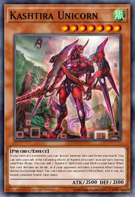

- **Copias y zona:** Main 2x, Reserva 1x. No altera las cantidades registradas.
- **Nombre oficial de referencia:** Kashtira Unicornio. CID cotejado con la ficha oficial; el nombre histórico del inventario se conserva aunque su grafía/traducción difiera.
- **Función principal y secundaria:** starter Kashtira · presión de Extra.
- **Estado de sinergia y función:** Sinergia directa descrita. Es una clasificación de juego; revisar la relación concreta en A06.
- **Papel como recurso, descarte o coste:** No se demuestra que esta carta sea recurso de descarte o pago para otra.
- **Efecto operativo (paráfrasis analítica):** Se invoca desde mano sin monstruos propios, busca una Mágica Kashtira e inspecciona/destierra del Extra rival según su disparador. 
- **Mapa de activación y resultados:** 1) efecto propio o continuo: Invocación Especial desde mano · 2) en Main Phase: incorpora la pieza indicada a la mano · 3) en respuesta a activación rival: destierra el recurso u objetivo previsto. Cada operación está sujeta a la secuencia y al «si lo haces» del texto oficial.
- **Ventanas de activación identificadas:** Main Phase; campo propio vacío; respuesta a activación rival.
- **Costes o recursos potenciales:** sin coste independiente identificado en esta síntesis; comprobar las acciones previas al punto y coma de cada efecto.
- **Restricciones y requisitos:** hay límite por turno según el efecto concreto; requiere campo propio sin las cartas indicadas; interactúa con información oculta o resultados no siempre elegibles. 
- **Prioridad al ir primero:** extender hacia Xyz y disponer de presión de zonas sin exponerse innecesariamente. Para esta carta: Convertir la activación en acceso a la siguiente pieza del motor, sin duplicar buscadores inútilmente.
- **Prioridad al ir segundo:** superar campo rival con destierros y herramientas de ruptura. Identificar primero la respuesta rival que afecta su función «starter Kashtira».
- **Medio/tardío y recuperación:** recuperar Kashtira del destierro/Cementerio y medir materiales Xyz. No asumir que por sí misma recicla recursos si el texto no lo permite.
- **Sinergias y acceso a líneas:** Relación contextual con monstruos de Nivel 7, Xyz y destierro boca abajo con presión de zonas. Habilita una línea del motor sólo si coinciden recursos, objetivos y restricciones; no equivale a un combo completo validado.
- **Riesgo / brick / interrupciones:** La presión del Extra rival tiene su ventana; no es una negación genérica. No atribuirle velocidad rápida por el solo hecho de formar parte del motor.
- **Utilidad editorial:** 3/5 para este deck (estimación por rol y zona, no probabilidad calculada). No cambiar copias; cualquier sugerencia de alta/baja pasa por el apartado 22 y aprobación.
- **Referencia oficial y trazabilidad:** https://www.db.yugioh-card.com/yugiohdb/card_search.action?cid=17769&ope=2&request_locale=es. **Confianza:** texto y tipo de efecto cotejados en Konami; síntesis táctica editorial, no demostración de combo.
- **Aplicación concreta dentro de este deck (A06):** Se invoca desde mano sin monstruos propios, busca una Mágica Kashtira e inspecciona/destierra del Extra rival según su disparador.

**USO PRÁCTICO Y SINERGIA — Kashtira Unicorn**

- **Label funcional:** Sinergia directa. Clasificación documental; una relación es válida solo si se satisfacen sus condiciones exactas.
- **Qué hace:** Se invoca desde mano sin monstruos propios, busca una Mágica Kashtira e inspecciona/destierra del Extra rival según su disparador.
- **Al jugar primero:** extender hacia Xyz y disponer de presión de zonas sin exponerse innecesariamente. Para esta carta: Convertir la activación en acceso a la siguiente pieza del motor, sin duplicar buscadores inútilmente.
- **Al jugar segundo:** superar campo rival con destierros y herramientas de ruptura. Identificar primero la respuesta rival que afecta su función «starter Kashtira».
- **Cuándo tener precaución:** La presión del Extra rival tiene su ventana; no es una negación genérica. No atribuirle velocidad rápida por el solo hecho de formar parte del motor.

#### 03. Kashtira Riseheart

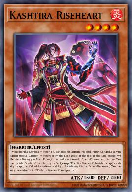

- **Copias y zona:** Main 3x. No altera las cantidades registradas.
- **Nombre oficial de referencia:** Kashtira Riseheart. CID cotejado con la ficha oficial; el nombre histórico del inventario se conserva aunque su grafía/traducción difiera.
- **Función principal y secundaria:** extensor Kashtira · ajuste de Nivel.
- **Estado de sinergia y función:** Sinergia directa descrita. Es una clasificación de juego; revisar la relación concreta en A06.
- **Papel como recurso, descarte o coste:** Material o destino del Extra condicionado a los requisitos de invocación.
- **Efecto operativo (paráfrasis analítica):** Se invoca si controlas Kashtira y transforma recursos por destierro para habilitar Nivel 7/Xyz. 
- **Mapa de activación y resultados:** 1) en Main Phase: destierra el recurso u objetivo previsto. Cada operación está sujeta a la secuencia y al «si lo haces» del texto oficial.
- **Ventanas de activación identificadas:** Main Phase.
- **Costes o recursos potenciales:** sin coste independiente identificado en esta síntesis; comprobar las acciones previas al punto y coma de cada efecto.
- **Restricciones y requisitos:** hay límite por turno según el efecto concreto; puede bloquear tipos de Invocación del Extra Deck; requiere estado de campo específico; interactúa con información oculta o resultados no siempre elegibles. 
- **Prioridad al ir primero:** extender hacia Xyz y disponer de presión de zonas sin exponerse innecesariamente. Para esta carta: Escoger la amenaza o recurso que genere mayor ventaja de tempo; respetar selección y zona.
- **Prioridad al ir segundo:** superar campo rival con destierros y herramientas de ruptura. Identificar primero la respuesta rival que afecta su función «extensor Kashtira».
- **Medio/tardío y recuperación:** recuperar Kashtira del destierro/Cementerio y medir materiales Xyz. No asumir que por sí misma recicla recursos si el texto no lo permite.
- **Sinergias y acceso a líneas:** Relación contextual con monstruos de Nivel 7, Xyz y destierro boca abajo con presión de zonas. Habilita una línea del motor sólo si coinciden recursos, objetivos y restricciones; no equivale a un combo completo validado.
- **Riesgo / brick / interrupciones:** Su extensión restringe el Extra a Xyz durante el turno. No atribuirle velocidad rápida por el solo hecho de formar parte del motor.
- **Utilidad editorial:** 3/5 para este deck (estimación por rol y zona, no probabilidad calculada). No cambiar copias; cualquier sugerencia de alta/baja pasa por el apartado 22 y aprobación.
- **Referencia oficial y trazabilidad:** https://www.db.yugioh-card.com/yugiohdb/card_search.action?cid=18151&ope=2&request_locale=es. **Confianza:** texto y tipo de efecto cotejados en Konami; síntesis táctica editorial, no demostración de combo.
- **Aplicación concreta dentro de este deck (A06):** Se invoca si controlas Kashtira y transforma recursos por destierro para habilitar Nivel 7/Xyz.

**USO PRÁCTICO Y SINERGIA — Kashtira Riseheart**

- **Label funcional:** Sinergia directa. Clasificación documental; una relación es válida solo si se satisfacen sus condiciones exactas.
- **Qué hace:** Se invoca si controlas Kashtira y transforma recursos por destierro para habilitar Nivel 7/Xyz.
- **Al jugar primero:** extender hacia Xyz y disponer de presión de zonas sin exponerse innecesariamente. Para esta carta: Escoger la amenaza o recurso que genere mayor ventaja de tempo; respetar selección y zona.
- **Al jugar segundo:** superar campo rival con destierros y herramientas de ruptura. Identificar primero la respuesta rival que afecta su función «extensor Kashtira».
- **Cuándo tener precaución:** Su extensión restringe el Extra a Xyz durante el turno. No atribuirle velocidad rápida por el solo hecho de formar parte del motor.

#### 04. Kashtira Ogre

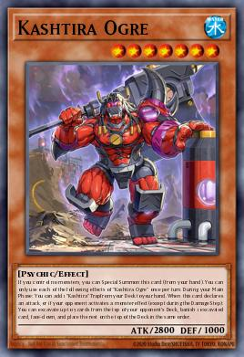

- **Copias y zona:** Main 1x. No altera las cantidades registradas.
- **Nombre oficial de referencia:** Kashtira Ogro. CID cotejado con la ficha oficial; el nombre histórico del inventario se conserva aunque su grafía/traducción difiera.
- **Función principal y secundaria:** acceso condicionado a campo vacío · interrupción · searcher · buscador · extensor.
- **Estado de sinergia y función:** Sinergia directa descrita. Es una clasificación de juego; revisar la relación concreta en A06.
- **Papel como recurso, descarte o coste:** No se demuestra que esta carta sea recurso de descarte o pago para otra.
- **Efecto operativo (paráfrasis analítica):** búsqueda o incorporación de cartas a mano; acceso al campo desde la mano; destierro de recursos o de amenazas. Son operaciones detectadas en el texto, no efectos independientes garantizados; leer sus condiciones en la fuente.
- **Mapa de activación y resultados:** 1) efecto propio o continuo: Invocación Especial desde mano · 2) en Main Phase: incorpora la pieza indicada a la mano · 3) en respuesta a activación rival: destierra el recurso u objetivo previsto. Cada operación está sujeta a la secuencia y al «si lo haces» del texto oficial.
- **Ventanas de activación identificadas:** Main Phase; campo propio vacío; respuesta a activación rival.
- **Costes o recursos potenciales:** sin coste independiente identificado en esta síntesis; comprobar las acciones previas al punto y coma de cada efecto.
- **Restricciones y requisitos:** hay límite por turno según el efecto concreto; requiere campo propio sin las cartas indicadas; interactúa con información oculta o resultados no siempre elegibles. 
- **Prioridad al ir primero:** extender hacia Xyz y disponer de presión de zonas sin exponerse innecesariamente. Para esta carta: Reservar la respuesta para la ventana rival exacta; no es una pieza buscadora de nuestro motor.
- **Prioridad al ir segundo:** superar campo rival con destierros y herramientas de ruptura. Identificar primero la respuesta rival que afecta su función «acceso condicionado a campo vacío».
- **Medio/tardío y recuperación:** recuperar Kashtira del destierro/Cementerio y medir materiales Xyz. No asumir que por sí misma recicla recursos si el texto no lo permite.
- **Sinergias y acceso a líneas:** Relación contextual con monstruos de Nivel 7, Xyz y destierro boca abajo con presión de zonas. Habilita una línea del motor sólo si coinciden recursos, objetivos y restricciones; no equivale a un combo completo validado.
- **Riesgo / brick / interrupciones:** Con campo desarrollado puede quedarse sin procedimiento gratuito; considerar jugarla antes de ocupar zonas. No atribuirle velocidad rápida por el solo hecho de formar parte del motor.
- **Utilidad editorial:** 5/5 para este deck (estimación por rol y zona, no probabilidad calculada). No cambiar copias; cualquier sugerencia de alta/baja pasa por el apartado 22 y aprobación.
- **Referencia oficial y trazabilidad:** https://www.db.yugioh-card.com/yugiohdb/card_search.action?cid=17770&ope=2&request_locale=es. **Confianza:** texto y tipo de efecto cotejados en Konami; síntesis táctica editorial, no demostración de combo.
- **Aplicación concreta dentro de este deck (A06):** búsqueda o incorporación de cartas a mano; acceso al campo desde la mano; destierro de recursos o de amenazas.

**USO PRÁCTICO Y SINERGIA — Kashtira Ogre**

- **Label funcional:** Sinergia directa. Clasificación documental; una relación es válida solo si se satisfacen sus condiciones exactas.
- **Qué hace:** búsqueda o incorporación de cartas a mano; acceso al campo desde la mano; destierro de recursos o de amenazas. Son operaciones detectadas en el texto, no efectos independientes garantizados; leer sus condiciones en la fuente.
- **Cómo aprovecharla en este deck:** búsqueda o incorporación de cartas a mano; acceso al campo desde la mano; destierro de recursos o de amenazas.
- **Al jugar primero:** extender hacia Xyz y disponer de presión de zonas sin exponerse innecesariamente. Para esta carta: Reservar la respuesta para la ventana rival exacta; no es una pieza buscadora de nuestro motor.
- **Al jugar segundo:** superar campo rival con destierros y herramientas de ruptura. Identificar primero la respuesta rival que afecta su función «acceso condicionado a campo vacío».
- **Cuándo tener precaución:** Con campo desarrollado puede quedarse sin procedimiento gratuito; considerar jugarla antes de ocupar zonas. No atribuirle velocidad rápida por el solo hecho de formar parte del motor.

#### 05. Scareclaw Kashtira

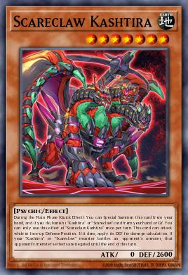

- **Copias y zona:** Main 1x. No altera las cantidades registradas.
- **Nombre oficial de referencia:** Terrogarra Kashtira. CID cotejado con la ficha oficial; el nombre histórico del inventario se conserva aunque su grafía/traducción difiera.
- **Función principal y secundaria:** interrupción · extensor · removal · cierre.
- **Estado de sinergia y función:** Sinergia indirecta (soporte o recursos). Es una clasificación de juego; revisar la relación concreta en A06.
- **Papel como recurso, descarte o coste:** Coste o consumo descrito en A05: destierro de recurso propio.
- **Efecto operativo (paráfrasis analítica):** acceso al campo desde la mano; destierro de recursos o de amenazas; presión de combate o modificación de estadísticas. Son operaciones detectadas en el texto, no efectos independientes garantizados; leer sus condiciones en la fuente.
- **Mapa de activación y resultados:** 1) en Main Phase: Invocación Especial desde Cementerio, destierra el recurso u objetivo previsto. Cada operación está sujeta a la secuencia y al «si lo haces» del texto oficial.
- **Ventanas de activación identificadas:** Main Phase; Efecto Rápido.
- **Costes o recursos potenciales:** destierro de recurso propio.
- **Restricciones y requisitos:** hay límite por turno según el efecto concreto. 
- **Prioridad al ir primero:** extender hacia Xyz y disponer de presión de zonas sin exponerse innecesariamente. Para esta carta: Reservar la respuesta para la ventana rival exacta; no es una pieza buscadora de nuestro motor.
- **Prioridad al ir segundo:** superar campo rival con destierros y herramientas de ruptura. Identificar primero la respuesta rival que afecta su función «interrupción».
- **Medio/tardío y recuperación:** recuperar Kashtira del destierro/Cementerio y medir materiales Xyz. No asumir que por sí misma recicla recursos si el texto no lo permite.
- **Sinergias y acceso a líneas:** Relación contextual con monstruos de Nivel 7, Xyz y destierro boca abajo con presión de zonas. Habilita una línea del motor sólo si coinciden recursos, objetivos y restricciones; no equivale a un combo completo validado.
- **Riesgo / brick / interrupciones:** Riesgo operativo: efectos que niegan búsquedas, combaten Xyz o castigan campo saturado. Confirmar objetivos disponibles y costes antes de activar. Puede emplearse en cadena sólo cuando se cumpla su condición concreta.
- **Utilidad editorial:** 4/5 para este deck (estimación por rol y zona, no probabilidad calculada). No cambiar copias; cualquier sugerencia de alta/baja pasa por el apartado 22 y aprobación.
- **Referencia oficial y trazabilidad:** https://www.db.yugioh-card.com/yugiohdb/card_search.action?cid=18152&ope=2&request_locale=es. **Confianza:** texto y tipo de efecto cotejados en Konami; síntesis táctica editorial, no demostración de combo.
- **Aplicación concreta dentro de este deck (A06):** acceso al campo desde la mano; destierro de recursos o de amenazas; presión de combate o modificación de estadísticas.

**USO PRÁCTICO Y SINERGIA — Scareclaw Kashtira**

- **Label funcional:** Sinergia indirecta. Clasificación documental; una relación es válida solo si se satisfacen sus condiciones exactas.
- **Qué hace:** acceso al campo desde la mano; destierro de recursos o de amenazas; presión de combate o modificación de estadísticas. Son operaciones detectadas en el texto, no efectos independientes garantizados; leer sus condiciones en la fuente.
- **Cómo aprovecharla en este deck:** acceso al campo desde la mano; destierro de recursos o de amenazas; presión de combate o modificación de estadísticas.
- **Al jugar primero:** extender hacia Xyz y disponer de presión de zonas sin exponerse innecesariamente. Para esta carta: Reservar la respuesta para la ventana rival exacta; no es una pieza buscadora de nuestro motor.
- **Al jugar segundo:** superar campo rival con destierros y herramientas de ruptura. Identificar primero la respuesta rival que afecta su función «interrupción».
- **Cuándo tener precaución:** Riesgo operativo: efectos que niegan búsquedas, combaten Xyz o castigan campo saturado. Confirmar objetivos disponibles y costes antes de activar. Puede emplearse en cadena sólo cuando se cumpla su condición concreta.

#### 06. Tearlaments Kashtira

- **Copias y zona:** Main 1x. No altera las cantidades registradas.
- **Nombre oficial de referencia:** Tiagrimentos Kashtira. CID cotejado con la ficha oficial; el nombre histórico del inventario se conserva aunque su grafía/traducción difiera.
- **Función principal y secundaria:** interrupción · extensor · removal.
- **Estado de sinergia y función:** Sinergia indirecta (soporte o recursos). Es una clasificación de juego; revisar la relación concreta en A06.
- **Papel como recurso, descarte o coste:** Coste o consumo descrito en A05: destierro de recurso propio.
- **Efecto operativo (paráfrasis analítica):** acceso al campo desde la mano; destierro de recursos o de amenazas. Son operaciones detectadas en el texto, no efectos independientes garantizados; leer sus condiciones en la fuente.
- **Mapa de activación y resultados:** 1) en Main Phase: Invocación Especial desde Cementerio, destierra el recurso u objetivo previsto. Cada operación está sujeta a la secuencia y al «si lo haces» del texto oficial.
- **Ventanas de activación identificadas:** Main Phase; al producirse una Invocación; al llegar o estar en el Cementerio; Efecto Rápido.
- **Costes o recursos potenciales:** destierro de recurso propio.
- **Restricciones y requisitos:** hay límite por turno según el efecto concreto; interactúa con información oculta o resultados no siempre elegibles. 
- **Prioridad al ir primero:** extender hacia Xyz y disponer de presión de zonas sin exponerse innecesariamente. Para esta carta: Reservar la respuesta para la ventana rival exacta; no es una pieza buscadora de nuestro motor.
- **Prioridad al ir segundo:** superar campo rival con destierros y herramientas de ruptura. Identificar primero la respuesta rival que afecta su función «interrupción».
- **Medio/tardío y recuperación:** recuperar Kashtira del destierro/Cementerio y medir materiales Xyz. No asumir que por sí misma recicla recursos si el texto no lo permite.
- **Sinergias y acceso a líneas:** Relación contextual con monstruos de Nivel 7, Xyz y destierro boca abajo con presión de zonas. Habilita una línea del motor sólo si coinciden recursos, objetivos y restricciones; no equivale a un combo completo validado.
- **Riesgo / brick / interrupciones:** Riesgo operativo: efectos que niegan búsquedas, combaten Xyz o castigan campo saturado. Confirmar objetivos disponibles y costes antes de activar. Puede emplearse en cadena sólo cuando se cumpla su condición concreta.
- **Utilidad editorial:** 4/5 para este deck (estimación por rol y zona, no probabilidad calculada). No cambiar copias; cualquier sugerencia de alta/baja pasa por el apartado 22 y aprobación.
- **Referencia oficial y trazabilidad:** https://www.db.yugioh-card.com/yugiohdb/card_search.action?cid=18153&ope=2&request_locale=es. **Confianza:** texto y tipo de efecto cotejados en Konami; síntesis táctica editorial, no demostración de combo.
- **Aplicación concreta dentro de este deck (A06):** acceso al campo desde la mano; destierro de recursos o de amenazas.

**USO PRÁCTICO Y SINERGIA — Tearlaments Kashtira**

- **Label funcional:** Sinergia indirecta. Clasificación documental; una relación es válida solo si se satisfacen sus condiciones exactas.
- **Qué hace:** acceso al campo desde la mano; destierro de recursos o de amenazas. Son operaciones detectadas en el texto, no efectos independientes garantizados; leer sus condiciones en la fuente.
- **Cómo aprovecharla en este deck:** acceso al campo desde la mano; destierro de recursos o de amenazas.
- **Al jugar primero:** extender hacia Xyz y disponer de presión de zonas sin exponerse innecesariamente. Para esta carta: Reservar la respuesta para la ventana rival exacta; no es una pieza buscadora de nuestro motor.
- **Al jugar segundo:** superar campo rival con destierros y herramientas de ruptura. Identificar primero la respuesta rival que afecta su función «interrupción».
- **Cuándo tener precaución:** Riesgo operativo: efectos que niegan búsquedas, combaten Xyz o castigan campo saturado. Confirmar objetivos disponibles y costes antes de activar. Puede emplearse en cadena sólo cuando se cumpla su condición concreta.

#### 07. Ash Blossom & Joyous Spring

- **Copias y zona:** Main 3x. No altera las cantidades registradas.
- **Nombre oficial de referencia:** Flor de Ceniza & Primavera Feliz. CID cotejado con la ficha oficial; el nombre histórico del inventario se conserva aunque su grafía/traducción difiera.
- **Función principal y secundaria:** handtrap · negación.
- **Estado de sinergia y función:** Utilidad independiente. Es una clasificación de juego; revisar la relación concreta en A06.
- **Papel como recurso, descarte o coste:** Descarte mencionado: comprobar carta que lo exige, zona, coste frente a efecto y utilidad del recurso.
- **Efecto operativo (paráfrasis analítica):** Descarta desde la mano para detener efectos que buscan, invocan o mandan cartas desde el Deck. 
- **Mapa de activación y resultados:** 1) con condición explícita en la carta: niega el efecto o la activación indicada, Invocación Especial desde Deck, incorpora la pieza indicada a la mano. Cada operación está sujeta a la secuencia y al «si lo haces» del texto oficial.
- **Ventanas de activación identificadas:** Efecto Rápido.
- **Costes o recursos potenciales:** descarte de mano.
- **Restricciones y requisitos:** hay límite por turno según el efecto concreto. 
- **Prioridad al ir primero:** extender hacia Xyz y disponer de presión de zonas sin exponerse innecesariamente. Para esta carta: Reservar la respuesta para la ventana rival exacta; no es una pieza buscadora de nuestro motor.
- **Prioridad al ir segundo:** superar campo rival con destierros y herramientas de ruptura. Identificar primero la respuesta rival que afecta su función «handtrap».
- **Medio/tardío y recuperación:** recuperar Kashtira del destierro/Cementerio y medir materiales Xyz. Verificar que el objetivo de recuperación continúe disponible.
- **Sinergias y acceso a líneas:** Relación contextual con monstruos de Nivel 7, Xyz y destierro boca abajo con presión de zonas. Habilita una línea del motor sólo si coinciden recursos, objetivos y restricciones; no equivale a un combo completo validado.
- **Riesgo / brick / interrupciones:** Reaccionar al efecto del Deck que habilite la jugada rival; no da búsquedas propias. Puede emplearse en cadena sólo cuando se cumpla su condición concreta.
- **Utilidad editorial:** 3/5 para este deck (estimación por rol y zona, no probabilidad calculada). No cambiar copias; cualquier sugerencia de alta/baja pasa por el apartado 22 y aprobación.
- **Referencia oficial y trazabilidad:** https://www.db.yugioh-card.com/yugiohdb/card_search.action?cid=12950&ope=2&request_locale=es. **Confianza:** texto y tipo de efecto cotejados en Konami; síntesis táctica editorial, no demostración de combo.
- **Aplicación concreta dentro de este deck (A06):** Descarta desde la mano para detener efectos que buscan, invocan o mandan cartas desde el Deck. Aporta respuesta o consistencia sin exigir enlace directo.

**USO PRÁCTICO Y SINERGIA — Ash Blossom & Joyous Spring**

- **Label funcional:** Función independiente. Clasificación documental; una relación es válida solo si se satisfacen sus condiciones exactas.
- **Qué hace:** Descarta desde la mano para detener efectos que buscan, invocan o mandan cartas desde el Deck.
- **Cómo aprovecharla en este deck:** Descarta desde la mano para detener efectos que buscan, invocan o mandan cartas desde el Deck. Aporta respuesta o consistencia sin exigir enlace directo.
- **Al jugar primero:** extender hacia Xyz y disponer de presión de zonas sin exponerse innecesariamente. Para esta carta: Reservar la respuesta para la ventana rival exacta; no es una pieza buscadora de nuestro motor.
- **Al jugar segundo:** superar campo rival con destierros y herramientas de ruptura. Identificar primero la respuesta rival que afecta su función «handtrap».
- **Cuándo tener precaución:** Reaccionar al efecto del Deck que habilite la jugada rival; no da búsquedas propias. Puede emplearse en cadena sólo cuando se cumpla su condición concreta.

#### 08. Dimension Shifter

- **Copias y zona:** Main 1x, Reserva 2x. No altera las cantidades registradas.
- **Nombre oficial de referencia:** Variador Dimensional. CID cotejado con la ficha oficial; el nombre histórico del inventario se conserva aunque su grafía/traducción difiera.
- **Función principal y secundaria:** handtrap · macro-destierro.
- **Estado de sinergia y función:** Utilidad independiente. Es una clasificación de juego; revisar la relación concreta en A06.
- **Papel como recurso, descarte o coste:** Envío mencionado en la interacción; no equivale por sí mismo a descarte desde la mano.
- **Efecto operativo (paráfrasis analítica):** Si el Cementerio propio está vacío, se envía desde mano y hace que las cartas que irían al Cementerio se destierren hasta el final del turno siguiente. 
- **Mapa de activación y resultados:** 1) con condición explícita en la carta: destierra el recurso u objetivo previsto. Cada operación está sujeta a la secuencia y al «si lo haces» del texto oficial.
- **Ventanas de activación identificadas:** Efecto Rápido.
- **Costes o recursos potenciales:** envío de recurso propio al Cementerio.
- **Restricciones y requisitos:** depende de recursos en Cementerio. 
- **Prioridad al ir primero:** extender hacia Xyz y disponer de presión de zonas sin exponerse innecesariamente. Para esta carta: Reservar la respuesta para la ventana rival exacta; no es una pieza buscadora de nuestro motor.
- **Prioridad al ir segundo:** superar campo rival con destierros y herramientas de ruptura. Identificar primero la respuesta rival que afecta su función «handtrap».
- **Medio/tardío y recuperación:** recuperar Kashtira del destierro/Cementerio y medir materiales Xyz. No asumir que por sí misma recicla recursos si el texto no lo permite.
- **Sinergias y acceso a líneas:** Relación contextual con monstruos de Nivel 7, Xyz y destierro boca abajo con presión de zonas. Habilita una línea del motor sólo si coinciden recursos, objetivos y restricciones; no equivale a un combo completo validado.
- **Riesgo / brick / interrupciones:** Afecta también los envíos propios; no activarlo tras llenar el Cementerio. Puede emplearse en cadena sólo cuando se cumpla su condición concreta.
- **Utilidad editorial:** 3/5 para este deck (estimación por rol y zona, no probabilidad calculada). No cambiar copias; cualquier sugerencia de alta/baja pasa por el apartado 22 y aprobación.
- **Referencia oficial y trazabilidad:** https://www.db.yugioh-card.com/yugiohdb/card_search.action?cid=14740&ope=2&request_locale=es. **Confianza:** texto y tipo de efecto cotejados en Konami; síntesis táctica editorial, no demostración de combo.
- **Aplicación concreta dentro de este deck (A06):** Si el Cementerio propio está vacío, se envía desde mano y hace que las cartas que irían al Cementerio se destierren hasta el final del turno siguiente. Aporta respuesta o consistencia sin exigir enlace directo.

**USO PRÁCTICO Y SINERGIA — Dimension Shifter**

- **Label funcional:** Función independiente. Clasificación documental; una relación es válida solo si se satisfacen sus condiciones exactas.
- **Qué hace:** Si el Cementerio propio está vacío, se envía desde mano y hace que las cartas que irían al Cementerio se destierren hasta el final del turno siguiente.
- **Cómo aprovecharla en este deck:** Si el Cementerio propio está vacío, se envía desde mano y hace que las cartas que irían al Cementerio se destierren hasta el final del turno siguiente. Aporta respuesta o consistencia sin exigir enlace directo.
- **Al jugar primero:** extender hacia Xyz y disponer de presión de zonas sin exponerse innecesariamente. Para esta carta: Reservar la respuesta para la ventana rival exacta; no es una pieza buscadora de nuestro motor.
- **Al jugar segundo:** superar campo rival con destierros y herramientas de ruptura. Identificar primero la respuesta rival que afecta su función «handtrap».
- **Cuándo tener precaución:** Afecta también los envíos propios; no activarlo tras llenar el Cementerio. Puede emplearse en cadena sólo cuando se cumpla su condición concreta.

#### 09. Pressured Planet Wraitsoth

- **Copias y zona:** Main 3x. No altera las cantidades registradas.
- **Nombre oficial de referencia:** Planeta Bajo Presión Wraitsoth. CID cotejado con la ficha oficial; el nombre histórico del inventario se conserva aunque su grafía/traducción difiera.
- **Función principal y secundaria:** searcher · buscador · cierre.
- **Estado de sinergia y función:** Sinergia directa descrita. Es una clasificación de juego; revisar la relación concreta en A06.
- **Papel como recurso, descarte o coste:** No se demuestra que esta carta sea recurso de descarte o pago para otra.
- **Efecto operativo (paráfrasis analítica):** búsqueda o incorporación de cartas a mano; presión de combate o modificación de estadísticas. Son operaciones detectadas en el texto, no efectos independientes garantizados; leer sus condiciones en la fuente.
- **Mapa de activación y resultados:** 1) con condición explícita en la carta: incorpora la pieza indicada a la mano. Cada operación está sujeta a la secuencia y al «si lo haces» del texto oficial.
- **Ventanas de activación identificadas:** requieren la fase o condición específica indicada en el texto; sin ventana rápida general asumida.
- **Costes o recursos potenciales:** sin coste independiente identificado en esta síntesis; comprobar las acciones previas al punto y coma de cada efecto.
- **Restricciones y requisitos:** hay límite por turno según el efecto concreto. 
- **Prioridad al ir primero:** extender hacia Xyz y disponer de presión de zonas sin exponerse innecesariamente. Para esta carta: Convertir la activación en acceso a la siguiente pieza del motor, sin duplicar buscadores inútilmente.
- **Prioridad al ir segundo:** superar campo rival con destierros y herramientas de ruptura. Identificar primero la respuesta rival que afecta su función «searcher».
- **Medio/tardío y recuperación:** recuperar Kashtira del destierro/Cementerio y medir materiales Xyz. No asumir que por sí misma recicla recursos si el texto no lo permite.
- **Sinergias y acceso a líneas:** Relación contextual con monstruos de Nivel 7, Xyz y destierro boca abajo con presión de zonas. Habilita una línea del motor sólo si coinciden recursos, objetivos y restricciones; no equivale a un combo completo validado.
- **Riesgo / brick / interrupciones:** Riesgo operativo: efectos que niegan búsquedas, combaten Xyz o castigan campo saturado. Confirmar objetivos disponibles y costes antes de activar. No atribuirle velocidad rápida por el solo hecho de formar parte del motor.
- **Utilidad editorial:** 5/5 para este deck (estimación por rol y zona, no probabilidad calculada). No cambiar copias; cualquier sugerencia de alta/baja pasa por el apartado 22 y aprobación.
- **Referencia oficial y trazabilidad:** https://www.db.yugioh-card.com/yugiohdb/card_search.action?cid=18204&ope=2&request_locale=es. **Confianza:** texto y tipo de efecto cotejados en Konami; síntesis táctica editorial, no demostración de combo.
- **Aplicación concreta dentro de este deck (A06):** búsqueda o incorporación de cartas a mano; presión de combate o modificación de estadísticas.

**USO PRÁCTICO Y SINERGIA — Pressured Planet Wraitsoth**

- **Label funcional:** Sinergia directa. Clasificación documental; una relación es válida solo si se satisfacen sus condiciones exactas.
- **Qué hace:** búsqueda o incorporación de cartas a mano; presión de combate o modificación de estadísticas. Son operaciones detectadas en el texto, no efectos independientes garantizados; leer sus condiciones en la fuente.
- **Cómo aprovecharla en este deck:** búsqueda o incorporación de cartas a mano; presión de combate o modificación de estadísticas.
- **Al jugar primero:** extender hacia Xyz y disponer de presión de zonas sin exponerse innecesariamente. Para esta carta: Convertir la activación en acceso a la siguiente pieza del motor, sin duplicar buscadores inútilmente.
- **Al jugar segundo:** superar campo rival con destierros y herramientas de ruptura. Identificar primero la respuesta rival que afecta su función «searcher».
- **Cuándo tener precaución:** Riesgo operativo: efectos que niegan búsquedas, combaten Xyz o castigan campo saturado. Confirmar objetivos disponibles y costes antes de activar. No atribuirle velocidad rápida por el solo hecho de formar parte del motor.

#### 10. Kashtira Birth

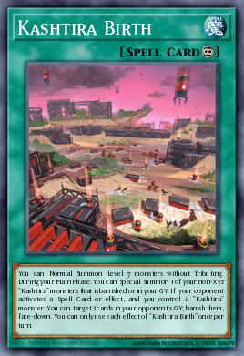

- **Copias y zona:** Main 3x. No altera las cantidades registradas.
- **Nombre oficial de referencia:** Nacimiento Kashtira. CID cotejado con la ficha oficial; el nombre histórico del inventario se conserva aunque su grafía/traducción difiera.
- **Función principal y secundaria:** recuperación · removal · coste/recurso.
- **Estado de sinergia y función:** Sinergia directa descrita. Es una clasificación de juego; revisar la relación concreta en A06.
- **Papel como recurso, descarte o coste:** No se demuestra que esta carta sea recurso de descarte o pago para otra.
- **Efecto operativo (paráfrasis analítica):** recuperación e invocación desde Cementerio/destierro; destierro de recursos o de amenazas; uso de Sacrificios como parte del efecto. Son operaciones detectadas en el texto, no efectos independientes garantizados; leer sus condiciones en la fuente.
- **Mapa de activación y resultados:** 1) en Main Phase: Invocación Especial desde Cementerio, destierra el recurso u objetivo previsto. Cada operación está sujeta a la secuencia y al «si lo haces» del texto oficial.
- **Ventanas de activación identificadas:** Main Phase; respuesta a activación rival.
- **Costes o recursos potenciales:** sin coste independiente identificado en esta síntesis; comprobar las acciones previas al punto y coma de cada efecto.
- **Restricciones y requisitos:** hay límite por turno según el efecto concreto; depende de recursos en Cementerio; interactúa con información oculta o resultados no siempre elegibles. 
- **Prioridad al ir primero:** extender hacia Xyz y disponer de presión de zonas sin exponerse innecesariamente. Para esta carta: Escoger la amenaza o recurso que genere mayor ventaja de tempo; respetar selección y zona.
- **Prioridad al ir segundo:** superar campo rival con destierros y herramientas de ruptura. Identificar primero la respuesta rival que afecta su función «recuperación».
- **Medio/tardío y recuperación:** recuperar Kashtira del destierro/Cementerio y medir materiales Xyz. Verificar que el objetivo de recuperación continúe disponible.
- **Sinergias y acceso a líneas:** Relación contextual con monstruos de Nivel 7, Xyz y destierro boca abajo con presión de zonas. Habilita una línea del motor sólo si coinciden recursos, objetivos y restricciones; no equivale a un combo completo validado.
- **Riesgo / brick / interrupciones:** Depende del Cementerio y es sensible a destierro o negación de ese recurso. No atribuirle velocidad rápida por el solo hecho de formar parte del motor.
- **Utilidad editorial:** 3/5 para este deck (estimación por rol y zona, no probabilidad calculada). No cambiar copias; cualquier sugerencia de alta/baja pasa por el apartado 22 y aprobación.
- **Referencia oficial y trazabilidad:** https://www.db.yugioh-card.com/yugiohdb/card_search.action?cid=17815&ope=2&request_locale=es. **Confianza:** texto y tipo de efecto cotejados en Konami; síntesis táctica editorial, no demostración de combo.
- **Aplicación concreta dentro de este deck (A06):** recuperación e invocación desde Cementerio/destierro; destierro de recursos o de amenazas; uso de Sacrificios como parte del efecto.

**USO PRÁCTICO Y SINERGIA — Kashtira Birth**

- **Label funcional:** Sinergia directa. Clasificación documental; una relación es válida solo si se satisfacen sus condiciones exactas.
- **Qué hace:** recuperación e invocación desde Cementerio/destierro; destierro de recursos o de amenazas; uso de Sacrificios como parte del efecto. Son operaciones detectadas en el texto, no efectos independientes garantizados; leer sus condiciones en la fuente.
- **Cómo aprovecharla en este deck:** recuperación e invocación desde Cementerio/destierro; destierro de recursos o de amenazas; uso de Sacrificios como parte del efecto.
- **Al jugar primero:** extender hacia Xyz y disponer de presión de zonas sin exponerse innecesariamente. Para esta carta: Escoger la amenaza o recurso que genere mayor ventaja de tempo; respetar selección y zona.
- **Al jugar segundo:** superar campo rival con destierros y herramientas de ruptura. Identificar primero la respuesta rival que afecta su función «recuperación».
- **Cuándo tener precaución:** Depende del Cementerio y es sensible a destierro o negación de ese recurso. No atribuirle velocidad rápida por el solo hecho de formar parte del motor.

#### 11. Kashtiratheosis

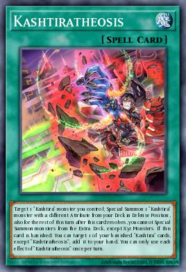

- **Copias y zona:** Main 3x. No altera las cantidades registradas.
- **Nombre oficial de referencia:** Kashtirateosis. CID cotejado con la ficha oficial; el nombre histórico del inventario se conserva aunque su grafía/traducción difiera.
- **Función principal y secundaria:** extensor · recuperación · removal · cierre · respuesta.
- **Estado de sinergia y función:** Sinergia directa descrita. Es una clasificación de juego; revisar la relación concreta en A06.
- **Papel como recurso, descarte o coste:** No se demuestra que esta carta sea recurso de descarte o pago para otra.
- **Efecto operativo (paráfrasis analítica):** extensión mediante monstruos procedentes del Deck; recuperación e invocación desde Cementerio/destierro; destierro de recursos o de amenazas; presión de combate o modificación de estadísticas; interacción sobre monstruos en campo. Son operaciones detectadas en el texto, no efectos independientes garantizados; leer sus condiciones en la fuente.
- **Mapa de activación y resultados:** 1) con condición explícita en la carta: destierra el recurso u objetivo previsto. Cada operación está sujeta a la secuencia y al «si lo haces» del texto oficial.
- **Ventanas de activación identificadas:** al ser desterrada.
- **Costes o recursos potenciales:** sin coste independiente identificado en esta síntesis; comprobar las acciones previas al punto y coma de cada efecto.
- **Restricciones y requisitos:** hay límite por turno según el efecto concreto; puede bloquear tipos de Invocación del Extra Deck. 
- **Prioridad al ir primero:** extender hacia Xyz y disponer de presión de zonas sin exponerse innecesariamente. Para esta carta: Convertir acceso al Deck en cuerpos o materiales antes de bloquearse con restricciones.
- **Prioridad al ir segundo:** superar campo rival con destierros y herramientas de ruptura. Identificar primero la respuesta rival que afecta su función «extensor».
- **Medio/tardío y recuperación:** recuperar Kashtira del destierro/Cementerio y medir materiales Xyz. Verificar que el objetivo de recuperación continúe disponible.
- **Sinergias y acceso a líneas:** Relación contextual con monstruos de Nivel 7, Xyz y destierro boca abajo con presión de zonas. Habilita una línea del motor sólo si coinciden recursos, objetivos y restricciones; no equivale a un combo completo validado.
- **Riesgo / brick / interrupciones:** La restricción de invocaciones puede cerrar rutas alternativas; revisar el orden de activación. No atribuirle velocidad rápida por el solo hecho de formar parte del motor.
- **Utilidad editorial:** 4/5 para este deck (estimación por rol y zona, no probabilidad calculada). No cambiar copias; cualquier sugerencia de alta/baja pasa por el apartado 22 y aprobación.
- **Referencia oficial y trazabilidad:** https://www.db.yugioh-card.com/yugiohdb/card_search.action?cid=18203&ope=2&request_locale=es. **Confianza:** texto y tipo de efecto cotejados en Konami; síntesis táctica editorial, no demostración de combo.
- **Aplicación concreta dentro de este deck (A06):** extensión mediante monstruos procedentes del Deck; recuperación e invocación desde Cementerio/destierro; destierro de recursos o de amenazas; presión de combate o modificación de estadísticas; interacción sobre monstruos en campo.

**USO PRÁCTICO Y SINERGIA — Kashtiratheosis**

- **Label funcional:** Sinergia directa. Clasificación documental; una relación es válida solo si se satisfacen sus condiciones exactas.
- **Qué hace:** extensión mediante monstruos procedentes del Deck; recuperación e invocación desde Cementerio/destierro; destierro de recursos o de amenazas; presión de combate o modificación de estadísticas; interacción sobre monstruos en campo. Son operaciones detectadas en el texto, no efectos independientes garantizados; leer sus condiciones en la fuente.
- **Cómo aprovecharla en este deck:** extensión mediante monstruos procedentes del Deck; recuperación e invocación desde Cementerio/destierro; destierro de recursos o de amenazas; presión de combate o modificación de estadísticas; interacción sobre monstruos en campo.
- **Al jugar primero:** extender hacia Xyz y disponer de presión de zonas sin exponerse innecesariamente. Para esta carta: Convertir acceso al Deck en cuerpos o materiales antes de bloquearse con restricciones.
- **Al jugar segundo:** superar campo rival con destierros y herramientas de ruptura. Identificar primero la respuesta rival que afecta su función «extensor».
- **Cuándo tener precaución:** La restricción de invocaciones puede cerrar rutas alternativas; revisar el orden de activación. No atribuirle velocidad rápida por el solo hecho de formar parte del motor.

#### 12. Terraforming

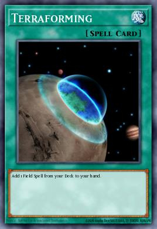

- **Copias y zona:** Main 1x. No altera las cantidades registradas.
- **Nombre oficial de referencia:** Terraformación. CID cotejado con la ficha oficial; el nombre histórico del inventario se conserva aunque su grafía/traducción difiera.
- **Función principal y secundaria:** mágica · búsqueda de campo.
- **Estado de sinergia y función:** Utilidad independiente. Es una clasificación de juego; revisar la relación concreta en A06.
- **Papel como recurso, descarte o coste:** No se demuestra que esta carta sea recurso de descarte o pago para otra.
- **Efecto operativo (paráfrasis analítica):** Busca una Mágica de Campo en el Deck y la lleva a la mano. 
- **Mapa de activación y resultados:** 1) efecto propio o continuo: incorpora la pieza indicada a la mano. Cada operación está sujeta a la secuencia y al «si lo haces» del texto oficial.
- **Ventanas de activación identificadas:** requieren la fase o condición específica indicada en el texto; sin ventana rápida general asumida.
- **Costes o recursos potenciales:** sin coste independiente identificado en esta síntesis; comprobar las acciones previas al punto y coma de cada efecto.
- **Restricciones y requisitos:** aplicar restricciones de selección, activación y copias que consten en el texto original. 
- **Prioridad al ir primero:** extender hacia Xyz y disponer de presión de zonas sin exponerse innecesariamente. Para esta carta: Convertir la activación en acceso a la siguiente pieza del motor, sin duplicar buscadores inútilmente.
- **Prioridad al ir segundo:** superar campo rival con destierros y herramientas de ruptura. Identificar primero la respuesta rival que afecta su función «mágica».
- **Medio/tardío y recuperación:** recuperar Kashtira del destierro/Cementerio y medir materiales Xyz. No asumir que por sí misma recicla recursos si el texto no lo permite.
- **Sinergias y acceso a líneas:** Relación contextual con monstruos de Nivel 7, Xyz y destierro boca abajo con presión de zonas. Habilita una línea del motor sólo si coinciden recursos, objetivos y restricciones; no equivale a un combo completo validado.
- **Riesgo / brick / interrupciones:** Si el objetivo de campo ya no está en Deck, pierde utilidad. No atribuirle velocidad rápida por el solo hecho de formar parte del motor.
- **Utilidad editorial:** 3/5 para este deck (estimación por rol y zona, no probabilidad calculada). No cambiar copias; cualquier sugerencia de alta/baja pasa por el apartado 22 y aprobación.
- **Referencia oficial y trazabilidad:** https://www.db.yugioh-card.com/yugiohdb/card_search.action?cid=5537&ope=2&request_locale=es. **Confianza:** texto y tipo de efecto cotejados en Konami; síntesis táctica editorial, no demostración de combo.
- **Aplicación concreta dentro de este deck (A06):** Busca una Mágica de Campo en el Deck y la lleva a la mano. Aporta respuesta o consistencia sin exigir enlace directo.

**USO PRÁCTICO Y SINERGIA — Terraforming**

- **Label funcional:** Función independiente. Clasificación documental; una relación es válida solo si se satisfacen sus condiciones exactas.
- **Qué hace:** Busca una Mágica de Campo en el Deck y la lleva a la mano.
- **Cómo aprovecharla en este deck:** Busca una Mágica de Campo en el Deck y la lleva a la mano. Aporta respuesta o consistencia sin exigir enlace directo.
- **Al jugar primero:** extender hacia Xyz y disponer de presión de zonas sin exponerse innecesariamente. Para esta carta: Convertir la activación en acceso a la siguiente pieza del motor, sin duplicar buscadores inútilmente.
- **Al jugar segundo:** superar campo rival con destierros y herramientas de ruptura. Identificar primero la respuesta rival que afecta su función «mágica».
- **Cuándo tener precaución:** Si el objetivo de campo ya no está en Deck, pierde utilidad. No atribuirle velocidad rápida por el solo hecho de formar parte del motor.

#### 13. Book of Moon

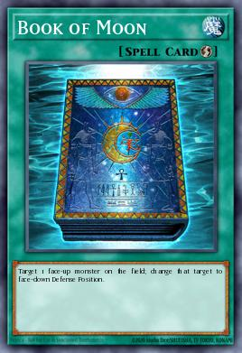

- **Copias y zona:** Main 2x, Reserva 1x. No altera las cantidades registradas.
- **Nombre oficial de referencia:** Libro de la Luna. CID cotejado con la ficha oficial; el nombre histórico del inventario se conserva aunque su grafía/traducción difiera.
- **Función principal y secundaria:** control de zonas · cierre.
- **Estado de sinergia y función:** Utilidad independiente. Es una clasificación de juego; revisar la relación concreta en A06.
- **Papel como recurso, descarte o coste:** No se demuestra que esta carta sea recurso de descarte o pago para otra.
- **Efecto operativo (paráfrasis analítica):** manipulación de posiciones o zonas; presión de combate o modificación de estadísticas. Son operaciones detectadas en el texto, no efectos independientes garantizados; leer sus condiciones en la fuente.
- **Mapa de activación y resultados:** 1) efecto propio o continuo: modifica posiciones o zonas. Cada operación está sujeta a la secuencia y al «si lo haces» del texto oficial.
- **Ventanas de activación identificadas:** requieren la fase o condición específica indicada en el texto; sin ventana rápida general asumida.
- **Costes o recursos potenciales:** sin coste independiente identificado en esta síntesis; comprobar las acciones previas al punto y coma de cada efecto.
- **Restricciones y requisitos:** interactúa con información oculta o resultados no siempre elegibles. 
- **Prioridad al ir primero:** extender hacia Xyz y disponer de presión de zonas sin exponerse innecesariamente. Para esta carta: Activar cuando las condiciones permitan obtener valor real, preservando recursos de seguimiento.
- **Prioridad al ir segundo:** superar campo rival con destierros y herramientas de ruptura. Identificar primero la respuesta rival que afecta su función «control de zonas».
- **Medio/tardío y recuperación:** recuperar Kashtira del destierro/Cementerio y medir materiales Xyz. No asumir que por sí misma recicla recursos si el texto no lo permite.
- **Sinergias y acceso a líneas:** Relación contextual con monstruos de Nivel 7, Xyz y destierro boca abajo con presión de zonas. Habilita una línea del motor sólo si coinciden recursos, objetivos y restricciones; no equivale a un combo completo validado.
- **Riesgo / brick / interrupciones:** Riesgo operativo: efectos que niegan búsquedas, combaten Xyz o castigan campo saturado. Confirmar objetivos disponibles y costes antes de activar. No atribuirle velocidad rápida por el solo hecho de formar parte del motor.
- **Utilidad editorial:** 3/5 para este deck (estimación por rol y zona, no probabilidad calculada). No cambiar copias; cualquier sugerencia de alta/baja pasa por el apartado 22 y aprobación.
- **Referencia oficial y trazabilidad:** https://www.db.yugioh-card.com/yugiohdb/card_search.action?cid=5432&ope=2&request_locale=es. **Confianza:** texto y tipo de efecto cotejados en Konami; síntesis táctica editorial, no demostración de combo.
- **Aplicación concreta dentro de este deck (A06):** manipulación de posiciones o zonas; presión de combate o modificación de estadísticas. Aporta respuesta o consistencia sin exigir enlace directo.

**USO PRÁCTICO Y SINERGIA — Book of Moon**

- **Label funcional:** Función independiente. Clasificación documental; una relación es válida solo si se satisfacen sus condiciones exactas.
- **Qué hace:** manipulación de posiciones o zonas; presión de combate o modificación de estadísticas. Son operaciones detectadas en el texto, no efectos independientes garantizados; leer sus condiciones en la fuente.
- **Cómo aprovecharla en este deck:** manipulación de posiciones o zonas; presión de combate o modificación de estadísticas. Aporta respuesta o consistencia sin exigir enlace directo.
- **Al jugar primero:** extender hacia Xyz y disponer de presión de zonas sin exponerse innecesariamente. Para esta carta: Activar cuando las condiciones permitan obtener valor real, preservando recursos de seguimiento.
- **Al jugar segundo:** superar campo rival con destierros y herramientas de ruptura. Identificar primero la respuesta rival que afecta su función «control de zonas».
- **Cuándo tener precaución:** Riesgo operativo: efectos que niegan búsquedas, combaten Xyz o castigan campo saturado. Confirmar objetivos disponibles y costes antes de activar. No atribuirle velocidad rápida por el solo hecho de formar parte del motor.

#### 14. Dark Hole

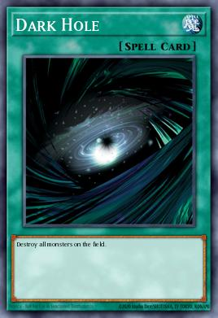

- **Copias y zona:** Main 3x. No altera las cantidades registradas.
- **Nombre oficial de referencia:** Agujero Oscuro. CID cotejado con la ficha oficial; el nombre histórico del inventario se conserva aunque su grafía/traducción difiera.
- **Función principal y secundaria:** removal.
- **Estado de sinergia y función:** Utilidad independiente. Es una clasificación de juego; revisar la relación concreta en A06.
- **Papel como recurso, descarte o coste:** No se demuestra que esta carta sea recurso de descarte o pago para otra.
- **Efecto operativo (paráfrasis analítica):** destrucción de cartas o empleo de destrucción como detonante. Son operaciones detectadas en el texto, no efectos independientes garantizados; leer sus condiciones en la fuente.
- **Mapa de activación y resultados:** 1) efecto propio o continuo: destruye la carta o recurso previsto. Cada operación está sujeta a la secuencia y al «si lo haces» del texto oficial.
- **Ventanas de activación identificadas:** requieren la fase o condición específica indicada en el texto; sin ventana rápida general asumida.
- **Costes o recursos potenciales:** sin coste independiente identificado en esta síntesis; comprobar las acciones previas al punto y coma de cada efecto.
- **Restricciones y requisitos:** aplicar restricciones de selección, activación y copias que consten en el texto original. 
- **Prioridad al ir primero:** extender hacia Xyz y disponer de presión de zonas sin exponerse innecesariamente. Para esta carta: Activar cuando las condiciones permitan obtener valor real, preservando recursos de seguimiento.
- **Prioridad al ir segundo:** superar campo rival con destierros y herramientas de ruptura. Identificar primero la respuesta rival que afecta su función «removal».
- **Medio/tardío y recuperación:** recuperar Kashtira del destierro/Cementerio y medir materiales Xyz. No asumir que por sí misma recicla recursos si el texto no lo permite.
- **Sinergias y acceso a líneas:** Relación contextual con monstruos de Nivel 7, Xyz y destierro boca abajo con presión de zonas. Habilita una línea del motor sólo si coinciden recursos, objetivos y restricciones; no equivale a un combo completo validado.
- **Riesgo / brick / interrupciones:** Riesgo operativo: efectos que niegan búsquedas, combaten Xyz o castigan campo saturado. Confirmar objetivos disponibles y costes antes de activar. No atribuirle velocidad rápida por el solo hecho de formar parte del motor.
- **Utilidad editorial:** 3/5 para este deck (estimación por rol y zona, no probabilidad calculada). No cambiar copias; cualquier sugerencia de alta/baja pasa por el apartado 22 y aprobación.
- **Referencia oficial y trazabilidad:** https://www.db.yugioh-card.com/yugiohdb/card_search.action?cid=4342&ope=2&request_locale=es. **Confianza:** texto y tipo de efecto cotejados en Konami; síntesis táctica editorial, no demostración de combo.
- **Aplicación concreta dentro de este deck (A06):** destrucción de cartas o empleo de destrucción como detonante. Aporta respuesta o consistencia sin exigir enlace directo.

**USO PRÁCTICO Y SINERGIA — Dark Hole**

- **Label funcional:** Función independiente. Clasificación documental; una relación es válida solo si se satisfacen sus condiciones exactas.
- **Qué hace:** destrucción de cartas o empleo de destrucción como detonante. Son operaciones detectadas en el texto, no efectos independientes garantizados; leer sus condiciones en la fuente.
- **Cómo aprovecharla en este deck:** destrucción de cartas o empleo de destrucción como detonante. Aporta respuesta o consistencia sin exigir enlace directo.
- **Al jugar primero:** extender hacia Xyz y disponer de presión de zonas sin exponerse innecesariamente. Para esta carta: Activar cuando las condiciones permitan obtener valor real, preservando recursos de seguimiento.
- **Al jugar segundo:** superar campo rival con destierros y herramientas de ruptura. Identificar primero la respuesta rival que afecta su función «removal».
- **Cuándo tener precaución:** Riesgo operativo: efectos que niegan búsquedas, combaten Xyz o castigan campo saturado. Confirmar objetivos disponibles y costes antes de activar. No atribuirle velocidad rápida por el solo hecho de formar parte del motor.

#### 15. Pot of Prosperity

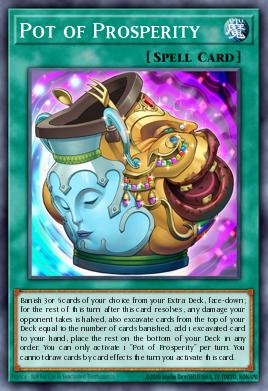

- **Copias y zona:** Main 2x, Reserva 1x. No altera las cantidades registradas.
- **Nombre oficial de referencia:** Olla de la Prosperidad. CID cotejado con la ficha oficial; el nombre histórico del inventario se conserva aunque su grafía/traducción difiera.
- **Función principal y secundaria:** searcher · buscador · removal · ventaja de mano · cierre.
- **Estado de sinergia y función:** Utilidad independiente. Es una clasificación de juego; revisar la relación concreta en A06.
- **Papel como recurso, descarte o coste:** No se demuestra que esta carta sea recurso de descarte o pago para otra.
- **Efecto operativo (paráfrasis analítica):** búsqueda o incorporación de cartas a mano; destierro de recursos o de amenazas; generación de cartas por robo; presión de combate o modificación de estadísticas. Son operaciones detectadas en el texto, no efectos independientes garantizados; leer sus condiciones en la fuente.
- **Mapa de activación y resultados:** 1) efecto propio o continuo: incorpora la pieza indicada a la mano, destierra el recurso u objetivo previsto. Cada operación está sujeta a la secuencia y al «si lo haces» del texto oficial.
- **Ventanas de activación identificadas:** requieren la fase o condición específica indicada en el texto; sin ventana rápida general asumida.
- **Costes o recursos potenciales:** sin coste independiente identificado en esta síntesis; comprobar las acciones previas al punto y coma de cada efecto.
- **Restricciones y requisitos:** hay límite por turno según el efecto concreto; interactúa con información oculta o resultados no siempre elegibles. 
- **Prioridad al ir primero:** extender hacia Xyz y disponer de presión de zonas sin exponerse innecesariamente. Para esta carta: Convertir la activación en acceso a la siguiente pieza del motor, sin duplicar buscadores inútilmente.
- **Prioridad al ir segundo:** superar campo rival con destierros y herramientas de ruptura. Identificar primero la respuesta rival que afecta su función «searcher».
- **Medio/tardío y recuperación:** recuperar Kashtira del destierro/Cementerio y medir materiales Xyz. No asumir que por sí misma recicla recursos si el texto no lo permite.
- **Sinergias y acceso a líneas:** Relación contextual con monstruos de Nivel 7, Xyz y destierro boca abajo con presión de zonas. Habilita una línea del motor sólo si coinciden recursos, objetivos y restricciones; no equivale a un combo completo validado.
- **Riesgo / brick / interrupciones:** Riesgo operativo: efectos que niegan búsquedas, combaten Xyz o castigan campo saturado. Confirmar objetivos disponibles y costes antes de activar. No atribuirle velocidad rápida por el solo hecho de formar parte del motor.
- **Utilidad editorial:** 5/5 para este deck (estimación por rol y zona, no probabilidad calculada). No cambiar copias; cualquier sugerencia de alta/baja pasa por el apartado 22 y aprobación.
- **Referencia oficial y trazabilidad:** https://www.db.yugioh-card.com/yugiohdb/card_search.action?cid=15756&ope=2&request_locale=es. **Confianza:** texto y tipo de efecto cotejados en Konami; síntesis táctica editorial, no demostración de combo.
- **Aplicación concreta dentro de este deck (A06):** búsqueda o incorporación de cartas a mano; destierro de recursos o de amenazas; generación de cartas por robo; presión de combate o modificación de estadísticas. Aporta respuesta o consistencia sin exigir enlace directo.

**USO PRÁCTICO Y SINERGIA — Pot of Prosperity**

- **Label funcional:** Función independiente. Clasificación documental; una relación es válida solo si se satisfacen sus condiciones exactas.
- **Qué hace:** búsqueda o incorporación de cartas a mano; destierro de recursos o de amenazas; generación de cartas por robo; presión de combate o modificación de estadísticas. Son operaciones detectadas en el texto, no efectos independientes garantizados; leer sus condiciones en la fuente.
- **Cómo aprovecharla en este deck:** búsqueda o incorporación de cartas a mano; destierro de recursos o de amenazas; generación de cartas por robo; presión de combate o modificación de estadísticas. Aporta respuesta o consistencia sin exigir enlace directo.
- **Al jugar primero:** extender hacia Xyz y disponer de presión de zonas sin exponerse innecesariamente. Para esta carta: Convertir la activación en acceso a la siguiente pieza del motor, sin duplicar buscadores inútilmente.
- **Al jugar segundo:** superar campo rival con destierros y herramientas de ruptura. Identificar primero la respuesta rival que afecta su función «searcher».
- **Cuándo tener precaución:** Riesgo operativo: efectos que niegan búsquedas, combaten Xyz o castigan campo saturado. Confirmar objetivos disponibles y costes antes de activar. No atribuirle velocidad rápida por el solo hecho de formar parte del motor.

#### 16. Cosmic Cyclone

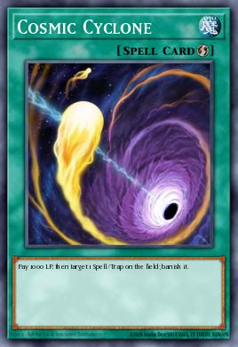

- **Copias y zona:** Main 2x. No altera las cantidades registradas.
- **Nombre oficial de referencia:** Ciclón del Cosmos. CID cotejado con la ficha oficial; el nombre histórico del inventario se conserva aunque su grafía/traducción difiera.
- **Función principal y secundaria:** mágica rápida · remoción.
- **Estado de sinergia y función:** Utilidad independiente. Es una clasificación de juego; revisar la relación concreta en A06.
- **Papel como recurso, descarte o coste:** Destierro como uso/recurso; comprobar origen, coste o efecto y recuperación.
- **Efecto operativo (paráfrasis analítica):** Paga 1000 LP para desterrar una Mágica/Trampa en campo. 
- **Mapa de activación y resultados:** efecto de estadística, condición o material; no asumir un disparador adicional. Cada operación está sujeta a la secuencia y al «si lo haces» del texto oficial.
- **Ventanas de activación identificadas:** requieren la fase o condición específica indicada en el texto; sin ventana rápida general asumida.
- **Costes o recursos potenciales:** pago de LP.
- **Restricciones y requisitos:** aplicar restricciones de selección, activación y copias que consten en el texto original. 
- **Prioridad al ir primero:** extender hacia Xyz y disponer de presión de zonas sin exponerse innecesariamente. Para esta carta: Activar cuando las condiciones permitan obtener valor real, preservando recursos de seguimiento.
- **Prioridad al ir segundo:** superar campo rival con destierros y herramientas de ruptura. Identificar primero la respuesta rival que afecta su función «mágica rápida».
- **Medio/tardío y recuperación:** recuperar Kashtira del destierro/Cementerio y medir materiales Xyz. No asumir que por sí misma recicla recursos si el texto no lo permite.
- **Sinergias y acceso a líneas:** Relación contextual con monstruos de Nivel 7, Xyz y destierro boca abajo con presión de zonas. Habilita una línea del motor sólo si coinciden recursos, objetivos y restricciones; no equivale a un combo completo validado.
- **Riesgo / brick / interrupciones:** El coste de LP y selección de objetivo deben pagarse/declararse antes de la resolución. No atribuirle velocidad rápida por el solo hecho de formar parte del motor.
- **Utilidad editorial:** 3/5 para este deck (estimación por rol y zona, no probabilidad calculada). No cambiar copias; cualquier sugerencia de alta/baja pasa por el apartado 22 y aprobación.
- **Referencia oficial y trazabilidad:** https://www.db.yugioh-card.com/yugiohdb/card_search.action?cid=12464&ope=2&request_locale=es. **Confianza:** texto y tipo de efecto cotejados en Konami; síntesis táctica editorial, no demostración de combo.
- **Aplicación concreta dentro de este deck (A06):** Paga 1000 LP para desterrar una Mágica/Trampa en campo. Aporta respuesta o consistencia sin exigir enlace directo.

**USO PRÁCTICO Y SINERGIA — Cosmic Cyclone**

- **Label funcional:** Función independiente. Clasificación documental; una relación es válida solo si se satisfacen sus condiciones exactas.
- **Qué hace:** Paga 1000 LP para desterrar una Mágica/Trampa en campo.
- **Cómo aprovecharla en este deck:** Paga 1000 LP para desterrar una Mágica/Trampa en campo. Aporta respuesta o consistencia sin exigir enlace directo.
- **Al jugar primero:** extender hacia Xyz y disponer de presión de zonas sin exponerse innecesariamente. Para esta carta: Activar cuando las condiciones permitan obtener valor real, preservando recursos de seguimiento.
- **Al jugar segundo:** superar campo rival con destierros y herramientas de ruptura. Identificar primero la respuesta rival que afecta su función «mágica rápida».
- **Cuándo tener precaución:** El coste de LP y selección de objetivo deben pagarse/declararse antes de la resolución. No atribuirle velocidad rápida por el solo hecho de formar parte del motor.

#### 17. Forbidden Lance

- **Copias y zona:** Main 2x, Reserva 1x. No altera las cantidades registradas.
- **Nombre oficial de referencia:** Lanza Prohibida. CID cotejado con la ficha oficial; el nombre histórico del inventario se conserva aunque su grafía/traducción difiera.
- **Función principal y secundaria:** cierre · protección.
- **Estado de sinergia y función:** Utilidad independiente. Es una clasificación de juego; revisar la relación concreta en A06.
- **Papel como recurso, descarte o coste:** No se demuestra que esta carta sea recurso de descarte o pago para otra.
- **Efecto operativo (paráfrasis analítica):** presión de combate o modificación de estadísticas; protección o resistencia contra respuestas. Son operaciones detectadas en el texto, no efectos independientes garantizados; leer sus condiciones en la fuente.
- **Mapa de activación y resultados:** efecto de estadística, condición o material; no asumir un disparador adicional. Cada operación está sujeta a la secuencia y al «si lo haces» del texto oficial.
- **Ventanas de activación identificadas:** requieren la fase o condición específica indicada en el texto; sin ventana rápida general asumida.
- **Costes o recursos potenciales:** sin coste independiente identificado en esta síntesis; comprobar las acciones previas al punto y coma de cada efecto.
- **Restricciones y requisitos:** aplicar restricciones de selección, activación y copias que consten en el texto original. 
- **Prioridad al ir primero:** extender hacia Xyz y disponer de presión de zonas sin exponerse innecesariamente. Para esta carta: Activar cuando las condiciones permitan obtener valor real, preservando recursos de seguimiento.
- **Prioridad al ir segundo:** superar campo rival con destierros y herramientas de ruptura. Identificar primero la respuesta rival que afecta su función «cierre».
- **Medio/tardío y recuperación:** recuperar Kashtira del destierro/Cementerio y medir materiales Xyz. No asumir que por sí misma recicla recursos si el texto no lo permite.
- **Sinergias y acceso a líneas:** Relación contextual con monstruos de Nivel 7, Xyz y destierro boca abajo con presión de zonas. Habilita una línea del motor sólo si coinciden recursos, objetivos y restricciones; no equivale a un combo completo validado.
- **Riesgo / brick / interrupciones:** Riesgo operativo: efectos que niegan búsquedas, combaten Xyz o castigan campo saturado. Confirmar objetivos disponibles y costes antes de activar. No atribuirle velocidad rápida por el solo hecho de formar parte del motor.
- **Utilidad editorial:** 3/5 para este deck (estimación por rol y zona, no probabilidad calculada). No cambiar copias; cualquier sugerencia de alta/baja pasa por el apartado 22 y aprobación.
- **Referencia oficial y trazabilidad:** https://www.db.yugioh-card.com/yugiohdb/card_search.action?cid=9352&ope=2&request_locale=es. **Confianza:** texto y tipo de efecto cotejados en Konami; síntesis táctica editorial, no demostración de combo.
- **Aplicación concreta dentro de este deck (A06):** presión de combate o modificación de estadísticas; protección o resistencia contra respuestas. Aporta respuesta o consistencia sin exigir enlace directo.

**USO PRÁCTICO Y SINERGIA — Forbidden Lance**

- **Label funcional:** Función independiente. Clasificación documental; una relación es válida solo si se satisfacen sus condiciones exactas.
- **Qué hace:** presión de combate o modificación de estadísticas; protección o resistencia contra respuestas. Son operaciones detectadas en el texto, no efectos independientes garantizados; leer sus condiciones en la fuente.
- **Cómo aprovecharla en este deck:** presión de combate o modificación de estadísticas; protección o resistencia contra respuestas. Aporta respuesta o consistencia sin exigir enlace directo.
- **Al jugar primero:** extender hacia Xyz y disponer de presión de zonas sin exponerse innecesariamente. Para esta carta: Activar cuando las condiciones permitan obtener valor real, preservando recursos de seguimiento.
- **Al jugar segundo:** superar campo rival con destierros y herramientas de ruptura. Identificar primero la respuesta rival que afecta su función «cierre».
- **Cuándo tener precaución:** Riesgo operativo: efectos que niegan búsquedas, combaten Xyz o castigan campo saturado. Confirmar objetivos disponibles y costes antes de activar. No atribuirle velocidad rápida por el solo hecho de formar parte del motor.

#### 18. Triple Tactics Talent

- **Copias y zona:** Main 1x, Reserva 1x. No altera las cantidades registradas.
- **Nombre oficial de referencia:** Talento de Tácticas Triples. CID cotejado con la ficha oficial; el nombre histórico del inventario se conserva aunque su grafía/traducción difiera.
- **Función principal y secundaria:** mágica de respuesta · ventaja.
- **Estado de sinergia y función:** Utilidad independiente. Es una clasificación de juego; revisar la relación concreta en A06.
- **Papel como recurso, descarte o coste:** No se demuestra que esta carta sea recurso de descarte o pago para otra.
- **Efecto operativo (paráfrasis analítica):** Si el rival activó un efecto de monstruo durante tu Main Phase, permite elegir entre robar dos, tomar control temporal o devolver una carta de mano al Deck. 
- **Mapa de activación y resultados:** 1) en Main Phase: devuelve recursos a mano/Deck/Extra, roba cartas, toma temporalmente el control. Cada operación está sujeta a la secuencia y al «si lo haces» del texto oficial.
- **Ventanas de activación identificadas:** Main Phase.
- **Costes o recursos potenciales:** sin coste independiente identificado en esta síntesis; comprobar las acciones previas al punto y coma de cada efecto.
- **Restricciones y requisitos:** hay límite por turno según el efecto concreto. 
- **Prioridad al ir primero:** extender hacia Xyz y disponer de presión de zonas sin exponerse innecesariamente. Para esta carta: Activar cuando las condiciones permitan obtener valor real, preservando recursos de seguimiento.
- **Prioridad al ir segundo:** superar campo rival con destierros y herramientas de ruptura. Identificar primero la respuesta rival que afecta su función «mágica de respuesta».
- **Medio/tardío y recuperación:** recuperar Kashtira del destierro/Cementerio y medir materiales Xyz. Verificar que el objetivo de recuperación continúe disponible.
- **Sinergias y acceso a líneas:** Relación contextual con monstruos de Nivel 7, Xyz y destierro boca abajo con presión de zonas. Habilita una línea del motor sólo si coinciden recursos, objetivos y restricciones; no equivale a un combo completo validado.
- **Riesgo / brick / interrupciones:** La condición exige activación de monstruo rival en tu Main Phase; sólo un modo. No atribuirle velocidad rápida por el solo hecho de formar parte del motor.
- **Utilidad editorial:** 3/5 para este deck (estimación por rol y zona, no probabilidad calculada). No cambiar copias; cualquier sugerencia de alta/baja pasa por el apartado 22 y aprobación.
- **Referencia oficial y trazabilidad:** https://www.db.yugioh-card.com/yugiohdb/card_search.action?cid=15296&ope=2&request_locale=es. **Confianza:** texto y tipo de efecto cotejados en Konami; síntesis táctica editorial, no demostración de combo.
- **Aplicación concreta dentro de este deck (A06):** Si el rival activó un efecto de monstruo durante tu Main Phase, permite elegir entre robar dos, tomar control temporal o devolver una carta de mano al Deck. Aporta respuesta o consistencia sin exigir enlace directo.

**USO PRÁCTICO Y SINERGIA — Triple Tactics Talent**

- **Label funcional:** Función independiente. Clasificación documental; una relación es válida solo si se satisfacen sus condiciones exactas.
- **Qué hace:** Si el rival activó un efecto de monstruo durante tu Main Phase, permite elegir entre robar dos, tomar control temporal o devolver una carta de mano al Deck.
- **Cómo aprovecharla en este deck:** Si el rival activó un efecto de monstruo durante tu Main Phase, permite elegir entre robar dos, tomar control temporal o devolver una carta de mano al Deck. Aporta respuesta o consistencia sin exigir enlace directo.
- **Al jugar primero:** extender hacia Xyz y disponer de presión de zonas sin exponerse innecesariamente. Para esta carta: Activar cuando las condiciones permitan obtener valor real, preservando recursos de seguimiento.
- **Al jugar segundo:** superar campo rival con destierros y herramientas de ruptura. Identificar primero la respuesta rival que afecta su función «mágica de respuesta».
- **Cuándo tener precaución:** La condición exige activación de monstruo rival en tu Main Phase; sólo un modo. No atribuirle velocidad rápida por el solo hecho de formar parte del motor.

#### 19. Infinite Impermanence

- **Copias y zona:** Main 3x. No altera las cantidades registradas.
- **Nombre oficial de referencia:** Infinito Temporal. CID cotejado con la ficha oficial; el nombre histórico del inventario se conserva aunque su grafía/traducción difiera.
- **Función principal y secundaria:** trampa · negación.
- **Estado de sinergia y función:** Utilidad independiente. Es una clasificación de juego; revisar la relación concreta en A06.
- **Papel como recurso, descarte o coste:** No se demuestra que esta carta sea recurso de descarte o pago para otra.
- **Efecto operativo (paráfrasis analítica):** Niega temporalmente un monstruo rival boca arriba; si se activó tras estar Colocada, también afecta la columna M/T correspondiente. 
- **Mapa de activación y resultados:** 1) efecto propio o continuo: niega el efecto o la activación indicada. Cada operación está sujeta a la secuencia y al «si lo haces» del texto oficial.
- **Ventanas de activación identificadas:** campo propio vacío.
- **Costes o recursos potenciales:** sin coste independiente identificado en esta síntesis; comprobar las acciones previas al punto y coma de cada efecto.
- **Restricciones y requisitos:** requiere campo propio sin las cartas indicadas. 
- **Prioridad al ir primero:** extender hacia Xyz y disponer de presión de zonas sin exponerse innecesariamente. Para esta carta: Conservar la interrupción para el efecto clave rival; no gastarla en un efecto irrelevante.
- **Prioridad al ir segundo:** superar campo rival con destierros y herramientas de ruptura. Identificar primero la respuesta rival que afecta su función «trampa».
- **Medio/tardío y recuperación:** recuperar Kashtira del destierro/Cementerio y medir materiales Xyz. No asumir que por sí misma recicla recursos si el texto no lo permite.
- **Sinergias y acceso a líneas:** Relación contextual con monstruos de Nivel 7, Xyz y destierro boca abajo con presión de zonas. Habilita una línea del motor sólo si coinciden recursos, objetivos y restricciones; no equivale a un combo completo validado.
- **Riesgo / brick / interrupciones:** Desde mano sólo con el campo propio vacío, conforme a la condición de activación de la Trampa. No atribuirle velocidad rápida por el solo hecho de formar parte del motor.
- **Utilidad editorial:** 3/5 para este deck (estimación por rol y zona, no probabilidad calculada). No cambiar copias; cualquier sugerencia de alta/baja pasa por el apartado 22 y aprobación.
- **Referencia oficial y trazabilidad:** https://www.db.yugioh-card.com/yugiohdb/card_search.action?cid=13631&ope=2&request_locale=es. **Confianza:** texto y tipo de efecto cotejados en Konami; síntesis táctica editorial, no demostración de combo.
- **Aplicación concreta dentro de este deck (A06):** Niega temporalmente un monstruo rival boca arriba; si se activó tras estar Colocada, también afecta la columna M/T correspondiente. Aporta respuesta o consistencia sin exigir enlace directo.

**USO PRÁCTICO Y SINERGIA — Infinite Impermanence**

- **Label funcional:** Función independiente. Clasificación documental; una relación es válida solo si se satisfacen sus condiciones exactas.
- **Qué hace:** Niega temporalmente un monstruo rival boca arriba; si se activó tras estar Colocada, también afecta la columna M/T correspondiente.
- **Cómo aprovecharla en este deck:** Niega temporalmente un monstruo rival boca arriba; si se activó tras estar Colocada, también afecta la columna M/T correspondiente. Aporta respuesta o consistencia sin exigir enlace directo.
- **Al jugar primero:** extender hacia Xyz y disponer de presión de zonas sin exponerse innecesariamente. Para esta carta: Conservar la interrupción para el efecto clave rival; no gastarla en un efecto irrelevante.
- **Al jugar segundo:** superar campo rival con destierros y herramientas de ruptura. Identificar primero la respuesta rival que afecta su función «trampa».
- **Cuándo tener precaución:** Desde mano sólo con el campo propio vacío, conforme a la condición de activación de la Trampa. No atribuirle velocidad rápida por el solo hecho de formar parte del motor.

#### 20. Kashtira Preparations

- **Copias y zona:** Main 1x. No altera las cantidades registradas.
- **Nombre oficial de referencia:** Preparaciones Kashtira. CID cotejado con la ficha oficial; el nombre histórico del inventario se conserva aunque su grafía/traducción difiera.
- **Función principal y secundaria:** recuperación · extensor · removal.
- **Estado de sinergia y función:** Sinergia indirecta (soporte o recursos). Es una clasificación de juego; revisar la relación concreta en A06.
- **Papel como recurso, descarte o coste:** No se demuestra que esta carta sea recurso de descarte o pago para otra.
- **Efecto operativo (paráfrasis analítica):** recuperación e invocación desde Cementerio/destierro; acceso al campo desde la mano; destierro de recursos o de amenazas. Son operaciones detectadas en el texto, no efectos independientes garantizados; leer sus condiciones en la fuente.
- **Mapa de activación y resultados:** 1) con condición explícita en la carta: Invocación Especial desde mano, destierra el recurso u objetivo previsto · 2) en respuesta a activación rival: destierra el recurso u objetivo previsto. Cada operación está sujeta a la secuencia y al «si lo haces» del texto oficial.
- **Ventanas de activación identificadas:** respuesta a activación rival.
- **Costes o recursos potenciales:** sin coste independiente identificado en esta síntesis; comprobar las acciones previas al punto y coma de cada efecto.
- **Restricciones y requisitos:** hay límite por turno según el efecto concreto; interactúa con información oculta o resultados no siempre elegibles. 
- **Prioridad al ir primero:** extender hacia Xyz y disponer de presión de zonas sin exponerse innecesariamente. Para esta carta: Escoger la amenaza o recurso que genere mayor ventaja de tempo; respetar selección y zona.
- **Prioridad al ir segundo:** superar campo rival con destierros y herramientas de ruptura. Identificar primero la respuesta rival que afecta su función «recuperación».
- **Medio/tardío y recuperación:** recuperar Kashtira del destierro/Cementerio y medir materiales Xyz. Verificar que el objetivo de recuperación continúe disponible.
- **Sinergias y acceso a líneas:** Relación contextual con monstruos de Nivel 7, Xyz y destierro boca abajo con presión de zonas. Habilita una línea del motor sólo si coinciden recursos, objetivos y restricciones; no equivale a un combo completo validado.
- **Riesgo / brick / interrupciones:** Riesgo operativo: efectos que niegan búsquedas, combaten Xyz o castigan campo saturado. Confirmar objetivos disponibles y costes antes de activar. No atribuirle velocidad rápida por el solo hecho de formar parte del motor.
- **Utilidad editorial:** 4/5 para este deck (estimación por rol y zona, no probabilidad calculada). No cambiar copias; cualquier sugerencia de alta/baja pasa por el apartado 22 y aprobación.
- **Referencia oficial y trazabilidad:** https://www.db.yugioh-card.com/yugiohdb/card_search.action?cid=17831&ope=2&request_locale=es. **Confianza:** texto y tipo de efecto cotejados en Konami; síntesis táctica editorial, no demostración de combo.
- **Aplicación concreta dentro de este deck (A06):** recuperación e invocación desde Cementerio/destierro; acceso al campo desde la mano; destierro de recursos o de amenazas.

**USO PRÁCTICO Y SINERGIA — Kashtira Preparations**

- **Label funcional:** Sinergia indirecta. Clasificación documental; una relación es válida solo si se satisfacen sus condiciones exactas.
- **Qué hace:** recuperación e invocación desde Cementerio/destierro; acceso al campo desde la mano; destierro de recursos o de amenazas. Son operaciones detectadas en el texto, no efectos independientes garantizados; leer sus condiciones en la fuente.
- **Cómo aprovecharla en este deck:** recuperación e invocación desde Cementerio/destierro; acceso al campo desde la mano; destierro de recursos o de amenazas.
- **Al jugar primero:** extender hacia Xyz y disponer de presión de zonas sin exponerse innecesariamente. Para esta carta: Escoger la amenaza o recurso que genere mayor ventaja de tempo; respetar selección y zona.
- **Al jugar segundo:** superar campo rival con destierros y herramientas de ruptura. Identificar primero la respuesta rival que afecta su función «recuperación».
- **Cuándo tener precaución:** Riesgo operativo: efectos que niegan búsquedas, combaten Xyz o castigan campo saturado. Confirmar objetivos disponibles y costes antes de activar. No atribuirle velocidad rápida por el solo hecho de formar parte del motor.

#### 21. Kashtira Big Bang

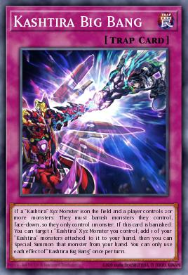

- **Copias y zona:** Main 1x. No altera las cantidades registradas.
- **Nombre oficial de referencia:** Big Bang Kashtira. CID cotejado con la ficha oficial; el nombre histórico del inventario se conserva aunque su grafía/traducción difiera.
- **Función principal y secundaria:** searcher · buscador · extensor · removal · respuesta.
- **Estado de sinergia y función:** Sinergia indirecta (soporte o recursos). Es una clasificación de juego; revisar la relación concreta en A06.
- **Papel como recurso, descarte o coste:** Material o destino del Extra condicionado a los requisitos de invocación.
- **Efecto operativo (paráfrasis analítica):** búsqueda o incorporación de cartas a mano; acceso al campo desde la mano; destierro de recursos o de amenazas; interacción sobre monstruos en campo; gestión de materiales Xyz. Son operaciones detectadas en el texto, no efectos independientes garantizados; leer sus condiciones en la fuente.
- **Mapa de activación y resultados:** 1) con condición explícita en la carta: Invocación Especial desde mano, incorpora la pieza indicada a la mano. Cada operación está sujeta a la secuencia y al «si lo haces» del texto oficial.
- **Ventanas de activación identificadas:** al ser desterrada.
- **Costes o recursos potenciales:** sin coste independiente identificado en esta síntesis; comprobar las acciones previas al punto y coma de cada efecto.
- **Restricciones y requisitos:** hay límite por turno según el efecto concreto; interactúa con información oculta o resultados no siempre elegibles. 
- **Prioridad al ir primero:** extender hacia Xyz y disponer de presión de zonas sin exponerse innecesariamente. Para esta carta: Convertir la activación en acceso a la siguiente pieza del motor, sin duplicar buscadores inútilmente.
- **Prioridad al ir segundo:** superar campo rival con destierros y herramientas de ruptura. Identificar primero la respuesta rival que afecta su función «searcher».
- **Medio/tardío y recuperación:** recuperar Kashtira del destierro/Cementerio y medir materiales Xyz. No asumir que por sí misma recicla recursos si el texto no lo permite.
- **Sinergias y acceso a líneas:** Relación contextual con monstruos de Nivel 7, Xyz y destierro boca abajo con presión de zonas. Habilita una línea del motor sólo si coinciden recursos, objetivos y restricciones; no equivale a un combo completo validado.
- **Riesgo / brick / interrupciones:** Riesgo operativo: efectos que niegan búsquedas, combaten Xyz o castigan campo saturado. Confirmar objetivos disponibles y costes antes de activar. No atribuirle velocidad rápida por el solo hecho de formar parte del motor.
- **Utilidad editorial:** 5/5 para este deck (estimación por rol y zona, no probabilidad calculada). No cambiar copias; cualquier sugerencia de alta/baja pasa por el apartado 22 y aprobación.
- **Referencia oficial y trazabilidad:** https://www.db.yugioh-card.com/yugiohdb/card_search.action?cid=18220&ope=2&request_locale=es. **Confianza:** texto y tipo de efecto cotejados en Konami; síntesis táctica editorial, no demostración de combo.
- **Aplicación concreta dentro de este deck (A06):** búsqueda o incorporación de cartas a mano; acceso al campo desde la mano; destierro de recursos o de amenazas; interacción sobre monstruos en campo; gestión de materiales Xyz.

**USO PRÁCTICO Y SINERGIA — Kashtira Big Bang**

- **Label funcional:** Sinergia indirecta. Clasificación documental; una relación es válida solo si se satisfacen sus condiciones exactas.
- **Qué hace:** búsqueda o incorporación de cartas a mano; acceso al campo desde la mano; destierro de recursos o de amenazas; interacción sobre monstruos en campo; gestión de materiales Xyz. Son operaciones detectadas en el texto, no efectos independientes garantizados; leer sus condiciones en la fuente.
- **Cómo aprovecharla en este deck:** búsqueda o incorporación de cartas a mano; acceso al campo desde la mano; destierro de recursos o de amenazas; interacción sobre monstruos en campo; gestión de materiales Xyz.
- **Al jugar primero:** extender hacia Xyz y disponer de presión de zonas sin exponerse innecesariamente. Para esta carta: Convertir la activación en acceso a la siguiente pieza del motor, sin duplicar buscadores inútilmente.
- **Al jugar segundo:** superar campo rival con destierros y herramientas de ruptura. Identificar primero la respuesta rival que afecta su función «searcher».
- **Cuándo tener precaución:** Riesgo operativo: efectos que niegan búsquedas, combaten Xyz o castigan campo saturado. Confirmar objetivos disponibles y costes antes de activar. No atribuirle velocidad rápida por el solo hecho de formar parte del motor.

#### 22. Kashtira Shangri-Ira [Xyz rango 7]

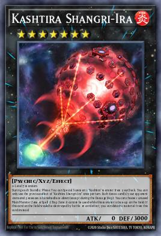

- **Copias y zona:** Extra 3x. No altera las cantidades registradas.
- **Nombre oficial de referencia:** Kashtira Shangri-Ira. CID cotejado con la ficha oficial; el nombre histórico del inventario se conserva aunque su grafía/traducción difiera.
- **Función principal y secundaria:** jefe Xyz Kashtira · bloqueo de zonas.
- **Estado de sinergia y función:** Destino Extra condicionado. Es una clasificación de juego; revisar la relación concreta en A06.
- **Papel como recurso, descarte o coste:** Material o destino del Extra condicionado a los requisitos de invocación.
- **Efecto operativo (paráfrasis analítica):** En cada Standby Phase invoca Kashtira desde Deck y bloquea zonas libres al dispararse destierro boca abajo. 
- **Mapa de activación y resultados:** 1) con condición explícita en la carta: Invocación Especial desde Deck, destierra el recurso u objetivo previsto · 2) efecto propio o continuo: desacopla materiales Xyz. Cada operación está sujeta a la secuencia y al «si lo haces» del texto oficial.
- **Ventanas de activación identificadas:** requieren la fase o condición específica indicada en el texto; sin ventana rápida general asumida.
- **Costes o recursos potenciales:** sin coste independiente identificado en esta síntesis; comprobar las acciones previas al punto y coma de cada efecto.
- **Restricciones y requisitos:** hay límite por turno según el efecto concreto; interactúa con información oculta o resultados no siempre elegibles. Invocar sólo desde el Extra Deck usando su procedimiento propio.
- **Prioridad al ir primero:** extender hacia Xyz y disponer de presión de zonas sin exponerse innecesariamente. Para esta carta: Convertir acceso al Deck en cuerpos o materiales antes de bloquearse con restricciones.
- **Prioridad al ir segundo:** superar campo rival con destierros y herramientas de ruptura. Identificar primero la respuesta rival que afecta su función «jefe Xyz Kashtira».
- **Medio/tardío y recuperación:** recuperar Kashtira del destierro/Cementerio y medir materiales Xyz. No asumir que por sí misma recicla recursos si el texto no lo permite.
- **Sinergias y acceso a líneas:** Relación contextual con monstruos de Nivel 7, Xyz y destierro boca abajo con presión de zonas. Puede cerrar o prolongar una ruta del Extra si los materiales están disponibles.
- **Riesgo / brick / interrupciones:** Los bloqueos dependen de la resolución y de zonas válidas disponibles. No atribuirle velocidad rápida por el solo hecho de formar parte del motor.
- **Utilidad editorial:** 4/5 para este deck (estimación por rol y zona, no probabilidad calculada). No cambiar copias; cualquier sugerencia de alta/baja pasa por el apartado 22 y aprobación.
- **Referencia oficial y trazabilidad:** https://www.db.yugioh-card.com/yugiohdb/card_search.action?cid=17800&ope=2&request_locale=es. **Confianza:** texto y tipo de efecto cotejados en Konami; síntesis táctica editorial, no demostración de combo.
- **Aplicación concreta dentro de este deck (A06):** En cada Standby Phase invoca Kashtira desde Deck y bloquea zonas libres al dispararse destierro boca abajo. A06 identifica su destino, condicionado a material/procedimiento.

**USO PRÁCTICO Y SINERGIA — Kashtira Shangri-Ira [Xyz rango 7]**

- **Label funcional:** Referencias de ruta localizadas; conexión reglamentaria sujeta al recorrido de la guía. Clasificación documental; una relación es válida solo si se satisfacen sus condiciones exactas.
- **Qué hace:** En cada Standby Phase invoca Kashtira desde Deck y bloquea zonas libres al dispararse destierro boca abajo.
- **Cómo aprovecharla en este deck:** En cada Standby Phase invoca Kashtira desde Deck y bloquea zonas libres al dispararse destierro boca abajo. A06 identifica su destino, condicionado a material/procedimiento.
- **Al jugar primero:** extender hacia Xyz y disponer de presión de zonas sin exponerse innecesariamente. Para esta carta: Convertir acceso al Deck en cuerpos o materiales antes de bloquearse con restricciones.
- **Al jugar segundo:** superar campo rival con destierros y herramientas de ruptura. Identificar primero la respuesta rival que afecta su función «jefe Xyz Kashtira».
- **Cuándo tener precaución:** Los bloqueos dependen de la resolución y de zonas válidas disponibles. No atribuirle velocidad rápida por el solo hecho de formar parte del motor.

**CÓMO LLEGAR DESDE TU DECK — RUTAS DOCUMENTADAS**

- **Abrir guía `665:A09:WRAITSOTH:SHANGRI01`:** entrada: Mano de apertura: solo Pressured Planet Wraitsoth. Campo/GY propios vacíos, Main Phase 1; Unicornio, Fenrir y Kashtiratheosis en Deck, Shangri-Ira en Extra; rival sin responder.. Propósito descrito: Preparar Shangri-Ira con Wraitsoth y dos materiales Xyz. Consulta sus pasos, consumo y resultado; comprobar si esta carta es realmente invocada o solo mencionada.
- **Abrir guía `665:A09:FENRIR:RISEHEART:SHANGRI02`:** entrada: solo Kashtira Fenrir (17768); campo propio vacío y Main Phase. En Deck: Kashtira Riseheart (18151) y Big Bang Kashtira (18220, 1 copia); en Extra Shangri-Ira (17800). Adversario tiene al menos 3 cartas en el Deck. No hay respuesta adversaria ni restricciones previas.. Propósito descrito: Invocar Shangri-Ira; desterrar tres cartas del Deck rival. Consulta sus pasos, consumo y resultado; comprobar si esta carta es realmente invocada o solo mencionada.
- **Abrir guía `665:A09:UNICORN:THEOSIS:FENRIR:SHANGRI03`:** entrada: solo Kashtira Unicorn. Campo/GY propios: vacíos. Deck: 1× Kashtiratheosis, 1× Kashtira Fenrir (TIERRA), 1× Kashtira Riseheart (FUEGO) y 1× Kashtira Big Bang disponibles. Extra: Shangri-Ira. Rival con mínimo 3 cartas en Deck; sin negaciones ni bloqueos previos. Es Main Phase propia y la Invocación Normal sigue libre.. Propósito descrito: Invocar Shangri-Ira y conservar Fenrir para el turno rival. Consulta sus pasos, consumo y resultado; comprobar si esta carta es realmente invocada o solo mencionada.
- **Abrir guía `665:A09:SHANGRI:STANDBY:ARISE04`:** entrada: Apertura del turno 1: Wraitsoth únicamente Wraitsoth en mano, con Unicorn, Kashtiratheosis y Fenrir en Deck, y Shangri Shangri-Ira en Extra; aplicar exactamente los pasos 1–5 de la ficha previa WRAITSOTH:SHANGRI01. Se termina con Shangri en Defensa, 2 materiales Xyz originales (Unicorn + primer Fenrir) y Wraitsoth en Zona de Campo. Normal del turno 1 libre. No ocurre destierro rival boca abajo en esos pasos. Nueva condición de estado: Shangri-Ira debe permanecer en Campo durante el turno del rival sin ser neutralizado, volteado boca abajo ni perder la capacidad de activar sus efectos. La mano/carta de robo del siguiente turno no se usan ni se presuponen conocidas.. Propósito descrito: Continuar a Arise-Heart desde Shangri-Ira en un turno posterior. Consulta sus pasos, consumo y resultado; comprobar si esta carta es realmente invocada o solo mencionada.
- **Abrir guía `665:A09:FENRIR:BIRTH:SHANGRI05`:** entrada: Kashtira Fenrir (17768) + Nacimiento Kashtira (17815) en mano; propio Campo/GY vacíos, Main Phase propia, sin respuesta rival. En Main Deck quedan al menos Unicornio (17769, VIENTO), Kashtirateosis (18203), Ogro (17770, AGUA) y Preparaciones Kashtira (17831, Trampa); Extra incluye Shangri-Ira (17800). No requiere Riseheart ni desterrar cartas rivales.. Propósito descrito: Invocar Shangri-Ira y preparar Nacimiento y Preparaciones. Consulta sus pasos, consumo y resultado; comprobar si esta carta es realmente invocada o solo mencionada.
- **Abrir guía `665:A09:FENRIR:BIRTH:BIGEYE06`:** entrada: igual que FENRIR:BIRTH:SHANGRI05, pero el rival controla al menos un monstruo boca arriba elegible para tomar el control; sin respuestas a las activaciones. En Extra Número 11: Ojo Grande (9861, Rango 7, ATK 2600) sustituye a Shangri como destino. No se presupone ATK ni efectos del monstruo capturado.. Propósito descrito: Romper campo. Consulta sus pasos, consumo y resultado; comprobar si esta carta es realmente invocada o solo mencionada.
- **Abrir guía `665:A09:WRAITSOTH:RISEHEART:BIGBANG:BIGEYE07`:** entrada: Wraitsoth Planeta Bajo Presión Wraitsoth (18204) + Riseheart Kashtira Riseheart (18151) en mano; propio Campo/GY vacíos, Main Phase propia, sin respuesta rival. Deck con Unicornio, Teosis, Fenrir y Big Bang; Extra con Shangri-Ira y Número 11: Ojo Grande. El adversario tiene al menos tres cartas en el Deck. No hace falta que controle monstruos. Se presupone el desarrollo de una carta WRAITSOTH:SHANGRI01, descrito antes.. Propósito descrito: Romper campo. Consulta sus pasos, consumo y resultado; comprobar si esta carta es realmente invocada o solo mencionada.
- **Abrir guía `665:A09:WRAITSOTH:RISEHEART:ARISE3MAT08`:** entrada: Wraitsoth Planeta Bajo Presión Wraitsoth + Riseheart Kashtira Riseheart. Campo y GY propios vacíos; durante la Main Phase propia; rival sin respuestas y con al menos tres cartas en el Deck. El Main conserva Unicornio, Fenrir, Teosis y Big Bang; el Extra contiene Shangri-Ira y Arise-Heart Arise-Heart. Es una bifurcación incompatible con la ruta 07: aquí no se recupera Fenrir mediante Big Bang. Se describe la mecánica de las cartas del inventario, sin evaluación de listas de prohibiciones.. Propósito descrito: Terminar en Arise-Heart con tres materiales Xyz. Consulta sus pasos, consumo y resultado; comprobar si esta carta es realmente invocada o solo mencionada.

#### 23. Kashtira Arise-Heart [Xyz rango 7]

- **Copias y zona:** Extra 2x. No altera las cantidades registradas.
- **Nombre oficial de referencia:** Kashtira Arise-Heart. CID cotejado con la ficha oficial; el nombre histórico del inventario se conserva aunque su grafía/traducción difiera.
- **Función principal y secundaria:** jefe Xyz Kashtira · destierro.
- **Estado de sinergia y función:** Destino Extra condicionado. Es una clasificación de juego; revisar la relación concreta en A06.
- **Papel como recurso, descarte o coste:** Material o destino del Extra condicionado a los requisitos de invocación.
- **Efecto operativo (paráfrasis analítica):** Puede Invocarse Xyz sobre un solo Kashtira propio **si un efecto de Shangri-Ira fue activado con éxito ese turno** (no es lo mismo que exigir que su resolución haya producido el resultado previsto); también puede entrar con tres monstruos de Nivel 7. Las cartas que irían al Cementerio se destierran y su Efecto Rápido de retirar una carta exige desacoplar **tres** materiales. Distinguir la prohibición competitiva vigente de las condiciones mecánicas del procedimiento.
- **Mapa de activación y resultados:** 1) efecto propio o continuo: destierra el recurso u objetivo previsto · 2) con condición explícita en la carta: destierra el recurso u objetivo previsto · 3) una vez por turno: desacopla materiales Xyz. Cada operación está sujeta a la secuencia y al «si lo haces» del texto oficial.
- **Ventanas de activación identificadas:** Efecto Rápido.
- **Costes o recursos potenciales:** sin coste independiente identificado en esta síntesis; comprobar las acciones previas al punto y coma de cada efecto.
- **Restricciones y requisitos:** hay límite por turno según el efecto concreto; interactúa con información oculta o resultados no siempre elegibles. Invocar sólo desde el Extra Deck usando su procedimiento propio.
- **Prioridad al ir primero:** extender hacia Xyz y disponer de presión de zonas sin exponerse innecesariamente. Para esta carta: Escoger la amenaza o recurso que genere mayor ventaja de tempo; respetar selección y zona.
- **Prioridad al ir segundo:** superar campo rival con destierros y herramientas de ruptura. Identificar primero la respuesta rival que afecta su función «jefe Xyz Kashtira».
- **Medio/tardío y recuperación:** recuperar Kashtira del destierro/Cementerio y medir materiales Xyz. No asumir que por sí misma recicla recursos si el texto no lo permite.
- **Sinergias y acceso a líneas:** Relación contextual con monstruos de Nivel 7, Xyz y destierro boca abajo con presión de zonas. Puede cerrar o prolongar una ruta del Extra si los materiales están disponibles.
- **Riesgo / brick / interrupciones:** Comprobar condición de invocación alternativa y material disponible. Puede emplearse en cadena sólo cuando se cumpla su condición concreta.
- **Utilidad editorial:** 4/5 para este deck (estimación por rol y zona, no probabilidad calculada). No cambiar copias; cualquier sugerencia de alta/baja pasa por el apartado 22 y aprobación.
- **Referencia oficial y trazabilidad:** https://www.db.yugioh-card.com/yugiohdb/card_search.action?cid=18191&ope=2&request_locale=es. **Confianza:** texto y tipo de efecto cotejados en Konami; síntesis táctica editorial, no demostración de combo.
- **Aplicación concreta dentro de este deck (A06):** Puede subir sobre Kashtira si se resolvió Shangri-Ira y convierte cartas enviadas al Cementerio en destierro; remueve con materiales. A06 identifica su destino, condicionado a material/procedimiento.

**USO PRÁCTICO Y SINERGIA — Kashtira Arise-Heart [Xyz rango 7]**

- **Label funcional:** Referencias de ruta localizadas; conexión reglamentaria sujeta al recorrido de la guía. Clasificación documental; una relación es válida solo si se satisfacen sus condiciones exactas.
- **Qué hace:** Puede Invocarse Xyz sobre un solo Kashtira propio **si un efecto de Shangri-Ira fue activado con éxito ese turno** (no es lo mismo que exigir que su resolución haya producido el resultado previsto); también puede entrar con tres monstruos de Nivel 7. Las cartas que irían al Cementerio se destierran y su Efecto Rápido de retirar una carta exige desacoplar **tres** materiales. Distinguir la prohibición competitiva vigente de las condiciones mecánicas del procedimiento.
- **Cómo aprovecharla en este deck:** Puede subir sobre Kashtira si se resolvió Shangri-Ira y convierte cartas enviadas al Cementerio en destierro; remueve con materiales. A06 identifica su destino, condicionado a material/procedimiento.
- **Al jugar primero:** extender hacia Xyz y disponer de presión de zonas sin exponerse innecesariamente. Para esta carta: Escoger la amenaza o recurso que genere mayor ventaja de tempo; respetar selección y zona.
- **Al jugar segundo:** superar campo rival con destierros y herramientas de ruptura. Identificar primero la respuesta rival que afecta su función «jefe Xyz Kashtira».
- **Cuándo tener precaución:** Comprobar condición de invocación alternativa y material disponible. Puede emplearse en cadena sólo cuando se cumpla su condición concreta.

**CÓMO LLEGAR DESDE TU DECK — RUTAS DOCUMENTADAS**

- **Abrir guía `665:A09:SHANGRI:STANDBY:ARISE04`:** entrada: Apertura del turno 1: Wraitsoth únicamente Wraitsoth en mano, con Unicorn, Kashtiratheosis y Fenrir en Deck, y Shangri Shangri-Ira en Extra; aplicar exactamente los pasos 1–5 de la ficha previa WRAITSOTH:SHANGRI01. Se termina con Shangri en Defensa, 2 materiales Xyz originales (Unicorn + primer Fenrir) y Wraitsoth en Zona de Campo. Normal del turno 1 libre. No ocurre destierro rival boca abajo en esos pasos. Nueva condición de estado: Shangri-Ira debe permanecer en Campo durante el turno del rival sin ser neutralizado, volteado boca abajo ni perder la capacidad de activar sus efectos. La mano/carta de robo del siguiente turno no se usan ni se presuponen conocidas.. Propósito descrito: Continuar a Arise-Heart desde Shangri-Ira en un turno posterior. Consulta sus pasos, consumo y resultado; comprobar si esta carta es realmente invocada o solo mencionada.
- **Abrir guía `665:A09:WRAITSOTH:RISEHEART:ARISE3MAT08`:** entrada: Wraitsoth Planeta Bajo Presión Wraitsoth + Riseheart Kashtira Riseheart. Campo y GY propios vacíos; durante la Main Phase propia; rival sin respuestas y con al menos tres cartas en el Deck. El Main conserva Unicornio, Fenrir, Teosis y Big Bang; el Extra contiene Shangri-Ira y Arise-Heart Arise-Heart. Es una bifurcación incompatible con la ruta 07: aquí no se recupera Fenrir mediante Big Bang. Se describe la mecánica de las cartas del inventario, sin evaluación de listas de prohibiciones.. Propósito descrito: Terminar en Arise-Heart con tres materiales Xyz. Consulta sus pasos, consumo y resultado; comprobar si esta carta es realmente invocada o solo mencionada.
- **Abrir guía `665:A09:WRAITSOTH:RISEHEART:BIGBANG:ARISE1MAT09`:** entrada: las mismas dos cartas, condiciones y ubicaciones iniciales de ARISE3MAT08. Objetivo alternativo: conservar Shangri-Ira boca arriba y su zona bloqueada, además de Invocar a Arise-Heart sobre Riseheart, aceptando que comienza con un único material y no puede pagar todavía el coste de tres materiales de su destierro rápido. No se combina con ruta 07 ni ruta 08: se elige un destino del Extra diferente para Riseheart.. Propósito descrito: Conservar Shangri-Ira y Arise-Heart con un material. Consulta sus pasos, consumo y resultado; comprobar si esta carta es realmente invocada o solo mencionada.

#### 24. Number 11: Big Eye [Xyz rango 7]

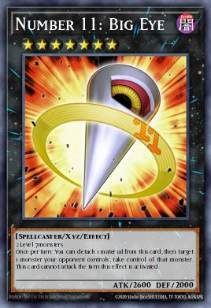

- **Copias y zona:** Extra 2x. No altera las cantidades registradas.
- **Nombre oficial de referencia:** Número 11: Ojo Grande. CID cotejado con la ficha oficial; el nombre histórico del inventario se conserva aunque su grafía/traducción difiera.
- **Función principal y secundaria:** resultado de Extra Deck · respuesta · habilitador Xyz.
- **Estado de sinergia y función:** Destino Extra condicionado. Es una clasificación de juego; revisar la relación concreta en A06.
- **Papel como recurso, descarte o coste:** Material o destino del Extra condicionado a los requisitos de invocación.
- **Efecto operativo (paráfrasis analítica):** interacción sobre monstruos en campo; gestión de materiales Xyz. Son operaciones detectadas en el texto, no efectos independientes garantizados; leer sus condiciones en la fuente.
- **Mapa de activación y resultados:** 1) una vez por turno: desacopla materiales Xyz, toma temporalmente el control. Cada operación está sujeta a la secuencia y al «si lo haces» del texto oficial.
- **Ventanas de activación identificadas:** requieren la fase o condición específica indicada en el texto; sin ventana rápida general asumida.
- **Costes o recursos potenciales:** sin coste independiente identificado en esta síntesis; comprobar las acciones previas al punto y coma de cada efecto.
- **Restricciones y requisitos:** hay límite por turno según el efecto concreto; puede limitar ataques. Invocar sólo desde el Extra Deck usando su procedimiento propio.
- **Prioridad al ir primero:** extender hacia Xyz y disponer de presión de zonas sin exponerse innecesariamente. Para esta carta: Comprobar materiales exactos antes de buscar este objetivo en el Extra Deck.
- **Prioridad al ir segundo:** superar campo rival con destierros y herramientas de ruptura. Identificar primero la respuesta rival que afecta su función «resultado de Extra Deck».
- **Medio/tardío y recuperación:** recuperar Kashtira del destierro/Cementerio y medir materiales Xyz. No asumir que por sí misma recicla recursos si el texto no lo permite.
- **Sinergias y acceso a líneas:** Relación contextual con monstruos de Nivel 7, Xyz y destierro boca abajo con presión de zonas. Puede cerrar o prolongar una ruta del Extra si los materiales están disponibles.
- **Riesgo / brick / interrupciones:** Se agota al consumir materiales; no asumir material adicional al pasar de un Xyz a otro. No atribuirle velocidad rápida por el solo hecho de formar parte del motor.
- **Utilidad editorial:** 4/5 para este deck (estimación por rol y zona, no probabilidad calculada). No cambiar copias; cualquier sugerencia de alta/baja pasa por el apartado 22 y aprobación.
- **Referencia oficial y trazabilidad:** https://www.db.yugioh-card.com/yugiohdb/card_search.action?cid=9861&ope=2&request_locale=es. **Confianza:** texto y tipo de efecto cotejados en Konami; síntesis táctica editorial, no demostración de combo.
- **Aplicación concreta dentro de este deck (A06):** interacción sobre monstruos en campo; gestión de materiales Xyz. A06 identifica su destino, condicionado a material/procedimiento.

**USO PRÁCTICO Y SINERGIA — Number 11: Big Eye [Xyz rango 7]**

- **Label funcional:** Referencias de ruta localizadas; conexión reglamentaria sujeta al recorrido de la guía. Clasificación documental; una relación es válida solo si se satisfacen sus condiciones exactas.
- **Qué hace:** interacción sobre monstruos en campo; gestión de materiales Xyz. Son operaciones detectadas en el texto, no efectos independientes garantizados; leer sus condiciones en la fuente.
- **Cómo aprovecharla en este deck:** interacción sobre monstruos en campo; gestión de materiales Xyz. A06 identifica su destino, condicionado a material/procedimiento.
- **Al jugar primero:** extender hacia Xyz y disponer de presión de zonas sin exponerse innecesariamente. Para esta carta: Comprobar materiales exactos antes de buscar este objetivo en el Extra Deck.
- **Al jugar segundo:** superar campo rival con destierros y herramientas de ruptura. Identificar primero la respuesta rival que afecta su función «resultado de Extra Deck».
- **Cuándo tener precaución:** Se agota al consumir materiales; no asumir material adicional al pasar de un Xyz a otro. No atribuirle velocidad rápida por el solo hecho de formar parte del motor.

**CÓMO LLEGAR DESDE TU DECK — RUTAS DOCUMENTADAS**

- **Abrir guía `665:A09:FENRIR:BIRTH:BIGEYE06`:** entrada: igual que FENRIR:BIRTH:SHANGRI05, pero el rival controla al menos un monstruo boca arriba elegible para tomar el control; sin respuestas a las activaciones. En Extra Número 11: Ojo Grande (9861, Rango 7, ATK 2600) sustituye a Shangri como destino. No se presupone ATK ni efectos del monstruo capturado.. Propósito descrito: Romper campo. Consulta sus pasos, consumo y resultado; comprobar si esta carta es realmente invocada o solo mencionada.
- **Abrir guía `665:A09:WRAITSOTH:RISEHEART:BIGBANG:BIGEYE07`:** entrada: Wraitsoth Planeta Bajo Presión Wraitsoth (18204) + Riseheart Kashtira Riseheart (18151) en mano; propio Campo/GY vacíos, Main Phase propia, sin respuesta rival. Deck con Unicornio, Teosis, Fenrir y Big Bang; Extra con Shangri-Ira y Número 11: Ojo Grande. El adversario tiene al menos tres cartas en el Deck. No hace falta que controle monstruos. Se presupone el desarrollo de una carta WRAITSOTH:SHANGRI01, descrito antes.. Propósito descrito: Romper campo. Consulta sus pasos, consumo y resultado; comprobar si esta carta es realmente invocada o solo mencionada.

#### 25. Divine Arsenal AA-ZEUS – Sky Thunder [Xyz]

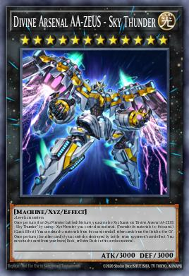

- **Copias y zona:** Extra 2x. No altera las cantidades registradas.
- **Nombre oficial de referencia:** Divino Arsenal AA-ZEUS - Trueno del Cielo. CID cotejado con la ficha oficial; el nombre histórico del inventario se conserva aunque su grafía/traducción difiera.
- **Función principal y secundaria:** interrupción · resultado de Extra Deck · habilitador Xyz.
- **Estado de sinergia y función:** **Acceso condicional ahora demostrado** mediante batalla de Ojo Grande que sobrevive → ZEUS superpuesto en Main Phase 2. Ver `665:A09:BIGEYE:BATTLE:ZEUS11`. No se Invoca directamente con Dark Armed en ausencia de batalla previa de Xyz.
- **Papel como recurso, descarte o coste:** Material o destino del Extra condicionado a los requisitos de invocación.
- **Efecto operativo (paráfrasis analítica):** tras batalla de un Xyz, ZEUS puede superponerse en Main Phase 2; desacoplar dos materiales como Efecto Rápido para **enviar todas las demás cartas del campo al GY** (incluidas las propias). Con Big Eye de 2 materiales, ZEUS entra con 3 y solo dispone de un pago inmediato.
- **Mapa de activación y resultados:** 1) efecto propio o continuo: desacopla materiales Xyz. Cada operación está sujeta a la secuencia y al «si lo haces» del texto oficial.
- **Ventanas de activación identificadas:** Efecto Rápido.
- **Costes o recursos potenciales:** 2 materiales Xyz por cada barrido; invocar ZEUS encima del Xyz utilizado conserva el Xyz y los materiales que tenía.
- **Restricciones y requisitos:** hay límite por turno según el efecto concreto. Invocar sólo desde el Extra Deck usando su procedimiento propio.
- **Prioridad al ir primero:** extender hacia Xyz y disponer de presión de zonas sin exponerse innecesariamente. Para esta carta: Reservar la respuesta para la ventana rival exacta; no es una pieza buscadora de nuestro motor.
- **Prioridad al ir segundo:** superar campo rival con destierros y herramientas de ruptura. Identificar primero la respuesta rival que afecta su función «interrupción».
- **Medio/tardío y recuperación:** recuperar Kashtira del destierro/Cementerio y medir materiales Xyz. No asumir que por sí misma recicla recursos si el texto no lo permite.
- **Sinergias y acceso a líneas:** Relación contextual con monstruos de Nivel 7, Xyz y destierro boca abajo con presión de zonas. Puede cerrar o prolongar una ruta del Extra si los materiales están disponibles.
- **Riesgo / brick / interrupciones:** Se agota al consumir materiales; no asumir material adicional al pasar de un Xyz a otro. Puede emplearse en cadena sólo cuando se cumpla su condición concreta.
- **Utilidad editorial:** 4/5 para este deck (estimación por rol y zona, no probabilidad calculada). No cambiar copias; cualquier sugerencia de alta/baja pasa por el apartado 22 y aprobación.
- **Referencia oficial y trazabilidad:** https://www.db.yugioh-card.com/yugiohdb/card_search.action?cid=15524&ope=2&request_locale=es. **Confianza:** texto y tipo de efecto cotejados en Konami; síntesis táctica editorial, no demostración de combo.
- **Aplicación concreta dentro de este deck (A06):** `665:A09:BIGEYE:BATTLE:ZEUS11`: Fenrir + Birth llevan a Fenrir/Ogre, Big Eye, Battle Phase superviviente y Zeus en Main Phase 2. Campo final 3 materiales; el barrido puede quitar tus propias cartas.

**USO PRÁCTICO Y SINERGIA — Divine Arsenal AA-ZEUS – Sky Thunder [Xyz]**

- **Label funcional:** Sinergia concreta condicional demostrada; nueva ruta documental, aún sin certificación integral de todas las interrupciones del duelo.
- **Qué hace:** tras una batalla con Xyz, permite la Invocación superpuesta de ZEUS en Main Phase 2; su Efecto Rápido desacopla dos materiales y envía todas las demás cartas del campo al Cementerio.
- **Cómo aprovecharla en este deck:** la variante Fenrir + Birth, Fenrir/Ogre → Ojo Grande → batalla → ZEUS deja tres materiales. Elige **este plan o el de controlar un monstruo con Ojo Grande**, porque Big Eye no puede atacar el turno en que activa ese efecto.
- **Al jugar primero:** extender hacia Xyz y disponer de presión de zonas sin exponerse innecesariamente. Para esta carta: Reservar la respuesta para la ventana rival exacta; no es una pieza buscadora de nuestro motor.
- **Al jugar segundo:** superar campo rival con destierros y herramientas de ruptura. Identificar primero la respuesta rival que afecta su función «interrupción».
- **Cuándo tener precaución:** Se agota al consumir materiales; no asumir material adicional al pasar de un Xyz a otro. Puede emplearse en cadena sólo cuando se cumpla su condición concreta.

**CÓMO LLEGAR DESDE TU DECK — CONTINUACIÓN VISUAL NUEVA**

- **Abrir guía:** `665:A09:BIGEYE:BATTLE:ZEUS11` — Fenrir + Birth; cuerpos Nivel 7 Fenrir/Ogre → Big Eye; su batalla sobrevive; en Main Phase 2 superponer ZEUS con tres materiales. Consultar cinco fotos/pasos, restricciones, dos propósitos alternativos y campo final.

#### 26. Dark Armed, the Dragon of Annihilation [Xyz rango 7]

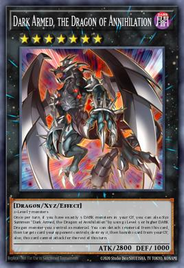

- **Copias y zona:** Extra 1x. No altera las cantidades registradas.
- **Nombre oficial de referencia:** Armado Oscuro, el Dragón de la Aniquilación. CID cotejado con la ficha oficial; el nombre histórico del inventario se conserva aunque su grafía/traducción difiera.
- **Función principal y secundaria:** resultado de Extra Deck · removal · habilitador Xyz.
- **Estado de sinergia y función:** Acceso Xyz directo demostrado mediante dos Kashtira de Nivel 7; ruta concreta `665:A09:FENRIR:BIRTH:DARKARMED10`. El procedimiento alternativo de un Dragón OSCURIDAD con cinco monstruos OSCURIDAD exactos en GY no es necesario en esta línea.
- **Papel como recurso, descarte o coste:** Material o destino del Extra condicionado a los requisitos de invocación.
- **Efecto operativo (paráfrasis analítica):** desacoplar un material, seleccionar una carta rival, destruirla y después desterrar una carta del Cementerio propio. Este efecto impide que Dark Armed ataque el resto del turno. No destierra directamente la carta rival.
- **Mapa de activación y resultados:** 1) efecto propio o continuo: destierra el recurso u objetivo previsto, desacopla materiales Xyz. Cada operación está sujeta a la secuencia y al «si lo haces» del texto oficial.
- **Ventanas de activación identificadas:** requieren la fase o condición específica indicada en el texto; sin ventana rápida general asumida.
- **Costes o recursos potenciales:** destierro de recurso propio.
- **Restricciones y requisitos:** Invocación Xyz ordinaria con 2 o más monstruos Nivel 7. Alternativamente, una vez por turno puede usar 1 Dragón OSCURIDAD de Nivel 5 o mayor si hay exactamente 5 monstruos OSCURIDAD en el GY. El efecto de destrucción no indica una vez por turno, pero requiere material, objetivo y una carta en GY que se pueda desterrar después de destruir.
- **Prioridad al ir primero:** extender hacia Xyz y disponer de presión de zonas sin exponerse innecesariamente. Para esta carta: Comprobar materiales exactos antes de buscar este objetivo en el Extra Deck.
- **Prioridad al ir segundo:** superar campo rival con destierros y herramientas de ruptura. Identificar primero la respuesta rival que afecta su función «resultado de Extra Deck».
- **Medio/tardío y recuperación:** recuperar Kashtira del destierro/Cementerio y medir materiales Xyz. No asumir que por sí misma recicla recursos si el texto no lo permite.
- **Sinergias y acceso a líneas:** Relación contextual con monstruos de Nivel 7, Xyz y destierro boca abajo con presión de zonas. Puede cerrar o prolongar una ruta del Extra si los materiales están disponibles.
- **Riesgo / brick / interrupciones:** Se agota al consumir materiales; no asumir material adicional al pasar de un Xyz a otro. No atribuirle velocidad rápida por el solo hecho de formar parte del motor.
- **Utilidad editorial:** 4/5 para este deck (estimación por rol y zona, no probabilidad calculada). No cambiar copias; cualquier sugerencia de alta/baja pasa por el apartado 22 y aprobación.
- **Referencia oficial y trazabilidad:** https://www.db.yugioh-card.com/yugiohdb/card_search.action?cid=13974&ope=2&request_locale=es. **Confianza:** texto y tipo de efecto cotejados en Konami; síntesis táctica editorial, no demostración de combo.
- **Aplicación concreta dentro de este deck (A06):** Fenrir + Birth permite buscar y hacer Normal de Unicorn sin tributos. Los dos cuerpos Nivel 7 se convierten en Dark Armed para destruir una carta rival. El material desacoplado queda en el GY y puede ser desterrado por el mismo efecto si la destrucción se realizó.

**USO PRÁCTICO Y SINERGIA — Dark Armed, the Dragon of Annihilation [Xyz rango 7]**

- **Label funcional:** Sinergia directa de materiales con Fenrir, Unicorn y Birth; destino Xyz de ruptura.
- **Qué hace:** destruye una carta del campo rival al desacoplar material, luego destierra una carta de tu GY; ya no puede atacar ese turno después de usar el efecto.
- **Cómo aprovecharla en este deck:** con Fenrir + Birth, buscar Unicorn, invocarlo Normal sin tributos y usar ambos de Nivel 7 para Dark Armed. Ver guía `665:A09:FENRIR:BIRTH:DARKARMED10`.
- **Al jugar primero:** no priorizar su Invocación únicamente por ATK: su efecto de destrucción necesita una carta rival para seleccionar y no crea una negación.
- **Al jugar segundo:** elegirlo cuando una carta rival destruible sea más importante que mantener Fenrir/Unicorn en el campo o construir Shangri-Ira. No prometer destrucción frente a protección o negación.
- **Cuándo tener precaución:** su efecto no es rápido; no puede destruir en respuesta al rival. Al usarlo ya no podrá atacar ese turno. Con Arise-Heart activo, el material desacoplado puede acabar desterrado y dejar sin carta en GY para la parte posterior.

**CÓMO LLEGAR DESDE TU DECK — RUTAS DOCUMENTADAS**

- **Abrir guía `665:A09:FENRIR:BIRTH:DARKARMED10`:** entrada: Fenrir + Birth. Propósito descrito: Romper campo. Consulta sus pasos, consumo y resultado; comprobar si esta carta es realmente invocada o solo mencionada.

#### 27. Baronne de Fleur [Synchro nivel 10]

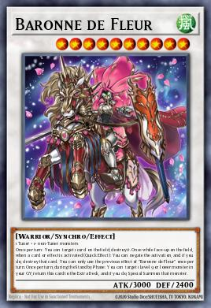

- **Copias y zona:** Extra 1x. No altera las cantidades registradas.
- **Nombre oficial de referencia:** Baronesa de la Flor. CID cotejado con la ficha oficial; el nombre histórico del inventario se conserva aunque su grafía/traducción difiera.
- **Función principal y secundaria:** interrupción · resultado de Extra Deck · removal · negación · recuperación.
- **Estado de sinergia y función:** Sin acceso al Extra demostrado. Es una clasificación de juego; revisar la relación concreta en A06.
- **Papel como recurso, descarte o coste:** Material o destino del Extra condicionado a los requisitos de invocación.
- **Efecto operativo (paráfrasis analítica):** destrucción de cartas o empleo de destrucción como detonante; negación de efectos o activaciones; retorno o reciclaje hacia mano/Deck/Extra. Son operaciones detectadas en el texto, no efectos independientes garantizados; leer sus condiciones en la fuente.
- **Mapa de activación y resultados:** 1) con estado de campo/zona indicado: destruye la carta o recurso previsto · 2) en Standby Phase: Invocación Especial desde Extra Deck, devuelve recursos a mano/Deck/Extra. Cada operación está sujeta a la secuencia y al «si lo haces» del texto oficial.
- **Ventanas de activación identificadas:** Standby Phase; Efecto Rápido.
- **Costes o recursos potenciales:** sin coste independiente identificado en esta síntesis; comprobar las acciones previas al punto y coma de cada efecto.
- **Restricciones y requisitos:** hay límite por turno según el efecto concreto; depende de recursos en Cementerio. Invocar sólo desde el Extra Deck usando su procedimiento propio.
- **Prioridad al ir primero:** extender hacia Xyz y disponer de presión de zonas sin exponerse innecesariamente. Para esta carta: Reservar la respuesta para la ventana rival exacta; no es una pieza buscadora de nuestro motor.
- **Prioridad al ir segundo:** superar campo rival con destierros y herramientas de ruptura. Identificar primero la respuesta rival que afecta su función «interrupción».
- **Medio/tardío y recuperación:** recuperar Kashtira del destierro/Cementerio y medir materiales Xyz. Verificar que el objetivo de recuperación continúe disponible.
- **Sinergias y acceso a líneas:** Relación contextual con monstruos de Nivel 7, Xyz y destierro boca abajo con presión de zonas. Puede cerrar o prolongar una ruta del Extra si los materiales están disponibles.
- **Riesgo / brick / interrupciones:** Depende del Cementerio y es sensible a destierro o negación de ese recurso. Puede emplearse en cadena sólo cuando se cumpla su condición concreta.
- **Utilidad editorial:** 4/5 para este deck (estimación por rol y zona, no probabilidad calculada). No cambiar copias; cualquier sugerencia de alta/baja pasa por el apartado 22 y aprobación.
- **Referencia oficial y trazabilidad:** https://www.db.yugioh-card.com/yugiohdb/card_search.action?cid=16386&ope=2&request_locale=es. **Confianza:** texto y tipo de efecto cotejados en Konami; síntesis táctica editorial, no demostración de combo.
- **Aplicación concreta dentro de este deck (A06):** destrucción de cartas o empleo de destrucción como detonante; negación de efectos o activaciones; retorno o reciclaje hacia mano/Deck/Extra. Falta arista de materiales en A06; A09 podría contener una ruta válida no indexada aquí.

**USO PRÁCTICO Y SINERGIA — Baronne de Fleur [Synchro nivel 10]**

- **Label funcional:** Sin sinergia demostrada (con la evidencia actual). Clasificación documental; una relación es válida solo si se satisfacen sus condiciones exactas.
- **Qué hace:** destrucción de cartas o empleo de destrucción como detonante; negación de efectos o activaciones; retorno o reciclaje hacia mano/Deck/Extra. Son operaciones detectadas en el texto, no efectos independientes garantizados; leer sus condiciones en la fuente.
- **Cómo aprovecharla en este deck:** destrucción de cartas o empleo de destrucción como detonante; negación de efectos o activaciones; retorno o reciclaje hacia mano/Deck/Extra. Falta arista de materiales en A06; A09 podría contener una ruta válida no indexada aquí.
- **Al jugar primero:** extender hacia Xyz y disponer de presión de zonas sin exponerse innecesariamente. Para esta carta: Reservar la respuesta para la ventana rival exacta; no es una pieza buscadora de nuestro motor.
- **Al jugar segundo:** superar campo rival con destierros y herramientas de ruptura. Identificar primero la respuesta rival que afecta su función «interrupción».
- **Cuándo tener precaución:** Depende del Cementerio y es sensible a destierro o negación de ese recurso. Puede emplearse en cadena sólo cuando se cumpla su condición concreta.

**CÓMO LLEGAR DESDE TU DECK — SIN RUTA DEMOSTRADA**

- La biblioteca actual no contiene una ruta identificada para esta carta del Extra. No se debe exhibir una descripción genérica como sustituto de mano inicial, materiales y pasos. Para completarla, contrastar requisitos oficiales y recursos del Main; si no es alcanzable, explicar el impedimento exacto.

#### 28. Donner, Dagger Fur Hire [Link-2]

**Novedad V13 (solo material de continuación):** `665:A09:DONNER:FENRIR:UNICORN:GODDESS12` **usa a Donner Link2 ya en campo** junto con Fenrir + Unicorn + monstruo de Efecto no-Link rival para crear Diosa Link5. **NO se demostró cómo invocar primero a Donner** con las cartas concretas del Main; su índice de destino sigue sin acceso probado. [Ver guía fotográfica de la continuación](guias/DECK_665_670_687_TYPHON_GODDESS_GUIA_V13.md). Propuesta de copias 1→0 solo puede aprobarse si se elimina o sustituye esa línea.

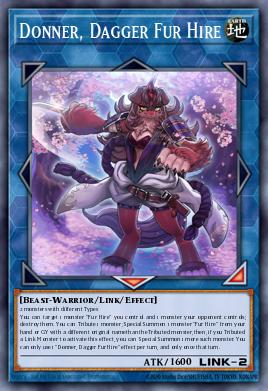

- **Copias y zona:** Extra 1x. No altera las cantidades registradas.
- **Nombre oficial de referencia:** Donner, Daga Mascota a Sueldo. CID cotejado con la ficha oficial; el nombre histórico del inventario se conserva aunque su grafía/traducción difiera.
- **Función principal y secundaria:** resultado de Extra Deck · recuperación · extensor · respuesta · coste/recurso.
- **Estado de sinergia y función:** Sin acceso al Extra demostrado. Es una clasificación de juego; revisar la relación concreta en A06.
- **Papel como recurso, descarte o coste:** Material o destino del Extra condicionado a los requisitos de invocación.
- **Efecto operativo (paráfrasis analítica):** recuperación e invocación desde Cementerio/destierro; acceso al campo desde la mano; interacción sobre monstruos en campo; uso de Sacrificios como parte del efecto. Son operaciones detectadas en el texto, no efectos independientes garantizados; leer sus condiciones en la fuente.
- **Mapa de activación y resultados:** 1) efecto propio o continuo: Invocación Especial desde Cementerio. Cada operación está sujeta a la secuencia y al «si lo haces» del texto oficial.
- **Ventanas de activación identificadas:** requieren la fase o condición específica indicada en el texto; sin ventana rápida general asumida.
- **Costes o recursos potenciales:** sin coste independiente identificado en esta síntesis; comprobar las acciones previas al punto y coma de cada efecto.
- **Restricciones y requisitos:** aplicar restricciones de selección, activación y copias que consten en el texto original. Invocar sólo desde el Extra Deck usando su procedimiento propio.
- **Prioridad al ir primero:** extender hacia Xyz y disponer de presión de zonas sin exponerse innecesariamente. Para esta carta: Comprobar materiales exactos antes de buscar este objetivo en el Extra Deck.
- **Prioridad al ir segundo:** superar campo rival con destierros y herramientas de ruptura. Identificar primero la respuesta rival que afecta su función «resultado de Extra Deck».
- **Medio/tardío y recuperación:** recuperar Kashtira del destierro/Cementerio y medir materiales Xyz. Verificar que el objetivo de recuperación continúe disponible.
- **Sinergias y acceso a líneas:** Relación contextual con monstruos de Nivel 7, Xyz y destierro boca abajo con presión de zonas. Puede cerrar o prolongar una ruta del Extra si los materiales están disponibles.
- **Riesgo / brick / interrupciones:** No contarla como extensión automática: confirmar materiales, procedimiento y restricciones vigentes. No atribuirle velocidad rápida por el solo hecho de formar parte del motor.
- **Utilidad editorial:** 4/5 para este deck (estimación por rol y zona, no probabilidad calculada). No cambiar copias; cualquier sugerencia de alta/baja pasa por el apartado 22 y aprobación.
- **Referencia oficial y trazabilidad:** https://www.db.yugioh-card.com/yugiohdb/card_search.action?cid=17804&ope=2&request_locale=es. **Confianza:** texto y tipo de efecto cotejados en Konami; síntesis táctica editorial, no demostración de combo.
- **Aplicación concreta dentro de este deck (A06):** recuperación e invocación desde Cementerio/destierro; acceso al campo desde la mano; interacción sobre monstruos en campo; uso de Sacrificios como parte del efecto. Falta arista de materiales en A06; A09 podría contener una ruta válida no indexada aquí.

**USO PRÁCTICO Y SINERGIA — Donner, Dagger Fur Hire [Link-2]**

- **Label funcional:** Sin sinergia demostrada (con la evidencia actual). Clasificación documental; una relación es válida solo si se satisfacen sus condiciones exactas.
- **Qué hace:** recuperación e invocación desde Cementerio/destierro; acceso al campo desde la mano; interacción sobre monstruos en campo; uso de Sacrificios como parte del efecto. Son operaciones detectadas en el texto, no efectos independientes garantizados; leer sus condiciones en la fuente.
- **Cómo aprovecharla en este deck:** recuperación e invocación desde Cementerio/destierro; acceso al campo desde la mano; interacción sobre monstruos en campo; uso de Sacrificios como parte del efecto. Falta arista de materiales en A06; A09 podría contener una ruta válida no indexada aquí.
- **Al jugar primero:** extender hacia Xyz y disponer de presión de zonas sin exponerse innecesariamente. Para esta carta: Comprobar materiales exactos antes de buscar este objetivo en el Extra Deck.
- **Al jugar segundo:** superar campo rival con destierros y herramientas de ruptura. Identificar primero la respuesta rival que afecta su función «resultado de Extra Deck».
- **Cuándo tener precaución:** No contarla como extensión automática: confirmar materiales, procedimiento y restricciones vigentes. No atribuirle velocidad rápida por el solo hecho de formar parte del motor.

**CÓMO LLEGAR DESDE TU DECK — SIN RUTA DEMOSTRADA**

- La biblioteca actual no contiene una ruta identificada para esta carta del Extra. No se debe exhibir una descripción genérica como sustituto de mano inicial, materiales y pasos. Para completarla, contrastar requisitos oficiales y recursos del Main; si no es alcanzable, explicar el impedimento exacto.

#### 29. Underworld Goddess of the Closed World [Link-5]

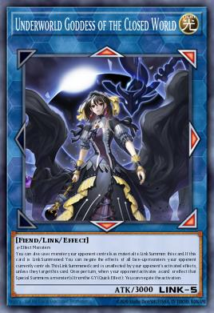

**Ruta de acceso V13:** `665:A09:DONNER:FENRIR:UNICORN:GODDESS12` — **continuación condicionada** con Donner Link2, Fenrir y Unicorn propios ya boca arriba y 1 monstruo de Efecto no-Link rival: 4 cuerpos de Efecto, valor Link exacto **2+1+1+1=5**. Diosa usa el monstruo rival como material, sin seleccionarlo por efecto. Puede negar los efectos de monstruos rivales actualmente boca arriba después de Invocación. **No es posible si Kashtiratheosis ha restringido el Extra a Xyz ese turno.** [Cinco pasos con fotos y campo final](guias/DECK_665_670_687_TYPHON_GODDESS_GUIA_V13.md). No afirmar que tres cartas de mano crean por sí solas el campo inicial requerido.

- **Copias y zona:** Extra 1x. No altera las cantidades registradas.
- **Nombre oficial de referencia:** Diosa del Inframundo del Mundo Cerrado. CID cotejado con la ficha oficial; el nombre histórico del inventario se conserva aunque su grafía/traducción difiera.
- **Función principal y secundaria:** interrupción · resultado de Extra Deck · habilitador de Extra · negación · protección.
- **Estado de sinergia y función:** Acceso condicional al Extra enlazado por V13; no apertura automática ni certificación integral.
- **Papel como recurso, descarte o coste:** Material o destino del Extra condicionado a los requisitos de invocación.
- **Efecto operativo (paráfrasis analítica):** habilitación o continuación de una invocación del Extra Deck; negación de efectos o activaciones; protección o resistencia contra respuestas. Son operaciones detectadas en el texto, no efectos independientes garantizados; leer sus condiciones en la fuente.
- **Mapa de activación y resultados:** 1) efecto propio o continuo: habilita Enlace. Cada operación está sujeta a la secuencia y al «si lo haces» del texto oficial.
- **Ventanas de activación identificadas:** al producirse una Invocación; Efecto Rápido; Invocación del Extra Deck.
- **Costes o recursos potenciales:** sin coste independiente identificado en esta síntesis; comprobar las acciones previas al punto y coma de cada efecto.
- **Restricciones y requisitos:** hay límite por turno según el efecto concreto. Invocar sólo desde el Extra Deck usando su procedimiento propio.
- **Prioridad al ir primero:** extender hacia Xyz y disponer de presión de zonas sin exponerse innecesariamente. Para esta carta: Reservar la respuesta para la ventana rival exacta; no es una pieza buscadora de nuestro motor.
- **Prioridad al ir segundo:** superar campo rival con destierros y herramientas de ruptura. Identificar primero la respuesta rival que afecta su función «interrupción».
- **Medio/tardío y recuperación:** recuperar Kashtira del destierro/Cementerio y medir materiales Xyz. No asumir que por sí misma recicla recursos si el texto no lo permite.
- **Sinergias y acceso a líneas:** Relación contextual con monstruos de Nivel 7, Xyz y destierro boca abajo con presión de zonas. Puede cerrar o prolongar una ruta del Extra si los materiales están disponibles.
- **Riesgo / brick / interrupciones:** No contarla como extensión automática: confirmar materiales, procedimiento y restricciones vigentes. Puede emplearse en cadena sólo cuando se cumpla su condición concreta.
- **Utilidad editorial:** 4/5 para este deck (estimación por rol y zona, no probabilidad calculada). No cambiar copias; cualquier sugerencia de alta/baja pasa por el apartado 22 y aprobación.
- **Referencia oficial y trazabilidad:** https://www.db.yugioh-card.com/yugiohdb/card_search.action?cid=15741&ope=2&request_locale=es. **Confianza:** texto y tipo de efecto cotejados en Konami; síntesis táctica editorial, no demostración de combo.
- **Aplicación concreta dentro de este deck (A06):** `665:A09:DONNER:FENRIR:UNICORN:GODDESS12`. Los tres propios + uno rival cumplen la Invocación por Enlace a Diosa 3000; el bloqueo de Theosis es excluyente.

**USO PRÁCTICO Y SINERGIA — Underworld Goddess of the Closed World [Link-5]**

- **Label funcional:** Sinergia condicional demostrada para acceso de Extra desde tablero previo; no implica etiqueta directa de Main ni modifica el porcentaje documentado.
- **Qué hace:** habilitación o continuación de una invocación del Extra Deck; negación de efectos o activaciones; protección o resistencia contra respuestas. Son operaciones detectadas en el texto, no efectos independientes garantizados; leer sus condiciones en la fuente.
- **Cómo aprovecharla en este deck:** desde tablero previo Donner Link2 + Fenrir + Unicorn y 1 Efecto no-Link rival, abrir `665:A09:DONNER:FENRIR:UNICORN:GODDESS12`; evita invertir estas piezas simultáneamente en Xyz.
- **Al jugar primero:** extender hacia Xyz y disponer de presión de zonas sin exponerse innecesariamente. Para esta carta: Reservar la respuesta para la ventana rival exacta; no es una pieza buscadora de nuestro motor.
- **Al jugar segundo:** superar campo rival con destierros y herramientas de ruptura. Identificar primero la respuesta rival que afecta su función «interrupción».
- **Cuándo tener precaución:** No contarla como extensión automática: confirmar materiales, procedimiento y restricciones vigentes. Puede emplearse en cadena sólo cuando se cumpla su condición concreta.

**CÓMO LLEGAR DESDE TU DECK — SIN RUTA DEMOSTRADA**

- La biblioteca actual no contiene una ruta identificada para esta carta del Extra. No se debe exhibir una descripción genérica como sustituto de mano inicial, materiales y pasos. Para completarla, contrastar requisitos oficiales y recursos del Main; si no es alcanzable, explicar el impedimento exacto.

#### 30. Fossil Warrior Skull Knight [Fusión]

- **Copias y zona:** Extra 1x. No altera las cantidades registradas.
- **Nombre oficial de referencia:** Guerrero Fósil Caballero del Cráneo. CID cotejado con la ficha oficial; el nombre histórico del inventario se conserva aunque su grafía/traducción difiera.
- **Función principal y secundaria:** resultado de Extra Deck · removal · cierre.
- **Estado de sinergia y función:** Sin acceso demostrado con el inventario. Es una clasificación de juego; revisar la relación concreta en A06.
- **Papel como recurso, descarte o coste:** No se demuestra que esta carta sea recurso de descarte o pago para otra.
- **Efecto operativo (paráfrasis analítica):** destrucción de cartas o empleo de destrucción como detonante; presión de combate o modificación de estadísticas. Son operaciones detectadas en el texto, no efectos independientes garantizados; leer sus condiciones en la fuente.
- **Mapa de activación y resultados:** 1) efecto propio o continuo: Invocación Especial desde zona permitida · 2) efecto propio o continuo: inflige daño. Cada operación está sujeta a la secuencia y al «si lo haces» del texto oficial.
- **Ventanas de activación identificadas:** requieren la fase o condición específica indicada en el texto; sin ventana rápida general asumida.
- **Costes o recursos potenciales:** sin coste independiente identificado en esta síntesis; comprobar las acciones previas al punto y coma de cada efecto.
- **Restricciones y requisitos:** hay límite por turno según el efecto concreto; depende de recursos en Cementerio; tiene procedimiento especial de Invocación. Invocar sólo desde el Extra Deck usando su procedimiento propio.
- **Prioridad al ir primero:** extender hacia Xyz y disponer de presión de zonas sin exponerse innecesariamente. Para esta carta: Comprobar materiales exactos antes de buscar este objetivo en el Extra Deck.
- **Prioridad al ir segundo:** superar campo rival con destierros y herramientas de ruptura. Identificar primero la respuesta rival que afecta su función «resultado de Extra Deck».
- **Medio/tardío y recuperación:** recuperar Kashtira del destierro/Cementerio y medir materiales Xyz. No asumir que por sí misma recicla recursos si el texto no lo permite.
- **Sinergias y acceso a líneas:** Relación contextual con monstruos de Nivel 7, Xyz y destierro boca abajo con presión de zonas. Puede cerrar o prolongar una ruta del Extra si los materiales están disponibles.
- **Riesgo / brick / interrupciones:** Depende del Cementerio y es sensible a destierro o negación de ese recurso. No atribuirle velocidad rápida por el solo hecho de formar parte del motor.
- **Utilidad editorial:** 4/5 para este deck (estimación por rol y zona, no probabilidad calculada). No cambiar copias; cualquier sugerencia de alta/baja pasa por el apartado 22 y aprobación.
- **Referencia oficial y trazabilidad:** https://www.db.yugioh-card.com/yugiohdb/card_search.action?cid=15366&ope=2&request_locale=es. **Confianza:** texto y tipo de efecto cotejados en Konami; síntesis táctica editorial, no demostración de combo.
- **Aplicación concreta dentro de este deck (A06):** Fossil Warrior Skull Knight carece de procedimiento de Fusión Fósil disponible en Main; su efecto en Cementerio no demuestra que pueda Invocarse legalmente.

**USO PRÁCTICO Y SINERGIA — Fossil Warrior Skull Knight [Fusión]**

- **Label funcional:** Sin sinergia demostrada (con la evidencia actual). Clasificación documental; una relación es válida solo si se satisfacen sus condiciones exactas.
- **Qué hace:** destrucción de cartas o empleo de destrucción como detonante; presión de combate o modificación de estadísticas. Son operaciones detectadas en el texto, no efectos independientes garantizados; leer sus condiciones en la fuente.
- **Cómo aprovecharla en este deck:** Fossil Warrior Skull Knight carece de procedimiento de Fusión Fósil disponible en Main; su efecto en Cementerio no demuestra que pueda Invocarse legalmente.
- **Al jugar primero:** extender hacia Xyz y disponer de presión de zonas sin exponerse innecesariamente. Para esta carta: Comprobar materiales exactos antes de buscar este objetivo en el Extra Deck.
- **Al jugar segundo:** superar campo rival con destierros y herramientas de ruptura. Identificar primero la respuesta rival que afecta su función «resultado de Extra Deck».
- **Cuándo tener precaución:** Depende del Cementerio y es sensible a destierro o negación de ese recurso. No atribuirle velocidad rápida por el solo hecho de formar parte del motor.

**CÓMO LLEGAR DESDE TU DECK — SIN RUTA DEMOSTRADA**

- La biblioteca actual no contiene una ruta identificada para esta carta del Extra. No se debe exhibir una descripción genérica como sustituto de mano inicial, materiales y pasos. Para completarla, contrastar requisitos oficiales y recursos del Main; si no es alcanzable, explicar el impedimento exacto.

#### 31. Fossil Machine Skull Wagon [Fusión]

- **Copias y zona:** Extra 1x. No altera las cantidades registradas.
- **Nombre oficial de referencia:** Máquina Fósil Camioneta Cráneo. CID cotejado con la ficha oficial; el nombre histórico del inventario se conserva aunque su grafía/traducción difiera.
- **Función principal y secundaria:** interrupción · resultado de Extra Deck · removal · cierre.
- **Estado de sinergia y función:** Sin acceso demostrado con el inventario. Es una clasificación de juego; revisar la relación concreta en A06.
- **Papel como recurso, descarte o coste:** No se demuestra que esta carta sea recurso de descarte o pago para otra.
- **Efecto operativo (paráfrasis analítica):** destrucción de cartas o empleo de destrucción como detonante; presión de combate o modificación de estadísticas. Son operaciones detectadas en el texto, no efectos independientes garantizados; leer sus condiciones en la fuente.
- **Mapa de activación y resultados:** 1) efecto propio o continuo: Invocación Especial desde Cementerio. Cada operación está sujeta a la secuencia y al «si lo haces» del texto oficial.
- **Ventanas de activación identificadas:** requieren la fase o condición específica indicada en el texto; sin ventana rápida general asumida.
- **Costes o recursos potenciales:** sin coste independiente identificado en esta síntesis; comprobar las acciones previas al punto y coma de cada efecto.
- **Restricciones y requisitos:** hay límite por turno según el efecto concreto; depende de recursos en Cementerio; tiene procedimiento especial de Invocación. Invocar sólo desde el Extra Deck usando su procedimiento propio.
- **Prioridad al ir primero:** extender hacia Xyz y disponer de presión de zonas sin exponerse innecesariamente. Para esta carta: Reservar la respuesta para la ventana rival exacta; no es una pieza buscadora de nuestro motor.
- **Prioridad al ir segundo:** superar campo rival con destierros y herramientas de ruptura. Identificar primero la respuesta rival que afecta su función «interrupción».
- **Medio/tardío y recuperación:** recuperar Kashtira del destierro/Cementerio y medir materiales Xyz. No asumir que por sí misma recicla recursos si el texto no lo permite.
- **Sinergias y acceso a líneas:** Relación contextual con monstruos de Nivel 7, Xyz y destierro boca abajo con presión de zonas. Puede cerrar o prolongar una ruta del Extra si los materiales están disponibles.
- **Riesgo / brick / interrupciones:** Depende del Cementerio y es sensible a destierro o negación de ese recurso. No atribuirle velocidad rápida por el solo hecho de formar parte del motor.
- **Utilidad editorial:** 4/5 para este deck (estimación por rol y zona, no probabilidad calculada). No cambiar copias; cualquier sugerencia de alta/baja pasa por el apartado 22 y aprobación.
- **Referencia oficial y trazabilidad:** https://www.db.yugioh-card.com/yugiohdb/card_search.action?cid=15882&ope=2&request_locale=es. **Confianza:** texto y tipo de efecto cotejados en Konami; síntesis táctica editorial, no demostración de combo.
- **Aplicación concreta dentro de este deck (A06):** Fossil Machine Skull Wagon carece de procedimiento de Fusión Fósil disponible en Main; una carta en Extra no entra directamente en Cementerio.

**USO PRÁCTICO Y SINERGIA — Fossil Machine Skull Wagon [Fusión]**

- **Label funcional:** Sin sinergia demostrada (con la evidencia actual). Clasificación documental; una relación es válida solo si se satisfacen sus condiciones exactas.
- **Qué hace:** destrucción de cartas o empleo de destrucción como detonante; presión de combate o modificación de estadísticas. Son operaciones detectadas en el texto, no efectos independientes garantizados; leer sus condiciones en la fuente.
- **Cómo aprovecharla en este deck:** Fossil Machine Skull Wagon carece de procedimiento de Fusión Fósil disponible en Main; una carta en Extra no entra directamente en Cementerio.
- **Al jugar primero:** extender hacia Xyz y disponer de presión de zonas sin exponerse innecesariamente. Para esta carta: Reservar la respuesta para la ventana rival exacta; no es una pieza buscadora de nuestro motor.
- **Al jugar segundo:** superar campo rival con destierros y herramientas de ruptura. Identificar primero la respuesta rival que afecta su función «interrupción».
- **Cuándo tener precaución:** Depende del Cementerio y es sensible a destierro o negación de ese recurso. No atribuirle velocidad rápida por el solo hecho de formar parte del motor.

**CÓMO LLEGAR DESDE TU DECK — SIN RUTA DEMOSTRADA**

- La biblioteca actual no contiene una ruta identificada para esta carta del Extra. No se debe exhibir una descripción genérica como sustituto de mano inicial, materiales y pasos. Para completarla, contrastar requisitos oficiales y recursos del Main; si no es alcanzable, explicar el impedimento exacto.

#### 32. Eradicator Epidemic Virus

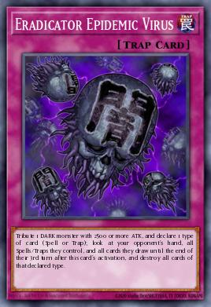

- **Copias y zona:** Reserva 2x. No altera las cantidades registradas.
- **Nombre oficial de referencia:** Virus Epidémico Erradicador. CID cotejado con la ficha oficial; el nombre histórico del inventario se conserva aunque su grafía/traducción difiera.
- **Función principal y secundaria:** removal · cierre · coste/recurso.
- **Estado de sinergia y función:** Reserva fuera de lista activa. Es una clasificación de juego; revisar la relación concreta en A06.
- **Papel como recurso, descarte o coste:** Coste o consumo descrito en A05: Sacrificio.
- **Efecto operativo (paráfrasis analítica):** destrucción de cartas o empleo de destrucción como detonante; presión de combate o modificación de estadísticas; uso de Sacrificios como parte del efecto. Son operaciones detectadas en el texto, no efectos independientes garantizados; leer sus condiciones en la fuente.
- **Mapa de activación y resultados:** 1) efecto propio o continuo: destruye la carta o recurso previsto. Cada operación está sujeta a la secuencia y al «si lo haces» del texto oficial.
- **Ventanas de activación identificadas:** requieren la fase o condición específica indicada en el texto; sin ventana rápida general asumida.
- **Costes o recursos potenciales:** Sacrificio.
- **Restricciones y requisitos:** aplicar restricciones de selección, activación y copias que consten en el texto original. 
- **Prioridad al ir primero:** extender hacia Xyz y disponer de presión de zonas sin exponerse innecesariamente. Para esta carta: Activar cuando las condiciones permitan obtener valor real, preservando recursos de seguimiento.
- **Prioridad al ir segundo:** superar campo rival con destierros y herramientas de ruptura. Identificar primero la respuesta rival que afecta su función «removal».
- **Medio/tardío y recuperación:** recuperar Kashtira del destierro/Cementerio y medir materiales Xyz. No asumir que por sí misma recicla recursos si el texto no lo permite.
- **Sinergias y acceso a líneas:** Relación contextual con monstruos de Nivel 7, Xyz y destierro boca abajo con presión de zonas. Habilita una línea del motor sólo si coinciden recursos, objetivos y restricciones; no equivale a un combo completo validado.
- **Riesgo / brick / interrupciones:** Riesgo operativo: efectos que niegan búsquedas, combaten Xyz o castigan campo saturado. Confirmar objetivos disponibles y costes antes de activar. No atribuirle velocidad rápida por el solo hecho de formar parte del motor.
- **Utilidad editorial:** 3/5 para este deck (estimación por rol y zona, no probabilidad calculada). No cambiar copias; cualquier sugerencia de alta/baja pasa por el apartado 22 y aprobación.
- **Referencia oficial y trazabilidad:** https://www.db.yugioh-card.com/yugiohdb/card_search.action?cid=7153&ope=2&request_locale=es. **Confianza:** texto y tipo de efecto cotejados en Konami; síntesis táctica editorial, no demostración de combo.
- **Aplicación concreta dentro de este deck (A06):** Fuera de lista. destrucción de cartas o empleo de destrucción como detonante; presión de combate o modificación de estadísticas; uso de Sacrificios como parte del efecto.. No aporta recursos durante este duelo.

**USO PRÁCTICO Y SINERGIA — Eradicator Epidemic Virus**

- **Label funcional:** Sin sinergia demostrada (con la evidencia actual). Clasificación documental; una relación es válida solo si se satisfacen sus condiciones exactas.
- **Qué hace:** destrucción de cartas o empleo de destrucción como detonante; presión de combate o modificación de estadísticas; uso de Sacrificios como parte del efecto. Son operaciones detectadas en el texto, no efectos independientes garantizados; leer sus condiciones en la fuente.
- **Cómo aprovecharla en este deck:** Fuera de lista. destrucción de cartas o empleo de destrucción como detonante; presión de combate o modificación de estadísticas; uso de Sacrificios como parte del efecto.. No aporta recursos durante este duelo.
- **Al jugar primero:** extender hacia Xyz y disponer de presión de zonas sin exponerse innecesariamente. Para esta carta: Activar cuando las condiciones permitan obtener valor real, preservando recursos de seguimiento.
- **Al jugar segundo:** superar campo rival con destierros y herramientas de ruptura. Identificar primero la respuesta rival que afecta su función «removal».
- **Cuándo tener precaución:** Riesgo operativo: efectos que niegan búsquedas, combaten Xyz o castigan campo saturado. Confirmar objetivos disponibles y costes antes de activar. No atribuirle velocidad rápida por el solo hecho de formar parte del motor.

#### 33. Dinowrestler Pankratops

- **Copias y zona:** Reserva 1x. No altera las cantidades registradas.
- **Nombre oficial de referencia:** Dinoluchador Pancrateratops. CID cotejado con la ficha oficial; el nombre histórico del inventario se conserva aunque su grafía/traducción difiera.
- **Función principal y secundaria:** interrupción · extensor · coste/recurso.
- **Estado de sinergia y función:** Reserva fuera de lista activa. Es una clasificación de juego; revisar la relación concreta en A06.
- **Papel como recurso, descarte o coste:** No se demuestra que esta carta sea recurso de descarte o pago para otra.
- **Efecto operativo (paráfrasis analítica):** acceso al campo desde la mano; uso de Sacrificios como parte del efecto. Son operaciones detectadas en el texto, no efectos independientes garantizados; leer sus condiciones en la fuente.
- **Mapa de activación y resultados:** 1) efecto propio o continuo: Invocación Especial desde mano. Cada operación está sujeta a la secuencia y al «si lo haces» del texto oficial.
- **Ventanas de activación identificadas:** Efecto Rápido.
- **Costes o recursos potenciales:** sin coste independiente identificado en esta síntesis; comprobar las acciones previas al punto y coma de cada efecto.
- **Restricciones y requisitos:** hay límite por turno según el efecto concreto. 
- **Prioridad al ir primero:** extender hacia Xyz y disponer de presión de zonas sin exponerse innecesariamente. Para esta carta: Reservar la respuesta para la ventana rival exacta; no es una pieza buscadora de nuestro motor.
- **Prioridad al ir segundo:** superar campo rival con destierros y herramientas de ruptura. Identificar primero la respuesta rival que afecta su función «interrupción».
- **Medio/tardío y recuperación:** recuperar Kashtira del destierro/Cementerio y medir materiales Xyz. No asumir que por sí misma recicla recursos si el texto no lo permite.
- **Sinergias y acceso a líneas:** Relación contextual con monstruos de Nivel 7, Xyz y destierro boca abajo con presión de zonas. Habilita una línea del motor sólo si coinciden recursos, objetivos y restricciones; no equivale a un combo completo validado.
- **Riesgo / brick / interrupciones:** Riesgo operativo: efectos que niegan búsquedas, combaten Xyz o castigan campo saturado. Confirmar objetivos disponibles y costes antes de activar. Puede emplearse en cadena sólo cuando se cumpla su condición concreta.
- **Utilidad editorial:** 4/5 para este deck (estimación por rol y zona, no probabilidad calculada). No cambiar copias; cualquier sugerencia de alta/baja pasa por el apartado 22 y aprobación.
- **Referencia oficial y trazabilidad:** https://www.db.yugioh-card.com/yugiohdb/card_search.action?cid=13896&ope=2&request_locale=es. **Confianza:** texto y tipo de efecto cotejados en Konami; síntesis táctica editorial, no demostración de combo.
- **Aplicación concreta dentro de este deck (A06):** Fuera de lista. acceso al campo desde la mano; uso de Sacrificios como parte del efecto.. No aporta recursos durante este duelo.

**USO PRÁCTICO Y SINERGIA — Dinowrestler Pankratops**

- **Label funcional:** Sin sinergia demostrada (con la evidencia actual). Clasificación documental; una relación es válida solo si se satisfacen sus condiciones exactas.
- **Qué hace:** acceso al campo desde la mano; uso de Sacrificios como parte del efecto. Son operaciones detectadas en el texto, no efectos independientes garantizados; leer sus condiciones en la fuente.
- **Cómo aprovecharla en este deck:** Fuera de lista. acceso al campo desde la mano; uso de Sacrificios como parte del efecto.. No aporta recursos durante este duelo.
- **Al jugar primero:** extender hacia Xyz y disponer de presión de zonas sin exponerse innecesariamente. Para esta carta: Reservar la respuesta para la ventana rival exacta; no es una pieza buscadora de nuestro motor.
- **Al jugar segundo:** superar campo rival con destierros y herramientas de ruptura. Identificar primero la respuesta rival que afecta su función «interrupción».
- **Cuándo tener precaución:** Riesgo operativo: efectos que niegan búsquedas, combaten Xyz o castigan campo saturado. Confirmar objetivos disponibles y costes antes de activar. Puede emplearse en cadena sólo cuando se cumpla su condición concreta.

#### 34. Dimensional Barrier

- **Copias y zona:** Reserva 2x. No altera las cantidades registradas.
- **Nombre oficial de referencia:** Barrera Dimensional. CID cotejado con la ficha oficial; el nombre histórico del inventario se conserva aunque su grafía/traducción difiera.
- **Función principal y secundaria:** trampa · bloqueo del Extra.
- **Estado de sinergia y función:** Reserva fuera de lista activa. Es una clasificación de juego; revisar la relación concreta en A06.
- **Papel como recurso, descarte o coste:** No se demuestra que esta carta sea recurso de descarte o pago para otra.
- **Efecto operativo (paráfrasis analítica):** Declara un tipo de monstruo y bloquea sus Invocaciones Especiales y efectos ese turno. 
- **Mapa de activación y resultados:** 1) efecto propio o continuo: niega el efecto o la activación indicada, Invocación Especial desde zona permitida. Cada operación está sujeta a la secuencia y al «si lo haces» del texto oficial.
- **Ventanas de activación identificadas:** requieren la fase o condición específica indicada en el texto; sin ventana rápida general asumida.
- **Costes o recursos potenciales:** sin coste independiente identificado en esta síntesis; comprobar las acciones previas al punto y coma de cada efecto.
- **Restricciones y requisitos:** hay límite por turno según el efecto concreto. 
- **Prioridad al ir primero:** extender hacia Xyz y disponer de presión de zonas sin exponerse innecesariamente. Para esta carta: Activar cuando las condiciones permitan obtener valor real, preservando recursos de seguimiento.
- **Prioridad al ir segundo:** superar campo rival con destierros y herramientas de ruptura. Identificar primero la respuesta rival que afecta su función «trampa».
- **Medio/tardío y recuperación:** recuperar Kashtira del destierro/Cementerio y medir materiales Xyz. No asumir que por sí misma recicla recursos si el texto no lo permite.
- **Sinergias y acceso a líneas:** Relación contextual con monstruos de Nivel 7, Xyz y destierro boca abajo con presión de zonas. Habilita una línea del motor sólo si coinciden recursos, objetivos y restricciones; no equivale a un combo completo validado.
- **Riesgo / brick / interrupciones:** Se declara un tipo; impacta a ambos jugadores. No atribuirle velocidad rápida por el solo hecho de formar parte del motor.
- **Utilidad editorial:** 3/5 para este deck (estimación por rol y zona, no probabilidad calculada). No cambiar copias; cualquier sugerencia de alta/baja pasa por el apartado 22 y aprobación.
- **Referencia oficial y trazabilidad:** https://www.db.yugioh-card.com/yugiohdb/card_search.action?cid=12668&ope=2&request_locale=es. **Confianza:** texto y tipo de efecto cotejados en Konami; síntesis táctica editorial, no demostración de combo.
- **Aplicación concreta dentro de este deck (A06):** Fuera de lista. Declara un tipo de monstruo y bloquea sus Invocaciones Especiales y efectos ese turno.. No aporta recursos durante este duelo.

**USO PRÁCTICO Y SINERGIA — Dimensional Barrier**

- **Label funcional:** Sin sinergia demostrada (con la evidencia actual). Clasificación documental; una relación es válida solo si se satisfacen sus condiciones exactas.
- **Qué hace:** Declara un tipo de monstruo y bloquea sus Invocaciones Especiales y efectos ese turno.
- **Cómo aprovecharla en este deck:** Fuera de lista. Declara un tipo de monstruo y bloquea sus Invocaciones Especiales y efectos ese turno.. No aporta recursos durante este duelo.
- **Al jugar primero:** extender hacia Xyz y disponer de presión de zonas sin exponerse innecesariamente. Para esta carta: Activar cuando las condiciones permitan obtener valor real, preservando recursos de seguimiento.
- **Al jugar segundo:** superar campo rival con destierros y herramientas de ruptura. Identificar primero la respuesta rival que afecta su función «trampa».
- **Cuándo tener precaución:** Se declara un tipo; impacta a ambos jugadores. No atribuirle velocidad rápida por el solo hecho de formar parte del motor.

#### 35. Nibiru, the Primal Being

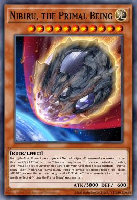

- **Copias y zona:** Reserva 1x. No altera las cantidades registradas.
- **Nombre oficial de referencia:** Nibiru, el Ser Primitivo. CID cotejado con la ficha oficial; el nombre histórico del inventario se conserva aunque su grafía/traducción difiera.
- **Función principal y secundaria:** handtrap · limpieza del campo.
- **Estado de sinergia y función:** Reserva fuera de lista activa. Es una clasificación de juego; revisar la relación concreta en A06.
- **Papel como recurso, descarte o coste:** No se demuestra que esta carta sea recurso de descarte o pago para otra.
- **Efecto operativo (paráfrasis analítica):** En Main Phase, tras cinco o más invocaciones rivales, sacrifica los monstruos boca arriba y deja a Nibiru junto con una Ficha rival. 
- **Mapa de activación y resultados:** 1) en Main Phase: Invocación Especial desde mano. Cada operación está sujeta a la secuencia y al «si lo haces» del texto oficial.
- **Ventanas de activación identificadas:** Main Phase; Efecto Rápido.
- **Costes o recursos potenciales:** sin coste independiente identificado en esta síntesis; comprobar las acciones previas al punto y coma de cada efecto.
- **Restricciones y requisitos:** hay límite por turno según el efecto concreto. 
- **Prioridad al ir primero:** extender hacia Xyz y disponer de presión de zonas sin exponerse innecesariamente. Para esta carta: Reservar la respuesta para la ventana rival exacta; no es una pieza buscadora de nuestro motor.
- **Prioridad al ir segundo:** superar campo rival con destierros y herramientas de ruptura. Identificar primero la respuesta rival que afecta su función «handtrap».
- **Medio/tardío y recuperación:** recuperar Kashtira del destierro/Cementerio y medir materiales Xyz. No asumir que por sí misma recicla recursos si el texto no lo permite.
- **Sinergias y acceso a líneas:** Relación contextual con monstruos de Nivel 7, Xyz y destierro boca abajo con presión de zonas. Habilita una línea del motor sólo si coinciden recursos, objetivos y restricciones; no equivale a un combo completo validado.
- **Riesgo / brick / interrupciones:** Cuenta invocaciones y entrega una Ficha cuyo ATK/DEF depende de lo sacrificado. Puede emplearse en cadena sólo cuando se cumpla su condición concreta.
- **Utilidad editorial:** 3/5 para este deck (estimación por rol y zona, no probabilidad calculada). No cambiar copias; cualquier sugerencia de alta/baja pasa por el apartado 22 y aprobación.
- **Referencia oficial y trazabilidad:** https://www.db.yugioh-card.com/yugiohdb/card_search.action?cid=14741&ope=2&request_locale=es. **Confianza:** texto y tipo de efecto cotejados en Konami; síntesis táctica editorial, no demostración de combo.
- **Aplicación concreta dentro de este deck (A06):** Fuera de lista. En Main Phase, tras cinco o más invocaciones rivales, sacrifica los monstruos boca arriba y deja a Nibiru junto con una Ficha rival.. No aporta recursos durante este duelo.

**USO PRÁCTICO Y SINERGIA — Nibiru, the Primal Being**

- **Label funcional:** Sin sinergia demostrada (con la evidencia actual). Clasificación documental; una relación es válida solo si se satisfacen sus condiciones exactas.
- **Qué hace:** En Main Phase, tras cinco o más invocaciones rivales, sacrifica los monstruos boca arriba y deja a Nibiru junto con una Ficha rival.
- **Cómo aprovecharla en este deck:** Fuera de lista. En Main Phase, tras cinco o más invocaciones rivales, sacrifica los monstruos boca arriba y deja a Nibiru junto con una Ficha rival.. No aporta recursos durante este duelo.
- **Al jugar primero:** extender hacia Xyz y disponer de presión de zonas sin exponerse innecesariamente. Para esta carta: Reservar la respuesta para la ventana rival exacta; no es una pieza buscadora de nuestro motor.
- **Al jugar segundo:** superar campo rival con destierros y herramientas de ruptura. Identificar primero la respuesta rival que afecta su función «handtrap».
- **Cuándo tener precaución:** Cuenta invocaciones y entrega una Ficha cuyo ATK/DEF depende de lo sacrificado. Puede emplearse en cadena sólo cuando se cumpla su condición concreta.

#### 36. Droll & Lock Bird

- **Copias y zona:** Reserva 3x. No altera las cantidades registradas.
- **Nombre oficial de referencia:** El Bufón y el Pájaro del Candado. CID cotejado con la ficha oficial; el nombre histórico del inventario se conserva aunque su grafía/traducción difiera.
- **Función principal y secundaria:** handtrap · bloqueo de búsquedas.
- **Estado de sinergia y función:** Reserva fuera de lista activa. Es una clasificación de juego; revisar la relación concreta en A06.
- **Papel como recurso, descarte o coste:** Envío mencionado en la interacción; no equivale por sí mismo a descarte desde la mano.
- **Efecto operativo (paráfrasis analítica):** Tras una incorporación desde el Deck a la mano rival, se envía al Cementerio para impedir nuevas adiciones desde ambos Decks principales ese turno. 
- **Mapa de activación y resultados:** 1) con condición explícita en la carta: impide nuevas incorporaciones a mano. Cada operación está sujeta a la secuencia y al «si lo haces» del texto oficial.
- **Ventanas de activación identificadas:** Efecto Rápido.
- **Costes o recursos potenciales:** envío de recurso propio al Cementerio.
- **Restricciones y requisitos:** aplicar restricciones de selección, activación y copias que consten en el texto original. 
- **Prioridad al ir primero:** extender hacia Xyz y disponer de presión de zonas sin exponerse innecesariamente. Para esta carta: Reservar la respuesta para la ventana rival exacta; no es una pieza buscadora de nuestro motor.
- **Prioridad al ir segundo:** superar campo rival con destierros y herramientas de ruptura. Identificar primero la respuesta rival que afecta su función «handtrap».
- **Medio/tardío y recuperación:** recuperar Kashtira del destierro/Cementerio y medir materiales Xyz. No asumir que por sí misma recicla recursos si el texto no lo permite.
- **Sinergias y acceso a líneas:** Relación contextual con monstruos de Nivel 7, Xyz y destierro boca abajo con presión de zonas. Habilita una línea del motor sólo si coinciden recursos, objetivos y restricciones; no equivale a un combo completo validado.
- **Riesgo / brick / interrupciones:** No niega la primera búsqueda y también restringe las adiciones del propio jugador. Puede emplearse en cadena sólo cuando se cumpla su condición concreta.
- **Utilidad editorial:** 3/5 para este deck (estimación por rol y zona, no probabilidad calculada). No cambiar copias; cualquier sugerencia de alta/baja pasa por el apartado 22 y aprobación.
- **Referencia oficial y trazabilidad:** https://www.db.yugioh-card.com/yugiohdb/card_search.action?cid=9279&ope=2&request_locale=es. **Confianza:** texto y tipo de efecto cotejados en Konami; síntesis táctica editorial, no demostración de combo.
- **Aplicación concreta dentro de este deck (A06):** Fuera de lista. Tras una incorporación desde el Deck a la mano rival, se envía al Cementerio para impedir nuevas adiciones desde ambos Decks principales ese turno.. No aporta recursos durante este duelo.

**USO PRÁCTICO Y SINERGIA — Droll & Lock Bird**

- **Label funcional:** Sin sinergia demostrada (con la evidencia actual). Clasificación documental; una relación es válida solo si se satisfacen sus condiciones exactas.
- **Qué hace:** Tras una incorporación desde el Deck a la mano rival, se envía al Cementerio para impedir nuevas adiciones desde ambos Decks principales ese turno.
- **Cómo aprovecharla en este deck:** Fuera de lista. Tras una incorporación desde el Deck a la mano rival, se envía al Cementerio para impedir nuevas adiciones desde ambos Decks principales ese turno.. No aporta recursos durante este duelo.
- **Al jugar primero:** extender hacia Xyz y disponer de presión de zonas sin exponerse innecesariamente. Para esta carta: Reservar la respuesta para la ventana rival exacta; no es una pieza buscadora de nuestro motor.
- **Al jugar segundo:** superar campo rival con destierros y herramientas de ruptura. Identificar primero la respuesta rival que afecta su función «handtrap».
- **Cuándo tener precaución:** No niega la primera búsqueda y también restringe las adiciones del propio jugador. Puede emplearse en cadena sólo cuando se cumpla su condición concreta.

#### 37. Ghost Belle & Haunted Mansion

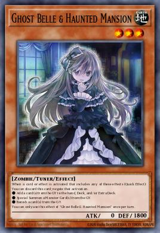

- **Copias y zona:** Reserva 2x. No altera las cantidades registradas.
- **Nombre oficial de referencia:** Bella Fantasma & Mansión Embrujada. CID cotejado con la ficha oficial; el nombre histórico del inventario se conserva aunque su grafía/traducción difiera.
- **Función principal y secundaria:** handtrap · negación de Cementerio.
- **Estado de sinergia y función:** Reserva fuera de lista activa. Es una clasificación de juego; revisar la relación concreta en A06.
- **Papel como recurso, descarte o coste:** Coste o consumo descrito en A05: descarte de mano.
- **Efecto operativo (paráfrasis analítica):** Descarta para negar la activación de una operación que recupere, invoque o destierre cartas del Cementerio. 
- **Mapa de activación y resultados:** 1) con condición explícita en la carta: Invocación Especial desde Extra Deck, incorpora la pieza indicada a la mano. Cada operación está sujeta a la secuencia y al «si lo haces» del texto oficial.
- **Ventanas de activación identificadas:** Efecto Rápido.
- **Costes o recursos potenciales:** descarte de mano.
- **Restricciones y requisitos:** hay límite por turno según el efecto concreto. 
- **Prioridad al ir primero:** extender hacia Xyz y disponer de presión de zonas sin exponerse innecesariamente. Para esta carta: Reservar la respuesta para la ventana rival exacta; no es una pieza buscadora de nuestro motor.
- **Prioridad al ir segundo:** superar campo rival con destierros y herramientas de ruptura. Identificar primero la respuesta rival que afecta su función «handtrap».
- **Medio/tardío y recuperación:** recuperar Kashtira del destierro/Cementerio y medir materiales Xyz. Verificar que el objetivo de recuperación continúe disponible.
- **Sinergias y acceso a líneas:** Relación contextual con monstruos de Nivel 7, Xyz y destierro boca abajo con presión de zonas. Habilita una línea del motor sólo si coinciden recursos, objetivos y restricciones; no equivale a un combo completo validado.
- **Riesgo / brick / interrupciones:** No niega todos los efectos: exige que el efecto incluya una de las acciones enumeradas. Puede emplearse en cadena sólo cuando se cumpla su condición concreta.
- **Utilidad editorial:** 3/5 para este deck (estimación por rol y zona, no probabilidad calculada). No cambiar copias; cualquier sugerencia de alta/baja pasa por el apartado 22 y aprobación.
- **Referencia oficial y trazabilidad:** https://www.db.yugioh-card.com/yugiohdb/card_search.action?cid=13587&ope=2&request_locale=es. **Confianza:** texto y tipo de efecto cotejados en Konami; síntesis táctica editorial, no demostración de combo.
- **Aplicación concreta dentro de este deck (A06):** Fuera de lista. Descarta para negar la activación de una operación que recupere, invoque o destierre cartas del Cementerio.. No aporta recursos durante este duelo.

**USO PRÁCTICO Y SINERGIA — Ghost Belle & Haunted Mansion**

- **Label funcional:** Sin sinergia demostrada (con la evidencia actual). Clasificación documental; una relación es válida solo si se satisfacen sus condiciones exactas.
- **Qué hace:** Descarta para negar la activación de una operación que recupere, invoque o destierre cartas del Cementerio.
- **Cómo aprovecharla en este deck:** Fuera de lista. Descarta para negar la activación de una operación que recupere, invoque o destierre cartas del Cementerio.. No aporta recursos durante este duelo.
- **Al jugar primero:** extender hacia Xyz y disponer de presión de zonas sin exponerse innecesariamente. Para esta carta: Reservar la respuesta para la ventana rival exacta; no es una pieza buscadora de nuestro motor.
- **Al jugar segundo:** superar campo rival con destierros y herramientas de ruptura. Identificar primero la respuesta rival que afecta su función «handtrap».
- **Cuándo tener precaución:** No niega todos los efectos: exige que el efecto incluya una de las acciones enumeradas. Puede emplearse en cadena sólo cuando se cumpla su condición concreta.

#### 38. Infinitrack Goliath [monstruo Link para intercambio con Extra Deck]

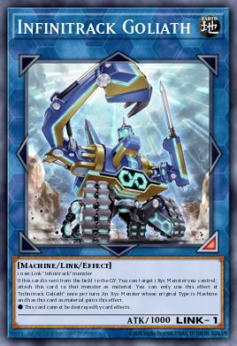

- **Copias y zona:** Reserva 1x. No altera las cantidades registradas.
- **Nombre oficial de referencia:** Infinitrack Goliat. CID cotejado con la ficha oficial; el nombre histórico del inventario se conserva aunque su grafía/traducción difiera.
- **Función principal y secundaria:** respuesta · habilitador Xyz · protección.
- **Estado de sinergia y función:** Reserva fuera de lista activa. Es una clasificación de juego; revisar la relación concreta en A06.
- **Papel como recurso, descarte o coste:** Material o destino del Extra condicionado a los requisitos de invocación.
- **Efecto operativo (paráfrasis analítica):** interacción sobre monstruos en campo; gestión de materiales Xyz; protección o resistencia contra respuestas. Son operaciones detectadas en el texto, no efectos independientes garantizados; leer sus condiciones en la fuente.
- **Mapa de activación y resultados:** efecto de estadística, condición o material; no asumir un disparador adicional. Cada operación está sujeta a la secuencia y al «si lo haces» del texto oficial.
- **Ventanas de activación identificadas:** requieren la fase o condición específica indicada en el texto; sin ventana rápida general asumida.
- **Costes o recursos potenciales:** sin coste independiente identificado en esta síntesis; comprobar las acciones previas al punto y coma de cada efecto.
- **Restricciones y requisitos:** hay límite por turno según el efecto concreto. 
- **Prioridad al ir primero:** extender hacia Xyz y disponer de presión de zonas sin exponerse innecesariamente. Para esta carta: Activar cuando las condiciones permitan obtener valor real, preservando recursos de seguimiento.
- **Prioridad al ir segundo:** superar campo rival con destierros y herramientas de ruptura. Identificar primero la respuesta rival que afecta su función «respuesta».
- **Medio/tardío y recuperación:** recuperar Kashtira del destierro/Cementerio y medir materiales Xyz. No asumir que por sí misma recicla recursos si el texto no lo permite.
- **Sinergias y acceso a líneas:** Relación contextual con monstruos de Nivel 7, Xyz y destierro boca abajo con presión de zonas. Habilita una línea del motor sólo si coinciden recursos, objetivos y restricciones; no equivale a un combo completo validado.
- **Riesgo / brick / interrupciones:** Riesgo operativo: efectos que niegan búsquedas, combaten Xyz o castigan campo saturado. Confirmar objetivos disponibles y costes antes de activar. No atribuirle velocidad rápida por el solo hecho de formar parte del motor.
- **Utilidad editorial:** 3/5 para este deck (estimación por rol y zona, no probabilidad calculada). No cambiar copias; cualquier sugerencia de alta/baja pasa por el apartado 22 y aprobación.
- **Referencia oficial y trazabilidad:** https://www.db.yugioh-card.com/yugiohdb/card_search.action?cid=14400&ope=2&request_locale=es. **Confianza:** texto y tipo de efecto cotejados en Konami; síntesis táctica editorial, no demostración de combo.
- **Aplicación concreta dentro de este deck (A06):** Fuera de lista. interacción sobre monstruos en campo; gestión de materiales Xyz; protección o resistencia contra respuestas.. No aporta recursos durante este duelo.

**USO PRÁCTICO Y SINERGIA — Infinitrack Goliath [monstruo Link para intercambio con Extra Deck]**

- **Label funcional:** Sin sinergia demostrada (con la evidencia actual). Clasificación documental; una relación es válida solo si se satisfacen sus condiciones exactas.
- **Qué hace:** interacción sobre monstruos en campo; gestión de materiales Xyz; protección o resistencia contra respuestas. Son operaciones detectadas en el texto, no efectos independientes garantizados; leer sus condiciones en la fuente.
- **Cómo aprovecharla en este deck:** Fuera de lista. interacción sobre monstruos en campo; gestión de materiales Xyz; protección o resistencia contra respuestas.. No aporta recursos durante este duelo.
- **Al jugar primero:** extender hacia Xyz y disponer de presión de zonas sin exponerse innecesariamente. Para esta carta: Activar cuando las condiciones permitan obtener valor real, preservando recursos de seguimiento.
- **Al jugar segundo:** superar campo rival con destierros y herramientas de ruptura. Identificar primero la respuesta rival que afecta su función «respuesta».
- **Cuándo tener precaución:** Riesgo operativo: efectos que niegan búsquedas, combaten Xyz o castigan campo saturado. Confirmar objetivos disponibles y costes antes de activar. No atribuirle velocidad rápida por el solo hecho de formar parte del motor.

## SINERGIAS Y MOTORES
## RESUMEN FUNCIONAL DE SINERGIAS — 665

**Medición descriptiva de etiquetas existentes (NO certificación):** 11/38 identidades con etiqueta directa/indirecta (28.9 %). Main: 11/21 (52.4 %); Extra: 0/10 (0.0 %). Se cuenta una identidad una sola vez; una carta autónoma puede ser útil sin sinergia de motor. Estas cifras provienen de clasificaciones documentales A05/A06: **no son el porcentaje final de sinergias verificadas**, ni una tasa estadística de victoria. Para promoverlas a métricas verificadas, se deben comprobar los pares de cartas y su operación legal.

#### A06.0 — En 30 segundos: cómo cooperan realmente estas cartas

- **Dictamen de conjunto:** motor central Kashtira coherente, pero el Extra incluye dos Fusiones Fósil sin procedimiento demostrado y cinco destinos Extra cuyo acceso aún debe enlazarse.
- **Motor que mueve el deck:** Wraitsoth y Fenrir/Unicornio/Ogro consiguen piezas; Nacimiento y Kashtirateosis permiten mantener y extender Nivel 7. Dos cuerpos compatibles habilitan Shangri-Ira según sus materiales.
- **Puentes reales:** Riseheart convierte recursos y facilita la lógica de destierro; Shangri-Ira genera presión sobre zonas cuando su disparador realmente ocurre; Arise-Heart exige método Xyz ordinario o activación válida del efecto de Shangri-Ira para el procedimiento alternativo.
- **Sinergia indirecta:** Big Bang y Kashtirateosis pueden tener valor al ser desterradas; Shifter y cartas de respuesta son piezas autónomas. Una carta que no busque Kashtira no es automáticamente incompatible.
- **Conflicto decisivo:** Teosis/Riseheart restringen Extra a Xyz; Prosperidad consume cartas del Extra; Shifter/Arise modifican el destino GY y afectan recuperaciones que requieren ese lugar. No prometer bloqueo de zonas por un destierro distinto al descrito.
- **Decisión concreta:** revisar acceso a Fossil Warrior Skull Knight y Fossil Machine Skull Wagon antes de conservar sus ranuras; valorar destinos Xyz alcanzables sin modificar aún lista/cantidades.
- **Qué aprender después:** escoger entre ruta Shangri-Ira, Arise-Heart o retirada rival según mano y condiciones; contrastar cada endboard con su variante A09.

#### Motores y acceso real

1. **Motor principal de Nivel 7 y destierro.** **Wraitsoth** (CID 18204) añade un Kashtira del Deck. **Fenrir** (17768) busca otro monstruo Kashtira, **Unicornio** (17769) busca una Mágica Kashtira y **Ogro** (17770) una Trampa Kashtira. Los tres Nivel 7 mencionados pueden Invocarse desde mano sin monstruos propios; una vez ocupado el campo no repetir esa condición como si siguiera vacío.
2. **Expansión y conversión de Nivel.** **Kashtirateosis** (18203) selecciona un Kashtira propio y trae del Deck otro de **Atributo diferente** en Defensa; al resolver bloquea el Extra a **Xyz** el resto del turno. **Nacimiento Kashtira** (17815) permite Invocar de Modo Normal un Nivel 7 sin Sacrificio y recuperar un Kashtira no Xyz del GY o destierro. **Riseheart** (18151) se Invoca desde mano si hay Kashtira; desterrar un Kashtira desde Deck le permite desterrar tres cartas superiores rivales boca abajo y cambiar su Nivel a 7, con bloqueo del Extra a Xyz desde su Invocación.
3. **Shangri-Ira / Arise-Heart: dos condiciones distintas.** Dos Nivel 7 pueden dar **Shangri-Ira** (17800), que invoca un Kashtira desde Deck durante Standby Phase y puede bloquear zonas cuando se destierran cartas propias del adversario **boca abajo**. **Arise-Heart** (18191) puede entrar sobre un Kashtira propio por su método alternativo **solo si se activó con éxito un efecto de Shangri-Ira ese turno**, o por su método ordinario de materiales. Arise-Heart destierra las cartas que irían al GY, acopla cartas desterradas y necesita **tres materiales desacoplables** para su destierro rápido.
4. **Recuperación por destierro.** Si **Kashtirateosis** es desterrada, puede recuperar otra carta Kashtira desterrada. **Big Bang Kashtira** (18220), si es desterrada, recupera de un Xyz Kashtira una carta Kashtira acoplada y puede Invocarla; su efecto de Trampa en Campo exige un Xyz Kashtira y la situación de monstruos que describe. **Preparaciones Kashtira** (17831) Invoca desde mano/destierro y puede castigar activación de Trampa rival si permanece boca arriba bajo los requisitos indicados.
5. **Apoyos de batalla e interrupción.** **Terrogarra Kashtira** (18152) se Invoca pagando destierro y debilita efectos de monstruos rivales en batalla; **Tiagrimentos Kashtira** (18153) manda cartas de la parte superior del Deck, pero su uso como relleno de GY pierde valor bajo Arise-Heart o Shifter. **Fenrir**, Unicornio y Ogro poseen respuestas al ataque/efecto rival con destierros de diferente tipo y lugar: no equivalen a una negación genérica.
6. **Extra auxiliar condicionado.** **Número 11: Ojo Grande** (9861) requiere dos Nivel 7 y desacopla para tomar control de monstruo sin poder atacar ese turno; **ZEUS** necesita las condiciones de Invocación Xyz aplicables tras batalla de un Xyz. **Baronesa de Flor** (CID en APARTADO_05) requiere Cantante y materiales/niveles adecuados y queda incompatible **después** de activar restricciones a Xyz. **Guerrero Fósil Caballero Calavera** y **Máquina Fósil Vagón Calavera** están listados en el Extra, pero no aparece en Main un procedimiento de Fusión Fósil que los habilite: no presentarlos como rutas listas.

#### Mapa de relaciones para fotografías oficiales

| Arista por CID | Relación operativa | Condición que impide el salto automático | Visual |
|---|---|---|---|
| Wraitsoth (18204) → Unicornio (17769) → Kashtirateosis (18203) | Campo busca monstruo; Unicornio busca Mágica; Teosis extiende otro Atributo. | Monstruo en campo, objetivo de Atributo distinto y bloqueo Xyz. |    |
| Fenrir (17768) / Nacimiento (17815) → dos Nivel 7 → Shangri-Ira (17800) | Acceso a Xyz y despliegue desde Deck en Standby. | Materiales reales y fase Standby; no Invocación al instante de Shangri. |    |
| Riseheart (18151) → destierro boca abajo → Shangri-Ira (17800) | Destierro rival puede activar bloqueo de zonas. | Deben ser cartas del oponente desterradas boca abajo; bloqueo sujeto al monstruo boca arriba. |   |
| Shangri-Ira (17800) → Arise-Heart (18191) | Procedimiento Xyz alternativo sobre Kashtira. | Efecto de Shangri-Ira activado **con éxito** en ese turno. |   |
| Kashtirateosis (18203) / Big Bang (18220) → recursos desterrados | Recuperar pieza del destierro o material de Xyz. | Solo al desterrarse la carta indicada y con objetivo válido. |   |

#### Choques, consumo y redundancia

- **Shifter / Arise-Heart:** ambos reemplazan el envío al GY por destierro; esto protege el plan Kashtira, pero reduce el valor de cualquier motor que realmente necesite cartas **en Cementerio** (por ejemplo, recuperación de Nacimiento cuando no hay desterrados o los envíos de Tiagrimentos Kashtira).
- **Prosperidad:** destierra cartas **elegidas** del Extra boca abajo, comprometiendo recursos como Shangri, Arise o ZEUS. **Agujero Oscuro** destruye también tus monstruos; no atribuirle retirada selectiva. **Lanza Prohibida** y **Libro de la Luna** interactúan con zonas/monstruos bajo condiciones específicas, no rompen cualquier bloqueo.
- **Reservas y rutas no demostradas:** 19 copias de Reserva no están en el Deck actual; **Infinitrack Goliat** sería un Link para un deck modificado y no puede invocarse como si ya estuviera en Extra. Las Fusiones Fósil no se dan por invocables sin materiales y método.

#### A06.1 — Arquitectura operativa de los motores (síntesis no redundante)

Las siguientes filas son **relaciones funcionales**, no secuencias certificadas ni garantía de mano inicial. La lista real y los límites están en A04/A05/A07.

| Tipo / motor | Starter o vía de acceso real | Recurso y destino | Cuello de botella |
|---|---|---|---|
| **Principal: Kashtira Nivel 7** | Wraitsoth, Fenrir, Unicornio, Ogre, Teosis y Nacimiento | Dos cuerpos Nivel 7, Shangri-Ira y continuidad | Fenrir/Unicornio desde mano solo con campo sin monstruos; Teosis bloquea Extra Xyz |
| **Submotor: Destierro/zonas** | Riseheart, Shangri-Ira, Arise-Heart y Big Bang | Destierro boca abajo, bloqueo de zona y reciclaje | No equiparar destierro con destrucción; Arise-Heart exige activación de Shangri para su método alternativo |
| **Apoyo autónomo: romper campo** | Dark Hole, Book of Moon, Cosmic Cyclone, Impermanence | Retirada y protección de la línea, sin ser starters Kashtira | Elegir ventana/objetivo; Agujero Oscuro destruye también el campo propio |

#### A06.2 — Estado funcional y justificación de TODAS las cartas

**Cómo leerlo:** un estado de sinergia describe el papel **de juego**, no el avance de una auditoría. No hay obligación de que cada carta tenga un enlace con otra: una defensa autónoma, una herramienta de Side o un recurso de descarte justificado también tiene propósito. Las relaciones directas descritas aquí se deben contrastar con los textos oficiales antes de representarlas como una ruta legal A09.

| Carta / CID y zona | Estado funcional de sinergia | Motivo de inclusión | Relación y condición concreta | Papel como coste, descarte o material | Límite o riesgo | Decisión táctica |
|---|---|---|---|---|---|---|
| **Kashtira Fenrir** (CID 17768) — Main 3x | **Sinergia directa descrita** | starter Kashtira · presión de destierro | Se invoca desde mano sin monstruos propios, busca otro Kashtira y destierra boca abajo una carta rival al reaccionar a su efecto o atacar | No se demuestra que esta carta sea recurso de descarte o pago para otra | hay límite por turno según el efecto concreto; requiere campo propio sin las cartas indicadas; interactúa con información oculta o resultados no… | Conservar; verificar coste y orden |
| **Kashtira Unicorn** (CID 17769) — Main 2x, Reserva 1x | **Sinergia directa descrita** | starter Kashtira · presión de Extra | Se invoca desde mano sin monstruos propios, busca una Mágica Kashtira e inspecciona/destierra del Extra rival según su disparador | No se demuestra que esta carta sea recurso de descarte o pago para otra | hay límite por turno según el efecto concreto; requiere campo propio sin las cartas indicadas; interactúa con información oculta o resultados no… | Conservar; verificar coste y orden |
| **Kashtira Riseheart** (CID 18151) — Main 3x | **Sinergia directa descrita** | extensor Kashtira · ajuste de Nivel | Se invoca si controlas Kashtira y transforma recursos por destierro para habilitar Nivel 7/Xyz | Material o destino del Extra condicionado a los requisitos de invocación | hay límite por turno según el efecto concreto; puede bloquear tipos de Invocación del Extra Deck; requiere estado de campo específico… | Conservar; verificar coste y orden |
| **Kashtira Ogre** (CID 17770) — Main 1x | **Sinergia directa descrita** | acceso condicionado a campo vacío · interrupción · searcher · buscador · extensor | búsqueda o incorporación de cartas a mano; acceso al campo desde la mano; destierro de recursos o de amenazas | No se demuestra que esta carta sea recurso de descarte o pago para otra | hay límite por turno según el efecto concreto; requiere campo propio sin las cartas indicadas; interactúa con información oculta o resultados no… | Conservar; verificar coste y orden |
| **Scareclaw Kashtira** (CID 18152) — Main 1x | **Sinergia indirecta (soporte o recursos)** | interrupción · extensor · removal · cierre | acceso al campo desde la mano; destierro de recursos o de amenazas; presión de combate o modificación de estadísticas | Coste o consumo descrito en A05: destierro de recurso propio | hay límite por turno según el efecto concreto | Conservar; verificar coste y orden |
| **Tearlaments Kashtira** (CID 18153) — Main 1x | **Sinergia indirecta (soporte o recursos)** | interrupción · extensor · removal | acceso al campo desde la mano; destierro de recursos o de amenazas | Coste o consumo descrito en A05: destierro de recurso propio | hay límite por turno según el efecto concreto; interactúa con información oculta o resultados no siempre elegibles | Conservar; verificar coste y orden |
| **Ash Blossom & Joyous Spring** (CID 12950) — Main 3x | **Utilidad independiente** | handtrap · negación | Descarta desde la mano para detener efectos que buscan, invocan o mandan cartas desde el Deck. Aporta respuesta o consistencia sin exigir enlace directo | Descarte mencionado: comprobar carta que lo exige, zona, coste frente a efecto y utilidad del recurso | hay límite por turno según el efecto concreto | Conservar según rival y conflictos propios |
| **Dimension Shifter** (CID 14740) — Main 1x, Reserva 2x | **Utilidad independiente** | handtrap · macro-destierro | Si el Cementerio propio está vacío, se envía desde mano y hace que las cartas que irían al Cementerio se destierren hasta el final del turno siguiente. Aporta respuesta o consistencia sin exigir enlace directo | Envío mencionado en la interacción; no equivale por sí mismo a descarte desde la mano | depende de recursos en Cementerio | Conservar según rival y conflictos propios |
| **Pressured Planet Wraitsoth** (CID 18204) — Main 3x | **Sinergia directa descrita** | searcher · buscador · cierre | búsqueda o incorporación de cartas a mano; presión de combate o modificación de estadísticas | No se demuestra que esta carta sea recurso de descarte o pago para otra | hay límite por turno según el efecto concreto | Conservar; verificar coste y orden |
| **Kashtira Birth** (CID 17815) — Main 3x | **Sinergia directa descrita** | recuperación · removal · coste/recurso | recuperación e invocación desde Cementerio/destierro; destierro de recursos o de amenazas; uso de Sacrificios como parte del efecto | No se demuestra que esta carta sea recurso de descarte o pago para otra | hay límite por turno según el efecto concreto; depende de recursos en Cementerio; interactúa con información oculta o resultados no siempre… | Conservar; verificar coste y orden |
| **Kashtiratheosis** (CID 18203) — Main 3x | **Sinergia directa descrita** | extensor · recuperación · removal · cierre · respuesta | extensión mediante monstruos procedentes del Deck; recuperación e invocación desde Cementerio/destierro; destierro de recursos o de amenazas; presión de combate o modificación de estadísticas; interacción sobre monstruos en campo | No se demuestra que esta carta sea recurso de descarte o pago para otra | hay límite por turno según el efecto concreto; puede bloquear tipos de Invocación del Extra Deck | Conservar; verificar coste y orden |
| **Terraforming** (CID 5537) — Main 1x | **Utilidad independiente** | mágica · búsqueda de campo | Busca una Mágica de Campo en el Deck y la lleva a la mano. Aporta respuesta o consistencia sin exigir enlace directo | No se demuestra que esta carta sea recurso de descarte o pago para otra | aplicar restricciones de selección, activación y copias que consten en el texto original | Conservar según rival y conflictos propios |
| **Book of Moon** (CID 5432) — Main 2x, Reserva 1x | **Utilidad independiente** | control de zonas · cierre | manipulación de posiciones o zonas; presión de combate o modificación de estadísticas. Aporta respuesta o consistencia sin exigir enlace directo | No se demuestra que esta carta sea recurso de descarte o pago para otra | interactúa con información oculta o resultados no siempre elegibles | Conservar según rival y conflictos propios |
| **Dark Hole** (CID 4342) — Main 3x | **Utilidad independiente** | removal | destrucción de cartas o empleo de destrucción como detonante. Aporta respuesta o consistencia sin exigir enlace directo | No se demuestra que esta carta sea recurso de descarte o pago para otra | aplicar restricciones de selección, activación y copias que consten en el texto original | Conservar según rival y conflictos propios |
| **Pot of Prosperity** (CID 15756) — Main 2x, Reserva 1x | **Utilidad independiente** | searcher · buscador · removal · ventaja de mano · cierre | búsqueda o incorporación de cartas a mano; destierro de recursos o de amenazas; generación de cartas por robo; presión de combate o modificación de estadísticas. Aporta respuesta o consistencia sin exigir enlace directo | No se demuestra que esta carta sea recurso de descarte o pago para otra | hay límite por turno según el efecto concreto; interactúa con información oculta o resultados no siempre elegibles | Conservar según rival y conflictos propios |
| **Cosmic Cyclone** (CID 12464) — Main 2x | **Utilidad independiente** | mágica rápida · remoción | Paga 1000 LP para desterrar una Mágica/Trampa en campo. Aporta respuesta o consistencia sin exigir enlace directo | Destierro como uso/recurso; comprobar origen, coste o efecto y recuperación | aplicar restricciones de selección, activación y copias que consten en el texto original | Conservar según rival y conflictos propios |
| **Forbidden Lance** (CID 9352) — Main 2x, Reserva 1x | **Utilidad independiente** | cierre · protección | presión de combate o modificación de estadísticas; protección o resistencia contra respuestas. Aporta respuesta o consistencia sin exigir enlace directo | No se demuestra que esta carta sea recurso de descarte o pago para otra | aplicar restricciones de selección, activación y copias que consten en el texto original | Conservar según rival y conflictos propios |
| **Triple Tactics Talent** (CID 15296) — Main 1x, Reserva 1x | **Utilidad independiente** | mágica de respuesta · ventaja | Si el rival activó un efecto de monstruo durante tu Main Phase, permite elegir entre robar dos, tomar control temporal o devolver una carta de mano al Deck. Aporta respuesta o consistencia sin exigir enlace directo | No se demuestra que esta carta sea recurso de descarte o pago para otra | hay límite por turno según el efecto concreto | Conservar según rival y conflictos propios |
| **Infinite Impermanence** (CID 13631) — Main 3x | **Utilidad independiente** | trampa · negación | Niega temporalmente un monstruo rival boca arriba; si se activó tras estar Colocada, también afecta la columna M/T correspondiente. Aporta respuesta o consistencia sin exigir enlace directo | No se demuestra que esta carta sea recurso de descarte o pago para otra | requiere campo propio sin las cartas indicadas | Conservar según rival y conflictos propios |
| **Kashtira Preparations** (CID 17831) — Main 1x | **Sinergia indirecta (soporte o recursos)** | recuperación · extensor · removal | recuperación e invocación desde Cementerio/destierro; acceso al campo desde la mano; destierro de recursos o de amenazas | No se demuestra que esta carta sea recurso de descarte o pago para otra | hay límite por turno según el efecto concreto; interactúa con información oculta o resultados no siempre elegibles | Conservar; verificar coste y orden |
| **Kashtira Big Bang** (CID 18220) — Main 1x | **Sinergia indirecta (soporte o recursos)** | searcher · buscador · extensor · removal · respuesta | búsqueda o incorporación de cartas a mano; acceso al campo desde la mano; destierro de recursos o de amenazas; interacción sobre monstruos en campo; gestión de materiales Xyz | Material o destino del Extra condicionado a los requisitos de invocación | hay límite por turno según el efecto concreto; interactúa con información oculta o resultados no siempre elegibles | Conservar; verificar coste y orden |
| **Kashtira Shangri-Ira [Xyz rango 7]** (CID 17800) — Extra 3x | **Destino Extra condicionado** | jefe Xyz Kashtira · bloqueo de zonas | En cada Standby Phase invoca Kashtira desde Deck y bloquea zonas libres al dispararse destierro boca abajo | Material o destino del Extra condicionado a los requisitos de invocación | hay límite por turno según el efecto concreto; interactúa con información oculta o resultados no siempre elegibles. Invocar sólo desde el Extra… | Conservar si hay materiales legales |
| **Kashtira Arise-Heart [Xyz rango 7]** (CID 18191) — Extra 2x | **Destino Extra condicionado** | jefe Xyz Kashtira · destierro | Puede subir sobre Kashtira si se resolvió Shangri-Ira y convierte cartas enviadas al Cementerio en destierro; remueve con materiales | Material o destino del Extra condicionado a los requisitos de invocación | hay límite por turno según el efecto concreto; interactúa con información oculta o resultados no siempre elegibles. Invocar sólo desde el Extra… | Conservar si hay materiales legales |
| **Number 11: Big Eye [Xyz rango 7]** (CID 9861) — Extra 2x | **Destino Extra condicionado** | resultado de Extra Deck · respuesta · habilitador Xyz | interacción sobre monstruos en campo; gestión de materiales Xyz | Material o destino del Extra condicionado a los requisitos de invocación | hay límite por turno según el efecto concreto; puede limitar ataques. Invocar sólo desde el Extra Deck usando su procedimiento propio | Conservar si hay materiales legales |
| **Divine Arsenal AA-ZEUS – Sky Thunder [Xyz]** (CID 15524) — Extra 2x | **Sin acceso al Extra demostrado** | Función individual: interrupción · resultado de Extra Deck · habilitador Xyz | No se documenta una operación concreta que conecte esta carta con el motor; no inferir inutilidad | Material o destino del Extra condicionado a los requisitos de invocación | hay límite por turno según el efecto concreto. Invocar sólo desde el Extra Deck usando su procedimiento propio | Cruzar A09/A07 antes de proponer reemplazo |
| **Dark Armed, the Dragon of Annihilation [Xyz rango 7]** (CID 13974) — Extra 1x | **Sinergia directa: acceso Xyz demostrado** | Romper campo: destruir una carta rival | Fenrir busca Unicorn; Birth permite su Normal sin tributos; ambos Nivel 7 invocan Dark Armed | Fenrir y Unicorn pasan a materiales Xyz; desacoplar uno para efecto de destrucción | Selecciona y destruye una carta rival, luego destierra carta del GY propio; no ataca ese turno tras usar efecto | Guía `665:A09:FENRIR:BIRTH:DARKARMED10` |
| **Baronne de Fleur [Synchro nivel 10]** (CID 16386) — Extra 1x | **Sin acceso al Extra demostrado** | Función individual: interrupción · resultado de Extra Deck · removal · negación · recuperación | No se documenta una operación concreta que conecte esta carta con el motor; no inferir inutilidad | Material o destino del Extra condicionado a los requisitos de invocación | hay límite por turno según el efecto concreto; depende de recursos en Cementerio. Invocar sólo desde el Extra Deck usando su procedimiento… | Cruzar A09/A07 antes de proponer reemplazo |
| **Donner, Dagger Fur Hire [Link-2]** (CID 17804) — Extra 1x | **Sin acceso al Extra demostrado** | Función individual: resultado de Extra Deck · recuperación · extensor · respuesta · coste/recurso | No se documenta una operación concreta que conecte esta carta con el motor; no inferir inutilidad | Material o destino del Extra condicionado a los requisitos de invocación | aplicar restricciones de selección, activación y copias que consten en el texto original. Invocar sólo desde el Extra Deck usando su… | Cruzar A09/A07 antes de proponer reemplazo |
| **Underworld Goddess of the Closed World [Link-5]** (CID 15741) — Extra 1x | **Acceso condicional V13** | `665:A09:DONNER:FENRIR:UNICORN:GODDESS12`, Diosa Link5 usando 1 material rival | Donner Link2 + Fenrir + Unicorn + monstruo de Efecto no-Link rival = 4 cuerpos, valor 5 | No se construye el campo previo desde una mano de tres cartas; Theosis con solo Xyz lo bloquea | La negación al Invocar solo afecta monstruos rivales boca arriba presentes, si resuelve | Conservar como opción situacional; revisar A09/A07 antes de proponer cambio |
| **Fossil Warrior Skull Knight [Fusión]** (CID 15366) — Extra 1x | **Sin acceso demostrado con el inventario** | resultado de Extra Deck · removal · cierre | Fossil Warrior Skull Knight carece de procedimiento de Fusión Fósil disponible en Main; su efecto en Cementerio no demuestra que pueda Invocarse legalmente | No se demuestra que esta carta sea recurso de descarte o pago para otra | hay límite por turno según el efecto concreto; depende de recursos en Cementerio; tiene procedimiento especial de Invocación. Invocar sólo desde… | Revisar zona/acceso; sustitución por validar |
| **Fossil Machine Skull Wagon [Fusión]** (CID 15882) — Extra 1x | **Sin acceso demostrado con el inventario** | interrupción · resultado de Extra Deck · removal · cierre | Fossil Machine Skull Wagon carece de procedimiento de Fusión Fósil disponible en Main; una carta en Extra no entra directamente en Cementerio | No se demuestra que esta carta sea recurso de descarte o pago para otra | hay límite por turno según el efecto concreto; depende de recursos en Cementerio; tiene procedimiento especial de Invocación. Invocar sólo desde… | Revisar zona/acceso; sustitución por validar |
| **Eradicator Epidemic Virus** (CID 7153) — Reserva 2x | **Reserva fuera de lista activa** | Opción externa al listado activo; su función potencial no justifica jugarla sin incorporarla legalmente | Solo puede utilizarse si se incorpora a una lista aplicable; no es recurso del duelo activo | Coste o consumo descrito en A05: Sacrificio | aplicar restricciones de selección, activación y copias que consten en el texto original | Reserva; propuesta solo tras aprobación |
| **Dinowrestler Pankratops** (CID 13896) — Reserva 1x | **Reserva fuera de lista activa** | Opción externa al listado activo; su función potencial no justifica jugarla sin incorporarla legalmente | Solo puede utilizarse si se incorpora a una lista aplicable; no es recurso del duelo activo | No se demuestra que esta carta sea recurso de descarte o pago para otra | hay límite por turno según el efecto concreto | Reserva; propuesta solo tras aprobación |
| **Dimensional Barrier** (CID 12668) — Reserva 2x | **Reserva fuera de lista activa** | Opción externa al listado activo; su función potencial no justifica jugarla sin incorporarla legalmente | Solo puede utilizarse si se incorpora a una lista aplicable; no es recurso del duelo activo | No se demuestra que esta carta sea recurso de descarte o pago para otra | hay límite por turno según el efecto concreto | Reserva; propuesta solo tras aprobación |
| **Nibiru, the Primal Being** (CID 14741) — Reserva 1x | **Reserva fuera de lista activa** | Opción externa al listado activo; su función potencial no justifica jugarla sin incorporarla legalmente | Solo puede utilizarse si se incorpora a una lista aplicable; no es recurso del duelo activo | No se demuestra que esta carta sea recurso de descarte o pago para otra | hay límite por turno según el efecto concreto | Reserva; propuesta solo tras aprobación |
| **Droll & Lock Bird** (CID 9279) — Reserva 3x | **Reserva fuera de lista activa** | Opción externa al listado activo; su función potencial no justifica jugarla sin incorporarla legalmente | Solo puede utilizarse si se incorpora a una lista aplicable; no es recurso del duelo activo | Envío mencionado en la interacción; no equivale por sí mismo a descarte desde la mano | aplicar restricciones de selección, activación y copias que consten en el texto original | Reserva; propuesta solo tras aprobación |
| **Ghost Belle & Haunted Mansion** (CID 13587) — Reserva 2x | **Reserva fuera de lista activa** | Opción externa al listado activo; su función potencial no justifica jugarla sin incorporarla legalmente | Solo puede utilizarse si se incorpora a una lista aplicable; no es recurso del duelo activo | Coste o consumo descrito en A05: descarte de mano | hay límite por turno según el efecto concreto | Reserva; propuesta solo tras aprobación |
| **Infinitrack Goliath [monstruo Link para intercambio con Extra Deck]** (CID 14400) — Reserva 1x | **Reserva fuera de lista activa** | Opción externa al listado activo; su función potencial no justifica jugarla sin incorporarla legalmente | Solo puede utilizarse si se incorpora a una lista aplicable; no es recurso del duelo activo | Material o destino del Extra condicionado a los requisitos de invocación | hay límite por turno según el efecto concreto | Reserva; propuesta solo tras aprobación |

## INTERACCIONES Y CLASIFICACIÓN

| ID documental | Categoría provisional | Piezas | Resultado | Requisitos | Check |
|---|---|---|---|---|---|
| 665:A08:01 | STARTER | Wraitsoth (18204) → Unicornio (17769) → Kashtirateosis (18203) | Campo busca monstruo; Unicornio busca Mágica; Teosis extiende otro Atributo. | Monstruo en campo, objetivo de Atributo distinto y bloqueo Xyz. |; ruta extendida `665:A09:WRAITSOTH:SHANGRI01`, A10 documental generada; legalidad A11–A13 pendiente. |
| 665:A08:02 | RUTA | Fenrir (17768) / Nacimiento (17815) → dos Nivel 7 → Shangri-Ira (17800) | Acceso a Xyz y despliegue desde Deck en Standby. | Materiales reales y fase Standby; no Invocación al instante de Shangri. | |
| 665:A08:03 | PLAN | Riseheart (18151) → destierro boca abajo → Shangri-Ira (17800) | Destierro rival puede activar bloqueo de zonas. | Deben ser cartas del oponente desterradas boca abajo; bloqueo sujeto al monstruo boca arriba. | |
| 665:A08:04 | RUTA | Shangri-Ira (17800) → Arise-Heart (18191) | Procedimiento Xyz alternativo sobre Kashtira. | Efecto de Shangri-Ira activado **con éxito** en ese turno. | |
| 665:A08:05 | INTERACCION | Kashtirateosis (18203) / Big Bang (18220) → recursos desterrados | Recuperar pieza del destierro o material de Xyz. | Solo al desterrarse la carta indicada y con objetivo válido. | |

#### Rol registrado por cada carta

| ID A08 | Carta registrada | Zona | Clasificación funcional | Rol documentado en A05 | Check de clasificación |
|---|---|---|---|---|---|
| 665:A08:C001 | Kashtira Fenrir | Main | STARTER_POTENCIAL | starter Kashtira · presión de destierro. | |
| 665:A08:C002 | Kashtira Unicorn | Main | STARTER_POTENCIAL | starter Kashtira · presión de Extra. | |
| 665:A08:C003 | Kashtira Riseheart | Main | EXTENSOR_POTENCIAL | extensor Kashtira · ajuste de Nivel. | |
| 665:A08:C004 | Kashtira Ogre | Main | EXTENSOR_POTENCIAL | acceso condicionado a campo vacío · interrupción · searcher · buscador · extensor. | |
| 665:A08:C005 | Scareclaw Kashtira | Main | EXTENSOR_POTENCIAL | interrupción · extensor · removal · cierre. | |
| 665:A08:C006 | Tearlaments Kashtira | Main | EXTENSOR_POTENCIAL | interrupción · extensor · removal. | |
| 665:A08:C007 | Ash Blossom & Joyous Spring | Main | INTERACCION_DEFENSIVA | handtrap · negación. | |
| 665:A08:C008 | Dimension Shifter | Main | INTERACCION_DEFENSIVA | handtrap · macro-destierro. | |
| 665:A08:C009 | Pressured Planet Wraitsoth | Main | BUSCADOR_INTERACCION | searcher · buscador · cierre. | |
| 665:A08:C010 | Kashtira Birth | Main | FUNCION_A05 (recurso jugable sujeto a condición) | recuperación · removal · coste/recurso. | |
| 665:A08:C011 | Kashtiratheosis | Main | EXTENSOR_POTENCIAL | extensor · recuperación · removal · cierre · respuesta. | |
| 665:A08:C012 | Terraforming | Main | BUSCADOR_INTERACCION | mágica · búsqueda de campo. | |
| 665:A08:C013 | Book of Moon | Main | FUNCION_A05 (recurso jugable sujeto a condición) | control de zonas · cierre. | |
| 665:A08:C014 | Dark Hole | Main | FUNCION_A05 (recurso jugable sujeto a condición) | removal. | |
| 665:A08:C015 | Pot of Prosperity | Main | BUSCADOR_INTERACCION | searcher · buscador · removal · ventaja de mano · cierre. | |
| 665:A08:C016 | Cosmic Cyclone | Main | FUNCION_A05 (recurso jugable sujeto a condición) | mágica rápida · remoción. | |
| 665:A08:C017 | Forbidden Lance | Main | FUNCION_A05 (recurso jugable sujeto a condición) | cierre · protección. | |
| 665:A08:C018 | Triple Tactics Talent | Main | FUNCION_A05 (recurso jugable sujeto a condición) | mágica de respuesta · ventaja. | |
| 665:A08:C019 | Infinite Impermanence | Main | INTERACCION_DEFENSIVA | trampa · negación. | |
| 665:A08:C020 | Kashtira Preparations | Main | EXTENSOR_POTENCIAL | recuperación · extensor · removal. | |
| 665:A08:C021 | Kashtira Big Bang | Main | EXTENSOR_POTENCIAL | searcher · buscador · extensor · removal · respuesta. | |
| 665:A08:C022 | Kashtira Shangri-Ira [Xyz rango 7] | Extra | DESTINO_EXTRA (materiales/procedimiento por comprobar) | jefe Xyz Kashtira · bloqueo de zonas. | |
| 665:A08:C023 | Kashtira Arise-Heart [Xyz rango 7] | Extra | DESTINO_EXTRA (materiales/procedimiento por comprobar) | jefe Xyz Kashtira · destierro. | |
| 665:A08:C024 | Number 11: Big Eye [Xyz rango 7] | Extra | DESTINO_EXTRA (materiales/procedimiento por comprobar) | resultado de Extra Deck · respuesta · habilitador Xyz. | |
| 665:A08:C025 | Divine Arsenal AA-ZEUS – Sky Thunder [Xyz] | Extra | DESTINO_EXTRA (materiales/procedimiento por comprobar) | interrupción · resultado de Extra Deck · habilitador Xyz. | |
| 665:A08:C026 | Dark Armed, the Dragon of Annihilation [Xyz rango 7] | Extra | DESTINO_EXTRA_ACCESIBLE | Fenrir + Birth → Unicorn + Fenrir Nivel 7 → Dark Armed → destrucción de una carta rival | 665:A09:FENRIR:BIRTH:DARKARMED10 |
| 665:A08:C027 | Baronne de Fleur [Synchro nivel 10] | Extra | DESTINO_EXTRA (materiales/procedimiento por comprobar) | interrupción · resultado de Extra Deck · removal · negación · recuperación. | |
| 665:A08:C028 | Donner, Dagger Fur Hire [Link-2] | Extra | DESTINO_EXTRA (materiales/procedimiento por comprobar) | resultado de Extra Deck · recuperación · extensor · respuesta · coste/recurso. | |
| 665:A08:C029 | Underworld Goddess of the Closed World [Link-5] | Extra | DESTINO_EXTRA (materiales/procedimiento por comprobar) | interrupción · resultado de Extra Deck · habilitador de Extra · negación · protección. | |
| 665:A08:C030 | Fossil Warrior Skull Knight [Fusión] | Extra | DESTINO_EXTRA (materiales/procedimiento por comprobar) | resultado de Extra Deck · removal · cierre. | |
| 665:A08:C031 | Fossil Machine Skull Wagon [Fusión] | Extra | DESTINO_EXTRA (materiales/procedimiento por comprobar) | interrupción · resultado de Extra Deck · removal · cierre. | |
| 665:A08:C032 | Eradicator Epidemic Virus | Reserva | RESERVA (no disponible en el deck actual) | removal · cierre · coste/recurso. | |
| 665:A08:C033 | Dinowrestler Pankratops | Reserva | RESERVA (no disponible en el deck actual) | interrupción · extensor · coste/recurso. | |
| 665:A08:C034 | Dimensional Barrier | Reserva | RESERVA (no disponible en el deck actual) | trampa · bloqueo del Extra. | |
| 665:A08:C035 | Nibiru, the Primal Being | Reserva | RESERVA (no disponible en el deck actual) | handtrap · limpieza del campo. | |
| 665:A08:C036 | Droll & Lock Bird | Reserva | RESERVA (no disponible en el deck actual) | handtrap · bloqueo de búsquedas. | |
| 665:A08:C037 | Ghost Belle & Haunted Mansion | Reserva | RESERVA (no disponible en el deck actual) | handtrap · negación de Cementerio. | |
| 665:A08:C038 | Infinitrack Goliath [monstruo Link para intercambio con Extra Deck] | Reserva | RESERVA (no disponible en el deck actual) | respuesta · habilitador Xyz · protección. | |

## JUGADAS DOCUMENTADAS

### NUEVA RUTA VERIFICADA DE RUPTURA — `665:A09:FENRIR:BIRTH:DARKARMED10`

**Fenrir + Birth → Unicorn → Dark Armed.** Propósito: romper campo mediante destrucción de una carta rival. Mano de dos cartas: Fenrir y Birth; Fenrir se Invoca Especialmente con campo vacío y busca Unicorn; Birth permite la Invocación Normal de Unicorn Nivel 7 sin tributos; Fenrir + Unicorn se superponen como materiales de Dark Armed. Dark Armed desacopla un material y selecciona una carta rival para destruirla; después destierra una carta del Cementerio propio si la destruyó. **Dark Armed no puede atacar el resto de este turno.** Con campo rival sin objetivos, no hay destrucción. Los pasos, imágenes, estado por zonas y fuentes oficiales están en `guias/DECK_665_DARK_ARMED_GUIA_ADICIONAL.md`. Esta nueva ruta no sustituye las nueve anteriores.

> Requieren comprobación A11–A13 y validación de estado final. No publicar las rutas como combos certificados por tener fotografías.

#### A09 — Ruta reproducida KASHTIRA-WRAITSOTH-01 (sin respuesta adversaria)

- **ID canónico:** `665:A09:WRAITSOTH:SHANGRI01` · **familia:** 1 carta inicial, acceso Rank 7 de control · **formato:** TCG · **condición editorial:** `SECUENCIA_LEGAL_CONTRASTADA`, **publicación NO_AUTORIZADA; guía A10 interactiva incompleta**.
- **Objetivo exacto:** con **Pressured Planet Wraitsoth** como única carta de apertura demostrada, terminar la Main Phase con **Kashtira Shangri-Ira** en Defensa y 2 materiales; no se genera bloqueo de zonas automáticamente ni se invoca Arise-Heart en el mismo turno por este procedimiento.
- **Precondiciones:** turno propio Main Phase 1, campo propio y GY inicialmente vacíos, ninguna Normal utilizada, Wraitsoth en mano, **Unicornio** (2 copias Main), **Fenrir** (3 Main) y **Kashtiratheosis** (3 Main) disponibles en Deck, **Shangri-Ira** disponible en Extra. Rival no responde; zonas de Monstruos y Mágicas libres; no hay bloqueos previos. La mano puede contener otras cartas, pero la ruta no las utiliza.

| Paso | Acción / origen y carta | Coste, ventana y resolución verificable | Estado relevante después del paso |
|---|---|---|---|
| 1 | Activar **Wraitsoth** desde mano a Zona de Campo. | Al activarla CL1, buscar **Kashtira Unicornio** del Deck a la mano tras resolver; si es negada la búsqueda no ocurre. | Campo Wraitsoth; mano Unicornio; Main -1, búsqueda resuelta. |
| 2 | Invocar Especialmente **Unicornio** desde mano. | Procedimiento propio: no se controlan monstruos en ese instante; no consume Invocación Normal. | Unicornio Nivel 7 VIENTO en Zona de Monstruos. |
| 3 | Activar el efecto de búsqueda de **Unicornio** (CL1). | Durante Main Phase, añadir 1 Mágica «Kashtira»: **Kashtiratheosis** del Deck; respetar el uso por turno de ese efecto. | Wraitsoth y Unicornio en Campo; Teosis en mano. |
| 4 | Activar **Kashtiratheosis** de la mano seleccionando Unicornio. | Al resolver, Invocar Especialmente **Kashtira Fenrir** del Deck en **Defensa** (TIERRA ≠ VIENTO); desde entonces el Extra queda restringido a **Xyz** ese turno. | Unicornio VIENTO y Fenrir TIERRA Nivel 7 en Campo; Teosis en GY. |
| 5 | Invocar por Xyz **Kashtira Shangri-Ira** del Extra. | Superponer Unicornio y Fenrir, ambos Nivel 7; requiere **2+ monstruos Nivel 7**. Ambos quedan **debajo como materiales**, no permanecen como monstruos independientes. | Shangri-Ira (Rango 7) en Defensa con **2 materiales**; Zona de Campo Wraitsoth; Normal sin utilizar. |

**Traza A09 de zonas al terminar cada paso (apertura mínima, rival sin responder):** la Mágica de Campo continúa activa y no se atribuye un bloqueo de zona antes de un destierro rival boca abajo. Las dos cartas usadas como materiales desaparecen como monstruos independientes cuando aparece Shangri.

| Hito | Mano | Monstruos | M/T | Cementerio | Destierro propio | Estado rival | Materiales | Normal y Extra |
|---|---|---|---|---|---|---|---|---|
| P1 | Unicornio en mano | — | Wraitsoth #18204 (Campo boca arriba) | — | — | No hubo destierros rivales por esta línea | — | Normal libre; Extra sin restricción de esta ruta |
| P2 | — | Unicornio #17769 (Ataque, Nivel 7) | Wraitsoth #18204 (Campo boca arriba) | — | — | No hubo destierros ni bloqueos | — | Normal libre; Extra sin restricción de esta ruta |
| P3 | Teosis en mano | Unicornio #17769 (Ataque, Nivel 7) | Wraitsoth #18204 (Campo boca arriba) | — | — | No hubo destierros ni bloqueos | — | Normal libre; Extra sin restricción todavía |
| P4 | — | Unicornio #17769 (Ataque, Nivel 7), Fenrir #17768 (Defensa, Nivel 7) | Wraitsoth #18204 (Campo boca arriba) | Teosis en GY | — | No hubo destierros ni bloqueos | — | Normal libre; Extra solo Xyz por Teosis |
| P5 | — | Shangri-Ira #17800 (Defensa, Rango 7) | Wraitsoth #18204 (Campo boca arriba) | Teosis en GY | — | 0 cartas desterradas boca abajo por la ruta y 0 zonas bloqueadas | Shangri-Ira: Unicornio y Fenrir acoplados (2) | Normal libre; Extra solo Xyz |

**Endboard comprobado al finalizar la secuencia:** Shangri-Ira boca arriba con dos materiales (Unicornio/Fenrir), Wraitsoth en zona de Campo; sin Mágicas/Trampas adicionales generadas y sin monstruos independientes Unicornio/Fenrir. **No atribuir destrucción, negación, banish ni bloqueo de zona inmediatos**: Shangri-Ira ofrece Invocación desde Deck en Standby Phase futura, si permanece y el efecto puede utilizarse. Mano inicial restante y otras cartas robadas no especificadas; el motor consumió Wraitsoth desde mano. Efectos de Wraitsoth por Shangri-Ira aún condicionados a activaciones futuras.

**Fuentes oficiales:** Neuron CIDs [18204](https://www.db.yugioh-card.com/yugiohdb/card_search.action?cid=18204&ope=2&request_locale=en), [17769](https://www.db.yugioh-card.com/yugiohdb/card_search.action?cid=17769&ope=2&request_locale=en), [18203](https://www.db.yugioh-card.com/yugiohdb/card_search.action?cid=18203&ope=2&request_locale=en), [17768](https://www.db.yugioh-card.com/yugiohdb/card_search.action?cid=17768&ope=2&request_locale=en), [17800](https://www.db.yugioh-card.com/yugiohdb/card_search.action?cid=17800&ope=2&request_locale=en). **Sin análisis general de banlist**, conforme al acuerdo de inventario.

#### A09 — `665:A09:FENRIR:RISEHEART:SHANGRI02` (1 carta; Normal gastada)

- **Mano inicial mínima:** solo **Kashtira Fenrir** (17768); campo propio vacío y Main Phase. En Deck: **Kashtira Riseheart** (18151) y **Big Bang Kashtira** (18220, 1 copia); en Extra **Shangri-Ira** (17800). Adversario tiene **al menos 3 cartas en el Deck**. No hay respuesta adversaria ni restricciones previas.
1. **Invocar Especialmente Fenrir** desde mano porque no controlas monstruos (Nivel 7 TIERRA, ATK 2400). Normal aún libre.
2. Activar su efecto de Main Phase **CL1** para **añadir Riseheart desde Deck a mano**. Solo se buscó una carta, no otra Fenrir.
3. **Invocar Normalmente Riseheart**, Nivel 4 FUEGO ATK 1500, en zona de monstruo libre. Normal gastada.
4. Como Riseheart fue Invocado Normalmente ese turno, activar su efecto **CL1**, **desterrando Big Bang Kashtira del Deck como coste** (texto anterior al punto y coma). Al resolver, desterrar boca abajo las **3 cartas superiores del Deck del adversario**; como alguna fue desterrada, **el Nivel de Riseheart pasa a 7**. No considerar conocimiento de las identidades de las tres cartas desterradas.
5. **Big Bang fue desterrada como coste**, pero su disparo requiere seleccionar **un Xyz «Kashtira» que controles**. En este momento todavía no existe ninguno: no se puede utilizar su efecto para recuperar materiales retroactivamente después de la próxima Invocación.
6. **Invocar por Xyz Shangri-Ira** usando Fenrir Nivel 7 y Riseheart convertido en Nivel 7. Ambos se acoplan como **2 materiales Xyz**. Elegir Defensa para el monstruo final; su Invocación desde Deck corresponde a **Standby Phase**, no a este instante.
7. **Final definido:** Shangri-Ira DEF 3000 con 2 materiales Fenrir/Riseheart, **Big Bang desterrada boca arriba**, **3 cartas rivales desterradas boca abajo**, sin monstruos Kashtira adicionales, sin M/T propias activas, Normal gastada y mano vacía. **Ninguna zona bloqueada aún**: el destierro rival ocurrió antes de que Shangri-Ira existiera y su efecto no actúa retroactivamente. No se ejecuta Arise-Heart sin el requisito previo de otro procedimiento.

**Traza A09 de zonas al terminar cada paso (apertura mínima, rival sin responder):** cada fila se refiere al estado **después** del paso indicado; `—` significa que la apertura mínima no dejó cartas en esa zona, no que se conocen todas las cartas del adversario. Los nombres con `#CID` identifican únicamente monstruos **independientes** o M/T propios presentes; los materiales Xyz se indican aparte y nunca se dibujan como monstruos libres.

| Hito | Mano | Monstruos | M/T | Cementerio | Destierro propio | Estado rival | Materiales | Normal y Extra |
|---|---|---|---|---|---|---|---|---|
| P1 | — | Fenrir #17768 (Ataque, Nivel 7) | — | — | — | Mínimo 3 cartas siguen en Deck rival; 0 destierros por esta línea | — | Normal libre; Extra sin restricción de esta ruta |
| P2 | Riseheart en mano | Fenrir #17768 (Ataque, Nivel 7) | — | — | — | 0 destierros por esta línea | — | Normal libre; Extra sin restricción de esta ruta |
| P3 | — | Fenrir #17768 (Ataque, Nivel 7), Riseheart #18151 (Ataque, Nivel 4) | — | — | — | 0 destierros por esta línea | — | Normal gastada; Extra sin restricción aún |
| P4 | — | Fenrir #17768 (Ataque, Nivel 7), Riseheart #18151 (Ataque, ahora Nivel 7) | — | — | Big Bang (boca arriba) | Tres cartas del Deck rival desterradas boca abajo; identidades desconocidas | — | Normal gastada; Extra solo Xyz por efecto de Riseheart |
| P5 | — | Fenrir #17768 (Ataque, Nivel 7), Riseheart #18151 (Ataque, Nivel 7) | — | — | Big Bang (boca arriba) | Tres cartas del Deck rival desterradas boca abajo; sin bloqueo de zonas | —; Big Bang sin Xyz propio legal al dispararse | Normal gastada; Extra solo Xyz |
| P6 | — | Shangri-Ira #17800 (Defensa, Rango 7) | — | — | Big Bang (boca arriba) | Tres cartas del Deck rival desterradas boca abajo; 0 zonas bloqueadas | Shangri-Ira: Fenrir y Riseheart acoplados (2) | Normal gastada; Extra solo Xyz |
| P7 | — | Shangri-Ira #17800 (Defensa, Rango 7) | — | — | Big Bang (boca arriba) | Tres cartas del Deck rival desterradas boca abajo; 0 zonas bloqueadas | Shangri-Ira: Fenrir y Riseheart acoplados (2) | Normal gastada; Extra solo Xyz; no activación retroactiva |

**Fuentes oficiales:** [Fenrir](https://www.db.yugioh-card.com/yugiohdb/card_search.action?cid=17768&ope=2&request_locale=es), [Riseheart](https://www.db.yugioh-card.com/yugiohdb/card_search.action?cid=18151&ope=2&request_locale=en), [Big Bang](https://www.db.yugioh-card.com/yugiohdb/card_search.action?cid=18220&ope=2&request_locale=es), [Shangri-Ira](https://www.db.yugioh-card.com/yugiohdb/card_search.action?cid=17800&ope=2&request_locale=en).;.

#### A09 — `665:A09:UNICORN:THEOSIS:FENRIR:SHANGRI03` (1 carta; Normal libre)

- **Categoría:** apertura de una carta, **sin adversario respondiendo**; ruta distinta de Wraitsoth y de Fenrir. **Estado:** `LEGALIDAD_CONTRASTADA_SIN_RESPUESTA`, pero **A10 interactivo incompleto**.
- **Mano inicial:** solo **Kashtira Unicorn**. **Campo/GY propios:** vacíos. **Deck:** 1× Kashtiratheosis, 1× Kashtira Fenrir (TIERRA), 1× Kashtira Riseheart (FUEGO) y 1× Kashtira Big Bang disponibles. **Extra:** Shangri-Ira. Rival con mínimo 3 cartas en Deck; sin negaciones ni bloqueos previos. Es Main Phase propia y la Invocación Normal sigue libre.
- **Objetivo concreto:** Shangri-Ira con **Unicorn + Riseheart como sus 2 materiales**, **Fenrir en Defensa como monstruo independiente**, y tres cartas rivales desterradas boca abajo; no promete bloqueo de zonas inmediato.

| Paso | Activación / material | Resolución y recurso verificable |
|---|---|---|
| 1 | Invocar Especialmente **Unicorn** desde mano, ya que no controlas monstruos. | Unicorn VIENTO Nivel 7 en Campo; Normal no gastada. Es su procedimiento de Invocación, no una búsqueda ni nueva Cadena. |
| 2 | Activar su efecto de Main Phase **CL1**. | Añadir **Kashtiratheosis** desde Deck a mano; una búsqueda resuelta. |
| 3 | Activar **Kashtiratheosis CL1** seleccionando a Unicorn. | Invocar **Fenrir** TIERRA (Atributo distinto de Unicorn VIENTO) desde Deck **en Defensa**. Después de resolver, Extra solo admite Xyz durante el resto del turno. Teosis va al GY. |
| 4 | Activar el efecto de búsqueda **CL1** de Fenrir en Main Phase. | Añadir **Riseheart** desde Deck a mano. Fenrir permanece en Defensa; su búsqueda no requiere estar en Ataque. |
| 5 | Invocar Especialmente Riseheart **desde mano** al controlar monstruo «Kashtira». | Riseheart FUEGO Nivel 4 queda en Campo. Su procedimiento limita el Extra a Xyz; no se usó la Normal. |
| 6 | Activar el efecto de Riseheart **CL1**: desterrar **Big Bang** del Deck boca arriba **como coste**, antes de que el rival pueda encadenar. | Al resolver, desterrar boca abajo las 3 cartas superiores del Deck rival. Riseheart pasa a **Nivel 7** al haberse desterrado al menos una. El efecto desterrado de Big Bang no puede elegir Xyz «Kashtira» propio, porque todavía no hay Xyz en Campo. |
| 7 | Superponer **Unicorn + Riseheart** Nivel 7 para Invocar por Xyz **Shangri-Ira** en Defensa. | Shangri-Ira con 2 materiales Unicorn/Riseheart. **Fenrir no fue usado como material** y permanece en Defensa en el Campo. |

**Traza A09 de zonas al terminar cada paso (apertura mínima, rival sin responder):** el tablero intermedio tiene fotos solo de cuerpos y M/T **independientes** citados por CID; materiales del Xyz, GY, mano y destierro se consultan en columnas separadas. El resto del rival no se presume vacío.

| Hito | Mano | Monstruos | M/T | Cementerio | Destierro propio | Estado rival | Materiales | Normal y Extra |
|---|---|---|---|---|---|---|---|---|
| P1 | — | Unicornio #17769 (Ataque, Nivel 7) | — | — | — | Mínimo 3 cartas siguen en Deck rival; sin destierros por esta línea | — | Normal libre; Extra sin restricción de esta ruta |
| P2 | Kashtiratheosis en mano | Unicornio #17769 (Ataque, Nivel 7) | — | — | — | Sin destierros por esta línea | — | Normal libre; Extra sin restricción de esta ruta |
| P3 | — | Unicornio #17769 (Ataque, Nivel 7), Fenrir #17768 (Defensa, Nivel 7) | — | Teosis en GY | — | Sin destierros por esta línea | — | Normal libre; Extra solo Xyz por resolución de Teosis |
| P4 | Riseheart en mano | Unicornio #17769 (Ataque, Nivel 7), Fenrir #17768 (Defensa, Nivel 7) | — | Teosis en GY | — | Sin destierros por esta línea | — | Normal libre; Extra solo Xyz |
| P5 | — | Unicornio #17769 (Ataque, Nivel 7), Fenrir #17768 (Defensa, Nivel 7), Riseheart #18151 (Ataque, Nivel 4) | — | Teosis en GY | — | Sin destierros por esta línea | — | Normal libre; Extra solo Xyz |
| P6 | — | Unicornio #17769 (Ataque, Nivel 7), Fenrir #17768 (Defensa, Nivel 7), Riseheart #18151 (Ataque, ahora Nivel 7) | — | Teosis en GY | Big Bang (boca arriba) | Tres cartas del Deck rival desterradas boca abajo; identidades desconocidas | —; Big Bang sin Xyz propio legal en esa ventana | Normal libre; Extra solo Xyz |
| P7 | — | Shangri-Ira #17800 (Defensa, Rango 7), Fenrir #17768 (Defensa, Nivel 7) | — | Teosis en GY | Big Bang (boca arriba) | Tres cartas del Deck rival desterradas boca abajo; sin zonas bloqueadas | Shangri-Ira: Unicornio y Riseheart acoplados (2) | Normal libre; Extra solo Xyz |

**Endboard estricto:** Shangri-Ira DEF 3000 (dos materiales), Fenrir en Defensa, Kashtiratheosis en GY, Big Bang desterrada **boca arriba**, tres cartas del adversario desterradas **boca abajo**, **cero zonas bloqueadas todavía**, Invocación Normal **libre**, sin M/T propias continuas. No anunciar Arise-Heart, bloqueo de zonas retroactivo ni ataque en el mismo turno de un Fenrir en Defensa. La amenaza de destierro futuro de Fenrir está condicionada a su propio disparador y objetivo legal.

**Fuentes oficiales:** [Unicorn](https://www.db.yugioh-card.com/yugiohdb/card_search.action?cid=17769&ope=2&request_locale=en), [Kashtiratheosis](https://www.db.yugioh-card.com/yugiohdb/card_search.action?cid=18203&ope=2&request_locale=en), [Fenrir](https://www.db.yugioh-card.com/yugiohdb/card_search.action?cid=17768&ope=2&request_locale=en), [Riseheart](https://www.db.yugioh-card.com/yugiohdb/card_search.action?cid=18151&ope=2&request_locale=en), [Big Bang](https://www.db.yugioh-card.com/yugiohdb/card_search.action?cid=18220&ope=2&request_locale=en). **No importable:** faltan A10 final y aprobación individual.

#### A09 — `665:A09:SHANGRI:STANDBY:ARISE04` (continuación real de dos turnos)

- **Familia y referencia:** `665:A08:04` / `665:A09:C04`; esta ficha **depende** de completar en el turno 1 `665:A09:WRAITSOTH:SHANGRI01`. **Objetivo:** preparar **Arise-Heart con tres materiales** conservando un Fenrir independiente. **Dificultad:** media por supervivencia entre turnos; **formato:** TCG, versión contrato 4. **No equivale a un combo OTK ni a invocar Arise en el turno 1**.
- **Apertura del turno 1:**  **únicamente Wraitsoth** en mano, con Unicorn, Kashtiratheosis y Fenrir en Deck, y  Shangri-Ira en Extra; aplicar **exactamente los pasos 1–5** de la ficha previa `WRAITSOTH:SHANGRI01`. Se termina con Shangri en Defensa, **2 materiales Xyz originales (Unicorn + primer Fenrir)** y Wraitsoth en Zona de Campo. **Normal del turno 1 libre**. No ocurre destierro rival boca abajo en esos pasos. **Nueva condición de estado:** Shangri-Ira debe permanecer en Campo durante el turno del rival sin ser neutralizado, volteado boca abajo ni perder la capacidad de activar sus efectos. La mano/carta de robo del siguiente turno no se usan ni se presuponen conocidas.
1. **Turno 2 propio, Standby Phase:** activar el primer efecto de **Shangri-Ira** (CL1) y, al resolver, **Invocar Especialmente un segundo Kashtira Fenrir desde Deck** en Defensa en una Zona de Monstruos libre. Este Fenrir no es el material Fenrir #1 bajo Shangri; el inventario contiene **3 copias de Fenrir**. La **activación exitosa del efecto de Shangri-Ira sucedió en este mismo turno**, que es la precondición expresa del procedimiento alternativo de Arise-Heart. No usar otro efecto de búsqueda de Fenrir en esta ficha.
2. **Turno 2 propio, Main Phase:**  **Invocar Xyz Kashtira Arise-Heart** desde el Extra utilizando **Shangri-Ira (monstruo «Kashtira» que controlas) como su único material mediante el procedimiento alternativo** habilitado por el paso 1. No exigir tres monstruos de Nivel 7: el propio texto de Arise-Heart prevé este procedimiento especial **una vez por turno** si Shangri-Ira activó con éxito un efecto ese turno. **Trasladar los 2 materiales originales** (Unicorn y Fenrir #1) de Shangri a Arise; ahora Arise tiene **3 materiales**: Shangri + Unicorn + Fenrir #1. El segundo Fenrir que llegó de Deck en Standby **no** fue material y permanece en Defensa.
3. **Cierre:** conservar Arise-Heart en Campo; **no activar** su efecto rápido de destierro en esta secuencia. Ese efecto exige desacoplar **tres materiales** y un objetivo legal para desterrar una carta del Campo boca abajo; aquí no se paga ese coste. Distinguir este efecto del reemplazo de envío al GY por destierro y de los posibles nuevos materiales. No adjudicar zonas bloqueadas por Shangri-Ira si ya no permanece boca arriba en Campo.

**Traza A09 de zonas al terminar cada paso (continuación al turno 2 propio):** el resultado presupone que sobrevivieron Shangri, sus dos materiales y Wraitsoth. La carta robada en el nuevo turno **no se identifica ni utiliza**, así que la mano completa real es desconocida; el visor no la muestra como vacía. La restricción de Extra impuesta por Teosis **terminó con el turno 1**.

| Hito | Mano | Monstruos | M/T | Cementerio | Destierro propio | Estado rival | Materiales | Normal y Extra |
|---|---|---|---|---|---|---|---|---|
| P1 | Robo del turno 2 no identificado ni usado | Shangri-Ira #17800 (Defensa, Rango 7), Fenrir #17768 (Defensa, segundo ejemplar) | Wraitsoth #18204 (Campo boca arriba) | Teosis del turno 1 en GY | — | No hubo destierro causado por la ruta ni bloqueo; demás estado rival no especificado | Shangri-Ira: Unicornio y Fenrir primer ejemplar (2) | Normal del turno 2 libre; restricción de Teosis del turno 1 terminada |
| P2 | Robo del turno 2 no identificado ni usado | Arise-Heart #18191 (Ataque, Rango 7), Fenrir #17768 (Defensa, segundo ejemplar) | Wraitsoth #18204 (Campo boca arriba) | Teosis del turno 1 en GY | — | La línea no desterró cartas del adversario ni dejó bloqueo de Shangri | Arise-Heart: Shangri-Ira y originales Unicornio y Fenrir primer ejemplar (3) | Normal del turno 2 libre; no persiste limitación Extra de Teosis del turno 1 |
| P3 | Robo del turno 2 no identificado ni usado | Arise-Heart #18191 (Ataque, Rango 7), Fenrir #17768 (Defensa, segundo ejemplar) | Wraitsoth #18204 (Campo boca arriba) | Teosis del turno 1 en GY | — | Ningún destierro boca abajo efectuado por este cierre y 0 zonas bloqueadas | Arise-Heart: Shangri-Ira y originales Unicornio y Fenrir primer ejemplar (3), no desacopló | Normal del turno 2 libre; efecto rápido de Arise no ejecutado |

- **Endboard exacto sin interferencia:** **Arise-Heart Rango 7 / ATK 3000 DEF 3000 con 3 materiales (Shangri-Ira, Unicorn y Fenrir #1)**, **Fenrir #2 en Defensa / 2400 DEF**, **Wraitsoth en Campo**. El efecto continuo de Arise-Heart **destierra las cartas que irían al GY mientras permanezca boca arriba**. Normal del **turno 2 libre**; ninguna carta rival fue desterrada ni ninguna zona bloqueada por esta línea; sin daño garantizado. Si se hubiera negado la activación o no sobreviviera Shangri, **no se puede ejecutar la promoción así descrita**. **No** garantizar que Arise esté ya presente al terminar el primer turno, ni una retirada que no se activó.;.
- **Si el rival retira Shangri-Ira antes de la Standby propia:** desaparece el monstruo que debía activar el efecto y servir como material; el Fenrir que está debajo no se convierte automáticamente en monstruo. No hay segunda Invocación de Fenrir por esta ficha ni Arise-Heart de tres materiales. Solo permanece Wraitsoth si tampoco fue retirada; cualquier nueva jugada requiere cartas realmente disponibles y otra ficha A09 cuyas precondiciones coincidan.
- **Si el rival niega la activación del efecto de Shangri-Ira en Standby:** no se Invoca Fenrir #2 por ese efecto ni se acredita una activación exitosa de Shangri para el procedimiento alternativo de Arise. Shangri puede permanecer con sus dos materiales si el efecto de negación no lo retiró; comprobar el resultado exacto de la carta oponente. **Negar efectos sin negar la activación** es un supuesto distinto y aquí no se adjudica automáticamente la misma consecuencia.
- **Distinción probada con Ash (niega EFECTO, no ACTIVACIÓN):** Ash puede impedir que Shangri-Ira traiga Fenrir #2 del Deck durante Standby, pero su activación CL1 **sí se realizó válidamente**. En Main Phase, si Shangri sobrevivió con sus dos materiales y no hay otra restricción, **Arise-Heart sigue pudiendo superponerse sobre Shangri** por su procedimiento alternativo: queda Arise con **3 materiales [Shangri, Unicornio, Fenrir #1]**, Wraitsoth en Campo, **sin Fenrir #2**. No tratar Ash como una negación de activación; ver A11–A13. La comprobación del texto de Arise versa sobre activación exitosa, no resolución efectiva de la Invocación de Fenrir.
- **Si el rival retira Shangri-Ira después de que su Invocación de Fenrir #2 ya resolvió:** Fenrir #2 continúa en Defensa si no fue afectado, pero Shangri no existe para ser el material único de Arise ni para transferir sus dos materiales. El campo alternativo demostrado por este corte es **Fenrir #2** y Wraitsoth solo si sobrevivió; Arise de tres materiales queda descartado.
- **Fuentes oficiales:** [Shangri-Ira](https://www.db.yugioh-card.com/yugiohdb/card_search.action?cid=17800&ope=2&request_locale=en), [Arise-Heart](https://www.db.yugioh-card.com/yugiohdb/card_search.action?cid=18191&ope=2&request_locale=en), [Fenrir](https://www.db.yugioh-card.com/yugiohdb/card_search.action?cid=17768&ope=2&request_locale=en), [Wraitsoth](https://www.db.yugioh-card.com/yugiohdb/card_search.action?cid=18204&ope=2&request_locale=en). Imágenes por CID presentes; **sin certificación de importación**.

#### A09 — `665:A09:FENRIR:BIRTH:SHANGRI05` (2 cartas; control + trampa)

**Apertura exacta:**  **Kashtira Fenrir** (17768) +  **Nacimiento Kashtira** (17815) en mano; propio Campo/GY vacíos, Main Phase propia, **sin respuesta rival**. En Main Deck quedan al menos **Unicornio** (17769, VIENTO), **Kashtirateosis** (18203), **Ogro** (17770, AGUA) y **Preparaciones Kashtira** (17831, Trampa); Extra incluye **Shangri-Ira** (17800). No requiere Riseheart ni desterrar cartas rivales.

1. **Invocar Especialmente Fenrir** desde mano sin formar Cadena, puesto que no controlas monstruos. **CL1 Fenrir** en Main Phase: añadir **Unicornio del Deck** a mano. Fenrir TIERRA Nivel 7 queda en Ataque (2400 ATK).
2. **Activar Nacimiento Kashtira** como Mágica Continua. Su permiso **«Puedes Invocar de Modo Normal monstruos de Nivel 7 sin Sacrificar»** permite la **Invocación Normal de Unicornio, Nivel 7**, desde mano sin Sacrificios. **Gasta la Normal del turno**; no se activó el efecto de recuperación de Nacimiento.
3. **CL1 Unicornio**: buscar **Kashtirateosis** del Deck a mano. Activarla **seleccionando Unicornio VIENTO**; al resolver, Invocar Especialmente **Ogro AGUA desde Deck en Defensa**, por su Atributo diferente. Teosis va al GY y desde su resolución el Extra queda limitado a **Invocaciones Xyz** el resto del turno.
4. **CL1 Ogro en Defensa**: añadir **Preparaciones Kashtira** (Trampa) desde Deck a mano. Ogro puede buscar en Defensa. Colocar Preparaciones en M/T; **no activarla durante el turno en que fue Colocada**.
5. **Superponer Fenrir + Ogro** (dos monstruos Nivel 7) para Invocar Xyz **Shangri-Ira Rango 7 en Defensa**. Materiales exactos **[Fenrir, Ogro]**, no Unicornio. Unicornio permanece en zona de Monstruos.
6. **Final:** Shangri-Ira **DEF 3000, 2 materiales [Fenrir, Ogro]** + Unicornio boca arriba **ATK 2500** + Nacimiento boca arriba + Preparaciones **Colocada**. Sin cartas de mano sobrantes de la apertura mínima; Normal gastada; Teosis GY y restricción Extra Xyz activa. **Cero zonas bloqueadas y cero cartas rivales desterradas boca abajo** en esta ruta: los bloqueos de Shangri requieren un evento posterior. El efecto de Shangri de traer Kashtira desde Deck puede activarse en una **Standby Phase posterior**, no en esta Main Phase.

**Traza A09 de zonas al terminar cada paso (apertura mínima, rival sin responder):** distinguir las cartas que siguen como monstruos de los materiales acoplados. Nacimiento es Continua y Preparaciones fue Colocada; no se le atribuye una activación el mismo turno.

| Hito | Mano | Monstruos | M/T | Cementerio | Destierro propio | Estado rival | Materiales | Normal y Extra |
|---|---|---|---|---|---|---|---|---|
| P1 | Nacimiento y Unicornio en mano | Fenrir #17768 (Ataque, Nivel 7) | — | — | — | No se produjo retirada ni destierro rival por esta ruta | — | Normal libre; Extra sin restricción de esta ruta |
| P2 | — | Fenrir #17768 (Ataque, Nivel 7), Unicornio #17769 (Ataque, Nivel 7) | Nacimiento #17815 (Continua boca arriba) | — | — | Ningún destierro ni bloqueo por esta ruta | — | Normal gastada en Unicornio; Extra sin restricción aún |
| P3 | — | Fenrir #17768 (Ataque, Nivel 7), Unicornio #17769 (Ataque, Nivel 7), Ogro #17770 (Defensa, Nivel 7) | Nacimiento #17815 (Continua boca arriba) | Teosis en GY | — | Ningún destierro ni bloqueo por esta ruta | — | Normal gastada; Extra solo Xyz por Teosis |
| P4 | — | Fenrir #17768 (Ataque, Nivel 7), Unicornio #17769 (Ataque, Nivel 7), Ogro #17770 (Defensa, Nivel 7) | Nacimiento #17815 (Continua boca arriba), Preparaciones #17831 (Colocada) | Teosis en GY | — | Ningún destierro ni bloqueo por esta ruta | — | Normal gastada; Extra solo Xyz; Preparaciones recién Colocada |
| P5 | — | Shangri-Ira #17800 (Defensa, Rango 7), Unicornio #17769 (Ataque, Nivel 7) | Nacimiento #17815 (Continua boca arriba), Preparaciones #17831 (Colocada) | Teosis en GY | — | 0 zonas bloqueadas; no ocurrió destierro boca abajo | Shangri-Ira: Fenrir y Ogro acoplados (2) | Normal gastada; Extra solo Xyz |
| P6 | — | Shangri-Ira #17800 (Defensa, Rango 7), Unicornio #17769 (Ataque, Nivel 7) | Nacimiento #17815 (Continua boca arriba), Preparaciones #17831 (Colocada) | Teosis en GY | — | 0 zonas bloqueadas; no ocurrió destierro boca abajo | Shangri-Ira: Fenrir y Ogro acoplados (2) | Normal gastada; Extra solo Xyz; Trampa no activable aún |

**Interrupciones:** negar la búsqueda de Fenrir corta Unicornio; destruir Nacimiento antes de la Normal impide la entrada sin Sacrificios; Ash a Unicornio corta Teosis; Ash a Teosis corta Ogro; negar Ogro impide Preparaciones, pero aún pueden superponerse Fenrir y Ogro. Obtener Trampa no equivale a poder activarla ese turno.

**Fuentes primarias:** [Fenrir](https://www.db.yugioh-card.com/yugiohdb/card_search.action?cid=17768&ope=2&request_locale=es), [Nacimiento](https://www.db.yugioh-card.com/yugiohdb/card_search.action?cid=17815&ope=2&request_locale=es), [Unicornio](https://www.db.yugioh-card.com/yugiohdb/card_search.action?cid=17769&ope=2&request_locale=es), [Teosis](https://www.db.yugioh-card.com/yugiohdb/card_search.action?cid=18203&ope=2&request_locale=es), [Ogro](https://www.db.yugioh-card.com/yugiohdb/card_search.action?cid=17770&ope=2&request_locale=es), [Shangri](https://www.db.yugioh-card.com/yugiohdb/card_search.action?cid=17800&ope=2&request_locale=es).;.

#### A09 — `665:A09:FENRIR:BIRTH:BIGEYE06` (2 cartas; ir segundo y robar monstruo)

**Mano inicial:** igual que `FENRIR:BIRTH:SHANGRI05`, pero **el rival controla al menos un monstruo boca arriba elegible para tomar el control**; sin respuestas a las activaciones. En Extra **Número 11: Ojo Grande** (9861, Rango 7, ATK 2600) sustituye a Shangri como destino. No se presupone ATK ni efectos del monstruo capturado.

1. Ejecutar los **pasos 1–4 de `FENRIR:BIRTH:SHANGRI05`**: Fenrir Especial busca Unicornio; Nacimiento permite Normal sin Sacrificios de Unicornio; éste busca Teosis; Teosis trae Ogro AGUA en Defensa; Ogro añade Preparaciones y se Coloca. Campo antes del Xyz: **Fenrir + Unicornio + Ogro**, los tres Nivel 7, Nacimiento boca arriba.
2. **Superponer Fenrir + Ogro** para Invocar Xyz **Número 11: Ojo Grande** en Ataque con **2 materiales [Fenrir, Ogro]**. Unicornio **no** se consume. La restricción de Teosis permite este Xyz.
3. **Efecto de Ojo Grande:** desacoplar **Ogro como coste**, seleccionar **un monstruo rival** y, al resolver, **tomar su control** si permanece como objetivo válido. **Ojo Grande no puede atacar en el turno en que activa este efecto**; la restricción no impide automáticamente atacar a los demás monstruos si fuera legal.
4. **Final condicionado:** **Ojo Grande ATK 2600 con 1 material [Fenrir]**, **Unicornio ATK 2500**, **monstruo rival capturado** ahora bajo control propio, **Nacimiento boca arriba** y **Preparaciones Colocada**. Ogro acabó en GY por desacoplamiento, Teosis GY, Normal gastada, Extra solo Xyz durante el turno. **No se desterró nada boca abajo ni bloqueó zona alguna**.

**Traza A09 de zonas al terminar cada paso (apertura mínima, rival sin responder):** el objetivo de Ojo Grande es una identidad rival no aportada; se representa **sin imagen ni estadísticas inventadas**. Los pasos 1–4 de la ruta hermana de Shangri no se contabilizan de nuevo como otro combo.

| Hito | Mano | Monstruos | M/T | Cementerio | Destierro propio | Estado rival | Materiales | Normal y Extra |
|---|---|---|---|---|---|---|---|---|
| P1 | — | Fenrir #17768 (Ataque, Nivel 7), Unicornio #17769 (Ataque, Nivel 7), Ogro #17770 (Defensa, Nivel 7) | Nacimiento #17815 (Continua boca arriba), Preparaciones #17831 (Colocada) | Teosis en GY | — | Monstruo rival boca arriba aún bajo control adversario; identidad no definida | — | Normal gastada; Extra solo Xyz; Trampa recién Colocada |
| P2 | — | Ojo Grande #9861 (Ataque, Rango 7), Unicornio #17769 (Ataque, Nivel 7) | Nacimiento #17815 (Continua boca arriba), Preparaciones #17831 (Colocada) | Teosis en GY | — | Monstruo rival boca arriba todavía bajo control adversario | Ojo Grande: Fenrir y Ogro acoplados (2) | Normal gastada; Extra solo Xyz |
| P3 | — | Ojo Grande #9861 (Ataque, Rango 7), Unicornio #17769 (Ataque, Nivel 7), monstruo rival tomado (identidad variable) | Nacimiento #17815 (Continua boca arriba), Preparaciones #17831 (Colocada) | Teosis y Ogro desacoplado en GY | — | El monstruo seleccionado ya está bajo control propio si la resolución tuvo éxito; los demás recursos rivales son desconocidos | Ojo Grande: Fenrir acoplado (1) | Normal gastada; Extra solo Xyz; Ojo Grande no puede atacar este turno |
| P4 | — | Ojo Grande #9861 (Ataque, Rango 7), Unicornio #17769 (Ataque, Nivel 7), monstruo rival tomado (identidad variable) | Nacimiento #17815 (Continua boca arriba), Preparaciones #17831 (Colocada) | Teosis y Ogro desacoplado en GY | — | Monstruo tomado bajo control propio; 0 destierros y 0 zonas bloqueadas por esta ruta | Ojo Grande: Fenrir acoplado (1) | Normal gastada; Extra solo Xyz; Ojo Grande no puede atacar este turno |

**Elección excluyente:** ruta 05 busca control futuro con Shangri; ruta 06 remueve temporalmente una amenaza tomando su control. **No pueden obtenerse ambos Xyz usando el mismo Fenrir y Ogro**. Interrupciones tempranas iguales a la ruta 05; si se niega Ojo Grande o desaparece el objetivo, el monstruo rival no cambia de controlador.

**Fuentes primarias:** [Ojo Grande](https://www.db.yugioh-card.com/yugiohdb/card_search.action?cid=9861&ope=2&request_locale=es), [Nacimiento](https://www.db.yugioh-card.com/yugiohdb/card_search.action?cid=17815&ope=2&request_locale=es), [Ogro](https://www.db.yugioh-card.com/yugiohdb/card_search.action?cid=17770&ope=2&request_locale=es), [Teosis](https://www.db.yugioh-card.com/yugiohdb/card_search.action?cid=18203&ope=2&request_locale=es).;.

#### A09 — `665:A09:WRAITSOTH:RISEHEART:BIGBANG:BIGEYE07` (2 cartas; 2 Xyz y 1 zona bloqueada)

**Apertura exacta:**  **Planeta Bajo Presión Wraitsoth** (18204) +  **Kashtira Riseheart** (18151) en mano; propio Campo/GY vacíos, Main Phase propia, sin respuesta rival. Deck con Unicornio, Teosis, Fenrir y Big Bang; Extra con **Shangri-Ira** y **Número 11: Ojo Grande**. El adversario tiene al menos tres cartas en el Deck. No hace falta que controle monstruos. Se presupone el desarrollo de una carta `WRAITSOTH:SHANGRI01`, descrito antes.

1. Ejecutar **exactamente** los pasos de `665:A09:WRAITSOTH:SHANGRI01` usando solo **Wraitsoth** de la mano y manteniendo **Riseheart sin utilizar**. Wraitsoth busca Unicornio; se Invoca Especialmente; Unicornio busca Teosis; Teosis Invoca Fenrir desde Deck con Atributo diferente; **Unicornio + Fenrir** forman **Shangri-Ira**. **Estado intermedio:** Shangri-Ira en Defensa con **2 materiales [Unicornio, Fenrir]**, Wraitsoth boca arriba en Zona de Campo, Riseheart en mano, Normal disponible. Ya rige el límite a Invocaciones Xyz impuesto por Teosis.
2. Como se controla un monstruo «Kashtira» (Shangri), **Invocar Especialmente Riseheart desde mano** por su procedimiento propio; Riseheart comienza en **Nivel 4**. Su Invocación añade el mismo bloqueo de Extra a Xyz, sin consumir Normal.
3. Activar el efecto de Riseheart **en Main Phase**: **desterrar Big Bang Kashtira boca arriba del Deck como coste** y, al resolver, **desterrar boca abajo tres cartas superiores del Deck rival**. Puesto que fueron desterradas, Riseheart pasa a **Nivel 7**. Big Bang no fue enviado al GY, ni esas tres cartas rivales fueron destruidas.
4. **Una sola cadena nueva para los dos disparos opcionales:** al terminar de resolver Riseheart, **Big Bang** (desterrada como coste) y **Shangri-Ira** (por las tres cartas rivales desterradas boca abajo) están pendientes de su ventana de activación. Como ambos son efectos opcionales propios, construir la nueva Cadena con **CL1 Big Bang**, seleccionando el Shangri propio con Fenrir acoplado, y **CL2 Shangri-Ira**. No activar Big Bang en otra cadena posterior: habría perdido la oportunidad de responder a su destierro. Solo se cuenta **un evento** de destierro rival, no tres bloqueos.
5. **Resolución inversa de esa misma Cadena:** resolver **CL2 Shangri-Ira**, eligiendo **exactamente una zona sin usar** de Monstruos Principal o M/T para bloquearla mientras Shangri siga boca arriba; después resolver **CL1 Big Bang**, tomar **Fenrir** de los materiales acoplados al Shangri seleccionado hacia la mano y, si es legal, **Invocarlo Especialmente desde esa mano** por el propio efecto de Big Bang. Se requiere conservar Shangri y el material elegible hasta la resolución. Aunque ya haya monstruos propios, **no** se está usando el procedimiento autónomo de Fenrir. Shangri queda con **un único material [Unicornio]**, Fenrir en Campo y Big Bang desterrada boca arriba. Si un efecto fue negado o su objetivo dejó de ser legal, recalcular solo los resultados realmente resueltos antes de intentar el paso 6.
6. **Superponer Fenrir + Riseheart**, ambos **Nivel 7**, para Invocar Xyz **Número 11: Ojo Grande** en Ataque con **2 materiales [Fenrir, Riseheart]**. **No** usar Shangri-Ira como material: debe permanecer boca arriba para sostener la zona bloqueada. **No activar el efecto de Ojo Grande** sin monstruo rival que seleccionar.
7. **Final:** Shangri-Ira (Rango 7; **Unicornio** como único material) y **Ojo Grande** (Rango 7; **Fenrir y Riseheart** como dos materiales) quedan en Campo. **Wraitsoth** permanece boca arriba, hay **una zona rival bloqueada**, tres cartas superiores del Deck rival desterradas boca abajo, **Big Bang** desterrada boca arriba y Teosis en GY. Normal sin gastar; Extra restringido a Xyz. Wraitsoth aumenta ATK/DEF en **100 por cada Atributo diferente en Campo**; no fijar un total si el Campo rival es desconocido. No se presupone otra carta en mano.

**Traza A09 de zonas al terminar cada paso (apertura mínima, sin respuesta adversaria):** el paso 4 es una **cadena anunciada pendiente de resolver**; el bloqueo de zona y la separación de Fenrir de sus materiales aparecen **solo después del paso 5**. Las estadísticas modificadas por Wraitsoth siguen siendo variables según los monstruos rivales no identificados.

| Hito | Mano | Monstruos | M/T | Cementerio | Destierro propio | Estado rival | Materiales | Normal y Extra |
|---|---|---|---|---|---|---|---|---|
| P1 | Riseheart en mano | Shangri-Ira #17800 (Defensa, Rango 7) | Wraitsoth #18204 (Campo boca arriba) | Teosis en GY | — | No se desterraron cartas del Deck rival ni se bloquearon zonas | Shangri-Ira: Unicornio y Fenrir acoplados (2) | Normal libre; Extra solo Xyz por Teosis |
| P2 | — | Shangri-Ira #17800 (Defensa, Rango 7), Riseheart #18151 (Ataque, Nivel 4) | Wraitsoth #18204 (Campo boca arriba) | Teosis en GY | — | Sin destierros ni bloqueos de esta línea | Shangri-Ira: Unicornio y Fenrir acoplados (2) | Normal libre; Extra solo Xyz |
| P3 | — | Shangri-Ira #17800 (Defensa, Rango 7), Riseheart #18151 (Ataque, Nivel 7) | Wraitsoth #18204 (Campo boca arriba) | Teosis en GY | Big Bang boca arriba | Tres cartas del Deck rival desterradas boca abajo; todavía 0 zonas bloqueadas | Shangri-Ira: Unicornio y Fenrir acoplados (2) | Normal libre; Extra solo Xyz |
| P4 | — | Shangri-Ira #17800 (Defensa, Rango 7), Riseheart #18151 (Ataque, Nivel 7) | Wraitsoth #18204 (Campo boca arriba) | Teosis en GY | Big Bang boca arriba | Tres destierros rivales boca abajo; bloqueo pendiente de CL2, NO resuelto | Shangri-Ira: Unicornio y Fenrir acoplados (2); CL1 Big Bang y CL2 Shangri pendientes | Normal libre; Extra solo Xyz |
| P5 | — | Shangri-Ira #17800 (Defensa, Rango 7), Riseheart #18151 (Ataque, Nivel 7), Fenrir #17768 (Ataque, Nivel 7) | Wraitsoth #18204 (Campo boca arriba) | Teosis en GY | Big Bang boca arriba | Tres cartas desterradas boca abajo y 1 zona rival bloqueada mientras Shangri permanezca boca arriba | Shangri-Ira: únicamente Unicornio acoplado (1); Fenrir se recuperó desde material | Normal libre; Extra solo Xyz |
| P6 | — | Shangri-Ira #17800 (Defensa, Rango 7), Ojo Grande #9861 (Ataque, Rango 7) | Wraitsoth #18204 (Campo boca arriba) | Teosis en GY | Big Bang boca arriba | Tres cartas desterradas boca abajo y 1 zona rival bloqueada | Shangri-Ira: Unicornio (1); Ojo Grande: Fenrir y Riseheart (2) | Normal libre; Extra solo Xyz; Ojo Grande no activó robo de control |
| P7 | — | Shangri-Ira #17800 (Defensa, Rango 7), Ojo Grande #9861 (Ataque, Rango 7) | Wraitsoth #18204 (Campo boca arriba) | Teosis en GY | Big Bang boca arriba | Tres cartas desterradas boca abajo y 1 zona rival bloqueada; ningún monstruo tomado | Shangri-Ira: Unicornio (1); Ojo Grande: Fenrir y Riseheart (2) | Normal libre; Extra solo Xyz; ATK variable por Wraitsoth |

**Restricciones/riesgos:** el punto decisivo es **Shangri antes de Riseheart**, no después. Big Bang necesita un Xyz «Kashtira» con un monstruo «Kashtira» como material; no recupera al azar otro Fenrir desde Deck. Si el rival niega Riseheart y éste no destierra cartas boca abajo, se pierde el bloqueo; si se impide la Invocación por Big Bang, no se forma Ojo Grande con la mano mínima. La zona bloqueada se libera si Shangri deja de estar boca arriba. Al turno siguiente el estado puede cambiar.

- **Si el rival niega la resolución del destierro de Riseheart, pero no mueve las cartas previas:** Big Bang sigue desterrada como coste; Riseheart no obtiene Nivel 7 si no desterró las cartas rivales requeridas y Shangri **no activa un bloqueo** por esa resolución. Big Bang puede activar después su disparo propio si conserva objetivo legal: devolver Fenrir acoplado a mano e Invocarlo Especialmente; quedaría **Shangri (1 material Unicornio) + Fenrir en Campo + Riseheart Nivel 4**, Wraitsoth activa, sin Ojo Grande por los dos Nivel 7 ni zona bloqueada. Si el rival además retira piezas, ese campo residual deja de estar garantizado.
- **Si el rival niega el efecto de Big Bang, pero resuelve el de Shangri-Ira:** el bloqueo de una zona permanece; **Fenrir sigue acoplado bajo Shangri** (2 materiales totales) y **Riseheart Nivel 7** permanece independiente. Con esos recursos **no** se forma el Ojo Grande de dos materiales de esta ruta. Si **Arise-Heart está disponible en el Extra**, Shangri activó válidamente su efecto y no rige otra restricción, puede elegirse la salida alternativa documentada sobre Riseheart: **Arise con solo 1 material + Shangri con 2**, conservando la zona bloqueada; no atribuir el Efecto Rápido de Arise que exige desacoplar tres.
- **Si el rival niega la activación de Shangri-Ira pero Big Bang resuelve:** se puede recuperar Fenrir y, si Riseheart alcanzó Nivel 7 y las piezas sobreviven, formar **Ojo Grande con Fenrir + Riseheart**, dejando **Shangri con Unicornio acoplado**. **No hay zona bloqueada** por la activación negada, ni se cumple a través de ella el requisito alternativo de Arise; la ventaja final es de dos Xyz sin bloqueo, no la versión base.

**Fuentes primarias:** [Wraitsoth](https://www.db.yugioh-card.com/yugiohdb/card_search.action?cid=18204&ope=2&request_locale=es), [Riseheart](https://www.db.yugioh-card.com/yugiohdb/card_search.action?cid=18151&ope=2&request_locale=es), [Big Bang](https://www.db.yugioh-card.com/yugiohdb/card_search.action?cid=18220&ope=2&request_locale=es), [Shangri-Ira](https://www.db.yugioh-card.com/yugiohdb/card_search.action?cid=17800&ope=2&request_locale=es), [Ojo Grande](https://www.db.yugioh-card.com/yugiohdb/card_search.action?cid=9861&ope=2&request_locale=es).;.

#### A09 — `665:A09:WRAITSOTH:RISEHEART:ARISE3MAT08` (2 cartas; Arise-Heart en el primer turno)

**Mano inicial mínima:**  **Planeta Bajo Presión Wraitsoth** +  **Kashtira Riseheart**. Campo y GY propios vacíos; durante la Main Phase propia; rival sin respuestas y con al menos tres cartas en el Deck. El Main conserva Unicornio, Fenrir, Teosis y Big Bang; el Extra contiene **Shangri-Ira** y  **Arise-Heart**. Es una **bifurcación incompatible con la ruta 07**: aquí no se recupera Fenrir mediante Big Bang. Se describe la mecánica de las cartas del inventario, sin evaluación de listas de prohibiciones.

1. **Wraitsoth** se activa y busca **Unicornio**. Unicornio se Invoca Especialmente desde mano cuando todavía no controlas monstruos y, en Main Phase, busca **Teosis**. Teosis selecciona Unicornio VIENTO para Invocar Especialmente **Fenrir TIERRA en Defensa** desde Deck. Extra restringido a Xyz por Teosis.
2. Superponer **Unicornio y Fenrir** para **Shangri-Ira en Defensa**, con **2 materiales [Unicornio, Fenrir]**. Riseheart sigue en mano, Normal todavía libre. No hay zona bloqueada en este momento.
3. Invocar Especialmente **Riseheart de mano** porque controlas un Kashtira. Activar su efecto de Main Phase: desterrar **Big Bang** del Deck **como coste** y, al resolver, desterrar boca abajo **tres cartas superiores del Deck contrario**. Riseheart pasa a **Nivel 7** al desterrar alguna de esas cartas. Los tres destierros constituyen **un solo evento** a efectos de Shangri.
4. En una **nueva Cadena**, **activar el efecto de Shangri-Ira** que permite elegir **una zona sin usar y bloquearla** mientras Shangri permanezca boca arriba. Resolver el bloqueo de **una zona**, no de tres. **No activar** el efecto opcional de Big Bang que también fue desterrada: sus materiales siguen intactos. La activación exitosa de Shangri **este turno** cumple la condición del procedimiento alternativo de Arise-Heart; no se requiere esperar una Standby futura.
5. En la misma Main Phase, **Invocar por Xyz Arise-Heart sobre Shangri-Ira** mediante su procedimiento de un monstruo Kashtira cuando se activó con éxito un efecto de Shangri-Ira ese turno. Transferir los dos materiales de Shangri a Arise: **[Shangri-Ira, Unicornio, Fenrir] = 3 materiales**. No usar Riseheart como material. **El bloqueo anterior desaparece** al dejar Shangri de estar boca arriba.
6. **Resultado antes de usar más efectos:** Arise-Heart **ATK impreso 3000, 3 materiales**; Riseheart **Nivel 7** permanece como otro monstruo; Wraitsoth boca arriba en zona de Campo; **3 cartas del Deck rival desterradas boca abajo**, Big Bang desterrada boca arriba, Teosis en GY; **0 zonas bloqueadas al final**, Normal libre, Extra solo Xyz por el resto del turno. El ATK actual de Arise puede subir por Wraitsoth según los Atributos del Campo. Arise dispone de materiales para **una activación posterior** de su Efecto Rápido de destierro, pero no se ejecuta aquí ni se presume objetivo.

**Traza A09 de zonas al terminar cada paso (apertura mínima, sin respuestas):** no se presenta el bloqueo temporal de Shangri como si persistiera bajo Arise-Heart. El efecto de Big Bang desterrado **no se utiliza** en esta variante y Fenrir sigue como material transferido.

| Hito | Mano | Monstruos | M/T | Cementerio | Destierro propio | Estado rival | Materiales | Normal y Extra |
|---|---|---|---|---|---|---|---|---|
| P1 | Riseheart en mano | Unicornio #17769 (Ataque, Nivel 7), Fenrir #17768 (Defensa, Nivel 7) | Wraitsoth #18204 (Campo boca arriba) | Teosis en GY | — | 0 destierros boca abajo y 0 bloqueos causados por la ruta | — | Normal libre; Extra solo Xyz tras Teosis |
| P2 | Riseheart en mano | Shangri-Ira #17800 (Defensa, Rango 7) | Wraitsoth #18204 (Campo boca arriba) | Teosis en GY | — | 0 destierros y 0 bloqueos causados por la ruta | Shangri-Ira: Unicornio y Fenrir acoplados (2) | Normal libre; Extra solo Xyz |
| P3 | — | Shangri-Ira #17800 (Defensa, Rango 7), Riseheart #18151 (Ataque, Nivel 7) | Wraitsoth #18204 (Campo boca arriba) | Teosis en GY | Big Bang boca arriba | Tres cartas del Deck rival desterradas boca abajo; sin bloqueo aún | Shangri-Ira: Unicornio y Fenrir acoplados (2) | Normal libre; Extra solo Xyz |
| P4 | — | Shangri-Ira #17800 (Defensa, Rango 7), Riseheart #18151 (Ataque, Nivel 7) | Wraitsoth #18204 (Campo boca arriba) | Teosis en GY | Big Bang boca arriba | Tres cartas rivales desterradas boca abajo; 1 zona bloqueada por Shangri | Shangri-Ira: Unicornio y Fenrir acoplados (2) | Normal libre; Extra solo Xyz; activación de Shangri exitosa |
| P5 | — | Arise-Heart #18191 (Ataque, Rango 7), Riseheart #18151 (Ataque, Nivel 7) | Wraitsoth #18204 (Campo boca arriba) | Teosis en GY | Big Bang boca arriba | Tres cartas rivales desterradas boca abajo; bloqueo de Shangri desaparece | Arise-Heart: Shangri-Ira y sus materiales Unicornio y Fenrir (3) | Normal libre; Extra solo Xyz; Arise continuo activo |
| P6 | — | Arise-Heart #18191 (Ataque, Rango 7), Riseheart #18151 (Ataque, Nivel 7) | Wraitsoth #18204 (Campo boca arriba) | Teosis en GY | Big Bang boca arriba | Tres cartas rivales desterradas boca abajo; 0 zonas bloqueadas al cierre | Arise-Heart: Shangri-Ira y sus materiales Unicornio y Fenrir (3); no desacopló | Normal libre; Extra solo Xyz; destierro rápido aún no usado |

**Punto crítico de legalidad mecánica:** Arise no entra por el simple hecho de que Shangri esté en campo, sino porque **su efecto de bloquear la zona realmente se activó y resolvió** antes de la nueva Xyz. Si se niega esta activación o Riseheart no destierra cartas del rival, el procedimiento alternativo no queda habilitado por esta línea. La apertura **de una sola carta Wraitsoth** sigue sin habilitar por sí misma Arise en ese mismo primer turno.

**Fuentes oficiales:** [Shangri-Ira](https://www.db.yugioh-card.com/yugiohdb/card_search.action?cid=17800&ope=2&request_locale=en), [Arise-Heart](https://www.db.yugioh-card.com/yugiohdb/card_search.action?cid=18191&ope=2&request_locale=en), [Riseheart](https://www.db.yugioh-card.com/yugiohdb/card_search.action?cid=18151&ope=2&request_locale=en), [Big Bang](https://www.db.yugioh-card.com/yugiohdb/card_search.action?cid=18220&ope=2&request_locale=en), [cobertura oficial Konami de Arise en turno inicial tras activar Shangri](https://yugiohblog.konami.com/2023/ycs/round-9-feature-match-calvin-tahan-versus-joel-patton/).;.

#### A09 — `665:A09:WRAITSOTH:RISEHEART:BIGBANG:ARISE1MAT09` (2 cartas; Shangri bloquea + Arise independiente)

**Apertura:** las mismas dos cartas, condiciones y ubicaciones iniciales de `ARISE3MAT08`. Objetivo alternativo: **conservar Shangri-Ira boca arriba y su zona bloqueada**, además de Invocar a Arise-Heart **sobre Riseheart**, aceptando que comienza con **un único material** y no puede pagar todavía el coste de tres materiales de su destierro rápido. **No se combina con ruta 07 ni ruta 08:** se elige un destino del Extra diferente para Riseheart.

1. Repetir los pasos **1–3 de `ARISE3MAT08`**: Wraitsoth busca Unicornio, Teosis trae Fenrir, ambos forman Shangri con **2 materiales [Unicornio, Fenrir]**; luego Riseheart entra de mano, destierra **Big Bang del Deck como coste** y las **3 cartas superiores rivales boca abajo por efecto**, y se convierte en **Nivel 7**. No se usó la Normal.
2. En la **cadena de disparos posterior a la resolución de Riseheart**, decidir activar **CL1 Big Bang** (seleccionando el Shangri propio, que tiene Fenrir acoplado) y **CL2 Shangri-Ira** por el destierro rival boca abajo. Resolver **CL2**: Shangri elige **una única zona sin utilizar** y la bloquea mientras siga boca arriba. Resolver **CL1 Big Bang**: recuperar **Fenrir** que estaba acoplado a Shangri y **Invocarlo Especialmente desde la mano** con el propio efecto de Big Bang. No se usa la condición autónoma de Fenrir de controlar cero monstruos. Shangri mantiene **1 material [Unicornio]**.
3. Dado que **Shangri activó y resolvió su efecto ese mismo turno**, Invocar por Xyz **Arise-Heart sobre Riseheart** como un único monstruo Kashtira permitido por su procedimiento alternativo. Esta vez **Shangri no es material**: Arise queda con **1 material [Riseheart]**. Fenrir sigue independiente, y Shangri permanece boca arriba para conservar la zona bloqueada.
4. **Campo final sin interrupciones:** **Shangri-Ira** en Defensa con **1 material [Unicornio]**; **Arise-Heart** boca arriba con **1 material [Riseheart]**; **Fenrir** independiente boca arriba; Wraitsoth en zona de Campo, **1 zona rival bloqueada**, **3 cartas rivales desterradas boca abajo**, Big Bang desterrada boca arriba, Teosis al GY; Normal libre y restricción Extra Xyz. El refuerzo de estadísticas de Wraitsoth es variable según todos los Atributos en Campo. **Arise no puede aún desacoplar tres materiales**: no se inventan materiales adicionales procedentes de Shangri ni se supone un destierro futuro que lo alimente.

**Traza A09 de zonas al terminar cada paso (apertura mínima, rival sin responder):** esta salida mantiene **Shangri y la zona bloqueada**; Arise se superpone **solo a Riseheart**. Por ello los materiales de Shangri no se transfieren a Arise y no hay efecto rápido de Arise pagable con tres materiales en el resultado inmediato.

| Hito | Mano | Monstruos | M/T | Cementerio | Destierro propio | Estado rival | Materiales | Normal y Extra |
|---|---|---|---|---|---|---|---|---|
| P1 | — | Shangri-Ira #17800 (Defensa, Rango 7), Riseheart #18151 (Ataque, Nivel 7) | Wraitsoth #18204 (Campo boca arriba) | Teosis en GY | Big Bang boca arriba | Tres cartas del Deck rival desterradas boca abajo; sin bloqueo resuelto aún | Shangri-Ira: Unicornio y Fenrir acoplados (2) | Normal libre; Extra solo Xyz |
| P2 | — | Shangri-Ira #17800 (Defensa, Rango 7), Riseheart #18151 (Ataque, Nivel 7), Fenrir #17768 (Ataque, Nivel 7) | Wraitsoth #18204 (Campo boca arriba) | Teosis en GY | Big Bang boca arriba | Tres cartas desterradas boca abajo; 1 zona bloqueada por Shangri | Shangri-Ira: solo Unicornio acoplado (1); Fenrir recuperado por Big Bang | Normal libre; Extra solo Xyz |
| P3 | — | Shangri-Ira #17800 (Defensa, Rango 7), Arise-Heart #18191 (Ataque, Rango 7), Fenrir #17768 (Ataque, Nivel 7) | Wraitsoth #18204 (Campo boca arriba) | Teosis en GY | Big Bang boca arriba | Tres cartas desterradas boca abajo; 1 zona sigue bloqueada por Shangri | Shangri-Ira: Unicornio (1); Arise-Heart: Riseheart (1) | Normal libre; Extra solo Xyz; Arise continuo activo |
| P4 | — | Shangri-Ira #17800 (Defensa, Rango 7), Arise-Heart #18191 (Ataque, Rango 7), Fenrir #17768 (Ataque, Nivel 7) | Wraitsoth #18204 (Campo boca arriba) | Teosis en GY | Big Bang boca arriba | Tres cartas desterradas boca abajo; 1 zona bloqueada; 0 daño garantizado | Shangri-Ira: Unicornio (1); Arise-Heart: Riseheart (1), no puede desacoplar 3 | Normal libre; Extra solo Xyz; sin destierro rápido ejecutado |

**Ventanas y bifurcación:** Big Bang y Shangri son **dos efectos opcionales disparados tras la misma Cadena**, no activaciones retroactivas durante el pago del coste. Si Big Bang no recupera Fenrir, todavía se puede superponer Arise en Riseheart, pero se perdería la tercera presencia de monstruo; se agrupa como variante menor del mismo resultado, **no como nuevo combo contado**. Si se superpone Arise **sobre Shangri**, corresponde en cambio a la **ruta 08** y desaparece la zona bloqueada. Si se usa Fenrir + Riseheart para Ojo Grande, corresponde a la **ruta 07**.

- **Si el rival niega la Invocación de Fenrir por Big Bang y Shangri activó su bloqueo con éxito:** la variante permitida en esta misma mano conserva **Shangri con 2 materiales [Unicornio, Fenrir]**, **Riseheart convertido en Nivel 7**, Wraitsoth y **una zona bloqueada**. Puede hacerse **Arise-Heart con 1 material sobre Riseheart** si sigue disponible en Extra. El Arise de un material no tiene todavía recursos para pagar el efecto que desacopla tres; **Fenrir no está libre en el Campo**.
- **Si el rival niega la activación de Shangri-Ira y Big Bang sí recupera Fenrir:** el evento de destierro de Riseheart pudo producir Nivel 7, pero **la zona no queda bloqueada** y el procedimiento alternativo de Arise no se habilita por esa activación negada. Con **Fenrir Nivel 7 + Riseheart Nivel 7** aún en Campo, solo si **Número 11: Ojo Grande** está realmente en el Extra puede realizarse la salida alternativa de Ojo Grande; no adjudicar una carta del oponente tomada sin objetivo legal.
- **Si el rival niega el destierro de Riseheart después de pagar Big Bang como coste:** Big Bang queda desterrada boca arriba, pero no se garantiza Nivel 7 para Riseheart ni activación de Shangri por destierro boca abajo. Big Bang puede resolver su disparo aparte si conserva Shangri y el material seleccionado; entonces Fenrir sería monstruo independiente y Riseheart permanecería Nivel 4. No declarar ningún Arise mediante esta ruta ni una zona bloqueada; conservar solo los cuerpos realmente presentes.

**Fuentes oficiales:** [Shangri-Ira](https://www.db.yugioh-card.com/yugiohdb/card_search.action?cid=17800&ope=2&request_locale=en), [Arise-Heart](https://www.db.yugioh-card.com/yugiohdb/card_search.action?cid=18191&ope=2&request_locale=en), [Big Bang](https://www.db.yugioh-card.com/yugiohdb/card_search.action?cid=18220&ope=2&request_locale=en), [Riseheart](https://www.db.yugioh-card.com/yugiohdb/card_search.action?cid=18151&ope=2&request_locale=en), [cobertura oficial Konami donde Shangri bloquea zona, Big Bang recupera material y Arise se superpone sobre Riseheart](https://yugiohblog.konami.com/2023/ycs/round-9-feature-match-calvin-tahan-versus-joel-patton/), [otro caso oficial Riseheart→Arise](https://yugiohblog.konami.com/2023/ycs/round-1-feature-match-larry-musgrove-jr-versus-kyle-crofoot/).;.

#### A09 — Elección táctica de endboard, combate y turno rival

| Situación | Jugada vinculada y condición | Campo correcto / diferencia esencial |
|---|---|---|
| **Primero: empezar con una carta** | `WRAITSOTH:SHANGRI01` o `UNICORN:THEOSIS:FENRIR:SHANGRI03`; la segunda entrada usa Unicorn sin Wraitsoth. | Primera: Shangri con **2 materiales + Wraitsoth**, Normal libre. Segunda: Shangri con **2 materiales + Fenrir en Defensa**; aún **0 zonas bloqueadas** en el momento del cierre. |
| **Primero: protección por negación rápida** | `WRAITSOTH:RISEHEART:ARISE3MAT08` con **Wraitsoth + Riseheart** en mano. | **Arise-Heart con 3 materiales + Riseheart independiente**; está habilitada **una** posible activación de destierro boca abajo desacoplando 3 en ventana legal. La zona que bloqueó Shangri se libera al usar Shangri como material. |
| **Primero: presión de zonas frente a respuesta rival** | `WRAITSOTH:RISEHEART:BIGBANG:ARISE1MAT09`: preservar Shangri en Campo y superponer Arise sobre Riseheart. | **Shangri con una zona bloqueada + Fenrir + Arise-Heart de 1 material**. Ese Arise **no puede pagar 3 materiales todavía**; no atribuirle destierro rápido instantáneo. |
| **Primero: control que madura al siguiente turno** | `FENRIR:BIRTH:SHANGRI05` con Fenrir + Nacimiento; `SHANGRI:STANDBY:ARISE04` solo si Shangri de otra ruta sobrevivió a la siguiente Standby. | Ruta 05: Shangri + Unicorn + Nacimiento + Preparaciones **Colocada**; continuación 04: Arise 3 materiales + Fenrir en Defensa **al turno siguiente**, no en el inicial. |
| **Segundo: quitar monstruo rival aprovechándolo** | `FENRIR:BIRTH:BIGEYE06` cuando rival controla **monstruo elegible**. | **Ojo Grande 1 material + Unicorn + monstruo rival bajo tu control + Nacimiento**, Preparaciones Colocada; Ojo Grande **no ataca el turno en que usa su efecto**. No confundas tomar control con destruir. |
| **Segundo: retirar por evento de destierro y conservar 2 Xyz** | `WRAITSOTH:RISEHEART:BIGBANG:BIGEYE07`, sin monstruo rival necesario para Invocar Ojo Grande. | **Shangri 1 material + Ojo Grande 2 materiales + 1 zona bloqueada**; para activar el robo de Ojo Grande debe existir un monstruo rival seleccionable; no declarar su control de antemano. |
| **Turno rival: frenar una carta ya presente en campo** | Tras `ARISE3MAT08`, si Arise conserva sus **3 materiales**, usar su Efecto Rápido cuando haya objetivo legal, desacoplando los tres. | Desterrar **una carta del Campo boca abajo** si resuelve, Arise queda sin esos materiales; el reemplazo continuo de enviar al GY sigue mientras Arise esté boca arriba. No es «destrucción». |
| **Turno rival: futura extensión desde Deck** | Shangri boca arriba en **Standby Phase** habilitada puede traer otro Kashtira desde Deck; comprobar zona libre y supervivencia. | Nuevo Kashtira **en Defensa**; esta invocación **no** ocurre al final de la primera Main Phase. Su uso de búsqueda o ataque queda sujeto a fase/posición. |
| **Batalla: evitar confundir materiales** | Fenrir puede atacar si permanece monstruo independiente **en Ataque**; el Fenrir bajo Shangri/Arise es **material Xyz**, no atacante. | No duplicar ATK, ni aplicar efectos de Fenrir desde debajo del Xyz. Ojo Grande que robó monstruo no puede atacar ese turno. |
| **Recuperación después de la interrupción** | Si rival niega el destierro de Riseheart, no se garantiza el Nivel 7, bloqueo de Shangri ni acceso a Arise desde ese evento. | Volver a evaluar solamente los cuerpos **aún presentes**; con Wraitsoth/Unicorn/Fenrir ya materializados se podría conservar Shangri si su invocación ocurrió antes, pero no inventar Arise de 3 materiales. |

**Cómputo:** 8 aperturas distintas + 1 continuación entre turnos y estas respuestas tácticas; la tabla **no crea combos extra** por cambiar de fase. Fuentes de comparación: [Arise-Heart](https://www.db.yugioh-card.com/yugiohdb/card_search.action?cid=18191&ope=2&request_locale=en), [Shangri-Ira](https://www.db.yugioh-card.com/yugiohdb/card_search.action?cid=17800&ope=2&request_locale=en), [Ojo Grande](https://www.db.yugioh-card.com/yugiohdb/card_search.action?cid=9861&ope=2&request_locale=en)..

<!-- STATION_X_EJECUCION_A01_A10_20261116 -->
## EJECUCIÓN DOCUMENTAL A01–A10 Y MATRIZ CANÓNICA A06 — 16-11-2026

**Naturaleza de este corte:** comprobación automática y cruzada de fuentes ya incluidas en el paquete. **No** es replay, juicio de legalidad completo, ensayo físico, confirmación nueva del titular ni integración en producción. Los estados parciales se conservan, incluso cuando la presencia estructural es del 100 %. No se añadieron cartas, modificaron cantidades ni inventaron combos. La investigación restante es tarea de IA; no se incorporan pruebas del usuario a sus denominadores.

**Inventario base cotejado:** `665` · Kashtira Pure · Main 42 · Extra 15 · Side 0 · Reserva 19 · 38 identidades distintas.

### Estado de ejecución por apartado (contenido de este deck)

**Control individual de Kashtira Pure (corte 16-11-2026):** las diez filas A01–A10 de abajo son el tablero **de este deck**, no un promedio de los trece. La cobertura documental allí expresada no acredita cierres totales: el porcentaje de **cierre de cada apartado sigue sin conciliación**, y ninguno debe etiquetarse 100 % por existir una fila. En la comprobación funcional A05 reciente se contrastaron **7/38** fichas con fuente oficial para su función principal (restan **31** sin ese contraste de la misma tanda; las 7 tampoco suponen cierre integral de A05). A06 conserva **23 relaciones condicionales** y **2 accesos Extra** sin acreditar. **Próxima ejecución local recomendada:** concluir A05 por identidad, después A06/A07 con las relaciones, materiales y fuentes de este mismo inventario; finalmente A08–A10. Solo actualizar la fila A01–A10 trabajada de este archivo y su reflejo en el registro único; no actualizar otros decks ni llevar porcentajes para los módulos 11–36.

| Apartado | Estado del corte | Resultado material comprobado | Pendiente específico para cerrar |
|---|---|---|---|
| **01** Rol y propósito | DOCUMENTADO; AUDITORÍA PARCIAL | Perfil y plan de juego anteriores conservados | Contrastar condiciones de victoria y sus cartas contra A09 y amenazas reales |
| **02** Recepción e identidad | IDENTIDAD COTEJADA; AUDITORÍA PARCIAL | Deck ID, formato y cantidades confrontadas con inventario confirmado | Corroborar datos de equipo/versión cuando no consten; no cambiar inventario |
| **03** Inventario | COINCIDE ESTRUCTURALMENTE; AUDITORÍA PARCIAL | 38/38 fichas visibles; zonas A05: Main 42/42, Extra 15/15, Side 0/0, Reserva 19/19 | Cotejar requisitos mecánicos individuales y excepciones de identidad sin revisión general de banlist |
| **04** Fuentes y fotografías | COINCIDENCIA DE ARCHIVOS; AUDITORÍA PARCIAL | 38/38 imágenes CID decodificables; 38/38 fichas con URL de fuente | Cotejar texto vigente completo y fotografía correcta en fuente oficial; existencia de archivo no equivale a identidad visual validada |
| **05** Cartas individuales | COBERTURA DOCUMENTAL 38/38; AUDITORÍA PARCIAL | 38 fichas A05 enlazadas a la matriz A06; funciones preexistentes preservadas | Verificar efecto, coste, restricción, utilidad y uso autónomo por identidad |
| **06** Sinergias y motores | MATRIZ CREADA 38/38; AUDITORÍA PARCIAL | 38 filas por identidad y copias desglosadas por zona según A05; etiquetas A06 originales sin promoción de evidencia | Confirmar relaciones causales, Extra sin acceso acreditado y enlaces A08/A09 en ambos sentidos |
| **07** Reglas | CONTRATOS EXISTENTES 38/38; AUDITORÍA PARCIAL | Identidad/CID cruzados con A05 en 38/38 identidades | Resolver ventanas, materiales, cadenas, restricciones y excepciones por efecto y formato |
| **08** Jugadas y decisiones | 7 DECISIONES DOCUMENTADAS; AUDITORÍA PARCIAL | 7 casos A08 y 0 planes Side documentales; IDs referenciados en la matriz cuando consta CID | Demostrar acción legal y resultado, y ampliar combinaciones 1/2/3/4+ sin inflar combos |
| **09** Combos y rutas | 15 EJERCICIOS DOCUMENTADOS; AUDITORÍA PARCIAL | 15 ejercicios y 10 manos registradas; fotos enlazadas solo como indicios, no como participantes certificados | Reconstruir pasos, comprobar todas las cartas/materiales y asignar participantes causales antes de declarar cualquier ruta legal |
| **10** Guías visuales | CONFORME EDITORIAL SEGÚN DECISIÓN V31; REVISIÓN TÉCNICA PARCIAL | Archivo de guía existente; se conserva diseño actual | Cotejar visualmente por paso las rutas A09 comprobadas; no confundir aceptación editorial con simulación |

### APARTADO_06 — Matriz única de trazabilidad por identidad de carta

Una fila por identidad (`deck_id:CARD:CID`), con el desglose íntegro de copias y zonas que proviene de A05; cuando el mapa A06 agrupa copias bajo una zona primaria, **prevalece este desglose**. Los IDs A08 provienen de `cartas_relevantes` y representan **vínculos documentales por comprobar**. Los IDs A09 proceden únicamente de fotografías de los ejercicios; indican **candidatas a contraste**, **no** participación causal acreditada ni combo válido. No omitir una carta si todavía carece de enlaces. Los planes Side son condicionales entre duelos; Reserva nunca se trata como disponible.

| ID / Carta | Zona y copias (A05) | Función A05 | Relación A06 | A08 documentado (sin validar) | A09 candidato por foto (sin validar) | Side / Reserva | Estado / acción siguiente |
|---|---|---|---|---|---|---|---|
| `665:CARD:17768` Kashtira Fenrir | Main ×3 | EXTENSOR_CONDICIONADO · CONSISTENCIA · CONTROL_DESTIERRO · SELECCION_OBJETIVO ·… | SINERGIA_DE_ENGINE_DOCUMENTADA | A08:665:HABILIDAD_O_CONTINUIDAD; A08:665:MANO_IRREGULAR; A08:665:PRIMERO; A08:665:RECURSOS; A08:665:RESPUESTA_RIVAL; A08:665:SEGUNDO; A08:665:TURNO_TARDIO | 665:A09:BIGEYE:BATTLE:ZEUS11; 665:A09:DONNER:FENRIR:UNICORN:GODDESS12; 665:A09:FENRIR:BIRTH:BIGBANG:ARISE14; 665:A09:FENRIR:BIRTH:BIGEYE06; 665:A09:FENRIR:BIRTH:DARKARMED10; 665:A09:FENRIR:BIRTH:SHANGRI05; 665:A09:FENRIR:RISEHEART:SHANGRI02; 665:A09:MIRROR:ARISE:BATTLE:ZEUS13; 665:A09:SHANGRI:STANDBY:ARISE04; 665:A09:UNICORN:ASH:BIRTH:BARONNE15; 665:A09:UNICORN:THEOSIS:FENRIR:SHANGRI03; 665:A09:WRAITSOTH:RISEHEART:ARISE3MAT08; 665:A09:WRAITSOTH:RISEHEART:BIGBANG:BIGEYE07; 665:A09:WRAITSOTH:SHANGRI01 | Lista actual | PRECLASIFICACIÓN; comprobar acción concreta, enlace y legalidad |
| `665:CARD:17769` Kashtira Unicorn | Main ×2; Reserva ×1 | EXTENSOR_CONDICIONADO · CONSISTENCIA · CONTROL_DESTIERRO · PRESION_LP | SINERGIA_DE_ENGINE_DOCUMENTADA | A08:665:HABILIDAD_O_CONTINUIDAD; A08:665:MANO_IRREGULAR; A08:665:PRIMERO; A08:665:RECURSOS; A08:665:RESPUESTA_RIVAL; A08:665:SEGUNDO; A08:665:TURNO_TARDIO | 665:A09:DONNER:FENRIR:UNICORN:GODDESS12; 665:A09:FENRIR:BIRTH:BIGBANG:ARISE14; 665:A09:FENRIR:BIRTH:BIGEYE06; 665:A09:FENRIR:BIRTH:DARKARMED10; 665:A09:FENRIR:BIRTH:SHANGRI05; 665:A09:SHANGRI:STANDBY:ARISE04; 665:A09:UNICORN:ASH:BIRTH:BARONNE15; 665:A09:UNICORN:THEOSIS:FENRIR:SHANGRI03; 665:A09:WRAITSOTH:RISEHEART:ARISE3MAT08; 665:A09:WRAITSOTH:RISEHEART:BIGBANG:ARISE1MAT09; 665:A09:WRAITSOTH:RISEHEART:BIGBANG:BIGEYE07; 665:A09:WRAITSOTH:SHANGRI01 | Reserva: HIPOTÉTICA | PRECLASIFICACIÓN; comprobar acción concreta, enlace y legalidad |
| `665:CARD:18151` Kashtira Riseheart | Main ×3 | EXTENSOR_CONDICIONADO · CONTROL_DESTIERRO · ACCESO_XYZ | SINERGIA_DE_ENGINE_DOCUMENTADA | A08:665:HABILIDAD_O_CONTINUIDAD; A08:665:MANO_IRREGULAR; A08:665:PRIMERO; A08:665:RECURSOS; A08:665:RESPUESTA_RIVAL; A08:665:SEGUNDO; A08:665:TURNO_TARDIO | 665:A09:FENRIR:BIRTH:BIGBANG:ARISE14; 665:A09:FENRIR:RISEHEART:SHANGRI02; 665:A09:UNICORN:ASH:BIRTH:BARONNE15; 665:A09:UNICORN:THEOSIS:FENRIR:SHANGRI03; 665:A09:WRAITSOTH:RISEHEART:ARISE3MAT08; 665:A09:WRAITSOTH:RISEHEART:BIGBANG:ARISE1MAT09; 665:A09:WRAITSOTH:RISEHEART:BIGBANG:BIGEYE07 | Lista actual | PRECLASIFICACIÓN; comprobar acción concreta, enlace y legalidad |
| `665:CARD:17770` Kashtira Ogre | Main ×1 | EXTENSOR_CONDICIONADO · CONSISTENCIA · CONTROL_DESTIERRO · PRESION_LP | SINERGIA_DE_ENGINE_DOCUMENTADA | SIN_ENLACE_A08_CID | 665:A09:BIGEYE:BATTLE:ZEUS11; 665:A09:FENRIR:BIRTH:SHANGRI05 | Lista actual | PRECLASIFICACIÓN; comprobar acción concreta, enlace y legalidad |
| `665:CARD:18152` Scareclaw Kashtira | Main ×1 | EXTENSOR_CONDICIONADO · CONTROL_DESTIERRO · RESPUESTA_NEGACION · PRESION_LP · I… | SINERGIA_DE_ENGINE_DOCUMENTADA | SIN_ENLACE_A08_CID | SIN_ENLACE_A09_FOTO | Lista actual | PRECLASIFICACIÓN; comprobar acción concreta, enlace y legalidad; sin referencia A08/A09 por CID/foto (no implica inutilidad) |
| `665:CARD:18153` Tearlaments Kashtira | Main ×1 | EXTENSOR_CONDICIONADO · CARGA_CEMENTERIO · CONTROL_DESTIERRO · INTERACCION_CADE… | CONDICIONAL_NO_VERIFICADA | A08:665:HABILIDAD_O_CONTINUIDAD; A08:665:MANO_IRREGULAR; A08:665:PRIMERO; A08:665:RECURSOS; A08:665:RESPUESTA_RIVAL; A08:665:SEGUNDO; A08:665:TURNO_TARDIO | SIN_ENLACE_A09_FOTO | Lista actual | PRECLASIFICACIÓN; comprobar acción concreta, enlace y legalidad |
| `665:CARD:12950` Ash Blossom & Joyous Spring | Main ×3 | HANDTRAP_NEGACION_SELECTIVA · FUNCION_AUTONOMA; posible material Cantante solo si una ruta lo demuestra | CONDICIONAL_NO_VERIFICADA · FUNCIÓN_COTEJADA_CON_KONAMI | SIN_ENLACE_A08_CID | 665:A09:UNICORN:ASH:BIRTH:BARONNE15 | Lista actual | PRECLASIFICACIÓN; comprobar acción concreta, enlace y legalidad |
| `665:CARD:14740` Dimension Shifter | Main ×1; Reserva ×2 | HANDTRAP_REEMPLAZO_DESTIERRO · CONTROL_GLOBAL · CONFLICTO_CON_CEMENTERIO_PROPIO | CONDICIONAL_NO_VERIFICADA · FUNCIÓN_COTEJADA_CON_KONAMI | SIN_ENLACE_A08_CID | SIN_ENLACE_A09_FOTO | Reserva: HIPOTÉTICA | PRECLASIFICACIÓN; comprobar acción concreta, enlace y legalidad; sin referencia A08/A09 por CID/foto (no implica inutilidad) |
| `665:CARD:18204` Pressured Planet Wraitsoth | Main ×3 | CAMPO_BUSCADOR_KASHTIRA · SOPORTE_ESTADISTICAS · REMOCION_CON_SHANGRI_IRA_CONDICIONAL | SINERGIA_DE_ENGINE_DOCUMENTADA · FUNCIÓN_COTEJADA_CON_KONAMI | SIN_ENLACE_A08_CID | 665:A09:WRAITSOTH:RISEHEART:ARISE3MAT08; 665:A09:WRAITSOTH:RISEHEART:BIGBANG:ARISE1MAT09; 665:A09:WRAITSOTH:RISEHEART:BIGBANG:BIGEYE07; 665:A09:WRAITSOTH:SHANGRI01 | Lista actual | PRECLASIFICACIÓN; comprobar acción concreta, enlace y legalidad |
| `665:CARD:17815` Kashtira Birth | Main ×3 | EXTENSOR_CONDICIONADO · ACCESO_NORMAL · CONTROL_DESTIERRO · SELECCION_OBJETIVO | SINERGIA_DE_ENGINE_DOCUMENTADA | SIN_ENLACE_A08_CID | 665:A09:FENRIR:BIRTH:BIGBANG:ARISE14; 665:A09:FENRIR:BIRTH:BIGEYE06; 665:A09:FENRIR:BIRTH:DARKARMED10; 665:A09:FENRIR:BIRTH:SHANGRI05; 665:A09:UNICORN:ASH:BIRTH:BARONNE15 | Lista actual | PRECLASIFICACIÓN; comprobar acción concreta, enlace y legalidad |
| `665:CARD:18203` Kashtiratheosis | Main ×3 | EXTENSOR_CONDICIONADO · INTERACCION_DESTRUCCION · CONTROL_DESTIERRO · SELECCION… | SINERGIA_DE_ENGINE_DOCUMENTADA | A08:665:HABILIDAD_O_CONTINUIDAD; A08:665:MANO_IRREGULAR; A08:665:PRIMERO; A08:665:RECURSOS; A08:665:RESPUESTA_RIVAL; A08:665:SEGUNDO; A08:665:TURNO_TARDIO | 665:A09:FENRIR:BIRTH:BIGBANG:ARISE14; 665:A09:FENRIR:BIRTH:SHANGRI05; 665:A09:UNICORN:ASH:BIRTH:BARONNE15; 665:A09:UNICORN:THEOSIS:FENRIR:SHANGRI03; 665:A09:WRAITSOTH:RISEHEART:ARISE3MAT08; 665:A09:WRAITSOTH:RISEHEART:BIGBANG:ARISE1MAT09; 665:A09:WRAITSOTH:SHANGRI01 | Lista actual | PRECLASIFICACIÓN; comprobar acción concreta, enlace y legalidad |
| `665:CARD:5537` Terraforming | Main ×1 | CONSISTENCIA | CONDICIONAL_NO_VERIFICADA | SIN_ENLACE_A08_CID | SIN_ENLACE_A09_FOTO | Lista actual | PRECLASIFICACIÓN; comprobar acción concreta, enlace y legalidad; sin referencia A08/A09 por CID/foto (no implica inutilidad) |
| `665:CARD:5432` Book of Moon | Main ×2; Reserva ×1 | SELECCION_OBJETIVO | CONDICIONAL_NO_VERIFICADA | SIN_ENLACE_A08_CID | SIN_ENLACE_A09_FOTO | Reserva: HIPOTÉTICA | PRECLASIFICACIÓN; comprobar acción concreta, enlace y legalidad; sin referencia A08/A09 por CID/foto (no implica inutilidad) |
| `665:CARD:4342` Dark Hole | Main ×3 | INTERACCION_DESTRUCCION | CONDICIONAL_NO_VERIFICADA | SIN_ENLACE_A08_CID | SIN_ENLACE_A09_FOTO | Lista actual | PRECLASIFICACIÓN; comprobar acción concreta, enlace y legalidad; sin referencia A08/A09 por CID/foto (no implica inutilidad) |
| `665:CARD:15756` Pot of Prosperity | Main ×2; Reserva ×1 | CONSISTENCIA_EXCAVACION · SELECCION_DE_CARTA · COSTE_RECURSOS_EXTRA · RESTRICCION_DE_ROBO | CONDICIONAL_NO_VERIFICADA · FUNCIÓN_COTEJADA_CON_KONAMI | SIN_ENLACE_A08_CID | SIN_ENLACE_A09_FOTO | Reserva: HIPOTÉTICA | PRECLASIFICACIÓN; comprobar acción concreta, enlace y legalidad; sin referencia A08/A09 por CID/foto (no implica inutilidad) |
| `665:CARD:12464` Cosmic Cyclone | Main ×2 | CONTROL_DESTIERRO · SELECCION_OBJETIVO | CONDICIONAL_NO_VERIFICADA | SIN_ENLACE_A08_CID | SIN_ENLACE_A09_FOTO | Lista actual | PRECLASIFICACIÓN; comprobar acción concreta, enlace y legalidad; sin referencia A08/A09 por CID/foto (no implica inutilidad) |
| `665:CARD:9352` Forbidden Lance | Main ×2; Reserva ×1 | SELECCION_OBJETIVO | CONDICIONAL_NO_VERIFICADA | SIN_ENLACE_A08_CID | SIN_ENLACE_A09_FOTO | Reserva: HIPOTÉTICA | PRECLASIFICACIÓN; comprobar acción concreta, enlace y legalidad; sin referencia A08/A09 por CID/foto (no implica inutilidad) |
| `665:CARD:15296` Triple Tactics Talent | Main ×1; Reserva ×1 | RECUPERACION_MANO | CONDICIONAL_NO_VERIFICADA | SIN_ENLACE_A08_CID | SIN_ENLACE_A09_FOTO | Reserva: HIPOTÉTICA | PRECLASIFICACIÓN; comprobar acción concreta, enlace y legalidad; sin referencia A08/A09 por CID/foto (no implica inutilidad) |
| `665:CARD:13631` Infinite Impermanence | Main ×3 | TRAMPA_NEGACION_MONSTRUO · CONTROL_DE_COLUMNA_CONDICIONAL · FUNCION_AUTONOMA | CONDICIONAL_NO_VERIFICADA · FUNCIÓN_COTEJADA_CON_KONAMI | SIN_ENLACE_A08_CID | SIN_ENLACE_A09_FOTO | Lista actual | PRECLASIFICACIÓN; comprobar acción concreta, enlace y legalidad; sin referencia A08/A09 por CID/foto (no implica inutilidad) |
| `665:CARD:17831` Kashtira Preparations | Main ×1 | EXTENSOR_CONDICIONADO · INTERACCION_DESTRUCCION · CONTROL_DESTIERRO · SELECCION… | SINERGIA_DE_ENGINE_DOCUMENTADA | SIN_ENLACE_A08_CID | 665:A09:FENRIR:BIRTH:SHANGRI05 | Lista actual | PRECLASIFICACIÓN; comprobar acción concreta, enlace y legalidad |
| `665:CARD:18220` Kashtira Big Bang | Main ×1 | EXTENSOR_CONDICIONADO · INTERACCION_DESTRUCCION · CONTROL_DESTIERRO · SELECCION… | SINERGIA_DE_ENGINE_DOCUMENTADA | SIN_ENLACE_A08_CID | 665:A09:FENRIR:BIRTH:BIGBANG:ARISE14; 665:A09:FENRIR:RISEHEART:SHANGRI02; 665:A09:UNICORN:ASH:BIRTH:BARONNE15; 665:A09:UNICORN:THEOSIS:FENRIR:SHANGRI03; 665:A09:WRAITSOTH:RISEHEART:ARISE3MAT08; 665:A09:WRAITSOTH:RISEHEART:BIGBANG:ARISE1MAT09; 665:A09:WRAITSOTH:RISEHEART:BIGBANG:BIGEYE07 | Lista actual | PRECLASIFICACIÓN; comprobar acción concreta, enlace y legalidad |
| `665:CARD:17800` Kashtira Shangri-Ira | Extra ×3 | EXTENSOR_CONDICIONADO · CONTROL_DESTIERRO · PRESION_LP | SINERGIA_DE_ENGINE_DOCUMENTADA | SIN_ENLACE_A08_CID | 665:A09:FENRIR:BIRTH:BIGBANG:ARISE14; 665:A09:FENRIR:BIRTH:BIGEYE06; 665:A09:FENRIR:BIRTH:SHANGRI05; 665:A09:FENRIR:RISEHEART:SHANGRI02; 665:A09:MIRROR:ARISE:BATTLE:ZEUS13; 665:A09:SHANGRI:STANDBY:ARISE04; 665:A09:UNICORN:ASH:BIRTH:BARONNE15; 665:A09:UNICORN:THEOSIS:FENRIR:SHANGRI03; 665:A09:WRAITSOTH:RISEHEART:ARISE3MAT08; 665:A09:WRAITSOTH:RISEHEART:BIGBANG:ARISE1MAT09; 665:A09:WRAITSOTH:RISEHEART:BIGBANG:BIGEYE07; 665:A09:WRAITSOTH:SHANGRI01 | Lista actual | PRECLASIFICACIÓN; comprobar acción concreta, enlace y legalidad |
| `665:CARD:18191` Kashtira Arise-Heart | Extra ×2 | CONTROL_DESTIERRO · SELECCION_OBJETIVO · ACCESO_XYZ · INTERACCION_CADENA | SINERGIA_DE_ENGINE_DOCUMENTADA | SIN_ENLACE_A08_CID | 665:A09:FENRIR:BIRTH:BIGBANG:ARISE14; 665:A09:MIRROR:ARISE:BATTLE:ZEUS13; 665:A09:SHANGRI:STANDBY:ARISE04; 665:A09:UNICORN:ASH:BIRTH:BARONNE15; 665:A09:WRAITSOTH:RISEHEART:ARISE3MAT08; 665:A09:WRAITSOTH:RISEHEART:BIGBANG:ARISE1MAT09 | Lista actual | PRECLASIFICACIÓN; comprobar acción concreta, enlace y legalidad |
| `665:CARD:9861` Number 11: Big Eye | Extra ×2 | SELECCION_OBJETIVO | SINERGIA_DE_ENGINE_DOCUMENTADA | SIN_ENLACE_A08_CID | 665:A09:BIGEYE:BATTLE:ZEUS11; 665:A09:FENRIR:BIRTH:BIGEYE06; 665:A09:WRAITSOTH:RISEHEART:BIGBANG:BIGEYE07 | Lista actual | PRECLASIFICACIÓN; comprobar acción concreta, enlace y legalidad |
| `665:CARD:15524` Divine Arsenal AA-ZEUS - Sky Thunder | Extra ×2 | CARGA_CEMENTERIO · INTERACCION_DESTRUCCION · ACCESO_XYZ · INTERACCION_CADENA | CONDICIONAL_NO_VERIFICADA | SIN_ENLACE_A08_CID | 665:A09:BIGEYE:BATTLE:ZEUS11; 665:A09:MIRROR:ARISE:BATTLE:ZEUS13 | Lista actual | PRECLASIFICACIÓN; comprobar acción concreta, enlace y legalidad |
| `665:CARD:13974` Dark Armed, the Dragon of Annihilation | Extra ×1 | INTERACCION_DESTRUCCION · CONTROL_DESTIERRO · SELECCION_OBJETIVO · ACCESO_XYZ | CONDICIONAL_NO_VERIFICADA | SIN_ENLACE_A08_CID | 665:A09:FENRIR:BIRTH:DARKARMED10 | Lista actual | PRECLASIFICACIÓN; comprobar acción concreta, enlace y legalidad |
| `665:CARD:16386` Baronne de Fleur | Extra ×1 | EXTENSOR_CONDICIONADO · INTERACCION_DESTRUCCION · RESPUESTA_NEGACION · SELECCIO… | CONDICIONAL_NO_VERIFICADA | SIN_ENLACE_A08_CID | 665:A09:UNICORN:ASH:BIRTH:BARONNE15 | Lista actual | PRECLASIFICACIÓN; comprobar acción concreta, enlace y legalidad |
| `665:CARD:17804` Donner, Dagger Fur Hire | Extra ×1 | EXTENSOR_CONDICIONADO · INTERACCION_DESTRUCCION · SELECCION_OBJETIVO · TRIBUTO | CONDICIONAL_NO_VERIFICADA | SIN_ENLACE_A08_CID | 665:A09:DONNER:FENRIR:UNICORN:GODDESS12 | Lista actual | PRECLASIFICACIÓN; comprobar acción concreta, enlace y legalidad |
| `665:CARD:15741` Underworld Goddess of the Closed World | Extra ×1 | EXTENSOR_CONDICIONADO · RESPUESTA_NEGACION · SELECCION_OBJETIVO · INTERACCION_C… | CONDICIONAL_NO_VERIFICADA | SIN_ENLACE_A08_CID | 665:A09:DONNER:FENRIR:UNICORN:GODDESS12 | Lista actual | PRECLASIFICACIÓN; comprobar acción concreta, enlace y legalidad |
| `665:CARD:15366` Fossil Warrior Skull Knight | Extra ×1 | EXTENSOR_CONDICIONADO · INTERACCION_DESTRUCCION · CONTROL_DESTIERRO · SELECCION… | ACCESO_EXTRA_NO_ACREDITADO | SIN_ENLACE_A08_CID | SIN_ENLACE_A09_FOTO | Lista actual | SIN_RUTA_EXTRA_ACREDITADA; verificar materiales o uso alternativo; sin referencia A08/A09 por CID/foto (no implica inutilidad) |
| `665:CARD:15882` Fossil Machine Skull Wagon | Extra ×1 | EXTENSOR_CONDICIONADO · INTERACCION_DESTRUCCION · CONTROL_DESTIERRO · SELECCION… | ACCESO_EXTRA_NO_ACREDITADO | SIN_ENLACE_A08_CID | SIN_ENLACE_A09_FOTO | Lista actual | SIN_RUTA_EXTRA_ACREDITADA; verificar materiales o uso alternativo; sin referencia A08/A09 por CID/foto (no implica inutilidad) |
| `665:CARD:7153` Eradicator Epidemic Virus | Reserva ×2 | INTERACCION_DESTRUCCION · RECUPERACION_MANO · TRIBUTO | CONDICIONAL_NO_VERIFICADA | SIN_ENLACE_A08_CID | SIN_ENLACE_A09_FOTO | Reserva: HIPOTÉTICA | PRECLASIFICACIÓN; comprobar acción concreta, enlace y legalidad; sin referencia A08/A09 por CID/foto (no implica inutilidad) |
| `665:CARD:13896` Dinowrestler Pankratops | Reserva ×1 | EXTENSOR_CONDICIONADO · INTERACCION_DESTRUCCION · SELECCION_OBJETIVO · TRIBUTO… | CONDICIONAL_NO_VERIFICADA | SIN_ENLACE_A08_CID | SIN_ENLACE_A09_FOTO | Reserva: HIPOTÉTICA | PRECLASIFICACIÓN; comprobar acción concreta, enlace y legalidad; sin referencia A08/A09 por CID/foto (no implica inutilidad) |
| `665:CARD:12668` Dimensional Barrier | Reserva ×2 | TRAMPA_BLOQUEO_TIPO_DE_INVOCACION · NEGACION_DE_EFECTOS_POR_TIPO · FUNCION_AUTONOMA | CONDICIONAL_NO_VERIFICADA · FUNCIÓN_COTEJADA_CON_KONAMI | SIN_ENLACE_A08_CID | SIN_ENLACE_A09_FOTO | Reserva: HIPOTÉTICA | PRECLASIFICACIÓN; comprobar acción concreta, enlace y legalidad; sin referencia A08/A09 por CID/foto (no implica inutilidad) |
| `665:CARD:14741` Nibiru, the Primal Being | Reserva ×1 | EXTENSOR_CONDICIONADO · TRIBUTO · COMBATE · INTERACCION_CADENA | CONDICIONAL_NO_VERIFICADA | SIN_ENLACE_A08_CID | SIN_ENLACE_A09_FOTO | Reserva: HIPOTÉTICA | PRECLASIFICACIÓN; comprobar acción concreta, enlace y legalidad; sin referencia A08/A09 por CID/foto (no implica inutilidad) |
| `665:CARD:9279` Droll & Lock Bird | Reserva ×3 | HANDTRAP_BLOQUEO_BUSQUEDAS · CONTROL_DE_ACCESO_AL_DECK · FUNCION_AUTONOMA | CONDICIONAL_NO_VERIFICADA · FUNCIÓN_COTEJADA_CON_KONAMI | SIN_ENLACE_A08_CID | SIN_ENLACE_A09_FOTO | Reserva: HIPOTÉTICA | PRECLASIFICACIÓN; comprobar acción concreta, enlace y legalidad; sin referencia A08/A09 por CID/foto (no implica inutilidad) |
| `665:CARD:13587` Ghost Belle & Haunted Mansion | Reserva ×2 | EXTENSOR_CONDICIONADO · CONTROL_DESTIERRO · RESPUESTA_NEGACION · INTERACCION_CA… | CONDICIONAL_NO_VERIFICADA | SIN_ENLACE_A08_CID | SIN_ENLACE_A09_FOTO | Reserva: HIPOTÉTICA | PRECLASIFICACIÓN; comprobar acción concreta, enlace y legalidad; sin referencia A08/A09 por CID/foto (no implica inutilidad) |
| `665:CARD:14400` Infinitrack Goliath | Reserva ×1 | INTERACCION_DESTRUCCION · SELECCION_OBJETIVO · ACCESO_XYZ | CONDICIONAL_NO_VERIFICADA | SIN_ENLACE_A08_CID | SIN_ENLACE_A09_FOTO | Reserva: HIPOTÉTICA | PRECLASIFICACIÓN; comprobar acción concreta, enlace y legalidad; sin referencia A08/A09 por CID/foto (no implica inutilidad) |

### Balance de referencias y faltantes identificados

- Identidades analizadas como **datos de inventario**, no como legalidad: **38/38**. Main 42; Extra 15; Side 0; Reserva 19.
- Con referencia documental A08 mediante CID: **5/38** identidades. Sin referencia A08 por CID: **33**; ello no equivale a falta de utilidad.
- Con fotografía en algún ejercicio A09: **18/38** identidades. Sin tal indicio: **20**; las fotos no certifican pasos ni participación.
- Extra con acceso no acreditado según A06: **2** identidades; priorizar contraste de material, procedimiento, restricciones y usos alternativos.
- Decisiones A08 que mencionan CID fuera del inventario: **0**; fotos A09 con CID ajeno: **0**; rutas de fotografía ausentes: **0**. Los casos requieren revisión contextual antes de clasificarlos como error de juego.
- Hallazgos estructurales a tratar: **ninguno en los controles de existencia y conteo**.
- Próxima ejecución IA prioritaria: cotejar texto completo y materiales de cada enlace, cerrar condiciones A07/A09, separar rutas verdaderas de interacciones y actualizar estados individuales en el único registro global. No se autoriza modificar las listas ni publicar resultados en Station X.

<!-- STATION_X_CURADURIA_A05_A06_20261116 -->
### APARTADOS 05 y 06 — Rectificación funcional con fuente oficial (16-11-2026)

Se corrigen etiquetas derivadas de búsqueda automática de palabras: una carta que menciona Invocación Especial o enviar al Cementerio **no necesariamente realiza esa operación**. La tabla siguiente prevalece sobre los rótulos heurísticos anteriores para estos CID. El resto conserva su estado previo. Se verificó el **efecto/función de la carta**, no su participación en una ruta A09; las fotografías no acreditan combos. Sin revisión de banlist ni cambios al inventario.

| CID / carta | Función real comprobada | Requisito, coste y límite decisivos | Sinergia o uso dentro del deck | Estado de combo | Fuente oficial |
|---|---|---|---|---|---|
| `12950` Ash Blossom & Joyous Spring | HANDTRAP_NEGACION_SELECTIVA · FUNCION_AUTONOMA; posible material Cantante solo si una ruta lo demuestra | Descartar esta carta desde la mano al activar su Efecto Rápido. En cadena a la activación de un efecto que incluya una de las tres operaciones previstas; efecto una vez por turno. | Función autónoma de interrupción; para usarla como material Cantante hace falta ruta específica con Nivel y restricciones comprobados. | **NO VALIDADO A09**; verificar si aparece causalmente en alguna ruta | [Konami CID 12950](https://www.db.yugioh-card.com/yugiohdb/card_search.action?cid=12950&ope=2&request_locale=en) |
| `14740` Dimension Shifter | HANDTRAP_REEMPLAZO_DESTIERRO · CONTROL_GLOBAL · CONFLICTO_CON_CEMENTERIO_PROPIO | Enviar esta carta desde la mano al Cementerio, solo si el propio Cementerio está vacío. Efecto Rápido con Cementerio propio vacío; reemplazo hasta el final del siguiente turno. | Control autónomo y sinergia indirecta con efectos de destierro; no se asume compatibilidad con toda jugada de Kashtira. | **NO VALIDADO A09**; verificar si aparece causalmente en alguna ruta | [Konami CID 14740](https://www.db.yugioh-card.com/yugiohdb/card_search.action?cid=14740&ope=2&request_locale=en) |
| `18204` Pressured Planet Wraitsoth | CAMPO_BUSCADOR_KASHTIRA · SOPORTE_ESTADISTICAS · REMOCION_CON_SHANGRI_IRA_CONDICIONAL | No requiere Tributo para buscar; la destrucción exige Shangri-Ira propio activando efecto y carta seleccionable. Búsqueda cuando el Campo se activa; destrucción ligada a activación propia de Shangri-Ira, fuera de Damage Step. | Buscador directo de Kashtira Fenrir, Unicorn, Riseheart u Ogre; destrucción condicional cuando Shangri-Ira propio active un efecto. | **NO VALIDADO A09**; verificar si aparece causalmente en alguna ruta | [Konami CID 18204](https://www.db.yugioh-card.com/yugiohdb/card_search.action?cid=18204&ope=2&request_locale=en) |
| `15756` Pot of Prosperity | CONSISTENCIA_EXCAVACION · SELECCION_DE_CARTA · COSTE_RECURSOS_EXTRA · RESTRICCION_DE_ROBO | Desterrar boca abajo 3 o 6 cartas elegidas del propio Extra Deck. Mágica Normal, una activación por turno; no puedes robar por efectos el mismo turno, y el daño al rival se reduce a la mitad después de resolver. | Apoyo autónomo de consistencia; puede reducir rutas Xyz/Sincro/Fusión al consumir piezas del Extra. | **NO VALIDADO A09**; verificar si aparece causalmente en alguna ruta | [Konami CID 15756](https://www.db.yugioh-card.com/yugiohdb/card_search.action?cid=15756&ope=2&request_locale=en) |
| `13631` Infinite Impermanence | TRAMPA_NEGACION_MONSTRUO · CONTROL_DE_COLUMNA_CONDICIONAL · FUNCION_AUTONOMA | No exige descarte ni sacrificio; requiere monstruo rival boca arriba seleccionable. Trampa Normal; desde mano solo si no controlas cartas. La negación de columna exige que estuviera Colocada y permanezca en campo al resolver. | Interrupción autónoma que protege el desarrollo del motor, sin ser starter ni buscador. | **NO VALIDADO A09**; verificar si aparece causalmente en alguna ruta | [Konami CID 13631](https://www.db.yugioh-card.com/yugiohdb/card_search.action?cid=13631&ope=2&request_locale=en) |
| `12668` Dimensional Barrier | TRAMPA_BLOQUEO_TIPO_DE_INVOCACION · NEGACION_DE_EFECTOS_POR_TIPO · FUNCION_AUTONOMA | No Invoca monstruos, no descarta ni hace sacrificios por su efecto. Trampa Normal; elegir un tipo permitido al activar y aplicar a ambos jugadores ese turno; una activación por turno. | Defensa autónoma con conflicto potencial contra las vías del Extra del mismo deck. | **NO VALIDADO A09**; verificar si aparece causalmente en alguna ruta | [Konami CID 12668](https://www.db.yugioh-card.com/yugiohdb/card_search.action?cid=12668&ope=2&request_locale=en) |
| `9279` Droll & Lock Bird | HANDTRAP_BLOQUEO_BUSQUEDAS · CONTROL_DE_ACCESO_AL_DECK · FUNCION_AUTONOMA | Enviar esta carta de la mano al Cementerio. Efecto Rápido después de que el rival añada una o más cartas desde Main Deck a mano, fuera de Draw Phase; dura lo restante del turno. | Utilidad autónoma contra motores de búsqueda; conflicto temporal con buscadores propios como Fenrir/Unicorn cuando corresponda. | **NO VALIDADO A09**; verificar si aparece causalmente en alguna ruta | [Konami CID 9279](https://www.db.yugioh-card.com/yugiohdb/card_search.action?cid=9279&ope=2&request_locale=en) |

Los vínculos por fotografía/ID previos siguen siendo **candidatos** hasta comprobar el paso exacto, la disponibilidad (Side/Reserva) y las restricciones del Extra. No se asume sinergia cero por falta de combo.
