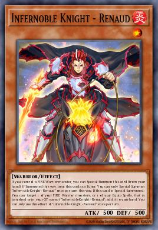
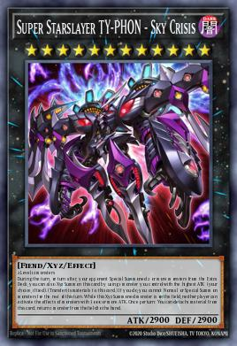
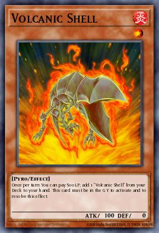
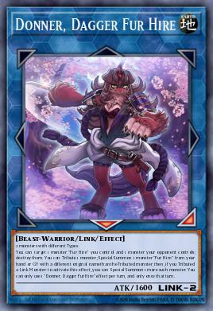
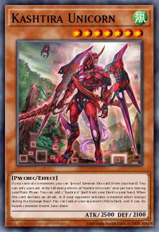
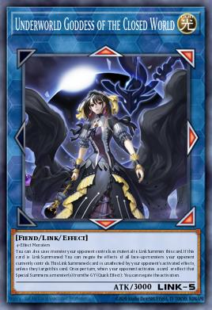
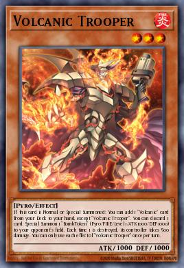
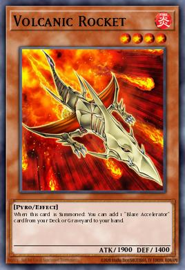

# Iteración V13 — TY-PHON y Diosa del Inframundo: cuatro destinos condicionales del Extra

**Importable A09/A10.** Cuatro rutas nuevas para tres listas confirmadas (Kashtira Pure 665, Infernoble 670, Volcanic 687). **REVISIÓN TCG**, con los textos principales cotejados en Konami. Los requisitos del rival y los tableros ya montados **NO se deducen de la mano inicial**. No sumar los cuatro resultados ni cambiar las cantidades del inventario. Las fotografías provienen de las cartas reales de la base de datos TCG del paquete.

## `670:A09:RENAUD:TYPHON10` — respuesta Infernoble a dos Extra del rival

**Clasificación:** conversión de emergencia; **dificultad:** baja una vez cumplida la condición rival; **recurso:** 1 Renaud Main2, Normal libre; **objetivo:** TY-PHON con rebote de monstruo y bloqueo de activaciones de monstruos con 3000+ ATK.

**Entrada exacta:** el adversario **Invocó Especialmente al menos 2 monstruos desde su Extra Deck durante su turno anterior** (o lo hizo durante el turno actual). Estamos en la propia Main Phase inmediatamente siguiente; mano  **Infernoble Knight - Renaud**; campo propio sin monstruos;  **Super Starslayer TY-PHON - Sky Crisis** en el Extra, sin restricciones externas para Xyz y con un monstruo rival susceptible de retornar a mano/Extra. Es una **línea de respuesta**, no apertura del primer turno.

1.  **NORMAL → campo**. Renaud es Guerrero FUEGO de Nivel1 y 500 ATK. Invocarlo Normal **no** activa su efecto de recuperación, que exige Invocación Especial; tampoco pasa a ser Cantante por la condición de Invocación Especial de su propio texto.
2. Con **Renaud como único monstruo propio**, es necesariamente el que tiene el ATK mayor que controlas. La condición del rival permite la Invocación Xyz alternativa de  **Rango12 / 2900 ATK**, superponiéndolo **sobre Renaud**, aunque Renaud no sea Nivel12. TY-PHON queda con **1 material** (Renaud).
3. **Después de esta Invocación Xyz alternativa no puedes Invocar Normal ni Especialmente durante el resto del turno**. No prometer otra línea Infernoble de Sincro/Enlace después de TY-PHON. Mientras esté Xyz Invocado boca arriba, **ningún jugador puede activar efectos de monstruos con 3000 o más ATK**; esto no es negación de efectos ya activados.
4. En una ventana permitida de tu Main Phase,  **DESACOPLA 1 → retorna 1 monstruo del campo a la mano**. El efecto es una elección de remoción **sin selección previa de objetivo en el texto**; un monstruo rival del Extra regresa al Extra Deck en lugar de la mano. La respuesta rival puede impedir el resultado; no es destrucción.
5. **Campo final base:** TY-PHON 2900 ATK **sin material**; Renaud en GY tras desacoplar; un monstruo retirado del campo si el efecto resolvió, Normal consumida y restricción de Invocaciones del resto del turno. **Alternativas excluyentes:** conservar Renaud para Angélica/S:P si no interesa el efecto de TY-PHON.

**Interrupciones:** si la Invocación Xyz es impedida, no existe el campo indicado; si el rival solo invocó un monstruo del Extra, el procedimiento con Renaud Nivel1 **no está habilitado**. Si hay otro monstruo propio con ATK mayor, el único material alternativo debe ser ese otro, no Renaud.

**Konami:** [Renaud CID15082](https://www.db.yugioh-card.com/yugiohdb/card_search.action?cid=15082&ope=2&request_locale=en); [TY-PHON CID19184](https://www.db.yugioh-card.com/yugiohdb/card_search.action?cid=19184&ope=2&request_locale=en).

## `687:A09:SHELL:TYPHON18` — Shell se convierte en recurso de ruptura

**Clasificación:** respuesta reactiva desde mano / ruptura; **dificultad:** baja-condicional; **recurso:** Shell Main3 + Normal, rival con 2 Extra en ventana válida; **objetivo:** una devolución de monstruo sin necesitar dos Nivel12.

**Entrada exacta:** el oponente ha Invocado Especialmente **dos o más monstruos desde el Extra durante el turno actual o el inmediatamente anterior**; hay Main Phase propia, invocación Normal disponible, propio campo vacío,  **Volcanic Shell (Nivel1, 100 ATK)** en mano y  TY-PHON en Extra. No hay Estatua-Barrera ni restricción previa que impida Xyz OSCURIDAD Demonio. Existe un monstruo rival al que valga la pena devolver.

1.  **NORMAL → campo**. No pagar 500 LP ni buscar otra Shell: ese efecto se activa **desde GY**, no desde el campo. En el tablero de entrada solo hay una Shell propia.
2.  (**mayor ATK propio por ser único**) **SUPERPONER →**  **Xyz alternativo Rango12**, con Shell como **1 material Xyz**.
3. El efecto continuo de TY-PHON impide a **ambos** activar efectos de monstruos con **3000+ ATK** mientras permanece Xyz Invocado en campo. Su procedimiento alternativo prohíbe **Normal o Especial por el resto del turno**: no continuar a Emperador, I:P, Princess o Links.
4.  **DESACOPLAR SHELL como coste → GY** para retornar **un monstruo del campo** a la mano (o al Extra, cuando corresponde). La Shell recién desprendida **sí está en GY**. Si aún queda otra Shell en Deck y se cumplen las condiciones impresas, puede activar **su propio efecto de GY** pagando 500 LP para añadir una copia a mano; esto **no es una Invocación** y el pago no está incluido en el efecto de TY-PHON.
5. **Campo final:** TY-PHON 2900 ATK **0 materiales**, Shell enviada al GY como coste y posible segunda Shell en mano tras efecto separado; carta rival devuelta si resolvió, ninguna nueva Invocación ese turno. Si no hay otra Shell en Deck o el rival la retira del GY antes de activar/resolver, **NO** añadir copia.

**Alternativa excluyente:** Shell Normal → Linkuriboh → búsqueda de Shell es una ruta distinta; TY-PHON usa la única Shell como material y consume la oportunidad de otra Invocación. Ninguna de las dos variantes se acumula sin recursos adicionales explícitos.

**Konami:** [Shell CID7082](https://www.db.yugioh-card.com/yugiohdb/card_search.action?cid=7082&ope=2&request_locale=en); [TY-PHON CID19184](https://www.db.yugioh-card.com/yugiohdb/card_search.action?cid=19184&ope=2&request_locale=en).

## `665:A09:DONNER:FENRIR:UNICORN:GODDESS12` — Diosa usa un monstruo rival sin seleccionarlo

**Clasificación:** continuación desde campo de cuatro cuerpos / respuesta a amenaza; **dificultad:** alta por montaje previo; **recurso:** tres monstruos propios ya en campo + un monstruo enemigo de Efecto; **objetivo:** convertir el monstruo rival en material de una Enlace-5.

**Campo previo OBLIGATORIO, no apertura garantizada:**  **Donner, Dagger Fur Hire (Link2, 1x Extra)**,  **Kashtira Fenrir (Nivel7, Main3x)** y  **Kashtira Unicorn (Nivel7, Main2x + Reserva1x)** controlados boca arriba, todos monstruos de Efecto, con sus Invocaciones ya realizadas legalmente; el rival controla **un monstruo de Efecto apto para usarse como material**. Estamos en Main Phase propia, Extra contiene  **Underworld Goddess of the Closed World (1x)**. No existe bloqueo activo «solo Xyz» por Kashtiratheosis/otro efecto ni otra restricción de Enlace: **si Theosis ya impone su bloqueo ese turno, esta línea es inválida**. No se afirma aquí cómo se montó previamente Donner + Fenrir + Unicorn.

1. Verificar **4 monstruos de Efecto** en total: 3 propios  +  + , y 1 del rival. Diosa permite **usar exactamente 1 monstruo del adversario** como material propio de este Enlace.
2. Sumar **valor de Enlace exacto 5**: Donner Link2 **cuenta como 2**, Fenrir1, Unicorn1 y el monstruo rival de Efecto que NO es Link cuenta como1: **2+1+1+1=5**. El requisito **4+ monstruos de Efecto** también se cumple. Si el monstruo rival es Link, este cómputo base debe revisarse: no tratarlo automáticamente como un cuerpo de valor1 si el estado/material cambia.
3. **ENLACE-5 →**  **Underworld Goddess, 3000 ATK**. Los monstruos propios usados van a tu GY según las reglas de material; el material rival se envía a la zona correspondiente de su dueño, sin ser seleccionado por un efecto que se activa. Usar una carta rival como material **no** destruye ni destierra esa carta.
4. Tras Invocación por Enlace, Diosa **puede activar** su efecto de negar los efectos de todos los monstruos rivales **actualmente boca arriba**. Esto no niega Mágicas/Trampas. Diosa es inmune a efectos activados del rival **que no la seleccionen**; los que sí la seleccionen no están cubiertos por esa inmunidad. Además, puede negar la **activación** de una carta/efecto rival que Invoque del GY mediante su Efecto Rápido, cuando se cumplan condiciones.
5. **Campo final base:**  Diosa 3000 ATK, propios Donner/Fenrir/Unicorn como materiales gastados, enemigo de Efecto convertido en material enviado, demás monstruos rivales boca arriba sujetos a su negación si el efecto resolvió. **Elección:** si se dispone de dos Nivel7, hacer Big Eye/ZEUS es alternativa diferente; gastar Donner + ambos Kashtira + un rival para Diosa no entrega esos Xyz simultáneamente.

**Interrupciones:** con solo dos monstruos propios más uno rival (3 materiales) falta el mínimo de 4; con Theosis activa solo Xyz, Diosa Link está bloqueada. Si la invocación o el efecto son negados, no garantizar limpieza de campo. Esta guía es una **continuación condicional**, no proporción de mano abridora.

**Konami:** [Donner CID17804](https://www.db.yugioh-card.com/yugiohdb/card_search.action?cid=17804&ope=2&request_locale=en), [Fenrir CID17768](https://www.db.yugioh-card.com/yugiohdb/card_search.action?cid=17768&ope=2&request_locale=en), [Unicorn CID17769](https://www.db.yugioh-card.com/yugiohdb/card_search.action?cid=17769&ope=2&request_locale=en), [Underworld Goddess CID15741](https://www.db.yugioh-card.com/yugiohdb/card_search.action?cid=15741&ope=2&request_locale=en).

## `687:A09:IP:TROOPER:ROCKET:GODDESS19` — Diosa con I:P como material, sin activar el Efecto Rápido

**Clasificación:** extensión desde tablero previo, remoción de monstruo rival / protección; **dificultad:** alta por cuatro cuerpos; **objetivo:** Diosa 3000 ATK, neutralización de monstruos boca arriba rivales y protección adicional frente a destrucción por efectos.

**Campo previo OBLIGATORIO:**  **I:P Masquerena (Link2, Extra2x)**,  **Volcanic Trooper (Main3x)** y  **Volcanic Rocket (Main3x)** propios en campo, cada uno monstruo de Efecto; adversario controla **1 monstruo de Efecto no-Link** válido para material;  Diosa en Extra1x, Main Phase propia, zonas legales, **ninguna restricción FIRE activa de Promethean Princess, Gozen Match u otra** que impida invocar LUZ. No asumir campo previo como mano inicial de tres cartas.

1. En tu Main Phase **NO activar el Efecto Rápido de I:P**, cuyo procedimiento normalmente se realiza durante la Main Phase **del rival** y usa materiales que controlas. Aquí realizas una **Invocación por Enlace ordinaria**, usando la regla propia de Diosa para el material rival.
2.  (**valor Link2**) +  (**1**) +  (**1**) + **monstruo rival de Efecto no-Link (1)** = **Link5 y 4 monstruos de Efecto**, suficientes para  Diosa. El rival aporta **una sola carta** como material; no se elige una segunda del rival.
3. **ENLACE →**  **Diosa del Inframundo, 3000 ATK**. Materiales propios I:P/Trooper/Rocket van al GY; material rival enviado al destino de su dueño. **I:P sí concede protección ante DESTRUCCIÓN por efectos del rival** al monstruo que la utilizó como material, **incluso si no se activó su efecto rápido**. No equivale a protección contra destierro, regreso, Tributo o selección.
4. Al Invocar, activar (si conviene y resuelve) la negación de los efectos de **los monstruos del adversario actualmente boca arriba**. Diosa además es inmune a efectos activados rivales que **no la seleccionen**, y puede negar la activación de una carta o efecto rival que invoque desde el GY. **NO** niega por nombre/arquetipo completo ni automáticamente todo el campo.
5. **Campo final:**  Diosa 3000 ATK con protección heredada de I:P frente a destrucción por efectos del rival y su resistencia propia frente a efectos activados que no la seleccionen; los tres materiales propios en GY y el rival elegido retirado como material. Aún quedan otras amenazas rivales si existen y su efecto no se resolvió.

**Alternativas excluyentes:** usar I:P durante la Main del rival para Unicornio/S:P consume otros materiales y ventanas; la continuación hacia Diosa aquí se lleva a cabo **en tu Main**, sin usar su Efecto Rápido. Con Princess FIRE activa **no se puede** Invocar Diosa LUZ por esta línea.

**Konami:** [I:P CID14676](https://www.db.yugioh-card.com/yugiohdb/card_search.action?cid=14676&ope=2&request_locale=en), [Trooper CID18916](https://www.db.yugioh-card.com/yugiohdb/card_search.action?cid=18916&ope=2&request_locale=en), [Rocket CID7243](https://www.db.yugioh-card.com/yugiohdb/card_search.action?cid=7243&ope=2&request_locale=en), [Underworld Goddess CID15741](https://www.db.yugioh-card.com/yugiohdb/card_search.action?cid=15741&ope=2&request_locale=en).

## Comparación de coste y utilidad

| Ruta | Condición real | Campo / efecto final | Decisión de recursos |
|---|---|---|---|
| Renaud→TY-PHON | Rival invocó 2+ Extra este o anterior turno; Renaud único propio | TY-PHON + rebote de 1 monstruo, sin material | **No** continuar Invocaciones ese turno |
| Shell→TY-PHON | Misma condición rival; Shell único propio | TY-PHON + rebote; Shell en GY opcionalmente busca otra copia | Alternativa a Shell→Linkuriboh |
| Donner+Fenrir+Unicorn+rival→Diosa | Tablero ya montado; 4 Efecto y 2+1+1+1 | Diosa, monstruo rival como material, negación de boca arriba | Theosis bloquea esta línea mientras solo Xyz |
| I:P+Trooper+Rocket+rival→Diosa | Tablero ya montado; sin FIRE-only | Diosa, negación y protección de I:P contra destrucción | No se usa el efecto rápido de I:P; alternativa de Enlace propio |

**Certificación pendiente:** los textos y el estado base se contrastaron en fuentes oficiales; no se ensayaron todos los escenarios de cadena o interrupción. No deducir porcentajes de apertura ni cambiar el Main, Extra o Skill aprobados. No promover estos ejemplos condicionales a líneas de una sola carta.
