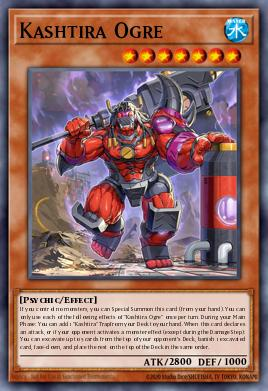
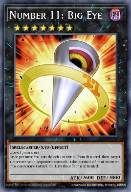
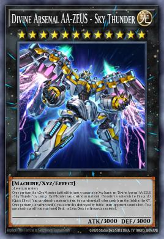

# Kashtira Pure · continuación visual de Ojo Grande a ZEUS

**ID nuevo:** `665:A09:BIGEYE:BATTLE:ZEUS11`

**Clasificación:** continuación de combo **condicional** (no apertura autónoma); objetivo **romper campo / respuesta defensiva**, NO negación. No cambia el inventario aprobado; utiliza **Fenrir, Unicorn, Birth, Ogre, Theosis, Big Eye y ZEUS ya registrados**.

**Mano de origen y estado:** comenzar en Main Phase con Fenrir + Kashtira Birth en mano, resto propio vacío. En Deck debe haber Unicorn, Theosis, Ogre y Preparations; en Extra 1 Big Eye y 1 Zeus. Se ejecutan los pasos 1–4 de `665:A09:FENRIR:BIRTH:SHANGRI05` sin respuestas rivales: Fenrir Especial busca Unicorn; Birth permite Normal de Unicorn sin sacrificios; Unicorn busca Theosis; Theosis selecciona Unicorn e Invoca Ogre (Atributo diferente); Ogre busca Preparations. **El rival debe permitir una batalla que deje vivo al Xyz propio.** No iniciar esta continuación en turno 1 de un duelo donde no existe Battle Phase.

## Resultado que se busca

Una opción de **retirada masiva de cartas en el campo** a velocidad de Efecto Rápido, disponible mediante ZEUS, sacrificando los recursos propios que también queden en campo. La ruta compite con usar el efecto de Big Eye de tomar control: **no pueden ejecutarse ambas como si Big Eye pudiera atacar tras activar su efecto**.

### Paso 1 — Elegir el propósito: no tomar control con Ojo Grande

 →  → 

Superponer **Fenrir + Ogre** (dos monstruos Nivel 7) para Invocar por Xyz a **Número 11: Ojo Grande** con dos materiales. Unicorn continúa en campo; Birth continúa boca arriba; Preparations puede quedar Colocada. **No activar** el efecto de Ojo Grande para tomar control, porque entonces no podría atacar ese turno. No es una Invocación de Shangri-Ira: se elige uno u otro como destino de los mismos materiales.

### Paso 2 — Battle Phase: hacer que un monstruo Xyz batalle

 → **DECLARAR BATALLA**

En tu Battle Phase, declarar un ataque con Ojo Grande (2600 ATK) contra un objetivo permitido o directamente si el campo adversario lo permite. **La batalla debe ocurrir y Ojo Grande debe sobrevivir y permanecer bajo tu control.** Si se destruye en batalla, no habrá un Xyz propio para la continuación descrita. No activar su efecto de robo de monstruo antes de atacar.

### Paso 3 — Main Phase 2: superponer ZEUS

 → **XYZ SOBRE XYZ** → 

Como un Xyz batalló este turno, en **Main Phase 2** Invocar por Xyz **Divine Arsenal AA-ZEUS – Sky Thunder** usando el Ojo Grande que aún controlas. Transferir sus **dos materiales** [Fenrir, Ogre] y acoplar al propio Ojo Grande como material del nuevo ZEUS. **ZEUS queda con 3 materiales**, no con 2. La restricción de Theosis a Xyz no impide esta Invocación porque ZEUS es Xyz.

### Paso 4 — Decidir cuándo usar el barrido

 → **DESACOPLAR 2** → **ENVIAR OTRAS CARTAS AL GY**

ZEUS tiene un **Efecto Rápido**: desacoplar **dos materiales** para **enviar todas las demás cartas del campo al Cementerio**. Eso **no es destruir** y afectará también a **tu Unicorn, Birth y Preparations** si siguen en campo. Se puede reservar como respuesta para el turno rival, sujeto a las ventanas y negaciones reales. Después de resolverlo con los 3 materiales iniciales, ZEUS conserva **1 material**; no posee automáticamente suficiente material para una segunda activación.

### Paso 5 — Campo final, sin activación de barrido aún

 **3000 ATK / 3000 DEF** ← **3 materiales: Ojo Grande + Fenrir + Ogre**

**Campo al terminar Main Phase 2**, si no hubo otras respuestas: ZEUS boca arriba con 3 materiales; Unicorn en campo; Birth boca arriba; Preparations Colocada. No se tomó control de monstruos mediante Ojo Grande, no se invocó Arise-Heart, no se bloquearon zonas. La mano inicial Fenrir + Birth se consumió; la carta Preparations sigue su regla de no activarse en el turno colocada. Si se activa ZEUS, borrar de esta descripción todos los demás permanentes afectados; ZEUS queda con 1 material.

## Alternativas e interrupciones

| Situación | Decisión correcta | Resultado |
|---|---|---|
| Necesitas apropiarte de un monstruo rival inmediatamente | Usar efecto de **Big Eye** en Main; **renunciar a su ataque ese turno** | Control puntual, no línea de ZEUS desde la batalla de Big Eye |
| Necesitas respuesta contra varias cartas rivales | Preservar ataque de Big Eye → Zeus en MP2 | Barrido de ZEUS disponible pagando 2 materiales |
| Big Eye es destruido en batalla | No hay Xyz propio para esta continuación | Detener esta ruta; no inventar ZEUS desde GY |
| Efecto de ZEUS es negado | Los dos materiales ya fueron desacoplados como coste | No recuperar materiales automáticamente; revisar respuesta rival |
| El rival impide entrar a Battle Phase | No se cumple el evento de batalla | Continuación inaccesible en ese turno |

## Verificación de fuentes

- [Ojo Grande, Konami](https://www.db.yugioh-card.com/yugiohdb/card_search.action?cid=9861&ope=2&request_locale=es): dos Nivel 7; desacopla 1 para tomar control; no puede atacar en el turno en que activa ese efecto.
- [ZEUS, Konami](https://www.db.yugioh-card.com/yugiohdb/card_search.action?cid=15524&ope=2&request_locale=en): alternativa de Invocación Xyz después de que un Xyz haya batallado; transfiere materiales; pago de 2 para enviar todas las otras cartas del campo al GY.
- [Kashtira Birth, Konami](https://www.db.yugioh-card.com/yugiohdb/card_search.action?cid=17815&ope=2&request_locale=en), junto con la línea preexistente `665:A09:FENRIR:BIRTH:SHANGRI05`.

**Estado técnico de esta continuación:** pasos de Big Eye y ZEUS cotejados con textos oficiales, condiciones de entrada expresas; la secuencia global depende de que la línea Fenrir/Birth haya resuelto y de que ocurra una batalla válida. No afirmar 100 % de éxito contra un adversario que interrumpe.
