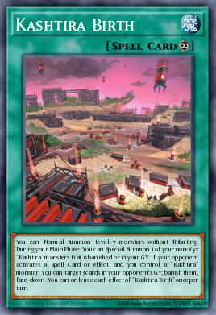
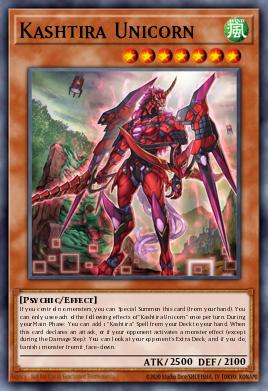
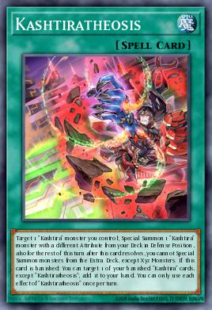
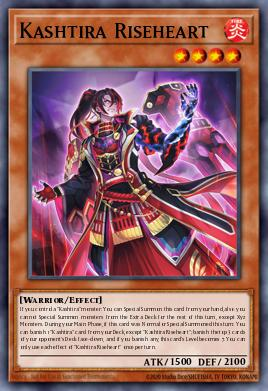
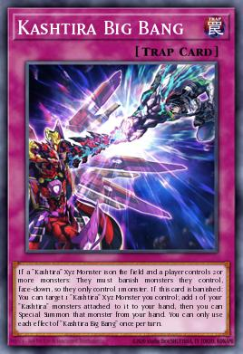

# Kashtira — tres combos solicitados y cargados

Estas tres secuencias forman parte de las 15 rutas del deck 665. Se muestran completas en Aprende jugadas y Mis combos y estrategias; el editor usa sus cartas y conexiones, no una imagen plana ni un enlace externo.

## Romper el espejo: Fenrir → Arise-Heart → batalla → ZEUS

Ruta estable: `665:A09:MIRROR:ARISE:BATTLE:ZEUS13`

**Propósito:** Convertir un Kashtira en ZEUS con dos materiales para retirar el campo rival

### Mano inicial

Turno propio jugando segundo, sin monstruos propios. Fenrir en mano; también puede usarse Unicornio u Ogro en su lugar. Arise-Heart y ZEUS disponibles en Extra. El efecto de Shangri-Ira rival se activó correctamente en la Standby de ESTE turno. El rival conserva Shangri-Ira en Defensa, Arise-Heart con dos materiales y los monstruos mostrados en el ejemplo. Battle Phase y Main Phase 2 disponibles; sin bloqueo de Especial ni del Extra.

### Condiciones
Requiere un entorno que permita Arise-Heart. En TCG Advanced su uso está restringido por la lista vigente. La guía permanece consultable y editable. No garantiza atravesar respuestas: una negación, cambio de posición, retirada o bloqueo puede detenerla. Si Shangri-Ira no activó un efecto este turno, no puedes usar el procedimiento alternativo de Arise-Heart.

### Secuencia

#### Paso 1
Invoca Fenrir de modo Especial desde mano al no controlar monstruos. No actives su búsqueda: en esta línea se conserva como material de Xyz.

#### Paso 2
Superpón Arise-Heart sobre Fenrir mediante su procedimiento alternativo. La activación previa de Shangri-Ira rival satisface la condición. Arise-Heart queda con un material: Fenrir. No actives sus efectos opcionales; sus efectos continuos y obligatorios siguen existiendo.

![Kashtira Arise-Heart [Xyz rango 7] — XYZ · 1 MATERIAL](../imagenes/tcg/18191.jpg)

#### Paso 3
Entra en Battle Phase y ataca con Arise-Heart al Shangri-Ira rival en Defensa. En el supuesto del ejemplo, 3000 ATK contra 3000 DEF no destruye a ninguno. El Xyz debe batallar y Arise-Heart debe seguir disponible; declarar un ataque cancelado antes de batallar no basta.
![Kashtira Arise-Heart [Xyz rango 7] — ATACA](../imagenes/tcg/18191.jpg)
![Kashtira Shangri-Ira [Xyz rango 7] — OBJETIVO RIVAL EN DEFENSA](../imagenes/tcg/17800.jpg)

#### Paso 4
En Main Phase 2, superpón ZEUS sobre Arise-Heart. Transfiere también Fenrir: ZEUS tiene exactamente dos materiales [Arise-Heart, Fenrir]. No son tres ni dos activaciones de limpieza.
![Kashtira Arise-Heart [Xyz rango 7] — SUPERPONER](../imagenes/tcg/18191.jpg)
![Divine Arsenal AA-ZEUS – Sky Thunder [Xyz] — XYZ · 2 MATERIALES](../imagenes/tcg/15524.jpg)

#### Paso 5
Activa ZEUS desacoplando sus dos materiales como coste. Si el efecto resuelve sin respuesta que lo impida, envía todas las demás cartas del campo al Cementerio. Mientras el reemplazo de Arise-Heart rival sea aplicable, las cartas que fueran a enviarse al GY se destierran en su lugar. ZEUS queda en campo sin materiales; no vuelve a limpiar inmediatamente.
![Divine Arsenal AA-ZEUS – Sky Thunder [Xyz] — DESACOPLA 2 · RETIRA EL CAMPO](../imagenes/tcg/15524.jpg)
![Kashtira Arise-Heart [Xyz rango 7] — MATERIAL PAGADO](../imagenes/tcg/18191.jpg)

### Campo final
ZEUS en Ataque, cero materiales después de pagar la limpieza. Arise-Heart y el Kashtira inicial fueron desacoplados. Si no hubo respuestas ni protecciones adicionales, el resto del campo fue retirado. No se inventan identidades ni cantidades de cartas rivales fuera de la precondición.

El destierro de los materiales presupone que Arise-Heart rival seguía aplicando su reemplazo al pagar el coste. Si ya no lo aplicaba, esos materiales quedan en GY.
Un Arise-Heart rival con tres materiales podría responder a ZEUS. El ejemplo parte de dos; esto no elimina otras respuestas posibles.
Ogro y Unicornio son alternativas del único Kashtira inicial, no cartas adicionales de mano. Si eliges una, reemplaza Fenrir también entre los materiales pagados.

### Si el rival responde
Si el rival retira tu Kashtira antes de superponer, detén la línea. Si Arise-Heart no llega a batallar o deja el campo, no se acredita este acceso a ZEUS. Si niegan la limpieza, los dos materiales del coste ya se pagaron; no se restituyen. No hay recuperación demostrada con la apertura mínima de una carta.

## Fenrir + Nacimiento: Shangri-Ira, Arise-Heart y recuperación con Big Bang

Ruta estable: `665:A09:FENRIR:BIRTH:BIGBANG:ARISE14`

**Propósito:** Preparar dos Xyz y recuperar Unicornio, con Fenrir adicional en la Standby rival

### Mano inicial

Fenrir y Nacimiento en mano; campo y GY propios vacíos, Normal disponible, Main Phase propia. En Main quedan Unicornio, Teosis, Riseheart, Big Bang y otro Fenrir; Shangri-Ira y Arise-Heart en Extra. El rival debe tener tres cartas en Deck para el efecto de Riseheart y una zona disponible que Shangri-Ira pueda bloquear.

### Condiciones
Requiere un entorno que permita Arise-Heart; no es una línea disponible en TCG Advanced con su restricción vigente. Consulta y edición siguen disponibles. No activar un bloqueo previo que impida las Invocaciones. Tras Teosis y Riseheart, respetar sus restricciones a Xyz. La Standby rival es un momento posterior, no parte de tu Main Phase.

### Secuencia

#### Paso 1
Invoca Fenrir desde mano sin controlar monstruos. Activa su búsqueda y añade Unicornio del Main a mano.

#### Paso 2
Activa Nacimiento. Usa su permiso para Invocar Normalmente Unicornio de Nivel 7 sin Sacrificar. Consume tu Normal; no se ha usado la recuperación de Nacimiento.

#### Paso 3
Activa la búsqueda de Unicornio y añade Kashtirateosis a mano.

#### Paso 4
Activa Teosis seleccionando Unicornio de atributo VIENTO. Invoca Riseheart, FUEGO, desde Deck en Defensa. Después de resolver, solo puedes Invocar Especialmente Xyz desde el Extra el resto del turno.

#### Paso 5
Superpón Fenrir y Unicornio, ambos Nivel 7, para Invocar Shangri-Ira en Defensa. Sus dos materiales son [Fenrir, Unicornio]. Riseheart permanece aparte en campo.

![Kashtira Shangri-Ira [Xyz rango 7] — XYZ · 2 MATERIALES](../imagenes/tcg/17800.jpg)

#### Paso 6
Activa Riseheart: destierra Big Bang desde tu Deck como coste; al resolver destierra boca abajo las tres cartas superiores del Deck rival y Riseheart pasa a Nivel 7. No conoces ni eliges las identidades de esas tres cartas.

#### Paso 7
Forma una nueva Cadena: CL1 Shangri-Ira para bloquear una zona disponible y CL2 Big Bang seleccionando tu Shangri-Ira. Resuelve CL2: añade el Unicornio acoplado a mano y luego Invócalo desde mano. Resuelve CL1: bloquea la zona mientras Shangri-Ira siga boca arriba. Shangri-Ira conserva un material: Fenrir.
![Kashtira Shangri-Ira [Xyz rango 7] — CL1 · BLOQUEAR ZONA](../imagenes/tcg/17800.jpg)

#### Paso 8
Tras resolver la Cadena, superpón Arise-Heart sobre Riseheart. Shangri-Ira activó correctamente su efecto este turno. Arise-Heart queda con un material [Riseheart]; no tiene aún tres materiales para su retirada rápida.

![Kashtira Arise-Heart [Xyz rango 7] — XYZ · 1 MATERIAL](../imagenes/tcg/18191.jpg)

#### Paso 9
Termina tu turno. Ya tienes Shangri-Ira, Arise-Heart, Unicornio y Nacimiento. En la Standby rival, si Shangri-Ira sigue disponible y resuelve su efecto, Invoca otro Fenrir del Deck. Este Fenrir es otra copia; el primero sigue acoplado a Shangri-Ira.
![Kashtira Shangri-Ira [Xyz rango 7] — STANDBY RIVAL · ACTIVAR](../imagenes/tcg/17800.jpg)

### Campo final
Al final de tu turno: Shangri-Ira en Defensa con Fenrir como material, Arise-Heart en Ataque con Riseheart como material, Unicornio en Ataque y Nacimiento boca arriba. Teosis en GY, Big Bang desterrada, Normal consumida y una zona rival bloqueada si resolvió Shangri-Ira. Tras la Standby rival se añade otro Fenrir en Ataque si el efecto resuelve. Sin cartas sobrantes de la apertura mínima.

Las columnas elegidas son una distribución ilustrativa, no un requisito de esta ruta.
Un bloqueo de zona no equivale a retirar una carta ya colocada en ella. Elige una zona disponible al resolver.
La recuperación de Nacimiento no se ha utilizado en tu turno. Los efectos usados de Fenrir/Unicornio corresponden a sus búsquedas, no a sus efectos ante una acción rival.

### Si el rival responde
Si niegan Fenrir, Unicornio o Teosis y no tienes un extensor adicional real, no se demuestra el mismo campo con esta mano mínima. Si niegan Riseheart, Big Bang fue desterrada como coste y puede disparar, pero no se acredita el bloqueo ni el acceso alternativo a Arise-Heart sin un efecto de Shangri-Ira activado correctamente. Si retiran Shangri-Ira, el bloqueo deja de mantenerse y no se acredita el Fenrir de la Standby.

## Unicornio + Ash + Nacimiento: Baronne temprana antes de Nibiru

Ruta estable: `665:A09:UNICORN:ASH:BIRTH:BARONNE15`

**Propósito:** Proteger la continuación con una negación antes de la quinta Invocación y terminar en doble Xyz

### Mano inicial

Unicornio, Ash Blossom y Nacimiento en mano; campo vacío y Normal libre. Baronne, Shangri-Ira y Arise-Heart disponibles en Extra. Teosis, Fenrir, Riseheart y Big Bang disponibles en Main. No se presupone otro Cantante: se usa la Ash registrada en esta lista.

### Condiciones
Requiere un entorno que permita Baronne y Arise-Heart, actualmente restringidos en TCG Advanced. La guía se mantiene disponible para consulta y edición. Forma Baronne ANTES de resolver Teosis o activar un bloqueo a Xyz. Baronne debe conservar su negación, permanecer boca arriba y no estar negada; no representa inmunidad universal frente a Nibiru ni otras interrupciones.

### Secuencia

#### Paso 1
Invoca Unicornio de modo Especial desde mano sin controlar monstruos: Invocación 1. Conserva su búsqueda para después de recuperarlo; no se usa ahora.

#### Paso 2
Invoca Normalmente Ash Blossom, Cantante Nivel 3: Invocación 2. Sincroniza Ash y Unicornio Nivel 7 para Baronne Nivel 10: Invocación 3. Ash y Unicornio van al GY. Todavía no se ha aplicado ninguna restricción a Xyz.

![Baronne de Fleur [Synchro nivel 10] — SINCRO · INVOCACIÓN 3](../imagenes/tcg/16386.jpg)

#### Paso 3
Activa Nacimiento y su efecto de recuperación: Invoca desde GY el Unicornio usado como material, Invocación 4. Activa la búsqueda de Unicornio y añade Teosis. La Normal y la recuperación de Nacimiento quedan consumidas.

#### Paso 4
Activa Teosis sobre Unicornio VIENTO e Invoca Fenrir TIERRA en Defensa: Invocación 5. Baronne ya estaba en campo desde la tercera. Desde aquí, Teosis impide Invocar desde Extra salvo Xyz.

#### Paso 5
Si el rival activa Nibiru en una ventana permitida tras la quinta Invocación, puedes responder con la negación rápida de Baronne si aún está disponible. Negar su activación evita esa resolución de Nibiru; consume la negación de Baronne mientras siga boca arriba. Si no responde el rival, conserva la negación y continúa.
![Baronne de Fleur [Synchro nivel 10] — RESPONDER SI NIBIRU SE ACTIVA](../imagenes/tcg/16386.jpg)

#### Paso 6
Activa la búsqueda de Fenrir y añade Riseheart a mano. Invoca Riseheart de modo Especial desde mano; respeta también su restricción a Xyz para el resto del turno.

#### Paso 7
Superpón Fenrir y Unicornio para Shangri-Ira en Defensa, con ambos como materiales. Baronne y Riseheart permanecen en campo.

![Kashtira Shangri-Ira [Xyz rango 7] — XYZ · 2 MATERIALES](../imagenes/tcg/17800.jpg)

#### Paso 8
Activa Riseheart desterrando Big Bang desde Deck como coste; al resolver destierra boca abajo las tres cartas superiores del Deck rival y alcanza Nivel 7. En nueva Cadena: CL1 Shangri-Ira, CL2 Big Bang sobre Shangri-Ira. Big Bang devuelve el material Unicornio a mano y permite Invocarlo; después Shangri-Ira bloquea una zona disponible. Solo Fenrir queda como material de Shangri-Ira.

![Kashtira Shangri-Ira [Xyz rango 7] — CL1 · BLOQUEAR](../imagenes/tcg/17800.jpg)

#### Paso 9
Superpón Arise-Heart sobre Riseheart porque Shangri-Ira activó correctamente su efecto este turno. Arise-Heart conserva Riseheart como único material. En la Standby rival, si resuelve Shangri-Ira, Invoca otro Fenrir desde Deck. Baronne permanece en campo; su negación estará disponible únicamente si no se gastó ni quedó anulada.

![Kashtira Arise-Heart [Xyz rango 7] — XYZ · 1 MATERIAL](../imagenes/tcg/18191.jpg)
![Kashtira Shangri-Ira [Xyz rango 7] — STANDBY RIVAL](../imagenes/tcg/17800.jpg)

### Campo final
Final de tu turno: Baronne, Shangri-Ira con un Fenrir acoplado, Arise-Heart con Riseheart acoplado, Unicornio y Nacimiento. Ash y Teosis permanecen en GY; Big Bang desterrada. Normal y recuperación de Nacimiento utilizadas. Después de la Standby rival se añade otro Fenrir si Shangri-Ira resuelve. La negación de Baronne depende de si se usó contra Nibiru u otra amenaza.

Ash y Teosis llegaron al GY antes de entrar Arise-Heart: su reemplazo no destierra retroactivamente cartas que ya estaban allí.
El Fenrir de la Standby es una copia distinta de la que permanece acoplada a Shangri-Ira.
Se eligieron cinco zonas principales libres como disposición ilustrativa; no son columnas obligatorias.
Si se utilizó la negación de Baronne, no se vuelve a ofrecer como disponible mientras permanezca boca arriba.

### Si el rival responde
Si impiden la Sincro de Baronne, no se acredita protección al llegar a cinco Invocaciones. Si niegan Nacimiento o retiran el Unicornio del GY antes de recuperarlo, esta mano mínima no demuestra la continuación completa. Baronne solo ofrece una respuesta de negación disponible; no se inventa una segunda respuesta frente a amenazas sucesivas.
