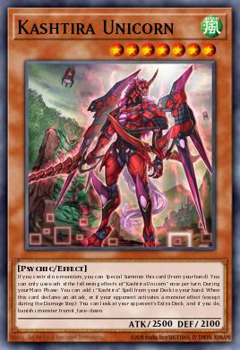
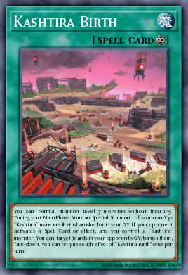
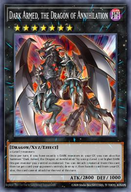

# Kashtira Pure — Ruta adicional hacia Dark Armed (romper campo)

- **Deck ID:** `665` · **Formato:** TCG · **Ruta:** `665:A09:FENRIR:BIRTH:DARKARMED10`.
- **Clase:** combo condicional de dos cartas, sin respuesta adversaria.
- **Propósito primario:** **romper campo** destruyendo una carta rival.
- **Cuándo usar:** tu Main Phase, especialmente al ir segundo ante una carta rival destruible; si valoras más ese removal que conservar Fenrir/Unicorn o ir hacia Shangri-Ira.
- **Mano mínima:** 1× Kashtira Fenrir + 1× Kashtira Birth.
- **Deck:** 1× Kashtira Unicorn disponible; **Extra:** 1× Dark Armed, the Dragon of Annihilation.
- **Estado inicial:** campo propio sin monstruos, Normal del turno disponible, no hay restricciones activas ni efectos de reemplazo de envío al GY. El rival controla al menos una carta seleccionable y destruible. No se requieren 5 monstruos OSCURIDAD en GY porque usamos el método ordinario de 2 Nivel 7.

## Paso 1 — Fenrir en campo

**Mano → Campo:** Invoca Especialmente Fenrir (Nivel 7) porque no controlas monstruos. Es una Invocación propia desde la mano, sin activar su efecto de búsqueda aún.

## Paso 2 — Buscar Unicorn

 → 

**Campo → Deck → Mano:** durante Main Phase activa el efecto de Fenrir y agrega Unicorn del Deck a la mano. No se invoca Unicorn con ese efecto. Espera a que termine de resolver.

## Paso 3 — Birth habilita la Normal

 → 

**Mano → M/T y Mano → Campo:** activa Birth; después, con su efecto que permite Invocar Normal un monstruo Nivel 7 sin tributar, usa tu Normal disponible para colocar Unicorn boca arriba. Ahora Fenrir y Unicorn son dos monstruos de Nivel 7 propios. No es una segunda Invocación Especial gratuita.

## Paso 4 — Xyz al destino del Extra

 +  → 

**Campo → Materiales Xyz:** superpone ambos monstruos de Nivel 7 e Invoca Xyz Dark Armed del Extra. Fenrir y Unicorn ya no son monstruos independientes ni pueden activar sus efectos de campo. Dark Armed inicia con **2 materiales**.

## Paso 5 — Destruir la amenaza

**Dark Armed → GY → Campo rival:** activa su efecto en Main Phase: desacopla 1 material como coste y selecciona 1 carta que controle el rival. Si el efecto resuelve y destruye esa carta, destierra 1 carta de tu GY (puede ser el material desacoplado que acaba de llegar allí). **Dark Armed no podrá atacar durante el resto de este turno.** El efecto no es Rápido y no niega nada. No es «desterrar la carta rival»; es destruirla.

## Campo final comprobable sin respuesta

| Zona | Resultado |
|---|---|
| Campo propio, monstruos | Dark Armed (2800 ATK / 1000 DEF), 1 material restante |
| Campo propio, M/T | Kashtira Birth boca arriba |
| Mano | Fenrir y Birth consumidos; Unicorn buscado y utilizado; restantes no definidas |
| Cementerio / destierro propio | 1 material desacoplado llegó al GY y fue desterrado por Dark Armed si la destrucción se realizó; el otro queda bajo Dark Armed |
| Campo rival | Una carta seleccionada fue destruida si la resolución tuvo éxito |
| Acción de combate | Dark Armed no puede atacar este turno tras utilizar su efecto |

### Ramas y precauciones

1. **Sin carta rival para seleccionar:** puedes hacer la Invocación Xyz, pero no puedes activar el efecto de destrucción sin objetivo. No llamar a esto ruptura de campo.
2. **Negación de Fenrir:** si la búsqueda es negada y no tienes otro Nivel 7, no se garantiza Dark Armed; conservar Birth para una oportunidad posterior.
3. **Negación o destrucción de Birth antes de la Normal:** no asumir que Unicorn puede Invocarse sin tributos con ese permiso; la ruta puede terminar.
4. **Arise-Heart activo u otro reemplazo de GY:** el material desacoplado podría desterrarse en lugar de llegar al GY. No adjudicar el destierro posterior de Dark Armed sin una carta legal disponible en tu GY.
5. **Alternativa de propósito:** con los mismos materiales, Shangri-Ira es una elección de control futuro (según su propia guía), mientras Dark Armed es una elección de removal inmediato.

### Fuentes oficiales de cada regla de carta

- [Dark Armed, CID 13974](https://www.db.yugioh-card.com/yugiohdb/card_search.action?cid=13974&ope=2&request_locale=en)
- [Fenrir, CID 17768](https://www.db.yugioh-card.com/yugiohdb/card_search.action?cid=17768&ope=2&request_locale=en)
- [Birth, CID 17815](https://www.db.yugioh-card.com/yugiohdb/card_search.action?cid=17815&ope=2&request_locale=en)
- [Unicorn, CID 17769](https://www.db.yugioh-card.com/yugiohdb/card_search.action?cid=17769&ope=2&request_locale=en)

**Integración:** nueva tarjeta de biblioteca por propósito «Romper campo», vinculada a las fichas de Fenrir, Unicorn, Birth y Dark Armed. No añadir la ruta al contador histórico de 78 sin registrar su ID como nuevo contenido. Los ejemplos visuales proporcionados por Miguel son referencias de formato, no secuencias que deban importarse sin revisar su legalidad y compatibilidad con la lista.
