# A10 — Guías visuales documentales · Kashtira Pure

> Guía documental: utilizar únicamente secuencias con condiciones y restricciones comprobadas.

- Deck ID: `665`. Formato declarado: `TCG`.
- Rutas visualizadas en esta entrega: **9**.
- Los pasos, movimientos y zonas se cotejan con la ficha A09; no asumir respuestas no descritas.
- Un estado desconocido se conserva como no documentado: nunca se inventa.

## WRAITSOTH · SHANGRI01 · `665:A09:WRAITSOTH:SHANGRI01`

**Propósito competitivo principal (lectura documental):** Preparar Shangri-Ira con Wraitsoth y dos materiales Xyz. El objetivo solo se acredita si las acciones y el campo final detallados en esta guía lo permiten; no implica legalidad certificada ni garantiza el resultado ante respuestas adversarias.

**Categoría:** APERTURA

**Propósito y resultado documental:**

Endboard comprobado al finalizar la secuencia: Shangri-Ira boca arriba con dos materiales (Unicornio/Fenrir), Wraitsoth en zona de Campo; sin Mágicas/Trampas adicionales generadas y sin monstruos independientes Unicornio/Fenrir. No atribuir destrucción, negación, banish ni bloqueo de zona inmediatos: Shangri-Ira ofrece Invocación desde Deck en Standby Phase futura, si permanece y el efecto puede utilizarse. Mano inicial restante y otras cartas robadas no especificadas; el motor consumió Wraitsoth desde mano. Efectos de Wraitsoth por Shangri-Ira aún condicionados a activaciones futuras.

### Mano y estado inicial

Mano de apertura: solo Pressured Planet Wraitsoth. Campo/GY propios vacíos, Main Phase 1; Unicornio, Fenrir y Kashtiratheosis en Deck, Shangri-Ira en Extra; rival sin responder.

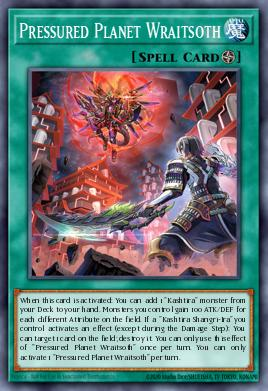 **Pressured Planet Wraitsoth**

### Ejecución numerada

#### Paso 1 — Activar Wraitsoth desde mano a Zona de Campo.

 **ACTIVAR** → 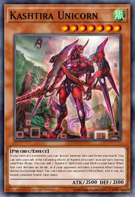 **AÑADIR A MANO**

**Acción concreta:** Activar Wraitsoth desde mano a Zona de Campo.
**Detalle técnico documentado:** Al activarla CL1, buscar Kashtira Unicornio del Deck a la mano tras resolver; si es negada la búsqueda no ocurre. Campo Wraitsoth; mano Unicornio; Main -1, búsqueda resuelta.

**Estado por zonas después del paso:**

| Zona/recurso | Estado narrativo A09 |
|---|---|
| Mano | Unicornio en mano |
| Monstruos | — |
| Mágicas y trampas | Wraitsoth #18204 (Campo boca arriba) |
| Cementerio | — |
| Destierro propio | — |
| Campo y estado rival | No hubo destierros rivales por esta línea |
| Materiales Xyz/Fusión/Sincro | — |
| Normal, Extra, fase y restricciones | Normal libre; Extra sin restricción de esta ruta |

**Campo visual de este paso:**

**Monstruos propios:** sin carta propia demostrada en esta vista.
**Mágicas/Trampas/Campo:**
-  **Wraitsoth (Campo boca arriba)** — zona declarada: `FIELD`.
*Relación ilustrada de cartas presentes tras este paso, documentada en A09. La posición, materiales, otras zonas y rival se leen en la tabla de estado.*

#### Paso 2 — Invocar Especialmente Unicornio desde mano.

 **ESPECIAL**

**Acción concreta:** Invocar Especialmente Unicornio desde mano.
**Detalle técnico documentado:** Procedimiento propio: no se controlan monstruos en ese instante; no consume Invocación Normal. Unicornio Nivel 7 VIENTO en Zona de Monstruos.

**Estado por zonas después del paso:**

| Zona/recurso | Estado narrativo A09 |
|---|---|
| Mano | — |
| Monstruos | Unicornio #17769 (Ataque, Nivel 7) |
| Mágicas y trampas | Wraitsoth #18204 (Campo boca arriba) |
| Cementerio | — |
| Destierro propio | — |
| Campo y estado rival | No hubo destierros ni bloqueos |
| Materiales Xyz/Fusión/Sincro | — |
| Normal, Extra, fase y restricciones | Normal libre; Extra sin restricción de esta ruta |

**Campo visual de este paso:**

**Monstruos propios:**
-  **Unicornio (Ataque, Nivel 7)** — zona declarada: `MONSTER`.
**Mágicas/Trampas/Campo:**
-  **Wraitsoth (Campo boca arriba)** — zona declarada: `FIELD`.
*Relación ilustrada de cartas presentes tras este paso, documentada en A09. La posición, materiales, otras zonas y rival se leen en la tabla de estado.*

#### Paso 3 — Activar el efecto de búsqueda de Unicornio (CL1).

 **ACTIVAR** → 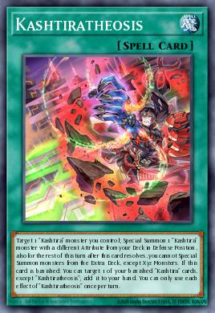 **BUSCAR / AÑADIR** →  **YA EN CAMPO**

**Acción concreta:** Activar el efecto de búsqueda de Unicornio (CL1).
**Detalle técnico documentado:** Durante Main Phase, añadir 1 Mágica «Kashtira»: Kashtiratheosis del Deck; respetar el uso por turno de ese efecto. Wraitsoth y Unicornio en Campo; Teosis en mano.

**Estado por zonas después del paso:**

| Zona/recurso | Estado narrativo A09 |
|---|---|
| Mano | Teosis en mano |
| Monstruos | Unicornio #17769 (Ataque, Nivel 7) |
| Mágicas y trampas | Wraitsoth #18204 (Campo boca arriba) |
| Cementerio | — |
| Destierro propio | — |
| Campo y estado rival | No hubo destierros ni bloqueos |
| Materiales Xyz/Fusión/Sincro | — |
| Normal, Extra, fase y restricciones | Normal libre; Extra sin restricción todavía |

**Campo visual de este paso:**

**Monstruos propios:**
-  **Unicornio (Ataque, Nivel 7)** — zona declarada: `MONSTER`.
**Mágicas/Trampas/Campo:**
-  **Wraitsoth (Campo boca arriba)** — zona declarada: `FIELD`.
*Relación ilustrada de cartas presentes tras este paso, documentada en A09. La posición, materiales, otras zonas y rival se leen en la tabla de estado.*

#### Paso 4 — Activar Kashtiratheosis de la mano seleccionando Unicornio.

 **ACTIVAR** →  **OBJETIVO** →  **ESPECIAL**

**Acción concreta:** Activar Kashtiratheosis de la mano seleccionando Unicornio.
**Detalle técnico documentado:** Al resolver, Invocar Especialmente Kashtira Fenrir del Deck en Defensa (TIERRA ≠ VIENTO); desde entonces el Extra queda restringido a Xyz ese turno. Unicornio VIENTO y Fenrir TIERRA Nivel 7 en Campo; Teosis en GY.

**Estado por zonas después del paso:**

| Zona/recurso | Estado narrativo A09 |
|---|---|
| Mano | — |
| Monstruos | Unicornio #17769 (Ataque, Nivel 7), Fenrir #17768 (Defensa, Nivel 7) |
| Mágicas y trampas | Wraitsoth #18204 (Campo boca arriba) |
| Cementerio | Teosis en GY |
| Destierro propio | — |
| Campo y estado rival | No hubo destierros ni bloqueos |
| Materiales Xyz/Fusión/Sincro | — |
| Normal, Extra, fase y restricciones | Normal libre; Extra solo Xyz por Teosis |

**Campo visual de este paso:**

**Monstruos propios:**
-  **Unicornio (Ataque, Nivel 7)** — zona declarada: `MONSTER`.
-  **Fenrir (Defensa, Nivel 7)** — zona declarada: `MONSTER`.
**Mágicas/Trampas/Campo:**
-  **Wraitsoth (Campo boca arriba)** — zona declarada: `FIELD`.
*Relación ilustrada de cartas presentes tras este paso, documentada en A09. La posición, materiales, otras zonas y rival se leen en la tabla de estado.*

#### Paso 5 — Invocar por Xyz Kashtira Shangri-Ira del Extra.

 **MATERIAL XYZ** →  **MATERIAL XYZ** → 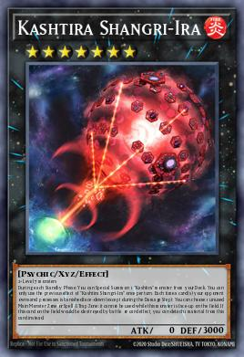 **INVOCAR XYZ**

**Acción concreta:** Invocar por Xyz Kashtira Shangri-Ira del Extra.
**Detalle técnico documentado:** Superponer Unicornio y Fenrir, ambos Nivel 7; requiere 2+ monstruos Nivel 7. Ambos quedan debajo como materiales, no permanecen como monstruos independientes. Shangri-Ira (Rango 7) en Defensa con 2 materiales; Zona de Campo Wraitsoth; Normal sin utilizar.

**Estado por zonas después del paso:**

| Zona/recurso | Estado narrativo A09 |
|---|---|
| Mano | — |
| Monstruos | Shangri-Ira #17800 (Defensa, Rango 7) |
| Mágicas y trampas | Wraitsoth #18204 (Campo boca arriba) |
| Cementerio | Teosis en GY |
| Destierro propio | — |
| Campo y estado rival | 0 cartas desterradas boca abajo por la ruta y 0 zonas bloqueadas |
| Materiales Xyz/Fusión/Sincro | Shangri-Ira: Unicornio y Fenrir acoplados (2) |
| Normal, Extra, fase y restricciones | Normal libre; Extra solo Xyz |

**Campo visual de este paso:**

**Monstruos propios:**
-  **Shangri-Ira (Defensa, Rango 7)** — zona declarada: `MONSTER`.
**Mágicas/Trampas/Campo:**
-  **Wraitsoth (Campo boca arriba)** — zona declarada: `FIELD`.
*Relación ilustrada de cartas presentes tras este paso, documentada en A09. La posición, materiales, otras zonas y rival se leen en la tabla de estado.*

### Campo final documentado

Esta vista procede **del último paso**, no de una lista de cartas deducida del título.

**Monstruos propios:**
-  **Shangri-Ira (Defensa, Rango 7)** — zona declarada: `MONSTER`.
**Mágicas/Trampas/Campo:**
-  **Wraitsoth (Campo boca arriba)** — zona declarada: `FIELD`.
*Relación ilustrada de cartas presentes tras este paso, documentada en A09. La posición, materiales, otras zonas y rival se leen en la tabla de estado.*

| Zona/recurso | Estado final documentado |
|---|---|
| Mano | — |
| Monstruos | Shangri-Ira #17800 (Defensa, Rango 7) |
| Mágicas y trampas | Wraitsoth #18204 (Campo boca arriba) |
| Cementerio | Teosis en GY |
| Destierro propio | — |
| Campo y estado rival | 0 cartas desterradas boca abajo por la ruta y 0 zonas bloqueadas |
| Materiales Xyz/Fusión/Sincro | Shangri-Ira: Unicornio y Fenrir acoplados (2) |
| Normal, Extra, fase y restricciones | Normal libre; Extra solo Xyz |

### Si el oponente interrumpe

- **INTERRUPCIÓN A12 — paso 1: A12 — Respuesta adversaria demostrable sobre el paso 1 de KASHTIRA-WRAITSOTH-01**
  - Situación condicional: el oponente tiene Ash Blossom & Joyous Spring disponible en mano, no utilizada este turno, y responde legalmente a la activación de Wraitsoth que incluye añadir desde Deck.
  - CL1: Wraitsoth activada; CL2: Ash Blossom descartada como coste para negar el efecto que incorpora búsqueda. Resolver CL2 primero (búsqueda negada); al resolver CL1 no se añade Unicornio. La activación de Wraitsoth como Mágica de Campo no coloca por sí sola el monstruo en la mano.
  - Fuentes: Neuron Wraitsoth 18204 y Ash 12950. Esta rama supone que la única carta inicial demostrada es Wraitsoth; no presupone extensor adicional.
  - Estado:; no implica que el rival siempre tenga Ash.
  - Estado de rama: `Resuelto solo en el escenario que detalla A12/A13; las otras respuestas no están demostradas.`.
- **RECUPERACIÓN A13 — paso 1: A13 — Rama del paso 1: Wraitsoth ante Ash**
  - Partida de referencia: 665:A09:WRAITSOTH:SHANGRI01, PASO 1; respuesta A12 anterior.
  - Costes: Ash sale de mano rival al Cementerio como coste; Wraitsoth se activa, pero su búsqueda queda negada. Recursos propios: Wraitsoth continúa como Mágica de Campo si nada más la retira; no se obtuvo Unicornio; la Invocación Normal no fue gastada.
  - Continuación con la mano mínima de una carta: SIN_CONTINUACION_DEMOSTRADA hacia Shangri-Ira este turno; no invocar Unicornio ni Fenrir del Deck sin otro efecto. Si la mano real contiene otra pieza, abrir una variante con esa precondición, comprobarla y no atribuirla a la ruta de una carta.
  - Endboard de esta rama: Wraitsoth en Campo, sin monstruos generados; no hay Shangri-Ira ni zonas bloqueadas. Estado de la rama:; alternativas con cartas adicionales pendientes.
  - Estado de rama: `Resuelto solo en el escenario que detalla A12/A13; las otras respuestas no están demostradas.`.

---

## FENRIR · RISEHEART · SHANGRI02 · `665:A09:FENRIR:RISEHEART:SHANGRI02`

**Propósito competitivo principal (lectura documental):** Invocar Shangri-Ira; desterrar tres cartas del Deck rival. El objetivo solo se acredita si las acciones y el campo final detallados en esta guía lo permiten; no implica legalidad certificada ni garantiza el resultado ante respuestas adversarias.

**Categoría:** APERTURA

**Propósito y resultado documental:**

7. Final definido: Shangri-Ira DEF 3000 con 2 materiales Fenrir/Riseheart, Big Bang desterrada boca arriba, 3 cartas rivales desterradas boca abajo, sin monstruos Kashtira adicionales, sin M/T propias activas, Normal gastada y mano vacía. Ninguna zona bloqueada aún: el destierro rival ocurrió antes de que Shangri-Ira existiera y su efecto no actúa retroactivamente. No se ejecuta Arise-Heart sin el requisito previo de otro procedimiento.

### Mano y estado inicial

solo Kashtira Fenrir (17768); campo propio vacío y Main Phase. En Deck: Kashtira Riseheart (18151) y Big Bang Kashtira (18220, 1 copia); en Extra Shangri-Ira (17800). Adversario tiene al menos 3 cartas en el Deck. No hay respuesta adversaria ni restricciones previas.

 **Kashtira Fenrir**

### Ejecución numerada

#### Paso 1 — Invocar Especialmente Fenrir desde mano porque no controlas monstruos (Nivel 7 TIERRA, ATK 2400).

 **ESPECIAL**

**Acción concreta:** Invocar Especialmente Fenrir desde mano porque no controlas monstruos (Nivel 7 TIERRA, ATK 2400). Normal aún libre.
**Detalle técnico documentado:** Normal aún libre.

**Estado por zonas después del paso:**

| Zona/recurso | Estado narrativo A09 |
|---|---|
| Mano | — |
| Monstruos | Fenrir #17768 (Ataque, Nivel 7) |
| Mágicas y trampas | — |
| Cementerio | — |
| Destierro propio | — |
| Campo y estado rival | Mínimo 3 cartas siguen en Deck rival; 0 destierros por esta línea |
| Materiales Xyz/Fusión/Sincro | — |
| Normal, Extra, fase y restricciones | Normal libre; Extra sin restricción de esta ruta |

**Campo visual de este paso:**

**Monstruos propios:**
-  **Fenrir (Ataque, Nivel 7)** — zona declarada: `MONSTER`.
**Mágicas/Trampas/Campo:** sin carta propia demostrada en esta vista.
*Relación ilustrada de cartas presentes tras este paso, documentada en A09. La posición, materiales, otras zonas y rival se leen en la tabla de estado.*

#### Paso 2 — Activar su efecto de Main Phase CL1 para añadir Riseheart desde Deck a mano.

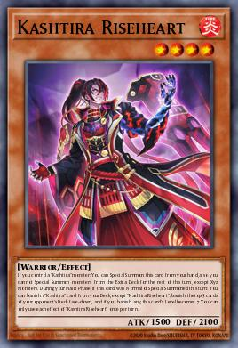 **AÑADIR A MANO** →  **ESTADO / CONTEXTO**

**Acción concreta:** Activar su efecto de Main Phase CL1 para añadir Riseheart desde Deck a mano. Solo se buscó una carta, no otra Fenrir.
**Detalle técnico documentado:** Solo se buscó una carta, no otra Fenrir.

**Estado por zonas después del paso:**

| Zona/recurso | Estado narrativo A09 |
|---|---|
| Mano | Riseheart en mano |
| Monstruos | Fenrir #17768 (Ataque, Nivel 7) |
| Mágicas y trampas | — |
| Cementerio | — |
| Destierro propio | — |
| Campo y estado rival | 0 destierros por esta línea |
| Materiales Xyz/Fusión/Sincro | — |
| Normal, Extra, fase y restricciones | Normal libre; Extra sin restricción de esta ruta |

**Campo visual de este paso:**

**Monstruos propios:**
-  **Fenrir (Ataque, Nivel 7)** — zona declarada: `MONSTER`.
**Mágicas/Trampas/Campo:** sin carta propia demostrada en esta vista.
*Relación ilustrada de cartas presentes tras este paso, documentada en A09. La posición, materiales, otras zonas y rival se leen en la tabla de estado.*

#### Paso 3 — Invocar Normalmente Riseheart, Nivel 4 FUEGO ATK 1500, en zona de monstruo libre.

 **NORMAL**

**Acción concreta:** Invocar Normalmente Riseheart, Nivel 4 FUEGO ATK 1500, en zona de monstruo libre. Normal gastada.
**Detalle técnico documentado:** Normal gastada.

**Estado por zonas después del paso:**

| Zona/recurso | Estado narrativo A09 |
|---|---|
| Mano | — |
| Monstruos | Fenrir #17768 (Ataque, Nivel 7), Riseheart #18151 (Ataque, Nivel 4) |
| Mágicas y trampas | — |
| Cementerio | — |
| Destierro propio | — |
| Campo y estado rival | 0 destierros por esta línea |
| Materiales Xyz/Fusión/Sincro | — |
| Normal, Extra, fase y restricciones | Normal gastada; Extra sin restricción aún |

**Campo visual de este paso:**

**Monstruos propios:**
-  **Fenrir (Ataque, Nivel 7)** — zona declarada: `MONSTER`.
-  **Riseheart (Ataque, Nivel 4)** — zona declarada: `MONSTER`.
**Mágicas/Trampas/Campo:** sin carta propia demostrada en esta vista.
*Relación ilustrada de cartas presentes tras este paso, documentada en A09. La posición, materiales, otras zonas y rival se leen en la tabla de estado.*

#### Paso 4 — Como Riseheart fue Invocado Normalmente ese turno, activar su efecto CL1, desterrando Big Bang Kashtira del Deck como coste (texto anterior al punto y coma).

 **ESTADO / CONTEXTO** → 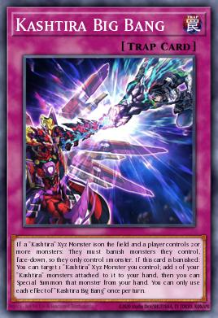 **ACTIVAR**

**Acción concreta:** Como Riseheart fue Invocado Normalmente ese turno, activar su efecto CL1, desterrando Big Bang Kashtira del Deck como coste (texto anterior al punto y coma). Al resolver, desterrar boca abajo las 3 cartas superiores del Deck del adversario; como alguna fue desterrada, el Nivel de Riseheart pasa a 7. No considerar conocimiento de las identidades de las tres cartas desterradas.
**Detalle técnico documentado:** Al resolver, desterrar boca abajo las 3 cartas superiores del Deck del adversario; como alguna fue desterrada, el Nivel de Riseheart pasa a 7. No considerar conocimiento de las identidades de las tres cartas desterradas.

**Estado por zonas después del paso:**

| Zona/recurso | Estado narrativo A09 |
|---|---|
| Mano | — |
| Monstruos | Fenrir #17768 (Ataque, Nivel 7), Riseheart #18151 (Ataque, ahora Nivel 7) |
| Mágicas y trampas | — |
| Cementerio | — |
| Destierro propio | Big Bang (boca arriba) |
| Campo y estado rival | Tres cartas del Deck rival desterradas boca abajo; identidades desconocidas |
| Materiales Xyz/Fusión/Sincro | — |
| Normal, Extra, fase y restricciones | Normal gastada; Extra solo Xyz por efecto de Riseheart |

**Campo visual de este paso:**

**Monstruos propios:**
-  **Fenrir (Ataque, Nivel 7)** — zona declarada: `MONSTER`.
-  **Riseheart (Ataque, ahora Nivel 7)** — zona declarada: `MONSTER`.
**Mágicas/Trampas/Campo:** sin carta propia demostrada en esta vista.
*Relación ilustrada de cartas presentes tras este paso, documentada en A09. La posición, materiales, otras zonas y rival se leen en la tabla de estado.*

#### Paso 5 — Big Bang fue desterrada como coste, pero su disparo requiere seleccionar un Xyz «Kashtira» que controles.

 **ESTADO / CONTEXTO**

**Acción concreta:** Big Bang fue desterrada como coste, pero su disparo requiere seleccionar un Xyz «Kashtira» que controles. En este momento todavía no existe ninguno: no se puede utilizar su efecto para recuperar materiales retroactivamente después de la próxima Invocación.
**Detalle técnico documentado:** En este momento todavía no existe ninguno: no se puede utilizar su efecto para recuperar materiales retroactivamente después de la próxima Invocación.

**Estado por zonas después del paso:**

| Zona/recurso | Estado narrativo A09 |
|---|---|
| Mano | — |
| Monstruos | Fenrir #17768 (Ataque, Nivel 7), Riseheart #18151 (Ataque, Nivel 7) |
| Mágicas y trampas | — |
| Cementerio | — |
| Destierro propio | Big Bang (boca arriba) |
| Campo y estado rival | Tres cartas del Deck rival desterradas boca abajo; sin bloqueo de zonas |
| Materiales Xyz/Fusión/Sincro | —; Big Bang sin Xyz propio legal al dispararse |
| Normal, Extra, fase y restricciones | Normal gastada; Extra solo Xyz |

**Campo visual de este paso:**

**Monstruos propios:**
-  **Fenrir (Ataque, Nivel 7)** — zona declarada: `MONSTER`.
-  **Riseheart (Ataque, Nivel 7)** — zona declarada: `MONSTER`.
**Mágicas/Trampas/Campo:** sin carta propia demostrada en esta vista.
*Relación ilustrada de cartas presentes tras este paso, documentada en A09. La posición, materiales, otras zonas y rival se leen en la tabla de estado.*

#### Paso 6 — Invocar por Xyz Shangri-Ira usando Fenrir Nivel 7 y Riseheart convertido en Nivel 7.

 **INVOCAR XYZ** →  **INVOCAR XYZ** →  **INVOCAR XYZ**

**Acción concreta:** Invocar por Xyz Shangri-Ira usando Fenrir Nivel 7 y Riseheart convertido en Nivel 7. Ambos se acoplan como 2 materiales Xyz. Elegir Defensa para el monstruo final; su Invocación desde Deck corresponde a Standby Phase, no a este instante.
**Detalle técnico documentado:** Ambos se acoplan como 2 materiales Xyz. Elegir Defensa para el monstruo final; su Invocación desde Deck corresponde a Standby Phase, no a este instante.

**Estado por zonas después del paso:**

| Zona/recurso | Estado narrativo A09 |
|---|---|
| Mano | — |
| Monstruos | Shangri-Ira #17800 (Defensa, Rango 7) |
| Mágicas y trampas | — |
| Cementerio | — |
| Destierro propio | Big Bang (boca arriba) |
| Campo y estado rival | Tres cartas del Deck rival desterradas boca abajo; 0 zonas bloqueadas |
| Materiales Xyz/Fusión/Sincro | Shangri-Ira: Fenrir y Riseheart acoplados (2) |
| Normal, Extra, fase y restricciones | Normal gastada; Extra solo Xyz |

**Campo visual de este paso:**

**Monstruos propios:**
-  **Shangri-Ira (Defensa, Rango 7)** — zona declarada: `MONSTER`.
**Mágicas/Trampas/Campo:** sin carta propia demostrada en esta vista.
*Relación ilustrada de cartas presentes tras este paso, documentada en A09. La posición, materiales, otras zonas y rival se leen en la tabla de estado.*

#### Paso 7 — Final definido: Shangri-Ira DEF 3000 con 2 materiales Fenrir/Riseheart, Big Bang desterrada boca arriba, 3 cartas rivales desterradas boca abajo, sin monstruos Kashtira adicionales, sin M/T propias activas, Normal gastada y mano vacía.

 **ESTADO / CONTEXTO** →  **ESTADO / CONTEXTO** →  **ESTADO / CONTEXTO**

**Acción concreta:** Final definido: Shangri-Ira DEF 3000 con 2 materiales Fenrir/Riseheart, Big Bang desterrada boca arriba, 3 cartas rivales desterradas boca abajo, sin monstruos Kashtira adicionales, sin M/T propias activas, Normal gastada y mano vacía. Ninguna zona bloqueada aún: el destierro rival ocurrió antes de que Shangri-Ira existiera y su efecto no actúa retroactivamente. No se ejecuta Arise-Heart sin el requisito previo de otro procedimiento.
**Detalle técnico documentado:** Ninguna zona bloqueada aún: el destierro rival ocurrió antes de que Shangri-Ira existiera y su efecto no actúa retroactivamente. No se ejecuta Arise-Heart sin el requisito previo de otro procedimiento.

**Estado por zonas después del paso:**

| Zona/recurso | Estado narrativo A09 |
|---|---|
| Mano | — |
| Monstruos | Shangri-Ira #17800 (Defensa, Rango 7) |
| Mágicas y trampas | — |
| Cementerio | — |
| Destierro propio | Big Bang (boca arriba) |
| Campo y estado rival | Tres cartas del Deck rival desterradas boca abajo; 0 zonas bloqueadas |
| Materiales Xyz/Fusión/Sincro | Shangri-Ira: Fenrir y Riseheart acoplados (2) |
| Normal, Extra, fase y restricciones | Normal gastada; Extra solo Xyz; no activación retroactiva |

**Campo visual de este paso:**

**Monstruos propios:**
-  **Shangri-Ira (Defensa, Rango 7)** — zona declarada: `MONSTER`.
**Mágicas/Trampas/Campo:** sin carta propia demostrada en esta vista.
*Relación ilustrada de cartas presentes tras este paso, documentada en A09. La posición, materiales, otras zonas y rival se leen en la tabla de estado.*

### Campo final documentado

Esta vista procede **del último paso**, no de una lista de cartas deducida del título.

**Monstruos propios:**
-  **Shangri-Ira (Defensa, Rango 7)** — zona declarada: `MONSTER`.
**Mágicas/Trampas/Campo:** sin carta propia demostrada en esta vista.
*Relación ilustrada de cartas presentes tras este paso, documentada en A09. La posición, materiales, otras zonas y rival se leen en la tabla de estado.*

| Zona/recurso | Estado final documentado |
|---|---|
| Mano | — |
| Monstruos | Shangri-Ira #17800 (Defensa, Rango 7) |
| Mágicas y trampas | — |
| Cementerio | — |
| Destierro propio | Big Bang (boca arriba) |
| Campo y estado rival | Tres cartas del Deck rival desterradas boca abajo; 0 zonas bloqueadas |
| Materiales Xyz/Fusión/Sincro | Shangri-Ira: Fenrir y Riseheart acoplados (2) |
| Normal, Extra, fase y restricciones | Normal gastada; Extra solo Xyz; no activación retroactiva |

### Si el oponente interrumpe

- **INTERRUPCIÓN A12 — paso sin anclaje confirmado: A12 — Interrupciones diferentes de FENRIR:RISEHEART:SHANGRI02**
  - 1. Ash sobre Fenrir: Fenrir está en Campo y activa CL1 para buscar Riseheart desde Deck. Rival descarta Flor de Ceniza CL2; al resolver, niega la búsqueda y Riseheart permanece Deck. Resultado: Fenrir ATK 2400 solo en Campo, Normal libre, Big Bang todavía Deck, ninguna carta rival desterrada y ningún Xyz creado.
  - 2. Effect Veiler sobre Riseheart: Fenrir buscó Riseheart y Riseheart fue Invocado Normalmente. En CL1 de Riseheart se destierra Big Bang del Deck como coste. El rival, durante tu Main Phase, envía Effect Veiler de mano al GY y selecciona Riseheart boca arriba en CL2. CL2 niega sus efectos hasta terminar el turno: CL1 no destierra cartas del Deck rival ni modifica el Nivel. Final de esta ventana: Fenrir Nivel 7 y Riseheart Nivel 4, Big Bang desterrada boca arriba, Normal gastada; no es legal superponerlos como dos Nivel 7 para Shangri-Ira.
  - 3. Intento Ash inválido contra Riseheart: ese efecto destierra del Deck propio como coste y destierra cartas del Deck adversario, pero no añade una carta del Deck a mano, no Invoca desde Deck ni envía del Deck al GY. Flor de Ceniza no puede negar ese efecto por sí sola. No sumar este intento a las dos interrupciones legales.
  - Fuentes: Fenrir, Riseheart, Flor de Ceniza, Effect Veiler.;.
  - Estado de rama: `Resuelto solo en el escenario que detalla A12/A13; las otras respuestas no están demostradas.`.
- **RECUPERACIÓN A13 — paso sin anclaje confirmado: A13 — Fallos y recursos restantes FENRIR:RISEHEART:SHANGRI02**
  - Ash a Fenrir: sin búsqueda, Riseheart no se obtiene; solo Fenrir queda boca arriba y la Normal permanece disponible. No declarar Shangri-Ira ni inventar un segundo monstruo Nivel 7.
  - Veiler a Riseheart: Big Bang ya fue desterrada como coste, incluso si se niega el efecto. Riseheart no pasa de Nivel 4, por lo que Fenrir Nivel 7 + Riseheart Nivel 4 no satisfacen el Rank 7 de Shangri-Ira. Tampoco se desterraron cartas del adversario ni se bloquearon zonas. No hay recuperación demostrada desde la mano original de solo Fenrir.
  - Con cartas adicionales no declaradas: elaborar otra ficha con nueva mano y comprobar costes/fases; nunca tratar estas dos interrupciones como si un tercer Kashtira apareciera espontáneamente.;.
  - Estado de rama: `Resuelto solo en el escenario que detalla A12/A13; las otras respuestas no están demostradas.`.

---

## UNICORN · THEOSIS · FENRIR · SHANGRI03 · `665:A09:UNICORN:THEOSIS:FENRIR:SHANGRI03`

**Propósito competitivo principal (lectura documental):** Invocar Shangri-Ira y conservar Fenrir para el turno rival. El objetivo solo se acredita si las acciones y el campo final detallados en esta guía lo permiten; no implica legalidad certificada ni garantiza el resultado ante respuestas adversarias.

**Categoría:** APERTURA

**Propósito y resultado documental:**

Endboard estricto: Shangri-Ira DEF 3000 (dos materiales), Fenrir en Defensa, Kashtiratheosis en GY, Big Bang desterrada boca arriba, tres cartas del adversario desterradas boca abajo, cero zonas bloqueadas todavía, Invocación Normal libre, sin M/T propias continuas. No anunciar Arise-Heart, bloqueo de zonas retroactivo ni ataque en el mismo turno de un Fenrir en Defensa. La amenaza de destierro futuro de Fenrir está condicionada a su propio disparador y objetivo legal.

### Mano y estado inicial

solo Kashtira Unicorn. Campo/GY propios: vacíos. Deck: 1× Kashtiratheosis, 1× Kashtira Fenrir (TIERRA), 1× Kashtira Riseheart (FUEGO) y 1× Kashtira Big Bang disponibles. Extra: Shangri-Ira. Rival con mínimo 3 cartas en Deck; sin negaciones ni bloqueos previos. Es Main Phase propia y la Invocación Normal sigue libre.

 **Kashtira Unicorn**

### Ejecución numerada

#### Paso 1 — Invocar Especialmente Unicorn desde mano, ya que no controlas monstruos.

 **ESPECIAL**

**Acción concreta:** Invocar Especialmente Unicorn desde mano, ya que no controlas monstruos.
**Detalle técnico documentado:** Unicorn VIENTO Nivel 7 en Campo; Normal no gastada. Es su procedimiento de Invocación, no una búsqueda ni nueva Cadena.

**Estado por zonas después del paso:**

| Zona/recurso | Estado narrativo A09 |
|---|---|
| Mano | — |
| Monstruos | Unicornio #17769 (Ataque, Nivel 7) |
| Mágicas y trampas | — |
| Cementerio | — |
| Destierro propio | — |
| Campo y estado rival | Mínimo 3 cartas siguen en Deck rival; sin destierros por esta línea |
| Materiales Xyz/Fusión/Sincro | — |
| Normal, Extra, fase y restricciones | Normal libre; Extra sin restricción de esta ruta |

**Campo visual de este paso:**

**Monstruos propios:**
-  **Unicornio (Ataque, Nivel 7)** — zona declarada: `MONSTER`.
**Mágicas/Trampas/Campo:** sin carta propia demostrada en esta vista.
*Relación ilustrada de cartas presentes tras este paso, documentada en A09. La posición, materiales, otras zonas y rival se leen en la tabla de estado.*

#### Paso 2 — Activar su efecto de Main Phase CL1.

 **AÑADIR A MANO**

**Acción concreta:** Activar su efecto de Main Phase CL1.
**Detalle técnico documentado:** Añadir Kashtiratheosis desde Deck a mano; una búsqueda resuelta.

**Estado por zonas después del paso:**

| Zona/recurso | Estado narrativo A09 |
|---|---|
| Mano | Kashtiratheosis en mano |
| Monstruos | Unicornio #17769 (Ataque, Nivel 7) |
| Mágicas y trampas | — |
| Cementerio | — |
| Destierro propio | — |
| Campo y estado rival | Sin destierros por esta línea |
| Materiales Xyz/Fusión/Sincro | — |
| Normal, Extra, fase y restricciones | Normal libre; Extra sin restricción de esta ruta |

**Campo visual de este paso:**

**Monstruos propios:**
-  **Unicornio (Ataque, Nivel 7)** — zona declarada: `MONSTER`.
**Mágicas/Trampas/Campo:** sin carta propia demostrada en esta vista.
*Relación ilustrada de cartas presentes tras este paso, documentada en A09. La posición, materiales, otras zonas y rival se leen en la tabla de estado.*

#### Paso 3 — Activar Kashtiratheosis CL1 seleccionando a Unicorn.

 **ACTIVAR** →  **OBJETIVO** →  **ESTADO / CONTEXTO**

**Acción concreta:** Activar Kashtiratheosis CL1 seleccionando a Unicorn.
**Detalle técnico documentado:** Invocar Fenrir TIERRA (Atributo distinto de Unicorn VIENTO) desde Deck en Defensa. Después de resolver, Extra solo admite Xyz durante el resto del turno. Teosis va al GY.

**Estado por zonas después del paso:**

| Zona/recurso | Estado narrativo A09 |
|---|---|
| Mano | — |
| Monstruos | Unicornio #17769 (Ataque, Nivel 7), Fenrir #17768 (Defensa, Nivel 7) |
| Mágicas y trampas | — |
| Cementerio | Teosis en GY |
| Destierro propio | — |
| Campo y estado rival | Sin destierros por esta línea |
| Materiales Xyz/Fusión/Sincro | — |
| Normal, Extra, fase y restricciones | Normal libre; Extra solo Xyz por resolución de Teosis |

**Campo visual de este paso:**

**Monstruos propios:**
-  **Unicornio (Ataque, Nivel 7)** — zona declarada: `MONSTER`.
-  **Fenrir (Defensa, Nivel 7)** — zona declarada: `MONSTER`.
**Mágicas/Trampas/Campo:** sin carta propia demostrada en esta vista.
*Relación ilustrada de cartas presentes tras este paso, documentada en A09. La posición, materiales, otras zonas y rival se leen en la tabla de estado.*

#### Paso 4 — Activar el efecto de búsqueda CL1 de Fenrir en Main Phase.

 **ACTIVAR** →  **AÑADIR A MANO**

**Acción concreta:** Activar el efecto de búsqueda CL1 de Fenrir en Main Phase.
**Detalle técnico documentado:** Añadir Riseheart desde Deck a mano. Fenrir permanece en Defensa; su búsqueda no requiere estar en Ataque.

**Estado por zonas después del paso:**

| Zona/recurso | Estado narrativo A09 |
|---|---|
| Mano | Riseheart en mano |
| Monstruos | Unicornio #17769 (Ataque, Nivel 7), Fenrir #17768 (Defensa, Nivel 7) |
| Mágicas y trampas | — |
| Cementerio | Teosis en GY |
| Destierro propio | — |
| Campo y estado rival | Sin destierros por esta línea |
| Materiales Xyz/Fusión/Sincro | — |
| Normal, Extra, fase y restricciones | Normal libre; Extra solo Xyz |

**Campo visual de este paso:**

**Monstruos propios:**
-  **Unicornio (Ataque, Nivel 7)** — zona declarada: `MONSTER`.
-  **Fenrir (Defensa, Nivel 7)** — zona declarada: `MONSTER`.
**Mágicas/Trampas/Campo:** sin carta propia demostrada en esta vista.
*Relación ilustrada de cartas presentes tras este paso, documentada en A09. La posición, materiales, otras zonas y rival se leen en la tabla de estado.*

#### Paso 5 — Invocar Especialmente Riseheart desde mano al controlar monstruo «Kashtira».

 **ESPECIAL**

**Acción concreta:** Invocar Especialmente Riseheart desde mano al controlar monstruo «Kashtira».
**Detalle técnico documentado:** Riseheart FUEGO Nivel 4 queda en Campo. Su procedimiento limita el Extra a Xyz; no se usó la Normal.

**Estado por zonas después del paso:**

| Zona/recurso | Estado narrativo A09 |
|---|---|
| Mano | — |
| Monstruos | Unicornio #17769 (Ataque, Nivel 7), Fenrir #17768 (Defensa, Nivel 7), Riseheart #18151 (Ataque, Nivel 4) |
| Mágicas y trampas | — |
| Cementerio | Teosis en GY |
| Destierro propio | — |
| Campo y estado rival | Sin destierros por esta línea |
| Materiales Xyz/Fusión/Sincro | — |
| Normal, Extra, fase y restricciones | Normal libre; Extra solo Xyz |

**Campo visual de este paso:**

**Monstruos propios:**
-  **Unicornio (Ataque, Nivel 7)** — zona declarada: `MONSTER`.
-  **Fenrir (Defensa, Nivel 7)** — zona declarada: `MONSTER`.
-  **Riseheart (Ataque, Nivel 4)** — zona declarada: `MONSTER`.
**Mágicas/Trampas/Campo:** sin carta propia demostrada en esta vista.
*Relación ilustrada de cartas presentes tras este paso, documentada en A09. La posición, materiales, otras zonas y rival se leen en la tabla de estado.*

#### Paso 6 — Activar el efecto de Riseheart CL1: desterrar Big Bang del Deck boca arriba como coste, antes de que el rival pueda encadenar.

 **ACTIVAR** →  **DESTERRAR**

**Acción concreta:** Activar el efecto de Riseheart CL1: desterrar Big Bang del Deck boca arriba como coste, antes de que el rival pueda encadenar.
**Detalle técnico documentado:** Al resolver, desterrar boca abajo las 3 cartas superiores del Deck rival. Riseheart pasa a Nivel 7 al haberse desterrado al menos una. El efecto desterrado de Big Bang no puede elegir Xyz «Kashtira» propio, porque todavía no hay Xyz en Campo.

**Estado por zonas después del paso:**

| Zona/recurso | Estado narrativo A09 |
|---|---|
| Mano | — |
| Monstruos | Unicornio #17769 (Ataque, Nivel 7), Fenrir #17768 (Defensa, Nivel 7), Riseheart #18151 (Ataque, ahora Nivel 7) |
| Mágicas y trampas | — |
| Cementerio | Teosis en GY |
| Destierro propio | Big Bang (boca arriba) |
| Campo y estado rival | Tres cartas del Deck rival desterradas boca abajo; identidades desconocidas |
| Materiales Xyz/Fusión/Sincro | —; Big Bang sin Xyz propio legal en esa ventana |
| Normal, Extra, fase y restricciones | Normal libre; Extra solo Xyz |

**Campo visual de este paso:**

**Monstruos propios:**
-  **Unicornio (Ataque, Nivel 7)** — zona declarada: `MONSTER`.
-  **Fenrir (Defensa, Nivel 7)** — zona declarada: `MONSTER`.
-  **Riseheart (Ataque, ahora Nivel 7)** — zona declarada: `MONSTER`.
**Mágicas/Trampas/Campo:** sin carta propia demostrada en esta vista.
*Relación ilustrada de cartas presentes tras este paso, documentada en A09. La posición, materiales, otras zonas y rival se leen en la tabla de estado.*

#### Paso 7 — Superponer Unicorn + Riseheart Nivel 7 para Invocar por Xyz Shangri-Ira en Defensa.

 **MATERIAL XYZ** →  **MATERIAL XYZ** →  **MATERIAL XYZ**

**Acción concreta:** Superponer Unicorn + Riseheart Nivel 7 para Invocar por Xyz Shangri-Ira en Defensa.
**Detalle técnico documentado:** Shangri-Ira con 2 materiales Unicorn/Riseheart. Fenrir no fue usado como material y permanece en Defensa en el Campo.

**Estado por zonas después del paso:**

| Zona/recurso | Estado narrativo A09 |
|---|---|
| Mano | — |
| Monstruos | Shangri-Ira #17800 (Defensa, Rango 7), Fenrir #17768 (Defensa, Nivel 7) |
| Mágicas y trampas | — |
| Cementerio | Teosis en GY |
| Destierro propio | Big Bang (boca arriba) |
| Campo y estado rival | Tres cartas del Deck rival desterradas boca abajo; sin zonas bloqueadas |
| Materiales Xyz/Fusión/Sincro | Shangri-Ira: Unicornio y Riseheart acoplados (2) |
| Normal, Extra, fase y restricciones | Normal libre; Extra solo Xyz |

**Campo visual de este paso:**

**Monstruos propios:**
-  **Shangri-Ira (Defensa, Rango 7)** — zona declarada: `MONSTER`.
-  **Fenrir (Defensa, Nivel 7)** — zona declarada: `MONSTER`.
**Mágicas/Trampas/Campo:** sin carta propia demostrada en esta vista.
*Relación ilustrada de cartas presentes tras este paso, documentada en A09. La posición, materiales, otras zonas y rival se leen en la tabla de estado.*

### Campo final documentado

Esta vista procede **del último paso**, no de una lista de cartas deducida del título.

**Monstruos propios:**
-  **Shangri-Ira (Defensa, Rango 7)** — zona declarada: `MONSTER`.
-  **Fenrir (Defensa, Nivel 7)** — zona declarada: `MONSTER`.
**Mágicas/Trampas/Campo:** sin carta propia demostrada en esta vista.
*Relación ilustrada de cartas presentes tras este paso, documentada en A09. La posición, materiales, otras zonas y rival se leen en la tabla de estado.*

| Zona/recurso | Estado final documentado |
|---|---|
| Mano | — |
| Monstruos | Shangri-Ira #17800 (Defensa, Rango 7), Fenrir #17768 (Defensa, Nivel 7) |
| Mágicas y trampas | — |
| Cementerio | Teosis en GY |
| Destierro propio | Big Bang (boca arriba) |
| Campo y estado rival | Tres cartas del Deck rival desterradas boca abajo; sin zonas bloqueadas |
| Materiales Xyz/Fusión/Sincro | Shangri-Ira: Unicornio y Riseheart acoplados (2) |
| Normal, Extra, fase y restricciones | Normal libre; Extra solo Xyz |

### Si el oponente interrumpe

- **INTERRUPCIÓN A12 — paso sin anclaje confirmado: A12 — Tres respuestas independientes a UNICORN:THEOSIS:FENRIR:SHANGRI03**
  - 1. Ash a Unicorn cuando busca Theosis: Unicorn CL1 incluye añadir una Mágica «Kashtira» desde Deck; Ash en mano rival CL2, descartada como coste, niega esa búsqueda. Unicorn queda Nivel 7 en Campo, Theosis sigue Deck; no aparece Fenrir desde este acceso de una carta.
  - 2. Ash a Theosis después de buscarla: Unicorn ya buscó Theosis; Theosis CL1 selecciona a Unicorn para Invocar desde Deck, Ash CL2 niega ese efecto; no se Invoca Fenrir, Theosis termina en GY y Unicorn permanece en Campo. No volver a usar la misma Theosis desde GY por su primer efecto sin otra fuente.
  - 3. Effect Veiler a Fenrir al buscar Riseheart: Theosis resolvió y Fenrir ya está en Defensa. Fenrir CL1 intenta buscar Riseheart; Veiler rival CL2 (durante nuestra Main) lo selecciona boca arriba, lo niega hasta final de turno. Fenrir y Unicorn siguen Nivel 7; no se obtuvo Riseheart ni se desterró Big Bang. Se mantiene la posibilidad legal de superponer Fenrir + Unicorn para Shangri-Ira (2 materiales), sin Fenrir independiente ni tres destierros adversarios.
  - Se suponen las cartas rivales disponibles, sin otras negaciones. Las tres pruebas son alternativas, no ocurren juntas. Fuentes: Unicorn, Theosis, Fenrir, Ash, Veiler..
  - Estado de rama: `Resuelto solo en el escenario que detalla A12/A13; las otras respuestas no están demostradas.`.
- **RECUPERACIÓN A13 — paso sin anclaje confirmado: A13 — Tres tableros tras interrupción de UNICORN:THEOSIS:FENRIR:SHANGRI03**
  - Escenario A12 | Recursos ya usados | Estado alternativo preciso | Continuación
  - Ash niega la búsqueda de Unicorn | Ash rival descartada. Unicorn se Invocó desde mano; Theosis sigue Deck. | Unicorn Nivel 7 solo en Campo; Normal libre, sin Xyz, Big Bang intacta. | SIN_CONTINUACION_DEMOSTRADA con esa única carta.
  - Ash niega Theosis | Unicorn fue Invocado; Theosis activada desde mano y negada, acaba en GY. | Unicorn Nivel 7 solo en Campo; Fenrir sigue Deck; Normal libre. | SIN_CONTINUACION_DEMOSTRADA con esa única carta.
  - Veiler niega la búsqueda de Fenrir | Unicorn y Fenrir Nivel 7 en Campo; Theosis en GY; Veiler en GY rival; Riseheart todavía Deck. | Invocar Shangri-Ira usando Unicorn+Fenrir como 2 materiales. Ningún Fenrir queda independiente, ningún Big Bang desterrado y ningún destierro rival ocurrió. |; Normal libre.
  - Estas ramas no equivalen a victoria/derrota automática, no inventan cartas adicionales y quedan no importables hasta completar la guía A10 y aprobar la unidad individual.
  - Estado de rama: `Resuelto solo en el escenario que detalla A12/A13; las otras respuestas no están demostradas.`.

---

## SHANGRI · STANDBY · ARISE04 · `665:A09:SHANGRI:STANDBY:ARISE04`

**Propósito competitivo principal (lectura documental):** Continuar a Arise-Heart desde Shangri-Ira en un turno posterior. El objetivo solo se acredita si las acciones y el campo final detallados en esta guía lo permiten; no implica legalidad certificada ni garantiza el resultado ante respuestas adversarias.

**Categoría:** CONTINUACIÓN

**Propósito y resultado documental:**

Endboard exacto sin interferencia: Arise-Heart Rango 7 / ATK 3000 DEF 3000 con 3 materiales (Shangri-Ira, Unicorn y Fenrir #1), Fenrir #2 en Defensa / 2400 DEF, Wraitsoth en Campo. El efecto continuo de Arise-Heart destierra las cartas que irían al GY mientras permanezca boca arriba. Normal del turno 2 libre; ninguna carta rival fue desterrada ni ninguna zona bloqueada por esta línea; sin daño garantizado. Si se hubiera negado la activación o no sobreviviera Shangri, no se puede ejecutar la promoción así descrita. No garantizar que Arise esté ya presente al terminar el primer turno, ni una retirada que no se activó.;.

### Mano y estado inicial

Apertura del turno 1: Wraitsoth únicamente Wraitsoth en mano, con Unicorn, Kashtiratheosis y Fenrir en Deck, y Shangri Shangri-Ira en Extra; aplicar exactamente los pasos 1–5 de la ficha previa WRAITSOTH:SHANGRI01. Se termina con Shangri en Defensa, 2 materiales Xyz originales (Unicorn + primer Fenrir) y Wraitsoth en Zona de Campo. Normal del turno 1 libre. No ocurre destierro rival boca abajo en esos pasos. Nueva condición de estado: Shangri-Ira debe permanecer en Campo durante el turno del rival sin ser neutralizado, volteado boca abajo ni perder la capacidad de activar sus efectos. La mano/carta de robo del siguiente turno no se usan ni se presuponen conocidas.

 **Pressured Planet Wraitsoth**

### Ejecución numerada

#### Paso 1 — Turno 2 propio, Standby Phase: activar el primer efecto de Shangri-Ira (CL1) y, al resolver, Invocar Especialmente un segundo Kashtira Fenrir desde Deck en Defensa en una Zona de Monstruos libre.

 **ACTIVAR** →  **ESPECIAL** → 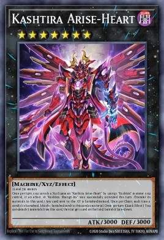 **ESTADO / CONTEXTO**

**Acción concreta:** Turno 2 propio, Standby Phase: activar el primer efecto de Shangri-Ira (CL1) y, al resolver, Invocar Especialmente un segundo Kashtira Fenrir desde Deck en Defensa en una Zona de Monstruos libre. Este Fenrir no es el material Fenrir #1 bajo Shangri; el inventario contiene 3 copias de Fenrir. La activación exitosa del efecto de Shangri-Ira sucedió en este mismo turno, que es la precondición expresa del procedimiento alternativo de Arise-Heart. No usar otro efecto de búsqueda de Fenrir en esta ficha.
**Detalle técnico documentado:** Este Fenrir no es el material Fenrir #1 bajo Shangri; el inventario contiene 3 copias de Fenrir. La activación exitosa del efecto de Shangri-Ira sucedió en este mismo turno, que es la precondición expresa del procedimiento alternativo de Arise-Heart. No usar otro efecto de búsqueda de Fenrir en esta ficha.

**Estado por zonas después del paso:**

| Zona/recurso | Estado narrativo A09 |
|---|---|
| Mano | Robo del turno 2 no identificado ni usado |
| Monstruos | Shangri-Ira #17800 (Defensa, Rango 7), Fenrir #17768 (Defensa, segundo ejemplar) |
| Mágicas y trampas | Wraitsoth #18204 (Campo boca arriba) |
| Cementerio | Teosis del turno 1 en GY |
| Destierro propio | — |
| Campo y estado rival | No hubo destierro causado por la ruta ni bloqueo; demás estado rival no especificado |
| Materiales Xyz/Fusión/Sincro | Shangri-Ira: Unicornio y Fenrir primer ejemplar (2) |
| Normal, Extra, fase y restricciones | Normal del turno 2 libre; restricción de Teosis del turno 1 terminada |

**Campo visual de este paso:**

**Monstruos propios:**
-  **Shangri-Ira (Defensa, Rango 7)** — zona declarada: `MONSTER`.
-  **Fenrir (Defensa, segundo ejemplar)** — zona declarada: `MONSTER`.
**Mágicas/Trampas/Campo:**
-  **Wraitsoth (Campo boca arriba)** — zona declarada: `FIELD`.
*Relación ilustrada de cartas presentes tras este paso, documentada en A09. La posición, materiales, otras zonas y rival se leen en la tabla de estado.*

#### Paso 2 — Turno 2 propio, Main Phase: Arise-Heart Invocar Xyz Kashtira Arise-Heart desde el Extra utilizando Shangri-Ira (monstruo «Kashtira» que controlas) como su único material mediante el procedimiento alternativo habilitado por el paso 1.

 **INVOCAR XYZ** →  **INVOCAR XYZ** →  **ESTADO / CONTEXTO**

**Acción concreta:** Turno 2 propio, Main Phase: Arise-Heart Invocar Xyz Kashtira Arise-Heart desde el Extra utilizando Shangri-Ira (monstruo «Kashtira» que controlas) como su único material mediante el procedimiento alternativo habilitado por el paso 1. No exigir tres monstruos de Nivel 7: el propio texto de Arise-Heart prevé este procedimiento especial una vez por turno si Shangri-Ira activó con éxito un efecto ese turno. Trasladar los 2 materiales originales (Unicorn y Fenrir #1) de Shangri a Arise; ahora Arise tiene 3 materiales: Shangri + Unicorn + Fenrir #1. El segundo Fenrir que llegó de Deck en Standby no fue material y permanece en Defensa.
**Detalle técnico documentado:** No exigir tres monstruos de Nivel 7: el propio texto de Arise-Heart prevé este procedimiento especial una vez por turno si Shangri-Ira activó con éxito un efecto ese turno. Trasladar los 2 materiales originales (Unicorn y Fenrir #1) de Shangri a Arise; ahora Arise tiene 3 materiales: Shangri + Unicorn + Fenrir #1. El segundo Fenrir que llegó de Deck en Standby no fue material y permanece en Defensa.

**Estado por zonas después del paso:**

| Zona/recurso | Estado narrativo A09 |
|---|---|
| Mano | Robo del turno 2 no identificado ni usado |
| Monstruos | Arise-Heart #18191 (Ataque, Rango 7), Fenrir #17768 (Defensa, segundo ejemplar) |
| Mágicas y trampas | Wraitsoth #18204 (Campo boca arriba) |
| Cementerio | Teosis del turno 1 en GY |
| Destierro propio | — |
| Campo y estado rival | La línea no desterró cartas del adversario ni dejó bloqueo de Shangri |
| Materiales Xyz/Fusión/Sincro | Arise-Heart: Shangri-Ira y originales Unicornio y Fenrir primer ejemplar (3) |
| Normal, Extra, fase y restricciones | Normal del turno 2 libre; no persiste limitación Extra de Teosis del turno 1 |

**Campo visual de este paso:**

**Monstruos propios:**
-  **Arise-Heart (Ataque, Rango 7)** — zona declarada: `MONSTER`.
-  **Fenrir (Defensa, segundo ejemplar)** — zona declarada: `MONSTER`.
**Mágicas/Trampas/Campo:**
-  **Wraitsoth (Campo boca arriba)** — zona declarada: `FIELD`.
*Relación ilustrada de cartas presentes tras este paso, documentada en A09. La posición, materiales, otras zonas y rival se leen en la tabla de estado.*

#### Paso 3 — Cierre: conservar Arise-Heart en Campo; no activar su efecto rápido de destierro en esta secuencia.

 **YA EN CAMPO** →  **YA EN CAMPO**

**Acción concreta:** Cierre: conservar Arise-Heart en Campo; no activar su efecto rápido de destierro en esta secuencia. Ese efecto exige desacoplar tres materiales y un objetivo legal para desterrar una carta del Campo boca abajo; aquí no se paga ese coste. Distinguir este efecto del reemplazo de envío al GY por destierro y de los posibles nuevos materiales. No adjudicar zonas bloqueadas por Shangri-Ira si ya no permanece boca arriba en Campo.
**Detalle técnico documentado:** Ese efecto exige desacoplar tres materiales y un objetivo legal para desterrar una carta del Campo boca abajo; aquí no se paga ese coste. Distinguir este efecto del reemplazo de envío al GY por destierro y de los posibles nuevos materiales. No adjudicar zonas bloqueadas por Shangri-Ira si ya no permanece boca arriba en Campo.

**Estado por zonas después del paso:**

| Zona/recurso | Estado narrativo A09 |
|---|---|
| Mano | Robo del turno 2 no identificado ni usado |
| Monstruos | Arise-Heart #18191 (Ataque, Rango 7), Fenrir #17768 (Defensa, segundo ejemplar) |
| Mágicas y trampas | Wraitsoth #18204 (Campo boca arriba) |
| Cementerio | Teosis del turno 1 en GY |
| Destierro propio | — |
| Campo y estado rival | Ningún destierro boca abajo efectuado por este cierre y 0 zonas bloqueadas |
| Materiales Xyz/Fusión/Sincro | Arise-Heart: Shangri-Ira y originales Unicornio y Fenrir primer ejemplar (3), no desacopló |
| Normal, Extra, fase y restricciones | Normal del turno 2 libre; efecto rápido de Arise no ejecutado |

**Campo visual de este paso:**

**Monstruos propios:**
-  **Arise-Heart (Ataque, Rango 7)** — zona declarada: `MONSTER`.
-  **Fenrir (Defensa, segundo ejemplar)** — zona declarada: `MONSTER`.
**Mágicas/Trampas/Campo:**
-  **Wraitsoth (Campo boca arriba)** — zona declarada: `FIELD`.
*Relación ilustrada de cartas presentes tras este paso, documentada en A09. La posición, materiales, otras zonas y rival se leen en la tabla de estado.*

### Campo final documentado

Esta vista procede **del último paso**, no de una lista de cartas deducida del título.

**Monstruos propios:**
-  **Arise-Heart (Ataque, Rango 7)** — zona declarada: `MONSTER`.
-  **Fenrir (Defensa, segundo ejemplar)** — zona declarada: `MONSTER`.
**Mágicas/Trampas/Campo:**
-  **Wraitsoth (Campo boca arriba)** — zona declarada: `FIELD`.
*Relación ilustrada de cartas presentes tras este paso, documentada en A09. La posición, materiales, otras zonas y rival se leen en la tabla de estado.*

| Zona/recurso | Estado final documentado |
|---|---|
| Mano | Robo del turno 2 no identificado ni usado |
| Monstruos | Arise-Heart #18191 (Ataque, Rango 7), Fenrir #17768 (Defensa, segundo ejemplar) |
| Mágicas y trampas | Wraitsoth #18204 (Campo boca arriba) |
| Cementerio | Teosis del turno 1 en GY |
| Destierro propio | — |
| Campo y estado rival | Ningún destierro boca abajo efectuado por este cierre y 0 zonas bloqueadas |
| Materiales Xyz/Fusión/Sincro | Arise-Heart: Shangri-Ira y originales Unicornio y Fenrir primer ejemplar (3), no desacopló |
| Normal, Extra, fase y restricciones | Normal del turno 2 libre; efecto rápido de Arise no ejecutado |

### Si el oponente interrumpe

- **INTERRUPCIÓN A12 — paso 1: A12 — Ash a Shangri-Ira en paso P1 de SHANGRI:STANDBY:ARISE04**
  - Precondición: Shangri-Ira con materiales Unicornio + Fenrir #1 sobrevivió hasta la Standby propia del turno siguiente; el rival conserva Ash en mano. CL1 Shangri para Invocar Fenrir #2 desde Deck; CL2 Ash, descartada como coste, niega el efecto, no la activación. Fenrir #2 no sale del Deck; Shangri y Wraitsoth permanecen en Campo, y no se gastó la Normal.
  - Clave técnica: Arise-Heart pregunta por una activación exitosa de Shangri este turno, no por una Invocación de Fenrir que haya resuelto. Aunque la Invocación fue negada, no se negó la activación CL1. Textos oficiales..
  - <!-- A12_AUDITORIA_RUTA_INICIO -->
  - Estado de rama: `Resuelto solo en el escenario que detalla A12/A13; las otras respuestas no están demostradas.`.
- **RECUPERACIÓN A13 — paso 1: A13 — Arise-Heart aún disponible tras Ash en paso P1 de SHANGRI:STANDBY:ARISE04**
  - 1. Tras resolver Ash CL2: Shangri-Ira permanece en Defensa con 2 materiales [Unicornio, Fenrir #1]; Wraitsoth boca arriba en Campo, Teosis del turno previo en GY, el segundo Fenrir sigue en Deck; la Normal del turno 2 no fue usada. No atribuir robo concreto en Draw Phase.
  - 2. Main Phase propia: como el efecto de Shangri se activó válidamente en Standby aunque Ash impidiera su resultado, Invocar Arise-Heart mediante su procedimiento Xyz alternativo utilizando Shangri como único monstruo material; acoplar Shangri y transferirle sus dos materiales originales. Es un procedimiento sin CL independiente.
  - 3. Final alternativo preciso: Arise-Heart 3000 ATK impreso con 3 materiales [Shangri-Ira, Unicornio, Fenrir #1], Wraitsoth en Campo, Normal disponible, sin Fenrir #2 y sin nuevas cartas rivales desterradas o zonas bloqueadas por este corte. No ejecutar automáticamente su destierro rápido de tres materiales. Esta continuación requiere que la activación Shangri no haya sido negada ni el monstruo retirado..
  - No confundir: una respuesta que niega la activación de Shangri, a diferencia de Ash, no habilita este procedimiento alternativo por ese evento. Fuentes: Arise-Heart, Shangri-Ira, Flor de Ceniza.
  - <!-- A13_AUDITORIA_RUTA_INICIO -->
  - Estado de rama: `Resuelto solo en el escenario que detalla A12/A13; las otras respuestas no están demostradas.`.

---

## FENRIR · BIRTH · SHANGRI05 · `665:A09:FENRIR:BIRTH:SHANGRI05`

**Propósito competitivo principal (lectura documental):** Invocar Shangri-Ira y preparar Nacimiento y Preparaciones. El objetivo solo se acredita si las acciones y el campo final detallados en esta guía lo permiten; no implica legalidad certificada ni garantiza el resultado ante respuestas adversarias.

**Categoría:** APERTURA

**Propósito y resultado documental:**

6. Final: Shangri-Ira DEF 3000, 2 materiales [Fenrir, Ogro] + Unicornio boca arriba ATK 2500 + Nacimiento boca arriba + Preparaciones Colocada. Sin cartas de mano sobrantes de la apertura mínima; Normal gastada; Teosis GY y restricción Extra Xyz activa. Cero zonas bloqueadas y cero cartas rivales desterradas boca abajo en esta ruta: los bloqueos de Shangri requieren un evento posterior. El efecto de Shangri de traer Kashtira desde Deck puede activarse en una Standby Phase posterior, no en esta Main Phase.

### Mano y estado inicial

Kashtira Fenrir (17768) + Nacimiento Kashtira (17815) en mano; propio Campo/GY vacíos, Main Phase propia, sin respuesta rival. En Main Deck quedan al menos Unicornio (17769, VIENTO), Kashtirateosis (18203), Ogro (17770, AGUA) y Preparaciones Kashtira (17831, Trampa); Extra incluye Shangri-Ira (17800). No requiere Riseheart ni desterrar cartas rivales.

 **Kashtira Fenrir**
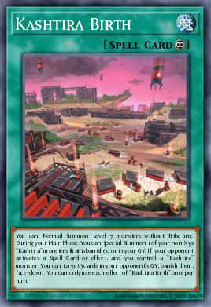 **Kashtira Birth**

### Ejecución numerada

#### Paso 1 — Invocar Especialmente Fenrir desde mano sin formar Cadena, puesto que no controlas monstruos.

 **ESPECIAL** →  **AÑADIR A MANO**

**Acción concreta:** Invocar Especialmente Fenrir desde mano sin formar Cadena, puesto que no controlas monstruos. CL1 Fenrir en Main Phase: añadir Unicornio del Deck a mano. Fenrir TIERRA Nivel 7 queda en Ataque (2400 ATK).
**Detalle técnico documentado:** CL1 Fenrir en Main Phase: añadir Unicornio del Deck a mano. Fenrir TIERRA Nivel 7 queda en Ataque (2400 ATK).

**Estado por zonas después del paso:**

| Zona/recurso | Estado narrativo A09 |
|---|---|
| Mano | Nacimiento y Unicornio en mano |
| Monstruos | Fenrir #17768 (Ataque, Nivel 7) |
| Mágicas y trampas | — |
| Cementerio | — |
| Destierro propio | — |
| Campo y estado rival | No se produjo retirada ni destierro rival por esta ruta |
| Materiales Xyz/Fusión/Sincro | — |
| Normal, Extra, fase y restricciones | Normal libre; Extra sin restricción de esta ruta |

**Campo visual de este paso:**

**Monstruos propios:**
-  **Fenrir (Ataque, Nivel 7)** — zona declarada: `MONSTER`.
**Mágicas/Trampas/Campo:** sin carta propia demostrada en esta vista.
*Relación ilustrada de cartas presentes tras este paso, documentada en A09. La posición, materiales, otras zonas y rival se leen en la tabla de estado.*

#### Paso 2 — Activar Nacimiento Kashtira como Mágica Continua.

 **ACTIVAR** →  **SACRIFICIO**

**Acción concreta:** Activar Nacimiento Kashtira como Mágica Continua. Su permiso «Puedes Invocar de Modo Normal monstruos de Nivel 7 sin Sacrificar» permite la Invocación Normal de Unicornio, Nivel 7, desde mano sin Sacrificios. Gasta la Normal del turno; no se activó el efecto de recuperación de Nacimiento.
**Detalle técnico documentado:** Su permiso «Puedes Invocar de Modo Normal monstruos de Nivel 7 sin Sacrificar» permite la Invocación Normal de Unicornio, Nivel 7, desde mano sin Sacrificios. Gasta la Normal del turno; no se activó el efecto de recuperación de Nacimiento.

**Estado por zonas después del paso:**

| Zona/recurso | Estado narrativo A09 |
|---|---|
| Mano | — |
| Monstruos | Fenrir #17768 (Ataque, Nivel 7), Unicornio #17769 (Ataque, Nivel 7) |
| Mágicas y trampas | Nacimiento #17815 (Continua boca arriba) |
| Cementerio | — |
| Destierro propio | — |
| Campo y estado rival | Ningún destierro ni bloqueo por esta ruta |
| Materiales Xyz/Fusión/Sincro | — |
| Normal, Extra, fase y restricciones | Normal gastada en Unicornio; Extra sin restricción aún |

**Campo visual de este paso:**

**Monstruos propios:**
-  **Fenrir (Ataque, Nivel 7)** — zona declarada: `MONSTER`.
-  **Unicornio (Ataque, Nivel 7)** — zona declarada: `MONSTER`.
**Mágicas/Trampas/Campo:**
-  **Nacimiento (Continua boca arriba)** — zona declarada: `SPELL_TRAP`.
*Relación ilustrada de cartas presentes tras este paso, documentada en A09. La posición, materiales, otras zonas y rival se leen en la tabla de estado.*

#### Paso 3 — CL1 Unicornio: buscar Kashtirateosis del Deck a mano.

 **OBJETIVO** →  **ESTADO / CONTEXTO**

**Acción concreta:** CL1 Unicornio: buscar Kashtirateosis del Deck a mano. Activarla seleccionando Unicornio VIENTO; al resolver, Invocar Especialmente Ogro AGUA desde Deck en Defensa, por su Atributo diferente. Teosis va al GY y desde su resolución el Extra queda limitado a Invocaciones Xyz el resto del turno.
**Detalle técnico documentado:** Activarla seleccionando Unicornio VIENTO; al resolver, Invocar Especialmente Ogro AGUA desde Deck en Defensa, por su Atributo diferente. Teosis va al GY y desde su resolución el Extra queda limitado a Invocaciones Xyz el resto del turno.

**Estado por zonas después del paso:**

| Zona/recurso | Estado narrativo A09 |
|---|---|
| Mano | — |
| Monstruos | Fenrir #17768 (Ataque, Nivel 7), Unicornio #17769 (Ataque, Nivel 7), Ogro #17770 (Defensa, Nivel 7) |
| Mágicas y trampas | Nacimiento #17815 (Continua boca arriba) |
| Cementerio | Teosis en GY |
| Destierro propio | — |
| Campo y estado rival | Ningún destierro ni bloqueo por esta ruta |
| Materiales Xyz/Fusión/Sincro | — |
| Normal, Extra, fase y restricciones | Normal gastada; Extra solo Xyz por Teosis |

**Campo visual de este paso:**

**Monstruos propios:**
-  **Fenrir (Ataque, Nivel 7)** — zona declarada: `MONSTER`.
-  **Unicornio (Ataque, Nivel 7)** — zona declarada: `MONSTER`.
- 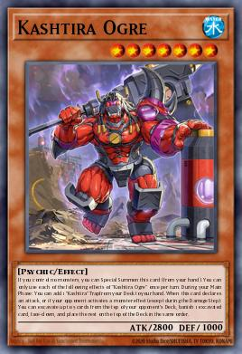 **Ogro (Defensa, Nivel 7)** — zona declarada: `MONSTER`.
**Mágicas/Trampas/Campo:**
-  **Nacimiento (Continua boca arriba)** — zona declarada: `SPELL_TRAP`.
*Relación ilustrada de cartas presentes tras este paso, documentada en A09. La posición, materiales, otras zonas y rival se leen en la tabla de estado.*

#### Paso 4 — CL1 Ogro en Defensa: añadir Preparaciones Kashtira (Trampa) desde Deck a mano.

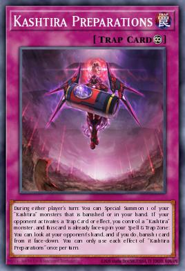 **AÑADIR A MANO**

**Acción concreta:** CL1 Ogro en Defensa: añadir Preparaciones Kashtira (Trampa) desde Deck a mano. Ogro puede buscar en Defensa. Colocar Preparaciones en M/T; no activarla durante el turno en que fue Colocada.
**Detalle técnico documentado:** Ogro puede buscar en Defensa. Colocar Preparaciones en M/T; no activarla durante el turno en que fue Colocada.

**Estado por zonas después del paso:**

| Zona/recurso | Estado narrativo A09 |
|---|---|
| Mano | — |
| Monstruos | Fenrir #17768 (Ataque, Nivel 7), Unicornio #17769 (Ataque, Nivel 7), Ogro #17770 (Defensa, Nivel 7) |
| Mágicas y trampas | Nacimiento #17815 (Continua boca arriba), Preparaciones #17831 (Colocada) |
| Cementerio | Teosis en GY |
| Destierro propio | — |
| Campo y estado rival | Ningún destierro ni bloqueo por esta ruta |
| Materiales Xyz/Fusión/Sincro | — |
| Normal, Extra, fase y restricciones | Normal gastada; Extra solo Xyz; Preparaciones recién Colocada |

**Campo visual de este paso:**

**Monstruos propios:**
-  **Fenrir (Ataque, Nivel 7)** — zona declarada: `MONSTER`.
-  **Unicornio (Ataque, Nivel 7)** — zona declarada: `MONSTER`.
-  **Ogro (Defensa, Nivel 7)** — zona declarada: `MONSTER`.
**Mágicas/Trampas/Campo:**
-  **Nacimiento (Continua boca arriba)** — zona declarada: `SPELL_TRAP`.
-  **Preparaciones (Colocada)** — zona declarada: `SPELL_TRAP`.
*Relación ilustrada de cartas presentes tras este paso, documentada en A09. La posición, materiales, otras zonas y rival se leen en la tabla de estado.*

#### Paso 5 — Superponer Fenrir + Ogro (dos monstruos Nivel 7) para Invocar Xyz Shangri-Ira Rango 7 en Defensa.

 **MATERIAL XYZ** →  **MATERIAL XYZ** →  **YA EN CAMPO**

**Acción concreta:** Superponer Fenrir + Ogro (dos monstruos Nivel 7) para Invocar Xyz Shangri-Ira Rango 7 en Defensa. Materiales exactos [Fenrir, Ogro], no Unicornio. Unicornio permanece en zona de Monstruos.
**Detalle técnico documentado:** Materiales exactos [Fenrir, Ogro], no Unicornio. Unicornio permanece en zona de Monstruos.

**Estado por zonas después del paso:**

| Zona/recurso | Estado narrativo A09 |
|---|---|
| Mano | — |
| Monstruos | Shangri-Ira #17800 (Defensa, Rango 7), Unicornio #17769 (Ataque, Nivel 7) |
| Mágicas y trampas | Nacimiento #17815 (Continua boca arriba), Preparaciones #17831 (Colocada) |
| Cementerio | Teosis en GY |
| Destierro propio | — |
| Campo y estado rival | 0 zonas bloqueadas; no ocurrió destierro boca abajo |
| Materiales Xyz/Fusión/Sincro | Shangri-Ira: Fenrir y Ogro acoplados (2) |
| Normal, Extra, fase y restricciones | Normal gastada; Extra solo Xyz |

**Campo visual de este paso:**

**Monstruos propios:**
-  **Shangri-Ira (Defensa, Rango 7)** — zona declarada: `MONSTER`.
-  **Unicornio (Ataque, Nivel 7)** — zona declarada: `MONSTER`.
**Mágicas/Trampas/Campo:**
-  **Nacimiento (Continua boca arriba)** — zona declarada: `SPELL_TRAP`.
-  **Preparaciones (Colocada)** — zona declarada: `SPELL_TRAP`.
*Relación ilustrada de cartas presentes tras este paso, documentada en A09. La posición, materiales, otras zonas y rival se leen en la tabla de estado.*

#### Paso 6 — Final: Shangri-Ira DEF 3000, 2 materiales [Fenrir, Ogro] + Unicornio boca arriba ATK 2500 + Nacimiento boca arriba + Preparaciones Colocada.

 **ESTADO / CONTEXTO** →  **ESTADO / CONTEXTO** →  **ESTADO / CONTEXTO**

**Acción concreta:** Final: Shangri-Ira DEF 3000, 2 materiales [Fenrir, Ogro] + Unicornio boca arriba ATK 2500 + Nacimiento boca arriba + Preparaciones Colocada. Sin cartas de mano sobrantes de la apertura mínima; Normal gastada; Teosis GY y restricción Extra Xyz activa. Cero zonas bloqueadas y cero cartas rivales desterradas boca abajo en esta ruta: los bloqueos de Shangri requieren un evento posterior. El efecto de Shangri de traer Kashtira desde Deck puede activarse en una Standby Phase posterior, no en esta Main Phase.
**Detalle técnico documentado:** Sin cartas de mano sobrantes de la apertura mínima; Normal gastada; Teosis GY y restricción Extra Xyz activa. Cero zonas bloqueadas y cero cartas rivales desterradas boca abajo en esta ruta: los bloqueos de Shangri requieren un evento posterior. El efecto de Shangri de traer Kashtira desde Deck puede activarse en una Standby Phase posterior, no en esta Main Phase.

**Estado por zonas después del paso:**

| Zona/recurso | Estado narrativo A09 |
|---|---|
| Mano | — |
| Monstruos | Shangri-Ira #17800 (Defensa, Rango 7), Unicornio #17769 (Ataque, Nivel 7) |
| Mágicas y trampas | Nacimiento #17815 (Continua boca arriba), Preparaciones #17831 (Colocada) |
| Cementerio | Teosis en GY |
| Destierro propio | — |
| Campo y estado rival | 0 zonas bloqueadas; no ocurrió destierro boca abajo |
| Materiales Xyz/Fusión/Sincro | Shangri-Ira: Fenrir y Ogro acoplados (2) |
| Normal, Extra, fase y restricciones | Normal gastada; Extra solo Xyz; Trampa no activable aún |

**Campo visual de este paso:**

**Monstruos propios:**
-  **Shangri-Ira (Defensa, Rango 7)** — zona declarada: `MONSTER`.
-  **Unicornio (Ataque, Nivel 7)** — zona declarada: `MONSTER`.
**Mágicas/Trampas/Campo:**
-  **Nacimiento (Continua boca arriba)** — zona declarada: `SPELL_TRAP`.
-  **Preparaciones (Colocada)** — zona declarada: `SPELL_TRAP`.
*Relación ilustrada de cartas presentes tras este paso, documentada en A09. La posición, materiales, otras zonas y rival se leen en la tabla de estado.*

### Campo final documentado

Esta vista procede **del último paso**, no de una lista de cartas deducida del título.

**Monstruos propios:**
-  **Shangri-Ira (Defensa, Rango 7)** — zona declarada: `MONSTER`.
-  **Unicornio (Ataque, Nivel 7)** — zona declarada: `MONSTER`.
**Mágicas/Trampas/Campo:**
-  **Nacimiento (Continua boca arriba)** — zona declarada: `SPELL_TRAP`.
-  **Preparaciones (Colocada)** — zona declarada: `SPELL_TRAP`.
*Relación ilustrada de cartas presentes tras este paso, documentada en A09. La posición, materiales, otras zonas y rival se leen en la tabla de estado.*

| Zona/recurso | Estado final documentado |
|---|---|
| Mano | — |
| Monstruos | Shangri-Ira #17800 (Defensa, Rango 7), Unicornio #17769 (Ataque, Nivel 7) |
| Mágicas y trampas | Nacimiento #17815 (Continua boca arriba), Preparaciones #17831 (Colocada) |
| Cementerio | Teosis en GY |
| Destierro propio | — |
| Campo y estado rival | 0 zonas bloqueadas; no ocurrió destierro boca abajo |
| Materiales Xyz/Fusión/Sincro | Shangri-Ira: Fenrir y Ogro acoplados (2) |
| Normal, Extra, fase y restricciones | Normal gastada; Extra solo Xyz; Trampa no activable aún |

### Si el oponente interrumpe

No se documenta una continuación alternativa con los recursos indicados.

---

## FENRIR · BIRTH · BIGEYE06 · `665:A09:FENRIR:BIRTH:BIGEYE06`

**Propósito competitivo principal (lectura documental):** Romper campo. El objetivo solo se acredita si las acciones y el campo final detallados en esta guía lo permiten; no implica legalidad certificada ni garantiza el resultado ante respuestas adversarias.

**Categoría:** APERTURA

**Propósito y resultado documental:**

4. Final condicionado: Ojo Grande ATK 2600 con 1 material [Fenrir], Unicornio ATK 2500, monstruo rival capturado ahora bajo control propio, Nacimiento boca arriba y Preparaciones Colocada. Ogro acabó en GY por desacoplamiento, Teosis GY, Normal gastada, Extra solo Xyz durante el turno. No se desterró nada boca abajo ni bloqueó zona alguna.

### Mano y estado inicial

igual que FENRIR:BIRTH:SHANGRI05, pero el rival controla al menos un monstruo boca arriba elegible para tomar el control; sin respuestas a las activaciones. En Extra Número 11: Ojo Grande (9861, Rango 7, ATK 2600) sustituye a Shangri como destino. No se presupone ATK ni efectos del monstruo capturado.

 **Kashtira Fenrir**
 **Kashtira Birth**

### Ejecución numerada

#### Paso 1 — Ejecutar los pasos 1–4 de FENRIR:BIRTH:SHANGRI05: Fenrir Especial busca Unicornio; Nacimiento permite Normal sin Sacrificios de Unicornio; éste busca Teosis.

 **ESTADO / CONTEXTO** →  **ESTADO / CONTEXTO** →  **ESTADO / CONTEXTO**

**Acción concreta:** Ejecutar los pasos 1–4 de FENRIR:BIRTH:SHANGRI05: Fenrir Especial busca Unicornio; Nacimiento permite Normal sin Sacrificios de Unicornio; éste busca Teosis; Teosis trae Ogro AGUA en Defensa; Ogro añade Preparaciones y se Coloca. Campo antes del Xyz: Fenrir + Unicornio + Ogro, los tres Nivel 7, Nacimiento boca arriba.
**Detalle técnico documentado:** Teosis trae Ogro AGUA en Defensa; Ogro añade Preparaciones y se Coloca. Campo antes del Xyz: Fenrir + Unicornio + Ogro, los tres Nivel 7, Nacimiento boca arriba.

**Estado por zonas después del paso:**

| Zona/recurso | Estado narrativo A09 |
|---|---|
| Mano | — |
| Monstruos | Fenrir #17768 (Ataque, Nivel 7), Unicornio #17769 (Ataque, Nivel 7), Ogro #17770 (Defensa, Nivel 7) |
| Mágicas y trampas | Nacimiento #17815 (Continua boca arriba), Preparaciones #17831 (Colocada) |
| Cementerio | Teosis en GY |
| Destierro propio | — |
| Campo y estado rival | Monstruo rival boca arriba aún bajo control adversario; identidad no definida |
| Materiales Xyz/Fusión/Sincro | — |
| Normal, Extra, fase y restricciones | Normal gastada; Extra solo Xyz; Trampa recién Colocada |

**Campo visual de este paso:**

**Monstruos propios:**
-  **Fenrir (Ataque, Nivel 7)** — zona declarada: `MONSTER`.
-  **Unicornio (Ataque, Nivel 7)** — zona declarada: `MONSTER`.
-  **Ogro (Defensa, Nivel 7)** — zona declarada: `MONSTER`.
**Mágicas/Trampas/Campo:**
-  **Nacimiento (Continua boca arriba)** — zona declarada: `SPELL_TRAP`.
-  **Preparaciones (Colocada)** — zona declarada: `SPELL_TRAP`.
*Relación ilustrada de cartas presentes tras este paso, documentada en A09. La posición, materiales, otras zonas y rival se leen en la tabla de estado.*

#### Paso 2 — Superponer Fenrir + Ogro para Invocar Xyz Número 11: Ojo Grande en Ataque con 2 materiales [Fenrir, Ogro].

 **MATERIAL XYZ** → 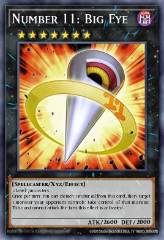 **MATERIAL XYZ** →  **ESTADO / CONTEXTO**

**Acción concreta:** Superponer Fenrir + Ogro para Invocar Xyz Número 11: Ojo Grande en Ataque con 2 materiales [Fenrir, Ogro]. Unicornio no se consume. La restricción de Teosis permite este Xyz.
**Detalle técnico documentado:** Unicornio no se consume. La restricción de Teosis permite este Xyz.

**Estado por zonas después del paso:**

| Zona/recurso | Estado narrativo A09 |
|---|---|
| Mano | — |
| Monstruos | Ojo Grande #9861 (Ataque, Rango 7), Unicornio #17769 (Ataque, Nivel 7) |
| Mágicas y trampas | Nacimiento #17815 (Continua boca arriba), Preparaciones #17831 (Colocada) |
| Cementerio | Teosis en GY |
| Destierro propio | — |
| Campo y estado rival | Monstruo rival boca arriba todavía bajo control adversario |
| Materiales Xyz/Fusión/Sincro | Ojo Grande: Fenrir y Ogro acoplados (2) |
| Normal, Extra, fase y restricciones | Normal gastada; Extra solo Xyz |

**Campo visual de este paso:**

**Monstruos propios:**
-  **Ojo Grande (Ataque, Rango 7)** — zona declarada: `MONSTER`.
-  **Unicornio (Ataque, Nivel 7)** — zona declarada: `MONSTER`.
**Mágicas/Trampas/Campo:**
-  **Nacimiento (Continua boca arriba)** — zona declarada: `SPELL_TRAP`.
-  **Preparaciones (Colocada)** — zona declarada: `SPELL_TRAP`.
*Relación ilustrada de cartas presentes tras este paso, documentada en A09. La posición, materiales, otras zonas y rival se leen en la tabla de estado.*

#### Paso 3 — Efecto de Ojo Grande: desacoplar Ogro como coste, seleccionar un monstruo rival y, al resolver, tomar su control si permanece como objetivo válido.

 **ESTADO / CONTEXTO**

**Acción concreta:** Efecto de Ojo Grande: desacoplar Ogro como coste, seleccionar un monstruo rival y, al resolver, tomar su control si permanece como objetivo válido. Ojo Grande no puede atacar en el turno en que activa este efecto; la restricción no impide automáticamente atacar a los demás monstruos si fuera legal.
**Detalle técnico documentado:** Ojo Grande no puede atacar en el turno en que activa este efecto; la restricción no impide automáticamente atacar a los demás monstruos si fuera legal.

**Estado por zonas después del paso:**

| Zona/recurso | Estado narrativo A09 |
|---|---|
| Mano | — |
| Monstruos | Ojo Grande #9861 (Ataque, Rango 7), Unicornio #17769 (Ataque, Nivel 7), monstruo rival tomado (identidad variable) |
| Mágicas y trampas | Nacimiento #17815 (Continua boca arriba), Preparaciones #17831 (Colocada) |
| Cementerio | Teosis y Ogro desacoplado en GY |
| Destierro propio | — |
| Campo y estado rival | El monstruo seleccionado ya está bajo control propio si la resolución tuvo éxito; los demás recursos rivales son desconocidos |
| Materiales Xyz/Fusión/Sincro | Ojo Grande: Fenrir acoplado (1) |
| Normal, Extra, fase y restricciones | Normal gastada; Extra solo Xyz; Ojo Grande no puede atacar este turno |

**Campo visual de este paso:**

**Monstruos propios:**
-  **Ojo Grande (Ataque, Rango 7)** — zona declarada: `MONSTER`.
-  **Unicornio (Ataque, Nivel 7)** — zona declarada: `MONSTER`.
- **monstruo rival tomado (identidad variable)** — sin foto verificable; zona `MONSTER`.
**Mágicas/Trampas/Campo:**
-  **Nacimiento (Continua boca arriba)** — zona declarada: `SPELL_TRAP`.
-  **Preparaciones (Colocada)** — zona declarada: `SPELL_TRAP`.
*Relación ilustrada de cartas presentes tras este paso, documentada en A09. La posición, materiales, otras zonas y rival se leen en la tabla de estado.*

#### Paso 4 — Final condicionado: Ojo Grande ATK 2600 con 1 material [Fenrir], Unicornio ATK 2500, monstruo rival capturado ahora bajo control propio, Nacimiento boca arriba y Preparaciones Colocada.

 **ESTADO / CONTEXTO** →  **ESTADO / CONTEXTO** →  **ESTADO / CONTEXTO**

**Acción concreta:** Final condicionado: Ojo Grande ATK 2600 con 1 material [Fenrir], Unicornio ATK 2500, monstruo rival capturado ahora bajo control propio, Nacimiento boca arriba y Preparaciones Colocada. Ogro acabó en GY por desacoplamiento, Teosis GY, Normal gastada, Extra solo Xyz durante el turno. No se desterró nada boca abajo ni bloqueó zona alguna.
**Detalle técnico documentado:** Ogro acabó en GY por desacoplamiento, Teosis GY, Normal gastada, Extra solo Xyz durante el turno. No se desterró nada boca abajo ni bloqueó zona alguna.

**Estado por zonas después del paso:**

| Zona/recurso | Estado narrativo A09 |
|---|---|
| Mano | — |
| Monstruos | Ojo Grande #9861 (Ataque, Rango 7), Unicornio #17769 (Ataque, Nivel 7), monstruo rival tomado (identidad variable) |
| Mágicas y trampas | Nacimiento #17815 (Continua boca arriba), Preparaciones #17831 (Colocada) |
| Cementerio | Teosis y Ogro desacoplado en GY |
| Destierro propio | — |
| Campo y estado rival | Monstruo tomado bajo control propio; 0 destierros y 0 zonas bloqueadas por esta ruta |
| Materiales Xyz/Fusión/Sincro | Ojo Grande: Fenrir acoplado (1) |
| Normal, Extra, fase y restricciones | Normal gastada; Extra solo Xyz; Ojo Grande no puede atacar este turno |

**Campo visual de este paso:**

**Monstruos propios:**
-  **Ojo Grande (Ataque, Rango 7)** — zona declarada: `MONSTER`.
-  **Unicornio (Ataque, Nivel 7)** — zona declarada: `MONSTER`.
- **monstruo rival tomado (identidad variable)** — sin foto verificable; zona `MONSTER`.
**Mágicas/Trampas/Campo:**
-  **Nacimiento (Continua boca arriba)** — zona declarada: `SPELL_TRAP`.
-  **Preparaciones (Colocada)** — zona declarada: `SPELL_TRAP`.
*Relación ilustrada de cartas presentes tras este paso, documentada en A09. La posición, materiales, otras zonas y rival se leen en la tabla de estado.*

### Campo final documentado

Esta vista procede **del último paso**, no de una lista de cartas deducida del título.

**Monstruos propios:**
-  **Ojo Grande (Ataque, Rango 7)** — zona declarada: `MONSTER`.
-  **Unicornio (Ataque, Nivel 7)** — zona declarada: `MONSTER`.
- **monstruo rival tomado (identidad variable)** — sin foto verificable; zona `MONSTER`.
**Mágicas/Trampas/Campo:**
-  **Nacimiento (Continua boca arriba)** — zona declarada: `SPELL_TRAP`.
-  **Preparaciones (Colocada)** — zona declarada: `SPELL_TRAP`.
*Relación ilustrada de cartas presentes tras este paso, documentada en A09. La posición, materiales, otras zonas y rival se leen en la tabla de estado.*

| Zona/recurso | Estado final documentado |
|---|---|
| Mano | — |
| Monstruos | Ojo Grande #9861 (Ataque, Rango 7), Unicornio #17769 (Ataque, Nivel 7), monstruo rival tomado (identidad variable) |
| Mágicas y trampas | Nacimiento #17815 (Continua boca arriba), Preparaciones #17831 (Colocada) |
| Cementerio | Teosis y Ogro desacoplado en GY |
| Destierro propio | — |
| Campo y estado rival | Monstruo tomado bajo control propio; 0 destierros y 0 zonas bloqueadas por esta ruta |
| Materiales Xyz/Fusión/Sincro | Ojo Grande: Fenrir acoplado (1) |
| Normal, Extra, fase y restricciones | Normal gastada; Extra solo Xyz; Ojo Grande no puede atacar este turno |

### Si el oponente interrumpe

No se documenta una continuación alternativa con los recursos indicados.

---

## WRAITSOTH · RISEHEART · BIGBANG · BIGEYE07 · `665:A09:WRAITSOTH:RISEHEART:BIGBANG:BIGEYE07`

**Propósito competitivo principal (lectura documental):** Romper campo. El objetivo solo se acredita si las acciones y el campo final detallados en esta guía lo permiten; no implica legalidad certificada ni garantiza el resultado ante respuestas adversarias.

**Categoría:** APERTURA

**Propósito y resultado documental:**

7. Final: Shangri-Ira (Rango 7; Unicornio como único material) y Ojo Grande (Rango 7; Fenrir y Riseheart como dos materiales) quedan en Campo. Wraitsoth permanece boca arriba, hay una zona rival bloqueada, tres cartas superiores del Deck rival desterradas boca abajo, Big Bang desterrada boca arriba y Teosis en GY. Normal sin gastar; Extra restringido a Xyz. Wraitsoth aumenta ATK/DEF en 100 por cada Atributo diferente en Campo; no fijar un total si el Campo rival es desconocido. No se presupone otra carta en mano.

### Mano y estado inicial

Wraitsoth Planeta Bajo Presión Wraitsoth (18204) + Riseheart Kashtira Riseheart (18151) en mano; propio Campo/GY vacíos, Main Phase propia, sin respuesta rival. Deck con Unicornio, Teosis, Fenrir y Big Bang; Extra con Shangri-Ira y Número 11: Ojo Grande. El adversario tiene al menos tres cartas en el Deck. No hace falta que controle monstruos. Se presupone el desarrollo de una carta WRAITSOTH:SHANGRI01, descrito antes.

 **Pressured Planet Wraitsoth**
 **Kashtira Riseheart**

### Ejecución numerada

#### Paso 1 — Ejecutar exactamente los pasos de 665:A09:WRAITSOTH:SHANGRI01 usando solo Wraitsoth de la mano y manteniendo Riseheart sin utilizar.

 **YA EN CAMPO** →  **YA EN CAMPO** →  **YA EN CAMPO**

**Acción concreta:** Ejecutar exactamente los pasos de 665:A09:WRAITSOTH:SHANGRI01 usando solo Wraitsoth de la mano y manteniendo Riseheart sin utilizar. Wraitsoth busca Unicornio; se Invoca Especialmente; Unicornio busca Teosis; Teosis Invoca Fenrir desde Deck con Atributo diferente; Unicornio + Fenrir forman Shangri-Ira. Estado intermedio: Shangri-Ira en Defensa con 2 materiales [Unicornio, Fenrir], Wraitsoth boca arriba en Zona de Campo, Riseheart en mano, Normal disponible. Ya rige el límite a Invocaciones Xyz impuesto por Teosis.
**Detalle técnico documentado:** Wraitsoth busca Unicornio; se Invoca Especialmente; Unicornio busca Teosis; Teosis Invoca Fenrir desde Deck con Atributo diferente; Unicornio + Fenrir forman Shangri-Ira. Estado intermedio: Shangri-Ira en Defensa con 2 materiales [Unicornio, Fenrir], Wraitsoth boca arriba en Zona de Campo, Riseheart en mano, Normal disponible. Ya rige el límite a Invocaciones Xyz impuesto por Teosis.

**Estado por zonas después del paso:**

| Zona/recurso | Estado narrativo A09 |
|---|---|
| Mano | Riseheart en mano |
| Monstruos | Shangri-Ira #17800 (Defensa, Rango 7) |
| Mágicas y trampas | Wraitsoth #18204 (Campo boca arriba) |
| Cementerio | Teosis en GY |
| Destierro propio | — |
| Campo y estado rival | No se desterraron cartas del Deck rival ni se bloquearon zonas |
| Materiales Xyz/Fusión/Sincro | Shangri-Ira: Unicornio y Fenrir acoplados (2) |
| Normal, Extra, fase y restricciones | Normal libre; Extra solo Xyz por Teosis |

**Campo visual de este paso:**

**Monstruos propios:**
-  **Shangri-Ira (Defensa, Rango 7)** — zona declarada: `MONSTER`.
**Mágicas/Trampas/Campo:**
-  **Wraitsoth (Campo boca arriba)** — zona declarada: `FIELD`.
*Relación ilustrada de cartas presentes tras este paso, documentada en A09. La posición, materiales, otras zonas y rival se leen en la tabla de estado.*

#### Paso 2 — Como se controla un monstruo «Kashtira» (Shangri), Invocar Especialmente Riseheart desde mano por su procedimiento propio; Riseheart comienza en Nivel 4.

 **ESTADO / CONTEXTO** →  **ESPECIAL**

**Acción concreta:** Como se controla un monstruo «Kashtira» (Shangri), Invocar Especialmente Riseheart desde mano por su procedimiento propio; Riseheart comienza en Nivel 4. Su Invocación añade el mismo bloqueo de Extra a Xyz, sin consumir Normal.
**Detalle técnico documentado:** Su Invocación añade el mismo bloqueo de Extra a Xyz, sin consumir Normal.

**Estado por zonas después del paso:**

| Zona/recurso | Estado narrativo A09 |
|---|---|
| Mano | — |
| Monstruos | Shangri-Ira #17800 (Defensa, Rango 7), Riseheart #18151 (Ataque, Nivel 4) |
| Mágicas y trampas | Wraitsoth #18204 (Campo boca arriba) |
| Cementerio | Teosis en GY |
| Destierro propio | — |
| Campo y estado rival | Sin destierros ni bloqueos de esta línea |
| Materiales Xyz/Fusión/Sincro | Shangri-Ira: Unicornio y Fenrir acoplados (2) |
| Normal, Extra, fase y restricciones | Normal libre; Extra solo Xyz |

**Campo visual de este paso:**

**Monstruos propios:**
-  **Shangri-Ira (Defensa, Rango 7)** — zona declarada: `MONSTER`.
-  **Riseheart (Ataque, Nivel 4)** — zona declarada: `MONSTER`.
**Mágicas/Trampas/Campo:**
-  **Wraitsoth (Campo boca arriba)** — zona declarada: `FIELD`.
*Relación ilustrada de cartas presentes tras este paso, documentada en A09. La posición, materiales, otras zonas y rival se leen en la tabla de estado.*

#### Paso 3 — Activar el efecto de Riseheart en Main Phase: desterrar Big Bang Kashtira boca arriba del Deck como coste y, al resolver, desterrar boca abajo tres cartas superiores del Deck rival.

 **ACTIVAR** →  **DESTERRAR**

**Acción concreta:** Activar el efecto de Riseheart en Main Phase: desterrar Big Bang Kashtira boca arriba del Deck como coste y, al resolver, desterrar boca abajo tres cartas superiores del Deck rival. Puesto que fueron desterradas, Riseheart pasa a Nivel 7. Big Bang no fue enviado al GY, ni esas tres cartas rivales fueron destruidas.
**Detalle técnico documentado:** Puesto que fueron desterradas, Riseheart pasa a Nivel 7. Big Bang no fue enviado al GY, ni esas tres cartas rivales fueron destruidas.

**Estado por zonas después del paso:**

| Zona/recurso | Estado narrativo A09 |
|---|---|
| Mano | — |
| Monstruos | Shangri-Ira #17800 (Defensa, Rango 7), Riseheart #18151 (Ataque, Nivel 7) |
| Mágicas y trampas | Wraitsoth #18204 (Campo boca arriba) |
| Cementerio | Teosis en GY |
| Destierro propio | Big Bang boca arriba |
| Campo y estado rival | Tres cartas del Deck rival desterradas boca abajo; todavía 0 zonas bloqueadas |
| Materiales Xyz/Fusión/Sincro | Shangri-Ira: Unicornio y Fenrir acoplados (2) |
| Normal, Extra, fase y restricciones | Normal libre; Extra solo Xyz |

**Campo visual de este paso:**

**Monstruos propios:**
-  **Shangri-Ira (Defensa, Rango 7)** — zona declarada: `MONSTER`.
-  **Riseheart (Ataque, Nivel 7)** — zona declarada: `MONSTER`.
**Mágicas/Trampas/Campo:**
-  **Wraitsoth (Campo boca arriba)** — zona declarada: `FIELD`.
*Relación ilustrada de cartas presentes tras este paso, documentada en A09. La posición, materiales, otras zonas y rival se leen en la tabla de estado.*

#### Paso 4 — Una sola cadena nueva para los dos disparos opcionales: al terminar de resolver Riseheart, Big Bang (desterrada como coste) y Shangri-Ira (por las tres cartas rivales desterradas boca abajo) están pendientes de su ventana de activación.

 **RESULTADO** →  **MATERIAL / COSTE** →  **ACTIVAR**

**Acción concreta:** Una sola cadena nueva para los dos disparos opcionales: al terminar de resolver Riseheart, Big Bang (desterrada como coste) y Shangri-Ira (por las tres cartas rivales desterradas boca abajo) están pendientes de su ventana de activación. Como ambos son efectos opcionales propios, construir la nueva Cadena con CL1 Big Bang, seleccionando el Shangri propio con Fenrir acoplado, y CL2 Shangri-Ira. No activar Big Bang en otra cadena posterior: habría perdido la oportunidad de responder a su destierro. Solo se cuenta un evento de destierro rival, no tres bloqueos.
**Detalle técnico documentado:** Como ambos son efectos opcionales propios, construir la nueva Cadena con CL1 Big Bang, seleccionando el Shangri propio con Fenrir acoplado, y CL2 Shangri-Ira. No activar Big Bang en otra cadena posterior: habría perdido la oportunidad de responder a su destierro. Solo se cuenta un evento de destierro rival, no tres bloqueos.

**Estado por zonas después del paso:**

| Zona/recurso | Estado narrativo A09 |
|---|---|
| Mano | — |
| Monstruos | Shangri-Ira #17800 (Defensa, Rango 7), Riseheart #18151 (Ataque, Nivel 7) |
| Mágicas y trampas | Wraitsoth #18204 (Campo boca arriba) |
| Cementerio | Teosis en GY |
| Destierro propio | Big Bang boca arriba |
| Campo y estado rival | Tres destierros rivales boca abajo; bloqueo pendiente de CL2, NO resuelto |
| Materiales Xyz/Fusión/Sincro | Shangri-Ira: Unicornio y Fenrir acoplados (2); CL1 Big Bang y CL2 Shangri pendientes |
| Normal, Extra, fase y restricciones | Normal libre; Extra solo Xyz |

**Campo visual de este paso:**

**Monstruos propios:**
-  **Shangri-Ira (Defensa, Rango 7)** — zona declarada: `MONSTER`.
-  **Riseheart (Ataque, Nivel 7)** — zona declarada: `MONSTER`.
**Mágicas/Trampas/Campo:**
-  **Wraitsoth (Campo boca arriba)** — zona declarada: `FIELD`.
*Relación ilustrada de cartas presentes tras este paso, documentada en A09. La posición, materiales, otras zonas y rival se leen en la tabla de estado.*

#### Paso 5 — Resolución inversa de esa misma Cadena: resolver CL2 Shangri-Ira, eligiendo exactamente una zona sin usar de Monstruos Principal o M/T para bloquearla mientras Shangri siga boca arriba.

 **YA EN CAMPO** →  **YA EN CAMPO** →  **YA EN CAMPO**

**Acción concreta:** Resolución inversa de esa misma Cadena: resolver CL2 Shangri-Ira, eligiendo exactamente una zona sin usar de Monstruos Principal o M/T para bloquearla mientras Shangri siga boca arriba; después resolver CL1 Big Bang, tomar Fenrir de los materiales acoplados al Shangri seleccionado hacia la mano y, si es legal, Invocarlo Especialmente desde esa mano por el propio efecto de Big Bang. Se requiere conservar Shangri y el material elegible hasta la resolución. Aunque ya haya monstruos propios, no se está usando el procedimiento autónomo de Fenrir. Shangri queda con un único material [Unicornio], Fenrir en Campo y Big Bang desterrada boca arriba. Si un efecto fue negado o su objetivo dejó de ser legal, recalcular solo los resultados realmente resueltos antes de intentar el paso 6.
**Detalle técnico documentado:** después resolver CL1 Big Bang, tomar Fenrir de los materiales acoplados al Shangri seleccionado hacia la mano y, si es legal, Invocarlo Especialmente desde esa mano por el propio efecto de Big Bang. Se requiere conservar Shangri y el material elegible hasta la resolución. Aunque ya haya monstruos propios, no se está usando el procedimiento autónomo de Fenrir. Shangri queda con un único material [Unicornio], Fenrir en Campo y Big Bang desterrada boca arriba. Si un efecto fue negado o su objetivo dejó de ser legal, recalcular solo los resultados realmente resueltos antes de intentar el paso 6.

**Estado por zonas después del paso:**

| Zona/recurso | Estado narrativo A09 |
|---|---|
| Mano | — |
| Monstruos | Shangri-Ira #17800 (Defensa, Rango 7), Riseheart #18151 (Ataque, Nivel 7), Fenrir #17768 (Ataque, Nivel 7) |
| Mágicas y trampas | Wraitsoth #18204 (Campo boca arriba) |
| Cementerio | Teosis en GY |
| Destierro propio | Big Bang boca arriba |
| Campo y estado rival | Tres cartas desterradas boca abajo y 1 zona rival bloqueada mientras Shangri permanezca boca arriba |
| Materiales Xyz/Fusión/Sincro | Shangri-Ira: únicamente Unicornio acoplado (1); Fenrir se recuperó desde material |
| Normal, Extra, fase y restricciones | Normal libre; Extra solo Xyz |

**Campo visual de este paso:**

**Monstruos propios:**
-  **Shangri-Ira (Defensa, Rango 7)** — zona declarada: `MONSTER`.
-  **Riseheart (Ataque, Nivel 7)** — zona declarada: `MONSTER`.
-  **Fenrir (Ataque, Nivel 7)** — zona declarada: `MONSTER`.
**Mágicas/Trampas/Campo:**
-  **Wraitsoth (Campo boca arriba)** — zona declarada: `FIELD`.
*Relación ilustrada de cartas presentes tras este paso, documentada en A09. La posición, materiales, otras zonas y rival se leen en la tabla de estado.*

#### Paso 6 — Superponer Fenrir + Riseheart, ambos Nivel 7, para Invocar Xyz Número 11: Ojo Grande en Ataque con 2 materiales [Fenrir, Riseheart].

 **MATERIAL XYZ** →  **MATERIAL XYZ** →  **MATERIAL XYZ**

**Acción concreta:** Superponer Fenrir + Riseheart, ambos Nivel 7, para Invocar Xyz Número 11: Ojo Grande en Ataque con 2 materiales [Fenrir, Riseheart]. No usar Shangri-Ira como material: debe permanecer boca arriba para sostener la zona bloqueada. No activar el efecto de Ojo Grande sin monstruo rival que seleccionar.
**Detalle técnico documentado:** No usar Shangri-Ira como material: debe permanecer boca arriba para sostener la zona bloqueada. No activar el efecto de Ojo Grande sin monstruo rival que seleccionar.

**Estado por zonas después del paso:**

| Zona/recurso | Estado narrativo A09 |
|---|---|
| Mano | — |
| Monstruos | Shangri-Ira #17800 (Defensa, Rango 7), Ojo Grande #9861 (Ataque, Rango 7) |
| Mágicas y trampas | Wraitsoth #18204 (Campo boca arriba) |
| Cementerio | Teosis en GY |
| Destierro propio | Big Bang boca arriba |
| Campo y estado rival | Tres cartas desterradas boca abajo y 1 zona rival bloqueada |
| Materiales Xyz/Fusión/Sincro | Shangri-Ira: Unicornio (1); Ojo Grande: Fenrir y Riseheart (2) |
| Normal, Extra, fase y restricciones | Normal libre; Extra solo Xyz; Ojo Grande no activó robo de control |

**Campo visual de este paso:**

**Monstruos propios:**
-  **Shangri-Ira (Defensa, Rango 7)** — zona declarada: `MONSTER`.
-  **Ojo Grande (Ataque, Rango 7)** — zona declarada: `MONSTER`.
**Mágicas/Trampas/Campo:**
-  **Wraitsoth (Campo boca arriba)** — zona declarada: `FIELD`.
*Relación ilustrada de cartas presentes tras este paso, documentada en A09. La posición, materiales, otras zonas y rival se leen en la tabla de estado.*

#### Paso 7 — Final: Shangri-Ira (Rango 7; Unicornio como único material) y Ojo Grande (Rango 7; Fenrir y Riseheart como dos materiales) quedan en Campo.

 **ESTADO / CONTEXTO** →  **ESTADO / CONTEXTO** →  **ESTADO / CONTEXTO**

**Acción concreta:** Final: Shangri-Ira (Rango 7; Unicornio como único material) y Ojo Grande (Rango 7; Fenrir y Riseheart como dos materiales) quedan en Campo. Wraitsoth permanece boca arriba, hay una zona rival bloqueada, tres cartas superiores del Deck rival desterradas boca abajo, Big Bang desterrada boca arriba y Teosis en GY. Normal sin gastar; Extra restringido a Xyz. Wraitsoth aumenta ATK/DEF en 100 por cada Atributo diferente en Campo; no fijar un total si el Campo rival es desconocido. No se presupone otra carta en mano.
**Detalle técnico documentado:** Wraitsoth permanece boca arriba, hay una zona rival bloqueada, tres cartas superiores del Deck rival desterradas boca abajo, Big Bang desterrada boca arriba y Teosis en GY. Normal sin gastar; Extra restringido a Xyz. Wraitsoth aumenta ATK/DEF en 100 por cada Atributo diferente en Campo; no fijar un total si el Campo rival es desconocido. No se presupone otra carta en mano.

**Estado por zonas después del paso:**

| Zona/recurso | Estado narrativo A09 |
|---|---|
| Mano | — |
| Monstruos | Shangri-Ira #17800 (Defensa, Rango 7), Ojo Grande #9861 (Ataque, Rango 7) |
| Mágicas y trampas | Wraitsoth #18204 (Campo boca arriba) |
| Cementerio | Teosis en GY |
| Destierro propio | Big Bang boca arriba |
| Campo y estado rival | Tres cartas desterradas boca abajo y 1 zona rival bloqueada; ningún monstruo tomado |
| Materiales Xyz/Fusión/Sincro | Shangri-Ira: Unicornio (1); Ojo Grande: Fenrir y Riseheart (2) |
| Normal, Extra, fase y restricciones | Normal libre; Extra solo Xyz; ATK variable por Wraitsoth |

**Campo visual de este paso:**

**Monstruos propios:**
-  **Shangri-Ira (Defensa, Rango 7)** — zona declarada: `MONSTER`.
-  **Ojo Grande (Ataque, Rango 7)** — zona declarada: `MONSTER`.
**Mágicas/Trampas/Campo:**
-  **Wraitsoth (Campo boca arriba)** — zona declarada: `FIELD`.
*Relación ilustrada de cartas presentes tras este paso, documentada en A09. La posición, materiales, otras zonas y rival se leen en la tabla de estado.*

### Campo final documentado

Esta vista procede **del último paso**, no de una lista de cartas deducida del título.

**Monstruos propios:**
-  **Shangri-Ira (Defensa, Rango 7)** — zona declarada: `MONSTER`.
-  **Ojo Grande (Ataque, Rango 7)** — zona declarada: `MONSTER`.
**Mágicas/Trampas/Campo:**
-  **Wraitsoth (Campo boca arriba)** — zona declarada: `FIELD`.
*Relación ilustrada de cartas presentes tras este paso, documentada en A09. La posición, materiales, otras zonas y rival se leen en la tabla de estado.*

| Zona/recurso | Estado final documentado |
|---|---|
| Mano | — |
| Monstruos | Shangri-Ira #17800 (Defensa, Rango 7), Ojo Grande #9861 (Ataque, Rango 7) |
| Mágicas y trampas | Wraitsoth #18204 (Campo boca arriba) |
| Cementerio | Teosis en GY |
| Destierro propio | Big Bang boca arriba |
| Campo y estado rival | Tres cartas desterradas boca abajo y 1 zona rival bloqueada; ningún monstruo tomado |
| Materiales Xyz/Fusión/Sincro | Shangri-Ira: Unicornio (1); Ojo Grande: Fenrir y Riseheart (2) |
| Normal, Extra, fase y restricciones | Normal libre; Extra solo Xyz; ATK variable por Wraitsoth |

### Si el oponente interrumpe

No se documenta una continuación alternativa con los recursos indicados.

---

## WRAITSOTH · RISEHEART · ARISE3MAT08 · `665:A09:WRAITSOTH:RISEHEART:ARISE3MAT08`

**Propósito competitivo principal (lectura documental):** Terminar en Arise-Heart con tres materiales Xyz. El objetivo solo se acredita si las acciones y el campo final detallados en esta guía lo permiten; no implica legalidad certificada ni garantiza el resultado ante respuestas adversarias.

**Categoría:** APERTURA

**Propósito y resultado documental:**

6. Resultado antes de usar más efectos: Arise-Heart ATK impreso 3000, 3 materiales; Riseheart Nivel 7 permanece como otro monstruo; Wraitsoth boca arriba en zona de Campo; 3 cartas del Deck rival desterradas boca abajo, Big Bang desterrada boca arriba, Teosis en GY; 0 zonas bloqueadas al final, Normal libre, Extra solo Xyz por el resto del turno. El ATK actual de Arise puede subir por Wraitsoth según los Atributos del Campo. Arise dispone de materiales para una activación posterior de su Efecto Rápido de destierro, pero no se ejecuta aquí ni se presume objetivo.

### Mano y estado inicial

Wraitsoth Planeta Bajo Presión Wraitsoth + Riseheart Kashtira Riseheart. Campo y GY propios vacíos; durante la Main Phase propia; rival sin respuestas y con al menos tres cartas en el Deck. El Main conserva Unicornio, Fenrir, Teosis y Big Bang; el Extra contiene Shangri-Ira y Arise-Heart Arise-Heart. Es una bifurcación incompatible con la ruta 07: aquí no se recupera Fenrir mediante Big Bang. Se describe la mecánica de las cartas del inventario, sin evaluación de listas de prohibiciones.

 **Pressured Planet Wraitsoth**
 **Kashtira Riseheart**

### Ejecución numerada

#### Paso 1 — Wraitsoth se activa y busca Unicornio.

 **ESTADO / CONTEXTO** →  **AÑADIR A MANO** →  **AÑADIR A MANO**

**Acción concreta:** Wraitsoth se activa y busca Unicornio. Unicornio se Invoca Especialmente desde mano cuando todavía no controlas monstruos y, en Main Phase, busca Teosis. Teosis selecciona Unicornio VIENTO para Invocar Especialmente Fenrir TIERRA en Defensa desde Deck. Extra restringido a Xyz por Teosis.
**Detalle técnico documentado:** Unicornio se Invoca Especialmente desde mano cuando todavía no controlas monstruos y, en Main Phase, busca Teosis. Teosis selecciona Unicornio VIENTO para Invocar Especialmente Fenrir TIERRA en Defensa desde Deck. Extra restringido a Xyz por Teosis.

**Estado por zonas después del paso:**

| Zona/recurso | Estado narrativo A09 |
|---|---|
| Mano | Riseheart en mano |
| Monstruos | Unicornio #17769 (Ataque, Nivel 7), Fenrir #17768 (Defensa, Nivel 7) |
| Mágicas y trampas | Wraitsoth #18204 (Campo boca arriba) |
| Cementerio | Teosis en GY |
| Destierro propio | — |
| Campo y estado rival | 0 destierros boca abajo y 0 bloqueos causados por la ruta |
| Materiales Xyz/Fusión/Sincro | — |
| Normal, Extra, fase y restricciones | Normal libre; Extra solo Xyz tras Teosis |

**Campo visual de este paso:**

**Monstruos propios:**
-  **Unicornio (Ataque, Nivel 7)** — zona declarada: `MONSTER`.
-  **Fenrir (Defensa, Nivel 7)** — zona declarada: `MONSTER`.
**Mágicas/Trampas/Campo:**
-  **Wraitsoth (Campo boca arriba)** — zona declarada: `FIELD`.
*Relación ilustrada de cartas presentes tras este paso, documentada en A09. La posición, materiales, otras zonas y rival se leen en la tabla de estado.*

#### Paso 2 — Superponer Unicornio y Fenrir para Shangri-Ira en Defensa, con 2 materiales [Unicornio, Fenrir].

 **MATERIAL XYZ** →  **MATERIAL XYZ** →  **MATERIAL XYZ**

**Acción concreta:** Superponer Unicornio y Fenrir para Shangri-Ira en Defensa, con 2 materiales [Unicornio, Fenrir]. Riseheart sigue en mano, Normal todavía libre. No hay zona bloqueada en este momento.
**Detalle técnico documentado:** Riseheart sigue en mano, Normal todavía libre. No hay zona bloqueada en este momento.

**Estado por zonas después del paso:**

| Zona/recurso | Estado narrativo A09 |
|---|---|
| Mano | Riseheart en mano |
| Monstruos | Shangri-Ira #17800 (Defensa, Rango 7) |
| Mágicas y trampas | Wraitsoth #18204 (Campo boca arriba) |
| Cementerio | Teosis en GY |
| Destierro propio | — |
| Campo y estado rival | 0 destierros y 0 bloqueos causados por la ruta |
| Materiales Xyz/Fusión/Sincro | Shangri-Ira: Unicornio y Fenrir acoplados (2) |
| Normal, Extra, fase y restricciones | Normal libre; Extra solo Xyz |

**Campo visual de este paso:**

**Monstruos propios:**
-  **Shangri-Ira (Defensa, Rango 7)** — zona declarada: `MONSTER`.
**Mágicas/Trampas/Campo:**
-  **Wraitsoth (Campo boca arriba)** — zona declarada: `FIELD`.
*Relación ilustrada de cartas presentes tras este paso, documentada en A09. La posición, materiales, otras zonas y rival se leen en la tabla de estado.*

#### Paso 3 — Invocar Especialmente Riseheart de mano porque controlas un Kashtira.

 **ESPECIAL** →  **DESTERRAR** →  **ESTADO / CONTEXTO**

**Acción concreta:** Invocar Especialmente Riseheart de mano porque controlas un Kashtira. Activar su efecto de Main Phase: desterrar Big Bang del Deck como coste y, al resolver, desterrar boca abajo tres cartas superiores del Deck contrario. Riseheart pasa a Nivel 7 al desterrar alguna de esas cartas. Los tres destierros constituyen un solo evento a efectos de Shangri.
**Detalle técnico documentado:** Activar su efecto de Main Phase: desterrar Big Bang del Deck como coste y, al resolver, desterrar boca abajo tres cartas superiores del Deck contrario. Riseheart pasa a Nivel 7 al desterrar alguna de esas cartas. Los tres destierros constituyen un solo evento a efectos de Shangri.

**Estado por zonas después del paso:**

| Zona/recurso | Estado narrativo A09 |
|---|---|
| Mano | — |
| Monstruos | Shangri-Ira #17800 (Defensa, Rango 7), Riseheart #18151 (Ataque, Nivel 7) |
| Mágicas y trampas | Wraitsoth #18204 (Campo boca arriba) |
| Cementerio | Teosis en GY |
| Destierro propio | Big Bang boca arriba |
| Campo y estado rival | Tres cartas del Deck rival desterradas boca abajo; sin bloqueo aún |
| Materiales Xyz/Fusión/Sincro | Shangri-Ira: Unicornio y Fenrir acoplados (2) |
| Normal, Extra, fase y restricciones | Normal libre; Extra solo Xyz |

**Campo visual de este paso:**

**Monstruos propios:**
-  **Shangri-Ira (Defensa, Rango 7)** — zona declarada: `MONSTER`.
-  **Riseheart (Ataque, Nivel 7)** — zona declarada: `MONSTER`.
**Mágicas/Trampas/Campo:**
-  **Wraitsoth (Campo boca arriba)** — zona declarada: `FIELD`.
*Relación ilustrada de cartas presentes tras este paso, documentada en A09. La posición, materiales, otras zonas y rival se leen en la tabla de estado.*

#### Paso 4 — En una nueva Cadena, activar el efecto de Shangri-Ira que permite elegir una zona sin usar y bloquearla mientras Shangri permanezca boca arriba.

 **ACTIVAR** →  **ACTIVAR** →  **ACTIVAR**

**Acción concreta:** En una nueva Cadena, activar el efecto de Shangri-Ira que permite elegir una zona sin usar y bloquearla mientras Shangri permanezca boca arriba. Resolver el bloqueo de una zona, no de tres. No activar el efecto opcional de Big Bang que también fue desterrada: sus materiales siguen intactos. La activación exitosa de Shangri este turno cumple la condición del procedimiento alternativo de Arise-Heart; no se requiere esperar una Standby futura.
**Detalle técnico documentado:** Resolver el bloqueo de una zona, no de tres. No activar el efecto opcional de Big Bang que también fue desterrada: sus materiales siguen intactos. La activación exitosa de Shangri este turno cumple la condición del procedimiento alternativo de Arise-Heart; no se requiere esperar una Standby futura.

**Estado por zonas después del paso:**

| Zona/recurso | Estado narrativo A09 |
|---|---|
| Mano | — |
| Monstruos | Shangri-Ira #17800 (Defensa, Rango 7), Riseheart #18151 (Ataque, Nivel 7) |
| Mágicas y trampas | Wraitsoth #18204 (Campo boca arriba) |
| Cementerio | Teosis en GY |
| Destierro propio | Big Bang boca arriba |
| Campo y estado rival | Tres cartas rivales desterradas boca abajo; 1 zona bloqueada por Shangri |
| Materiales Xyz/Fusión/Sincro | Shangri-Ira: Unicornio y Fenrir acoplados (2) |
| Normal, Extra, fase y restricciones | Normal libre; Extra solo Xyz; activación de Shangri exitosa |

**Campo visual de este paso:**

**Monstruos propios:**
-  **Shangri-Ira (Defensa, Rango 7)** — zona declarada: `MONSTER`.
-  **Riseheart (Ataque, Nivel 7)** — zona declarada: `MONSTER`.
**Mágicas/Trampas/Campo:**
-  **Wraitsoth (Campo boca arriba)** — zona declarada: `FIELD`.
*Relación ilustrada de cartas presentes tras este paso, documentada en A09. La posición, materiales, otras zonas y rival se leen en la tabla de estado.*

#### Paso 5 — En la misma Main Phase, Invocar por Xyz Arise-Heart sobre Shangri-Ira mediante su procedimiento de un monstruo Kashtira cuando se activó con éxito un efecto de Shangri-Ira ese turno.

 **INVOCAR XYZ** →  **INVOCAR XYZ** →  **ESTADO / CONTEXTO**

**Acción concreta:** En la misma Main Phase, Invocar por Xyz Arise-Heart sobre Shangri-Ira mediante su procedimiento de un monstruo Kashtira cuando se activó con éxito un efecto de Shangri-Ira ese turno. Transferir los dos materiales de Shangri a Arise: [Shangri-Ira, Unicornio, Fenrir] = 3 materiales. No usar Riseheart como material. El bloqueo anterior desaparece al dejar Shangri de estar boca arriba.
**Detalle técnico documentado:** Transferir los dos materiales de Shangri a Arise: [Shangri-Ira, Unicornio, Fenrir] = 3 materiales. No usar Riseheart como material. El bloqueo anterior desaparece al dejar Shangri de estar boca arriba.

**Estado por zonas después del paso:**

| Zona/recurso | Estado narrativo A09 |
|---|---|
| Mano | — |
| Monstruos | Arise-Heart #18191 (Ataque, Rango 7), Riseheart #18151 (Ataque, Nivel 7) |
| Mágicas y trampas | Wraitsoth #18204 (Campo boca arriba) |
| Cementerio | Teosis en GY |
| Destierro propio | Big Bang boca arriba |
| Campo y estado rival | Tres cartas rivales desterradas boca abajo; bloqueo de Shangri desaparece |
| Materiales Xyz/Fusión/Sincro | Arise-Heart: Shangri-Ira y sus materiales Unicornio y Fenrir (3) |
| Normal, Extra, fase y restricciones | Normal libre; Extra solo Xyz; Arise continuo activo |

**Campo visual de este paso:**

**Monstruos propios:**
-  **Arise-Heart (Ataque, Rango 7)** — zona declarada: `MONSTER`.
-  **Riseheart (Ataque, Nivel 7)** — zona declarada: `MONSTER`.
**Mágicas/Trampas/Campo:**
-  **Wraitsoth (Campo boca arriba)** — zona declarada: `FIELD`.
*Relación ilustrada de cartas presentes tras este paso, documentada en A09. La posición, materiales, otras zonas y rival se leen en la tabla de estado.*

#### Paso 6 — Resultado antes de usar más efectos: Arise-Heart ATK impreso 3000, 3 materiales; Riseheart Nivel 7 permanece como otro monstruo; Wraitsoth boca arriba en zona de Campo.

 **ESTADO / CONTEXTO** →  **YA EN CAMPO** →  **ESTADO / CONTEXTO**

**Acción concreta:** Resultado antes de usar más efectos: Arise-Heart ATK impreso 3000, 3 materiales; Riseheart Nivel 7 permanece como otro monstruo; Wraitsoth boca arriba en zona de Campo; 3 cartas del Deck rival desterradas boca abajo, Big Bang desterrada boca arriba, Teosis en GY; 0 zonas bloqueadas al final, Normal libre, Extra solo Xyz por el resto del turno. El ATK actual de Arise puede subir por Wraitsoth según los Atributos del Campo. Arise dispone de materiales para una activación posterior de su Efecto Rápido de destierro, pero no se ejecuta aquí ni se presume objetivo.
**Detalle técnico documentado:** 3 cartas del Deck rival desterradas boca abajo, Big Bang desterrada boca arriba, Teosis en GY; 0 zonas bloqueadas al final, Normal libre, Extra solo Xyz por el resto del turno. El ATK actual de Arise puede subir por Wraitsoth según los Atributos del Campo. Arise dispone de materiales para una activación posterior de su Efecto Rápido de destierro, pero no se ejecuta aquí ni se presume objetivo.

**Estado por zonas después del paso:**

| Zona/recurso | Estado narrativo A09 |
|---|---|
| Mano | — |
| Monstruos | Arise-Heart #18191 (Ataque, Rango 7), Riseheart #18151 (Ataque, Nivel 7) |
| Mágicas y trampas | Wraitsoth #18204 (Campo boca arriba) |
| Cementerio | Teosis en GY |
| Destierro propio | Big Bang boca arriba |
| Campo y estado rival | Tres cartas rivales desterradas boca abajo; 0 zonas bloqueadas al cierre |
| Materiales Xyz/Fusión/Sincro | Arise-Heart: Shangri-Ira y sus materiales Unicornio y Fenrir (3); no desacopló |
| Normal, Extra, fase y restricciones | Normal libre; Extra solo Xyz; destierro rápido aún no usado |

**Campo visual de este paso:**

**Monstruos propios:**
-  **Arise-Heart (Ataque, Rango 7)** — zona declarada: `MONSTER`.
-  **Riseheart (Ataque, Nivel 7)** — zona declarada: `MONSTER`.
**Mágicas/Trampas/Campo:**
-  **Wraitsoth (Campo boca arriba)** — zona declarada: `FIELD`.
*Relación ilustrada de cartas presentes tras este paso, documentada en A09. La posición, materiales, otras zonas y rival se leen en la tabla de estado.*

### Campo final documentado

Esta vista procede **del último paso**, no de una lista de cartas deducida del título.

**Monstruos propios:**
-  **Arise-Heart (Ataque, Rango 7)** — zona declarada: `MONSTER`.
-  **Riseheart (Ataque, Nivel 7)** — zona declarada: `MONSTER`.
**Mágicas/Trampas/Campo:**
-  **Wraitsoth (Campo boca arriba)** — zona declarada: `FIELD`.
*Relación ilustrada de cartas presentes tras este paso, documentada en A09. La posición, materiales, otras zonas y rival se leen en la tabla de estado.*

| Zona/recurso | Estado final documentado |
|---|---|
| Mano | — |
| Monstruos | Arise-Heart #18191 (Ataque, Rango 7), Riseheart #18151 (Ataque, Nivel 7) |
| Mágicas y trampas | Wraitsoth #18204 (Campo boca arriba) |
| Cementerio | Teosis en GY |
| Destierro propio | Big Bang boca arriba |
| Campo y estado rival | Tres cartas rivales desterradas boca abajo; 0 zonas bloqueadas al cierre |
| Materiales Xyz/Fusión/Sincro | Arise-Heart: Shangri-Ira y sus materiales Unicornio y Fenrir (3); no desacopló |
| Normal, Extra, fase y restricciones | Normal libre; Extra solo Xyz; destierro rápido aún no usado |

### Si el oponente interrumpe

No se documenta una continuación alternativa con los recursos indicados.

---

## WRAITSOTH · RISEHEART · BIGBANG · ARISE1MAT09 · `665:A09:WRAITSOTH:RISEHEART:BIGBANG:ARISE1MAT09`

**Propósito competitivo principal (lectura documental):** Conservar Shangri-Ira y Arise-Heart con un material. El objetivo solo se acredita si las acciones y el campo final detallados en esta guía lo permiten; no implica legalidad certificada ni garantiza el resultado ante respuestas adversarias.

**Categoría:** APERTURA

**Propósito y resultado documental:**

4. Campo final sin interrupciones: Shangri-Ira en Defensa con 1 material [Unicornio]; Arise-Heart boca arriba con 1 material [Riseheart]; Fenrir independiente boca arriba; Wraitsoth en zona de Campo, 1 zona rival bloqueada, 3 cartas rivales desterradas boca abajo, Big Bang desterrada boca arriba, Teosis al GY; Normal libre y restricción Extra Xyz. El refuerzo de estadísticas de Wraitsoth es variable según todos los Atributos en Campo. Arise no puede aún desacoplar tres materiales: no se inventan materiales adicionales procedentes de Shangri ni se supone un destierro futuro que lo alimente.

### Mano y estado inicial

las mismas dos cartas, condiciones y ubicaciones iniciales de ARISE3MAT08. Objetivo alternativo: conservar Shangri-Ira boca arriba y su zona bloqueada, además de Invocar a Arise-Heart sobre Riseheart, aceptando que comienza con un único material y no puede pagar todavía el coste de tres materiales de su destierro rápido. No se combina con ruta 07 ni ruta 08: se elige un destino del Extra diferente para Riseheart.

 **Pressured Planet Wraitsoth**
 **Kashtira Riseheart**

### Ejecución numerada

#### Paso 1 — Repetir los pasos 1–3 de ARISE3MAT08: Wraitsoth busca Unicornio, Teosis trae Fenrir, ambos forman Shangri con 2 materiales [Unicornio, Fenrir].

 **ESTADO / CONTEXTO** →  **AÑADIR A MANO** →  **BUSCAR / AÑADIR**

**Acción concreta:** Repetir los pasos 1–3 de ARISE3MAT08: Wraitsoth busca Unicornio, Teosis trae Fenrir, ambos forman Shangri con 2 materiales [Unicornio, Fenrir]; luego Riseheart entra de mano, destierra Big Bang del Deck como coste y las 3 cartas superiores rivales boca abajo por efecto, y se convierte en Nivel 7. No se usó la Normal.
**Detalle técnico documentado:** luego Riseheart entra de mano, destierra Big Bang del Deck como coste y las 3 cartas superiores rivales boca abajo por efecto, y se convierte en Nivel 7. No se usó la Normal.

**Estado por zonas después del paso:**

| Zona/recurso | Estado narrativo A09 |
|---|---|
| Mano | — |
| Monstruos | Shangri-Ira #17800 (Defensa, Rango 7), Riseheart #18151 (Ataque, Nivel 7) |
| Mágicas y trampas | Wraitsoth #18204 (Campo boca arriba) |
| Cementerio | Teosis en GY |
| Destierro propio | Big Bang boca arriba |
| Campo y estado rival | Tres cartas del Deck rival desterradas boca abajo; sin bloqueo resuelto aún |
| Materiales Xyz/Fusión/Sincro | Shangri-Ira: Unicornio y Fenrir acoplados (2) |
| Normal, Extra, fase y restricciones | Normal libre; Extra solo Xyz |

**Campo visual de este paso:**

**Monstruos propios:**
-  **Shangri-Ira (Defensa, Rango 7)** — zona declarada: `MONSTER`.
-  **Riseheart (Ataque, Nivel 7)** — zona declarada: `MONSTER`.
**Mágicas/Trampas/Campo:**
-  **Wraitsoth (Campo boca arriba)** — zona declarada: `FIELD`.
*Relación ilustrada de cartas presentes tras este paso, documentada en A09. La posición, materiales, otras zonas y rival se leen en la tabla de estado.*

#### Paso 2 — En la cadena de disparos posterior a la resolución de Riseheart, decidir activar CL1 Big Bang (seleccionando el Shangri propio, que tiene Fenrir acoplado) y CL2 Shangri-Ira por el destierro rival boca abajo.

 **ESTADO / CONTEXTO** →  **ACTIVAR** →  **OBJETIVO**

**Acción concreta:** En la cadena de disparos posterior a la resolución de Riseheart, decidir activar CL1 Big Bang (seleccionando el Shangri propio, que tiene Fenrir acoplado) y CL2 Shangri-Ira por el destierro rival boca abajo. Resolver CL2: Shangri elige una única zona sin utilizar y la bloquea mientras siga boca arriba. Resolver CL1 Big Bang: recuperar Fenrir que estaba acoplado a Shangri y Invocarlo Especialmente desde la mano con el propio efecto de Big Bang. No se usa la condición autónoma de Fenrir de controlar cero monstruos. Shangri mantiene 1 material [Unicornio].
**Detalle técnico documentado:** Resolver CL2: Shangri elige una única zona sin utilizar y la bloquea mientras siga boca arriba. Resolver CL1 Big Bang: recuperar Fenrir que estaba acoplado a Shangri y Invocarlo Especialmente desde la mano con el propio efecto de Big Bang. No se usa la condición autónoma de Fenrir de controlar cero monstruos. Shangri mantiene 1 material [Unicornio].

**Estado por zonas después del paso:**

| Zona/recurso | Estado narrativo A09 |
|---|---|
| Mano | — |
| Monstruos | Shangri-Ira #17800 (Defensa, Rango 7), Riseheart #18151 (Ataque, Nivel 7), Fenrir #17768 (Ataque, Nivel 7) |
| Mágicas y trampas | Wraitsoth #18204 (Campo boca arriba) |
| Cementerio | Teosis en GY |
| Destierro propio | Big Bang boca arriba |
| Campo y estado rival | Tres cartas desterradas boca abajo; 1 zona bloqueada por Shangri |
| Materiales Xyz/Fusión/Sincro | Shangri-Ira: solo Unicornio acoplado (1); Fenrir recuperado por Big Bang |
| Normal, Extra, fase y restricciones | Normal libre; Extra solo Xyz |

**Campo visual de este paso:**

**Monstruos propios:**
-  **Shangri-Ira (Defensa, Rango 7)** — zona declarada: `MONSTER`.
-  **Riseheart (Ataque, Nivel 7)** — zona declarada: `MONSTER`.
-  **Fenrir (Ataque, Nivel 7)** — zona declarada: `MONSTER`.
**Mágicas/Trampas/Campo:**
-  **Wraitsoth (Campo boca arriba)** — zona declarada: `FIELD`.
*Relación ilustrada de cartas presentes tras este paso, documentada en A09. La posición, materiales, otras zonas y rival se leen en la tabla de estado.*

#### Paso 3 — Dado que Shangri activó y resolvió su efecto ese mismo turno, Invocar por Xyz Arise-Heart sobre Riseheart como un único monstruo Kashtira permitido por su procedimiento alternativo.

 **INVOCAR XYZ** →  **INVOCAR XYZ** →  **YA EN CAMPO**

**Acción concreta:** Dado que Shangri activó y resolvió su efecto ese mismo turno, Invocar por Xyz Arise-Heart sobre Riseheart como un único monstruo Kashtira permitido por su procedimiento alternativo. Esta vez Shangri no es material: Arise queda con 1 material [Riseheart]. Fenrir sigue independiente, y Shangri permanece boca arriba para conservar la zona bloqueada.
**Detalle técnico documentado:** Esta vez Shangri no es material: Arise queda con 1 material [Riseheart]. Fenrir sigue independiente, y Shangri permanece boca arriba para conservar la zona bloqueada.

**Estado por zonas después del paso:**

| Zona/recurso | Estado narrativo A09 |
|---|---|
| Mano | — |
| Monstruos | Shangri-Ira #17800 (Defensa, Rango 7), Arise-Heart #18191 (Ataque, Rango 7), Fenrir #17768 (Ataque, Nivel 7) |
| Mágicas y trampas | Wraitsoth #18204 (Campo boca arriba) |
| Cementerio | Teosis en GY |
| Destierro propio | Big Bang boca arriba |
| Campo y estado rival | Tres cartas desterradas boca abajo; 1 zona sigue bloqueada por Shangri |
| Materiales Xyz/Fusión/Sincro | Shangri-Ira: Unicornio (1); Arise-Heart: Riseheart (1) |
| Normal, Extra, fase y restricciones | Normal libre; Extra solo Xyz; Arise continuo activo |

**Campo visual de este paso:**

**Monstruos propios:**
-  **Shangri-Ira (Defensa, Rango 7)** — zona declarada: `MONSTER`.
-  **Arise-Heart (Ataque, Rango 7)** — zona declarada: `MONSTER`.
-  **Fenrir (Ataque, Nivel 7)** — zona declarada: `MONSTER`.
**Mágicas/Trampas/Campo:**
-  **Wraitsoth (Campo boca arriba)** — zona declarada: `FIELD`.
*Relación ilustrada de cartas presentes tras este paso, documentada en A09. La posición, materiales, otras zonas y rival se leen en la tabla de estado.*

#### Paso 4 — Campo final sin interrupciones: Shangri-Ira en Defensa con 1 material [Unicornio]; Arise-Heart boca arriba con 1 material [Riseheart]; Fenrir independiente boca arriba.

 **YA EN CAMPO** →  **YA EN CAMPO** →  **ESTADO / CONTEXTO**

**Acción concreta:** Campo final sin interrupciones: Shangri-Ira en Defensa con 1 material [Unicornio]; Arise-Heart boca arriba con 1 material [Riseheart]; Fenrir independiente boca arriba; Wraitsoth en zona de Campo, 1 zona rival bloqueada, 3 cartas rivales desterradas boca abajo, Big Bang desterrada boca arriba, Teosis al GY; Normal libre y restricción Extra Xyz. El refuerzo de estadísticas de Wraitsoth es variable según todos los Atributos en Campo. Arise no puede aún desacoplar tres materiales: no se inventan materiales adicionales procedentes de Shangri ni se supone un destierro futuro que lo alimente.
**Detalle técnico documentado:** Wraitsoth en zona de Campo, 1 zona rival bloqueada, 3 cartas rivales desterradas boca abajo, Big Bang desterrada boca arriba, Teosis al GY; Normal libre y restricción Extra Xyz. El refuerzo de estadísticas de Wraitsoth es variable según todos los Atributos en Campo. Arise no puede aún desacoplar tres materiales: no se inventan materiales adicionales procedentes de Shangri ni se supone un destierro futuro que lo alimente.

**Estado por zonas después del paso:**

| Zona/recurso | Estado narrativo A09 |
|---|---|
| Mano | — |
| Monstruos | Shangri-Ira #17800 (Defensa, Rango 7), Arise-Heart #18191 (Ataque, Rango 7), Fenrir #17768 (Ataque, Nivel 7) |
| Mágicas y trampas | Wraitsoth #18204 (Campo boca arriba) |
| Cementerio | Teosis en GY |
| Destierro propio | Big Bang boca arriba |
| Campo y estado rival | Tres cartas desterradas boca abajo; 1 zona bloqueada; 0 daño garantizado |
| Materiales Xyz/Fusión/Sincro | Shangri-Ira: Unicornio (1); Arise-Heart: Riseheart (1), no puede desacoplar 3 |
| Normal, Extra, fase y restricciones | Normal libre; Extra solo Xyz; sin destierro rápido ejecutado |

**Campo visual de este paso:**

**Monstruos propios:**
-  **Shangri-Ira (Defensa, Rango 7)** — zona declarada: `MONSTER`.
-  **Arise-Heart (Ataque, Rango 7)** — zona declarada: `MONSTER`.
-  **Fenrir (Ataque, Nivel 7)** — zona declarada: `MONSTER`.
**Mágicas/Trampas/Campo:**
-  **Wraitsoth (Campo boca arriba)** — zona declarada: `FIELD`.
*Relación ilustrada de cartas presentes tras este paso, documentada en A09. La posición, materiales, otras zonas y rival se leen en la tabla de estado.*

### Campo final documentado

Esta vista procede **del último paso**, no de una lista de cartas deducida del título.

**Monstruos propios:**
-  **Shangri-Ira (Defensa, Rango 7)** — zona declarada: `MONSTER`.
-  **Arise-Heart (Ataque, Rango 7)** — zona declarada: `MONSTER`.
-  **Fenrir (Ataque, Nivel 7)** — zona declarada: `MONSTER`.
**Mágicas/Trampas/Campo:**
-  **Wraitsoth (Campo boca arriba)** — zona declarada: `FIELD`.
*Relación ilustrada de cartas presentes tras este paso, documentada en A09. La posición, materiales, otras zonas y rival se leen en la tabla de estado.*

| Zona/recurso | Estado final documentado |
|---|---|
| Mano | — |
| Monstruos | Shangri-Ira #17800 (Defensa, Rango 7), Arise-Heart #18191 (Ataque, Rango 7), Fenrir #17768 (Ataque, Nivel 7) |
| Mágicas y trampas | Wraitsoth #18204 (Campo boca arriba) |
| Cementerio | Teosis en GY |
| Destierro propio | Big Bang boca arriba |
| Campo y estado rival | Tres cartas desterradas boca abajo; 1 zona bloqueada; 0 daño garantizado |
| Materiales Xyz/Fusión/Sincro | Shangri-Ira: Unicornio (1); Arise-Heart: Riseheart (1), no puede desacoplar 3 |
| Normal, Extra, fase y restricciones | Normal libre; Extra solo Xyz; sin destierro rápido ejecutado |

### Si el oponente interrumpe

No se documenta una continuación alternativa con los recursos indicados.

---
