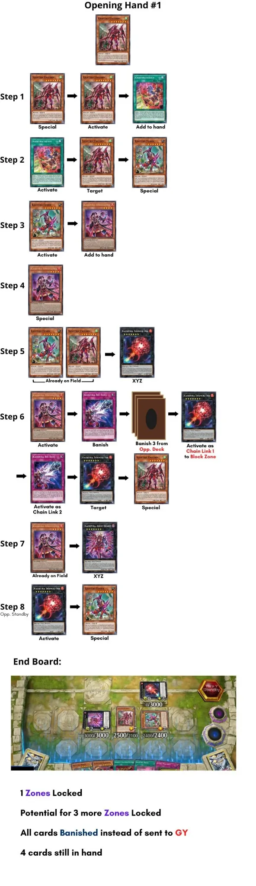
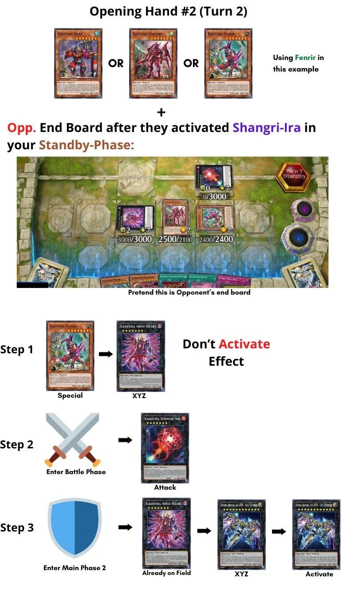
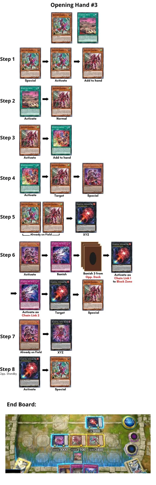
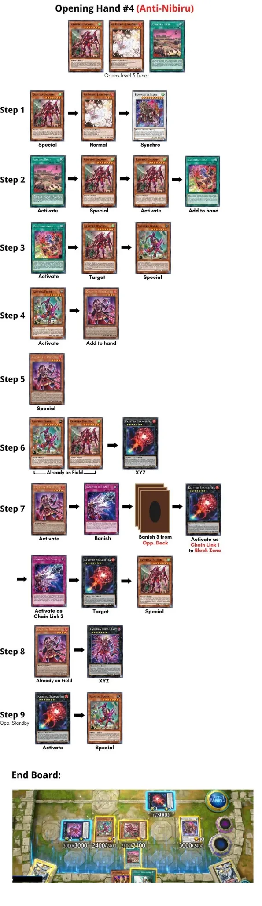

## Incorporación solicitada — 13 de noviembre de 2026

Las imágenes V02, V03 y V04 ya tienen rutas completas: `665:A09:MIRROR:ARISE:BATTLE:ZEUS13`, `665:A09:FENRIR:BIRTH:BIGBANG:ARISE14` y `665:A09:UNICORN:ASH:BIRTH:BARONNE15`. Consultar `DECK_665_COMBOS_SOLICITADOS.md` y `KASHTIRA_COMBOS_SOLICITADOS.json` como desarrollo vigente. Las anotaciones de vinculación pendiente de esos tres ejemplos, conservadas abajo como antecedente, quedan sustituidas. No se ocultan en una categoría de referencias: se presentan con pasos, propósito, tablero y condiciones de uso.

# Kashtira Pure — Cuatro ejemplos visuales aportados por Miguel

**Estos son los ejemplos de presentación que deben utilizarse dentro de «Aprende jugadas».** Las imágenes son referencias de rutas con estado inicial → cartas/acciones → pasos con flechas → endboard. No sustituirlas por una ficha de texto genérico. Al incorporarlas al visor, identificar siempre la ruta y comprobar las condiciones reales; el nombre de una imagen no certifica la secuencia.

## Referencia V01 — Unicorn de una carta: despliegue y control

- **Entrada que ilustra:** Unicorn en mano; búsquedas, Theosis, Fenrir, Riseheart y Big Bang como continuidad.
- **Propósito:** crear presión Rank 7/control de zonas y mantener recursos. La imagen incluye acciones de turnos distintos; no representarlas como un endboard inmediato de un único turno.
- **Vinculación:** guía existente `665:A09:UNICORN:THEOSIS:FENRIR:SHANGRI03` como núcleo; la secuencia ampliada hasta Arise-Heart y el campo exacto de la imagen requiere cotejo adicional antes de publicarse como combo autónomo.

## Referencia V02 — Romper campo y acceso a Zeus

- **Entrada que ilustra:** turno 2 frente a Shangri-Ira y Arise-Heart del rival; la imagen plantea hacer Arise-Heart, declarar batalla y utilizar la ventana de Main Phase 2 para Zeus.
- **Propósito:** **romper campo**. Validar por separado si se activó Shangri-Ira este turno, si el Xyz propio batalló y cuántos materiales concretos quedan bajo Zeus. El endboard enemigo mostrado es una **precondición rival**, no recursos que tú controles.
- **Vinculación pendiente:** Divine Arsenal AA-ZEUS en Extra Deck. No marcar este ejemplo como una ruta certificada hasta contrastar los reemplazos al GY y la secuencia completa.

## Referencia V03 — Fenrir + Birth: doble Xyz y control

- **Entrada:** Fenrir + Birth.
- **Propósito:** control, dos Xyz y continuación en Standby rival.
- **Vinculación:** rutas existentes `665:A09:FENRIR:BIRTH:SHANGRI05` y `665:A09:WRAITSOTH:RISEHEART:BIGBANG:ARISE1MAT09` solo como familias relacionadas. No tratarlas como equivalentes, porque tienen manos iniciales y requisitos distintos.

## Referencia V04 — Unicorn + Ash Blossom + Birth: línea anti-Nibiru

- **Entrada:** Unicorn + Ash Blossom (u otro Cantante de Nivel 3 permitido) + Birth.
- **Propósito:** establecer negación temprana con Baronne antes de continuar hacia monstruos Xyz, cuando sea legal y compatible con el formato actual.
- **Vinculación pendiente:** Baronne de Fleur del Extra. Verificar disponibilidad de Normal Summon, momento de activación de Birth, recuento de Invocaciones, restricciones de Extra y legalidad de la secuencia completa; la imagen **no demuestra** por sí sola protección universal frente a Nibiru.

## Requisitos concretos de visualización

1. Mostrar mano inicial con fotografías, no un párrafo que solo diga «usa dos cartas».
2. Cada paso muestra cartas reales y flechas de movimiento; acción en verbo breve (buscar, Invocar, desacoplar, desterrar, activar).
3. Al seleccionar una carta del Extra, presentar primero **cómo llegar a ella con la lista actual**, qué mano/estado necesita, **para qué situación** sirve y enlaces a la ruta legal disponible.
4. Separar claramente campo del rival, campo propio, momento de turno y cartas que estarán disponibles en una Standby futura.
5. Campo final con imagen o tablero de zonas, materiales Xyz y efectos disponibles, sin inventar negaciones o recursos.
6. Si una ruta visual no pasa el control de reglas, corregirla antes de enseñar su resultado como legal; conservar las imágenes como referencias de diseño.
