# Infernoble

## APARTADO_01 — Perfil A01 importable 670

- **Arquetipo:** Infiernoble / Guerreros y Equipos
- **Tipo de estrategia:** Combo de Guerreros FUEGO, Sincronía y Enlace
- **Estilo breve:** Convierte Guerreros FUEGO y Equipos en materiales de Angélica y recursos de Museo; Isolde desarrolla cuerpos y Great Charles ofrece presión cuando su acceso existe.
- **Resumen para ficha:** Ogier envía Equipos y Renaud recupera recursos para Angélica. Connector abre Isolde; un Charles Sincronía equipado habilita Great Charles como salida de control.
- **Cómo se juega:** Primero: construir Angélica con Equipos disponibles. Invoca Normalmente Ogier de Nivel 4 y usa su disparo para enviar Durendal del Deck al Cementerio. Como controlas un Guerrero FUEGO, Invoca Renaud de Nivel 1 desde mano por su procedimiento propio; se trata como Cantante. Recupera Durendal de Cementerio con su disparo si resuelve. Sincroniza Ogier (4) + Renaud (1) para Angélica (5). Utiliza su efecto de Invocación Especial para añadir Museo y gestiona los Equipos conforme a sus requisitos. Conserva los Equipos; para que Angélica traiga Roland necesita su condición de selección en Campo. No existe Charles todavía. Angélica y Museo con recursos para continuar; Roland y Charles no están automáticamente en el Campo. Segundo: retirar una amenaza con Anima y S:P. Desarrolla Ogier y Renaud y conserva el Equipo recuperado según la ruta. Si la posición rival permite que Anima equipe un monstruo elegible, sigue la variante ofensiva con Anima. Convierte los materiales disponibles en S:P y resuelve su retirada solo si queda un objetivo elegible. S:P y Durendal en mano; Anima ya no queda en Campo cuando se usa como material. Juego medio: recuperar mediante Renaud. Si Connector puede resolver, trae Aqua Dolphin y usa ambos Guerreros para Isolde según la ruta existente. Usa las búsquedas y recuperación permitidas de Isolde y Renaud, respetando las limitaciones del Guerrero añadido. Activa Durendal para obtener Fire Flint Lady si esa continuación sigue disponible. Cuerpos adicionales y recursos de mano, no una Sincronía o negación gratuita. Juego tardío: convertir Charles equipado. Verifica que Charles esté realmente equipado y que la carta de Enlace permanezca disponible. Utiliza el procedimiento de Enlace que requiere al Charles equipado. Al Invocar Great Charles, selecciona al Charles Sincronía del Cementerio para su efecto de equipamiento. Reserva la Mágica de Equipo que deba enviarse para responder a una activación de Magia/Trampa. Great Charles de 3500 ATK con Charles equipado y una respuesta potencial a Magia/Trampa.
- **Qué vigilar:** Distingue cómo fue Invocado Renaud y cuándo se trata como Cantante. No atribuyas Charles a Angélica sin niveles y materiales suficientes.

**Procedencia:** paquete estructurado de esta identidad con inventario vivo validado en solo lectura; ninguna importación de producción se atribuye a este cambio.

<!-- A01_PLAYER_STRATEGY_V2_START -->
### Plan práctico de juego

#### Primero: construir Angélica con Equipos disponibles

**Objetivo:** Preparar una Sincronía del motor y conservar acceso a los Equipos, sin anunciar un jefe no construido.

**Situación:** Ogier y Renaud en mano; Durendal, Museo y Angélica disponibles, Normal libre.

**Cartas:** Infernoble Caballero Ogier, Infernoble Caballero Renaud, Infernoble Arms - Durendal, Noble Arms Museum, Angelica, Princess of Noble Arms [Synchro], Infernoble Knight Captain Roland [Synchro]

1. Invoca Normalmente Ogier de Nivel 4 y usa su disparo para enviar Durendal del Deck al Cementerio.
2. Como controlas un Guerrero FUEGO, Invoca Renaud de Nivel 1 desde mano por su procedimiento propio; se trata como Cantante. Recupera Durendal de Cementerio con su disparo si resuelve.
3. Sincroniza Ogier (4) + Renaud (1) para Angélica (5). Utiliza su efecto de Invocación Especial para añadir Museo y gestiona los Equipos conforme a sus requisitos.
4. Conserva los Equipos; para que Angélica traiga Roland necesita su condición de selección en Campo. No existe Charles todavía.

**Resultado esperado:** Angélica y Museo con recursos para continuar; Roland y Charles no están automáticamente en el Campo.

**Recursos que conservar:** Equipo recuperado, Museo y un no Cantante de Nivel 4 si la continuación exige ese material.

**Alternativa:** Si prefieres una respuesta corta con dos Guerreros, usa la ruta de S:P de la misma apertura.

#### Segundo: retirar una amenaza con Anima y S:P

**Objetivo:** Usar un recurso del Extra para retirar un monstruo en una posición elegible.

**Situación:** Ogier y Renaud disponibles; la posición del monstruo rival permite la interacción de Anima y existe S:P en Extra.

**Cartas:** Infernoble Caballero Ogier, Infernoble Caballero Renaud, Relinquished Anima [Link], S:P Little Knight [Link], Infernoble Arms - Durendal

1. Desarrolla Ogier y Renaud y conserva el Equipo recuperado según la ruta.
2. Si la posición rival permite que Anima equipe un monstruo elegible, sigue la variante ofensiva con Anima.
3. Convierte los materiales disponibles en S:P y resuelve su retirada solo si queda un objetivo elegible.

**Resultado esperado:** S:P y Durendal en mano; Anima ya no queda en Campo cuando se usa como material.

**Recursos que conservar:** Durendal para desarrollar otro Guerrero y una apertura que no se haya gastado.

**Alternativa:** Si no existe posición aprovechable para Anima, usa la línea directa de S:P o conserva Angélica.

#### Juego medio: recuperar mediante Renaud

**Objetivo:** Volver a obtener un Equipo y usarlo para conectar con otro Guerrero.

**Situación:** Renaud disponible mediante una apertura válida; existe Durendal u otro Equipo recuperable según la secuencia.

**Cartas:** Infernoble Caballero Renaud, Infernoble Arms - Durendal, Fire Flint Lady, Isolde, Two Tales of the Noble Knights [Link], Neo Space Connector, Neo-Spacian Aqua Dolphin

1. Si Connector puede resolver, trae Aqua Dolphin y usa ambos Guerreros para Isolde según la ruta existente.
2. Usa las búsquedas y recuperación permitidas de Isolde y Renaud, respetando las limitaciones del Guerrero añadido.
3. Activa Durendal para obtener Fire Flint Lady si esa continuación sigue disponible.

**Resultado esperado:** Cuerpos adicionales y recursos de mano, no una Sincronía o negación gratuita.

**Recursos que conservar:** Un Equipo y el Guerrero que pueda Invocarse legalmente en ese turno.

**Alternativa:** Si no se cumple el acceso a Isolde, utiliza Ogier y Renaud para la ruta de Angélica.

#### Juego tardío: convertir Charles equipado

**Objetivo:** Transformar un Charles ya construido en su amenaza de Enlace con interacción de Magia/Trampa.

**Situación:** Charles Sincronía está en Campo y tiene una Mágica de Equipo propia equipada; Great Charles permanece en Extra.

**Cartas:** Infernoble Knight Emperor Charles [Synchro], Emperor Charles the Great [Link], Infernoble Arms - Durendal, Noble Arms Museum

1. Verifica que Charles esté realmente equipado y que la carta de Enlace permanezca disponible.
2. Utiliza el procedimiento de Enlace que requiere al Charles equipado.
3. Al Invocar Great Charles, selecciona al Charles Sincronía del Cementerio para su efecto de equipamiento. Reserva la Mágica de Equipo que deba enviarse para responder a una activación de Magia/Trampa.

**Resultado esperado:** Great Charles de 3500 ATK con Charles equipado y una respuesta potencial a Magia/Trampa.

**Recursos que conservar:** El recurso de Equipo necesario para la respuesta y un iniciador si el jefe es retirado.

**Alternativa:** Si no controlas Charles equipado, no presentes Great Charles como salida de una carta; reconstruye primero el motor.

#### Mano débil: Connector o Museo con Renaud

**Objetivo:** Identificar una apertura que genere Guerreros reales sin depender de una mano ideal.

**Situación:** Connector en mano o Museo y Renaud según la apertura; Aqua Dolphin y Equipos siguen en Deck.

**Cartas:** Neo Space Connector, Neo-Spacian Aqua Dolphin, Noble Arms Museum, Infernoble Caballero Renaud, Isolde, Two Tales of the Noble Knights [Link], Infernoble Arms - Durendal

1. Con Connector, usa su acceso a Aqua Dolphin para reunir los dos Guerreros requeridos.
2. Con Museo y Renaud, sigue la variante documentada que obtiene un segundo Guerrero mediante el motor de Equipos.
3. Detente en el resultado que acredita la línea: Isolde y Renaud con recursos de mano, no un Charles gratuito.

**Resultado esperado:** Dos Guerreros convertidos en desarrollo de Enlace y acceso a Gearfried/Durendal cuando la búsqueda resuelve.

**Recursos que conservar:** Durendal y cualquier cuerpo que no se necesite gastar en la primera apertura.

**Alternativa:** Si la búsqueda de Isolde queda negada, revisa si Ogier y Renaud están realmente disponibles antes de cambiar a Angélica.

#### Interrupción: separar motores de Guerrero y Diabellstar

**Objetivo:** Conservar la Normal y una segunda vía cuando el rival detiene el primer efecto.

**Situación:** Connector o una búsqueda de Equipo fue negada; WANTED, Diabellstar u Ogier pueden seguir disponibles.

**Cartas:** WANTED: Seeker of Sinful Spoils, Diabellstar la Bruja Negra, Original Sinful Spoils - Snake-Eye, Infernoble Caballero Ogier, Fire Flint Lady, Infernoble Caballero Renaud

1. Verifica si Aqua Dolphin o el Equipo llegaron realmente a su zona tras la negación.
2. Si tienes WANTED, una carta que puedas enviar y Ogier según la apertura, valora la línea independiente de Diabellstar.
3. Usa Original Sinful Spoils y los Guerreros de la ruta solo con sus recursos reales; conserva la Normal si la línea no la consume.

**Resultado esperado:** Un nuevo cuerpo Ogier o una apertura alternativa si los recursos lo permiten; no se garantiza Charles tras la interrupción.

**Recursos que conservar:** La Normal y el Equipo que no haya sido consumido.

**Alternativa:** Con dos Guerreros válidos, considera la salida defensiva de S:P cuando una continuación mayor no sea posible.

#### Ganar: presión de Charles y gestión de Equipos

**Objetivo:** Asegurar un ataque favorable sin gastar la única respuesta de Great Charles.

**Situación:** Great Charles ya está en Campo o puedes convertir un Charles equipado; el rival tiene recursos de Magia/Trampa.

**Cartas:** Emperor Charles the Great [Link], Infernoble Knight Emperor Charles [Synchro], Angelica's Angelic Ring, Noble Arms Museum, Immortal Phoenix Gearfried

1. Conserva el Equipo que permite la respuesta de Great Charles mientras exista una amenaza rival pendiente.
2. Compara el ataque del jefe con los monstruos y LP rivales antes de decidir la Battle Phase.
3. Si aún no puedes terminar, deja Museo o un Equipo disponible para recuperar el motor y no consumas todos los Guerreros.

**Resultado esperado:** Presión de 3500 ATK y respuesta condicionada a Magia/Trampa; no implica daño letal por sí sola.

**Recursos que conservar:** Una carta de Equipo utilizable y un Guerrero para el siguiente turno.

**Alternativa:** Si no has reunido Charles, usa la salida documentada de Angélica o S:P según el campo real.

#### Errores: nivel, Equipos y búsqueda de Isolde

**Objetivo:** Evitar contar un Cantante o un jefe inexistente por la forma incorrecta de Invocación.

**Situación:** Estás utilizando Renaud, Isolde, Angélica o Roland.

**Cartas:** Infernoble Caballero Renaud, Isolde, Two Tales of the Noble Knights [Link], Angelica, Princess of Noble Arms [Synchro], Infernoble Knight Captain Roland [Synchro], Infernoble Knight Emperor Charles [Synchro], Infernoble Arms - Durendal

1. Renaud es Cantante si fue Invocado mediante su procedimiento propio desde mano al controlar un Guerrero FUEGO; si Isolde lo Invoca desde Deck, ese cambio de tipo no se aplica.
2. El Guerrero añadido por el efecto pertinente de Isolde tiene restricciones durante ese turno; no lo uses como si fuera una extensión libre.
3. Angélica puede traer Roland solo si se abre su condición; para Charles Nivel 9 aún necesitas el material no Cantante exigido.

**Resultado esperado:** Materiales y condiciones correctos para cada Sincronía o Enlace, sin sumar un jefe ausente.

**Recursos que conservar:** Equipos reales, niveles de los cuerpos y efectos todavía disponibles.

**Alternativa:** Si falta el Nivel 4 para Charles, conserva Roland y Angélica según su ruta, o elige otra salida documentada.

<!-- A01_PLAYER_STRATEGY_V2_END -->

## APARTADO_02 — Continuidad del contenido anterior

> **Alcance editorial de todas las cartas y guías de este deck:** Las fichas son interpretaciones tácticas: costes, objetivos, ventanas y límites deben cotejarse con el texto oficial antes de acreditar una secuencia A09. Las guías explican funciones derivadas; no certifican nuevas invocaciones ni cadenas.

## IDENTIDAD BÁSICA

- `deck_id`: **670**
- Nombre registrado: **Infernoble**
- Formato: **tcg_advanced**
- Main: **42**; Extra: **15**; Side: **0**; Reserva: **12**.

## APARTADO_01 — A01 fuente del deck Infernoble (670)

**Inventario original comprobado:** TCG Advanced. Main 42, Extra 15, Side 0, Reserva 12. 45 identidades documentadas con CID, sección, cantidades y función. Sin banlist ni traslado de copias entre zonas.

### A01-T1 — Diagnóstico estratégico individual

- **Arquetipo:** Infernoble Knight, con Equipos y motores auxiliares de la lista actual.
- **Clasificación:** desarrollo de Guerreros FUEGO y acceso condicionado a Enlace/Sincronía.
- **Estilo y motor principal:** combos de equipamiento, búsqueda y reutilización de recursos.
- **Plan por fases y salidas condicionales:** Museo, Durendal, Almace y monstruos como Ogier, Oliver y Renaud ayudan a reunir Guerreros y Equipos. Las rutas hacia Isolde o Carlo requieren materiales y orden concretos.
- **Riesgos, materiales y restricciones:** Equipos disponibles, niveles de Sincro y efectos que bloqueen otras invocaciones del Extra.
- **Condición de victoria:** convertir acceso legal a los motores y al Extra en control, tempo o daño; sin anunciar OTK ni campo final garantizados. Los recursos se analizan carta a carta en la matriz T3.
- **Alcance:** el diagnóstico se respalda en el inventario y las fichas de este deck; aún se deben cotejar los efectos y ventanas pendientes en A05/A07 antes de construir reglas ejecutables.

### A01-T2 — Perfil de seis campos para preparar importación (aún no certificado)

- **Arquetipo:** Infernoble Knight, con Equipos y motores auxiliares de la lista actual.
- **Tipo de estrategia:** desarrollo de Guerreros FUEGO y acceso condicionado a Enlace/Sincronía.
- **Estilo breve:** combos de equipamiento, búsqueda y reutilización de recursos.
- **Resumen para ficha:** Museo, Durendal, Almace y monstruos como Ogier, Oliver y Renaud ayudan a reunir Guerreros y Equipos. Las rutas hacia Isolde o Carlo requieren materiales y orden concretos.
- **Cómo se juega:** Museo, Durendal, Almace y monstruos como Ogier, Oliver y Renaud ayudan a reunir Guerreros y Equipos. Las rutas hacia Isolde o Carlo requieren materiales y orden concretos.
- **Qué vigilar:** Equipos disponibles, niveles de Sincro y efectos que bloqueen otras invocaciones del Extra.

Estilo breve 61/190; Resumen para ficha 171/250. **T2 pendiente**: no existe prueba de igualdad literal con el paquete estructurado de este deck.

### A01-T3 — Inventario y propósitos trazados por CID

| CID fuente Konami | Identidad | Zona/copias | Rol documental | Efecto pendiente de cotejo jurídico/reglamentario | Condición/riesgo |
|---|---|---|---|---|---|
| [17768](https://www.db.yugioh-card.com/yugiohdb/card_search.action?cid=17768&ope=2) | Kashtira Fenrir | Main 3x. No altera las cantidades registradas. | starter Kashtira · presión de destierro. | Se invoca desde mano sin monstruos propios, busca otro Kashtira y destierra boca abajo una carta rival al reaccionar a su efecto o atacar. | hay límite por turno según el efecto concreto; requiere campo propio sin las cartas indicadas; interactúa con información oculta o resultados no siempre elegibles. |
| [18151](https://www.db.yugioh-card.com/yugiohdb/card_search.action?cid=18151&ope=2) | Kashtira Riseheart | Main 1x. No altera las cantidades registradas. | extensor Kashtira · ajuste de Nivel. | Se invoca si controlas Kashtira y transforma recursos por destierro para habilitar Nivel 7/Xyz. | hay límite por turno según el efecto concreto; puede bloquear tipos de Invocación del Extra Deck; requiere estado de campo específico; interactúa con información oculta o resultado |
| [19148](https://www.db.yugioh-card.com/yugiohdb/card_search.action?cid=19148&ope=2) | Diabellstar la Bruja Negra | Main 1x. No altera las cantidades registradas. | interrupción · recuperación · extensor · preparación. | recuperación e invocación desde Cementerio/destierro; acceso al campo desde la mano; colocación de Mágicas/Trampas o recursos. Son operaciones detectadas en el texto, no efectos independientes garantizados; leer sus condiciones en la fuente. | hay límite por turno según el efecto concreto. |
| [14801](https://www.db.yugioh-card.com/yugiohdb/card_search.action?cid=14801&ope=2) | Immortal Phoenix Gearfried | Main 1x. No altera las cantidades registradas. | interrupción · extensor · negación · cierre · motor Equipo. | acceso al campo desde la mano; negación de efectos o activaciones; presión de combate o modificación de estadísticas; uso o producción de cartas equipadas. Son operaciones detectadas en el texto, no efectos independientes garantizados; leer sus condiciones en la fuente. | hay límite por turno según el efecto concreto. |
| [18801](https://www.db.yugioh-card.com/yugiohdb/card_search.action?cid=18801&ope=2) | Infernoble Caballero Turpin | Main 1x. No altera las cantidades registradas. | recuperación · extensor · respuesta · motor Equipo. | recuperación e invocación desde Cementerio/destierro; acceso al campo desde la mano; interacción sobre monstruos en campo; uso o producción de cartas equipadas. Son operaciones detectadas en el texto, no efectos independientes garantizados; leer sus condiciones en la fuente. | hay límite por turno según el efecto concreto; requiere estado de campo específico; depende de recursos en Cementerio; exige materiales de Extra Deck o materiales adecuados. |
| [15249](https://www.db.yugioh-card.com/yugiohdb/card_search.action?cid=15249&ope=2) | Infernoble Caballero Maugis | Main 1x. No altera las cantidades registradas. | removal · recuperación · ventaja de mano · respuesta · motor Equipo. | destierro de recursos o de amenazas; retorno o reciclaje hacia mano/Deck/Extra; generación de cartas por robo; interacción sobre monstruos en campo; uso o producción de cartas equipadas; protección o resistencia contra respuestas. Son operaciones detectadas en el texto, no efectos independ | hay límite por turno según el efecto concreto; depende de recursos en Cementerio. |
| [15247](https://www.db.yugioh-card.com/yugiohdb/card_search.action?cid=15247&ope=2) | Infernoble Caballero Ogier | Main 1x. No altera las cantidades registradas. | respuesta · motor Equipo · protección. | interacción sobre monstruos en campo; uso o producción de cartas equipadas; protección o resistencia contra respuestas. Son operaciones detectadas en el texto, no efectos independientes garantizados; leer sus condiciones en la fuente. | hay límite por turno según el efecto concreto; depende de recursos en Cementerio. |
| [18800](https://www.db.yugioh-card.com/yugiohdb/card_search.action?cid=18800&ope=2) | Infernoble Caballero Ricciardetto | Main 1x. No altera las cantidades registradas. | extensor. | acceso al campo desde la mano. Son operaciones detectadas en el texto, no efectos independientes garantizados; leer sus condiciones en la fuente. | puede bloquear tipos de Invocación del Extra Deck; depende de recursos en Cementerio. |
| [15082](https://www.db.yugioh-card.com/yugiohdb/card_search.action?cid=15082&ope=2) | Infernoble Caballero Renaud | Main 2x. No altera las cantidades registradas. | extensor · removal · motor Equipo. | acceso al campo desde la mano; destierro de recursos o de amenazas; uso o producción de cartas equipadas. Son operaciones detectadas en el texto, no efectos independientes garantizados; leer sus condiciones en la fuente. | hay límite por turno según el efecto concreto; requiere estado de campo específico; depende de recursos en Cementerio. |
| [15248](https://www.db.yugioh-card.com/yugiohdb/card_search.action?cid=15248&ope=2) | Infernoble Caballero Oliver | Main 1x. No altera las cantidades registradas. | recuperación · extensor · respuesta · motor Equipo. | recuperación e invocación desde Cementerio/destierro; acceso al campo desde la mano; interacción sobre monstruos en campo; uso o producción de cartas equipadas. Son operaciones detectadas en el texto, no efectos independientes garantizados; leer sus condiciones en la fuente. | hay límite por turno según el efecto concreto; depende de recursos en Cementerio. |
| [14085](https://www.db.yugioh-card.com/yugiohdb/card_search.action?cid=14085&ope=2) | Neo Space Connector | Main 3x. No altera las cantidades registradas. | extensor · cierre · coste/recurso. | acceso al campo desde la mano; presión de combate o modificación de estadísticas; uso de Sacrificios como parte del efecto. Son operaciones detectadas en el texto, no efectos independientes garantizados; leer sus condiciones en la fuente. | hay límite por turno según el efecto concreto; depende de recursos en Cementerio. |
| [6768](https://www.db.yugioh-card.com/yugiohdb/card_search.action?cid=6768&ope=2) | Neo-Spacian Aqua Dolphin | Main 1x. No altera las cantidades registradas. | removal · cierre. | destrucción de cartas o empleo de destrucción como detonante; presión de combate o modificación de estadísticas. Son operaciones detectadas en el texto, no efectos independientes garantizados; leer sus condiciones en la fuente. | hay límite por turno según el efecto concreto; requiere estado de campo específico. |
| [15392](https://www.db.yugioh-card.com/yugiohdb/card_search.action?cid=15392&ope=2) | Fire Flint Lady | Main 1x. No altera las cantidades registradas. | recuperación · extensor. | recuperación e invocación desde Cementerio/destierro; acceso al campo desde la mano. Son operaciones detectadas en el texto, no efectos independientes garantizados; leer sus condiciones en la fuente. | hay límite por turno según el efecto concreto; requiere estado de campo específico. |
| [9279](https://www.db.yugioh-card.com/yugiohdb/card_search.action?cid=9279&ope=2) | Droll & Lock Bird | Main 3x. No altera las cantidades registradas. | handtrap · bloqueo de búsquedas. | Tras una incorporación desde el Deck a la mano rival, se envía al Cementerio para impedir nuevas adiciones desde ambos Decks principales ese turno. | aplicar restricciones de selección, activación y copias que consten en el texto original. |
| [8933](https://www.db.yugioh-card.com/yugiohdb/card_search.action?cid=8933&ope=2) | Effect Veiler | Main 2x. No altera las cantidades registradas. | handtrap · negación. | Durante la Main Phase rival, se manda desde la mano al Cementerio para negar los efectos de un monstruo rival boca arriba. | aplicar restricciones de selección, activación y copias que consten en el texto original. |
| [12950](https://www.db.yugioh-card.com/yugiohdb/card_search.action?cid=12950&ope=2) | Ash Blossom & Joyous Spring | Main 2x. No altera las cantidades registradas. | handtrap · negación. | Descarta desde la mano para detener efectos que buscan, invocan o mandan cartas desde el Deck. | hay límite por turno según el efecto concreto. |
| [19207](https://www.db.yugioh-card.com/yugiohdb/card_search.action?cid=19207&ope=2) | Angelica's Angelic Ring | Main 1x. No altera las cantidades registradas. | removal · motor Equipo. | destrucción de cartas o empleo de destrucción como detonante; uso o producción de cartas equipadas. Son operaciones detectadas en el texto, no efectos independientes garantizados; leer sus condiciones en la fuente. | hay límite por turno según el efecto concreto. |
| [18843](https://www.db.yugioh-card.com/yugiohdb/card_search.action?cid=18843&ope=2) | Infernoble Arms - Almace | Main 1x. No altera las cantidades registradas. | removal · motor Equipo. | destrucción de cartas o empleo de destrucción como detonante; destierro de recursos o de amenazas; uso o producción de cartas equipadas. Son operaciones detectadas en el texto, no efectos independientes garantizados; leer sus condiciones en la fuente. | depende de recursos en Cementerio. |
| [15287](https://www.db.yugioh-card.com/yugiohdb/card_search.action?cid=15287&ope=2) | Infernoble Arms - Durendal | Main 2x. No altera las cantidades registradas. | searcher · buscador · removal · motor Equipo. | búsqueda o incorporación de cartas a mano; destrucción de cartas o empleo de destrucción como detonante; uso o producción de cartas equipadas. Son operaciones detectadas en el texto, no efectos independientes garantizados; leer sus condiciones en la fuente. | puede bloquear tipos de Invocación del Extra Deck; depende de recursos en Cementerio. |
| [18844](https://www.db.yugioh-card.com/yugiohdb/card_search.action?cid=18844&ope=2) | Noble Arms Museum | Main 3x. No altera las cantidades registradas. | searcher · buscador · cierre. | búsqueda o incorporación de cartas a mano; presión de combate o modificación de estadísticas. Son operaciones detectadas en el texto, no efectos independientes garantizados; leer sus condiciones en la fuente. | hay límite por turno según el efecto concreto; puede bloquear tipos de Invocación del Extra Deck. |
| [6458](https://www.db.yugioh-card.com/yugiohdb/card_search.action?cid=6458&ope=2) | Divine Sword - Phoenix Blade | Main 1x. No altera las cantidades registradas. | searcher · buscador · cierre · motor Equipo. | búsqueda o incorporación de cartas a mano; presión de combate o modificación de estadísticas; uso o producción de cartas equipadas. Son operaciones detectadas en el texto, no efectos independientes garantizados; leer sus condiciones en la fuente. | depende de recursos en Cementerio. |
| [7519](https://www.db.yugioh-card.com/yugiohdb/card_search.action?cid=7519&ope=2) | D.D.R. - Different Dimension Reincarnation | Main 1x. No altera las cantidades registradas. | removal. | destrucción de cartas o empleo de destrucción como detonante; destierro de recursos o de amenazas. Son operaciones detectadas en el texto, no efectos independientes garantizados; leer sus condiciones en la fuente. | aplicar restricciones de selección, activación y copias que consten en el texto original. |
| [19196](https://www.db.yugioh-card.com/yugiohdb/card_search.action?cid=19196&ope=2) | WANTED: Seeker of Sinful Spoils | Main 3x. No altera las cantidades registradas. | searcher · buscador · removal · ventaja de mano. | búsqueda o incorporación de cartas a mano; destierro de recursos o de amenazas; generación de cartas por robo. Son operaciones detectadas en el texto, no efectos independientes garantizados; leer sus condiciones en la fuente. | hay límite por turno según el efecto concreto; depende de recursos en Cementerio. |
| [14075](https://www.db.yugioh-card.com/yugiohdb/card_search.action?cid=14075&ope=2) | Heritage of the Chalice | Main 3x. No altera las cantidades registradas. | searcher · buscador · motor Equipo. | búsqueda o incorporación de cartas a mano; uso o producción de cartas equipadas. Son operaciones detectadas en el texto, no efectos independientes garantizados; leer sus condiciones en la fuente. | depende de recursos en Cementerio. |
| [5328](https://www.db.yugioh-card.com/yugiohdb/card_search.action?cid=5328&ope=2) | Reinforcement of the Army | Main 1x. No altera las cantidades registradas. | searcher · buscador. | búsqueda o incorporación de cartas a mano. Son operaciones detectadas en el texto, no efectos independientes garantizados; leer sus condiciones en la fuente. | aplicar restricciones de selección, activación y copias que consten en el texto original. |
| [19199](https://www.db.yugioh-card.com/yugiohdb/card_search.action?cid=19199&ope=2) | Original Sinful Spoils - Snake-Eye | Main 1x. No altera las cantidades registradas. | searcher · buscador · extensor. | búsqueda o incorporación de cartas a mano; acceso al campo desde la mano. Son operaciones detectadas en el texto, no efectos independientes garantizados; leer sus condiciones en la fuente. | depende de recursos en Cementerio. |
| [15275](https://www.db.yugioh-card.com/yugiohdb/card_search.action?cid=15275&ope=2) | Infernoble Knight Captain Roland [Synchro] | Extra 1x. No altera las cantidades registradas. | interrupción · resultado de Extra Deck · buscador · cierre · respuesta. | búsqueda o incorporación de cartas a mano; presión de combate o modificación de estadísticas; interacción sobre monstruos en campo; uso o producción de cartas equipadas. Son operaciones detectadas en el texto, no efectos independientes garantizados; leer sus condiciones en la fuente. | hay límite por turno según el efecto concreto; depende de recursos en Cementerio. Invocar sólo desde el Extra Deck usando su procedimiento propio. |
| [16386](https://www.db.yugioh-card.com/yugiohdb/card_search.action?cid=16386&ope=2) | Baronne de Fleur [Synchro] | Extra 1x. No altera las cantidades registradas. | interrupción · resultado de Extra Deck · removal · negación · recuperación. | destrucción de cartas o empleo de destrucción como detonante; negación de efectos o activaciones; retorno o reciclaje hacia mano/Deck/Extra. Son operaciones detectadas en el texto, no efectos independientes garantizados; leer sus condiciones en la fuente. | hay límite por turno según el efecto concreto; depende de recursos en Cementerio. Invocar sólo desde el Extra Deck usando su procedimiento propio. |
| [15276](https://www.db.yugioh-card.com/yugiohdb/card_search.action?cid=15276&ope=2) | Infernoble Knight Emperor Charles [Synchro] | Extra 1x. No altera las cantidades registradas. | resultado de Extra Deck · cierre · motor Equipo. | presión de combate o modificación de estadísticas; uso o producción de cartas equipadas. Son operaciones detectadas en el texto, no efectos independientes garantizados; leer sus condiciones en la fuente. | hay límite por turno según el efecto concreto. Invocar sólo desde el Extra Deck usando su procedimiento propio. |
| [18926](https://www.db.yugioh-card.com/yugiohdb/card_search.action?cid=18926&ope=2) | Battlin' Boxer King Dempsey [Xyz] | Extra 1x. No altera las cantidades registradas. | interrupción · resultado de Extra Deck · buscador · respuesta · habilitador Xyz. | búsqueda o incorporación de cartas a mano; interacción sobre monstruos en campo; gestión de materiales Xyz. Son operaciones detectadas en el texto, no efectos independientes garantizados; leer sus condiciones en la fuente. | hay límite por turno según el efecto concreto. Invocar sólo desde el Extra Deck usando su procedimiento propio. |
| [19184](https://www.db.yugioh-card.com/yugiohdb/card_search.action?cid=19184&ope=2) | Super Starslayer TY-PHON - Sky Crisis [Xyz] | Extra 1x. No altera las cantidades registradas. | resultado de Extra Deck · recuperación · cierre · habilitador Xyz. | retorno o reciclaje hacia mano/Deck/Extra; presión de combate o modificación de estadísticas; gestión de materiales Xyz. Son operaciones detectadas en el texto, no efectos independientes garantizados; leer sus condiciones en la fuente. | hay límite por turno según el efecto concreto. Invocar sólo desde el Extra Deck usando su procedimiento propio. |
| [18827](https://www.db.yugioh-card.com/yugiohdb/card_search.action?cid=18827&ope=2) | Angelica, Princess of Noble Arms [Synchro] | Extra 1x. No altera las cantidades registradas. | interrupción · resultado de Extra Deck · buscador · extensor · removal. | búsqueda o incorporación de cartas a mano; extensión mediante monstruos procedentes del Deck; acceso al campo desde la mano; destierro de recursos o de amenazas. Son operaciones detectadas en el texto, no efectos independientes garantizados; leer sus condiciones en la fuente. | hay límite por turno según el efecto concreto. Invocar sólo desde el Extra Deck usando su procedimiento propio. |
| [13500](https://www.db.yugioh-card.com/yugiohdb/card_search.action?cid=13500&ope=2) | Isolde, Two Tales of the Noble Knights [Link] | Extra 2x. No altera las cantidades registradas. | resultado de Extra Deck · buscador · extensor · recuperación · preparación. | búsqueda o incorporación de cartas a mano; extensión mediante monstruos procedentes del Deck; recuperación e invocación desde Cementerio/destierro; colocación de Mágicas/Trampas o recursos; uso o producción de cartas equipadas. Son operaciones detectadas en el texto, no efectos independien | hay límite por turno según el efecto concreto. Invocar sólo desde el Extra Deck usando su procedimiento propio. |
| [18835](https://www.db.yugioh-card.com/yugiohdb/card_search.action?cid=18835&ope=2) | Emperor Charles the Great [Link] | Extra 2x. No altera las cantidades registradas. | interrupción · resultado de Extra Deck · removal · negación · cierre. | destrucción de cartas o empleo de destrucción como detonante; negación de efectos o activaciones; presión de combate o modificación de estadísticas; uso o producción de cartas equipadas. Son operaciones detectadas en el texto, no efectos independientes garantizados; leer sus condiciones en | hay límite por turno según el efecto concreto; depende de recursos en Cementerio. Invocar sólo desde el Extra Deck usando su procedimiento propio. |
| [14496](https://www.db.yugioh-card.com/yugiohdb/card_search.action?cid=14496&ope=2) | Apollousa, Bow of the Goddess [Link] | Extra 1x. No altera las cantidades registradas. | interrupción · resultado de Extra Deck · habilitador de Extra · negación · cierre. | habilitación o continuación de una invocación del Extra Deck; negación de efectos o activaciones; presión de combate o modificación de estadísticas. Son operaciones detectadas en el texto, no efectos independientes garantizados; leer sus condiciones en la fuente. | aplicar restricciones de selección, activación y copias que consten en el texto original. Invocar sólo desde el Extra Deck usando su procedimiento propio. |
| [13841](https://www.db.yugioh-card.com/yugiohdb/card_search.action?cid=13841&ope=2) | Relinquished Anima [Link] | Extra 1x. No altera las cantidades registradas. | resultado de Extra Deck · cierre · motor Equipo. | presión de combate o modificación de estadísticas; uso o producción de cartas equipadas. Son operaciones detectadas en el texto, no efectos independientes garantizados; leer sus condiciones en la fuente. | hay límite por turno según el efecto concreto. Invocar sólo desde el Extra Deck usando su procedimiento propio. |
| [13034](https://www.db.yugioh-card.com/yugiohdb/card_search.action?cid=13034&ope=2) | Link Spider [Link] | Extra 1x. No altera las cantidades registradas. | resultado de Extra Deck · extensor. | acceso al campo desde la mano. Son operaciones detectadas en el texto, no efectos independientes garantizados; leer sus condiciones en la fuente. | hay límite por turno según el efecto concreto. Invocar sólo desde el Extra Deck usando su procedimiento propio. |
| [19188](https://www.db.yugioh-card.com/yugiohdb/card_search.action?cid=19188&ope=2) | S:P Little Knight [Link] | Extra 2x. No altera las cantidades registradas. | interrupción · resultado de Extra Deck · removal · respuesta. | destierro de recursos o de amenazas; interacción sobre monstruos en campo. Son operaciones detectadas en el texto, no efectos independientes garantizados; leer sus condiciones en la fuente. | hay límite por turno según el efecto concreto; puede limitar ataques. Invocar sólo desde el Extra Deck usando su procedimiento propio. |
| [14741](https://www.db.yugioh-card.com/yugiohdb/card_search.action?cid=14741&ope=2) | Nibiru, the Primal Being | Reserva 3x. No altera las cantidades registradas. | handtrap · limpieza del campo. | En Main Phase, tras cinco o más invocaciones rivales, sacrifica los monstruos boca arriba y deja a Nibiru junto con una Ficha rival. | hay límite por turno según el efecto concreto. |
| [6980](https://www.db.yugioh-card.com/yugiohdb/card_search.action?cid=6980&ope=2) | D.D. Crow | Reserva 2x. No altera las cantidades registradas. | handtrap · interacción de Cementerio. | Descarta para desterrar una carta elegida del Cementerio rival como efecto rápido. | aplicar restricciones de selección, activación y copias que consten en el texto original. |
| [13950](https://www.db.yugioh-card.com/yugiohdb/card_search.action?cid=13950&ope=2) | Herald of the Abyss | Reserva 1x. No altera las cantidades registradas. | recurso situacional. | interacción propia de la carta que requiere consultar el texto íntegro enlazado. Son operaciones detectadas en el texto, no efectos independientes garantizados; leer sus condiciones en la fuente. | hay límite por turno según el efecto concreto. |
| [15296](https://www.db.yugioh-card.com/yugiohdb/card_search.action?cid=15296&ope=2) | Triple Tactics Talent | Reserva 1x. No altera las cantidades registradas. | mágica de respuesta · ventaja. | Si el rival activó un efecto de monstruo durante tu Main Phase, permite elegir entre robar dos, tomar control temporal o devolver una carta de mano al Deck. | hay límite por turno según el efecto concreto. |
| [18214](https://www.db.yugioh-card.com/yugiohdb/card_search.action?cid=18214&ope=2) | Triple Tactics Thrust | Reserva 3x. No altera las cantidades registradas. | mágica de respuesta · acceso a Trampa/Mágica. | Después de activarse un efecto de monstruo rival, fija o incorpora una Mágica/Trampa Normal del Deck según presencia de monstruos enemigos. | hay límite por turno según el efecto concreto. |
| [13293](https://www.db.yugioh-card.com/yugiohdb/card_search.action?cid=13293&ope=2) | Evenly Matched | Reserva 1x. No altera las cantidades registradas. | trampa · ruptura de mesa. | Al final de Battle Phase y con más cartas rivales, obliga al adversario a desterrar boca abajo hasta igualar las cantidades. | requiere campo propio sin las cartas indicadas; interactúa con información oculta o resultados no siempre elegibles. |
| [12668](https://www.db.yugioh-card.com/yugiohdb/card_search.action?cid=12668&ope=2) | Dimensional Barrier | Reserva 1x. No altera las cantidades registradas. | trampa · bloqueo del Extra. | Declara un tipo de monstruo y bloquea sus Invocaciones Especiales y efectos ese turno. | hay límite por turno según el efecto concreto. |

Todos los CID provienen de la fuente previa. El enlace de referencia **no certifica** que cada paráfrasis haya sido cotejada contra texto vigente; los `effect_id`, `motor_id` y `route_id` que no constan de forma verificable se dejan `PENDIENTE_DE_ENLACE_A05_A09`. No se crean efectos ni combos ficticios.

### A01-T4 y A01-T5 — Por certificar

- T4: faltan JSON original exportado por Station X, inventario ligado, paridad literal de los seis campos y contrato `a01_profile_contract` verificado.
- T5: faltan importación real, exportación, render (móvil y escritorio) y rechazo de paquetes inválidos para este deck. Sin estos ensayos no se declara A01 cerrado.

## CONTROL_DE_TAREAS_A01_A10

**A01:** T1/T3 completadas documentalmente; T2/T4/T5 siguen pendientes. No se relabelan tareas anteriores y A10B no ha sido solicitado.

### A01
- [x] **A01-T1** — Matriz específica con CID/cantidad/rol y diagnóstico en este documento.
- [ ] **A01-T2** — Sin evidencia nueva suficiente para certificación bajo este manifiesto.
- [x] **A01-T3** — Matriz específica con CID/cantidad/rol y diagnóstico en este documento.
- [ ] **A01-T4** — Sin evidencia nueva suficiente para certificación bajo este manifiesto.
- [ ] **A01-T5** — Sin evidencia nueva suficiente para certificación bajo este manifiesto.

### A02
- [ ] **A02-T1** — Sin evidencia nueva suficiente para certificación bajo este manifiesto.
- [ ] **A02-T2** — Sin evidencia nueva suficiente para certificación bajo este manifiesto.
- [ ] **A02-T3** — Sin evidencia nueva suficiente para certificación bajo este manifiesto.

### A03
- [ ] **A03-T1** — Sin evidencia nueva suficiente para certificación bajo este manifiesto.
- [ ] **A03-T2** — Sin evidencia nueva suficiente para certificación bajo este manifiesto.
- [ ] **A03-T3** — Sin evidencia nueva suficiente para certificación bajo este manifiesto.

### A04
- [ ] **A04-T1** — Sin evidencia nueva suficiente para certificación bajo este manifiesto.
- [ ] **A04-T2** — Sin evidencia nueva suficiente para certificación bajo este manifiesto.
- [ ] **A04-T3** — Sin evidencia nueva suficiente para certificación bajo este manifiesto.

### A05
- [ ] **A05-T1** — Sin evidencia nueva suficiente para certificación bajo este manifiesto.
- [ ] **A05-T2** — Sin evidencia nueva suficiente para certificación bajo este manifiesto.
- [ ] **A05-T3** — Sin evidencia nueva suficiente para certificación bajo este manifiesto.
- [ ] **A05-T4** — Sin evidencia nueva suficiente para certificación bajo este manifiesto.

### A06
- [ ] **A06-T1** — Sin evidencia nueva suficiente para certificación bajo este manifiesto.
- [ ] **A06-T2** — Sin evidencia nueva suficiente para certificación bajo este manifiesto.
- [ ] **A06-T3** — Sin evidencia nueva suficiente para certificación bajo este manifiesto.
- [ ] **A06-T4** — Sin evidencia nueva suficiente para certificación bajo este manifiesto.

### A07
- [ ] **A07-T1** — Sin evidencia nueva suficiente para certificación bajo este manifiesto.
- [ ] **A07-T2** — Sin evidencia nueva suficiente para certificación bajo este manifiesto.
- [ ] **A07-T3** — Sin evidencia nueva suficiente para certificación bajo este manifiesto.
- [ ] **A07-T4** — Sin evidencia nueva suficiente para certificación bajo este manifiesto.

### A08
- [ ] **A08-T1** — Sin evidencia nueva suficiente para certificación bajo este manifiesto.
- [ ] **A08-T2** — Sin evidencia nueva suficiente para certificación bajo este manifiesto.
- [ ] **A08-T3** — Sin evidencia nueva suficiente para certificación bajo este manifiesto.
- [ ] **A08-T4** — Sin evidencia nueva suficiente para certificación bajo este manifiesto.

### A09
- [ ] **A09-T1** — Sin evidencia nueva suficiente para certificación bajo este manifiesto.
- [ ] **A09-T2** — Sin evidencia nueva suficiente para certificación bajo este manifiesto.
- [ ] **A09-T3** — Sin evidencia nueva suficiente para certificación bajo este manifiesto.
- [ ] **A09-T4** — Sin evidencia nueva suficiente para certificación bajo este manifiesto.

### A10A
- [ ] **A10A-T1** — Sin evidencia nueva suficiente para certificación bajo este manifiesto.
- [ ] **A10A-T2** — Sin evidencia nueva suficiente para certificación bajo este manifiesto.
- [ ] **A10A-T3** — Sin evidencia nueva suficiente para certificación bajo este manifiesto.

### A10B (opcional)
- [ ] **A10B-T4** — Sin evidencia nueva suficiente para certificación bajo este manifiesto.
- [ ] **A10B-T5** — Sin evidencia nueva suficiente para certificación bajo este manifiesto.
- [ ] **A10B-T6** — Sin evidencia nueva suficiente para certificación bajo este manifiesto.

---
## PERFIL BREVE — CONOCE TU DECK

- **Arquetipo:** Infernoble Knight, con Equipos y motores auxiliares de la lista actual.
- **Tipo de estrategia:** desarrollo de Guerreros FUEGO y acceso condicionado a Enlace/Sincronía.
- **Estilo de juego:** combos de equipamiento, búsqueda y reutilización de recursos.
- **Cómo se juega:** Museo, Durendal, Almace y monstruos como Ogier, Oliver y Renaud ayudan a reunir Guerreros y Equipos. Las rutas hacia Isolde o Carlo requieren materiales y orden concretos.
- **Cartas representativas:** Renaud, Ogier, Oliver, Durendal, Isolde y Carlo el Grande.
- **Qué vigilar:** Equipos disponibles, niveles de Sincro y efectos que bloqueen otras invocaciones del Extra.

### A02 — Decisión táctica por mano y ventana (síntesis del perfil)

- Identificar antes del combo qué Equipo está en mano/campo/GY y si se necesita como coste o extensión; decidir entre Enlace y Sincro solo con los materiales disponibles, evitando consumir la misma pieza en ambas alternativas.
- **Estado de evidencia:** criterio orientativo basado en el perfil; los pasos, costes y campos finales se acreditan exclusivamente en A07–A09.

### A03 — Integridad del inventario físico por zonas

- **Conteo recibido:** 42 Main · 15 Extra · 0 Side recibido · 12 Reserva separada. No convertir Reserva en Side ni una Skill en carta de mano.
- **Control:** la lista individual y su CID/fotografía prevalecen ante cualquier ejemplo táctico; no se crean, sustituyen ni retiran cartas en esta sección.

## CARTAS: FUNCIÓN, RESTRICCIONES Y UTILIDAD

#### 01. Kashtira Fenrir

- **Copias y zona:** Main 3x. No altera las cantidades registradas.
- **Nombre oficial de referencia:** Kashtira Fenrir. CID cotejado con la ficha oficial; el nombre histórico del inventario se conserva aunque su grafía/traducción difiera.
- **Función principal y secundaria:** starter Kashtira · presión de destierro.
- **Estado de sinergia y función:** Utilidad independiente. Es una clasificación de juego; revisar la relación concreta en A06.
- **Papel como recurso, descarte o coste:** No se demuestra que esta carta sea recurso de descarte o pago para otra.
- **Efecto operativo (paráfrasis analítica):** Se invoca desde mano sin monstruos propios, busca otro Kashtira y destierra boca abajo una carta rival al reaccionar a su efecto o atacar. 
- **Mapa de activación y resultados:** 1) efecto propio o continuo: Invocación Especial desde mano · 2) en Main Phase: incorpora la pieza indicada a la mano. Cada operación está sujeta a la secuencia y al «si lo haces» del texto oficial.
- **Ventanas de activación identificadas:** Main Phase; campo propio vacío; respuesta a activación rival.
- **Costes o recursos potenciales:** sin coste independiente identificado en esta síntesis; comprobar las acciones previas al punto y coma de cada efecto.
- **Restricciones y requisitos:** hay límite por turno según el efecto concreto; requiere campo propio sin las cartas indicadas; interactúa con información oculta o resultados no siempre elegibles. 
- **Prioridad al ir primero:** convertir el primer Guerrero en recursos y un Sincro defendible. Para esta carta: Convertir la activación en acceso a la siguiente pieza del motor, sin duplicar buscadores inútilmente.
- **Prioridad al ir segundo:** despejar obstáculos conservando equipo, invocaciones y capacidad de extensión. Identificar primero la respuesta rival que afecta su función «starter Kashtira».
- **Medio/tardío y recuperación:** reutilizar Guerreros y Equipos gastados sin perder la Normal Summon. No asumir que por sí misma recicla recursos si el texto no lo permite.
- **Sinergias y acceso a líneas:** Relación contextual con Guerreros FUEGO, cartas de Equipo, recuperaciones del Cementerio y escalada Sincro. Habilita una línea del motor sólo si coinciden recursos, objetivos y restricciones; no equivale a un combo completo validado.
- **Riesgo / brick / interrupciones:** El destierro no es destrucción ni se activa libremente en cualquier fase. No atribuirle velocidad rápida por el solo hecho de formar parte del motor.
- **Utilidad editorial:** 3/5 para este deck (estimación por rol y zona, no probabilidad calculada). No cambiar copias; cualquier sugerencia de alta/baja pasa por el apartado 22 y aprobación.
- **Referencia oficial y trazabilidad:** https://www.db.yugioh-card.com/yugiohdb/card_search.action?cid=17768&ope=2&request_locale=es. **Confianza:** texto y tipo de efecto cotejados en Konami; síntesis táctica editorial, no demostración de combo.
- **Aplicación concreta dentro de este deck (A06):** Se invoca desde mano sin monstruos propios, busca otro Kashtira y destierra boca abajo una carta rival al reaccionar a su efecto o atacar. Aporta respuesta o consistencia sin exigir enlace directo.

**USO PRÁCTICO Y SINERGIA — Kashtira Fenrir**

- **Label funcional:** Función independiente. Clasificación documental; una relación es válida solo si se satisfacen sus condiciones exactas.
- **Qué hace:** Se invoca desde mano sin monstruos propios, busca otro Kashtira y destierra boca abajo una carta rival al reaccionar a su efecto o atacar.
- **Cómo aprovecharla en este deck:** Se invoca desde mano sin monstruos propios, busca otro Kashtira y destierra boca abajo una carta rival al reaccionar a su efecto o atacar. Aporta respuesta o consistencia sin exigir enlace directo.
- **Al jugar primero:** convertir el primer Guerrero en recursos y un Sincro defendible. Para esta carta: Convertir la activación en acceso a la siguiente pieza del motor, sin duplicar buscadores inútilmente.
- **Al jugar segundo:** despejar obstáculos conservando equipo, invocaciones y capacidad de extensión. Identificar primero la respuesta rival que afecta su función «starter Kashtira».
- **Cuándo tener precaución:** El destierro no es destrucción ni se activa libremente en cualquier fase. No atribuirle velocidad rápida por el solo hecho de formar parte del motor.

#### 02. Kashtira Riseheart

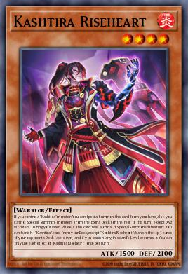

- **Copias y zona:** Main 1x. No altera las cantidades registradas.
- **Nombre oficial de referencia:** Kashtira Riseheart. CID cotejado con la ficha oficial; el nombre histórico del inventario se conserva aunque su grafía/traducción difiera.
- **Función principal y secundaria:** extensor Kashtira · ajuste de Nivel.
- **Estado de sinergia y función:** Conflicto condicionado. Es una clasificación de juego; revisar la relación concreta en A06.
- **Papel como recurso, descarte o coste:** Material o destino del Extra condicionado a los requisitos de invocación.
- **Efecto operativo (paráfrasis analítica):** Se invoca si controlas Kashtira y transforma recursos por destierro para habilitar Nivel 7/Xyz. 
- **Mapa de activación y resultados:** 1) en Main Phase: destierra el recurso u objetivo previsto. Cada operación está sujeta a la secuencia y al «si lo haces» del texto oficial.
- **Ventanas de activación identificadas:** Main Phase.
- **Costes o recursos potenciales:** sin coste independiente identificado en esta síntesis; comprobar las acciones previas al punto y coma de cada efecto.
- **Restricciones y requisitos:** hay límite por turno según el efecto concreto; puede bloquear tipos de Invocación del Extra Deck; requiere estado de campo específico; interactúa con información oculta o resultados no siempre elegibles. 
- **Prioridad al ir primero:** convertir el primer Guerrero en recursos y un Sincro defendible. Para esta carta: Escoger la amenaza o recurso que genere mayor ventaja de tempo; respetar selección y zona.
- **Prioridad al ir segundo:** despejar obstáculos conservando equipo, invocaciones y capacidad de extensión. Identificar primero la respuesta rival que afecta su función «extensor Kashtira».
- **Medio/tardío y recuperación:** reutilizar Guerreros y Equipos gastados sin perder la Normal Summon. No asumir que por sí misma recicla recursos si el texto no lo permite.
- **Sinergias y acceso a líneas:** Relación contextual con Guerreros FUEGO, cartas de Equipo, recuperaciones del Cementerio y escalada Sincro. Habilita una línea del motor sólo si coinciden recursos, objetivos y restricciones; no equivale a un combo completo validado.
- **Riesgo / brick / interrupciones:** Su extensión restringe el Extra a Xyz durante el turno. No atribuirle velocidad rápida por el solo hecho de formar parte del motor.
- **Utilidad editorial:** 3/5 para este deck (estimación por rol y zona, no probabilidad calculada). No cambiar copias; cualquier sugerencia de alta/baja pasa por el apartado 22 y aprobación.
- **Referencia oficial y trazabilidad:** https://www.db.yugioh-card.com/yugiohdb/card_search.action?cid=18151&ope=2&request_locale=es. **Confianza:** texto y tipo de efecto cotejados en Konami; síntesis táctica editorial, no demostración de combo.
- **Aplicación concreta dentro de este deck (A06):** La Invocación propia de Riseheart bloquea Extra a Xyz: compite con Sincronía/Enlace Infernoble; reservar para plan compatible o evaluar sustitución.

**USO PRÁCTICO Y SINERGIA — Kashtira Riseheart**

- **Label funcional:** Conflicto funcional. Clasificación documental; una relación es válida solo si se satisfacen sus condiciones exactas.
- **Qué hace:** Se invoca si controlas Kashtira y transforma recursos por destierro para habilitar Nivel 7/Xyz.
- **Cómo aprovecharla en este deck:** La Invocación propia de Riseheart bloquea Extra a Xyz: compite con Sincronía/Enlace Infernoble; reservar para plan compatible o evaluar sustitución.
- **Al jugar primero:** convertir el primer Guerrero en recursos y un Sincro defendible. Para esta carta: Escoger la amenaza o recurso que genere mayor ventaja de tempo; respetar selección y zona.
- **Al jugar segundo:** despejar obstáculos conservando equipo, invocaciones y capacidad de extensión. Identificar primero la respuesta rival que afecta su función «extensor Kashtira».
- **Cuándo tener precaución:** Su extensión restringe el Extra a Xyz durante el turno. No atribuirle velocidad rápida por el solo hecho de formar parte del motor.

#### 03. Diabellstar la Bruja Negra

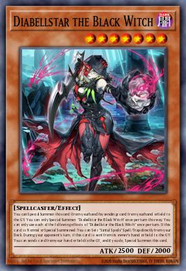

- **Copias y zona:** Main 1x. No altera las cantidades registradas.
- **Nombre oficial de referencia:** Diabellstar la Bruja Negra. CID cotejado con la ficha oficial; el nombre histórico del inventario se conserva aunque su grafía/traducción difiera.
- **Función principal y secundaria:** interrupción · recuperación · extensor · preparación.
- **Estado de sinergia y función:** Sinergia indirecta (soporte o recursos). Es una clasificación de juego; revisar la relación concreta en A06.
- **Papel como recurso, descarte o coste:** Coste o consumo descrito en A05: envío de recurso propio al Cementerio.
- **Efecto operativo (paráfrasis analítica):** recuperación e invocación desde Cementerio/destierro; acceso al campo desde la mano; colocación de Mágicas/Trampas o recursos. Son operaciones detectadas en el texto, no efectos independientes garantizados; leer sus condiciones en la fuente.
- **Mapa de activación y resultados:** 1) efecto propio o continuo: Invocación Especial desde Cementerio · 2) al invocarla Normal/Especial: Coloca Mágicas/Trampas indicadas · 3) en turno rival: Invocación Especial desde Cementerio. Cada operación está sujeta a la secuencia y al «si lo haces» del texto oficial.
- **Ventanas de activación identificadas:** turno rival; al producirse una Invocación.
- **Costes o recursos potenciales:** envío de recurso propio al Cementerio.
- **Restricciones y requisitos:** hay límite por turno según el efecto concreto. 
- **Prioridad al ir primero:** convertir el primer Guerrero en recursos y un Sincro defendible. Para esta carta: Reservar la respuesta para la ventana rival exacta; no es una pieza buscadora de nuestro motor.
- **Prioridad al ir segundo:** despejar obstáculos conservando equipo, invocaciones y capacidad de extensión. Identificar primero la respuesta rival que afecta su función «interrupción».
- **Medio/tardío y recuperación:** reutilizar Guerreros y Equipos gastados sin perder la Normal Summon. Verificar que el objetivo de recuperación continúe disponible.
- **Sinergias y acceso a líneas:** Relación contextual con Guerreros FUEGO, cartas de Equipo, recuperaciones del Cementerio y escalada Sincro. Habilita una línea del motor sólo si coinciden recursos, objetivos y restricciones; no equivale a un combo completo validado.
- **Riesgo / brick / interrupciones:** Riesgo operativo: destrucción del Equipo, interrupción del buscador y falta de materiales adecuados. Confirmar objetivos disponibles y costes antes de activar. No atribuirle velocidad rápida por el solo hecho de formar parte del motor.
- **Utilidad editorial:** 4/5 para este deck (estimación por rol y zona, no probabilidad calculada). No cambiar copias; cualquier sugerencia de alta/baja pasa por el apartado 22 y aprobación.
- **Referencia oficial y trazabilidad:** https://www.db.yugioh-card.com/yugiohdb/card_search.action?cid=19148&ope=2&request_locale=es. **Confianza:** texto y tipo de efecto cotejados en Konami; síntesis táctica editorial, no demostración de combo.
- **Aplicación concreta dentro de este deck (A06):** recuperación e invocación desde Cementerio/destierro; acceso al campo desde la mano; colocación de Mágicas/Trampas o recursos.

**USO PRÁCTICO Y SINERGIA — Diabellstar la Bruja Negra**

- **Label funcional:** Sinergia indirecta. Clasificación documental; una relación es válida solo si se satisfacen sus condiciones exactas.
- **Qué hace:** recuperación e invocación desde Cementerio/destierro; acceso al campo desde la mano; colocación de Mágicas/Trampas o recursos. Son operaciones detectadas en el texto, no efectos independientes garantizados; leer sus condiciones en la fuente.
- **Cómo aprovecharla en este deck:** recuperación e invocación desde Cementerio/destierro; acceso al campo desde la mano; colocación de Mágicas/Trampas o recursos.
- **Al jugar primero:** convertir el primer Guerrero en recursos y un Sincro defendible. Para esta carta: Reservar la respuesta para la ventana rival exacta; no es una pieza buscadora de nuestro motor.
- **Al jugar segundo:** despejar obstáculos conservando equipo, invocaciones y capacidad de extensión. Identificar primero la respuesta rival que afecta su función «interrupción».
- **Cuándo tener precaución:** Riesgo operativo: destrucción del Equipo, interrupción del buscador y falta de materiales adecuados. Confirmar objetivos disponibles y costes antes de activar. No atribuirle velocidad rápida por el solo hecho de formar parte del motor.

#### 04. Immortal Phoenix Gearfried

- **Copias y zona:** Main 1x. No altera las cantidades registradas.
- **Nombre oficial de referencia:** Fénix Inmortal Gearfried. CID cotejado con la ficha oficial; el nombre histórico del inventario se conserva aunque su grafía/traducción difiera.
- **Función principal y secundaria:** interrupción · extensor · negación · cierre · motor Equipo.
- **Estado de sinergia y función:** Sinergia indirecta (soporte o recursos). Es una clasificación de juego; revisar la relación concreta en A06.
- **Papel como recurso, descarte o coste:** No se demuestra que esta carta sea recurso de descarte o pago para otra.
- **Efecto operativo (paráfrasis analítica):** acceso al campo desde la mano; negación de efectos o activaciones; presión de combate o modificación de estadísticas; uso o producción de cartas equipadas. Son operaciones detectadas en el texto, no efectos independientes garantizados; leer sus condiciones en la fuente.
- **Mapa de activación y resultados:** 1) efecto propio o continuo: Invocación Especial desde Cementerio · 2) con condición explícita en la carta: equipa carta/monstruo según texto · 3) con condición explícita en la carta: niega el efecto o la activación indicada. Cada operación está sujeta a la secuencia y al «si lo haces» del texto oficial.
- **Ventanas de activación identificadas:** Efecto Rápido.
- **Costes o recursos potenciales:** sin coste independiente identificado en esta síntesis; comprobar las acciones previas al punto y coma de cada efecto.
- **Restricciones y requisitos:** hay límite por turno según el efecto concreto. 
- **Prioridad al ir primero:** convertir el primer Guerrero en recursos y un Sincro defendible. Para esta carta: Reservar la respuesta para la ventana rival exacta; no es una pieza buscadora de nuestro motor.
- **Prioridad al ir segundo:** despejar obstáculos conservando equipo, invocaciones y capacidad de extensión. Identificar primero la respuesta rival que afecta su función «interrupción».
- **Medio/tardío y recuperación:** reutilizar Guerreros y Equipos gastados sin perder la Normal Summon. No asumir que por sí misma recicla recursos si el texto no lo permite.
- **Sinergias y acceso a líneas:** Relación contextual con Guerreros FUEGO, cartas de Equipo, recuperaciones del Cementerio y escalada Sincro. Habilita una línea del motor sólo si coinciden recursos, objetivos y restricciones; no equivale a un combo completo validado.
- **Riesgo / brick / interrupciones:** Riesgo operativo: destrucción del Equipo, interrupción del buscador y falta de materiales adecuados. Confirmar objetivos disponibles y costes antes de activar. Puede emplearse en cadena sólo cuando se cumpla su condición concreta.
- **Utilidad editorial:** 4/5 para este deck (estimación por rol y zona, no probabilidad calculada). No cambiar copias; cualquier sugerencia de alta/baja pasa por el apartado 22 y aprobación.
- **Referencia oficial y trazabilidad:** https://www.db.yugioh-card.com/yugiohdb/card_search.action?cid=14801&ope=2&request_locale=es. **Confianza:** texto y tipo de efecto cotejados en Konami; síntesis táctica editorial, no demostración de combo.
- **Aplicación concreta dentro de este deck (A06):** acceso al campo desde la mano; negación de efectos o activaciones; presión de combate o modificación de estadísticas; uso o producción de cartas equipadas.

**USO PRÁCTICO Y SINERGIA — Immortal Phoenix Gearfried**

- **Label funcional:** Sinergia indirecta. Clasificación documental; una relación es válida solo si se satisfacen sus condiciones exactas.
- **Qué hace:** acceso al campo desde la mano; negación de efectos o activaciones; presión de combate o modificación de estadísticas; uso o producción de cartas equipadas. Son operaciones detectadas en el texto, no efectos independientes garantizados; leer sus condiciones en la fuente.
- **Cómo aprovecharla en este deck:** acceso al campo desde la mano; negación de efectos o activaciones; presión de combate o modificación de estadísticas; uso o producción de cartas equipadas.
- **Al jugar primero:** convertir el primer Guerrero en recursos y un Sincro defendible. Para esta carta: Reservar la respuesta para la ventana rival exacta; no es una pieza buscadora de nuestro motor.
- **Al jugar segundo:** despejar obstáculos conservando equipo, invocaciones y capacidad de extensión. Identificar primero la respuesta rival que afecta su función «interrupción».
- **Cuándo tener precaución:** Riesgo operativo: destrucción del Equipo, interrupción del buscador y falta de materiales adecuados. Confirmar objetivos disponibles y costes antes de activar. Puede emplearse en cadena sólo cuando se cumpla su condición concreta.

#### 05. Infernoble Caballero Turpin

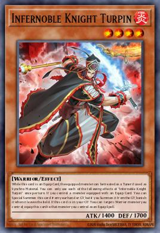

- **Copias y zona:** Main 1x. No altera las cantidades registradas.
- **Nombre oficial de referencia:** Infernoble Caballero Turpin. CID cotejado con la ficha oficial; el nombre histórico del inventario se conserva aunque su grafía/traducción difiera.
- **Función principal y secundaria:** recuperación · extensor · respuesta · motor Equipo.
- **Estado de sinergia y función:** Sinergia indirecta (soporte o recursos). Es una clasificación de juego; revisar la relación concreta en A06.
- **Papel como recurso, descarte o coste:** No se demuestra que esta carta sea recurso de descarte o pago para otra.
- **Efecto operativo (paráfrasis analítica):** recuperación e invocación desde Cementerio/destierro; acceso al campo desde la mano; interacción sobre monstruos en campo; uso o producción de cartas equipadas. Son operaciones detectadas en el texto, no efectos independientes garantizados; leer sus condiciones en la fuente.
- **Mapa de activación y resultados:** 1) efecto propio o continuo: equipa carta/monstruo según texto · 2) con condición explícita en la carta: Invocación Especial desde Cementerio · 3) mientras está en Cementerio: equipa carta/monstruo según texto. Cada operación está sujeta a la secuencia y al «si lo haces» del texto oficial.
- **Ventanas de activación identificadas:** al llegar o estar en el Cementerio.
- **Costes o recursos potenciales:** sin coste independiente identificado en esta síntesis; comprobar las acciones previas al punto y coma de cada efecto.
- **Restricciones y requisitos:** hay límite por turno según el efecto concreto; requiere estado de campo específico; depende de recursos en Cementerio; exige materiales de Extra Deck o materiales adecuados. 
- **Prioridad al ir primero:** convertir el primer Guerrero en recursos y un Sincro defendible. Para esta carta: Escoger la amenaza o recurso que genere mayor ventaja de tempo; respetar selección y zona.
- **Prioridad al ir segundo:** despejar obstáculos conservando equipo, invocaciones y capacidad de extensión. Identificar primero la respuesta rival que afecta su función «recuperación».
- **Medio/tardío y recuperación:** reutilizar Guerreros y Equipos gastados sin perder la Normal Summon. Verificar que el objetivo de recuperación continúe disponible.
- **Sinergias y acceso a líneas:** Relación contextual con Guerreros FUEGO, cartas de Equipo, recuperaciones del Cementerio y escalada Sincro. Habilita una línea del motor sólo si coinciden recursos, objetivos y restricciones; no equivale a un combo completo validado.
- **Riesgo / brick / interrupciones:** Depende del Cementerio y es sensible a destierro o negación de ese recurso. No atribuirle velocidad rápida por el solo hecho de formar parte del motor.
- **Utilidad editorial:** 4/5 para este deck (estimación por rol y zona, no probabilidad calculada). No cambiar copias; cualquier sugerencia de alta/baja pasa por el apartado 22 y aprobación.
- **Referencia oficial y trazabilidad:** https://www.db.yugioh-card.com/yugiohdb/card_search.action?cid=18801&ope=2&request_locale=es. **Confianza:** texto y tipo de efecto cotejados en Konami; síntesis táctica editorial, no demostración de combo.
- **Aplicación concreta dentro de este deck (A06):** recuperación e invocación desde Cementerio/destierro; acceso al campo desde la mano; interacción sobre monstruos en campo; uso o producción de cartas equipadas.

**USO PRÁCTICO Y SINERGIA — Infernoble Caballero Turpin**

- **Label funcional:** Sinergia indirecta. Clasificación documental; una relación es válida solo si se satisfacen sus condiciones exactas.
- **Qué hace:** recuperación e invocación desde Cementerio/destierro; acceso al campo desde la mano; interacción sobre monstruos en campo; uso o producción de cartas equipadas. Son operaciones detectadas en el texto, no efectos independientes garantizados; leer sus condiciones en la fuente.
- **Cómo aprovecharla en este deck:** recuperación e invocación desde Cementerio/destierro; acceso al campo desde la mano; interacción sobre monstruos en campo; uso o producción de cartas equipadas.
- **Al jugar primero:** convertir el primer Guerrero en recursos y un Sincro defendible. Para esta carta: Escoger la amenaza o recurso que genere mayor ventaja de tempo; respetar selección y zona.
- **Al jugar segundo:** despejar obstáculos conservando equipo, invocaciones y capacidad de extensión. Identificar primero la respuesta rival que afecta su función «recuperación».
- **Cuándo tener precaución:** Depende del Cementerio y es sensible a destierro o negación de ese recurso. No atribuirle velocidad rápida por el solo hecho de formar parte del motor.

#### 06. Infernoble Caballero Maugis

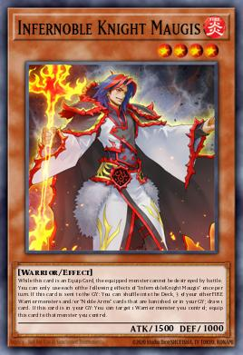

- **Copias y zona:** Main 1x. No altera las cantidades registradas.
- **Nombre oficial de referencia:** Infernoble Caballero Maugis. CID cotejado con la ficha oficial; el nombre histórico del inventario se conserva aunque su grafía/traducción difiera.
- **Función principal y secundaria:** removal · recuperación · ventaja de mano · respuesta · motor Equipo.
- **Estado de sinergia y función:** Sinergia indirecta (soporte o recursos). Es una clasificación de juego; revisar la relación concreta en A06.
- **Papel como recurso, descarte o coste:** No se demuestra que esta carta sea recurso de descarte o pago para otra.
- **Efecto operativo (paráfrasis analítica):** destierro de recursos o de amenazas; retorno o reciclaje hacia mano/Deck/Extra; generación de cartas por robo; interacción sobre monstruos en campo; uso o producción de cartas equipadas; protección o resistencia contra respuestas. Son operaciones detectadas en el texto, no efectos independientes garantizados; leer sus condiciones en la fuente.
- **Mapa de activación y resultados:** 1) efecto propio o continuo: equipa carta/monstruo según texto · 2) con condición explícita en la carta: destierra el recurso u objetivo previsto, devuelve recursos a mano/Deck/Extra, roba cartas · 3) mientras está en Cementerio: equipa carta/monstruo según texto. Cada operación está sujeta a la secuencia y al «si lo haces» del texto oficial.
- **Ventanas de activación identificadas:** al llegar o estar en el Cementerio.
- **Costes o recursos potenciales:** sin coste independiente identificado en esta síntesis; comprobar las acciones previas al punto y coma de cada efecto.
- **Restricciones y requisitos:** hay límite por turno según el efecto concreto; depende de recursos en Cementerio. 
- **Prioridad al ir primero:** convertir el primer Guerrero en recursos y un Sincro defendible. Para esta carta: Escoger la amenaza o recurso que genere mayor ventaja de tempo; respetar selección y zona.
- **Prioridad al ir segundo:** despejar obstáculos conservando equipo, invocaciones y capacidad de extensión. Identificar primero la respuesta rival que afecta su función «removal».
- **Medio/tardío y recuperación:** reutilizar Guerreros y Equipos gastados sin perder la Normal Summon. Verificar que el objetivo de recuperación continúe disponible.
- **Sinergias y acceso a líneas:** Relación contextual con Guerreros FUEGO, cartas de Equipo, recuperaciones del Cementerio y escalada Sincro. Habilita una línea del motor sólo si coinciden recursos, objetivos y restricciones; no equivale a un combo completo validado.
- **Riesgo / brick / interrupciones:** Depende del Cementerio y es sensible a destierro o negación de ese recurso. No atribuirle velocidad rápida por el solo hecho de formar parte del motor.
- **Utilidad editorial:** 3/5 para este deck (estimación por rol y zona, no probabilidad calculada). No cambiar copias; cualquier sugerencia de alta/baja pasa por el apartado 22 y aprobación.
- **Referencia oficial y trazabilidad:** https://www.db.yugioh-card.com/yugiohdb/card_search.action?cid=15249&ope=2&request_locale=es. **Confianza:** texto y tipo de efecto cotejados en Konami; síntesis táctica editorial, no demostración de combo.
- **Aplicación concreta dentro de este deck (A06):** destierro de recursos o de amenazas; retorno o reciclaje hacia mano/Deck/Extra; generación de cartas por robo; interacción sobre monstruos en campo; uso o producción de cartas equipadas; protección o resistencia contra respuestas.

**USO PRÁCTICO Y SINERGIA — Infernoble Caballero Maugis**

- **Label funcional:** Sinergia indirecta. Clasificación documental; una relación es válida solo si se satisfacen sus condiciones exactas.
- **Qué hace:** destierro de recursos o de amenazas; retorno o reciclaje hacia mano/Deck/Extra; generación de cartas por robo; interacción sobre monstruos en campo; uso o producción de cartas equipadas; protección o resistencia contra respuestas. Son operaciones detectadas en el texto, no efectos independientes garantizados; leer sus condiciones en la fuente.
- **Cómo aprovecharla en este deck:** destierro de recursos o de amenazas; retorno o reciclaje hacia mano/Deck/Extra; generación de cartas por robo; interacción sobre monstruos en campo; uso o producción de cartas equipadas; protección o resistencia contra respuestas.
- **Al jugar primero:** convertir el primer Guerrero en recursos y un Sincro defendible. Para esta carta: Escoger la amenaza o recurso que genere mayor ventaja de tempo; respetar selección y zona.
- **Al jugar segundo:** despejar obstáculos conservando equipo, invocaciones y capacidad de extensión. Identificar primero la respuesta rival que afecta su función «removal».
- **Cuándo tener precaución:** Depende del Cementerio y es sensible a destierro o negación de ese recurso. No atribuirle velocidad rápida por el solo hecho de formar parte del motor.

#### 07. Infernoble Caballero Ogier

- **Copias y zona:** Main 1x. No altera las cantidades registradas.
- **Nombre oficial de referencia:** Infernoble Caballero Ogier. CID cotejado con la ficha oficial; el nombre histórico del inventario se conserva aunque su grafía/traducción difiera.
- **Función principal y secundaria:** respuesta · motor Equipo · protección.
- **Estado de sinergia y función:** Sinergia indirecta (soporte o recursos). Es una clasificación de juego; revisar la relación concreta en A06.
- **Papel como recurso, descarte o coste:** No se demuestra que esta carta sea recurso de descarte o pago para otra.
- **Efecto operativo (paráfrasis analítica):** interacción sobre monstruos en campo; uso o producción de cartas equipadas; protección o resistencia contra respuestas. Son operaciones detectadas en el texto, no efectos independientes garantizados; leer sus condiciones en la fuente.
- **Mapa de activación y resultados:** 1) efecto propio o continuo: equipa carta/monstruo según texto · 2) mientras está en Cementerio: equipa carta/monstruo según texto. Cada operación está sujeta a la secuencia y al «si lo haces» del texto oficial.
- **Ventanas de activación identificadas:** al producirse una Invocación; al llegar o estar en el Cementerio.
- **Costes o recursos potenciales:** sin coste independiente identificado en esta síntesis; comprobar las acciones previas al punto y coma de cada efecto.
- **Restricciones y requisitos:** hay límite por turno según el efecto concreto; depende de recursos en Cementerio. 
- **Prioridad al ir primero:** convertir el primer Guerrero en recursos y un Sincro defendible. Para esta carta: Activar cuando las condiciones permitan obtener valor real, preservando recursos de seguimiento.
- **Prioridad al ir segundo:** despejar obstáculos conservando equipo, invocaciones y capacidad de extensión. Identificar primero la respuesta rival que afecta su función «respuesta».
- **Medio/tardío y recuperación:** reutilizar Guerreros y Equipos gastados sin perder la Normal Summon. No asumir que por sí misma recicla recursos si el texto no lo permite.
- **Sinergias y acceso a líneas:** Relación contextual con Guerreros FUEGO, cartas de Equipo, recuperaciones del Cementerio y escalada Sincro. Habilita una línea del motor sólo si coinciden recursos, objetivos y restricciones; no equivale a un combo completo validado.
- **Riesgo / brick / interrupciones:** Depende del Cementerio y es sensible a destierro o negación de ese recurso. No atribuirle velocidad rápida por el solo hecho de formar parte del motor.
- **Utilidad editorial:** 3/5 para este deck (estimación por rol y zona, no probabilidad calculada). No cambiar copias; cualquier sugerencia de alta/baja pasa por el apartado 22 y aprobación.
- **Referencia oficial y trazabilidad:** https://www.db.yugioh-card.com/yugiohdb/card_search.action?cid=15247&ope=2&request_locale=es. **Confianza:** texto y tipo de efecto cotejados en Konami; síntesis táctica editorial, no demostración de combo.
- **Aplicación concreta dentro de este deck (A06):** interacción sobre monstruos en campo; uso o producción de cartas equipadas; protección o resistencia contra respuestas.

**USO PRÁCTICO Y SINERGIA — Infernoble Caballero Ogier**

- **Label funcional:** Sinergia indirecta. Clasificación documental; una relación es válida solo si se satisfacen sus condiciones exactas.
- **Qué hace:** interacción sobre monstruos en campo; uso o producción de cartas equipadas; protección o resistencia contra respuestas. Son operaciones detectadas en el texto, no efectos independientes garantizados; leer sus condiciones en la fuente.
- **Cómo aprovecharla en este deck:** interacción sobre monstruos en campo; uso o producción de cartas equipadas; protección o resistencia contra respuestas.
- **Al jugar primero:** convertir el primer Guerrero en recursos y un Sincro defendible. Para esta carta: Activar cuando las condiciones permitan obtener valor real, preservando recursos de seguimiento.
- **Al jugar segundo:** despejar obstáculos conservando equipo, invocaciones y capacidad de extensión. Identificar primero la respuesta rival que afecta su función «respuesta».
- **Cuándo tener precaución:** Depende del Cementerio y es sensible a destierro o negación de ese recurso. No atribuirle velocidad rápida por el solo hecho de formar parte del motor.

#### 08. Infernoble Caballero Ricciardetto

- **Copias y zona:** Main 1x. No altera las cantidades registradas.
- **Nombre oficial de referencia:** Infernoble Caballero Ricciardetto. CID cotejado con la ficha oficial; el nombre histórico del inventario se conserva aunque su grafía/traducción difiera.
- **Función principal y secundaria:** extensor.
- **Estado de sinergia y función:** Sinergia indirecta (soporte o recursos). Es una clasificación de juego; revisar la relación concreta en A06.
- **Papel como recurso, descarte o coste:** No se demuestra que esta carta sea recurso de descarte o pago para otra.
- **Efecto operativo (paráfrasis analítica):** acceso al campo desde la mano. Son operaciones detectadas en el texto, no efectos independientes garantizados; leer sus condiciones en la fuente.
- **Mapa de activación y resultados:** 1) efecto propio o continuo: Invocación Especial desde Cementerio. Cada operación está sujeta a la secuencia y al «si lo haces» del texto oficial.
- **Ventanas de activación identificadas:** al producirse una Invocación.
- **Costes o recursos potenciales:** sin coste independiente identificado en esta síntesis; comprobar las acciones previas al punto y coma de cada efecto.
- **Restricciones y requisitos:** puede bloquear tipos de Invocación del Extra Deck; depende de recursos en Cementerio. 
- **Prioridad al ir primero:** convertir el primer Guerrero en recursos y un Sincro defendible. Para esta carta: Activar cuando las condiciones permitan obtener valor real, preservando recursos de seguimiento.
- **Prioridad al ir segundo:** despejar obstáculos conservando equipo, invocaciones y capacidad de extensión. Identificar primero la respuesta rival que afecta su función «extensor».
- **Medio/tardío y recuperación:** reutilizar Guerreros y Equipos gastados sin perder la Normal Summon. No asumir que por sí misma recicla recursos si el texto no lo permite.
- **Sinergias y acceso a líneas:** Relación contextual con Guerreros FUEGO, cartas de Equipo, recuperaciones del Cementerio y escalada Sincro. Habilita una línea del motor sólo si coinciden recursos, objetivos y restricciones; no equivale a un combo completo validado.
- **Riesgo / brick / interrupciones:** La restricción de invocaciones puede cerrar rutas alternativas; revisar el orden de activación. No atribuirle velocidad rápida por el solo hecho de formar parte del motor.
- **Utilidad editorial:** 4/5 para este deck (estimación por rol y zona, no probabilidad calculada). No cambiar copias; cualquier sugerencia de alta/baja pasa por el apartado 22 y aprobación.
- **Referencia oficial y trazabilidad:** https://www.db.yugioh-card.com/yugiohdb/card_search.action?cid=18800&ope=2&request_locale=es. **Confianza:** texto y tipo de efecto cotejados en Konami; síntesis táctica editorial, no demostración de combo.
- **Aplicación concreta dentro de este deck (A06):** acceso al campo desde la mano.

**USO PRÁCTICO Y SINERGIA — Infernoble Caballero Ricciardetto**

- **Label funcional:** Sinergia indirecta. Clasificación documental; una relación es válida solo si se satisfacen sus condiciones exactas.
- **Qué hace:** acceso al campo desde la mano. Son operaciones detectadas en el texto, no efectos independientes garantizados; leer sus condiciones en la fuente.
- **Cómo aprovecharla en este deck:** acceso al campo desde la mano.
- **Al jugar primero:** convertir el primer Guerrero en recursos y un Sincro defendible. Para esta carta: Activar cuando las condiciones permitan obtener valor real, preservando recursos de seguimiento.
- **Al jugar segundo:** despejar obstáculos conservando equipo, invocaciones y capacidad de extensión. Identificar primero la respuesta rival que afecta su función «extensor».
- **Cuándo tener precaución:** La restricción de invocaciones puede cerrar rutas alternativas; revisar el orden de activación. No atribuirle velocidad rápida por el solo hecho de formar parte del motor.

#### 09. Infernoble Caballero Renaud

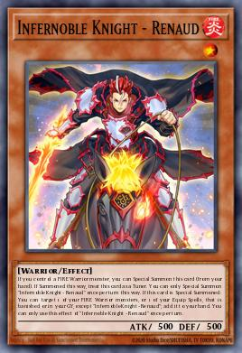

- **Copias y zona:** Main 2x. No altera las cantidades registradas.
- **Nombre oficial de referencia:** Infiernoble Caballero - Renaud. CID cotejado con la ficha oficial; el nombre histórico del inventario se conserva aunque su grafía/traducción difiera.
- **Función principal y secundaria:** extensor · removal · motor Equipo.
- **Estado de sinergia y función:** Sinergia indirecta (soporte o recursos). Es una clasificación de juego; revisar la relación concreta en A06.
- **Papel como recurso, descarte o coste:** No se demuestra que esta carta sea recurso de descarte o pago para otra.
- **Efecto operativo (paráfrasis analítica):** acceso al campo desde la mano; destierro de recursos o de amenazas; uso o producción de cartas equipadas. Son operaciones detectadas en el texto, no efectos independientes garantizados; leer sus condiciones en la fuente.
- **Mapa de activación y resultados:** 1) efecto propio o continuo: Invocación Especial desde mano · 2) efecto propio o continuo: Invocación Especial desde zona permitida · 3) al invocarse: destierra el recurso u objetivo previsto. Cada operación está sujeta a la secuencia y al «si lo haces» del texto oficial.
- **Ventanas de activación identificadas:** al producirse una Invocación.
- **Costes o recursos potenciales:** sin coste independiente identificado en esta síntesis; comprobar las acciones previas al punto y coma de cada efecto.
- **Restricciones y requisitos:** hay límite por turno según el efecto concreto; requiere estado de campo específico; depende de recursos en Cementerio. 
- **Prioridad al ir primero:** convertir el primer Guerrero en recursos y un Sincro defendible. Para esta carta: Escoger la amenaza o recurso que genere mayor ventaja de tempo; respetar selección y zona.
- **Prioridad al ir segundo:** despejar obstáculos conservando equipo, invocaciones y capacidad de extensión. Identificar primero la respuesta rival que afecta su función «extensor».
- **Medio/tardío y recuperación:** reutilizar Guerreros y Equipos gastados sin perder la Normal Summon. No asumir que por sí misma recicla recursos si el texto no lo permite.
- **Sinergias y acceso a líneas:** Relación contextual con Guerreros FUEGO, cartas de Equipo, recuperaciones del Cementerio y escalada Sincro. Habilita una línea del motor sólo si coinciden recursos, objetivos y restricciones; no equivale a un combo completo validado.
- **Riesgo / brick / interrupciones:** Depende del Cementerio y es sensible a destierro o negación de ese recurso. No atribuirle velocidad rápida por el solo hecho de formar parte del motor.
- **Utilidad editorial:** 4/5 para este deck (estimación por rol y zona, no probabilidad calculada). No cambiar copias; cualquier sugerencia de alta/baja pasa por el apartado 22 y aprobación.
- **Referencia oficial y trazabilidad:** https://www.db.yugioh-card.com/yugiohdb/card_search.action?cid=15082&ope=2&request_locale=es. **Confianza:** texto y tipo de efecto cotejados en Konami; síntesis táctica editorial, no demostración de combo.
- **Aplicación concreta dentro de este deck (A06):** acceso al campo desde la mano; destierro de recursos o de amenazas; uso o producción de cartas equipadas.

**USO PRÁCTICO Y SINERGIA — Infernoble Caballero Renaud**

- **Label funcional:** Sinergia indirecta. Clasificación documental; una relación es válida solo si se satisfacen sus condiciones exactas.
- **Qué hace:** acceso al campo desde la mano; destierro de recursos o de amenazas; uso o producción de cartas equipadas. Son operaciones detectadas en el texto, no efectos independientes garantizados; leer sus condiciones en la fuente.
- **Cómo aprovecharla en este deck:** acceso al campo desde la mano; destierro de recursos o de amenazas; uso o producción de cartas equipadas.
- **Al jugar primero:** convertir el primer Guerrero en recursos y un Sincro defendible. Para esta carta: Escoger la amenaza o recurso que genere mayor ventaja de tempo; respetar selección y zona.
- **Al jugar segundo:** despejar obstáculos conservando equipo, invocaciones y capacidad de extensión. Identificar primero la respuesta rival que afecta su función «extensor».
- **Cuándo tener precaución:** Depende del Cementerio y es sensible a destierro o negación de ese recurso. No atribuirle velocidad rápida por el solo hecho de formar parte del motor.

#### 10. Infernoble Caballero Oliver

- **Copias y zona:** Main 1x. No altera las cantidades registradas.
- **Nombre oficial de referencia:** Infernoble Caballero Oliver. CID cotejado con la ficha oficial; el nombre histórico del inventario se conserva aunque su grafía/traducción difiera.
- **Función principal y secundaria:** recuperación · extensor · respuesta · motor Equipo.
- **Estado de sinergia y función:** Sinergia indirecta (soporte o recursos). Es una clasificación de juego; revisar la relación concreta en A06.
- **Papel como recurso, descarte o coste:** Coste o consumo descrito en A05: envío de recurso propio al Cementerio.
- **Efecto operativo (paráfrasis analítica):** recuperación e invocación desde Cementerio/destierro; acceso al campo desde la mano; interacción sobre monstruos en campo; uso o producción de cartas equipadas. Son operaciones detectadas en el texto, no efectos independientes garantizados; leer sus condiciones en la fuente.
- **Mapa de activación y resultados:** 1) efecto propio o continuo: equipa carta/monstruo según texto · 2) efecto propio o continuo: Invocación Especial desde Cementerio · 3) mientras está en Cementerio: equipa carta/monstruo según texto. Cada operación está sujeta a la secuencia y al «si lo haces» del texto oficial.
- **Ventanas de activación identificadas:** al llegar o estar en el Cementerio.
- **Costes o recursos potenciales:** envío de recurso propio al Cementerio.
- **Restricciones y requisitos:** hay límite por turno según el efecto concreto; depende de recursos en Cementerio. 
- **Prioridad al ir primero:** convertir el primer Guerrero en recursos y un Sincro defendible. Para esta carta: Escoger la amenaza o recurso que genere mayor ventaja de tempo; respetar selección y zona.
- **Prioridad al ir segundo:** despejar obstáculos conservando equipo, invocaciones y capacidad de extensión. Identificar primero la respuesta rival que afecta su función «recuperación».
- **Medio/tardío y recuperación:** reutilizar Guerreros y Equipos gastados sin perder la Normal Summon. Verificar que el objetivo de recuperación continúe disponible.
- **Sinergias y acceso a líneas:** Relación contextual con Guerreros FUEGO, cartas de Equipo, recuperaciones del Cementerio y escalada Sincro. Habilita una línea del motor sólo si coinciden recursos, objetivos y restricciones; no equivale a un combo completo validado.
- **Riesgo / brick / interrupciones:** Depende del Cementerio y es sensible a destierro o negación de ese recurso. No atribuirle velocidad rápida por el solo hecho de formar parte del motor.
- **Utilidad editorial:** 4/5 para este deck (estimación por rol y zona, no probabilidad calculada). No cambiar copias; cualquier sugerencia de alta/baja pasa por el apartado 22 y aprobación.
- **Referencia oficial y trazabilidad:** https://www.db.yugioh-card.com/yugiohdb/card_search.action?cid=15248&ope=2&request_locale=es. **Confianza:** texto y tipo de efecto cotejados en Konami; síntesis táctica editorial, no demostración de combo.
- **Aplicación concreta dentro de este deck (A06):** recuperación e invocación desde Cementerio/destierro; acceso al campo desde la mano; interacción sobre monstruos en campo; uso o producción de cartas equipadas.

**USO PRÁCTICO Y SINERGIA — Infernoble Caballero Oliver**

- **Label funcional:** Sinergia indirecta. Clasificación documental; una relación es válida solo si se satisfacen sus condiciones exactas.
- **Qué hace:** recuperación e invocación desde Cementerio/destierro; acceso al campo desde la mano; interacción sobre monstruos en campo; uso o producción de cartas equipadas. Son operaciones detectadas en el texto, no efectos independientes garantizados; leer sus condiciones en la fuente.
- **Cómo aprovecharla en este deck:** recuperación e invocación desde Cementerio/destierro; acceso al campo desde la mano; interacción sobre monstruos en campo; uso o producción de cartas equipadas.
- **Al jugar primero:** convertir el primer Guerrero en recursos y un Sincro defendible. Para esta carta: Escoger la amenaza o recurso que genere mayor ventaja de tempo; respetar selección y zona.
- **Al jugar segundo:** despejar obstáculos conservando equipo, invocaciones y capacidad de extensión. Identificar primero la respuesta rival que afecta su función «recuperación».
- **Cuándo tener precaución:** Depende del Cementerio y es sensible a destierro o negación de ese recurso. No atribuirle velocidad rápida por el solo hecho de formar parte del motor.

#### 11. Neo Space Connector

- **Copias y zona:** Main 3x. No altera las cantidades registradas.
- **Nombre oficial de referencia:** Neo Espace Conector. CID cotejado con la ficha oficial; el nombre histórico del inventario se conserva aunque su grafía/traducción difiera.
- **Función principal y secundaria:** extensor · cierre · coste/recurso.
- **Estado de sinergia y función:** Sinergia indirecta (soporte o recursos). Es una clasificación de juego; revisar la relación concreta en A06.
- **Papel como recurso, descarte o coste:** Coste o consumo descrito en A05: Sacrificio.
- **Efecto operativo (paráfrasis analítica):** acceso al campo desde la mano; presión de combate o modificación de estadísticas; uso de Sacrificios como parte del efecto. Son operaciones detectadas en el texto, no efectos independientes garantizados; leer sus condiciones en la fuente.
- **Mapa de activación y resultados:** 1) con condición explícita en la carta: Invocación Especial desde mano. Cada operación está sujeta a la secuencia y al «si lo haces» del texto oficial.
- **Ventanas de activación identificadas:** requieren la fase o condición específica indicada en el texto; sin ventana rápida general asumida.
- **Costes o recursos potenciales:** Sacrificio.
- **Restricciones y requisitos:** hay límite por turno según el efecto concreto; depende de recursos en Cementerio. 
- **Prioridad al ir primero:** convertir el primer Guerrero en recursos y un Sincro defendible. Para esta carta: Activar cuando las condiciones permitan obtener valor real, preservando recursos de seguimiento.
- **Prioridad al ir segundo:** despejar obstáculos conservando equipo, invocaciones y capacidad de extensión. Identificar primero la respuesta rival que afecta su función «extensor».
- **Medio/tardío y recuperación:** reutilizar Guerreros y Equipos gastados sin perder la Normal Summon. No asumir que por sí misma recicla recursos si el texto no lo permite.
- **Sinergias y acceso a líneas:** Relación contextual con Guerreros FUEGO, cartas de Equipo, recuperaciones del Cementerio y escalada Sincro. Habilita una línea del motor sólo si coinciden recursos, objetivos y restricciones; no equivale a un combo completo validado.
- **Riesgo / brick / interrupciones:** Depende del Cementerio y es sensible a destierro o negación de ese recurso. No atribuirle velocidad rápida por el solo hecho de formar parte del motor.
- **Utilidad editorial:** 4/5 para este deck (estimación por rol y zona, no probabilidad calculada). No cambiar copias; cualquier sugerencia de alta/baja pasa por el apartado 22 y aprobación.
- **Referencia oficial y trazabilidad:** https://www.db.yugioh-card.com/yugiohdb/card_search.action?cid=14085&ope=2&request_locale=es. **Confianza:** texto y tipo de efecto cotejados en Konami; síntesis táctica editorial, no demostración de combo.
- **Aplicación concreta dentro de este deck (A06):** acceso al campo desde la mano; presión de combate o modificación de estadísticas; uso de Sacrificios como parte del efecto.

**USO PRÁCTICO Y SINERGIA — Neo Space Connector**

- **Label funcional:** Sinergia indirecta. Clasificación documental; una relación es válida solo si se satisfacen sus condiciones exactas.
- **Qué hace:** acceso al campo desde la mano; presión de combate o modificación de estadísticas; uso de Sacrificios como parte del efecto. Son operaciones detectadas en el texto, no efectos independientes garantizados; leer sus condiciones en la fuente.
- **Cómo aprovecharla en este deck:** acceso al campo desde la mano; presión de combate o modificación de estadísticas; uso de Sacrificios como parte del efecto.
- **Al jugar primero:** convertir el primer Guerrero en recursos y un Sincro defendible. Para esta carta: Activar cuando las condiciones permitan obtener valor real, preservando recursos de seguimiento.
- **Al jugar segundo:** despejar obstáculos conservando equipo, invocaciones y capacidad de extensión. Identificar primero la respuesta rival que afecta su función «extensor».
- **Cuándo tener precaución:** Depende del Cementerio y es sensible a destierro o negación de ese recurso. No atribuirle velocidad rápida por el solo hecho de formar parte del motor.

#### 12. Neo-Spacian Aqua Dolphin

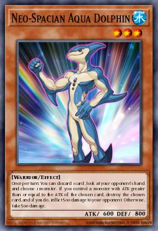

- **Copias y zona:** Main 1x. No altera las cantidades registradas.
- **Nombre oficial de referencia:** Delfín Aqua Neo Espacial. CID cotejado con la ficha oficial; el nombre histórico del inventario se conserva aunque su grafía/traducción difiera.
- **Función principal y secundaria:** removal · cierre.
- **Estado de sinergia y función:** Sinergia indirecta (soporte o recursos). Es una clasificación de juego; revisar la relación concreta en A06.
- **Papel como recurso, descarte o coste:** Coste o consumo descrito en A05: descarte de mano.
- **Efecto operativo (paráfrasis analítica):** destrucción de cartas o empleo de destrucción como detonante; presión de combate o modificación de estadísticas. Son operaciones detectadas en el texto, no efectos independientes garantizados; leer sus condiciones en la fuente.
- **Mapa de activación y resultados:** 1) efecto propio o continuo: destruye la carta o recurso previsto, inflige daño. Cada operación está sujeta a la secuencia y al «si lo haces» del texto oficial.
- **Ventanas de activación identificadas:** requieren la fase o condición específica indicada en el texto; sin ventana rápida general asumida.
- **Costes o recursos potenciales:** descarte de mano.
- **Restricciones y requisitos:** hay límite por turno según el efecto concreto; requiere estado de campo específico. 
- **Prioridad al ir primero:** convertir el primer Guerrero en recursos y un Sincro defendible. Para esta carta: Activar cuando las condiciones permitan obtener valor real, preservando recursos de seguimiento.
- **Prioridad al ir segundo:** despejar obstáculos conservando equipo, invocaciones y capacidad de extensión. Identificar primero la respuesta rival que afecta su función «removal».
- **Medio/tardío y recuperación:** reutilizar Guerreros y Equipos gastados sin perder la Normal Summon. No asumir que por sí misma recicla recursos si el texto no lo permite.
- **Sinergias y acceso a líneas:** Relación contextual con Guerreros FUEGO, cartas de Equipo, recuperaciones del Cementerio y escalada Sincro. Habilita una línea del motor sólo si coinciden recursos, objetivos y restricciones; no equivale a un combo completo validado.
- **Riesgo / brick / interrupciones:** Riesgo operativo: destrucción del Equipo, interrupción del buscador y falta de materiales adecuados. Confirmar objetivos disponibles y costes antes de activar. No atribuirle velocidad rápida por el solo hecho de formar parte del motor.
- **Utilidad editorial:** 3/5 para este deck (estimación por rol y zona, no probabilidad calculada). No cambiar copias; cualquier sugerencia de alta/baja pasa por el apartado 22 y aprobación.
- **Referencia oficial y trazabilidad:** https://www.db.yugioh-card.com/yugiohdb/card_search.action?cid=6768&ope=2&request_locale=es. **Confianza:** texto y tipo de efecto cotejados en Konami; síntesis táctica editorial, no demostración de combo.
- **Aplicación concreta dentro de este deck (A06):** destrucción de cartas o empleo de destrucción como detonante; presión de combate o modificación de estadísticas.

**USO PRÁCTICO Y SINERGIA — Neo-Spacian Aqua Dolphin**

- **Label funcional:** Sinergia indirecta. Clasificación documental; una relación es válida solo si se satisfacen sus condiciones exactas.
- **Qué hace:** destrucción de cartas o empleo de destrucción como detonante; presión de combate o modificación de estadísticas. Son operaciones detectadas en el texto, no efectos independientes garantizados; leer sus condiciones en la fuente.
- **Cómo aprovecharla en este deck:** destrucción de cartas o empleo de destrucción como detonante; presión de combate o modificación de estadísticas.
- **Al jugar primero:** convertir el primer Guerrero en recursos y un Sincro defendible. Para esta carta: Activar cuando las condiciones permitan obtener valor real, preservando recursos de seguimiento.
- **Al jugar segundo:** despejar obstáculos conservando equipo, invocaciones y capacidad de extensión. Identificar primero la respuesta rival que afecta su función «removal».
- **Cuándo tener precaución:** Riesgo operativo: destrucción del Equipo, interrupción del buscador y falta de materiales adecuados. Confirmar objetivos disponibles y costes antes de activar. No atribuirle velocidad rápida por el solo hecho de formar parte del motor.

#### 13. Fire Flint Lady

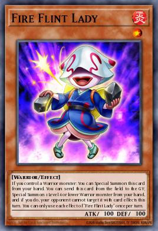

- **Copias y zona:** Main 1x. No altera las cantidades registradas.
- **Nombre oficial de referencia:** Dama del Pedernal. CID cotejado con la ficha oficial; el nombre histórico del inventario se conserva aunque su grafía/traducción difiera.
- **Función principal y secundaria:** recuperación · extensor.
- **Estado de sinergia y función:** Sinergia indirecta (soporte o recursos). Es una clasificación de juego; revisar la relación concreta en A06.
- **Papel como recurso, descarte o coste:** Coste o consumo descrito en A05: envío de recurso propio al Cementerio.
- **Efecto operativo (paráfrasis analítica):** recuperación e invocación desde Cementerio/destierro; acceso al campo desde la mano. Son operaciones detectadas en el texto, no efectos independientes garantizados; leer sus condiciones en la fuente.
- **Mapa de activación y resultados:** 1) con condición explícita en la carta: Invocación Especial desde mano · 2) efecto propio o continuo: Invocación Especial desde Cementerio. Cada operación está sujeta a la secuencia y al «si lo haces» del texto oficial.
- **Ventanas de activación identificadas:** requieren la fase o condición específica indicada en el texto; sin ventana rápida general asumida.
- **Costes o recursos potenciales:** envío de recurso propio al Cementerio.
- **Restricciones y requisitos:** hay límite por turno según el efecto concreto; requiere estado de campo específico. 
- **Prioridad al ir primero:** convertir el primer Guerrero en recursos y un Sincro defendible. Para esta carta: Escoger la amenaza o recurso que genere mayor ventaja de tempo; respetar selección y zona.
- **Prioridad al ir segundo:** despejar obstáculos conservando equipo, invocaciones y capacidad de extensión. Identificar primero la respuesta rival que afecta su función «recuperación».
- **Medio/tardío y recuperación:** reutilizar Guerreros y Equipos gastados sin perder la Normal Summon. Verificar que el objetivo de recuperación continúe disponible.
- **Sinergias y acceso a líneas:** Relación contextual con Guerreros FUEGO, cartas de Equipo, recuperaciones del Cementerio y escalada Sincro. Habilita una línea del motor sólo si coinciden recursos, objetivos y restricciones; no equivale a un combo completo validado.
- **Riesgo / brick / interrupciones:** Riesgo operativo: destrucción del Equipo, interrupción del buscador y falta de materiales adecuados. Confirmar objetivos disponibles y costes antes de activar. No atribuirle velocidad rápida por el solo hecho de formar parte del motor.
- **Utilidad editorial:** 4/5 para este deck (estimación por rol y zona, no probabilidad calculada). No cambiar copias; cualquier sugerencia de alta/baja pasa por el apartado 22 y aprobación.
- **Referencia oficial y trazabilidad:** https://www.db.yugioh-card.com/yugiohdb/card_search.action?cid=15392&ope=2&request_locale=es. **Confianza:** texto y tipo de efecto cotejados en Konami; síntesis táctica editorial, no demostración de combo.
- **Aplicación concreta dentro de este deck (A06):** recuperación e invocación desde Cementerio/destierro; acceso al campo desde la mano.

**USO PRÁCTICO Y SINERGIA — Fire Flint Lady**

- **Label funcional:** Sinergia indirecta. Clasificación documental; una relación es válida solo si se satisfacen sus condiciones exactas.
- **Qué hace:** recuperación e invocación desde Cementerio/destierro; acceso al campo desde la mano. Son operaciones detectadas en el texto, no efectos independientes garantizados; leer sus condiciones en la fuente.
- **Cómo aprovecharla en este deck:** recuperación e invocación desde Cementerio/destierro; acceso al campo desde la mano.
- **Al jugar primero:** convertir el primer Guerrero en recursos y un Sincro defendible. Para esta carta: Escoger la amenaza o recurso que genere mayor ventaja de tempo; respetar selección y zona.
- **Al jugar segundo:** despejar obstáculos conservando equipo, invocaciones y capacidad de extensión. Identificar primero la respuesta rival que afecta su función «recuperación».
- **Cuándo tener precaución:** Riesgo operativo: destrucción del Equipo, interrupción del buscador y falta de materiales adecuados. Confirmar objetivos disponibles y costes antes de activar. No atribuirle velocidad rápida por el solo hecho de formar parte del motor.

#### 14. Droll & Lock Bird

- **Copias y zona:** Main 3x. No altera las cantidades registradas.
- **Nombre oficial de referencia:** El Bufón y el Pájaro del Candado. CID cotejado con la ficha oficial; el nombre histórico del inventario se conserva aunque su grafía/traducción difiera.
- **Función principal y secundaria:** handtrap · bloqueo de búsquedas.
- **Estado de sinergia y función:** Utilidad independiente. Es una clasificación de juego; revisar la relación concreta en A06.
- **Papel como recurso, descarte o coste:** Envío mencionado en la interacción; no equivale por sí mismo a descarte desde la mano.
- **Efecto operativo (paráfrasis analítica):** Tras una incorporación desde el Deck a la mano rival, se envía al Cementerio para impedir nuevas adiciones desde ambos Decks principales ese turno. 
- **Mapa de activación y resultados:** 1) con condición explícita en la carta: impide nuevas incorporaciones a mano. Cada operación está sujeta a la secuencia y al «si lo haces» del texto oficial.
- **Ventanas de activación identificadas:** Efecto Rápido.
- **Costes o recursos potenciales:** envío de recurso propio al Cementerio.
- **Restricciones y requisitos:** aplicar restricciones de selección, activación y copias que consten en el texto original. 
- **Prioridad al ir primero:** convertir el primer Guerrero en recursos y un Sincro defendible. Para esta carta: Reservar la respuesta para la ventana rival exacta; no es una pieza buscadora de nuestro motor.
- **Prioridad al ir segundo:** despejar obstáculos conservando equipo, invocaciones y capacidad de extensión. Identificar primero la respuesta rival que afecta su función «handtrap».
- **Medio/tardío y recuperación:** reutilizar Guerreros y Equipos gastados sin perder la Normal Summon. No asumir que por sí misma recicla recursos si el texto no lo permite.
- **Sinergias y acceso a líneas:** Relación contextual con Guerreros FUEGO, cartas de Equipo, recuperaciones del Cementerio y escalada Sincro. Habilita una línea del motor sólo si coinciden recursos, objetivos y restricciones; no equivale a un combo completo validado.
- **Riesgo / brick / interrupciones:** No niega la primera búsqueda y también restringe las adiciones del propio jugador. Puede emplearse en cadena sólo cuando se cumpla su condición concreta.
- **Utilidad editorial:** 3/5 para este deck (estimación por rol y zona, no probabilidad calculada). No cambiar copias; cualquier sugerencia de alta/baja pasa por el apartado 22 y aprobación.
- **Referencia oficial y trazabilidad:** https://www.db.yugioh-card.com/yugiohdb/card_search.action?cid=9279&ope=2&request_locale=es. **Confianza:** texto y tipo de efecto cotejados en Konami; síntesis táctica editorial, no demostración de combo.
- **Aplicación concreta dentro de este deck (A06):** Tras una incorporación desde el Deck a la mano rival, se envía al Cementerio para impedir nuevas adiciones desde ambos Decks principales ese turno. Aporta respuesta o consistencia sin exigir enlace directo.

**USO PRÁCTICO Y SINERGIA — Droll & Lock Bird**

- **Label funcional:** Función independiente. Clasificación documental; una relación es válida solo si se satisfacen sus condiciones exactas.
- **Qué hace:** Tras una incorporación desde el Deck a la mano rival, se envía al Cementerio para impedir nuevas adiciones desde ambos Decks principales ese turno.
- **Cómo aprovecharla en este deck:** Tras una incorporación desde el Deck a la mano rival, se envía al Cementerio para impedir nuevas adiciones desde ambos Decks principales ese turno. Aporta respuesta o consistencia sin exigir enlace directo.
- **Al jugar primero:** convertir el primer Guerrero en recursos y un Sincro defendible. Para esta carta: Reservar la respuesta para la ventana rival exacta; no es una pieza buscadora de nuestro motor.
- **Al jugar segundo:** despejar obstáculos conservando equipo, invocaciones y capacidad de extensión. Identificar primero la respuesta rival que afecta su función «handtrap».
- **Cuándo tener precaución:** No niega la primera búsqueda y también restringe las adiciones del propio jugador. Puede emplearse en cadena sólo cuando se cumpla su condición concreta.

#### 15. Effect Veiler

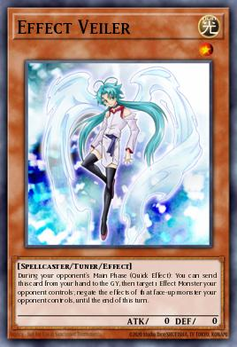

- **Copias y zona:** Main 2x. No altera las cantidades registradas.
- **Nombre oficial de referencia:** Ocultador de Efectos. CID cotejado con la ficha oficial; el nombre histórico del inventario se conserva aunque su grafía/traducción difiera.
- **Función principal y secundaria:** handtrap · negación.
- **Estado de sinergia y función:** Utilidad independiente. Es una clasificación de juego; revisar la relación concreta en A06.
- **Papel como recurso, descarte o coste:** Coste o consumo descrito en A05: envío de recurso propio al Cementerio.
- **Efecto operativo (paráfrasis analítica):** Durante la Main Phase rival, se manda desde la mano al Cementerio para negar los efectos de un monstruo rival boca arriba. 
- **Mapa de activación y resultados:** 1) en Main Phase: niega el efecto o la activación indicada. Cada operación está sujeta a la secuencia y al «si lo haces» del texto oficial.
- **Ventanas de activación identificadas:** turno rival; Main Phase; Efecto Rápido.
- **Costes o recursos potenciales:** envío de recurso propio al Cementerio.
- **Restricciones y requisitos:** aplicar restricciones de selección, activación y copias que consten en el texto original. 
- **Prioridad al ir primero:** convertir el primer Guerrero en recursos y un Sincro defendible. Para esta carta: Reservar la respuesta para la ventana rival exacta; no es una pieza buscadora de nuestro motor.
- **Prioridad al ir segundo:** despejar obstáculos conservando equipo, invocaciones y capacidad de extensión. Identificar primero la respuesta rival que afecta su función «handtrap».
- **Medio/tardío y recuperación:** reutilizar Guerreros y Equipos gastados sin perder la Normal Summon. No asumir que por sí misma recicla recursos si el texto no lo permite.
- **Sinergias y acceso a líneas:** Relación contextual con Guerreros FUEGO, cartas de Equipo, recuperaciones del Cementerio y escalada Sincro. Habilita una línea del motor sólo si coinciden recursos, objetivos y restricciones; no equivale a un combo completo validado.
- **Riesgo / brick / interrupciones:** La ventana es la Main Phase del adversario, no cualquier fase. Puede emplearse en cadena sólo cuando se cumpla su condición concreta.
- **Utilidad editorial:** 3/5 para este deck (estimación por rol y zona, no probabilidad calculada). No cambiar copias; cualquier sugerencia de alta/baja pasa por el apartado 22 y aprobación.
- **Referencia oficial y trazabilidad:** https://www.db.yugioh-card.com/yugiohdb/card_search.action?cid=8933&ope=2&request_locale=es. **Confianza:** texto y tipo de efecto cotejados en Konami; síntesis táctica editorial, no demostración de combo.
- **Aplicación concreta dentro de este deck (A06):** Durante la Main Phase rival, se manda desde la mano al Cementerio para negar los efectos de un monstruo rival boca arriba. Aporta respuesta o consistencia sin exigir enlace directo.

**USO PRÁCTICO Y SINERGIA — Effect Veiler**

- **Label funcional:** Función independiente. Clasificación documental; una relación es válida solo si se satisfacen sus condiciones exactas.
- **Qué hace:** Durante la Main Phase rival, se manda desde la mano al Cementerio para negar los efectos de un monstruo rival boca arriba.
- **Cómo aprovecharla en este deck:** Durante la Main Phase rival, se manda desde la mano al Cementerio para negar los efectos de un monstruo rival boca arriba. Aporta respuesta o consistencia sin exigir enlace directo.
- **Al jugar primero:** convertir el primer Guerrero en recursos y un Sincro defendible. Para esta carta: Reservar la respuesta para la ventana rival exacta; no es una pieza buscadora de nuestro motor.
- **Al jugar segundo:** despejar obstáculos conservando equipo, invocaciones y capacidad de extensión. Identificar primero la respuesta rival que afecta su función «handtrap».
- **Cuándo tener precaución:** La ventana es la Main Phase del adversario, no cualquier fase. Puede emplearse en cadena sólo cuando se cumpla su condición concreta.

#### 16. Ash Blossom & Joyous Spring

- **Copias y zona:** Main 2x. No altera las cantidades registradas.
- **Nombre oficial de referencia:** Flor de Ceniza & Primavera Feliz. CID cotejado con la ficha oficial; el nombre histórico del inventario se conserva aunque su grafía/traducción difiera.
- **Función principal y secundaria:** handtrap · negación.
- **Estado de sinergia y función:** Utilidad independiente. Es una clasificación de juego; revisar la relación concreta en A06.
- **Papel como recurso, descarte o coste:** Descarte mencionado: comprobar carta que lo exige, zona, coste frente a efecto y utilidad del recurso.
- **Efecto operativo (paráfrasis analítica):** Descarta desde la mano para detener efectos que buscan, invocan o mandan cartas desde el Deck. 
- **Mapa de activación y resultados:** 1) con condición explícita en la carta: niega el efecto o la activación indicada, Invocación Especial desde Deck, incorpora la pieza indicada a la mano. Cada operación está sujeta a la secuencia y al «si lo haces» del texto oficial.
- **Ventanas de activación identificadas:** Efecto Rápido.
- **Costes o recursos potenciales:** descarte de mano.
- **Restricciones y requisitos:** hay límite por turno según el efecto concreto. 
- **Prioridad al ir primero:** convertir el primer Guerrero en recursos y un Sincro defendible. Para esta carta: Reservar la respuesta para la ventana rival exacta; no es una pieza buscadora de nuestro motor.
- **Prioridad al ir segundo:** despejar obstáculos conservando equipo, invocaciones y capacidad de extensión. Identificar primero la respuesta rival que afecta su función «handtrap».
- **Medio/tardío y recuperación:** reutilizar Guerreros y Equipos gastados sin perder la Normal Summon. Verificar que el objetivo de recuperación continúe disponible.
- **Sinergias y acceso a líneas:** Relación contextual con Guerreros FUEGO, cartas de Equipo, recuperaciones del Cementerio y escalada Sincro. Habilita una línea del motor sólo si coinciden recursos, objetivos y restricciones; no equivale a un combo completo validado.
- **Riesgo / brick / interrupciones:** Reaccionar al efecto del Deck que habilite la jugada rival; no da búsquedas propias. Puede emplearse en cadena sólo cuando se cumpla su condición concreta.
- **Utilidad editorial:** 3/5 para este deck (estimación por rol y zona, no probabilidad calculada). No cambiar copias; cualquier sugerencia de alta/baja pasa por el apartado 22 y aprobación.
- **Referencia oficial y trazabilidad:** https://www.db.yugioh-card.com/yugiohdb/card_search.action?cid=12950&ope=2&request_locale=es. **Confianza:** texto y tipo de efecto cotejados en Konami; síntesis táctica editorial, no demostración de combo.
- **Aplicación concreta dentro de este deck (A06):** Descarta desde la mano para detener efectos que buscan, invocan o mandan cartas desde el Deck. Aporta respuesta o consistencia sin exigir enlace directo.

**USO PRÁCTICO Y SINERGIA — Ash Blossom & Joyous Spring**

- **Label funcional:** Función independiente. Clasificación documental; una relación es válida solo si se satisfacen sus condiciones exactas.
- **Qué hace:** Descarta desde la mano para detener efectos que buscan, invocan o mandan cartas desde el Deck.
- **Cómo aprovecharla en este deck:** Descarta desde la mano para detener efectos que buscan, invocan o mandan cartas desde el Deck. Aporta respuesta o consistencia sin exigir enlace directo.
- **Al jugar primero:** convertir el primer Guerrero en recursos y un Sincro defendible. Para esta carta: Reservar la respuesta para la ventana rival exacta; no es una pieza buscadora de nuestro motor.
- **Al jugar segundo:** despejar obstáculos conservando equipo, invocaciones y capacidad de extensión. Identificar primero la respuesta rival que afecta su función «handtrap».
- **Cuándo tener precaución:** Reaccionar al efecto del Deck que habilite la jugada rival; no da búsquedas propias. Puede emplearse en cadena sólo cuando se cumpla su condición concreta.

#### 17. Angelica's Angelic Ring

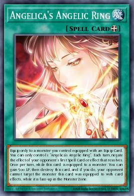

- **Copias y zona:** Main 1x. No altera las cantidades registradas.
- **Nombre oficial de referencia:** Anillo Angelical de Angélica. CID cotejado con la ficha oficial; el nombre histórico del inventario se conserva aunque su grafía/traducción difiera.
- **Función principal y secundaria:** removal · motor Equipo.
- **Estado de sinergia y función:** Sin relación demostrada. Es una clasificación de juego; revisar la relación concreta en A06.
- **Papel como recurso, descarte o coste:** No se demuestra que esta carta sea recurso de descarte o pago para otra.
- **Efecto operativo (paráfrasis analítica):** destrucción de cartas o empleo de destrucción como detonante; uso o producción de cartas equipadas. Son operaciones detectadas en el texto, no efectos independientes garantizados; leer sus condiciones en la fuente.
- **Mapa de activación y resultados:** 1) efecto propio o continuo: equipa carta/monstruo según texto · 2) con Equipo requerido: destruye la carta o recurso previsto, equipa carta/monstruo según texto. Cada operación está sujeta a la secuencia y al «si lo haces» del texto oficial.
- **Ventanas de activación identificadas:** requieren la fase o condición específica indicada en el texto; sin ventana rápida general asumida.
- **Costes o recursos potenciales:** sin coste independiente identificado en esta síntesis; comprobar las acciones previas al punto y coma de cada efecto.
- **Restricciones y requisitos:** hay límite por turno según el efecto concreto. 
- **Prioridad al ir primero:** convertir el primer Guerrero en recursos y un Sincro defendible. Para esta carta: Activar cuando las condiciones permitan obtener valor real, preservando recursos de seguimiento.
- **Prioridad al ir segundo:** despejar obstáculos conservando equipo, invocaciones y capacidad de extensión. Identificar primero la respuesta rival que afecta su función «removal».
- **Medio/tardío y recuperación:** reutilizar Guerreros y Equipos gastados sin perder la Normal Summon. No asumir que por sí misma recicla recursos si el texto no lo permite.
- **Sinergias y acceso a líneas:** Relación contextual con Guerreros FUEGO, cartas de Equipo, recuperaciones del Cementerio y escalada Sincro. Habilita una línea del motor sólo si coinciden recursos, objetivos y restricciones; no equivale a un combo completo validado.
- **Riesgo / brick / interrupciones:** Riesgo operativo: destrucción del Equipo, interrupción del buscador y falta de materiales adecuados. Confirmar objetivos disponibles y costes antes de activar. No atribuirle velocidad rápida por el solo hecho de formar parte del motor.
- **Utilidad editorial:** 3/5 para este deck (estimación por rol y zona, no probabilidad calculada). No cambiar copias; cualquier sugerencia de alta/baja pasa por el apartado 22 y aprobación.
- **Referencia oficial y trazabilidad:** https://www.db.yugioh-card.com/yugiohdb/card_search.action?cid=19207&ope=2&request_locale=es. **Confianza:** texto y tipo de efecto cotejados en Konami; síntesis táctica editorial, no demostración de combo.
- **Aplicación concreta dentro de este deck (A06):** destrucción de cartas o empleo de destrucción como detonante; uso o producción de cartas equipadas. A06 aún no identifica su conexión; no equivale a incompatibilidad ni borra rutas A09.

**USO PRÁCTICO Y SINERGIA — Angelica's Angelic Ring**

- **Label funcional:** Sin sinergia demostrada. Clasificación documental; una relación es válida solo si se satisfacen sus condiciones exactas.
- **Qué hace:** destrucción de cartas o empleo de destrucción como detonante; uso o producción de cartas equipadas. Son operaciones detectadas en el texto, no efectos independientes garantizados; leer sus condiciones en la fuente.
- **Cómo aprovecharla en este deck:** destrucción de cartas o empleo de destrucción como detonante; uso o producción de cartas equipadas. A06 aún no identifica su conexión; no equivale a incompatibilidad ni borra rutas A09.
- **Al jugar primero:** convertir el primer Guerrero en recursos y un Sincro defendible. Para esta carta: Activar cuando las condiciones permitan obtener valor real, preservando recursos de seguimiento.
- **Al jugar segundo:** despejar obstáculos conservando equipo, invocaciones y capacidad de extensión. Identificar primero la respuesta rival que afecta su función «removal».
- **Cuándo tener precaución:** Riesgo operativo: destrucción del Equipo, interrupción del buscador y falta de materiales adecuados. Confirmar objetivos disponibles y costes antes de activar. No atribuirle velocidad rápida por el solo hecho de formar parte del motor.
- **Sinergia no demostrada:** conservar su función individual si la tiene; no vincularla con otro combo sin una interacción real.

#### 18. Infernoble Arms - Almace

- **Copias y zona:** Main 1x. No altera las cantidades registradas.
- **Nombre oficial de referencia:** "Infernarmas Nobles - Almace". CID cotejado con la ficha oficial; el nombre histórico del inventario se conserva aunque su grafía/traducción difiera.
- **Función principal y secundaria:** removal · motor Equipo.
- **Estado de sinergia y función:** Sinergia indirecta (soporte o recursos). Es una clasificación de juego; revisar la relación concreta en A06.
- **Papel como recurso, descarte o coste:** No se demuestra que esta carta sea recurso de descarte o pago para otra.
- **Efecto operativo (paráfrasis analítica):** destrucción de cartas o empleo de destrucción como detonante; destierro de recursos o de amenazas; uso o producción de cartas equipadas. Son operaciones detectadas en el texto, no efectos independientes garantizados; leer sus condiciones en la fuente.
- **Mapa de activación y resultados:** 1) con Equipo requerido: destruye la carta o recurso previsto, equipa carta/monstruo según texto · 2) con condición explícita en la carta: destierra el recurso u objetivo previsto. Cada operación está sujeta a la secuencia y al «si lo haces» del texto oficial.
- **Ventanas de activación identificadas:** al llegar o estar en el Cementerio.
- **Costes o recursos potenciales:** sin coste independiente identificado en esta síntesis; comprobar las acciones previas al punto y coma de cada efecto.
- **Restricciones y requisitos:** depende de recursos en Cementerio. 
- **Prioridad al ir primero:** convertir el primer Guerrero en recursos y un Sincro defendible. Para esta carta: Escoger la amenaza o recurso que genere mayor ventaja de tempo; respetar selección y zona.
- **Prioridad al ir segundo:** despejar obstáculos conservando equipo, invocaciones y capacidad de extensión. Identificar primero la respuesta rival que afecta su función «removal».
- **Medio/tardío y recuperación:** reutilizar Guerreros y Equipos gastados sin perder la Normal Summon. No asumir que por sí misma recicla recursos si el texto no lo permite.
- **Sinergias y acceso a líneas:** Relación contextual con Guerreros FUEGO, cartas de Equipo, recuperaciones del Cementerio y escalada Sincro. Habilita una línea del motor sólo si coinciden recursos, objetivos y restricciones; no equivale a un combo completo validado.
- **Riesgo / brick / interrupciones:** Depende del Cementerio y es sensible a destierro o negación de ese recurso. No atribuirle velocidad rápida por el solo hecho de formar parte del motor.
- **Utilidad editorial:** 3/5 para este deck (estimación por rol y zona, no probabilidad calculada). No cambiar copias; cualquier sugerencia de alta/baja pasa por el apartado 22 y aprobación.
- **Referencia oficial y trazabilidad:** https://www.db.yugioh-card.com/yugiohdb/card_search.action?cid=18843&ope=2&request_locale=es. **Confianza:** texto y tipo de efecto cotejados en Konami; síntesis táctica editorial, no demostración de combo.
- **Aplicación concreta dentro de este deck (A06):** destrucción de cartas o empleo de destrucción como detonante; destierro de recursos o de amenazas; uso o producción de cartas equipadas.

**USO PRÁCTICO Y SINERGIA — Infernoble Arms - Almace**

- **Label funcional:** Sinergia indirecta. Clasificación documental; una relación es válida solo si se satisfacen sus condiciones exactas.
- **Qué hace:** destrucción de cartas o empleo de destrucción como detonante; destierro de recursos o de amenazas; uso o producción de cartas equipadas. Son operaciones detectadas en el texto, no efectos independientes garantizados; leer sus condiciones en la fuente.
- **Cómo aprovecharla en este deck:** destrucción de cartas o empleo de destrucción como detonante; destierro de recursos o de amenazas; uso o producción de cartas equipadas.
- **Al jugar primero:** convertir el primer Guerrero en recursos y un Sincro defendible. Para esta carta: Escoger la amenaza o recurso que genere mayor ventaja de tempo; respetar selección y zona.
- **Al jugar segundo:** despejar obstáculos conservando equipo, invocaciones y capacidad de extensión. Identificar primero la respuesta rival que afecta su función «removal».
- **Cuándo tener precaución:** Depende del Cementerio y es sensible a destierro o negación de ese recurso. No atribuirle velocidad rápida por el solo hecho de formar parte del motor.

#### 19. Infernoble Arms - Durendal

- **Copias y zona:** Main 2x. No altera las cantidades registradas.
- **Nombre oficial de referencia:** "Infernarmas Nobles - Durendal". CID cotejado con la ficha oficial; el nombre histórico del inventario se conserva aunque su grafía/traducción difiera.
- **Función principal y secundaria:** searcher · buscador · removal · motor Equipo.
- **Estado de sinergia y función:** Sinergia indirecta (soporte o recursos). Es una clasificación de juego; revisar la relación concreta en A06.
- **Papel como recurso, descarte o coste:** No se demuestra que esta carta sea recurso de descarte o pago para otra.
- **Efecto operativo (paráfrasis analítica):** búsqueda o incorporación de cartas a mano; destrucción de cartas o empleo de destrucción como detonante; uso o producción de cartas equipadas. Son operaciones detectadas en el texto, no efectos independientes garantizados; leer sus condiciones en la fuente.
- **Mapa de activación y resultados:** 1) con Equipo requerido: incorpora la pieza indicada a la mano, destruye la carta o recurso previsto. Cada operación está sujeta a la secuencia y al «si lo haces» del texto oficial.
- **Ventanas de activación identificadas:** al llegar o estar en el Cementerio.
- **Costes o recursos potenciales:** sin coste independiente identificado en esta síntesis; comprobar las acciones previas al punto y coma de cada efecto.
- **Restricciones y requisitos:** puede bloquear tipos de Invocación del Extra Deck; depende de recursos en Cementerio. 
- **Prioridad al ir primero:** convertir el primer Guerrero en recursos y un Sincro defendible. Para esta carta: Convertir la activación en acceso a la siguiente pieza del motor, sin duplicar buscadores inútilmente.
- **Prioridad al ir segundo:** despejar obstáculos conservando equipo, invocaciones y capacidad de extensión. Identificar primero la respuesta rival que afecta su función «searcher».
- **Medio/tardío y recuperación:** reutilizar Guerreros y Equipos gastados sin perder la Normal Summon. No asumir que por sí misma recicla recursos si el texto no lo permite.
- **Sinergias y acceso a líneas:** Relación contextual con Guerreros FUEGO, cartas de Equipo, recuperaciones del Cementerio y escalada Sincro. Habilita una línea del motor sólo si coinciden recursos, objetivos y restricciones; no equivale a un combo completo validado.
- **Riesgo / brick / interrupciones:** La restricción de invocaciones puede cerrar rutas alternativas; revisar el orden de activación. No atribuirle velocidad rápida por el solo hecho de formar parte del motor.
- **Utilidad editorial:** 5/5 para este deck (estimación por rol y zona, no probabilidad calculada). No cambiar copias; cualquier sugerencia de alta/baja pasa por el apartado 22 y aprobación.
- **Referencia oficial y trazabilidad:** https://www.db.yugioh-card.com/yugiohdb/card_search.action?cid=15287&ope=2&request_locale=es. **Confianza:** texto y tipo de efecto cotejados en Konami; síntesis táctica editorial, no demostración de combo.
- **Aplicación concreta dentro de este deck (A06):** búsqueda o incorporación de cartas a mano; destrucción de cartas o empleo de destrucción como detonante; uso o producción de cartas equipadas.

**USO PRÁCTICO Y SINERGIA — Infernoble Arms - Durendal**

- **Label funcional:** Sinergia indirecta. Clasificación documental; una relación es válida solo si se satisfacen sus condiciones exactas.
- **Qué hace:** búsqueda o incorporación de cartas a mano; destrucción de cartas o empleo de destrucción como detonante; uso o producción de cartas equipadas. Son operaciones detectadas en el texto, no efectos independientes garantizados; leer sus condiciones en la fuente.
- **Cómo aprovecharla en este deck:** búsqueda o incorporación de cartas a mano; destrucción de cartas o empleo de destrucción como detonante; uso o producción de cartas equipadas.
- **Al jugar primero:** convertir el primer Guerrero en recursos y un Sincro defendible. Para esta carta: Convertir la activación en acceso a la siguiente pieza del motor, sin duplicar buscadores inútilmente.
- **Al jugar segundo:** despejar obstáculos conservando equipo, invocaciones y capacidad de extensión. Identificar primero la respuesta rival que afecta su función «searcher».
- **Cuándo tener precaución:** La restricción de invocaciones puede cerrar rutas alternativas; revisar el orden de activación. No atribuirle velocidad rápida por el solo hecho de formar parte del motor.

#### 20. Noble Arms Museum

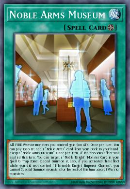

- **Copias y zona:** Main 3x. No altera las cantidades registradas.
- **Nombre oficial de referencia:** Museo de Armas Nobles. CID cotejado con la ficha oficial; el nombre histórico del inventario se conserva aunque su grafía/traducción difiera.
- **Función principal y secundaria:** searcher · buscador · cierre.
- **Estado de sinergia y función:** Sinergia indirecta (soporte o recursos). Es una clasificación de juego; revisar la relación concreta en A06.
- **Papel como recurso, descarte o coste:** No se demuestra que esta carta sea recurso de descarte o pago para otra.
- **Efecto operativo (paráfrasis analítica):** búsqueda o incorporación de cartas a mano; presión de combate o modificación de estadísticas. Son operaciones detectadas en el texto, no efectos independientes garantizados; leer sus condiciones en la fuente.
- **Mapa de activación y resultados:** 1) una vez por turno: incorpora la pieza indicada a la mano. Cada operación está sujeta a la secuencia y al «si lo haces» del texto oficial.
- **Ventanas de activación identificadas:** requieren la fase o condición específica indicada en el texto; sin ventana rápida general asumida.
- **Costes o recursos potenciales:** sin coste independiente identificado en esta síntesis; comprobar las acciones previas al punto y coma de cada efecto.
- **Restricciones y requisitos:** hay límite por turno según el efecto concreto; puede bloquear tipos de Invocación del Extra Deck. 
- **Prioridad al ir primero:** convertir el primer Guerrero en recursos y un Sincro defendible. Para esta carta: Convertir la activación en acceso a la siguiente pieza del motor, sin duplicar buscadores inútilmente.
- **Prioridad al ir segundo:** despejar obstáculos conservando equipo, invocaciones y capacidad de extensión. Identificar primero la respuesta rival que afecta su función «searcher».
- **Medio/tardío y recuperación:** reutilizar Guerreros y Equipos gastados sin perder la Normal Summon. No asumir que por sí misma recicla recursos si el texto no lo permite.
- **Sinergias y acceso a líneas:** Relación contextual con Guerreros FUEGO, cartas de Equipo, recuperaciones del Cementerio y escalada Sincro. Habilita una línea del motor sólo si coinciden recursos, objetivos y restricciones; no equivale a un combo completo validado.
- **Riesgo / brick / interrupciones:** La restricción de invocaciones puede cerrar rutas alternativas; revisar el orden de activación. No atribuirle velocidad rápida por el solo hecho de formar parte del motor.
- **Utilidad editorial:** 5/5 para este deck (estimación por rol y zona, no probabilidad calculada). No cambiar copias; cualquier sugerencia de alta/baja pasa por el apartado 22 y aprobación.
- **Referencia oficial y trazabilidad:** https://www.db.yugioh-card.com/yugiohdb/card_search.action?cid=18844&ope=2&request_locale=es. **Confianza:** texto y tipo de efecto cotejados en Konami; síntesis táctica editorial, no demostración de combo.
- **Aplicación concreta dentro de este deck (A06):** búsqueda o incorporación de cartas a mano; presión de combate o modificación de estadísticas.

**USO PRÁCTICO Y SINERGIA — Noble Arms Museum**

- **Label funcional:** Sinergia indirecta. Clasificación documental; una relación es válida solo si se satisfacen sus condiciones exactas.
- **Qué hace:** búsqueda o incorporación de cartas a mano; presión de combate o modificación de estadísticas. Son operaciones detectadas en el texto, no efectos independientes garantizados; leer sus condiciones en la fuente.
- **Cómo aprovecharla en este deck:** búsqueda o incorporación de cartas a mano; presión de combate o modificación de estadísticas.
- **Al jugar primero:** convertir el primer Guerrero en recursos y un Sincro defendible. Para esta carta: Convertir la activación en acceso a la siguiente pieza del motor, sin duplicar buscadores inútilmente.
- **Al jugar segundo:** despejar obstáculos conservando equipo, invocaciones y capacidad de extensión. Identificar primero la respuesta rival que afecta su función «searcher».
- **Cuándo tener precaución:** La restricción de invocaciones puede cerrar rutas alternativas; revisar el orden de activación. No atribuirle velocidad rápida por el solo hecho de formar parte del motor.

#### 21. Divine Sword - Phoenix Blade

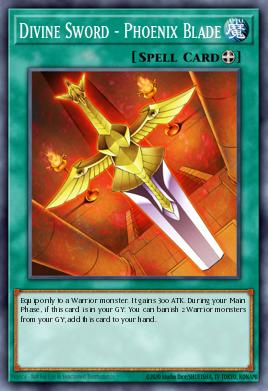

- **Copias y zona:** Main 1x. No altera las cantidades registradas.
- **Nombre oficial de referencia:** Espada Divina - Hoja del Fénix. CID cotejado con la ficha oficial; el nombre histórico del inventario se conserva aunque su grafía/traducción difiera.
- **Función principal y secundaria:** searcher · buscador · cierre · motor Equipo.
- **Estado de sinergia y función:** Sin relación demostrada. Es una clasificación de juego; revisar la relación concreta en A06.
- **Papel como recurso, descarte o coste:** No se demuestra que esta carta sea recurso de descarte o pago para otra.
- **Efecto operativo (paráfrasis analítica):** búsqueda o incorporación de cartas a mano; presión de combate o modificación de estadísticas; uso o producción de cartas equipadas. Son operaciones detectadas en el texto, no efectos independientes garantizados; leer sus condiciones en la fuente.
- **Mapa de activación y resultados:** 1) efecto propio o continuo: equipa carta/monstruo según texto · 2) mientras está en Cementerio: incorpora la pieza indicada a la mano. Cada operación está sujeta a la secuencia y al «si lo haces» del texto oficial.
- **Ventanas de activación identificadas:** Main Phase; al llegar o estar en el Cementerio.
- **Costes o recursos potenciales:** sin coste independiente identificado en esta síntesis; comprobar las acciones previas al punto y coma de cada efecto.
- **Restricciones y requisitos:** depende de recursos en Cementerio. 
- **Prioridad al ir primero:** convertir el primer Guerrero en recursos y un Sincro defendible. Para esta carta: Convertir la activación en acceso a la siguiente pieza del motor, sin duplicar buscadores inútilmente.
- **Prioridad al ir segundo:** despejar obstáculos conservando equipo, invocaciones y capacidad de extensión. Identificar primero la respuesta rival que afecta su función «searcher».
- **Medio/tardío y recuperación:** reutilizar Guerreros y Equipos gastados sin perder la Normal Summon. No asumir que por sí misma recicla recursos si el texto no lo permite.
- **Sinergias y acceso a líneas:** Relación contextual con Guerreros FUEGO, cartas de Equipo, recuperaciones del Cementerio y escalada Sincro. Habilita una línea del motor sólo si coinciden recursos, objetivos y restricciones; no equivale a un combo completo validado.
- **Riesgo / brick / interrupciones:** Depende del Cementerio y es sensible a destierro o negación de ese recurso. No atribuirle velocidad rápida por el solo hecho de formar parte del motor.
- **Utilidad editorial:** 5/5 para este deck (estimación por rol y zona, no probabilidad calculada). No cambiar copias; cualquier sugerencia de alta/baja pasa por el apartado 22 y aprobación.
- **Referencia oficial y trazabilidad:** https://www.db.yugioh-card.com/yugiohdb/card_search.action?cid=6458&ope=2&request_locale=es. **Confianza:** texto y tipo de efecto cotejados en Konami; síntesis táctica editorial, no demostración de combo.
- **Aplicación concreta dentro de este deck (A06):** búsqueda o incorporación de cartas a mano; presión de combate o modificación de estadísticas; uso o producción de cartas equipadas. A06 aún no identifica su conexión; no equivale a incompatibilidad ni borra rutas A09.

**USO PRÁCTICO Y SINERGIA — Divine Sword - Phoenix Blade**

- **Label funcional:** Sin sinergia demostrada. Clasificación documental; una relación es válida solo si se satisfacen sus condiciones exactas.
- **Qué hace:** búsqueda o incorporación de cartas a mano; presión de combate o modificación de estadísticas; uso o producción de cartas equipadas. Son operaciones detectadas en el texto, no efectos independientes garantizados; leer sus condiciones en la fuente.
- **Cómo aprovecharla en este deck:** búsqueda o incorporación de cartas a mano; presión de combate o modificación de estadísticas; uso o producción de cartas equipadas. A06 aún no identifica su conexión; no equivale a incompatibilidad ni borra rutas A09.
- **Al jugar primero:** convertir el primer Guerrero en recursos y un Sincro defendible. Para esta carta: Convertir la activación en acceso a la siguiente pieza del motor, sin duplicar buscadores inútilmente.
- **Al jugar segundo:** despejar obstáculos conservando equipo, invocaciones y capacidad de extensión. Identificar primero la respuesta rival que afecta su función «searcher».
- **Cuándo tener precaución:** Depende del Cementerio y es sensible a destierro o negación de ese recurso. No atribuirle velocidad rápida por el solo hecho de formar parte del motor.
- **Sinergia no demostrada:** conservar su función individual si la tiene; no vincularla con otro combo sin una interacción real.

#### 22. D.D.R. - Different Dimension Reincarnation

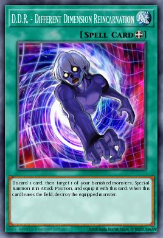

- **Copias y zona:** Main 1x. No altera las cantidades registradas.
- **Nombre oficial de referencia:** R.D.D. - Reencarnación de la Dimensión Diferente. CID cotejado con la ficha oficial; el nombre histórico del inventario se conserva aunque su grafía/traducción difiera.
- **Función principal y secundaria:** removal.
- **Estado de sinergia y función:** Sin relación demostrada. Es una clasificación de juego; revisar la relación concreta en A06.
- **Papel como recurso, descarte o coste:** Coste o consumo descrito en A05: descarte de mano.
- **Efecto operativo (paráfrasis analítica):** destrucción de cartas o empleo de destrucción como detonante; destierro de recursos o de amenazas. Son operaciones detectadas en el texto, no efectos independientes garantizados; leer sus condiciones en la fuente.
- **Mapa de activación y resultados:** 1) efecto propio o continuo: destierra el recurso u objetivo previsto · 2) efecto propio o continuo: destruye la carta o recurso previsto. Cada operación está sujeta a la secuencia y al «si lo haces» del texto oficial.
- **Ventanas de activación identificadas:** requieren la fase o condición específica indicada en el texto; sin ventana rápida general asumida.
- **Costes o recursos potenciales:** descarte de mano.
- **Restricciones y requisitos:** aplicar restricciones de selección, activación y copias que consten en el texto original. 
- **Prioridad al ir primero:** convertir el primer Guerrero en recursos y un Sincro defendible. Para esta carta: Escoger la amenaza o recurso que genere mayor ventaja de tempo; respetar selección y zona.
- **Prioridad al ir segundo:** despejar obstáculos conservando equipo, invocaciones y capacidad de extensión. Identificar primero la respuesta rival que afecta su función «removal».
- **Medio/tardío y recuperación:** reutilizar Guerreros y Equipos gastados sin perder la Normal Summon. No asumir que por sí misma recicla recursos si el texto no lo permite.
- **Sinergias y acceso a líneas:** Relación contextual con Guerreros FUEGO, cartas de Equipo, recuperaciones del Cementerio y escalada Sincro. Habilita una línea del motor sólo si coinciden recursos, objetivos y restricciones; no equivale a un combo completo validado.
- **Riesgo / brick / interrupciones:** Riesgo operativo: destrucción del Equipo, interrupción del buscador y falta de materiales adecuados. Confirmar objetivos disponibles y costes antes de activar. No atribuirle velocidad rápida por el solo hecho de formar parte del motor.
- **Utilidad editorial:** 3/5 para este deck (estimación por rol y zona, no probabilidad calculada). No cambiar copias; cualquier sugerencia de alta/baja pasa por el apartado 22 y aprobación.
- **Referencia oficial y trazabilidad:** https://www.db.yugioh-card.com/yugiohdb/card_search.action?cid=7519&ope=2&request_locale=es. **Confianza:** texto y tipo de efecto cotejados en Konami; síntesis táctica editorial, no demostración de combo.
- **Aplicación concreta dentro de este deck (A06):** destrucción de cartas o empleo de destrucción como detonante; destierro de recursos o de amenazas. A06 aún no identifica su conexión; no equivale a incompatibilidad ni borra rutas A09.

**USO PRÁCTICO Y SINERGIA — D.D.R. - Different Dimension Reincarnation**

- **Label funcional:** Sin sinergia demostrada. Clasificación documental; una relación es válida solo si se satisfacen sus condiciones exactas.
- **Qué hace:** destrucción de cartas o empleo de destrucción como detonante; destierro de recursos o de amenazas. Son operaciones detectadas en el texto, no efectos independientes garantizados; leer sus condiciones en la fuente.
- **Cómo aprovecharla en este deck:** destrucción de cartas o empleo de destrucción como detonante; destierro de recursos o de amenazas. A06 aún no identifica su conexión; no equivale a incompatibilidad ni borra rutas A09.
- **Al jugar primero:** convertir el primer Guerrero en recursos y un Sincro defendible. Para esta carta: Escoger la amenaza o recurso que genere mayor ventaja de tempo; respetar selección y zona.
- **Al jugar segundo:** despejar obstáculos conservando equipo, invocaciones y capacidad de extensión. Identificar primero la respuesta rival que afecta su función «removal».
- **Cuándo tener precaución:** Riesgo operativo: destrucción del Equipo, interrupción del buscador y falta de materiales adecuados. Confirmar objetivos disponibles y costes antes de activar. No atribuirle velocidad rápida por el solo hecho de formar parte del motor.
- **Sinergia no demostrada:** conservar su función individual si la tiene; no vincularla con otro combo sin una interacción real.

#### 23. WANTED: Seeker of Sinful Spoils

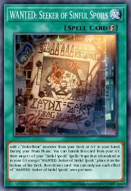

- **Copias y zona:** Main 3x. No altera las cantidades registradas.
- **Nombre oficial de referencia:** SE BUSCA: Rastreadora del Botín del Pecado. CID cotejado con la ficha oficial; el nombre histórico del inventario se conserva aunque su grafía/traducción difiera.
- **Función principal y secundaria:** searcher · buscador · removal · ventaja de mano.
- **Estado de sinergia y función:** Sinergia indirecta (soporte o recursos). Es una clasificación de juego; revisar la relación concreta en A06.
- **Papel como recurso, descarte o coste:** No se demuestra que esta carta sea recurso de descarte o pago para otra.
- **Efecto operativo (paráfrasis analítica):** búsqueda o incorporación de cartas a mano; destierro de recursos o de amenazas; generación de cartas por robo. Son operaciones detectadas en el texto, no efectos independientes garantizados; leer sus condiciones en la fuente.
- **Mapa de activación y resultados:** 1) efecto propio o continuo: incorpora la pieza indicada a la mano · 2) en Main Phase: destierra el recurso u objetivo previsto, roba cartas. Cada operación está sujeta a la secuencia y al «si lo haces» del texto oficial.
- **Ventanas de activación identificadas:** Main Phase.
- **Costes o recursos potenciales:** sin coste independiente identificado en esta síntesis; comprobar las acciones previas al punto y coma de cada efecto.
- **Restricciones y requisitos:** hay límite por turno según el efecto concreto; depende de recursos en Cementerio. 
- **Prioridad al ir primero:** convertir el primer Guerrero en recursos y un Sincro defendible. Para esta carta: Convertir la activación en acceso a la siguiente pieza del motor, sin duplicar buscadores inútilmente.
- **Prioridad al ir segundo:** despejar obstáculos conservando equipo, invocaciones y capacidad de extensión. Identificar primero la respuesta rival que afecta su función «searcher».
- **Medio/tardío y recuperación:** reutilizar Guerreros y Equipos gastados sin perder la Normal Summon. No asumir que por sí misma recicla recursos si el texto no lo permite.
- **Sinergias y acceso a líneas:** Relación contextual con Guerreros FUEGO, cartas de Equipo, recuperaciones del Cementerio y escalada Sincro. Habilita una línea del motor sólo si coinciden recursos, objetivos y restricciones; no equivale a un combo completo validado.
- **Riesgo / brick / interrupciones:** Depende del Cementerio y es sensible a destierro o negación de ese recurso. No atribuirle velocidad rápida por el solo hecho de formar parte del motor.
- **Utilidad editorial:** 5/5 para este deck (estimación por rol y zona, no probabilidad calculada). No cambiar copias; cualquier sugerencia de alta/baja pasa por el apartado 22 y aprobación.
- **Referencia oficial y trazabilidad:** https://www.db.yugioh-card.com/yugiohdb/card_search.action?cid=19196&ope=2&request_locale=es. **Confianza:** texto y tipo de efecto cotejados en Konami; síntesis táctica editorial, no demostración de combo.
- **Aplicación concreta dentro de este deck (A06):** búsqueda o incorporación de cartas a mano; destierro de recursos o de amenazas; generación de cartas por robo.

**USO PRÁCTICO Y SINERGIA — WANTED: Seeker of Sinful Spoils**

- **Label funcional:** Sinergia indirecta. Clasificación documental; una relación es válida solo si se satisfacen sus condiciones exactas.
- **Qué hace:** búsqueda o incorporación de cartas a mano; destierro de recursos o de amenazas; generación de cartas por robo. Son operaciones detectadas en el texto, no efectos independientes garantizados; leer sus condiciones en la fuente.
- **Cómo aprovecharla en este deck:** búsqueda o incorporación de cartas a mano; destierro de recursos o de amenazas; generación de cartas por robo.
- **Al jugar primero:** convertir el primer Guerrero en recursos y un Sincro defendible. Para esta carta: Convertir la activación en acceso a la siguiente pieza del motor, sin duplicar buscadores inútilmente.
- **Al jugar segundo:** despejar obstáculos conservando equipo, invocaciones y capacidad de extensión. Identificar primero la respuesta rival que afecta su función «searcher».
- **Cuándo tener precaución:** Depende del Cementerio y es sensible a destierro o negación de ese recurso. No atribuirle velocidad rápida por el solo hecho de formar parte del motor.

#### 24. Heritage of the Chalice

- **Copias y zona:** Main 3x. No altera las cantidades registradas.
- **Nombre oficial de referencia:** Herencia del Cáliz. CID cotejado con la ficha oficial; el nombre histórico del inventario se conserva aunque su grafía/traducción difiera.
- **Función principal y secundaria:** searcher · buscador · motor Equipo.
- **Estado de sinergia y función:** Sinergia indirecta (soporte o recursos). Es una clasificación de juego; revisar la relación concreta en A06.
- **Papel como recurso, descarte o coste:** No se demuestra que esta carta sea recurso de descarte o pago para otra.
- **Efecto operativo (paráfrasis analítica):** búsqueda o incorporación de cartas a mano; uso o producción de cartas equipadas. Son operaciones detectadas en el texto, no efectos independientes garantizados; leer sus condiciones en la fuente.
- **Mapa de activación y resultados:** 1) efecto propio o continuo: incorpora la pieza indicada a la mano · 2) con condición explícita en la carta: incorpora la pieza indicada a la mano. Cada operación está sujeta a la secuencia y al «si lo haces» del texto oficial.
- **Ventanas de activación identificadas:** requieren la fase o condición específica indicada en el texto; sin ventana rápida general asumida.
- **Costes o recursos potenciales:** sin coste independiente identificado en esta síntesis; comprobar las acciones previas al punto y coma de cada efecto.
- **Restricciones y requisitos:** depende de recursos en Cementerio. 
- **Prioridad al ir primero:** convertir el primer Guerrero en recursos y un Sincro defendible. Para esta carta: Convertir la activación en acceso a la siguiente pieza del motor, sin duplicar buscadores inútilmente.
- **Prioridad al ir segundo:** despejar obstáculos conservando equipo, invocaciones y capacidad de extensión. Identificar primero la respuesta rival que afecta su función «searcher».
- **Medio/tardío y recuperación:** reutilizar Guerreros y Equipos gastados sin perder la Normal Summon. No asumir que por sí misma recicla recursos si el texto no lo permite.
- **Sinergias y acceso a líneas:** Relación contextual con Guerreros FUEGO, cartas de Equipo, recuperaciones del Cementerio y escalada Sincro. Habilita una línea del motor sólo si coinciden recursos, objetivos y restricciones; no equivale a un combo completo validado.
- **Riesgo / brick / interrupciones:** Depende del Cementerio y es sensible a destierro o negación de ese recurso. No atribuirle velocidad rápida por el solo hecho de formar parte del motor.
- **Utilidad editorial:** 5/5 para este deck (estimación por rol y zona, no probabilidad calculada). No cambiar copias; cualquier sugerencia de alta/baja pasa por el apartado 22 y aprobación.
- **Referencia oficial y trazabilidad:** https://www.db.yugioh-card.com/yugiohdb/card_search.action?cid=14075&ope=2&request_locale=es. **Confianza:** texto y tipo de efecto cotejados en Konami; síntesis táctica editorial, no demostración de combo.
- **Aplicación concreta dentro de este deck (A06):** búsqueda o incorporación de cartas a mano; uso o producción de cartas equipadas.

**USO PRÁCTICO Y SINERGIA — Heritage of the Chalice**

- **Label funcional:** Sinergia indirecta. Clasificación documental; una relación es válida solo si se satisfacen sus condiciones exactas.
- **Qué hace:** búsqueda o incorporación de cartas a mano; uso o producción de cartas equipadas. Son operaciones detectadas en el texto, no efectos independientes garantizados; leer sus condiciones en la fuente.
- **Cómo aprovecharla en este deck:** búsqueda o incorporación de cartas a mano; uso o producción de cartas equipadas.
- **Al jugar primero:** convertir el primer Guerrero en recursos y un Sincro defendible. Para esta carta: Convertir la activación en acceso a la siguiente pieza del motor, sin duplicar buscadores inútilmente.
- **Al jugar segundo:** despejar obstáculos conservando equipo, invocaciones y capacidad de extensión. Identificar primero la respuesta rival que afecta su función «searcher».
- **Cuándo tener precaución:** Depende del Cementerio y es sensible a destierro o negación de ese recurso. No atribuirle velocidad rápida por el solo hecho de formar parte del motor.

#### 25. Reinforcement of the Army

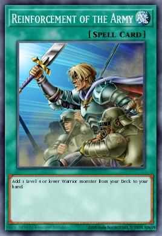

- **Copias y zona:** Main 1x. No altera las cantidades registradas.
- **Nombre oficial de referencia:** Refuerzo del Ejército. CID cotejado con la ficha oficial; el nombre histórico del inventario se conserva aunque su grafía/traducción difiera.
- **Función principal y secundaria:** searcher · buscador.
- **Estado de sinergia y función:** Sin relación demostrada. Es una clasificación de juego; revisar la relación concreta en A06.
- **Papel como recurso, descarte o coste:** No se demuestra que esta carta sea recurso de descarte o pago para otra.
- **Efecto operativo (paráfrasis analítica):** búsqueda o incorporación de cartas a mano. Son operaciones detectadas en el texto, no efectos independientes garantizados; leer sus condiciones en la fuente.
- **Mapa de activación y resultados:** 1) efecto propio o continuo: incorpora la pieza indicada a la mano. Cada operación está sujeta a la secuencia y al «si lo haces» del texto oficial.
- **Ventanas de activación identificadas:** requieren la fase o condición específica indicada en el texto; sin ventana rápida general asumida.
- **Costes o recursos potenciales:** sin coste independiente identificado en esta síntesis; comprobar las acciones previas al punto y coma de cada efecto.
- **Restricciones y requisitos:** aplicar restricciones de selección, activación y copias que consten en el texto original. 
- **Prioridad al ir primero:** convertir el primer Guerrero en recursos y un Sincro defendible. Para esta carta: Convertir la activación en acceso a la siguiente pieza del motor, sin duplicar buscadores inútilmente.
- **Prioridad al ir segundo:** despejar obstáculos conservando equipo, invocaciones y capacidad de extensión. Identificar primero la respuesta rival que afecta su función «searcher».
- **Medio/tardío y recuperación:** reutilizar Guerreros y Equipos gastados sin perder la Normal Summon. No asumir que por sí misma recicla recursos si el texto no lo permite.
- **Sinergias y acceso a líneas:** Relación contextual con Guerreros FUEGO, cartas de Equipo, recuperaciones del Cementerio y escalada Sincro. Habilita una línea del motor sólo si coinciden recursos, objetivos y restricciones; no equivale a un combo completo validado.
- **Riesgo / brick / interrupciones:** Riesgo operativo: destrucción del Equipo, interrupción del buscador y falta de materiales adecuados. Confirmar objetivos disponibles y costes antes de activar. No atribuirle velocidad rápida por el solo hecho de formar parte del motor.
- **Utilidad editorial:** 5/5 para este deck (estimación por rol y zona, no probabilidad calculada). No cambiar copias; cualquier sugerencia de alta/baja pasa por el apartado 22 y aprobación.
- **Referencia oficial y trazabilidad:** https://www.db.yugioh-card.com/yugiohdb/card_search.action?cid=5328&ope=2&request_locale=es. **Confianza:** texto y tipo de efecto cotejados en Konami; síntesis táctica editorial, no demostración de combo.
- **Aplicación concreta dentro de este deck (A06):** búsqueda o incorporación de cartas a mano. A06 aún no identifica su conexión; no equivale a incompatibilidad ni borra rutas A09.

**USO PRÁCTICO Y SINERGIA — Reinforcement of the Army**

- **Label funcional:** Sin sinergia demostrada. Clasificación documental; una relación es válida solo si se satisfacen sus condiciones exactas.
- **Qué hace:** búsqueda o incorporación de cartas a mano. Son operaciones detectadas en el texto, no efectos independientes garantizados; leer sus condiciones en la fuente.
- **Cómo aprovecharla en este deck:** búsqueda o incorporación de cartas a mano. A06 aún no identifica su conexión; no equivale a incompatibilidad ni borra rutas A09.
- **Al jugar primero:** convertir el primer Guerrero en recursos y un Sincro defendible. Para esta carta: Convertir la activación en acceso a la siguiente pieza del motor, sin duplicar buscadores inútilmente.
- **Al jugar segundo:** despejar obstáculos conservando equipo, invocaciones y capacidad de extensión. Identificar primero la respuesta rival que afecta su función «searcher».
- **Cuándo tener precaución:** Riesgo operativo: destrucción del Equipo, interrupción del buscador y falta de materiales adecuados. Confirmar objetivos disponibles y costes antes de activar. No atribuirle velocidad rápida por el solo hecho de formar parte del motor.
- **Sinergia no demostrada:** conservar su función individual si la tiene; no vincularla con otro combo sin una interacción real.

#### 26. Original Sinful Spoils - Snake-Eye

- **Copias y zona:** Main 1x. No altera las cantidades registradas.
- **Nombre oficial de referencia:** Botín del Pecado Original - Ojo de Serpiente. CID cotejado con la ficha oficial; el nombre histórico del inventario se conserva aunque su grafía/traducción difiera.
- **Función principal y secundaria:** searcher · buscador · extensor.
- **Estado de sinergia y función:** Sinergia indirecta (soporte o recursos). Es una clasificación de juego; revisar la relación concreta en A06.
- **Papel como recurso, descarte o coste:** No se demuestra que esta carta sea recurso de descarte o pago para otra.
- **Efecto operativo (paráfrasis analítica):** búsqueda o incorporación de cartas a mano; acceso al campo desde la mano. Son operaciones detectadas en el texto, no efectos independientes garantizados; leer sus condiciones en la fuente.
- **Mapa de activación y resultados:** 1) efecto propio o continuo: Invocación Especial desde Cementerio · 2) efecto propio o continuo: incorpora la pieza indicada a la mano. Cada operación está sujeta a la secuencia y al «si lo haces» del texto oficial.
- **Ventanas de activación identificadas:** requieren la fase o condición específica indicada en el texto; sin ventana rápida general asumida.
- **Costes o recursos potenciales:** sin coste independiente identificado en esta síntesis; comprobar las acciones previas al punto y coma de cada efecto.
- **Restricciones y requisitos:** depende de recursos en Cementerio. 
- **Prioridad al ir primero:** convertir el primer Guerrero en recursos y un Sincro defendible. Para esta carta: Convertir la activación en acceso a la siguiente pieza del motor, sin duplicar buscadores inútilmente.
- **Prioridad al ir segundo:** despejar obstáculos conservando equipo, invocaciones y capacidad de extensión. Identificar primero la respuesta rival que afecta su función «searcher».
- **Medio/tardío y recuperación:** reutilizar Guerreros y Equipos gastados sin perder la Normal Summon. No asumir que por sí misma recicla recursos si el texto no lo permite.
- **Sinergias y acceso a líneas:** Relación contextual con Guerreros FUEGO, cartas de Equipo, recuperaciones del Cementerio y escalada Sincro. Habilita una línea del motor sólo si coinciden recursos, objetivos y restricciones; no equivale a un combo completo validado.
- **Riesgo / brick / interrupciones:** Depende del Cementerio y es sensible a destierro o negación de ese recurso. No atribuirle velocidad rápida por el solo hecho de formar parte del motor.
- **Utilidad editorial:** 5/5 para este deck (estimación por rol y zona, no probabilidad calculada). No cambiar copias; cualquier sugerencia de alta/baja pasa por el apartado 22 y aprobación.
- **Referencia oficial y trazabilidad:** https://www.db.yugioh-card.com/yugiohdb/card_search.action?cid=19199&ope=2&request_locale=es. **Confianza:** texto y tipo de efecto cotejados en Konami; síntesis táctica editorial, no demostración de combo.
- **Aplicación concreta dentro de este deck (A06):** búsqueda o incorporación de cartas a mano; acceso al campo desde la mano.

**USO PRÁCTICO Y SINERGIA — Original Sinful Spoils - Snake-Eye**

- **Label funcional:** Sinergia indirecta. Clasificación documental; una relación es válida solo si se satisfacen sus condiciones exactas.
- **Qué hace:** búsqueda o incorporación de cartas a mano; acceso al campo desde la mano. Son operaciones detectadas en el texto, no efectos independientes garantizados; leer sus condiciones en la fuente.
- **Cómo aprovecharla en este deck:** búsqueda o incorporación de cartas a mano; acceso al campo desde la mano.
- **Al jugar primero:** convertir el primer Guerrero en recursos y un Sincro defendible. Para esta carta: Convertir la activación en acceso a la siguiente pieza del motor, sin duplicar buscadores inútilmente.
- **Al jugar segundo:** despejar obstáculos conservando equipo, invocaciones y capacidad de extensión. Identificar primero la respuesta rival que afecta su función «searcher».
- **Cuándo tener precaución:** Depende del Cementerio y es sensible a destierro o negación de ese recurso. No atribuirle velocidad rápida por el solo hecho de formar parte del motor.

#### 27. Infernoble Knight Captain Roland [Synchro]

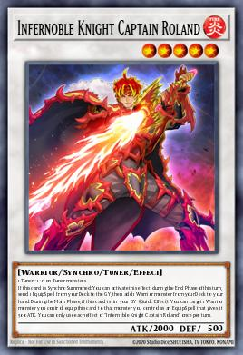

- **Copias y zona:** Extra 1x. No altera las cantidades registradas.
- **Nombre oficial de referencia:** Capitán Roland Infernoble Caballero. CID cotejado con la ficha oficial; el nombre histórico del inventario se conserva aunque su grafía/traducción difiera.
- **Función principal y secundaria:** interrupción · resultado de Extra Deck · buscador · cierre · respuesta.
- **Estado de sinergia y función:** Destino Extra condicionado. Es una clasificación de juego; revisar la relación concreta en A06.
- **Papel como recurso, descarte o coste:** Material o destino del Extra condicionado a los requisitos de invocación.
- **Efecto operativo (paráfrasis analítica):** búsqueda o incorporación de cartas a mano; presión de combate o modificación de estadísticas; interacción sobre monstruos en campo; uso o producción de cartas equipadas. Son operaciones detectadas en el texto, no efectos independientes garantizados; leer sus condiciones en la fuente.
- **Mapa de activación y resultados:** 1) tras su invocación desde el Extra: incorpora la pieza indicada a la mano · 2) mientras está en Cementerio: equipa carta/monstruo según texto. Cada operación está sujeta a la secuencia y al «si lo haces» del texto oficial.
- **Ventanas de activación identificadas:** Main Phase; End Phase; al producirse una Invocación; al llegar o estar en el Cementerio; Efecto Rápido; Invocación del Extra Deck.
- **Costes o recursos potenciales:** envío de recurso propio al Cementerio.
- **Restricciones y requisitos:** hay límite por turno según el efecto concreto; depende de recursos en Cementerio. Invocar sólo desde el Extra Deck usando su procedimiento propio.
- **Prioridad al ir primero:** convertir el primer Guerrero en recursos y un Sincro defendible. Para esta carta: Reservar la respuesta para la ventana rival exacta; no es una pieza buscadora de nuestro motor.
- **Prioridad al ir segundo:** despejar obstáculos conservando equipo, invocaciones y capacidad de extensión. Identificar primero la respuesta rival que afecta su función «interrupción».
- **Medio/tardío y recuperación:** reutilizar Guerreros y Equipos gastados sin perder la Normal Summon. No asumir que por sí misma recicla recursos si el texto no lo permite.
- **Sinergias y acceso a líneas:** Relación contextual con Guerreros FUEGO, cartas de Equipo, recuperaciones del Cementerio y escalada Sincro. Puede cerrar o prolongar una ruta del Extra si los materiales están disponibles.
- **Riesgo / brick / interrupciones:** Depende del Cementerio y es sensible a destierro o negación de ese recurso. Puede emplearse en cadena sólo cuando se cumpla su condición concreta.
- **Utilidad editorial:** 4/5 para este deck (estimación por rol y zona, no probabilidad calculada). No cambiar copias; cualquier sugerencia de alta/baja pasa por el apartado 22 y aprobación.
- **Referencia oficial y trazabilidad:** https://www.db.yugioh-card.com/yugiohdb/card_search.action?cid=15275&ope=2&request_locale=es. **Confianza:** texto y tipo de efecto cotejados en Konami; síntesis táctica editorial, no demostración de combo.
- **Aplicación concreta dentro de este deck (A06):** búsqueda o incorporación de cartas a mano; presión de combate o modificación de estadísticas; interacción sobre monstruos en campo; uso o producción de cartas equipadas. A06 identifica su destino, condicionado a material/procedimiento.

**USO PRÁCTICO Y SINERGIA — Infernoble Knight Captain Roland [Synchro]**

- **Label funcional:** Referencias de ruta localizadas; conexión reglamentaria sujeta al recorrido de la guía. Clasificación documental; una relación es válida solo si se satisfacen sus condiciones exactas.
- **Qué hace:** búsqueda o incorporación de cartas a mano; presión de combate o modificación de estadísticas; interacción sobre monstruos en campo; uso o producción de cartas equipadas. Son operaciones detectadas en el texto, no efectos independientes garantizados; leer sus condiciones en la fuente.
- **Cómo aprovecharla en este deck:** búsqueda o incorporación de cartas a mano; presión de combate o modificación de estadísticas; interacción sobre monstruos en campo; uso o producción de cartas equipadas. A06 identifica su destino, condicionado a material/procedimiento.
- **Al jugar primero:** convertir el primer Guerrero en recursos y un Sincro defendible. Para esta carta: Reservar la respuesta para la ventana rival exacta; no es una pieza buscadora de nuestro motor.
- **Al jugar segundo:** despejar obstáculos conservando equipo, invocaciones y capacidad de extensión. Identificar primero la respuesta rival que afecta su función «interrupción».
- **Cuándo tener precaución:** Depende del Cementerio y es sensible a destierro o negación de ese recurso. Puede emplearse en cadena sólo cuando se cumpla su condición concreta.

**CÓMO LLEGAR DESDE TU DECK — RUTAS DOCUMENTADAS**

- **Abrir guía `670:A09:ANGELICA:ROLAND02`:** entrada: Tipo: continuación real sin nueva carta en la mano inicial, no un quinto starter. Completar antes los pasos 1–5 de OGIER:RENAUD:ANGELICA01: Angélica Sincronía está boca arriba en Campo, Museo en Zona de Campo, Durendal y Almace en mano, Ogier y Renaud en GY, Normal gastada y LP iniciales −1200. Extra: queda 1× Roland Infernoble Knight Captain Roland (Nivel 5, Sincronía Cantante) no Invocado. Deck: 1× Fire Flint Lady Fire Flint Lady, Guerrero FUEGO, para enviar al GY; no se requiere recuperarla. Sin cartas que impidan Invocar desde Extra, sin respuesta rival, Main Phase propia.. Propósito descrito: Preparación de recursos / despliegue. Consulta sus pasos, consumo y resultado; comprobar si esta carta es realmente invocada o solo mencionada.

#### 28. Baronne de Fleur [Synchro]

- **Copias y zona:** Extra 1x. No altera las cantidades registradas.
- **Nombre oficial de referencia:** Baronesa de la Flor. CID cotejado con la ficha oficial; el nombre histórico del inventario se conserva aunque su grafía/traducción difiera.
- **Función principal y secundaria:** interrupción · resultado de Extra Deck · removal · negación · recuperación.
- **Estado de sinergia y función:** Sin acceso al Extra demostrado. Es una clasificación de juego; revisar la relación concreta en A06.
- **Papel como recurso, descarte o coste:** Material o destino del Extra condicionado a los requisitos de invocación.
- **Efecto operativo (paráfrasis analítica):** destrucción de cartas o empleo de destrucción como detonante; negación de efectos o activaciones; retorno o reciclaje hacia mano/Deck/Extra. Son operaciones detectadas en el texto, no efectos independientes garantizados; leer sus condiciones en la fuente.
- **Mapa de activación y resultados:** 1) con estado de campo/zona indicado: destruye la carta o recurso previsto · 2) en Standby Phase: Invocación Especial desde Extra Deck, devuelve recursos a mano/Deck/Extra. Cada operación está sujeta a la secuencia y al «si lo haces» del texto oficial.
- **Ventanas de activación identificadas:** Standby Phase; Efecto Rápido.
- **Costes o recursos potenciales:** sin coste independiente identificado en esta síntesis; comprobar las acciones previas al punto y coma de cada efecto.
- **Restricciones y requisitos:** hay límite por turno según el efecto concreto; depende de recursos en Cementerio. Invocar sólo desde el Extra Deck usando su procedimiento propio.
- **Prioridad al ir primero:** convertir el primer Guerrero en recursos y un Sincro defendible. Para esta carta: Reservar la respuesta para la ventana rival exacta; no es una pieza buscadora de nuestro motor.
- **Prioridad al ir segundo:** despejar obstáculos conservando equipo, invocaciones y capacidad de extensión. Identificar primero la respuesta rival que afecta su función «interrupción».
- **Medio/tardío y recuperación:** reutilizar Guerreros y Equipos gastados sin perder la Normal Summon. Verificar que el objetivo de recuperación continúe disponible.
- **Sinergias y acceso a líneas:** Relación contextual con Guerreros FUEGO, cartas de Equipo, recuperaciones del Cementerio y escalada Sincro. Puede cerrar o prolongar una ruta del Extra si los materiales están disponibles.
- **Riesgo / brick / interrupciones:** Depende del Cementerio y es sensible a destierro o negación de ese recurso. Puede emplearse en cadena sólo cuando se cumpla su condición concreta.
- **Utilidad editorial:** 4/5 para este deck (estimación por rol y zona, no probabilidad calculada). No cambiar copias; cualquier sugerencia de alta/baja pasa por el apartado 22 y aprobación.
- **Referencia oficial y trazabilidad:** https://www.db.yugioh-card.com/yugiohdb/card_search.action?cid=16386&ope=2&request_locale=es. **Confianza:** texto y tipo de efecto cotejados en Konami; síntesis táctica editorial, no demostración de combo.
- **Aplicación concreta dentro de este deck (A06):** destrucción de cartas o empleo de destrucción como detonante; negación de efectos o activaciones; retorno o reciclaje hacia mano/Deck/Extra. Falta arista de materiales en A06; A09 podría contener una ruta válida no indexada aquí.

**USO PRÁCTICO Y SINERGIA — Baronne de Fleur [Synchro]**

- **Label funcional:** Sin sinergia demostrada (con la evidencia actual). Clasificación documental; una relación es válida solo si se satisfacen sus condiciones exactas.
- **Qué hace:** destrucción de cartas o empleo de destrucción como detonante; negación de efectos o activaciones; retorno o reciclaje hacia mano/Deck/Extra. Son operaciones detectadas en el texto, no efectos independientes garantizados; leer sus condiciones en la fuente.
- **Cómo aprovecharla en este deck:** destrucción de cartas o empleo de destrucción como detonante; negación de efectos o activaciones; retorno o reciclaje hacia mano/Deck/Extra. Falta arista de materiales en A06; A09 podría contener una ruta válida no indexada aquí.
- **Al jugar primero:** convertir el primer Guerrero en recursos y un Sincro defendible. Para esta carta: Reservar la respuesta para la ventana rival exacta; no es una pieza buscadora de nuestro motor.
- **Al jugar segundo:** despejar obstáculos conservando equipo, invocaciones y capacidad de extensión. Identificar primero la respuesta rival que afecta su función «interrupción».
- **Cuándo tener precaución:** Depende del Cementerio y es sensible a destierro o negación de ese recurso. Puede emplearse en cadena sólo cuando se cumpla su condición concreta.

**CÓMO LLEGAR DESDE TU DECK — SIN RUTA DEMOSTRADA**

- La biblioteca actual no contiene una ruta identificada para esta carta del Extra. No se debe exhibir una descripción genérica como sustituto de mano inicial, materiales y pasos. Para completarla, contrastar requisitos oficiales y recursos del Main; si no es alcanzable, explicar el impedimento exacto.

#### 29. Infernoble Knight Emperor Charles [Synchro]

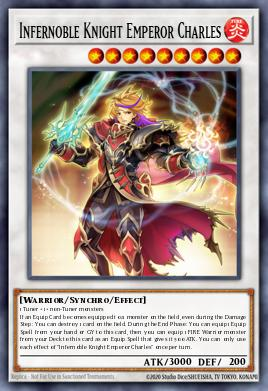

- **Copias y zona:** Extra 1x. No altera las cantidades registradas.
- **Nombre oficial de referencia:** Emperador Carlo Infernoble Caballero. CID cotejado con la ficha oficial; el nombre histórico del inventario se conserva aunque su grafía/traducción difiera.
- **Función principal y secundaria:** resultado de Extra Deck · cierre · motor Equipo.
- **Estado de sinergia y función:** Destino Extra condicionado. Es una clasificación de juego; revisar la relación concreta en A06.
- **Papel como recurso, descarte o coste:** Material o destino del Extra condicionado a los requisitos de invocación.
- **Efecto operativo (paráfrasis analítica):** presión de combate o modificación de estadísticas; uso o producción de cartas equipadas. Son operaciones detectadas en el texto, no efectos independientes garantizados; leer sus condiciones en la fuente.
- **Mapa de activación y resultados:** 1) con condición explícita en la carta: destruye la carta o recurso previsto · 2) en End Phase: equipa carta/monstruo según texto. Cada operación está sujeta a la secuencia y al «si lo haces» del texto oficial.
- **Ventanas de activación identificadas:** End Phase.
- **Costes o recursos potenciales:** sin coste independiente identificado en esta síntesis; comprobar las acciones previas al punto y coma de cada efecto.
- **Restricciones y requisitos:** hay límite por turno según el efecto concreto. Invocar sólo desde el Extra Deck usando su procedimiento propio.
- **Prioridad al ir primero:** convertir el primer Guerrero en recursos y un Sincro defendible. Para esta carta: Comprobar materiales exactos antes de buscar este objetivo en el Extra Deck.
- **Prioridad al ir segundo:** despejar obstáculos conservando equipo, invocaciones y capacidad de extensión. Identificar primero la respuesta rival que afecta su función «resultado de Extra Deck».
- **Medio/tardío y recuperación:** reutilizar Guerreros y Equipos gastados sin perder la Normal Summon. No asumir que por sí misma recicla recursos si el texto no lo permite.
- **Sinergias y acceso a líneas:** Relación contextual con Guerreros FUEGO, cartas de Equipo, recuperaciones del Cementerio y escalada Sincro. Puede cerrar o prolongar una ruta del Extra si los materiales están disponibles.
- **Riesgo / brick / interrupciones:** No contarla como extensión automática: confirmar materiales, procedimiento y restricciones vigentes. No atribuirle velocidad rápida por el solo hecho de formar parte del motor.
- **Utilidad editorial:** 4/5 para este deck (estimación por rol y zona, no probabilidad calculada). No cambiar copias; cualquier sugerencia de alta/baja pasa por el apartado 22 y aprobación.
- **Referencia oficial y trazabilidad:** https://www.db.yugioh-card.com/yugiohdb/card_search.action?cid=15276&ope=2&request_locale=es. **Confianza:** texto y tipo de efecto cotejados en Konami; síntesis táctica editorial, no demostración de combo.
- **Aplicación concreta dentro de este deck (A06):** presión de combate o modificación de estadísticas; uso o producción de cartas equipadas. A06 identifica su destino, condicionado a material/procedimiento.

**USO PRÁCTICO Y SINERGIA — Infernoble Knight Emperor Charles [Synchro]**

- **Label funcional:** Referencias de ruta localizadas; conexión reglamentaria sujeta al recorrido de la guía. Clasificación documental; una relación es válida solo si se satisfacen sus condiciones exactas.
- **Qué hace:** presión de combate o modificación de estadísticas; uso o producción de cartas equipadas. Son operaciones detectadas en el texto, no efectos independientes garantizados; leer sus condiciones en la fuente.
- **Cómo aprovecharla en este deck:** presión de combate o modificación de estadísticas; uso o producción de cartas equipadas. A06 identifica su destino, condicionado a material/procedimiento.
- **Al jugar primero:** convertir el primer Guerrero en recursos y un Sincro defendible. Para esta carta: Comprobar materiales exactos antes de buscar este objetivo en el Extra Deck.
- **Al jugar segundo:** despejar obstáculos conservando equipo, invocaciones y capacidad de extensión. Identificar primero la respuesta rival que afecta su función «resultado de Extra Deck».
- **Cuándo tener precaución:** No contarla como extensión automática: confirmar materiales, procedimiento y restricciones vigentes. No atribuirle velocidad rápida por el solo hecho de formar parte del motor.

**CÓMO LLEGAR DESDE TU DECK — RUTAS DOCUMENTADAS**

- **Abrir guía `670:A09:OGIER:RENAUD:ANGELICA01`:** entrada: Ogier Infernoble Knight Ogier Nivel 4 y Renaud Infernoble Knight - Renaud Nivel 1. Deck: Durendal Infernoble Arms - Durendal, Museo Noble Arms Museum, Almace Infernoble Arms - Almace, una copia de cada una como mínimo, sin suponer que ya estén en mano. Extra: Angélica Angelica, Princess of Noble Arms, Sincronía Nivel 5. Estado propio: Campo/GY/destierro vacíos, Main Phase, Normal disponible, LP ≥ 1201, sin efectos usados; rival no responde.. Propósito descrito: Preparación de recursos / despliegue. Consulta sus pasos, consumo y resultado; comprobar si esta carta es realmente invocada o solo mencionada.
- **Abrir guía `670:A09:CHARLES:EQUIPPED:LINK01`:** entrada: Charles Infernoble Knight Emperor Charles, monstruo Sincronía Nivel 9 propio en Campo, con 1× Mágica de Equipo propia ya equipada boca arriba (ejemplo Durendal Durendal). Great Charles Emperor Charles the Great todavía en Extra. Hay al menos una Zona de Monstruos Extra o zona de Enlace permitida libre, y no se impide Invocar Guerrero/Enlace. Sin respuesta rival ni efectos previos que anulen la Invocación. El coste de cómo obtener Charles y su Equipo pertenece a una ruta anterior aún no demostrada, no se incluye en una mano mínima ficticia.. Propósito descrito: Ofensivo condicional. Consulta sus pasos, consumo y resultado; comprobar si esta carta es realmente invocada o solo mencionada.

#### 30. Battlin' Boxer King Dempsey [Xyz]

- **Copias y zona:** Extra 1x. No altera las cantidades registradas.
- **Nombre oficial de referencia:** Boxeador Indómito Rey Dempsey. CID cotejado con la ficha oficial; el nombre histórico del inventario se conserva aunque su grafía/traducción difiera.
- **Función principal y secundaria:** interrupción · resultado de Extra Deck · buscador · respuesta · habilitador Xyz.
- **Estado de sinergia y función:** Sin acceso al Extra demostrado. Es una clasificación de juego; revisar la relación concreta en A06.
- **Papel como recurso, descarte o coste:** Material o destino del Extra condicionado a los requisitos de invocación.
- **Efecto operativo (paráfrasis analítica):** búsqueda o incorporación de cartas a mano; interacción sobre monstruos en campo; gestión de materiales Xyz. Son operaciones detectadas en el texto, no efectos independientes garantizados; leer sus condiciones en la fuente.
- **Mapa de activación y resultados:** 1) al invocarse: incorpora la pieza indicada a la mano, desacopla materiales Xyz. Cada operación está sujeta a la secuencia y al «si lo haces» del texto oficial.
- **Ventanas de activación identificadas:** al producirse una Invocación; Efecto Rápido.
- **Costes o recursos potenciales:** sin coste independiente identificado en esta síntesis; comprobar las acciones previas al punto y coma de cada efecto.
- **Restricciones y requisitos:** hay límite por turno según el efecto concreto. Invocar sólo desde el Extra Deck usando su procedimiento propio.
- **Prioridad al ir primero:** convertir el primer Guerrero en recursos y un Sincro defendible. Para esta carta: Reservar la respuesta para la ventana rival exacta; no es una pieza buscadora de nuestro motor.
- **Prioridad al ir segundo:** despejar obstáculos conservando equipo, invocaciones y capacidad de extensión. Identificar primero la respuesta rival que afecta su función «interrupción».
- **Medio/tardío y recuperación:** reutilizar Guerreros y Equipos gastados sin perder la Normal Summon. No asumir que por sí misma recicla recursos si el texto no lo permite.
- **Sinergias y acceso a líneas:** Relación contextual con Guerreros FUEGO, cartas de Equipo, recuperaciones del Cementerio y escalada Sincro. Puede cerrar o prolongar una ruta del Extra si los materiales están disponibles.
- **Riesgo / brick / interrupciones:** Se agota al consumir materiales; no asumir material adicional al pasar de un Xyz a otro. Puede emplearse en cadena sólo cuando se cumpla su condición concreta.
- **Utilidad editorial:** 4/5 para este deck (estimación por rol y zona, no probabilidad calculada). No cambiar copias; cualquier sugerencia de alta/baja pasa por el apartado 22 y aprobación.
- **Referencia oficial y trazabilidad:** https://www.db.yugioh-card.com/yugiohdb/card_search.action?cid=18926&ope=2&request_locale=es. **Confianza:** texto y tipo de efecto cotejados en Konami; síntesis táctica editorial, no demostración de combo.
- **Aplicación concreta dentro de este deck (A06):** búsqueda o incorporación de cartas a mano; interacción sobre monstruos en campo; gestión de materiales Xyz. Falta arista de materiales en A06; A09 podría contener una ruta válida no indexada aquí.

**USO PRÁCTICO Y SINERGIA — Battlin' Boxer King Dempsey [Xyz]**

- **Label funcional:** Sin sinergia demostrada (con la evidencia actual). Clasificación documental; una relación es válida solo si se satisfacen sus condiciones exactas.
- **Qué hace:** búsqueda o incorporación de cartas a mano; interacción sobre monstruos en campo; gestión de materiales Xyz. Son operaciones detectadas en el texto, no efectos independientes garantizados; leer sus condiciones en la fuente.
- **Cómo aprovecharla en este deck:** búsqueda o incorporación de cartas a mano; interacción sobre monstruos en campo; gestión de materiales Xyz. Falta arista de materiales en A06; A09 podría contener una ruta válida no indexada aquí.
- **Al jugar primero:** convertir el primer Guerrero en recursos y un Sincro defendible. Para esta carta: Reservar la respuesta para la ventana rival exacta; no es una pieza buscadora de nuestro motor.
- **Al jugar segundo:** despejar obstáculos conservando equipo, invocaciones y capacidad de extensión. Identificar primero la respuesta rival que afecta su función «interrupción».
- **Cuándo tener precaución:** Se agota al consumir materiales; no asumir material adicional al pasar de un Xyz a otro. Puede emplearse en cadena sólo cuando se cumpla su condición concreta.

**CÓMO LLEGAR DESDE TU DECK — SIN RUTA DEMOSTRADA**

- La biblioteca actual no contiene una ruta identificada para esta carta del Extra. No se debe exhibir una descripción genérica como sustituto de mano inicial, materiales y pasos. Para completarla, contrastar requisitos oficiales y recursos del Main; si no es alcanzable, explicar el impedimento exacto.

#### 31. Super Starslayer TY-PHON - Sky Crisis [Xyz]

**Ruta V13 — respuesta, no primer turno:** `670:A09:RENAUD:TYPHON10`: si el rival Invocó Especialmente **2+ monstruos desde su Extra** en este turno o el anterior, **Renaud Normal como único cuerpo propio** permite superponer TY-PHON Rango12 con 1 material aunque Renaud sea Nivel1. Desacoplar Renaud → devolver un monstruo del campo (si resuelve); después de la Xyz **no más Normal/Especial ese turno**. Ambos jugadores no pueden activar efectos de monstruos de 3000+ ATK mientras TY-PHON Xyz siga boca arriba. [Guía de cinco pasos](guias/DECK_665_670_687_TYPHON_GODDESS_GUIA_V13.md).

- **Copias y zona:** Extra 1x. No altera las cantidades registradas.
- **Nombre oficial de referencia:** Súper Asesino Estelar TY-PHON - Crisis Celeste. CID cotejado con la ficha oficial; el nombre histórico del inventario se conserva aunque su grafía/traducción difiera.
- **Función principal y secundaria:** resultado de Extra Deck · recuperación · cierre · habilitador Xyz.
- **Estado de sinergia y función:** Acceso reactivo condicional V13; no sustituye ruta estándar de Sincro ni es apertura garantizada.
- **Papel como recurso, descarte o coste:** Material o destino del Extra condicionado a los requisitos de invocación.
- **Efecto operativo (paráfrasis analítica):** retorno o reciclaje hacia mano/Deck/Extra; presión de combate o modificación de estadísticas; gestión de materiales Xyz. Son operaciones detectadas en el texto, no efectos independientes garantizados; leer sus condiciones en la fuente.
- **Mapa de activación y resultados:** 1) una vez por turno: devuelve recursos a mano/Deck/Extra, desacopla materiales Xyz. Cada operación está sujeta a la secuencia y al «si lo haces» del texto oficial.
- **Ventanas de activación identificadas:** requieren la fase o condición específica indicada en el texto; sin ventana rápida general asumida.
- **Costes o recursos potenciales:** sin coste independiente identificado en esta síntesis; comprobar las acciones previas al punto y coma de cada efecto.
- **Restricciones y requisitos:** hay límite por turno según el efecto concreto. Invocar sólo desde el Extra Deck usando su procedimiento propio.
- **Prioridad al ir primero:** convertir el primer Guerrero en recursos y un Sincro defendible. Para esta carta: Comprobar materiales exactos antes de buscar este objetivo en el Extra Deck.
- **Prioridad al ir segundo:** despejar obstáculos conservando equipo, invocaciones y capacidad de extensión. Identificar primero la respuesta rival que afecta su función «resultado de Extra Deck».
- **Medio/tardío y recuperación:** reutilizar Guerreros y Equipos gastados sin perder la Normal Summon. Verificar que el objetivo de recuperación continúe disponible.
- **Sinergias y acceso a líneas:** Relación contextual con Guerreros FUEGO, cartas de Equipo, recuperaciones del Cementerio y escalada Sincro. Puede cerrar o prolongar una ruta del Extra si los materiales están disponibles.
- **Riesgo / brick / interrupciones:** Se agota al consumir materiales; no asumir material adicional al pasar de un Xyz a otro. No atribuirle velocidad rápida por el solo hecho de formar parte del motor.
- **Utilidad editorial:** 4/5 para este deck (estimación por rol y zona, no probabilidad calculada). No cambiar copias; cualquier sugerencia de alta/baja pasa por el apartado 22 y aprobación.
- **Referencia oficial y trazabilidad:** https://www.db.yugioh-card.com/yugiohdb/card_search.action?cid=19184&ope=2&request_locale=es. **Confianza:** texto y tipo de efecto cotejados en Konami; síntesis táctica editorial, no demostración de combo.
- **Aplicación concreta dentro de este deck (A06):** `670:A09:RENAUD:TYPHON10`: Renaud único en campo por Normal → TY-PHON tras dos Especiales del Extra rival este/turno anterior; un desprendimiento devuelve un monstruo y consume la continuación de Invocaciones.

**USO PRÁCTICO Y SINERGIA — Super Starslayer TY-PHON - Sky Crisis [Xyz]**

- **Label funcional:** Acceso al Extra **condicional al despliegue del rival**, no pieza directa del motor de Sincro.
- **Qué hace:** retorno o reciclaje hacia mano/Deck/Extra; presión de combate o modificación de estadísticas; gestión de materiales Xyz. Son operaciones detectadas en el texto, no efectos independientes garantizados; leer sus condiciones en la fuente.
- **Cómo aprovecharla en este deck:** invoca Normalmente Renaud como único monstruo si el rival Invocó 2+ monstruos del Extra en el turno actual/anterior; convertirlo por el procedimiento alternativo de TY-PHON y desacoplarlo para devolver un monstruo.
- **Al jugar primero:** convertir el primer Guerrero en recursos y un Sincro defendible. Para esta carta: Comprobar materiales exactos antes de buscar este objetivo en el Extra Deck.
- **Al jugar segundo:** despejar obstáculos conservando equipo, invocaciones y capacidad de extensión. Identificar primero la respuesta rival que afecta su función «resultado de Extra Deck».
- **Cuándo tener precaución:** Se agota al consumir materiales; no asumir material adicional al pasar de un Xyz a otro. No atribuirle velocidad rápida por el solo hecho de formar parte del motor.

**CÓMO LLEGAR DESDE TU DECK — RUTA CONDICIONAL V13**

- `670:A09:RENAUD:TYPHON10`; [fotos, coste de Normal, efecto de devolución y campo final](guias/DECK_665_670_687_TYPHON_GODDESS_GUIA_V13.md). Estado previo del rival obligatorio; no es una ruta desde primer turno.

#### 32. Angelica, Princess of Noble Arms [Synchro]

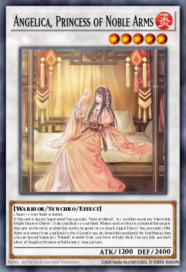

- **Copias y zona:** Extra 1x. No altera las cantidades registradas.
- **Nombre oficial de referencia:** Angélica, Princesa de las Armas Nobles. CID cotejado con la ficha oficial; el nombre histórico del inventario se conserva aunque su grafía/traducción difiera.
- **Función principal y secundaria:** interrupción · resultado de Extra Deck · buscador · extensor · removal.
- **Estado de sinergia y función:** Destino Extra condicionado. Es una clasificación de juego; revisar la relación concreta en A06.
- **Papel como recurso, descarte o coste:** Material o destino del Extra condicionado a los requisitos de invocación.
- **Efecto operativo (paráfrasis analítica):** búsqueda o incorporación de cartas a mano; extensión mediante monstruos procedentes del Deck; acceso al campo desde la mano; destierro de recursos o de amenazas. Son operaciones detectadas en el texto, no efectos independientes garantizados; leer sus condiciones en la fuente.
- **Mapa de activación y resultados:** 1) al invocarse: incorpora la pieza indicada a la mano · 2) con condición explícita en la carta: Invocación Especial desde Extra Deck, destierra el recurso u objetivo previsto. Cada operación está sujeta a la secuencia y al «si lo haces» del texto oficial.
- **Ventanas de activación identificadas:** al producirse una Invocación; Efecto Rápido.
- **Costes o recursos potenciales:** sin coste independiente identificado en esta síntesis; comprobar las acciones previas al punto y coma de cada efecto.
- **Restricciones y requisitos:** hay límite por turno según el efecto concreto. Invocar sólo desde el Extra Deck usando su procedimiento propio.
- **Prioridad al ir primero:** convertir el primer Guerrero en recursos y un Sincro defendible. Para esta carta: Reservar la respuesta para la ventana rival exacta; no es una pieza buscadora de nuestro motor.
- **Prioridad al ir segundo:** despejar obstáculos conservando equipo, invocaciones y capacidad de extensión. Identificar primero la respuesta rival que afecta su función «interrupción».
- **Medio/tardío y recuperación:** reutilizar Guerreros y Equipos gastados sin perder la Normal Summon. No asumir que por sí misma recicla recursos si el texto no lo permite.
- **Sinergias y acceso a líneas:** Relación contextual con Guerreros FUEGO, cartas de Equipo, recuperaciones del Cementerio y escalada Sincro. Puede cerrar o prolongar una ruta del Extra si los materiales están disponibles.
- **Riesgo / brick / interrupciones:** No contarla como extensión automática: confirmar materiales, procedimiento y restricciones vigentes. Puede emplearse en cadena sólo cuando se cumpla su condición concreta.
- **Utilidad editorial:** 4/5 para este deck (estimación por rol y zona, no probabilidad calculada). No cambiar copias; cualquier sugerencia de alta/baja pasa por el apartado 22 y aprobación.
- **Referencia oficial y trazabilidad:** https://www.db.yugioh-card.com/yugiohdb/card_search.action?cid=18827&ope=2&request_locale=es. **Confianza:** texto y tipo de efecto cotejados en Konami; síntesis táctica editorial, no demostración de combo.
- **Aplicación concreta dentro de este deck (A06):** búsqueda o incorporación de cartas a mano; extensión mediante monstruos procedentes del Deck; acceso al campo desde la mano; destierro de recursos o de amenazas. A06 identifica su destino, condicionado a material/procedimiento.

**USO PRÁCTICO Y SINERGIA — Angelica, Princess of Noble Arms [Synchro]**

- **Label funcional:** Referencias de ruta localizadas; conexión reglamentaria sujeta al recorrido de la guía. Clasificación documental; una relación es válida solo si se satisfacen sus condiciones exactas.
- **Qué hace:** búsqueda o incorporación de cartas a mano; extensión mediante monstruos procedentes del Deck; acceso al campo desde la mano; destierro de recursos o de amenazas. Son operaciones detectadas en el texto, no efectos independientes garantizados; leer sus condiciones en la fuente.
- **Cómo aprovecharla en este deck:** búsqueda o incorporación de cartas a mano; extensión mediante monstruos procedentes del Deck; acceso al campo desde la mano; destierro de recursos o de amenazas. A06 identifica su destino, condicionado a material/procedimiento.
- **Al jugar primero:** convertir el primer Guerrero en recursos y un Sincro defendible. Para esta carta: Reservar la respuesta para la ventana rival exacta; no es una pieza buscadora de nuestro motor.
- **Al jugar segundo:** despejar obstáculos conservando equipo, invocaciones y capacidad de extensión. Identificar primero la respuesta rival que afecta su función «interrupción».
- **Cuándo tener precaución:** No contarla como extensión automática: confirmar materiales, procedimiento y restricciones vigentes. Puede emplearse en cadena sólo cuando se cumpla su condición concreta.

**CÓMO LLEGAR DESDE TU DECK — RUTAS DOCUMENTADAS**

- **Abrir guía `670:A09:OGIER:RENAUD:ANGELICA01`:** entrada: Ogier Infernoble Knight Ogier Nivel 4 y Renaud Infernoble Knight - Renaud Nivel 1. Deck: Durendal Infernoble Arms - Durendal, Museo Noble Arms Museum, Almace Infernoble Arms - Almace, una copia de cada una como mínimo, sin suponer que ya estén en mano. Extra: Angélica Angelica, Princess of Noble Arms, Sincronía Nivel 5. Estado propio: Campo/GY/destierro vacíos, Main Phase, Normal disponible, LP ≥ 1201, sin efectos usados; rival no responde.. Propósito descrito: Preparación de recursos / despliegue. Consulta sus pasos, consumo y resultado; comprobar si esta carta es realmente invocada o solo mencionada.
- **Abrir guía `670:A09:ANGELICA:ROLAND02`:** entrada: Tipo: continuación real sin nueva carta en la mano inicial, no un quinto starter. Completar antes los pasos 1–5 de OGIER:RENAUD:ANGELICA01: Angélica Sincronía está boca arriba en Campo, Museo en Zona de Campo, Durendal y Almace en mano, Ogier y Renaud en GY, Normal gastada y LP iniciales −1200. Extra: queda 1× Roland Infernoble Knight Captain Roland (Nivel 5, Sincronía Cantante) no Invocado. Deck: 1× Fire Flint Lady Fire Flint Lady, Guerrero FUEGO, para enviar al GY; no se requiere recuperarla. Sin cartas que impidan Invocar desde Extra, sin respuesta rival, Main Phase propia.. Propósito descrito: Preparación de recursos / despliegue. Consulta sus pasos, consumo y resultado; comprobar si esta carta es realmente invocada o solo mencionada.

#### 33. Isolde, Two Tales of the Noble Knights [Link]

- **Copias y zona:** Extra 2x. No altera las cantidades registradas.
- **Nombre oficial de referencia:** Isolda, Dos Historias del Noble Caballero. CID cotejado con la ficha oficial; el nombre histórico del inventario se conserva aunque su grafía/traducción difiera.
- **Función principal y secundaria:** resultado de Extra Deck · buscador · extensor · recuperación · preparación.
- **Estado de sinergia y función:** Destino Extra condicionado. Es una clasificación de juego; revisar la relación concreta en A06.
- **Papel como recurso, descarte o coste:** Material o destino del Extra condicionado a los requisitos de invocación.
- **Efecto operativo (paráfrasis analítica):** búsqueda o incorporación de cartas a mano; extensión mediante monstruos procedentes del Deck; recuperación e invocación desde Cementerio/destierro; colocación de Mágicas/Trampas o recursos; uso o producción de cartas equipadas. Son operaciones detectadas en el texto, no efectos independientes garantizados; leer sus condiciones en la fuente.
- **Mapa de activación y resultados:** 1) tras su invocación desde el Extra: incorpora la pieza indicada a la mano · 2) efecto propio o continuo: Invocación Especial desde Deck. Cada operación está sujeta a la secuencia y al «si lo haces» del texto oficial.
- **Ventanas de activación identificadas:** al producirse una Invocación; Invocación del Extra Deck.
- **Costes o recursos potenciales:** sin coste independiente identificado en esta síntesis; comprobar las acciones previas al punto y coma de cada efecto.
- **Restricciones y requisitos:** hay límite por turno según el efecto concreto. Invocar sólo desde el Extra Deck usando su procedimiento propio.
- **Prioridad al ir primero:** convertir el primer Guerrero en recursos y un Sincro defendible. Para esta carta: Convertir acceso al Deck en cuerpos o materiales antes de bloquearse con restricciones.
- **Prioridad al ir segundo:** despejar obstáculos conservando equipo, invocaciones y capacidad de extensión. Identificar primero la respuesta rival que afecta su función «resultado de Extra Deck».
- **Medio/tardío y recuperación:** reutilizar Guerreros y Equipos gastados sin perder la Normal Summon. Verificar que el objetivo de recuperación continúe disponible.
- **Sinergias y acceso a líneas:** Relación contextual con Guerreros FUEGO, cartas de Equipo, recuperaciones del Cementerio y escalada Sincro. Puede cerrar o prolongar una ruta del Extra si los materiales están disponibles.
- **Riesgo / brick / interrupciones:** No contarla como extensión automática: confirmar materiales, procedimiento y restricciones vigentes. No atribuirle velocidad rápida por el solo hecho de formar parte del motor.
- **Utilidad editorial:** 4/5 para este deck (estimación por rol y zona, no probabilidad calculada). No cambiar copias; cualquier sugerencia de alta/baja pasa por el apartado 22 y aprobación.
- **Referencia oficial y trazabilidad:** https://www.db.yugioh-card.com/yugiohdb/card_search.action?cid=13500&ope=2&request_locale=es. **Confianza:** texto y tipo de efecto cotejados en Konami; síntesis táctica editorial, no demostración de combo.
- **Aplicación concreta dentro de este deck (A06):** búsqueda o incorporación de cartas a mano; extensión mediante monstruos procedentes del Deck; recuperación e invocación desde Cementerio/destierro; colocación de Mágicas/Trampas o recursos; uso o producción de cartas equipadas. A06 identifica su destino, condicionado a material/procedimiento.

**USO PRÁCTICO Y SINERGIA — Isolde, Two Tales of the Noble Knights [Link]**

- **Label funcional:** Referencias de ruta localizadas; conexión reglamentaria sujeta al recorrido de la guía. Clasificación documental; una relación es válida solo si se satisfacen sus condiciones exactas.
- **Qué hace:** búsqueda o incorporación de cartas a mano; extensión mediante monstruos procedentes del Deck; recuperación e invocación desde Cementerio/destierro; colocación de Mágicas/Trampas o recursos; uso o producción de cartas equipadas. Son operaciones detectadas en el texto, no efectos independientes garantizados; leer sus condiciones en la fuente.
- **Cómo aprovecharla en este deck:** búsqueda o incorporación de cartas a mano; extensión mediante monstruos procedentes del Deck; recuperación e invocación desde Cementerio/destierro; colocación de Mágicas/Trampas o recursos; uso o producción de cartas equipadas. A06 identifica su destino, condicionado a material/procedimiento.
- **Al jugar primero:** convertir el primer Guerrero en recursos y un Sincro defendible. Para esta carta: Convertir acceso al Deck en cuerpos o materiales antes de bloquearse con restricciones.
- **Al jugar segundo:** despejar obstáculos conservando equipo, invocaciones y capacidad de extensión. Identificar primero la respuesta rival que afecta su función «resultado de Extra Deck».
- **Cuándo tener precaución:** No contarla como extensión automática: confirmar materiales, procedimiento y restricciones vigentes. No atribuirle velocidad rápida por el solo hecho de formar parte del motor.

**CÓMO LLEGAR DESDE TU DECK — RUTAS DOCUMENTADAS**

- **Abrir guía `670:A09:CONNECTOR:ISOLDE01`:** entrada: Una carta en mano: Neo Space Connector. Campo y GY propios vacíos, Normal disponible; Aqua Dolphin en Deck, Isolde en Extra, Renaud/Gearfried/Durendal en Deck; Main Phase propia y sin respuesta rival.. Propósito descrito: Preparación de recursos / despliegue. Consulta sus pasos, consumo y resultado; comprobar si esta carta es realmente invocada o solo mencionada.
- **Abrir guía `670:A09:MUSEUM:RENAUD:ISOLDE01`:** entrada: Museo Museo de Armas Nobles + Renaud primer Infernoble Caballero Renaud. Deck: Durendal una Durendal, Fire Flint Fire Flint Lady, Infernoble Arms - Almace, segundo Renaud y Immortal Phoenix Gearfried (todos presentes en el inventario). Extra: Isolde una Isolde. Campo/GY/destierro propios vacíos, LP propios al menos 1201, Normal libre, Main Phase propia y sin respuesta rival, bloqueos ni efectos usados; Campo rival irrelevante.. Propósito descrito: Ofensivo condicional. Consulta sus pasos, consumo y resultado; comprobar si esta carta es realmente invocada o solo mencionada.
- **Abrir guía `670:A09:CONNECTOR:DURENDAL02`:** entrada: Partida inicial: exactamente la de ISOLDE01, sin cartas adicionales en la mano inicial; completar primero sus pasos 1–5. La única copia registrada de Fire Flint Lady debe estar en el Deck y Durendal en la mano.. Propósito descrito: Preparación de recursos / despliegue. Consulta sus pasos, consumo y resultado; comprobar si esta carta es realmente invocada o solo mencionada.

#### 34. Emperor Charles the Great [Link]

- **Copias y zona:** Extra 2x. No altera las cantidades registradas.
- **Nombre oficial de referencia:** Emperador Carlo el Grande. CID cotejado con la ficha oficial; el nombre histórico del inventario se conserva aunque su grafía/traducción difiera.
- **Función principal y secundaria:** interrupción · resultado de Extra Deck · removal · negación · cierre.
- **Estado de sinergia y función:** Destino Extra condicionado. Es una clasificación de juego; revisar la relación concreta en A06.
- **Papel como recurso, descarte o coste:** Material o destino del Extra condicionado a los requisitos de invocación.
- **Efecto operativo (paráfrasis analítica):** destrucción de cartas o empleo de destrucción como detonante; negación de efectos o activaciones; presión de combate o modificación de estadísticas; uso o producción de cartas equipadas. Son operaciones detectadas en el texto, no efectos independientes garantizados; leer sus condiciones en la fuente.
- **Mapa de activación y resultados:** 1) tras su invocación desde el Extra: equipa carta/monstruo según texto · 2) una vez por turno: niega el efecto o la activación indicada, destruye la carta o recurso previsto. Cada operación está sujeta a la secuencia y al «si lo haces» del texto oficial.
- **Ventanas de activación identificadas:** al producirse una Invocación; Efecto Rápido; Invocación del Extra Deck.
- **Costes o recursos potenciales:** envío de recurso propio al Cementerio.
- **Restricciones y requisitos:** hay límite por turno según el efecto concreto; depende de recursos en Cementerio. Invocar sólo desde el Extra Deck usando su procedimiento propio.
- **Prioridad al ir primero:** convertir el primer Guerrero en recursos y un Sincro defendible. Para esta carta: Reservar la respuesta para la ventana rival exacta; no es una pieza buscadora de nuestro motor.
- **Prioridad al ir segundo:** despejar obstáculos conservando equipo, invocaciones y capacidad de extensión. Identificar primero la respuesta rival que afecta su función «interrupción».
- **Medio/tardío y recuperación:** reutilizar Guerreros y Equipos gastados sin perder la Normal Summon. No asumir que por sí misma recicla recursos si el texto no lo permite.
- **Sinergias y acceso a líneas:** Relación contextual con Guerreros FUEGO, cartas de Equipo, recuperaciones del Cementerio y escalada Sincro. Puede cerrar o prolongar una ruta del Extra si los materiales están disponibles.
- **Riesgo / brick / interrupciones:** Depende del Cementerio y es sensible a destierro o negación de ese recurso. Puede emplearse en cadena sólo cuando se cumpla su condición concreta.
- **Utilidad editorial:** 4/5 para este deck (estimación por rol y zona, no probabilidad calculada). No cambiar copias; cualquier sugerencia de alta/baja pasa por el apartado 22 y aprobación.
- **Referencia oficial y trazabilidad:** https://www.db.yugioh-card.com/yugiohdb/card_search.action?cid=18835&ope=2&request_locale=es. **Confianza:** texto y tipo de efecto cotejados en Konami; síntesis táctica editorial, no demostración de combo.
- **Aplicación concreta dentro de este deck (A06):** destrucción de cartas o empleo de destrucción como detonante; negación de efectos o activaciones; presión de combate o modificación de estadísticas; uso o producción de cartas equipadas. A06 identifica su destino, condicionado a material/procedimiento.

**USO PRÁCTICO Y SINERGIA — Emperor Charles the Great [Link]**

- **Label funcional:** Referencias de ruta localizadas; conexión reglamentaria sujeta al recorrido de la guía. Clasificación documental; una relación es válida solo si se satisfacen sus condiciones exactas.
- **Qué hace:** destrucción de cartas o empleo de destrucción como detonante; negación de efectos o activaciones; presión de combate o modificación de estadísticas; uso o producción de cartas equipadas. Son operaciones detectadas en el texto, no efectos independientes garantizados; leer sus condiciones en la fuente.
- **Cómo aprovecharla en este deck:** destrucción de cartas o empleo de destrucción como detonante; negación de efectos o activaciones; presión de combate o modificación de estadísticas; uso o producción de cartas equipadas. A06 identifica su destino, condicionado a material/procedimiento.
- **Al jugar primero:** convertir el primer Guerrero en recursos y un Sincro defendible. Para esta carta: Reservar la respuesta para la ventana rival exacta; no es una pieza buscadora de nuestro motor.
- **Al jugar segundo:** despejar obstáculos conservando equipo, invocaciones y capacidad de extensión. Identificar primero la respuesta rival que afecta su función «interrupción».
- **Cuándo tener precaución:** Depende del Cementerio y es sensible a destierro o negación de ese recurso. Puede emplearse en cadena sólo cuando se cumpla su condición concreta.

**CÓMO LLEGAR DESDE TU DECK — RUTAS DOCUMENTADAS**

- **Abrir guía `670:A09:CHARLES:EQUIPPED:LINK01`:** entrada: Charles Infernoble Knight Emperor Charles, monstruo Sincronía Nivel 9 propio en Campo, con 1× Mágica de Equipo propia ya equipada boca arriba (ejemplo Durendal Durendal). Great Charles Emperor Charles the Great todavía en Extra. Hay al menos una Zona de Monstruos Extra o zona de Enlace permitida libre, y no se impide Invocar Guerrero/Enlace. Sin respuesta rival ni efectos previos que anulen la Invocación. El coste de cómo obtener Charles y su Equipo pertenece a una ruta anterior aún no demostrada, no se incluye en una mano mínima ficticia.. Propósito descrito: Ofensivo condicional. Consulta sus pasos, consumo y resultado; comprobar si esta carta es realmente invocada o solo mencionada.

#### 35. Apollousa, Bow of the Goddess [Link]

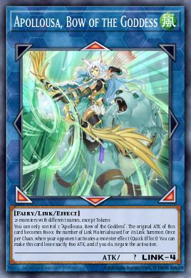

- **Copias y zona:** Extra 1x. No altera las cantidades registradas.
- **Nombre oficial de referencia:** Apollousa, Arco de la Diosa. CID cotejado con la ficha oficial; el nombre histórico del inventario se conserva aunque su grafía/traducción difiera.
- **Función principal y secundaria:** interrupción · resultado de Extra Deck · habilitador de Extra · negación · cierre.
- **Estado de sinergia y función:** Sin acceso al Extra demostrado. Es una clasificación de juego; revisar la relación concreta en A06.
- **Papel como recurso, descarte o coste:** Material o destino del Extra condicionado a los requisitos de invocación.
- **Efecto operativo (paráfrasis analítica):** habilitación o continuación de una invocación del Extra Deck; negación de efectos o activaciones; presión de combate o modificación de estadísticas. Son operaciones detectadas en el texto, no efectos independientes garantizados; leer sus condiciones en la fuente.
- **Mapa de activación y resultados:** 1) efecto propio o continuo: habilita Enlace · 2) en respuesta a activación rival: niega el efecto o la activación indicada. Cada operación está sujeta a la secuencia y al «si lo haces» del texto oficial.
- **Ventanas de activación identificadas:** respuesta a activación rival; Efecto Rápido.
- **Costes o recursos potenciales:** sin coste independiente identificado en esta síntesis; comprobar las acciones previas al punto y coma de cada efecto.
- **Restricciones y requisitos:** aplicar restricciones de selección, activación y copias que consten en el texto original. Invocar sólo desde el Extra Deck usando su procedimiento propio.
- **Prioridad al ir primero:** convertir el primer Guerrero en recursos y un Sincro defendible. Para esta carta: Reservar la respuesta para la ventana rival exacta; no es una pieza buscadora de nuestro motor.
- **Prioridad al ir segundo:** despejar obstáculos conservando equipo, invocaciones y capacidad de extensión. Identificar primero la respuesta rival que afecta su función «interrupción».
- **Medio/tardío y recuperación:** reutilizar Guerreros y Equipos gastados sin perder la Normal Summon. No asumir que por sí misma recicla recursos si el texto no lo permite.
- **Sinergias y acceso a líneas:** Relación contextual con Guerreros FUEGO, cartas de Equipo, recuperaciones del Cementerio y escalada Sincro. Puede cerrar o prolongar una ruta del Extra si los materiales están disponibles.
- **Riesgo / brick / interrupciones:** No contarla como extensión automática: confirmar materiales, procedimiento y restricciones vigentes. Puede emplearse en cadena sólo cuando se cumpla su condición concreta.
- **Utilidad editorial:** 4/5 para este deck (estimación por rol y zona, no probabilidad calculada). No cambiar copias; cualquier sugerencia de alta/baja pasa por el apartado 22 y aprobación.
- **Referencia oficial y trazabilidad:** https://www.db.yugioh-card.com/yugiohdb/card_search.action?cid=14496&ope=2&request_locale=es. **Confianza:** texto y tipo de efecto cotejados en Konami; síntesis táctica editorial, no demostración de combo.
- **Aplicación concreta dentro de este deck (A06):** habilitación o continuación de una invocación del Extra Deck; negación de efectos o activaciones; presión de combate o modificación de estadísticas. Falta arista de materiales en A06; A09 podría contener una ruta válida no indexada aquí.

**USO PRÁCTICO Y SINERGIA — Apollousa, Bow of the Goddess [Link]**

- **Label funcional:** Sin sinergia demostrada (con la evidencia actual). Clasificación documental; una relación es válida solo si se satisfacen sus condiciones exactas.
- **Qué hace:** habilitación o continuación de una invocación del Extra Deck; negación de efectos o activaciones; presión de combate o modificación de estadísticas. Son operaciones detectadas en el texto, no efectos independientes garantizados; leer sus condiciones en la fuente.
- **Cómo aprovecharla en este deck:** habilitación o continuación de una invocación del Extra Deck; negación de efectos o activaciones; presión de combate o modificación de estadísticas. Falta arista de materiales en A06; A09 podría contener una ruta válida no indexada aquí.
- **Al jugar primero:** convertir el primer Guerrero en recursos y un Sincro defendible. Para esta carta: Reservar la respuesta para la ventana rival exacta; no es una pieza buscadora de nuestro motor.
- **Al jugar segundo:** despejar obstáculos conservando equipo, invocaciones y capacidad de extensión. Identificar primero la respuesta rival que afecta su función «interrupción».
- **Cuándo tener precaución:** No contarla como extensión automática: confirmar materiales, procedimiento y restricciones vigentes. Puede emplearse en cadena sólo cuando se cumpla su condición concreta.

**CÓMO LLEGAR DESDE TU DECK — SIN RUTA DEMOSTRADA**

- La biblioteca actual no contiene una ruta identificada para esta carta del Extra. No se debe exhibir una descripción genérica como sustituto de mano inicial, materiales y pasos. Para completarla, contrastar requisitos oficiales y recursos del Main; si no es alcanzable, explicar el impedimento exacto.

#### 36. Relinquished Anima [Link]

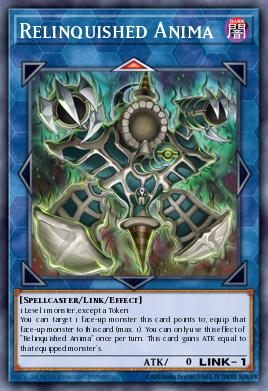

- **Copias y zona:** Extra 1x. No altera las cantidades registradas.
- **Nombre oficial de referencia:** Ánima Renunciada. CID cotejado con la ficha oficial; el nombre histórico del inventario se conserva aunque su grafía/traducción difiera.
- **Función principal y secundaria:** resultado de Extra Deck · cierre · motor Equipo.
- **Estado de sinergia y función:** acceso **condicional demostrado** con Renaud Nivel 1 como material; absorción rival solo si existe monstruo boca arriba realmente apuntado por su flecha.
- **Papel como recurso, descarte o coste:** Material o destino del Extra condicionado a los requisitos de invocación.
- **Efecto operativo (paráfrasis analítica):** presión de combate o modificación de estadísticas; uso o producción de cartas equipadas. Son operaciones detectadas en el texto, no efectos independientes garantizados; leer sus condiciones en la fuente.
- **Mapa de activación y resultados:** 1) efecto propio o continuo: equipa carta/monstruo según texto. Cada operación está sujeta a la secuencia y al «si lo haces» del texto oficial.
- **Ventanas de activación identificadas:** requieren la fase o condición específica indicada en el texto; sin ventana rápida general asumida.
- **Costes o recursos potenciales:** sin coste independiente identificado en esta síntesis; comprobar las acciones previas al punto y coma de cada efecto.
- **Restricciones y requisitos:** hay límite por turno según el efecto concreto. Invocar sólo desde el Extra Deck usando su procedimiento propio.
- **Prioridad al ir primero:** convertir el primer Guerrero en recursos y un Sincro defendible. Para esta carta: Comprobar materiales exactos antes de buscar este objetivo en el Extra Deck.
- **Prioridad al ir segundo:** despejar obstáculos conservando equipo, invocaciones y capacidad de extensión. Identificar primero la respuesta rival que afecta su función «resultado de Extra Deck».
- **Medio/tardío y recuperación:** reutilizar Guerreros y Equipos gastados sin perder la Normal Summon. No asumir que por sí misma recicla recursos si el texto no lo permite.
- **Sinergias y acceso a líneas:** Relación contextual con Guerreros FUEGO, cartas de Equipo, recuperaciones del Cementerio y escalada Sincro. Puede cerrar o prolongar una ruta del Extra si los materiales están disponibles.
- **Riesgo / brick / interrupciones:** No contarla como extensión automática: confirmar materiales, procedimiento y restricciones vigentes. No atribuirle velocidad rápida por el solo hecho de formar parte del motor.
- **Utilidad editorial:** 4/5 para este deck (estimación por rol y zona, no probabilidad calculada). No cambiar copias; cualquier sugerencia de alta/baja pasa por el apartado 22 y aprobación.
- **Referencia oficial y trazabilidad:** https://www.db.yugioh-card.com/yugiohdb/card_search.action?cid=13841&ope=2&request_locale=es. **Confianza:** texto y tipo de efecto cotejados en Konami; síntesis táctica editorial, no demostración de combo.
- **Aplicación concreta dentro de este deck (A06):** `670:A09:OGIER:RENAUD:ANIMA:SP09`: Ogier Normal envía Durendal, Renaud Especial recupera Durendal; Renaud Nivel1 → Anima, que puede equipar el monstruo rival señalado. Anima Link1 + Ogier → S:P. La salida de Anima suelta el Equipo hacia GY; S:P puede activar destierro inicial por haber usado material Enlace. La posición rival y las ventanas son obligatorias.

**USO PRÁCTICO Y SINERGIA — Relinquished Anima [Link]**

- **Label funcional:** Sinergia directa condicional mediante Renaud Nivel 1; objetivo y zona rival obligatorios.
- **Qué hace:** presión de combate o modificación de estadísticas; uso o producción de cartas equipadas. Son operaciones detectadas en el texto, no efectos independientes garantizados; leer sus condiciones en la fuente.
- **Cómo aprovecharla en este deck:** Invoca primero a Renaud con Ogier FUEGO en Campo, recupera Durendal y usa ese Renaud de Nivel1 para Anima. Selecciona un monstruo rival boca arriba que Anima señale desde una zona Extra adecuada y equípalo; luego usa Anima+Ogier para S:P, cuyo primer efecto sí queda habilitado por usar Link como material.
- **Al jugar primero:** convertir el primer Guerrero en recursos y un Sincro defendible. Para esta carta: Comprobar materiales exactos antes de buscar este objetivo en el Extra Deck.
- **Al jugar segundo:** despejar obstáculos conservando equipo, invocaciones y capacidad de extensión. Identificar primero la respuesta rival que afecta su función «resultado de Extra Deck».
- **Cuándo tener precaución:** No contarla como extensión automática: confirmar materiales, procedimiento y restricciones vigentes. No atribuirle velocidad rápida por el solo hecho de formar parte del motor.

**CÓMO LLEGAR DESDE TU DECK — RUTA CONDICIONAL Y GUÍA**

- **Abrir:** `670:A09:OGIER:RENAUD:ANIMA:SP09` → `guias/DECK_670_OGIER_RENAUD_ANIMA_SP_GUIA.md`. Seis pasos ilustrados, mano exacta Ogier+Renaud, Durendal en Deck y Extra Anima+S:P. Es una **extensión solo ante campo rival correctamente colocado**; no prometer absorción sin esa posición.

#### 37. Link Spider [Link]

- **Copias y zona:** Extra 1x. No altera las cantidades registradas.
- **Nombre oficial de referencia:** Araña de Enlace. CID cotejado con la ficha oficial; el nombre histórico del inventario se conserva aunque su grafía/traducción difiera.
- **Función principal y secundaria:** resultado de Extra Deck · extensor.
- **Estado de sinergia y función:** Sin acceso al Extra demostrado. Es una clasificación de juego; revisar la relación concreta en A06.
- **Papel como recurso, descarte o coste:** Material o destino del Extra condicionado a los requisitos de invocación.
- **Efecto operativo (paráfrasis analítica):** acceso al campo desde la mano. Son operaciones detectadas en el texto, no efectos independientes garantizados; leer sus condiciones en la fuente.
- **Mapa de activación y resultados:** 1) una vez por turno: Invocación Especial desde mano. Cada operación está sujeta a la secuencia y al «si lo haces» del texto oficial.
- **Ventanas de activación identificadas:** requieren la fase o condición específica indicada en el texto; sin ventana rápida general asumida.
- **Costes o recursos potenciales:** sin coste independiente identificado en esta síntesis; comprobar las acciones previas al punto y coma de cada efecto.
- **Restricciones y requisitos:** hay límite por turno según el efecto concreto. Invocar sólo desde el Extra Deck usando su procedimiento propio.
- **Prioridad al ir primero:** convertir el primer Guerrero en recursos y un Sincro defendible. Para esta carta: Comprobar materiales exactos antes de buscar este objetivo en el Extra Deck.
- **Prioridad al ir segundo:** despejar obstáculos conservando equipo, invocaciones y capacidad de extensión. Identificar primero la respuesta rival que afecta su función «resultado de Extra Deck».
- **Medio/tardío y recuperación:** reutilizar Guerreros y Equipos gastados sin perder la Normal Summon. No asumir que por sí misma recicla recursos si el texto no lo permite.
- **Sinergias y acceso a líneas:** Relación contextual con Guerreros FUEGO, cartas de Equipo, recuperaciones del Cementerio y escalada Sincro. Puede cerrar o prolongar una ruta del Extra si los materiales están disponibles.
- **Riesgo / brick / interrupciones:** No contarla como extensión automática: confirmar materiales, procedimiento y restricciones vigentes. No atribuirle velocidad rápida por el solo hecho de formar parte del motor.
- **Utilidad editorial:** 4/5 para este deck (estimación por rol y zona, no probabilidad calculada). No cambiar copias; cualquier sugerencia de alta/baja pasa por el apartado 22 y aprobación.
- **Referencia oficial y trazabilidad:** https://www.db.yugioh-card.com/yugiohdb/card_search.action?cid=13034&ope=2&request_locale=es. **Confianza:** texto y tipo de efecto cotejados en Konami; síntesis táctica editorial, no demostración de combo.
- **Aplicación concreta dentro de este deck (A06):** acceso al campo desde la mano. Falta arista de materiales en A06; A09 podría contener una ruta válida no indexada aquí.

**USO PRÁCTICO Y SINERGIA — Link Spider [Link]**

- **Label funcional:** Sin sinergia demostrada (con la evidencia actual). Clasificación documental; una relación es válida solo si se satisfacen sus condiciones exactas.
- **Qué hace:** acceso al campo desde la mano. Son operaciones detectadas en el texto, no efectos independientes garantizados; leer sus condiciones en la fuente.
- **Cómo aprovecharla en este deck:** acceso al campo desde la mano. Falta arista de materiales en A06; A09 podría contener una ruta válida no indexada aquí.
- **Al jugar primero:** convertir el primer Guerrero en recursos y un Sincro defendible. Para esta carta: Comprobar materiales exactos antes de buscar este objetivo en el Extra Deck.
- **Al jugar segundo:** despejar obstáculos conservando equipo, invocaciones y capacidad de extensión. Identificar primero la respuesta rival que afecta su función «resultado de Extra Deck».
- **Cuándo tener precaución:** No contarla como extensión automática: confirmar materiales, procedimiento y restricciones vigentes. No atribuirle velocidad rápida por el solo hecho de formar parte del motor.

**CÓMO LLEGAR DESDE TU DECK — SIN RUTA DEMOSTRADA**

- La biblioteca actual no contiene una ruta identificada para esta carta del Extra. No se debe exhibir una descripción genérica como sustituto de mano inicial, materiales y pasos. Para completarla, contrastar requisitos oficiales y recursos del Main; si no es alcanzable, explicar el impedimento exacto.

#### 38. S:P Little Knight [Link]

- **Copias y zona:** Extra 2x. No altera las cantidades registradas.
- **Nombre oficial de referencia:** S:P Pequeña Caballera. CID cotejado con la ficha oficial; el nombre histórico del inventario se conserva aunque su grafía/traducción difiera.
- **Función principal y secundaria:** interrupción · resultado de Extra Deck · removal · respuesta.
- **Estado de sinergia y función:** dos rutas demostradas con materiales del Main/Extra: Ogier+Renaud → S:P (destierro inicial NO disponible); Anima+Ogier → S:P (destierro inicial SÍ disponible bajo condición de zona rival).
- **Papel como recurso, descarte o coste:** Material o destino del Extra condicionado a los requisitos de invocación.
- **Efecto operativo (paráfrasis analítica):** destierro de recursos o de amenazas; interacción sobre monstruos en campo. Son operaciones detectadas en el texto, no efectos independientes garantizados; leer sus condiciones en la fuente.
- **Mapa de activación y resultados:** 1) en respuesta a activación rival: destierra el recurso u objetivo previsto. Cada operación está sujeta a la secuencia y al «si lo haces» del texto oficial.
- **Ventanas de activación identificadas:** al producirse una Invocación; respuesta a activación rival; Efecto Rápido; Invocación del Extra Deck.
- **Costes o recursos potenciales:** sin coste independiente identificado en esta síntesis; comprobar las acciones previas al punto y coma de cada efecto.
- **Restricciones y requisitos:** hay límite por turno según el efecto concreto; puede limitar ataques. Invocar sólo desde el Extra Deck usando su procedimiento propio.
- **Prioridad al ir primero:** convertir el primer Guerrero en recursos y un Sincro defendible. Para esta carta: Reservar la respuesta para la ventana rival exacta; no es una pieza buscadora de nuestro motor.
- **Prioridad al ir segundo:** despejar obstáculos conservando equipo, invocaciones y capacidad de extensión. Identificar primero la respuesta rival que afecta su función «interrupción».
- **Medio/tardío y recuperación:** reutilizar Guerreros y Equipos gastados sin perder la Normal Summon. No asumir que por sí misma recicla recursos si el texto no lo permite.
- **Sinergias y acceso a líneas:** Relación contextual con Guerreros FUEGO, cartas de Equipo, recuperaciones del Cementerio y escalada Sincro. Puede cerrar o prolongar una ruta del Extra si los materiales están disponibles.
- **Riesgo / brick / interrupciones:** No contarla como extensión automática: confirmar materiales, procedimiento y restricciones vigentes. Puede emplearse en cadena sólo cuando se cumpla su condición concreta.
- **Utilidad editorial:** 4/5 para este deck (estimación por rol y zona, no probabilidad calculada). No cambiar copias; cualquier sugerencia de alta/baja pasa por el apartado 22 y aprobación.
- **Referencia oficial y trazabilidad:** https://www.db.yugioh-card.com/yugiohdb/card_search.action?cid=19188&ope=2&request_locale=es. **Confianza:** texto y tipo de efecto cotejados en Konami; síntesis táctica editorial, no demostración de combo.
- **Aplicación concreta dentro de este deck (A06):** `670:A09:OGIER:RENAUD:SP_DEFENSA08` y `670:A09:OGIER:RENAUD:ANIMA:SP09`, ambas desde Ogier+Renaud y Durendal en Deck. La primera conserva Durendal en mano y prepara Efecto Rápido; la segunda equipa rival apuntado vía Anima y habilita destierro de Invocación por usar material Link.

**USO PRÁCTICO Y SINERGIA — S:P Little Knight [Link]**

- **Label funcional:** Sinergia directa con Ogier/Renaud; bifurcación defensiva o condicional con Anima, no dos finales simultáneos.
- **Qué hace:** destierro de recursos o de amenazas; interacción sobre monstruos en campo. Son operaciones detectadas en el texto, no efectos independientes garantizados; leer sus condiciones en la fuente.
- **Cómo aprovecharla en este deck:** Ogier Normal envía Durendal, Renaud Especial la recupera. Opción A: ambos a S:P Link2; **no** hay destierro al invocarla. Opción B: Renaud→Anima en zona apuntando a rival elegible, después Anima+Ogier→S:P; al usar Link como material puede desterrar una carta Campo/GY al Invocar. Ambas permiten respuesta rápida posterior ante activación del rival, **sin negar**.
- **Al jugar primero:** convertir el primer Guerrero en recursos y un Sincro defendible. Para esta carta: Reservar la respuesta para la ventana rival exacta; no es una pieza buscadora de nuestro motor.
- **Al jugar segundo:** despejar obstáculos conservando equipo, invocaciones y capacidad de extensión. Identificar primero la respuesta rival que afecta su función «interrupción».
- **Cuándo tener precaución:** No contarla como extensión automática: confirmar materiales, procedimiento y restricciones vigentes. Puede emplearse en cadena sólo cuando se cumpla su condición concreta.

**CÓMO LLEGAR DESDE TU DECK — DOS RUTAS ILUSTRADAS**

- **Abrir ruta defensiva:** `670:A09:OGIER:RENAUD:SP_DEFENSA08` → `guias/DECK_670_OGIER_RENAUD_SP_DEFENSA_GUIA.md`. Cinco pasos, Durendal en mano y S:P 1600 ATK en Campo.
- **Abrir alternativa con rival apuntado:** `670:A09:OGIER:RENAUD:ANIMA:SP09` → `guias/DECK_670_OGIER_RENAUD_ANIMA_SP_GUIA.md`. Seis pasos, Anima Link1 intermedia y destierro de Invocación de S:P disponible gracias al material de Extra. Ambas alternativas consumen Ogier+Renaud e impiden usar esos mismos monstruos a la vez para Angélica.

#### 39. Nibiru, the Primal Being

- **Copias y zona:** Reserva 3x. No altera las cantidades registradas.
- **Nombre oficial de referencia:** Nibiru, el Ser Primitivo. CID cotejado con la ficha oficial; el nombre histórico del inventario se conserva aunque su grafía/traducción difiera.
- **Función principal y secundaria:** handtrap · limpieza del campo.
- **Estado de sinergia y función:** Reserva fuera de lista activa. Es una clasificación de juego; revisar la relación concreta en A06.
- **Papel como recurso, descarte o coste:** No se demuestra que esta carta sea recurso de descarte o pago para otra.
- **Efecto operativo (paráfrasis analítica):** En Main Phase, tras cinco o más invocaciones rivales, sacrifica los monstruos boca arriba y deja a Nibiru junto con una Ficha rival. 
- **Mapa de activación y resultados:** 1) en Main Phase: Invocación Especial desde mano. Cada operación está sujeta a la secuencia y al «si lo haces» del texto oficial.
- **Ventanas de activación identificadas:** Main Phase; Efecto Rápido.
- **Costes o recursos potenciales:** sin coste independiente identificado en esta síntesis; comprobar las acciones previas al punto y coma de cada efecto.
- **Restricciones y requisitos:** hay límite por turno según el efecto concreto. 
- **Prioridad al ir primero:** convertir el primer Guerrero en recursos y un Sincro defendible. Para esta carta: Reservar la respuesta para la ventana rival exacta; no es una pieza buscadora de nuestro motor.
- **Prioridad al ir segundo:** despejar obstáculos conservando equipo, invocaciones y capacidad de extensión. Identificar primero la respuesta rival que afecta su función «handtrap».
- **Medio/tardío y recuperación:** reutilizar Guerreros y Equipos gastados sin perder la Normal Summon. No asumir que por sí misma recicla recursos si el texto no lo permite.
- **Sinergias y acceso a líneas:** Relación contextual con Guerreros FUEGO, cartas de Equipo, recuperaciones del Cementerio y escalada Sincro. Habilita una línea del motor sólo si coinciden recursos, objetivos y restricciones; no equivale a un combo completo validado.
- **Riesgo / brick / interrupciones:** Cuenta invocaciones y entrega una Ficha cuyo ATK/DEF depende de lo sacrificado. Puede emplearse en cadena sólo cuando se cumpla su condición concreta.
- **Utilidad editorial:** 3/5 para este deck (estimación por rol y zona, no probabilidad calculada). No cambiar copias; cualquier sugerencia de alta/baja pasa por el apartado 22 y aprobación.
- **Referencia oficial y trazabilidad:** https://www.db.yugioh-card.com/yugiohdb/card_search.action?cid=14741&ope=2&request_locale=es. **Confianza:** texto y tipo de efecto cotejados en Konami; síntesis táctica editorial, no demostración de combo.
- **Aplicación concreta dentro de este deck (A06):** Fuera de lista. En Main Phase, tras cinco o más invocaciones rivales, sacrifica los monstruos boca arriba y deja a Nibiru junto con una Ficha rival.. No aporta recursos durante este duelo.

**USO PRÁCTICO Y SINERGIA — Nibiru, the Primal Being**

- **Label funcional:** Sin sinergia demostrada (con la evidencia actual). Clasificación documental; una relación es válida solo si se satisfacen sus condiciones exactas.
- **Qué hace:** En Main Phase, tras cinco o más invocaciones rivales, sacrifica los monstruos boca arriba y deja a Nibiru junto con una Ficha rival.
- **Cómo aprovecharla en este deck:** Fuera de lista. En Main Phase, tras cinco o más invocaciones rivales, sacrifica los monstruos boca arriba y deja a Nibiru junto con una Ficha rival.. No aporta recursos durante este duelo.
- **Al jugar primero:** convertir el primer Guerrero en recursos y un Sincro defendible. Para esta carta: Reservar la respuesta para la ventana rival exacta; no es una pieza buscadora de nuestro motor.
- **Al jugar segundo:** despejar obstáculos conservando equipo, invocaciones y capacidad de extensión. Identificar primero la respuesta rival que afecta su función «handtrap».
- **Cuándo tener precaución:** Cuenta invocaciones y entrega una Ficha cuyo ATK/DEF depende de lo sacrificado. Puede emplearse en cadena sólo cuando se cumpla su condición concreta.

#### 40. D.D. Crow

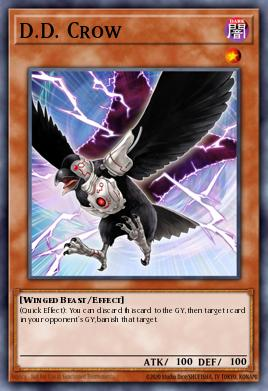

- **Copias y zona:** Reserva 2x. No altera las cantidades registradas.
- **Nombre oficial de referencia:** D.D. Cuervo. CID cotejado con la ficha oficial; el nombre histórico del inventario se conserva aunque su grafía/traducción difiera.
- **Función principal y secundaria:** handtrap · interacción de Cementerio.
- **Estado de sinergia y función:** Reserva fuera de lista activa. Es una clasificación de juego; revisar la relación concreta en A06.
- **Papel como recurso, descarte o coste:** Destierro como uso/recurso; comprobar origen, coste o efecto y recuperación.
- **Efecto operativo (paráfrasis analítica):** Descarta para desterrar una carta elegida del Cementerio rival como efecto rápido. 
- **Mapa de activación y resultados:** 1) con condición explícita en la carta: destierra el recurso u objetivo previsto. Cada operación está sujeta a la secuencia y al «si lo haces» del texto oficial.
- **Ventanas de activación identificadas:** Efecto Rápido.
- **Costes o recursos potenciales:** descarte de mano.
- **Restricciones y requisitos:** aplicar restricciones de selección, activación y copias que consten en el texto original. 
- **Prioridad al ir primero:** convertir el primer Guerrero en recursos y un Sincro defendible. Para esta carta: Reservar la respuesta para la ventana rival exacta; no es una pieza buscadora de nuestro motor.
- **Prioridad al ir segundo:** despejar obstáculos conservando equipo, invocaciones y capacidad de extensión. Identificar primero la respuesta rival que afecta su función «handtrap».
- **Medio/tardío y recuperación:** reutilizar Guerreros y Equipos gastados sin perder la Normal Summon. No asumir que por sí misma recicla recursos si el texto no lo permite.
- **Sinergias y acceso a líneas:** Relación contextual con Guerreros FUEGO, cartas de Equipo, recuperaciones del Cementerio y escalada Sincro. Habilita una línea del motor sólo si coinciden recursos, objetivos y restricciones; no equivale a un combo completo validado.
- **Riesgo / brick / interrupciones:** No afecta cartas fuera del Cementerio. Puede emplearse en cadena sólo cuando se cumpla su condición concreta.
- **Utilidad editorial:** 3/5 para este deck (estimación por rol y zona, no probabilidad calculada). No cambiar copias; cualquier sugerencia de alta/baja pasa por el apartado 22 y aprobación.
- **Referencia oficial y trazabilidad:** https://www.db.yugioh-card.com/yugiohdb/card_search.action?cid=6980&ope=2&request_locale=es. **Confianza:** texto y tipo de efecto cotejados en Konami; síntesis táctica editorial, no demostración de combo.
- **Aplicación concreta dentro de este deck (A06):** Fuera de lista. Descarta para desterrar una carta elegida del Cementerio rival como efecto rápido.. No aporta recursos durante este duelo.

**USO PRÁCTICO Y SINERGIA — D.D. Crow**

- **Label funcional:** Sin sinergia demostrada (con la evidencia actual). Clasificación documental; una relación es válida solo si se satisfacen sus condiciones exactas.
- **Qué hace:** Descarta para desterrar una carta elegida del Cementerio rival como efecto rápido.
- **Cómo aprovecharla en este deck:** Fuera de lista. Descarta para desterrar una carta elegida del Cementerio rival como efecto rápido.. No aporta recursos durante este duelo.
- **Al jugar primero:** convertir el primer Guerrero en recursos y un Sincro defendible. Para esta carta: Reservar la respuesta para la ventana rival exacta; no es una pieza buscadora de nuestro motor.
- **Al jugar segundo:** despejar obstáculos conservando equipo, invocaciones y capacidad de extensión. Identificar primero la respuesta rival que afecta su función «handtrap».
- **Cuándo tener precaución:** No afecta cartas fuera del Cementerio. Puede emplearse en cadena sólo cuando se cumpla su condición concreta.

#### 41. Herald of the Abyss

- **Copias y zona:** Reserva 1x. No altera las cantidades registradas.
- **Nombre oficial de referencia:** Heraldo del Abismo. CID cotejado con la ficha oficial; el nombre histórico del inventario se conserva aunque su grafía/traducción difiera.
- **Función principal y secundaria:** recurso situacional.
- **Estado de sinergia y función:** Reserva fuera de lista activa. Es una clasificación de juego; revisar la relación concreta en A06.
- **Papel como recurso, descarte o coste:** Coste o consumo descrito en A05: pago de LP.
- **Efecto operativo (paráfrasis analítica):** interacción propia de la carta que requiere consultar el texto íntegro enlazado. Son operaciones detectadas en el texto, no efectos independientes garantizados; leer sus condiciones en la fuente.
- **Mapa de activación y resultados:** efecto de estadística, condición o material; no asumir un disparador adicional. Cada operación está sujeta a la secuencia y al «si lo haces» del texto oficial.
- **Ventanas de activación identificadas:** requieren la fase o condición específica indicada en el texto; sin ventana rápida general asumida.
- **Costes o recursos potenciales:** pago de LP.
- **Restricciones y requisitos:** hay límite por turno según el efecto concreto. 
- **Prioridad al ir primero:** convertir el primer Guerrero en recursos y un Sincro defendible. Para esta carta: Activar cuando las condiciones permitan obtener valor real, preservando recursos de seguimiento.
- **Prioridad al ir segundo:** despejar obstáculos conservando equipo, invocaciones y capacidad de extensión. Identificar primero la respuesta rival que afecta su función «recurso situacional».
- **Medio/tardío y recuperación:** reutilizar Guerreros y Equipos gastados sin perder la Normal Summon. No asumir que por sí misma recicla recursos si el texto no lo permite.
- **Sinergias y acceso a líneas:** Relación contextual con Guerreros FUEGO, cartas de Equipo, recuperaciones del Cementerio y escalada Sincro. Habilita una línea del motor sólo si coinciden recursos, objetivos y restricciones; no equivale a un combo completo validado.
- **Riesgo / brick / interrupciones:** Riesgo operativo: destrucción del Equipo, interrupción del buscador y falta de materiales adecuados. Confirmar objetivos disponibles y costes antes de activar. No atribuirle velocidad rápida por el solo hecho de formar parte del motor.
- **Utilidad editorial:** 3/5 para este deck (estimación por rol y zona, no probabilidad calculada). No cambiar copias; cualquier sugerencia de alta/baja pasa por el apartado 22 y aprobación.
- **Referencia oficial y trazabilidad:** https://www.db.yugioh-card.com/yugiohdb/card_search.action?cid=13950&ope=2&request_locale=es. **Confianza:** texto y tipo de efecto cotejados en Konami; síntesis táctica editorial, no demostración de combo.
- **Aplicación concreta dentro de este deck (A06):** Fuera de lista. interacción propia de la carta que requiere consultar el texto íntegro enlazado.. No aporta recursos durante este duelo.

**USO PRÁCTICO Y SINERGIA — Herald of the Abyss**

- **Label funcional:** Sin sinergia demostrada (con la evidencia actual). Clasificación documental; una relación es válida solo si se satisfacen sus condiciones exactas.
- **Qué hace:** interacción propia de la carta que requiere consultar el texto íntegro enlazado. Son operaciones detectadas en el texto, no efectos independientes garantizados; leer sus condiciones en la fuente.
- **Cómo aprovecharla en este deck:** Fuera de lista. interacción propia de la carta que requiere consultar el texto íntegro enlazado.. No aporta recursos durante este duelo.
- **Al jugar primero:** convertir el primer Guerrero en recursos y un Sincro defendible. Para esta carta: Activar cuando las condiciones permitan obtener valor real, preservando recursos de seguimiento.
- **Al jugar segundo:** despejar obstáculos conservando equipo, invocaciones y capacidad de extensión. Identificar primero la respuesta rival que afecta su función «recurso situacional».
- **Cuándo tener precaución:** Riesgo operativo: destrucción del Equipo, interrupción del buscador y falta de materiales adecuados. Confirmar objetivos disponibles y costes antes de activar. No atribuirle velocidad rápida por el solo hecho de formar parte del motor.

#### 42. Triple Tactics Talent

- **Copias y zona:** Reserva 1x. No altera las cantidades registradas.
- **Nombre oficial de referencia:** Talento de Tácticas Triples. CID cotejado con la ficha oficial; el nombre histórico del inventario se conserva aunque su grafía/traducción difiera.
- **Función principal y secundaria:** mágica de respuesta · ventaja.
- **Estado de sinergia y función:** Reserva fuera de lista activa. Es una clasificación de juego; revisar la relación concreta en A06.
- **Papel como recurso, descarte o coste:** No se demuestra que esta carta sea recurso de descarte o pago para otra.
- **Efecto operativo (paráfrasis analítica):** Si el rival activó un efecto de monstruo durante tu Main Phase, permite elegir entre robar dos, tomar control temporal o devolver una carta de mano al Deck. 
- **Mapa de activación y resultados:** 1) en Main Phase: devuelve recursos a mano/Deck/Extra, roba cartas, toma temporalmente el control. Cada operación está sujeta a la secuencia y al «si lo haces» del texto oficial.
- **Ventanas de activación identificadas:** Main Phase.
- **Costes o recursos potenciales:** sin coste independiente identificado en esta síntesis; comprobar las acciones previas al punto y coma de cada efecto.
- **Restricciones y requisitos:** hay límite por turno según el efecto concreto. 
- **Prioridad al ir primero:** convertir el primer Guerrero en recursos y un Sincro defendible. Para esta carta: Activar cuando las condiciones permitan obtener valor real, preservando recursos de seguimiento.
- **Prioridad al ir segundo:** despejar obstáculos conservando equipo, invocaciones y capacidad de extensión. Identificar primero la respuesta rival que afecta su función «mágica de respuesta».
- **Medio/tardío y recuperación:** reutilizar Guerreros y Equipos gastados sin perder la Normal Summon. Verificar que el objetivo de recuperación continúe disponible.
- **Sinergias y acceso a líneas:** Relación contextual con Guerreros FUEGO, cartas de Equipo, recuperaciones del Cementerio y escalada Sincro. Habilita una línea del motor sólo si coinciden recursos, objetivos y restricciones; no equivale a un combo completo validado.
- **Riesgo / brick / interrupciones:** La condición exige activación de monstruo rival en tu Main Phase; sólo un modo. No atribuirle velocidad rápida por el solo hecho de formar parte del motor.
- **Utilidad editorial:** 3/5 para este deck (estimación por rol y zona, no probabilidad calculada). No cambiar copias; cualquier sugerencia de alta/baja pasa por el apartado 22 y aprobación.
- **Referencia oficial y trazabilidad:** https://www.db.yugioh-card.com/yugiohdb/card_search.action?cid=15296&ope=2&request_locale=es. **Confianza:** texto y tipo de efecto cotejados en Konami; síntesis táctica editorial, no demostración de combo.
- **Aplicación concreta dentro de este deck (A06):** Fuera de lista. Si el rival activó un efecto de monstruo durante tu Main Phase, permite elegir entre robar dos, tomar control temporal o devolver una carta de mano al Deck.. No aporta recursos durante este duelo.

**USO PRÁCTICO Y SINERGIA — Triple Tactics Talent**

- **Label funcional:** Sin sinergia demostrada (con la evidencia actual). Clasificación documental; una relación es válida solo si se satisfacen sus condiciones exactas.
- **Qué hace:** Si el rival activó un efecto de monstruo durante tu Main Phase, permite elegir entre robar dos, tomar control temporal o devolver una carta de mano al Deck.
- **Cómo aprovecharla en este deck:** Fuera de lista. Si el rival activó un efecto de monstruo durante tu Main Phase, permite elegir entre robar dos, tomar control temporal o devolver una carta de mano al Deck.. No aporta recursos durante este duelo.
- **Al jugar primero:** convertir el primer Guerrero en recursos y un Sincro defendible. Para esta carta: Activar cuando las condiciones permitan obtener valor real, preservando recursos de seguimiento.
- **Al jugar segundo:** despejar obstáculos conservando equipo, invocaciones y capacidad de extensión. Identificar primero la respuesta rival que afecta su función «mágica de respuesta».
- **Cuándo tener precaución:** La condición exige activación de monstruo rival en tu Main Phase; sólo un modo. No atribuirle velocidad rápida por el solo hecho de formar parte del motor.

#### 43. Triple Tactics Thrust

- **Copias y zona:** Reserva 3x. No altera las cantidades registradas.
- **Nombre oficial de referencia:** Impulso de Tácticas Triples. CID cotejado con la ficha oficial; el nombre histórico del inventario se conserva aunque su grafía/traducción difiera.
- **Función principal y secundaria:** mágica de respuesta · acceso a Trampa/Mágica.
- **Estado de sinergia y función:** Reserva fuera de lista activa. Es una clasificación de juego; revisar la relación concreta en A06.
- **Papel como recurso, descarte o coste:** No se demuestra que esta carta sea recurso de descarte o pago para otra.
- **Efecto operativo (paráfrasis analítica):** Después de activarse un efecto de monstruo rival, fija o incorpora una Mágica/Trampa Normal del Deck según presencia de monstruos enemigos. 
- **Mapa de activación y resultados:** 1) con condición explícita en la carta: incorpora la pieza indicada a la mano, Coloca Mágicas/Trampas indicadas. Cada operación está sujeta a la secuencia y al «si lo haces» del texto oficial.
- **Ventanas de activación identificadas:** requieren la fase o condición específica indicada en el texto; sin ventana rápida general asumida.
- **Costes o recursos potenciales:** sin coste independiente identificado en esta síntesis; comprobar las acciones previas al punto y coma de cada efecto.
- **Restricciones y requisitos:** hay límite por turno según el efecto concreto. 
- **Prioridad al ir primero:** convertir el primer Guerrero en recursos y un Sincro defendible. Para esta carta: Convertir la activación en acceso a la siguiente pieza del motor, sin duplicar buscadores inútilmente.
- **Prioridad al ir segundo:** despejar obstáculos conservando equipo, invocaciones y capacidad de extensión. Identificar primero la respuesta rival que afecta su función «mágica de respuesta».
- **Medio/tardío y recuperación:** reutilizar Guerreros y Equipos gastados sin perder la Normal Summon. No asumir que por sí misma recicla recursos si el texto no lo permite.
- **Sinergias y acceso a líneas:** Relación contextual con Guerreros FUEGO, cartas de Equipo, recuperaciones del Cementerio y escalada Sincro. Habilita una línea del motor sólo si coinciden recursos, objetivos y restricciones; no equivale a un combo completo validado.
- **Riesgo / brick / interrupciones:** La carta Colocada tiene restricción de activación; no equiparar a una búsqueda instantánea. No atribuirle velocidad rápida por el solo hecho de formar parte del motor.
- **Utilidad editorial:** 3/5 para este deck (estimación por rol y zona, no probabilidad calculada). No cambiar copias; cualquier sugerencia de alta/baja pasa por el apartado 22 y aprobación.
- **Referencia oficial y trazabilidad:** https://www.db.yugioh-card.com/yugiohdb/card_search.action?cid=18214&ope=2&request_locale=es. **Confianza:** texto y tipo de efecto cotejados en Konami; síntesis táctica editorial, no demostración de combo.
- **Aplicación concreta dentro de este deck (A06):** Fuera de lista. Después de activarse un efecto de monstruo rival, fija o incorpora una Mágica/Trampa Normal del Deck según presencia de monstruos enemigos.. No aporta recursos durante este duelo.

**USO PRÁCTICO Y SINERGIA — Triple Tactics Thrust**

- **Label funcional:** Sin sinergia demostrada (con la evidencia actual). Clasificación documental; una relación es válida solo si se satisfacen sus condiciones exactas.
- **Qué hace:** Después de activarse un efecto de monstruo rival, fija o incorpora una Mágica/Trampa Normal del Deck según presencia de monstruos enemigos.
- **Cómo aprovecharla en este deck:** Fuera de lista. Después de activarse un efecto de monstruo rival, fija o incorpora una Mágica/Trampa Normal del Deck según presencia de monstruos enemigos.. No aporta recursos durante este duelo.
- **Al jugar primero:** convertir el primer Guerrero en recursos y un Sincro defendible. Para esta carta: Convertir la activación en acceso a la siguiente pieza del motor, sin duplicar buscadores inútilmente.
- **Al jugar segundo:** despejar obstáculos conservando equipo, invocaciones y capacidad de extensión. Identificar primero la respuesta rival que afecta su función «mágica de respuesta».
- **Cuándo tener precaución:** La carta Colocada tiene restricción de activación; no equiparar a una búsqueda instantánea. No atribuirle velocidad rápida por el solo hecho de formar parte del motor.

#### 44. Evenly Matched

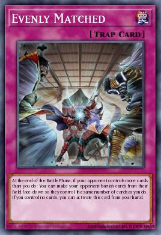

- **Copias y zona:** Reserva 1x. No altera las cantidades registradas.
- **Nombre oficial de referencia:** Pelea Pareja. CID cotejado con la ficha oficial; el nombre histórico del inventario se conserva aunque su grafía/traducción difiera.
- **Función principal y secundaria:** trampa · ruptura de mesa.
- **Estado de sinergia y función:** Reserva fuera de lista activa. Es una clasificación de juego; revisar la relación concreta en A06.
- **Papel como recurso, descarte o coste:** Destierro como uso/recurso; comprobar origen, coste o efecto y recuperación.
- **Efecto operativo (paráfrasis analítica):** Al final de Battle Phase y con más cartas rivales, obliga al adversario a desterrar boca abajo hasta igualar las cantidades. 
- **Mapa de activación y resultados:** efecto de estadística, condición o material; no asumir un disparador adicional. Cada operación está sujeta a la secuencia y al «si lo haces» del texto oficial.
- **Ventanas de activación identificadas:** campo propio vacío.
- **Costes o recursos potenciales:** sin coste independiente identificado en esta síntesis; comprobar las acciones previas al punto y coma de cada efecto.
- **Restricciones y requisitos:** requiere campo propio sin las cartas indicadas; interactúa con información oculta o resultados no siempre elegibles. 
- **Prioridad al ir primero:** convertir el primer Guerrero en recursos y un Sincro defendible. Para esta carta: Activar cuando las condiciones permitan obtener valor real, preservando recursos de seguimiento.
- **Prioridad al ir segundo:** despejar obstáculos conservando equipo, invocaciones y capacidad de extensión. Identificar primero la respuesta rival que afecta su función «trampa».
- **Medio/tardío y recuperación:** reutilizar Guerreros y Equipos gastados sin perder la Normal Summon. No asumir que por sí misma recicla recursos si el texto no lo permite.
- **Sinergias y acceso a líneas:** Relación contextual con Guerreros FUEGO, cartas de Equipo, recuperaciones del Cementerio y escalada Sincro. Habilita una línea del motor sólo si coinciden recursos, objetivos y restricciones; no equivale a un combo completo validado.
- **Riesgo / brick / interrupciones:** La activación desde mano exige no controlar cartas; aplica al final de Battle Phase. No atribuirle velocidad rápida por el solo hecho de formar parte del motor.
- **Utilidad editorial:** 3/5 para este deck (estimación por rol y zona, no probabilidad calculada). No cambiar copias; cualquier sugerencia de alta/baja pasa por el apartado 22 y aprobación.
- **Referencia oficial y trazabilidad:** https://www.db.yugioh-card.com/yugiohdb/card_search.action?cid=13293&ope=2&request_locale=es. **Confianza:** texto y tipo de efecto cotejados en Konami; síntesis táctica editorial, no demostración de combo.
- **Aplicación concreta dentro de este deck (A06):** Fuera de lista. Al final de Battle Phase y con más cartas rivales, obliga al adversario a desterrar boca abajo hasta igualar las cantidades.. No aporta recursos durante este duelo.

**USO PRÁCTICO Y SINERGIA — Evenly Matched**

- **Label funcional:** Sin sinergia demostrada (con la evidencia actual). Clasificación documental; una relación es válida solo si se satisfacen sus condiciones exactas.
- **Qué hace:** Al final de Battle Phase y con más cartas rivales, obliga al adversario a desterrar boca abajo hasta igualar las cantidades.
- **Cómo aprovecharla en este deck:** Fuera de lista. Al final de Battle Phase y con más cartas rivales, obliga al adversario a desterrar boca abajo hasta igualar las cantidades.. No aporta recursos durante este duelo.
- **Al jugar primero:** convertir el primer Guerrero en recursos y un Sincro defendible. Para esta carta: Activar cuando las condiciones permitan obtener valor real, preservando recursos de seguimiento.
- **Al jugar segundo:** despejar obstáculos conservando equipo, invocaciones y capacidad de extensión. Identificar primero la respuesta rival que afecta su función «trampa».
- **Cuándo tener precaución:** La activación desde mano exige no controlar cartas; aplica al final de Battle Phase. No atribuirle velocidad rápida por el solo hecho de formar parte del motor.

#### 45. Dimensional Barrier

- **Copias y zona:** Reserva 1x. No altera las cantidades registradas.
- **Nombre oficial de referencia:** Barrera Dimensional. CID cotejado con la ficha oficial; el nombre histórico del inventario se conserva aunque su grafía/traducción difiera.
- **Función principal y secundaria:** trampa · bloqueo del Extra.
- **Estado de sinergia y función:** Reserva fuera de lista activa. Es una clasificación de juego; revisar la relación concreta en A06.
- **Papel como recurso, descarte o coste:** No se demuestra que esta carta sea recurso de descarte o pago para otra.
- **Efecto operativo (paráfrasis analítica):** Declara un tipo de monstruo y bloquea sus Invocaciones Especiales y efectos ese turno. 
- **Mapa de activación y resultados:** 1) efecto propio o continuo: niega el efecto o la activación indicada, Invocación Especial desde zona permitida. Cada operación está sujeta a la secuencia y al «si lo haces» del texto oficial.
- **Ventanas de activación identificadas:** requieren la fase o condición específica indicada en el texto; sin ventana rápida general asumida.
- **Costes o recursos potenciales:** sin coste independiente identificado en esta síntesis; comprobar las acciones previas al punto y coma de cada efecto.
- **Restricciones y requisitos:** hay límite por turno según el efecto concreto. 
- **Prioridad al ir primero:** convertir el primer Guerrero en recursos y un Sincro defendible. Para esta carta: Activar cuando las condiciones permitan obtener valor real, preservando recursos de seguimiento.
- **Prioridad al ir segundo:** despejar obstáculos conservando equipo, invocaciones y capacidad de extensión. Identificar primero la respuesta rival que afecta su función «trampa».
- **Medio/tardío y recuperación:** reutilizar Guerreros y Equipos gastados sin perder la Normal Summon. No asumir que por sí misma recicla recursos si el texto no lo permite.
- **Sinergias y acceso a líneas:** Relación contextual con Guerreros FUEGO, cartas de Equipo, recuperaciones del Cementerio y escalada Sincro. Habilita una línea del motor sólo si coinciden recursos, objetivos y restricciones; no equivale a un combo completo validado.
- **Riesgo / brick / interrupciones:** Se declara un tipo; impacta a ambos jugadores. No atribuirle velocidad rápida por el solo hecho de formar parte del motor.
- **Utilidad editorial:** 3/5 para este deck (estimación por rol y zona, no probabilidad calculada). No cambiar copias; cualquier sugerencia de alta/baja pasa por el apartado 22 y aprobación.
- **Referencia oficial y trazabilidad:** https://www.db.yugioh-card.com/yugiohdb/card_search.action?cid=12668&ope=2&request_locale=es. **Confianza:** texto y tipo de efecto cotejados en Konami; síntesis táctica editorial, no demostración de combo.
- **Aplicación concreta dentro de este deck (A06):** Fuera de lista. Declara un tipo de monstruo y bloquea sus Invocaciones Especiales y efectos ese turno.. No aporta recursos durante este duelo.

**USO PRÁCTICO Y SINERGIA — Dimensional Barrier**

- **Label funcional:** Sin sinergia demostrada (con la evidencia actual). Clasificación documental; una relación es válida solo si se satisfacen sus condiciones exactas.
- **Qué hace:** Declara un tipo de monstruo y bloquea sus Invocaciones Especiales y efectos ese turno.
- **Cómo aprovecharla en este deck:** Fuera de lista. Declara un tipo de monstruo y bloquea sus Invocaciones Especiales y efectos ese turno.. No aporta recursos durante este duelo.
- **Al jugar primero:** convertir el primer Guerrero en recursos y un Sincro defendible. Para esta carta: Activar cuando las condiciones permitan obtener valor real, preservando recursos de seguimiento.
- **Al jugar segundo:** despejar obstáculos conservando equipo, invocaciones y capacidad de extensión. Identificar primero la respuesta rival que afecta su función «trampa».
- **Cuándo tener precaución:** Se declara un tipo; impacta a ambos jugadores. No atribuirle velocidad rápida por el solo hecho de formar parte del motor.

## SINERGIAS Y MOTORES
## RESUMEN FUNCIONAL DE SINERGIAS — 670

**Medición descriptiva de etiquetas históricas (NO certificación):** 17/45 identidades tenían etiqueta directa/indirecta (37,8 %). Main: 17/26 (65,4 %); Extra: **0/12 con etiqueta estructurada histórica**, cifra que **NO equivale a cero sinergia ni a cero acceso**: el índice actualizado muestra **Anima y S:P de Extra con rutas específicas Ogier+Renaud**. Se cuenta una identidad una sola vez; una carta autónoma puede ser útil sin sinergia de motor. Estos porcentajes son una fotografía de etiquetas del archivo, **no el porcentaje final de sinergias verificadas**, ni una estadística de victoria. Las nuevas rutas se computan por separado como **20/45 identidades con referencia A09/A10**, incluidas Anima y S:P, sin reescribir la clasificación histórica ni inventar un porcentaje competitivo.

#### A06.0 — En 30 segundos: cómo cooperan realmente estas cartas

- **Dictamen de conjunto:** equipo y Sincronía/enlace forman un núcleo funcional; algunas cartas externas compiten por el mismo recurso o imponen restricciones incompatibles.
- **Motor que mueve el deck:** Museo, Durendal/Almace y Ogier/Oliver/Renaud obtienen Guerreros FUEGO, utilizan Equipos y preparan materiales para la línea Infernoble.
- **Puentes reales:** Connector/Dolphin permite alcanzar Isolde; la línea Angélica/Roland/Emperador Carlo puede conducir a Carlo el Grande si el jefe está legalmente equipado. El paquete Botín del Pecado suministra FUEGO Nivel 1 bajo condiciones.
- **Sinergia indirecta:** los Equipos enviados como coste, destruidos o recuperados son parte del motor; no contarlos como simultáneamente equipados y en GY.
- **Conflicto decisivo:** el bloqueo Xyz de Riseheart contraría destinos de Enlace/Sincronía; Isolde requiere Equipo correcto y restringe el Guerrero añadido por su primera habilidad.
- **Decisión concreta:** separar Ruta Isolde, Ruta Carlo y puente Diabellstar; valorar retirar/desplazar Riseheart solo tras comparar sus usos alternos y evidencias de sinergia.
- **Qué aprender después:** elegir starter y destino; inspeccionar el Equipo pagado en la interrupción antes de continuar con Renaud.

#### Motores e interacciones prioritarias

1. **Motor Armas Nobles / Museo.** **Museo de Armas Nobles** (CID 18844) paga 1200 LP para buscar «Armas Nobles»; **Herencia del Cáliz** (14075) busca «Noble Caballero» o «Armas Nobles». **Infernarmas Nobles – Durendal** (15287) equipada puede buscar un Guerrero FUEGO de Nivel 5 o menor y después se destruye; **Almace** (18843) equipada puede traer otra Infernarmas Noble del Deck/GY para equiparla, destruyéndose. No son búsquedas sin coste ni pueden buscar cualquier Guerrero del inventario.
2. **Manejo del Cementerio y Equipos.** **Ogier** (15247) al Invocarse envía Guerrero FUEGO o Armas Nobles desde Deck al GY y, como Equipo desde GY, evita destrucción por efecto. **Maugis** (15249) equipa protección de batalla y recicla tres recursos para robar cuando se envía al GY. **Oliver** (15248) puede entrar como Nivel 1 enviando un Guerrero FUEGO o Equipo; equipado impide selección. **Turpin** (18801), con monstruo equipado en campo, puede entrar desde mano/GY y al equiparse permite tratar al equipado como Cantante al usarlo para Sincronía.
3. **Extensores Guerrero FUEGO.** **Renaud** (15082) se Invoca desde mano si controlas un Guerrero FUEGO, se trata como Cantante de ese modo y recupera Guerrero FUEGO o Equipo desde GY/destierro. **Ricciardetto** (18800) puede desterrarse para Invocar desde mano un Guerrero FUEGO Nivel 4 o menor como Cantante o, al ser Invocado, revivir uno del GY; ese segundo efecto bloquea las Invocaciones Especiales posteriores que no sean **Guerrero**. **Fire Flint Lady** (15392) extiende al controlar Guerrero y convierte su cuerpo en otro Guerrero de mano.
4. **Puente Connector → Isolde.** **Neo Space Connector** (14085) Invocado Normalmente trae del Deck/mano **Neo-Spacian Aqua Dolphin** (6768): son cuerpos Guerrero para **Isolde, Dos Historias del Noble Caballero** (13500), siempre que los materiales sean legales. Isolde busca Guerrero, pero impide usar ese mismo nombre como monstruo ese turno; para Invocar desde Deck manda **Mágicas de Equipo con nombres diferentes**, tantas como el Nivel requerido. Aqua Dolphin revisa mano rival con descarte y requisito de ATK, no destruye cualquier carta.
5. **Sincronía / jefe equipado.** **Capitán Roland** (15275) aporta una búsqueda diferida durante End Phase; **Angélica, Princesa de Armas Nobles** (18827) busca carta que mencione Emperador Carlo y puede salir temporalmente si es seleccionada, enviando Guerrero FUEGO al GY y trayendo Roland bajo condiciones. **Emperador Carlo Infernoble Caballero** (15276) destruye una carta cuando se equipa en campo y se equipa recursos en End Phase. **Emperador Carlo el Grande** (18835) se Invoca por Enlace usando **un Emperador Carlo de Nivel 9 ya equipado**: no basta dos Guerreros genéricos. Su negación de M/T consume Equipo, por lo que se conecta con Durendal/Almace/Ogier y con **Fénix Inmortal Gearfried** (14801), que también necesita Equipo para su negación de monstruo.
6. **Submotor Botín del Pecado.** **SE BUSCA** (19196) accede a **Diabellstar** (19148); esta se Invoca enviando una carta de mano/campo al GY y, al Invocarse, Coloca **Botín del Pecado Original – Ojo de Serpiente** (19199). Original envía otra carta propia boca arriba al GY para Invocar un **FUEGO de Nivel 1** desde mano/Deck, si existe objetivo como Fire Flint Lady y los efectos permiten la secuencia. Este motor consume recursos y no reemplaza materiales de Sincronía exigidos.

#### Mapa de sinergias con referencias para imágenes

| Origen y destino por CID | Función del enlace | Restricción | Visual |
|---|---|---|---|
| Museo (18844) → Durendal (15287) → Renaud (15082) / Ogier (15247) | Buscar Equipo y luego un Guerrero FUEGO de Nivel apto. | Museo paga LP; Durendal debe estar equipada y destruye la propia carta. |     |
| Connector (14085) → Aqua Dolphin (6768) → Isolde (13500) | Dos Guerreros y posterior búsqueda/Invocación desde Deck. | Isolde usa Equipos **de nombres distintos** y restringe el Guerrero buscado. |    |
| Ogier (15247) / Turpin (18801) / Renaud (15082) → Angélica (18827) / Roland (15275) | GY/equipamiento habilitan Cantantes y posibles Sincronías. | Ajustar niveles y materiales antes de declarar la Sincronía. |      |
| Emperador Carlo (15276) equipado → Emperador Carlo el Grande (18835) | Promoción a Enlace y uso de Equipos como costes defensivos. | Requisito exacto de Carlo **Nivel 9** equipado. |   |
| SE BUSCA (19196) → Diabellstar (19148) → Original (19199) → Fire Flint Lady (15392) | Acceso a Diabellstar y luego FUEGO Nivel 1. | Envíos de carta para invocar/activar; objetivo válido. |     |

#### Conflictos y accesos no equivalentes

- **Kashtira Riseheart** (18151), si se Invoca desde mano por su propio método, bloquea después el Extra a **Xyz**; esto corta la continuación natural a **Isolde/Carlo el Grande** (Enlace) o Sincronías. **Fenrir** es apoyo puntual y no justifica activar ese bloqueo como si fuera inocuo.
- El efecto de recuperación de **Ricciardetto** restringe a **Guerrero** las posteriores Invocaciones Especiales. Antes de seleccionar S:P, Link Spider, Anima u otro Extra, comprobar su **Tipo real**; no suponer que todo el Extra es Guerrero.
- **Gearfried** necesita una Mágica de Equipo desterrable para entrar y una Carta de Equipo para negar; sus recursos compiten con el Emperador y Charles. Los Equipos desaparecidos ya no cumplen requisitos de un Link equipado.
- **Reserva 12:** Thrust, Nibiru, D.D. Crow y las demás opciones no se suman al motor principal hasta una modificación de lista autorizada.

#### A06.1 — Arquitectura operativa de los motores (síntesis no redundante)

Las siguientes filas son **relaciones funcionales**, no secuencias certificadas ni garantía de mano inicial. La lista real y los límites están en A04/A05/A07.

| Tipo / motor | Starter o vía de acceso real | Recurso y destino | Cuello de botella |
|---|---|---|---|
| **Principal: Infernoble equipos** | Museo, Durendal, Almace, Ogier, Oliver, Renaud | Guerreros FUEGO, Equipos y Sincronía | Equipo colocado/adjunto, coste de envío, nombre/nivel y disponibilidad GY |
| **Submotor: Conector / Isolde** | Neo Space Connector, Aqua Dolphin, Isolde | Dos Guerreros y acceso a Guerrero del Deck | Equipos con nombres distintos y restricción del Guerrero buscado |
| **Salida: Carlo equipado** | Angélica, Roland, Emperador Carlo y Carlo el Grande | Jefe equipado, interrupciones y recuperación | Nivel 9 equipado antes del Enlace; costes de Equipo competidos |
| **Secundario: Botín del Pecado** | SE BUSCA, Diabellstar y Original Ojo de Serpiente | FUEGO Nivel 1 utilizable como cuerpo/puente | Envío de cartas propias y objetivos legales; bloqueo Xyz de Riseheart ajeno a la línea |

#### A06.2 — Estado funcional y justificación de TODAS las cartas

**Cómo leerlo:** un estado de sinergia describe el papel **de juego**, no el avance de una auditoría. No hay obligación de que cada carta tenga un enlace con otra: una defensa autónoma, una herramienta de Side o un recurso de descarte justificado también tiene propósito. Las relaciones directas descritas aquí se deben contrastar con los textos oficiales antes de representarlas como una ruta legal A09.

| Carta / CID y zona | Estado funcional de sinergia | Motivo de inclusión | Relación y condición concreta | Papel como coste, descarte o material | Límite o riesgo | Decisión táctica |
|---|---|---|---|---|---|---|
| **Kashtira Fenrir** (CID 17768) — Main 3x | **Utilidad independiente** | starter Kashtira · presión de destierro | Se invoca desde mano sin monstruos propios, busca otro Kashtira y destierra boca abajo una carta rival al reaccionar a su efecto o atacar. Aporta respuesta o consistencia sin exigir enlace directo | No se demuestra que esta carta sea recurso de descarte o pago para otra | hay límite por turno según el efecto concreto; requiere campo propio sin las cartas indicadas; interactúa con información oculta o resultados no… | Conservar según rival y conflictos propios |
| **Kashtira Riseheart** (CID 18151) — Main 1x | **Conflicto condicionado** | extensor Kashtira · ajuste de Nivel | La Invocación propia de Riseheart bloquea Extra a Xyz: compite con Sincronía/Enlace Infernoble; reservar para plan compatible o evaluar sustitución | Material o destino del Extra condicionado a los requisitos de invocación | hay límite por turno según el efecto concreto; puede bloquear tipos de Invocación del Extra Deck; requiere estado de campo específico… | Revisar zona/acceso; sustitución por validar |
| **Diabellstar la Bruja Negra** (CID 19148) — Main 1x | **Sinergia indirecta (soporte o recursos)** | interrupción · recuperación · extensor · preparación | recuperación e invocación desde Cementerio/destierro; acceso al campo desde la mano; colocación de Mágicas/Trampas o recursos | Coste o consumo descrito en A05: envío de recurso propio al Cementerio | hay límite por turno según el efecto concreto | Conservar; verificar coste y orden |
| **Immortal Phoenix Gearfried** (CID 14801) — Main 1x | **Sinergia indirecta (soporte o recursos)** | interrupción · extensor · negación · cierre · motor Equipo | acceso al campo desde la mano; negación de efectos o activaciones; presión de combate o modificación de estadísticas; uso o producción de cartas equipadas | No se demuestra que esta carta sea recurso de descarte o pago para otra | hay límite por turno según el efecto concreto | Conservar; verificar coste y orden |
| **Infernoble Caballero Turpin** (CID 18801) — Main 1x | **Sinergia indirecta (soporte o recursos)** | recuperación · extensor · respuesta · motor Equipo | recuperación e invocación desde Cementerio/destierro; acceso al campo desde la mano; interacción sobre monstruos en campo; uso o producción de cartas equipadas | No se demuestra que esta carta sea recurso de descarte o pago para otra | hay límite por turno según el efecto concreto; requiere estado de campo específico; depende de recursos en Cementerio; exige materiales de Extra… | Conservar; verificar coste y orden |
| **Infernoble Caballero Maugis** (CID 15249) — Main 1x | **Sinergia indirecta (soporte o recursos)** | removal · recuperación · ventaja de mano · respuesta · motor Equipo | destierro de recursos o de amenazas; retorno o reciclaje hacia mano/Deck/Extra; generación de cartas por robo; interacción sobre monstruos en campo; uso o producción de cartas equipadas; protección o resistencia contra respuestas | No se demuestra que esta carta sea recurso de descarte o pago para otra | hay límite por turno según el efecto concreto; depende de recursos en Cementerio | Conservar; verificar coste y orden |
| **Infernoble Caballero Ogier** (CID 15247) — Main 1x | **Sinergia indirecta (soporte o recursos)** | respuesta · motor Equipo · protección | interacción sobre monstruos en campo; uso o producción de cartas equipadas; protección o resistencia contra respuestas | No se demuestra que esta carta sea recurso de descarte o pago para otra | hay límite por turno según el efecto concreto; depende de recursos en Cementerio | Conservar; verificar coste y orden |
| **Infernoble Caballero Ricciardetto** (CID 18800) — Main 1x | **Sinergia indirecta (soporte o recursos)** | extensor | acceso al campo desde la mano | No se demuestra que esta carta sea recurso de descarte o pago para otra | puede bloquear tipos de Invocación del Extra Deck; depende de recursos en Cementerio | Conservar; verificar coste y orden |
| **Infernoble Caballero Renaud** (CID 15082) — Main 2x | **Sinergia indirecta (soporte o recursos)** | extensor · removal · motor Equipo | acceso al campo desde la mano; destierro de recursos o de amenazas; uso o producción de cartas equipadas | No se demuestra que esta carta sea recurso de descarte o pago para otra | hay límite por turno según el efecto concreto; requiere estado de campo específico; depende de recursos en Cementerio | Conservar; verificar coste y orden |
| **Infernoble Caballero Oliver** (CID 15248) — Main 1x | **Sinergia indirecta (soporte o recursos)** | recuperación · extensor · respuesta · motor Equipo | recuperación e invocación desde Cementerio/destierro; acceso al campo desde la mano; interacción sobre monstruos en campo; uso o producción de cartas equipadas | Coste o consumo descrito en A05: envío de recurso propio al Cementerio | hay límite por turno según el efecto concreto; depende de recursos en Cementerio | Conservar; verificar coste y orden |
| **Neo Space Connector** (CID 14085) — Main 3x | **Sinergia indirecta (soporte o recursos)** | extensor · cierre · coste/recurso | acceso al campo desde la mano; presión de combate o modificación de estadísticas; uso de Sacrificios como parte del efecto | Coste o consumo descrito en A05: Sacrificio | hay límite por turno según el efecto concreto; depende de recursos en Cementerio | Conservar; verificar coste y orden |
| **Neo-Spacian Aqua Dolphin** (CID 6768) — Main 1x | **Sinergia indirecta (soporte o recursos)** | removal · cierre | destrucción de cartas o empleo de destrucción como detonante; presión de combate o modificación de estadísticas | Coste o consumo descrito en A05: descarte de mano | hay límite por turno según el efecto concreto; requiere estado de campo específico | Conservar; verificar coste y orden |
| **Fire Flint Lady** (CID 15392) — Main 1x | **Sinergia indirecta (soporte o recursos)** | recuperación · extensor | recuperación e invocación desde Cementerio/destierro; acceso al campo desde la mano | Coste o consumo descrito en A05: envío de recurso propio al Cementerio | hay límite por turno según el efecto concreto; requiere estado de campo específico | Conservar; verificar coste y orden |
| **Droll & Lock Bird** (CID 9279) — Main 3x | **Utilidad independiente** | handtrap · bloqueo de búsquedas | Tras una incorporación desde el Deck a la mano rival, se envía al Cementerio para impedir nuevas adiciones desde ambos Decks principales ese turno. Aporta respuesta o consistencia sin exigir enlace directo | Envío mencionado en la interacción; no equivale por sí mismo a descarte desde la mano | aplicar restricciones de selección, activación y copias que consten en el texto original | Conservar según rival y conflictos propios |
| **Effect Veiler** (CID 8933) — Main 2x | **Utilidad independiente** | handtrap · negación | Durante la Main Phase rival, se manda desde la mano al Cementerio para negar los efectos de un monstruo rival boca arriba. Aporta respuesta o consistencia sin exigir enlace directo | Coste o consumo descrito en A05: envío de recurso propio al Cementerio | aplicar restricciones de selección, activación y copias que consten en el texto original | Conservar según rival y conflictos propios |
| **Ash Blossom & Joyous Spring** (CID 12950) — Main 2x | **Utilidad independiente** | handtrap · negación | Descarta desde la mano para detener efectos que buscan, invocan o mandan cartas desde el Deck. Aporta respuesta o consistencia sin exigir enlace directo | Descarte mencionado: comprobar carta que lo exige, zona, coste frente a efecto y utilidad del recurso | hay límite por turno según el efecto concreto | Conservar según rival y conflictos propios |
| **Angelica's Angelic Ring** (CID 19207) — Main 1x | **Sin relación demostrada** | Función individual: removal · motor Equipo | No se documenta una operación concreta que conecte esta carta con el motor; no inferir inutilidad | No se demuestra que esta carta sea recurso de descarte o pago para otra | hay límite por turno según el efecto concreto | Cruzar A05/A09; alternativa no demostrada |
| **Infernoble Arms - Almace** (CID 18843) — Main 1x | **Sinergia indirecta (soporte o recursos)** | removal · motor Equipo | destrucción de cartas o empleo de destrucción como detonante; destierro de recursos o de amenazas; uso o producción de cartas equipadas | No se demuestra que esta carta sea recurso de descarte o pago para otra | depende de recursos en Cementerio | Conservar; verificar coste y orden |
| **Infernoble Arms - Durendal** (CID 15287) — Main 2x | **Sinergia indirecta (soporte o recursos)** | searcher · buscador · removal · motor Equipo | búsqueda o incorporación de cartas a mano; destrucción de cartas o empleo de destrucción como detonante; uso o producción de cartas equipadas | No se demuestra que esta carta sea recurso de descarte o pago para otra | puede bloquear tipos de Invocación del Extra Deck; depende de recursos en Cementerio | Conservar; verificar coste y orden |
| **Noble Arms Museum** (CID 18844) — Main 3x | **Sinergia indirecta (soporte o recursos)** | searcher · buscador · cierre | búsqueda o incorporación de cartas a mano; presión de combate o modificación de estadísticas | No se demuestra que esta carta sea recurso de descarte o pago para otra | hay límite por turno según el efecto concreto; puede bloquear tipos de Invocación del Extra Deck | Conservar; verificar coste y orden |
| **Divine Sword - Phoenix Blade** (CID 6458) — Main 1x | **Sin relación demostrada** | Función individual: searcher · buscador · cierre · motor Equipo | No se documenta una operación concreta que conecte esta carta con el motor; no inferir inutilidad | No se demuestra que esta carta sea recurso de descarte o pago para otra | depende de recursos en Cementerio | Cruzar A05/A09; alternativa no demostrada |
| **D.D.R. - Different Dimension Reincarnation** (CID 7519) — Main 1x | **Sin relación demostrada** | Función individual: removal | No se documenta una operación concreta que conecte esta carta con el motor; no inferir inutilidad | Coste o consumo descrito en A05: descarte de mano | aplicar restricciones de selección, activación y copias que consten en el texto original | Cruzar A05/A09; alternativa no demostrada |
| **WANTED: Seeker of Sinful Spoils** (CID 19196) — Main 3x | **Sinergia indirecta (soporte o recursos)** | searcher · buscador · removal · ventaja de mano | búsqueda o incorporación de cartas a mano; destierro de recursos o de amenazas; generación de cartas por robo | No se demuestra que esta carta sea recurso de descarte o pago para otra | hay límite por turno según el efecto concreto; depende de recursos en Cementerio | Conservar; verificar coste y orden |
| **Heritage of the Chalice** (CID 14075) — Main 3x | **Sinergia indirecta (soporte o recursos)** | searcher · buscador · motor Equipo | búsqueda o incorporación de cartas a mano; uso o producción de cartas equipadas | No se demuestra que esta carta sea recurso de descarte o pago para otra | depende de recursos en Cementerio | Conservar; verificar coste y orden |
| **Reinforcement of the Army** (CID 5328) — Main 1x | **Sin relación demostrada** | Función individual: searcher · buscador | No se documenta una operación concreta que conecte esta carta con el motor; no inferir inutilidad | No se demuestra que esta carta sea recurso de descarte o pago para otra | aplicar restricciones de selección, activación y copias que consten en el texto original | Cruzar A05/A09; alternativa no demostrada |
| **Original Sinful Spoils - Snake-Eye** (CID 19199) — Main 1x | **Sinergia indirecta (soporte o recursos)** | searcher · buscador · extensor | búsqueda o incorporación de cartas a mano; acceso al campo desde la mano | No se demuestra que esta carta sea recurso de descarte o pago para otra | depende de recursos en Cementerio | Conservar; verificar coste y orden |
| **Infernoble Knight Captain Roland [Synchro]** (CID 15275) — Extra 1x | **Destino Extra condicionado** | interrupción · resultado de Extra Deck · buscador · cierre · respuesta | búsqueda o incorporación de cartas a mano; presión de combate o modificación de estadísticas; interacción sobre monstruos en campo; uso o producción de cartas equipadas | Material o destino del Extra condicionado a los requisitos de invocación | hay límite por turno según el efecto concreto; depende de recursos en Cementerio. Invocar sólo desde el Extra Deck usando su procedimiento… | Conservar si hay materiales legales |
| **Baronne de Fleur [Synchro]** (CID 16386) — Extra 1x | **Sin acceso al Extra demostrado** | Función individual: interrupción · resultado de Extra Deck · removal · negación · recuperación | No se documenta una operación concreta que conecte esta carta con el motor; no inferir inutilidad | Material o destino del Extra condicionado a los requisitos de invocación | hay límite por turno según el efecto concreto; depende de recursos en Cementerio. Invocar sólo desde el Extra Deck usando su procedimiento… | Cruzar A09/A07 antes de proponer reemplazo |
| **Infernoble Knight Emperor Charles [Synchro]** (CID 15276) — Extra 1x | **Destino Extra condicionado** | resultado de Extra Deck · cierre · motor Equipo | presión de combate o modificación de estadísticas; uso o producción de cartas equipadas | Material o destino del Extra condicionado a los requisitos de invocación | hay límite por turno según el efecto concreto. Invocar sólo desde el Extra Deck usando su procedimiento propio | Conservar si hay materiales legales |
| **Battlin' Boxer King Dempsey [Xyz]** (CID 18926) — Extra 1x | **Sin acceso al Extra demostrado** | Función individual: interrupción · resultado de Extra Deck · buscador · respuesta · habilitador Xyz | No se documenta una operación concreta que conecte esta carta con el motor; no inferir inutilidad | Material o destino del Extra condicionado a los requisitos de invocación | hay límite por turno según el efecto concreto. Invocar sólo desde el Extra Deck usando su procedimiento propio | Cruzar A09/A07 antes de proponer reemplazo |
| **Super Starslayer TY-PHON - Sky Crisis [Xyz]** (CID 19184) — Extra 1x | **Acceso reactivo V13** | `670:A09:RENAUD:TYPHON10`: Renaud Normal único propio → TY-PHON Rango12 (1 material) | Requiere 2+ Especiales de Extra rival este o anterior turno | Desacoplar 1 devuelve monstruo sin destruir y no permite Invocaciones después | No es ruta Infernoble de inicio ni un acceso en primer turno | Mantener como respuesta condicional; revisar A09/A07 |
| **Angelica, Princess of Noble Arms [Synchro]** (CID 18827) — Extra 1x | **Destino Extra condicionado** | interrupción · resultado de Extra Deck · buscador · extensor · removal | búsqueda o incorporación de cartas a mano; extensión mediante monstruos procedentes del Deck; acceso al campo desde la mano; destierro de recursos o de amenazas | Material o destino del Extra condicionado a los requisitos de invocación | hay límite por turno según el efecto concreto. Invocar sólo desde el Extra Deck usando su procedimiento propio | Conservar si hay materiales legales |
| **Isolde, Two Tales of the Noble Knights [Link]** (CID 13500) — Extra 2x | **Destino Extra condicionado** | resultado de Extra Deck · buscador · extensor · recuperación · preparación | búsqueda o incorporación de cartas a mano; extensión mediante monstruos procedentes del Deck; recuperación e invocación desde Cementerio/destierro; colocación de Mágicas/Trampas o recursos; uso o producción de cartas equipadas | Material o destino del Extra condicionado a los requisitos de invocación | hay límite por turno según el efecto concreto. Invocar sólo desde el Extra Deck usando su procedimiento propio | Conservar si hay materiales legales |
| **Emperor Charles the Great [Link]** (CID 18835) — Extra 2x | **Destino Extra condicionado** | interrupción · resultado de Extra Deck · removal · negación · cierre | destrucción de cartas o empleo de destrucción como detonante; negación de efectos o activaciones; presión de combate o modificación de estadísticas; uso o producción de cartas equipadas | Material o destino del Extra condicionado a los requisitos de invocación | hay límite por turno según el efecto concreto; depende de recursos en Cementerio. Invocar sólo desde el Extra Deck usando su procedimiento… | Conservar si hay materiales legales |
| **Apollousa, Bow of the Goddess [Link]** (CID 14496) — Extra 1x | **Sin acceso al Extra demostrado** | Función individual: interrupción · resultado de Extra Deck · habilitador de Extra · negación · cierre | No se documenta una operación concreta que conecte esta carta con el motor; no inferir inutilidad | Material o destino del Extra condicionado a los requisitos de invocación | aplicar restricciones de selección, activación y copias que consten en el texto original. Invocar sólo desde el Extra Deck usando su… | Cruzar A09/A07 antes de proponer reemplazo |
| **Relinquished Anima [Link]** (CID 13841) — Extra 1x | **Acceso posicional condicional** | Renaud Nivel1 → Anima → equipar monstruo rival al que apunte → Anima+Ogier para S:P | `670:A09:OGIER:RENAUD:ANIMA:SP09` | Exige rival boca arriba apuntable y zona Extra libre; no negar | Conservar 1x sujeto a frecuencia de posiciones rivales |
| **Link Spider [Link]** (CID 13034) — Extra 1x | **Sin acceso al Extra demostrado** | Función individual: resultado de Extra Deck · extensor | No se documenta una operación concreta que conecte esta carta con el motor; no inferir inutilidad | Material o destino del Extra condicionado a los requisitos de invocación | hay límite por turno según el efecto concreto. Invocar sólo desde el Extra Deck usando su procedimiento propio | Cruzar A09/A07 antes de proponer reemplazo |
| **S:P Little Knight [Link]** (CID 19188) — Extra 2x | **Dos rutas de acceso documentadas** | Ogier+Renaud → S:P sin destierro al Invocar; Anima+Ogier → S:P con destierro al Invocar | `670:A09:OGIER:RENAUD:SP_DEFENSA08`; `670:A09:OGIER:RENAUD:ANIMA:SP09` | Efecto Rápido exige activación rival y 2 monstruos boca arriba; **no niega** | Revisar necesidad de segunda copia antes de aumentar a 3 |
| **Nibiru, the Primal Being** (CID 14741) — Reserva 3x | **Reserva fuera de lista activa** | Opción externa al listado activo; su función potencial no justifica jugarla sin incorporarla legalmente | Solo puede utilizarse si se incorpora a una lista aplicable; no es recurso del duelo activo | No se demuestra que esta carta sea recurso de descarte o pago para otra | hay límite por turno según el efecto concreto | Reserva; propuesta solo tras aprobación |
| **D.D. Crow** (CID 6980) — Reserva 2x | **Reserva fuera de lista activa** | Opción externa al listado activo; su función potencial no justifica jugarla sin incorporarla legalmente | Solo puede utilizarse si se incorpora a una lista aplicable; no es recurso del duelo activo | Destierro como uso/recurso; comprobar origen, coste o efecto y recuperación | aplicar restricciones de selección, activación y copias que consten en el texto original | Reserva; propuesta solo tras aprobación |
| **Herald of the Abyss** (CID 13950) — Reserva 1x | **Reserva fuera de lista activa** | Opción externa al listado activo; su función potencial no justifica jugarla sin incorporarla legalmente | Solo puede utilizarse si se incorpora a una lista aplicable; no es recurso del duelo activo | Coste o consumo descrito en A05: pago de LP | hay límite por turno según el efecto concreto | Reserva; propuesta solo tras aprobación |
| **Triple Tactics Talent** (CID 15296) — Reserva 1x | **Reserva fuera de lista activa** | Opción externa al listado activo; su función potencial no justifica jugarla sin incorporarla legalmente | Solo puede utilizarse si se incorpora a una lista aplicable; no es recurso del duelo activo | No se demuestra que esta carta sea recurso de descarte o pago para otra | hay límite por turno según el efecto concreto | Reserva; propuesta solo tras aprobación |
| **Triple Tactics Thrust** (CID 18214) — Reserva 3x | **Reserva fuera de lista activa** | Opción externa al listado activo; su función potencial no justifica jugarla sin incorporarla legalmente | Solo puede utilizarse si se incorpora a una lista aplicable; no es recurso del duelo activo | No se demuestra que esta carta sea recurso de descarte o pago para otra | hay límite por turno según el efecto concreto | Reserva; propuesta solo tras aprobación |
| **Evenly Matched** (CID 13293) — Reserva 1x | **Reserva fuera de lista activa** | Opción externa al listado activo; su función potencial no justifica jugarla sin incorporarla legalmente | Solo puede utilizarse si se incorpora a una lista aplicable; no es recurso del duelo activo | Destierro como uso/recurso; comprobar origen, coste o efecto y recuperación | requiere campo propio sin las cartas indicadas; interactúa con información oculta o resultados no siempre elegibles | Reserva; propuesta solo tras aprobación |
| **Dimensional Barrier** (CID 12668) — Reserva 1x | **Reserva fuera de lista activa** | Opción externa al listado activo; su función potencial no justifica jugarla sin incorporarla legalmente | Solo puede utilizarse si se incorpora a una lista aplicable; no es recurso del duelo activo | No se demuestra que esta carta sea recurso de descarte o pago para otra | hay límite por turno según el efecto concreto | Reserva; propuesta solo tras aprobación |

## INTERACCIONES Y CLASIFICACIÓN

| ID documental | Categoría provisional | Piezas | Resultado | Requisitos | Check |
|---|---|---|---|---|---|
| 670:A08:01 | STARTER | Museo (18844) → Durendal (15287) → Renaud (15082) / Ogier (15247) | Buscar Equipo y luego un Guerrero FUEGO de Nivel apto. | Museo paga LP; Durendal debe estar equipada y destruye la propia carta. | |
| 670:A08:02 | STARTER | Connector (14085) → Aqua Dolphin (6768) → Isolde (13500) | Dos Guerreros y posterior búsqueda/Invocación desde Deck. | Isolde usa Equipos **de nombres distintos** y restringe el Guerrero buscado. | |
| 670:A08:03 | EXTENSION | Ogier (15247) / Turpin (18801) / Renaud (15082) → Angélica (18827) / Roland (15275) | GY/equipamiento habilitan Cantantes y posibles Sincronías. | Ajustar niveles y materiales antes de declarar la Sincronía. | |
| 670:A08:04 | RUTA | Emperador Carlo (15276) equipado → Emperador Carlo el Grande (18835) | Promoción a Enlace y uso de Equipos como costes defensivos. | Requisito exacto de Carlo **Nivel 9** equipado. | |
| 670:A08:05 | STARTER | SE BUSCA (19196) → Diabellstar (19148) → Original (19199) → Fire Flint Lady (15392) | Acceso a Diabellstar y luego FUEGO Nivel 1. | Envíos de carta para invocar/activar; objetivo válido. | |

#### Rol registrado por cada carta

| ID A08 | Carta registrada | Zona | Clasificación funcional | Rol documentado en A05 | Check de clasificación |
|---|---|---|---|---|---|
| 670:A08:C001 | Kashtira Fenrir | Main | STARTER_POTENCIAL | starter Kashtira · presión de destierro. | |
| 670:A08:C002 | Kashtira Riseheart | Main | EXTENSOR_POTENCIAL | extensor Kashtira · ajuste de Nivel. | |
| 670:A08:C003 | Diabellstar la Bruja Negra | Main | EXTENSOR_POTENCIAL | interrupción · recuperación · extensor · preparación. | |
| 670:A08:C004 | Immortal Phoenix Gearfried | Main | EXTENSOR_POTENCIAL | interrupción · extensor · negación · cierre · motor Equipo. | |
| 670:A08:C005 | Infernoble Caballero Turpin | Main | EXTENSOR_POTENCIAL | recuperación · extensor · respuesta · motor Equipo. | |
| 670:A08:C006 | Infernoble Caballero Maugis | Main | FUNCION_A05 (recurso jugable sujeto a condición) | removal · recuperación · ventaja de mano · respuesta · motor Equipo. | |
| 670:A08:C007 | Infernoble Caballero Ogier | Main | FUNCION_A05 (recurso jugable sujeto a condición) | respuesta · motor Equipo · protección. | |
| 670:A08:C008 | Infernoble Caballero Ricciardetto | Main | EXTENSOR_POTENCIAL | extensor. | |
| 670:A08:C009 | Infernoble Caballero Renaud | Main | EXTENSOR_POTENCIAL | extensor · removal · motor Equipo. | |
| 670:A08:C010 | Infernoble Caballero Oliver | Main | EXTENSOR_POTENCIAL | recuperación · extensor · respuesta · motor Equipo. | |
| 670:A08:C011 | Neo Space Connector | Main | EXTENSOR_POTENCIAL | extensor · cierre · coste/recurso. | |
| 670:A08:C012 | Neo-Spacian Aqua Dolphin | Main | FUNCION_A05 (recurso jugable sujeto a condición) | removal · cierre. | |
| 670:A08:C013 | Fire Flint Lady | Main | EXTENSOR_POTENCIAL | recuperación · extensor. | |
| 670:A08:C014 | Droll & Lock Bird | Main | BUSCADOR_INTERACCION | handtrap · bloqueo de búsquedas. | |
| 670:A08:C015 | Effect Veiler | Main | INTERACCION_DEFENSIVA | handtrap · negación. | |
| 670:A08:C016 | Ash Blossom & Joyous Spring | Main | INTERACCION_DEFENSIVA | handtrap · negación. | |
| 670:A08:C017 | Angelica's Angelic Ring | Main | FUNCION_A05 (recurso jugable sujeto a condición) | removal · motor Equipo. | |
| 670:A08:C018 | Infernoble Arms - Almace | Main | FUNCION_A05 (recurso jugable sujeto a condición) | removal · motor Equipo. | |
| 670:A08:C019 | Infernoble Arms - Durendal | Main | BUSCADOR_INTERACCION | searcher · buscador · removal · motor Equipo. | |
| 670:A08:C020 | Noble Arms Museum | Main | BUSCADOR_INTERACCION | searcher · buscador · cierre. | |
| 670:A08:C021 | Divine Sword - Phoenix Blade | Main | BUSCADOR_INTERACCION | searcher · buscador · cierre · motor Equipo. | |
| 670:A08:C022 | D.D.R. - Different Dimension Reincarnation | Main | FUNCION_A05 (recurso jugable sujeto a condición) | removal. | |
| 670:A08:C023 | WANTED: Seeker of Sinful Spoils | Main | BUSCADOR_INTERACCION | searcher · buscador · removal · ventaja de mano. | |
| 670:A08:C024 | Heritage of the Chalice | Main | BUSCADOR_INTERACCION | searcher · buscador · motor Equipo. | |
| 670:A08:C025 | Reinforcement of the Army | Main | BUSCADOR_INTERACCION | searcher · buscador. | |
| 670:A08:C026 | Original Sinful Spoils - Snake-Eye | Main | EXTENSOR_POTENCIAL | searcher · buscador · extensor. | |
| 670:A08:C027 | Infernoble Knight Captain Roland [Synchro] | Extra | DESTINO_EXTRA (materiales/procedimiento por comprobar) | interrupción · resultado de Extra Deck · buscador · cierre · respuesta. | |
| 670:A08:C028 | Baronne de Fleur [Synchro] | Extra | DESTINO_EXTRA (materiales/procedimiento por comprobar) | interrupción · resultado de Extra Deck · removal · negación · recuperación. | |
| 670:A08:C029 | Infernoble Knight Emperor Charles [Synchro] | Extra | DESTINO_EXTRA (materiales/procedimiento por comprobar) | resultado de Extra Deck · cierre · motor Equipo. | |
| 670:A08:C030 | Battlin' Boxer King Dempsey [Xyz] | Extra | DESTINO_EXTRA (materiales/procedimiento por comprobar) | interrupción · resultado de Extra Deck · buscador · respuesta · habilitador Xyz. | |
| 670:A08:C031 | Super Starslayer TY-PHON - Sky Crisis [Xyz] | Extra | DESTINO_EXTRA (materiales/procedimiento por comprobar) | resultado de Extra Deck · recuperación · cierre · habilitador Xyz. | |
| 670:A08:C032 | Angelica, Princess of Noble Arms [Synchro] | Extra | DESTINO_EXTRA (materiales/procedimiento por comprobar) | interrupción · resultado de Extra Deck · buscador · extensor · removal. | |
| 670:A08:C033 | Isolde, Two Tales of the Noble Knights [Link] | Extra | DESTINO_EXTRA (materiales/procedimiento por comprobar) | resultado de Extra Deck · buscador · extensor · recuperación · preparación. | |
| 670:A08:C034 | Emperor Charles the Great [Link] | Extra | DESTINO_EXTRA (materiales/procedimiento por comprobar) | interrupción · resultado de Extra Deck · removal · negación · cierre. | |
| 670:A08:C035 | Apollousa, Bow of the Goddess [Link] | Extra | DESTINO_EXTRA (materiales/procedimiento por comprobar) | interrupción · resultado de Extra Deck · habilitador de Extra · negación · cierre. | |
| 670:A08:C036 | Relinquished Anima [Link] | Extra | DESTINO_EXTRA (materiales/procedimiento por comprobar) | resultado de Extra Deck · cierre · motor Equipo. | |
| 670:A08:C037 | Link Spider [Link] | Extra | DESTINO_EXTRA (materiales/procedimiento por comprobar) | resultado de Extra Deck · extensor. | |
| 670:A08:C038 | S:P Little Knight [Link] | Extra | DESTINO_EXTRA (materiales/procedimiento por comprobar) | interrupción · resultado de Extra Deck · removal · respuesta. | |
| 670:A08:C039 | Nibiru, the Primal Being | Reserva | RESERVA (no disponible en el deck actual) | handtrap · limpieza del campo. | |
| 670:A08:C040 | D.D. Crow | Reserva | RESERVA (no disponible en el deck actual) | handtrap · interacción de Cementerio. | |
| 670:A08:C041 | Herald of the Abyss | Reserva | RESERVA (no disponible en el deck actual) | recurso situacional. | |
| 670:A08:C042 | Triple Tactics Talent | Reserva | RESERVA (no disponible en el deck actual) | mágica de respuesta · ventaja. | |
| 670:A08:C043 | Triple Tactics Thrust | Reserva | RESERVA (no disponible en el deck actual) | mágica de respuesta · acceso a Trampa/Mágica. | |
| 670:A08:C044 | Evenly Matched | Reserva | RESERVA (no disponible en el deck actual) | trampa · ruptura de mesa. | |
| 670:A08:C045 | Dimensional Barrier | Reserva | RESERVA (no disponible en el deck actual) | trampa · bloqueo del Extra. | |

## JUGADAS DOCUMENTADAS

> Requieren comprobación A11–A13 y validación de estado final. No publicar las rutas como combos certificados por tener fotografías.

#### A09 — Ruta de acceso de 1 carta `670:A09:CONNECTOR:ISOLDE01`

- **Objetivo técnico:** desde **Neo Space Connector**, establecer **Isolde + Renaud** en Campo y obtener **Immortal Phoenix Gearfried** y **Durendal** en mano. Esta ruta crea recursos, **no demuestra endboard de negaciones ni OTK**.
- **Precondiciones:** Main Phase propia, campo y GY iniciales vacíos, Connector en mano, Normal disponible, Aqua Dolphin en Deck, Isolde en Extra, Gearfried y Renaud en Deck, al menos 1 **Infernoble Arms - Durendal** (Mágica de Equipo) en Deck. Espacios libres; sin restricciones previas; rival no responde. Las cantidades de esas cartas constan en el inventario de 670.

| Paso | Procedimiento | Estado y legalidad |
|---|---|---|
| 1 | Invocar Normalmente **Neo Space Connector**. Activar efecto disparado CL1 y, al resolver, Invocar Especialmente **Neo-Spacian Aqua Dolphin** desde el Deck en Defensa. | Connector y Dolphin son **Guerreros** propios en Campo; Normal gastada; Dolphin no activó su efecto de descarte. |
| 2 | Usar ambos Guerreros como material para Invocar por Enlace **Isolde, Two Tales of the Noble Knights** (Link 2) desde Extra. | Connector y Dolphin al GY como materiales; Isolde en Campo. |
| 3 | Efecto de Isolde al ser Invocada por Enlace: buscar **Immortal Phoenix Gearfried** del Deck a la mano. | Durante el resto del turno, no Invocar Normal/Especial ni activar efectos de monstruos cuyo nombre sea Gearfried buscado. **No** intentar invocarlo este turno por este camino. |
| 4 | Activar segundo efecto de Isolde: **enviar 1 Equip Spell Durendal del Deck al GY como coste** y seleccionar la Invocación de **Renaud Nivel 1** desde Deck al resolver. | Si el efecto no es negado, Renaud en Campo e Isolde permanece. No se emplearon más Equipos ni se supuso que Durendal seguía en Deck. |
| 5 | Al ser Invocado Especialmente, activar Renaud y **seleccionar Durendal en GY** para añadirlo a mano al resolver. | Durendal en mano, Gearfried en mano, Isolde y Renaud en Campo. |

**Endboard al cerrar Main Phase:** Isolde Link 2 y Renaud Nivel 1 (no se trata como Cantante por haberlo Invocado con Isolde, no por el procedimiento desde mano); mano contiene Gearfried y Durendal, Normal consumida; GY Connector/Dolphin, al menos otros recursos iniciales no especificados. **No afirmar negación ni llegada a Charles**; esa ruta requiere comprobaciones adicionales.

**Evidencias Neuron:** [Connector](https://www.db.yugioh-card.com/yugiohdb/card_search.action?cid=14085&ope=2&request_locale=en), [Aqua Dolphin](https://www.db.yugioh-card.com/yugiohdb/card_search.action?cid=6768&ope=2&request_locale=en), [Isolde](https://www.db.yugioh-card.com/yugiohdb/card_search.action?cid=13500&ope=2&request_locale=en), [Renaud](https://www.db.yugioh-card.com/yugiohdb/card_search.action?cid=15082&ope=2&request_locale=en). **Estado:**, guía interactiva A10 y demás variantes pendientes; publicación bloqueada.

**Traza A09 de zonas al terminar cada paso `670:A09:CONNECTOR:ISOLDE01`:** sin respuesta rival, mano inicial mínima de Connector, Normal libre, GY y destierro vacíos; las demás cartas ocultas no se presuponen.

| Hito | Mano | Monstruos | M/T | Cementerio | Destierro propio | Estado rival | Materiales | Normal y Extra |
|---|---|---|---|---|---|---|---|---|
| P1 | 0 cartas de la mano mínima | Neo Space Connector #14085 (Ataque), Aqua Dolphin #6768 (Defensa) | ∅ | ∅ | ∅ | Sin respuesta; campo no determinado | Ninguno | Normal gastada; Extra intacto |
| P2 | 0 cartas | Isolde #13500 (Enlace 2) | ∅ | Connector #14085, Aqua Dolphin #6768 | ∅ | Sin cambios acreditados | Ninguno | Normal gastada; Isolde salió del Extra |
| P3 | Immortal Phoenix Gearfried #14801 (buscado; no puede Invocarse ni activar efectos este turno) | Isolde #13500 | ∅ | Connector #14085, Aqua Dolphin #6768 | ∅ | Sin cambios acreditados | Ninguno | Normal gastada; Isolde en Campo |
| P4 | Gearfried #14801 (restringido) | Isolde #13500, Renaud #15082 (Invocado del Deck; no Cantante por esta vía) | ∅ | Connector #14085, Aqua Dolphin #6768, Durendal #15287 (coste Isolde) | ∅ | Sin cambios acreditados | Ninguno | Normal gastada; no se gastó más Extra |
| P5 | Gearfried #14801 (restringido), Durendal #15287 (recuperada) | Isolde #13500, Renaud #15082 (no Cantante por esta vía) | ∅ | Connector #14085, Aqua Dolphin #6768 | ∅ | Sin cambios acreditados | Ninguno | Normal gastada; Isolde permanece |

#### A09 — `670:A09:MUSEUM:RENAUD:ISOLDE01` (entrada independiente Museo + Renaud)

- **Relación:** preficha `670:A09:C01` / candidato `670:A08:01`. **Objetivo:** convertir la Mágica de Campo y un Guerrero de Nivel 1 en acceso a **Isolde + Renaud** con dos cartas útiles en mano; **no garantiza Sincronía, negación ni daño**. **Dificultad:** media por orden del equipamiento y dos copias de Renaud. **Formato:** TCG, contrato 4, lista histórica del 2026-11-03.
- **Mano mínima exacta (2 cartas):**  **Museo de Armas Nobles** +  **primer Infernoble Caballero Renaud**. **Deck:**  **una Durendal**,  **Fire Flint Lady**, **Infernoble Arms - Almace**, **segundo Renaud** y **Immortal Phoenix Gearfried** (todos presentes en el inventario). **Extra:**  una Isolde. Campo/GY/destierro propios vacíos, LP propios **al menos 1201**, Normal libre, Main Phase propia y sin respuesta rival, bloqueos ni efectos usados; Campo rival irrelevante.
1. **Activar Museo de Armas Nobles** como Mágica de Campo (CL1, mano→Zona de Campo). En una cadena nueva, usar su búsqueda una vez **pagando 1200 LP como coste**; al resolver **añadir Durendal desde Deck a mano**. Museo permanece en Campo; se dispone de 1 Renaud y 1 Durendal en mano.
2. **Invocar Normalmente el primer Renaud** (Nivel 1 Guerrero FUEGO) en Ataque. Consume la Normal. **No** activar aquí la búsqueda al GY de Renaud: solo se dispara **si es Invocado Especialmente**, no Normalmente.
3. **Activar Durendal desde mano** equipándola al Renaud en Campo. En una cadena posterior, activar su primer efecto mientras está equipada; al resolver **añadir Fire Flint Lady (Guerrero FUEGO Nivel 1) desde Deck a mano y después destruir la propia Durendal**. Durendal va al GY por destrucción propia; **no** se invoca nada por su segundo efecto, ya que el monstruo equipado no fue enviado al GY. Renaud sigue en Campo.
4. Como se controla un Guerrero, aplicar el procedimiento propio de **Fire Flint Lady** para Invocarla Especialmente de mano al Campo (una vez este turno). Ahora hay **Renaud + Fire Flint Lady, dos Guerreros**, y Museo boca arriba. No usar el segundo efecto de Fire Flint.
5. Invocar por Enlace **Isolde Link 2 (ATK 1600)** desde Extra usando **Renaud y Fire Flint Lady** como materiales: ambos van al GY. En cadena nueva, activar el efecto de Isolde por Invocación Enlace **CL1**: buscar **Immortal Phoenix Gearfried desde Deck a mano**. Desde esta búsqueda, no Invocar ni activar efectos del Gearfried buscado durante el resto del turno; no afirmar que llega al Campo.
6. En Main Phase, activar el otro efecto de Isolde: **enviar Almace (1 Mágica de Equipo de nombre distinto) desde Deck al GY como COSTE**. Al resolver, Invocar Especialmente **el segundo Renaud de Nivel 1** desde Deck (distinto ejemplar del que sirvió como material). La primera copia está en GY; no está simultáneamente en Campo.
7. Por esa Invocación Especial, activar el efecto del **segundo Renaud** en una cadena posterior **seleccionando Durendal en el GY** (Mágica de Equipo propia). Al resolver añadir **Durendal del GY a mano**; no se gastó la invocación especial propia de Renaud desde mano ni se lo trató como Cantante.
- **Endboard sin respuesta al pasar turno:** **Isolde Link 2 / 1600 ATK** + **segundo Renaud Nivel 1** (**1000 ATK** si Museo continúa aplicando su bonificación de +500 sobre el ATK original 500), **Museo** en Zona de Campo. **Mano:** Gearfried + Durendal; **GY:** primer Renaud, Fire Flint Lady y Almace; **destierro:** vacío; **LP propios:** iniciales −1200; **Normal:** gastada. No se activó el segundo efecto del Museo y, por tanto, no se atribuye su restricción condicional de Invocar únicamente Guerreros. Sin daño rival, destrucciones rivales ni negación garantizadas.
- **Nota de no duplicación:** frente a `CONNECTOR:ISOLDE01`, esta ruta necesita **dos** cartas concretas en mano y paga 1200 LP, pero conserva Museo en Campo y recicla Durendal tras destruirla. No es una continuación automática de Connector ni un tercer cuerpo gratis. **Vulnerabilidades:** negar la búsqueda de Museo, destruir el Renaud equipado antes de la búsqueda, negar Isolde o desplazar Durendal del GY antes de la recuperación; cada resultado adversarial exige A12–A13.;.
- **Fuentes oficiales:** [Museo](https://www.db.yugioh-card.com/yugiohdb/card_search.action?cid=18844&ope=2&request_locale=en), [Durendal](https://www.db.yugioh-card.com/yugiohdb/card_search.action?cid=15287&ope=2&request_locale=en), [Renaud](https://www.db.yugioh-card.com/yugiohdb/card_search.action?cid=15082&ope=2&request_locale=en), [Fire Flint Lady](https://www.db.yugioh-card.com/yugiohdb/card_search.action?cid=15392&ope=2&request_locale=en), [Isolde](https://www.db.yugioh-card.com/yugiohdb/card_search.action?cid=13500&ope=2&request_locale=en). Las cinco imágenes CID están presentes; **sin importar a Station X**.

**Traza A09 de zonas al terminar cada paso `670:A09:MUSEUM:RENAUD:ISOLDE01`:** 2 cartas conocidas de apertura; LP −1200 desde P1; primera y segunda copia de Renaud inequívocamente diferenciadas.

| Hito | Mano | Monstruos | M/T | Cementerio | Destierro propio | Estado rival | Materiales | Normal y Extra |
|---|---|---|---|---|---|---|---|---|
| P1 | Primer Renaud #15082, Durendal #15287 | ∅ | Museo #18844 (Campo) | ∅ | ∅ | Sin respuesta; campo no determinado | Ninguno | Normal libre; Extra intacto; LP −1200 |
| P2 | Durendal #15287 | Primer Renaud #15082 (Normal; no Cantante) | Museo #18844 | ∅ | ∅ | Sin cambios acreditados | Ninguno | Normal gastada; Extra intacto |
| P3 | Fire Flint Lady #15392 | Primer Renaud #15082 | Museo #18844 | Durendal #15287 (autodestruida) | ∅ | Sin cambios acreditados | Ninguno | Normal gastada; Extra intacto |
| P4 | Vacía entre las dos cartas de apertura y búsquedas | Primer Renaud #15082, Fire Flint Lady #15392 | Museo #18844 | Durendal #15287 | ∅ | Sin cambios acreditados | Ninguno | Normal gastada; Extra intacto |
| P5 | Gearfried #14801 (buscado y restringido este turno) | Isolde #13500 | Museo #18844 | Primer Renaud #15082, Fire Flint Lady #15392, Durendal #15287 | ∅ | Sin cambios acreditados | Ninguno | Normal gastada; Isolde salió del Extra |
| P6 | Gearfried #14801 (restringido) | Isolde #13500, segundo Renaud #15082 (desde Deck) | Museo #18844 | Primer Renaud #15082, Fire Flint Lady #15392, Durendal #15287, Almace #18843 (coste) | ∅ | Sin cambios acreditados | Ninguno | Normal gastada; Isolde permanece |
| P7 | Gearfried #14801 (restringido), Durendal #15287 (recuperada) | Isolde #13500, segundo Renaud #15082 | Museo #18844 | Primer Renaud #15082, Fire Flint Lady #15392, Almace #18843 | ∅ | Sin cambios acreditados | Ninguno | Normal gastada; Isolde permanece |

#### A09 — Extensión interna `670:A09:CONNECTOR:DURENDAL02` (depende de `ISOLDE01`)

- **Partida inicial:** exactamente la de `ISOLDE01`, sin cartas adicionales en la mano inicial; completar primero sus pasos 1–5. La única copia registrada de **Fire Flint Lady** debe estar en el Deck y Durendal en la mano.
- **Paso 6:** activar **Infernoble Arms - Durendal** desde la mano, equipándola al **Renaud** que está boca arriba en el Campo (Guerrero apto).
- **Paso 7:** activar el primer efecto de Durendal mientras está equipada: añadir **Fire Flint Lady** (Guerrero FUEGO Nivel 1) del Deck a la mano y después **destruir Durendal**. Es destrucción de la propia Mágica, no un envío al GY por el monstruo equipado; no activar su segundo efecto de revivir.
- **Paso 8:** Invocar Especialmente a **Fire Flint Lady** desde la mano mediante su propio procedimiento, ya que se controla un Guerrero. No usar su segundo efecto sin otro Guerrero válido de Nivel 4 o menor en la mano.
- **Tablero/recursos:** Isolde + Renaud + Fire Flint Lady en Campo; Gearfried en mano, restringido este turno por Isolde; Durendal en GY; Normal consumida. **No** equipamientos persistentes, negaciones ni Sincronía inferidos.
- **Evidencia primaria:** [Durendal](https://www.db.yugioh-card.com/yugiohdb/card_search.action?cid=15287&ope=2&request_locale=en) y [Fire Flint Lady](https://www.db.yugioh-card.com/yugiohdb/card_search.action?cid=15392&ope=2&request_locale=en). **Estado:**; sin certificación de guía completa ni importación.

**Traza A09 de zonas al terminar cada paso `670:A09:CONNECTOR:DURENDAL02`:** continuación únicamente de `CONNECTOR:ISOLDE01` P5; se conserva el GY Connector + Dolphin y la restricción sobre Gearfried.

| Hito | Mano | Monstruos | M/T | Cementerio | Destierro propio | Estado rival | Materiales | Normal y Extra |
|---|---|---|---|---|---|---|---|---|
| P6 | Gearfried #14801 (restringido) | Isolde #13500, Renaud #15082 | Durendal #15287 (equipada a Renaud) | Connector #14085, Aqua Dolphin #6768 | ∅ | Sin respuesta; campo no determinado | Ninguno | Normal gastada; Isolde permanece |
| P7 | Gearfried #14801 (restringido), Fire Flint Lady #15392 (buscada) | Isolde #13500, Renaud #15082 | ∅ | Connector #14085, Aqua Dolphin #6768, Durendal #15287 (destruida) | ∅ | Sin cambios acreditados | Ninguno | Normal gastada; no se gastó más Extra |
| P8 | Gearfried #14801 (restringido) | Isolde #13500, Renaud #15082, Fire Flint Lady #15392 | ∅ | Connector #14085, Aqua Dolphin #6768, Durendal #15287 | ∅ | Sin cambios acreditados | Ninguno | Normal gastada; no se gastó más Extra |

#### A09 — `670:A09:CHARLES:EQUIPPED:LINK01` (transformación condicionada a campo previo)

- **Clase:** continuación/transformación de campo preparado, no starter desde una o dos cartas. **Objetivo:** convertir Charles Sincronía equipado en **Emperor Charles the Great**, un Enlace-1 con una negación potencial de Mágica/Trampa mediante coste de Equipo. **Dificultad:** media por preparación; primero/segundo, Main Phase propia; TCG, contrato 4.
- **Estado inicial obligatorio, que esta ficha NO crea:**  **Infernoble Knight Emperor Charles**, monstruo **Sincronía Nivel 9** propio en Campo, con **1× Mágica de Equipo propia** ya equipada boca arriba (ejemplo  Durendal).  **Emperor Charles the Great** todavía en Extra. Hay al menos una Zona de Monstruos Extra o zona de Enlace permitida libre, y no se impide Invocar Guerrero/Enlace. Sin respuesta rival ni efectos previos que anulen la Invocación. El coste de cómo obtener Charles y su Equipo pertenece a una **ruta anterior aún no demostrada**, no se incluye en una mano mínima ficticia.

| Paso | Procedimiento y ventana | Estado reproducido |
|---|---|---|
| 1 | Durante Main Phase, realizar **Invocación por Enlace** de **Emperor Charles the Great** usando **1× Emperor Charles Sincronía Nivel 9 equipado** como material legal escrito de la carta. | Charles Sincronía pasa al GY como **material de Enlace**, la Mágica que tenía equipada deja de estar equipada y va al GY por mecánica; Great Charles Enlace-1 aparece en la zona legal con ATK original 3000, sin Equipos por este procedimiento todavía. |
| 2 | Al Invocarse por Enlace, activar el efecto de Great Charles, seleccionando **el Charles Sincronía ahora en tu GY**; si resuelve, Great Charles recibe su **nombre original y sus efectos** y **equipa desde GY ese Charles a sí mismo** como Mágica de Equipo que le da 500 ATK. | Great Charles queda **ATK actual 3500**, con el Charles usado como material **equipado en la Zona de M/T**; no queda Charles simultáneamente como monstruo independiente ni en GY. Durendal usada anteriormente queda GY. |
| 3 | **Solo si** el rival activa una Mágica/Trampa o su efecto y existe ventana legal, activar el **Efecto Rápido de Great Charles** (una vez por turno). En esta apertura mínima, pagar el coste enviando **el Charles equipado boca arriba** al GY. **Regla general oficial:** también puede enviarse **otra Mágica de Equipo desde la mano o el Campo boca arriba**, si realmente existe; no se presupone aquí tal recurso adicional. | Si se paga con Charles equipado, pierde ese +500 ATK (queda 3000 salvo otros modificadores); al resolver, negar la activación y, si se negó, destruir esa carta. Si se paga con otro Equipo real, Charles puede conservar sus +500. Sin activación rival válida no se gastó nada. |

- **Endboard al acabar el paso 2:** Great Charles ATK 3500 + un Charles Sincronía propio equipado; Durendal en GY, mano y Normal del turno original **no especificadas** porque la partida empezó con Charles ya equipado. **Daño rival garantizado: 0**; **interrupción:** una negación potencial de M/T que requiere enviar Equipo. Vulnerable a negar el disparador de Great Charles, mover el objetivo del GY antes de resolver o eliminar el Equipo. Esta ficha **no justifica por sí sola** cómo se Invocó Sincronía Nivel 9 Charles ni qué Normales y Equipos se gastaron antes.
- **Si el rival retira Charles Sincronía cuando aún estaba en el Campo antes de usarlo como material:** no se puede iniciar esta Invocación por Enlace con el único material preparado. El Equipo que llevaba deja de estar equipado y va al GY por las reglas ordinarias si no existe una excepción aplicable; **Great Charles permanece en Extra**, sin negación disponible. La ficha no autoriza reemplazar Charles por cualquier Guerrero.
- **Si el rival niega el efecto activado de Great Charles tras su Invocación por Enlace:** **Great Charles permanece en Campo con ATK 3000** si no fue retirado; Charles Sincronía continúa en GY y no se equipa, porque la resolución fue negada. No existe el +500 ni hay un **Equipo acreditado en esta apertura mínima** para pagar la negación. **No interpretar esto como prohibición general:** si se comprobase otra Mágica de Equipo en mano/campo boca arriba, el texto oficial permitiría enviarla como coste. La Mágica de Equipo que Charles llevaba previamente ya fue al GY durante la Invocación por Enlace.
- **Si el rival retira del GY al Charles Sincronía seleccionado antes de que resuelva el equipamiento:** Great Charles continúa como Enlace-1 con **ATK 3000**, pero ese objetivo ya no puede equiparse; la ficha no cuenta protección adicional ni una respuesta de M/T sustentada en Charles. Una alternativa solo será legal si ya existe otro Equipo válido y se acredita por separado.
- **Si el rival retira el Charles equipado después de una resolución exitosa, antes de una M/T a negar:** Great Charles pierde la bonificación de ese Equipo y vuelve a **ATK 3000** salvo modificadores ajenos. No se puede enviar como coste un Equipo que ya no está; por tanto **esta apertura mínima** no promete negación. Si existe **otra Mágica de Equipo real en mano o campo boca arriba**, podría usarse conforme al texto oficial, pero debe inventariarse y trazarse como variante adicional. **Mano, Normal y cartas anteriores siguen indeterminadas**, pues la secuencia comienza desde un Campo preexistente.
- **Fuente primaria:** [Emperor Charles the Great](https://www.db.yugioh-card.com/yugiohdb/card_search.action?cid=18835&ope=2&request_locale=en) y [Infernoble Knight Emperor Charles](https://www.db.yugioh-card.com/yugiohdb/card_search.action?cid=15276&ope=2&request_locale=en).,; **NO IMPORTABLE**.

**Traza A09 de zonas al terminar cada paso `670:A09:CHARLES:EQUIPPED:LINK01`:** partida desde campo preexistente Charles Sincronía + Durendal equipada; **no** se infiere su mano previa ni Normal. P3 es una respuesta condicional, no una activación automática.

| Hito | Mano | Monstruos | M/T | Cementerio | Destierro propio | Estado rival | Materiales | Normal y Extra |
|---|---|---|---|---|---|---|---|---|
| P1 | Desconocida: campo preparado previamente | Great Charles #18835 (Enlace 1, 3000 ATK) | ∅ | Charles Sincronía #15276 (material de Enlace), Durendal #15287 (desprendida) | Sin destierro generado; previos desconocidos | Sin respuesta; campo no especificado | Ninguno: Enlace no conserva materiales Xyz | Normal previa desconocida; Great Charles salió de Extra |
| P2 | Desconocida; sin nueva búsqueda | Great Charles #18835 (3500 ATK) | Charles Sincronía #15276 (Equipo +500 ATK; no monstruo en Campo) | Durendal #15287 | Sin destierro generado; previos desconocidos | Sin respuesta; campo no especificado | Ninguno | Normal previa desconocida; Charles Sincronía usado, no invocado de nuevo |
| P3 | Desconocida | Great Charles #18835 (3500 ATK en la rama base sin M/T rival activada) | Charles Sincronía #15276 (Equipo conservado en rama base) | Durendal #15287; si Great Charles paga la negación, **la carta Charles equipada cambia de esta M/T al GY**, sin duplicarse | Sin destierro generado; previos desconocidos | Dos resultados excluyentes: sin activación rival se conserva P2; si se activa M/T y la negación es legal, se paga Equipo y Great Charles queda 3000 ATK | Ninguno | Normal previa desconocida; ningún otro Extra |

#### A09 — `670:A09:OGIER:RENAUD:ANGELICA01` (2 cartas, Sincronía Nivel 5)

- **Objetivo:** obtener **Angélica, Princesa de las Armas Nobles** y el Museo en Campo, conservando dos Mágicas de Equipo en mano. No atribuir Charles, Roland ni negación como endboard automático. **Mano inicial:**  **Infernoble Knight Ogier** Nivel 4 y  **Infernoble Knight - Renaud** Nivel 1. **Deck:**  **Infernoble Arms - Durendal**,  **Noble Arms Museum**,  **Infernoble Arms - Almace**, una copia de cada una como mínimo, sin suponer que ya estén en mano. **Extra:**  **Angelica, Princess of Noble Arms**, Sincronía Nivel 5. **Estado propio:** Campo/GY/destierro vacíos, Main Phase, Normal disponible, **LP ≥ 1201**, sin efectos usados; rival no responde.

| Paso | Activación / material y requisito | Estado preciso |
|---|---|---|
| 1 | Invocar Normalmente **Ogier Nivel 4**, activar su efecto de Invocación y **enviar Durendal** (carta «Noble Arms») desde el Deck al GY. | Ogier propio en Campo; Durendal en GY; Normal consumida. No se buscó todavía nada. |
| 2 | Como se controla un **Guerrero FUEGO**, **Invocar Especialmente Renaud desde mano por su procedimiento propio**. **Solo por esta vía Renaud se trata como Cantante.** Al ser Invocado Especialmente, activar su efecto **seleccionando Durendal del GY**; resolver añadiéndola a la mano. | Campo: Ogier Nivel 4 no Cantante + **Renaud Nivel 1 Cantante**. Mano: Durendal; GY: sin Durendal. Se usó la invocación propia de Renaud una vez. |
| 3 | Usar esos **dos monstruos** (niveles **4+1=5**) para **Invocar por Sincronía a Angélica Nivel 5** desde Extra en zona legal. | Ogier y Renaud al GY como materiales; Angélica en Campo. No confundir su condición de Cantante en la Sincronía con las vías alternativas de Invocación de Renaud. |
| 4 | Por haber sido Invocada Especialmente, activar Angélica y **añadir Noble Arms Museum desde Deck a la mano**. La elección es válida porque **el texto de Museo menciona «Infernoble Knight Emperor Charles»**; no se sustituye por una carta sin mención. | Mano: Durendal + Museo; Angélica en Campo; se usó una vez su efecto de búsqueda. |
| 5 | Activar **Museo** como Mágica de Campo; en una cadena nueva pagar **1200 LP como COSTE** de su búsqueda, añadir **Infernoble Arms - Almace** desde Deck a la mano. | Final: Angélica boca arriba (ATK original 1200; **1700 mientras Museo dé +500 a Guerreros FUEGO**), Museo en Zona de Campo; Durendal + Almace en mano; Ogier y Renaud en GY; Normal gastada; LP propios iniciales −1200. No hubo objetivo rival ni Fusión/Enlace. |

- **Endboard sin respuesta:** Angélica + Museo propios; dos Equipos utilizables posteriormente, **sin Equipos aplicados aún**. El efecto de Angélica que puede desterrarla y traer Roland solo se abre si es **seleccionada en Campo por ataque o por activación de carta/efecto** y se envía un Guerrero FUEGO desde Deck; **esto NO ocurrió en la ruta mostrada**. No se inventa a Roland. **Riesgos:** negar Ogier impide preparar Durendal; negar Renaud impide recuperarla, aunque la Sincronía todavía podría ser legal; impedir la Sincronía cancela la búsqueda de Museo.
- **Fuentes Konami:** [Ogier](https://www.db.yugioh-card.com/yugiohdb/card_search.action?cid=15247&ope=2&request_locale=en), [Renaud](https://www.db.yugioh-card.com/yugiohdb/card_search.action?cid=15082&ope=2&request_locale=en), [Angélica](https://www.db.yugioh-card.com/yugiohdb/card_search.action?cid=18827&ope=2&request_locale=en), [Museo](https://www.db.yugioh-card.com/yugiohdb/card_search.action?cid=18844&ope=2&request_locale=en).;; **NO IMPORTABLE**.

**Traza A09 de zonas al terminar cada paso `670:A09:OGIER:RENAUD:ANGELICA01`:** mano mínima Ogier + Renaud, GY vacío, una Normal; el atributo Cantante de Renaud solo procede de la Invocación Especial de mano.

| Hito | Mano | Monstruos | M/T | Cementerio | Destierro propio | Estado rival | Materiales | Normal y Extra |
|---|---|---|---|---|---|---|---|---|
| P1 | Renaud #15082 | Ogier #15247 (Normal, Nivel 4) | ∅ | Durendal #15287 (enviada desde Deck) | ∅ | Sin respuesta; campo no determinado | Ninguno | Normal gastada; Extra intacto |
| P2 | Durendal #15287 (recuperada) | Ogier #15247 (Nivel 4), Renaud #15082 (Nivel 1 Cantante por procedimiento propio) | ∅ | ∅ | ∅ | Sin cambios acreditados | Ninguno | Normal gastada; Extra intacto |
| P3 | Durendal #15287 | Angélica #18827 (Sincronía Nivel 5) | ∅ | Ogier #15247, Renaud #15082 (materiales de Sincronía) | ∅ | Sin cambios acreditados | Ninguno: Sincronía no tiene materiales acoplados | Normal gastada; Angélica salió de Extra |
| P4 | Durendal #15287, Museo #18844 | Angélica #18827 | ∅ | Ogier #15247, Renaud #15082 | ∅ | Sin cambios acreditados | Ninguno | Normal gastada; Angélica permanece |
| P5 | Durendal #15287, Almace #18843 | Angélica #18827 (1700 ATK bajo Museo) | Museo #18844 (Campo) | Ogier #15247, Renaud #15082 | ∅ | Sin cambios acreditados | Ninguno | Normal gastada; Angélica permanece; LP −1200 |

#### A09 — Extensión `670:A09:ANGELICA:ROLAND02` (continúa `OGIER:RENAUD:ANGELICA01`)

- **Tipo:** continuación real **sin nueva carta en la mano inicial**, no un quinto starter. Completar antes los pasos 1–5 de `OGIER:RENAUD:ANGELICA01`: Angélica Sincronía está boca arriba en Campo, Museo en Zona de Campo, Durendal y Almace en mano, Ogier y Renaud en GY, Normal gastada y LP iniciales −1200. **Extra:** queda 1×  **Infernoble Knight Captain Roland** (Nivel 5, Sincronía Cantante) no Invocado. **Deck:** 1×  **Fire Flint Lady**, Guerrero FUEGO, para enviar al GY; no se requiere recuperarla. Sin cartas que impidan Invocar desde Extra, sin respuesta rival, Main Phase propia.
1. **Activar Durendal desde mano equipándola a Angélica**, seleccionándola como objetivo (CL1, Mágica de Equipo). La activación de esta Mágica **selecciona a Angélica** y abre la ventana de su Efecto Rápido.
2. **Encadenar Angélica como CL2**, ya que una carta/efecto seleccionó a esa Angélica en Campo. Resolver CL2: **enviar Fire Flint Lady desde Deck al GY**, **desterrar temporalmente Angélica hasta End Phase** e Invocar Especialmente **Infernoble Knight Captain Roland desde Extra** a una zona legal. Ningún recurso aparece de la nada.
3. Resolver CL1: **Durendal no puede quedar equipada** porque Angélica, su objetivo original, abandonó el Campo; la Mágica queda en GY. **Roland fue Invocado Especialmente por efecto de Angélica, no por una Invocación por Sincronía**, así que **NO** activa el efecto de Roland que se dispara específicamente al ser Invocado por Sincronía. Es Cantante Nivel 5 en Campo, pero **no es por sí solo Charles Nivel 9**.
4. **End Phase:** la Angélica temporalmente desterrada regresa a una zona libre. El Campo puede terminar con **Roland ATK 2500 mientras Museo +500 aplica a Guerreros FUEGO**, Angélica ATK 1700 bajo Museo y Museo en Zona de Campo; **Almace** permanece en mano. GY incluye Ogier, Renaud, Fire Flint Lady y Durendal; ninguna carta buscada en End Phase por Roland. Si una interrupción impide la salida o el regreso, este tablero no se garantiza.

- **Resultado estratégico:** crear **Roland Cantante Nivel 5** y separar una pieza temporalmente, con Angélica regresando al cierre de turno; la ruta **no certifica** otro monstruo no Cantante Nivel 4 presente para formar **Emperor Charles Nivel 9**. **Riesgos:** negar a Angélica, imposibilidad de enviar Guerrero FUEGO desde Deck, negar/impedir el Roland desde Extra, remover Museo antes del cierre. **Fuentes:** [Angélica](https://www.db.yugioh-card.com/yugiohdb/card_search.action?cid=18827&ope=2&request_locale=en), [Roland](https://www.db.yugioh-card.com/yugiohdb/card_search.action?cid=15275&ope=2&request_locale=en), [Durendal](https://www.db.yugioh-card.com/yugiohdb/card_search.action?cid=15287&ope=2&request_locale=en), [Museo](https://www.db.yugioh-card.com/yugiohdb/card_search.action?cid=18844&ope=2&request_locale=en).; no contar como línea independiente ni como Charles ya Invocado.

**Traza A09 de zonas al terminar cada paso `670:A09:ANGELICA:ROLAND02`:** hereda únicamente el estado final real de `OGIER:RENAUD:ANGELICA01`; P1 es la activación en cadena que permite CL2 de P2. P4 ocurre en End Phase, no en Main Phase.

| Hito | Mano | Monstruos | M/T | Cementerio | Destierro propio | Estado rival | Materiales | Normal y Extra |
|---|---|---|---|---|---|---|---|---|
| P1 | Almace #18843 | Angélica #18827 (objetivo legal de Durendal; CL1 pendiente) | Museo #18844, Durendal #15287 (activada para equipar; todavía sin resolver) | Ogier #15247, Renaud #15082 | ∅ | Sin respuesta; campo no determinado | Ninguno | Normal gastada; Angélica ya estaba en Campo |
| P2 | Almace #18843 | Roland #15275 (Invocado por efecto, no por Sincronía) | Museo #18844, Durendal #15287 (CL1 pendiente de resolver) | Ogier #15247, Renaud #15082, Fire Flint Lady #15392 (enviada como coste/efecto de Angélica según texto) | Angélica #18827 (destierro temporal) | Sin respuesta; CL2 Angélica resolvió antes que CL1 Durendal | Ninguno | Normal gastada; Roland salió del Extra, Angélica no vuelve aún |
| P3 | Almace #18843 | Roland #15275 (Sincronía Cantante Nivel 5, sin disparo de Invocación por Sincronía) | Museo #18844 | Ogier #15247, Renaud #15082, Fire Flint Lady #15392, Durendal #15287 (no pudo equiparse) | Angélica #18827 (hasta End Phase) | Sin cambios acreditados | Ninguno | Normal gastada; Roland desde Extra por efecto |
| P4 | Almace #18843 | Roland #15275 (2500 ATK con Museo), Angélica #18827 (1700 ATK con Museo; regresó en End Phase) | Museo #18844 | Ogier #15247, Renaud #15082, Fire Flint Lady #15392, Durendal #15287 | Vacío al regresar Angélica | Sin cambios acreditados | Ninguno | Normal gastada; no Invocar Charles; regreso de Angélica en End Phase |

#### A09 — `670:A09:WANTED:DIABELLSTAR:OGIER01` (3 cartas, acceso al GY sin Normal)

- **Clase:** extensión de motor a Guerrero, con un tablero final reproducible; **no** se presenta como línea hacia Charles. **Objetivo:** pasar de WANTED a **Ogier** sin gastar la Invocación Normal, enviar Renaud al GY y conservar a Ogier sin que el rival pueda seleccionarlo con efectos de cartas durante este turno. **Dificultad:** media. **Formato:** TCG, lista 670 conservada; comprobación de texto, no dictamen de lista de prohibidas.
- **Mano inicial exacta (3 cartas del Main):**  **WANTED: Seeker of Sinful Spoils**,  **Ash Blossom & Joyous Spring** (carta que se enviará al GY, no se activa su efecto) y  **Infernoble Knight Ogier**, Guerrero FUEGO Nivel 4. **Deck:**  Diabellstar,  Original Sinful Spoils - Snake-Eye,  Fire Flint Lady y  Infernoble Knight Renaud. **Estado propio:** Campo/GY/destierro vacíos, Main Phase, Normal disponible; sin efectos bloqueantes ni intervención rival. Ninguna carta del Extra es necesaria.

| Paso | Acción legal | Recursos y zonas comprobables |
|---|---|---|
| 1 | Activar **WANTED** de mano; al resolver buscar **Diabellstar** del Deck y añadirla a mano. | WANTED pasa al GY. Mano ahora: Diabellstar, Ash y Ogier. Aún no se controlan monstruos. |
| 2 | **Invocar Especialmente Diabellstar desde mano por su procedimiento**, **enviando Ash desde mano al GY**. No se describe el envío como descarte ni como destrucción. | Campo: Diabellstar. GY: WANTED y Ash. Mano: Ogier. Normal intacta. |
| 3 | Por haber sido Invocada, activar el efecto de **Diabellstar** en cadena nueva para **Colocar desde el Deck Original Sinful Spoils - Snake-Eye** directamente en zona de Mágicas/Trampas. | Original queda Colocada; Diabellstar sigue boca arriba. Solo se ha buscado/Colocado la carta realmente registrada. |
| 4 | Durante esta Main Phase, **activar Original**, Mágica **Normal** Colocada ese mismo turno, que **sí puede activarse el turno en que fue Colocada**. Enviar **la Diabellstar boca arriba que se controla al GY como COSTE**, una carta distinta de Original; al resolver **Invocar Especialmente Fire Flint Lady Nivel 1 FUEGO desde Deck**. | Diabellstar y Original quedan GY; Lady en Campo. No se añade Lady a mano. Se ha utilizado el efecto de invocación desde Deck de Original, no su efecto de GY. |
| 5 | Activar el efecto de **Fire Flint Lady** **enviándola desde el Campo al GY como COSTE**; al resolver Invocar Especialmente **Ogier** desde la mano (Guerrero de Nivel 4). | Campo: Ogier; GY agrega Fire Flint Lady. Este turno el rival **no puede seleccionar con efectos de cartas al Ogier** Invocado por Lady. No equivale a inmunidad a destrucción sin seleccionar. |
| 6 | Como **Ogier fue Invocado Especialmente**, activar su efecto de invocación para **enviar un Infernoble Knight Renaud del Deck al GY**. | Final: Ogier en Campo; Renaud en GY junto a los gastos anteriores. La Normal continúa disponible; no hay Fusión/Sincronía/Enlace ejecutada ni negación asegurada. |

- **Endboard exacto sin respuesta:**  **Ogier** en Campo, protegido de **selección por efectos rivales solo durante este turno**; **GY:** WANTED, Ash Blossom, Diabellstar, Original, Fire Flint Lady, Renaud; **mano:** 0 de las tres cartas iniciales; **Normal:** libre; **Extra usado:** ninguno. El campo rival permanece como estaba, sin daño ni interrupción asegurados. Es una preparación de GY, **no un endboard de control** ni una ruta verificada a Charles.
- **Distinción editorial:** tres cartas conocidas y sin carta gratuita fuera de la lista. Si **Ogier no está en mano**, el efecto de Fire Flint Lady no puede crear esta salida; si se niega la búsqueda de Diabellstar, se remueve Diabellstar antes de colocar Original o se impide pagar el coste de Original, esta secuencia ya no se garantiza. Una variante con Ogier en Deck en vez de mano **no** está acreditada.
- **Evidencias Neuron:** [WANTED](https://www.db.yugioh-card.com/yugiohdb/card_search.action?cid=19196&ope=2&request_locale=en), [Diabellstar](https://www.db.yugioh-card.com/yugiohdb/card_search.action?cid=19148&ope=2&request_locale=en), [Original](https://www.db.yugioh-card.com/yugiohdb/card_search.action?cid=19199&ope=2&request_locale=en), [Fire Flint Lady](https://www.db.yugioh-card.com/yugiohdb/card_search.action?cid=15392&ope=2&request_locale=en), [Ogier](https://www.db.yugioh-card.com/yugiohdb/card_search.action?cid=15247&ope=2&request_locale=en). **Estado:**;; **NO IMPORTABLE**.

**Traza A09 de zonas al terminar cada paso `670:A09:WANTED:DIABELLSTAR:OGIER01`:** mano inicial exacta WANTED + Ash + Ogier; la Normal no se utiliza; ningún monstruo del Extra se Invoca.

| Hito | Mano | Monstruos | M/T | Cementerio | Destierro propio | Estado rival | Materiales | Normal y Extra |
|---|---|---|---|---|---|---|---|---|
| P1 | Diabellstar #19148, Ash #12950, Ogier #15247 | ∅ | ∅ | WANTED #19196 | ∅ | Sin respuesta; campo no determinado | Ninguno | Normal libre; Extra intacto |
| P2 | Ogier #15247 | Diabellstar #19148 (Invocada enviando Ash, no descartándola) | ∅ | WANTED #19196, Ash #12950 | ∅ | Sin cambios acreditados | Ninguno | Normal libre; Extra intacto |
| P3 | Ogier #15247 | Diabellstar #19148 | Original Sinful Spoils #19199 (Colocada desde Deck) | WANTED #19196, Ash #12950 | ∅ | Sin cambios acreditados | Ninguno | Normal libre; Extra intacto |
| P4 | Ogier #15247 | Fire Flint Lady #15392 (desde Deck) | ∅ | WANTED #19196, Ash #12950, Diabellstar #19148 (coste), Original #19199 | ∅ | Sin cambios acreditados | Ninguno | Normal libre; Extra intacto |
| P5 | Vacía: se invocó Ogier de mano | Ogier #15247 (protección contra selección por efecto rival este turno) | ∅ | WANTED #19196, Ash #12950, Diabellstar #19148, Original #19199, Fire Flint Lady #15392 (coste) | ∅ | Sin cambios acreditados | Ninguno | Normal libre; Extra intacto |
| P6 | Vacía: 3 cartas iniciales invertidas | Ogier #15247 (protección contra selección durante este turno) | ∅ | WANTED #19196, Ash #12950, Diabellstar #19148, Original #19199, Fire Flint Lady #15392, Renaud #15082 (desde Deck) | ∅ | Sin cambios acreditados | Ninguno | Normal libre; Extra intacto |

#### A09 — Transformación táctica desde campo de Sincronía preparado (NO apertura independiente)

`670:A09:PREPARADO:ROLAND:OGIER:CHARLES:LINK` — **objetivo:** convertir un Campo propio de **Roland Sincronía Cantante Nivel 5 + Ogier no Cantante Nivel 4** en **Emperor Charles the Great** equipado y con respuesta de negación M/T. No afirmar que estos dos monstruos aparecieron gratuitamente: **el estado inicial ya los contiene boca arriba** en Main Phase propia, con Roland aún disponible como material, sin restricciones de Extra, y ambos Charles del Extra sin usar. Campo rival irrelevante; mano y Normal anteriores desconocidas.

1. Invocar **por Sincronía Emperor Charles Nivel 9** usando Roland Cantante 5 + Ogier no Cantante 4; **ambos van al GY**. Charles ocupa una zona válida; no atribuir un disparo de Roland de «cuando es Invocado por Sincronía» porque *Roland fue material*, no fue Invocado ahora.
2. En Main Phase, con Roland **en GY**, activar su Efecto Rápido para seleccionar **Charles Sincronía** (Guerrero propio) y **equiparse desde el GY** a él; Charles ahora posee **una Carta de Equipo real** y recibe **+500 ATK por Roland**. No usar la misma copia de Roland como cuerpo en Campo y Equipo a la vez.
3. Invocar por Enlace **Emperor Charles the Great (Link-1)** con **Emperor Charles Nivel 9 que está equipado**, siguiendo su procedimiento alternativo de un Synchro Nivel 9 equipado. El Charles Sincronía va al GY y Roland, al perder el monstruo equipado, también va al GY.
4. Activar el efecto al Invocarse de Great Charles y seleccionar el **Charles Sincronía** recién enviado a GY; si resuelve, equiparlo al Enlace como Carta de Equipo y obtener **Great Charles ATK 3500**. Su Efecto Rápido puede posteriormente **enviar ese Equipo como coste** para negar la activación de una M/T en una cadena legal; si se usa, el Enlace vuelve a 3000 ATK salvo otros modificadores.

**Resultado final exacto:** Great Charles **3500 ATK con Charles Sincronía equipado**; Ogier y Roland en GY; ninguna carta rival negada de antemano. **Clasificación:** *transformación desde campo preparado*, **NO 5.ª apertura** ni una vía demostrada desde dos cartas en mano. Es el puente legal hasta Great Charles cuando verdaderamente se haya formado Roland + Ogier. Fuentes [Roland](https://www.db.yugioh-card.com/yugiohdb/card_search.action?cid=15275&ope=2&request_locale=en), [Charles Synchro](https://www.db.yugioh-card.com/yugiohdb/card_search.action?cid=15276&ope=2&request_locale=en), [Great Charles](https://www.db.yugioh-card.com/yugiohdb/card_search.action?cid=18835&ope=2&request_locale=en)..

- **Si el rival retira Roland u Ogier antes de la Sincronía:** ya no están los materiales **Cantante Nivel 5 + no Cantante Nivel 4** de esta transformación. No se invoca Charles Sincronía desde ese estado y mucho menos Great Charles; sobrevive exclusivamente el material que no fue retirado.
- **Si el rival niega únicamente el efecto de Roland de equiparse después de la Sincronía:** **Charles Sincronía Nivel 9** ya se encuentra en Campo, Roland y Ogier en GY, pero **Charles no queda equipado** por esta línea. Al faltar una Carta de Equipo real, el procedimiento alternativo de Great Charles Link-1 con ese único monstruo **no está habilitado**; conservar Charles Sincronía sin atribuir la negación del Enlace.
- **Si el rival retira Charles Sincronía antes de la Invocación por Enlace:** no existe el único material preparado. Roland, si se había equipado, va a la zona legal correspondiente al dejar de estar equipado; **no** surge Great Charles. Otro monstruo Guerrero cualquiera no sustituye automáticamente un Synchro Nivel 9 equipado.
- **Si el rival niega el equipamiento de Charles Sincronía desde el GY al Invocar Great Charles:** **Great Charles sí permanece con su ATK base 3000** si no fue retirado, pero sin el Charles equipado no obtiene los 500 ATK de ese equipo ni puede pagar con él su negación rápida de M/T. El Charles Sincronía queda en GY; no mostrar un Equipo que no resolvió.

#### A09 — Matriz de elección frente a situaciones

| Situación | Qué jugar y por qué | Resultado comprobable / cuándo desviarse |
|---|---|---|
| **Primero: buscar recursos** | `CONNECTOR:ISOLDE01` (1 carta) o `MUSEUM:RENAUD:ISOLDE01` (2 cartas). | Isolde + Renaud, Gearfried y Durendal en mano; la ruta de Museo añade su Campo, pero **ninguna garantiza Charles ni negación**. |
| **Primero: habilitar Equipo y Sincronía** | `OGIER:RENAUD:ANGELICA01`; opcionalmente `ANGELICA:ROLAND02` si se quiere Roland Cantante. | Angélica + Museo + Equipos en mano; con el desvío, Roland en campo y Angélica retorna en End Phase. **No hay Ogier restante Nivel 4 automáticamente**. |
| **Primero: negación de M/T con campo ya montado** | **Si** realmente coexisten Roland Sincronía Nivel 5 + Ogier Nivel 4, usar `PREPARADO:ROLAND:OGIER:CHARLES:LINK`; o si Charles ya equipado, `CHARLES:EQUIPPED:LINK01`. | **Great Charles ATK 3500 con un Equipo** y posible Efecto Rápido de negar M/T. El punto de partida debe existir. |
| **Segundo: priorizar cuerpo sin gastar Normal** | `WANTED:DIABELLSTAR:OGIER01`, que envía Renaud al GY y trae Ogier bajo protección de selección por efecto ese turno. | Ogier en Campo, Normal libre, motor en GY; no elimina por sí solo la amenaza rival ni crea OTK. |
| **Turno rival: negación de M/T** | Con Great Charles legalmente equipado desde alguna rama anterior, responder a una activación de M/T enviando 1 Equipo. | Negar esa activación, si el efecto resuelve; al enviar Charles equipado se pierde el +500 ATK. **No usarlo contra efecto de monstruo**. |
| **Recuperación: Isolde negada** | Si el rival niega el segundo efecto de Isolde, **no** computar Renaud ni recuperación de Durendal; conservar Gearfried buscado, que no puede ser Invocado ni activar efectos por el resto del turno de búsqueda. | Estado reducido Isolde + Gearfried en mano, sin endboard de control; la línea extensa queda detenida. |
| **Combate: evitar falsa letalidad** | Con `OGIER:RENAUD:ANGELICA01` se dispone de Angélica ATK condicionado por Museo, y con Great Charles ATK condicionado por Equipo. | Calcular daño con Campo rival real y **no** declarar OTK por sumar ATK de monstruos que están en GY o equipos. |

<!-- STATION_X_EJECUCION_A01_A10_20261116 -->
## EJECUCIÓN DOCUMENTAL A01–A10 Y MATRIZ CANÓNICA A06 — 16-11-2026

**Naturaleza de este corte:** comprobación automática y cruzada de fuentes ya incluidas en el paquete. **No** es replay, juicio de legalidad completo, ensayo físico, confirmación nueva del titular ni integración en producción. Los estados parciales se conservan, incluso cuando la presencia estructural es del 100 %. No se añadieron cartas, modificaron cantidades ni inventaron combos. La investigación restante es tarea de IA; no se incorporan pruebas del usuario a sus denominadores.

**Inventario base cotejado:** `670` · Infernoble · Main 42 · Extra 15 · Side 0 · Reserva 12 · 45 identidades distintas.

### Estado de ejecución por apartado (contenido de este deck)

**Control individual de Infernoble (corte 16-11-2026):** las diez filas A01–A10 de abajo son el tablero **de este deck**, no un promedio de los trece. La cobertura documental allí expresada no acredita cierres totales: el porcentaje de **cierre de cada apartado sigue sin conciliación**, y ninguno debe etiquetarse 100 % por existir una fila. En la comprobación funcional A05 reciente se contrastaron **3/45** fichas con fuente oficial para su función principal (restan **42** sin ese contraste de la misma tanda; las 3 tampoco suponen cierre integral de A05). A06 conserva **29 relaciones condicionales** y **4 accesos Extra** sin acreditar. **Próxima ejecución local recomendada:** concluir A05 por identidad, después A06/A07 con las relaciones, materiales y fuentes de este mismo inventario; finalmente A08–A10. Solo actualizar la fila A01–A10 trabajada de este archivo y su reflejo en el registro único; no actualizar otros decks ni llevar porcentajes para los módulos 11–36.

| Apartado | Estado del corte | Resultado material comprobado | Pendiente específico para cerrar |
|---|---|---|---|
| **01** Rol y propósito | DOCUMENTADO; AUDITORÍA PARCIAL | Perfil y plan de juego anteriores conservados | Contrastar condiciones de victoria y sus cartas contra A09 y amenazas reales |
| **02** Recepción e identidad | IDENTIDAD COTEJADA; AUDITORÍA PARCIAL | Deck ID, formato y cantidades confrontadas con inventario confirmado | Corroborar datos de equipo/versión cuando no consten; no cambiar inventario |
| **03** Inventario | COINCIDE ESTRUCTURALMENTE; AUDITORÍA PARCIAL | 45/45 fichas visibles; zonas A05: Main 42/42, Extra 15/15, Side 0/0, Reserva 12/12 | Cotejar requisitos mecánicos individuales y excepciones de identidad sin revisión general de banlist |
| **04** Fuentes y fotografías | COINCIDENCIA DE ARCHIVOS; AUDITORÍA PARCIAL | 45/45 imágenes CID decodificables; 45/45 fichas con URL de fuente | Cotejar texto vigente completo y fotografía correcta en fuente oficial; existencia de archivo no equivale a identidad visual validada |
| **05** Cartas individuales | COBERTURA DOCUMENTAL 45/45; AUDITORÍA PARCIAL | 45 fichas A05 enlazadas a la matriz A06; funciones preexistentes preservadas | Verificar efecto, coste, restricción, utilidad y uso autónomo por identidad |
| **06** Sinergias y motores | MATRIZ CREADA 45/45; AUDITORÍA PARCIAL | 45 filas por identidad y copias desglosadas por zona según A05; etiquetas A06 originales sin promoción de evidencia | Confirmar relaciones causales, Extra sin acceso acreditado y enlaces A08/A09 en ambos sentidos |
| **07** Reglas | CONTRATOS EXISTENTES 45/45; AUDITORÍA PARCIAL | Identidad/CID cruzados con A05 en 45/45 identidades | Resolver ventanas, materiales, cadenas, restricciones y excepciones por efecto y formato |
| **08** Jugadas y decisiones | 7 DECISIONES DOCUMENTADAS; AUDITORÍA PARCIAL | 7 casos A08 y 0 planes Side documentales; IDs referenciados en la matriz cuando consta CID | Demostrar acción legal y resultado, y ampliar combinaciones 1/2/3/4+ sin inflar combos |
| **09** Combos y rutas | 10 EJERCICIOS DOCUMENTADOS; AUDITORÍA PARCIAL | 10 ejercicios y 10 manos registradas; fotos enlazadas solo como indicios, no como participantes certificados | Reconstruir pasos, comprobar todas las cartas/materiales y asignar participantes causales antes de declarar cualquier ruta legal |
| **10** Guías visuales | CONFORME EDITORIAL SEGÚN DECISIÓN V31; REVISIÓN TÉCNICA PARCIAL | Archivo de guía existente; se conserva diseño actual | Cotejar visualmente por paso las rutas A09 comprobadas; no confundir aceptación editorial con simulación |

### APARTADO_06 — Matriz única de trazabilidad por identidad de carta

Una fila por identidad (`deck_id:CARD:CID`), con el desglose íntegro de copias y zonas que proviene de A05; cuando el mapa A06 agrupa copias bajo una zona primaria, **prevalece este desglose**. Los IDs A08 provienen de `cartas_relevantes` y representan **vínculos documentales por comprobar**. Los IDs A09 proceden únicamente de fotografías de los ejercicios; indican **candidatas a contraste**, **no** participación causal acreditada ni combo válido. No omitir una carta si todavía carece de enlaces. Los planes Side son condicionales entre duelos; Reserva nunca se trata como disponible.

| ID / Carta | Zona y copias (A05) | Función A05 | Relación A06 | A08 documentado (sin validar) | A09 candidato por foto (sin validar) | Side / Reserva | Estado / acción siguiente |
|---|---|---|---|---|---|---|---|
| `670:CARD:17768` Kashtira Fenrir | Main ×3 | EXTENSOR_CONDICIONADO · CONSISTENCIA · CONTROL_DESTIERRO · SELECCION_OBJETIVO ·… | CONDICIONAL_NO_VERIFICADA | SIN_ENLACE_A08_CID | SIN_ENLACE_A09_FOTO | Lista actual | PRECLASIFICACIÓN; comprobar acción concreta, enlace y legalidad; sin referencia A08/A09 por CID/foto (no implica inutilidad) |
| `670:CARD:18151` Kashtira Riseheart | Main ×1 | EXTENSOR_CONDICIONADO · CONTROL_DESTIERRO · ACCESO_XYZ | CONDICIONAL_NO_VERIFICADA | SIN_ENLACE_A08_CID | SIN_ENLACE_A09_FOTO | Lista actual | PRECLASIFICACIÓN; comprobar acción concreta, enlace y legalidad; sin referencia A08/A09 por CID/foto (no implica inutilidad) |
| `670:CARD:19148` Diabellstar the Black Witch | Main ×1 | EXTENSOR_CONDICIONADO · CARGA_CEMENTERIO · PREPARACION_CAMPO | CONDICIONAL_NO_VERIFICADA | SIN_ENLACE_A08_CID | 670:A09:WANTED:DIABELLSTAR:OGIER01 | Lista actual | PRECLASIFICACIÓN; comprobar acción concreta, enlace y legalidad |
| `670:CARD:14801` Immortal Phoenix Gearfried | Main ×1 | EXTENSOR_CONDICIONADO · CARGA_CEMENTERIO · INTERACCION_DESTRUCCION · CONTROL_DE… | CONDICIONAL_NO_VERIFICADA | SIN_ENLACE_A08_CID | 670:A09:CONNECTOR:ISOLDE01; 670:A09:MUSEUM:RENAUD:ISOLDE01 | Lista actual | PRECLASIFICACIÓN; comprobar acción concreta, enlace y legalidad |
| `670:CARD:18801` Infernoble Knight Turpin | Main ×1 | EXTENSOR_CONDICIONADO · CONTROL_DESTIERRO · EQUIPAMIENTO · SELECCION_OBJETIVO | SINERGIA_DE_ENGINE_DOCUMENTADA | SIN_ENLACE_A08_CID | SIN_ENLACE_A09_FOTO | Lista actual | PRECLASIFICACIÓN; comprobar acción concreta, enlace y legalidad; sin referencia A08/A09 por CID/foto (no implica inutilidad) |
| `670:CARD:15249` Infernoble Knight Maugis | Main ×1 | INTERACCION_DESTRUCCION · CONTROL_DESTIERRO · EQUIPAMIENTO · RECUPERACION_MANO… | CONDICIONAL_NO_VERIFICADA | SIN_ENLACE_A08_CID | SIN_ENLACE_A09_FOTO | Lista actual | PRECLASIFICACIÓN; comprobar acción concreta, enlace y legalidad; sin referencia A08/A09 por CID/foto (no implica inutilidad) |
| `670:CARD:15247` Infernoble Knight Ogier | Main ×1 | EXTENSOR_CONDICIONADO · CARGA_CEMENTERIO · INTERACCION_DESTRUCCION · EQUIPAMIEN… | SINERGIA_DE_ENGINE_DOCUMENTADA | A08:670:HABILIDAD_O_CONTINUIDAD; A08:670:MANO_IRREGULAR; A08:670:PRIMERO; A08:670:RECURSOS; A08:670:RESPUESTA_RIVAL; A08:670:SEGUNDO; A08:670:TURNO_TARDIO | 670:A09:OGIER:RENAUD:ANIMA:SP09; 670:A09:OGIER:RENAUD:SP_DEFENSA08 | Lista actual | PRECLASIFICACIÓN; comprobar acción concreta, enlace y legalidad |
| `670:CARD:18800` Infernoble Knight Ricciardetto | Main ×1 | EXTENSOR_CONDICIONADO · CONTROL_DESTIERRO · SELECCION_OBJETIVO | SINERGIA_DE_ENGINE_DOCUMENTADA | SIN_ENLACE_A08_CID | SIN_ENLACE_A09_FOTO | Lista actual | PRECLASIFICACIÓN; comprobar acción concreta, enlace y legalidad; sin referencia A08/A09 por CID/foto (no implica inutilidad) |
| `670:CARD:15082` Infernoble Knight - Renaud | Main ×2 | EXTENSOR_CONDICIONADO · CONTROL_DESTIERRO · EQUIPAMIENTO · SELECCION_OBJETIVO | SINERGIA_DE_ENGINE_DOCUMENTADA | A08:670:HABILIDAD_O_CONTINUIDAD; A08:670:MANO_IRREGULAR; A08:670:PRIMERO; A08:670:RECURSOS; A08:670:RESPUESTA_RIVAL; A08:670:SEGUNDO; A08:670:TURNO_TARDIO | 670:A09:ANGELICA:ROLAND02; 670:A09:CONNECTOR:DURENDAL02; 670:A09:CONNECTOR:ISOLDE01; 670:A09:MUSEUM:RENAUD:ISOLDE01; 670:A09:OGIER:RENAUD:ANGELICA01; 670:A09:OGIER:RENAUD:ANIMA:SP09; 670:A09:OGIER:RENAUD:SP_DEFENSA08; 670:A09:RENAUD:TYPHON10; 670:A09:WANTED:DIABELLSTAR:OGIER01 | Lista actual | PRECLASIFICACIÓN; comprobar acción concreta, enlace y legalidad |
| `670:CARD:15248` Infernoble Knight Oliver | Main ×1 | EXTENSOR_CONDICIONADO · CARGA_CEMENTERIO · EQUIPAMIENTO · SELECCION_OBJETIVO | CONDICIONAL_NO_VERIFICADA | SIN_ENLACE_A08_CID | SIN_ENLACE_A09_FOTO | Lista actual | PRECLASIFICACIÓN; comprobar acción concreta, enlace y legalidad; sin referencia A08/A09 por CID/foto (no implica inutilidad) |
| `670:CARD:14085` Neo Space Connector | Main ×3 | EXTENSOR_CONDICIONADO · ACCESO_NORMAL · SELECCION_OBJETIVO · TRIBUTO | SINERGIA_DE_ENGINE_DOCUMENTADA | A08:670:HABILIDAD_O_CONTINUIDAD; A08:670:MANO_IRREGULAR; A08:670:PRIMERO; A08:670:RECURSOS; A08:670:RESPUESTA_RIVAL; A08:670:SEGUNDO; A08:670:TURNO_TARDIO | 670:A09:CONNECTOR:ISOLDE01 | Lista actual | PRECLASIFICACIÓN; comprobar acción concreta, enlace y legalidad |
| `670:CARD:6768` Neo-Spacian Aqua Dolphin | Main ×1 | INTERACCION_DESTRUCCION · PRESION_LP | SINERGIA_DE_ENGINE_DOCUMENTADA | A08:670:HABILIDAD_O_CONTINUIDAD; A08:670:MANO_IRREGULAR; A08:670:PRIMERO; A08:670:RECURSOS; A08:670:RESPUESTA_RIVAL; A08:670:SEGUNDO; A08:670:TURNO_TARDIO | 670:A09:CONNECTOR:ISOLDE01 | Lista actual | PRECLASIFICACIÓN; comprobar acción concreta, enlace y legalidad |
| `670:CARD:15392` Fire Flint Lady | Main ×1 | EXTENSOR_CONDICIONADO · CARGA_CEMENTERIO · SELECCION_OBJETIVO | CONDICIONAL_NO_VERIFICADA | SIN_ENLACE_A08_CID | 670:A09:ANGELICA:ROLAND02; 670:A09:CONNECTOR:DURENDAL02; 670:A09:MUSEUM:RENAUD:ISOLDE01; 670:A09:WANTED:DIABELLSTAR:OGIER01 | Lista actual | PRECLASIFICACIÓN; comprobar acción concreta, enlace y legalidad |
| `670:CARD:9279` Droll & Lock Bird | Main ×3 | HANDTRAP_BLOQUEO_BUSQUEDAS · CONTROL_DE_ACCESO_AL_DECK · FUNCION_AUTONOMA | CONDICIONAL_NO_VERIFICADA · FUNCIÓN_COTEJADA_CON_KONAMI | SIN_ENLACE_A08_CID | SIN_ENLACE_A09_FOTO | Lista actual | PRECLASIFICACIÓN; comprobar acción concreta, enlace y legalidad; sin referencia A08/A09 por CID/foto (no implica inutilidad) |
| `670:CARD:8933` Effect Veiler | Main ×2 | CARGA_CEMENTERIO · RESPUESTA_NEGACION · SELECCION_OBJETIVO · INTERACCION_CADENA | CONDICIONAL_NO_VERIFICADA | SIN_ENLACE_A08_CID | SIN_ENLACE_A09_FOTO | Lista actual | PRECLASIFICACIÓN; comprobar acción concreta, enlace y legalidad; sin referencia A08/A09 por CID/foto (no implica inutilidad) |
| `670:CARD:12950` Ash Blossom & Joyous Spring | Main ×2 | HANDTRAP_NEGACION_SELECTIVA · FUNCION_AUTONOMA; posible material Cantante solo si una ruta lo demuestra | CONDICIONAL_NO_VERIFICADA · FUNCIÓN_COTEJADA_CON_KONAMI | SIN_ENLACE_A08_CID | SIN_ENLACE_A09_FOTO | Lista actual | PRECLASIFICACIÓN; comprobar acción concreta, enlace y legalidad; sin referencia A08/A09 por CID/foto (no implica inutilidad) |
| `670:CARD:19207` Angelica's Angelic Ring | Main ×1 | INTERACCION_DESTRUCCION · EQUIPAMIENTO · RESPUESTA_NEGACION · SELECCION_OBJETIVO | CONDICIONAL_NO_VERIFICADA | SIN_ENLACE_A08_CID | SIN_ENLACE_A09_FOTO | Lista actual | PRECLASIFICACIÓN; comprobar acción concreta, enlace y legalidad; sin referencia A08/A09 por CID/foto (no implica inutilidad) |
| `670:CARD:18843` "Infernoble Arms - Almace" | Main ×1 | EXTENSOR_CONDICIONADO · CONSISTENCIA · INTERACCION_DESTRUCCION · EQUIPAMIENTO ·… | SINERGIA_DE_ENGINE_DOCUMENTADA | SIN_ENLACE_A08_CID | 670:A09:ANGELICA:ROLAND02; 670:A09:MUSEUM:RENAUD:ISOLDE01; 670:A09:OGIER:RENAUD:ANGELICA01 | Lista actual | PRECLASIFICACIÓN; comprobar acción concreta, enlace y legalidad |
| `670:CARD:15287` "Infernoble Arms - Durendal" | Main ×2 | EXTENSOR_CONDICIONADO · CONSISTENCIA · INTERACCION_DESTRUCCION · EQUIPAMIENTO ·… | SINERGIA_DE_ENGINE_DOCUMENTADA | A08:670:HABILIDAD_O_CONTINUIDAD; A08:670:MANO_IRREGULAR; A08:670:PRIMERO; A08:670:RECURSOS; A08:670:RESPUESTA_RIVAL; A08:670:SEGUNDO; A08:670:TURNO_TARDIO | 670:A09:ANGELICA:ROLAND02; 670:A09:CHARLES:EQUIPPED:LINK01; 670:A09:CONNECTOR:DURENDAL02; 670:A09:CONNECTOR:ISOLDE01; 670:A09:MUSEUM:RENAUD:ISOLDE01; 670:A09:OGIER:RENAUD:ANGELICA01; 670:A09:OGIER:RENAUD:ANIMA:SP09; 670:A09:OGIER:RENAUD:SP_DEFENSA08 | Lista actual | PRECLASIFICACIÓN; comprobar acción concreta, enlace y legalidad |
| `670:CARD:18844` Noble Arms Museum | Main ×3 | INTERACCION_DESTRUCCION · CONTROL_DESTIERRO · EQUIPAMIENTO · SELECCION_OBJETIVO | SINERGIA_DE_ENGINE_DOCUMENTADA | SIN_ENLACE_A08_CID | 670:A09:OGIER:RENAUD:ANGELICA01 | Lista actual | PRECLASIFICACIÓN; comprobar acción concreta, enlace y legalidad |
| `670:CARD:6458` Divine Sword - Phoenix Blade | Main ×1 | CONTROL_DESTIERRO · EQUIPAMIENTO | CONDICIONAL_NO_VERIFICADA | SIN_ENLACE_A08_CID | SIN_ENLACE_A09_FOTO | Lista actual | PRECLASIFICACIÓN; comprobar acción concreta, enlace y legalidad; sin referencia A08/A09 por CID/foto (no implica inutilidad) |
| `670:CARD:7519` D.D.R. - Different Dimension Reincarnation | Main ×1 | EXTENSOR_CONDICIONADO · INTERACCION_DESTRUCCION · CONTROL_DESTIERRO · EQUIPAMIE… | CONDICIONAL_NO_VERIFICADA | SIN_ENLACE_A08_CID | SIN_ENLACE_A09_FOTO | Lista actual | PRECLASIFICACIÓN; comprobar acción concreta, enlace y legalidad; sin referencia A08/A09 por CID/foto (no implica inutilidad) |
| `670:CARD:19196` WANTED: Seeker of Sinful Spoils | Main ×3 | CONSISTENCIA · CONTROL_DESTIERRO · RECUPERACION_MANO · SELECCION_OBJETIVO | CONDICIONAL_NO_VERIFICADA | SIN_ENLACE_A08_CID | 670:A09:WANTED:DIABELLSTAR:OGIER01 | Lista actual | PRECLASIFICACIÓN; comprobar acción concreta, enlace y legalidad |
| `670:CARD:14075` Heritage of the Chalice | Main ×3 | CONSISTENCIA · INTERACCION_DESTRUCCION · EQUIPAMIENTO | CONDICIONAL_NO_VERIFICADA | SIN_ENLACE_A08_CID | SIN_ENLACE_A09_FOTO | Lista actual | PRECLASIFICACIÓN; comprobar acción concreta, enlace y legalidad; sin referencia A08/A09 por CID/foto (no implica inutilidad) |
| `670:CARD:5328` Reinforcement of the Army | Main ×1 | CONSISTENCIA | CONDICIONAL_NO_VERIFICADA | SIN_ENLACE_A08_CID | SIN_ENLACE_A09_FOTO | Lista actual | PRECLASIFICACIÓN; comprobar acción concreta, enlace y legalidad; sin referencia A08/A09 por CID/foto (no implica inutilidad) |
| `670:CARD:19199` Original Sinful Spoils - Snake-Eye | Main ×1 | EXTENSOR_CONDICIONADO · CONSISTENCIA · CARGA_CEMENTERIO · CONTROL_DESTIERRO · S… | CONDICIONAL_NO_VERIFICADA | SIN_ENLACE_A08_CID | 670:A09:WANTED:DIABELLSTAR:OGIER01 | Lista actual | PRECLASIFICACIÓN; comprobar acción concreta, enlace y legalidad |
| `670:CARD:15275` Infernoble Knight Captain Roland | Extra ×1 | CONSISTENCIA · CARGA_CEMENTERIO · EQUIPAMIENTO · SELECCION_OBJETIVO · ACCESO_SI… | CONDICIONAL_NO_VERIFICADA | SIN_ENLACE_A08_CID | 670:A09:ANGELICA:ROLAND02 | Lista actual | PRECLASIFICACIÓN; comprobar acción concreta, enlace y legalidad |
| `670:CARD:16386` Baronne de Fleur | Extra ×1 | EXTENSOR_CONDICIONADO · INTERACCION_DESTRUCCION · RESPUESTA_NEGACION · SELECCIO… | ACCESO_EXTRA_NO_ACREDITADO | SIN_ENLACE_A08_CID | SIN_ENLACE_A09_FOTO | Lista actual | SIN_RUTA_EXTRA_ACREDITADA; requisito mecánico / utilidad por examinar: Sincro Nivel 10, Cantante + no Cantante; cotejar materiales, acceso real y zonas; sin referencia A08/A09 por CID/foto (no implica inutilidad) |
| `670:CARD:15276` Infernoble Knight Emperor Charles | Extra ×1 | INTERACCION_DESTRUCCION · EQUIPAMIENTO · PRESION_LP | SINERGIA_DE_ENGINE_DOCUMENTADA | SIN_ENLACE_A08_CID | 670:A09:OGIER:RENAUD:ANGELICA01 | Lista actual | PRECLASIFICACIÓN; comprobar acción concreta, enlace y legalidad |
| `670:CARD:18926` Battlin' Boxer King Dempsey | Extra ×1 | EXTENSOR_CONDICIONADO · CARGA_CEMENTERIO · SELECCION_OBJETIVO · INTERACCION_CAD… | ACCESO_EXTRA_NO_ACREDITADO | SIN_ENLACE_A08_CID | SIN_ENLACE_A09_FOTO | Lista actual | SIN_RUTA_EXTRA_ACREDITADA; requisito mecánico / utilidad por examinar: Xyz Rango 4 con dos cuerpos Nivel 4; cotejar materiales, acceso real y zonas; sin referencia A08/A09 por CID/foto (no implica inutilidad) |
| `670:CARD:19184` Super Starslayer TY-PHON - Sky Crisis | Extra ×1 | EXTENSOR_CONDICIONADO · ACCESO_XYZ | CONDICIONAL_NO_VERIFICADA | SIN_ENLACE_A08_CID | 670:A09:RENAUD:TYPHON10 | Lista actual | PRECLASIFICACIÓN; comprobar acción concreta, enlace y legalidad |
| `670:CARD:18827` Angelica, Princess of Noble Arms | Extra ×1 | EXTENSOR_CONDICIONADO · CONSISTENCIA · CARGA_CEMENTERIO · CONTROL_DESTIERRO · S… | SINERGIA_DE_ENGINE_DOCUMENTADA | SIN_ENLACE_A08_CID | SIN_ENLACE_A09_FOTO | Lista actual | PRECLASIFICACIÓN; comprobar acción concreta, enlace y legalidad; sin referencia A08/A09 por CID/foto (no implica inutilidad) |
| `670:CARD:13500` Isolde, Two Tales of the Noble Knights | Extra ×2 | EXTENSOR_CONDICIONADO · ACCESO_NORMAL · CONSISTENCIA · CARGA_CEMENTERIO · EQUIP… | CONDICIONAL_NO_VERIFICADA | SIN_ENLACE_A08_CID | 670:A09:CONNECTOR:ISOLDE01 | Lista actual | PRECLASIFICACIÓN; comprobar acción concreta, enlace y legalidad |
| `670:CARD:18835` Emperor Charles the Great | Extra ×2 | CARGA_CEMENTERIO · INTERACCION_DESTRUCCION · EQUIPAMIENTO · RESPUESTA_NEGACION… | SINERGIA_DE_ENGINE_DOCUMENTADA | SIN_ENLACE_A08_CID | 670:A09:CHARLES:EQUIPPED:LINK01 | Lista actual | PRECLASIFICACIÓN; comprobar acción concreta, enlace y legalidad |
| `670:CARD:14496` Apollousa, Bow of the Goddess | Extra ×1 | RESPUESTA_NEGACION · COMBATE · INTERACCION_CADENA | ACCESO_EXTRA_NO_ACREDITADO | SIN_ENLACE_A08_CID | SIN_ENLACE_A09_FOTO | Lista actual | SIN_RUTA_EXTRA_ACREDITADA; requisito mecánico / utilidad por examinar: Link-4, dos o más monstruos de nombres distintos salvo Fichas; cotejar materiales, acceso real y zonas; sin referencia A08/A09 por CID/foto (no implica inutilidad) |
| `670:CARD:13841` Relinquished Anima | Extra ×1 | EQUIPAMIENTO · SELECCION_OBJETIVO | CONDICIONAL_NO_VERIFICADA | SIN_ENLACE_A08_CID | 670:A09:OGIER:RENAUD:ANIMA:SP09 | Lista actual | PRECLASIFICACIÓN; comprobar acción concreta, enlace y legalidad |
| `670:CARD:13034` Link Spider | Extra ×1 | EXTENSOR_CONDICIONADO | ACCESO_EXTRA_NO_ACREDITADO | SIN_ENLACE_A08_CID | SIN_ENLACE_A09_FOTO | Lista actual | SIN_RUTA_EXTRA_ACREDITADA; requisito mecánico / utilidad por examinar: Link-1 que exige un monstruo Normal, no un monstruo de Efecto; cotejar materiales, acceso real y zonas; sin referencia A08/A09 por CID/foto (no implica inutilidad) |
| `670:CARD:19188` S:P Little Knight | Extra ×2 | CONTROL_DESTIERRO · SELECCION_OBJETIVO · INTERACCION_CADENA | CONDICIONAL_NO_VERIFICADA | SIN_ENLACE_A08_CID | 670:A09:OGIER:RENAUD:ANIMA:SP09; 670:A09:OGIER:RENAUD:SP_DEFENSA08 | Lista actual | PRECLASIFICACIÓN; comprobar acción concreta, enlace y legalidad |
| `670:CARD:14741` Nibiru, the Primal Being | Reserva ×3 | EXTENSOR_CONDICIONADO · TRIBUTO · COMBATE · INTERACCION_CADENA | CONDICIONAL_NO_VERIFICADA | SIN_ENLACE_A08_CID | SIN_ENLACE_A09_FOTO | Reserva: HIPOTÉTICA | PRECLASIFICACIÓN; comprobar acción concreta, enlace y legalidad; sin referencia A08/A09 por CID/foto (no implica inutilidad) |
| `670:CARD:6980` D.D. Crow | Reserva ×2 | CONTROL_DESTIERRO · SELECCION_OBJETIVO · INTERACCION_CADENA | CONDICIONAL_NO_VERIFICADA | SIN_ENLACE_A08_CID | SIN_ENLACE_A09_FOTO | Reserva: HIPOTÉTICA | PRECLASIFICACIÓN; comprobar acción concreta, enlace y legalidad; sin referencia A08/A09 por CID/foto (no implica inutilidad) |
| `670:CARD:13950` Herald of the Abyss | Reserva ×1 | CARGA_CEMENTERIO · TRIBUTO | CONDICIONAL_NO_VERIFICADA | SIN_ENLACE_A08_CID | SIN_ENLACE_A09_FOTO | Reserva: HIPOTÉTICA | PRECLASIFICACIÓN; comprobar acción concreta, enlace y legalidad; sin referencia A08/A09 por CID/foto (no implica inutilidad) |
| `670:CARD:15296` Triple Tactics Talent | Reserva ×1 | RECUPERACION_MANO | CONDICIONAL_NO_VERIFICADA | SIN_ENLACE_A08_CID | SIN_ENLACE_A09_FOTO | Reserva: HIPOTÉTICA | PRECLASIFICACIÓN; comprobar acción concreta, enlace y legalidad; sin referencia A08/A09 por CID/foto (no implica inutilidad) |
| `670:CARD:18214` Triple Tactics Thrust | Reserva ×3 | PREPARACION_CAMPO | CONDICIONAL_NO_VERIFICADA | SIN_ENLACE_A08_CID | SIN_ENLACE_A09_FOTO | Reserva: HIPOTÉTICA | PRECLASIFICACIÓN; comprobar acción concreta, enlace y legalidad; sin referencia A08/A09 por CID/foto (no implica inutilidad) |
| `670:CARD:13293` Evenly Matched | Reserva ×1 | CONTROL_DESTIERRO | CONDICIONAL_NO_VERIFICADA | SIN_ENLACE_A08_CID | SIN_ENLACE_A09_FOTO | Reserva: HIPOTÉTICA | PRECLASIFICACIÓN; comprobar acción concreta, enlace y legalidad; sin referencia A08/A09 por CID/foto (no implica inutilidad) |
| `670:CARD:12668` Dimensional Barrier | Reserva ×1 | TRAMPA_BLOQUEO_TIPO_DE_INVOCACION · NEGACION_DE_EFECTOS_POR_TIPO · FUNCION_AUTONOMA | CONDICIONAL_NO_VERIFICADA · FUNCIÓN_COTEJADA_CON_KONAMI | SIN_ENLACE_A08_CID | SIN_ENLACE_A09_FOTO | Reserva: HIPOTÉTICA | PRECLASIFICACIÓN; comprobar acción concreta, enlace y legalidad; sin referencia A08/A09 por CID/foto (no implica inutilidad) |

### Balance de referencias y faltantes identificados

- Identidades analizadas como **datos de inventario**, no como legalidad: **45/45**. Main 42; Extra 15; Side 0; Reserva 12.
- Con referencia documental A08 mediante CID: **5/45** identidades. Sin referencia A08 por CID: **40**; ello no equivale a falta de utilidad.
- Con fotografía en algún ejercicio A09: **19/45** identidades. Sin tal indicio: **26**; las fotos no certifican pasos ni participación.
- Extra con acceso no acreditado según A06: **4** identidades; priorizar contraste de material, procedimiento, restricciones y usos alternativos.
- Decisiones A08 que mencionan CID fuera del inventario: **0**; fotos A09 con CID ajeno: **0**; rutas de fotografía ausentes: **0**. Los casos requieren revisión contextual antes de clasificarlos como error de juego.
- Hallazgos estructurales a tratar: **ninguno en los controles de existencia y conteo**.
- Próxima ejecución IA prioritaria: cotejar texto completo y materiales de cada enlace, cerrar condiciones A07/A09, separar rutas verdaderas de interacciones y actualizar estados individuales en el único registro global. No se autoriza modificar las listas ni publicar resultados en Station X.

<!-- STATION_X_CURADURIA_A05_A06_20261116 -->
### APARTADOS 05 y 06 — Rectificación funcional con fuente oficial (16-11-2026)

Se corrigen etiquetas derivadas de búsqueda automática de palabras: una carta que menciona Invocación Especial o enviar al Cementerio **no necesariamente realiza esa operación**. La tabla siguiente prevalece sobre los rótulos heurísticos anteriores para estos CID. El resto conserva su estado previo. Se verificó el **efecto/función de la carta**, no su participación en una ruta A09; las fotografías no acreditan combos. Sin revisión de banlist ni cambios al inventario.

| CID / carta | Función real comprobada | Requisito, coste y límite decisivos | Sinergia o uso dentro del deck | Estado de combo | Fuente oficial |
|---|---|---|---|---|---|
| `9279` Droll & Lock Bird | HANDTRAP_BLOQUEO_BUSQUEDAS · CONTROL_DE_ACCESO_AL_DECK · FUNCION_AUTONOMA | Enviar esta carta de la mano al Cementerio. Efecto Rápido después de que el rival añada una o más cartas desde Main Deck a mano, fuera de Draw Phase; dura lo restante del turno. | Utilidad autónoma contra motores de búsqueda; conflicto temporal con buscadores propios como Fenrir/Unicorn cuando corresponda. | **NO VALIDADO A09**; verificar si aparece causalmente en alguna ruta | [Konami CID 9279](https://www.db.yugioh-card.com/yugiohdb/card_search.action?cid=9279&ope=2&request_locale=en) |
| `12950` Ash Blossom & Joyous Spring | HANDTRAP_NEGACION_SELECTIVA · FUNCION_AUTONOMA; posible material Cantante solo si una ruta lo demuestra | Descartar esta carta desde la mano al activar su Efecto Rápido. En cadena a la activación de un efecto que incluya una de las tres operaciones previstas; efecto una vez por turno. | Función autónoma de interrupción; para usarla como material Cantante hace falta ruta específica con Nivel y restricciones comprobados. | **NO VALIDADO A09**; verificar si aparece causalmente en alguna ruta | [Konami CID 12950](https://www.db.yugioh-card.com/yugiohdb/card_search.action?cid=12950&ope=2&request_locale=en) |
| `12668` Dimensional Barrier | TRAMPA_BLOQUEO_TIPO_DE_INVOCACION · NEGACION_DE_EFECTOS_POR_TIPO · FUNCION_AUTONOMA | No Invoca monstruos, no descarta ni hace sacrificios por su efecto. Trampa Normal; elegir un tipo permitido al activar y aplicar a ambos jugadores ese turno; una activación por turno. | Defensa autónoma con conflicto potencial contra las vías del Extra del mismo deck. | **NO VALIDADO A09**; verificar si aparece causalmente en alguna ruta | [Konami CID 12668](https://www.db.yugioh-card.com/yugiohdb/card_search.action?cid=12668&ope=2&request_locale=en) |

Los vínculos por fotografía/ID previos siguen siendo **candidatos** hasta comprobar el paso exacto, la disponibilidad (Side/Reserva) y las restricciones del Extra. No se asume sinergia cero por falta de combo.

<!-- ESCENARIOS_DOCUMENTALES_CONSOLIDADOS_670 -->
### Escenarios documentales y bloqueos por carta

Evidencia documental hist?rica conservada con sus identificadores y estados originales; no constituye una prueba de motor ni de mesa. Los valores mantienen sus nombres de origen para preservar condiciones, referencias y pendientes.

**Datos del conjunto:** `{"schema":"station-x-scenario-contract/1","deck_id":670,"deck":"Infernoble"}`

**670:COBERTURA:EXTRA:16386:E05:ESCENARIO ? Baronne de Fleur [Synchro]**

- **id:** 670:COBERTURA:EXTRA:16386:E05:ESCENARIO
- **deck id:** 670
- **deck:** Infernoble
- **case id:** 670:COBERTURA:EXTRA:16386
- **cid:** 16386
- **card name:** Baronne de Fleur [Synchro]
- **zone:** extra
- **quantity:** 1
- **image:** imagenes/tcg/16386.jpg
- **reference file:** 01_INFORMACION_PARA_IMPORTAR/decks/DECK_670_INFERNOBLE/guias/DECK_670_INFERNOBLE_DIECIOCHO_CASOS_20261113.md
- **purpose:** Baronne de Fleur
- **scenario:**
  - **initial condition:** Sincro Nivel 10, Cantante + no Cantante
  - **action:** Aplicar solo el efecto/procedimiento registrado bajo su ventana legal, identificando coste, objetivo y origen
  - **expected outcome:** **Referencia histórica TCG Advanced:** ficha oficial marca Forbidden. No publicarla como ruta jugable; no borrar del inventario
  - **risk and counterexample:** Sin requisitos completos no ofrecer activación
  - **skill gate:** No corresponde una Skill externa
  - **blocked as access:** No
- **a03:** Preservar zona y cantidad exactamente como inventario
- **a04:** Usar imagen real por CID y vincular fuente
- **a05:** Función de la carta; evaluar su uso primero/segundo según condición y resultado
- **a06:** Sinergia y conflictos: si falla «Sincro Nivel 10, Cantante + no Cantante», no ejecutar resultado.
- **a07:** Comprobar reglas de formato, zonas, costes y ventanas
- **a08:** Clasificar interacción básica, inicio, extensión, combo o continuación
- **a09:** Completar secuencia desde entrada hasta resultado, probar con y sin requisito; registrar recursos
- **a10:** Imagen real por paso, materiales, flechas y tablero final; pendiente replay Codex
- **scenario kind:** EXTRA_CONDICIONAL
- **acceptance:**
  - **given:** Sincro Nivel 10, Cantante + no Cantante
  - **when:** Se intenta la acción de Baronne de Fleur [Synchro]
  - **then:** **Referencia histórica TCG Advanced:** ficha oficial marca Forbidden. No publicarla como ruta jugable; no borrar del inventario
  - **negative test:** Falta condición para activar
  - **requires card text check:** Si
  - **requires engine replay:** Si
- **validation:** DOCUMENTAL_SIN_REPLAY

**670:COBERTURA:EXTRA:15276:E05:ESCENARIO ? Infernoble Knight Emperor Charles [Synchro]**

- **id:** 670:COBERTURA:EXTRA:15276:E05:ESCENARIO
- **deck id:** 670
- **deck:** Infernoble
- **case id:** 670:COBERTURA:EXTRA:15276
- **cid:** 15276
- **card name:** Infernoble Knight Emperor Charles [Synchro]
- **zone:** extra
- **quantity:** 1
- **image:** imagenes/tcg/15276.jpg
- **reference file:** 01_INFORMACION_PARA_IMPORTAR/decks/DECK_670_INFERNOBLE/guias/DECK_670_INFERNOBLE_DIECIOCHO_CASOS_20261113.md
- **purpose:** Infernoble Knight Emperor Charles
- **scenario:**
  - **initial condition:** Sincro Nivel 9: Cantante + no Cantantes con requisitos aplicables
  - **action:** Aplicar solo el efecto/procedimiento registrado bajo su ventana legal, identificando coste, objetivo y origen
  - **expected outcome:** Requiere suma de Niveles y forma de obtener los cuerpos; un Equipo o monstruo ya en GY no prueba la Invocación
  - **risk and counterexample:** Sin requisitos completos no ofrecer activación
  - **skill gate:** No corresponde una Skill externa
  - **blocked as access:** No
- **a03:** Preservar zona y cantidad exactamente como inventario
- **a04:** Usar imagen real por CID y vincular fuente
- **a05:** Función de la carta; evaluar su uso primero/segundo según condición y resultado
- **a06:** Sinergia y conflictos: si falla «Sincro Nivel 9: Cantante + no Cantantes con requisitos aplicables», no ejecutar resultado.
- **a07:** Comprobar reglas de formato, zonas, costes y ventanas
- **a08:** Clasificar interacción básica, inicio, extensión, combo o continuación
- **a09:** Completar secuencia desde entrada hasta resultado, probar con y sin requisito; registrar recursos
- **a10:** Imagen real por paso, materiales, flechas y tablero final; pendiente replay Codex
- **scenario kind:** EXTRA_CONDICIONAL
- **acceptance:**
  - **given:** Sincro Nivel 9: Cantante + no Cantantes con requisitos aplicables
  - **when:** Se intenta la acción de Infernoble Knight Emperor Charles [Synchro]
  - **then:** Requiere suma de Niveles y forma de obtener los cuerpos; un Equipo o monstruo ya en GY no prueba la Invocación
  - **negative test:** Falta condición para activar
  - **requires card text check:** Si
  - **requires engine replay:** Si
- **validation:** DOCUMENTAL_SIN_REPLAY

**670:COBERTURA:EXTRA:18926:E05:ESCENARIO ? Battlin' Boxer King Dempsey [Xyz]**

- **id:** 670:COBERTURA:EXTRA:18926:E05:ESCENARIO
- **deck id:** 670
- **deck:** Infernoble
- **case id:** 670:COBERTURA:EXTRA:18926
- **cid:** 18926
- **card name:** Battlin' Boxer King Dempsey [Xyz]
- **zone:** extra
- **quantity:** 1
- **image:** imagenes/tcg/18926.jpg
- **reference file:** 01_INFORMACION_PARA_IMPORTAR/decks/DECK_670_INFERNOBLE/guias/DECK_670_INFERNOBLE_DIECIOCHO_CASOS_20261113.md
- **purpose:** Battlin' Boxer King Dempsey
- **scenario:**
  - **initial condition:** Xyz Rango 4 con dos cuerpos Nivel 4
  - **action:** Aplicar solo el efecto/procedimiento registrado bajo su ventana legal, identificando coste, objetivo y origen
  - **expected outcome:** Posible continuación desde dos Guerreros Nivel 4 reales en campo; evaluar restricción del motor y búsqueda protegida
  - **risk and counterexample:** Sin requisitos completos no ofrecer activación
  - **skill gate:** No corresponde una Skill externa
  - **blocked as access:** No
- **a03:** Preservar zona y cantidad exactamente como inventario
- **a04:** Usar imagen real por CID y vincular fuente
- **a05:** Función de la carta; evaluar su uso primero/segundo según condición y resultado
- **a06:** Sinergia y conflictos: si falla «Xyz Rango 4 con dos cuerpos Nivel 4», no ejecutar resultado.
- **a07:** Comprobar reglas de formato, zonas, costes y ventanas
- **a08:** Clasificar interacción básica, inicio, extensión, combo o continuación
- **a09:** Completar secuencia desde entrada hasta resultado, probar con y sin requisito; registrar recursos
- **a10:** Imagen real por paso, materiales, flechas y tablero final; pendiente replay Codex
- **scenario kind:** EXTRA_CONDICIONAL
- **acceptance:**
  - **given:** Xyz Rango 4 con dos cuerpos Nivel 4
  - **when:** Se intenta la acción de Battlin' Boxer King Dempsey [Xyz]
  - **then:** Posible continuación desde dos Guerreros Nivel 4 reales en campo; evaluar restricción del motor y búsqueda protegida
  - **negative test:** Falta condición para activar
  - **requires card text check:** Si
  - **requires engine replay:** Si
- **validation:** DOCUMENTAL_SIN_REPLAY

**670:COBERTURA:EXTRA:14496:E05:ESCENARIO ? Apollousa, Bow of the Goddess [Link]**

- **id:** 670:COBERTURA:EXTRA:14496:E05:ESCENARIO
- **deck id:** 670
- **deck:** Infernoble
- **case id:** 670:COBERTURA:EXTRA:14496
- **cid:** 14496
- **card name:** Apollousa, Bow of the Goddess [Link]
- **zone:** extra
- **quantity:** 1
- **image:** imagenes/tcg/14496.jpg
- **reference file:** 01_INFORMACION_PARA_IMPORTAR/decks/DECK_670_INFERNOBLE/guias/DECK_670_INFERNOBLE_DIECIOCHO_CASOS_20261113.md
- **purpose:** Apollousa, Bow of the Goddess
- **scenario:**
  - **initial condition:** Link-4, dos o más monstruos de nombres distintos salvo Fichas
  - **action:** Aplicar solo el efecto/procedimiento registrado bajo su ventana legal, identificando coste, objetivo y origen
  - **expected outcome:** **Referencia histórica TCG Advanced:** ficha oficial marca Forbidden. No habilitar como objetivo activo; no omitir cálculo de materiales Link
  - **risk and counterexample:** Sin requisitos completos no ofrecer activación
  - **skill gate:** No corresponde una Skill externa
  - **blocked as access:** No
- **a03:** Preservar zona y cantidad exactamente como inventario
- **a04:** Usar imagen real por CID y vincular fuente
- **a05:** Función de la carta; evaluar su uso primero/segundo según condición y resultado
- **a06:** Sinergia y conflictos: si falla «Link-4, dos o más monstruos de nombres distintos salvo Fichas», no ejecutar resultado.
- **a07:** Comprobar reglas de formato, zonas, costes y ventanas
- **a08:** Clasificar interacción básica, inicio, extensión, combo o continuación
- **a09:** Completar secuencia desde entrada hasta resultado, probar con y sin requisito; registrar recursos
- **a10:** Imagen real por paso, materiales, flechas y tablero final; pendiente replay Codex
- **scenario kind:** EXTRA_CONDICIONAL
- **acceptance:**
  - **given:** Link-4, dos o más monstruos de nombres distintos salvo Fichas
  - **when:** Se intenta la acción de Apollousa, Bow of the Goddess [Link]
  - **then:** **Referencia histórica TCG Advanced:** ficha oficial marca Forbidden. No habilitar como objetivo activo; no omitir cálculo de materiales Link
  - **negative test:** Falta condición para activar
  - **requires card text check:** Si
  - **requires engine replay:** Si
- **validation:** DOCUMENTAL_SIN_REPLAY

**670:COBERTURA:EXTRA:13034:E05:ESCENARIO ? Link Spider [Link]**

- **id:** 670:COBERTURA:EXTRA:13034:E05:ESCENARIO
- **deck id:** 670
- **deck:** Infernoble
- **case id:** 670:COBERTURA:EXTRA:13034
- **cid:** 13034
- **card name:** Link Spider [Link]
- **zone:** extra
- **quantity:** 1
- **image:** imagenes/tcg/13034.jpg
- **reference file:** 01_INFORMACION_PARA_IMPORTAR/decks/DECK_670_INFERNOBLE/guias/DECK_670_INFERNOBLE_DIECIOCHO_CASOS_20261113.md
- **purpose:** Link Spider
- **scenario:**
  - **initial condition:** Link-1 que exige **un monstruo Normal**, no un monstruo de Efecto
  - **action:** Invocar o utilizar como material únicamente por las reglas y cartas que lo permitan; no activar un efecto propio inexistente
  - **expected outcome:** Si la lista solo genera Guerreros de Efecto y no hay monstruo Normal/Ficha apropiada en campo, no hay acceso. No usar cualquier Infernoble como material
  - **risk and counterexample:** Sin requisitos completos no ofrecer activación
  - **skill gate:** No corresponde una Skill externa
  - **blocked as access:** No
- **a03:** Preservar zona y cantidad exactamente como inventario
- **a04:** Usar imagen real por CID y vincular fuente
- **a05:** Función de la carta; evaluar su uso primero/segundo según condición y resultado
- **a06:** Sinergia y conflictos: si falla «Link-1 que exige **un monstruo Normal**, no un monstruo de Efecto», no ejecutar resultado.
- **a07:** Comprobar reglas de formato, zonas, costes y ventanas
- **a08:** Clasificar interacción básica, inicio, extensión, combo o continuación
- **a09:** Completar secuencia desde entrada hasta resultado, probar con y sin requisito; registrar recursos
- **a10:** Imagen real por paso, materiales, flechas y tablero final; pendiente replay Codex
- **scenario kind:** RECURSO_O_MATERIAL_SIN_EFECTO
- **acceptance:**
  - **given:** Link-1 que exige **un monstruo Normal**, no un monstruo de Efecto
  - **when:** Se usa Link Spider [Link] como cuerpo/material, sin declarar efecto propio
  - **then:** Si la lista solo genera Guerreros de Efecto y no hay monstruo Normal/Ficha apropiada en campo, no hay acceso. No usar cualquier Infernoble como material
  - **negative test:** Falta condición para activar
  - **requires card text check:** Si
  - **requires engine replay:** Si
- **validation:** DOCUMENTAL_SIN_REPLAY

**670:COBERTURA:MAIN:17768:E05:ESCENARIO ? Kashtira Fenrir**

- **id:** 670:COBERTURA:MAIN:17768:E05:ESCENARIO
- **deck id:** 670
- **deck:** Infernoble
- **case id:** 670:COBERTURA:MAIN:17768
- **cid:** 17768
- **card name:** Kashtira Fenrir
- **zone:** main
- **quantity:** 3
- **image:** imagenes/tcg/17768.jpg
- **reference file:** 01_INFORMACION_PARA_IMPORTAR/decks/DECK_670_INFERNOBLE/guias/DECK_670_INFERNOBLE_DIECIOCHO_CASOS_20261113.md
- **purpose:** Kashtira Fenrir
- **scenario:**
  - **initial condition:** Si no controlas monstruos, Invocar Especial desde mano; en Main buscar Kashtira según texto
  - **action:** Aplicar solo el efecto/procedimiento registrado bajo su ventana legal, identificando coste, objetivo y origen
  - **expected outcome:** Útil para ir segundo y presionar; si controlas un Infernoble antes, no asumir esa Invocación desde mano
  - **risk and counterexample:** Sin requisitos completos no ofrecer activación
  - **skill gate:** No corresponde una Skill externa
  - **blocked as access:** No
- **a03:** Preservar zona y cantidad exactamente como inventario
- **a04:** Usar imagen real por CID y vincular fuente
- **a05:** Función de la carta; evaluar su uso primero/segundo según condición y resultado
- **a06:** Sinergia y conflictos: si falla «Si no controlas monstruos, Invocar Especial desde mano; en Main buscar Kashtira según texto», no ejecutar resultado.
- **a07:** Comprobar reglas de formato, zonas, costes y ventanas
- **a08:** Clasificar interacción básica, inicio, extensión, combo o continuación
- **a09:** Completar secuencia desde entrada hasta resultado, probar con y sin requisito; registrar recursos
- **a10:** Imagen real por paso, materiales, flechas y tablero final; pendiente replay Codex
- **scenario kind:** EFECTO_O_USO_CONDICIONAL
- **acceptance:**
  - **given:** Si no controlas monstruos, Invocar Especial desde mano; en Main buscar Kashtira según texto
  - **when:** Se intenta la acción de Kashtira Fenrir
  - **then:** Útil para ir segundo y presionar; si controlas un Infernoble antes, no asumir esa Invocación desde mano
  - **negative test:** Falta condición para activar
  - **requires card text check:** Si
  - **requires engine replay:** Si
- **validation:** DOCUMENTAL_SIN_REPLAY

**670:COBERTURA:MAIN:18151:E05:ESCENARIO ? Kashtira Riseheart**

- **id:** 670:COBERTURA:MAIN:18151:E05:ESCENARIO
- **deck id:** 670
- **deck:** Infernoble
- **case id:** 670:COBERTURA:MAIN:18151
- **cid:** 18151
- **card name:** Kashtira Riseheart
- **zone:** main
- **quantity:** 1
- **image:** imagenes/tcg/18151.jpg
- **reference file:** 01_INFORMACION_PARA_IMPORTAR/decks/DECK_670_INFERNOBLE/guias/DECK_670_INFERNOBLE_DIECIOCHO_CASOS_20261113.md
- **purpose:** Kashtira Riseheart
- **scenario:**
  - **initial condition:** Extensor Kashtira y acceso a rangos con modificaciones de Nivel según efecto
  - **action:** Aplicar solo el efecto/procedimiento registrado bajo su ventana legal, identificando coste, objetivo y origen
  - **expected outcome:** Aplicar bloqueo a Extra y recursos exactos; no llamarlo guerrero Infernoble ni equiparlo automáticamente
  - **risk and counterexample:** Sin requisitos completos no ofrecer activación
  - **skill gate:** No corresponde una Skill externa
  - **blocked as access:** No
- **a03:** Preservar zona y cantidad exactamente como inventario
- **a04:** Usar imagen real por CID y vincular fuente
- **a05:** Función de la carta; evaluar su uso primero/segundo según condición y resultado
- **a06:** Sinergia y conflictos: si falla «Extensor Kashtira y acceso a rangos con modificaciones de Nivel según efecto», no ejecutar resultado.
- **a07:** Comprobar reglas de formato, zonas, costes y ventanas
- **a08:** Clasificar interacción básica, inicio, extensión, combo o continuación
- **a09:** Completar secuencia desde entrada hasta resultado, probar con y sin requisito; registrar recursos
- **a10:** Imagen real por paso, materiales, flechas y tablero final; pendiente replay Codex
- **scenario kind:** EFECTO_O_USO_CONDICIONAL
- **acceptance:**
  - **given:** Extensor Kashtira y acceso a rangos con modificaciones de Nivel según efecto
  - **when:** Se intenta la acción de Kashtira Riseheart
  - **then:** Aplicar bloqueo a Extra y recursos exactos; no llamarlo guerrero Infernoble ni equiparlo automáticamente
  - **negative test:** Falta condición para activar
  - **requires card text check:** Si
  - **requires engine replay:** Si
- **validation:** DOCUMENTAL_SIN_REPLAY

**670:COBERTURA:MAIN:18801:E05:ESCENARIO ? Infernoble Caballero Turpin**

- **id:** 670:COBERTURA:MAIN:18801:E05:ESCENARIO
- **deck id:** 670
- **deck:** Infernoble
- **case id:** 670:COBERTURA:MAIN:18801
- **cid:** 18801
- **card name:** Infernoble Caballero Turpin
- **zone:** main
- **quantity:** 1
- **image:** imagenes/tcg/18801.jpg
- **reference file:** 01_INFORMACION_PARA_IMPORTAR/decks/DECK_670_INFERNOBLE/guias/DECK_670_INFERNOBLE_DIECIOCHO_CASOS_20261113.md
- **purpose:** Infernoble Knight Turpin
- **scenario:**
  - **initial condition:** Recurso Guerrero FUEGO con efectos de Invocación y equipo en situaciones concretas
  - **action:** Aplicar solo el efecto/procedimiento registrado bajo su ventana legal, identificando coste, objetivo y origen
  - **expected outcome:** Indicar si la carta está en mano, GY o equipada: cada zona habilita efectos diferentes
  - **risk and counterexample:** Sin requisitos completos no ofrecer activación
  - **skill gate:** No corresponde una Skill externa
  - **blocked as access:** No
- **a03:** Preservar zona y cantidad exactamente como inventario
- **a04:** Usar imagen real por CID y vincular fuente
- **a05:** Función de la carta; evaluar su uso primero/segundo según condición y resultado
- **a06:** Sinergia y conflictos: si falla «Recurso Guerrero FUEGO con efectos de Invocación y equipo en situaciones concretas», no ejecutar resultado.
- **a07:** Comprobar reglas de formato, zonas, costes y ventanas
- **a08:** Clasificar interacción básica, inicio, extensión, combo o continuación
- **a09:** Completar secuencia desde entrada hasta resultado, probar con y sin requisito; registrar recursos
- **a10:** Imagen real por paso, materiales, flechas y tablero final; pendiente replay Codex
- **scenario kind:** EFECTO_O_USO_CONDICIONAL
- **acceptance:**
  - **given:** Recurso Guerrero FUEGO con efectos de Invocación y equipo en situaciones concretas
  - **when:** Se intenta la acción de Infernoble Caballero Turpin
  - **then:** Indicar si la carta está en mano, GY o equipada: cada zona habilita efectos diferentes
  - **negative test:** Falta condición para activar
  - **requires card text check:** Si
  - **requires engine replay:** Si
- **validation:** DOCUMENTAL_SIN_REPLAY

**670:COBERTURA:MAIN:15249:E05:ESCENARIO ? Infernoble Caballero Maugis**

- **id:** 670:COBERTURA:MAIN:15249:E05:ESCENARIO
- **deck id:** 670
- **deck:** Infernoble
- **case id:** 670:COBERTURA:MAIN:15249
- **cid:** 15249
- **card name:** Infernoble Caballero Maugis
- **zone:** main
- **quantity:** 1
- **image:** imagenes/tcg/15249.jpg
- **reference file:** 01_INFORMACION_PARA_IMPORTAR/decks/DECK_670_INFERNOBLE/guias/DECK_670_INFERNOBLE_DIECIOCHO_CASOS_20261113.md
- **purpose:** Infernoble Knight Maugis
- **scenario:**
  - **initial condition:** Recurso para enviar al GY y reciclar Guerreros FUEGO según sus condiciones
  - **action:** Aplicar solo el efecto/procedimiento registrado bajo su ventana legal, identificando coste, objetivo y origen
  - **expected outcome:** No confundir reciclaje del Deck con Invocación; si es material, registrar salida del campo
  - **risk and counterexample:** Sin requisitos completos no ofrecer activación
  - **skill gate:** No corresponde una Skill externa
  - **blocked as access:** No
- **a03:** Preservar zona y cantidad exactamente como inventario
- **a04:** Usar imagen real por CID y vincular fuente
- **a05:** Función de la carta; evaluar su uso primero/segundo según condición y resultado
- **a06:** Sinergia y conflictos: si falla «Recurso para enviar al GY y reciclar Guerreros FUEGO según sus condiciones», no ejecutar resultado.
- **a07:** Comprobar reglas de formato, zonas, costes y ventanas
- **a08:** Clasificar interacción básica, inicio, extensión, combo o continuación
- **a09:** Completar secuencia desde entrada hasta resultado, probar con y sin requisito; registrar recursos
- **a10:** Imagen real por paso, materiales, flechas y tablero final; pendiente replay Codex
- **scenario kind:** EFECTO_O_USO_CONDICIONAL
- **acceptance:**
  - **given:** Recurso para enviar al GY y reciclar Guerreros FUEGO según sus condiciones
  - **when:** Se intenta la acción de Infernoble Caballero Maugis
  - **then:** No confundir reciclaje del Deck con Invocación; si es material, registrar salida del campo
  - **negative test:** Falta condición para activar
  - **requires card text check:** Si
  - **requires engine replay:** Si
- **validation:** DOCUMENTAL_SIN_REPLAY

**670:COBERTURA:MAIN:18800:E05:ESCENARIO ? Infernoble Caballero Ricciardetto**

- **id:** 670:COBERTURA:MAIN:18800:E05:ESCENARIO
- **deck id:** 670
- **deck:** Infernoble
- **case id:** 670:COBERTURA:MAIN:18800
- **cid:** 18800
- **card name:** Infernoble Caballero Ricciardetto
- **zone:** main
- **quantity:** 1
- **image:** imagenes/tcg/18800.jpg
- **reference file:** 01_INFORMACION_PARA_IMPORTAR/decks/DECK_670_INFERNOBLE/guias/DECK_670_INFERNOBLE_DIECIOCHO_CASOS_20261113.md
- **purpose:** Infernoble Knight Ricciardetto
- **scenario:**
  - **initial condition:** Cantante/extensor y acceso a Sincronías Infernoble condicionado a cartas en GY/campo
  - **action:** Aplicar solo el efecto/procedimiento registrado bajo su ventana legal, identificando coste, objetivo y origen
  - **expected outcome:** Verificar su restricción de Invocación Extra/Guerrero antes de representar Link no permitido
  - **risk and counterexample:** Sin requisitos completos no ofrecer activación
  - **skill gate:** No corresponde una Skill externa
  - **blocked as access:** No
- **a03:** Preservar zona y cantidad exactamente como inventario
- **a04:** Usar imagen real por CID y vincular fuente
- **a05:** Función de la carta; evaluar su uso primero/segundo según condición y resultado
- **a06:** Sinergia y conflictos: si falla «Cantante/extensor y acceso a Sincronías Infernoble condicionado a cartas en GY/campo», no ejecutar resultado.
- **a07:** Comprobar reglas de formato, zonas, costes y ventanas
- **a08:** Clasificar interacción básica, inicio, extensión, combo o continuación
- **a09:** Completar secuencia desde entrada hasta resultado, probar con y sin requisito; registrar recursos
- **a10:** Imagen real por paso, materiales, flechas y tablero final; pendiente replay Codex
- **scenario kind:** EFECTO_O_USO_CONDICIONAL
- **acceptance:**
  - **given:** Cantante/extensor y acceso a Sincronías Infernoble condicionado a cartas en GY/campo
  - **when:** Se intenta la acción de Infernoble Caballero Ricciardetto
  - **then:** Verificar su restricción de Invocación Extra/Guerrero antes de representar Link no permitido
  - **negative test:** Falta condición para activar
  - **requires card text check:** Si
  - **requires engine replay:** Si
- **validation:** DOCUMENTAL_SIN_REPLAY

**670:COBERTURA:MAIN:15248:E05:ESCENARIO ? Infernoble Caballero Oliver**

- **id:** 670:COBERTURA:MAIN:15248:E05:ESCENARIO
- **deck id:** 670
- **deck:** Infernoble
- **case id:** 670:COBERTURA:MAIN:15248
- **cid:** 15248
- **card name:** Infernoble Caballero Oliver
- **zone:** main
- **quantity:** 1
- **image:** imagenes/tcg/15248.jpg
- **reference file:** 01_INFORMACION_PARA_IMPORTAR/decks/DECK_670_INFERNOBLE/guias/DECK_670_INFERNOBLE_DIECIOCHO_CASOS_20261113.md
- **purpose:** Infernoble Knight Oliver
- **scenario:**
  - **initial condition:** Puede extender desde mano mediante carta de equipo/FUEGO según efecto y aportar Cantante
  - **action:** Aplicar solo el efecto/procedimiento registrado bajo su ventana legal, identificando coste, objetivo y origen
  - **expected outcome:** Registrar coste real enviado desde mano/campo, material y restricciones antes de ofrecer una Sincronía
  - **risk and counterexample:** Sin requisitos completos no ofrecer activación
  - **skill gate:** No corresponde una Skill externa
  - **blocked as access:** No
- **a03:** Preservar zona y cantidad exactamente como inventario
- **a04:** Usar imagen real por CID y vincular fuente
- **a05:** Función de la carta; evaluar su uso primero/segundo según condición y resultado
- **a06:** Sinergia y conflictos: si falla «Puede extender desde mano mediante carta de equipo/FUEGO según efecto y aportar Cantante», no ejecutar resultado.
- **a07:** Comprobar reglas de formato, zonas, costes y ventanas
- **a08:** Clasificar interacción básica, inicio, extensión, combo o continuación
- **a09:** Completar secuencia desde entrada hasta resultado, probar con y sin requisito; registrar recursos
- **a10:** Imagen real por paso, materiales, flechas y tablero final; pendiente replay Codex
- **scenario kind:** EFECTO_O_USO_CONDICIONAL
- **acceptance:**
  - **given:** Puede extender desde mano mediante carta de equipo/FUEGO según efecto y aportar Cantante
  - **when:** Se intenta la acción de Infernoble Caballero Oliver
  - **then:** Registrar coste real enviado desde mano/campo, material y restricciones antes de ofrecer una Sincronía
  - **negative test:** Falta condición para activar
  - **requires card text check:** Si
  - **requires engine replay:** Si
- **validation:** DOCUMENTAL_SIN_REPLAY

**670:COBERTURA:MAIN:9279:E05:ESCENARIO ? El Bufón y el Pájaro del Candado / Droll & Lock Bird**

- **id:** 670:COBERTURA:MAIN:9279:E05:ESCENARIO
- **deck id:** 670
- **deck:** Infernoble
- **case id:** 670:COBERTURA:MAIN:9279
- **cid:** 9279
- **card name:** El Bufón y el Pájaro del Candado / Droll &amp; Lock Bird
- **zone:** main
- **quantity:** 3
- **image:** imagenes/tcg/9279.jpg
- **reference file:** 01_INFORMACION_PARA_IMPORTAR/decks/DECK_670_INFERNOBLE/guias/DECK_670_INFERNOBLE_DIECIOCHO_CASOS_20261113.md
- **purpose:** Droll &amp; Lock Bird
- **scenario:**
  - **initial condition:** Tras primera búsqueda rival del Main fuera de Draw Phase, enviar Droll de mano a GY para bloquear nuevas adiciones
  - **action:** Aplicar solo el efecto/procedimiento registrado bajo su ventana legal, identificando coste, objetivo y origen
  - **expected outcome:** Bloquea también tus búsquedas si ocurre en tu turno; no niega la primera búsqueda
  - **risk and counterexample:** Sin requisitos completos no ofrecer activación
  - **skill gate:** No corresponde una Skill externa
  - **blocked as access:** No
- **a03:** Preservar zona y cantidad exactamente como inventario
- **a04:** Usar imagen real por CID y vincular fuente
- **a05:** Función de la carta; evaluar su uso primero/segundo según condición y resultado
- **a06:** Sinergia y conflictos: si falla «Tras primera búsqueda rival del Main fuera de Draw Phase, enviar Droll de mano a GY para bloquear nuevas adiciones», no ejecutar resultado.
- **a07:** Comprobar reglas de formato, zonas, costes y ventanas
- **a08:** Clasificar interacción básica, inicio, extensión, combo o continuación
- **a09:** Completar secuencia desde entrada hasta resultado, probar con y sin requisito; registrar recursos
- **a10:** Imagen real por paso, materiales, flechas y tablero final; pendiente replay Codex
- **scenario kind:** EFECTO_O_USO_CONDICIONAL
- **acceptance:**
  - **given:** Tras primera búsqueda rival del Main fuera de Draw Phase, enviar Droll de mano a GY para bloquear nuevas adiciones
  - **when:** Se intenta la acción de El Bufón y el Pájaro del Candado / Droll &amp; Lock Bird
  - **then:** Bloquea también tus búsquedas si ocurre en tu turno; no niega la primera búsqueda
  - **negative test:** Falta condición para activar
  - **requires card text check:** Si
  - **requires engine replay:** Si
- **validation:** DOCUMENTAL_SIN_REPLAY

**670:COBERTURA:MAIN:8933:E05:ESCENARIO ? Ocultador de Efectos / Effect Veiler**

- **id:** 670:COBERTURA:MAIN:8933:E05:ESCENARIO
- **deck id:** 670
- **deck:** Infernoble
- **case id:** 670:COBERTURA:MAIN:8933
- **cid:** 8933
- **card name:** Ocultador de Efectos / Effect Veiler
- **zone:** main
- **quantity:** 2
- **image:** imagenes/tcg/8933.jpg
- **reference file:** 01_INFORMACION_PARA_IMPORTAR/decks/DECK_670_INFERNOBLE/guias/DECK_670_INFERNOBLE_DIECIOCHO_CASOS_20261113.md
- **purpose:** Effect Veiler
- **scenario:**
  - **initial condition:** En Main Phase rival descartar Veiler para seleccionar monstruo Efecto rival y negar sus efectos hasta fin de turno
  - **action:** Aplicar solo el efecto/procedimiento registrado bajo su ventana legal, identificando coste, objetivo y origen
  - **expected outcome:** No se activa en cualquier fase y no niega activación; no destruye monstruo
  - **risk and counterexample:** Sin requisitos completos no ofrecer activación
  - **skill gate:** No corresponde una Skill externa
  - **blocked as access:** No
- **a03:** Preservar zona y cantidad exactamente como inventario
- **a04:** Usar imagen real por CID y vincular fuente
- **a05:** Función de la carta; evaluar su uso primero/segundo según condición y resultado
- **a06:** Sinergia y conflictos: si falla «En Main Phase rival descartar Veiler para seleccionar monstruo Efecto rival y negar sus efectos hasta fin de turno», no ejecutar resultado.
- **a07:** Comprobar reglas de formato, zonas, costes y ventanas
- **a08:** Clasificar interacción básica, inicio, extensión, combo o continuación
- **a09:** Completar secuencia desde entrada hasta resultado, probar con y sin requisito; registrar recursos
- **a10:** Imagen real por paso, materiales, flechas y tablero final; pendiente replay Codex
- **scenario kind:** EFECTO_O_USO_CONDICIONAL
- **acceptance:**
  - **given:** En Main Phase rival descartar Veiler para seleccionar monstruo Efecto rival y negar sus efectos hasta fin de turno
  - **when:** Se intenta la acción de Ocultador de Efectos / Effect Veiler
  - **then:** No se activa en cualquier fase y no niega activación; no destruye monstruo
  - **negative test:** Falta condición para activar
  - **requires card text check:** Si
  - **requires engine replay:** Si
- **validation:** DOCUMENTAL_SIN_REPLAY

**670:COBERTURA:MAIN:19207:E05:ESCENARIO ? Anillo Angelical de Angélica / Angelica's Angelic Ring**

- **id:** 670:COBERTURA:MAIN:19207:E05:ESCENARIO
- **deck id:** 670
- **deck:** Infernoble
- **case id:** 670:COBERTURA:MAIN:19207
- **cid:** 19207
- **card name:** Anillo Angelical de Angélica / Angelica's Angelic Ring
- **zone:** main
- **quantity:** 1
- **image:** imagenes/tcg/19207.jpg
- **reference file:** 01_INFORMACION_PARA_IMPORTAR/decks/DECK_670_INFERNOBLE/guias/DECK_670_INFERNOBLE_DIECIOCHO_CASOS_20261113.md
- **purpose:** Angelica's Angelic Ring
- **scenario:**
  - **initial condition:** Equipo que interactúa con Mágicas y protección/negación según ventana y monstruo equipado
  - **action:** Aplicar solo el efecto/procedimiento registrado bajo su ventana legal, identificando coste, objetivo y origen
  - **expected outcome:** No asumir un anillo en campo sin un monstruo equipable; comprobar si requiere carta “Infernoble” o Guerrero FUEGO
  - **risk and counterexample:** Sin requisitos completos no ofrecer activación
  - **skill gate:** No corresponde una Skill externa
  - **blocked as access:** No
- **a03:** Preservar zona y cantidad exactamente como inventario
- **a04:** Usar imagen real por CID y vincular fuente
- **a05:** Función de la carta; evaluar su uso primero/segundo según condición y resultado
- **a06:** Sinergia y conflictos: si falla «Equipo que interactúa con Mágicas y protección/negación según ventana y monstruo equipado», no ejecutar resultado.
- **a07:** Comprobar reglas de formato, zonas, costes y ventanas
- **a08:** Clasificar interacción básica, inicio, extensión, combo o continuación
- **a09:** Completar secuencia desde entrada hasta resultado, probar con y sin requisito; registrar recursos
- **a10:** Imagen real por paso, materiales, flechas y tablero final; pendiente replay Codex
- **scenario kind:** EFECTO_O_USO_CONDICIONAL
- **acceptance:**
  - **given:** Equipo que interactúa con Mágicas y protección/negación según ventana y monstruo equipado
  - **when:** Se intenta la acción de Anillo Angelical de Angélica / Angelica's Angelic Ring
  - **then:** No asumir un anillo en campo sin un monstruo equipable; comprobar si requiere carta “Infernoble” o Guerrero FUEGO
  - **negative test:** Falta condición para activar
  - **requires card text check:** Si
  - **requires engine replay:** Si
- **validation:** DOCUMENTAL_SIN_REPLAY

**670:COBERTURA:MAIN:6458:E05:ESCENARIO ? Espada Divina – Hoja del Fénix / Divine Sword - Phoenix Blade**

- **id:** 670:COBERTURA:MAIN:6458:E05:ESCENARIO
- **deck id:** 670
- **deck:** Infernoble
- **case id:** 670:COBERTURA:MAIN:6458
- **cid:** 6458
- **card name:** Espada Divina – Hoja del Fénix / Divine Sword - Phoenix Blade
- **zone:** main
- **quantity:** 1
- **image:** imagenes/tcg/6458.jpg
- **reference file:** 01_INFORMACION_PARA_IMPORTAR/decks/DECK_670_INFERNOBLE/guias/DECK_670_INFERNOBLE_DIECIOCHO_CASOS_20261113.md
- **purpose:** Divine Sword - Phoenix Blade
- **scenario:**
  - **initial condition:** Equipamiento a Guerrero; puede recuperarse desde GY desterrando Guerreros elegibles según texto
  - **action:** Aplicar solo el efecto/procedimiento registrado bajo su ventana legal, identificando coste, objetivo y origen
  - **expected outcome:** La recuperación consume recursos GY; no se consigue un monstruo extra ni ATK gratis sin costes
  - **risk and counterexample:** Sin requisitos completos no ofrecer activación
  - **skill gate:** No corresponde una Skill externa
  - **blocked as access:** No
- **a03:** Preservar zona y cantidad exactamente como inventario
- **a04:** Usar imagen real por CID y vincular fuente
- **a05:** Función de la carta; evaluar su uso primero/segundo según condición y resultado
- **a06:** Sinergia y conflictos: si falla «Equipamiento a Guerrero; puede recuperarse desde GY desterrando Guerreros elegibles según texto», no ejecutar resultado.
- **a07:** Comprobar reglas de formato, zonas, costes y ventanas
- **a08:** Clasificar interacción básica, inicio, extensión, combo o continuación
- **a09:** Completar secuencia desde entrada hasta resultado, probar con y sin requisito; registrar recursos
- **a10:** Imagen real por paso, materiales, flechas y tablero final; pendiente replay Codex
- **scenario kind:** EFECTO_O_USO_CONDICIONAL
- **acceptance:**
  - **given:** Equipamiento a Guerrero; puede recuperarse desde GY desterrando Guerreros elegibles según texto
  - **when:** Se intenta la acción de Espada Divina – Hoja del Fénix / Divine Sword - Phoenix Blade
  - **then:** La recuperación consume recursos GY; no se consigue un monstruo extra ni ATK gratis sin costes
  - **negative test:** Falta condición para activar
  - **requires card text check:** Si
  - **requires engine replay:** Si
- **validation:** DOCUMENTAL_SIN_REPLAY

**670:COBERTURA:MAIN:7519:E05:ESCENARIO ? D.D.R. – Reencarnación de la Dimensión Diferente / D.D.R. - Different Dimension Reincarnation**

- **id:** 670:COBERTURA:MAIN:7519:E05:ESCENARIO
- **deck id:** 670
- **deck:** Infernoble
- **case id:** 670:COBERTURA:MAIN:7519
- **cid:** 7519
- **card name:** D.D.R. – Reencarnación de la Dimensión Diferente / D.D.R. - Different Dimension Reincarnation
- **zone:** main
- **quantity:** 1
- **image:** imagenes/tcg/7519.jpg
- **reference file:** 01_INFORMACION_PARA_IMPORTAR/decks/DECK_670_INFERNOBLE/guias/DECK_670_INFERNOBLE_DIECIOCHO_CASOS_20261113.md
- **purpose:** D.D.R. - Different Dimension Reincarnation
- **scenario:**
  - **initial condition:** Mágica de Equipo: descartar una carta y elegir monstruo propio desterrado para Invocarlo Especial y equiparle DDR
  - **action:** Aplicar solo el efecto/procedimiento registrado bajo su ventana legal, identificando coste, objetivo y origen
  - **expected outcome:** Si DDR deja campo, el monstruo puede destruirse; la carta descartada es coste, no resultado
  - **risk and counterexample:** Sin requisitos completos no ofrecer activación
  - **skill gate:** No corresponde una Skill externa
  - **blocked as access:** No
- **a03:** Preservar zona y cantidad exactamente como inventario
- **a04:** Usar imagen real por CID y vincular fuente
- **a05:** Función de la carta; evaluar su uso primero/segundo según condición y resultado
- **a06:** Sinergia y conflictos: si falla «Mágica de Equipo: descartar una carta y elegir monstruo propio desterrado para Invocarlo Especial y equiparle DDR», no ejecutar resultado.
- **a07:** Comprobar reglas de formato, zonas, costes y ventanas
- **a08:** Clasificar interacción básica, inicio, extensión, combo o continuación
- **a09:** Completar secuencia desde entrada hasta resultado, probar con y sin requisito; registrar recursos
- **a10:** Imagen real por paso, materiales, flechas y tablero final; pendiente replay Codex
- **scenario kind:** EFECTO_O_USO_CONDICIONAL
- **acceptance:**
  - **given:** Mágica de Equipo: descartar una carta y elegir monstruo propio desterrado para Invocarlo Especial y equiparle DDR
  - **when:** Se intenta la acción de D.D.R. – Reencarnación de la Dimensión Diferente / D.D.R. - Different Dimension Reincarnation
  - **then:** Si DDR deja campo, el monstruo puede destruirse; la carta descartada es coste, no resultado
  - **negative test:** Falta condición para activar
  - **requires card text check:** Si
  - **requires engine replay:** Si
- **validation:** DOCUMENTAL_SIN_REPLAY

**670:COBERTURA:MAIN:14075:E05:ESCENARIO ? Herencia del Cáliz / Heritage of the Chalice**

- **id:** 670:COBERTURA:MAIN:14075:E05:ESCENARIO
- **deck id:** 670
- **deck:** Infernoble
- **case id:** 670:COBERTURA:MAIN:14075
- **cid:** 14075
- **card name:** Herencia del Cáliz / Heritage of the Chalice
- **zone:** main
- **quantity:** 3
- **image:** imagenes/tcg/14075.jpg
- **reference file:** 01_INFORMACION_PARA_IMPORTAR/decks/DECK_670_INFERNOBLE/guias/DECK_670_INFERNOBLE_DIECIOCHO_CASOS_20261113.md
- **purpose:** Heritage of the Chalice
- **scenario:**
  - **initial condition:** Busca Guerrero Noble/Infernoble o Armas Nobles elegibles del Deck/GY según texto
  - **action:** Aplicar solo el efecto/procedimiento registrado bajo su ventana legal, identificando coste, objetivo y origen
  - **expected outcome:** No puede buscar cualquier Equipo genérico ni duplicar la misma activación sin límite
  - **risk and counterexample:** Sin requisitos completos no ofrecer activación
  - **skill gate:** No corresponde una Skill externa
  - **blocked as access:** No
- **a03:** Preservar zona y cantidad exactamente como inventario
- **a04:** Usar imagen real por CID y vincular fuente
- **a05:** Función de la carta; evaluar su uso primero/segundo según condición y resultado
- **a06:** Sinergia y conflictos: si falla «Busca Guerrero Noble/Infernoble o Armas Nobles elegibles del Deck/GY según texto», no ejecutar resultado.
- **a07:** Comprobar reglas de formato, zonas, costes y ventanas
- **a08:** Clasificar interacción básica, inicio, extensión, combo o continuación
- **a09:** Completar secuencia desde entrada hasta resultado, probar con y sin requisito; registrar recursos
- **a10:** Imagen real por paso, materiales, flechas y tablero final; pendiente replay Codex
- **scenario kind:** EFECTO_O_USO_CONDICIONAL
- **acceptance:**
  - **given:** Busca Guerrero Noble/Infernoble o Armas Nobles elegibles del Deck/GY según texto
  - **when:** Se intenta la acción de Herencia del Cáliz / Heritage of the Chalice
  - **then:** No puede buscar cualquier Equipo genérico ni duplicar la misma activación sin límite
  - **negative test:** Falta condición para activar
  - **requires card text check:** Si
  - **requires engine replay:** Si
- **validation:** DOCUMENTAL_SIN_REPLAY

**670:COBERTURA:MAIN:5328:E05:ESCENARIO ? Refuerzo del Ejército / Reinforcement of the Army**

- **id:** 670:COBERTURA:MAIN:5328:E05:ESCENARIO
- **deck id:** 670
- **deck:** Infernoble
- **case id:** 670:COBERTURA:MAIN:5328
- **cid:** 5328
- **card name:** Refuerzo del Ejército / Reinforcement of the Army
- **zone:** main
- **quantity:** 1
- **image:** imagenes/tcg/5328.jpg
- **reference file:** 01_INFORMACION_PARA_IMPORTAR/decks/DECK_670_INFERNOBLE/guias/DECK_670_INFERNOBLE_DIECIOCHO_CASOS_20261113.md
- **purpose:** Reinforcement of the Army
- **scenario:**
  - **initial condition:** Añadir Guerrero Nivel 4 o menor desde Deck a mano
  - **action:** Aplicar solo el efecto/procedimiento registrado bajo su ventana legal, identificando coste, objetivo y origen
  - **expected outcome:** No Invoca el monstruo; se requiere que el objetivo cumpla Tipo/Nivel y que la Normal esté disponible si se pretende usarlo
  - **risk and counterexample:** Sin requisitos completos no ofrecer activación
  - **skill gate:** No corresponde una Skill externa
  - **blocked as access:** No
- **a03:** Preservar zona y cantidad exactamente como inventario
- **a04:** Usar imagen real por CID y vincular fuente
- **a05:** Función de la carta; evaluar su uso primero/segundo según condición y resultado
- **a06:** Sinergia y conflictos: si falla «Añadir Guerrero Nivel 4 o menor desde Deck a mano», no ejecutar resultado.
- **a07:** Comprobar reglas de formato, zonas, costes y ventanas
- **a08:** Clasificar interacción básica, inicio, extensión, combo o continuación
- **a09:** Completar secuencia desde entrada hasta resultado, probar con y sin requisito; registrar recursos
- **a10:** Imagen real por paso, materiales, flechas y tablero final; pendiente replay Codex
- **scenario kind:** EFECTO_O_USO_CONDICIONAL
- **acceptance:**
  - **given:** Añadir Guerrero Nivel 4 o menor desde Deck a mano
  - **when:** Se intenta la acción de Refuerzo del Ejército / Reinforcement of the Army
  - **then:** No Invoca el monstruo; se requiere que el objetivo cumpla Tipo/Nivel y que la Normal esté disponible si se pretende usarlo
  - **negative test:** Falta condición para activar
  - **requires card text check:** Si
  - **requires engine replay:** Si
- **validation:** DOCUMENTAL_SIN_REPLAY

<!-- DATOS_EDITORIALES_CONSOLIDADOS DECISIONES_MOTORES_INTERRUPCIONES_11_DECKS_V14.json 670 -->
### Evidencia documental por carta y decisiones del deck

Fuente hist?rica: `DECISIONES_MOTORES_INTERRUPCIONES_11_DECKS_V14.json`. Se preservan los campos, estados, l?mites y pendientes tal como fueron registrados; son evidencia hist?rica y no acreditan pruebas de motor o mesa.

**Metadatos de origen:** `{"schema":"STATION_X_11_DECKS_A01_A10_V14","fecha":"2026-11-14"}`

**Colecci?n:** `decks`

**Registro 4**

- **deck id:** 670
- **deck:** Infernoble
- **formato:** TCG
- **motor:** FIRE Warrior/Infernoble + Equip Spell, Renaud Nivel1 (posible Cantante por procedimiento), Connector→Dolphin ofrece lectura de mano y Ogier→GY da recursos.
- **ir primero:**
  - Connector Normal trae Aqua Dolphin en Defensa; puedes optar por gastar descarte para ver mano antes del motor Infernoble.
  - Ogier + Renaud permite Synchro de Nivel5 cuando Renaud se invoca como Cantante por su texto, no Rango4.
  - Museo/Durendal se guardan para después de que el rival comprometa su negación sobre el iniciador si la mano permite bait.
- **ir segundo:**
  - Dolphin puede destruir Ash/Droll de mano si Connector ATK800 permanece en campo y descarta una carta; no garantiza acertar sin conocer mano.
  - Gearfried u otro jefe puede desmontar campo según equipamientos disponibles: cuenta equipos reales y no asumas uno enviado por Isolde.
  - Si quedan dos cuerpos propios para S:P, comprueba sus materiales; no confundas campo con cartas “equipadas” que no son monstruos.
- **respuestas interrupcion:**
  - Detalle:
    - **evento:** Ash a Connector
    - **respuesta:** Dolphin no llega desde Deck; no cuentes la inspección de mano.
  - Detalle:
    - **evento:** Impermanence a Dolphin
    - **respuesta:** Si activaste el efecto y se niega, el descarte se pagó de todos modos.
  - Detalle:
    - **evento:** Negación sobre Ogier
    - **respuesta:** No envías Guerrero/Equip al GY; si Renaud depende de él, recalcula antes del Synchro.
- **decisiones:**
  - Detalle:
    - **decision:** ¿Descarto para Dolphin?
    - **criterio:** Pesa el descarte contra 500 LP y posible destrucción de handtrap de ATK≤800, sabiendo que puede fallar.
  - Detalle:
    - **decision:** ¿Sincro o enlace?
    - **criterio:** Ogier4 + Renaud1 Cantante = 5 para Angélica; no son dos Nivel4 para un Xyz de Rango4.
- **practica:**
  - Detalle:
    - **id:** 670:PRACTICA:V14:1
  - Detalle:
    - **id:** 670:PRACTICA:V14:2
  - Detalle:
    - **id:** 670:PRACTICA:V14:3
- **mejora sin aplicar:**
  - Marcar Isolde como histórica/inhabilitada en TCG avanzado vigente: no construir una nueva ruta en torno a ella.
  - Si el Side real no existe, entregar alternativas de consistencia exclusivamente como propuestas no aplicadas.
- **side y reserva:** Inventario Reserva: no se usa como Side automáticamente. Propuesta condicional: cartas que corten combos o protejan Normal; verificar legalidad antes de sugerir sustituciones específicas.

<!-- DATOS_EDITORIALES_CONSOLIDADOS PROBABILIDADES_EXACTAS_APERTURA_11_DECKS_V14.json 670 -->
### Evidencia documental por carta y decisiones del deck

Fuente hist?rica: `PROBABILIDADES_EXACTAS_APERTURA_11_DECKS_V14.json`. Se preservan los campos, estados, l?mites y pendientes tal como fueron registrados; son evidencia hist?rica y no acreditan pruebas de motor o mesa.

**Metadatos de origen:** `{"schema":"STATION_X_PROBABILIDADES_EXACTAS_V14","fecha":"2026-11-14","modelo":"Extracción hipergeométrica sin reemplazo. TCG 5 y Rush 4 cartas iniciales; ninguna Skill, Extra, Side ni Reserva se roba."}`

**Colecci?n:** `indicadores`

**Registro 8**

- **deck id:** 670
- **deck:** Infernoble
- **formato:** TCG
- **deck size:** 42
- **mano inicial:** 5
- **indicador:** Connector/Museum/ROTA (alguno)
- **grupos cid:**
  - Detalle:
    - 14085
    - 18844
    - 5328
- **probabilidad exacta:** 0.6183799084954412
- **porcentaje:** 61.838
- **nota:** Son accesos, no todos equivalentes a un motor completo.
- **metodo:** hipergeometrica exacta, sin reemplazo

**Registro 9**

- **deck id:** 670
- **deck:** Infernoble
- **formato:** TCG
- **deck size:** 42
- **mano inicial:** 5
- **indicador:** Ogier + Renaud
- **grupos cid:**
  - Detalle:
    - 15247
  - Detalle:
    - 15082
- **probabilidad exacta:** 0.022357723577235773
- **porcentaje:** 2.236
- **nota:** Renaud es Nivel 1; no contar equivocadamente como segundo Nivel 4.
- **metodo:** hipergeometrica exacta, sin reemplazo

<!-- DATOS_EDITORIALES_CONSOLIDADOS REVISION_DE_200_CARTAS_SIN_CONEXION_V26.json 670 -->
### Evidencia documental por carta y decisiones del deck

Fuente hist?rica: `REVISION_DE_200_CARTAS_SIN_CONEXION_V26.json`. Se preservan los campos, estados, l?mites y pendientes tal como fueron registrados; son evidencia hist?rica y no acreditan pruebas de motor o mesa.

**Metadatos de origen:** `{"schema":"STATION_X_A06_REEVALUACION_200_CARTAS_V26","fecha":"2026-11-15","criterio":"Lectura de texto oficial de 149 identidades distintas sobre 200 fichas; uso textual distinto de sinergia acreditada.","resumen":{"fichas_revisadas":200,"identidades_oficiales_unicas":149,"funcion_textual_detectada":200,"referencia_a_carta_del_mismo_deck":13,"registros_no_incluidos_de_los_214":14,"por_deck":{"650":24,"653":20,"656":29,"665":25,"670":33,"684":39,"687":25,"704":5}}}`

**Colecci?n:** `fichas`

**Registro 98**

- **deck id:** 670
- **cid:** 17768
- **nombre:** Kashtira Fenrir
- **zona:** Main
- **fuente oficial:** https://www.db.yugioh-card.com/yugiohdb/card_search.action?cid=17768&amp;ope=2&amp;request_locale=en
- **texto oficial cotejado:** Si
- **caracteres texto:** 438
- **acciones identificadas:**
  - Detalle:
    - **tipo:** INVOCACION_DESDE_MANO
    - **justificacion:** Puede proporcionar un cuerpo si se cumplen las condiciones.
  - Detalle:
    - **tipo:** BUSQUEDA_O_ACCESO
    - **justificacion:** Accede a recursos del Deck conforme a un disparador.
  - Detalle:
    - **tipo:** DESTIERRO
    - **justificacion:** El texto menciona destierro; comprobar origen, objetivo y si es coste.
  - Detalle:
    - **tipo:** SELECCION_OBJETIVO
    - **justificacion:** Selecciona objetivo o carta conforme a la cláusula; verificar legalidad.
  - Detalle:
    - **tipo:** INVOCACION_ESPECIAL_REFERIDA
    - **justificacion:** El texto menciona Invocación Especial, sin implicar automáticamente que la carta se invoque.
  - Detalle:
    - **tipo:** BUSQUEDA_REFERIDA
    - **justificacion:** Menciona acceso o adición de recursos; comprobar objeto y zona.
- **referencias a cartas del mismo deck:**
  - Sin elementos
- **diagnostico:** FUNCION_AUTONOMA_O_CONDICIONAL_SIN_ENLACE_VERIFICADO
- **proposito resumido:** INVOCACION_DESDE_MANO · BUSQUEDA_O_ACCESO
- **sinergia documentada:** CERO_CONEXIONES_PREVIAMENTE_ACREDITADAS
- **clasificacion condicional:** UTILIDAD_AUTONOMA_O_CONDICIONAL
- **validacion:** COTEJO_TEXTO_Y_PATRONES_NO_JUICIO_ARBITRAL_EXHAUSTIVO

**Registro 99**

- **deck id:** 670
- **cid:** 18151
- **nombre:** Kashtira Riseheart
- **zona:** Main
- **fuente oficial:** https://www.db.yugioh-card.com/yugiohdb/card_search.action?cid=18151&amp;ope=2&amp;request_locale=en
- **texto oficial cotejado:** Si
- **caracteres texto:** 528
- **acciones identificadas:**
  - Detalle:
    - **tipo:** INVOCACION_DESDE_MANO
    - **justificacion:** Puede proporcionar un cuerpo si se cumplen las condiciones.
  - Detalle:
    - **tipo:** DESTIERRO
    - **justificacion:** El texto menciona destierro; comprobar origen, objetivo y si es coste.
  - Detalle:
    - **tipo:** INVOCACION_ESPECIAL_REFERIDA
    - **justificacion:** El texto menciona Invocación Especial, sin implicar automáticamente que la carta se invoque.
- **referencias a cartas del mismo deck:**
  - Sin elementos
- **diagnostico:** FUNCION_AUTONOMA_O_CONDICIONAL_SIN_ENLACE_VERIFICADO
- **proposito resumido:** INVOCACION_DESDE_MANO
- **sinergia documentada:** CERO_CONEXIONES_PREVIAMENTE_ACREDITADAS
- **clasificacion condicional:** UTILIDAD_AUTONOMA_O_CONDICIONAL
- **validacion:** COTEJO_TEXTO_Y_PATRONES_NO_JUICIO_ARBITRAL_EXHAUSTIVO

**Registro 100**

- **deck id:** 670
- **cid:** 19148
- **nombre:** Diabellstar the Black Witch
- **zona:** Main
- **fuente oficial:** https://www.db.yugioh-card.com/yugiohdb/card_search.action?cid=19148&amp;ope=2&amp;request_locale=en
- **texto oficial cotejado:** Si
- **caracteres texto:** 568
- **acciones identificadas:**
  - Detalle:
    - **tipo:** ENVIO_AL_CEMENTERIO
    - **justificacion:** Interviene en envío al Cementerio; distinguir coste, condición y resolución.
  - Detalle:
    - **tipo:** INVOCACION_DESDE_MANO
    - **justificacion:** Puede proporcionar un cuerpo si se cumplen las condiciones.
  - Detalle:
    - **tipo:** BUSQUEDA_O_ACCESO
    - **justificacion:** Accede a recursos del Deck conforme a un disparador.
  - Detalle:
    - **tipo:** COLOCAR_CARTA
    - **justificacion:** Coloca carta según efecto y su ventana de activación.
  - Detalle:
    - **tipo:** INVOCACION_ESPECIAL_REFERIDA
    - **justificacion:** El texto menciona Invocación Especial, sin implicar automáticamente que la carta se invoque.
- **referencias a cartas del mismo deck:**
  - Sin elementos
- **diagnostico:** FUNCION_AUTONOMA_O_CONDICIONAL_SIN_ENLACE_VERIFICADO
- **proposito resumido:** ENVIO_AL_CEMENTERIO · INVOCACION_DESDE_MANO · BUSQUEDA_O_ACCESO
- **sinergia documentada:** CERO_CONEXIONES_PREVIAMENTE_ACREDITADAS
- **clasificacion condicional:** UTILIDAD_AUTONOMA_O_CONDICIONAL
- **validacion:** COTEJO_TEXTO_Y_PATRONES_NO_JUICIO_ARBITRAL_EXHAUSTIVO

**Registro 101**

- **deck id:** 670
- **cid:** 14801
- **nombre:** Immortal Phoenix Gearfried
- **zona:** Main
- **fuente oficial:** https://www.db.yugioh-card.com/yugiohdb/card_search.action?cid=14801&amp;ope=2&amp;request_locale=en
- **texto oficial cotejado:** Si
- **caracteres texto:** 496
- **acciones identificadas:**
  - Detalle:
    - **tipo:** ENVIO_AL_CEMENTERIO
    - **justificacion:** Interviene en envío al Cementerio; distinguir coste, condición y resolución.
  - Detalle:
    - **tipo:** INVOCACION_DESDE_MANO
    - **justificacion:** Puede proporcionar un cuerpo si se cumplen las condiciones.
  - Detalle:
    - **tipo:** INTERRUPCION_AUTONOMA
    - **justificacion:** Puede proporcionar interrupción o control sin combo propio.
  - Detalle:
    - **tipo:** DESTRUCCION
    - **justificacion:** El texto menciona destrucción; identificar quién se destruye y si se paga o resuelve.
  - Detalle:
    - **tipo:** DESTIERRO
    - **justificacion:** El texto menciona destierro; comprobar origen, objetivo y si es coste.
  - Detalle:
    - **tipo:** EQUIPO
    - **justificacion:** Interacción con carta de equipo; confirmar lugar y controlador.
  - Detalle:
    - **tipo:** INVOCACION_ESPECIAL_REFERIDA
    - **justificacion:** El texto menciona Invocación Especial, sin implicar automáticamente que la carta se invoque.
- **referencias a cartas del mismo deck:**
  - Sin elementos
- **diagnostico:** FUNCION_AUTONOMA_O_CONDICIONAL_SIN_ENLACE_VERIFICADO
- **proposito resumido:** ENVIO_AL_CEMENTERIO · INVOCACION_DESDE_MANO · INTERRUPCION_AUTONOMA
- **sinergia documentada:** CERO_CONEXIONES_PREVIAMENTE_ACREDITADAS
- **clasificacion condicional:** UTILIDAD_AUTONOMA_O_CONDICIONAL
- **validacion:** COTEJO_TEXTO_Y_PATRONES_NO_JUICIO_ARBITRAL_EXHAUSTIVO

**Registro 102**

- **deck id:** 670
- **cid:** 15249
- **nombre:** Infernoble Knight Maugis
- **zona:** Main
- **fuente oficial:** https://www.db.yugioh-card.com/yugiohdb/card_search.action?cid=15249&amp;ope=2&amp;request_locale=en
- **texto oficial cotejado:** Si
- **caracteres texto:** 469
- **acciones identificadas:**
  - Detalle:
    - **tipo:** ENVIO_AL_CEMENTERIO
    - **justificacion:** Interviene en envío al Cementerio; distinguir coste, condición y resolución.
  - Detalle:
    - **tipo:** EFECTO_AL_ENVIARSE
    - **justificacion:** Recurso activado por evento de envío, destrucción o destierro.
  - Detalle:
    - **tipo:** DESTRUCCION
    - **justificacion:** El texto menciona destrucción; identificar quién se destruye y si se paga o resuelve.
  - Detalle:
    - **tipo:** DESTIERRO
    - **justificacion:** El texto menciona destierro; comprobar origen, objetivo y si es coste.
  - Detalle:
    - **tipo:** ROBO
    - **justificacion:** El texto menciona robo condicionado.
  - Detalle:
    - **tipo:** SELECCION_OBJETIVO
    - **justificacion:** Selecciona objetivo o carta conforme a la cláusula; verificar legalidad.
  - Detalle:
    - **tipo:** EQUIPO
    - **justificacion:** Interacción con carta de equipo; confirmar lugar y controlador.
  - Detalle:
    - **tipo:** RECICLAJE
    - **justificacion:** Devuelve o baraja recursos hacia Deck u otras zonas.
- **referencias a cartas del mismo deck:**
  - Sin elementos
- **diagnostico:** FUNCION_AUTONOMA_O_CONDICIONAL_SIN_ENLACE_VERIFICADO
- **proposito resumido:** ENVIO_AL_CEMENTERIO · EFECTO_AL_ENVIARSE
- **sinergia documentada:** CERO_CONEXIONES_PREVIAMENTE_ACREDITADAS
- **clasificacion condicional:** UTILIDAD_AUTONOMA_O_CONDICIONAL
- **validacion:** COTEJO_TEXTO_Y_PATRONES_NO_JUICIO_ARBITRAL_EXHAUSTIVO

**Registro 103**

- **deck id:** 670
- **cid:** 15248
- **nombre:** Infernoble Knight Oliver
- **zona:** Main
- **fuente oficial:** https://www.db.yugioh-card.com/yugiohdb/card_search.action?cid=15248&amp;ope=2&amp;request_locale=en
- **texto oficial cotejado:** Si
- **caracteres texto:** 470
- **acciones identificadas:**
  - Detalle:
    - **tipo:** ENVIO_AL_CEMENTERIO
    - **justificacion:** Interviene en envío al Cementerio; distinguir coste, condición y resolución.
  - Detalle:
    - **tipo:** INVOCACION_DESDE_MANO
    - **justificacion:** Puede proporcionar un cuerpo si se cumplen las condiciones.
  - Detalle:
    - **tipo:** SELECCION_OBJETIVO
    - **justificacion:** Selecciona objetivo o carta conforme a la cláusula; verificar legalidad.
  - Detalle:
    - **tipo:** EQUIPO
    - **justificacion:** Interacción con carta de equipo; confirmar lugar y controlador.
  - Detalle:
    - **tipo:** INVOCACION_ESPECIAL_REFERIDA
    - **justificacion:** El texto menciona Invocación Especial, sin implicar automáticamente que la carta se invoque.
- **referencias a cartas del mismo deck:**
  - Sin elementos
- **diagnostico:** FUNCION_AUTONOMA_O_CONDICIONAL_SIN_ENLACE_VERIFICADO
- **proposito resumido:** ENVIO_AL_CEMENTERIO · INVOCACION_DESDE_MANO
- **sinergia documentada:** CERO_CONEXIONES_PREVIAMENTE_ACREDITADAS
- **clasificacion condicional:** UTILIDAD_AUTONOMA_O_CONDICIONAL
- **validacion:** COTEJO_TEXTO_Y_PATRONES_NO_JUICIO_ARBITRAL_EXHAUSTIVO

**Registro 104**

- **deck id:** 670
- **cid:** 15392
- **nombre:** Fire Flint Lady
- **zona:** Main
- **fuente oficial:** https://www.db.yugioh-card.com/yugiohdb/card_search.action?cid=15392&amp;ope=2&amp;request_locale=en
- **texto oficial cotejado:** Si
- **caracteres texto:** 337
- **acciones identificadas:**
  - Detalle:
    - **tipo:** ENVIO_AL_CEMENTERIO
    - **justificacion:** Interviene en envío al Cementerio; distinguir coste, condición y resolución.
  - Detalle:
    - **tipo:** INVOCACION_DESDE_MANO
    - **justificacion:** Puede proporcionar un cuerpo si se cumplen las condiciones.
  - Detalle:
    - **tipo:** SELECCION_OBJETIVO
    - **justificacion:** Selecciona objetivo o carta conforme a la cláusula; verificar legalidad.
  - Detalle:
    - **tipo:** INVOCACION_ESPECIAL_REFERIDA
    - **justificacion:** El texto menciona Invocación Especial, sin implicar automáticamente que la carta se invoque.
- **referencias a cartas del mismo deck:**
  - Sin elementos
- **diagnostico:** FUNCION_AUTONOMA_O_CONDICIONAL_SIN_ENLACE_VERIFICADO
- **proposito resumido:** ENVIO_AL_CEMENTERIO · INVOCACION_DESDE_MANO
- **sinergia documentada:** CERO_CONEXIONES_PREVIAMENTE_ACREDITADAS
- **clasificacion condicional:** UTILIDAD_AUTONOMA_O_CONDICIONAL
- **validacion:** COTEJO_TEXTO_Y_PATRONES_NO_JUICIO_ARBITRAL_EXHAUSTIVO

**Registro 105**

- **deck id:** 670
- **cid:** 9279
- **nombre:** Droll &amp; Lock Bird
- **zona:** Main
- **fuente oficial:** https://www.db.yugioh-card.com/yugiohdb/card_search.action?cid=9279&amp;ope=2&amp;request_locale=en
- **texto oficial cotejado:** Si
- **caracteres texto:** 252
- **acciones identificadas:**
  - Detalle:
    - **tipo:** ENVIO_AL_CEMENTERIO
    - **justificacion:** Interviene en envío al Cementerio; distinguir coste, condición y resolución.
  - Detalle:
    - **tipo:** INTERRUPCION_AUTONOMA
    - **justificacion:** Puede proporcionar interrupción o control sin combo propio.
  - Detalle:
    - **tipo:** ROBO
    - **justificacion:** El texto menciona robo condicionado.
- **referencias a cartas del mismo deck:**
  - Sin elementos
- **diagnostico:** FUNCION_AUTONOMA_O_CONDICIONAL_SIN_ENLACE_VERIFICADO
- **proposito resumido:** ENVIO_AL_CEMENTERIO · INTERRUPCION_AUTONOMA
- **sinergia documentada:** CERO_CONEXIONES_PREVIAMENTE_ACREDITADAS
- **clasificacion condicional:** UTILIDAD_AUTONOMA_O_CONDICIONAL
- **validacion:** COTEJO_TEXTO_Y_PATRONES_NO_JUICIO_ARBITRAL_EXHAUSTIVO

**Registro 106**

- **deck id:** 670
- **cid:** 8933
- **nombre:** Effect Veiler
- **zona:** Main
- **fuente oficial:** https://www.db.yugioh-card.com/yugiohdb/card_search.action?cid=8933&amp;ope=2&amp;request_locale=en
- **texto oficial cotejado:** Si
- **caracteres texto:** 246
- **acciones identificadas:**
  - Detalle:
    - **tipo:** ENVIO_AL_CEMENTERIO
    - **justificacion:** Interviene en envío al Cementerio; distinguir coste, condición y resolución.
  - Detalle:
    - **tipo:** INTERRUPCION_AUTONOMA
    - **justificacion:** Puede proporcionar interrupción o control sin combo propio.
  - Detalle:
    - **tipo:** SELECCION_OBJETIVO
    - **justificacion:** Selecciona objetivo o carta conforme a la cláusula; verificar legalidad.
- **referencias a cartas del mismo deck:**
  - Sin elementos
- **diagnostico:** FUNCION_AUTONOMA_O_CONDICIONAL_SIN_ENLACE_VERIFICADO
- **proposito resumido:** ENVIO_AL_CEMENTERIO · INTERRUPCION_AUTONOMA
- **sinergia documentada:** CERO_CONEXIONES_PREVIAMENTE_ACREDITADAS
- **clasificacion condicional:** UTILIDAD_AUTONOMA_O_CONDICIONAL
- **validacion:** COTEJO_TEXTO_Y_PATRONES_NO_JUICIO_ARBITRAL_EXHAUSTIVO

**Registro 107**

- **deck id:** 670
- **cid:** 12950
- **nombre:** Ash Blossom &amp; Joyous Spring
- **zona:** Main
- **fuente oficial:** https://www.db.yugioh-card.com/yugiohdb/card_search.action?cid=12950&amp;ope=2&amp;request_locale=en
- **texto oficial cotejado:** Si
- **caracteres texto:** 317
- **acciones identificadas:**
  - Detalle:
    - **tipo:** DESCARTE_COMO_COSTE
    - **justificacion:** El texto contempla descartar; comprobar si es coste, condición o efecto.
  - Detalle:
    - **tipo:** INTERRUPCION_AUTONOMA
    - **justificacion:** Puede proporcionar interrupción o control sin combo propio.
  - Detalle:
    - **tipo:** INVOCACION_ESPECIAL_REFERIDA
    - **justificacion:** El texto menciona Invocación Especial, sin implicar automáticamente que la carta se invoque.
- **referencias a cartas del mismo deck:**
  - Sin elementos
- **diagnostico:** FUNCION_AUTONOMA_O_CONDICIONAL_SIN_ENLACE_VERIFICADO
- **proposito resumido:** DESCARTE_COMO_COSTE · INTERRUPCION_AUTONOMA
- **sinergia documentada:** CERO_CONEXIONES_PREVIAMENTE_ACREDITADAS
- **clasificacion condicional:** UTILIDAD_AUTONOMA_O_CONDICIONAL
- **validacion:** COTEJO_TEXTO_Y_PATRONES_NO_JUICIO_ARBITRAL_EXHAUSTIVO

**Registro 108**

- **deck id:** 670
- **cid:** 19207
- **nombre:** Angelica's Angelic Ring
- **zona:** Main
- **fuente oficial:** https://www.db.yugioh-card.com/yugiohdb/card_search.action?cid=19207&amp;ope=2&amp;request_locale=en
- **texto oficial cotejado:** Si
- **caracteres texto:** 447
- **acciones identificadas:**
  - Detalle:
    - **tipo:** INTERRUPCION_AUTONOMA
    - **justificacion:** Puede proporcionar interrupción o control sin combo propio.
  - Detalle:
    - **tipo:** DESTRUCCION
    - **justificacion:** El texto menciona destrucción; identificar quién se destruye y si se paga o resuelve.
  - Detalle:
    - **tipo:** SELECCION_OBJETIVO
    - **justificacion:** Selecciona objetivo o carta conforme a la cláusula; verificar legalidad.
  - Detalle:
    - **tipo:** EQUIPO
    - **justificacion:** Interacción con carta de equipo; confirmar lugar y controlador.
- **referencias a cartas del mismo deck:**
  - Sin elementos
- **diagnostico:** FUNCION_AUTONOMA_O_CONDICIONAL_SIN_ENLACE_VERIFICADO
- **proposito resumido:** INTERRUPCION_AUTONOMA
- **sinergia documentada:** CERO_CONEXIONES_PREVIAMENTE_ACREDITADAS
- **clasificacion condicional:** UTILIDAD_AUTONOMA_O_CONDICIONAL
- **validacion:** COTEJO_TEXTO_Y_PATRONES_NO_JUICIO_ARBITRAL_EXHAUSTIVO

**Registro 109**

- **deck id:** 670
- **cid:** 6458
- **nombre:** Divine Sword - Phoenix Blade
- **zona:** Main
- **fuente oficial:** https://www.db.yugioh-card.com/yugiohdb/card_search.action?cid=6458&amp;ope=2&amp;request_locale=en
- **texto oficial cotejado:** Si
- **caracteres texto:** 178
- **acciones identificadas:**
  - Detalle:
    - **tipo:** DESTIERRO
    - **justificacion:** El texto menciona destierro; comprobar origen, objetivo y si es coste.
  - Detalle:
    - **tipo:** EQUIPO
    - **justificacion:** Interacción con carta de equipo; confirmar lugar y controlador.
- **referencias a cartas del mismo deck:**
  - Sin elementos
- **diagnostico:** FUNCION_AUTONOMA_O_CONDICIONAL_SIN_ENLACE_VERIFICADO
- **proposito resumido:** DESTIERRO · EQUIPO
- **sinergia documentada:** CERO_CONEXIONES_PREVIAMENTE_ACREDITADAS
- **clasificacion condicional:** UTILIDAD_AUTONOMA_O_CONDICIONAL
- **validacion:** COTEJO_TEXTO_Y_PATRONES_NO_JUICIO_ARBITRAL_EXHAUSTIVO

**Registro 110**

- **deck id:** 670
- **cid:** 7519
- **nombre:** D.D.R. - Different Dimension Reincarnation
- **zona:** Main
- **fuente oficial:** https://www.db.yugioh-card.com/yugiohdb/card_search.action?cid=7519&amp;ope=2&amp;request_locale=en
- **texto oficial cotejado:** Si
- **caracteres texto:** 178
- **acciones identificadas:**
  - Detalle:
    - **tipo:** DESCARTE_COMO_COSTE
    - **justificacion:** El texto contempla descartar; comprobar si es coste, condición o efecto.
  - Detalle:
    - **tipo:** DESTRUCCION
    - **justificacion:** El texto menciona destrucción; identificar quién se destruye y si se paga o resuelve.
  - Detalle:
    - **tipo:** DESTIERRO
    - **justificacion:** El texto menciona destierro; comprobar origen, objetivo y si es coste.
  - Detalle:
    - **tipo:** SELECCION_OBJETIVO
    - **justificacion:** Selecciona objetivo o carta conforme a la cláusula; verificar legalidad.
  - Detalle:
    - **tipo:** EQUIPO
    - **justificacion:** Interacción con carta de equipo; confirmar lugar y controlador.
  - Detalle:
    - **tipo:** INVOCACION_ESPECIAL_REFERIDA
    - **justificacion:** El texto menciona Invocación Especial, sin implicar automáticamente que la carta se invoque.
- **referencias a cartas del mismo deck:**
  - Sin elementos
- **diagnostico:** FUNCION_AUTONOMA_O_CONDICIONAL_SIN_ENLACE_VERIFICADO
- **proposito resumido:** DESCARTE_COMO_COSTE
- **sinergia documentada:** CERO_CONEXIONES_PREVIAMENTE_ACREDITADAS
- **clasificacion condicional:** UTILIDAD_AUTONOMA_O_CONDICIONAL
- **validacion:** COTEJO_TEXTO_Y_PATRONES_NO_JUICIO_ARBITRAL_EXHAUSTIVO

**Registro 111**

- **deck id:** 670
- **cid:** 19196
- **nombre:** WANTED: Seeker of Sinful Spoils
- **zona:** Main
- **fuente oficial:** https://www.db.yugioh-card.com/yugiohdb/card_search.action?cid=19196&amp;ope=2&amp;request_locale=en
- **texto oficial cotejado:** Si
- **caracteres texto:** 385
- **acciones identificadas:**
  - Detalle:
    - **tipo:** DESTIERRO_DESDE_CEMENTERIO
    - **justificacion:** Destierro desde Cementerio sujeto a la cláusula exacta.
  - Detalle:
    - **tipo:** BUSQUEDA_O_ACCESO
    - **justificacion:** Accede a recursos del Deck conforme a un disparador.
  - Detalle:
    - **tipo:** DESTIERRO
    - **justificacion:** El texto menciona destierro; comprobar origen, objetivo y si es coste.
  - Detalle:
    - **tipo:** ROBO
    - **justificacion:** El texto menciona robo condicionado.
  - Detalle:
    - **tipo:** SELECCION_OBJETIVO
    - **justificacion:** Selecciona objetivo o carta conforme a la cláusula; verificar legalidad.
  - Detalle:
    - **tipo:** BUSQUEDA_REFERIDA
    - **justificacion:** Menciona acceso o adición de recursos; comprobar objeto y zona.
- **referencias a cartas del mismo deck:**
  - Sin elementos
- **diagnostico:** FUNCION_AUTONOMA_O_CONDICIONAL_SIN_ENLACE_VERIFICADO
- **proposito resumido:** DESTIERRO_DESDE_CEMENTERIO · BUSQUEDA_O_ACCESO
- **sinergia documentada:** CERO_CONEXIONES_PREVIAMENTE_ACREDITADAS
- **clasificacion condicional:** UTILIDAD_AUTONOMA_O_CONDICIONAL
- **validacion:** COTEJO_TEXTO_Y_PATRONES_NO_JUICIO_ARBITRAL_EXHAUSTIVO

**Registro 112**

- **deck id:** 670
- **cid:** 14075
- **nombre:** Heritage of the Chalice
- **zona:** Main
- **fuente oficial:** https://www.db.yugioh-card.com/yugiohdb/card_search.action?cid=14075&amp;ope=2&amp;request_locale=en
- **texto oficial cotejado:** Si
- **caracteres texto:** 355
- **acciones identificadas:**
  - Detalle:
    - **tipo:** ENVIO_AL_CEMENTERIO
    - **justificacion:** Interviene en envío al Cementerio; distinguir coste, condición y resolución.
  - Detalle:
    - **tipo:** BUSQUEDA_O_ACCESO
    - **justificacion:** Accede a recursos del Deck conforme a un disparador.
  - Detalle:
    - **tipo:** DESTRUCCION
    - **justificacion:** El texto menciona destrucción; identificar quién se destruye y si se paga o resuelve.
  - Detalle:
    - **tipo:** EQUIPO
    - **justificacion:** Interacción con carta de equipo; confirmar lugar y controlador.
  - Detalle:
    - **tipo:** BUSQUEDA_REFERIDA
    - **justificacion:** Menciona acceso o adición de recursos; comprobar objeto y zona.
- **referencias a cartas del mismo deck:**
  - Sin elementos
- **diagnostico:** FUNCION_AUTONOMA_O_CONDICIONAL_SIN_ENLACE_VERIFICADO
- **proposito resumido:** ENVIO_AL_CEMENTERIO · BUSQUEDA_O_ACCESO
- **sinergia documentada:** CERO_CONEXIONES_PREVIAMENTE_ACREDITADAS
- **clasificacion condicional:** UTILIDAD_AUTONOMA_O_CONDICIONAL
- **validacion:** COTEJO_TEXTO_Y_PATRONES_NO_JUICIO_ARBITRAL_EXHAUSTIVO

**Registro 113**

- **deck id:** 670
- **cid:** 5328
- **nombre:** Reinforcement of the Army
- **zona:** Main
- **fuente oficial:** https://www.db.yugioh-card.com/yugiohdb/card_search.action?cid=5328&amp;ope=2&amp;request_locale=en
- **texto oficial cotejado:** Si
- **caracteres texto:** 67
- **acciones identificadas:**
  - Detalle:
    - **tipo:** BUSQUEDA_O_ACCESO
    - **justificacion:** Accede a recursos del Deck conforme a un disparador.
  - Detalle:
    - **tipo:** BUSQUEDA_REFERIDA
    - **justificacion:** Menciona acceso o adición de recursos; comprobar objeto y zona.
- **referencias a cartas del mismo deck:**
  - Sin elementos
- **diagnostico:** FUNCION_AUTONOMA_O_CONDICIONAL_SIN_ENLACE_VERIFICADO
- **proposito resumido:** BUSQUEDA_O_ACCESO
- **sinergia documentada:** CERO_CONEXIONES_PREVIAMENTE_ACREDITADAS
- **clasificacion condicional:** UTILIDAD_AUTONOMA_O_CONDICIONAL
- **validacion:** COTEJO_TEXTO_Y_PATRONES_NO_JUICIO_ARBITRAL_EXHAUSTIVO

**Registro 114**

- **deck id:** 670
- **cid:** 19199
- **nombre:** Original Sinful Spoils - Snake-Eye
- **zona:** Main
- **fuente oficial:** https://www.db.yugioh-card.com/yugiohdb/card_search.action?cid=19199&amp;ope=2&amp;request_locale=en
- **texto oficial cotejado:** Si
- **caracteres texto:** 425
- **acciones identificadas:**
  - Detalle:
    - **tipo:** ENVIO_AL_CEMENTERIO
    - **justificacion:** Interviene en envío al Cementerio; distinguir coste, condición y resolución.
  - Detalle:
    - **tipo:** DESTIERRO_DESDE_CEMENTERIO
    - **justificacion:** Destierro desde Cementerio sujeto a la cláusula exacta.
  - Detalle:
    - **tipo:** BUSQUEDA_O_ACCESO
    - **justificacion:** Accede a recursos del Deck conforme a un disparador.
  - Detalle:
    - **tipo:** DESTIERRO
    - **justificacion:** El texto menciona destierro; comprobar origen, objetivo y si es coste.
  - Detalle:
    - **tipo:** SELECCION_OBJETIVO
    - **justificacion:** Selecciona objetivo o carta conforme a la cláusula; verificar legalidad.
  - Detalle:
    - **tipo:** INVOCACION_ESPECIAL_REFERIDA
    - **justificacion:** El texto menciona Invocación Especial, sin implicar automáticamente que la carta se invoque.
  - Detalle:
    - **tipo:** BUSQUEDA_REFERIDA
    - **justificacion:** Menciona acceso o adición de recursos; comprobar objeto y zona.
- **referencias a cartas del mismo deck:**
  - Sin elementos
- **diagnostico:** FUNCION_AUTONOMA_O_CONDICIONAL_SIN_ENLACE_VERIFICADO
- **proposito resumido:** ENVIO_AL_CEMENTERIO · DESTIERRO_DESDE_CEMENTERIO · BUSQUEDA_O_ACCESO
- **sinergia documentada:** CERO_CONEXIONES_PREVIAMENTE_ACREDITADAS
- **clasificacion condicional:** UTILIDAD_AUTONOMA_O_CONDICIONAL
- **validacion:** COTEJO_TEXTO_Y_PATRONES_NO_JUICIO_ARBITRAL_EXHAUSTIVO

**Registro 115**

- **deck id:** 670
- **cid:** 15275
- **nombre:** Infernoble Knight Captain Roland
- **zona:** Extra
- **fuente oficial:** https://www.db.yugioh-card.com/yugiohdb/card_search.action?cid=15275&amp;ope=2&amp;request_locale=en
- **texto oficial cotejado:** Si
- **caracteres texto:** 510
- **acciones identificadas:**
  - Detalle:
    - **tipo:** ENVIO_AL_CEMENTERIO
    - **justificacion:** Interviene en envío al Cementerio; distinguir coste, condición y resolución.
  - Detalle:
    - **tipo:** BUSQUEDA_O_ACCESO
    - **justificacion:** Accede a recursos del Deck conforme a un disparador.
  - Detalle:
    - **tipo:** INTERRUPCION_AUTONOMA
    - **justificacion:** Puede proporcionar interrupción o control sin combo propio.
  - Detalle:
    - **tipo:** MATERIALES_DECLARADOS
    - **justificacion:** Menciona materiales; su disponibilidad real requiere prueba.
  - Detalle:
    - **tipo:** SELECCION_OBJETIVO
    - **justificacion:** Selecciona objetivo o carta conforme a la cláusula; verificar legalidad.
  - Detalle:
    - **tipo:** EQUIPO
    - **justificacion:** Interacción con carta de equipo; confirmar lugar y controlador.
  - Detalle:
    - **tipo:** BUSQUEDA_REFERIDA
    - **justificacion:** Menciona acceso o adición de recursos; comprobar objeto y zona.
- **referencias a cartas del mismo deck:**
  - Sin elementos
- **diagnostico:** FUNCION_AUTONOMA_O_CONDICIONAL_SIN_ENLACE_VERIFICADO
- **proposito resumido:** ENVIO_AL_CEMENTERIO · BUSQUEDA_O_ACCESO · INTERRUPCION_AUTONOMA · MATERIALES_DECLARADOS
- **sinergia documentada:** CERO_CONEXIONES_PREVIAMENTE_ACREDITADAS
- **clasificacion condicional:** UTILIDAD_AUTONOMA_O_CONDICIONAL
- **validacion:** COTEJO_TEXTO_Y_PATRONES_NO_JUICIO_ARBITRAL_EXHAUSTIVO

**Registro 116**

- **deck id:** 670
- **cid:** 16386
- **nombre:** Baronne de Fleur
- **zona:** Extra
- **fuente oficial:** https://www.db.yugioh-card.com/yugiohdb/card_search.action?cid=16386&amp;ope=2&amp;request_locale=en
- **texto oficial cotejado:** Si
- **caracteres texto:** 492
- **acciones identificadas:**
  - Detalle:
    - **tipo:** INTERRUPCION_AUTONOMA
    - **justificacion:** Puede proporcionar interrupción o control sin combo propio.
  - Detalle:
    - **tipo:** MATERIALES_DECLARADOS
    - **justificacion:** Menciona materiales; su disponibilidad real requiere prueba.
  - Detalle:
    - **tipo:** DESTRUCCION
    - **justificacion:** El texto menciona destrucción; identificar quién se destruye y si se paga o resuelve.
  - Detalle:
    - **tipo:** SELECCION_OBJETIVO
    - **justificacion:** Selecciona objetivo o carta conforme a la cláusula; verificar legalidad.
  - Detalle:
    - **tipo:** INVOCACION_ESPECIAL_REFERIDA
    - **justificacion:** El texto menciona Invocación Especial, sin implicar automáticamente que la carta se invoque.
- **referencias a cartas del mismo deck:**
  - Sin elementos
- **diagnostico:** FUNCION_AUTONOMA_O_CONDICIONAL_SIN_ENLACE_VERIFICADO
- **proposito resumido:** INTERRUPCION_AUTONOMA · MATERIALES_DECLARADOS
- **sinergia documentada:** CERO_CONEXIONES_PREVIAMENTE_ACREDITADAS
- **clasificacion condicional:** UTILIDAD_AUTONOMA_O_CONDICIONAL
- **validacion:** COTEJO_TEXTO_Y_PATRONES_NO_JUICIO_ARBITRAL_EXHAUSTIVO

**Registro 117**

- **deck id:** 670
- **cid:** 18926
- **nombre:** Battlin' Boxer King Dempsey
- **zona:** Extra
- **fuente oficial:** https://www.db.yugioh-card.com/yugiohdb/card_search.action?cid=18926&amp;ope=2&amp;request_locale=en
- **texto oficial cotejado:** Si
- **caracteres texto:** 510
- **acciones identificadas:**
  - Detalle:
    - **tipo:** INTERRUPCION_AUTONOMA
    - **justificacion:** Puede proporcionar interrupción o control sin combo propio.
  - Detalle:
    - **tipo:** SELECCION_OBJETIVO
    - **justificacion:** Selecciona objetivo o carta conforme a la cláusula; verificar legalidad.
  - Detalle:
    - **tipo:** INVOCACION_ESPECIAL_REFERIDA
    - **justificacion:** El texto menciona Invocación Especial, sin implicar automáticamente que la carta se invoque.
- **referencias a cartas del mismo deck:**
  - Sin elementos
- **diagnostico:** FUNCION_AUTONOMA_O_CONDICIONAL_SIN_ENLACE_VERIFICADO
- **proposito resumido:** INTERRUPCION_AUTONOMA
- **sinergia documentada:** CERO_CONEXIONES_PREVIAMENTE_ACREDITADAS
- **clasificacion condicional:** UTILIDAD_AUTONOMA_O_CONDICIONAL
- **validacion:** COTEJO_TEXTO_Y_PATRONES_NO_JUICIO_ARBITRAL_EXHAUSTIVO

**Registro 118**

- **deck id:** 670
- **cid:** 19184
- **nombre:** Super Starslayer TY-PHON - Sky Crisis
- **zona:** Extra
- **fuente oficial:** https://www.db.yugioh-card.com/yugiohdb/card_search.action?cid=19184&amp;ope=2&amp;request_locale=en
- **texto oficial cotejado:** Si
- **caracteres texto:** 558
- **acciones identificadas:**
  - Detalle:
    - **tipo:** INVOCACION_ESPECIAL_REFERIDA
    - **justificacion:** El texto menciona Invocación Especial, sin implicar automáticamente que la carta se invoque.
- **referencias a cartas del mismo deck:**
  - Sin elementos
- **diagnostico:** FUNCION_AUTONOMA_O_CONDICIONAL_SIN_ENLACE_VERIFICADO
- **proposito resumido:** INVOCACION_ESPECIAL_REFERIDA
- **sinergia documentada:** CERO_CONEXIONES_PREVIAMENTE_ACREDITADAS
- **clasificacion condicional:** UTILIDAD_AUTONOMA_O_CONDICIONAL
- **validacion:** COTEJO_TEXTO_Y_PATRONES_NO_JUICIO_ARBITRAL_EXHAUSTIVO

**Registro 119**

- **deck id:** 670
- **cid:** 13500
- **nombre:** Isolde, Two Tales of the Noble Knights
- **zona:** Extra
- **fuente oficial:** https://www.db.yugioh-card.com/yugiohdb/card_search.action?cid=13500&amp;ope=2&amp;request_locale=en
- **texto oficial cotejado:** Si
- **caracteres texto:** 526
- **acciones identificadas:**
  - Detalle:
    - **tipo:** ENVIO_AL_CEMENTERIO
    - **justificacion:** Interviene en envío al Cementerio; distinguir coste, condición y resolución.
  - Detalle:
    - **tipo:** BUSQUEDA_O_ACCESO
    - **justificacion:** Accede a recursos del Deck conforme a un disparador.
  - Detalle:
    - **tipo:** EQUIPO
    - **justificacion:** Interacción con carta de equipo; confirmar lugar y controlador.
  - Detalle:
    - **tipo:** INVOCACION_ESPECIAL_REFERIDA
    - **justificacion:** El texto menciona Invocación Especial, sin implicar automáticamente que la carta se invoque.
  - Detalle:
    - **tipo:** BUSQUEDA_REFERIDA
    - **justificacion:** Menciona acceso o adición de recursos; comprobar objeto y zona.
- **referencias a cartas del mismo deck:**
  - Sin elementos
- **diagnostico:** FUNCION_AUTONOMA_O_CONDICIONAL_SIN_ENLACE_VERIFICADO
- **proposito resumido:** ENVIO_AL_CEMENTERIO · BUSQUEDA_O_ACCESO
- **sinergia documentada:** CERO_CONEXIONES_PREVIAMENTE_ACREDITADAS
- **clasificacion condicional:** UTILIDAD_AUTONOMA_O_CONDICIONAL
- **validacion:** COTEJO_TEXTO_Y_PATRONES_NO_JUICIO_ARBITRAL_EXHAUSTIVO

**Registro 120**

- **deck id:** 670
- **cid:** 14496
- **nombre:** Apollousa, Bow of the Goddess
- **zona:** Extra
- **fuente oficial:** https://www.db.yugioh-card.com/yugiohdb/card_search.action?cid=14496&amp;ope=2&amp;request_locale=en
- **texto oficial cotejado:** Si
- **caracteres texto:** 363
- **acciones identificadas:**
  - Detalle:
    - **tipo:** INTERRUPCION_AUTONOMA
    - **justificacion:** Puede proporcionar interrupción o control sin combo propio.
- **referencias a cartas del mismo deck:**
  - Sin elementos
- **diagnostico:** FUNCION_AUTONOMA_O_CONDICIONAL_SIN_ENLACE_VERIFICADO
- **proposito resumido:** INTERRUPCION_AUTONOMA
- **sinergia documentada:** CERO_CONEXIONES_PREVIAMENTE_ACREDITADAS
- **clasificacion condicional:** UTILIDAD_AUTONOMA_O_CONDICIONAL
- **validacion:** COTEJO_TEXTO_Y_PATRONES_NO_JUICIO_ARBITRAL_EXHAUSTIVO

**Registro 121**

- **deck id:** 670
- **cid:** 13841
- **nombre:** Relinquished Anima
- **zona:** Extra
- **fuente oficial:** https://www.db.yugioh-card.com/yugiohdb/card_search.action?cid=13841&amp;ope=2&amp;request_locale=en
- **texto oficial cotejado:** Si
- **caracteres texto:** 259
- **acciones identificadas:**
  - Detalle:
    - **tipo:** CONTROL_DE_COMBATE
    - **justificacion:** Presión de batalla o ajuste estadístico condicionado.
  - Detalle:
    - **tipo:** SELECCION_OBJETIVO
    - **justificacion:** Selecciona objetivo o carta conforme a la cláusula; verificar legalidad.
  - Detalle:
    - **tipo:** EQUIPO
    - **justificacion:** Interacción con carta de equipo; confirmar lugar y controlador.
- **referencias a cartas del mismo deck:**
  - Sin elementos
- **diagnostico:** FUNCION_AUTONOMA_O_CONDICIONAL_SIN_ENLACE_VERIFICADO
- **proposito resumido:** CONTROL_DE_COMBATE
- **sinergia documentada:** CERO_CONEXIONES_PREVIAMENTE_ACREDITADAS
- **clasificacion condicional:** UTILIDAD_AUTONOMA_O_CONDICIONAL
- **validacion:** COTEJO_TEXTO_Y_PATRONES_NO_JUICIO_ARBITRAL_EXHAUSTIVO

**Registro 122**

- **deck id:** 670
- **cid:** 13034
- **nombre:** Link Spider
- **zona:** Extra
- **fuente oficial:** https://www.db.yugioh-card.com/yugiohdb/card_search.action?cid=13034&amp;ope=2&amp;request_locale=en
- **texto oficial cotejado:** Si
- **caracteres texto:** 137
- **acciones identificadas:**
  - Detalle:
    - **tipo:** INVOCACION_ESPECIAL_REFERIDA
    - **justificacion:** El texto menciona Invocación Especial, sin implicar automáticamente que la carta se invoque.
- **referencias a cartas del mismo deck:**
  - Sin elementos
- **diagnostico:** FUNCION_AUTONOMA_O_CONDICIONAL_SIN_ENLACE_VERIFICADO
- **proposito resumido:** INVOCACION_ESPECIAL_REFERIDA
- **sinergia documentada:** CERO_CONEXIONES_PREVIAMENTE_ACREDITADAS
- **clasificacion condicional:** UTILIDAD_AUTONOMA_O_CONDICIONAL
- **validacion:** COTEJO_TEXTO_Y_PATRONES_NO_JUICIO_ARBITRAL_EXHAUSTIVO

**Registro 123**

- **deck id:** 670
- **cid:** 19188
- **nombre:** S:P Little Knight
- **zona:** Extra
- **fuente oficial:** https://www.db.yugioh-card.com/yugiohdb/card_search.action?cid=19188&amp;ope=2&amp;request_locale=en
- **texto oficial cotejado:** Si
- **caracteres texto:** 485
- **acciones identificadas:**
  - Detalle:
    - **tipo:** INTERRUPCION_AUTONOMA
    - **justificacion:** Puede proporcionar interrupción o control sin combo propio.
  - Detalle:
    - **tipo:** MATERIALES_DECLARADOS
    - **justificacion:** Menciona materiales; su disponibilidad real requiere prueba.
  - Detalle:
    - **tipo:** DESTIERRO
    - **justificacion:** El texto menciona destierro; comprobar origen, objetivo y si es coste.
  - Detalle:
    - **tipo:** SELECCION_OBJETIVO
    - **justificacion:** Selecciona objetivo o carta conforme a la cláusula; verificar legalidad.
- **referencias a cartas del mismo deck:**
  - Sin elementos
- **diagnostico:** FUNCION_AUTONOMA_O_CONDICIONAL_SIN_ENLACE_VERIFICADO
- **proposito resumido:** INTERRUPCION_AUTONOMA · MATERIALES_DECLARADOS
- **sinergia documentada:** CERO_CONEXIONES_PREVIAMENTE_ACREDITADAS
- **clasificacion condicional:** UTILIDAD_AUTONOMA_O_CONDICIONAL
- **validacion:** COTEJO_TEXTO_Y_PATRONES_NO_JUICIO_ARBITRAL_EXHAUSTIVO

**Registro 124**

- **deck id:** 670
- **cid:** 14741
- **nombre:** Nibiru, the Primal Being
- **zona:** Reserva
- **fuente oficial:** https://www.db.yugioh-card.com/yugiohdb/card_search.action?cid=14741&amp;ope=2&amp;request_locale=en
- **texto oficial cotejado:** Si
- **caracteres texto:** 496
- **acciones identificadas:**
  - Detalle:
    - **tipo:** INVOCACION_DESDE_MANO
    - **justificacion:** Puede proporcionar un cuerpo si se cumplen las condiciones.
  - Detalle:
    - **tipo:** INTERRUPCION_AUTONOMA
    - **justificacion:** Puede proporcionar interrupción o control sin combo propio.
  - Detalle:
    - **tipo:** TRIBUTO
    - **justificacion:** Puede exigir o habilitar sacrificio; confirmar coste frente a efecto.
  - Detalle:
    - **tipo:** INVOCACION_ESPECIAL_REFERIDA
    - **justificacion:** El texto menciona Invocación Especial, sin implicar automáticamente que la carta se invoque.
- **referencias a cartas del mismo deck:**
  - Sin elementos
- **diagnostico:** FUNCION_AUTONOMA_O_CONDICIONAL_SIN_ENLACE_VERIFICADO
- **proposito resumido:** INVOCACION_DESDE_MANO · INTERRUPCION_AUTONOMA
- **sinergia documentada:** CERO_CONEXIONES_PREVIAMENTE_ACREDITADAS
- **clasificacion condicional:** UTILIDAD_AUTONOMA_O_CONDICIONAL
- **validacion:** COTEJO_TEXTO_Y_PATRONES_NO_JUICIO_ARBITRAL_EXHAUSTIVO

**Registro 125**

- **deck id:** 670
- **cid:** 6980
- **nombre:** D.D. Crow
- **zona:** Reserva
- **fuente oficial:** https://www.db.yugioh-card.com/yugiohdb/card_search.action?cid=6980&amp;ope=2&amp;request_locale=en
- **texto oficial cotejado:** Si
- **caracteres texto:** 114
- **acciones identificadas:**
  - Detalle:
    - **tipo:** DESCARTE_COMO_COSTE
    - **justificacion:** El texto contempla descartar; comprobar si es coste, condición o efecto.
  - Detalle:
    - **tipo:** INTERRUPCION_AUTONOMA
    - **justificacion:** Puede proporcionar interrupción o control sin combo propio.
  - Detalle:
    - **tipo:** DESTIERRO
    - **justificacion:** El texto menciona destierro; comprobar origen, objetivo y si es coste.
  - Detalle:
    - **tipo:** SELECCION_OBJETIVO
    - **justificacion:** Selecciona objetivo o carta conforme a la cláusula; verificar legalidad.
- **referencias a cartas del mismo deck:**
  - Sin elementos
- **diagnostico:** FUNCION_AUTONOMA_O_CONDICIONAL_SIN_ENLACE_VERIFICADO
- **proposito resumido:** DESCARTE_COMO_COSTE · INTERRUPCION_AUTONOMA
- **sinergia documentada:** CERO_CONEXIONES_PREVIAMENTE_ACREDITADAS
- **clasificacion condicional:** UTILIDAD_AUTONOMA_O_CONDICIONAL
- **validacion:** COTEJO_TEXTO_Y_PATRONES_NO_JUICIO_ARBITRAL_EXHAUSTIVO

**Registro 126**

- **deck id:** 670
- **cid:** 13950
- **nombre:** Herald of the Abyss
- **zona:** Reserva
- **fuente oficial:** https://www.db.yugioh-card.com/yugiohdb/card_search.action?cid=13950&amp;ope=2&amp;request_locale=en
- **texto oficial cotejado:** Si
- **caracteres texto:** 343
- **acciones identificadas:**
  - Detalle:
    - **tipo:** ENVIO_AL_CEMENTERIO
    - **justificacion:** Interviene en envío al Cementerio; distinguir coste, condición y resolución.
  - Detalle:
    - **tipo:** INTERRUPCION_AUTONOMA
    - **justificacion:** Puede proporcionar interrupción o control sin combo propio.
  - Detalle:
    - **tipo:** PAGO_LP
    - **justificacion:** Paga LP al activar si corresponde al coste.
- **referencias a cartas del mismo deck:**
  - Sin elementos
- **diagnostico:** FUNCION_AUTONOMA_O_CONDICIONAL_SIN_ENLACE_VERIFICADO
- **proposito resumido:** ENVIO_AL_CEMENTERIO · INTERRUPCION_AUTONOMA
- **sinergia documentada:** CERO_CONEXIONES_PREVIAMENTE_ACREDITADAS
- **clasificacion condicional:** UTILIDAD_AUTONOMA_O_CONDICIONAL
- **validacion:** COTEJO_TEXTO_Y_PATRONES_NO_JUICIO_ARBITRAL_EXHAUSTIVO

**Registro 127**

- **deck id:** 670
- **cid:** 15296
- **nombre:** Triple Tactics Talent
- **zona:** Reserva
- **fuente oficial:** https://www.db.yugioh-card.com/yugiohdb/card_search.action?cid=15296&amp;ope=2&amp;request_locale=en
- **texto oficial cotejado:** Si
- **caracteres texto:** 337
- **acciones identificadas:**
  - Detalle:
    - **tipo:** ROBO
    - **justificacion:** El texto menciona robo condicionado.
  - Detalle:
    - **tipo:** RECICLAJE
    - **justificacion:** Devuelve o baraja recursos hacia Deck u otras zonas.
  - Detalle:
    - **tipo:** CONTROL_RIVAL
    - **justificacion:** Puede tomar control de monstruos bajo requisitos.
- **referencias a cartas del mismo deck:**
  - Sin elementos
- **diagnostico:** FUNCION_AUTONOMA_O_CONDICIONAL_SIN_ENLACE_VERIFICADO
- **proposito resumido:** ROBO · RECICLAJE · CONTROL_RIVAL
- **sinergia documentada:** CERO_CONEXIONES_PREVIAMENTE_ACREDITADAS
- **clasificacion condicional:** UTILIDAD_AUTONOMA_O_CONDICIONAL
- **validacion:** COTEJO_TEXTO_Y_PATRONES_NO_JUICIO_ARBITRAL_EXHAUSTIVO

**Registro 128**

- **deck id:** 670
- **cid:** 18214
- **nombre:** Triple Tactics Thrust
- **zona:** Reserva
- **fuente oficial:** https://www.db.yugioh-card.com/yugiohdb/card_search.action?cid=18214&amp;ope=2&amp;request_locale=en
- **texto oficial cotejado:** Si
- **caracteres texto:** 317
- **acciones identificadas:**
  - Detalle:
    - **tipo:** BUSQUEDA_O_ACCESO
    - **justificacion:** Accede a recursos del Deck conforme a un disparador.
  - Detalle:
    - **tipo:** COLOCAR_CARTA
    - **justificacion:** Coloca carta según efecto y su ventana de activación.
- **referencias a cartas del mismo deck:**
  - Sin elementos
- **diagnostico:** FUNCION_AUTONOMA_O_CONDICIONAL_SIN_ENLACE_VERIFICADO
- **proposito resumido:** BUSQUEDA_O_ACCESO
- **sinergia documentada:** CERO_CONEXIONES_PREVIAMENTE_ACREDITADAS
- **clasificacion condicional:** UTILIDAD_AUTONOMA_O_CONDICIONAL
- **validacion:** COTEJO_TEXTO_Y_PATRONES_NO_JUICIO_ARBITRAL_EXHAUSTIVO

**Registro 129**

- **deck id:** 670
- **cid:** 13293
- **nombre:** Evenly Matched
- **zona:** Reserva
- **fuente oficial:** https://www.db.yugioh-card.com/yugiohdb/card_search.action?cid=13293&amp;ope=2&amp;request_locale=en
- **texto oficial cotejado:** Si
- **caracteres texto:** 268
- **acciones identificadas:**
  - Detalle:
    - **tipo:** DESTIERRO
    - **justificacion:** El texto menciona destierro; comprobar origen, objetivo y si es coste.
- **referencias a cartas del mismo deck:**
  - Sin elementos
- **diagnostico:** FUNCION_AUTONOMA_O_CONDICIONAL_SIN_ENLACE_VERIFICADO
- **proposito resumido:** DESTIERRO
- **sinergia documentada:** CERO_CONEXIONES_PREVIAMENTE_ACREDITADAS
- **clasificacion condicional:** UTILIDAD_AUTONOMA_O_CONDICIONAL
- **validacion:** COTEJO_TEXTO_Y_PATRONES_NO_JUICIO_ARBITRAL_EXHAUSTIVO

**Registro 130**

- **deck id:** 670
- **cid:** 12668
- **nombre:** Dimensional Barrier
- **zona:** Reserva
- **fuente oficial:** https://www.db.yugioh-card.com/yugiohdb/card_search.action?cid=12668&amp;ope=2&amp;request_locale=en
- **texto oficial cotejado:** Si
- **caracteres texto:** 302
- **acciones identificadas:**
  - Detalle:
    - **tipo:** INTERRUPCION_AUTONOMA
    - **justificacion:** Puede proporcionar interrupción o control sin combo propio.
  - Detalle:
    - **tipo:** INVOCACION_ESPECIAL_REFERIDA
    - **justificacion:** El texto menciona Invocación Especial, sin implicar automáticamente que la carta se invoque.
- **referencias a cartas del mismo deck:**
  - Sin elementos
- **diagnostico:** FUNCION_AUTONOMA_O_CONDICIONAL_SIN_ENLACE_VERIFICADO
- **proposito resumido:** INTERRUPCION_AUTONOMA
- **sinergia documentada:** CERO_CONEXIONES_PREVIAMENTE_ACREDITADAS
- **clasificacion condicional:** UTILIDAD_AUTONOMA_O_CONDICIONAL
- **validacion:** COTEJO_TEXTO_Y_PATRONES_NO_JUICIO_ARBITRAL_EXHAUSTIVO

<!-- DATOS_EDITORIALES_CONSOLIDADOS SINERGIAS_A06_370_EVIDENCIA_OFICIAL_V22.json 670 -->
### Evidencia documental por carta y decisiones del deck

Fuente hist?rica: `SINERGIAS_A06_370_EVIDENCIA_OFICIAL_V22.json`. Se preservan los campos, estados, l?mites y pendientes tal como fueron registrados; son evidencia hist?rica y no acreditan pruebas de motor o mesa.

**Metadatos de origen:** `{"schema":"STATION_X_A06_370_EVALUACION_FUNCIONAL_ANCLADA_V22","fecha":"2026-11-15","total":370,"con_texto_oficial_recuperado":370,"porcentaje_cotejo_fuente":100,"relaciones_con_documento":157,"revision_editorial_anterior":162,"pendientes_editoriales":208,"nota":"100% de cartas con función anclada en texto oficial, aunque solo 162/370 recibieron cotejo editorial específico previo."}`

**Colecci?n:** `fichas`

**Registro 167**

- **modal id:** 670:CARD:17768
- **deck id:** 670
- **cid:** 17768
- **nombre:** Kashtira Fenrir
- **zona:**
  - Detalle:
    - **zona:** Main
    - **copias:** 3
- **fuente:** https://www.db.yugioh-card.com/yugiohdb/card_search.action?cid=17768&amp;ope=2&amp;request_locale=en
- **huella texto oficial:** 52415128
- **funcion concreta en inventario:** EXTENSOR_CONDICIONADO · CONSISTENCIA · CONTROL_DESTIERRO · SELECCION_OBJETIVO · PRESION_LP
- **justificacion por texto:**
  - Detalle:
    - **clave:** INVOCACION_ESPECIAL
    - **rol:** EXTENSOR_CONDICIONADO
    - **alcance:** Invoca de manera Especial cuando se cumplen origen, zona, recursos y límites.
  - Detalle:
    - **clave:** BUSQUEDA_DECK
    - **rol:** CONSISTENCIA
    - **alcance:** Accede a una carta desde el Deck en la forma autorizada, y se puede interrumpir.
  - Detalle:
    - **clave:** DESTIERRO
    - **rol:** CONTROL_DESTIERRO
    - **alcance:** El destierro exige zona, objetivo y tipo boca arriba/abajo definidos por el texto.
  - Detalle:
    - **clave:** OBJETIVO
    - **rol:** SELECCION_OBJETIVO
    - **alcance:** Comprobar objetivo legal al activar y persistencia al resolver.
  - Detalle:
    - **clave:** DAÑO
    - **rol:** PRESION_LP
    - **alcance:** Puede modificar LP; registrar fórmula y condiciones de cálculo.
- **conexiones concretas:**
  - Sin elementos
- **tipo conexion:** FUNCION_AUTONOMA_SIN_ENLACE_COMPROBADO
- **sinergia no inventada:** Si
- **rol segun zona:** Carta registrada en Main; evaluar mano real, zona de campo y recursos disponibles antes de usar.
- **calidad verificacion:** COTEJO_TEXTUAL_AUTOMATICO_PENDIENTE_EDITORIAL
- **no certificacion:** Una carta sin sinergia directa comprobada no se marca como combo; una relación descrita no se marca como partida simulada.

**Registro 168**

- **modal id:** 670:CARD:18151
- **deck id:** 670
- **cid:** 18151
- **nombre:** Kashtira Riseheart
- **zona:**
  - Detalle:
    - **zona:** Main
    - **copias:** 1
- **fuente:** https://www.db.yugioh-card.com/yugiohdb/card_search.action?cid=18151&amp;ope=2&amp;request_locale=en
- **huella texto oficial:** 005c83d4
- **funcion concreta en inventario:** EXTENSOR_CONDICIONADO · CONTROL_DESTIERRO · ACCESO_XYZ
- **justificacion por texto:**
  - Detalle:
    - **clave:** INVOCACION_ESPECIAL
    - **rol:** EXTENSOR_CONDICIONADO
    - **alcance:** Invoca de manera Especial cuando se cumplen origen, zona, recursos y límites.
  - Detalle:
    - **clave:** DESTIERRO
    - **rol:** CONTROL_DESTIERRO
    - **alcance:** El destierro exige zona, objetivo y tipo boca arriba/abajo definidos por el texto.
  - Detalle:
    - **clave:** XYZ
    - **rol:** ACCESO_XYZ
    - **alcance:** Si corresponde a Xyz, comprobar Niveles, Rangos, materiales y procedimiento.
- **conexiones concretas:**
  - Sin elementos
- **tipo conexion:** FUNCION_AUTONOMA_SIN_ENLACE_COMPROBADO
- **sinergia no inventada:** Si
- **rol segun zona:** Carta registrada en Main; evaluar mano real, zona de campo y recursos disponibles antes de usar.
- **calidad verificacion:** COTEJO_TEXTUAL_AUTOMATICO_PENDIENTE_EDITORIAL
- **no certificacion:** Una carta sin sinergia directa comprobada no se marca como combo; una relación descrita no se marca como partida simulada.

**Registro 169**

- **modal id:** 670:CARD:19148
- **deck id:** 670
- **cid:** 19148
- **nombre:** Diabellstar the Black Witch
- **zona:**
  - Detalle:
    - **zona:** Main
    - **copias:** 1
- **fuente:** https://www.db.yugioh-card.com/yugiohdb/card_search.action?cid=19148&amp;ope=2&amp;request_locale=en
- **huella texto oficial:** b2886b81
- **funcion concreta en inventario:** EXTENSOR_CONDICIONADO · CARGA_CEMENTERIO · PREPARACION_CAMPO
- **justificacion por texto:**
  - Detalle:
    - **clave:** INVOCACION_ESPECIAL
    - **rol:** EXTENSOR_CONDICIONADO
    - **alcance:** Invoca de manera Especial cuando se cumplen origen, zona, recursos y límites.
  - Detalle:
    - **clave:** ENVIO_CEMENTERIO
    - **rol:** CARGA_CEMENTERIO
    - **alcance:** Envía recursos al Cementerio; no es sinónimo de destrucción ni sacrificio.
  - Detalle:
    - **clave:** COLOCACION
    - **rol:** PREPARACION_CAMPO
    - **alcance:** Prepara una carta en campo si el efecto lo permite; respetar ventana de activación.
- **conexiones concretas:**
  - Sin elementos
- **tipo conexion:** FUNCION_AUTONOMA_SIN_ENLACE_COMPROBADO
- **sinergia no inventada:** Si
- **rol segun zona:** Carta registrada en Main; evaluar mano real, zona de campo y recursos disponibles antes de usar.
- **calidad verificacion:** COTEJO_TEXTUAL_AUTOMATICO_PENDIENTE_EDITORIAL
- **no certificacion:** Una carta sin sinergia directa comprobada no se marca como combo; una relación descrita no se marca como partida simulada.

**Registro 170**

- **modal id:** 670:CARD:14801
- **deck id:** 670
- **cid:** 14801
- **nombre:** Immortal Phoenix Gearfried
- **zona:**
  - Detalle:
    - **zona:** Main
    - **copias:** 1
- **fuente:** https://www.db.yugioh-card.com/yugiohdb/card_search.action?cid=14801&amp;ope=2&amp;request_locale=en
- **huella texto oficial:** d6b0d8cc
- **funcion concreta en inventario:** EXTENSOR_CONDICIONADO · CARGA_CEMENTERIO · INTERACCION_DESTRUCCION · CONTROL_DESTIERRO · EQUIPAMIENTO · RESPUESTA_NEGACION · PRESION_LP · INTERACCION_CADENA
- **justificacion por texto:**
  - Detalle:
    - **clave:** INVOCACION_ESPECIAL
    - **rol:** EXTENSOR_CONDICIONADO
    - **alcance:** Invoca de manera Especial cuando se cumplen origen, zona, recursos y límites.
  - Detalle:
    - **clave:** ENVIO_CEMENTERIO
    - **rol:** CARGA_CEMENTERIO
    - **alcance:** Envía recursos al Cementerio; no es sinónimo de destrucción ni sacrificio.
  - Detalle:
    - **clave:** DESTRUCCION_MENCIONADA
    - **rol:** INTERACCION_DESTRUCCION
    - **alcance:** El texto menciona destrucción, ya sea como acción, disparador o protección; leer la cláusula exacta.
  - Detalle:
    - **clave:** DESTIERRO
    - **rol:** CONTROL_DESTIERRO
    - **alcance:** El destierro exige zona, objetivo y tipo boca arriba/abajo definidos por el texto.
  - Detalle:
    - **clave:** EQUIPO
    - **rol:** EQUIPAMIENTO
    - **alcance:** Interacción con Equip; distinguir carta equipada de material Xyz y destino de equipo.
  - Detalle:
    - **clave:** NEGACION
    - **rol:** RESPUESTA_NEGACION
    - **alcance:** La negación afecta solamente lo que se nombra y requiere la ventana legal.
  - Detalle:
    - **clave:** DAÑO
    - **rol:** PRESION_LP
    - **alcance:** Puede modificar LP; registrar fórmula y condiciones de cálculo.
  - Detalle:
    - **clave:** EFECTO_RAPIDO
    - **rol:** INTERACCION_CADENA
    - **alcance:** Puede habilitar respuesta rápida solo en la cláusula que corresponda.
- **conexiones concretas:**
  - Sin elementos
- **tipo conexion:** FUNCION_AUTONOMA_SIN_ENLACE_COMPROBADO
- **sinergia no inventada:** Si
- **rol segun zona:** Carta registrada en Main; evaluar mano real, zona de campo y recursos disponibles antes de usar.
- **calidad verificacion:** COTEJO_TEXTUAL_AUTOMATICO_PENDIENTE_EDITORIAL
- **no certificacion:** Una carta sin sinergia directa comprobada no se marca como combo; una relación descrita no se marca como partida simulada.

**Registro 171**

- **modal id:** 670:CARD:18801
- **deck id:** 670
- **cid:** 18801
- **nombre:** Infernoble Knight Turpin
- **zona:**
  - Detalle:
    - **zona:** Main
    - **copias:** 1
- **fuente:** https://www.db.yugioh-card.com/yugiohdb/card_search.action?cid=18801&amp;ope=2&amp;request_locale=en
- **huella texto oficial:** f4bb89a4
- **funcion concreta en inventario:** EXTENSOR_CONDICIONADO · CONTROL_DESTIERRO · EQUIPAMIENTO · SELECCION_OBJETIVO
- **justificacion por texto:**
  - Detalle:
    - **clave:** INVOCACION_ESPECIAL
    - **rol:** EXTENSOR_CONDICIONADO
    - **alcance:** Invoca de manera Especial cuando se cumplen origen, zona, recursos y límites.
  - Detalle:
    - **clave:** DESTIERRO
    - **rol:** CONTROL_DESTIERRO
    - **alcance:** El destierro exige zona, objetivo y tipo boca arriba/abajo definidos por el texto.
  - Detalle:
    - **clave:** EQUIPO
    - **rol:** EQUIPAMIENTO
    - **alcance:** Interacción con Equip; distinguir carta equipada de material Xyz y destino de equipo.
  - Detalle:
    - **clave:** OBJETIVO
    - **rol:** SELECCION_OBJETIVO
    - **alcance:** Comprobar objetivo legal al activar y persistencia al resolver.
- **conexiones concretas:**
  - A06:REL:055
- **tipo conexion:** ENLACE_ESPECIFICO_DESCRITO
- **sinergia no inventada:** No
- **rol segun zona:** Carta registrada en Main; evaluar mano real, zona de campo y recursos disponibles antes de usar.
- **calidad verificacion:** COTEJO_EDITORIAL_PREVIO_Y_TEXTO_RECUPERADO
- **no certificacion:** Una carta sin sinergia directa comprobada no se marca como combo; una relación descrita no se marca como partida simulada.

**Registro 172**

- **modal id:** 670:CARD:15249
- **deck id:** 670
- **cid:** 15249
- **nombre:** Infernoble Knight Maugis
- **zona:**
  - Detalle:
    - **zona:** Main
    - **copias:** 1
- **fuente:** https://www.db.yugioh-card.com/yugiohdb/card_search.action?cid=15249&amp;ope=2&amp;request_locale=en
- **huella texto oficial:** 5d4fd077
- **funcion concreta en inventario:** INTERACCION_DESTRUCCION · CONTROL_DESTIERRO · EQUIPAMIENTO · RECUPERACION_MANO · SELECCION_OBJETIVO
- **justificacion por texto:**
  - Detalle:
    - **clave:** DESTRUCCION_MENCIONADA
    - **rol:** INTERACCION_DESTRUCCION
    - **alcance:** El texto menciona destrucción, ya sea como acción, disparador o protección; leer la cláusula exacta.
  - Detalle:
    - **clave:** DESTIERRO
    - **rol:** CONTROL_DESTIERRO
    - **alcance:** El destierro exige zona, objetivo y tipo boca arriba/abajo definidos por el texto.
  - Detalle:
    - **clave:** EQUIPO
    - **rol:** EQUIPAMIENTO
    - **alcance:** Interacción con Equip; distinguir carta equipada de material Xyz y destino de equipo.
  - Detalle:
    - **clave:** ROBO
    - **rol:** RECUPERACION_MANO
    - **alcance:** Roba o menciona robo; diferenciar de añadir desde Deck.
  - Detalle:
    - **clave:** OBJETIVO
    - **rol:** SELECCION_OBJETIVO
    - **alcance:** Comprobar objetivo legal al activar y persistencia al resolver.
- **conexiones concretas:**
  - Sin elementos
- **tipo conexion:** FUNCION_AUTONOMA_SIN_ENLACE_COMPROBADO
- **sinergia no inventada:** Si
- **rol segun zona:** Carta registrada en Main; evaluar mano real, zona de campo y recursos disponibles antes de usar.
- **calidad verificacion:** COTEJO_TEXTUAL_AUTOMATICO_PENDIENTE_EDITORIAL
- **no certificacion:** Una carta sin sinergia directa comprobada no se marca como combo; una relación descrita no se marca como partida simulada.

**Registro 173**

- **modal id:** 670:CARD:15247
- **deck id:** 670
- **cid:** 15247
- **nombre:** Infernoble Knight Ogier
- **zona:**
  - Detalle:
    - **zona:** Main
    - **copias:** 1
- **fuente:** https://www.db.yugioh-card.com/yugiohdb/card_search.action?cid=15247&amp;ope=2&amp;request_locale=en
- **huella texto oficial:** 9e501d12
- **funcion concreta en inventario:** EXTENSOR_CONDICIONADO · CARGA_CEMENTERIO · INTERACCION_DESTRUCCION · EQUIPAMIENTO · SELECCION_OBJETIVO
- **justificacion por texto:**
  - Detalle:
    - **clave:** INVOCACION_ESPECIAL
    - **rol:** EXTENSOR_CONDICIONADO
    - **alcance:** Invoca de manera Especial cuando se cumplen origen, zona, recursos y límites.
  - Detalle:
    - **clave:** ENVIO_CEMENTERIO
    - **rol:** CARGA_CEMENTERIO
    - **alcance:** Envía recursos al Cementerio; no es sinónimo de destrucción ni sacrificio.
  - Detalle:
    - **clave:** DESTRUCCION_MENCIONADA
    - **rol:** INTERACCION_DESTRUCCION
    - **alcance:** El texto menciona destrucción, ya sea como acción, disparador o protección; leer la cláusula exacta.
  - Detalle:
    - **clave:** EQUIPO
    - **rol:** EQUIPAMIENTO
    - **alcance:** Interacción con Equip; distinguir carta equipada de material Xyz y destino de equipo.
  - Detalle:
    - **clave:** OBJETIVO
    - **rol:** SELECCION_OBJETIVO
    - **alcance:** Comprobar objetivo legal al activar y persistencia al resolver.
- **conexiones concretas:**
  - A06:REL:022
  - A06:REL:024
- **tipo conexion:** ENLACE_ESPECIFICO_DESCRITO
- **sinergia no inventada:** No
- **rol segun zona:** Carta registrada en Main; evaluar mano real, zona de campo y recursos disponibles antes de usar.
- **calidad verificacion:** COTEJO_EDITORIAL_PREVIO_Y_TEXTO_RECUPERADO
- **no certificacion:** Una carta sin sinergia directa comprobada no se marca como combo; una relación descrita no se marca como partida simulada.

**Registro 174**

- **modal id:** 670:CARD:18800
- **deck id:** 670
- **cid:** 18800
- **nombre:** Infernoble Knight Ricciardetto
- **zona:**
  - Detalle:
    - **zona:** Main
    - **copias:** 1
- **fuente:** https://www.db.yugioh-card.com/yugiohdb/card_search.action?cid=18800&amp;ope=2&amp;request_locale=en
- **huella texto oficial:** 66ad0633
- **funcion concreta en inventario:** EXTENSOR_CONDICIONADO · CONTROL_DESTIERRO · SELECCION_OBJETIVO
- **justificacion por texto:**
  - Detalle:
    - **clave:** INVOCACION_ESPECIAL
    - **rol:** EXTENSOR_CONDICIONADO
    - **alcance:** Invoca de manera Especial cuando se cumplen origen, zona, recursos y límites.
  - Detalle:
    - **clave:** DESTIERRO
    - **rol:** CONTROL_DESTIERRO
    - **alcance:** El destierro exige zona, objetivo y tipo boca arriba/abajo definidos por el texto.
  - Detalle:
    - **clave:** OBJETIVO
    - **rol:** SELECCION_OBJETIVO
    - **alcance:** Comprobar objetivo legal al activar y persistencia al resolver.
- **conexiones concretas:**
  - A06:REL:142
- **tipo conexion:** ENLACE_ESPECIFICO_DESCRITO
- **sinergia no inventada:** No
- **rol segun zona:** Carta registrada en Main; evaluar mano real, zona de campo y recursos disponibles antes de usar.
- **calidad verificacion:** COTEJO_EDITORIAL_PREVIO_Y_TEXTO_RECUPERADO
- **no certificacion:** Una carta sin sinergia directa comprobada no se marca como combo; una relación descrita no se marca como partida simulada.

**Registro 175**

- **modal id:** 670:CARD:15082
- **deck id:** 670
- **cid:** 15082
- **nombre:** Infernoble Knight - Renaud
- **zona:**
  - Detalle:
    - **zona:** Main
    - **copias:** 2
- **fuente:** https://www.db.yugioh-card.com/yugiohdb/card_search.action?cid=15082&amp;ope=2&amp;request_locale=en
- **huella texto oficial:** 4996c279
- **funcion concreta en inventario:** EXTENSOR_CONDICIONADO · CONTROL_DESTIERRO · EQUIPAMIENTO · SELECCION_OBJETIVO
- **justificacion por texto:**
  - Detalle:
    - **clave:** INVOCACION_ESPECIAL
    - **rol:** EXTENSOR_CONDICIONADO
    - **alcance:** Invoca de manera Especial cuando se cumplen origen, zona, recursos y límites.
  - Detalle:
    - **clave:** DESTIERRO
    - **rol:** CONTROL_DESTIERRO
    - **alcance:** El destierro exige zona, objetivo y tipo boca arriba/abajo definidos por el texto.
  - Detalle:
    - **clave:** EQUIPO
    - **rol:** EQUIPAMIENTO
    - **alcance:** Interacción con Equip; distinguir carta equipada de material Xyz y destino de equipo.
  - Detalle:
    - **clave:** OBJETIVO
    - **rol:** SELECCION_OBJETIVO
    - **alcance:** Comprobar objetivo legal al activar y persistencia al resolver.
- **conexiones concretas:**
  - A06:REL:023
  - A06:REL:024
  - A06:REL:054
- **tipo conexion:** ENLACE_ESPECIFICO_DESCRITO
- **sinergia no inventada:** No
- **rol segun zona:** Carta registrada en Main; evaluar mano real, zona de campo y recursos disponibles antes de usar.
- **calidad verificacion:** COTEJO_EDITORIAL_PREVIO_Y_TEXTO_RECUPERADO
- **no certificacion:** Una carta sin sinergia directa comprobada no se marca como combo; una relación descrita no se marca como partida simulada.

**Registro 176**

- **modal id:** 670:CARD:15248
- **deck id:** 670
- **cid:** 15248
- **nombre:** Infernoble Knight Oliver
- **zona:**
  - Detalle:
    - **zona:** Main
    - **copias:** 1
- **fuente:** https://www.db.yugioh-card.com/yugiohdb/card_search.action?cid=15248&amp;ope=2&amp;request_locale=en
- **huella texto oficial:** 6f9793b3
- **funcion concreta en inventario:** EXTENSOR_CONDICIONADO · CARGA_CEMENTERIO · EQUIPAMIENTO · SELECCION_OBJETIVO
- **justificacion por texto:**
  - Detalle:
    - **clave:** INVOCACION_ESPECIAL
    - **rol:** EXTENSOR_CONDICIONADO
    - **alcance:** Invoca de manera Especial cuando se cumplen origen, zona, recursos y límites.
  - Detalle:
    - **clave:** ENVIO_CEMENTERIO
    - **rol:** CARGA_CEMENTERIO
    - **alcance:** Envía recursos al Cementerio; no es sinónimo de destrucción ni sacrificio.
  - Detalle:
    - **clave:** EQUIPO
    - **rol:** EQUIPAMIENTO
    - **alcance:** Interacción con Equip; distinguir carta equipada de material Xyz y destino de equipo.
  - Detalle:
    - **clave:** OBJETIVO
    - **rol:** SELECCION_OBJETIVO
    - **alcance:** Comprobar objetivo legal al activar y persistencia al resolver.
- **conexiones concretas:**
  - Sin elementos
- **tipo conexion:** FUNCION_AUTONOMA_SIN_ENLACE_COMPROBADO
- **sinergia no inventada:** Si
- **rol segun zona:** Carta registrada en Main; evaluar mano real, zona de campo y recursos disponibles antes de usar.
- **calidad verificacion:** COTEJO_TEXTUAL_AUTOMATICO_PENDIENTE_EDITORIAL
- **no certificacion:** Una carta sin sinergia directa comprobada no se marca como combo; una relación descrita no se marca como partida simulada.

**Registro 177**

- **modal id:** 670:CARD:14085
- **deck id:** 670
- **cid:** 14085
- **nombre:** Neo Space Connector
- **zona:**
  - Detalle:
    - **zona:** Main
    - **copias:** 3
- **fuente:** https://www.db.yugioh-card.com/yugiohdb/card_search.action?cid=14085&amp;ope=2&amp;request_locale=en
- **huella texto oficial:** 6193b0b0
- **funcion concreta en inventario:** EXTENSOR_CONDICIONADO · ACCESO_NORMAL · SELECCION_OBJETIVO · TRIBUTO
- **justificacion por texto:**
  - Detalle:
    - **clave:** INVOCACION_ESPECIAL
    - **rol:** EXTENSOR_CONDICIONADO
    - **alcance:** Invoca de manera Especial cuando se cumplen origen, zona, recursos y límites.
  - Detalle:
    - **clave:** INVOCACION_NORMAL
    - **rol:** ACCESO_NORMAL
    - **alcance:** Interviene en una Invocación Normal; no atribuir Invocación Especial.
  - Detalle:
    - **clave:** OBJETIVO
    - **rol:** SELECCION_OBJETIVO
    - **alcance:** Comprobar objetivo legal al activar y persistencia al resolver.
  - Detalle:
    - **clave:** SACRIFICIO
    - **rol:** TRIBUTO
    - **alcance:** Validar qué monstruos sirven como tributo y cómo se clasifican las invocaciones.
- **conexiones concretas:**
  - A06:REL:021
- **tipo conexion:** ENLACE_ESPECIFICO_DESCRITO
- **sinergia no inventada:** No
- **rol segun zona:** Carta registrada en Main; evaluar mano real, zona de campo y recursos disponibles antes de usar.
- **calidad verificacion:** COTEJO_EDITORIAL_PREVIO_Y_TEXTO_RECUPERADO
- **no certificacion:** Una carta sin sinergia directa comprobada no se marca como combo; una relación descrita no se marca como partida simulada.

**Registro 178**

- **modal id:** 670:CARD:6768
- **deck id:** 670
- **cid:** 6768
- **nombre:** Neo-Spacian Aqua Dolphin
- **zona:**
  - Detalle:
    - **zona:** Main
    - **copias:** 1
- **fuente:** https://www.db.yugioh-card.com/yugiohdb/card_search.action?cid=6768&amp;ope=2&amp;request_locale=en
- **huella texto oficial:** 8d986017
- **funcion concreta en inventario:** INTERACCION_DESTRUCCION · PRESION_LP
- **justificacion por texto:**
  - Detalle:
    - **clave:** DESTRUCCION_MENCIONADA
    - **rol:** INTERACCION_DESTRUCCION
    - **alcance:** El texto menciona destrucción, ya sea como acción, disparador o protección; leer la cláusula exacta.
  - Detalle:
    - **clave:** DAÑO
    - **rol:** PRESION_LP
    - **alcance:** Puede modificar LP; registrar fórmula y condiciones de cálculo.
- **conexiones concretas:**
  - A06:REL:021
- **tipo conexion:** ENLACE_ESPECIFICO_DESCRITO
- **sinergia no inventada:** No
- **rol segun zona:** Carta registrada en Main; evaluar mano real, zona de campo y recursos disponibles antes de usar.
- **calidad verificacion:** COTEJO_EDITORIAL_PREVIO_Y_TEXTO_RECUPERADO
- **no certificacion:** Una carta sin sinergia directa comprobada no se marca como combo; una relación descrita no se marca como partida simulada.

**Registro 179**

- **modal id:** 670:CARD:15392
- **deck id:** 670
- **cid:** 15392
- **nombre:** Fire Flint Lady
- **zona:**
  - Detalle:
    - **zona:** Main
    - **copias:** 1
- **fuente:** https://www.db.yugioh-card.com/yugiohdb/card_search.action?cid=15392&amp;ope=2&amp;request_locale=en
- **huella texto oficial:** 0157b0bb
- **funcion concreta en inventario:** EXTENSOR_CONDICIONADO · CARGA_CEMENTERIO · SELECCION_OBJETIVO
- **justificacion por texto:**
  - Detalle:
    - **clave:** INVOCACION_ESPECIAL
    - **rol:** EXTENSOR_CONDICIONADO
    - **alcance:** Invoca de manera Especial cuando se cumplen origen, zona, recursos y límites.
  - Detalle:
    - **clave:** ENVIO_CEMENTERIO
    - **rol:** CARGA_CEMENTERIO
    - **alcance:** Envía recursos al Cementerio; no es sinónimo de destrucción ni sacrificio.
  - Detalle:
    - **clave:** OBJETIVO
    - **rol:** SELECCION_OBJETIVO
    - **alcance:** Comprobar objetivo legal al activar y persistencia al resolver.
- **conexiones concretas:**
  - Sin elementos
- **tipo conexion:** FUNCION_AUTONOMA_SIN_ENLACE_COMPROBADO
- **sinergia no inventada:** Si
- **rol segun zona:** Carta registrada en Main; evaluar mano real, zona de campo y recursos disponibles antes de usar.
- **calidad verificacion:** COTEJO_TEXTUAL_AUTOMATICO_PENDIENTE_EDITORIAL
- **no certificacion:** Una carta sin sinergia directa comprobada no se marca como combo; una relación descrita no se marca como partida simulada.

**Registro 180**

- **modal id:** 670:CARD:9279
- **deck id:** 670
- **cid:** 9279
- **nombre:** Droll &amp; Lock Bird
- **zona:**
  - Detalle:
    - **zona:** Main
    - **copias:** 3
- **fuente:** https://www.db.yugioh-card.com/yugiohdb/card_search.action?cid=9279&amp;ope=2&amp;request_locale=en
- **huella texto oficial:** f2655959
- **funcion concreta en inventario:** CARGA_CEMENTERIO · RECUPERACION_MANO · INTERACCION_CADENA
- **justificacion por texto:**
  - Detalle:
    - **clave:** ENVIO_CEMENTERIO
    - **rol:** CARGA_CEMENTERIO
    - **alcance:** Envía recursos al Cementerio; no es sinónimo de destrucción ni sacrificio.
  - Detalle:
    - **clave:** ROBO
    - **rol:** RECUPERACION_MANO
    - **alcance:** Roba o menciona robo; diferenciar de añadir desde Deck.
  - Detalle:
    - **clave:** EFECTO_RAPIDO
    - **rol:** INTERACCION_CADENA
    - **alcance:** Puede habilitar respuesta rápida solo en la cláusula que corresponda.
- **conexiones concretas:**
  - Sin elementos
- **tipo conexion:** FUNCION_AUTONOMA_SIN_ENLACE_COMPROBADO
- **sinergia no inventada:** Si
- **rol segun zona:** Carta registrada en Main; evaluar mano real, zona de campo y recursos disponibles antes de usar.
- **calidad verificacion:** COTEJO_TEXTUAL_AUTOMATICO_PENDIENTE_EDITORIAL
- **no certificacion:** Una carta sin sinergia directa comprobada no se marca como combo; una relación descrita no se marca como partida simulada.

**Registro 181**

- **modal id:** 670:CARD:8933
- **deck id:** 670
- **cid:** 8933
- **nombre:** Effect Veiler
- **zona:**
  - Detalle:
    - **zona:** Main
    - **copias:** 2
- **fuente:** https://www.db.yugioh-card.com/yugiohdb/card_search.action?cid=8933&amp;ope=2&amp;request_locale=en
- **huella texto oficial:** dbb52335
- **funcion concreta en inventario:** CARGA_CEMENTERIO · RESPUESTA_NEGACION · SELECCION_OBJETIVO · INTERACCION_CADENA
- **justificacion por texto:**
  - Detalle:
    - **clave:** ENVIO_CEMENTERIO
    - **rol:** CARGA_CEMENTERIO
    - **alcance:** Envía recursos al Cementerio; no es sinónimo de destrucción ni sacrificio.
  - Detalle:
    - **clave:** NEGACION
    - **rol:** RESPUESTA_NEGACION
    - **alcance:** La negación afecta solamente lo que se nombra y requiere la ventana legal.
  - Detalle:
    - **clave:** OBJETIVO
    - **rol:** SELECCION_OBJETIVO
    - **alcance:** Comprobar objetivo legal al activar y persistencia al resolver.
  - Detalle:
    - **clave:** EFECTO_RAPIDO
    - **rol:** INTERACCION_CADENA
    - **alcance:** Puede habilitar respuesta rápida solo en la cláusula que corresponda.
- **conexiones concretas:**
  - Sin elementos
- **tipo conexion:** FUNCION_AUTONOMA_SIN_ENLACE_COMPROBADO
- **sinergia no inventada:** Si
- **rol segun zona:** Carta registrada en Main; evaluar mano real, zona de campo y recursos disponibles antes de usar.
- **calidad verificacion:** COTEJO_TEXTUAL_AUTOMATICO_PENDIENTE_EDITORIAL
- **no certificacion:** Una carta sin sinergia directa comprobada no se marca como combo; una relación descrita no se marca como partida simulada.

**Registro 182**

- **modal id:** 670:CARD:12950
- **deck id:** 670
- **cid:** 12950
- **nombre:** Ash Blossom &amp; Joyous Spring
- **zona:**
  - Detalle:
    - **zona:** Main
    - **copias:** 2
- **fuente:** https://www.db.yugioh-card.com/yugiohdb/card_search.action?cid=12950&amp;ope=2&amp;request_locale=en
- **huella texto oficial:** 6ecfa187
- **funcion concreta en inventario:** EXTENSOR_CONDICIONADO · CARGA_CEMENTERIO · RESPUESTA_NEGACION · INTERACCION_CADENA
- **justificacion por texto:**
  - Detalle:
    - **clave:** INVOCACION_ESPECIAL
    - **rol:** EXTENSOR_CONDICIONADO
    - **alcance:** Invoca de manera Especial cuando se cumplen origen, zona, recursos y límites.
  - Detalle:
    - **clave:** ENVIO_CEMENTERIO
    - **rol:** CARGA_CEMENTERIO
    - **alcance:** Envía recursos al Cementerio; no es sinónimo de destrucción ni sacrificio.
  - Detalle:
    - **clave:** NEGACION
    - **rol:** RESPUESTA_NEGACION
    - **alcance:** La negación afecta solamente lo que se nombra y requiere la ventana legal.
  - Detalle:
    - **clave:** EFECTO_RAPIDO
    - **rol:** INTERACCION_CADENA
    - **alcance:** Puede habilitar respuesta rápida solo en la cláusula que corresponda.
- **conexiones concretas:**
  - Sin elementos
- **tipo conexion:** FUNCION_AUTONOMA_SIN_ENLACE_COMPROBADO
- **sinergia no inventada:** Si
- **rol segun zona:** Carta registrada en Main; evaluar mano real, zona de campo y recursos disponibles antes de usar.
- **calidad verificacion:** COTEJO_TEXTUAL_AUTOMATICO_PENDIENTE_EDITORIAL
- **no certificacion:** Una carta sin sinergia directa comprobada no se marca como combo; una relación descrita no se marca como partida simulada.

**Registro 183**

- **modal id:** 670:CARD:19207
- **deck id:** 670
- **cid:** 19207
- **nombre:** Angelica's Angelic Ring
- **zona:**
  - Detalle:
    - **zona:** Main
    - **copias:** 1
- **fuente:** https://www.db.yugioh-card.com/yugiohdb/card_search.action?cid=19207&amp;ope=2&amp;request_locale=en
- **huella texto oficial:** f8295a14
- **funcion concreta en inventario:** INTERACCION_DESTRUCCION · EQUIPAMIENTO · RESPUESTA_NEGACION · SELECCION_OBJETIVO
- **justificacion por texto:**
  - Detalle:
    - **clave:** DESTRUCCION_MENCIONADA
    - **rol:** INTERACCION_DESTRUCCION
    - **alcance:** El texto menciona destrucción, ya sea como acción, disparador o protección; leer la cláusula exacta.
  - Detalle:
    - **clave:** EQUIPO
    - **rol:** EQUIPAMIENTO
    - **alcance:** Interacción con Equip; distinguir carta equipada de material Xyz y destino de equipo.
  - Detalle:
    - **clave:** NEGACION
    - **rol:** RESPUESTA_NEGACION
    - **alcance:** La negación afecta solamente lo que se nombra y requiere la ventana legal.
  - Detalle:
    - **clave:** OBJETIVO
    - **rol:** SELECCION_OBJETIVO
    - **alcance:** Comprobar objetivo legal al activar y persistencia al resolver.
- **conexiones concretas:**
  - Sin elementos
- **tipo conexion:** FUNCION_AUTONOMA_SIN_ENLACE_COMPROBADO
- **sinergia no inventada:** Si
- **rol segun zona:** Carta registrada en Main; evaluar mano real, zona de campo y recursos disponibles antes de usar.
- **calidad verificacion:** COTEJO_TEXTUAL_AUTOMATICO_PENDIENTE_EDITORIAL
- **no certificacion:** Una carta sin sinergia directa comprobada no se marca como combo; una relación descrita no se marca como partida simulada.

**Registro 184**

- **modal id:** 670:CARD:18843
- **deck id:** 670
- **cid:** 18843
- **nombre:** "Infernoble Arms - Almace"
- **zona:**
  - Detalle:
    - **zona:** Main
    - **copias:** 1
- **fuente:** https://www.db.yugioh-card.com/yugiohdb/card_search.action?cid=18843&amp;ope=2&amp;request_locale=en
- **huella texto oficial:** cb37a613
- **funcion concreta en inventario:** EXTENSOR_CONDICIONADO · CONSISTENCIA · INTERACCION_DESTRUCCION · EQUIPAMIENTO · SELECCION_OBJETIVO
- **justificacion por texto:**
  - Detalle:
    - **clave:** INVOCACION_ESPECIAL
    - **rol:** EXTENSOR_CONDICIONADO
    - **alcance:** Invoca de manera Especial cuando se cumplen origen, zona, recursos y límites.
  - Detalle:
    - **clave:** BUSQUEDA_DECK
    - **rol:** CONSISTENCIA
    - **alcance:** Accede a una carta desde el Deck en la forma autorizada, y se puede interrumpir.
  - Detalle:
    - **clave:** DESTRUCCION_MENCIONADA
    - **rol:** INTERACCION_DESTRUCCION
    - **alcance:** El texto menciona destrucción, ya sea como acción, disparador o protección; leer la cláusula exacta.
  - Detalle:
    - **clave:** EQUIPO
    - **rol:** EQUIPAMIENTO
    - **alcance:** Interacción con Equip; distinguir carta equipada de material Xyz y destino de equipo.
  - Detalle:
    - **clave:** OBJETIVO
    - **rol:** SELECCION_OBJETIVO
    - **alcance:** Comprobar objetivo legal al activar y persistencia al resolver.
- **conexiones concretas:**
  - A06:REL:140
  - A06:REL:141
- **tipo conexion:** ENLACE_ESPECIFICO_DESCRITO
- **sinergia no inventada:** No
- **rol segun zona:** Carta registrada en Main; evaluar mano real, zona de campo y recursos disponibles antes de usar.
- **calidad verificacion:** COTEJO_EDITORIAL_PREVIO_Y_TEXTO_RECUPERADO
- **no certificacion:** Una carta sin sinergia directa comprobada no se marca como combo; una relación descrita no se marca como partida simulada.

**Registro 185**

- **modal id:** 670:CARD:15287
- **deck id:** 670
- **cid:** 15287
- **nombre:** "Infernoble Arms - Durendal"
- **zona:**
  - Detalle:
    - **zona:** Main
    - **copias:** 2
- **fuente:** https://www.db.yugioh-card.com/yugiohdb/card_search.action?cid=15287&amp;ope=2&amp;request_locale=en
- **huella texto oficial:** cb37a613
- **funcion concreta en inventario:** EXTENSOR_CONDICIONADO · CONSISTENCIA · INTERACCION_DESTRUCCION · EQUIPAMIENTO · SELECCION_OBJETIVO
- **justificacion por texto:**
  - Detalle:
    - **clave:** INVOCACION_ESPECIAL
    - **rol:** EXTENSOR_CONDICIONADO
    - **alcance:** Invoca de manera Especial cuando se cumplen origen, zona, recursos y límites.
  - Detalle:
    - **clave:** BUSQUEDA_DECK
    - **rol:** CONSISTENCIA
    - **alcance:** Accede a una carta desde el Deck en la forma autorizada, y se puede interrumpir.
  - Detalle:
    - **clave:** DESTRUCCION_MENCIONADA
    - **rol:** INTERACCION_DESTRUCCION
    - **alcance:** El texto menciona destrucción, ya sea como acción, disparador o protección; leer la cláusula exacta.
  - Detalle:
    - **clave:** EQUIPO
    - **rol:** EQUIPAMIENTO
    - **alcance:** Interacción con Equip; distinguir carta equipada de material Xyz y destino de equipo.
  - Detalle:
    - **clave:** OBJETIVO
    - **rol:** SELECCION_OBJETIVO
    - **alcance:** Comprobar objetivo legal al activar y persistencia al resolver.
- **conexiones concretas:**
  - A06:REL:022
  - A06:REL:023
  - A06:REL:054
  - A06:REL:139
  - A06:REL:141
- **tipo conexion:** ENLACE_ESPECIFICO_DESCRITO
- **sinergia no inventada:** No
- **rol segun zona:** Carta registrada en Main; evaluar mano real, zona de campo y recursos disponibles antes de usar.
- **calidad verificacion:** COTEJO_EDITORIAL_PREVIO_Y_TEXTO_RECUPERADO
- **no certificacion:** Una carta sin sinergia directa comprobada no se marca como combo; una relación descrita no se marca como partida simulada.

**Registro 186**

- **modal id:** 670:CARD:18844
- **deck id:** 670
- **cid:** 18844
- **nombre:** Noble Arms Museum
- **zona:**
  - Detalle:
    - **zona:** Main
    - **copias:** 3
- **fuente:** https://www.db.yugioh-card.com/yugiohdb/card_search.action?cid=18844&amp;ope=2&amp;request_locale=en
- **huella texto oficial:** 9ebdc6b7
- **funcion concreta en inventario:** INTERACCION_DESTRUCCION · CONTROL_DESTIERRO · EQUIPAMIENTO · SELECCION_OBJETIVO
- **justificacion por texto:**
  - Detalle:
    - **clave:** DESTRUCCION_MENCIONADA
    - **rol:** INTERACCION_DESTRUCCION
    - **alcance:** El texto menciona destrucción, ya sea como acción, disparador o protección; leer la cláusula exacta.
  - Detalle:
    - **clave:** DESTIERRO
    - **rol:** CONTROL_DESTIERRO
    - **alcance:** El destierro exige zona, objetivo y tipo boca arriba/abajo definidos por el texto.
  - Detalle:
    - **clave:** EQUIPO
    - **rol:** EQUIPAMIENTO
    - **alcance:** Interacción con Equip; distinguir carta equipada de material Xyz y destino de equipo.
  - Detalle:
    - **clave:** OBJETIVO
    - **rol:** SELECCION_OBJETIVO
    - **alcance:** Comprobar objetivo legal al activar y persistencia al resolver.
- **conexiones concretas:**
  - A06:REL:139
  - A06:REL:140
  - A06:REL:144
- **tipo conexion:** ENLACE_ESPECIFICO_DESCRITO
- **sinergia no inventada:** No
- **rol segun zona:** Carta registrada en Main; evaluar mano real, zona de campo y recursos disponibles antes de usar.
- **calidad verificacion:** COTEJO_EDITORIAL_PREVIO_Y_TEXTO_RECUPERADO
- **no certificacion:** Una carta sin sinergia directa comprobada no se marca como combo; una relación descrita no se marca como partida simulada.

**Registro 187**

- **modal id:** 670:CARD:6458
- **deck id:** 670
- **cid:** 6458
- **nombre:** Divine Sword - Phoenix Blade
- **zona:**
  - Detalle:
    - **zona:** Main
    - **copias:** 1
- **fuente:** https://www.db.yugioh-card.com/yugiohdb/card_search.action?cid=6458&amp;ope=2&amp;request_locale=en
- **huella texto oficial:** 4235c04b
- **funcion concreta en inventario:** CONTROL_DESTIERRO · EQUIPAMIENTO
- **justificacion por texto:**
  - Detalle:
    - **clave:** DESTIERRO
    - **rol:** CONTROL_DESTIERRO
    - **alcance:** El destierro exige zona, objetivo y tipo boca arriba/abajo definidos por el texto.
  - Detalle:
    - **clave:** EQUIPO
    - **rol:** EQUIPAMIENTO
    - **alcance:** Interacción con Equip; distinguir carta equipada de material Xyz y destino de equipo.
- **conexiones concretas:**
  - Sin elementos
- **tipo conexion:** FUNCION_AUTONOMA_SIN_ENLACE_COMPROBADO
- **sinergia no inventada:** Si
- **rol segun zona:** Carta registrada en Main; evaluar mano real, zona de campo y recursos disponibles antes de usar.
- **calidad verificacion:** COTEJO_TEXTUAL_AUTOMATICO_PENDIENTE_EDITORIAL
- **no certificacion:** Una carta sin sinergia directa comprobada no se marca como combo; una relación descrita no se marca como partida simulada.

**Registro 188**

- **modal id:** 670:CARD:7519
- **deck id:** 670
- **cid:** 7519
- **nombre:** D.D.R. - Different Dimension Reincarnation
- **zona:**
  - Detalle:
    - **zona:** Main
    - **copias:** 1
- **fuente:** https://www.db.yugioh-card.com/yugiohdb/card_search.action?cid=7519&amp;ope=2&amp;request_locale=en
- **huella texto oficial:** b3dd723c
- **funcion concreta en inventario:** EXTENSOR_CONDICIONADO · INTERACCION_DESTRUCCION · CONTROL_DESTIERRO · EQUIPAMIENTO · SELECCION_OBJETIVO
- **justificacion por texto:**
  - Detalle:
    - **clave:** INVOCACION_ESPECIAL
    - **rol:** EXTENSOR_CONDICIONADO
    - **alcance:** Invoca de manera Especial cuando se cumplen origen, zona, recursos y límites.
  - Detalle:
    - **clave:** DESTRUCCION_MENCIONADA
    - **rol:** INTERACCION_DESTRUCCION
    - **alcance:** El texto menciona destrucción, ya sea como acción, disparador o protección; leer la cláusula exacta.
  - Detalle:
    - **clave:** DESTIERRO
    - **rol:** CONTROL_DESTIERRO
    - **alcance:** El destierro exige zona, objetivo y tipo boca arriba/abajo definidos por el texto.
  - Detalle:
    - **clave:** EQUIPO
    - **rol:** EQUIPAMIENTO
    - **alcance:** Interacción con Equip; distinguir carta equipada de material Xyz y destino de equipo.
  - Detalle:
    - **clave:** OBJETIVO
    - **rol:** SELECCION_OBJETIVO
    - **alcance:** Comprobar objetivo legal al activar y persistencia al resolver.
- **conexiones concretas:**
  - Sin elementos
- **tipo conexion:** FUNCION_AUTONOMA_SIN_ENLACE_COMPROBADO
- **sinergia no inventada:** Si
- **rol segun zona:** Carta registrada en Main; evaluar mano real, zona de campo y recursos disponibles antes de usar.
- **calidad verificacion:** COTEJO_TEXTUAL_AUTOMATICO_PENDIENTE_EDITORIAL
- **no certificacion:** Una carta sin sinergia directa comprobada no se marca como combo; una relación descrita no se marca como partida simulada.

**Registro 189**

- **modal id:** 670:CARD:19196
- **deck id:** 670
- **cid:** 19196
- **nombre:** WANTED: Seeker of Sinful Spoils
- **zona:**
  - Detalle:
    - **zona:** Main
    - **copias:** 3
- **fuente:** https://www.db.yugioh-card.com/yugiohdb/card_search.action?cid=19196&amp;ope=2&amp;request_locale=en
- **huella texto oficial:** 5f753dcb
- **funcion concreta en inventario:** CONSISTENCIA · CONTROL_DESTIERRO · RECUPERACION_MANO · SELECCION_OBJETIVO
- **justificacion por texto:**
  - Detalle:
    - **clave:** BUSQUEDA_DECK
    - **rol:** CONSISTENCIA
    - **alcance:** Accede a una carta desde el Deck en la forma autorizada, y se puede interrumpir.
  - Detalle:
    - **clave:** DESTIERRO
    - **rol:** CONTROL_DESTIERRO
    - **alcance:** El destierro exige zona, objetivo y tipo boca arriba/abajo definidos por el texto.
  - Detalle:
    - **clave:** ROBO
    - **rol:** RECUPERACION_MANO
    - **alcance:** Roba o menciona robo; diferenciar de añadir desde Deck.
  - Detalle:
    - **clave:** OBJETIVO
    - **rol:** SELECCION_OBJETIVO
    - **alcance:** Comprobar objetivo legal al activar y persistencia al resolver.
- **conexiones concretas:**
  - Sin elementos
- **tipo conexion:** FUNCION_AUTONOMA_SIN_ENLACE_COMPROBADO
- **sinergia no inventada:** Si
- **rol segun zona:** Carta registrada en Main; evaluar mano real, zona de campo y recursos disponibles antes de usar.
- **calidad verificacion:** COTEJO_TEXTUAL_AUTOMATICO_PENDIENTE_EDITORIAL
- **no certificacion:** Una carta sin sinergia directa comprobada no se marca como combo; una relación descrita no se marca como partida simulada.

**Registro 190**

- **modal id:** 670:CARD:14075
- **deck id:** 670
- **cid:** 14075
- **nombre:** Heritage of the Chalice
- **zona:**
  - Detalle:
    - **zona:** Main
    - **copias:** 3
- **fuente:** https://www.db.yugioh-card.com/yugiohdb/card_search.action?cid=14075&amp;ope=2&amp;request_locale=en
- **huella texto oficial:** f9f8b344
- **funcion concreta en inventario:** CONSISTENCIA · INTERACCION_DESTRUCCION · EQUIPAMIENTO
- **justificacion por texto:**
  - Detalle:
    - **clave:** BUSQUEDA_DECK
    - **rol:** CONSISTENCIA
    - **alcance:** Accede a una carta desde el Deck en la forma autorizada, y se puede interrumpir.
  - Detalle:
    - **clave:** DESTRUCCION_MENCIONADA
    - **rol:** INTERACCION_DESTRUCCION
    - **alcance:** El texto menciona destrucción, ya sea como acción, disparador o protección; leer la cláusula exacta.
  - Detalle:
    - **clave:** EQUIPO
    - **rol:** EQUIPAMIENTO
    - **alcance:** Interacción con Equip; distinguir carta equipada de material Xyz y destino de equipo.
- **conexiones concretas:**
  - Sin elementos
- **tipo conexion:** FUNCION_AUTONOMA_SIN_ENLACE_COMPROBADO
- **sinergia no inventada:** Si
- **rol segun zona:** Carta registrada en Main; evaluar mano real, zona de campo y recursos disponibles antes de usar.
- **calidad verificacion:** COTEJO_TEXTUAL_AUTOMATICO_PENDIENTE_EDITORIAL
- **no certificacion:** Una carta sin sinergia directa comprobada no se marca como combo; una relación descrita no se marca como partida simulada.

**Registro 191**

- **modal id:** 670:CARD:5328
- **deck id:** 670
- **cid:** 5328
- **nombre:** Reinforcement of the Army
- **zona:**
  - Detalle:
    - **zona:** Main
    - **copias:** 1
- **fuente:** https://www.db.yugioh-card.com/yugiohdb/card_search.action?cid=5328&amp;ope=2&amp;request_locale=en
- **huella texto oficial:** f676092c
- **funcion concreta en inventario:** CONSISTENCIA
- **justificacion por texto:**
  - Detalle:
    - **clave:** BUSQUEDA_DECK
    - **rol:** CONSISTENCIA
    - **alcance:** Accede a una carta desde el Deck en la forma autorizada, y se puede interrumpir.
- **conexiones concretas:**
  - Sin elementos
- **tipo conexion:** FUNCION_AUTONOMA_SIN_ENLACE_COMPROBADO
- **sinergia no inventada:** Si
- **rol segun zona:** Carta registrada en Main; evaluar mano real, zona de campo y recursos disponibles antes de usar.
- **calidad verificacion:** COTEJO_TEXTUAL_AUTOMATICO_PENDIENTE_EDITORIAL
- **no certificacion:** Una carta sin sinergia directa comprobada no se marca como combo; una relación descrita no se marca como partida simulada.

**Registro 192**

- **modal id:** 670:CARD:19199
- **deck id:** 670
- **cid:** 19199
- **nombre:** Original Sinful Spoils - Snake-Eye
- **zona:**
  - Detalle:
    - **zona:** Main
    - **copias:** 1
- **fuente:** https://www.db.yugioh-card.com/yugiohdb/card_search.action?cid=19199&amp;ope=2&amp;request_locale=en
- **huella texto oficial:** 2bc3ec47
- **funcion concreta en inventario:** EXTENSOR_CONDICIONADO · CONSISTENCIA · CARGA_CEMENTERIO · CONTROL_DESTIERRO · SELECCION_OBJETIVO
- **justificacion por texto:**
  - Detalle:
    - **clave:** INVOCACION_ESPECIAL
    - **rol:** EXTENSOR_CONDICIONADO
    - **alcance:** Invoca de manera Especial cuando se cumplen origen, zona, recursos y límites.
  - Detalle:
    - **clave:** BUSQUEDA_DECK
    - **rol:** CONSISTENCIA
    - **alcance:** Accede a una carta desde el Deck en la forma autorizada, y se puede interrumpir.
  - Detalle:
    - **clave:** ENVIO_CEMENTERIO
    - **rol:** CARGA_CEMENTERIO
    - **alcance:** Envía recursos al Cementerio; no es sinónimo de destrucción ni sacrificio.
  - Detalle:
    - **clave:** DESTIERRO
    - **rol:** CONTROL_DESTIERRO
    - **alcance:** El destierro exige zona, objetivo y tipo boca arriba/abajo definidos por el texto.
  - Detalle:
    - **clave:** OBJETIVO
    - **rol:** SELECCION_OBJETIVO
    - **alcance:** Comprobar objetivo legal al activar y persistencia al resolver.
- **conexiones concretas:**
  - Sin elementos
- **tipo conexion:** FUNCION_AUTONOMA_SIN_ENLACE_COMPROBADO
- **sinergia no inventada:** Si
- **rol segun zona:** Carta registrada en Main; evaluar mano real, zona de campo y recursos disponibles antes de usar.
- **calidad verificacion:** COTEJO_TEXTUAL_AUTOMATICO_PENDIENTE_EDITORIAL
- **no certificacion:** Una carta sin sinergia directa comprobada no se marca como combo; una relación descrita no se marca como partida simulada.

**Registro 193**

- **modal id:** 670:CARD:15275
- **deck id:** 670
- **cid:** 15275
- **nombre:** Infernoble Knight Captain Roland
- **zona:**
  - Detalle:
    - **zona:** Extra
    - **copias:** 1
- **fuente:** https://www.db.yugioh-card.com/yugiohdb/card_search.action?cid=15275&amp;ope=2&amp;request_locale=en
- **huella texto oficial:** 41ca4a99
- **funcion concreta en inventario:** CONSISTENCIA · CARGA_CEMENTERIO · EQUIPAMIENTO · SELECCION_OBJETIVO · ACCESO_SINCRO · INTERACCION_CADENA
- **justificacion por texto:**
  - Detalle:
    - **clave:** BUSQUEDA_DECK
    - **rol:** CONSISTENCIA
    - **alcance:** Accede a una carta desde el Deck en la forma autorizada, y se puede interrumpir.
  - Detalle:
    - **clave:** ENVIO_CEMENTERIO
    - **rol:** CARGA_CEMENTERIO
    - **alcance:** Envía recursos al Cementerio; no es sinónimo de destrucción ni sacrificio.
  - Detalle:
    - **clave:** EQUIPO
    - **rol:** EQUIPAMIENTO
    - **alcance:** Interacción con Equip; distinguir carta equipada de material Xyz y destino de equipo.
  - Detalle:
    - **clave:** OBJETIVO
    - **rol:** SELECCION_OBJETIVO
    - **alcance:** Comprobar objetivo legal al activar y persistencia al resolver.
  - Detalle:
    - **clave:** SINCRONIA
    - **rol:** ACCESO_SINCRO
    - **alcance:** Si corresponde a Sincro, calcular Cantante y Niveles exactos.
  - Detalle:
    - **clave:** EFECTO_RAPIDO
    - **rol:** INTERACCION_CADENA
    - **alcance:** Puede habilitar respuesta rápida solo en la cláusula que corresponda.
- **conexiones concretas:**
  - Sin elementos
- **tipo conexion:** FUNCION_AUTONOMA_SIN_ENLACE_COMPROBADO
- **sinergia no inventada:** Si
- **rol segun zona:** Carta de Extra; acreditar materiales exactos y restricciones vigentes, no solo que figure en la lista.
- **calidad verificacion:** COTEJO_TEXTUAL_AUTOMATICO_PENDIENTE_EDITORIAL
- **no certificacion:** Una carta sin sinergia directa comprobada no se marca como combo; una relación descrita no se marca como partida simulada.

**Registro 194**

- **modal id:** 670:CARD:16386
- **deck id:** 670
- **cid:** 16386
- **nombre:** Baronne de Fleur
- **zona:**
  - Detalle:
    - **zona:** Extra
    - **copias:** 1
- **fuente:** https://www.db.yugioh-card.com/yugiohdb/card_search.action?cid=16386&amp;ope=2&amp;request_locale=en
- **huella texto oficial:** 83cbc04c
- **funcion concreta en inventario:** EXTENSOR_CONDICIONADO · INTERACCION_DESTRUCCION · RESPUESTA_NEGACION · SELECCION_OBJETIVO · INTERACCION_CADENA
- **justificacion por texto:**
  - Detalle:
    - **clave:** INVOCACION_ESPECIAL
    - **rol:** EXTENSOR_CONDICIONADO
    - **alcance:** Invoca de manera Especial cuando se cumplen origen, zona, recursos y límites.
  - Detalle:
    - **clave:** DESTRUCCION_MENCIONADA
    - **rol:** INTERACCION_DESTRUCCION
    - **alcance:** El texto menciona destrucción, ya sea como acción, disparador o protección; leer la cláusula exacta.
  - Detalle:
    - **clave:** NEGACION
    - **rol:** RESPUESTA_NEGACION
    - **alcance:** La negación afecta solamente lo que se nombra y requiere la ventana legal.
  - Detalle:
    - **clave:** OBJETIVO
    - **rol:** SELECCION_OBJETIVO
    - **alcance:** Comprobar objetivo legal al activar y persistencia al resolver.
  - Detalle:
    - **clave:** EFECTO_RAPIDO
    - **rol:** INTERACCION_CADENA
    - **alcance:** Puede habilitar respuesta rápida solo en la cláusula que corresponda.
- **conexiones concretas:**
  - Sin elementos
- **tipo conexion:** FUNCION_AUTONOMA_SIN_ENLACE_COMPROBADO
- **sinergia no inventada:** Si
- **rol segun zona:** Carta de Extra; acreditar materiales exactos y restricciones vigentes, no solo que figure en la lista.
- **calidad verificacion:** COTEJO_TEXTUAL_AUTOMATICO_PENDIENTE_EDITORIAL
- **no certificacion:** Una carta sin sinergia directa comprobada no se marca como combo; una relación descrita no se marca como partida simulada.

**Registro 195**

- **modal id:** 670:CARD:15276
- **deck id:** 670
- **cid:** 15276
- **nombre:** Infernoble Knight Emperor Charles
- **zona:**
  - Detalle:
    - **zona:** Extra
    - **copias:** 1
- **fuente:** https://www.db.yugioh-card.com/yugiohdb/card_search.action?cid=15276&amp;ope=2&amp;request_locale=en
- **huella texto oficial:** 767b4f17
- **funcion concreta en inventario:** INTERACCION_DESTRUCCION · EQUIPAMIENTO · PRESION_LP
- **justificacion por texto:**
  - Detalle:
    - **clave:** DESTRUCCION_MENCIONADA
    - **rol:** INTERACCION_DESTRUCCION
    - **alcance:** El texto menciona destrucción, ya sea como acción, disparador o protección; leer la cláusula exacta.
  - Detalle:
    - **clave:** EQUIPO
    - **rol:** EQUIPAMIENTO
    - **alcance:** Interacción con Equip; distinguir carta equipada de material Xyz y destino de equipo.
  - Detalle:
    - **clave:** DAÑO
    - **rol:** PRESION_LP
    - **alcance:** Puede modificar LP; registrar fórmula y condiciones de cálculo.
- **conexiones concretas:**
  - A06:REL:143
- **tipo conexion:** ENLACE_ESPECIFICO_DESCRITO
- **sinergia no inventada:** No
- **rol segun zona:** Carta de Extra; acreditar materiales exactos y restricciones vigentes, no solo que figure en la lista.
- **calidad verificacion:** COTEJO_TEXTUAL_AUTOMATICO_PENDIENTE_EDITORIAL
- **no certificacion:** Una carta sin sinergia directa comprobada no se marca como combo; una relación descrita no se marca como partida simulada.

**Registro 196**

- **modal id:** 670:CARD:18926
- **deck id:** 670
- **cid:** 18926
- **nombre:** Battlin' Boxer King Dempsey
- **zona:**
  - Detalle:
    - **zona:** Extra
    - **copias:** 1
- **fuente:** https://www.db.yugioh-card.com/yugiohdb/card_search.action?cid=18926&amp;ope=2&amp;request_locale=en
- **huella texto oficial:** 171937e5
- **funcion concreta en inventario:** EXTENSOR_CONDICIONADO · CARGA_CEMENTERIO · SELECCION_OBJETIVO · INTERACCION_CADENA
- **justificacion por texto:**
  - Detalle:
    - **clave:** INVOCACION_ESPECIAL
    - **rol:** EXTENSOR_CONDICIONADO
    - **alcance:** Invoca de manera Especial cuando se cumplen origen, zona, recursos y límites.
  - Detalle:
    - **clave:** ENVIO_CEMENTERIO
    - **rol:** CARGA_CEMENTERIO
    - **alcance:** Envía recursos al Cementerio; no es sinónimo de destrucción ni sacrificio.
  - Detalle:
    - **clave:** OBJETIVO
    - **rol:** SELECCION_OBJETIVO
    - **alcance:** Comprobar objetivo legal al activar y persistencia al resolver.
  - Detalle:
    - **clave:** EFECTO_RAPIDO
    - **rol:** INTERACCION_CADENA
    - **alcance:** Puede habilitar respuesta rápida solo en la cláusula que corresponda.
- **conexiones concretas:**
  - Sin elementos
- **tipo conexion:** FUNCION_AUTONOMA_SIN_ENLACE_COMPROBADO
- **sinergia no inventada:** Si
- **rol segun zona:** Carta de Extra; acreditar materiales exactos y restricciones vigentes, no solo que figure en la lista.
- **calidad verificacion:** COTEJO_EDITORIAL_PREVIO_Y_TEXTO_RECUPERADO
- **no certificacion:** Una carta sin sinergia directa comprobada no se marca como combo; una relación descrita no se marca como partida simulada.

**Registro 197**

- **modal id:** 670:CARD:19184
- **deck id:** 670
- **cid:** 19184
- **nombre:** Super Starslayer TY-PHON - Sky Crisis
- **zona:**
  - Detalle:
    - **zona:** Extra
    - **copias:** 1
- **fuente:** https://www.db.yugioh-card.com/yugiohdb/card_search.action?cid=19184&amp;ope=2&amp;request_locale=en
- **huella texto oficial:** 09bb2a33
- **funcion concreta en inventario:** EXTENSOR_CONDICIONADO · ACCESO_XYZ
- **justificacion por texto:**
  - Detalle:
    - **clave:** INVOCACION_ESPECIAL
    - **rol:** EXTENSOR_CONDICIONADO
    - **alcance:** Invoca de manera Especial cuando se cumplen origen, zona, recursos y límites.
  - Detalle:
    - **clave:** XYZ
    - **rol:** ACCESO_XYZ
    - **alcance:** Si corresponde a Xyz, comprobar Niveles, Rangos, materiales y procedimiento.
- **conexiones concretas:**
  - Sin elementos
- **tipo conexion:** FUNCION_AUTONOMA_SIN_ENLACE_COMPROBADO
- **sinergia no inventada:** Si
- **rol segun zona:** Carta de Extra; acreditar materiales exactos y restricciones vigentes, no solo que figure en la lista.
- **calidad verificacion:** COTEJO_TEXTUAL_AUTOMATICO_PENDIENTE_EDITORIAL
- **no certificacion:** Una carta sin sinergia directa comprobada no se marca como combo; una relación descrita no se marca como partida simulada.

**Registro 198**

- **modal id:** 670:CARD:18827
- **deck id:** 670
- **cid:** 18827
- **nombre:** Angelica, Princess of Noble Arms
- **zona:**
  - Detalle:
    - **zona:** Extra
    - **copias:** 1
- **fuente:** https://www.db.yugioh-card.com/yugiohdb/card_search.action?cid=18827&amp;ope=2&amp;request_locale=en
- **huella texto oficial:** 5aeb91b0
- **funcion concreta en inventario:** EXTENSOR_CONDICIONADO · CONSISTENCIA · CARGA_CEMENTERIO · CONTROL_DESTIERRO · SELECCION_OBJETIVO · INTERACCION_CADENA
- **justificacion por texto:**
  - Detalle:
    - **clave:** INVOCACION_ESPECIAL
    - **rol:** EXTENSOR_CONDICIONADO
    - **alcance:** Invoca de manera Especial cuando se cumplen origen, zona, recursos y límites.
  - Detalle:
    - **clave:** BUSQUEDA_DECK
    - **rol:** CONSISTENCIA
    - **alcance:** Accede a una carta desde el Deck en la forma autorizada, y se puede interrumpir.
  - Detalle:
    - **clave:** ENVIO_CEMENTERIO
    - **rol:** CARGA_CEMENTERIO
    - **alcance:** Envía recursos al Cementerio; no es sinónimo de destrucción ni sacrificio.
  - Detalle:
    - **clave:** DESTIERRO
    - **rol:** CONTROL_DESTIERRO
    - **alcance:** El destierro exige zona, objetivo y tipo boca arriba/abajo definidos por el texto.
  - Detalle:
    - **clave:** OBJETIVO
    - **rol:** SELECCION_OBJETIVO
    - **alcance:** Comprobar objetivo legal al activar y persistencia al resolver.
  - Detalle:
    - **clave:** EFECTO_RAPIDO
    - **rol:** INTERACCION_CADENA
    - **alcance:** Puede habilitar respuesta rápida solo en la cláusula que corresponda.
- **conexiones concretas:**
  - A06:REL:055
  - A06:REL:142
  - A06:REL:144
- **tipo conexion:** ENLACE_ESPECIFICO_DESCRITO
- **sinergia no inventada:** No
- **rol segun zona:** Carta de Extra; acreditar materiales exactos y restricciones vigentes, no solo que figure en la lista.
- **calidad verificacion:** COTEJO_EDITORIAL_PREVIO_Y_TEXTO_RECUPERADO
- **no certificacion:** Una carta sin sinergia directa comprobada no se marca como combo; una relación descrita no se marca como partida simulada.

**Registro 199**

- **modal id:** 670:CARD:13500
- **deck id:** 670
- **cid:** 13500
- **nombre:** Isolde, Two Tales of the Noble Knights
- **zona:**
  - Detalle:
    - **zona:** Extra
    - **copias:** 2
- **fuente:** https://www.db.yugioh-card.com/yugiohdb/card_search.action?cid=13500&amp;ope=2&amp;request_locale=en
- **huella texto oficial:** 9d1218bc
- **funcion concreta en inventario:** EXTENSOR_CONDICIONADO · ACCESO_NORMAL · CONSISTENCIA · CARGA_CEMENTERIO · EQUIPAMIENTO · PREPARACION_CAMPO
- **justificacion por texto:**
  - Detalle:
    - **clave:** INVOCACION_ESPECIAL
    - **rol:** EXTENSOR_CONDICIONADO
    - **alcance:** Invoca de manera Especial cuando se cumplen origen, zona, recursos y límites.
  - Detalle:
    - **clave:** INVOCACION_NORMAL
    - **rol:** ACCESO_NORMAL
    - **alcance:** Interviene en una Invocación Normal; no atribuir Invocación Especial.
  - Detalle:
    - **clave:** BUSQUEDA_DECK
    - **rol:** CONSISTENCIA
    - **alcance:** Accede a una carta desde el Deck en la forma autorizada, y se puede interrumpir.
  - Detalle:
    - **clave:** ENVIO_CEMENTERIO
    - **rol:** CARGA_CEMENTERIO
    - **alcance:** Envía recursos al Cementerio; no es sinónimo de destrucción ni sacrificio.
  - Detalle:
    - **clave:** EQUIPO
    - **rol:** EQUIPAMIENTO
    - **alcance:** Interacción con Equip; distinguir carta equipada de material Xyz y destino de equipo.
  - Detalle:
    - **clave:** COLOCACION
    - **rol:** PREPARACION_CAMPO
    - **alcance:** Prepara una carta en campo si el efecto lo permite; respetar ventana de activación.
- **conexiones concretas:**
  - Sin elementos
- **tipo conexion:** FUNCION_AUTONOMA_SIN_ENLACE_COMPROBADO
- **sinergia no inventada:** Si
- **rol segun zona:** Carta de Extra; acreditar materiales exactos y restricciones vigentes, no solo que figure en la lista.
- **calidad verificacion:** COTEJO_TEXTUAL_AUTOMATICO_PENDIENTE_EDITORIAL
- **no certificacion:** Una carta sin sinergia directa comprobada no se marca como combo; una relación descrita no se marca como partida simulada.

**Registro 200**

- **modal id:** 670:CARD:18835
- **deck id:** 670
- **cid:** 18835
- **nombre:** Emperor Charles the Great
- **zona:**
  - Detalle:
    - **zona:** Extra
    - **copias:** 2
- **fuente:** https://www.db.yugioh-card.com/yugiohdb/card_search.action?cid=18835&amp;ope=2&amp;request_locale=en
- **huella texto oficial:** c066bcb1
- **funcion concreta en inventario:** CARGA_CEMENTERIO · INTERACCION_DESTRUCCION · EQUIPAMIENTO · RESPUESTA_NEGACION · SELECCION_OBJETIVO · INTERACCION_CADENA
- **justificacion por texto:**
  - Detalle:
    - **clave:** ENVIO_CEMENTERIO
    - **rol:** CARGA_CEMENTERIO
    - **alcance:** Envía recursos al Cementerio; no es sinónimo de destrucción ni sacrificio.
  - Detalle:
    - **clave:** DESTRUCCION_MENCIONADA
    - **rol:** INTERACCION_DESTRUCCION
    - **alcance:** El texto menciona destrucción, ya sea como acción, disparador o protección; leer la cláusula exacta.
  - Detalle:
    - **clave:** EQUIPO
    - **rol:** EQUIPAMIENTO
    - **alcance:** Interacción con Equip; distinguir carta equipada de material Xyz y destino de equipo.
  - Detalle:
    - **clave:** NEGACION
    - **rol:** RESPUESTA_NEGACION
    - **alcance:** La negación afecta solamente lo que se nombra y requiere la ventana legal.
  - Detalle:
    - **clave:** OBJETIVO
    - **rol:** SELECCION_OBJETIVO
    - **alcance:** Comprobar objetivo legal al activar y persistencia al resolver.
  - Detalle:
    - **clave:** EFECTO_RAPIDO
    - **rol:** INTERACCION_CADENA
    - **alcance:** Puede habilitar respuesta rápida solo en la cláusula que corresponda.
- **conexiones concretas:**
  - A06:REL:143
- **tipo conexion:** ENLACE_ESPECIFICO_DESCRITO
- **sinergia no inventada:** No
- **rol segun zona:** Carta de Extra; acreditar materiales exactos y restricciones vigentes, no solo que figure en la lista.
- **calidad verificacion:** COTEJO_EDITORIAL_PREVIO_Y_TEXTO_RECUPERADO
- **no certificacion:** Una carta sin sinergia directa comprobada no se marca como combo; una relación descrita no se marca como partida simulada.

**Registro 201**

- **modal id:** 670:CARD:14496
- **deck id:** 670
- **cid:** 14496
- **nombre:** Apollousa, Bow of the Goddess
- **zona:**
  - Detalle:
    - **zona:** Extra
    - **copias:** 1
- **fuente:** https://www.db.yugioh-card.com/yugiohdb/card_search.action?cid=14496&amp;ope=2&amp;request_locale=en
- **huella texto oficial:** 1fc3bd6d
- **funcion concreta en inventario:** RESPUESTA_NEGACION · COMBATE · INTERACCION_CADENA
- **justificacion por texto:**
  - Detalle:
    - **clave:** NEGACION
    - **rol:** RESPUESTA_NEGACION
    - **alcance:** La negación afecta solamente lo que se nombra y requiere la ventana legal.
  - Detalle:
    - **clave:** MODIFICA_ATK_DEF
    - **rol:** COMBATE
    - **alcance:** El texto modifica o fija estadísticas; calcular únicamente la fórmula autorizada.
  - Detalle:
    - **clave:** EFECTO_RAPIDO
    - **rol:** INTERACCION_CADENA
    - **alcance:** Puede habilitar respuesta rápida solo en la cláusula que corresponda.
- **conexiones concretas:**
  - Sin elementos
- **tipo conexion:** FUNCION_AUTONOMA_SIN_ENLACE_COMPROBADO
- **sinergia no inventada:** Si
- **rol segun zona:** Carta de Extra; acreditar materiales exactos y restricciones vigentes, no solo que figure en la lista.
- **calidad verificacion:** COTEJO_TEXTUAL_AUTOMATICO_PENDIENTE_EDITORIAL
- **no certificacion:** Una carta sin sinergia directa comprobada no se marca como combo; una relación descrita no se marca como partida simulada.

**Registro 202**

- **modal id:** 670:CARD:13841
- **deck id:** 670
- **cid:** 13841
- **nombre:** Relinquished Anima
- **zona:**
  - Detalle:
    - **zona:** Extra
    - **copias:** 1
- **fuente:** https://www.db.yugioh-card.com/yugiohdb/card_search.action?cid=13841&amp;ope=2&amp;request_locale=en
- **huella texto oficial:** 7c317c97
- **funcion concreta en inventario:** EQUIPAMIENTO · SELECCION_OBJETIVO
- **justificacion por texto:**
  - Detalle:
    - **clave:** EQUIPO
    - **rol:** EQUIPAMIENTO
    - **alcance:** Interacción con Equip; distinguir carta equipada de material Xyz y destino de equipo.
  - Detalle:
    - **clave:** OBJETIVO
    - **rol:** SELECCION_OBJETIVO
    - **alcance:** Comprobar objetivo legal al activar y persistencia al resolver.
- **conexiones concretas:**
  - Sin elementos
- **tipo conexion:** FUNCION_AUTONOMA_SIN_ENLACE_COMPROBADO
- **sinergia no inventada:** Si
- **rol segun zona:** Carta de Extra; acreditar materiales exactos y restricciones vigentes, no solo que figure en la lista.
- **calidad verificacion:** COTEJO_TEXTUAL_AUTOMATICO_PENDIENTE_EDITORIAL
- **no certificacion:** Una carta sin sinergia directa comprobada no se marca como combo; una relación descrita no se marca como partida simulada.

**Registro 203**

- **modal id:** 670:CARD:13034
- **deck id:** 670
- **cid:** 13034
- **nombre:** Link Spider
- **zona:**
  - Detalle:
    - **zona:** Extra
    - **copias:** 1
- **fuente:** https://www.db.yugioh-card.com/yugiohdb/card_search.action?cid=13034&amp;ope=2&amp;request_locale=en
- **huella texto oficial:** 8758d225
- **funcion concreta en inventario:** EXTENSOR_CONDICIONADO
- **justificacion por texto:**
  - Detalle:
    - **clave:** INVOCACION_ESPECIAL
    - **rol:** EXTENSOR_CONDICIONADO
    - **alcance:** Invoca de manera Especial cuando se cumplen origen, zona, recursos y límites.
- **conexiones concretas:**
  - Sin elementos
- **tipo conexion:** FUNCION_AUTONOMA_SIN_ENLACE_COMPROBADO
- **sinergia no inventada:** Si
- **rol segun zona:** Carta de Extra; acreditar materiales exactos y restricciones vigentes, no solo que figure en la lista.
- **calidad verificacion:** COTEJO_TEXTUAL_AUTOMATICO_PENDIENTE_EDITORIAL
- **no certificacion:** Una carta sin sinergia directa comprobada no se marca como combo; una relación descrita no se marca como partida simulada.

**Registro 204**

- **modal id:** 670:CARD:19188
- **deck id:** 670
- **cid:** 19188
- **nombre:** S:P Little Knight
- **zona:**
  - Detalle:
    - **zona:** Extra
    - **copias:** 2
- **fuente:** https://www.db.yugioh-card.com/yugiohdb/card_search.action?cid=19188&amp;ope=2&amp;request_locale=en
- **huella texto oficial:** 3b99386c
- **funcion concreta en inventario:** CONTROL_DESTIERRO · SELECCION_OBJETIVO · INTERACCION_CADENA
- **justificacion por texto:**
  - Detalle:
    - **clave:** DESTIERRO
    - **rol:** CONTROL_DESTIERRO
    - **alcance:** El destierro exige zona, objetivo y tipo boca arriba/abajo definidos por el texto.
  - Detalle:
    - **clave:** OBJETIVO
    - **rol:** SELECCION_OBJETIVO
    - **alcance:** Comprobar objetivo legal al activar y persistencia al resolver.
  - Detalle:
    - **clave:** EFECTO_RAPIDO
    - **rol:** INTERACCION_CADENA
    - **alcance:** Puede habilitar respuesta rápida solo en la cláusula que corresponda.
- **conexiones concretas:**
  - Sin elementos
- **tipo conexion:** FUNCION_AUTONOMA_SIN_ENLACE_COMPROBADO
- **sinergia no inventada:** Si
- **rol segun zona:** Carta de Extra; acreditar materiales exactos y restricciones vigentes, no solo que figure en la lista.
- **calidad verificacion:** COTEJO_TEXTUAL_AUTOMATICO_PENDIENTE_EDITORIAL
- **no certificacion:** Una carta sin sinergia directa comprobada no se marca como combo; una relación descrita no se marca como partida simulada.

**Registro 205**

- **modal id:** 670:CARD:14741
- **deck id:** 670
- **cid:** 14741
- **nombre:** Nibiru, the Primal Being
- **zona:**
  - Detalle:
    - **zona:** Reserva
    - **copias:** 3
- **fuente:** https://www.db.yugioh-card.com/yugiohdb/card_search.action?cid=14741&amp;ope=2&amp;request_locale=en
- **huella texto oficial:** 318b7b85
- **funcion concreta en inventario:** EXTENSOR_CONDICIONADO · TRIBUTO · COMBATE · INTERACCION_CADENA
- **justificacion por texto:**
  - Detalle:
    - **clave:** INVOCACION_ESPECIAL
    - **rol:** EXTENSOR_CONDICIONADO
    - **alcance:** Invoca de manera Especial cuando se cumplen origen, zona, recursos y límites.
  - Detalle:
    - **clave:** SACRIFICIO
    - **rol:** TRIBUTO
    - **alcance:** Validar qué monstruos sirven como tributo y cómo se clasifican las invocaciones.
  - Detalle:
    - **clave:** MODIFICA_ATK_DEF
    - **rol:** COMBATE
    - **alcance:** El texto modifica o fija estadísticas; calcular únicamente la fórmula autorizada.
  - Detalle:
    - **clave:** EFECTO_RAPIDO
    - **rol:** INTERACCION_CADENA
    - **alcance:** Puede habilitar respuesta rápida solo en la cláusula que corresponda.
- **conexiones concretas:**
  - Sin elementos
- **tipo conexion:** FUNCION_AUTONOMA_SIN_ENLACE_COMPROBADO
- **sinergia no inventada:** Si
- **rol segun zona:** Carta en Reserva; no cuenta como carta jugable de la lista activa.
- **calidad verificacion:** COTEJO_TEXTUAL_AUTOMATICO_PENDIENTE_EDITORIAL
- **no certificacion:** Una carta sin sinergia directa comprobada no se marca como combo; una relación descrita no se marca como partida simulada.

**Registro 206**

- **modal id:** 670:CARD:6980
- **deck id:** 670
- **cid:** 6980
- **nombre:** D.D. Crow
- **zona:**
  - Detalle:
    - **zona:** Reserva
    - **copias:** 2
- **fuente:** https://www.db.yugioh-card.com/yugiohdb/card_search.action?cid=6980&amp;ope=2&amp;request_locale=en
- **huella texto oficial:** 58e4cb2d
- **funcion concreta en inventario:** CONTROL_DESTIERRO · SELECCION_OBJETIVO · INTERACCION_CADENA
- **justificacion por texto:**
  - Detalle:
    - **clave:** DESTIERRO
    - **rol:** CONTROL_DESTIERRO
    - **alcance:** El destierro exige zona, objetivo y tipo boca arriba/abajo definidos por el texto.
  - Detalle:
    - **clave:** OBJETIVO
    - **rol:** SELECCION_OBJETIVO
    - **alcance:** Comprobar objetivo legal al activar y persistencia al resolver.
  - Detalle:
    - **clave:** EFECTO_RAPIDO
    - **rol:** INTERACCION_CADENA
    - **alcance:** Puede habilitar respuesta rápida solo en la cláusula que corresponda.
- **conexiones concretas:**
  - Sin elementos
- **tipo conexion:** FUNCION_AUTONOMA_SIN_ENLACE_COMPROBADO
- **sinergia no inventada:** Si
- **rol segun zona:** Carta en Reserva; no cuenta como carta jugable de la lista activa.
- **calidad verificacion:** COTEJO_TEXTUAL_AUTOMATICO_PENDIENTE_EDITORIAL
- **no certificacion:** Una carta sin sinergia directa comprobada no se marca como combo; una relación descrita no se marca como partida simulada.

**Registro 207**

- **modal id:** 670:CARD:13950
- **deck id:** 670
- **cid:** 13950
- **nombre:** Herald of the Abyss
- **zona:**
  - Detalle:
    - **zona:** Reserva
    - **copias:** 1
- **fuente:** https://www.db.yugioh-card.com/yugiohdb/card_search.action?cid=13950&amp;ope=2&amp;request_locale=en
- **huella texto oficial:** c2d968e9
- **funcion concreta en inventario:** CARGA_CEMENTERIO · TRIBUTO
- **justificacion por texto:**
  - Detalle:
    - **clave:** ENVIO_CEMENTERIO
    - **rol:** CARGA_CEMENTERIO
    - **alcance:** Envía recursos al Cementerio; no es sinónimo de destrucción ni sacrificio.
  - Detalle:
    - **clave:** SACRIFICIO
    - **rol:** TRIBUTO
    - **alcance:** Validar qué monstruos sirven como tributo y cómo se clasifican las invocaciones.
- **conexiones concretas:**
  - Sin elementos
- **tipo conexion:** FUNCION_AUTONOMA_SIN_ENLACE_COMPROBADO
- **sinergia no inventada:** Si
- **rol segun zona:** Carta en Reserva; no cuenta como carta jugable de la lista activa.
- **calidad verificacion:** COTEJO_TEXTUAL_AUTOMATICO_PENDIENTE_EDITORIAL
- **no certificacion:** Una carta sin sinergia directa comprobada no se marca como combo; una relación descrita no se marca como partida simulada.

**Registro 208**

- **modal id:** 670:CARD:15296
- **deck id:** 670
- **cid:** 15296
- **nombre:** Triple Tactics Talent
- **zona:**
  - Detalle:
    - **zona:** Reserva
    - **copias:** 1
- **fuente:** https://www.db.yugioh-card.com/yugiohdb/card_search.action?cid=15296&amp;ope=2&amp;request_locale=en
- **huella texto oficial:** 6f5a85ef
- **funcion concreta en inventario:** RECUPERACION_MANO
- **justificacion por texto:**
  - Detalle:
    - **clave:** ROBO
    - **rol:** RECUPERACION_MANO
    - **alcance:** Roba o menciona robo; diferenciar de añadir desde Deck.
- **conexiones concretas:**
  - Sin elementos
- **tipo conexion:** FUNCION_AUTONOMA_SIN_ENLACE_COMPROBADO
- **sinergia no inventada:** Si
- **rol segun zona:** Carta en Reserva; no cuenta como carta jugable de la lista activa.
- **calidad verificacion:** COTEJO_TEXTUAL_AUTOMATICO_PENDIENTE_EDITORIAL
- **no certificacion:** Una carta sin sinergia directa comprobada no se marca como combo; una relación descrita no se marca como partida simulada.

**Registro 209**

- **modal id:** 670:CARD:18214
- **deck id:** 670
- **cid:** 18214
- **nombre:** Triple Tactics Thrust
- **zona:**
  - Detalle:
    - **zona:** Reserva
    - **copias:** 3
- **fuente:** https://www.db.yugioh-card.com/yugiohdb/card_search.action?cid=18214&amp;ope=2&amp;request_locale=en
- **huella texto oficial:** 7c35b4d3
- **funcion concreta en inventario:** PREPARACION_CAMPO
- **justificacion por texto:**
  - Detalle:
    - **clave:** COLOCACION
    - **rol:** PREPARACION_CAMPO
    - **alcance:** Prepara una carta en campo si el efecto lo permite; respetar ventana de activación.
- **conexiones concretas:**
  - Sin elementos
- **tipo conexion:** FUNCION_AUTONOMA_SIN_ENLACE_COMPROBADO
- **sinergia no inventada:** Si
- **rol segun zona:** Carta en Reserva; no cuenta como carta jugable de la lista activa.
- **calidad verificacion:** COTEJO_TEXTUAL_AUTOMATICO_PENDIENTE_EDITORIAL
- **no certificacion:** Una carta sin sinergia directa comprobada no se marca como combo; una relación descrita no se marca como partida simulada.

**Registro 210**

- **modal id:** 670:CARD:13293
- **deck id:** 670
- **cid:** 13293
- **nombre:** Evenly Matched
- **zona:**
  - Detalle:
    - **zona:** Reserva
    - **copias:** 1
- **fuente:** https://www.db.yugioh-card.com/yugiohdb/card_search.action?cid=13293&amp;ope=2&amp;request_locale=en
- **huella texto oficial:** 744f25d4
- **funcion concreta en inventario:** CONTROL_DESTIERRO
- **justificacion por texto:**
  - Detalle:
    - **clave:** DESTIERRO
    - **rol:** CONTROL_DESTIERRO
    - **alcance:** El destierro exige zona, objetivo y tipo boca arriba/abajo definidos por el texto.
- **conexiones concretas:**
  - Sin elementos
- **tipo conexion:** FUNCION_AUTONOMA_SIN_ENLACE_COMPROBADO
- **sinergia no inventada:** Si
- **rol segun zona:** Carta en Reserva; no cuenta como carta jugable de la lista activa.
- **calidad verificacion:** COTEJO_TEXTUAL_AUTOMATICO_PENDIENTE_EDITORIAL
- **no certificacion:** Una carta sin sinergia directa comprobada no se marca como combo; una relación descrita no se marca como partida simulada.

**Registro 211**

- **modal id:** 670:CARD:12668
- **deck id:** 670
- **cid:** 12668
- **nombre:** Dimensional Barrier
- **zona:**
  - Detalle:
    - **zona:** Reserva
    - **copias:** 1
- **fuente:** https://www.db.yugioh-card.com/yugiohdb/card_search.action?cid=12668&amp;ope=2&amp;request_locale=en
- **huella texto oficial:** 1274d04b
- **funcion concreta en inventario:** EXTENSOR_CONDICIONADO · RESPUESTA_NEGACION
- **justificacion por texto:**
  - Detalle:
    - **clave:** INVOCACION_ESPECIAL
    - **rol:** EXTENSOR_CONDICIONADO
    - **alcance:** Invoca de manera Especial cuando se cumplen origen, zona, recursos y límites.
  - Detalle:
    - **clave:** NEGACION
    - **rol:** RESPUESTA_NEGACION
    - **alcance:** La negación afecta solamente lo que se nombra y requiere la ventana legal.
- **conexiones concretas:**
  - Sin elementos
- **tipo conexion:** FUNCION_AUTONOMA_SIN_ENLACE_COMPROBADO
- **sinergia no inventada:** Si
- **rol segun zona:** Carta en Reserva; no cuenta como carta jugable de la lista activa.
- **calidad verificacion:** COTEJO_TEXTUAL_AUTOMATICO_PENDIENTE_EDITORIAL
- **no certificacion:** Una carta sin sinergia directa comprobada no se marca como combo; una relación descrita no se marca como partida simulada.

<!-- INTEGRADO_FICHAS_V19_670 -->
### Fichas de cartas y sinergias documentadas

Contenido editorial previo incorporado a esta ficha; conserva las condiciones y pendientes indicados y no acredita pruebas f?sicas ni de motor.

> # Infernoble — A05 y A06 V19
>
> A05 45/45 con campos completos: 12 cotejadas editorialmente, 33 estructurales desde texto oficial. A06 45/45 clasificadas, 12 relaciones específicas descritas.
>
> ## Fichas A05 — evidencia y uso
>
> ### Kashtira Fenrir — 17768 / ESTRUCTURADA_POR_TEXTO_OFICIAL_SIN_COTEJO_EDITORIAL
>
> - **Qué hace:** Operaciones registradas en el texto de la carta: Puede Invocar Especial cuando se reúnen sus condiciones. Permite agregar una carta desde el Deck a la mano. Contempla destierro de cartas. Contempla destierro boca abajo. Alguna modalidad selecciona objetivo; confirmar cuál es elegible. La redacción exacta de requisitos se consulta en la fuente del CID.
> - **Cuándo:** En Main Phase bajo condición específica.
> - **Costes y recursos:** Ningún coste inequívoco detectado; diferenciar la operación de resolución del coste de activación.
> - **Restricciones:** Contiene límite de uso por turno.
> - **Ir primero:** Reservar esta pieza si su efecto puede servir como interrupción en el turno rival; verificar ventana y objetivo. En este deck: convertir el primer Guerrero en recursos y un Sincro defendible. Para esta carta: Convertir la activación en acceso a la siguiente pieza del motor, sin duplicar buscadores inútilmente.
> - **Ir segundo:** Evaluar la remoción ante la amenaza rival antes de invertir otros extensores; no presuponer que la carta es efecto rápido. En este deck: despejar obstáculos conservando equipo, invocaciones y capacidad de extensión. Identificar primero la respuesta rival que afecta su función «starter Kashtira».
> - **Riesgos/interrupciones:** Riesgos de esta identidad: El destierro no es destrucción ni se activa libremente en cualquier fase. No atribuirle velocidad rápida por el solo hecho de formar parte del motor. Una negación, destierro o retirada del objetivo no produce automáticamente todos los resultados de la carta.
> - **Propósito:** starter Kashtira · presión de destierro. Se invoca desde mano sin monstruos propios, busca otro Kashtira y destierra boca abajo una carta rival al reaccionar a su efecto o atacar. Aporta respuesta o consistencia sin exigir enlace directo. Relación contextual con Guerreros FUEGO, cartas de Equipo, recuperaciones del Cementerio y escalada Sincro. Habilita una línea del motor sólo si coinciden recursos, objetivos y restricciones; no equivale a un combo completo validado.
> - **Fuente:** https://www.db.yugioh-card.com/yugiohdb/card_search.action?cid=17768&ope=2&request_locale=en
>
> ### Kashtira Riseheart — 18151 / ESTRUCTURADA_POR_TEXTO_OFICIAL_SIN_COTEJO_EDITORIAL
>
> - **Qué hace:** Operaciones registradas en el texto de la carta: Puede Invocar Especial cuando se reúnen sus condiciones. Contempla destierro de cartas. Contempla destierro boca abajo. La redacción exacta de requisitos se consulta en la fuente del CID.
> - **Cuándo:** En Main Phase bajo condición específica.
> - **Costes y recursos:** Desterrar recurso indicado al activar.
> - **Restricciones:** Contiene bloqueo de Invocaciones Especiales con excepción: no ignorar tipo permitido.
> - **Ir primero:** Reservar esta pieza si su efecto puede servir como interrupción en el turno rival; verificar ventana y objetivo. En este deck: convertir el primer Guerrero en recursos y un Sincro defendible. Para esta carta: Escoger la amenaza o recurso que genere mayor ventaja de tempo; respetar selección y zona.
> - **Ir segundo:** Evaluar la remoción ante la amenaza rival antes de invertir otros extensores; no presuponer que la carta es efecto rápido. En este deck: despejar obstáculos conservando equipo, invocaciones y capacidad de extensión. Identificar primero la respuesta rival que afecta su función «extensor Kashtira».
> - **Riesgos/interrupciones:** Riesgos de esta identidad: Su extensión restringe el Extra a Xyz durante el turno. No atribuirle velocidad rápida por el solo hecho de formar parte del motor. Una negación, destierro o retirada del objetivo no produce automáticamente todos los resultados de la carta.
> - **Propósito:** extensor Kashtira · ajuste de Nivel. La Invocación propia de Riseheart bloquea Extra a Xyz: compite con Sincronía/Enlace Infernoble; reservar para plan compatible o evaluar sustitución. Relación contextual con Guerreros FUEGO, cartas de Equipo, recuperaciones del Cementerio y escalada Sincro. Habilita una línea del motor sólo si coinciden recursos, objetivos y restricciones; no equivale a un combo completo validado.
> - **Fuente:** https://www.db.yugioh-card.com/yugiohdb/card_search.action?cid=18151&ope=2&request_locale=en
>
> ### Diabellstar la Bruja Negra — 19148 / ESTRUCTURADA_POR_TEXTO_OFICIAL_SIN_COTEJO_EDITORIAL
>
> - **Qué hace:** Operaciones registradas en el texto de la carta: Puede Invocar Especial cuando se reúnen sus condiciones. La redacción exacta de requisitos se consulta en la fuente del CID.
> - **Cuándo:** Disparo tras la Invocación indicada.
> - **Costes y recursos:** Ningún coste inequívoco detectado; diferenciar la operación de resolución del coste de activación.
> - **Restricciones:** Contiene límite de uso por turno.
> - **Ir primero:** Priorizar su función de acceso, material o continuidad si existen los recursos requeridos. En este deck: convertir el primer Guerrero en recursos y un Sincro defendible. Para esta carta: Reservar la respuesta para la ventana rival exacta; no es una pieza buscadora de nuestro motor.
> - **Ir segundo:** Evaluar si puede extender desde Deck, Cementerio o mano según sus operaciones y condiciones. En este deck: despejar obstáculos conservando equipo, invocaciones y capacidad de extensión. Identificar primero la respuesta rival que afecta su función «interrupción».
> - **Riesgos/interrupciones:** Riesgos de esta identidad: Riesgo operativo: destrucción del Equipo, interrupción del buscador y falta de materiales adecuados. Confirmar objetivos disponibles y costes antes de activar. No atribuirle velocidad rápida por el solo hecho de formar parte del motor. Una negación, destierro o retirada del objetivo no produce automáticamente todos los resultados de la carta.
> - **Propósito:** interrupción · recuperación · extensor · preparación. recuperación e invocación desde Cementerio/destierro; acceso al campo desde la mano; colocación de Mágicas/Trampas o recursos. Relación contextual con Guerreros FUEGO, cartas de Equipo, recuperaciones del Cementerio y escalada Sincro. Habilita una línea del motor sólo si coinciden recursos, objetivos y restricciones; no equivale a un combo completo validado.
> - **Fuente:** https://www.db.yugioh-card.com/yugiohdb/card_search.action?cid=19148&ope=2&request_locale=en
>
> ### Immortal Phoenix Gearfried — 14801 / ESTRUCTURADA_POR_TEXTO_OFICIAL_SIN_COTEJO_EDITORIAL
>
> - **Qué hace:** Operaciones registradas en el texto de la carta: Puede Invocar Especial cuando se reúnen sus condiciones. Contempla enviar una carta al Cementerio. Contempla destierro de cartas. Contempla destrucción. Permite negar efectos o activaciones según el texto y la ventana. Contempla equipar o usar un Equipo. La redacción exacta de requisitos se consulta en la fuente del CID.
> - **Cuándo:** Efecto rápido; necesita condición, velocidad y momento legales. Al comienzo del Damage Step, sin extenderlo a otras ventanas.
> - **Costes y recursos:** Enviar recurso especificado al activar.
> - **Restricciones:** Contiene límite de uso por turno.
> - **Ir primero:** Reservar esta pieza si su efecto puede servir como interrupción en el turno rival; verificar ventana y objetivo. En este deck: convertir el primer Guerrero en recursos y un Sincro defendible. Para esta carta: Reservar la respuesta para la ventana rival exacta; no es una pieza buscadora de nuestro motor.
> - **Ir segundo:** Evaluar la remoción ante la amenaza rival antes de invertir otros extensores; no presuponer que la carta es efecto rápido. En este deck: despejar obstáculos conservando equipo, invocaciones y capacidad de extensión. Identificar primero la respuesta rival que afecta su función «interrupción».
> - **Riesgos/interrupciones:** Riesgos de esta identidad: Riesgo operativo: destrucción del Equipo, interrupción del buscador y falta de materiales adecuados. Confirmar objetivos disponibles y costes antes de activar. Puede emplearse en cadena sólo cuando se cumpla su condición concreta. Una negación, destierro o retirada del objetivo no produce automáticamente todos los resultados de la carta.
> - **Propósito:** interrupción · extensor · negación · cierre · motor Equipo. acceso al campo desde la mano; negación de efectos o activaciones; presión de combate o modificación de estadísticas; uso o producción de cartas equipadas. Relación contextual con Guerreros FUEGO, cartas de Equipo, recuperaciones del Cementerio y escalada Sincro. Habilita una línea del motor sólo si coinciden recursos, objetivos y restricciones; no equivale a un combo completo validado.
> - **Fuente:** https://www.db.yugioh-card.com/yugiohdb/card_search.action?cid=14801&ope=2&request_locale=en
>
> ### Infernoble Caballero Turpin — 18801 / REVISADA_EDITORIALMENTE
>
> - **Qué hace:** Si controlas monstruo equipado puede Invocarse desde mano o GY (si vino del GY, sale desterrado al abandonar campo). En GY puede equiparse a Guerrero propio. Cuando Turpin está equipado, el Guerrero equipado se trata como Cantante para materiales de Sincronía.
> - **Cuándo:** Invocación por procedimiento y equipo en GY; ajuste de Cantante solo al usar el equipado como material Sincro.
> - **Costes y recursos:** Requiere monstruo con Equipo en campo; equipar desde GY exige Guerrero propio.
> - **Restricciones:** Usos limitados una vez por turno; no transforma a todos los Guerreros en Cantantes.
> - **Ir primero:** Convertir a Guerrero específico en Cantante y verificar suma exacta de Niveles.
> - **Ir segundo:** Reponer cuerpo de GY bajo condición de equipamiento, sin olvidar destierro posterior.
> - **Riesgos/interrupciones:** Si se retira el equipo antes de declarar Sincro, se pierde el cambio de Cantante.
> - **Propósito:** Puente de equipamiento a Sincronía.
> - **Fuente:** https://www.db.yugioh-card.com/yugiohdb/card_search.action?cid=18801&ope=2&request_locale=en
>
> ### Infernoble Caballero Maugis — 15249 / ESTRUCTURADA_POR_TEXTO_OFICIAL_SIN_COTEJO_EDITORIAL
>
> - **Qué hace:** Operaciones registradas en el texto de la carta: Contiene robo de cartas. Alguna modalidad selecciona objetivo; confirmar cuál es elegible. Contempla equipar o usar un Equipo. La redacción exacta de requisitos se consulta en la fuente del CID.
> - **Cuándo:** Disparo condicionado al envío al Cementerio. Modalidad desde el Cementerio.
> - **Costes y recursos:** Ningún coste inequívoco detectado; diferenciar la operación de resolución del coste de activación.
> - **Restricciones:** Contiene límite de uso por turno.
> - **Ir primero:** Priorizar su función de acceso, material o continuidad si existen los recursos requeridos. En este deck: convertir el primer Guerrero en recursos y un Sincro defendible. Para esta carta: Escoger la amenaza o recurso que genere mayor ventaja de tempo; respetar selección y zona.
> - **Ir segundo:** Evaluar si puede extender desde Deck, Cementerio o mano según sus operaciones y condiciones. En este deck: despejar obstáculos conservando equipo, invocaciones y capacidad de extensión. Identificar primero la respuesta rival que afecta su función «removal».
> - **Riesgos/interrupciones:** Riesgos de esta identidad: Depende del Cementerio y es sensible a destierro o negación de ese recurso. No atribuirle velocidad rápida por el solo hecho de formar parte del motor. Una negación, destierro o retirada del objetivo no produce automáticamente todos los resultados de la carta.
> - **Propósito:** removal · recuperación · ventaja de mano · respuesta · motor Equipo. destierro de recursos o de amenazas; retorno o reciclaje hacia mano/Deck/Extra; generación de cartas por robo; interacción sobre monstruos en campo; uso o producción de cartas equipadas; protección o resistencia contra respuestas. Relación contextual con Guerreros FUEGO, cartas de Equipo, recuperaciones del Cementerio y escalada Sincro. Habilita una línea del motor sólo si coinciden recursos, objetivos y restricciones; no equivale a un combo completo validado.
> - **Fuente:** https://www.db.yugioh-card.com/yugiohdb/card_search.action?cid=15249&ope=2&request_locale=en
>
> ### Infernoble Caballero Ogier — 15247 / REVISADA_EDITORIALMENTE
>
> - **Qué hace:** Al Invocarse Normal o Especial envía del Deck un Noble Arms o un Guerrero FUEGO diferente de Ogier al GY. Equipado a Guerrero protege al equipado de destrucción por efecto; desde GY puede equiparse a un Guerrero propio.
> - **Cuándo:** Disparo de invocación y efecto en GY de equipamiento.
> - **Costes y recursos:** Enviar una carta elegible desde Deck; equiparse exige Guerrero propio válido.
> - **Restricciones:** Cada efecto aplicable una vez por turno; enviar no es añadir a mano.
> - **Ir primero:** Enviar Durendal cuando después exista vía real de recuperarlo con Renaud.
> - **Ir segundo:** Protección ante destrucción por efecto no protege de devolver/desterrar.
> - **Riesgos/interrupciones:** Remoción no destructiva supera protección; sin objetivo Guerrero no hay equipo.
> - **Propósito:** Preparación del Cementerio y protección de equipamiento.
> - **Fuente:** https://www.db.yugioh-card.com/yugiohdb/card_search.action?cid=15247&ope=2&request_locale=en
>
> ### Infernoble Caballero Ricciardetto — 18800 / REVISADA_EDITORIALMENTE
>
> - **Qué hace:** Ricciardetto desde mano o GY puede desterrarse para Invocar de mano un Guerrero FUEGO Nivel≤4 como Cantante. Si Ricciardetto es Invocado Normal/Especial, revive otro Guerrero FUEGO Nivel≤4 de GY y limita Invocaciones posteriores a Guerreros.
> - **Cuándo:** Procedimiento de destierro y disparador al Invocarse.
> - **Costes y recursos:** Desterrar Ricciardetto para primera modalidad; objetivo GY válido para segunda.
> - **Restricciones:** Solo una de ambas modalidades por turno y solo una vez; bloqueo Guerrero al revivir.
> - **Ir primero:** Invocar Cantante desde mano para completar Sincro exacta si el material lo permite.
> - **Ir segundo:** Recuperar cuerpo pequeño desde GY al ser Invocado, cuidando bloqueo.
> - **Riesgos/interrupciones:** Si se gastó efecto de destierro, no usar recuperación el mismo turno.
> - **Propósito:** Extensor de Guerrero FUEGO con selector de modo por turno.
> - **Fuente:** https://www.db.yugioh-card.com/yugiohdb/card_search.action?cid=18800&ope=2&request_locale=en
>
> ### Infernoble Caballero Renaud — 15082 / REVISADA_EDITORIALMENTE
>
> - **Qué hace:** Si controlas Guerrero FUEGO, se Invoca Especial de mano y SOLO así pasa a ser Cantante. Cuando se Invoca Especial puede añadir Guerrero FUEGO o Equip desde GY/destierro, salvo sí mismo.
> - **Cuándo:** Invocación condicional propia; recuperación tras Invocación Especial.
> - **Costes y recursos:** No hay descarte para recuperar, pero requiere objetivo válido en GY/desterrado.
> - **Restricciones:** Procedimiento especial una vez por turno y efecto recuperación una vez por turno.
> - **Ir primero:** Recuperar Durendal consumida y sincronizar niveles solo si Renaud es Cantante.
> - **Ir segundo:** No convertir Normal Summon Renaud en Cantante para justificar una Sincro.
> - **Riesgos/interrupciones:** Si se niega recuperación queda cuerpo, pero no se recupera equipamiento.
> - **Propósito:** extensor · removal · motor Equipo. acceso al campo desde la mano; destierro de recursos o de amenazas; uso o producción de cartas equipadas. Relación contextual con Guerreros FUEGO, cartas de Equipo, recuperaciones del Cementerio y escalada Sincro. Habilita una línea del motor sólo si coinciden recursos, objetivos y restricciones; no equivale a un combo completo validado.
> - **Fuente:** https://www.db.yugioh-card.com/yugiohdb/card_search.action?cid=15082&ope=2&request_locale=en
>
> ### Infernoble Caballero Oliver — 15248 / ESTRUCTURADA_POR_TEXTO_OFICIAL_SIN_COTEJO_EDITORIAL
>
> - **Qué hace:** Operaciones registradas en el texto de la carta: Puede Invocar Especial cuando se reúnen sus condiciones. Contempla enviar una carta al Cementerio. Alguna modalidad selecciona objetivo; confirmar cuál es elegible. Contempla equipar o usar un Equipo. La redacción exacta de requisitos se consulta en la fuente del CID.
> - **Cuándo:** Modalidad desde el Cementerio.
> - **Costes y recursos:** Ningún coste inequívoco detectado; diferenciar la operación de resolución del coste de activación.
> - **Restricciones:** Contiene límite de uso por turno.
> - **Ir primero:** Priorizar su función de acceso, material o continuidad si existen los recursos requeridos. En este deck: convertir el primer Guerrero en recursos y un Sincro defendible. Para esta carta: Escoger la amenaza o recurso que genere mayor ventaja de tempo; respetar selección y zona.
> - **Ir segundo:** Evaluar si puede extender desde Deck, Cementerio o mano según sus operaciones y condiciones. En este deck: despejar obstáculos conservando equipo, invocaciones y capacidad de extensión. Identificar primero la respuesta rival que afecta su función «recuperación».
> - **Riesgos/interrupciones:** Riesgos de esta identidad: Depende del Cementerio y es sensible a destierro o negación de ese recurso. No atribuirle velocidad rápida por el solo hecho de formar parte del motor. Una negación, destierro o retirada del objetivo no produce automáticamente todos los resultados de la carta.
> - **Propósito:** recuperación · extensor · respuesta · motor Equipo. recuperación e invocación desde Cementerio/destierro; acceso al campo desde la mano; interacción sobre monstruos en campo; uso o producción de cartas equipadas. Relación contextual con Guerreros FUEGO, cartas de Equipo, recuperaciones del Cementerio y escalada Sincro. Habilita una línea del motor sólo si coinciden recursos, objetivos y restricciones; no equivale a un combo completo validado.
> - **Fuente:** https://www.db.yugioh-card.com/yugiohdb/card_search.action?cid=15248&ope=2&request_locale=en
>
> ### Neo Space Connector — 14085 / REVISADA_EDITORIALMENTE
>
> - **Qué hace:** Al Invocarse Normal trae Neo-Spacian o Neos de mano/Deck en Defensa; puede Tributarse y revivir Neo-Spacian/Neos del GY en Defensa.
> - **Cuándo:** Normal Summon para búsqueda/invocación; segundo efecto solo con objetivo elegible en GY.
> - **Costes y recursos:** Tributar al propio Connector en segundo efecto.
> - **Restricciones:** Cada efecto una vez por turno; el primer disparo requiere invocación NORMAL, no Especial.
> - **Ir primero:** Resolver Aqua Dolphin para inspeccionar mano rival antes de comprometer equipamientos.
> - **Ir segundo:** Priorizar la información de mano antes de intentar línea susceptible a interrupción.
> - **Riesgos/interrupciones:** Un Veiler/Imperm sobre Connector puede cortar Dolphin desde Deck; no gastar descarte inexistente.
> - **Propósito:** extensor · cierre · coste/recurso. acceso al campo desde la mano; presión de combate o modificación de estadísticas; uso de Sacrificios como parte del efecto. Relación contextual con Guerreros FUEGO, cartas de Equipo, recuperaciones del Cementerio y escalada Sincro. Habilita una línea del motor sólo si coinciden recursos, objetivos y restricciones; no equivale a un combo completo validado.
> - **Fuente:** https://www.db.yugioh-card.com/yugiohdb/card_search.action?cid=14085&ope=2&request_locale=en
>
> ### Neo-Spacian Aqua Dolphin — 6768 / REVISADA_EDITORIALMENTE
>
> - **Qué hace:** Descarta 1 como coste para mirar mano rival y elegir monstruo; si controlas ATK al menos igual lo destruye en mano y causa 500 daño; si no, tú recibes 500.
> - **Cuándo:** Una vez por turno como efecto de monstruo de Ignición.
> - **Costes y recursos:** Descarta una carta de mano al activar.
> - **Restricciones:** Elige un monstruo de mano rival; si no hay objetivo válido no promete eliminación ni ventaja.
> - **Ir primero:** Consultar mano rival y retirar hand trap apropiada si ATK propio alcanza.
> - **Ir segundo:** No lanzar sin evaluar propio ATK y posible daño recibido.
> - **Riesgos/interrupciones:** Si negado, ya se descartó la carta como coste.
> - **Propósito:** removal · cierre. destrucción de cartas o empleo de destrucción como detonante; presión de combate o modificación de estadísticas. Relación contextual con Guerreros FUEGO, cartas de Equipo, recuperaciones del Cementerio y escalada Sincro. Habilita una línea del motor sólo si coinciden recursos, objetivos y restricciones; no equivale a un combo completo validado.
> - **Fuente:** https://www.db.yugioh-card.com/yugiohdb/card_search.action?cid=6768&ope=2&request_locale=en
>
> ### Fire Flint Lady — 15392 / ESTRUCTURADA_POR_TEXTO_OFICIAL_SIN_COTEJO_EDITORIAL
>
> - **Qué hace:** Operaciones registradas en el texto de la carta: Puede Invocar Especial cuando se reúnen sus condiciones. Contempla enviar una carta al Cementerio. Alguna modalidad selecciona objetivo; confirmar cuál es elegible. La redacción exacta de requisitos se consulta en la fuente del CID.
> - **Cuándo:** No se reconoció disparador específico; conservar timing exacto de la carta y no asumir uso libre.
> - **Costes y recursos:** Ningún coste inequívoco detectado; diferenciar la operación de resolución del coste de activación.
> - **Restricciones:** Contiene límite de uso por turno.
> - **Ir primero:** Priorizar su función de acceso, material o continuidad si existen los recursos requeridos. En este deck: convertir el primer Guerrero en recursos y un Sincro defendible. Para esta carta: Escoger la amenaza o recurso que genere mayor ventaja de tempo; respetar selección y zona.
> - **Ir segundo:** Evaluar si puede extender desde Deck, Cementerio o mano según sus operaciones y condiciones. En este deck: despejar obstáculos conservando equipo, invocaciones y capacidad de extensión. Identificar primero la respuesta rival que afecta su función «recuperación».
> - **Riesgos/interrupciones:** Riesgos de esta identidad: Riesgo operativo: destrucción del Equipo, interrupción del buscador y falta de materiales adecuados. Confirmar objetivos disponibles y costes antes de activar. No atribuirle velocidad rápida por el solo hecho de formar parte del motor. Una negación, destierro o retirada del objetivo no produce automáticamente todos los resultados de la carta.
> - **Propósito:** recuperación · extensor. recuperación e invocación desde Cementerio/destierro; acceso al campo desde la mano. Relación contextual con Guerreros FUEGO, cartas de Equipo, recuperaciones del Cementerio y escalada Sincro. Habilita una línea del motor sólo si coinciden recursos, objetivos y restricciones; no equivale a un combo completo validado.
> - **Fuente:** https://www.db.yugioh-card.com/yugiohdb/card_search.action?cid=15392&ope=2&request_locale=en
>
> ### Droll & Lock Bird — 9279 / ESTRUCTURADA_POR_TEXTO_OFICIAL_SIN_COTEJO_EDITORIAL
>
> - **Qué hace:** Operaciones registradas en el texto de la carta: Contempla enviar una carta al Cementerio. La redacción exacta de requisitos se consulta en la fuente del CID.
> - **Cuándo:** Efecto rápido; necesita condición, velocidad y momento legales.
> - **Costes y recursos:** Enviar recurso especificado al activar.
> - **Restricciones:** Revisar condiciones específicas de materiales, objetivos y zonas antes de ejecutar.
> - **Ir primero:** Priorizar su función de acceso, material o continuidad si existen los recursos requeridos. En este deck: convertir el primer Guerrero en recursos y un Sincro defendible. Para esta carta: Reservar la respuesta para la ventana rival exacta; no es una pieza buscadora de nuestro motor.
> - **Ir segundo:** Evaluar si puede extender desde Deck, Cementerio o mano según sus operaciones y condiciones. En este deck: despejar obstáculos conservando equipo, invocaciones y capacidad de extensión. Identificar primero la respuesta rival que afecta su función «handtrap».
> - **Riesgos/interrupciones:** Riesgos de esta identidad: No niega la primera búsqueda y también restringe las adiciones del propio jugador. Puede emplearse en cadena sólo cuando se cumpla su condición concreta. Una negación, destierro o retirada del objetivo no produce automáticamente todos los resultados de la carta.
> - **Propósito:** handtrap · bloqueo de búsquedas. Tras una incorporación desde el Deck a la mano rival, se envía al Cementerio para impedir nuevas adiciones desde ambos Decks principales ese turno. Aporta respuesta o consistencia sin exigir enlace directo. Relación contextual con Guerreros FUEGO, cartas de Equipo, recuperaciones del Cementerio y escalada Sincro. Habilita una línea del motor sólo si coinciden recursos, objetivos y restricciones; no equivale a un combo completo validado.
> - **Fuente:** https://www.db.yugioh-card.com/yugiohdb/card_search.action?cid=9279&ope=2&request_locale=en
>
> ### Effect Veiler — 8933 / ESTRUCTURADA_POR_TEXTO_OFICIAL_SIN_COTEJO_EDITORIAL
>
> - **Qué hace:** Operaciones registradas en el texto de la carta: Contempla enviar una carta al Cementerio. Permite negar efectos o activaciones según el texto y la ventana. Alguna modalidad selecciona objetivo; confirmar cuál es elegible. La redacción exacta de requisitos se consulta en la fuente del CID.
> - **Cuándo:** Efecto rápido; necesita condición, velocidad y momento legales.
> - **Costes y recursos:** Enviar recurso especificado al activar.
> - **Restricciones:** Revisar condiciones específicas de materiales, objetivos y zonas antes de ejecutar.
> - **Ir primero:** Reservar esta pieza si su efecto puede servir como interrupción en el turno rival; verificar ventana y objetivo. En este deck: convertir el primer Guerrero en recursos y un Sincro defendible. Para esta carta: Reservar la respuesta para la ventana rival exacta; no es una pieza buscadora de nuestro motor.
> - **Ir segundo:** Evaluar la remoción ante la amenaza rival antes de invertir otros extensores; no presuponer que la carta es efecto rápido. En este deck: despejar obstáculos conservando equipo, invocaciones y capacidad de extensión. Identificar primero la respuesta rival que afecta su función «handtrap».
> - **Riesgos/interrupciones:** Riesgos de esta identidad: La ventana es la Main Phase del adversario, no cualquier fase. Puede emplearse en cadena sólo cuando se cumpla su condición concreta. Una negación, destierro o retirada del objetivo no produce automáticamente todos los resultados de la carta.
> - **Propósito:** handtrap · negación. Durante la Main Phase rival, se manda desde la mano al Cementerio para negar los efectos de un monstruo rival boca arriba. Aporta respuesta o consistencia sin exigir enlace directo. Relación contextual con Guerreros FUEGO, cartas de Equipo, recuperaciones del Cementerio y escalada Sincro. Habilita una línea del motor sólo si coinciden recursos, objetivos y restricciones; no equivale a un combo completo validado.
> - **Fuente:** https://www.db.yugioh-card.com/yugiohdb/card_search.action?cid=8933&ope=2&request_locale=en
>
> ### Ash Blossom & Joyous Spring — 12950 / ESTRUCTURADA_POR_TEXTO_OFICIAL_SIN_COTEJO_EDITORIAL
>
> - **Qué hace:** Operaciones registradas en el texto de la carta: Puede Invocar Especial cuando se reúnen sus condiciones. Contempla enviar una carta al Cementerio. Permite negar efectos o activaciones según el texto y la ventana. Permite Invocación Especial desde el Deck con sus restricciones. La redacción exacta de requisitos se consulta en la fuente del CID.
> - **Cuándo:** Efecto rápido; necesita condición, velocidad y momento legales. Respuesta a activación concreta; requiere cadena válida.
> - **Costes y recursos:** Descartar según texto, al activar la modalidad indicada.
> - **Restricciones:** Contiene límite de uso por turno.
> - **Ir primero:** Reservar esta pieza si su efecto puede servir como interrupción en el turno rival; verificar ventana y objetivo. En este deck: convertir el primer Guerrero en recursos y un Sincro defendible. Para esta carta: Reservar la respuesta para la ventana rival exacta; no es una pieza buscadora de nuestro motor.
> - **Ir segundo:** Evaluar la remoción ante la amenaza rival antes de invertir otros extensores; no presuponer que la carta es efecto rápido. En este deck: despejar obstáculos conservando equipo, invocaciones y capacidad de extensión. Identificar primero la respuesta rival que afecta su función «handtrap».
> - **Riesgos/interrupciones:** Riesgos de esta identidad: Reaccionar al efecto del Deck que habilite la jugada rival; no da búsquedas propias. Puede emplearse en cadena sólo cuando se cumpla su condición concreta. Una negación, destierro o retirada del objetivo no produce automáticamente todos los resultados de la carta.
> - **Propósito:** handtrap · negación. Descarta desde la mano para detener efectos que buscan, invocan o mandan cartas desde el Deck. Aporta respuesta o consistencia sin exigir enlace directo. Relación contextual con Guerreros FUEGO, cartas de Equipo, recuperaciones del Cementerio y escalada Sincro. Habilita una línea del motor sólo si coinciden recursos, objetivos y restricciones; no equivale a un combo completo validado.
> - **Fuente:** https://www.db.yugioh-card.com/yugiohdb/card_search.action?cid=12950&ope=2&request_locale=en
>
> ### Angelica's Angelic Ring — 19207 / ESTRUCTURADA_POR_TEXTO_OFICIAL_SIN_COTEJO_EDITORIAL
>
> - **Qué hace:** Operaciones registradas en el texto de la carta: Contempla destrucción. Permite negar efectos o activaciones según el texto y la ventana. Alguna modalidad selecciona objetivo; confirmar cuál es elegible. Contempla equipar o usar un Equipo. La redacción exacta de requisitos se consulta en la fuente del CID.
> - **Cuándo:** No se reconoció disparador específico; conservar timing exacto de la carta y no asumir uso libre.
> - **Costes y recursos:** Ningún coste inequívoco detectado; diferenciar la operación de resolución del coste de activación.
> - **Restricciones:** Contiene límite de uso por turno.
> - **Ir primero:** Reservar esta pieza si su efecto puede servir como interrupción en el turno rival; verificar ventana y objetivo. En este deck: convertir el primer Guerrero en recursos y un Sincro defendible. Para esta carta: Activar cuando las condiciones permitan obtener valor real, preservando recursos de seguimiento.
> - **Ir segundo:** Evaluar la remoción ante la amenaza rival antes de invertir otros extensores; no presuponer que la carta es efecto rápido. En este deck: despejar obstáculos conservando equipo, invocaciones y capacidad de extensión. Identificar primero la respuesta rival que afecta su función «removal».
> - **Riesgos/interrupciones:** Riesgos de esta identidad: Riesgo operativo: destrucción del Equipo, interrupción del buscador y falta de materiales adecuados. Confirmar objetivos disponibles y costes antes de activar. No atribuirle velocidad rápida por el solo hecho de formar parte del motor. Una negación, destierro o retirada del objetivo no produce automáticamente todos los resultados de la carta.
> - **Propósito:** removal · motor Equipo. destrucción de cartas o empleo de destrucción como detonante; uso o producción de cartas equipadas. A06 aún no identifica su conexión; no equivale a incompatibilidad ni borra rutas A09. Relación contextual con Guerreros FUEGO, cartas de Equipo, recuperaciones del Cementerio y escalada Sincro. Habilita una línea del motor sólo si coinciden recursos, objetivos y restricciones; no equivale a un combo completo validado.
> - **Fuente:** https://www.db.yugioh-card.com/yugiohdb/card_search.action?cid=19207&ope=2&request_locale=en
>
> ### Infernoble Arms - Almace — 18843 / REVISADA_EDITORIALMENTE
>
> - **Qué hace:** Almace es Equipo: mientras equipa puede equipar una Infernoble Arms diferente desde Deck/GY a otro monstruo apropiado propio y luego destruirse. Si llega al GY porque el equipado se fue al GY, puede recuperar un Guerrero FUEGO desterrado o de GY a mano.
> - **Cuándo:** Primera modalidad mientras equipa; segundo disparo al ir a GY por envío del equipado.
> - **Costes y recursos:** Objetivo de Equipo y fuente Deck/GY; destruir Almace en resolución.
> - **Restricciones:** Solo uno de los dos efectos por turno; destruirse a sí misma no produce automáticamente segundo.
> - **Ir primero:** Acceder a Durendal desde Deck/GY mediante equipo legal.
> - **Ir segundo:** Recuperar Guerrero FUEGO tras perder equipado, si éste realmente fue al GY.
> - **Riesgos/interrupciones:** Si no había equipo legal de destino, no se produce extensión.
> - **Propósito:** Reubicación de Equipo y recuperación de recursos.
> - **Fuente:** https://www.db.yugioh-card.com/yugiohdb/card_search.action?cid=18843&ope=2&request_locale=en
>
> ### Infernoble Arms - Durendal — 15287 / REVISADA_EDITORIALMENTE
>
> - **Qué hace:** Mágica de Equipo: mientras equipa, permite añadir Guerrero FUEGO de Nivel 5 o menor desde Deck y después destruye la propia Durendal. Si se envía al GY porque el monstruo equipado fue enviado al GY, puede Invocar Guerrero FUEGO Nivel 5 o menor de GY, limitando después el Extra a Guerreros.
> - **Cuándo:** Búsqueda en estado equipada; disparo al enviar al GY el monstruo al que equipaba.
> - **Costes y recursos:** Equipamiento legal a Guerrero; objetivo válido del Deck o GY según modalidad.
> - **Restricciones:** Solo uno de sus dos efectos por turno; destruyéndose por su propio buscador no asegura el segundo efecto.
> - **Ir primero:** Buscar Renaud u otra pieza FIRE Warrior para la línea exacta.
> - **Ir segundo:** Usar recuperación del GY si el equipado realmente fue enviado, cuidando bloqueo Extra.
> - **Riesgos/interrupciones:** Negar la búsqueda deja sin Guerrero y no equivale a disparar la recuperación.
> - **Propósito:** Buscador equipable y recuperación situacional.
> - **Fuente:** https://www.db.yugioh-card.com/yugiohdb/card_search.action?cid=15287&ope=2&request_locale=en
>
> ### Noble Arms Museum — 18844 / REVISADA_EDITORIALMENTE
>
> - **Qué hace:** Museo de Armas Nobles es Campo: +500 ATK a Guerreros FUEGO propios. Una vez por turno paga 1200 LP para buscar una Noble Arms distinta de Museo. Después, en el turno que aplicó búsqueda, puede seleccionar una carta-monstruo Noble Knight en zona M/T e Invocarla Especial; si lo hizo sin controlar Emperor Charles, solo Invocará Guerreros el resto del turno.
> - **Cuándo:** Campo con modalidad de búsqueda y segunda Main del mismo turno.
> - **Costes y recursos:** Pagar 1200 LP para buscar; seleccionar Noble Knight que sea carta en zona M/T para traerla.
> - **Restricciones:** La segunda requiere haber aplicado la primera modalidad ese turno; bloqueo Guerrero según estado Charles.
> - **Ir primero:** Buscar Durendal o Almace, preparar Guerrero FUEGO y equipo.
> - **Ir segundo:** Recuperar monstruo equipado al campo para avanzar Sincro/Link si la condición se cumple.
> - **Riesgos/interrupciones:** Sin 1200 LP no busca; convertir carta de Equipo en monstruo puede perder protección.
> - **Propósito:** Campo de Equipo y recursión con impuesto de LP.
> - **Fuente:** https://www.db.yugioh-card.com/yugiohdb/card_search.action?cid=18844&ope=2&request_locale=en
>
> ### Divine Sword - Phoenix Blade — 6458 / ESTRUCTURADA_POR_TEXTO_OFICIAL_SIN_COTEJO_EDITORIAL
>
> - **Qué hace:** Operaciones registradas en el texto de la carta: Contempla destierro de cartas. Contempla equipar o usar un Equipo. La redacción exacta de requisitos se consulta en la fuente del CID.
> - **Cuándo:** En Main Phase bajo condición específica. Modalidad desde el Cementerio.
> - **Costes y recursos:** Desterrar recurso indicado al activar.
> - **Restricciones:** Revisar condiciones específicas de materiales, objetivos y zonas antes de ejecutar.
> - **Ir primero:** Reservar esta pieza si su efecto puede servir como interrupción en el turno rival; verificar ventana y objetivo. En este deck: convertir el primer Guerrero en recursos y un Sincro defendible. Para esta carta: Convertir la activación en acceso a la siguiente pieza del motor, sin duplicar buscadores inútilmente.
> - **Ir segundo:** Evaluar la remoción ante la amenaza rival antes de invertir otros extensores; no presuponer que la carta es efecto rápido. En este deck: despejar obstáculos conservando equipo, invocaciones y capacidad de extensión. Identificar primero la respuesta rival que afecta su función «searcher».
> - **Riesgos/interrupciones:** Riesgos de esta identidad: Depende del Cementerio y es sensible a destierro o negación de ese recurso. No atribuirle velocidad rápida por el solo hecho de formar parte del motor. Una negación, destierro o retirada del objetivo no produce automáticamente todos los resultados de la carta.
> - **Propósito:** searcher · buscador · cierre · motor Equipo. búsqueda o incorporación de cartas a mano; presión de combate o modificación de estadísticas; uso o producción de cartas equipadas. A06 aún no identifica su conexión; no equivale a incompatibilidad ni borra rutas A09. Relación contextual con Guerreros FUEGO, cartas de Equipo, recuperaciones del Cementerio y escalada Sincro. Habilita una línea del motor sólo si coinciden recursos, objetivos y restricciones; no equivale a un combo completo validado.
> - **Fuente:** https://www.db.yugioh-card.com/yugiohdb/card_search.action?cid=6458&ope=2&request_locale=en
>
> ### D.D.R. - Different Dimension Reincarnation — 7519 / ESTRUCTURADA_POR_TEXTO_OFICIAL_SIN_COTEJO_EDITORIAL
>
> - **Qué hace:** Operaciones registradas en el texto de la carta: Puede Invocar Especial cuando se reúnen sus condiciones. Contempla destrucción. Alguna modalidad selecciona objetivo; confirmar cuál es elegible. Contempla equipar o usar un Equipo. Incluye interacción con posición de batalla. La redacción exacta de requisitos se consulta en la fuente del CID.
> - **Cuándo:** No se reconoció disparador específico; conservar timing exacto de la carta y no asumir uso libre.
> - **Costes y recursos:** Ningún coste inequívoco detectado; diferenciar la operación de resolución del coste de activación.
> - **Restricciones:** Revisar condiciones específicas de materiales, objetivos y zonas antes de ejecutar.
> - **Ir primero:** Reservar esta pieza si su efecto puede servir como interrupción en el turno rival; verificar ventana y objetivo. En este deck: convertir el primer Guerrero en recursos y un Sincro defendible. Para esta carta: Escoger la amenaza o recurso que genere mayor ventaja de tempo; respetar selección y zona.
> - **Ir segundo:** Evaluar la remoción ante la amenaza rival antes de invertir otros extensores; no presuponer que la carta es efecto rápido. En este deck: despejar obstáculos conservando equipo, invocaciones y capacidad de extensión. Identificar primero la respuesta rival que afecta su función «removal».
> - **Riesgos/interrupciones:** Riesgos de esta identidad: Riesgo operativo: destrucción del Equipo, interrupción del buscador y falta de materiales adecuados. Confirmar objetivos disponibles y costes antes de activar. No atribuirle velocidad rápida por el solo hecho de formar parte del motor. Una negación, destierro o retirada del objetivo no produce automáticamente todos los resultados de la carta.
> - **Propósito:** removal. destrucción de cartas o empleo de destrucción como detonante; destierro de recursos o de amenazas. A06 aún no identifica su conexión; no equivale a incompatibilidad ni borra rutas A09. Relación contextual con Guerreros FUEGO, cartas de Equipo, recuperaciones del Cementerio y escalada Sincro. Habilita una línea del motor sólo si coinciden recursos, objetivos y restricciones; no equivale a un combo completo validado.
> - **Fuente:** https://www.db.yugioh-card.com/yugiohdb/card_search.action?cid=7519&ope=2&request_locale=en
>
> ### WANTED: Seeker of Sinful Spoils — 19196 / ESTRUCTURADA_POR_TEXTO_OFICIAL_SIN_COTEJO_EDITORIAL
>
> - **Qué hace:** Operaciones registradas en el texto de la carta: Permite agregar una carta desde el Deck a la mano. Contiene robo de cartas. Contempla destierro de cartas. Alguna modalidad selecciona objetivo; confirmar cuál es elegible. La redacción exacta de requisitos se consulta en la fuente del CID.
> - **Cuándo:** En Main Phase bajo condición específica.
> - **Costes y recursos:** Desterrar recurso indicado al activar.
> - **Restricciones:** Contiene límite de uso por turno.
> - **Ir primero:** Reservar esta pieza si su efecto puede servir como interrupción en el turno rival; verificar ventana y objetivo. En este deck: convertir el primer Guerrero en recursos y un Sincro defendible. Para esta carta: Convertir la activación en acceso a la siguiente pieza del motor, sin duplicar buscadores inútilmente.
> - **Ir segundo:** Evaluar la remoción ante la amenaza rival antes de invertir otros extensores; no presuponer que la carta es efecto rápido. En este deck: despejar obstáculos conservando equipo, invocaciones y capacidad de extensión. Identificar primero la respuesta rival que afecta su función «searcher».
> - **Riesgos/interrupciones:** Riesgos de esta identidad: Depende del Cementerio y es sensible a destierro o negación de ese recurso. No atribuirle velocidad rápida por el solo hecho de formar parte del motor. Una negación, destierro o retirada del objetivo no produce automáticamente todos los resultados de la carta.
> - **Propósito:** searcher · buscador · removal · ventaja de mano. búsqueda o incorporación de cartas a mano; destierro de recursos o de amenazas; generación de cartas por robo. Relación contextual con Guerreros FUEGO, cartas de Equipo, recuperaciones del Cementerio y escalada Sincro. Habilita una línea del motor sólo si coinciden recursos, objetivos y restricciones; no equivale a un combo completo validado.
> - **Fuente:** https://www.db.yugioh-card.com/yugiohdb/card_search.action?cid=19196&ope=2&request_locale=en
>
> ### Heritage of the Chalice — 14075 / ESTRUCTURADA_POR_TEXTO_OFICIAL_SIN_COTEJO_EDITORIAL
>
> - **Qué hace:** Operaciones registradas en el texto de la carta: Permite agregar una carta desde el Deck a la mano. Contempla equipar o usar un Equipo. La redacción exacta de requisitos se consulta en la fuente del CID.
> - **Cuándo:** No se reconoció disparador específico; conservar timing exacto de la carta y no asumir uso libre.
> - **Costes y recursos:** Ningún coste inequívoco detectado; diferenciar la operación de resolución del coste de activación.
> - **Restricciones:** La modalidad o carta posee exclusión de usos alternativos.
> - **Ir primero:** Priorizar su función de acceso, material o continuidad si existen los recursos requeridos. En este deck: convertir el primer Guerrero en recursos y un Sincro defendible. Para esta carta: Convertir la activación en acceso a la siguiente pieza del motor, sin duplicar buscadores inútilmente.
> - **Ir segundo:** Evaluar si puede extender desde Deck, Cementerio o mano según sus operaciones y condiciones. En este deck: despejar obstáculos conservando equipo, invocaciones y capacidad de extensión. Identificar primero la respuesta rival que afecta su función «searcher».
> - **Riesgos/interrupciones:** Riesgos de esta identidad: Depende del Cementerio y es sensible a destierro o negación de ese recurso. No atribuirle velocidad rápida por el solo hecho de formar parte del motor. Una negación, destierro o retirada del objetivo no produce automáticamente todos los resultados de la carta.
> - **Propósito:** searcher · buscador · motor Equipo. búsqueda o incorporación de cartas a mano; uso o producción de cartas equipadas. Relación contextual con Guerreros FUEGO, cartas de Equipo, recuperaciones del Cementerio y escalada Sincro. Habilita una línea del motor sólo si coinciden recursos, objetivos y restricciones; no equivale a un combo completo validado.
> - **Fuente:** https://www.db.yugioh-card.com/yugiohdb/card_search.action?cid=14075&ope=2&request_locale=en
>
> ### Reinforcement of the Army — 5328 / ESTRUCTURADA_POR_TEXTO_OFICIAL_SIN_COTEJO_EDITORIAL
>
> - **Qué hace:** Operaciones registradas en el texto de la carta: Permite agregar una carta desde el Deck a la mano. La redacción exacta de requisitos se consulta en la fuente del CID.
> - **Cuándo:** No se reconoció disparador específico; conservar timing exacto de la carta y no asumir uso libre.
> - **Costes y recursos:** Ningún coste inequívoco detectado; diferenciar la operación de resolución del coste de activación.
> - **Restricciones:** Revisar condiciones específicas de materiales, objetivos y zonas antes de ejecutar.
> - **Ir primero:** Priorizar su función de acceso, material o continuidad si existen los recursos requeridos. En este deck: convertir el primer Guerrero en recursos y un Sincro defendible. Para esta carta: Convertir la activación en acceso a la siguiente pieza del motor, sin duplicar buscadores inútilmente.
> - **Ir segundo:** Evaluar si puede extender desde Deck, Cementerio o mano según sus operaciones y condiciones. En este deck: despejar obstáculos conservando equipo, invocaciones y capacidad de extensión. Identificar primero la respuesta rival que afecta su función «searcher».
> - **Riesgos/interrupciones:** Riesgos de esta identidad: Riesgo operativo: destrucción del Equipo, interrupción del buscador y falta de materiales adecuados. Confirmar objetivos disponibles y costes antes de activar. No atribuirle velocidad rápida por el solo hecho de formar parte del motor. Una negación, destierro o retirada del objetivo no produce automáticamente todos los resultados de la carta.
> - **Propósito:** searcher · buscador. búsqueda o incorporación de cartas a mano. A06 aún no identifica su conexión; no equivale a incompatibilidad ni borra rutas A09. Relación contextual con Guerreros FUEGO, cartas de Equipo, recuperaciones del Cementerio y escalada Sincro. Habilita una línea del motor sólo si coinciden recursos, objetivos y restricciones; no equivale a un combo completo validado.
> - **Fuente:** https://www.db.yugioh-card.com/yugiohdb/card_search.action?cid=5328&ope=2&request_locale=en
>
> ### Original Sinful Spoils - Snake-Eye — 19199 / ESTRUCTURADA_POR_TEXTO_OFICIAL_SIN_COTEJO_EDITORIAL
>
> - **Qué hace:** Operaciones registradas en el texto de la carta: Puede Invocar Especial cuando se reúnen sus condiciones. Permite agregar una carta desde el Deck a la mano. Contempla enviar una carta al Cementerio. Contempla destierro de cartas. Alguna modalidad selecciona objetivo; confirmar cuál es elegible. Puede recuperar un monstruo desde Cementerio. La redacción exacta de requisitos se consulta en la fuente del CID.
> - **Cuándo:** No se reconoció disparador específico; conservar timing exacto de la carta y no asumir uso libre.
> - **Costes y recursos:** Ningún coste inequívoco detectado; diferenciar la operación de resolución del coste de activación.
> - **Restricciones:** La modalidad o carta posee exclusión de usos alternativos.
> - **Ir primero:** Reservar esta pieza si su efecto puede servir como interrupción en el turno rival; verificar ventana y objetivo. En este deck: convertir el primer Guerrero en recursos y un Sincro defendible. Para esta carta: Convertir la activación en acceso a la siguiente pieza del motor, sin duplicar buscadores inútilmente.
> - **Ir segundo:** Evaluar la remoción ante la amenaza rival antes de invertir otros extensores; no presuponer que la carta es efecto rápido. En este deck: despejar obstáculos conservando equipo, invocaciones y capacidad de extensión. Identificar primero la respuesta rival que afecta su función «searcher».
> - **Riesgos/interrupciones:** Riesgos de esta identidad: Depende del Cementerio y es sensible a destierro o negación de ese recurso. No atribuirle velocidad rápida por el solo hecho de formar parte del motor. Una negación, destierro o retirada del objetivo no produce automáticamente todos los resultados de la carta.
> - **Propósito:** searcher · buscador · extensor. búsqueda o incorporación de cartas a mano; acceso al campo desde la mano. Relación contextual con Guerreros FUEGO, cartas de Equipo, recuperaciones del Cementerio y escalada Sincro. Habilita una línea del motor sólo si coinciden recursos, objetivos y restricciones; no equivale a un combo completo validado.
> - **Fuente:** https://www.db.yugioh-card.com/yugiohdb/card_search.action?cid=19199&ope=2&request_locale=en
>
> ### Infernoble Knight Captain Roland [Synchro] — 15275 / ESTRUCTURADA_POR_TEXTO_OFICIAL_SIN_COTEJO_EDITORIAL
>
> - **Qué hace:** Operaciones registradas en el texto de la carta: Permite agregar una carta desde el Deck a la mano. Contempla enviar una carta al Cementerio. Alguna modalidad selecciona objetivo; confirmar cuál es elegible. Contempla equipar o usar un Equipo. La redacción exacta de requisitos se consulta en la fuente del CID.
> - **Cuándo:** Efecto rápido; necesita condición, velocidad y momento legales. En Main Phase bajo condición específica. Modalidad desde el Cementerio.
> - **Costes y recursos:** Ningún coste inequívoco detectado; diferenciar la operación de resolución del coste de activación.
> - **Restricciones:** Revisar condiciones específicas de materiales, objetivos y zonas antes de ejecutar.
> - **Ir primero:** Priorizar su función de acceso, material o continuidad si existen los recursos requeridos. En este deck: convertir el primer Guerrero en recursos y un Sincro defendible. Para esta carta: Reservar la respuesta para la ventana rival exacta; no es una pieza buscadora de nuestro motor.
> - **Ir segundo:** Evaluar si puede extender desde Deck, Cementerio o mano según sus operaciones y condiciones. En este deck: despejar obstáculos conservando equipo, invocaciones y capacidad de extensión. Identificar primero la respuesta rival que afecta su función «interrupción».
> - **Riesgos/interrupciones:** Riesgos de esta identidad: Depende del Cementerio y es sensible a destierro o negación de ese recurso. Puede emplearse en cadena sólo cuando se cumpla su condición concreta. Una negación, destierro o retirada del objetivo no produce automáticamente todos los resultados de la carta.
> - **Propósito:** interrupción · resultado de Extra Deck · buscador · cierre · respuesta. búsqueda o incorporación de cartas a mano; presión de combate o modificación de estadísticas; interacción sobre monstruos en campo; uso o producción de cartas equipadas. A06 identifica su destino, condicionado a material/procedimiento. Relación contextual con Guerreros FUEGO, cartas de Equipo, recuperaciones del Cementerio y escalada Sincro. Puede cerrar o prolongar una ruta del Extra si los materiales están disponibles.
> - **Fuente:** https://www.db.yugioh-card.com/yugiohdb/card_search.action?cid=15275&ope=2&request_locale=en
>
> ### Baronne de Fleur [Synchro] — 16386 / ESTRUCTURADA_POR_TEXTO_OFICIAL_SIN_COTEJO_EDITORIAL
>
> - **Qué hace:** Operaciones registradas en el texto de la carta: Puede Invocar Especial cuando se reúnen sus condiciones. Contempla destrucción. Permite negar efectos o activaciones según el texto y la ventana. Alguna modalidad selecciona objetivo; confirmar cuál es elegible. Contempla devolución de carta a zona indicada. La redacción exacta de requisitos se consulta en la fuente del CID.
> - **Cuándo:** Efecto rápido; necesita condición, velocidad y momento legales. Respuesta a activación concreta; requiere cadena válida.
> - **Costes y recursos:** Ningún coste inequívoco detectado; diferenciar la operación de resolución del coste de activación.
> - **Restricciones:** Contiene límite de uso por turno.
> - **Ir primero:** Reservar esta pieza si su efecto puede servir como interrupción en el turno rival; verificar ventana y objetivo. En este deck: convertir el primer Guerrero en recursos y un Sincro defendible. Para esta carta: Reservar la respuesta para la ventana rival exacta; no es una pieza buscadora de nuestro motor.
> - **Ir segundo:** Evaluar la remoción ante la amenaza rival antes de invertir otros extensores; no presuponer que la carta es efecto rápido. En este deck: despejar obstáculos conservando equipo, invocaciones y capacidad de extensión. Identificar primero la respuesta rival que afecta su función «interrupción».
> - **Riesgos/interrupciones:** Riesgos de esta identidad: Depende del Cementerio y es sensible a destierro o negación de ese recurso. Puede emplearse en cadena sólo cuando se cumpla su condición concreta. Una negación, destierro o retirada del objetivo no produce automáticamente todos los resultados de la carta.
> - **Propósito:** interrupción · resultado de Extra Deck · removal · negación · recuperación. destrucción de cartas o empleo de destrucción como detonante; negación de efectos o activaciones; retorno o reciclaje hacia mano/Deck/Extra. Falta arista de materiales en A06; A09 podría contener una ruta válida no indexada aquí. Relación contextual con Guerreros FUEGO, cartas de Equipo, recuperaciones del Cementerio y escalada Sincro. Puede cerrar o prolongar una ruta del Extra si los materiales están disponibles.
> - **Fuente:** https://www.db.yugioh-card.com/yugiohdb/card_search.action?cid=16386&ope=2&request_locale=en
>
> ### Infernoble Knight Emperor Charles [Synchro] — 15276 / ESTRUCTURADA_POR_TEXTO_OFICIAL_SIN_COTEJO_EDITORIAL
>
> - **Qué hace:** Operaciones registradas en el texto de la carta: Contempla destrucción. Contempla equipar o usar un Equipo. La redacción exacta de requisitos se consulta en la fuente del CID.
> - **Cuándo:** No se reconoció disparador específico; conservar timing exacto de la carta y no asumir uso libre.
> - **Costes y recursos:** Ningún coste inequívoco detectado; diferenciar la operación de resolución del coste de activación.
> - **Restricciones:** Contiene límite de uso por turno.
> - **Ir primero:** Reservar esta pieza si su efecto puede servir como interrupción en el turno rival; verificar ventana y objetivo. En este deck: convertir el primer Guerrero en recursos y un Sincro defendible. Para esta carta: Comprobar materiales exactos antes de buscar este objetivo en el Extra Deck.
> - **Ir segundo:** Evaluar la remoción ante la amenaza rival antes de invertir otros extensores; no presuponer que la carta es efecto rápido. En este deck: despejar obstáculos conservando equipo, invocaciones y capacidad de extensión. Identificar primero la respuesta rival que afecta su función «resultado de Extra Deck».
> - **Riesgos/interrupciones:** Riesgos de esta identidad: No contarla como extensión automática: confirmar materiales, procedimiento y restricciones vigentes. No atribuirle velocidad rápida por el solo hecho de formar parte del motor. Una negación, destierro o retirada del objetivo no produce automáticamente todos los resultados de la carta.
> - **Propósito:** resultado de Extra Deck · cierre · motor Equipo. presión de combate o modificación de estadísticas; uso o producción de cartas equipadas. A06 identifica su destino, condicionado a material/procedimiento. Relación contextual con Guerreros FUEGO, cartas de Equipo, recuperaciones del Cementerio y escalada Sincro. Puede cerrar o prolongar una ruta del Extra si los materiales están disponibles.
> - **Fuente:** https://www.db.yugioh-card.com/yugiohdb/card_search.action?cid=15276&ope=2&request_locale=en
>
> ### Battlin' Boxer King Dempsey [Xyz] — 18926 / REVISADA_EDITORIALMENTE
>
> - **Qué hace:** Xyz Rango4 que exige dos Nivel4. Al ser Invocado especialmente puede añadir a mano o enviar al GY un Guerrero FUEGO Nivel4 o menor, o una M/T Battlin' Boxing, desde Deck. Además desacopla material de cualquier monstruo que controles para proteger de selección a tus Battlin' Boxer durante el turno.
> - **Cuándo:** La protección de su efecto rápido nombra únicamente Battlin' Boxer; NO protege a todos los Guerreros o Infernoble. La búsqueda/envío al Invocarse tiene límite una vez por turno.
> - **Costes y recursos:** sin coste independiente identificado en esta síntesis; comprobar las acciones previas al punto y coma de cada efecto.
> - **Restricciones:** hay límite por turno según el efecto concreto. Invocar sólo desde el Extra Deck usando su procedimiento propio.
> - **Ir primero:** convertir el primer Guerrero en recursos y un Sincro defendible. Para esta carta: Reservar la respuesta para la ventana rival exacta; no es una pieza buscadora de nuestro motor.
> - **Ir segundo:** despejar obstáculos conservando equipo, invocaciones y capacidad de extensión. Identificar primero la respuesta rival que afecta su función «interrupción».
> - **Riesgos/interrupciones:** Se agota al consumir materiales; no asumir material adicional al pasar de un Xyz a otro. Puede emplearse en cadena sólo cuando se cumpla su condición concreta.
> - **Propósito:** interrupción · resultado de Extra Deck · buscador · respuesta · habilitador Xyz. búsqueda o incorporación de cartas a mano; interacción sobre monstruos en campo; gestión de materiales Xyz. Falta arista de materiales en A06; A09 podría contener una ruta válida no indexada aquí. Relación contextual con Guerreros FUEGO, cartas de Equipo, recuperaciones del Cementerio y escalada Sincro. Puede cerrar o prolongar una ruta del Extra si los materiales están disponibles.
> - **Fuente:** https://www.db.yugioh-card.com/yugiohdb/card_search.action?cid=18926&ope=2&request_locale=en
>
> ### Super Starslayer TY-PHON - Sky Crisis [Xyz] — 19184 / ESTRUCTURADA_POR_TEXTO_OFICIAL_SIN_COTEJO_EDITORIAL
>
> - **Qué hace:** Operaciones registradas en el texto de la carta: Puede Invocar Especial cuando se reúnen sus condiciones. Tiene interacción explícita con Invocación Xyz. La redacción exacta de requisitos se consulta en la fuente del CID.
> - **Cuándo:** No se reconoció disparador específico; conservar timing exacto de la carta y no asumir uso libre.
> - **Costes y recursos:** Ningún coste inequívoco detectado; diferenciar la operación de resolución del coste de activación.
> - **Restricciones:** Revisar condiciones específicas de materiales, objetivos y zonas antes de ejecutar.
> - **Ir primero:** Priorizar su función de acceso, material o continuidad si existen los recursos requeridos. En este deck: convertir el primer Guerrero en recursos y un Sincro defendible. Para esta carta: Comprobar materiales exactos antes de buscar este objetivo en el Extra Deck.
> - **Ir segundo:** Evaluar si puede extender desde Deck, Cementerio o mano según sus operaciones y condiciones. En este deck: despejar obstáculos conservando equipo, invocaciones y capacidad de extensión. Identificar primero la respuesta rival que afecta su función «resultado de Extra Deck».
> - **Riesgos/interrupciones:** Riesgos de esta identidad: Se agota al consumir materiales; no asumir material adicional al pasar de un Xyz a otro. No atribuirle velocidad rápida por el solo hecho de formar parte del motor. Una negación, destierro o retirada del objetivo no produce automáticamente todos los resultados de la carta.
> - **Propósito:** resultado de Extra Deck · recuperación · cierre · habilitador Xyz. `670:A09:RENAUD:TYPHON10`: Renaud único en campo por Normal → TY-PHON tras dos Especiales del Extra rival este/turno anterior; un desprendimiento devuelve un monstruo y consume la continuación de Invocaciones. Relación contextual con Guerreros FUEGO, cartas de Equipo, recuperaciones del Cementerio y escalada Sincro. Puede cerrar o prolongar una ruta del Extra si los materiales están disponibles.
> - **Fuente:** https://www.db.yugioh-card.com/yugiohdb/card_search.action?cid=19184&ope=2&request_locale=en
>
> ### Angelica, Princess of Noble Arms [Synchro] — 18827 / REVISADA_EDITORIALMENTE
>
> - **Qué hace:** Angelica, Princesa de Noble Arms es Sincro 1 Cantante +1 o más no Cantantes. Al ser Invocada Especial busca Horn of Olifant o carta que mencione Emperor Charles. Si una carta/efecto la selecciona o es atacada, como Quick manda Guerrero FUEGO del Deck al GY, se destierra hasta End Phase y puede Invocar Roland desde Deck/Extra.
> - **Cuándo:** Disparo por Invocación y Quick de respuesta a selección/ataque.
> - **Costes y recursos:** Enviar Guerrero FUEGO del Deck al GY para resolver defensa.
> - **Restricciones:** No se protege de efectos que no seleccionan si no hay ataque, salvo otra condición; cada efecto una vez.
> - **Ir primero:** Buscar Museo/soporte que nombre Charles conforme al texto y preparar envío de Roland.
> - **Ir segundo:** Esquivar selección y generar Roland al ser apuntada, si la ventana se abre.
> - **Riesgos/interrupciones:** Sin Guerrero FUEGO en Deck no puede completar defensa; no crear Roland sin enviar.
> - **Propósito:** Puente Sincro que busca y cambia presencia ante selección.
> - **Fuente:** https://www.db.yugioh-card.com/yugiohdb/card_search.action?cid=18827&ope=2&request_locale=en
>
> ### Isolde, Two Tales of the Noble Knights [Link] — 13500 / ESTRUCTURADA_POR_TEXTO_OFICIAL_SIN_COTEJO_EDITORIAL
>
> - **Qué hace:** Operaciones registradas en el texto de la carta: Puede Invocar Especial cuando se reúnen sus condiciones. Permite agregar una carta desde el Deck a la mano. Contempla enviar una carta al Cementerio. Contempla equipar o usar un Equipo. Permite Invocación Especial desde el Deck con sus restricciones. La redacción exacta de requisitos se consulta en la fuente del CID.
> - **Cuándo:** No se reconoció disparador específico; conservar timing exacto de la carta y no asumir uso libre.
> - **Costes y recursos:** Ningún coste inequívoco detectado; diferenciar la operación de resolución del coste de activación.
> - **Restricciones:** Revisar condiciones específicas de materiales, objetivos y zonas antes de ejecutar.
> - **Ir primero:** Priorizar su función de acceso, material o continuidad si existen los recursos requeridos. En este deck: convertir el primer Guerrero en recursos y un Sincro defendible. Para esta carta: Convertir acceso al Deck en cuerpos o materiales antes de bloquearse con restricciones.
> - **Ir segundo:** Evaluar si puede extender desde Deck, Cementerio o mano según sus operaciones y condiciones. En este deck: despejar obstáculos conservando equipo, invocaciones y capacidad de extensión. Identificar primero la respuesta rival que afecta su función «resultado de Extra Deck».
> - **Riesgos/interrupciones:** Riesgos de esta identidad: No contarla como extensión automática: confirmar materiales, procedimiento y restricciones vigentes. No atribuirle velocidad rápida por el solo hecho de formar parte del motor. Una negación, destierro o retirada del objetivo no produce automáticamente todos los resultados de la carta.
> - **Propósito:** resultado de Extra Deck · buscador · extensor · recuperación · preparación. búsqueda o incorporación de cartas a mano; extensión mediante monstruos procedentes del Deck; recuperación e invocación desde Cementerio/destierro; colocación de Mágicas/Trampas o recursos; uso o producción de cartas equipadas. A06 identifica su destino, condicionado a material/procedimiento. Relación contextual con Guerreros FUEGO, cartas de Equipo, recuperaciones del Cementerio y escalada Sincro. Puede cerrar o prolongar una ruta del Extra si los materiales están disponibles.
> - **Fuente:** https://www.db.yugioh-card.com/yugiohdb/card_search.action?cid=13500&ope=2&request_locale=en
>
> ### Emperor Charles the Great [Link] — 18835 / REVISADA_EDITORIALMENTE
>
> - **Qué hace:** Emperador Carlos el Grande es Link-1 que requiere un Emperor Charles Nivel9 equipado con al menos un Equipo. Al ser Invocado Link, toma efecto/nombre de Emperor Charles del GY y lo equipa a sí mismo como Equipo que da 500 ATK. Como Quick puede mandar un Equipo de mano/campo propio boca arriba al GY para negar activación de M/T y destruirla.
> - **Cuándo:** Procedimiento Link con Charles Nivel9 equipado; Quick en cadena a activación de M/T.
> - **Costes y recursos:** Enviar un Equipo verdadero desde mano o campo boca arriba al GY para negación.
> - **Restricciones:** No niega efectos de monstruo; no puede ser Link sin Charles Nivel9 equipado.
> - **Ir primero:** Preparar Sincro Charles antes de convertirlo en negador Link.
> - **Ir segundo:** Guardar Equipo para contestar a Spell/Trap que amenace tablero.
> - **Riesgos/interrupciones:** Sin Equipo, la negación no puede pagarse; enviar equipamiento puede quitar protección.
> - **Propósito:** Jefe Link de control de M/T derivado de Sincro Charles.
> - **Fuente:** https://www.db.yugioh-card.com/yugiohdb/card_search.action?cid=18835&ope=2&request_locale=en
>
> ### Apollousa, Bow of the Goddess [Link] — 14496 / ESTRUCTURADA_POR_TEXTO_OFICIAL_SIN_COTEJO_EDITORIAL
>
> - **Qué hace:** Operaciones registradas en el texto de la carta: Permite negar efectos o activaciones según el texto y la ventana. Tiene interacción explícita con Invocación por Enlace. La redacción exacta de requisitos se consulta en la fuente del CID.
> - **Cuándo:** Efecto rápido; necesita condición, velocidad y momento legales. Respuesta a activación concreta; requiere cadena válida.
> - **Costes y recursos:** Ningún coste inequívoco detectado; diferenciar la operación de resolución del coste de activación.
> - **Restricciones:** Revisar condiciones específicas de materiales, objetivos y zonas antes de ejecutar.
> - **Ir primero:** Reservar esta pieza si su efecto puede servir como interrupción en el turno rival; verificar ventana y objetivo. En este deck: convertir el primer Guerrero en recursos y un Sincro defendible. Para esta carta: Reservar la respuesta para la ventana rival exacta; no es una pieza buscadora de nuestro motor.
> - **Ir segundo:** Evaluar la remoción ante la amenaza rival antes de invertir otros extensores; no presuponer que la carta es efecto rápido. En este deck: despejar obstáculos conservando equipo, invocaciones y capacidad de extensión. Identificar primero la respuesta rival que afecta su función «interrupción».
> - **Riesgos/interrupciones:** Riesgos de esta identidad: No contarla como extensión automática: confirmar materiales, procedimiento y restricciones vigentes. Puede emplearse en cadena sólo cuando se cumpla su condición concreta. Una negación, destierro o retirada del objetivo no produce automáticamente todos los resultados de la carta.
> - **Propósito:** interrupción · resultado de Extra Deck · habilitador de Extra · negación · cierre. habilitación o continuación de una invocación del Extra Deck; negación de efectos o activaciones; presión de combate o modificación de estadísticas. Falta arista de materiales en A06; A09 podría contener una ruta válida no indexada aquí. Relación contextual con Guerreros FUEGO, cartas de Equipo, recuperaciones del Cementerio y escalada Sincro. Puede cerrar o prolongar una ruta del Extra si los materiales están disponibles.
> - **Fuente:** https://www.db.yugioh-card.com/yugiohdb/card_search.action?cid=14496&ope=2&request_locale=en
>
> ### Relinquished Anima [Link] — 13841 / ESTRUCTURADA_POR_TEXTO_OFICIAL_SIN_COTEJO_EDITORIAL
>
> - **Qué hace:** Operaciones registradas en el texto de la carta: Alguna modalidad selecciona objetivo; confirmar cuál es elegible. Contempla equipar o usar un Equipo. La redacción exacta de requisitos se consulta en la fuente del CID.
> - **Cuándo:** No se reconoció disparador específico; conservar timing exacto de la carta y no asumir uso libre.
> - **Costes y recursos:** Ningún coste inequívoco detectado; diferenciar la operación de resolución del coste de activación.
> - **Restricciones:** Contiene límite de uso por turno.
> - **Ir primero:** Priorizar su función de acceso, material o continuidad si existen los recursos requeridos. En este deck: convertir el primer Guerrero en recursos y un Sincro defendible. Para esta carta: Comprobar materiales exactos antes de buscar este objetivo en el Extra Deck.
> - **Ir segundo:** Evaluar si puede extender desde Deck, Cementerio o mano según sus operaciones y condiciones. En este deck: despejar obstáculos conservando equipo, invocaciones y capacidad de extensión. Identificar primero la respuesta rival que afecta su función «resultado de Extra Deck».
> - **Riesgos/interrupciones:** Riesgos de esta identidad: No contarla como extensión automática: confirmar materiales, procedimiento y restricciones vigentes. No atribuirle velocidad rápida por el solo hecho de formar parte del motor. Una negación, destierro o retirada del objetivo no produce automáticamente todos los resultados de la carta.
> - **Propósito:** resultado de Extra Deck · cierre · motor Equipo. `670:A09:OGIER:RENAUD:ANIMA:SP09`: Ogier Normal envía Durendal, Renaud Especial recupera Durendal; Renaud Nivel1 → Anima, que puede equipar el monstruo rival señalado. Anima Link1 + Ogier → S:P. La salida de Anima suelta el Equipo hacia GY; S:P puede activar destierro inicial por haber usado material Enlace. La posición rival y las ventanas son obligatorias. Relación contextual con Guerreros FUEGO, cartas de Equipo, recuperaciones del Cementerio y escalada Sincro. Puede cerrar o prolongar una ruta del Extra si los materiales están disponibles.
> - **Fuente:** https://www.db.yugioh-card.com/yugiohdb/card_search.action?cid=13841&ope=2&request_locale=en
>
> ### Link Spider [Link] — 13034 / ESTRUCTURADA_POR_TEXTO_OFICIAL_SIN_COTEJO_EDITORIAL
>
> - **Qué hace:** Operaciones registradas en el texto de la carta: Puede Invocar Especial cuando se reúnen sus condiciones. La redacción exacta de requisitos se consulta en la fuente del CID.
> - **Cuándo:** No se reconoció disparador específico; conservar timing exacto de la carta y no asumir uso libre.
> - **Costes y recursos:** Ningún coste inequívoco detectado; diferenciar la operación de resolución del coste de activación.
> - **Restricciones:** Contiene límite de uso por turno.
> - **Ir primero:** Priorizar su función de acceso, material o continuidad si existen los recursos requeridos. En este deck: convertir el primer Guerrero en recursos y un Sincro defendible. Para esta carta: Comprobar materiales exactos antes de buscar este objetivo en el Extra Deck.
> - **Ir segundo:** Evaluar si puede extender desde Deck, Cementerio o mano según sus operaciones y condiciones. En este deck: despejar obstáculos conservando equipo, invocaciones y capacidad de extensión. Identificar primero la respuesta rival que afecta su función «resultado de Extra Deck».
> - **Riesgos/interrupciones:** Riesgos de esta identidad: No contarla como extensión automática: confirmar materiales, procedimiento y restricciones vigentes. No atribuirle velocidad rápida por el solo hecho de formar parte del motor. Una negación, destierro o retirada del objetivo no produce automáticamente todos los resultados de la carta.
> - **Propósito:** resultado de Extra Deck · extensor. acceso al campo desde la mano. Falta arista de materiales en A06; A09 podría contener una ruta válida no indexada aquí. Relación contextual con Guerreros FUEGO, cartas de Equipo, recuperaciones del Cementerio y escalada Sincro. Puede cerrar o prolongar una ruta del Extra si los materiales están disponibles.
> - **Fuente:** https://www.db.yugioh-card.com/yugiohdb/card_search.action?cid=13034&ope=2&request_locale=en
>
> ### S:P Little Knight [Link] — 19188 / ESTRUCTURADA_POR_TEXTO_OFICIAL_SIN_COTEJO_EDITORIAL
>
> - **Qué hace:** Operaciones registradas en el texto de la carta: Contempla destierro de cartas. Alguna modalidad selecciona objetivo; confirmar cuál es elegible. La redacción exacta de requisitos se consulta en la fuente del CID.
> - **Cuándo:** Efecto rápido; necesita condición, velocidad y momento legales. Respuesta a activación concreta; requiere cadena válida.
> - **Costes y recursos:** Ningún coste inequívoco detectado; diferenciar la operación de resolución del coste de activación.
> - **Restricciones:** Contiene límite de uso por turno. Incluye restricción sobre ataques.
> - **Ir primero:** Reservar esta pieza si su efecto puede servir como interrupción en el turno rival; verificar ventana y objetivo. En este deck: convertir el primer Guerrero en recursos y un Sincro defendible. Para esta carta: Reservar la respuesta para la ventana rival exacta; no es una pieza buscadora de nuestro motor.
> - **Ir segundo:** Evaluar la remoción ante la amenaza rival antes de invertir otros extensores; no presuponer que la carta es efecto rápido. En este deck: despejar obstáculos conservando equipo, invocaciones y capacidad de extensión. Identificar primero la respuesta rival que afecta su función «interrupción».
> - **Riesgos/interrupciones:** Riesgos de esta identidad: No contarla como extensión automática: confirmar materiales, procedimiento y restricciones vigentes. Puede emplearse en cadena sólo cuando se cumpla su condición concreta. Una negación, destierro o retirada del objetivo no produce automáticamente todos los resultados de la carta.
> - **Propósito:** interrupción · resultado de Extra Deck · removal · respuesta. `670:A09:OGIER:RENAUD:SP_DEFENSA08` y `670:A09:OGIER:RENAUD:ANIMA:SP09`, ambas desde Ogier+Renaud y Durendal en Deck. La primera conserva Durendal en mano y prepara Efecto Rápido; la segunda equipa rival apuntado vía Anima y habilita destierro de Invocación por usar material Link. Relación contextual con Guerreros FUEGO, cartas de Equipo, recuperaciones del Cementerio y escalada Sincro. Puede cerrar o prolongar una ruta del Extra si los materiales están disponibles.
> - **Fuente:** https://www.db.yugioh-card.com/yugiohdb/card_search.action?cid=19188&ope=2&request_locale=en
>
> ### Nibiru, the Primal Being — 14741 / ESTRUCTURADA_POR_TEXTO_OFICIAL_SIN_COTEJO_EDITORIAL
>
> - **Qué hace:** Operaciones registradas en el texto de la carta: Puede Invocar Especial cuando se reúnen sus condiciones. La redacción exacta de requisitos se consulta en la fuente del CID.
> - **Cuándo:** Efecto rápido; necesita condición, velocidad y momento legales. En Main Phase bajo condición específica.
> - **Costes y recursos:** Ningún coste inequívoco detectado; diferenciar la operación de resolución del coste de activación.
> - **Restricciones:** Contiene límite de uso por turno.
> - **Ir primero:** Priorizar su función de acceso, material o continuidad si existen los recursos requeridos. En este deck: convertir el primer Guerrero en recursos y un Sincro defendible. Para esta carta: Reservar la respuesta para la ventana rival exacta; no es una pieza buscadora de nuestro motor.
> - **Ir segundo:** Evaluar si puede extender desde Deck, Cementerio o mano según sus operaciones y condiciones. En este deck: despejar obstáculos conservando equipo, invocaciones y capacidad de extensión. Identificar primero la respuesta rival que afecta su función «handtrap».
> - **Riesgos/interrupciones:** Riesgos de esta identidad: Cuenta invocaciones y entrega una Ficha cuyo ATK/DEF depende de lo sacrificado. Puede emplearse en cadena sólo cuando se cumpla su condición concreta. Una negación, destierro o retirada del objetivo no produce automáticamente todos los resultados de la carta.
> - **Propósito:** handtrap · limpieza del campo. Fuera de lista. En Main Phase, tras cinco o más invocaciones rivales, sacrifica los monstruos boca arriba y deja a Nibiru junto con una Ficha rival.. No aporta recursos durante este duelo. Relación contextual con Guerreros FUEGO, cartas de Equipo, recuperaciones del Cementerio y escalada Sincro. Habilita una línea del motor sólo si coinciden recursos, objetivos y restricciones; no equivale a un combo completo validado.
> - **Fuente:** https://www.db.yugioh-card.com/yugiohdb/card_search.action?cid=14741&ope=2&request_locale=en
>
> ### D.D. Crow — 6980 / ESTRUCTURADA_POR_TEXTO_OFICIAL_SIN_COTEJO_EDITORIAL
>
> - **Qué hace:** Operaciones registradas en el texto de la carta: Contempla destierro de cartas. Alguna modalidad selecciona objetivo; confirmar cuál es elegible. La redacción exacta de requisitos se consulta en la fuente del CID.
> - **Cuándo:** Efecto rápido; necesita condición, velocidad y momento legales.
> - **Costes y recursos:** Descartar según texto, al activar la modalidad indicada.
> - **Restricciones:** Revisar condiciones específicas de materiales, objetivos y zonas antes de ejecutar.
> - **Ir primero:** Reservar esta pieza si su efecto puede servir como interrupción en el turno rival; verificar ventana y objetivo. En este deck: convertir el primer Guerrero en recursos y un Sincro defendible. Para esta carta: Reservar la respuesta para la ventana rival exacta; no es una pieza buscadora de nuestro motor.
> - **Ir segundo:** Evaluar la remoción ante la amenaza rival antes de invertir otros extensores; no presuponer que la carta es efecto rápido. En este deck: despejar obstáculos conservando equipo, invocaciones y capacidad de extensión. Identificar primero la respuesta rival que afecta su función «handtrap».
> - **Riesgos/interrupciones:** Riesgos de esta identidad: No afecta cartas fuera del Cementerio. Puede emplearse en cadena sólo cuando se cumpla su condición concreta. Una negación, destierro o retirada del objetivo no produce automáticamente todos los resultados de la carta.
> - **Propósito:** handtrap · interacción de Cementerio. Fuera de lista. Descarta para desterrar una carta elegida del Cementerio rival como efecto rápido.. No aporta recursos durante este duelo. Relación contextual con Guerreros FUEGO, cartas de Equipo, recuperaciones del Cementerio y escalada Sincro. Habilita una línea del motor sólo si coinciden recursos, objetivos y restricciones; no equivale a un combo completo validado.
> - **Fuente:** https://www.db.yugioh-card.com/yugiohdb/card_search.action?cid=6980&ope=2&request_locale=en
>
> ### Herald of the Abyss — 13950 / ESTRUCTURADA_POR_TEXTO_OFICIAL_SIN_COTEJO_EDITORIAL
>
> - **Qué hace:** Operaciones registradas en el texto de la carta: Contempla enviar una carta al Cementerio. La redacción exacta de requisitos se consulta en la fuente del CID.
> - **Cuándo:** No se reconoció disparador específico; conservar timing exacto de la carta y no asumir uso libre.
> - **Costes y recursos:** Ningún coste inequívoco detectado; diferenciar la operación de resolución del coste de activación.
> - **Restricciones:** Incluye una prohibición de activación condicionada. La modalidad o carta posee exclusión de usos alternativos.
> - **Ir primero:** Priorizar su función de acceso, material o continuidad si existen los recursos requeridos. En este deck: convertir el primer Guerrero en recursos y un Sincro defendible. Para esta carta: Activar cuando las condiciones permitan obtener valor real, preservando recursos de seguimiento.
> - **Ir segundo:** Evaluar si puede extender desde Deck, Cementerio o mano según sus operaciones y condiciones. En este deck: despejar obstáculos conservando equipo, invocaciones y capacidad de extensión. Identificar primero la respuesta rival que afecta su función «recurso situacional».
> - **Riesgos/interrupciones:** Riesgos de esta identidad: Riesgo operativo: destrucción del Equipo, interrupción del buscador y falta de materiales adecuados. Confirmar objetivos disponibles y costes antes de activar. No atribuirle velocidad rápida por el solo hecho de formar parte del motor. Una negación, destierro o retirada del objetivo no produce automáticamente todos los resultados de la carta.
> - **Propósito:** recurso situacional. Fuera de lista. interacción propia de la carta que requiere consultar el texto íntegro enlazado.. No aporta recursos durante este duelo. Relación contextual con Guerreros FUEGO, cartas de Equipo, recuperaciones del Cementerio y escalada Sincro. Habilita una línea del motor sólo si coinciden recursos, objetivos y restricciones; no equivale a un combo completo validado.
> - **Fuente:** https://www.db.yugioh-card.com/yugiohdb/card_search.action?cid=13950&ope=2&request_locale=en
>
> ### Triple Tactics Talent — 15296 / ESTRUCTURADA_POR_TEXTO_OFICIAL_SIN_COTEJO_EDITORIAL
>
> - **Qué hace:** Operaciones registradas en el texto de la carta: Contiene robo de cartas. La redacción exacta de requisitos se consulta en la fuente del CID.
> - **Cuándo:** En Main Phase bajo condición específica.
> - **Costes y recursos:** Ningún coste inequívoco detectado; diferenciar la operación de resolución del coste de activación.
> - **Restricciones:** La modalidad o carta posee exclusión de usos alternativos.
> - **Ir primero:** Priorizar su función de acceso, material o continuidad si existen los recursos requeridos. En este deck: convertir el primer Guerrero en recursos y un Sincro defendible. Para esta carta: Activar cuando las condiciones permitan obtener valor real, preservando recursos de seguimiento.
> - **Ir segundo:** Evaluar si puede extender desde Deck, Cementerio o mano según sus operaciones y condiciones. En este deck: despejar obstáculos conservando equipo, invocaciones y capacidad de extensión. Identificar primero la respuesta rival que afecta su función «mágica de respuesta».
> - **Riesgos/interrupciones:** Riesgos de esta identidad: La condición exige activación de monstruo rival en tu Main Phase; sólo un modo. No atribuirle velocidad rápida por el solo hecho de formar parte del motor. Una negación, destierro o retirada del objetivo no produce automáticamente todos los resultados de la carta.
> - **Propósito:** mágica de respuesta · ventaja. Fuera de lista. Si el rival activó un efecto de monstruo durante tu Main Phase, permite elegir entre robar dos, tomar control temporal o devolver una carta de mano al Deck.. No aporta recursos durante este duelo. Relación contextual con Guerreros FUEGO, cartas de Equipo, recuperaciones del Cementerio y escalada Sincro. Habilita una línea del motor sólo si coinciden recursos, objetivos y restricciones; no equivale a un combo completo validado.
> - **Fuente:** https://www.db.yugioh-card.com/yugiohdb/card_search.action?cid=15296&ope=2&request_locale=en
>
> ### Triple Tactics Thrust — 18214 / ESTRUCTURADA_POR_TEXTO_OFICIAL_SIN_COTEJO_EDITORIAL
>
> - **Qué hace:** Operaciones registradas en el texto de la carta: Carta sin operación activada identificada por el extractor; verificar si es Normal, Equipo o condición continua. La redacción exacta de requisitos se consulta en la fuente del CID.
> - **Cuándo:** No se reconoció disparador específico; conservar timing exacto de la carta y no asumir uso libre.
> - **Costes y recursos:** Ningún coste inequívoco detectado; diferenciar la operación de resolución del coste de activación.
> - **Restricciones:** La modalidad o carta posee exclusión de usos alternativos.
> - **Ir primero:** Priorizar su función de acceso, material o continuidad si existen los recursos requeridos. En este deck: convertir el primer Guerrero en recursos y un Sincro defendible. Para esta carta: Convertir la activación en acceso a la siguiente pieza del motor, sin duplicar buscadores inútilmente.
> - **Ir segundo:** Evaluar si puede extender desde Deck, Cementerio o mano según sus operaciones y condiciones. En este deck: despejar obstáculos conservando equipo, invocaciones y capacidad de extensión. Identificar primero la respuesta rival que afecta su función «mágica de respuesta».
> - **Riesgos/interrupciones:** Riesgos de esta identidad: La carta Colocada tiene restricción de activación; no equiparar a una búsqueda instantánea. No atribuirle velocidad rápida por el solo hecho de formar parte del motor. Una negación, destierro o retirada del objetivo no produce automáticamente todos los resultados de la carta.
> - **Propósito:** mágica de respuesta · acceso a Trampa/Mágica. Fuera de lista. Después de activarse un efecto de monstruo rival, fija o incorpora una Mágica/Trampa Normal del Deck según presencia de monstruos enemigos.. No aporta recursos durante este duelo. Relación contextual con Guerreros FUEGO, cartas de Equipo, recuperaciones del Cementerio y escalada Sincro. Habilita una línea del motor sólo si coinciden recursos, objetivos y restricciones; no equivale a un combo completo validado.
> - **Fuente:** https://www.db.yugioh-card.com/yugiohdb/card_search.action?cid=18214&ope=2&request_locale=en
>
> ### Evenly Matched — 13293 / ESTRUCTURADA_POR_TEXTO_OFICIAL_SIN_COTEJO_EDITORIAL
>
> - **Qué hace:** Operaciones registradas en el texto de la carta: Contempla destierro de cartas. Contempla destierro boca abajo. La redacción exacta de requisitos se consulta en la fuente del CID.
> - **Cuándo:** No se reconoció disparador específico; conservar timing exacto de la carta y no asumir uso libre.
> - **Costes y recursos:** Ningún coste inequívoco detectado; diferenciar la operación de resolución del coste de activación.
> - **Restricciones:** Revisar condiciones específicas de materiales, objetivos y zonas antes de ejecutar.
> - **Ir primero:** Reservar esta pieza si su efecto puede servir como interrupción en el turno rival; verificar ventana y objetivo. En este deck: convertir el primer Guerrero en recursos y un Sincro defendible. Para esta carta: Activar cuando las condiciones permitan obtener valor real, preservando recursos de seguimiento.
> - **Ir segundo:** Evaluar la remoción ante la amenaza rival antes de invertir otros extensores; no presuponer que la carta es efecto rápido. En este deck: despejar obstáculos conservando equipo, invocaciones y capacidad de extensión. Identificar primero la respuesta rival que afecta su función «trampa».
> - **Riesgos/interrupciones:** Riesgos de esta identidad: La activación desde mano exige no controlar cartas; aplica al final de Battle Phase. No atribuirle velocidad rápida por el solo hecho de formar parte del motor. Una negación, destierro o retirada del objetivo no produce automáticamente todos los resultados de la carta.
> - **Propósito:** trampa · ruptura de mesa. Fuera de lista. Al final de Battle Phase y con más cartas rivales, obliga al adversario a desterrar boca abajo hasta igualar las cantidades.. No aporta recursos durante este duelo. Relación contextual con Guerreros FUEGO, cartas de Equipo, recuperaciones del Cementerio y escalada Sincro. Habilita una línea del motor sólo si coinciden recursos, objetivos y restricciones; no equivale a un combo completo validado.
> - **Fuente:** https://www.db.yugioh-card.com/yugiohdb/card_search.action?cid=13293&ope=2&request_locale=en
>
> ### Dimensional Barrier — 12668 / ESTRUCTURADA_POR_TEXTO_OFICIAL_SIN_COTEJO_EDITORIAL
>
> - **Qué hace:** Operaciones registradas en el texto de la carta: Puede Invocar Especial cuando se reúnen sus condiciones. Permite negar efectos o activaciones según el texto y la ventana. La redacción exacta de requisitos se consulta en la fuente del CID.
> - **Cuándo:** No se reconoció disparador específico; conservar timing exacto de la carta y no asumir uso libre.
> - **Costes y recursos:** Ningún coste inequívoco detectado; diferenciar la operación de resolución del coste de activación.
> - **Restricciones:** La modalidad o carta posee exclusión de usos alternativos.
> - **Ir primero:** Reservar esta pieza si su efecto puede servir como interrupción en el turno rival; verificar ventana y objetivo. En este deck: convertir el primer Guerrero en recursos y un Sincro defendible. Para esta carta: Activar cuando las condiciones permitan obtener valor real, preservando recursos de seguimiento.
> - **Ir segundo:** Evaluar la remoción ante la amenaza rival antes de invertir otros extensores; no presuponer que la carta es efecto rápido. En este deck: despejar obstáculos conservando equipo, invocaciones y capacidad de extensión. Identificar primero la respuesta rival que afecta su función «trampa».
> - **Riesgos/interrupciones:** Riesgos de esta identidad: Se declara un tipo; impacta a ambos jugadores. No atribuirle velocidad rápida por el solo hecho de formar parte del motor. Una negación, destierro o retirada del objetivo no produce automáticamente todos los resultados de la carta.
> - **Propósito:** trampa · bloqueo del Extra. Fuera de lista. Declara un tipo de monstruo y bloquea sus Invocaciones Especiales y efectos ese turno.. No aporta recursos durante este duelo. Relación contextual con Guerreros FUEGO, cartas de Equipo, recuperaciones del Cementerio y escalada Sincro. Habilita una línea del motor sólo si coinciden recursos, objetivos y restricciones; no equivale a un combo completo validado.
> - **Fuente:** https://www.db.yugioh-card.com/yugiohdb/card_search.action?cid=12668&ope=2&request_locale=en
>
> ## A06 — clasificación por identidad
>
> - **Kashtira Fenrir (17768):** FUNCION_AUTONOMA_EXTRAIDA_DE_TEXTO. Rol documental: Puede Invocar Especial cuando se reúnen sus condiciones. Permite agregar una carta desde el Deck a la mano. Contempla destierro de cartas. Contempla destierro boca abajo. Alguna modalidad selecciona objetivo; confirmar cuál es elegible. No existe relación específica comprobada con otra identidad de este deck; no atribuir combo inexistente.
> - **Kashtira Riseheart (18151):** FUNCION_AUTONOMA_EXTRAIDA_DE_TEXTO. Rol documental: Puede Invocar Especial cuando se reúnen sus condiciones. Contempla destierro de cartas. Contempla destierro boca abajo. No existe relación específica comprobada con otra identidad de este deck; no atribuir combo inexistente.
> - **Diabellstar la Bruja Negra (19148):** FUNCION_AUTONOMA_EXTRAIDA_DE_TEXTO. Rol documental: Puede Invocar Especial cuando se reúnen sus condiciones. No existe relación específica comprobada con otra identidad de este deck; no atribuir combo inexistente.
> - **Immortal Phoenix Gearfried (14801):** FUNCION_AUTONOMA_EXTRAIDA_DE_TEXTO. Rol documental: Puede Invocar Especial cuando se reúnen sus condiciones. Contempla enviar una carta al Cementerio. Contempla destierro de cartas. Contempla destrucción. Permite negar efectos o activaciones según el texto y la ventana. Contempla equipar o usar un Equipo. No existe relación específica comprobada con otra identidad de este deck; no atribuir combo inexistente.
> - **Infernoble Caballero Turpin (18801):** RELACIONES_ESPECIFICAS_DOCUMENTADAS. 1 conexión(es) entre cartas; 0 Skill(s). Cada condición se evalúa por separado.
> - **Infernoble Caballero Maugis (15249):** FUNCION_AUTONOMA_EXTRAIDA_DE_TEXTO. Rol documental: Contiene robo de cartas. Alguna modalidad selecciona objetivo; confirmar cuál es elegible. Contempla equipar o usar un Equipo. No existe relación específica comprobada con otra identidad de este deck; no atribuir combo inexistente.
> - **Infernoble Caballero Ogier (15247):** RELACIONES_ESPECIFICAS_DOCUMENTADAS. 2 conexión(es) entre cartas; 0 Skill(s). Cada condición se evalúa por separado.
> - **Infernoble Caballero Ricciardetto (18800):** RELACIONES_ESPECIFICAS_DOCUMENTADAS. 1 conexión(es) entre cartas; 0 Skill(s). Cada condición se evalúa por separado.
> - **Infernoble Caballero Renaud (15082):** RELACIONES_ESPECIFICAS_DOCUMENTADAS. 3 conexión(es) entre cartas; 0 Skill(s). Cada condición se evalúa por separado.
> - **Infernoble Caballero Oliver (15248):** FUNCION_AUTONOMA_EXTRAIDA_DE_TEXTO. Rol documental: Puede Invocar Especial cuando se reúnen sus condiciones. Contempla enviar una carta al Cementerio. Alguna modalidad selecciona objetivo; confirmar cuál es elegible. Contempla equipar o usar un Equipo. No existe relación específica comprobada con otra identidad de este deck; no atribuir combo inexistente.
> - **Neo Space Connector (14085):** RELACIONES_ESPECIFICAS_DOCUMENTADAS. 1 conexión(es) entre cartas; 0 Skill(s). Cada condición se evalúa por separado.
> - **Neo-Spacian Aqua Dolphin (6768):** RELACIONES_ESPECIFICAS_DOCUMENTADAS. 1 conexión(es) entre cartas; 0 Skill(s). Cada condición se evalúa por separado.
> - **Fire Flint Lady (15392):** FUNCION_AUTONOMA_EXTRAIDA_DE_TEXTO. Rol documental: Puede Invocar Especial cuando se reúnen sus condiciones. Contempla enviar una carta al Cementerio. Alguna modalidad selecciona objetivo; confirmar cuál es elegible. No existe relación específica comprobada con otra identidad de este deck; no atribuir combo inexistente.
> - **Droll & Lock Bird (9279):** FUNCION_AUTONOMA_EXTRAIDA_DE_TEXTO. Rol documental: Contempla enviar una carta al Cementerio. No existe relación específica comprobada con otra identidad de este deck; no atribuir combo inexistente.
> - **Effect Veiler (8933):** FUNCION_AUTONOMA_EXTRAIDA_DE_TEXTO. Rol documental: Contempla enviar una carta al Cementerio. Permite negar efectos o activaciones según el texto y la ventana. Alguna modalidad selecciona objetivo; confirmar cuál es elegible. No existe relación específica comprobada con otra identidad de este deck; no atribuir combo inexistente.
> - **Ash Blossom & Joyous Spring (12950):** FUNCION_AUTONOMA_EXTRAIDA_DE_TEXTO. Rol documental: Puede Invocar Especial cuando se reúnen sus condiciones. Contempla enviar una carta al Cementerio. Permite negar efectos o activaciones según el texto y la ventana. Permite Invocación Especial desde el Deck con sus restricciones. No existe relación específica comprobada con otra identidad de este deck; no atribuir combo inexistente.
> - **Angelica's Angelic Ring (19207):** FUNCION_AUTONOMA_EXTRAIDA_DE_TEXTO. Rol documental: Contempla destrucción. Permite negar efectos o activaciones según el texto y la ventana. Alguna modalidad selecciona objetivo; confirmar cuál es elegible. Contempla equipar o usar un Equipo. No existe relación específica comprobada con otra identidad de este deck; no atribuir combo inexistente.
> - **Infernoble Arms - Almace (18843):** RELACIONES_ESPECIFICAS_DOCUMENTADAS. 2 conexión(es) entre cartas; 0 Skill(s). Cada condición se evalúa por separado.
> - **Infernoble Arms - Durendal (15287):** RELACIONES_ESPECIFICAS_DOCUMENTADAS. 5 conexión(es) entre cartas; 0 Skill(s). Cada condición se evalúa por separado.
> - **Noble Arms Museum (18844):** RELACIONES_ESPECIFICAS_DOCUMENTADAS. 3 conexión(es) entre cartas; 0 Skill(s). Cada condición se evalúa por separado.
> - **Divine Sword - Phoenix Blade (6458):** FUNCION_AUTONOMA_EXTRAIDA_DE_TEXTO. Rol documental: Contempla destierro de cartas. Contempla equipar o usar un Equipo. No existe relación específica comprobada con otra identidad de este deck; no atribuir combo inexistente.
> - **D.D.R. - Different Dimension Reincarnation (7519):** FUNCION_AUTONOMA_EXTRAIDA_DE_TEXTO. Rol documental: Puede Invocar Especial cuando se reúnen sus condiciones. Contempla destrucción. Alguna modalidad selecciona objetivo; confirmar cuál es elegible. Contempla equipar o usar un Equipo. Incluye interacción con posición de batalla. No existe relación específica comprobada con otra identidad de este deck; no atribuir combo inexistente.
> - **WANTED: Seeker of Sinful Spoils (19196):** FUNCION_AUTONOMA_EXTRAIDA_DE_TEXTO. Rol documental: Permite agregar una carta desde el Deck a la mano. Contiene robo de cartas. Contempla destierro de cartas. Alguna modalidad selecciona objetivo; confirmar cuál es elegible. No existe relación específica comprobada con otra identidad de este deck; no atribuir combo inexistente.
> - **Heritage of the Chalice (14075):** FUNCION_AUTONOMA_EXTRAIDA_DE_TEXTO. Rol documental: Permite agregar una carta desde el Deck a la mano. Contempla equipar o usar un Equipo. No existe relación específica comprobada con otra identidad de este deck; no atribuir combo inexistente.
> - **Reinforcement of the Army (5328):** FUNCION_AUTONOMA_EXTRAIDA_DE_TEXTO. Rol documental: Permite agregar una carta desde el Deck a la mano. No existe relación específica comprobada con otra identidad de este deck; no atribuir combo inexistente.
> - **Original Sinful Spoils - Snake-Eye (19199):** FUNCION_AUTONOMA_EXTRAIDA_DE_TEXTO. Rol documental: Puede Invocar Especial cuando se reúnen sus condiciones. Permite agregar una carta desde el Deck a la mano. Contempla enviar una carta al Cementerio. Contempla destierro de cartas. Alguna modalidad selecciona objetivo; confirmar cuál es elegible. Puede recuperar un monstruo desde Cementerio. No existe relación específica comprobada con otra identidad de este deck; no atribuir combo inexistente.
> - **Infernoble Knight Captain Roland [Synchro] (15275):** FUNCION_AUTONOMA_EXTRAIDA_DE_TEXTO. Rol documental: Permite agregar una carta desde el Deck a la mano. Contempla enviar una carta al Cementerio. Alguna modalidad selecciona objetivo; confirmar cuál es elegible. Contempla equipar o usar un Equipo. No existe relación específica comprobada con otra identidad de este deck; no atribuir combo inexistente.
> - **Baronne de Fleur [Synchro] (16386):** FUNCION_AUTONOMA_EXTRAIDA_DE_TEXTO. Rol documental: Puede Invocar Especial cuando se reúnen sus condiciones. Contempla destrucción. Permite negar efectos o activaciones según el texto y la ventana. Alguna modalidad selecciona objetivo; confirmar cuál es elegible. Contempla devolución de carta a zona indicada. No existe relación específica comprobada con otra identidad de este deck; no atribuir combo inexistente.
> - **Infernoble Knight Emperor Charles [Synchro] (15276):** RELACIONES_ESPECIFICAS_DOCUMENTADAS. 1 conexión(es) entre cartas; 0 Skill(s). Cada condición se evalúa por separado.
> - **Battlin' Boxer King Dempsey [Xyz] (18926):** FUNCION_AUTONOMA_COTEJADA. Función propia identificada sin relación directa nueva demostrada.
> - **Super Starslayer TY-PHON - Sky Crisis [Xyz] (19184):** FUNCION_AUTONOMA_EXTRAIDA_DE_TEXTO. Rol documental: Puede Invocar Especial cuando se reúnen sus condiciones. Tiene interacción explícita con Invocación Xyz. No existe relación específica comprobada con otra identidad de este deck; no atribuir combo inexistente.
> - **Angelica, Princess of Noble Arms [Synchro] (18827):** RELACIONES_ESPECIFICAS_DOCUMENTADAS. 3 conexión(es) entre cartas; 0 Skill(s). Cada condición se evalúa por separado.
> - **Isolde, Two Tales of the Noble Knights [Link] (13500):** FUNCION_AUTONOMA_EXTRAIDA_DE_TEXTO. Rol documental: Puede Invocar Especial cuando se reúnen sus condiciones. Permite agregar una carta desde el Deck a la mano. Contempla enviar una carta al Cementerio. Contempla equipar o usar un Equipo. Permite Invocación Especial desde el Deck con sus restricciones. No existe relación específica comprobada con otra identidad de este deck; no atribuir combo inexistente.
> - **Emperor Charles the Great [Link] (18835):** RELACIONES_ESPECIFICAS_DOCUMENTADAS. 1 conexión(es) entre cartas; 0 Skill(s). Cada condición se evalúa por separado.
> - **Apollousa, Bow of the Goddess [Link] (14496):** FUNCION_AUTONOMA_EXTRAIDA_DE_TEXTO. Rol documental: Permite negar efectos o activaciones según el texto y la ventana. Tiene interacción explícita con Invocación por Enlace. No existe relación específica comprobada con otra identidad de este deck; no atribuir combo inexistente.
> - **Relinquished Anima [Link] (13841):** FUNCION_AUTONOMA_EXTRAIDA_DE_TEXTO. Rol documental: Alguna modalidad selecciona objetivo; confirmar cuál es elegible. Contempla equipar o usar un Equipo. No existe relación específica comprobada con otra identidad de este deck; no atribuir combo inexistente.
> - **Link Spider [Link] (13034):** FUNCION_AUTONOMA_EXTRAIDA_DE_TEXTO. Rol documental: Puede Invocar Especial cuando se reúnen sus condiciones. No existe relación específica comprobada con otra identidad de este deck; no atribuir combo inexistente.
> - **S:P Little Knight [Link] (19188):** FUNCION_AUTONOMA_EXTRAIDA_DE_TEXTO. Rol documental: Contempla destierro de cartas. Alguna modalidad selecciona objetivo; confirmar cuál es elegible. No existe relación específica comprobada con otra identidad de este deck; no atribuir combo inexistente.
> - **Nibiru, the Primal Being (14741):** FUNCION_AUTONOMA_EXTRAIDA_DE_TEXTO. Rol documental: Puede Invocar Especial cuando se reúnen sus condiciones. No existe relación específica comprobada con otra identidad de este deck; no atribuir combo inexistente.
> - **D.D. Crow (6980):** FUNCION_AUTONOMA_EXTRAIDA_DE_TEXTO. Rol documental: Contempla destierro de cartas. Alguna modalidad selecciona objetivo; confirmar cuál es elegible. No existe relación específica comprobada con otra identidad de este deck; no atribuir combo inexistente.
> - **Herald of the Abyss (13950):** FUNCION_AUTONOMA_EXTRAIDA_DE_TEXTO. Rol documental: Contempla enviar una carta al Cementerio. No existe relación específica comprobada con otra identidad de este deck; no atribuir combo inexistente.
> - **Triple Tactics Talent (15296):** FUNCION_AUTONOMA_EXTRAIDA_DE_TEXTO. Rol documental: Contiene robo de cartas. No existe relación específica comprobada con otra identidad de este deck; no atribuir combo inexistente.
> - **Triple Tactics Thrust (18214):** FUNCION_AUTONOMA_EXTRAIDA_DE_TEXTO. Rol documental: Material o efecto continuo según tipo. No existe relación específica comprobada con otra identidad de este deck; no atribuir combo inexistente.
> - **Evenly Matched (13293):** FUNCION_AUTONOMA_EXTRAIDA_DE_TEXTO. Rol documental: Contempla destierro de cartas. Contempla destierro boca abajo. No existe relación específica comprobada con otra identidad de este deck; no atribuir combo inexistente.
> - **Dimensional Barrier (12668):** FUNCION_AUTONOMA_EXTRAIDA_DE_TEXTO. Rol documental: Puede Invocar Especial cuando se reúnen sus condiciones. Permite negar efectos o activaciones según el texto y la ventana. No existe relación específica comprobada con otra identidad de este deck; no atribuir combo inexistente.
>
> ## A06 — relaciones explícitas con condiciones
>
> - **DIRECTA:** Neo Space Connector → Neo-Spacian Aqua Dolphin: Connector Normal Invoca Aqua Dolphin del Deck en Defensa; el efecto de Dolphin exige luego descartar.
> - **DIRECTA:** Infernoble Caballero Ogier → Infernoble Arms - Durendal: Ogier puede enviar Equip Noble Arms desde Deck al GY; Durendal es elegible si permanece en el Deck.
> - **DIRECTA:** Infernoble Caballero Renaud → Infernoble Arms - Durendal: Renaud Invocado Especial puede recuperar Durendal del GY o destierro, si es objetivo elegible.
> - **INDIRECTA:** Infernoble Caballero Ogier → Infernoble Caballero Renaud: Ogier Nivel4 y Renaud Nivel1 son materiales para Sincro5 si Renaud fue Invocado de mano como Cantante; no son Xyz de dos Nivel4.
> - **DIRECTA:** Infernoble Arms - Durendal → Infernoble Caballero Renaud: Durendal equipada busca un Guerrero FUEGO Nivel5 o menor, como Renaud, y después se destruye.
> - **CONDICIONADA:** Infernoble Caballero Turpin → Angelica, Princess of Noble Arms [Synchro]: Turpin equipado vuelve Cantante al Guerrero equipado para Sincro; Angelica exige combinación de Niveles y materiales correcta.
> - **BUSQUEDA:** Noble Arms Museum → Infernoble Arms - Durendal: Museum pagando 1200 LP puede buscar Durendal Noble Arms; se respeta el límite de búsqueda del Campo.
> - **BUSQUEDA:** Noble Arms Museum → Infernoble Arms - Almace: Museum puede buscar Almace como Noble Arms, mientras que Almace requiere monstruo compatible al equiparse.
> - **EQUIPO_DESDE_DECK_O_GY:** Infernoble Arms - Almace → Infernoble Arms - Durendal: Almace equipada puede equipar Durendal a un monstruo válido desde Deck/GY y después destruirse.
> - **MATERIAL_SINCRO_CONDICIONAL:** Infernoble Caballero Ricciardetto → Angelica, Princess of Noble Arms [Synchro]: Ricciardetto puede aportar Cantante/cuerpo Guerrero FUEGO para Angelica; sigue exigiéndose Nivel exacto y no Cantante.
> - **MATERIAL_LINK_EXACTO:** Infernoble Knight Emperor Charles [Synchro] → Emperor Charles the Great [Link]: Charles el Grande requiere Emperor Charles Nivel9 previamente equipado; no se invoca directamente usando Angelica.
> - **BUSQUEDA_CON_NOMBRE:** Angelica, Princess of Noble Arms [Synchro] → Noble Arms Museum: Angelica al Invocarse puede buscar soporte que menciona Emperor Charles, cuando el texto exacto del candidato satisfaga la búsqueda.
>
> _Las fichas estructuradas automáticamente requieren cotejo semántico para certificar rulings. No se alteran inventarios ni se consideran listas._

<!-- INTEGRADO_ESCENARIOS_A03_A10_670 -->
### Escenarios y bloqueos documentados

Contenido editorial previo incorporado a esta ficha; conserva las condiciones y pendientes indicados y no acredita pruebas f?sicas ni de motor.

> # Infernoble — escenarios individuales y decisiones A03–A10
>
> Casos procesados: **18 de 18**. No se ha ejecutado el motor; las siguientes pruebas son contratos documentales derivados de las fichas existentes.
>
> | CID | Carta | Requisito o escenario | Resultado documentado | Contraejemplo o riesgo |
> |---:|---|---|---|---|
> | 16386 | Baronne de Fleur [Synchro] | Sincro Nivel 10, Cantante + no Cantante | **Referencia histórica TCG Advanced:** ficha oficial marca Forbidden. No publicarla como ruta jugable; no borrar del inventario | Sin requisitos completos no ofrecer activación |
> | 15276 | Infernoble Knight Emperor Charles [Synchro] | Sincro Nivel 9: Cantante + no Cantantes con requisitos aplicables | Requiere suma de Niveles y forma de obtener los cuerpos; un Equipo o monstruo ya en GY no prueba la Invocación | Sin requisitos completos no ofrecer activación |
> | 18926 | Battlin' Boxer King Dempsey [Xyz] | Xyz Rango 4 con dos cuerpos Nivel 4 | Posible continuación desde dos Guerreros Nivel 4 reales en campo; evaluar restricción del motor y búsqueda protegida | Sin requisitos completos no ofrecer activación |
> | 14496 | Apollousa, Bow of the Goddess [Link] | Link-4, dos o más monstruos de nombres distintos salvo Fichas | **Referencia histórica TCG Advanced:** ficha oficial marca Forbidden. No habilitar como objetivo activo; no omitir cálculo de materiales Link | Sin requisitos completos no ofrecer activación |
> | 13034 | Link Spider [Link] | Link-1 que exige **un monstruo Normal**, no un monstruo de Efecto | Si la lista solo genera Guerreros de Efecto y no hay monstruo Normal/Ficha apropiada en campo, no hay acceso. No usar cualquier Infernoble como material | Sin requisitos completos no ofrecer activación |
> | 17768 | Kashtira Fenrir | Si no controlas monstruos, Invocar Especial desde mano; en Main buscar Kashtira según texto | Útil para ir segundo y presionar; si controlas un Infernoble antes, no asumir esa Invocación desde mano | Sin requisitos completos no ofrecer activación |
> | 18151 | Kashtira Riseheart | Extensor Kashtira y acceso a rangos con modificaciones de Nivel según efecto | Aplicar bloqueo a Extra y recursos exactos; no llamarlo guerrero Infernoble ni equiparlo automáticamente | Sin requisitos completos no ofrecer activación |
> | 18801 | Infernoble Caballero Turpin | Recurso Guerrero FUEGO con efectos de Invocación y equipo en situaciones concretas | Indicar si la carta está en mano, GY o equipada: cada zona habilita efectos diferentes | Sin requisitos completos no ofrecer activación |
> | 15249 | Infernoble Caballero Maugis | Recurso para enviar al GY y reciclar Guerreros FUEGO según sus condiciones | No confundir reciclaje del Deck con Invocación; si es material, registrar salida del campo | Sin requisitos completos no ofrecer activación |
> | 18800 | Infernoble Caballero Ricciardetto | Cantante/extensor y acceso a Sincronías Infernoble condicionado a cartas en GY/campo | Verificar su restricción de Invocación Extra/Guerrero antes de representar Link no permitido | Sin requisitos completos no ofrecer activación |
> | 15248 | Infernoble Caballero Oliver | Puede extender desde mano mediante carta de equipo/FUEGO según efecto y aportar Cantante | Registrar coste real enviado desde mano/campo, material y restricciones antes de ofrecer una Sincronía | Sin requisitos completos no ofrecer activación |
> | 9279 | El Bufón y el Pájaro del Candado / Droll & Lock Bird | Tras primera búsqueda rival del Main fuera de Draw Phase, enviar Droll de mano a GY para bloquear nuevas adiciones | Bloquea también tus búsquedas si ocurre en tu turno; no niega la primera búsqueda | Sin requisitos completos no ofrecer activación |
> | 8933 | Ocultador de Efectos / Effect Veiler | En Main Phase rival descartar Veiler para seleccionar monstruo Efecto rival y negar sus efectos hasta fin de turno | No se activa en cualquier fase y no niega activación; no destruye monstruo | Sin requisitos completos no ofrecer activación |
> | 19207 | Anillo Angelical de Angélica / Angelica's Angelic Ring | Equipo que interactúa con Mágicas y protección/negación según ventana y monstruo equipado | No asumir un anillo en campo sin un monstruo equipable; comprobar si requiere carta “Infernoble” o Guerrero FUEGO | Sin requisitos completos no ofrecer activación |
> | 6458 | Espada Divina – Hoja del Fénix / Divine Sword - Phoenix Blade | Equipamiento a Guerrero; puede recuperarse desde GY desterrando Guerreros elegibles según texto | La recuperación consume recursos GY; no se consigue un monstruo extra ni ATK gratis sin costes | Sin requisitos completos no ofrecer activación |
> | 7519 | D.D.R. – Reencarnación de la Dimensión Diferente / D.D.R. - Different Dimension Reincarnation | Mágica de Equipo: descartar una carta y elegir monstruo propio desterrado para Invocarlo Especial y equiparle DDR | Si DDR deja campo, el monstruo puede destruirse; la carta descartada es coste, no resultado | Sin requisitos completos no ofrecer activación |
> | 14075 | Herencia del Cáliz / Heritage of the Chalice | Busca Guerrero Noble/Infernoble o Armas Nobles elegibles del Deck/GY según texto | No puede buscar cualquier Equipo genérico ni duplicar la misma activación sin límite | Sin requisitos completos no ofrecer activación |
> | 5328 | Refuerzo del Ejército / Reinforcement of the Army | Añadir Guerrero Nivel 4 o menor desde Deck a mano | No Invoca el monstruo; se requiere que el objetivo cumpla Tipo/Nivel y que la Normal esté disponible si se pretende usarlo | Sin requisitos completos no ofrecer activación |
>
> ## Instrucciones de decisión y práctica
>
> 1. **A03/A04:** mantener inventario por zonas, CID e imagen auténtica; no insertar cartas por inferencia.
> 2. **A05/A06:** función de cada carta, costes, sinergias, conflictos, uso primero/segundo y decisión ante rival.
> 3. **A07:** comprobar formato, materiales, zonas, ventanas y Skills; no transportar cadenas TCG a Rush.
> 4. **A08:** distinguir interacción básica, starter, extensión, combo completo y continuación.
> 5. **A09:** probar una versión con requisito cumplido y otra sin cumplirlo; exigir mano, pasos, recursos y campo final.
> 6. **A10:** fotografía por paso y tablero final; no poner marca de validación hasta cotejar texto y probar replay.
>
> Skill: Sin Skill externa en este dossier

### Gu?as visuales hist?ricas por ruta

Estas infograf?as son apoyo documental; sus posiciones y legalidad no est?n certificadas.

| Ruta | Gu?a |
|---|---|
| `670:A09:CONNECTOR:ISOLDE01` | [Connector/Dolphin: preparar Isolde](imagenes/infografias/670_A09_CONNECTOR_ISOLDE01.webp) |
| `670:A09:MUSEUM:RENAUD:ISOLDE01` | [Museo y Renaud: acceso alternativo a Isolde](imagenes/infografias/670_A09_MUSEUM_RENAUD_ISOLDE01.webp) |
| `670:A09:OGIER:RENAUD:ANGELICA01` | [Ogier/Renaud: alcanzar Angélica](imagenes/infografias/670_A09_OGIER_RENAUD_ANGELICA01.webp) |
| `670:A09:WANTED:DIABELLSTAR:OGIER01` | [WANTED/Diabellstar: abrir el motor Infernoble](imagenes/infografias/670_A09_WANTED_DIABELLSTAR_OGIER01.webp) |
| `670:A09:CONNECTOR:DURENDAL02` | [Extender Connector a través de Durendal](imagenes/infografias/670_A09_CONNECTOR_DURENDAL02.webp) |
| `670:A09:ANGELICA:ROLAND02` | [Angélica a Roland: aprovechar campo ya desarrollado](imagenes/infografias/670_A09_ANGELICA_ROLAND02.webp) |
| `670:A09:CHARLES:EQUIPPED:LINK01` | [Transformar Carlo equipado al jefe de Enlace](imagenes/infografias/670_A09_CHARLES_EQUIPPED_LINK01.webp) |
| `670:A09:OGIER:RENAUD:SP_DEFENSA08` | [Ogier + Renaud: S:P para defensa en turno rival](imagenes/infografias/670_A09_OGIER_RENAUD_SP_DEFENSA08.webp) |
| `670:A09:OGIER:RENAUD:ANIMA:SP09` | [Ogier + Renaud: Anima habilita la S:P ofensiva](imagenes/infografias/670_A09_OGIER_RENAUD_ANIMA_SP09.webp) |
| `670:A09:RENAUD:TYPHON10` | [Renaud: TY-PHON como respuesta a dos Extra rivales](imagenes/infografias/670_A09_RENAUD_TYPHON10.webp) |

### Manos reproducibles para entrenamiento

Estas manos son ejemplos documentales; no certifican jugadas, objetivos ni resoluci?n.

- **Mano 1:** Ash Blossom & Joyous Spring (CID 12950), Noble Arms Museum (CID 18844), Ash Blossom & Joyous Spring (CID 12950), Infernoble Arms - Durendal (CID 15287), Infernoble Caballero Ricciardetto (CID 18800). Connector/Museum/ROTA (alguno): presente; Ogier + Renaud: no presente. MANO DE PRUEBA: tener los iniciadores no certifica objetivos, Extra, restricciones ni resolución frente al rival.
- **Mano 2:** Reinforcement of the Army (CID 5328), Droll & Lock Bird (CID 9279), Divine Sword - Phoenix Blade (CID 6458), Infernoble Caballero Turpin (CID 18801), Droll & Lock Bird (CID 9279). Connector/Museum/ROTA (alguno): presente; Ogier + Renaud: no presente. MANO DE PRUEBA: tener los iniciadores no certifica objetivos, Extra, restricciones ni resolución frente al rival.
- **Mano 3:** Infernoble Caballero Turpin (CID 18801), Droll & Lock Bird (CID 9279), Neo Space Connector (CID 14085), Infernoble Arms - Almace (CID 18843), Fire Flint Lady (CID 15392). Connector/Museum/ROTA (alguno): presente; Ogier + Renaud: no presente. MANO DE PRUEBA: tener los iniciadores no certifica objetivos, Extra, restricciones ni resolución frente al rival.
- **Mano 4:** WANTED: Seeker of Sinful Spoils (CID 19196), Infernoble Caballero Ricciardetto (CID 18800), Angelica's Angelic Ring (CID 19207), Kashtira Riseheart (CID 18151), WANTED: Seeker of Sinful Spoils (CID 19196). Connector/Museum/ROTA (alguno): no presente; Ogier + Renaud: no presente. MANO DE PRUEBA: tener los iniciadores no certifica objetivos, Extra, restricciones ni resolución frente al rival.
- **Mano 5:** Ash Blossom & Joyous Spring (CID 12950), Heritage of the Chalice (CID 14075), Reinforcement of the Army (CID 5328), Effect Veiler (CID 8933), Neo-Spacian Aqua Dolphin (CID 6768). Connector/Museum/ROTA (alguno): presente; Ogier + Renaud: no presente. MANO DE PRUEBA: tener los iniciadores no certifica objetivos, Extra, restricciones ni resolución frente al rival.
- **Mano 6:** Fire Flint Lady (CID 15392), Infernoble Caballero Renaud (CID 15082), Noble Arms Museum (CID 18844), Neo Space Connector (CID 14085), Droll & Lock Bird (CID 9279). Connector/Museum/ROTA (alguno): presente; Ogier + Renaud: no presente. MANO DE PRUEBA: tener los iniciadores no certifica objetivos, Extra, restricciones ni resolución frente al rival.
- **Mano 7:** Angelica's Angelic Ring (CID 19207), D.D.R. - Different Dimension Reincarnation (CID 7519), Infernoble Caballero Renaud (CID 15082), Heritage of the Chalice (CID 14075), Droll & Lock Bird (CID 9279). Connector/Museum/ROTA (alguno): no presente; Ogier + Renaud: no presente. MANO DE PRUEBA: tener los iniciadores no certifica objetivos, Extra, restricciones ni resolución frente al rival.
- **Mano 8:** Ash Blossom & Joyous Spring (CID 12950), Diabellstar la Bruja Negra (CID 19148), Droll & Lock Bird (CID 9279), Infernoble Caballero Renaud (CID 15082), Original Sinful Spoils - Snake-Eye (CID 19199). Connector/Museum/ROTA (alguno): no presente; Ogier + Renaud: no presente. MANO DE PRUEBA: tener los iniciadores no certifica objetivos, Extra, restricciones ni resolución frente al rival.
- **Mano 9:** Heritage of the Chalice (CID 14075), WANTED: Seeker of Sinful Spoils (CID 19196), Infernoble Caballero Renaud (CID 15082), Infernoble Caballero Turpin (CID 18801), Infernoble Arms - Durendal (CID 15287). Connector/Museum/ROTA (alguno): no presente; Ogier + Renaud: no presente. MANO DE PRUEBA: tener los iniciadores no certifica objetivos, Extra, restricciones ni resolución frente al rival.
- **Mano 10:** Infernoble Arms - Durendal (CID 15287), Droll & Lock Bird (CID 9279), Kashtira Fenrir (CID 17768), Infernoble Arms - Almace (CID 18843), Heritage of the Chalice (CID 14075). Connector/Museum/ROTA (alguno): no presente; Ogier + Renaud: no presente. MANO DE PRUEBA: tener los iniciadores no certifica objetivos, Extra, restricciones ni resolución frente al rival.

### Desafios de pr?ctica

Son ejercicios documentales; sus condiciones y respuestas requieren comprobaci?n en juego.

- **670:PRACTICA:V14:1 ? Renaud Nivel:** Ogier es Nivel4 y Renaud Nivel1. ¿Puedo hacer Xyz Rank4 directamente? **Respuesta documentada:** No: los Niveles no coinciden. Para Sincro5, verificar que Renaud sea Cantante. (DECISION_REAL_NO_PREDICCION).
- **670:PRACTICA:V14:2 ? Aqua Dolphin:** El rival tiene Ash ATK0 y Connector ATK800. ¿Qué hace Dolphin tras descartar? **Respuesta documentada:** Seleccionas Ash, la destruyes de la mano rival y causas 500 si resuelve. (DECISION_REAL_NO_PREDICCION).
- **670:PRACTICA:V14:3 ? Dolphin alto ATK:** El único monstruo rival en mano tiene ATK3000; solo controlas Connector ATK800. ¿Qué pasa? **Respuesta documentada:** No destruyes ese monstruo, recibes 500 LP de daño y la carta descartada no regresa. (DECISION_REAL_NO_PREDICCION).

### Planes de Side por situaci?n

Son propuestas no aplicadas; no cambian el inventario y requieren validaci?n.

- **Combo de muchas Invocaciones y pocas búsquedas:** Handtrap Droll de Main rinde poco, rival llega a 5+ Invocaciones del turno. Entradas propuestas: 3 x CID 14741 (Reserva). Salidas propuestas: 3 x CID 9279 (Main). Sustitución hipotética 3x, no se realiza con material en Reserva automáticamente. Contar quinto Special/Normal del rival antes de declarar Nibiru. Si avanzas primero al Dempsey+Oliver, recuerda que Oliver sólo da protección contra seleccionar, no contra tributo de Nibiru. Enfrentar campo resultante con Ogier/Turpin de mano si se conserva Normal propia. Si no se cambia: Droll 3x en Main actual protege contra búsquedas; Nibiru reservado no se roba. Estado: CANDIDATO_RESERVA_NO_JUGABLE.
- **Mesa construida con varias negaciones:** Ir segundo y quedar sin monstruos propios tras gastar batalla. Entradas propuestas: 1 x CID 13293 (Reserva). Salidas propuestas: 1 x CID 17768 (Main). Evenly Matched es candidato para limpiar mesa al fin de Battle Phase, sacrificando temporalmente un Fenrir de presión. En Battle Phase al final, comparar cartas totales rivales/propias antes de activar Evenly. Si no controlas cartas, puede activarse desde mano en ventana válida; el rival elige qué conservar. No anunciar ataque ni daño de esa misma Battle Phase después de haber pasado a su final. Si no se cambia: Fenrir conserva presión propia; jugar por el motor Infernoble sin Evenly. Estado: CANDIDATO_RESERVA_NO_JUGABLE.

### Ejercicios, decisiones y resultados documentales

Material hist?rico para estudio: no acredita reglas, replays ni posiciones espaciales. Se conservan sus estados y condiciones.

**Connector/Dolphin: preparar Isolde** ? `670:A09:CONNECTOR:ISOLDE01:PRACTICA_V06`, `670:A09:CONNECTOR:ISOLDE01`
- Route type: RUTA
- Purpose: Preparación de recursos / despliegue
- Challenge: initial state: Una carta en mano: Neo Space Connector. Campo y GY propios vacíos, Normal disponible; Aqua Dolphin en Deck, Isolde en Extra, Renaud/Gearfried/Durendal en Deck; Main Phase propia y sin respuesta rival.; question: ¿Cómo alcanzas «Preparación de recursos / despliegue» sin saltar pasos?; first action: Invocar Normalmente Neo Space Connector. Activar efecto disparado CL1 y, al resolver, Invocar Especialmente Neo-Spacian Aqua Dolphin desde el Deck en Defensa.; last action: Al ser Invocado Especialmente, activar Renaud y seleccionar Durendal en GY para añadirlo a mano al resolver.; expected final: Endboard al cerrar Main Phase: Isolde Link 2 y Renaud Nivel 1 (no se trata como Cantante por haberlo Invocado con Isolde, no por el procedimiento desde mano); mano contiene Gearfried y Durendal, Normal consumida; GY Connector/Dolphin, al menos otros recursos iniciales no especificados. No afirmar negación ni llegada a Charles; esa ruta requiere comprobaciones adicionales.
- Check before play: ¿Hay Cantante, no Cantante y Equipos suficientes para la Sincro?; Comprobar Nivel, tipo, restricciones y materiales no utilizados; ¿Se cumplieron costes, objetivos, fases y límites de uso una vez por turno?; ¿Hay cartas reales en cada zona indicada?
- Branches: id: BASE; scenario: Sin respuesta rival; expected: Secuencia documentada a comprobar; jamás marcar replay como aprobado por el texto; id: NEGACION_INICIO; scenario: Destrucción de Equipo o interrupción de extensor; expected: Evaluar estado real en el punto de la respuesta; no saltar al campo final predefinido; id: FALTA_RECURSO; scenario: Se pierde el material, objetivo o carta clave antes de resolver; expected: Mostrar fallo de requisito y recurso consumido; proponer continuación únicamente si otra ruta acreditada lo permite
- Teaching: a08: Distinguir la ruta completa de sus interacciones y extensiones individuales; a09: Exigir pasos, costes, ventanas, materiales, resultado y rama rival; a10: Mostrar imágenes auténticas y campo final, sin fingir zonas espaciales no verificadas
- Images: decks/DECK_670_INFERNOBLE/imagenes/tcg/14085.jpg; decks/DECK_670_INFERNOBLE/imagenes/tcg/6768.jpg; decks/DECK_670_INFERNOBLE/imagenes/tcg/13500.jpg; decks/DECK_670_INFERNOBLE/imagenes/tcg/14801.jpg; decks/DECK_670_INFERNOBLE/imagenes/tcg/15287.jpg; decks/DECK_670_INFERNOBLE/imagenes/tcg/15082.jpg
- Validation: card text checked all: No; engine replayed: No; spatial endboard ready: No
- Codex integration: Agrupar práctica bajo ruta existente y preservar identificador; no duplicar A09 ni adjudicar una victoria por completar el ejercicio

**Museo y Renaud: acceso alternativo a Isolde** ? `670:A09:MUSEUM:RENAUD:ISOLDE01:PRACTICA_V06`, `670:A09:MUSEUM:RENAUD:ISOLDE01`
- Route type: RUTA
- Purpose: Ofensivo condicional
- Challenge: initial state: Museo Museo de Armas Nobles + Renaud primer Infernoble Caballero Renaud. Deck: Durendal una Durendal, Fire Flint Fire Flint Lady, Infernoble Arms - Almace, segundo Renaud y Immortal Phoenix Gearfried (todos presentes en el inventario). Extra: Isolde una Isolde. Campo/GY/destierro propios vacíos, LP propios al menos 1201, Normal libre, Main Phase propia y sin respuesta rival, bloqueos ni efectos usados; Campo rival irrelevante.; question: ¿Cómo alcanzas «Ofensivo condicional» sin saltar pasos?; first action: Activar Museo de Armas Nobles como Mágica de Campo (CL1, mano→Zona de Campo).; last action: Por esa Invocación Especial, activar el efecto del segundo Renaud en una cadena posterior seleccionando Durendal en el GY (Mágica de Equipo propia).; expected final: Endboard sin respuesta al pasar turno: Isolde Link 2 / 1600 ATK + segundo Renaud Nivel 1 (1000 ATK si Museo continúa aplicando su bonificación de +500 sobre el ATK original 500), Museo en Zona de Campo. Mano: Gearfried + Durendal; GY: primer Renaud, Fire Flint Lady y Almace; destierro: vacío; LP propios: iniciales −1200; Normal: gastada. No se activó el segundo efecto del Museo y, por tanto, no se atribuye su restricción condicional de Invocar únicamente Guerreros. Sin daño rival, destrucciones rivales ni negación garantizadas.
- Check before play: ¿Hay Cantante, no Cantante y Equipos suficientes para la Sincro?; Comprobar Nivel, tipo, restricciones y materiales no utilizados; ¿Se cumplieron costes, objetivos, fases y límites de uso una vez por turno?; ¿Hay cartas reales en cada zona indicada?
- Branches: id: BASE; scenario: Sin respuesta rival; expected: Secuencia documentada a comprobar; jamás marcar replay como aprobado por el texto; id: NEGACION_INICIO; scenario: Destrucción de Equipo o interrupción de extensor; expected: Evaluar estado real en el punto de la respuesta; no saltar al campo final predefinido; id: FALTA_RECURSO; scenario: Se pierde el material, objetivo o carta clave antes de resolver; expected: Mostrar fallo de requisito y recurso consumido; proponer continuación únicamente si otra ruta acreditada lo permite
- Teaching: a08: Distinguir la ruta completa de sus interacciones y extensiones individuales; a09: Exigir pasos, costes, ventanas, materiales, resultado y rama rival; a10: Mostrar imágenes auténticas y campo final, sin fingir zonas espaciales no verificadas
- Images: decks/DECK_670_INFERNOBLE/imagenes/tcg/15287.jpg; decks/DECK_670_INFERNOBLE/imagenes/tcg/15082.jpg; decks/DECK_670_INFERNOBLE/imagenes/tcg/15392.jpg; decks/DECK_670_INFERNOBLE/imagenes/tcg/14801.jpg; decks/DECK_670_INFERNOBLE/imagenes/tcg/18843.jpg
- Validation: card text checked all: No; engine replayed: No; spatial endboard ready: No
- Codex integration: Agrupar práctica bajo ruta existente y preservar identificador; no duplicar A09 ni adjudicar una victoria por completar el ejercicio

**Ogier/Renaud: alcanzar Angélica** ? `670:A09:OGIER:RENAUD:ANGELICA01:PRACTICA_V06`, `670:A09:OGIER:RENAUD:ANGELICA01`
- Route type: RUTA
- Purpose: Preparación de recursos / despliegue
- Challenge: initial state: Ogier Infernoble Knight Ogier Nivel 4 y Renaud Infernoble Knight - Renaud Nivel 1. Deck: Durendal Infernoble Arms - Durendal, Museo Noble Arms Museum, Almace Infernoble Arms - Almace, una copia de cada una como mínimo, sin suponer que ya estén en mano. Extra: Angélica Angelica, Princess of Noble Arms, Sincronía Nivel 5. Estado propio: Campo/GY/destierro vacíos, Main Phase, Normal disponible, LP ≥ 1201, sin efectos usados; rival no responde.; question: ¿Cómo alcanzas «Preparación de recursos / despliegue» sin saltar pasos?; first action: Invocar Normalmente Ogier Nivel 4, activar su efecto de Invocación y enviar Durendal (carta «Noble Arms») desde el Deck al GY.; last action: Activar Museo como Mágica de Campo; en una cadena nueva pagar 1200 LP como COSTE de su búsqueda, añadir Infernoble Arms - Almace desde Deck a la mano.; expected final: Endboard sin respuesta: Angélica + Museo propios; dos Equipos utilizables posteriormente, sin Equipos aplicados aún. El efecto de Angélica que puede desterrarla y traer Roland solo se abre si es seleccionada en Campo por ataque o por activación de carta/efecto y se envía un Guerrero FUEGO desde Deck; esto NO ocurrió en la ruta mostrada. No se inventa a Roland. Riesgos: negar Ogier impide preparar Durendal; negar Renaud impide recuperarla, aunque la Sincronía todavía podría ser legal; impedir la Sincronía cancela la búsqueda de Museo.
- Check before play: ¿Hay Cantante, no Cantante y Equipos suficientes para la Sincro?; Comprobar Nivel, tipo, restricciones y materiales no utilizados; ¿Se cumplieron costes, objetivos, fases y límites de uso una vez por turno?; ¿Hay cartas reales en cada zona indicada?
- Branches: id: BASE; scenario: Sin respuesta rival; expected: Secuencia documentada a comprobar; jamás marcar replay como aprobado por el texto; id: NEGACION_INICIO; scenario: Destrucción de Equipo o interrupción de extensor; expected: Evaluar estado real en el punto de la respuesta; no saltar al campo final predefinido; id: FALTA_RECURSO; scenario: Se pierde el material, objetivo o carta clave antes de resolver; expected: Mostrar fallo de requisito y recurso consumido; proponer continuación únicamente si otra ruta acreditada lo permite
- Teaching: a08: Distinguir la ruta completa de sus interacciones y extensiones individuales; a09: Exigir pasos, costes, ventanas, materiales, resultado y rama rival; a10: Mostrar imágenes auténticas y campo final, sin fingir zonas espaciales no verificadas
- Images: decks/DECK_670_INFERNOBLE/imagenes/tcg/15287.jpg; decks/DECK_670_INFERNOBLE/imagenes/tcg/15082.jpg; decks/DECK_670_INFERNOBLE/imagenes/tcg/18844.jpg; decks/DECK_670_INFERNOBLE/imagenes/tcg/15276.jpg; decks/DECK_670_INFERNOBLE/imagenes/tcg/18843.jpg
- Validation: card text checked all: No; engine replayed: No; spatial endboard ready: No
- Codex integration: Agrupar práctica bajo ruta existente y preservar identificador; no duplicar A09 ni adjudicar una victoria por completar el ejercicio

**WANTED/Diabellstar: abrir el motor Infernoble** ? `670:A09:WANTED:DIABELLSTAR:OGIER01:PRACTICA_V06`, `670:A09:WANTED:DIABELLSTAR:OGIER01`
- Route type: RUTA
- Purpose: Ofensivo condicional
- Challenge: initial state: WANTED WANTED: Seeker of Sinful Spoils, Ash Blossom Ash Blossom & Joyous Spring (carta que se enviará al GY, no se activa su efecto) y Ogier Infernoble Knight Ogier, Guerrero FUEGO Nivel 4. Deck: Diabellstar Diabellstar, Original Original Sinful Spoils - Snake-Eye, Lady Fire Flint Lady y Renaud Infernoble Knight Renaud. Estado propio: Campo/GY/destierro vacíos, Main Phase, Normal disponible; sin efectos bloqueantes ni intervención rival. Ninguna carta del Extra es necesaria.; question: ¿Cómo alcanzas «Ofensivo condicional» sin saltar pasos?; first action: Activar WANTED de mano; al resolver buscar Diabellstar del Deck y añadirla a mano.; last action: Como Ogier fue Invocado Especialmente, activar su efecto de invocación para enviar un Infernoble Knight Renaud del Deck al GY.; expected final: Endboard exacto sin respuesta: Ogier Ogier en Campo, protegido de selección por efectos rivales solo durante este turno; GY: WANTED, Ash Blossom, Diabellstar, Original, Fire Flint Lady, Renaud; mano: 0 de las tres cartas iniciales; Normal: libre; Extra usado: ninguno. El campo rival permanece como estaba, sin daño ni interrupción asegurados. Es una preparación de GY, no un endboard de control ni una ruta verificada a Charles.
- Check before play: ¿Hay Cantante, no Cantante y Equipos suficientes para la Sincro?; Comprobar Nivel, tipo, restricciones y materiales no utilizados; ¿Se cumplieron costes, objetivos, fases y límites de uso una vez por turno?; ¿Hay cartas reales en cada zona indicada?
- Branches: id: BASE; scenario: Sin respuesta rival; expected: Secuencia documentada a comprobar; jamás marcar replay como aprobado por el texto; id: NEGACION_INICIO; scenario: Destrucción de Equipo o interrupción de extensor; expected: Evaluar estado real en el punto de la respuesta; no saltar al campo final predefinido; id: FALTA_RECURSO; scenario: Se pierde el material, objetivo o carta clave antes de resolver; expected: Mostrar fallo de requisito y recurso consumido; proponer continuación únicamente si otra ruta acreditada lo permite
- Teaching: a08: Distinguir la ruta completa de sus interacciones y extensiones individuales; a09: Exigir pasos, costes, ventanas, materiales, resultado y rama rival; a10: Mostrar imágenes auténticas y campo final, sin fingir zonas espaciales no verificadas
- Images: decks/DECK_670_INFERNOBLE/imagenes/tcg/19196.jpg; decks/DECK_670_INFERNOBLE/imagenes/tcg/19148.jpg; decks/DECK_670_INFERNOBLE/imagenes/tcg/19199.jpg; decks/DECK_670_INFERNOBLE/imagenes/tcg/15392.jpg; decks/DECK_670_INFERNOBLE/imagenes/tcg/15082.jpg
- Validation: card text checked all: No; engine replayed: No; spatial endboard ready: No
- Codex integration: Agrupar práctica bajo ruta existente y preservar identificador; no duplicar A09 ni adjudicar una victoria por completar el ejercicio

**Extender Connector a través de Durendal** ? `670:A09:CONNECTOR:DURENDAL02:PRACTICA_V06`, `670:A09:CONNECTOR:DURENDAL02`
- Route type: RUTA
- Purpose: Preparación de recursos / despliegue
- Challenge: initial state: Partida inicial: exactamente la de ISOLDE01, sin cartas adicionales en la mano inicial; completar primero sus pasos 1–5. La única copia registrada de Fire Flint Lady debe estar en el Deck y Durendal en la mano.; question: ¿Cómo alcanzas «Preparación de recursos / despliegue» sin saltar pasos?; first action: activar Infernoble Arms - Durendal desde la mano, equipándola al Renaud que está boca arriba en el Campo (Guerrero apto).; last action: Invocar Especialmente a Fire Flint Lady desde la mano mediante su propio procedimiento, ya que se controla un Guerrero.; expected final: Tablero/recursos: Isolde + Renaud + Fire Flint Lady en Campo; Gearfried en mano, restringido este turno por Isolde; Durendal en GY; Normal consumida. No equipamientos persistentes, negaciones ni Sincronía inferidos.
- Check before play: ¿Hay Cantante, no Cantante y Equipos suficientes para la Sincro?; Comprobar Nivel, tipo, restricciones y materiales no utilizados; ¿Se cumplieron costes, objetivos, fases y límites de uso una vez por turno?; ¿Hay cartas reales en cada zona indicada?
- Branches: id: BASE; scenario: Sin respuesta rival; expected: Secuencia documentada a comprobar; jamás marcar replay como aprobado por el texto; id: NEGACION_INICIO; scenario: Destrucción de Equipo o interrupción de extensor; expected: Evaluar estado real en el punto de la respuesta; no saltar al campo final predefinido; id: FALTA_RECURSO; scenario: Se pierde el material, objetivo o carta clave antes de resolver; expected: Mostrar fallo de requisito y recurso consumido; proponer continuación únicamente si otra ruta acreditada lo permite
- Teaching: a08: Distinguir la ruta completa de sus interacciones y extensiones individuales; a09: Exigir pasos, costes, ventanas, materiales, resultado y rama rival; a10: Mostrar imágenes auténticas y campo final, sin fingir zonas espaciales no verificadas
- Images: decks/DECK_670_INFERNOBLE/imagenes/tcg/15287.jpg; decks/DECK_670_INFERNOBLE/imagenes/tcg/15082.jpg; decks/DECK_670_INFERNOBLE/imagenes/tcg/15392.jpg
- Validation: card text checked all: No; engine replayed: No; spatial endboard ready: No
- Codex integration: Agrupar práctica bajo ruta existente y preservar identificador; no duplicar A09 ni adjudicar una victoria por completar el ejercicio

**Angélica a Roland: aprovechar campo ya desarrollado** ? `670:A09:ANGELICA:ROLAND02:PRACTICA_V06`, `670:A09:ANGELICA:ROLAND02`
- Route type: CONTINUACION
- Purpose: Preparación de recursos / despliegue
- Challenge: initial state: Tipo: continuación real sin nueva carta en la mano inicial, no un quinto starter. Completar antes los pasos 1–5 de OGIER:RENAUD:ANGELICA01: Angélica Sincronía está boca arriba en Campo, Museo en Zona de Campo, Durendal y Almace en mano, Ogier y Renaud en GY, Normal gastada y LP iniciales −1200. Extra: queda 1× Roland Infernoble Knight Captain Roland (Nivel 5, Sincronía Cantante) no Invocado. Deck: 1× Fire Flint Lady Fire Flint Lady, Guerrero FUEGO, para enviar al GY; no se requiere recuperarla. Sin cartas que impidan Invocar desde Extra, sin respuesta rival, Main Phase propia.; question: ¿Cómo alcanzas «Preparación de recursos / despliegue» sin saltar pasos?; first action: Activar Durendal desde mano equipándola a Angélica, seleccionándola como objetivo (CL1, Mágica de Equipo).; last action: End Phase: la Angélica temporalmente desterrada regresa a una zona libre.; expected final: Resultado estratégico: crear Roland Cantante Nivel 5 y separar una pieza temporalmente, con Angélica regresando al cierre de turno; la ruta no certifica otro monstruo no Cantante Nivel 4 presente para formar Emperor Charles Nivel 9. Riesgos: negar a Angélica, imposibilidad de enviar Guerrero FUEGO desde Deck, negar/impedir el Roland desde Extra, remover Museo antes del cierre. Fuentes: Angélica, Roland, Durendal, Museo.; no contar como línea independiente ni como Charles ya Invocado.
- Check before play: ¿Hay Cantante, no Cantante y Equipos suficientes para la Sincro?; Comprobar Nivel, tipo, restricciones y materiales no utilizados; ¿Se cumplieron costes, objetivos, fases y límites de uso una vez por turno?; ¿Hay cartas reales en cada zona indicada?
- Branches: id: BASE; scenario: Sin respuesta rival; expected: Secuencia documentada a comprobar; jamás marcar replay como aprobado por el texto; id: NEGACION_INICIO; scenario: Destrucción de Equipo o interrupción de extensor; expected: Evaluar estado real en el punto de la respuesta; no saltar al campo final predefinido; id: FALTA_RECURSO; scenario: Se pierde el material, objetivo o carta clave antes de resolver; expected: Mostrar fallo de requisito y recurso consumido; proponer continuación únicamente si otra ruta acreditada lo permite
- Teaching: a08: Distinguir la ruta completa de sus interacciones y extensiones individuales; a09: Exigir pasos, costes, ventanas, materiales, resultado y rama rival; a10: Mostrar imágenes auténticas y campo final, sin fingir zonas espaciales no verificadas
- Images: decks/DECK_670_INFERNOBLE/imagenes/tcg/15287.jpg; decks/DECK_670_INFERNOBLE/imagenes/tcg/15392.jpg; decks/DECK_670_INFERNOBLE/imagenes/tcg/15275.jpg; decks/DECK_670_INFERNOBLE/imagenes/tcg/18843.jpg; decks/DECK_670_INFERNOBLE/imagenes/tcg/15082.jpg
- Validation: card text checked all: No; engine replayed: No; spatial endboard ready: No
- Codex integration: Agrupar práctica bajo ruta existente y preservar identificador; no duplicar A09 ni adjudicar una victoria por completar el ejercicio

**Transformar Carlo equipado al jefe de Enlace** ? `670:A09:CHARLES:EQUIPPED:LINK01:PRACTICA_V06`, `670:A09:CHARLES:EQUIPPED:LINK01`
- Route type: RUTA
- Purpose: Ofensivo condicional
- Challenge: initial state: Charles Infernoble Knight Emperor Charles, monstruo Sincronía Nivel 9 propio en Campo, con 1× Mágica de Equipo propia ya equipada boca arriba (ejemplo Durendal Durendal). Great Charles Emperor Charles the Great todavía en Extra. Hay al menos una Zona de Monstruos Extra o zona de Enlace permitida libre, y no se impide Invocar Guerrero/Enlace. Sin respuesta rival ni efectos previos que anulen la Invocación. El coste de cómo obtener Charles y su Equipo pertenece a una ruta anterior aún no demostrada, no se incluye en una mano mínima ficticia.; question: ¿Cómo alcanzas «Ofensivo condicional» sin saltar pasos?; first action: Durante Main Phase, realizar Invocación por Enlace de Emperor Charles the Great usando 1× Emperor Charles Sincronía Nivel 9 equipado como material legal escrito de la carta.; last action: Solo si el rival activa una Mágica/Trampa o su efecto y existe ventana legal, activar el Efecto Rápido de Great Charles (una vez por turno).; expected final: Endboard al acabar el paso 2: Great Charles ATK 3500 + un Charles Sincronía propio equipado; Durendal en GY, mano y Normal del turno original no especificadas porque la partida empezó con Charles ya equipado. Daño rival garantizado: 0; interrupción: una negación potencial de M/T que requiere enviar Equipo. Vulnerable a negar el disparador de Great Charles, mover el objetivo del GY antes de resolver o eliminar el Equipo. Esta ficha no justifica por sí sola cómo se Invocó Sincronía Nivel 9 Charles ni qué Normales y Equipos se gastaron antes.
- Check before play: ¿Hay Cantante, no Cantante y Equipos suficientes para la Sincro?; Comprobar Nivel, tipo, restricciones y materiales no utilizados; ¿Se cumplieron costes, objetivos, fases y límites de uso una vez por turno?; ¿Hay cartas reales en cada zona indicada?
- Branches: id: BASE; scenario: Sin respuesta rival; expected: Secuencia documentada a comprobar; jamás marcar replay como aprobado por el texto; id: NEGACION_INICIO; scenario: Destrucción de Equipo o interrupción de extensor; expected: Evaluar estado real en el punto de la respuesta; no saltar al campo final predefinido; id: FALTA_RECURSO; scenario: Se pierde el material, objetivo o carta clave antes de resolver; expected: Mostrar fallo de requisito y recurso consumido; proponer continuación únicamente si otra ruta acreditada lo permite
- Teaching: a08: Distinguir la ruta completa de sus interacciones y extensiones individuales; a09: Exigir pasos, costes, ventanas, materiales, resultado y rama rival; a10: Mostrar imágenes auténticas y campo final, sin fingir zonas espaciales no verificadas
- Images: decks/DECK_670_INFERNOBLE/imagenes/tcg/18835.jpg; decks/DECK_670_INFERNOBLE/imagenes/tcg/15287.jpg
- Validation: card text checked all: No; engine replayed: No; spatial endboard ready: No
- Codex integration: Agrupar práctica bajo ruta existente y preservar identificador; no duplicar A09 ni adjudicar una victoria por completar el ejercicio

**Ogier + Renaud: S:P para defensa en turno rival** ? `670:A09:OGIER:RENAUD:SP_DEFENSA08:PRACTICA_V06`, `670:A09:OGIER:RENAUD:SP_DEFENSA08`
- Route type: CONTINUACION
- Purpose: Preparar destierro temporal de dos monstruos cuando se active una carta o efecto rival; no negar
- Challenge: initial state: Consultar requisitos exactos en la ruta técnica enlazada.; question: ¿Cómo alcanzas «Preparar destierro temporal de dos monstruos cuando se active una carta o efecto rival; no negar» sin saltar pasos?; first action: Ogier Normal envía Durendal del Deck al GY.; last action: Solo ante activación rival, S:P puede desterrar temporalmente dos monstruos boca arriba, incluido uno propio.; expected final: S:P boca arriba, Durendal en mano; Ogier+Renaud en GY. Guía detallada: guias_a10/DECK_670_OGIER_RENAUD_SP_DEFENSA_GUIA.md.
- Check before play: ¿Hay Cantante, no Cantante y Equipos suficientes para la Sincro?; Comprobar Nivel, tipo, restricciones y materiales no utilizados; ¿Se cumplieron costes, objetivos, fases y límites de uso una vez por turno?; ¿Hay cartas reales en cada zona indicada?
- Branches: id: BASE; scenario: Sin respuesta rival; expected: Secuencia documentada a comprobar; jamás marcar replay como aprobado por el texto; id: NEGACION_INICIO; scenario: Destrucción de Equipo o interrupción de extensor; expected: Evaluar estado real en el punto de la respuesta; no saltar al campo final predefinido; id: FALTA_RECURSO; scenario: Se pierde el material, objetivo o carta clave antes de resolver; expected: Mostrar fallo de requisito y recurso consumido; proponer continuación únicamente si otra ruta acreditada lo permite
- Teaching: a08: Distinguir la ruta completa de sus interacciones y extensiones individuales; a09: Exigir pasos, costes, ventanas, materiales, resultado y rama rival; a10: Mostrar imágenes auténticas y campo final, sin fingir zonas espaciales no verificadas
- Images: decks/DECK_670_INFERNOBLE/imagenes/tcg/15247.jpg; decks/DECK_670_INFERNOBLE/imagenes/tcg/15287.jpg; decks/DECK_670_INFERNOBLE/imagenes/tcg/15082.jpg; decks/DECK_670_INFERNOBLE/imagenes/tcg/19188.jpg
- Validation: card text checked all: No; engine replayed: No; spatial endboard ready: No
- Codex integration: Agrupar práctica bajo ruta existente y preservar identificador; no duplicar A09 ni adjudicar una victoria por completar el ejercicio

**Ogier + Renaud: Anima habilita la S:P ofensiva** ? `670:A09:OGIER:RENAUD:ANIMA:SP09:PRACTICA_V06`, `670:A09:OGIER:RENAUD:ANIMA:SP09`
- Route type: CONTINUACION
- Purpose: Equipar amenaza rival bajo la flecha válida de Anima y usarla como material Link para activar S:P
- Challenge: initial state: Consultar requisitos exactos en la ruta técnica enlazada.; question: ¿Cómo alcanzas «Equipar amenaza rival bajo la flecha válida de Anima y usarla como material Link para activar S:P» sin saltar pasos?; first action: Ogier Normal envía Durendal al GY.; last action: Preparar Efecto Rápido de S:P para activación adversaria posterior.; expected final: S:P en campo, Durendal en mano, Ogier+Renaud+Anima en GY. El rival equipado deja de estar equipado al salir Anima y va al GY salvo otra sustitución; su destierro posterior requiere que continúe seleccionable. No quedan Anima y S:P juntas. Guía: guias_a10/DECK_670_OGIER_RENAUD_ANIMA_SP_GUIA.md.
- Check before play: ¿Hay Cantante, no Cantante y Equipos suficientes para la Sincro?; Comprobar Nivel, tipo, restricciones y materiales no utilizados; ¿Se cumplieron costes, objetivos, fases y límites de uso una vez por turno?; ¿Hay cartas reales en cada zona indicada?
- Branches: id: BASE; scenario: Sin respuesta rival; expected: Secuencia documentada a comprobar; jamás marcar replay como aprobado por el texto; id: NEGACION_INICIO; scenario: Destrucción de Equipo o interrupción de extensor; expected: Evaluar estado real en el punto de la respuesta; no saltar al campo final predefinido; id: FALTA_RECURSO; scenario: Se pierde el material, objetivo o carta clave antes de resolver; expected: Mostrar fallo de requisito y recurso consumido; proponer continuación únicamente si otra ruta acreditada lo permite
- Teaching: a08: Distinguir la ruta completa de sus interacciones y extensiones individuales; a09: Exigir pasos, costes, ventanas, materiales, resultado y rama rival; a10: Mostrar imágenes auténticas y campo final, sin fingir zonas espaciales no verificadas
- Images: decks/DECK_670_INFERNOBLE/imagenes/tcg/15247.jpg; decks/DECK_670_INFERNOBLE/imagenes/tcg/15287.jpg; decks/DECK_670_INFERNOBLE/imagenes/tcg/15082.jpg; decks/DECK_670_INFERNOBLE/imagenes/tcg/13841.jpg; decks/DECK_670_INFERNOBLE/imagenes/tcg/19188.jpg
- Validation: card text checked all: No; engine replayed: No; spatial endboard ready: No
- Codex integration: Agrupar práctica bajo ruta existente y preservar identificador; no duplicar A09 ni adjudicar una victoria por completar el ejercicio

**Renaud: TY-PHON como respuesta a dos Extra rivales** ? `670:A09:RENAUD:TYPHON10:PRACTICA_V06`, `670:A09:RENAUD:TYPHON10`
- Route type: CONTINUACION
- Purpose: Elegir TY-PHON tras dos Invocaciones del Extra del oponente; revisar su restricción de seguir invocando
- Challenge: initial state: Consultar requisitos exactos en la ruta técnica enlazada.; question: ¿Cómo alcanzas «Elegir TY-PHON tras dos Invocaciones del Extra del oponente; revisar su restricción de seguir invocando» sin saltar pasos?; first action: Requisito rival: Especial de 2+ monstruos desde el Extra este o el turno anterior.; last action: Final: TY-PHON sin material; no Normal/Especial posteriores ese turno; ambos jugadores sin activación de efectos de monstruos de 3000+ ATK mientras TY-PHON Xyz permanezca.; expected final: TY-PHON sin material; no Normal/Especial posteriores ese turno; ambos jugadores sin activación de efectos de monstruos de 3000+ ATK mientras TY-PHON Xyz permanezca.
- Check before play: ¿Hay Cantante, no Cantante y Equipos suficientes para la Sincro?; Comprobar Nivel, tipo, restricciones y materiales no utilizados; ¿Se cumplieron costes, objetivos, fases y límites de uso una vez por turno?; ¿Hay cartas reales en cada zona indicada?
- Branches: id: BASE; scenario: Sin respuesta rival; expected: Secuencia documentada a comprobar; jamás marcar replay como aprobado por el texto; id: NEGACION_INICIO; scenario: Destrucción de Equipo o interrupción de extensor; expected: Evaluar estado real en el punto de la respuesta; no saltar al campo final predefinido; id: FALTA_RECURSO; scenario: Se pierde el material, objetivo o carta clave antes de resolver; expected: Mostrar fallo de requisito y recurso consumido; proponer continuación únicamente si otra ruta acreditada lo permite
- Teaching: a08: Distinguir la ruta completa de sus interacciones y extensiones individuales; a09: Exigir pasos, costes, ventanas, materiales, resultado y rama rival; a10: Mostrar imágenes auténticas y campo final, sin fingir zonas espaciales no verificadas
- Images: decks/DECK_670_INFERNOBLE/imagenes/tcg/15082.jpg; decks/DECK_670_INFERNOBLE/imagenes/tcg/19184.jpg
- Validation: card text checked all: No; engine replayed: No; spatial endboard ready: No
- Codex integration: Agrupar práctica bajo ruta existente y preservar identificador; no duplicar A09 ni adjudicar una victoria por completar el ejercicio

**PRIMERO** ? `A08:670:PRIMERO`
- Formato: TCG
- Estado inicial que debe confirmarse: Ogier y Turpin disponibles
- Cartas relevantes: cid: 15247; nombre: Infernoble Knight Ogier; cid: 15287; nombre: "Infernoble Arms - Durendal"; cid: 15082; nombre: Infernoble Knight - Renaud; cid: 14085; nombre: Neo Space Connector; cid: 6768; nombre: Neo-Spacian Aqua Dolphin
- Linea preferida condicionada: Establecer dos Nivel4 reales antes de hacer Dempsey; buscar Oliver si está en Deck.
- Riesgo y respuesta: No acreditar protección sin Equip Oliver aplicable.
- Alternativa: Si faltan costes, materiales, objetivos o condiciones, conservar recursos y elegir una línea disponible de la lista original; no ejecutar la línea imposible.
- Informacion obligatoria: mano real; turno y fase; campo propio; campo rival; cementerios; recursos en Deck/Extra; acción y resultado
- Indicador para prueba: Anotar interrupciones recibidas, recursos restantes, campo final y capacidad de recuperación; comparar contra alternativa con mismo estado inicial.
- No asumir: Una recomendación estratégica documentada requiere cotejo contra cartas oficiales y partidas para considerarse probada.
- Estado: DECISION_SITUACIONAL_DOCUMENTADA_SIN_PARTIDA

**SEGUNDO** ? `A08:670:SEGUNDO`
- Formato: TCG
- Estado inicial que debe confirmarse: Ir segundo con carta que selecciona a nuestro Xyz
- Cartas relevantes: cid: 15247; nombre: Infernoble Knight Ogier; cid: 15287; nombre: "Infernoble Arms - Durendal"; cid: 15082; nombre: Infernoble Knight - Renaud; cid: 14085; nombre: Neo Space Connector; cid: 6768; nombre: Neo-Spacian Aqua Dolphin
- Linea preferida condicionada: Equipar Oliver si se ha enviado/recuperado legalmente; comparar otro plan de remoción.
- Riesgo y respuesta: La protección contra seleccionar no evita efectos sin seleccionar.
- Alternativa: Si faltan costes, materiales, objetivos o condiciones, conservar recursos y elegir una línea disponible de la lista original; no ejecutar la línea imposible.
- Informacion obligatoria: mano real; turno y fase; campo propio; campo rival; cementerios; recursos en Deck/Extra; acción y resultado
- Indicador para prueba: Anotar interrupciones recibidas, recursos restantes, campo final y capacidad de recuperación; comparar contra alternativa con mismo estado inicial.
- No asumir: Una recomendación estratégica documentada requiere cotejo contra cartas oficiales y partidas para considerarse probada.
- Estado: DECISION_SITUACIONAL_DOCUMENTADA_SIN_PARTIDA

**RESPUESTA_RIVAL** ? `A08:670:RESPUESTA_RIVAL`
- Formato: TCG
- Estado inicial que debe confirmarse: Ash sobre el buscador de piezas
- Cartas relevantes: cid: 15247; nombre: Infernoble Knight Ogier; cid: 15287; nombre: "Infernoble Arms - Durendal"; cid: 15082; nombre: Infernoble Knight - Renaud; cid: 14085; nombre: Neo Space Connector; cid: 6768; nombre: Neo-Spacian Aqua Dolphin
- Linea preferida condicionada: Si se niega, conservar Equip y revisar Renaud como recuperación si procede.
- Riesgo y respuesta: No sumar una búsqueda que fue negada.
- Alternativa: Si faltan costes, materiales, objetivos o condiciones, conservar recursos y elegir una línea disponible de la lista original; no ejecutar la línea imposible.
- Informacion obligatoria: mano real; turno y fase; campo propio; campo rival; cementerios; recursos en Deck/Extra; acción y resultado
- Indicador para prueba: Anotar interrupciones recibidas, recursos restantes, campo final y capacidad de recuperación; comparar contra alternativa con mismo estado inicial.
- No asumir: Una recomendación estratégica documentada requiere cotejo contra cartas oficiales y partidas para considerarse probada.
- Estado: DECISION_SITUACIONAL_DOCUMENTADA_SIN_PARTIDA

**RECURSOS** ? `A08:670:RECURSOS`
- Formato: TCG
- Estado inicial que debe confirmarse: Connector disponible como Normal
- Cartas relevantes: cid: 15247; nombre: Infernoble Knight Ogier; cid: 15287; nombre: "Infernoble Arms - Durendal"; cid: 15082; nombre: Infernoble Knight - Renaud; cid: 14085; nombre: Neo Space Connector; cid: 6768; nombre: Neo-Spacian Aqua Dolphin
- Linea preferida condicionada: Invocar Dolphin desde Deck en Defensa si existe; evaluar coste real de descarte.
- Riesgo y respuesta: No atribuirle negación de cartas sin su texto.
- Alternativa: Si faltan costes, materiales, objetivos o condiciones, conservar recursos y elegir una línea disponible de la lista original; no ejecutar la línea imposible.
- Informacion obligatoria: mano real; turno y fase; campo propio; campo rival; cementerios; recursos en Deck/Extra; acción y resultado
- Indicador para prueba: Anotar interrupciones recibidas, recursos restantes, campo final y capacidad de recuperación; comparar contra alternativa con mismo estado inicial.
- No asumir: Una recomendación estratégica documentada requiere cotejo contra cartas oficiales y partidas para considerarse probada.
- Estado: DECISION_SITUACIONAL_DOCUMENTADA_SIN_PARTIDA

**MANO_IRREGULAR** ? `A08:670:MANO_IRREGULAR`
- Formato: TCG
- Estado inicial que debe confirmarse: Durendal equipado a monstruo apropiado
- Cartas relevantes: cid: 15247; nombre: Infernoble Knight Ogier; cid: 15287; nombre: "Infernoble Arms - Durendal"; cid: 15082; nombre: Infernoble Knight - Renaud; cid: 14085; nombre: Neo Space Connector; cid: 6768; nombre: Neo-Spacian Aqua Dolphin
- Linea preferida condicionada: Pagar la destrucción requerida y buscar Renaud solo si satisface categoría.
- Riesgo y respuesta: No activar efectos de la misma copia fuera de su límite.
- Alternativa: Si faltan costes, materiales, objetivos o condiciones, conservar recursos y elegir una línea disponible de la lista original; no ejecutar la línea imposible.
- Informacion obligatoria: mano real; turno y fase; campo propio; campo rival; cementerios; recursos en Deck/Extra; acción y resultado
- Indicador para prueba: Anotar interrupciones recibidas, recursos restantes, campo final y capacidad de recuperación; comparar contra alternativa con mismo estado inicial.
- No asumir: Una recomendación estratégica documentada requiere cotejo contra cartas oficiales y partidas para considerarse probada.
- Estado: DECISION_SITUACIONAL_DOCUMENTADA_SIN_PARTIDA

**HABILIDAD_O_CONTINUIDAD** ? `A08:670:HABILIDAD_O_CONTINUIDAD`
- Formato: TCG
- Estado inicial que debe confirmarse: Pocos cuerpos Guerreros frente a removal no-selectivo
- Cartas relevantes: cid: 15247; nombre: Infernoble Knight Ogier; cid: 15287; nombre: "Infernoble Arms - Durendal"; cid: 15082; nombre: Infernoble Knight - Renaud; cid: 14085; nombre: Neo Space Connector; cid: 6768; nombre: Neo-Spacian Aqua Dolphin
- Linea preferida condicionada: Conservar material en campo para continuación en vez de forzar Xyz débil.
- Riesgo y respuesta: Oliver no cubre barridos sin selección.
- Alternativa: Si faltan costes, materiales, objetivos o condiciones, conservar recursos y elegir una línea disponible de la lista original; no ejecutar la línea imposible.
- Informacion obligatoria: mano real; turno y fase; campo propio; campo rival; cementerios; recursos en Deck/Extra; acción y resultado
- Indicador para prueba: Anotar interrupciones recibidas, recursos restantes, campo final y capacidad de recuperación; comparar contra alternativa con mismo estado inicial.
- No asumir: Una recomendación estratégica documentada requiere cotejo contra cartas oficiales y partidas para considerarse probada.
- Estado: DECISION_SITUACIONAL_DOCUMENTADA_SIN_PARTIDA

**TURNO_TARDIO** ? `A08:670:TURNO_TARDIO`
- Formato: TCG
- Estado inicial que debe confirmarse: Turno largo con Equip en GY
- Cartas relevantes: cid: 15247; nombre: Infernoble Knight Ogier; cid: 15287; nombre: "Infernoble Arms - Durendal"; cid: 15082; nombre: Infernoble Knight - Renaud; cid: 14085; nombre: Neo Space Connector; cid: 6768; nombre: Neo-Spacian Aqua Dolphin
- Linea preferida condicionada: Planear recuperación por Renaud, registrando qué carta se recupera.
- Riesgo y respuesta: No recuperar desde zonas incompatibles con el efecto.
- Alternativa: Si faltan costes, materiales, objetivos o condiciones, conservar recursos y elegir una línea disponible de la lista original; no ejecutar la línea imposible.
- Informacion obligatoria: mano real; turno y fase; campo propio; campo rival; cementerios; recursos en Deck/Extra; acción y resultado
- Indicador para prueba: Anotar interrupciones recibidas, recursos restantes, campo final y capacidad de recuperación; comparar contra alternativa con mismo estado inicial.
- No asumir: Una recomendación estratégica documentada requiere cotejo contra cartas oficiales y partidas para considerarse probada.
- Estado: DECISION_SITUACIONAL_DOCUMENTADA_SIN_PARTIDA

**Connector/Dolphin: preparar Isolde** ? `670:A09:CONNECTOR:ISOLDE01`
- Purpose: Preparación de recursos / despliegue
- Format: tcg
- Final state text: Endboard al cerrar Main Phase: Isolde Link 2 y Renaud Nivel 1 (no se trata como Cantante por haberlo Invocado con Isolde, no por el procedimiento desde mano); mano contiene Gearfried y Durendal, Normal consumida; GY Connector/Dolphin, al menos otros recursos iniciales no especificados. No afirmar negación ni llegada a Charles; esa ruta requiere comprobaciones adicionales.
- Last action: Al ser Invocado Especialmente, activar Renaud y seleccionar Durendal en GY para añadirlo a mano al resolver.
- Last detail: Infernoble Caballero Renaud ACTIVAR → Infernoble Arms - Durendal OBJETIVO → Immortal Phoenix Gearfried YA EN CAMPO Al ser Invocado Especialmente, activar Renaud y seleccionar Durendal en GY para añadirlo a mano al resolver. *Recurso / restricción:* Durendal en mano, Gearfried en mano, Isolde y Renaud en Campo.
- Image assets: name: Neo Space Connector; image: decks/DECK_670_INFERNOBLE/imagenes/tcg/14085.jpg; name: Neo-Spacian Aqua Dolphin; image: decks/DECK_670_INFERNOBLE/imagenes/tcg/6768.jpg; name: Isolde, Two Tales of the Noble Knights; image: decks/DECK_670_INFERNOBLE/imagenes/tcg/13500.jpg; name: Immortal Phoenix Gearfried; image: decks/DECK_670_INFERNOBLE/imagenes/tcg/14801.jpg; name: Infernoble Arms - Durendal; image: decks/DECK_670_INFERNOBLE/imagenes/tcg/15287.jpg; name: Infernoble Caballero Renaud; image: decks/DECK_670_INFERNOBLE/imagenes/tcg/15082.jpg
- Spatial layout: Sin dato documentado
- Spatial layout status: REQUIRES_NATIVE_CODEX_FIELD_REPLAY
- Artwork policy: Imágenes auténticas del catálogo; la presencia de una carta en pasos NO significa que permanezca en campo final
- Source status: DOCUMENTAL_NOT_CERTIFIED
- Codex acceptance: Mostrar texto y recursos; convertir a posiciones espaciales únicamente tras replay o evidencia exacta de zonas; no poner todas las cartas mencionadas como cuerpos finales.

**Museo y Renaud: acceso alternativo a Isolde** ? `670:A09:MUSEUM:RENAUD:ISOLDE01`
- Purpose: Ofensivo condicional
- Format: tcg
- Final state text: Endboard sin respuesta al pasar turno: Isolde Link 2 / 1600 ATK + segundo Renaud Nivel 1 (1000 ATK si Museo continúa aplicando su bonificación de +500 sobre el ATK original 500), Museo en Zona de Campo. Mano: Gearfried + Durendal; GY: primer Renaud, Fire Flint Lady y Almace; destierro: vacío; LP propios: iniciales −1200; Normal: gastada. No se activó el segundo efecto del Museo y, por tanto, no se atribuye su restricción condicional de Invocar únicamente Guerreros. Sin daño rival, destrucciones rivales ni negación garantizadas.
- Last action: Por esa Invocación Especial, activar el efecto del segundo Renaud en una cadena posterior seleccionando Durendal en el GY (Mágica de Equipo propia).
- Last detail: Infernoble Caballero Renaud ESPECIAL → Infernoble Arms - Durendal ESPECIAL Por esa Invocación Especial, activar el efecto del segundo Renaud en una cadena posterior seleccionando Durendal en el GY (Mágica de Equipo propia). Al resolver añadir Durendal del GY a mano; no se gastó la invocación especial propia de Renaud desde mano ni se lo trató como Cantante. *Recurso / restricción:* Al resolver añadir Durendal del GY a mano; no se gastó la invocación especial propia de Renaud desde mano ni se lo trató como Cantante.
- Image assets: name: Infernoble Arms - Durendal; image: decks/DECK_670_INFERNOBLE/imagenes/tcg/15287.jpg; name: Infernoble Caballero Renaud; image: decks/DECK_670_INFERNOBLE/imagenes/tcg/15082.jpg; name: Fire Flint Lady; image: decks/DECK_670_INFERNOBLE/imagenes/tcg/15392.jpg; name: Immortal Phoenix Gearfried; image: decks/DECK_670_INFERNOBLE/imagenes/tcg/14801.jpg; name: Infernoble Arms - Almace; image: decks/DECK_670_INFERNOBLE/imagenes/tcg/18843.jpg
- Spatial layout: Sin dato documentado
- Spatial layout status: REQUIRES_NATIVE_CODEX_FIELD_REPLAY
- Artwork policy: Imágenes auténticas del catálogo; la presencia de una carta en pasos NO significa que permanezca en campo final
- Source status: DOCUMENTAL_NOT_CERTIFIED
- Codex acceptance: Mostrar texto y recursos; convertir a posiciones espaciales únicamente tras replay o evidencia exacta de zonas; no poner todas las cartas mencionadas como cuerpos finales.

**Ogier/Renaud: alcanzar Angélica** ? `670:A09:OGIER:RENAUD:ANGELICA01`
- Purpose: Preparación de recursos / despliegue
- Format: tcg
- Final state text: Endboard sin respuesta: Angélica + Museo propios; dos Equipos utilizables posteriormente, sin Equipos aplicados aún. El efecto de Angélica que puede desterrarla y traer Roland solo se abre si es seleccionada en Campo por ataque o por activación de carta/efecto y se envía un Guerrero FUEGO desde Deck; esto NO ocurrió en la ruta mostrada. No se inventa a Roland. Riesgos: negar Ogier impide preparar Durendal; negar Renaud impide recuperarla, aunque la Sincronía todavía podría ser legal; impedir la Sincronía cancela la búsqueda de Museo.
- Last action: Activar Museo como Mágica de Campo; en una cadena nueva pagar 1200 LP como COSTE de su búsqueda, añadir Infernoble Arms - Almace desde Deck a la mano.
- Last detail: Infernoble Arms - Almace MATERIAL / COSTE → Infernoble Arms - Durendal ESTADO / CONTEXTO → Infernoble Caballero Renaud ESTADO / CONTEXTO Activar Museo como Mágica de Campo; en una cadena nueva pagar 1200 LP como COSTE de su búsqueda, añadir Infernoble Arms - Almace desde Deck a la mano. *Recurso / restricción:* Final: Angélica boca arriba (ATK original 1200; 1700 mientras Museo dé +500 a Guerreros FUEGO), Museo en Zona de Campo; Durendal + Almace en mano; Ogier y Renaud en GY; Normal gastada; LP propios iniciales −1200. No hubo objetivo rival ni Fusión/Enlace.
- Image assets: name: Infernoble Arms - Durendal; image: decks/DECK_670_INFERNOBLE/imagenes/tcg/15287.jpg; name: Infernoble Caballero Renaud; image: decks/DECK_670_INFERNOBLE/imagenes/tcg/15082.jpg; name: Noble Arms Museum; image: decks/DECK_670_INFERNOBLE/imagenes/tcg/18844.jpg; name: Infernoble Knight Emperor Charles; image: decks/DECK_670_INFERNOBLE/imagenes/tcg/15276.jpg; name: Infernoble Arms - Almace; image: decks/DECK_670_INFERNOBLE/imagenes/tcg/18843.jpg
- Spatial layout: Sin dato documentado
- Spatial layout status: REQUIRES_NATIVE_CODEX_FIELD_REPLAY
- Artwork policy: Imágenes auténticas del catálogo; la presencia de una carta en pasos NO significa que permanezca en campo final
- Source status: DOCUMENTAL_NOT_CERTIFIED
- Codex acceptance: Mostrar texto y recursos; convertir a posiciones espaciales únicamente tras replay o evidencia exacta de zonas; no poner todas las cartas mencionadas como cuerpos finales.

**WANTED/Diabellstar: abrir el motor Infernoble** ? `670:A09:WANTED:DIABELLSTAR:OGIER01`
- Purpose: Ofensivo condicional
- Format: tcg
- Final state text: Endboard exacto sin respuesta: Ogier Ogier en Campo, protegido de selección por efectos rivales solo durante este turno; GY: WANTED, Ash Blossom, Diabellstar, Original, Fire Flint Lady, Renaud; mano: 0 de las tres cartas iniciales; Normal: libre; Extra usado: ninguno. El campo rival permanece como estaba, sin daño ni interrupción asegurados. Es una preparación de GY, no un endboard de control ni una ruta verificada a Charles.
- Last action: Como Ogier fue Invocado Especialmente, activar su efecto de invocación para enviar un Infernoble Knight Renaud del Deck al GY.
- Last detail: Infernoble Caballero Renaud ENVIAR Como Ogier fue Invocado Especialmente, activar su efecto de invocación para enviar un Infernoble Knight Renaud del Deck al GY. *Recurso / restricción:* Final: Ogier en Campo; Renaud en GY junto a los gastos anteriores. La Normal continúa disponible; no hay Fusión/Sincronía/Enlace ejecutada ni negación asegurada.
- Image assets: name: WANTED: Seeker of Sinful Spoils; image: decks/DECK_670_INFERNOBLE/imagenes/tcg/19196.jpg; name: Diabellstar la Bruja Negra; image: decks/DECK_670_INFERNOBLE/imagenes/tcg/19148.jpg; name: Original Sinful Spoils - Snake-Eye; image: decks/DECK_670_INFERNOBLE/imagenes/tcg/19199.jpg; name: Fire Flint Lady; image: decks/DECK_670_INFERNOBLE/imagenes/tcg/15392.jpg; name: Infernoble Caballero Renaud; image: decks/DECK_670_INFERNOBLE/imagenes/tcg/15082.jpg
- Spatial layout: Sin dato documentado
- Spatial layout status: REQUIRES_NATIVE_CODEX_FIELD_REPLAY
- Artwork policy: Imágenes auténticas del catálogo; la presencia de una carta en pasos NO significa que permanezca en campo final
- Source status: DOCUMENTAL_NOT_CERTIFIED
- Codex acceptance: Mostrar texto y recursos; convertir a posiciones espaciales únicamente tras replay o evidencia exacta de zonas; no poner todas las cartas mencionadas como cuerpos finales.

**Extender Connector a través de Durendal** ? `670:A09:CONNECTOR:DURENDAL02`
- Purpose: Preparación de recursos / despliegue
- Format: tcg
- Final state text: Tablero/recursos: Isolde + Renaud + Fire Flint Lady en Campo; Gearfried en mano, restringido este turno por Isolde; Durendal en GY; Normal consumida. No equipamientos persistentes, negaciones ni Sincronía inferidos.
- Last action: Invocar Especialmente a Fire Flint Lady desde la mano mediante su propio procedimiento, ya que se controla un Guerrero.
- Last detail: Fire Flint Lady ESPECIAL Invocar Especialmente a Fire Flint Lady desde la mano mediante su propio procedimiento, ya que se controla un Guerrero. No usar su segundo efecto sin otro Guerrero válido de Nivel 4 o menor en la mano. *Recurso / restricción:* No usar su segundo efecto sin otro Guerrero válido de Nivel 4 o menor en la mano.
- Image assets: name: Infernoble Arms - Durendal; image: decks/DECK_670_INFERNOBLE/imagenes/tcg/15287.jpg; name: Infernoble Caballero Renaud; image: decks/DECK_670_INFERNOBLE/imagenes/tcg/15082.jpg; name: Fire Flint Lady; image: decks/DECK_670_INFERNOBLE/imagenes/tcg/15392.jpg
- Spatial layout: Sin dato documentado
- Spatial layout status: REQUIRES_NATIVE_CODEX_FIELD_REPLAY
- Artwork policy: Imágenes auténticas del catálogo; la presencia de una carta en pasos NO significa que permanezca en campo final
- Source status: DOCUMENTAL_NOT_CERTIFIED
- Codex acceptance: Mostrar texto y recursos; convertir a posiciones espaciales únicamente tras replay o evidencia exacta de zonas; no poner todas las cartas mencionadas como cuerpos finales.

**Angélica a Roland: aprovechar campo ya desarrollado** ? `670:A09:ANGELICA:ROLAND02`
- Purpose: Preparación de recursos / despliegue
- Format: tcg
- Final state text: Resultado estratégico: crear Roland Cantante Nivel 5 y separar una pieza temporalmente, con Angélica regresando al cierre de turno; la ruta no certifica otro monstruo no Cantante Nivel 4 presente para formar Emperor Charles Nivel 9. Riesgos: negar a Angélica, imposibilidad de enviar Guerrero FUEGO desde Deck, negar/impedir el Roland desde Extra, remover Museo antes del cierre. Fuentes: Angélica, Roland, Durendal, Museo.; no contar como línea independiente ni como Charles ya Invocado.
- Last action: End Phase: la Angélica temporalmente desterrada regresa a una zona libre.
- Last detail: Infernoble Arms - Almace YA EN CAMPO → Infernoble Caballero Renaud ESTADO / CONTEXTO → Infernoble Arms - Durendal ESTADO / CONTEXTO End Phase: la Angélica temporalmente desterrada regresa a una zona libre. El Campo puede terminar con Roland ATK 2500 mientras Museo +500 aplica a Guerreros FUEGO, Angélica ATK 1700 bajo Museo y Museo en Zona de Campo; Almace permanece en mano. GY incluye Ogier, Renaud, Fire Flint Lady y Durendal; ninguna carta buscada en End Phase por Roland. Si una interrupción impide la salida o el regreso, este tablero no se garantiza. *Recurso / restricción:* El Campo puede terminar con Roland ATK 2500 mientras Museo +500 aplica a Guerreros FUEGO, Angélica ATK 1700 bajo Museo y Museo en Zona de Campo; Almace permanece en mano. GY in
- Image assets: name: Infernoble Arms - Durendal; image: decks/DECK_670_INFERNOBLE/imagenes/tcg/15287.jpg; name: Fire Flint Lady; image: decks/DECK_670_INFERNOBLE/imagenes/tcg/15392.jpg; name: Infernoble Knight Captain Roland; image: decks/DECK_670_INFERNOBLE/imagenes/tcg/15275.jpg; name: Infernoble Arms - Almace; image: decks/DECK_670_INFERNOBLE/imagenes/tcg/18843.jpg; name: Infernoble Caballero Renaud; image: decks/DECK_670_INFERNOBLE/imagenes/tcg/15082.jpg
- Spatial layout: Sin dato documentado
- Spatial layout status: REQUIRES_NATIVE_CODEX_FIELD_REPLAY
- Artwork policy: Imágenes auténticas del catálogo; la presencia de una carta en pasos NO significa que permanezca en campo final
- Source status: DOCUMENTAL_NOT_CERTIFIED
- Codex acceptance: Mostrar texto y recursos; convertir a posiciones espaciales únicamente tras replay o evidencia exacta de zonas; no poner todas las cartas mencionadas como cuerpos finales.

**Transformar Carlo equipado al jefe de Enlace** ? `670:A09:CHARLES:EQUIPPED:LINK01`
- Purpose: Ofensivo condicional
- Format: tcg
- Final state text: Endboard al acabar el paso 2: Great Charles ATK 3500 + un Charles Sincronía propio equipado; Durendal en GY, mano y Normal del turno original no especificadas porque la partida empezó con Charles ya equipado. Daño rival garantizado: 0; interrupción: una negación potencial de M/T que requiere enviar Equipo. Vulnerable a negar el disparador de Great Charles, mover el objetivo del GY antes de resolver o eliminar el Equipo. Esta ficha no justifica por sí sola cómo se Invocó Sincronía Nivel 9 Charles ni qué Normales y Equipos se gastaron antes.
- Last action: Solo si el rival activa una Mágica/Trampa o su efecto y existe ventana legal, activar el Efecto Rápido de Great Charles (una vez por turno).
- Last detail: Emperor Charles the Great ACTIVAR Solo si el rival activa una Mágica/Trampa o su efecto y existe ventana legal, activar el Efecto Rápido de Great Charles (una vez por turno). Enviar su Charles equipado boca arriba al GY como coste; al resolver, negar esa activación y destruir esa carta si la negación tuvo éxito. *Recurso / restricción:* Enviar su Charles equipado boca arriba al GY como coste; al resolver, negar esa activación y destruir esa carta si la negación tuvo éxito. Si se utiliza el efecto, el Equipo Charles termina en GY y Great Charles pierde el aumento de 500 (ATK 3000 salvo otro modificador). Sin activación rival válida, la negación no se ha utilizado y el Equipo permanece. No afirmar una negación o
- Image assets: name: Emperor Charles the Great; image: decks/DECK_670_INFERNOBLE/imagenes/tcg/18835.jpg; name: Infernoble Arms - Durendal; image: decks/DECK_670_INFERNOBLE/imagenes/tcg/15287.jpg
- Spatial layout: Sin dato documentado
- Spatial layout status: REQUIRES_NATIVE_CODEX_FIELD_REPLAY
- Artwork policy: Imágenes auténticas del catálogo; la presencia de una carta en pasos NO significa que permanezca en campo final
- Source status: DOCUMENTAL_NOT_CERTIFIED
- Codex acceptance: Mostrar texto y recursos; convertir a posiciones espaciales únicamente tras replay o evidencia exacta de zonas; no poner todas las cartas mencionadas como cuerpos finales.

**Ogier + Renaud: S:P para defensa en turno rival** ? `670:A09:OGIER:RENAUD:SP_DEFENSA08`
- Purpose: Preparar destierro temporal de dos monstruos cuando se active una carta o efecto rival; no negar
- Format: tcg
- Final state text: S:P boca arriba, Durendal en mano; Ogier+Renaud en GY. Guía detallada: guias_a10/DECK_670_OGIER_RENAUD_SP_DEFENSA_GUIA.md.
- Last action: Solo ante activación rival, S:P puede desterrar temporalmente dos monstruos boca arriba, incluido uno propio.
- Last detail: S:P EFECTO RÁPIDO · No niega. Su destierro de Invocación no está disponible, pues no hubo material de Extra.
- Image assets: name: Ogier; image: decks/DECK_670_INFERNOBLE/imagenes/tcg/15247.jpg; name: Durendal; image: decks/DECK_670_INFERNOBLE/imagenes/tcg/15287.jpg; name: Renaud; image: decks/DECK_670_INFERNOBLE/imagenes/tcg/15082.jpg; name: S:P; image: decks/DECK_670_INFERNOBLE/imagenes/tcg/19188.jpg
- Spatial layout: Sin dato documentado
- Spatial layout status: REQUIRES_NATIVE_CODEX_FIELD_REPLAY
- Artwork policy: Imágenes auténticas del catálogo; la presencia de una carta en pasos NO significa que permanezca en campo final
- Source status: DOCUMENTAL_NOT_CERTIFIED
- Codex acceptance: Mostrar texto y recursos; convertir a posiciones espaciales únicamente tras replay o evidencia exacta de zonas; no poner todas las cartas mencionadas como cuerpos finales.

**Ogier + Renaud: Anima habilita la S:P ofensiva** ? `670:A09:OGIER:RENAUD:ANIMA:SP09`
- Purpose: Equipar amenaza rival bajo la flecha válida de Anima y usarla como material Link para activar S:P
- Format: tcg
- Final state text: S:P en campo, Durendal en mano, Ogier+Renaud+Anima en GY. El rival equipado deja de estar equipado al salir Anima y va al GY salvo otra sustitución; su destierro posterior requiere que continúe seleccionable. No quedan Anima y S:P juntas. Guía: guias_a10/DECK_670_OGIER_RENAUD_ANIMA_SP_GUIA.md.
- Last action: Preparar Efecto Rápido de S:P para activación adversaria posterior.
- Last detail: S:P + Durendal CAMPO + MANO
- Image assets: name: Ogier; image: decks/DECK_670_INFERNOBLE/imagenes/tcg/15247.jpg; name: Durendal; image: decks/DECK_670_INFERNOBLE/imagenes/tcg/15287.jpg; name: Renaud; image: decks/DECK_670_INFERNOBLE/imagenes/tcg/15082.jpg; name: Anima; image: decks/DECK_670_INFERNOBLE/imagenes/tcg/13841.jpg; name: S:P; image: decks/DECK_670_INFERNOBLE/imagenes/tcg/19188.jpg
- Spatial layout: Sin dato documentado
- Spatial layout status: REQUIRES_NATIVE_CODEX_FIELD_REPLAY
- Artwork policy: Imágenes auténticas del catálogo; la presencia de una carta en pasos NO significa que permanezca en campo final
- Source status: DOCUMENTAL_NOT_CERTIFIED
- Codex acceptance: Mostrar texto y recursos; convertir a posiciones espaciales únicamente tras replay o evidencia exacta de zonas; no poner todas las cartas mencionadas como cuerpos finales.

**Renaud: TY-PHON como respuesta a dos Extra rivales** ? `670:A09:RENAUD:TYPHON10`
- Purpose: Elegir TY-PHON tras dos Invocaciones del Extra del oponente; revisar su restricción de seguir invocando
- Format: tcg
- Final state text: TY-PHON sin material; no Normal/Especial posteriores ese turno; ambos jugadores sin activación de efectos de monstruos de 3000+ ATK mientras TY-PHON Xyz permanezca.
- Last action: Final: TY-PHON sin material; no Normal/Especial posteriores ese turno; ambos jugadores sin activación de efectos de monstruos de 3000+ ATK mientras TY-PHON Xyz permanezca.
- Last detail: Final: TY-PHON sin material; no Normal/Especial posteriores ese turno; ambos jugadores sin activación de efectos de monstruos de 3000+ ATK mientras TY-PHON Xyz permanezca.
- Image assets: name: Renaud; image: decks/DECK_670_INFERNOBLE/imagenes/tcg/15082.jpg; name: TY-PHON; image: decks/DECK_670_INFERNOBLE/imagenes/tcg/19184.jpg
- Spatial layout: Sin dato documentado
- Spatial layout status: REQUIRES_NATIVE_CODEX_FIELD_REPLAY
- Artwork policy: Imágenes auténticas del catálogo; la presencia de una carta en pasos NO significa que permanezca en campo final
- Source status: DOCUMENTAL_NOT_CERTIFIED
- Codex acceptance: Mostrar texto y recursos; convertir a posiciones espaciales únicamente tras replay o evidencia exacta de zonas; no poner todas las cartas mencionadas como cuerpos finales.
