# A10 — Guías visuales documentales · Infernoble

> Guía documental: utilizar únicamente secuencias con condiciones y restricciones comprobadas.

- Deck ID: `670`. Formato declarado: `TCG`.
- Rutas visualizadas en esta entrega: **7**.
- Los pasos, movimientos y zonas se cotejan con la ficha A09; no asumir respuestas no descritas.
- Un estado desconocido se conserva como no documentado: nunca se inventa.

## CONNECTOR · ISOLDE01 · `670:A09:CONNECTOR:ISOLDE01`

**Propósito competitivo principal (lectura documental):** Preparación de recursos / despliegue. El objetivo solo se acredita si las acciones y el campo final detallados en esta guía lo permiten; no implica legalidad certificada ni garantiza el resultado ante respuestas adversarias.

**Categoría:** APERTURA

**Propósito y resultado documental:**

Endboard al cerrar Main Phase: Isolde Link 2 y Renaud Nivel 1 (no se trata como Cantante por haberlo Invocado con Isolde, no por el procedimiento desde mano); mano contiene Gearfried y Durendal, Normal consumida; GY Connector/Dolphin, al menos otros recursos iniciales no especificados. No afirmar negación ni llegada a Charles; esa ruta requiere comprobaciones adicionales.

### Mano y estado inicial

Una carta en mano: Neo Space Connector. Campo y GY propios vacíos, Normal disponible; Aqua Dolphin en Deck, Isolde en Extra, Renaud/Gearfried/Durendal en Deck; Main Phase propia y sin respuesta rival.

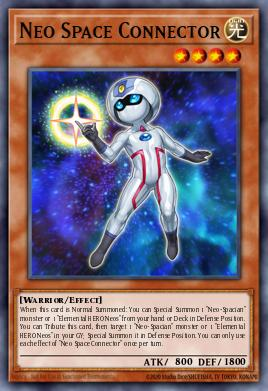 **Neo Space Connector**

### Ejecución numerada

#### Paso 1 — Invocar Normalmente Neo Space Connector. Activar efecto disparado CL1 y, al resolver, Invocar Especialmente Neo-Spacian Aqua Dolphin desde el Deck en Defensa.

 **NORMAL** → 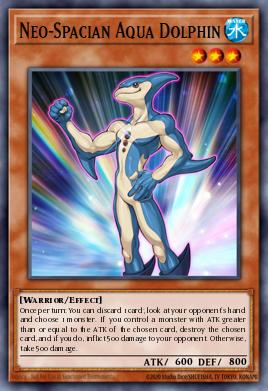 **ESPECIAL**

**Acción concreta:** Invocar Normalmente Neo Space Connector. Activar efecto disparado CL1 y, al resolver, Invocar Especialmente Neo-Spacian Aqua Dolphin desde el Deck en Defensa.
**Detalle técnico documentado:** Connector y Dolphin son Guerreros propios en Campo; Normal gastada; Dolphin no activó su efecto de descarte.

**Estado por zonas después del paso:**

| Zona/recurso | Estado narrativo A09 |
|---|---|
| Mano | 0 cartas de la mano mínima |
| Monstruos | Neo Space Connector #14085 (Ataque), Aqua Dolphin #6768 (Defensa) |
| Mágicas y trampas | ∅ |
| Cementerio | ∅ |
| Destierro propio | ∅ |
| Campo y estado rival | Sin respuesta; campo no determinado |
| Materiales Xyz/Fusión/Sincro | Ninguno |
| Normal, Extra, fase y restricciones | Normal gastada; Extra intacto |

**Campo visual de este paso:**

**Monstruos propios:**
-  **Neo Space Connector (Ataque)** — zona declarada: `MONSTER`.
-  **Aqua Dolphin (Defensa)** — zona declarada: `MONSTER`.
**Mágicas/Trampas/Campo:** sin carta propia demostrada en esta vista.
*Relación ilustrada de cartas presentes tras este paso, documentada en A09. La posición, materiales, otras zonas y rival se leen en la tabla de estado.*

#### Paso 2 — Usar ambos Guerreros como material para Invocar por Enlace Isolde, Two Tales of the Noble Knights (Link 2) desde Extra.

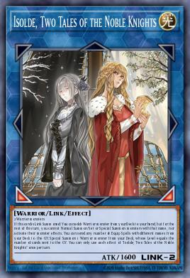 **MATERIAL / COSTE** →  **YA EN CAMPO** →  **YA EN CAMPO**

**Acción concreta:** Usar ambos Guerreros como material para Invocar por Enlace Isolde, Two Tales of the Noble Knights (Link 2) desde Extra.
**Detalle técnico documentado:** Connector y Dolphin al GY como materiales; Isolde en Campo.

**Estado por zonas después del paso:**

| Zona/recurso | Estado narrativo A09 |
|---|---|
| Mano | 0 cartas |
| Monstruos | Isolde #13500 (Enlace 2) |
| Mágicas y trampas | ∅ |
| Cementerio | Connector #14085, Aqua Dolphin #6768 |
| Destierro propio | ∅ |
| Campo y estado rival | Sin cambios acreditados |
| Materiales Xyz/Fusión/Sincro | Ninguno |
| Normal, Extra, fase y restricciones | Normal gastada; Isolde salió del Extra |

**Campo visual de este paso:**

**Monstruos propios:**
-  **Isolde (Enlace 2)** — zona declarada: `MONSTER`.
**Mágicas/Trampas/Campo:** sin carta propia demostrada en esta vista.
*Relación ilustrada de cartas presentes tras este paso, documentada en A09. La posición, materiales, otras zonas y rival se leen en la tabla de estado.*

#### Paso 3 — Efecto de Isolde al ser Invocada por Enlace: buscar Immortal Phoenix Gearfried del Deck a la mano.

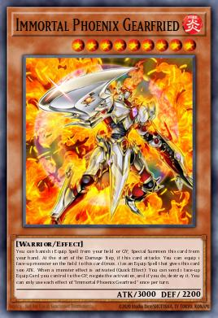 **AÑADIR A MANO**

**Acción concreta:** Efecto de Isolde al ser Invocada por Enlace: buscar Immortal Phoenix Gearfried del Deck a la mano.
**Detalle técnico documentado:** Durante el resto del turno, no Invocar Normal/Especial ni activar efectos de monstruos cuyo nombre sea Gearfried buscado. No intentar invocarlo este turno por este camino.

**Estado por zonas después del paso:**

| Zona/recurso | Estado narrativo A09 |
|---|---|
| Mano | Immortal Phoenix Gearfried #14801 (buscado; no puede Invocarse ni activar efectos este turno) |
| Monstruos | Isolde #13500 |
| Mágicas y trampas | ∅ |
| Cementerio | Connector #14085, Aqua Dolphin #6768 |
| Destierro propio | ∅ |
| Campo y estado rival | Sin cambios acreditados |
| Materiales Xyz/Fusión/Sincro | Ninguno |
| Normal, Extra, fase y restricciones | Normal gastada; Isolde en Campo |

**Campo visual de este paso:**

**Monstruos propios:**
-  **Isolde** — zona declarada: `MONSTER`.
**Mágicas/Trampas/Campo:** sin carta propia demostrada en esta vista.
*Relación ilustrada de cartas presentes tras este paso, documentada en A09. La posición, materiales, otras zonas y rival se leen en la tabla de estado.*

#### Paso 4 — Activar segundo efecto de Isolde: enviar 1 Equip Spell Durendal del Deck al GY como coste y seleccionar la Invocación de Renaud Nivel 1 desde Deck al resolver.

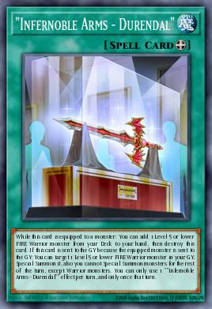 **ENVIAR** → 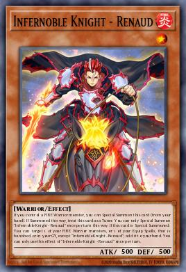 **MATERIAL / COSTE**

**Acción concreta:** Activar segundo efecto de Isolde: enviar 1 Equip Spell Durendal del Deck al GY como coste y seleccionar la Invocación de Renaud Nivel 1 desde Deck al resolver.
**Detalle técnico documentado:** Si el efecto no es negado, Renaud en Campo e Isolde permanece. No se emplearon más Equipos ni se supuso que Durendal seguía en Deck.

**Estado por zonas después del paso:**

| Zona/recurso | Estado narrativo A09 |
|---|---|
| Mano | Gearfried #14801 (restringido) |
| Monstruos | Isolde #13500, Renaud #15082 (Invocado del Deck; no Cantante por esta vía) |
| Mágicas y trampas | ∅ |
| Cementerio | Connector #14085, Aqua Dolphin #6768, Durendal #15287 (coste Isolde) |
| Destierro propio | ∅ |
| Campo y estado rival | Sin cambios acreditados |
| Materiales Xyz/Fusión/Sincro | Ninguno |
| Normal, Extra, fase y restricciones | Normal gastada; no se gastó más Extra |

**Campo visual de este paso:**

**Monstruos propios:**
-  **Isolde** — zona declarada: `MONSTER`.
-  **Renaud (Invocado del Deck; no Cantante por esta vía)** — zona declarada: `MONSTER`.
**Mágicas/Trampas/Campo:** sin carta propia demostrada en esta vista.
*Relación ilustrada de cartas presentes tras este paso, documentada en A09. La posición, materiales, otras zonas y rival se leen en la tabla de estado.*

#### Paso 5 — Al ser Invocado Especialmente, activar Renaud y seleccionar Durendal en GY para añadirlo a mano al resolver.

 **ACTIVAR** →  **OBJETIVO** →  **YA EN CAMPO**

**Acción concreta:** Al ser Invocado Especialmente, activar Renaud y seleccionar Durendal en GY para añadirlo a mano al resolver.
**Detalle técnico documentado:** Durendal en mano, Gearfried en mano, Isolde y Renaud en Campo.

**Estado por zonas después del paso:**

| Zona/recurso | Estado narrativo A09 |
|---|---|
| Mano | Gearfried #14801 (restringido), Durendal #15287 (recuperada) |
| Monstruos | Isolde #13500, Renaud #15082 (no Cantante por esta vía) |
| Mágicas y trampas | ∅ |
| Cementerio | Connector #14085, Aqua Dolphin #6768 |
| Destierro propio | ∅ |
| Campo y estado rival | Sin cambios acreditados |
| Materiales Xyz/Fusión/Sincro | Ninguno |
| Normal, Extra, fase y restricciones | Normal gastada; Isolde permanece |

**Campo visual de este paso:**

**Monstruos propios:**
-  **Isolde** — zona declarada: `MONSTER`.
-  **Renaud (no Cantante por esta vía)** — zona declarada: `MONSTER`.
**Mágicas/Trampas/Campo:** sin carta propia demostrada en esta vista.
*Relación ilustrada de cartas presentes tras este paso, documentada en A09. La posición, materiales, otras zonas y rival se leen en la tabla de estado.*

### Campo final documentado

Esta vista procede **del último paso**, no de una lista de cartas deducida del título.

**Monstruos propios:**
-  **Isolde** — zona declarada: `MONSTER`.
-  **Renaud (no Cantante por esta vía)** — zona declarada: `MONSTER`.
**Mágicas/Trampas/Campo:** sin carta propia demostrada en esta vista.
*Relación ilustrada de cartas presentes tras este paso, documentada en A09. La posición, materiales, otras zonas y rival se leen en la tabla de estado.*

| Zona/recurso | Estado final documentado |
|---|---|
| Mano | Gearfried #14801 (restringido), Durendal #15287 (recuperada) |
| Monstruos | Isolde #13500, Renaud #15082 (no Cantante por esta vía) |
| Mágicas y trampas | ∅ |
| Cementerio | Connector #14085, Aqua Dolphin #6768 |
| Destierro propio | ∅ |
| Campo y estado rival | Sin cambios acreditados |
| Materiales Xyz/Fusión/Sincro | Ninguno |
| Normal, Extra, fase y restricciones | Normal gastada; Isolde permanece |

### Si el oponente interrumpe

- **INTERRUPCIÓN A12 — paso 4: A12 — Ash al segundo efecto de Isolde en CONNECTOR:ISOLDE01, paso 4**
  - Rival con Ash disponible: Isolde activa su segundo efecto, envía 1 Durendal del Deck al GY como coste; el rival responde con Ash descartada, ya que la resolución incluiría Invocar Especialmente un Guerrero desde el Deck. Resolver Ash: efecto de Isolde negado, Renaud no se Invoca; coste Durendal ya pagado no se revierte.
  - Esto no niega retroactivamente la búsqueda de Gearfried que se resolvió antes. Fuente: Isolde y Ash. Estado.
  - Estado de rama: `Resuelto solo en el escenario que detalla A12/A13; las otras respuestas no están demostradas.`.
- **RECUPERACIÓN A13 — paso 4: A13 — Sin Renaud al negar segundo Isolde en CONNECTOR:ISOLDE01, paso 4**
  - Recursos consumidos: Normal de Connector, materiales Connector/Dolphin a GY, Equip Durendal del Deck a GY por coste, Ash rival de mano a GY.
  - Campo alternativo demostrado: Isolde sola en Campo; Gearfried sigue en mano, pero queda restringido por la búsqueda de Isolde este turno. Durendal sigue en GY, no se añade a mano y Renaud continúa en Deck.
  - Continuación con mano inicial mínima: SIN_CONTINUACION_DEMOSTRADA para llegar al mismo final Isolde + Renaud. Un extensor adicional requeriría mano diferente y nueva prueba. Estado.
  - Estado de rama: `Resuelto solo en el escenario que detalla A12/A13; las otras respuestas no están demostradas.`.

---

## MUSEUM · RENAUD · ISOLDE01 · `670:A09:MUSEUM:RENAUD:ISOLDE01`

**Propósito competitivo principal (lectura documental):** Ofensivo condicional. El objetivo solo se acredita si las acciones y el campo final detallados en esta guía lo permiten; no implica legalidad certificada ni garantiza el resultado ante respuestas adversarias.

**Categoría:** APERTURA

**Propósito y resultado documental:**

Endboard sin respuesta al pasar turno: Isolde Link 2 / 1600 ATK + segundo Renaud Nivel 1 (1000 ATK si Museo continúa aplicando su bonificación de +500 sobre el ATK original 500), Museo en Zona de Campo. Mano: Gearfried + Durendal; GY: primer Renaud, Fire Flint Lady y Almace; destierro: vacío; LP propios: iniciales −1200; Normal: gastada. No se activó el segundo efecto del Museo y, por tanto, no se atribuye su restricción condicional de Invocar únicamente Guerreros. Sin daño rival, destrucciones rivales ni negación garantizadas.

### Mano y estado inicial

Museo Museo de Armas Nobles + Renaud primer Infernoble Caballero Renaud. Deck: Durendal una Durendal, Fire Flint Fire Flint Lady, Infernoble Arms - Almace, segundo Renaud y Immortal Phoenix Gearfried (todos presentes en el inventario). Extra: Isolde una Isolde. Campo/GY/destierro propios vacíos, LP propios al menos 1201, Normal libre, Main Phase propia y sin respuesta rival, bloqueos ni efectos usados; Campo rival irrelevante.

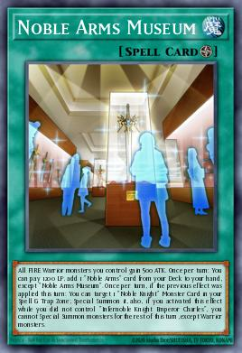 **Noble Arms Museum**
 **Infernoble Caballero Renaud**

### Ejecución numerada

#### Paso 1 — Activar Museo de Armas Nobles como Mágica de Campo (CL1, mano→Zona de Campo).

 **AÑADIR A MANO** →  **ESTADO / CONTEXTO**

**Acción concreta:** Activar Museo de Armas Nobles como Mágica de Campo (CL1, mano→Zona de Campo). En una cadena nueva, usar su búsqueda una vez pagando 1200 LP como coste; al resolver añadir Durendal desde Deck a mano. Museo permanece en Campo; se dispone de 1 Renaud y 1 Durendal en mano.
**Detalle técnico documentado:** En una cadena nueva, usar su búsqueda una vez pagando 1200 LP como coste; al resolver añadir Durendal desde Deck a mano. Museo permanece en Campo; se dispone de 1 Renaud y 1 Durendal en mano.

**Estado por zonas después del paso:**

| Zona/recurso | Estado narrativo A09 |
|---|---|
| Mano | Primer Renaud #15082, Durendal #15287 |
| Monstruos | ∅ |
| Mágicas y trampas | Museo #18844 (Campo) |
| Cementerio | ∅ |
| Destierro propio | ∅ |
| Campo y estado rival | Sin respuesta; campo no determinado |
| Materiales Xyz/Fusión/Sincro | Ninguno |
| Normal, Extra, fase y restricciones | Normal libre; Extra intacto; LP −1200 |

**Campo visual de este paso:**

**Monstruos propios:** sin carta propia demostrada en esta vista.
**Mágicas/Trampas/Campo:**
-  **Museo (Campo)** — zona declarada: `FIELD`.
*Relación ilustrada de cartas presentes tras este paso, documentada en A09. La posición, materiales, otras zonas y rival se leen en la tabla de estado.*

#### Paso 2 — Invocar Normalmente el primer Renaud (Nivel 1 Guerrero FUEGO) en Ataque.

 **NORMAL**

**Acción concreta:** Invocar Normalmente el primer Renaud (Nivel 1 Guerrero FUEGO) en Ataque. Consume la Normal. No activar aquí la búsqueda al GY de Renaud: solo se dispara si es Invocado Especialmente, no Normalmente.
**Detalle técnico documentado:** Consume la Normal. No activar aquí la búsqueda al GY de Renaud: solo se dispara si es Invocado Especialmente, no Normalmente.

**Estado por zonas después del paso:**

| Zona/recurso | Estado narrativo A09 |
|---|---|
| Mano | Durendal #15287 |
| Monstruos | Primer Renaud #15082 (Normal; no Cantante) |
| Mágicas y trampas | Museo #18844 |
| Cementerio | ∅ |
| Destierro propio | ∅ |
| Campo y estado rival | Sin cambios acreditados |
| Materiales Xyz/Fusión/Sincro | Ninguno |
| Normal, Extra, fase y restricciones | Normal gastada; Extra intacto |

**Campo visual de este paso:**

**Monstruos propios:**
-  **Primer Renaud (Normal; no Cantante)** — zona declarada: `MONSTER`.
**Mágicas/Trampas/Campo:**
-  **Museo** — zona declarada: `FIELD`.
*Relación ilustrada de cartas presentes tras este paso, documentada en A09. La posición, materiales, otras zonas y rival se leen en la tabla de estado.*

#### Paso 3 — Activar Durendal desde mano equipándola al Renaud en Campo.

 **ACTIVAR** →  **ACTIVAR** → 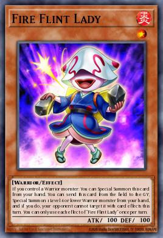 **AÑADIR A MANO**

**Acción concreta:** Activar Durendal desde mano equipándola al Renaud en Campo. En una cadena posterior, activar su primer efecto mientras está equipada; al resolver añadir Fire Flint Lady (Guerrero FUEGO Nivel 1) desde Deck a mano y después destruir la propia Durendal. Durendal va al GY por destrucción propia; no se invoca nada por su segundo efecto, ya que el monstruo equipado no fue enviado al GY. Renaud sigue en Campo.
**Detalle técnico documentado:** En una cadena posterior, activar su primer efecto mientras está equipada; al resolver añadir Fire Flint Lady (Guerrero FUEGO Nivel 1) desde Deck a mano y después destruir la propia Durendal. Durendal va al GY por destrucción propia; no se invoca nada por su segundo efecto, ya que el monstruo equipado no fue enviado al GY. Renaud sigue en Campo.

**Estado por zonas después del paso:**

| Zona/recurso | Estado narrativo A09 |
|---|---|
| Mano | Fire Flint Lady #15392 |
| Monstruos | Primer Renaud #15082 |
| Mágicas y trampas | Museo #18844 |
| Cementerio | Durendal #15287 (autodestruida) |
| Destierro propio | ∅ |
| Campo y estado rival | Sin cambios acreditados |
| Materiales Xyz/Fusión/Sincro | Ninguno |
| Normal, Extra, fase y restricciones | Normal gastada; Extra intacto |

**Campo visual de este paso:**

**Monstruos propios:**
-  **Primer Renaud** — zona declarada: `MONSTER`.
**Mágicas/Trampas/Campo:**
-  **Museo** — zona declarada: `FIELD`.
*Relación ilustrada de cartas presentes tras este paso, documentada en A09. La posición, materiales, otras zonas y rival se leen en la tabla de estado.*

#### Paso 4 — Como se controla un Guerrero, aplicar el procedimiento propio de Fire Flint Lady para Invocarla Especialmente de mano al Campo (una vez este turno).

 **ESTADO / CONTEXTO** →  **ESTADO / CONTEXTO**

**Acción concreta:** Como se controla un Guerrero, aplicar el procedimiento propio de Fire Flint Lady para Invocarla Especialmente de mano al Campo (una vez este turno). Ahora hay Renaud + Fire Flint Lady, dos Guerreros, y Museo boca arriba. No usar el segundo efecto de Fire Flint.
**Detalle técnico documentado:** Ahora hay Renaud + Fire Flint Lady, dos Guerreros, y Museo boca arriba. No usar el segundo efecto de Fire Flint.

**Estado por zonas después del paso:**

| Zona/recurso | Estado narrativo A09 |
|---|---|
| Mano | Vacía entre las dos cartas de apertura y búsquedas |
| Monstruos | Primer Renaud #15082, Fire Flint Lady #15392 |
| Mágicas y trampas | Museo #18844 |
| Cementerio | Durendal #15287 |
| Destierro propio | ∅ |
| Campo y estado rival | Sin cambios acreditados |
| Materiales Xyz/Fusión/Sincro | Ninguno |
| Normal, Extra, fase y restricciones | Normal gastada; Extra intacto |

**Campo visual de este paso:**

**Monstruos propios:**
-  **Primer Renaud** — zona declarada: `MONSTER`.
-  **Fire Flint Lady** — zona declarada: `MONSTER`.
**Mágicas/Trampas/Campo:**
-  **Museo** — zona declarada: `FIELD`.
*Relación ilustrada de cartas presentes tras este paso, documentada en A09. La posición, materiales, otras zonas y rival se leen en la tabla de estado.*

#### Paso 5 — Invocar por Enlace Isolde Link 2 (ATK 1600) desde Extra usando Renaud y Fire Flint Lady como materiales: ambos van al GY.

 **ENLACE** →  **ENLACE** →  **AÑADIR A MANO**

**Acción concreta:** Invocar por Enlace Isolde Link 2 (ATK 1600) desde Extra usando Renaud y Fire Flint Lady como materiales: ambos van al GY. En cadena nueva, activar el efecto de Isolde por Invocación Enlace CL1: buscar Immortal Phoenix Gearfried desde Deck a mano. Desde esta búsqueda, no Invocar ni activar efectos del Gearfried buscado durante el resto del turno; no afirmar que llega al Campo.
**Detalle técnico documentado:** En cadena nueva, activar el efecto de Isolde por Invocación Enlace CL1: buscar Immortal Phoenix Gearfried desde Deck a mano. Desde esta búsqueda, no Invocar ni activar efectos del Gearfried buscado durante el resto del turno; no afirmar que llega al Campo.

**Estado por zonas después del paso:**

| Zona/recurso | Estado narrativo A09 |
|---|---|
| Mano | Gearfried #14801 (buscado y restringido este turno) |
| Monstruos | Isolde #13500 |
| Mágicas y trampas | Museo #18844 |
| Cementerio | Primer Renaud #15082, Fire Flint Lady #15392, Durendal #15287 |
| Destierro propio | ∅ |
| Campo y estado rival | Sin cambios acreditados |
| Materiales Xyz/Fusión/Sincro | Ninguno |
| Normal, Extra, fase y restricciones | Normal gastada; Isolde salió del Extra |

**Campo visual de este paso:**

**Monstruos propios:**
-  **Isolde** — zona declarada: `MONSTER`.
**Mágicas/Trampas/Campo:**
-  **Museo** — zona declarada: `FIELD`.
*Relación ilustrada de cartas presentes tras este paso, documentada en A09. La posición, materiales, otras zonas y rival se leen en la tabla de estado.*

#### Paso 6 — En Main Phase, activar el otro efecto de Isolde: enviar Almace (1 Mágica de Equipo de nombre distinto) desde Deck al GY como COSTE.

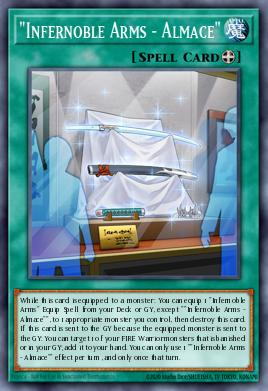 **ENVIAR** →  **ESPECIAL**

**Acción concreta:** En Main Phase, activar el otro efecto de Isolde: enviar Almace (1 Mágica de Equipo de nombre distinto) desde Deck al GY como COSTE. Al resolver, Invocar Especialmente el segundo Renaud de Nivel 1 desde Deck (distinto ejemplar del que sirvió como material). La primera copia está en GY; no está simultáneamente en Campo.
**Detalle técnico documentado:** Al resolver, Invocar Especialmente el segundo Renaud de Nivel 1 desde Deck (distinto ejemplar del que sirvió como material). La primera copia está en GY; no está simultáneamente en Campo.

**Estado por zonas después del paso:**

| Zona/recurso | Estado narrativo A09 |
|---|---|
| Mano | Gearfried #14801 (restringido) |
| Monstruos | Isolde #13500, segundo Renaud #15082 (desde Deck) |
| Mágicas y trampas | Museo #18844 |
| Cementerio | Primer Renaud #15082, Fire Flint Lady #15392, Durendal #15287, Almace #18843 (coste) |
| Destierro propio | ∅ |
| Campo y estado rival | Sin cambios acreditados |
| Materiales Xyz/Fusión/Sincro | Ninguno |
| Normal, Extra, fase y restricciones | Normal gastada; Isolde permanece |

**Campo visual de este paso:**

**Monstruos propios:**
-  **Isolde** — zona declarada: `MONSTER`.
-  **segundo Renaud (desde Deck)** — zona declarada: `MONSTER`.
**Mágicas/Trampas/Campo:**
-  **Museo** — zona declarada: `FIELD`.
*Relación ilustrada de cartas presentes tras este paso, documentada en A09. La posición, materiales, otras zonas y rival se leen en la tabla de estado.*

#### Paso 7 — Por esa Invocación Especial, activar el efecto del segundo Renaud en una cadena posterior seleccionando Durendal en el GY (Mágica de Equipo propia).

 **ESPECIAL** →  **ESPECIAL**

**Acción concreta:** Por esa Invocación Especial, activar el efecto del segundo Renaud en una cadena posterior seleccionando Durendal en el GY (Mágica de Equipo propia). Al resolver añadir Durendal del GY a mano; no se gastó la invocación especial propia de Renaud desde mano ni se lo trató como Cantante.
**Detalle técnico documentado:** Al resolver añadir Durendal del GY a mano; no se gastó la invocación especial propia de Renaud desde mano ni se lo trató como Cantante.

**Estado por zonas después del paso:**

| Zona/recurso | Estado narrativo A09 |
|---|---|
| Mano | Gearfried #14801 (restringido), Durendal #15287 (recuperada) |
| Monstruos | Isolde #13500, segundo Renaud #15082 |
| Mágicas y trampas | Museo #18844 |
| Cementerio | Primer Renaud #15082, Fire Flint Lady #15392, Almace #18843 |
| Destierro propio | ∅ |
| Campo y estado rival | Sin cambios acreditados |
| Materiales Xyz/Fusión/Sincro | Ninguno |
| Normal, Extra, fase y restricciones | Normal gastada; Isolde permanece |

**Campo visual de este paso:**

**Monstruos propios:**
-  **Isolde** — zona declarada: `MONSTER`.
-  **segundo Renaud** — zona declarada: `MONSTER`.
**Mágicas/Trampas/Campo:**
-  **Museo** — zona declarada: `FIELD`.
*Relación ilustrada de cartas presentes tras este paso, documentada en A09. La posición, materiales, otras zonas y rival se leen en la tabla de estado.*

### Campo final documentado

Esta vista procede **del último paso**, no de una lista de cartas deducida del título.

**Monstruos propios:**
-  **Isolde** — zona declarada: `MONSTER`.
-  **segundo Renaud** — zona declarada: `MONSTER`.
**Mágicas/Trampas/Campo:**
-  **Museo** — zona declarada: `FIELD`.
*Relación ilustrada de cartas presentes tras este paso, documentada en A09. La posición, materiales, otras zonas y rival se leen en la tabla de estado.*

| Zona/recurso | Estado final documentado |
|---|---|
| Mano | Gearfried #14801 (restringido), Durendal #15287 (recuperada) |
| Monstruos | Isolde #13500, segundo Renaud #15082 |
| Mágicas y trampas | Museo #18844 |
| Cementerio | Primer Renaud #15082, Fire Flint Lady #15392, Almace #18843 |
| Destierro propio | ∅ |
| Campo y estado rival | Sin cambios acreditados |
| Materiales Xyz/Fusión/Sincro | Ninguno |
| Normal, Extra, fase y restricciones | Normal gastada; Isolde permanece |

### Si el oponente interrumpe

- **INTERRUPCIÓN A12 — paso 6: A12 — Ash al segundo efecto de Isolde en MUSEUM:RENAUD:ISOLDE01, paso 6**
  - Precondición exclusiva de esta variante: Museo permanece boca arriba; se pagaron 1200 LP para su búsqueda, la primera Renaud y Fire Flint Lady se usaron para Invocar Isolde (P5), Durendal se destruyó al resolver su propia búsqueda (P3) y Gearfried ya fue añadido desde Deck. Isolde tiene pendiente su segundo efecto en P6, no el primero.
  - CL1: activar el segundo efecto de Isolde y enviar Almace (no Durendal) del Deck al GY como coste; el efecto, de resolver, Invocaría Especialmente un segundo Renaud Nivel 1 desde Deck. CL2: rival descarta Ash Blossom legalmente porque CL1 incluye Invocar desde Deck. Al resolver CL2, Ash niega ese efecto; CL1 ya no Invoca Renaud. Almace sigue en GY: negar el efecto no recupera el coste.
  - Consecuencia directa: sin segundo Renaud en Campo no se produce el disparo P7 de recuperar Durendal desde GY. La búsqueda previa de Gearfried y los 1200 LP pagados por Museo no se revierten. Se conservan las restricciones previamente aplicadas a Gearfried. Fuentes Isolde (CID 13500), Ash (CID 12950)..
  - Estado de rama: `Resuelto solo en el escenario que detalla A12/A13; las otras respuestas no están demostradas.`.
- **RECUPERACIÓN A13 — paso 6: A13 — Sin segundo Renaud en MUSEUM:RENAUD:ISOLDE01, paso 6**
  - Zona/recurso | Estado tras CL2 Ash y resolución negada de CL1 Isolde
  - Monstruos propios | Isolde Link-2 boca arriba; no se Invoca al segundo Renaud
  - Mágicas/Trampas | Museo en Zona de Campo; Durendal ya se autodestruyó en P3
  - Mano propia | Gearfried buscado en P5, bajo restricción de nombre de Isolde; no se recuperó Durendal
  - Cementerio propio | Primer Renaud, Fire Flint Lady, Durendal y Almace enviado por coste de P6
  - Otros recursos | Normal gastada; LP iniciales menos 1200; segundo Renaud permanece en Deck; Ash rival descartada al GY
  - Resultado: en esta mano mínima SIN_CONTINUACION_DEMOSTRADA para alcanzar Isolde + Renaud y recuperar Durendal, porque P7 dependía de que Renaud fuese Invocado. No trasladar a esta ruta el GY de Connector/Dolphin ni afirmar que Durendal fue enviada como coste por Isolde: esos elementos pertenecen solo a CONNECTOR:ISOLDE01. Estado: bajo la hipótesis exacta A12; el resto de respuestas sigue pendiente.
  - Estado de rama: `Resuelto solo en el escenario que detalla A12/A13; las otras respuestas no están demostradas.`.

---

## OGIER · RENAUD · ANGELICA01 · `670:A09:OGIER:RENAUD:ANGELICA01`

**Propósito competitivo principal (lectura documental):** Preparación de recursos / despliegue. El objetivo solo se acredita si las acciones y el campo final detallados en esta guía lo permiten; no implica legalidad certificada ni garantiza el resultado ante respuestas adversarias.

**Categoría:** APERTURA

**Propósito y resultado documental:**

Endboard sin respuesta: Angélica + Museo propios; dos Equipos utilizables posteriormente, sin Equipos aplicados aún. El efecto de Angélica que puede desterrarla y traer Roland solo se abre si es seleccionada en Campo por ataque o por activación de carta/efecto y se envía un Guerrero FUEGO desde Deck; esto NO ocurrió en la ruta mostrada. No se inventa a Roland. Riesgos: negar Ogier impide preparar Durendal; negar Renaud impide recuperarla, aunque la Sincronía todavía podría ser legal; impedir la Sincronía cancela la búsqueda de Museo.

### Mano y estado inicial

Ogier Infernoble Knight Ogier Nivel 4 y Renaud Infernoble Knight - Renaud Nivel 1. Deck: Durendal Infernoble Arms - Durendal, Museo Noble Arms Museum, Almace Infernoble Arms - Almace, una copia de cada una como mínimo, sin suponer que ya estén en mano. Extra: Angélica Angelica, Princess of Noble Arms, Sincronía Nivel 5. Estado propio: Campo/GY/destierro vacíos, Main Phase, Normal disponible, LP ≥ 1201, sin efectos usados; rival no responde.

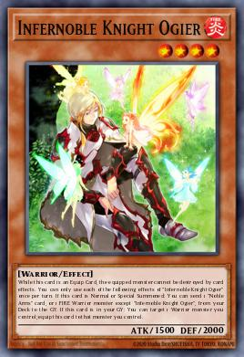 **Infernoble Caballero Ogier**
 **Infernoble Caballero Renaud**

### Ejecución numerada

#### Paso 1 — Invocar Normalmente Ogier Nivel 4, activar su efecto de Invocación y enviar Durendal (carta «Noble Arms») desde el Deck al GY.

 **NORMAL**

**Acción concreta:** Invocar Normalmente Ogier Nivel 4, activar su efecto de Invocación y enviar Durendal (carta «Noble Arms») desde el Deck al GY.
**Detalle técnico documentado:** Ogier propio en Campo; Durendal en GY; Normal consumida. No se buscó todavía nada.

**Estado por zonas después del paso:**

| Zona/recurso | Estado narrativo A09 |
|---|---|
| Mano | Renaud #15082 |
| Monstruos | Ogier #15247 (Normal, Nivel 4) |
| Mágicas y trampas | ∅ |
| Cementerio | Durendal #15287 (enviada desde Deck) |
| Destierro propio | ∅ |
| Campo y estado rival | Sin respuesta; campo no determinado |
| Materiales Xyz/Fusión/Sincro | Ninguno |
| Normal, Extra, fase y restricciones | Normal gastada; Extra intacto |

**Campo visual de este paso:**

**Monstruos propios:**
-  **Ogier (Normal, Nivel 4)** — zona declarada: `MONSTER`.
**Mágicas/Trampas/Campo:** sin carta propia demostrada en esta vista.
*Relación ilustrada de cartas presentes tras este paso, documentada en A09. La posición, materiales, otras zonas y rival se leen en la tabla de estado.*

#### Paso 2 — Como se controla un Guerrero FUEGO, Invocar Especialmente Renaud desde mano por su procedimiento propio.

 **ESPECIAL** →  **OBJETIVO**

**Acción concreta:** Como se controla un Guerrero FUEGO, Invocar Especialmente Renaud desde mano por su procedimiento propio. Solo por esta vía Renaud se trata como Cantante. Al ser Invocado Especialmente, activar su efecto seleccionando Durendal del GY; resolver añadiéndola a la mano.
**Detalle técnico documentado:** Solo por esta vía Renaud se trata como Cantante. Al ser Invocado Especialmente, activar su efecto seleccionando Durendal del GY; resolver añadiéndola a la mano. Campo: Ogier Nivel 4 no Cantante + Renaud Nivel 1 Cantante. Mano: Durendal; GY: sin Durendal. Se usó la invocación propia de Renaud una vez.

**Estado por zonas después del paso:**

| Zona/recurso | Estado narrativo A09 |
|---|---|
| Mano | Durendal #15287 (recuperada) |
| Monstruos | Ogier #15247 (Nivel 4), Renaud #15082 (Nivel 1 Cantante por procedimiento propio) |
| Mágicas y trampas | ∅ |
| Cementerio | ∅ |
| Destierro propio | ∅ |
| Campo y estado rival | Sin cambios acreditados |
| Materiales Xyz/Fusión/Sincro | Ninguno |
| Normal, Extra, fase y restricciones | Normal gastada; Extra intacto |

**Campo visual de este paso:**

**Monstruos propios:**
-  **Ogier (Nivel 4)** — zona declarada: `MONSTER`.
-  **Renaud (Nivel 1 Cantante por procedimiento propio)** — zona declarada: `MONSTER`.
**Mágicas/Trampas/Campo:** sin carta propia demostrada en esta vista.
*Relación ilustrada de cartas presentes tras este paso, documentada en A09. La posición, materiales, otras zonas y rival se leen en la tabla de estado.*

#### Paso 3 — Usar esos dos monstruos (niveles 4+1=5) para Invocar por Sincronía a Angélica Nivel 5 desde Extra en zona legal.

 **YA EN CAMPO**

**Acción concreta:** Usar esos dos monstruos (niveles 4+1=5) para Invocar por Sincronía a Angélica Nivel 5 desde Extra en zona legal.
**Detalle técnico documentado:** Ogier y Renaud al GY como materiales; Angélica en Campo. No confundir su condición de Cantante en la Sincronía con las vías alternativas de Invocación de Renaud.

**Estado por zonas después del paso:**

| Zona/recurso | Estado narrativo A09 |
|---|---|
| Mano | Durendal #15287 |
| Monstruos | Angélica #18827 (Sincronía Nivel 5) |
| Mágicas y trampas | ∅ |
| Cementerio | Ogier #15247, Renaud #15082 (materiales de Sincronía) |
| Destierro propio | ∅ |
| Campo y estado rival | Sin cambios acreditados |
| Materiales Xyz/Fusión/Sincro | Ninguno: Sincronía no tiene materiales acoplados |
| Normal, Extra, fase y restricciones | Normal gastada; Angélica salió de Extra |

**Campo visual de este paso:**

**Monstruos propios:**
- 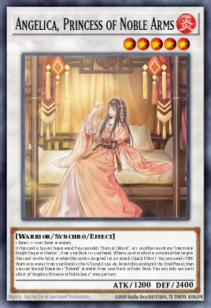 **Angélica (Sincronía Nivel 5)** — zona declarada: `MONSTER`.
**Mágicas/Trampas/Campo:** sin carta propia demostrada en esta vista.
*Relación ilustrada de cartas presentes tras este paso, documentada en A09. La posición, materiales, otras zonas y rival se leen en la tabla de estado.*

#### Paso 4 — Por haber sido Invocada Especialmente, activar Angélica y añadir Noble Arms Museum desde Deck a la mano.

 **AÑADIR A MANO** → 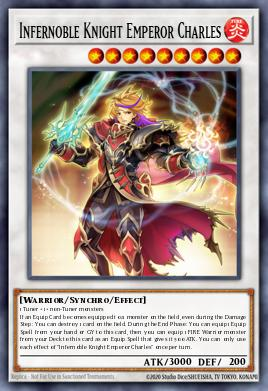 **ESTADO / CONTEXTO** →  **YA EN CAMPO**

**Acción concreta:** Por haber sido Invocada Especialmente, activar Angélica y añadir Noble Arms Museum desde Deck a la mano. La elección es válida porque el texto de Museo menciona «Infernoble Knight Emperor Charles»; no se sustituye por una carta sin mención.
**Detalle técnico documentado:** La elección es válida porque el texto de Museo menciona «Infernoble Knight Emperor Charles»; no se sustituye por una carta sin mención. Mano: Durendal + Museo; Angélica en Campo; se usó una vez su efecto de búsqueda.

**Estado por zonas después del paso:**

| Zona/recurso | Estado narrativo A09 |
|---|---|
| Mano | Durendal #15287, Museo #18844 |
| Monstruos | Angélica #18827 |
| Mágicas y trampas | ∅ |
| Cementerio | Ogier #15247, Renaud #15082 |
| Destierro propio | ∅ |
| Campo y estado rival | Sin cambios acreditados |
| Materiales Xyz/Fusión/Sincro | Ninguno |
| Normal, Extra, fase y restricciones | Normal gastada; Angélica permanece |

**Campo visual de este paso:**

**Monstruos propios:**
-  **Angélica** — zona declarada: `MONSTER`.
**Mágicas/Trampas/Campo:** sin carta propia demostrada en esta vista.
*Relación ilustrada de cartas presentes tras este paso, documentada en A09. La posición, materiales, otras zonas y rival se leen en la tabla de estado.*

#### Paso 5 — Activar Museo como Mágica de Campo; en una cadena nueva pagar 1200 LP como COSTE de su búsqueda, añadir Infernoble Arms - Almace desde Deck a la mano.

 **MATERIAL / COSTE** →  **ESTADO / CONTEXTO** →  **ESTADO / CONTEXTO**

**Acción concreta:** Activar Museo como Mágica de Campo; en una cadena nueva pagar 1200 LP como COSTE de su búsqueda, añadir Infernoble Arms - Almace desde Deck a la mano.
**Detalle técnico documentado:** Final: Angélica boca arriba (ATK original 1200; 1700 mientras Museo dé +500 a Guerreros FUEGO), Museo en Zona de Campo; Durendal + Almace en mano; Ogier y Renaud en GY; Normal gastada; LP propios iniciales −1200. No hubo objetivo rival ni Fusión/Enlace.

**Estado por zonas después del paso:**

| Zona/recurso | Estado narrativo A09 |
|---|---|
| Mano | Durendal #15287, Almace #18843 |
| Monstruos | Angélica #18827 (1700 ATK bajo Museo) |
| Mágicas y trampas | Museo #18844 (Campo) |
| Cementerio | Ogier #15247, Renaud #15082 |
| Destierro propio | ∅ |
| Campo y estado rival | Sin cambios acreditados |
| Materiales Xyz/Fusión/Sincro | Ninguno |
| Normal, Extra, fase y restricciones | Normal gastada; Angélica permanece; LP −1200 |

**Campo visual de este paso:**

**Monstruos propios:**
-  **Angélica (1700 ATK bajo Museo)** — zona declarada: `MONSTER`.
**Mágicas/Trampas/Campo:**
-  **Museo (Campo)** — zona declarada: `FIELD`.
*Relación ilustrada de cartas presentes tras este paso, documentada en A09. La posición, materiales, otras zonas y rival se leen en la tabla de estado.*

### Campo final documentado

Esta vista procede **del último paso**, no de una lista de cartas deducida del título.

**Monstruos propios:**
-  **Angélica (1700 ATK bajo Museo)** — zona declarada: `MONSTER`.
**Mágicas/Trampas/Campo:**
-  **Museo (Campo)** — zona declarada: `FIELD`.
*Relación ilustrada de cartas presentes tras este paso, documentada en A09. La posición, materiales, otras zonas y rival se leen en la tabla de estado.*

| Zona/recurso | Estado final documentado |
|---|---|
| Mano | Durendal #15287, Almace #18843 |
| Monstruos | Angélica #18827 (1700 ATK bajo Museo) |
| Mágicas y trampas | Museo #18844 (Campo) |
| Cementerio | Ogier #15247, Renaud #15082 |
| Destierro propio | ∅ |
| Campo y estado rival | Sin cambios acreditados |
| Materiales Xyz/Fusión/Sincro | Ninguno |
| Normal, Extra, fase y restricciones | Normal gastada; Angélica permanece; LP −1200 |

### Si el oponente interrumpe

No se documenta una continuación alternativa con los recursos indicados.

---

## WANTED · DIABELLSTAR · OGIER01 · `670:A09:WANTED:DIABELLSTAR:OGIER01`

**Propósito competitivo principal (lectura documental):** Ofensivo condicional. El objetivo solo se acredita si las acciones y el campo final detallados en esta guía lo permiten; no implica legalidad certificada ni garantiza el resultado ante respuestas adversarias.

**Categoría:** APERTURA

**Propósito y resultado documental:**

Endboard exacto sin respuesta: Ogier Ogier en Campo, protegido de selección por efectos rivales solo durante este turno; GY: WANTED, Ash Blossom, Diabellstar, Original, Fire Flint Lady, Renaud; mano: 0 de las tres cartas iniciales; Normal: libre; Extra usado: ninguno. El campo rival permanece como estaba, sin daño ni interrupción asegurados. Es una preparación de GY, no un endboard de control ni una ruta verificada a Charles.

### Mano y estado inicial

WANTED WANTED: Seeker of Sinful Spoils, Ash Blossom Ash Blossom & Joyous Spring (carta que se enviará al GY, no se activa su efecto) y Ogier Infernoble Knight Ogier, Guerrero FUEGO Nivel 4. Deck: Diabellstar Diabellstar, Original Original Sinful Spoils - Snake-Eye, Lady Fire Flint Lady y Renaud Infernoble Knight Renaud. Estado propio: Campo/GY/destierro vacíos, Main Phase, Normal disponible; sin efectos bloqueantes ni intervención rival. Ninguna carta del Extra es necesaria.

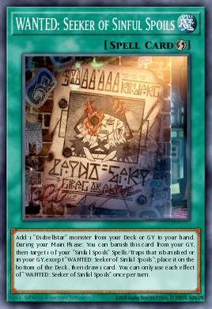 **WANTED: Seeker of Sinful Spoils**
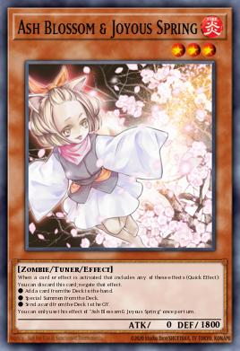 **Ash Blossom & Joyous Spring**
 **Infernoble Caballero Ogier**

### Ejecución numerada

#### Paso 1 — Activar WANTED de mano; al resolver buscar Diabellstar del Deck y añadirla a mano.

 **ACTIVAR** → 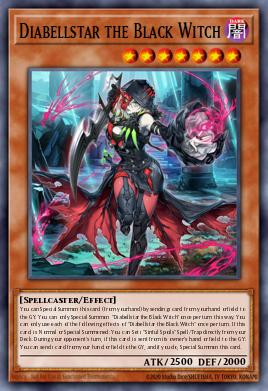 **AÑADIR A MANO**

**Acción concreta:** Activar WANTED de mano; al resolver buscar Diabellstar del Deck y añadirla a mano.
**Detalle técnico documentado:** WANTED pasa al GY. Mano ahora: Diabellstar, Ash y Ogier. Aún no se controlan monstruos.

**Estado por zonas después del paso:**

| Zona/recurso | Estado narrativo A09 |
|---|---|
| Mano | Diabellstar #19148, Ash #12950, Ogier #15247 |
| Monstruos | ∅ |
| Mágicas y trampas | ∅ |
| Cementerio | WANTED #19196 |
| Destierro propio | ∅ |
| Campo y estado rival | Sin respuesta; campo no determinado |
| Materiales Xyz/Fusión/Sincro | Ninguno |
| Normal, Extra, fase y restricciones | Normal libre; Extra intacto |

**Campo visual de este paso:**

**Monstruos propios:** sin carta propia demostrada en esta vista.
**Mágicas/Trampas/Campo:** sin carta propia demostrada en esta vista.
*Relación ilustrada de cartas presentes tras este paso, documentada en A09. La posición, materiales, otras zonas y rival se leen en la tabla de estado.*

#### Paso 2 — Invocar Especialmente Diabellstar desde mano por su procedimiento, enviando Ash desde mano al GY. No se describe el envío como descarte ni como destrucción.

 **ESPECIAL** →  **ESTADO / CONTEXTO**

**Acción concreta:** Invocar Especialmente Diabellstar desde mano por su procedimiento, enviando Ash desde mano al GY. No se describe el envío como descarte ni como destrucción.
**Detalle técnico documentado:** Campo: Diabellstar. GY: WANTED y Ash. Mano: Ogier. Normal intacta.

**Estado por zonas después del paso:**

| Zona/recurso | Estado narrativo A09 |
|---|---|
| Mano | Ogier #15247 |
| Monstruos | Diabellstar #19148 (Invocada enviando Ash, no descartándola) |
| Mágicas y trampas | ∅ |
| Cementerio | WANTED #19196, Ash #12950 |
| Destierro propio | ∅ |
| Campo y estado rival | Sin cambios acreditados |
| Materiales Xyz/Fusión/Sincro | Ninguno |
| Normal, Extra, fase y restricciones | Normal libre; Extra intacto |

**Campo visual de este paso:**

**Monstruos propios:**
-  **Diabellstar (Invocada enviando Ash, no descartándola)** — zona declarada: `MONSTER`.
**Mágicas/Trampas/Campo:** sin carta propia demostrada en esta vista.
*Relación ilustrada de cartas presentes tras este paso, documentada en A09. La posición, materiales, otras zonas y rival se leen en la tabla de estado.*

#### Paso 3 — Por haber sido Invocada, activar el efecto de Diabellstar en cadena nueva para Colocar desde el Deck Original Sinful Spoils - Snake-Eye directamente en zona de Mágicas/Trampas.

 **ACTIVAR** → 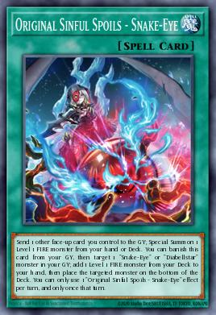 **COLOCAR** →  **COLOCAR**

**Acción concreta:** Por haber sido Invocada, activar el efecto de Diabellstar en cadena nueva para Colocar desde el Deck Original Sinful Spoils - Snake-Eye directamente en zona de Mágicas/Trampas.
**Detalle técnico documentado:** Original queda Colocada; Diabellstar sigue boca arriba. Solo se ha buscado/Colocado la carta realmente registrada.

**Estado por zonas después del paso:**

| Zona/recurso | Estado narrativo A09 |
|---|---|
| Mano | Ogier #15247 |
| Monstruos | Diabellstar #19148 |
| Mágicas y trampas | Original Sinful Spoils #19199 (Colocada desde Deck) |
| Cementerio | WANTED #19196, Ash #12950 |
| Destierro propio | ∅ |
| Campo y estado rival | Sin cambios acreditados |
| Materiales Xyz/Fusión/Sincro | Ninguno |
| Normal, Extra, fase y restricciones | Normal libre; Extra intacto |

**Campo visual de este paso:**

**Monstruos propios:**
-  **Diabellstar** — zona declarada: `MONSTER`.
**Mágicas/Trampas/Campo:**
-  **Original Sinful Spoils (Colocada desde Deck)** — zona declarada: `SPELL_TRAP`.
*Relación ilustrada de cartas presentes tras este paso, documentada en A09. La posición, materiales, otras zonas y rival se leen en la tabla de estado.*

#### Paso 4 — Durante esta Main Phase, activar Original, Mágica Normal Colocada ese mismo turno, que sí puede activarse el turno en que fue Colocada.

 **ENVIAR** →  **ESPECIAL**

**Acción concreta:** Durante esta Main Phase, activar Original, Mágica Normal Colocada ese mismo turno, que sí puede activarse el turno en que fue Colocada. Enviar la Diabellstar boca arriba que se controla al GY como COSTE, una carta distinta de Original; al resolver Invocar Especialmente Fire Flint Lady Nivel 1 FUEGO desde Deck.
**Detalle técnico documentado:** Enviar la Diabellstar boca arriba que se controla al GY como COSTE, una carta distinta de Original; al resolver Invocar Especialmente Fire Flint Lady Nivel 1 FUEGO desde Deck. Diabellstar y Original quedan GY; Lady en Campo. No se añade Lady a mano. Se ha utilizado el efecto de invocación desde Deck de Original, no su efecto de GY.

**Estado por zonas después del paso:**

| Zona/recurso | Estado narrativo A09 |
|---|---|
| Mano | Ogier #15247 |
| Monstruos | Fire Flint Lady #15392 (desde Deck) |
| Mágicas y trampas | ∅ |
| Cementerio | WANTED #19196, Ash #12950, Diabellstar #19148 (coste), Original #19199 |
| Destierro propio | ∅ |
| Campo y estado rival | Sin cambios acreditados |
| Materiales Xyz/Fusión/Sincro | Ninguno |
| Normal, Extra, fase y restricciones | Normal libre; Extra intacto |

**Campo visual de este paso:**

**Monstruos propios:**
-  **Fire Flint Lady (desde Deck)** — zona declarada: `MONSTER`.
**Mágicas/Trampas/Campo:** sin carta propia demostrada en esta vista.
*Relación ilustrada de cartas presentes tras este paso, documentada en A09. La posición, materiales, otras zonas y rival se leen en la tabla de estado.*

#### Paso 5 — Activar el efecto de Fire Flint Lady enviándola desde el Campo al GY como COSTE; al resolver Invocar Especialmente Ogier desde la mano (Guerrero de Nivel 4).

 **AÑADIR A MANO**

**Acción concreta:** Activar el efecto de Fire Flint Lady enviándola desde el Campo al GY como COSTE; al resolver Invocar Especialmente Ogier desde la mano (Guerrero de Nivel 4).
**Detalle técnico documentado:** Campo: Ogier; GY agrega Fire Flint Lady. Este turno el rival no puede seleccionar con efectos de cartas al Ogier Invocado por Lady. No equivale a inmunidad a destrucción sin seleccionar.

**Estado por zonas después del paso:**

| Zona/recurso | Estado narrativo A09 |
|---|---|
| Mano | Vacía: se invocó Ogier de mano |
| Monstruos | Ogier #15247 (protección contra selección por efecto rival este turno) |
| Mágicas y trampas | ∅ |
| Cementerio | WANTED #19196, Ash #12950, Diabellstar #19148, Original #19199, Fire Flint Lady #15392 (coste) |
| Destierro propio | ∅ |
| Campo y estado rival | Sin cambios acreditados |
| Materiales Xyz/Fusión/Sincro | Ninguno |
| Normal, Extra, fase y restricciones | Normal libre; Extra intacto |

**Campo visual de este paso:**

**Monstruos propios:**
-  **Ogier (protección contra selección por efecto rival este turno)** — zona declarada: `MONSTER`.
**Mágicas/Trampas/Campo:** sin carta propia demostrada en esta vista.
*Relación ilustrada de cartas presentes tras este paso, documentada en A09. La posición, materiales, otras zonas y rival se leen en la tabla de estado.*

#### Paso 6 — Como Ogier fue Invocado Especialmente, activar su efecto de invocación para enviar un Infernoble Knight Renaud del Deck al GY.

 **ENVIAR**

**Acción concreta:** Como Ogier fue Invocado Especialmente, activar su efecto de invocación para enviar un Infernoble Knight Renaud del Deck al GY.
**Detalle técnico documentado:** Final: Ogier en Campo; Renaud en GY junto a los gastos anteriores. La Normal continúa disponible; no hay Fusión/Sincronía/Enlace ejecutada ni negación asegurada.

**Estado por zonas después del paso:**

| Zona/recurso | Estado narrativo A09 |
|---|---|
| Mano | Vacía: 3 cartas iniciales invertidas |
| Monstruos | Ogier #15247 (protección contra selección durante este turno) |
| Mágicas y trampas | ∅ |
| Cementerio | WANTED #19196, Ash #12950, Diabellstar #19148, Original #19199, Fire Flint Lady #15392, Renaud #15082 (desde Deck) |
| Destierro propio | ∅ |
| Campo y estado rival | Sin cambios acreditados |
| Materiales Xyz/Fusión/Sincro | Ninguno |
| Normal, Extra, fase y restricciones | Normal libre; Extra intacto |

**Campo visual de este paso:**

**Monstruos propios:**
-  **Ogier (protección contra selección durante este turno)** — zona declarada: `MONSTER`.
**Mágicas/Trampas/Campo:** sin carta propia demostrada en esta vista.
*Relación ilustrada de cartas presentes tras este paso, documentada en A09. La posición, materiales, otras zonas y rival se leen en la tabla de estado.*

### Campo final documentado

Esta vista procede **del último paso**, no de una lista de cartas deducida del título.

**Monstruos propios:**
-  **Ogier (protección contra selección durante este turno)** — zona declarada: `MONSTER`.
**Mágicas/Trampas/Campo:** sin carta propia demostrada en esta vista.
*Relación ilustrada de cartas presentes tras este paso, documentada en A09. La posición, materiales, otras zonas y rival se leen en la tabla de estado.*

| Zona/recurso | Estado final documentado |
|---|---|
| Mano | Vacía: 3 cartas iniciales invertidas |
| Monstruos | Ogier #15247 (protección contra selección durante este turno) |
| Mágicas y trampas | ∅ |
| Cementerio | WANTED #19196, Ash #12950, Diabellstar #19148, Original #19199, Fire Flint Lady #15392, Renaud #15082 (desde Deck) |
| Destierro propio | ∅ |
| Campo y estado rival | Sin cambios acreditados |
| Materiales Xyz/Fusión/Sincro | Ninguno |
| Normal, Extra, fase y restricciones | Normal libre; Extra intacto |

### Si el oponente interrumpe

No se documenta una continuación alternativa con los recursos indicados.

---

## CONNECTOR · DURENDAL02 · `670:A09:CONNECTOR:DURENDAL02`

**Propósito competitivo principal (lectura documental):** Preparación de recursos / despliegue. El objetivo solo se acredita si las acciones y el campo final detallados en esta guía lo permiten; no implica legalidad certificada ni garantiza el resultado ante respuestas adversarias.

**Categoría:** EXTENSIÓN

**Propósito y resultado documental:**

Tablero/recursos: Isolde + Renaud + Fire Flint Lady en Campo; Gearfried en mano, restringido este turno por Isolde; Durendal en GY; Normal consumida. No equipamientos persistentes, negaciones ni Sincronía inferidos.

### Mano y estado inicial

Partida inicial: exactamente la de ISOLDE01, sin cartas adicionales en la mano inicial; completar primero sus pasos 1–5. La única copia registrada de Fire Flint Lady debe estar en el Deck y Durendal en la mano.

 **Neo Space Connector**

### Ejecución numerada

#### Paso 6 — activar Infernoble Arms - Durendal desde la mano, equipándola al Renaud que está boca arriba en el Campo (Guerrero apto).

 **ACTIVAR** →  **ACTIVAR**

**Acción concreta:** activar Infernoble Arms - Durendal desde la mano, equipándola al Renaud que está boca arriba en el Campo (Guerrero apto).
**Detalle técnico documentado:** No documentado

**Estado por zonas después del paso:**

| Zona/recurso | Estado narrativo A09 |
|---|---|
| Mano | Gearfried #14801 (restringido) |
| Monstruos | Isolde #13500, Renaud #15082 |
| Mágicas y trampas | Durendal #15287 (equipada a Renaud) |
| Cementerio | Connector #14085, Aqua Dolphin #6768 |
| Destierro propio | ∅ |
| Campo y estado rival | Sin respuesta; campo no determinado |
| Materiales Xyz/Fusión/Sincro | Ninguno |
| Normal, Extra, fase y restricciones | Normal gastada; Isolde permanece |

**Campo visual de este paso:**

**Monstruos propios:**
-  **Isolde** — zona declarada: `MONSTER`.
-  **Renaud** — zona declarada: `MONSTER`.
**Mágicas/Trampas/Campo:**
-  **Durendal (equipada a Renaud)** — zona declarada: `SPELL_TRAP`.
*Relación ilustrada de cartas presentes tras este paso, documentada en A09. La posición, materiales, otras zonas y rival se leen en la tabla de estado.*

#### Paso 7 — activar el primer efecto de Durendal mientras está equipada: añadir Fire Flint Lady (Guerrero FUEGO Nivel 1) del Deck a la mano y después destruir Durendal.

 **ACTIVAR** →  **AÑADIR A MANO**

**Acción concreta:** activar el primer efecto de Durendal mientras está equipada: añadir Fire Flint Lady (Guerrero FUEGO Nivel 1) del Deck a la mano y después destruir Durendal. Es destrucción de la propia Mágica, no un envío al GY por el monstruo equipado; no activar su segundo efecto de revivir.
**Detalle técnico documentado:** Es destrucción de la propia Mágica, no un envío al GY por el monstruo equipado; no activar su segundo efecto de revivir.

**Estado por zonas después del paso:**

| Zona/recurso | Estado narrativo A09 |
|---|---|
| Mano | Gearfried #14801 (restringido), Fire Flint Lady #15392 (buscada) |
| Monstruos | Isolde #13500, Renaud #15082 |
| Mágicas y trampas | ∅ |
| Cementerio | Connector #14085, Aqua Dolphin #6768, Durendal #15287 (destruida) |
| Destierro propio | ∅ |
| Campo y estado rival | Sin cambios acreditados |
| Materiales Xyz/Fusión/Sincro | Ninguno |
| Normal, Extra, fase y restricciones | Normal gastada; no se gastó más Extra |

**Campo visual de este paso:**

**Monstruos propios:**
-  **Isolde** — zona declarada: `MONSTER`.
-  **Renaud** — zona declarada: `MONSTER`.
**Mágicas/Trampas/Campo:** sin carta propia demostrada en esta vista.
*Relación ilustrada de cartas presentes tras este paso, documentada en A09. La posición, materiales, otras zonas y rival se leen en la tabla de estado.*

#### Paso 8 — Invocar Especialmente a Fire Flint Lady desde la mano mediante su propio procedimiento, ya que se controla un Guerrero.

 **ESPECIAL**

**Acción concreta:** Invocar Especialmente a Fire Flint Lady desde la mano mediante su propio procedimiento, ya que se controla un Guerrero. No usar su segundo efecto sin otro Guerrero válido de Nivel 4 o menor en la mano.
**Detalle técnico documentado:** No usar su segundo efecto sin otro Guerrero válido de Nivel 4 o menor en la mano.

**Estado por zonas después del paso:**

| Zona/recurso | Estado narrativo A09 |
|---|---|
| Mano | Gearfried #14801 (restringido) |
| Monstruos | Isolde #13500, Renaud #15082, Fire Flint Lady #15392 |
| Mágicas y trampas | ∅ |
| Cementerio | Connector #14085, Aqua Dolphin #6768, Durendal #15287 |
| Destierro propio | ∅ |
| Campo y estado rival | Sin cambios acreditados |
| Materiales Xyz/Fusión/Sincro | Ninguno |
| Normal, Extra, fase y restricciones | Normal gastada; no se gastó más Extra |

**Campo visual de este paso:**

**Monstruos propios:**
-  **Isolde** — zona declarada: `MONSTER`.
-  **Renaud** — zona declarada: `MONSTER`.
-  **Fire Flint Lady** — zona declarada: `MONSTER`.
**Mágicas/Trampas/Campo:** sin carta propia demostrada en esta vista.
*Relación ilustrada de cartas presentes tras este paso, documentada en A09. La posición, materiales, otras zonas y rival se leen en la tabla de estado.*

### Campo final documentado

Esta vista procede **del último paso**, no de una lista de cartas deducida del título.

**Monstruos propios:**
-  **Isolde** — zona declarada: `MONSTER`.
-  **Renaud** — zona declarada: `MONSTER`.
-  **Fire Flint Lady** — zona declarada: `MONSTER`.
**Mágicas/Trampas/Campo:** sin carta propia demostrada en esta vista.
*Relación ilustrada de cartas presentes tras este paso, documentada en A09. La posición, materiales, otras zonas y rival se leen en la tabla de estado.*

| Zona/recurso | Estado final documentado |
|---|---|
| Mano | Gearfried #14801 (restringido) |
| Monstruos | Isolde #13500, Renaud #15082, Fire Flint Lady #15392 |
| Mágicas y trampas | ∅ |
| Cementerio | Connector #14085, Aqua Dolphin #6768, Durendal #15287 |
| Destierro propio | ∅ |
| Campo y estado rival | Sin cambios acreditados |
| Materiales Xyz/Fusión/Sincro | Ninguno |
| Normal, Extra, fase y restricciones | Normal gastada; no se gastó más Extra |

### Si el oponente interrumpe

- **INTERRUPCIÓN A12 — paso sin anclaje confirmado: A12 — Ash a Durendal después de recuperar el Equipo (DURENDAL02)**
  - Rama independiente, supone que Ash rival no se gastó frente a Isolde: Durendal está equipada a Renaud; al activar su efecto de añadir un Guerrero FUEGO desde el Deck, rival encadena Ash Blossom y descarta Ash. La resolución de Durendal se niega: no se añade Fire Flint Lady y tampoco se destruye Durendal por ese efecto. Se mantiene equipada a Renaud.
  - Estado comprobado en esa ventana: Isolde + Renaud con Durendal equipada, Gearfried en mano (restringido), Lady en Deck. No continuar automáticamente el paso 8 porque Lady nunca fue añadida. Durendal · Ash..
  - <!-- A12_AUDITORIA_RUTA_INICIO -->
  - Estado de rama: `Resuelto solo en el escenario que detalla A12/A13; las otras respuestas no están demostradas.`.
- **RECUPERACIÓN A13 — paso sin anclaje confirmado: A13 — Si Ash niega Durendal de la extensión**
  - Durendal permanece equipada a Renaud y su búsqueda no se completa; Lady queda en Deck. No se consume otra Normal ni se envía Durendal al GY; no intentar recuperar por Renaud un Equipo que sigue en Campo.
  - Tablero: Isolde + Renaud equipada con Durendal; mano Gearfried restringido; Connector y Dolphin en GY. La ruta a un tercer cuerpo mediante Lady se detiene con la mano mínima. SIN_CONTINUACION_DEMOSTRADA para alcanzar el tablero de tres cuerpos;.
  - <!-- A13_AUDITORIA_RUTA_INICIO -->
  - Estado de rama: `Resuelto solo en el escenario que detalla A12/A13; las otras respuestas no están demostradas.`.

---

## ANGELICA · ROLAND02 · `670:A09:ANGELICA:ROLAND02`

**Propósito competitivo principal (lectura documental):** Preparación de recursos / despliegue. El objetivo solo se acredita si las acciones y el campo final detallados en esta guía lo permiten; no implica legalidad certificada ni garantiza el resultado ante respuestas adversarias.

**Categoría:** CONTINUACIÓN

**Propósito y resultado documental:**

Resultado estratégico: crear Roland Cantante Nivel 5 y separar una pieza temporalmente, con Angélica regresando al cierre de turno; la ruta no certifica otro monstruo no Cantante Nivel 4 presente para formar Emperor Charles Nivel 9. Riesgos: negar a Angélica, imposibilidad de enviar Guerrero FUEGO desde Deck, negar/impedir el Roland desde Extra, remover Museo antes del cierre. Fuentes: Angélica, Roland, Durendal, Museo.; no contar como línea independiente ni como Charles ya Invocado.

### Mano y estado inicial

Tipo: continuación real sin nueva carta en la mano inicial, no un quinto starter. Completar antes los pasos 1–5 de OGIER:RENAUD:ANGELICA01: Angélica Sincronía está boca arriba en Campo, Museo en Zona de Campo, Durendal y Almace en mano, Ogier y Renaud en GY, Normal gastada y LP iniciales −1200. Extra: queda 1× Roland Infernoble Knight Captain Roland (Nivel 5, Sincronía Cantante) no Invocado. Deck: 1× Fire Flint Lady Fire Flint Lady, Guerrero FUEGO, para enviar al GY; no se requiere recuperarla. Sin cartas que impidan Invocar desde Extra, sin respuesta rival, Main Phase propia.

 **Infernoble Caballero Ogier**
 **Infernoble Caballero Renaud**

### Ejecución numerada

#### Paso 1 — Activar Durendal desde mano equipándola a Angélica, seleccionándola como objetivo (CL1, Mágica de Equipo).

 **ACTIVAR**

**Acción concreta:** Activar Durendal desde mano equipándola a Angélica, seleccionándola como objetivo (CL1, Mágica de Equipo). La activación de esta Mágica selecciona a Angélica y abre la ventana de su Efecto Rápido.
**Detalle técnico documentado:** La activación de esta Mágica selecciona a Angélica y abre la ventana de su Efecto Rápido.

**Estado por zonas después del paso:**

| Zona/recurso | Estado narrativo A09 |
|---|---|
| Mano | Almace #18843 |
| Monstruos | Angélica #18827 (objetivo legal de Durendal; CL1 pendiente) |
| Mágicas y trampas | Museo #18844, Durendal #15287 (activada para equipar; todavía sin resolver) |
| Cementerio | Ogier #15247, Renaud #15082 |
| Destierro propio | ∅ |
| Campo y estado rival | Sin respuesta; campo no determinado |
| Materiales Xyz/Fusión/Sincro | Ninguno |
| Normal, Extra, fase y restricciones | Normal gastada; Angélica ya estaba en Campo |

**Campo visual de este paso:**

**Monstruos propios:**
-  **Angélica (objetivo legal de Durendal; CL1 pendiente)** — zona declarada: `MONSTER`.
**Mágicas/Trampas/Campo:**
-  **Museo** — zona declarada: `FIELD`.
-  **Durendal (activada para equipar; todavía sin resolver)** — zona declarada: `SPELL_TRAP`.
*Relación ilustrada de cartas presentes tras este paso, documentada en A09. La posición, materiales, otras zonas y rival se leen en la tabla de estado.*

#### Paso 2 — Encadenar Angélica como CL2, ya que una carta/efecto seleccionó a esa Angélica en Campo.

 **ENVIAR** → 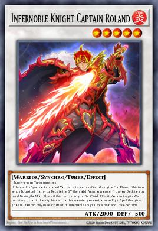 **ESPECIAL**

**Acción concreta:** Encadenar Angélica como CL2, ya que una carta/efecto seleccionó a esa Angélica en Campo. Resolver CL2: enviar Fire Flint Lady desde Deck al GY, desterrar temporalmente Angélica hasta End Phase e Invocar Especialmente Infernoble Knight Captain Roland desde Extra a una zona legal. Ningún recurso aparece de la nada.
**Detalle técnico documentado:** Resolver CL2: enviar Fire Flint Lady desde Deck al GY, desterrar temporalmente Angélica hasta End Phase e Invocar Especialmente Infernoble Knight Captain Roland desde Extra a una zona legal. Ningún recurso aparece de la nada.

**Estado por zonas después del paso:**

| Zona/recurso | Estado narrativo A09 |
|---|---|
| Mano | Almace #18843 |
| Monstruos | Roland #15275 (Invocado por efecto, no por Sincronía) |
| Mágicas y trampas | Museo #18844, Durendal #15287 (CL1 pendiente de resolver) |
| Cementerio | Ogier #15247, Renaud #15082, Fire Flint Lady #15392 (enviada como coste/efecto de Angélica según texto) |
| Destierro propio | Angélica #18827 (destierro temporal) |
| Campo y estado rival | Sin respuesta; CL2 Angélica resolvió antes que CL1 Durendal |
| Materiales Xyz/Fusión/Sincro | Ninguno |
| Normal, Extra, fase y restricciones | Normal gastada; Roland salió del Extra, Angélica no vuelve aún |

**Campo visual de este paso:**

**Monstruos propios:**
-  **Roland (Invocado por efecto, no por Sincronía)** — zona declarada: `MONSTER`.
**Mágicas/Trampas/Campo:**
-  **Museo** — zona declarada: `FIELD`.
-  **Durendal (CL1 pendiente de resolver)** — zona declarada: `SPELL_TRAP`.
*Relación ilustrada de cartas presentes tras este paso, documentada en A09. La posición, materiales, otras zonas y rival se leen en la tabla de estado.*

#### Paso 3 — Resolver CL1: Durendal no puede quedar equipada porque Angélica, su objetivo original, abandonó el Campo; la Mágica queda en GY.

 **ESTADO / CONTEXTO**

**Acción concreta:** Resolver CL1: Durendal no puede quedar equipada porque Angélica, su objetivo original, abandonó el Campo; la Mágica queda en GY. Roland fue Invocado Especialmente por efecto de Angélica, no por una Invocación por Sincronía, así que NO activa el efecto de Roland que se dispara específicamente al ser Invocado por Sincronía. Es Cantante Nivel 5 en Campo, pero no es por sí solo Charles Nivel 9.
**Detalle técnico documentado:** Roland fue Invocado Especialmente por efecto de Angélica, no por una Invocación por Sincronía, así que NO activa el efecto de Roland que se dispara específicamente al ser Invocado por Sincronía. Es Cantante Nivel 5 en Campo, pero no es por sí solo Charles Nivel 9.

**Estado por zonas después del paso:**

| Zona/recurso | Estado narrativo A09 |
|---|---|
| Mano | Almace #18843 |
| Monstruos | Roland #15275 (Sincronía Cantante Nivel 5, sin disparo de Invocación por Sincronía) |
| Mágicas y trampas | Museo #18844 |
| Cementerio | Ogier #15247, Renaud #15082, Fire Flint Lady #15392, Durendal #15287 (no pudo equiparse) |
| Destierro propio | Angélica #18827 (hasta End Phase) |
| Campo y estado rival | Sin cambios acreditados |
| Materiales Xyz/Fusión/Sincro | Ninguno |
| Normal, Extra, fase y restricciones | Normal gastada; Roland desde Extra por efecto |

**Campo visual de este paso:**

**Monstruos propios:**
-  **Roland (Sincronía Cantante Nivel 5, sin disparo de Invocación por Sincronía)** — zona declarada: `MONSTER`.
**Mágicas/Trampas/Campo:**
-  **Museo** — zona declarada: `FIELD`.
*Relación ilustrada de cartas presentes tras este paso, documentada en A09. La posición, materiales, otras zonas y rival se leen en la tabla de estado.*

#### Paso 4 — End Phase: la Angélica temporalmente desterrada regresa a una zona libre.

 **YA EN CAMPO** →  **ESTADO / CONTEXTO** →  **ESTADO / CONTEXTO**

**Acción concreta:** End Phase: la Angélica temporalmente desterrada regresa a una zona libre. El Campo puede terminar con Roland ATK 2500 mientras Museo +500 aplica a Guerreros FUEGO, Angélica ATK 1700 bajo Museo y Museo en Zona de Campo; Almace permanece en mano. GY incluye Ogier, Renaud, Fire Flint Lady y Durendal; ninguna carta buscada en End Phase por Roland. Si una interrupción impide la salida o el regreso, este tablero no se garantiza.
**Detalle técnico documentado:** El Campo puede terminar con Roland ATK 2500 mientras Museo +500 aplica a Guerreros FUEGO, Angélica ATK 1700 bajo Museo y Museo en Zona de Campo; Almace permanece en mano. GY incluye Ogier, Renaud, Fire Flint Lady y Durendal; ninguna carta buscada en End Phase por Roland. Si una interrupción impide la salida o el regreso, este tablero no se garantiza.

**Estado por zonas después del paso:**

| Zona/recurso | Estado narrativo A09 |
|---|---|
| Mano | Almace #18843 |
| Monstruos | Roland #15275 (2500 ATK con Museo), Angélica #18827 (1700 ATK con Museo; regresó en End Phase) |
| Mágicas y trampas | Museo #18844 |
| Cementerio | Ogier #15247, Renaud #15082, Fire Flint Lady #15392, Durendal #15287 |
| Destierro propio | Vacío al regresar Angélica |
| Campo y estado rival | Sin cambios acreditados |
| Materiales Xyz/Fusión/Sincro | Ninguno |
| Normal, Extra, fase y restricciones | Normal gastada; no Invocar Charles; regreso de Angélica en End Phase |

**Campo visual de este paso:**

**Monstruos propios:**
-  **Roland (2500 ATK con Museo)** — zona declarada: `MONSTER`.
-  **Angélica (1700 ATK con Museo; regresó en End Phase)** — zona declarada: `MONSTER`.
**Mágicas/Trampas/Campo:**
-  **Museo** — zona declarada: `FIELD`.
*Relación ilustrada de cartas presentes tras este paso, documentada en A09. La posición, materiales, otras zonas y rival se leen en la tabla de estado.*

### Campo final documentado

Esta vista procede **del último paso**, no de una lista de cartas deducida del título.

**Monstruos propios:**
-  **Roland (2500 ATK con Museo)** — zona declarada: `MONSTER`.
-  **Angélica (1700 ATK con Museo; regresó en End Phase)** — zona declarada: `MONSTER`.
**Mágicas/Trampas/Campo:**
-  **Museo** — zona declarada: `FIELD`.
*Relación ilustrada de cartas presentes tras este paso, documentada en A09. La posición, materiales, otras zonas y rival se leen en la tabla de estado.*

| Zona/recurso | Estado final documentado |
|---|---|
| Mano | Almace #18843 |
| Monstruos | Roland #15275 (2500 ATK con Museo), Angélica #18827 (1700 ATK con Museo; regresó en End Phase) |
| Mágicas y trampas | Museo #18844 |
| Cementerio | Ogier #15247, Renaud #15082, Fire Flint Lady #15392, Durendal #15287 |
| Destierro propio | Vacío al regresar Angélica |
| Campo y estado rival | Sin cambios acreditados |
| Materiales Xyz/Fusión/Sincro | Ninguno |
| Normal, Extra, fase y restricciones | Normal gastada; no Invocar Charles; regreso de Angélica en End Phase |

### Si el oponente interrumpe

No se documenta una continuación alternativa con los recursos indicados.

---

## CHARLES · EQUIPPED · LINK01 · `670:A09:CHARLES:EQUIPPED:LINK01`

**Propósito competitivo principal (lectura documental):** Ofensivo condicional. El objetivo solo se acredita si las acciones y el campo final detallados en esta guía lo permiten; no implica legalidad certificada ni garantiza el resultado ante respuestas adversarias.

**Categoría:** TRANSFORMACIÓN CON CAMPO PREVIO

**Propósito y resultado documental:**

Endboard al acabar el paso 2: Great Charles ATK 3500 + un Charles Sincronía propio equipado; Durendal en GY, mano y Normal del turno original no especificadas porque la partida empezó con Charles ya equipado. Daño rival garantizado: 0; interrupción: una negación potencial de M/T que requiere enviar Equipo. Vulnerable a negar el disparador de Great Charles, mover el objetivo del GY antes de resolver o eliminar el Equipo. Esta ficha no justifica por sí sola cómo se Invocó Sincronía Nivel 9 Charles ni qué Normales y Equipos se gastaron antes.

### Mano y estado inicial

Charles Infernoble Knight Emperor Charles, monstruo Sincronía Nivel 9 propio en Campo, con 1× Mágica de Equipo propia ya equipada boca arriba (ejemplo Durendal Durendal). Great Charles Emperor Charles the Great todavía en Extra. Hay al menos una Zona de Monstruos Extra o zona de Enlace permitida libre, y no se impide Invocar Guerrero/Enlace. Sin respuesta rival ni efectos previos que anulen la Invocación. El coste de cómo obtener Charles y su Equipo pertenece a una ruta anterior aún no demostrada, no se incluye en una mano mínima ficticia.

**Mano inicial no afirmada:** esta continuación parte de un campo preparado. Fotografías del estado previo, no cartas robadas:
-  **CAMPO** — Charles Sincronía previo; esta ruta no lo Invoca
-  **EQUIPO — EJEMPLO** — Durendal representa un Equipo propio previo; no es un coste creado gratuitamente

### Ejecución numerada

#### Paso 1 — Durante Main Phase, realizar Invocación por Enlace de Emperor Charles the Great usando 1× Emperor Charles Sincronía Nivel 9 equipado como material legal escrito de la carta.

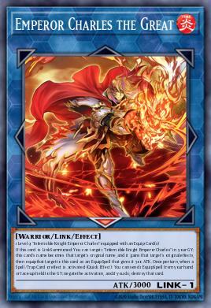 **ESTADO / CONTEXTO**

**Acción concreta:** Durante Main Phase, realizar Invocación por Enlace de Emperor Charles the Great usando 1× Emperor Charles Sincronía Nivel 9 equipado como material legal escrito de la carta.
**Detalle técnico documentado:** Charles Sincronía pasa al GY como material de Enlace, la Mágica que tenía equipada deja de estar equipada y va al GY por mecánica; Great Charles Enlace-1 aparece en la zona legal con ATK original 3000, sin Equipos por este procedimiento todavía.

**Estado por zonas después del paso:**

| Zona/recurso | Estado narrativo A09 |
|---|---|
| Mano | Desconocida: campo preparado previamente |
| Monstruos | Great Charles #18835 (Enlace 1, 3000 ATK) |
| Mágicas y trampas | ∅ |
| Cementerio | Charles Sincronía #15276 (material de Enlace), Durendal #15287 (desprendida) |
| Destierro propio | Sin destierro generado; previos desconocidos |
| Campo y estado rival | Sin respuesta; campo no especificado |
| Materiales Xyz/Fusión/Sincro | Ninguno: Enlace no conserva materiales Xyz |
| Normal, Extra, fase y restricciones | Normal previa desconocida; Great Charles salió de Extra |

**Campo visual de este paso:**

**Monstruos propios:**
-  **Great Charles (Enlace 1, 3000 ATK)** — zona declarada: `MONSTER`.
**Mágicas/Trampas/Campo:** sin carta propia demostrada en esta vista.
*Relación ilustrada de cartas presentes tras este paso, documentada en A09. La posición, materiales, otras zonas y rival se leen en la tabla de estado.*

#### Paso 2 — Al Invocarse por Enlace, activar el efecto de Great Charles, seleccionando el Charles Sincronía ahora en tu GY.

 **ACTIVAR** →  **ESTADO / CONTEXTO**

**Acción concreta:** Al Invocarse por Enlace, activar el efecto de Great Charles, seleccionando el Charles Sincronía ahora en tu GY; si resuelve, Great Charles recibe su nombre original y sus efectos y equipa desde GY ese Charles a sí mismo como Mágica de Equipo que le da 500 ATK.
**Detalle técnico documentado:** si resuelve, Great Charles recibe su nombre original y sus efectos y equipa desde GY ese Charles a sí mismo como Mágica de Equipo que le da 500 ATK. Great Charles queda ATK actual 3500, con el Charles usado como material equipado en la Zona de M/T; no queda Charles simultáneamente como monstruo independiente ni en GY. Durendal usada anteriormente queda GY.

**Estado por zonas después del paso:**

| Zona/recurso | Estado narrativo A09 |
|---|---|
| Mano | Desconocida; sin nueva búsqueda |
| Monstruos | Great Charles #18835 (3500 ATK) |
| Mágicas y trampas | Charles Sincronía #15276 (Equipo +500 ATK; no monstruo en Campo) |
| Cementerio | Durendal #15287 |
| Destierro propio | Sin destierro generado; previos desconocidos |
| Campo y estado rival | Sin respuesta; campo no especificado |
| Materiales Xyz/Fusión/Sincro | Ninguno |
| Normal, Extra, fase y restricciones | Normal previa desconocida; Charles Sincronía usado, no invocado de nuevo |

**Campo visual de este paso:**

**Monstruos propios:**
-  **Great Charles (3500 ATK)** — zona declarada: `MONSTER`.
**Mágicas/Trampas/Campo:**
-  **Charles Sincronía (Equipo +500 ATK; no monstruo en Campo)** — zona declarada: `SPELL_TRAP`.
*Relación ilustrada de cartas presentes tras este paso, documentada en A09. La posición, materiales, otras zonas y rival se leen en la tabla de estado.*

#### Paso 3 — Solo si el rival activa una Mágica/Trampa o su efecto y existe ventana legal, activar el Efecto Rápido de Great Charles (una vez por turno).

 **ACTIVAR**

**Acción concreta:** Solo si el rival activa una Mágica/Trampa o su efecto y existe ventana legal, activar el Efecto Rápido de Great Charles (una vez por turno). Enviar su Charles equipado boca arriba al GY como coste; al resolver, negar esa activación y destruir esa carta si la negación tuvo éxito.
**Detalle técnico documentado:** Enviar su Charles equipado boca arriba al GY como coste; al resolver, negar esa activación y destruir esa carta si la negación tuvo éxito. Si se utiliza el efecto, el Equipo Charles termina en GY y Great Charles pierde el aumento de 500 (ATK 3000 salvo otro modificador). Sin activación rival válida, la negación no se ha utilizado y el Equipo permanece. No afirmar una negación o destrucción en el campo inicial.

**Estado por zonas después del paso:**

| Zona/recurso | Estado narrativo A09 |
|---|---|
| Mano | Desconocida |
| Monstruos | Great Charles #18835 (3500 ATK en la rama base sin M/T rival activada) |
| Mágicas y trampas | Charles Sincronía #15276 (Equipo conservado en rama base) |
| Cementerio | Durendal #15287; si Great Charles paga la negación, la carta Charles equipada cambia de esta M/T al GY, sin duplicarse |
| Destierro propio | Sin destierro generado; previos desconocidos |
| Campo y estado rival | Dos resultados excluyentes: sin activación rival se conserva P2; si se activa M/T y la negación es legal, se paga Equipo y Great Charles queda 3000 ATK |
| Materiales Xyz/Fusión/Sincro | Ninguno |
| Normal, Extra, fase y restricciones | Normal previa desconocida; ningún otro Extra |

**Campo visual de este paso:**

**Monstruos propios:**
-  **Great Charles (3500 ATK en la rama base sin M/T rival activada)** — zona declarada: `MONSTER`.
**Mágicas/Trampas/Campo:**
-  **Charles Sincronía (Equipo conservado en rama base)** — zona declarada: `SPELL_TRAP`.
*Relación ilustrada de cartas presentes tras este paso, documentada en A09. La posición, materiales, otras zonas y rival se leen en la tabla de estado.*

### Campo final documentado

Esta vista procede **del último paso**, no de una lista de cartas deducida del título.

**Monstruos propios:**
-  **Great Charles (3500 ATK en la rama base sin M/T rival activada)** — zona declarada: `MONSTER`.
**Mágicas/Trampas/Campo:**
-  **Charles Sincronía (Equipo conservado en rama base)** — zona declarada: `SPELL_TRAP`.
*Relación ilustrada de cartas presentes tras este paso, documentada en A09. La posición, materiales, otras zonas y rival se leen en la tabla de estado.*

| Zona/recurso | Estado final documentado |
|---|---|
| Mano | Desconocida |
| Monstruos | Great Charles #18835 (3500 ATK en la rama base sin M/T rival activada) |
| Mágicas y trampas | Charles Sincronía #15276 (Equipo conservado en rama base) |
| Cementerio | Durendal #15287; si Great Charles paga la negación, la carta Charles equipada cambia de esta M/T al GY, sin duplicarse |
| Destierro propio | Sin destierro generado; previos desconocidos |
| Campo y estado rival | Dos resultados excluyentes: sin activación rival se conserva P2; si se activa M/T y la negación es legal, se paga Equipo y Great Charles queda 3000 ATK |
| Materiales Xyz/Fusión/Sincro | Ninguno |
| Normal, Extra, fase y restricciones | Normal previa desconocida; ningún otro Extra |

### Si el oponente interrumpe

No se documenta una continuación alternativa con los recursos indicados.

---
