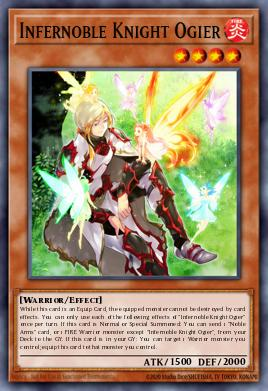
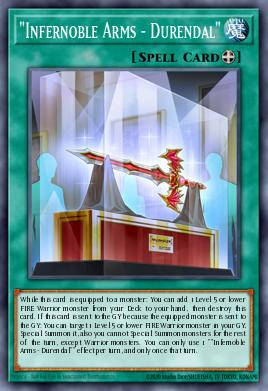
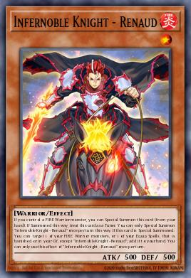
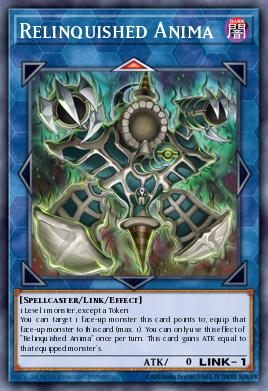

# Infernoble — Anima absorbe un rival y habilita el destierro inmediato de S:P

**ID:** `670:A09:OGIER:RENAUD:ANIMA:SP09` · **Tipo:** extensión ofensiva **condicionada a posición rival**, usando el mismo comienzo Ogier + Renaud, pero **convirtiendo Renaud en un Link de Extra antes de invocar S:P**. No equivale a una apertura universal.

**Mano:** Ogier + Renaud. **Deck:** Durendal. **Extra:** Relinquished Anima (1x) + S:P Little Knight (2x). **Campo propio:** vacío, Normal libre y Extra Monster Zone apropiada libre. **Rival:** controla un monstruo **boca arriba en la Zona de Monstruos Principal a la que apuntará la flecha superior de Anima al ocupar esa Extra Monster Zone**. El monstruo ha de poder ser seleccionado y equipado; ninguna respuesta rival en la línea modelo. No basta decir «mismo carril» si la flecha no apunta a su zona.

## Guía visual en seis pasos

### 1. Ogier prepara Durendal

 → 

Invoca Normalmente a **Ogier** y, con su efecto opcional, **envía Durendal desde el Deck al GY**. Normal gastada; Ogier en Campo.

### 2. Renaud entra y recupera el Equipo

 →  → 

Controlando a Ogier (Guerrero FUEGO), Invoca Especialmente a **Renaud** desde mano. Con su efecto de Invocación Especial, selecciona la Durendal del GY y **añádela a mano**. Controlas Ogier + Renaud; Durendal en mano.

### 3. Renaud de Nivel 1 → Relinquished Anima

 → 

Utiliza Renaud (Nivel 1, no Ficha) como material **Enlace-1**. Coloca a **Anima** en la Zona de Monstruos Extra disponible cuya **flecha hacia arriba apunte realmente al monstruo rival**. Renaud pasa al GY; Ogier sigue en Campo. Si la colocación no hace que apunte a un objetivo, omite esta rama.

### 4. Anima absorbe exactamente al monstruo que señala

 → **MONSTRUO RIVAL BOCA ARRIBA APUNTADO**

Activa el efecto de Anima para seleccionar **ese** monstruo rival boca arriba al que apunta; al resolver, **lo equipa a Anima** (máximo uno), y Anima gana ATK igual al del equipado. No selecciona libremente cualquier monstruo del Campo ni niega efectos. Si la selección falla, no afirmar la absorción.

### 5. Anima (Link-1) + Ogier → S:P; su primer efecto ahora SÍ puede activarse

 +  → 

Usa **Anima como Enlace-1 + Ogier como monstruo de efecto** para Invocar por Enlace a S:P. Ambos van al GY. Al dejar Anima de estar en Campo, el monstruo rival que tenía equipado va al GY por dejar de estar equipado. A diferencia de la ruta anterior, **esta vez S:P sí fue invocada usando un monstruo Enlace como material**: puedes activar su primer efecto, seleccionar **una** carta en Campo o en cualquiera de los dos GY y **desterrarla**. Si destierras el monstruo absorbido del GY, comprueba que continúa allí y puede ser seleccionado. Tras usar este efecto, tus monstruos no pueden atacar directamente ese turno.

### 6. Tablero y respuesta del siguiente turno

 + 

**Resultado:** S:P 1600 ATK boca arriba; Durendal en mano; Ogier, Renaud y Anima en GY; monstruo rival inicialmente absorbido salió del Campo y fue al GY (si no fue movido por otros efectos); un destierro opcional al Invocar a S:P si resolvió. **No quedan simultáneamente en Campo Anima y S:P ni se conserva su aumento de ATK.** En una posterior activación de carta/efecto del rival, el Efecto Rápido de S:P también puede seleccionar dos monstruos boca arriba incluido uno propio y desterrarlos **hasta End Phase**. Esto **no** es negación.

## Coste real y variantes

| Factor | Consecuencia |
|---|---|
| El rival no coloca monstruo seleccionable en la zona apuntada | **No** se puede completar la absorción. Puedes cambiar a la ruta `SP_DEFENSA08` sin Anima; allí no se habilita el destierro inmediato. |
| Rival retira/mueve el objetivo en cadena | No presuponer equipar ni llegar a la eliminación prevista; resolver según objetivos restantes. |
| Consumir Anima como material | Permite disparar el primer efecto de S:P, pero **el monstruo equipado deja de estar equipado**. |
| Seguir hacia Angélica | No puedes después reutilizar Ogier + Renaud como materiales si los consumiste en estos enlaces. |

**Dificultad:** media por ubicación y cadenas · **Recursos:** Ogier+Renaud en mano, 1 Durendal del Deck, Normal, Anima y S:P del Extra, monstruo rival en la flecha · **Utilidad:** romper una zona expuesta, terminar con interrupción condicional y Equipo en mano. **Estado:** secuencia cotejada contra textos oficiales bajo el escenario específico, no rendimiento garantizado.

**Fuentes:** [Konami — Ogier](https://www.db.yugioh-card.com/yugiohdb/card_search.action?cid=15247&ope=2&request_locale=en), [Renaud](https://www.db.yugioh-card.com/yugiohdb/card_search.action?cid=15082&ope=2&request_locale=en), [Durendal](https://www.db.yugioh-card.com/yugiohdb/card_search.action?cid=15287&ope=2&request_locale=en), [Anima](https://www.db.yugioh-card.com/yugiohdb/card_search.action?cid=13841&ope=2&request_locale=en), [S:P](https://www.db.yugioh-card.com/yugiohdb/card_search.action?cid=19188&ope=2&request_locale=en).
