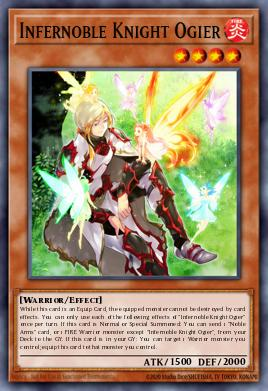
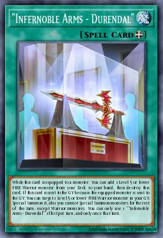
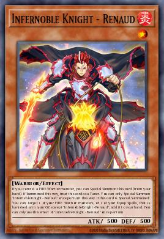

# Infernoble — Ogier + Renaud → S:P Little Knight con Durendal recuperada

**ID:** `670:A09:OGIER:RENAUD:SP_DEFENSA08` · **Tipo:** conversión defensiva de dos monstruos de Main a Link-2; **no** es un OTK ni negación. **Alternativa**, no continuación simultánea, de `670:A09:OGIER:RENAUD:ANGELICA01`.

**Mano exacta:** 1× Infernoble Knight Ogier (Main, 1x en inventario) + 1× Infernoble Knight - Renaud (Main, 2x). **Deck:** 1× Infernoble Arms - Durendal aún disponible (Main, 2x). **Extra:** 1× S:P Little Knight (Extra, 2x). **Estado propio:** campo, GY y destierro vacíos; fase principal, Invocación Normal libre, sin bloqueos previos; no hay respuesta rival durante la preparación. **Estado rival para usar después la respuesta:** activará una carta/efecto y controlará un monstruo boca arriba elegible en el momento correcto.

## Cinco pasos con cartas reales

### 1. Invoca Normalmente a Ogier y envía Durendal al GY

 → 

**NORMAL → EFECTO OPCIONAL → ENVIAR DEL DECK AL GY.** Ogier es Guerrero FUEGO de Nivel 4. Su efecto al ser Invocado permite enviar 1 carta «Noble Arms» del Deck al Cementerio: elige Durendal. Aquí **no** se activa Durendal, solo se prepara un objetivo recuperable.

### 2. Invoca Especialmente a Renaud desde la mano

 + 

**ESPECIAL DESDE MANO.** Controlas un Guerrero FUEGO (Ogier), por lo que Renaud puede Invocarse Especialmente mediante su condición propia; se considera Cantante al entrar de este modo.

### 3. Renaud recupera Durendal del GY

 → 

**EFECTO DE INVOCACIÓN ESPECIAL → SELECCIONAR EN GY → AÑADIR A MANO.** Renaud puede recuperar una Mágica de Equipo desde el GY. Selecciona Durendal, que Ogier envió en el paso 1. **Durendal queda en mano**, no equipada.

### 4. Dos monstruos de efecto → S:P Link-2

 +  → 

**ENLACE-2.** Usa los dos monstruos de efecto, ambos del Main Deck. Ogier y Renaud pasan al GY, y S:P entra en una zona legal. **No está disponible el efecto de destierro al Invocar a S:P**, porque **ningún material era Fusión, Sincronía, Xyz ni Enlace**.

### 5. En el turno del adversario: respuesta a activación, no negación

 → **S:P + monstruo rival boca arriba** → **destierro temporal hasta la End Phase**

**CAMPO FINAL ANTES DE LA RESPUESTA:** S:P boca arriba (1600 ATK), Durendal en mano; Ogier y Renaud en GY; Normal consumida. Si el rival activa una carta/efecto y existe otro monstruo boca arriba elegible, encadena el Efecto Rápido de S:P, seleccionando dos monstruos boca arriba —incluido uno propio, por ejemplo la propia S:P—. Ambos se destierran temporalmente y retornan en la End Phase si corresponde. **No se niega la activación, no se destruye y no se destierra permanentemente.**

## Cuándo elegir esta rama

| Tu situación | Mejor lectura |
|---|---|
| Necesitas preparar una respuesta rápida y guardar Durendal | Elegir S:P; asumir respuesta condicionada a activación rival y dos objetivos boca arriba. |
| Quieres seguir la línea de Sincronía Nivel 5 | Elegir **Angélica** con Ogier Nivel 4 + Renaud Cantante Nivel 1; es una **alternativa que consume los mismos cuerpos**, no ambas a la vez. |
| Quieres desterrar inmediatamente al Invocar a S:P | **No sirve esta ruta:** no se utilizó material de Extra. Existe otra ruta más exigente con Anima, documentada por separado. |
| El adversario no activa carta/efecto o no hay dos monstruos boca arriba | La respuesta rápida **no se puede prometer**. |
| Un efecto previo restringió las invocaciones de Extra / OSCURIDAD / Link | Revalidar antes de empezar; no dar el cierre por accesible. |

**Dificultad:** baja · **Recursos:** 2 monstruos Main en mano, Normal, 1 Equip de Deck, 1 slot Extra · **Utilidad:** defensa y retención de Equipo · **Validación:** escenario individual cotejado con texto oficial, no certifica otras aperturas.

**Textos oficiales:** [Ogier CID 15247](https://www.db.yugioh-card.com/yugiohdb/card_search.action?cid=15247&ope=2&request_locale=en) · [Renaud CID 15082](https://www.db.yugioh-card.com/yugiohdb/card_search.action?cid=15082&ope=2&request_locale=en) · [Durendal CID 15287](https://www.db.yugioh-card.com/yugiohdb/card_search.action?cid=15287&ope=2&request_locale=en) · [S:P CID 19188](https://www.db.yugioh-card.com/yugiohdb/card_search.action?cid=19188&ope=2&request_locale=en).
