# Cyber Dragon Pure

## APARTADO_01 — Perfil A01 importable 684

- **Arquetipo:** Cyber Dragon / apoyo Cyberdark
- **Tipo de estrategia:** Combo ofensivo de Máquinas, Fusión y Xyz
- **Estilo breve:** Reúne Máquinas y nombres Cyber Dragon para Infinity, rompe campos con Fortress o Megafleet y presiona con los ataques de Rampage.
- **Resumen para ficha:** Core busca soporte y Wurm/Revsystem reúnen Nivel 5 para Nova e Infinity. Clockwork Night habilita Fortress, mientras Rampage convierte materiales en presión de batalla.
- **Cómo se juega:** Primero: Infinity y una respuesta adicional. Invoca Normalmente Core y busca Cybernetic Overflow del Deck. Con Core en Campo, activa Wurm enviando Cyber Dragon original desde Deck al Cementerio como coste; Invoca Wurm si resuelve. Activa Cyber Revsystem para recuperar Cyber Dragon original. Superpón Wurm y Cyber Dragon, Máquinas de Nivel 5, para Nova; sobrepón Infinity transfiriendo los materiales y Coloca Overflow. Infinity con tres materiales, Core y Overflow colocada en la apertura indicada; una respuesta de Infinity y la retirada de Overflow son distintas. Segundo: retirar monstruos sin combate. Con Core y Clockwork Night, usa la búsqueda de Core y confirma que la carta rival ahora es Máquina. Si el material puede enviarse al Cementerio, utiliza el procedimiento de Fortress con Core y la Máquina rival. Si el problema es un monstruo elegible en Zona Extra, usa Cyber Dragon para Megafleet en lugar de depender de Clockwork Night. Fortress o Megafleet y el monstruo rival enviado como material; la elección depende del tipo, zona y restricciones reales. Juego medio: usar los Ciber del Cementerio. Activa Overload usando los materiales requeridos del Cementerio; comprueba los nombres aplicables allí. Con Rampage, decide qué Máquinas LUZ enviar del Deck para habilitar ataques adicionales. Si envías Herz y su efecto está disponible, revisa qué Cyber Dragon original puedes recuperar. Rampage listo para ataques múltiples si resolvió el efecto y se enviaron las cartas requeridas; materiales de Overload quedan desterrados. Juego tardío: reciclar destierro con Cyberload. Primero usa Overload para producir Rampage y deja identificados los materiales desterrados boca arriba. Después, si esos materiales son elegibles para Cyberload, devuélvelos al Deck mediante su efecto para la nueva Fusión. Respeta la restricción de ataques de Cyberload: únicamente la criatura fusionada por esa Magia podrá atacar el resto del turno. Dos Rampage en el caso documentado, pero solo el segundo puede atacar tras Cyberload; no se suman ataques de ambos.
- **Qué vigilar:** Nachster puede imponer solo Máquinas; Megafleet necesita Zona Extra y Fortress material Máquina. Cyberload limita ataques y Power Bond puede dañarte en End Phase.

**Procedencia:** paquete estructurado de esta identidad con inventario vivo validado en solo lectura; ninguna importación de producción se atribuye a este cambio.

<!-- A01_PLAYER_STRATEGY_V2_START -->
### Plan práctico de juego

#### Primero: Infinity y una respuesta adicional

**Objetivo:** Construir una negación de activación sin confundir los materiales con monstruos independientes.

**Situación:** Core, Wurm y Revsystem disponibles según la apertura; Cyber Dragon en Deck y Nova e Infinity en Extra.

**Cartas:** Cyber Dragon Core, Cyberdark Wurm [Konami 21164], Cyber Revsystem, Cyber Dragon, Cyber Dragon Nova (Konami ID 10870), Cyber Dragon Infinity (Konami ID 11765), Cybernetic Overflow

1. Invoca Normalmente Core y busca Cybernetic Overflow del Deck.
2. Con Core en Campo, activa Wurm enviando Cyber Dragon original desde Deck al Cementerio como coste; Invoca Wurm si resuelve. Activa Cyber Revsystem para recuperar Cyber Dragon original.
3. Superpón Wurm y Cyber Dragon, Máquinas de Nivel 5, para Nova; sobrepón Infinity transfiriendo los materiales y Coloca Overflow.

**Resultado esperado:** Infinity con tres materiales, Core y Overflow colocada en la apertura indicada; una respuesta de Infinity y la retirada de Overflow son distintas.

**Recursos que conservar:** Un material para Infinity y Core disponible como recurso de Overflow.

**Alternativa:** Si falta Wurm pero Cyber Dragon y Revsystem están en mano con Herz ya en Cementerio, utiliza esa variante.

#### Segundo: retirar monstruos sin combate

**Objetivo:** Aprovechar el campo rival como material para Fortress o Megafleet cuando corresponde.

**Situación:** Clockwork Night y Core, o Cyber Dragon disponible frente a un monstruo rival situado en Zona Extra y apto como material.

**Cartas:** Clockwork Night, Cyber Dragon Core, Cyber Dragon, Chimeratech Fortress Dragon, Chimeratech Megafleet Dragon

1. Con Core y Clockwork Night, usa la búsqueda de Core y confirma que la carta rival ahora es Máquina.
2. Si el material puede enviarse al Cementerio, utiliza el procedimiento de Fortress con Core y la Máquina rival.
3. Si el problema es un monstruo elegible en Zona Extra, usa Cyber Dragon para Megafleet en lugar de depender de Clockwork Night.

**Resultado esperado:** Fortress o Megafleet y el monstruo rival enviado como material; la elección depende del tipo, zona y restricciones reales.

**Recursos que conservar:** Cyber Emergency buscada por Core y las cartas de Fusión que no se hayan gastado.

**Alternativa:** Si el rival solo controla monstruos de zonas principales y no son Máquina, Megafleet no ofrece esa retirada.

#### Juego medio: usar los Ciber del Cementerio

**Objetivo:** Recuperar un campo ofensivo después de que los primeros Ciber Dragones se conviertan en recursos.

**Situación:** Overload Fusion en mano, Core y Herz en Cementerio, Rampage disponible en Extra.

**Cartas:** Overload Fusion, Cyber Dragon Core, Cyber Dragon Herz, Chimeratech Rampage Dragon (Konami ID 11764), Cyber Dragon, Cyber Dragon Nachster

1. Activa Overload usando los materiales requeridos del Cementerio; comprueba los nombres aplicables allí.
2. Con Rampage, decide qué Máquinas LUZ enviar del Deck para habilitar ataques adicionales.
3. Si envías Herz y su efecto está disponible, revisa qué Cyber Dragon original puedes recuperar.

**Resultado esperado:** Rampage listo para ataques múltiples si resolvió el efecto y se enviaron las cartas requeridas; materiales de Overload quedan desterrados.

**Recursos que conservar:** Cyber Dragon recuperable y una copia de Cyberload para recursos desterrados si luego es legal.

**Alternativa:** Si no hay dos materiales aptos para Rampage, conserva Overload para cuando los recursos estén disponibles.

#### Juego tardío: reciclar destierro con Cyberload

**Objetivo:** Convertir recursos desterrados en otra Fusión cuando el primer Rampage ya no basta.

**Situación:** Overload y Cyberload disponibles, con Core y Herz preparados inicialmente en Cementerio y destinos apropiados en Extra.

**Cartas:** Overload Fusion, Cyberload Fusion, Cyber Dragon Core, Cyber Dragon Herz, Chimeratech Rampage Dragon (Konami ID 11764)

1. Primero usa Overload para producir Rampage y deja identificados los materiales desterrados boca arriba.
2. Después, si esos materiales son elegibles para Cyberload, devuélvelos al Deck mediante su efecto para la nueva Fusión.
3. Respeta la restricción de ataques de Cyberload: únicamente la criatura fusionada por esa Magia podrá atacar el resto del turno.

**Resultado esperado:** Dos Rampage en el caso documentado, pero solo el segundo puede atacar tras Cyberload; no se suman ataques de ambos.

**Recursos que conservar:** Una reserva de nombres Ciber en el Deck y las Máquinas que aún puedas enviar.

**Alternativa:** Si el primer Rampage tiene ataques suficientes, evita Cyberload hasta un momento en que su restricción no reduzca tu daño.

#### Mano débil: Cyber Dragon y Nachster

**Objetivo:** Construir un Enlace útil sin exigir dos Nivel 5 desde el inicio.

**Situación:** Cyber Dragon original y Nachster en mano, Sieger disponible y condiciones de Invocación de la ruta cumplidas.

**Cartas:** Cyber Dragon, Cyber Dragon Nachster, Cyber Dragon Sieger, Cyber Dragon Core, Cyber Emergency, S:P Little Knight

1. Descarta Cyber Dragon original como coste del efecto de Nachster en mano; Invoca Nachster. En nueva cadena selecciona Cyber Dragon de 2100 ATK en Cementerio para revivirlo; desde esa resolución, solo Invocaciones Especiales de Máquinas el resto del turno.
2. Enlaza ambos monstruos Máquina hacia Sieger, sin gastar la Normal. En Battle Phase, si Sieger no declaró ataque, su efecto puede dar +2100 ATK/DEF a una Máquina propia con al menos 2100 ATK; comprueba la restricción de daño de batalla.
3. Si en cambio dispones de Cyber Dragon y Core, usa Core para buscar Cyber Emergency y considera la salida defensiva de S:P.

**Resultado esperado:** Sieger (2100 ATK base) y Normal libre tras la línea Nachster. La rama Cyber Dragon + Core hacia S:P es diferente y no debe hacerse bajo el bloqueo Máquina de Nachster.

**Recursos que conservar:** La Normal o Cyber Emergency según la apertura que hayas elegido.

**Alternativa:** Si no tienes dos cuerpos válidos, conserva Cyber Dragon como presión y evita gastar la única pieza de recuperación.

#### Interrupción: mantener otra vía de acceso

**Objetivo:** Evitar perder toda la mano al ser negada la búsqueda de Core o el acceso a Nova.

**Situación:** El rival responde a Core, Revsystem o Nova, pero aún conservas otros recursos en mano o Cementerio.

**Cartas:** Cyber Dragon Core, Cyber Dragon, Clockwork Night, Chimeratech Fortress Dragon, Overload Fusion, Chimeratech Rampage Dragon (Konami ID 11764)

1. Si Core no buscó, comprueba si aún permanece como material de Cyber Dragon en Campo.
2. Si Clockwork Night y un monstruo rival Máquina son elegibles, evalúa Fortress sin depender de la búsqueda perdida.
3. Si Revsystem no recuperó Herz, no cuentes dos Nivel 5; conserva la Fusión si ya tienes materiales aptos en Cementerio.

**Resultado esperado:** Una alternativa de retirada o Fusión solo si existen sus requisitos; Infinity no aparece sin los materiales de Nova.

**Recursos que conservar:** Clockwork Night, Overload y los nombres Ciber aún utilizables.

**Alternativa:** Si no queda salida de Extra demostrable, conserva una defensa de mano y prepara la siguiente apertura.

#### Ganar: calcular los ataques de Rampage

**Objetivo:** Cerrar con daño de batalla real y tener en cuenta el coste futuro de Power Bond.

**Situación:** Rampage en Campo, Battle Phase disponible y monstruos rivales identificados; Power Bond puede formar parte de la apertura.

**Cartas:** Chimeratech Rampage Dragon (Konami ID 11764), Power Bond, Overload Fusion, Cyber Dragon Sieger, Limiter Removal

1. Rampage puede enviar hasta dos Máquinas LUZ desde Deck al Cementerio y obtener un ataque adicional por cada una durante la Battle Phase de ese turno, si su efecto resuelve.
2. Si fue Invocado por Power Bond, calcula su ATK aumentado y el daño que recibirás en End Phase si no terminas el duelo.
3. Antes de usar Sieger o Limiter Removal, comprueba sus condiciones y calcula el daño después de defensas y restricciones.

**Resultado esperado:** Ataques múltiples de Rampage y presión aumentada cuando correspondan; el letal depende de los LP y del campo rival.

**Recursos que conservar:** Una salida posterior y suficientes LP para el posible daño de Power Bond.

**Alternativa:** Si no puedes cerrar, prioriza una respuesta de Infinity o conserva Rampage sin consumir otro recurso de daño.

#### Errores: materiales y límite de ataques

**Objetivo:** Evitar confundir las distintas Fusiones y la protección que otorga cada carta.

**Situación:** Estás eligiendo Megafleet, Fortress, Power Bond, Cyberload o la negación de Infinity.

**Cartas:** Chimeratech Megafleet Dragon, Chimeratech Fortress Dragon, Power Bond, Cyberload Fusion, Cyber Dragon Infinity (Konami ID 11765), Cyber Eternity Dragon

1. Megafleet exige una carta elegible en Zona Extra; Fortress necesita Cyber Dragon y material Máquina apto para el envío.
2. El aumento de Power Bond no evita el daño de End Phase y Cyberload restringe quién puede atacar después.
3. Infinity debe disponer del material requerido y de una activación a la que responder; no niega automáticamente todo el campo.

**Resultado esperado:** Invocaciones, ataques y respuestas calculados con las restricciones correctas.

**Recursos que conservar:** Material de Infinity o un recurso Ciber para reconstruir si no termina el duelo.

**Alternativa:** Si una Fusión no puede cumplir sus materiales, elige otra salida documentada sin inventar una protección de Eternity.

<!-- A01_PLAYER_STRATEGY_V2_END -->

## APARTADO_02 — Continuidad del contenido anterior

> **Alcance editorial de todas las cartas y guías de este deck:** Las fichas son interpretaciones tácticas: costes, objetivos, ventanas y límites deben cotejarse con el texto oficial antes de acreditar una secuencia A09. Las guías explican funciones derivadas; no certifican nuevas invocaciones ni cadenas.

## IDENTIDAD BÁSICA

- `deck_id`: **684**
- Nombre registrado: **Cyber Dragon Pure**
- Formato: **tcg_advanced**
- Main: **42**; Extra: **15**; Side: **0**; Reserva: **24**.

## APARTADO_01 — A01 fuente del deck Cyber Dragon Pure (684)

**Inventario original comprobado:** TCG Advanced. Main 42, Extra 15, Side 0, Reserva 24. 52 identidades documentadas con CID, sección, cantidades y función. Sin banlist ni traslado de copias entre zonas.

### A01-T1 — Diagnóstico estratégico individual

- **Arquetipo:** Cyber Dragon, con piezas Cyberdark registradas.
- **Clasificación:** despliegue de Máquinas y acceso a Fusiones y Xyz para responder al campo rival.
- **Estilo y motor principal:** ofensivo y de ruptura de campo, con diferentes rutas de Extra Deck.
- **Plan por fases y salidas condicionales:** las piezas Ciber Dragón reúnen cuerpos y acceden a Nova/Infinity o Fusiones cuando existen los materiales. El submotor Ciberoscuro aporta otras herramientas y no debe confundirse con una Invocación automática de cualquier jefe.
- **Riesgos, materiales y restricciones:** ubicación real de los materiales, restricciones de Fusión/contacto y consumo compartido de monstruos entre alternativas.
- **Condición de victoria:** convertir acceso legal a los motores y al Extra en control, tempo o daño; sin anunciar OTK ni campo final garantizados. Los recursos se analizan carta a carta en la matriz T3.
- **Alcance:** el diagnóstico se respalda en el inventario y las fichas de este deck; aún se deben cotejar los efectos y ventanas pendientes en A05/A07 antes de construir reglas ejecutables.

### A01-T2 — Perfil de seis campos para preparar importación (aún no certificado)

- **Arquetipo:** Cyber Dragon, con piezas Cyberdark registradas.
- **Tipo de estrategia:** despliegue de Máquinas y acceso a Fusiones y Xyz para responder al campo rival.
- **Estilo breve:** ofensivo y de ruptura de campo, con diferentes rutas de Extra Deck.
- **Resumen para ficha:** las piezas Ciber Dragón reúnen cuerpos y acceden a Nova/Infinity o Fusiones cuando existen los materiales. El submotor Ciberoscuro aporta otras herramientas y no debe confundirse con una Invocación automática de cualquier jefe.
- **Cómo se juega:** las piezas Ciber Dragón reúnen cuerpos y acceden a Nova/Infinity o Fusiones cuando existen los materiales. El submotor Ciberoscuro aporta otras herramientas y no debe confundirse con una Invocación automática de cualquier jefe.
- **Qué vigilar:** ubicación real de los materiales, restricciones de Fusión/contacto y consumo compartido de monstruos entre alternativas.

Estilo breve 67/190; Resumen para ficha 227/250. **T2 pendiente**: no existe prueba de igualdad literal con el paquete estructurado de este deck.

### A01-T3 — Inventario y propósitos trazados por CID

| CID fuente Konami | Identidad | Zona/copias | Rol documental | Efecto pendiente de cotejo jurídico/reglamentario | Condición/riesgo |
|---|---|---|---|---|---|
| [10866](https://www.db.yugioh-card.com/yugiohdb/card_search.action?cid=10866&ope=2) | Cyber Dragon Core | Main 3x. No altera las cantidades registradas. | starter Cyber · búsqueda. | Core se llama Cyber Dragon en campo/Cementerio, busca M/T Cyber al ser Invocada Normal y desde GY habilita Cyber del Deck ante campo sólo rival. | depende de recursos en Cementerio. |
| [6390](https://www.db.yugioh-card.com/yugiohdb/card_search.action?cid=6390&ope=2) | Cyber Dragon | Main 1x. No altera las cantidades registradas. | extensor Cyber · acceso gratuito. | Cyber Dragon se Invoca Especial desde mano únicamente cuando solo el oponente controla monstruos. | aplicar restricciones de selección, activación y copias que consten en el texto original. |
| [14047](https://www.db.yugioh-card.com/yugiohdb/card_search.action?cid=14047&ope=2) | Cyber Dragon Nachster | Main 1x. No altera las cantidades registradas. | extensor · cierre. | acceso al campo desde la mano; presión de combate o modificación de estadísticas. Son operaciones detectadas en el texto, no efectos independientes garantizados; leer sus condiciones en la fuente. | hay límite por turno según el efecto concreto; puede bloquear tipos de Invocación del Extra Deck; depende de recursos en Cementerio. |
| [13723](https://www.db.yugioh-card.com/yugiohdb/card_search.action?cid=13723&ope=2) | Cyber Dragon Herz | Main 1x, Reserva 1x. No altera las cantidades registradas. | searcher · buscador · recuperación. | búsqueda o incorporación de cartas a mano; recuperación e invocación desde Cementerio/destierro. Son operaciones detectadas en el texto, no efectos independientes garantizados; leer sus condiciones en la fuente. | puede bloquear tipos de Invocación del Extra Deck. |
| [16296](https://www.db.yugioh-card.com/yugiohdb/card_search.action?cid=16296&ope=2) | Cyberdark Chimera | Main 1x. No altera las cantidades registradas. | searcher · buscador. | búsqueda o incorporación de cartas a mano. Son operaciones detectadas en el texto, no efectos independientes garantizados; leer sus condiciones en la fuente. | hay límite por turno según el efecto concreto; depende de recursos en Cementerio; exige materiales de Extra Deck o materiales adecuados. |
| [6830](https://www.db.yugioh-card.com/yugiohdb/card_search.action?cid=6830&ope=2) | Cyberdark Horn | Main 1x. No altera las cantidades registradas. | removal · cierre · motor Equipo. | destrucción de cartas o empleo de destrucción como detonante; presión de combate o modificación de estadísticas; uso o producción de cartas equipadas. Son operaciones detectadas en el texto, no efectos independientes garantizados; leer sus condiciones en la fuente. | depende de recursos en Cementerio. |
| [21164](https://www.db.yugioh-card.com/yugiohdb/card_search.action?cid=21164&ope=2) | Cyberdark Wurm [Konami 21164] | Main 1x. No altera las cantidades registradas. | searcher · buscador · recuperación · extensor. | búsqueda o incorporación de cartas a mano; recuperación e invocación desde Cementerio/destierro; acceso al campo desde la mano. Son operaciones detectadas en el texto, no efectos independientes garantizados; leer sus condiciones en la fuente. | hay límite por turno según el efecto concreto; depende de recursos en Cementerio. |
| [13181](https://www.db.yugioh-card.com/yugiohdb/card_search.action?cid=13181&ope=2) | Cyberdark Claw | Main 2x. No altera las cantidades registradas. | searcher · buscador · cierre · motor Equipo. | búsqueda o incorporación de cartas a mano; presión de combate o modificación de estadísticas; uso o producción de cartas equipadas. Son operaciones detectadas en el texto, no efectos independientes garantizados; leer sus condiciones en la fuente. | hay límite por turno según el efecto concreto; depende de recursos en Cementerio. |
| [6663](https://www.db.yugioh-card.com/yugiohdb/card_search.action?cid=6663&ope=2) | Cyber Phoenix | Main 1x. No altera las cantidades registradas. | ventaja de mano. | generación de cartas por robo. Son operaciones detectadas en el texto, no efectos independientes garantizados; leer sus condiciones en la fuente. | aplicar restricciones de selección, activación y copias que consten en el texto original. |
| [21163](https://www.db.yugioh-card.com/yugiohdb/card_search.action?cid=21163&ope=2) | Cyber Jormungardr [Konami 21163] | Main 1x. No altera las cantidades registradas. | searcher · buscador · extensor · motor Equipo. | PENDIENTE_COTEJO | hay límite por turno según el efecto concreto; puede bloquear tipos de Invocación del Extra Deck; tiene procedimiento especial de Invocación. |
| [17119](https://www.db.yugioh-card.com/yugiohdb/card_search.action?cid=17119&ope=2) | Therion "King" Regulus | Main 1x. No altera las cantidades registradas. | extensor Máquina · negación. | Regulus se invoca desde mano equipando Máquina o Therion del GY y ofrece una negación con coste de envío de Therion. | hay límite por turno según el efecto concreto; depende de recursos en Cementerio. |
| [12950](https://www.db.yugioh-card.com/yugiohdb/card_search.action?cid=12950&ope=2) | Ash Blossom & Joyous Spring | Main 3x. No altera las cantidades registradas. | handtrap · negación. | Descarta desde la mano para detener efectos que buscan, invocan o mandan cartas desde el Deck. | hay límite por turno según el efecto concreto. |
| [13587](https://www.db.yugioh-card.com/yugiohdb/card_search.action?cid=13587&ope=2) | Ghost Belle & Haunted Mansion | Main 2x. No altera las cantidades registradas. | handtrap · negación de Cementerio. | Descarta para negar la activación de una operación que recupere, invoque o destierre cartas del Cementerio. | hay límite por turno según el efecto concreto. |
| [20205](https://www.db.yugioh-card.com/yugiohdb/card_search.action?cid=20205&ope=2) | Inactidisparador, la Fortaleza de la Negación [Máquina/Péndulo/EFECTO; texto fotografiado y nom | Main 1x. No altera las cantidades registradas. | extensor. | acceso al campo desde la mano. Son operaciones detectadas en el texto, no efectos independientes garantizados; leer sus condiciones en la fuente. | hay límite por turno según el efecto concreto. |
| [8428](https://www.db.yugioh-card.com/yugiohdb/card_search.action?cid=8428&ope=2) | Cyber Emergency | Main 3x. No altera las cantidades registradas. | searcher · buscador. | búsqueda o incorporación de cartas a mano. Son operaciones detectadas en el texto, no efectos independientes garantizados; leer sus condiciones en la fuente. | hay límite por turno según el efecto concreto; depende de recursos en Cementerio. |
| [16298](https://www.db.yugioh-card.com/yugiohdb/card_search.action?cid=16298&ope=2) | Cyberdark Realm | Main 2x, Reserva 1x. No altera las cantidades registradas. | searcher · buscador · motor Equipo. | búsqueda o incorporación de cartas a mano; uso o producción de cartas equipadas. Son operaciones detectadas en el texto, no efectos independientes garantizados; leer sus condiciones en la fuente. | hay límite por turno según el efecto concreto; depende de recursos en Cementerio. |
| [13770](https://www.db.yugioh-card.com/yugiohdb/card_search.action?cid=13770&ope=2) | Cyber Revsystem | Main 2x. No altera las cantidades registradas. | recuperación · extensor · protección. | recuperación e invocación desde Cementerio/destierro; acceso al campo desde la mano; protección o resistencia contra respuestas. Son operaciones detectadas en el texto, no efectos independientes garantizados; leer sus condiciones en la fuente. | aplicar restricciones de selección, activación y copias que consten en el texto original. |
| [16301](https://www.db.yugioh-card.com/yugiohdb/card_search.action?cid=16301&ope=2) | Cybernetic Horizon | Main 2x, Reserva 1x. No altera las cantidades registradas. | searcher · buscador. | búsqueda o incorporación de cartas a mano. Son operaciones detectadas en el texto, no efectos independientes garantizados; leer sus condiciones en la fuente. | hay límite por turno según el efecto concreto; puede bloquear tipos de Invocación del Extra Deck. |
| [17625](https://www.db.yugioh-card.com/yugiohdb/card_search.action?cid=17625&ope=2) | Clockwork Night | Main 2x. No altera las cantidades registradas. | searcher · buscador · cierre. | búsqueda o incorporación de cartas a mano; presión de combate o modificación de estadísticas. Son operaciones detectadas en el texto, no efectos independientes garantizados; leer sus condiciones en la fuente. | hay límite por turno según el efecto concreto; depende de recursos en Cementerio. |
| [6398](https://www.db.yugioh-card.com/yugiohdb/card_search.action?cid=6398&ope=2) | Power Bond | Main 1x, Reserva 1x. No altera las cantidades registradas. | mágica de Fusión · finisher. | Power Bond fusiona Máquinas con materiales de mano/campo, duplica el ATK de la Fusión y causa daño al propio jugador en End Phase. | exige materiales de Extra Deck o materiales adecuados. |
| [5129](https://www.db.yugioh-card.com/yugiohdb/card_search.action?cid=5129&ope=2) | Limiter Removal | Main 1x. No altera las cantidades registradas. | removal · cierre. | destrucción de cartas o empleo de destrucción como detonante; presión de combate o modificación de estadísticas. Son operaciones detectadas en el texto, no efectos independientes garantizados; leer sus condiciones en la fuente. | aplicar restricciones de selección, activación y copias que consten en el texto original. |
| [13849](https://www.db.yugioh-card.com/yugiohdb/card_search.action?cid=13849&ope=2) | Cyberload Fusion | Main 1x. No altera las cantidades registradas. | removal · recuperación. | destierro de recursos o de amenazas; retorno o reciclaje hacia mano/Deck/Extra. Son operaciones detectadas en el texto, no efectos independientes garantizados; leer sus condiciones en la fuente. | hay límite por turno según el efecto concreto; puede limitar ataques. |
| [6783](https://www.db.yugioh-card.com/yugiohdb/card_search.action?cid=6783&ope=2) | Overload Fusion | Main 1x. No altera las cantidades registradas. | recurso situacional. | interacción propia de la carta que requiere consultar el texto íntegro enlazado. Son operaciones detectadas en el texto, no efectos independientes garantizados; leer sus condiciones en la fuente. | aplicar restricciones de selección, activación y copias que consten en el texto original. |
| [16297](https://www.db.yugioh-card.com/yugiohdb/card_search.action?cid=16297&ope=2) | Cyber Eternal | Main 1x. No altera las cantidades registradas. | recurso situacional. | interacción propia de la carta que requiere consultar el texto íntegro enlazado. Son operaciones detectadas en el texto, no efectos independientes garantizados; leer sus condiciones en la fuente. | hay límite por turno según el efecto concreto; depende de recursos en Cementerio. |
| [4909](https://www.db.yugioh-card.com/yugiohdb/card_search.action?cid=4909&ope=2) | Mystical Space Typhoon | Main 1x. No altera las cantidades registradas. | removal. | destrucción de cartas o empleo de destrucción como detonante. Son operaciones detectadas en el texto, no efectos independientes garantizados; leer sus condiciones en la fuente. | aplicar restricciones de selección, activación y copias que consten en el texto original. |
| [12464](https://www.db.yugioh-card.com/yugiohdb/card_search.action?cid=12464&ope=2) | Cosmic Cyclone | Main 1x, Reserva 1x. No altera las cantidades registradas. | mágica rápida · remoción. | Paga 1000 LP para desterrar una Mágica/Trampa en campo. | aplicar restricciones de selección, activación y copias que consten en el texto original. |
| [13631](https://www.db.yugioh-card.com/yugiohdb/card_search.action?cid=13631&ope=2) | Infinite Impermanence | Main 3x. No altera las cantidades registradas. | trampa · negación. | Niega temporalmente un monstruo rival boca arriba; si se activó tras estar Colocada, también afecta la columna M/T correspondiente. | requiere campo propio sin las cartas indicadas. |
| [13787](https://www.db.yugioh-card.com/yugiohdb/card_search.action?cid=13787&ope=2) | Cybernetic Overflow | Main 1x. No altera las cantidades registradas. | searcher · buscador · removal. | búsqueda o incorporación de cartas a mano; destrucción de cartas o empleo de destrucción como detonante; destierro de recursos o de amenazas. Son operaciones detectadas en el texto, no efectos independientes garantizados; leer sus condiciones en la fuente. | hay límite por turno según el efecto concreto. |
| [11764](https://www.db.yugioh-card.com/yugiohdb/card_search.action?cid=11764&ope=2) | Chimeratech Rampage Dragon (Konami ID 11764) | Extra 2x. No altera las cantidades registradas. | resultado de Extra Deck · habilitador de Extra. | habilitación o continuación de una invocación del Extra Deck. Son operaciones detectadas en el texto, no efectos independientes garantizados; leer sus condiciones en la fuente. | hay límite por turno según el efecto concreto. Invocar sólo desde el Extra Deck usando su procedimiento propio. |
| [13758](https://www.db.yugioh-card.com/yugiohdb/card_search.action?cid=13758&ope=2) | Cyber Dragon Sieger | Extra 1x, Reserva 1x. No altera las cantidades registradas. | interrupción · resultado de Extra Deck · cierre · respuesta. | presión de combate o modificación de estadísticas; interacción sobre monstruos en campo. Son operaciones detectadas en el texto, no efectos independientes garantizados; leer sus condiciones en la fuente. | hay límite por turno según el efecto concreto. Invocar sólo desde el Extra Deck usando su procedimiento propio. |
| [7403](https://www.db.yugioh-card.com/yugiohdb/card_search.action?cid=7403&ope=2) | Chimeratech Fortress Dragon | Extra 1x. No altera las cantidades registradas. | Fusión de contacto · removal Máquina. | Fortress usa Cyber Dragon y Máquinas de cualquier campo enviadas al Cementerio para su Invocación especial del Extra. | exige materiales de Extra Deck o materiales adecuados; tiene procedimiento especial de Invocación. Invocar sólo desde el Extra Deck usando su procedimiento propio. |
| [20787](https://www.db.yugioh-card.com/yugiohdb/card_search.action?cid=20787&ope=2) | Clockwork Knight (Konami ID 20787) | Extra 1x, Reserva 2x. No altera las cantidades registradas. | resultado de Extra Deck · buscador · cierre · coste/recurso. | búsqueda o incorporación de cartas a mano; presión de combate o modificación de estadísticas; uso de Sacrificios como parte del efecto. Son operaciones detectadas en el texto, no efectos independientes garantizados; leer sus condiciones en la fuente. | hay límite por turno según el efecto concreto; depende de recursos en Cementerio. Invocar sólo desde el Extra Deck usando su procedimiento propio. |
| [14710](https://www.db.yugioh-card.com/yugiohdb/card_search.action?cid=14710&ope=2) | Barricadeborg Blocker | Extra 1x. No altera las cantidades registradas. | resultado de Extra Deck · buscador. | búsqueda o incorporación de cartas a mano. Son operaciones detectadas en el texto, no efectos independientes garantizados; leer sus condiciones en la fuente. | hay límite por turno según el efecto concreto; depende de recursos en Cementerio. Invocar sólo desde el Extra Deck usando su procedimiento propio. |
| [10870](https://www.db.yugioh-card.com/yugiohdb/card_search.action?cid=10870&ope=2) | Cyber Dragon Nova (Konami ID 10870) | Extra 1x, Reserva 1x. No altera las cantidades registradas. | Xyz Cyber · puente a Infinity. | Nova revive Cyber Dragon del Cementerio, puede ganar ATK desterrando Cyber y al ser enviado al Cementerio por efecto rival trae Fusión Máquina del Extra. | hay límite por turno según el efecto concreto; depende de recursos en Cementerio. Invocar sólo desde el Extra Deck usando su procedimiento propio. |
| [20511](https://www.db.yugioh-card.com/yugiohdb/card_search.action?cid=20511&ope=2) | Heosvarog the Mechanical Dawn (Konami ID 20511) | Extra 1x. No altera las cantidades registradas. | interrupción · resultado de Extra Deck · buscador · negación. | Heosvarog 0 ATK/2800 DEF; al Fusionarse prepara para la Standby siguiente recuperar del GY una carta con efecto de Fusión (Power Bond). Como Efecto Rápido, cuando el rival activa Mágica/Trampa o su efecto, puede desterrar una Máquina LUZ propia boca arriba o **dos** Máquinas LUZ de tu GY p | hay límite por turno según el efecto concreto; depende de recursos en Cementerio. Invocar sólo desde el Extra Deck usando su procedimiento propio. |
| [13502](https://www.db.yugioh-card.com/yugiohdb/card_search.action?cid=13502&ope=2) | Qliphort Genius | Extra 1x. No altera las cantidades registradas. | resultado de Extra Deck · buscador · extensor · protección. | búsqueda o incorporación de cartas a mano; acceso al campo desde la mano; protección o resistencia contra respuestas. Son operaciones detectadas en el texto, no efectos independientes garantizados; leer sus condiciones en la fuente. | hay límite por turno según el efecto concreto. Invocar sólo desde el Extra Deck usando su procedimiento propio. |
| [13358](https://www.db.yugioh-card.com/yugiohdb/card_search.action?cid=13358&ope=2) | Chimeratech Megafleet Dragon | Extra 1x. No altera las cantidades registradas. | Fusión de contacto · removal Extra. | Megafleet requiere Cyber Dragon y monstruos en zona Extra, enviados desde cualquier campo al Cementerio. | exige materiales de Extra Deck o materiales adecuados; tiene procedimiento especial de Invocación. Invocar sólo desde el Extra Deck usando su procedimiento propio. |
| [18448](https://www.db.yugioh-card.com/yugiohdb/card_search.action?cid=18448&ope=2) | Sky Striker Ace - Azalea | Extra 1x. No altera las cantidades registradas. | resultado de Extra Deck · removal. | destrucción de cartas o empleo de destrucción como detonante. Son operaciones detectadas en el texto, no efectos independientes garantizados; leer sus condiciones en la fuente. | hay límite por turno según el efecto concreto; depende de recursos en Cementerio. Invocar sólo desde el Extra Deck usando su procedimiento propio. |
| [16233](https://www.db.yugioh-card.com/yugiohdb/card_search.action?cid=16233&ope=2) | Chronomaly Vimana | Extra 1x. No altera las cantidades registradas. | interrupción · resultado de Extra Deck · negación · cierre · habilitador Xyz. | negación de efectos o activaciones; presión de combate o modificación de estadísticas; gestión de materiales Xyz. Son operaciones detectadas en el texto, no efectos independientes garantizados; leer sus condiciones en la fuente. | hay límite por turno según el efecto concreto; depende de recursos en Cementerio. Invocar sólo desde el Extra Deck usando su procedimiento propio. |
| [11765](https://www.db.yugioh-card.com/yugiohdb/card_search.action?cid=11765&ope=2) | Cyber Dragon Infinity (Konami ID 11765) | Extra 1x. No altera las cantidades registradas. | jefe Xyz Cyber · negación. | Infinity sube sobre Nova, gana ATK por materiales, absorbe monstruo en ataque y niega activaciones al desacoplar. | hay límite por turno según el efecto concreto. Invocar sólo desde el Extra Deck usando su procedimiento propio. |
| [19188](https://www.db.yugioh-card.com/yugiohdb/card_search.action?cid=19188&ope=2) | S:P Little Knight | Extra 1x. No altera las cantidades registradas. | interrupción · resultado de Extra Deck · removal · respuesta. | destierro de recursos o de amenazas; interacción sobre monstruos en campo. Son operaciones detectadas en el texto, no efectos independientes garantizados; leer sus condiciones en la fuente. | hay límite por turno según el efecto concreto; puede limitar ataques. Invocar sólo desde el Extra Deck usando su procedimiento propio. |
| [13847](https://www.db.yugioh-card.com/yugiohdb/card_search.action?cid=13847&ope=2) | Cyber Eternity Dragon | Extra 1x. No altera las cantidades registradas. | resultado de Extra Deck · recuperación · extensor · respuesta · protección. | 2800 ATK/4000 DEF; solo cuando tienes un Monstruo de Fusión Máquina **en GY**, Eternity queda protegido frente a selección y destrucción por efectos enemigos. Si esta carta Invocada por Fusión bajo tu control va a tu GY por una carta rival, puedes Invocar un Cyber Dragon de mano/Deck/GY. A | requisito original 1 «Cyber Dragon» monstruo + 2 monstruos Máquina. La protección propia no existe cuando el GY no contiene una Fusión Máquina; la propia Eternity en Campo no cumpl |
| [7436](https://www.db.yugioh-card.com/yugiohdb/card_search.action?cid=7436&ope=2) | El Calculador | Reserva 2x. No altera las cantidades registradas. | cierre. | presión de combate o modificación de estadísticas. Son operaciones detectadas en el texto, no efectos independientes garantizados; leer sus condiciones en la fuente. | aplicar restricciones de selección, activación y copias que consten en el texto original. |
| [7400](https://www.db.yugioh-card.com/yugiohdb/card_search.action?cid=7400&ope=2) | Prisión Dimensional | Reserva 1x. No altera las cantidades registradas. | trampa · remoción de atacante. | Cuando un monstruo rival declara ataque, lo selecciona y destierra. | aplicar restricciones de selección, activación y copias que consten en el texto original. |
| [20500](https://www.db.yugioh-card.com/yugiohdb/card_search.action?cid=20500&ope=2) | Fuwalos Multivadora | Reserva 2x. No altera las cantidades registradas. | handtrap · robo condicional. | Con campo propio sin cartas, descarta y roba al producirse Invocaciones Especiales rivales desde Deck o Extra; ajusta la mano en End Phase. | requiere campo propio sin las cartas indicadas; interactúa con información oculta o resultados no siempre elegibles. |
| [9279](https://www.db.yugioh-card.com/yugiohdb/card_search.action?cid=9279&ope=2) | Droll & Lock Bird | Reserva 2x. No altera las cantidades registradas. | handtrap · bloqueo de búsquedas. | Tras una incorporación desde el Deck a la mano rival, se envía al Cementerio para impedir nuevas adiciones desde ambos Decks principales ese turno. | aplicar restricciones de selección, activación y copias que consten en el texto original. |
| [14876](https://www.db.yugioh-card.com/yugiohdb/card_search.action?cid=14876&ope=2) | Tormenta de Relámpagos | Reserva 3x. No altera las cantidades registradas. | mágica · ruptura de mesa. | Con ningún permanente propio boca arriba, elige destruir los monstruos enemigos en ataque o las Mágicas/Trampas rivales. | hay límite por turno según el efecto concreto; requiere campo propio sin las cartas indicadas. |
| [12872](https://www.db.yugioh-card.com/yugiohdb/card_search.action?cid=12872&ope=2) | Fusion Recycling Plant | Reserva 1x. No altera las cantidades registradas. | buscador · habilitador de Extra. | búsqueda o incorporación de cartas a mano; habilitación o continuación de una invocación del Extra Deck. Son operaciones detectadas en el texto, no efectos independientes garantizados; leer sus condiciones en la fuente. | hay límite por turno según el efecto concreto; depende de recursos en Cementerio; exige materiales de Extra Deck o materiales adecuados. |
| [15296](https://www.db.yugioh-card.com/yugiohdb/card_search.action?cid=15296&ope=2) | Talento de Tácticas Triples | Reserva 1x. No altera las cantidades registradas. | mágica de respuesta · ventaja. | Si el rival activó un efecto de monstruo durante tu Main Phase, permite elegir entre robar dos, tomar control temporal o devolver una carta de mano al Deck. | hay límite por turno según el efecto concreto. |
| [13851](https://www.db.yugioh-card.com/yugiohdb/card_search.action?cid=13851&ope=2) | Revolución Cibernética | Reserva 1x. No altera las cantidades registradas. | coste/recurso. | uso de Sacrificios como parte del efecto. Son operaciones detectadas en el texto, no efectos independientes garantizados; leer sus condiciones en la fuente. | hay límite por turno según el efecto concreto; puede limitar ataques. |
| [6397](https://www.db.yugioh-card.com/yugiohdb/card_search.action?cid=6397&ope=2) | Dragón Ciber Final | Reserva 1x. No altera las cantidades registradas. | habilitador de Extra · cierre. | habilitación o continuación de una invocación del Extra Deck; presión de combate o modificación de estadísticas. Son operaciones detectadas en el texto, no efectos independientes garantizados; leer sus condiciones en la fuente. | aplicar restricciones de selección, activación y copias que consten en el texto original. |
| [6734](https://www.db.yugioh-card.com/yugiohdb/card_search.action?cid=6734&ope=2) | Chimeratech Overdragon | Reserva 1x. No altera las cantidades registradas. | Fusión Cyber · limpieza propia y OTK. | Overdragon requiere Cyber Dragon más Máquinas, envía las otras cartas propias al Cementerio y escala ATK/ataques según materiales. | aplicar restricciones de selección, activación y copias que consten en el texto original. |

Todos los CID provienen de la fuente previa. El enlace de referencia **no certifica** que cada paráfrasis haya sido cotejada contra texto vigente; los `effect_id`, `motor_id` y `route_id` que no constan de forma verificable se dejan `PENDIENTE_DE_ENLACE_A05_A09`. No se crean efectos ni combos ficticios.

### A01-T4 y A01-T5 — Por certificar

- T4: faltan JSON original exportado por Station X, inventario ligado, paridad literal de los seis campos y contrato `a01_profile_contract` verificado.
- T5: faltan importación real, exportación, render (móvil y escritorio) y rechazo de paquetes inválidos para este deck. Sin estos ensayos no se declara A01 cerrado.

## CONTROL_DE_TAREAS_A01_A10

### A02 — recertificación individual 2026-11-24

- **A02-T1: COMPLETA (identidad e inventario documental).** Deck 684, Cyber Dragon Pure, formato tcg_advanced; Main/Extra/Side/Reserva 42/15/0/24; 52 CID y 60 filas físicas. Coinciden CID/card_id/zona/cantidad, nombres e IDs de ficha de Station X V40; no se consultó producción en esta sesión.
- **A02-T2: COMPLETA (compatibilidad documental).** JSON y Markdown de entrada coinciden por SHA con revisión probada `62c0a4a3827ed5efb37a5dfd0c7320e9d4604e92`. [CI real #45311165600](https://github.com/senior23enginer-coder/platform-yugioh-md/actions/runs/45311165600/job/138166949337) reportó ISOLATED_PASS para 684: preparación ZIP nativa, publicación aislada, exportación/reimportación y 12 rechazos. Se ejecutaron ahora controles individuales de estructura y seis mutaciones negativas (deck_id, cantidad, CID, card_id, formato, ruta), todas rechazadas por el cotejo documental. No se ejecutó nuevamente PHP ni se publicó en producción; esta acta solo cambia el control privado del Markdown.
- **A02-T3: COMPLETA (identificadores/procedencia).** 52 IDs de ficha, 60 card_id, 17 route_id, 0 Skill(s) intactos frente al snapshot. Contratos `station-x-deck-package/1`, `station-x-curated-v62`, `deck-slots-v1`. No se fabricó hash de inventario vivo ni se alteró calculadora.

Fuente nativa: [V40 684](https://github.com/senior23enginer-coder/platform-yugioh-md/blob/base/torneos_yugioh/assets/editorial/20261117-folder-delivery-v40/684.json), blob `c179677f6d5cf1f77ed7a83197344db97b1942b2`. Paquete GPT: blob `c4f560bf8cafa0bca23a1015f3add823e81c47c2`; Markdown anterior: blob `8f0ba0335bf6ba707c3739159e8c14472a574ab6`. Revisión GPT: `7bd257a47655d332c931f9cf944f8cf099ee2ba7`.

| CID | Carta | ID de ficha | card_id:zona×copias | Fuente registrada |
|---:|---|---|---|---|
| 10866 | Cyber Dragon Core | 684:A08:C001 | 224:main×3 | https://www.db.yugioh-card.com/yugiohdb/card_search.action?cid=10866&ope=2&request_locale=en |
| 6390 | Cyber Dragon | 684:A08:C002 | 225:main×1 | https://www.db.yugioh-card.com/yugiohdb/card_search.action?cid=6390&ope=2&request_locale=en |
| 14047 | Cyber Dragon Nachster | 684:A08:C003 | 226:main×1 | https://www.db.yugioh-card.com/yugiohdb/card_search.action?cid=14047&ope=2&request_locale=en |
| 13723 | Cyber Dragon Herz | 684:A08:C004 | 227:main×1; 277:reserve×1 | https://www.db.yugioh-card.com/yugiohdb/card_search.action?cid=13723&ope=2&request_locale=en |
| 16296 | Cyberdark Chimera | 684:A08:C005 | 228:main×1 | https://www.db.yugioh-card.com/yugiohdb/card_search.action?cid=16296&ope=2&request_locale=en |
| 6830 | Cyberdark Horn | 684:A08:C006 | 229:main×1 | https://www.db.yugioh-card.com/yugiohdb/card_search.action?cid=6830&ope=2&request_locale=en |
| 21164 | Cyberdark Wurm [Konami 21164] | 684:A08:C007 | 230:main×1 | https://www.db.yugioh-card.com/yugiohdb/card_search.action?cid=21164&ope=2&request_locale=en |
| 13181 | Cyberdark Claw | 684:A08:C008 | 231:main×2 | https://www.db.yugioh-card.com/yugiohdb/card_search.action?cid=13181&ope=2&request_locale=en |
| 6663 | Cyber Phoenix | 684:A08:C009 | 232:main×1 | https://www.db.yugioh-card.com/yugiohdb/card_search.action?cid=6663&ope=2&request_locale=en |
| 21163 | Cyber Jormungardr [Konami 21163] | 684:A08:C010 | 233:main×1 | https://www.db.yugioh-card.com/yugiohdb/card_search.action?cid=21163&ope=2&request_locale=en |
| 17119 | Therion "King" Regulus | 684:A08:C011 | 234:main×1 | https://www.db.yugioh-card.com/yugiohdb/card_search.action?cid=17119&ope=2&request_locale=en |
| 12950 | Ash Blossom & Joyous Spring | 684:A08:C012 | 235:main×3 | https://www.db.yugioh-card.com/yugiohdb/card_search.action?cid=12950&ope=2&request_locale=en |
| 13587 | Ghost Belle & Haunted Mansion | 684:A08:C013 | 236:main×2 | https://www.db.yugioh-card.com/yugiohdb/card_search.action?cid=13587&ope=2&request_locale=en |
| 20205 | Inactidisparador, la Fortaleza de la Negación [Máquina/Péndulo/EFECTO; texto fotografiado y nombre confirmado] | 684:A08:C014 | 237:main×1 | https://www.db.yugioh-card.com/yugiohdb/card_search.action?cid=20205&ope=2&request_locale=en |
| 8428 | Cyber Emergency | 684:A08:C015 | 238:main×3 | https://www.db.yugioh-card.com/yugiohdb/card_search.action?cid=8428&ope=2&request_locale=en |
| 16298 | Cyberdark Realm | 684:A08:C016 | 239:main×2; 275:reserve×1 | https://www.db.yugioh-card.com/yugiohdb/card_search.action?cid=16298&ope=2&request_locale=en |
| 13770 | Cyber Revsystem | 684:A08:C017 | 240:main×2 | https://www.db.yugioh-card.com/yugiohdb/card_search.action?cid=13770&ope=2&request_locale=en |
| 16301 | Cybernetic Horizon | 684:A08:C018 | 241:main×2; 270:reserve×1 | https://www.db.yugioh-card.com/yugiohdb/card_search.action?cid=16301&ope=2&request_locale=en |
| 17625 | Clockwork Night | 684:A08:C019 | 242:main×2 | https://www.db.yugioh-card.com/yugiohdb/card_search.action?cid=17625&ope=2&request_locale=en |
| 6398 | Power Bond | 684:A08:C020 | 243:main×1; 276:reserve×1 | https://www.db.yugioh-card.com/yugiohdb/card_search.action?cid=6398&ope=2&request_locale=en |
| 5129 | Limiter Removal | 684:A08:C021 | 244:main×1 | https://www.db.yugioh-card.com/yugiohdb/card_search.action?cid=5129&ope=2&request_locale=en |
| 13849 | Cyberload Fusion | 684:A08:C022 | 245:main×1 | https://www.db.yugioh-card.com/yugiohdb/card_search.action?cid=13849&ope=2&request_locale=en |
| 6783 | Overload Fusion | 684:A08:C023 | 246:main×1 | https://www.db.yugioh-card.com/yugiohdb/card_search.action?cid=6783&ope=2&request_locale=en |
| 16297 | Cyber Eternal | 684:A08:C024 | 247:main×1 | https://www.db.yugioh-card.com/yugiohdb/card_search.action?cid=16297&ope=2&request_locale=en |
| 4909 | Mystical Space Typhoon | 684:A08:C025 | 248:main×1 | https://www.db.yugioh-card.com/yugiohdb/card_search.action?cid=4909&ope=2&request_locale=en |
| 12464 | Cosmic Cyclone | 684:A08:C026 | 249:main×1; 272:reserve×1 | https://www.db.yugioh-card.com/yugiohdb/card_search.action?cid=12464&ope=2&request_locale=en |
| 13631 | Infinite Impermanence | 684:A08:C027 | 250:main×3 | https://www.db.yugioh-card.com/yugiohdb/card_search.action?cid=13631&ope=2&request_locale=en |
| 13787 | Cybernetic Overflow | 684:A08:C028 | 251:main×1 | https://www.db.yugioh-card.com/yugiohdb/card_search.action?cid=13787&ope=2&request_locale=en |
| 11764 | Chimeratech Rampage Dragon (Konami ID 11764) | 684:A08:C029 | 252:extra×2 | https://www.db.yugioh-card.com/yugiohdb/card_search.action?cid=11764&ope=2&request_locale=en |
| 13758 | Cyber Dragon Sieger | 684:A08:C030 | 253:extra×1; 279:reserve×1 | https://www.db.yugioh-card.com/yugiohdb/card_search.action?cid=13758&ope=2&request_locale=en |
| 7403 | Chimeratech Fortress Dragon | 684:A08:C031 | 254:extra×1 | https://www.db.yugioh-card.com/yugiohdb/card_search.action?cid=7403&ope=2&request_locale=en |
| 20787 | Clockwork Knight (Konami ID 20787) | 684:A08:C032 | 255:extra×1; 281:reserve×2 | https://www.db.yugioh-card.com/yugiohdb/card_search.action?cid=20787&ope=2&request_locale=en |
| 14710 | Barricadeborg Blocker | 684:A08:C033 | 256:extra×1 | https://www.db.yugioh-card.com/yugiohdb/card_search.action?cid=14710&ope=2&request_locale=en |
| 10870 | Cyber Dragon Nova (Konami ID 10870) | 684:A08:C034 | 257:extra×1; 283:reserve×1 | https://www.db.yugioh-card.com/yugiohdb/card_search.action?cid=10870&ope=2&request_locale=en |
| 20511 | Heosvarog the Mechanical Dawn (Konami ID 20511) | 684:A08:C035 | 258:extra×1 | https://www.db.yugioh-card.com/yugiohdb/card_search.action?cid=20511&ope=2&request_locale=en |
| 13502 | Qliphort Genius | 684:A08:C036 | 259:extra×1 | https://www.db.yugioh-card.com/yugiohdb/card_search.action?cid=13502&ope=2&request_locale=en |
| 13358 | Chimeratech Megafleet Dragon | 684:A08:C037 | 260:extra×1 | https://www.db.yugioh-card.com/yugiohdb/card_search.action?cid=13358&ope=2&request_locale=en |
| 18448 | Sky Striker Ace - Azalea | 684:A08:C038 | 261:extra×1 | https://www.db.yugioh-card.com/yugiohdb/card_search.action?cid=18448&ope=2&request_locale=en |
| 16233 | Chronomaly Vimana | 684:A08:C039 | 262:extra×1 | https://www.db.yugioh-card.com/yugiohdb/card_search.action?cid=16233&ope=2&request_locale=en |
| 11765 | Cyber Dragon Infinity (Konami ID 11765) | 684:A08:C040 | 263:extra×1 | https://www.db.yugioh-card.com/yugiohdb/card_search.action?cid=11765&ope=2&request_locale=en |
| 19188 | S:P Little Knight | 684:A08:C041 | 264:extra×1 | https://www.db.yugioh-card.com/yugiohdb/card_search.action?cid=19188&ope=2&request_locale=en |
| 13847 | Cyber Eternity Dragon | 684:A08:C042 | 265:extra×1 | https://www.db.yugioh-card.com/yugiohdb/card_search.action?cid=13847&ope=2&request_locale=en |
| 7436 | El Calculador | 684:A08:C043 | 266:reserve×2 | https://www.db.yugioh-card.com/yugiohdb/card_search.action?cid=7436&ope=2&request_locale=en |
| 7400 | Prisión Dimensional | 684:A08:C044 | 267:reserve×1 | https://www.db.yugioh-card.com/yugiohdb/card_search.action?cid=7400&ope=2&request_locale=en |
| 20500 | Fuwalos Multivadora | 684:A08:C045 | 268:reserve×2 | https://www.db.yugioh-card.com/yugiohdb/card_search.action?cid=20500&ope=2&request_locale=en |
| 9279 | Droll & Lock Bird | 684:A08:C046 | 269:reserve×2 | https://www.db.yugioh-card.com/yugiohdb/card_search.action?cid=9279&ope=2&request_locale=en |
| 14876 | Tormenta de Relámpagos | 684:A08:C047 | 271:reserve×3 | https://www.db.yugioh-card.com/yugiohdb/card_search.action?cid=14876&ope=2&request_locale=en |
| 12872 | Fusion Recycling Plant | 684:A08:C048 | 273:reserve×1 | https://www.db.yugioh-card.com/yugiohdb/card_search.action?cid=12872&ope=2&request_locale=en |
| 15296 | Talento de Tácticas Triples | 684:A08:C049 | 274:reserve×1 | https://www.db.yugioh-card.com/yugiohdb/card_search.action?cid=15296&ope=2&request_locale=en |
| 13851 | Revolución Cibernética | 684:A08:C050 | 278:reserve×1 | https://www.db.yugioh-card.com/yugiohdb/card_search.action?cid=13851&ope=2&request_locale=en |
| 6397 | Dragón Ciber Final | 684:A08:C051 | 280:reserve×1 | https://www.db.yugioh-card.com/yugiohdb/card_search.action?cid=6397&ope=2&request_locale=en |
| 6734 | Chimeratech Overdragon | 684:A08:C052 | 282:reserve×1 | https://www.db.yugioh-card.com/yugiohdb/card_search.action?cid=6734&ope=2&request_locale=en |

**Rutas preservadas:** `684:A09:OVERLOAD:RAMPAGE01`, `684:A09:CLAW:REALM:POWERBOND:RAMPAGE01`, `684:A09:CLOCKWORK:FORTRESS01`, `684:A09:MEGAFLEET:CYBER01`, `684:A09:MEGAFLEET:CORE01`, `684:A09:REV:HERZ:NOVA:INFINITY01`, `684:A09:OVERLOAD:CYBERLOAD:DOUBLE_RAMPAGE01`, `684:A09:NACHSTER:SIEGER01`, `684:A09:POWERBOND:CYBER_NACHSTER:HEOS09`, `684:A09:POWERBOND:CYBER_HERZ_NACHSTER:ETERNITY10`, `684:A09:CYBER:CORE:SP_DEFENSA11`, `684:A09:CYBER:CORE:CLOCKWORK:GENIUS12`, `684:A09:CORE:NIGHT:CLOCKWORK_KNIGHT13`, `684:A09:CYBER:HORN:NIGHT:BARRICADEBORG14`, `684:A09:CYBER:CORE:AZALEA15`, `684:A09:JORMUNGARDR:VIMANA16`, `684:A09:V11:CORE:WURM:REVSYSTEM:INFINITY:OVERFLOW`.

**Alcance:** solo A02 del deck 684; no acredita A01, A03–A10, legalidad de efectos ni inventario vivo. No se aplica banlist. Conteo literal del checklist existente tras el cambio: 5/37; los estados históricos de otros apartados no se recertifican.

**A01:** T1/T3 completadas documentalmente; T2/T4/T5 siguen pendientes. No se relabelan tareas anteriores y A10B no ha sido solicitado.

### A01
- [x] **A01-T1** — Matriz específica con CID/cantidad/rol y diagnóstico en este documento.
- [ ] **A01-T2** — Sin evidencia nueva suficiente para certificación bajo este manifiesto.
- [x] **A01-T3** — Matriz específica con CID/cantidad/rol y diagnóstico en este documento.
- [ ] **A01-T4** — Sin evidencia nueva suficiente para certificación bajo este manifiesto.
- [ ] **A01-T5** — Sin evidencia nueva suficiente para certificación bajo este manifiesto.

### A02
- [x] **A02-T1** — Evidencia individual vigente: recertificación A02 del 24-11-2026 en este control.
- [x] **A02-T2** — Evidencia individual vigente: recertificación A02 del 24-11-2026 en este control.
- [x] **A02-T3** — Evidencia individual vigente: recertificación A02 del 24-11-2026 en este control.

### A03
- [ ] **A03-T1** — Sin evidencia nueva suficiente para certificación bajo este manifiesto.
- [ ] **A03-T2** — Sin evidencia nueva suficiente para certificación bajo este manifiesto.
- [ ] **A03-T3** — Sin evidencia nueva suficiente para certificación bajo este manifiesto.

### A04
- [ ] **A04-T1** — Sin evidencia nueva suficiente para certificación bajo este manifiesto.
- [ ] **A04-T2** — Sin evidencia nueva suficiente para certificación bajo este manifiesto.
- [ ] **A04-T3** — Sin evidencia nueva suficiente para certificación bajo este manifiesto.

### A05
- [ ] **A05-T1** — Sin evidencia nueva suficiente para certificación bajo este manifiesto.
- [ ] **A05-T2** — Sin evidencia nueva suficiente para certificación bajo este manifiesto.
- [ ] **A05-T3** — Sin evidencia nueva suficiente para certificación bajo este manifiesto.
- [ ] **A05-T4** — Sin evidencia nueva suficiente para certificación bajo este manifiesto.

### A06
- [ ] **A06-T1** — Sin evidencia nueva suficiente para certificación bajo este manifiesto.
- [ ] **A06-T2** — Sin evidencia nueva suficiente para certificación bajo este manifiesto.
- [ ] **A06-T3** — Sin evidencia nueva suficiente para certificación bajo este manifiesto.
- [ ] **A06-T4** — Sin evidencia nueva suficiente para certificación bajo este manifiesto.

### A07
- [ ] **A07-T1** — Sin evidencia nueva suficiente para certificación bajo este manifiesto.
- [ ] **A07-T2** — Sin evidencia nueva suficiente para certificación bajo este manifiesto.
- [ ] **A07-T3** — Sin evidencia nueva suficiente para certificación bajo este manifiesto.
- [ ] **A07-T4** — Sin evidencia nueva suficiente para certificación bajo este manifiesto.

### A08
- [ ] **A08-T1** — Sin evidencia nueva suficiente para certificación bajo este manifiesto.
- [ ] **A08-T2** — Sin evidencia nueva suficiente para certificación bajo este manifiesto.
- [ ] **A08-T3** — Sin evidencia nueva suficiente para certificación bajo este manifiesto.
- [ ] **A08-T4** — Sin evidencia nueva suficiente para certificación bajo este manifiesto.

### A09
- [ ] **A09-T1** — Sin evidencia nueva suficiente para certificación bajo este manifiesto.
- [ ] **A09-T2** — Sin evidencia nueva suficiente para certificación bajo este manifiesto.
- [ ] **A09-T3** — Sin evidencia nueva suficiente para certificación bajo este manifiesto.
- [ ] **A09-T4** — Sin evidencia nueva suficiente para certificación bajo este manifiesto.

### A10A
- [ ] **A10A-T1** — Sin evidencia nueva suficiente para certificación bajo este manifiesto.
- [ ] **A10A-T2** — Sin evidencia nueva suficiente para certificación bajo este manifiesto.
- [ ] **A10A-T3** — Sin evidencia nueva suficiente para certificación bajo este manifiesto.

### A10B (opcional)
- [ ] **A10B-T4** — Sin evidencia nueva suficiente para certificación bajo este manifiesto.
- [ ] **A10B-T5** — Sin evidencia nueva suficiente para certificación bajo este manifiesto.
- [ ] **A10B-T6** — Sin evidencia nueva suficiente para certificación bajo este manifiesto.

---
## PERFIL BREVE — CONOCE TU DECK

- **Arquetipo:** Cyber Dragon, con piezas Cyberdark registradas.
- **Tipo de estrategia:** despliegue de Máquinas y acceso a Fusiones y Xyz para responder al campo rival.
- **Estilo de juego:** ofensivo y de ruptura de campo, con diferentes rutas de Extra Deck.
- **Cómo se juega:** las piezas Ciber Dragón reúnen cuerpos y acceden a Nova/Infinity o Fusiones cuando existen los materiales. El submotor Ciberoscuro aporta otras herramientas y no debe confundirse con una Invocación automática de cualquier jefe.
- **Cartas representativas:** Cyber Dragon, Cyber Dragon Core, las piezas Cyberdark y los destinos de Fusión/Xyz registrados.
- **Qué vigilar:** ubicación real de los materiales, restricciones de Fusión/contacto y consumo compartido de monstruos entre alternativas.

### A02 — Decisión táctica por mano y ventana (síntesis del perfil)

- Elegir entre presión de Fusión y salida Xyz según nombres y zonas de materiales existentes; una misma pareja de Máquinas no se asigna simultáneamente a ambas. Si el rival no ofrece materiales, no afirmar Fusión por contacto basada en su campo.
- **Estado de evidencia:** criterio orientativo basado en el perfil; los pasos, costes y campos finales se acreditan exclusivamente en A07–A09.

### A03 — Integridad del inventario físico por zonas

- **Conteo recibido:** 42 Main · 15 Extra · 0 Side recibido · 24 Reserva separada. No convertir Reserva en Side ni una Skill en carta de mano.
- **Control:** la lista individual y su CID/fotografía prevalecen ante cualquier ejemplo táctico; no se crean, sustituyen ni retiran cartas en esta sección.

## CARTAS: FUNCIÓN, RESTRICCIONES Y UTILIDAD

#### 01. Cyber Dragon Core

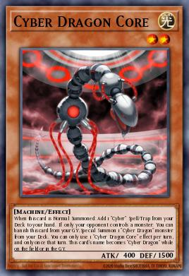

- **Copias y zona:** Main 3x. No altera las cantidades registradas.
- **Nombre oficial de referencia:** Núcleo Ciber Dragón. CID cotejado con la ficha oficial; el nombre histórico del inventario se conserva aunque su grafía/traducción difiera.
- **Función principal y secundaria:** starter Cyber · búsqueda.
- **Estado de sinergia y función:** Sinergia directa descrita. Es una clasificación de juego; revisar la relación concreta en A06.
- **Papel como recurso, descarte o coste:** No se demuestra que esta carta sea recurso de descarte o pago para otra.
- **Efecto operativo (paráfrasis analítica):** Core se llama Cyber Dragon en campo/Cementerio, busca M/T Cyber al ser Invocada Normal y desde GY habilita Cyber del Deck ante campo sólo rival. 
- **Mapa de activación y resultados:** 1) al invocarse: incorpora la pieza indicada a la mano · 2) con condición explícita en la carta: Invocación Especial desde Deck. Cada operación está sujeta a la secuencia y al «si lo haces» del texto oficial.
- **Ventanas de activación identificadas:** al producirse una Invocación.
- **Costes o recursos potenciales:** sin coste independiente identificado en esta síntesis; comprobar las acciones previas al punto y coma de cada efecto.
- **Restricciones y requisitos:** depende de recursos en Cementerio. 
- **Prioridad al ir primero:** proteger acceso a Core/recursos y preparar presencia legal. Para esta carta: Convertir acceso al Deck en cuerpos o materiales antes de bloquearse con restricciones.
- **Prioridad al ir segundo:** romper el campo rival y convertir Máquinas en Fusión o ataque de cierre. Identificar primero la respuesta rival que afecta su función «starter Cyber».
- **Medio/tardío y recuperación:** reciclar piezas Cyber y recuperar acceso al Extra Deck. No asumir que por sí misma recicla recursos si el texto no lo permite.
- **Sinergias y acceso a líneas:** Relación contextual con Máquinas, nombres Cyber Dragon, Fusión/Xyz/Enlace y cierre de partida por daño. Habilita una línea del motor sólo si coinciden recursos, objetivos y restricciones; no equivale a un combo completo validado.
- **Riesgo / brick / interrupciones:** Los dos efectos principales comparten limitación de uso por turno. No atribuirle velocidad rápida por el solo hecho de formar parte del motor.
- **Utilidad editorial:** 3/5 para este deck (estimación por rol y zona, no probabilidad calculada). No cambiar copias; cualquier sugerencia de alta/baja pasa por el apartado 22 y aprobación.
- **Referencia oficial y trazabilidad:** https://www.db.yugioh-card.com/yugiohdb/card_search.action?cid=10866&ope=2&request_locale=es. **Confianza:** texto y tipo de efecto cotejados en Konami; síntesis táctica editorial, no demostración de combo.
- **Aplicación concreta dentro de este deck (A06):** Core se llama Cyber Dragon en campo/Cementerio, busca M/T Cyber al ser Invocada Normal y desde GY habilita Cyber del Deck ante campo sólo rival.

**USO PRÁCTICO Y SINERGIA — Cyber Dragon Core**

- **Label funcional:** Sinergia directa. Clasificación documental; una relación es válida solo si se satisfacen sus condiciones exactas.
- **Qué hace:** Core se llama Cyber Dragon en campo/Cementerio, busca M/T Cyber al ser Invocada Normal y desde GY habilita Cyber del Deck ante campo sólo rival.
- **Al jugar primero:** proteger acceso a Core/recursos y preparar presencia legal. Para esta carta: Convertir acceso al Deck en cuerpos o materiales antes de bloquearse con restricciones.
- **Al jugar segundo:** romper el campo rival y convertir Máquinas en Fusión o ataque de cierre. Identificar primero la respuesta rival que afecta su función «starter Cyber».
- **Cuándo tener precaución:** Los dos efectos principales comparten limitación de uso por turno. No atribuirle velocidad rápida por el solo hecho de formar parte del motor.

#### 02. Cyber Dragon

- **Copias y zona:** Main 1x. No altera las cantidades registradas.
- **Nombre oficial de referencia:** Ciber Dragón. CID cotejado con la ficha oficial; el nombre histórico del inventario se conserva aunque su grafía/traducción difiera.
- **Función principal y secundaria:** extensor Cyber · acceso gratuito.
- **Estado de sinergia y función:** Sinergia directa descrita. Es una clasificación de juego; revisar la relación concreta en A06.
- **Papel como recurso, descarte o coste:** No se demuestra que esta carta sea recurso de descarte o pago para otra.
- **Efecto operativo (paráfrasis analítica):** Cyber Dragon se Invoca Especial desde mano únicamente cuando solo el oponente controla monstruos. 
- **Mapa de activación y resultados:** 1) efecto propio o continuo: Invocación Especial desde mano. Cada operación está sujeta a la secuencia y al «si lo haces» del texto oficial.
- **Ventanas de activación identificadas:** requieren la fase o condición específica indicada en el texto; sin ventana rápida general asumida.
- **Costes o recursos potenciales:** sin coste independiente identificado en esta síntesis; comprobar las acciones previas al punto y coma de cada efecto.
- **Restricciones y requisitos:** aplicar restricciones de selección, activación y copias que consten en el texto original. 
- **Prioridad al ir primero:** proteger acceso a Core/recursos y preparar presencia legal. Para esta carta: Activar cuando las condiciones permitan obtener valor real, preservando recursos de seguimiento.
- **Prioridad al ir segundo:** romper el campo rival y convertir Máquinas en Fusión o ataque de cierre. Identificar primero la respuesta rival que afecta su función «extensor Cyber».
- **Medio/tardío y recuperación:** reciclar piezas Cyber y recuperar acceso al Extra Deck. No asumir que por sí misma recicla recursos si el texto no lo permite.
- **Sinergias y acceso a líneas:** Relación contextual con Máquinas, nombres Cyber Dragon, Fusión/Xyz/Enlace y cierre de partida por daño. Habilita una línea del motor sólo si coinciden recursos, objetivos y restricciones; no equivale a un combo completo validado.
- **Riesgo / brick / interrupciones:** En campo propio ocupado no se invoca gratis mediante ese procedimiento. No atribuirle velocidad rápida por el solo hecho de formar parte del motor.
- **Utilidad editorial:** 3/5 para este deck (estimación por rol y zona, no probabilidad calculada). No cambiar copias; cualquier sugerencia de alta/baja pasa por el apartado 22 y aprobación.
- **Referencia oficial y trazabilidad:** https://www.db.yugioh-card.com/yugiohdb/card_search.action?cid=6390&ope=2&request_locale=es. **Confianza:** texto y tipo de efecto cotejados en Konami; síntesis táctica editorial, no demostración de combo.
- **Aplicación concreta dentro de este deck (A06):** Cyber Dragon se Invoca Especial desde mano únicamente cuando solo el oponente controla monstruos.

**USO PRÁCTICO Y SINERGIA — Cyber Dragon**

- **Label funcional:** Sinergia directa. Clasificación documental; una relación es válida solo si se satisfacen sus condiciones exactas.
- **Qué hace:** Cyber Dragon se Invoca Especial desde mano únicamente cuando solo el oponente controla monstruos.
- **Cómo aprovecharla en este deck:** al usar **Power Bond no necesitas Invocar Cyber Dragon**: se emplea como material de Fusión directamente desde la mano. Con Nachster y Power Bond abre **Heosvarog** defensor (`684:A09:POWERBOND:CYBER_NACHSTER:HEOS09`); si también tienes Herz puedes elegir **Eternity** 5600 ATK (`684:A09:POWERBOND:CYBER_HERZ_NACHSTER:ETERNITY10`) con coste 2800 LP propio al final del turno. Son alternativas, no campos simultáneos con una sola copia.
- **Al jugar primero:** proteger acceso a Core/recursos y preparar presencia legal. Para esta carta: Activar cuando las condiciones permitan obtener valor real, preservando recursos de seguimiento.
- **Al jugar segundo:** romper el campo rival y convertir Máquinas en Fusión o ataque de cierre. Identificar primero la respuesta rival que afecta su función «extensor Cyber».
- **Cuándo tener precaución:** En campo propio ocupado no se invoca gratis mediante ese procedimiento. No atribuirle velocidad rápida por el solo hecho de formar parte del motor.

#### 03. Cyber Dragon Nachster

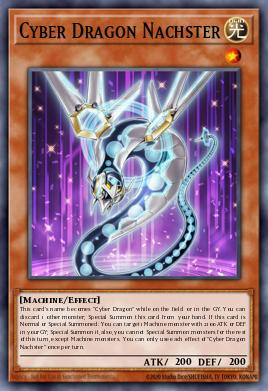

- **Copias y zona:** Main 1x. No altera las cantidades registradas.
- **Nombre oficial de referencia:** Ciber Dragón Nachster. CID cotejado con la ficha oficial; el nombre histórico del inventario se conserva aunque su grafía/traducción difiera.
- **Función principal y secundaria:** extensor · cierre.
- **Estado de sinergia y función:** Sinergia indirecta (soporte o recursos). Es una clasificación de juego; revisar la relación concreta en A06.
- **Papel como recurso, descarte o coste:** Coste o consumo descrito en A05: descarte de mano.
- **Efecto operativo (paráfrasis analítica):** acceso al campo desde la mano; presión de combate o modificación de estadísticas. Son operaciones detectadas en el texto, no efectos independientes garantizados; leer sus condiciones en la fuente.
- **Mapa de activación y resultados:** 1) efecto propio o continuo: Invocación Especial desde mano. Cada operación está sujeta a la secuencia y al «si lo haces» del texto oficial.
- **Ventanas de activación identificadas:** al producirse una Invocación.
- **Costes o recursos potenciales:** descarte de mano.
- **Restricciones y requisitos:** hay límite por turno según el efecto concreto; puede bloquear tipos de Invocación del Extra Deck; depende de recursos en Cementerio. 
- **Prioridad al ir primero:** proteger acceso a Core/recursos y preparar presencia legal. Para esta carta: Activar cuando las condiciones permitan obtener valor real, preservando recursos de seguimiento.
- **Prioridad al ir segundo:** romper el campo rival y convertir Máquinas en Fusión o ataque de cierre. Identificar primero la respuesta rival que afecta su función «extensor».
- **Medio/tardío y recuperación:** reciclar piezas Cyber y recuperar acceso al Extra Deck. No asumir que por sí misma recicla recursos si el texto no lo permite.
- **Sinergias y acceso a líneas:** Relación contextual con Máquinas, nombres Cyber Dragon, Fusión/Xyz/Enlace y cierre de partida por daño. Habilita una línea del motor sólo si coinciden recursos, objetivos y restricciones; no equivale a un combo completo validado.
- **Riesgo / brick / interrupciones:** La restricción de invocaciones puede cerrar rutas alternativas; revisar el orden de activación. No atribuirle velocidad rápida por el solo hecho de formar parte del motor.
- **Utilidad editorial:** 4/5 para este deck (estimación por rol y zona, no probabilidad calculada). No cambiar copias; cualquier sugerencia de alta/baja pasa por el apartado 22 y aprobación.
- **Referencia oficial y trazabilidad:** https://www.db.yugioh-card.com/yugiohdb/card_search.action?cid=14047&ope=2&request_locale=es. **Confianza:** texto y tipo de efecto cotejados en Konami; síntesis táctica editorial, no demostración de combo.
- **Aplicación concreta dentro de este deck (A06):** acceso al campo desde la mano; presión de combate o modificación de estadísticas.

**USO PRÁCTICO Y SINERGIA — Cyber Dragon Nachster**

- **Label funcional:** Sinergia indirecta. Clasificación documental; una relación es válida solo si se satisfacen sus condiciones exactas.
- **Qué hace:** acceso al campo desde la mano; presión de combate o modificación de estadísticas. Son operaciones detectadas en el texto, no efectos independientes garantizados; leer sus condiciones en la fuente.
- **Cómo aprovecharla en este deck:** como Máquina LUZ puede ser material desde mano sin activar ninguno de sus efectos. Con Cyber Dragon + Power Bond → **Heosvarog**, cuyos dos materiales quedan listos en GY para coste de negación M/T; si añades Herz → **Eternity**, atacante de 5600 con daño propio 2800 al final. Las guías `684:A09:POWERBOND:CYBER_NACHSTER:HEOS09` y `684:A09:POWERBOND:CYBER_HERZ_NACHSTER:ETERNITY10` enseñan ambas manos.
- **Al jugar primero:** proteger acceso a Core/recursos y preparar presencia legal. Para esta carta: Activar cuando las condiciones permitan obtener valor real, preservando recursos de seguimiento.
- **Al jugar segundo:** romper el campo rival y convertir Máquinas en Fusión o ataque de cierre. Identificar primero la respuesta rival que afecta su función «extensor».
- **Cuándo tener precaución:** La restricción de invocaciones puede cerrar rutas alternativas; revisar el orden de activación. No atribuirle velocidad rápida por el solo hecho de formar parte del motor.

#### 04. Cyber Dragon Herz

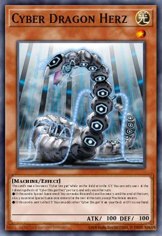

- **Copias y zona:** Main 1x, Reserva 1x. No altera las cantidades registradas.
- **Nombre oficial de referencia:** Ciber Dragón Herz. CID cotejado con la ficha oficial; el nombre histórico del inventario se conserva aunque su grafía/traducción difiera.
- **Función principal y secundaria:** searcher · buscador · recuperación.
- **Estado de sinergia y función:** Sinergia indirecta (soporte o recursos). Es una clasificación de juego; revisar la relación concreta en A06.
- **Papel como recurso, descarte o coste:** No se demuestra que esta carta sea recurso de descarte o pago para otra.
- **Efecto operativo (paráfrasis analítica):** búsqueda o incorporación de cartas a mano; recuperación e invocación desde Cementerio/destierro. Son operaciones detectadas en el texto, no efectos independientes garantizados; leer sus condiciones en la fuente.
- **Mapa de activación y resultados:** 1) efecto propio o continuo: incorpora la pieza indicada a la mano. Cada operación está sujeta a la secuencia y al «si lo haces» del texto oficial.
- **Ventanas de activación identificadas:** al producirse una Invocación; al llegar o estar en el Cementerio.
- **Costes o recursos potenciales:** sin coste independiente identificado en esta síntesis; comprobar las acciones previas al punto y coma de cada efecto.
- **Restricciones y requisitos:** puede bloquear tipos de Invocación del Extra Deck. 
- **Prioridad al ir primero:** proteger acceso a Core/recursos y preparar presencia legal. Para esta carta: Convertir la activación en acceso a la siguiente pieza del motor, sin duplicar buscadores inútilmente.
- **Prioridad al ir segundo:** romper el campo rival y convertir Máquinas en Fusión o ataque de cierre. Identificar primero la respuesta rival que afecta su función «searcher».
- **Medio/tardío y recuperación:** reciclar piezas Cyber y recuperar acceso al Extra Deck. Verificar que el objetivo de recuperación continúe disponible.
- **Sinergias y acceso a líneas:** Relación contextual con Máquinas, nombres Cyber Dragon, Fusión/Xyz/Enlace y cierre de partida por daño. Habilita una línea del motor sólo si coinciden recursos, objetivos y restricciones; no equivale a un combo completo validado.
- **Riesgo / brick / interrupciones:** La restricción de invocaciones puede cerrar rutas alternativas; revisar el orden de activación. No atribuirle velocidad rápida por el solo hecho de formar parte del motor.
- **Utilidad editorial:** 5/5 para este deck (estimación por rol y zona, no probabilidad calculada). No cambiar copias; cualquier sugerencia de alta/baja pasa por el apartado 22 y aprobación.
- **Referencia oficial y trazabilidad:** https://www.db.yugioh-card.com/yugiohdb/card_search.action?cid=13723&ope=2&request_locale=es. **Confianza:** texto y tipo de efecto cotejados en Konami; síntesis táctica editorial, no demostración de combo.
- **Aplicación concreta dentro de este deck (A06):** búsqueda o incorporación de cartas a mano; recuperación e invocación desde Cementerio/destierro.

**USO PRÁCTICO Y SINERGIA — Cyber Dragon Herz**

- **Label funcional:** Sinergia indirecta. Clasificación documental; una relación es válida solo si se satisfacen sus condiciones exactas.
- **Qué hace:** búsqueda o incorporación de cartas a mano; recuperación e invocación desde Cementerio/destierro. Son operaciones detectadas en el texto, no efectos independientes garantizados; leer sus condiciones en la fuente.
- **Cómo aprovecharla en este deck:** en `684:A09:POWERBOND:CYBER_HERZ_NACHSTER:ETERNITY10` sirve de **tercer material Máquina de Eternity**, pasa al GY por Power Bond y en una **cadena nueva** recupera el Cyber Dragon original del GY a tu mano. No es una búsqueda que ocurra durante la resolución de Power Bond y no equivale a invocar desde el Cementerio.
- **Al jugar primero:** proteger acceso a Core/recursos y preparar presencia legal. Para esta carta: Convertir la activación en acceso a la siguiente pieza del motor, sin duplicar buscadores inútilmente.
- **Al jugar segundo:** romper el campo rival y convertir Máquinas en Fusión o ataque de cierre. Identificar primero la respuesta rival que afecta su función «searcher».
- **Cuándo tener precaución:** La restricción de invocaciones puede cerrar rutas alternativas; revisar el orden de activación. No atribuirle velocidad rápida por el solo hecho de formar parte del motor.

#### 05. Cyberdark Chimera

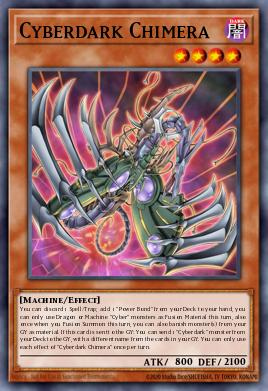

- **Copias y zona:** Main 1x. No altera las cantidades registradas.
- **Nombre oficial de referencia:** Quimera Ciberoscura. CID cotejado con la ficha oficial; el nombre histórico del inventario se conserva aunque su grafía/traducción difiera.
- **Función principal y secundaria:** searcher · buscador.
- **Estado de sinergia y función:** Sinergia indirecta (soporte o recursos). Es una clasificación de juego; revisar la relación concreta en A06.
- **Papel como recurso, descarte o coste:** Coste o consumo descrito en A05: descarte de mano.
- **Efecto operativo (paráfrasis analítica):** búsqueda o incorporación de cartas a mano. Son operaciones detectadas en el texto, no efectos independientes garantizados; leer sus condiciones en la fuente.
- **Mapa de activación y resultados:** 1) efecto propio o continuo: incorpora la pieza indicada a la mano. Cada operación está sujeta a la secuencia y al «si lo haces» del texto oficial.
- **Ventanas de activación identificadas:** al llegar o estar en el Cementerio.
- **Costes o recursos potenciales:** descarte de mano.
- **Restricciones y requisitos:** hay límite por turno según el efecto concreto; depende de recursos en Cementerio; exige materiales de Extra Deck o materiales adecuados. 
- **Prioridad al ir primero:** proteger acceso a Core/recursos y preparar presencia legal. Para esta carta: Convertir la activación en acceso a la siguiente pieza del motor, sin duplicar buscadores inútilmente.
- **Prioridad al ir segundo:** romper el campo rival y convertir Máquinas en Fusión o ataque de cierre. Identificar primero la respuesta rival que afecta su función «searcher».
- **Medio/tardío y recuperación:** reciclar piezas Cyber y recuperar acceso al Extra Deck. No asumir que por sí misma recicla recursos si el texto no lo permite.
- **Sinergias y acceso a líneas:** Relación contextual con Máquinas, nombres Cyber Dragon, Fusión/Xyz/Enlace y cierre de partida por daño. Habilita una línea del motor sólo si coinciden recursos, objetivos y restricciones; no equivale a un combo completo validado.
- **Riesgo / brick / interrupciones:** Depende del Cementerio y es sensible a destierro o negación de ese recurso. No atribuirle velocidad rápida por el solo hecho de formar parte del motor.
- **Utilidad editorial:** 5/5 para este deck (estimación por rol y zona, no probabilidad calculada). No cambiar copias; cualquier sugerencia de alta/baja pasa por el apartado 22 y aprobación.
- **Referencia oficial y trazabilidad:** https://www.db.yugioh-card.com/yugiohdb/card_search.action?cid=16296&ope=2&request_locale=es. **Confianza:** texto y tipo de efecto cotejados en Konami; síntesis táctica editorial, no demostración de combo.
- **Aplicación concreta dentro de este deck (A06):** búsqueda o incorporación de cartas a mano.

**USO PRÁCTICO Y SINERGIA — Cyberdark Chimera**

- **Label funcional:** Sinergia indirecta. Clasificación documental; una relación es válida solo si se satisfacen sus condiciones exactas.
- **Qué hace:** búsqueda o incorporación de cartas a mano. Son operaciones detectadas en el texto, no efectos independientes garantizados; leer sus condiciones en la fuente.
- **Cómo aprovecharla en este deck:** búsqueda o incorporación de cartas a mano.
- **Al jugar primero:** proteger acceso a Core/recursos y preparar presencia legal. Para esta carta: Convertir la activación en acceso a la siguiente pieza del motor, sin duplicar buscadores inútilmente.
- **Al jugar segundo:** romper el campo rival y convertir Máquinas en Fusión o ataque de cierre. Identificar primero la respuesta rival que afecta su función «searcher».
- **Cuándo tener precaución:** Depende del Cementerio y es sensible a destierro o negación de ese recurso. No atribuirle velocidad rápida por el solo hecho de formar parte del motor.

#### 06. Cyberdark Horn

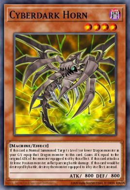

- **Copias y zona:** Main 1x. No altera las cantidades registradas.
- **Nombre oficial de referencia:** Cuerno Ciberoscuro. CID cotejado con la ficha oficial; el nombre histórico del inventario se conserva aunque su grafía/traducción difiera.
- **Función principal y secundaria:** removal · cierre · motor Equipo.
- **Estado de sinergia y función:** **Sinergia directa condicional en V11**: se utiliza como segundo monstruo de nombre distinto junto a Cyber Dragon para Barricadeborg, protegiendo Clockwork Night boca arriba. No confundir su papel de material Enlace con su propio efecto de Equipo.
- **Papel como recurso, descarte o coste:** No se demuestra que esta carta sea recurso de descarte o pago para otra.
- **Efecto operativo (paráfrasis analítica):** destrucción de cartas o empleo de destrucción como detonante; presión de combate o modificación de estadísticas; uso o producción de cartas equipadas. Son operaciones detectadas en el texto, no efectos independientes garantizados; leer sus condiciones en la fuente.
- **Mapa de activación y resultados:** 1) al invocarse: equipa carta/monstruo según texto · 2) efecto propio o continuo: inflige daño · 3) efecto propio o continuo: destruye la carta o recurso previsto, equipa carta/monstruo según texto. Cada operación está sujeta a la secuencia y al «si lo haces» del texto oficial.
- **Ventanas de activación identificadas:** al producirse una Invocación.
- **Costes o recursos potenciales:** sin coste independiente identificado en esta síntesis; comprobar las acciones previas al punto y coma de cada efecto.
- **Restricciones y requisitos:** depende de recursos en Cementerio. 
- **Prioridad al ir primero:** proteger acceso a Core/recursos y preparar presencia legal. Para esta carta: Activar cuando las condiciones permitan obtener valor real, preservando recursos de seguimiento.
- **Prioridad al ir segundo:** romper el campo rival y convertir Máquinas en Fusión o ataque de cierre. Identificar primero la respuesta rival que afecta su función «removal».
- **Medio/tardío y recuperación:** reciclar piezas Cyber y recuperar acceso al Extra Deck. No asumir que por sí misma recicla recursos si el texto no lo permite.
- **Sinergias y acceso a líneas:** Relación contextual con Máquinas, nombres Cyber Dragon, Fusión/Xyz/Enlace y cierre de partida por daño. Habilita una línea del motor sólo si coinciden recursos, objetivos y restricciones; no equivale a un combo completo validado.
- **Riesgo / brick / interrupciones:** Depende del Cementerio y es sensible a destierro o negación de ese recurso. No atribuirle velocidad rápida por el solo hecho de formar parte del motor.
- **Utilidad editorial:** 3/5 para este deck (estimación por rol y zona, no probabilidad calculada). No cambiar copias; cualquier sugerencia de alta/baja pasa por el apartado 22 y aprobación.
- **Referencia oficial y trazabilidad:** https://www.db.yugioh-card.com/yugiohdb/card_search.action?cid=6830&ope=2&request_locale=es. **Confianza:** texto y tipo de efecto cotejados en Konami; síntesis táctica editorial, no demostración de combo.
- **Aplicación concreta dentro de este deck (A06):** `684:A09:CYBER:HORN:NIGHT:BARRICADEBORG14` exige Cyber Dragon y Horn de nombres **distintos**, Night previamente activa y monstruo rival. Horn Normal, junto a Cyber Dragon Especial, se emplea como material para Barricadeborg; su efecto propio de Equipo no es requisito ni permanece tras Enlace.

**USO PRÁCTICO Y SINERGIA — Cyberdark Horn**

- **Label funcional:** **Sinergia directa condicional demostrada** (material Link2 distinto de Cyber Dragon), con ruta V11 y campo previo explícito. No es negación, ni búsqueda de Power Bond.
- **Qué hace:** destrucción de cartas o empleo de destrucción como detonante; presión de combate o modificación de estadísticas; uso o producción de cartas equipadas. Son operaciones detectadas en el texto, no efectos independientes garantizados; leer sus condiciones en la fuente.
- **Cómo aprovecharla en este deck:** destrucción de cartas o empleo de destrucción como detonante; presión de combate o modificación de estadísticas; uso o producción de cartas equipadas. A06 aún no identifica su conexión; no equivale a incompatibilidad ni borra rutas A09.
- **Al jugar primero:** proteger acceso a Core/recursos y preparar presencia legal. Para esta carta: Activar cuando las condiciones permitan obtener valor real, preservando recursos de seguimiento.
- **Al jugar segundo:** romper el campo rival y convertir Máquinas en Fusión o ataque de cierre. Identificar primero la respuesta rival que afecta su función «removal».
- **Cuándo tener precaución:** Depende del Cementerio y es sensible a destierro o negación de ese recurso. No atribuirle velocidad rápida por el solo hecho de formar parte del motor.
- **Sinergia V11 demostrada:** con Cyber Dragon como nombre distinto, Horn es material de Barricadeborg Blocker, que protege Clockwork Night propia ya activa. Esta línea pierde ambos monstruos y no usa el efecto de equipo de Horn.

**GUÍA V11 — `684:A09:CYBER:HORN:NIGHT:BARRICADEBORG14`:** [ver mano, campo anterior, fotos, materiales y campo final](guias/DECK_684_CLOCKWORK_KNIGHT_Y_BARRICADEBORG_ALTERNATIVAS_GUIA.md). No cambiar Horn por Core; Core pasaría a llamarse Cyber Dragon en campo y el Link2 pide nombres diferentes.

#### 07. Cyberdark Wurm [Konami 21164]

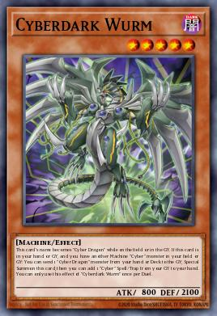

- **Copias y zona:** Main 1x. No altera las cantidades registradas.
- **Nombre oficial de referencia:** Sierpe Ciberoscura. CID cotejado con la ficha oficial; el nombre histórico del inventario se conserva aunque su grafía/traducción difiera.
- **Función principal y secundaria:** searcher · buscador · recuperación · extensor.
- **Estado de sinergia y función:** Sinergia indirecta (soporte o recursos). Es una clasificación de juego; revisar la relación concreta en A06.
- **Papel como recurso, descarte o coste:** Coste o consumo descrito en A05: envío de recurso propio al Cementerio.
- **Efecto operativo (paráfrasis analítica):** búsqueda o incorporación de cartas a mano; recuperación e invocación desde Cementerio/destierro; acceso al campo desde la mano. Son operaciones detectadas en el texto, no efectos independientes garantizados; leer sus condiciones en la fuente.
- **Mapa de activación y resultados:** 1) desde mano: Invocación Especial desde Cementerio, incorpora la pieza indicada a la mano. Cada operación está sujeta a la secuencia y al «si lo haces» del texto oficial.
- **Ventanas de activación identificadas:** desde la mano.
- **Costes o recursos potenciales:** envío de recurso propio al Cementerio.
- **Restricciones y requisitos:** hay límite por turno según el efecto concreto; depende de recursos en Cementerio. 
- **Prioridad al ir primero:** proteger acceso a Core/recursos y preparar presencia legal. Para esta carta: Convertir la activación en acceso a la siguiente pieza del motor, sin duplicar buscadores inútilmente.
- **Prioridad al ir segundo:** romper el campo rival y convertir Máquinas en Fusión o ataque de cierre. Identificar primero la respuesta rival que afecta su función «searcher».
- **Medio/tardío y recuperación:** reciclar piezas Cyber y recuperar acceso al Extra Deck. Verificar que el objetivo de recuperación continúe disponible.
- **Sinergias y acceso a líneas:** Relación contextual con Máquinas, nombres Cyber Dragon, Fusión/Xyz/Enlace y cierre de partida por daño. Habilita una línea del motor sólo si coinciden recursos, objetivos y restricciones; no equivale a un combo completo validado.
- **Riesgo / brick / interrupciones:** Depende del Cementerio y es sensible a destierro o negación de ese recurso. No atribuirle velocidad rápida por el solo hecho de formar parte del motor.
- **Utilidad editorial:** 5/5 para este deck (estimación por rol y zona, no probabilidad calculada). No cambiar copias; cualquier sugerencia de alta/baja pasa por el apartado 22 y aprobación.
- **Referencia oficial y trazabilidad:** https://www.db.yugioh-card.com/yugiohdb/card_search.action?cid=21164&ope=2&request_locale=es. **Confianza:** texto y tipo de efecto cotejados en Konami; síntesis táctica editorial, no demostración de combo.
- **Aplicación concreta dentro de este deck (A06):** búsqueda o incorporación de cartas a mano; recuperación e invocación desde Cementerio/destierro; acceso al campo desde la mano.

**USO PRÁCTICO Y SINERGIA — Cyberdark Wurm [Konami 21164]**

- **Label funcional:** Sinergia indirecta. Clasificación documental; una relación es válida solo si se satisfacen sus condiciones exactas.
- **Qué hace:** búsqueda o incorporación de cartas a mano; recuperación e invocación desde Cementerio/destierro; acceso al campo desde la mano. Son operaciones detectadas en el texto, no efectos independientes garantizados; leer sus condiciones en la fuente.
- **Cómo aprovecharla en este deck:** búsqueda o incorporación de cartas a mano; recuperación e invocación desde Cementerio/destierro; acceso al campo desde la mano.
- **Al jugar primero:** proteger acceso a Core/recursos y preparar presencia legal. Para esta carta: Convertir la activación en acceso a la siguiente pieza del motor, sin duplicar buscadores inútilmente.
- **Al jugar segundo:** romper el campo rival y convertir Máquinas en Fusión o ataque de cierre. Identificar primero la respuesta rival que afecta su función «searcher».
- **Cuándo tener precaución:** Depende del Cementerio y es sensible a destierro o negación de ese recurso. No atribuirle velocidad rápida por el solo hecho de formar parte del motor.

#### 08. Cyberdark Claw

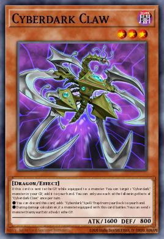

- **Copias y zona:** Main 2x. No altera las cantidades registradas.
- **Nombre oficial de referencia:** Garra Ciberoscura. CID cotejado con la ficha oficial; el nombre histórico del inventario se conserva aunque su grafía/traducción difiera.
- **Función principal y secundaria:** searcher · buscador · cierre · motor Equipo.
- **Estado de sinergia y función:** Sinergia indirecta (soporte o recursos). Es una clasificación de juego; revisar la relación concreta en A06.
- **Papel como recurso, descarte o coste:** Coste o consumo descrito en A05: descarte de mano.
- **Efecto operativo (paráfrasis analítica):** búsqueda o incorporación de cartas a mano; presión de combate o modificación de estadísticas; uso o producción de cartas equipadas. Son operaciones detectadas en el texto, no efectos independientes garantizados; leer sus condiciones en la fuente.
- **Mapa de activación y resultados:** 1) con Equipo requerido: incorpora la pieza indicada a la mano, equipa carta/monstruo según texto. Cada operación está sujeta a la secuencia y al «si lo haces» del texto oficial.
- **Ventanas de activación identificadas:** al llegar o estar en el Cementerio.
- **Costes o recursos potenciales:** descarte de mano.
- **Restricciones y requisitos:** hay límite por turno según el efecto concreto; depende de recursos en Cementerio. 
- **Prioridad al ir primero:** proteger acceso a Core/recursos y preparar presencia legal. Para esta carta: Convertir la activación en acceso a la siguiente pieza del motor, sin duplicar buscadores inútilmente.
- **Prioridad al ir segundo:** romper el campo rival y convertir Máquinas en Fusión o ataque de cierre. Identificar primero la respuesta rival que afecta su función «searcher».
- **Medio/tardío y recuperación:** reciclar piezas Cyber y recuperar acceso al Extra Deck. No asumir que por sí misma recicla recursos si el texto no lo permite.
- **Sinergias y acceso a líneas:** Relación contextual con Máquinas, nombres Cyber Dragon, Fusión/Xyz/Enlace y cierre de partida por daño. Habilita una línea del motor sólo si coinciden recursos, objetivos y restricciones; no equivale a un combo completo validado.
- **Riesgo / brick / interrupciones:** Depende del Cementerio y es sensible a destierro o negación de ese recurso. No atribuirle velocidad rápida por el solo hecho de formar parte del motor.
- **Utilidad editorial:** 5/5 para este deck (estimación por rol y zona, no probabilidad calculada). No cambiar copias; cualquier sugerencia de alta/baja pasa por el apartado 22 y aprobación.
- **Referencia oficial y trazabilidad:** https://www.db.yugioh-card.com/yugiohdb/card_search.action?cid=13181&ope=2&request_locale=es. **Confianza:** texto y tipo de efecto cotejados en Konami; síntesis táctica editorial, no demostración de combo.
- **Aplicación concreta dentro de este deck (A06):** búsqueda o incorporación de cartas a mano; presión de combate o modificación de estadísticas; uso o producción de cartas equipadas.

**USO PRÁCTICO Y SINERGIA — Cyberdark Claw**

- **Label funcional:** Sinergia indirecta. Clasificación documental; una relación es válida solo si se satisfacen sus condiciones exactas.
- **Qué hace:** búsqueda o incorporación de cartas a mano; presión de combate o modificación de estadísticas; uso o producción de cartas equipadas. Son operaciones detectadas en el texto, no efectos independientes garantizados; leer sus condiciones en la fuente.
- **Cómo aprovecharla en este deck:** búsqueda o incorporación de cartas a mano; presión de combate o modificación de estadísticas; uso o producción de cartas equipadas.
- **Al jugar primero:** proteger acceso a Core/recursos y preparar presencia legal. Para esta carta: Convertir la activación en acceso a la siguiente pieza del motor, sin duplicar buscadores inútilmente.
- **Al jugar segundo:** romper el campo rival y convertir Máquinas en Fusión o ataque de cierre. Identificar primero la respuesta rival que afecta su función «searcher».
- **Cuándo tener precaución:** Depende del Cementerio y es sensible a destierro o negación de ese recurso. No atribuirle velocidad rápida por el solo hecho de formar parte del motor.

#### 09. Cyber Phoenix

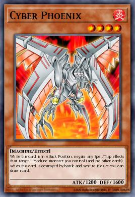

- **Copias y zona:** Main 1x. No altera las cantidades registradas.
- **Nombre oficial de referencia:** Cíber Fénix. CID cotejado con la ficha oficial; el nombre histórico del inventario se conserva aunque su grafía/traducción difiera.
- **Función principal y secundaria:** ventaja de mano.
- **Estado de sinergia y función:** Sin relación demostrada. Es una clasificación de juego; revisar la relación concreta en A06.
- **Papel como recurso, descarte o coste:** No se demuestra que esta carta sea recurso de descarte o pago para otra.
- **Efecto operativo (paráfrasis analítica):** generación de cartas por robo. Son operaciones detectadas en el texto, no efectos independientes garantizados; leer sus condiciones en la fuente.
- **Mapa de activación y resultados:** 1) con condición explícita en la carta: roba cartas. Cada operación está sujeta a la secuencia y al «si lo haces» del texto oficial.
- **Ventanas de activación identificadas:** requieren la fase o condición específica indicada en el texto; sin ventana rápida general asumida.
- **Costes o recursos potenciales:** sin coste independiente identificado en esta síntesis; comprobar las acciones previas al punto y coma de cada efecto.
- **Restricciones y requisitos:** aplicar restricciones de selección, activación y copias que consten en el texto original. 
- **Prioridad al ir primero:** proteger acceso a Core/recursos y preparar presencia legal. Para esta carta: Activar cuando las condiciones permitan obtener valor real, preservando recursos de seguimiento.
- **Prioridad al ir segundo:** romper el campo rival y convertir Máquinas en Fusión o ataque de cierre. Identificar primero la respuesta rival que afecta su función «ventaja de mano».
- **Medio/tardío y recuperación:** reciclar piezas Cyber y recuperar acceso al Extra Deck. No asumir que por sí misma recicla recursos si el texto no lo permite.
- **Sinergias y acceso a líneas:** Relación contextual con Máquinas, nombres Cyber Dragon, Fusión/Xyz/Enlace y cierre de partida por daño. Habilita una línea del motor sólo si coinciden recursos, objetivos y restricciones; no equivale a un combo completo validado.
- **Riesgo / brick / interrupciones:** Riesgo operativo: materiales exigidos, efectos que requieren campo rival y bloqueos de Invocación Especial. Confirmar objetivos disponibles y costes antes de activar. No atribuirle velocidad rápida por el solo hecho de formar parte del motor.
- **Utilidad editorial:** 3/5 para este deck (estimación por rol y zona, no probabilidad calculada). No cambiar copias; cualquier sugerencia de alta/baja pasa por el apartado 22 y aprobación.
- **Referencia oficial y trazabilidad:** https://www.db.yugioh-card.com/yugiohdb/card_search.action?cid=6663&ope=2&request_locale=es. **Confianza:** texto y tipo de efecto cotejados en Konami; síntesis táctica editorial, no demostración de combo.
- **Aplicación concreta dentro de este deck (A06):** generación de cartas por robo. A06 aún no identifica su conexión; no equivale a incompatibilidad ni borra rutas A09.

**USO PRÁCTICO Y SINERGIA — Cyber Phoenix**

- **Label funcional:** Sin sinergia demostrada. Clasificación documental; una relación es válida solo si se satisfacen sus condiciones exactas.
- **Qué hace:** generación de cartas por robo. Son operaciones detectadas en el texto, no efectos independientes garantizados; leer sus condiciones en la fuente.
- **Cómo aprovecharla en este deck:** generación de cartas por robo. A06 aún no identifica su conexión; no equivale a incompatibilidad ni borra rutas A09.
- **Al jugar primero:** proteger acceso a Core/recursos y preparar presencia legal. Para esta carta: Activar cuando las condiciones permitan obtener valor real, preservando recursos de seguimiento.
- **Al jugar segundo:** romper el campo rival y convertir Máquinas en Fusión o ataque de cierre. Identificar primero la respuesta rival que afecta su función «ventaja de mano».
- **Cuándo tener precaución:** Riesgo operativo: materiales exigidos, efectos que requieren campo rival y bloqueos de Invocación Especial. Confirmar objetivos disponibles y costes antes de activar. No atribuirle velocidad rápida por el solo hecho de formar parte del motor.
- **Sinergia no demostrada:** conservar su función individual si la tiene; no vincularla con otro combo sin una interacción real.

#### 10. Cyber Jormungardr [Konami 21163]

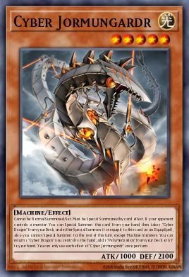

- **Copias y zona:** Main 1x. No altera las cantidades registradas.
- **Nombre oficial de referencia:** Jormungardr Ciber. CID cotejado con la ficha oficial; el nombre histórico del inventario se conserva aunque su grafía/traducción difiera.
- **Función principal y secundaria:** searcher · buscador · extensor · motor Equipo.
- **Estado de sinergia y función:** Sinergia indirecta (soporte o recursos). Es una clasificación de juego; revisar la relación concreta en A06.
- **Papel como recurso, descarte o coste:** No se demuestra que esta carta sea recurso de descarte o pago para otra.
- **Efecto operativo (paráfrasis analítica, V12):** si el adversario controla monstruo, **se Invoca Especialmente desde mano por su efecto** y toma un «Cyber Dragon» del Deck para **Invocarlo Especialmente o equiparlo**; el resto del turno solo permite Invocaciones Especiales de Máquinas. Alternativamente puede devolver un «Cyber Dragon» propio a mano para incorporar «Polymerization», pero ese efecto NO se usa en la nueva ruta Xyz. No puede Invocarse Normalmente.
- **Mapa de activación y resultados:** 1) efecto propio o continuo: Invocación Especial desde zona permitida, Coloca Mágicas/Trampas indicadas · 2) efecto propio o continuo: incorpora la pieza indicada a la mano. Cada operación está sujeta a la secuencia y al «si lo haces» del texto oficial.
- **Ventanas de activación identificadas:** requieren la fase o condición específica indicada en el texto; sin ventana rápida general asumida.
- **Costes o recursos potenciales:** sin coste independiente identificado en esta síntesis; comprobar las acciones previas al punto y coma de cada efecto.
- **Restricciones y requisitos:** hay límite por turno según el efecto concreto; puede bloquear tipos de Invocación del Extra Deck; tiene procedimiento especial de Invocación. 
- **Prioridad al ir primero:** proteger acceso a Core/recursos y preparar presencia legal. Para esta carta: Convertir acceso al Deck en cuerpos o materiales antes de bloquearse con restricciones.
- **Prioridad al ir segundo:** romper el campo rival y convertir Máquinas en Fusión o ataque de cierre. Identificar primero la respuesta rival que afecta su función «searcher».
- **Medio/tardío y recuperación:** reciclar piezas Cyber y recuperar acceso al Extra Deck. No asumir que por sí misma recicla recursos si el texto no lo permite.
- **Sinergias y acceso a líneas:** Relación contextual con Máquinas, nombres Cyber Dragon, Fusión/Xyz/Enlace y cierre de partida por daño. Habilita una línea del motor sólo si coinciden recursos, objetivos y restricciones; no equivale a un combo completo validado.
- **Riesgo / brick / interrupciones:** No computar como invocación normal disponible: depende de su procedimiento y de recursos previos. No atribuirle velocidad rápida por el solo hecho de formar parte del motor.
- **Utilidad editorial:** 5/5 para este deck (estimación por rol y zona, no probabilidad calculada). No cambiar copias; cualquier sugerencia de alta/baja pasa por el apartado 22 y aprobación.
- **Referencia oficial y trazabilidad:** https://www.db.yugioh-card.com/yugiohdb/card_search.action?cid=21163&ope=2&request_locale=es. **Confianza:** texto y tipo de efecto cotejados en Konami; síntesis táctica editorial, no demostración de combo.
- **Aplicación concreta dentro de este deck (A06):** `684:A09:JORMUNGARDR:VIMANA16`: Jormungardr Main 1x desde mano si rival tiene monstruo + **Cyber Dragon original desde Deck** (1x) → dos Máquinas Nivel5 para Vimana Rango5; Vimana se permite bajo el bloqueo a no-Máquinas y conserva dos materiales para negar activación de efecto de monstruo rival.

**USO PRÁCTICO Y SINERGIA — Cyber Jormungardr [Konami 21163]**

- **Label funcional:** Sinergia indirecta. Clasificación documental; una relación es válida solo si se satisfacen sus condiciones exactas.
- **Qué hace:** búsqueda o incorporación de cartas a mano; extensión mediante monstruos procedentes del Deck; acceso al campo desde la mano; uso o producción de cartas equipadas. Son operaciones detectadas en el texto, no efectos independientes garantizados; leer sus condiciones en la fuente.
- **Cómo aprovecharla en este deck:** vía de **un solo recurso en mano** a Vimana desde Cyber Dragon del Deck, siempre que el rival controle monstruo. Alternativa Xyz Nova/Infinity con los mismos 2 Nivel5, no campo acumulable.
- **Al jugar primero:** proteger acceso a Core/recursos y preparar presencia legal. Para esta carta: Convertir acceso al Deck en cuerpos o materiales antes de bloquearse con restricciones.
- **Al jugar segundo:** romper el campo rival y convertir Máquinas en Fusión o ataque de cierre. Identificar primero la respuesta rival que afecta su función «searcher».
- **Cuándo tener precaución:** No computar como invocación normal disponible: depende de su procedimiento y de recursos previos. No atribuirle velocidad rápida por el solo hecho de formar parte del motor.

**GUÍA V12 — `684:A09:JORMUNGARDR:VIMANA16`:** [entrada de una carta, Invocación de Cyber Dragon del Deck, restricción Máquina, Xyz y negación](guias/DECK_684_687_AZALEA_VIMANA_PRINCESS_GUIA_V12.md). Mantener 1x provisional; si el único Cyber Dragon está en mano o GY, NO afirmar que esta apertura llega a Vimana.

#### 11. Therion "King" Regulus

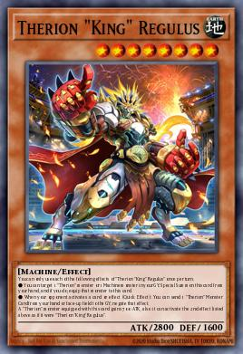

- **Copias y zona:** Main 1x. No altera las cantidades registradas.
- **Nombre oficial de referencia:** Therion "Rey" Regulus. CID cotejado con la ficha oficial; el nombre histórico del inventario se conserva aunque su grafía/traducción difiera.
- **Función principal y secundaria:** extensor Máquina · negación.
- **Estado de sinergia y función:** Sinergia directa descrita. Es una clasificación de juego; revisar la relación concreta en A06.
- **Papel como recurso, descarte o coste:** Coste o consumo descrito en A05: envío de recurso propio al Cementerio.
- **Efecto operativo (paráfrasis analítica):** Regulus se invoca desde mano equipando Máquina o Therion del GY y ofrece una negación con coste de envío de Therion. 
- **Mapa de activación y resultados:** efecto de estadística, condición o material; no asumir un disparador adicional. Cada operación está sujeta a la secuencia y al «si lo haces» del texto oficial.
- **Ventanas de activación identificadas:** respuesta a activación rival; Efecto Rápido.
- **Costes o recursos potenciales:** envío de recurso propio al Cementerio.
- **Restricciones y requisitos:** hay límite por turno según el efecto concreto; depende de recursos en Cementerio. 
- **Prioridad al ir primero:** proteger acceso a Core/recursos y preparar presencia legal. Para esta carta: Conservar la interrupción para el efecto clave rival; no gastarla en un efecto irrelevante.
- **Prioridad al ir segundo:** romper el campo rival y convertir Máquinas en Fusión o ataque de cierre. Identificar primero la respuesta rival que afecta su función «extensor Máquina».
- **Medio/tardío y recuperación:** reciclar piezas Cyber y recuperar acceso al Extra Deck. No asumir que por sí misma recicla recursos si el texto no lo permite.
- **Sinergias y acceso a líneas:** Relación contextual con Máquinas, nombres Cyber Dragon, Fusión/Xyz/Enlace y cierre de partida por daño. Habilita una línea del motor sólo si coinciden recursos, objetivos y restricciones; no equivale a un combo completo validado.
- **Riesgo / brick / interrupciones:** Su activación exige equipo/recursos adecuados y no se confunde con una negación pasiva. Puede emplearse en cadena sólo cuando se cumpla su condición concreta.
- **Utilidad editorial:** 3/5 para este deck (estimación por rol y zona, no probabilidad calculada). No cambiar copias; cualquier sugerencia de alta/baja pasa por el apartado 22 y aprobación.
- **Referencia oficial y trazabilidad:** https://www.db.yugioh-card.com/yugiohdb/card_search.action?cid=17119&ope=2&request_locale=es. **Confianza:** texto y tipo de efecto cotejados en Konami; síntesis táctica editorial, no demostración de combo.
- **Aplicación concreta dentro de este deck (A06):** Regulus se invoca desde mano equipando Máquina o Therion del GY y ofrece una negación con coste de envío de Therion.

**USO PRÁCTICO Y SINERGIA — Therion "King" Regulus**

- **Label funcional:** Sinergia directa. Clasificación documental; una relación es válida solo si se satisfacen sus condiciones exactas.
- **Qué hace:** Regulus se invoca desde mano equipando Máquina o Therion del GY y ofrece una negación con coste de envío de Therion.
- **Al jugar primero:** proteger acceso a Core/recursos y preparar presencia legal. Para esta carta: Conservar la interrupción para el efecto clave rival; no gastarla en un efecto irrelevante.
- **Al jugar segundo:** romper el campo rival y convertir Máquinas en Fusión o ataque de cierre. Identificar primero la respuesta rival que afecta su función «extensor Máquina».
- **Cuándo tener precaución:** Su activación exige equipo/recursos adecuados y no se confunde con una negación pasiva. Puede emplearse en cadena sólo cuando se cumpla su condición concreta.

#### 12. Ash Blossom & Joyous Spring

- **Copias y zona:** Main 3x. No altera las cantidades registradas.
- **Nombre oficial de referencia:** Flor de Ceniza & Primavera Feliz. CID cotejado con la ficha oficial; el nombre histórico del inventario se conserva aunque su grafía/traducción difiera.
- **Función principal y secundaria:** handtrap · negación.
- **Estado de sinergia y función:** Utilidad independiente. Es una clasificación de juego; revisar la relación concreta en A06.
- **Papel como recurso, descarte o coste:** Descarte mencionado: comprobar carta que lo exige, zona, coste frente a efecto y utilidad del recurso.
- **Efecto operativo (paráfrasis analítica):** Descarta desde la mano para detener efectos que buscan, invocan o mandan cartas desde el Deck. 
- **Mapa de activación y resultados:** 1) con condición explícita en la carta: niega el efecto o la activación indicada, Invocación Especial desde Deck, incorpora la pieza indicada a la mano. Cada operación está sujeta a la secuencia y al «si lo haces» del texto oficial.
- **Ventanas de activación identificadas:** Efecto Rápido.
- **Costes o recursos potenciales:** descarte de mano.
- **Restricciones y requisitos:** hay límite por turno según el efecto concreto. 
- **Prioridad al ir primero:** proteger acceso a Core/recursos y preparar presencia legal. Para esta carta: Reservar la respuesta para la ventana rival exacta; no es una pieza buscadora de nuestro motor.
- **Prioridad al ir segundo:** romper el campo rival y convertir Máquinas en Fusión o ataque de cierre. Identificar primero la respuesta rival que afecta su función «handtrap».
- **Medio/tardío y recuperación:** reciclar piezas Cyber y recuperar acceso al Extra Deck. Verificar que el objetivo de recuperación continúe disponible.
- **Sinergias y acceso a líneas:** Relación contextual con Máquinas, nombres Cyber Dragon, Fusión/Xyz/Enlace y cierre de partida por daño. Habilita una línea del motor sólo si coinciden recursos, objetivos y restricciones; no equivale a un combo completo validado.
- **Riesgo / brick / interrupciones:** Reaccionar al efecto del Deck que habilite la jugada rival; no da búsquedas propias. Puede emplearse en cadena sólo cuando se cumpla su condición concreta.
- **Utilidad editorial:** 3/5 para este deck (estimación por rol y zona, no probabilidad calculada). No cambiar copias; cualquier sugerencia de alta/baja pasa por el apartado 22 y aprobación.
- **Referencia oficial y trazabilidad:** https://www.db.yugioh-card.com/yugiohdb/card_search.action?cid=12950&ope=2&request_locale=es. **Confianza:** texto y tipo de efecto cotejados en Konami; síntesis táctica editorial, no demostración de combo.
- **Aplicación concreta dentro de este deck (A06):** Descarta desde la mano para detener efectos que buscan, invocan o mandan cartas desde el Deck. Aporta respuesta o consistencia sin exigir enlace directo.

**USO PRÁCTICO Y SINERGIA — Ash Blossom & Joyous Spring**

- **Label funcional:** Función independiente. Clasificación documental; una relación es válida solo si se satisfacen sus condiciones exactas.
- **Qué hace:** Descarta desde la mano para detener efectos que buscan, invocan o mandan cartas desde el Deck.
- **Cómo aprovecharla en este deck:** Descarta desde la mano para detener efectos que buscan, invocan o mandan cartas desde el Deck. Aporta respuesta o consistencia sin exigir enlace directo.
- **Al jugar primero:** proteger acceso a Core/recursos y preparar presencia legal. Para esta carta: Reservar la respuesta para la ventana rival exacta; no es una pieza buscadora de nuestro motor.
- **Al jugar segundo:** romper el campo rival y convertir Máquinas en Fusión o ataque de cierre. Identificar primero la respuesta rival que afecta su función «handtrap».
- **Cuándo tener precaución:** Reaccionar al efecto del Deck que habilite la jugada rival; no da búsquedas propias. Puede emplearse en cadena sólo cuando se cumpla su condición concreta.

#### 13. Ghost Belle & Haunted Mansion

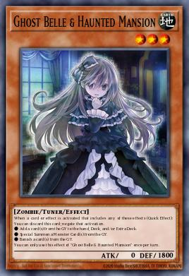

- **Copias y zona:** Main 2x. No altera las cantidades registradas.
- **Nombre oficial de referencia:** Bella Fantasma & Mansión Embrujada. CID cotejado con la ficha oficial; el nombre histórico del inventario se conserva aunque su grafía/traducción difiera.
- **Función principal y secundaria:** handtrap · negación de Cementerio.
- **Estado de sinergia y función:** Utilidad independiente. Es una clasificación de juego; revisar la relación concreta en A06.
- **Papel como recurso, descarte o coste:** Descarte mencionado: comprobar carta que lo exige, zona, coste frente a efecto y utilidad del recurso.
- **Efecto operativo (paráfrasis analítica):** Descarta para negar la activación de una operación que recupere, invoque o destierre cartas del Cementerio. 
- **Mapa de activación y resultados:** 1) con condición explícita en la carta: Invocación Especial desde Extra Deck, incorpora la pieza indicada a la mano. Cada operación está sujeta a la secuencia y al «si lo haces» del texto oficial.
- **Ventanas de activación identificadas:** Efecto Rápido.
- **Costes o recursos potenciales:** descarte de mano.
- **Restricciones y requisitos:** hay límite por turno según el efecto concreto. 
- **Prioridad al ir primero:** proteger acceso a Core/recursos y preparar presencia legal. Para esta carta: Reservar la respuesta para la ventana rival exacta; no es una pieza buscadora de nuestro motor.
- **Prioridad al ir segundo:** romper el campo rival y convertir Máquinas en Fusión o ataque de cierre. Identificar primero la respuesta rival que afecta su función «handtrap».
- **Medio/tardío y recuperación:** reciclar piezas Cyber y recuperar acceso al Extra Deck. Verificar que el objetivo de recuperación continúe disponible.
- **Sinergias y acceso a líneas:** Relación contextual con Máquinas, nombres Cyber Dragon, Fusión/Xyz/Enlace y cierre de partida por daño. Habilita una línea del motor sólo si coinciden recursos, objetivos y restricciones; no equivale a un combo completo validado.
- **Riesgo / brick / interrupciones:** No niega todos los efectos: exige que el efecto incluya una de las acciones enumeradas. Puede emplearse en cadena sólo cuando se cumpla su condición concreta.
- **Utilidad editorial:** 3/5 para este deck (estimación por rol y zona, no probabilidad calculada). No cambiar copias; cualquier sugerencia de alta/baja pasa por el apartado 22 y aprobación.
- **Referencia oficial y trazabilidad:** https://www.db.yugioh-card.com/yugiohdb/card_search.action?cid=13587&ope=2&request_locale=es. **Confianza:** texto y tipo de efecto cotejados en Konami; síntesis táctica editorial, no demostración de combo.
- **Aplicación concreta dentro de este deck (A06):** Descarta para negar la activación de una operación que recupere, invoque o destierre cartas del Cementerio. Aporta respuesta o consistencia sin exigir enlace directo.

**USO PRÁCTICO Y SINERGIA — Ghost Belle & Haunted Mansion**

- **Label funcional:** Función independiente. Clasificación documental; una relación es válida solo si se satisfacen sus condiciones exactas.
- **Qué hace:** Descarta para negar la activación de una operación que recupere, invoque o destierre cartas del Cementerio.
- **Cómo aprovecharla en este deck:** Descarta para negar la activación de una operación que recupere, invoque o destierre cartas del Cementerio. Aporta respuesta o consistencia sin exigir enlace directo.
- **Al jugar primero:** proteger acceso a Core/recursos y preparar presencia legal. Para esta carta: Reservar la respuesta para la ventana rival exacta; no es una pieza buscadora de nuestro motor.
- **Al jugar segundo:** romper el campo rival y convertir Máquinas en Fusión o ataque de cierre. Identificar primero la respuesta rival que afecta su función «handtrap».
- **Cuándo tener precaución:** No niega todos los efectos: exige que el efecto incluya una de las acciones enumeradas. Puede emplearse en cadena sólo cuando se cumpla su condición concreta.

#### 14. Inactidisparador, la Fortaleza de la Negación [Máquina/Péndulo/EFECTO; texto fotografiado y nombre confirmado]

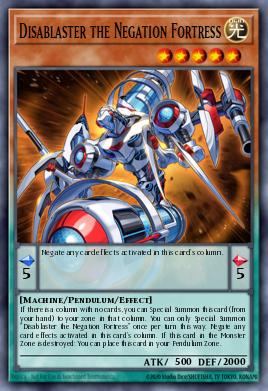

- **Copias y zona:** Main 1x. No altera las cantidades registradas.
- **Nombre oficial de referencia:** Inactidisparador la Fortaleza de la Negación. CID cotejado con la ficha oficial; el nombre histórico del inventario se conserva aunque su grafía/traducción difiera.
- **Función principal y secundaria:** extensor.
- **Estado de sinergia y función:** Sinergia indirecta (soporte o recursos). Es una clasificación de juego; revisar la relación concreta en A06.
- **Papel como recurso, descarte o coste:** No se demuestra que esta carta sea recurso de descarte o pago para otra.
- **Efecto operativo (paráfrasis analítica):** acceso al campo desde la mano. Son operaciones detectadas en el texto, no efectos independientes garantizados; leer sus condiciones en la fuente.
- **Efecto Péndulo:** además de su efecto de monstruo, la fuente oficial declara acciones propias de su Zona Péndulo; aplicar por separado sus requisitos, coste y límite (incluido en clasificación mecánica).
- **Mapa de activación y resultados:** 1) efecto propio o continuo: Invocación Especial desde mano. Cada operación está sujeta a la secuencia y al «si lo haces» del texto oficial.
- **Ventanas de activación identificadas:** requieren la fase o condición específica indicada en el texto; sin ventana rápida general asumida.
- **Costes o recursos potenciales:** sin coste independiente identificado en esta síntesis; comprobar las acciones previas al punto y coma de cada efecto.
- **Restricciones y requisitos:** hay límite por turno según el efecto concreto. 
- **Prioridad al ir primero:** proteger acceso a Core/recursos y preparar presencia legal. Para esta carta: Activar cuando las condiciones permitan obtener valor real, preservando recursos de seguimiento.
- **Prioridad al ir segundo:** romper el campo rival y convertir Máquinas en Fusión o ataque de cierre. Identificar primero la respuesta rival que afecta su función «extensor».
- **Medio/tardío y recuperación:** reciclar piezas Cyber y recuperar acceso al Extra Deck. No asumir que por sí misma recicla recursos si el texto no lo permite.
- **Sinergias y acceso a líneas:** Relación contextual con Máquinas, nombres Cyber Dragon, Fusión/Xyz/Enlace y cierre de partida por daño. Habilita una línea del motor sólo si coinciden recursos, objetivos y restricciones; no equivale a un combo completo validado.
- **Riesgo / brick / interrupciones:** Riesgo operativo: materiales exigidos, efectos que requieren campo rival y bloqueos de Invocación Especial. Confirmar objetivos disponibles y costes antes de activar. No atribuirle velocidad rápida por el solo hecho de formar parte del motor.
- **Utilidad editorial:** 4/5 para este deck (estimación por rol y zona, no probabilidad calculada). No cambiar copias; cualquier sugerencia de alta/baja pasa por el apartado 22 y aprobación.
- **Referencia oficial y trazabilidad:** https://www.db.yugioh-card.com/yugiohdb/card_search.action?cid=20205&ope=2&request_locale=es. **Confianza:** texto y tipo de efecto cotejados en Konami; síntesis táctica editorial, no demostración de combo.
- **Aplicación concreta dentro de este deck (A06):** acceso al campo desde la mano.

**USO PRÁCTICO Y SINERGIA — Inactidisparador, la Fortaleza de la Negación [Máquina/Péndulo/EFECTO; texto fotografiado y nombre confirmado]**

- **Label funcional:** Sinergia indirecta. Clasificación documental; una relación es válida solo si se satisfacen sus condiciones exactas.
- **Qué hace:** acceso al campo desde la mano. Son operaciones detectadas en el texto, no efectos independientes garantizados; leer sus condiciones en la fuente.
- **Cómo aprovecharla en este deck:** acceso al campo desde la mano.
- **Al jugar primero:** proteger acceso a Core/recursos y preparar presencia legal. Para esta carta: Activar cuando las condiciones permitan obtener valor real, preservando recursos de seguimiento.
- **Al jugar segundo:** romper el campo rival y convertir Máquinas en Fusión o ataque de cierre. Identificar primero la respuesta rival que afecta su función «extensor».
- **Cuándo tener precaución:** Riesgo operativo: materiales exigidos, efectos que requieren campo rival y bloqueos de Invocación Especial. Confirmar objetivos disponibles y costes antes de activar. No atribuirle velocidad rápida por el solo hecho de formar parte del motor.

#### 15. Cyber Emergency

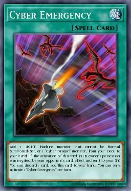

- **Copias y zona:** Main 3x. No altera las cantidades registradas.
- **Nombre oficial de referencia:** Ciber Emergencia. CID cotejado con la ficha oficial; el nombre histórico del inventario se conserva aunque su grafía/traducción difiera.
- **Función principal y secundaria:** searcher · buscador.
- **Estado de sinergia y función:** Sinergia indirecta (soporte o recursos). Es una clasificación de juego; revisar la relación concreta en A06.
- **Papel como recurso, descarte o coste:** Coste o consumo descrito en A05: descarte de mano.
- **Efecto operativo (paráfrasis analítica):** búsqueda o incorporación de cartas a mano. Son operaciones detectadas en el texto, no efectos independientes garantizados; leer sus condiciones en la fuente.
- **Mapa de activación y resultados:** 1) efecto propio o continuo: incorpora la pieza indicada a la mano · 2) con condición explícita en la carta: incorpora la pieza indicada a la mano. Cada operación está sujeta a la secuencia y al «si lo haces» del texto oficial.
- **Ventanas de activación identificadas:** requieren la fase o condición específica indicada en el texto; sin ventana rápida general asumida.
- **Costes o recursos potenciales:** descarte de mano.
- **Restricciones y requisitos:** hay límite por turno según el efecto concreto; depende de recursos en Cementerio. 
- **Prioridad al ir primero:** proteger acceso a Core/recursos y preparar presencia legal. Para esta carta: Convertir la activación en acceso a la siguiente pieza del motor, sin duplicar buscadores inútilmente.
- **Prioridad al ir segundo:** romper el campo rival y convertir Máquinas en Fusión o ataque de cierre. Identificar primero la respuesta rival que afecta su función «searcher».
- **Medio/tardío y recuperación:** reciclar piezas Cyber y recuperar acceso al Extra Deck. No asumir que por sí misma recicla recursos si el texto no lo permite.
- **Sinergias y acceso a líneas:** Relación contextual con Máquinas, nombres Cyber Dragon, Fusión/Xyz/Enlace y cierre de partida por daño. Habilita una línea del motor sólo si coinciden recursos, objetivos y restricciones; no equivale a un combo completo validado.
- **Riesgo / brick / interrupciones:** Riesgo operativo: materiales exigidos, efectos que requieren campo rival y bloqueos de Invocación Especial. Confirmar objetivos disponibles y costes antes de activar. No atribuirle velocidad rápida por el solo hecho de formar parte del motor.
- **Utilidad editorial:** 5/5 para este deck (estimación por rol y zona, no probabilidad calculada). No cambiar copias; cualquier sugerencia de alta/baja pasa por el apartado 22 y aprobación.
- **Referencia oficial y trazabilidad:** https://www.db.yugioh-card.com/yugiohdb/card_search.action?cid=8428&ope=2&request_locale=es. **Confianza:** texto y tipo de efecto cotejados en Konami; síntesis táctica editorial, no demostración de combo.
- **Aplicación concreta dentro de este deck (A06):** búsqueda o incorporación de cartas a mano.

**USO PRÁCTICO Y SINERGIA — Cyber Emergency**

- **Label funcional:** Sinergia indirecta. Clasificación documental; una relación es válida solo si se satisfacen sus condiciones exactas.
- **Qué hace:** búsqueda o incorporación de cartas a mano. Son operaciones detectadas en el texto, no efectos independientes garantizados; leer sus condiciones en la fuente.
- **Cómo aprovecharla en este deck:** búsqueda o incorporación de cartas a mano.
- **Al jugar primero:** proteger acceso a Core/recursos y preparar presencia legal. Para esta carta: Convertir la activación en acceso a la siguiente pieza del motor, sin duplicar buscadores inútilmente.
- **Al jugar segundo:** romper el campo rival y convertir Máquinas en Fusión o ataque de cierre. Identificar primero la respuesta rival que afecta su función «searcher».
- **Cuándo tener precaución:** Riesgo operativo: materiales exigidos, efectos que requieren campo rival y bloqueos de Invocación Especial. Confirmar objetivos disponibles y costes antes de activar. No atribuirle velocidad rápida por el solo hecho de formar parte del motor.

#### 16. Cyberdark Realm

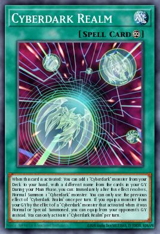

- **Copias y zona:** Main 2x, Reserva 1x. No altera las cantidades registradas.
- **Nombre oficial de referencia:** Reino Ciberoscuro. CID cotejado con la ficha oficial; el nombre histórico del inventario se conserva aunque su grafía/traducción difiera.
- **Función principal y secundaria:** searcher · buscador · motor Equipo.
- **Estado de sinergia y función:** Sinergia indirecta (soporte o recursos). Es una clasificación de juego; revisar la relación concreta en A06.
- **Papel como recurso, descarte o coste:** No se demuestra que esta carta sea recurso de descarte o pago para otra.
- **Efecto operativo (paráfrasis analítica):** búsqueda o incorporación de cartas a mano; uso o producción de cartas equipadas. Son operaciones detectadas en el texto, no efectos independientes garantizados; leer sus condiciones en la fuente.
- **Mapa de activación y resultados:** 1) con condición explícita en la carta: incorpora la pieza indicada a la mano · 2) efecto propio o continuo: equipa carta/monstruo según texto. Cada operación está sujeta a la secuencia y al «si lo haces» del texto oficial.
- **Ventanas de activación identificadas:** Main Phase.
- **Costes o recursos potenciales:** sin coste independiente identificado en esta síntesis; comprobar las acciones previas al punto y coma de cada efecto.
- **Restricciones y requisitos:** hay límite por turno según el efecto concreto; depende de recursos en Cementerio. 
- **Prioridad al ir primero:** proteger acceso a Core/recursos y preparar presencia legal. Para esta carta: Convertir la activación en acceso a la siguiente pieza del motor, sin duplicar buscadores inútilmente.
- **Prioridad al ir segundo:** romper el campo rival y convertir Máquinas en Fusión o ataque de cierre. Identificar primero la respuesta rival que afecta su función «searcher».
- **Medio/tardío y recuperación:** reciclar piezas Cyber y recuperar acceso al Extra Deck. No asumir que por sí misma recicla recursos si el texto no lo permite.
- **Sinergias y acceso a líneas:** Relación contextual con Máquinas, nombres Cyber Dragon, Fusión/Xyz/Enlace y cierre de partida por daño. Habilita una línea del motor sólo si coinciden recursos, objetivos y restricciones; no equivale a un combo completo validado.
- **Riesgo / brick / interrupciones:** Depende del Cementerio y es sensible a destierro o negación de ese recurso. No atribuirle velocidad rápida por el solo hecho de formar parte del motor.
- **Utilidad editorial:** 5/5 para este deck (estimación por rol y zona, no probabilidad calculada). No cambiar copias; cualquier sugerencia de alta/baja pasa por el apartado 22 y aprobación.
- **Referencia oficial y trazabilidad:** https://www.db.yugioh-card.com/yugiohdb/card_search.action?cid=16298&ope=2&request_locale=es. **Confianza:** texto y tipo de efecto cotejados en Konami; síntesis táctica editorial, no demostración de combo.
- **Aplicación concreta dentro de este deck (A06):** búsqueda o incorporación de cartas a mano; uso o producción de cartas equipadas.

**USO PRÁCTICO Y SINERGIA — Cyberdark Realm**

- **Label funcional:** Sinergia indirecta. Clasificación documental; una relación es válida solo si se satisfacen sus condiciones exactas.
- **Qué hace:** búsqueda o incorporación de cartas a mano; uso o producción de cartas equipadas. Son operaciones detectadas en el texto, no efectos independientes garantizados; leer sus condiciones en la fuente.
- **Cómo aprovecharla en este deck:** búsqueda o incorporación de cartas a mano; uso o producción de cartas equipadas.
- **Al jugar primero:** proteger acceso a Core/recursos y preparar presencia legal. Para esta carta: Convertir la activación en acceso a la siguiente pieza del motor, sin duplicar buscadores inútilmente.
- **Al jugar segundo:** romper el campo rival y convertir Máquinas en Fusión o ataque de cierre. Identificar primero la respuesta rival que afecta su función «searcher».
- **Cuándo tener precaución:** Depende del Cementerio y es sensible a destierro o negación de ese recurso. No atribuirle velocidad rápida por el solo hecho de formar parte del motor.

#### 17. Cyber Revsystem

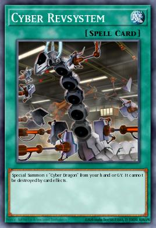

- **Copias y zona:** Main 2x. No altera las cantidades registradas.
- **Nombre oficial de referencia:** Ciber Sistemarev. CID cotejado con la ficha oficial; el nombre histórico del inventario se conserva aunque su grafía/traducción difiera.
- **Función principal y secundaria:** recuperación · extensor · protección.
- **Estado de sinergia y función:** Sinergia indirecta (soporte o recursos). Es una clasificación de juego; revisar la relación concreta en A06.
- **Papel como recurso, descarte o coste:** No se demuestra que esta carta sea recurso de descarte o pago para otra.
- **Efecto operativo (paráfrasis analítica):** recuperación e invocación desde Cementerio/destierro; acceso al campo desde la mano; protección o resistencia contra respuestas. Son operaciones detectadas en el texto, no efectos independientes garantizados; leer sus condiciones en la fuente.
- **Mapa de activación y resultados:** 1) efecto propio o continuo: Invocación Especial desde Cementerio. Cada operación está sujeta a la secuencia y al «si lo haces» del texto oficial.
- **Ventanas de activación identificadas:** requieren la fase o condición específica indicada en el texto; sin ventana rápida general asumida.
- **Costes o recursos potenciales:** sin coste independiente identificado en esta síntesis; comprobar las acciones previas al punto y coma de cada efecto.
- **Restricciones y requisitos:** aplicar restricciones de selección, activación y copias que consten en el texto original. 
- **Prioridad al ir primero:** proteger acceso a Core/recursos y preparar presencia legal. Para esta carta: Escoger la amenaza o recurso que genere mayor ventaja de tempo; respetar selección y zona.
- **Prioridad al ir segundo:** romper el campo rival y convertir Máquinas en Fusión o ataque de cierre. Identificar primero la respuesta rival que afecta su función «recuperación».
- **Medio/tardío y recuperación:** reciclar piezas Cyber y recuperar acceso al Extra Deck. Verificar que el objetivo de recuperación continúe disponible.
- **Sinergias y acceso a líneas:** Relación contextual con Máquinas, nombres Cyber Dragon, Fusión/Xyz/Enlace y cierre de partida por daño. Habilita una línea del motor sólo si coinciden recursos, objetivos y restricciones; no equivale a un combo completo validado.
- **Riesgo / brick / interrupciones:** Riesgo operativo: materiales exigidos, efectos que requieren campo rival y bloqueos de Invocación Especial. Confirmar objetivos disponibles y costes antes de activar. No atribuirle velocidad rápida por el solo hecho de formar parte del motor.
- **Utilidad editorial:** 4/5 para este deck (estimación por rol y zona, no probabilidad calculada). No cambiar copias; cualquier sugerencia de alta/baja pasa por el apartado 22 y aprobación.
- **Referencia oficial y trazabilidad:** https://www.db.yugioh-card.com/yugiohdb/card_search.action?cid=13770&ope=2&request_locale=es. **Confianza:** texto y tipo de efecto cotejados en Konami; síntesis táctica editorial, no demostración de combo.
- **Aplicación concreta dentro de este deck (A06):** recuperación e invocación desde Cementerio/destierro; acceso al campo desde la mano; protección o resistencia contra respuestas.

**USO PRÁCTICO Y SINERGIA — Cyber Revsystem**

- **Label funcional:** Sinergia indirecta. Clasificación documental; una relación es válida solo si se satisfacen sus condiciones exactas.
- **Qué hace:** recuperación e invocación desde Cementerio/destierro; acceso al campo desde la mano; protección o resistencia contra respuestas. Son operaciones detectadas en el texto, no efectos independientes garantizados; leer sus condiciones en la fuente.
- **Cómo aprovecharla en este deck:** recuperación e invocación desde Cementerio/destierro; acceso al campo desde la mano; protección o resistencia contra respuestas.
- **Al jugar primero:** proteger acceso a Core/recursos y preparar presencia legal. Para esta carta: Escoger la amenaza o recurso que genere mayor ventaja de tempo; respetar selección y zona.
- **Al jugar segundo:** romper el campo rival y convertir Máquinas en Fusión o ataque de cierre. Identificar primero la respuesta rival que afecta su función «recuperación».
- **Cuándo tener precaución:** Riesgo operativo: materiales exigidos, efectos que requieren campo rival y bloqueos de Invocación Especial. Confirmar objetivos disponibles y costes antes de activar. No atribuirle velocidad rápida por el solo hecho de formar parte del motor.

#### 18. Cybernetic Horizon

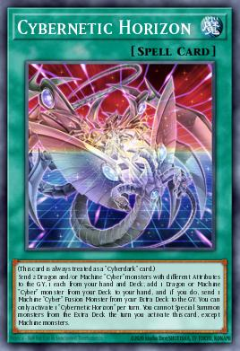

- **Copias y zona:** Main 2x, Reserva 1x. No altera las cantidades registradas.
- **Nombre oficial de referencia:** Horizonte Cibernético. CID cotejado con la ficha oficial; el nombre histórico del inventario se conserva aunque su grafía/traducción difiera.
- **Función principal y secundaria:** searcher · buscador.
- **Estado de sinergia y función:** Sinergia indirecta (soporte o recursos). Es una clasificación de juego; revisar la relación concreta en A06.
- **Papel como recurso, descarte o coste:** No se demuestra que esta carta sea recurso de descarte o pago para otra.
- **Efecto operativo (paráfrasis analítica):** búsqueda o incorporación de cartas a mano. Son operaciones detectadas en el texto, no efectos independientes garantizados; leer sus condiciones en la fuente.
- **Mapa de activación y resultados:** 1) efecto propio o continuo: incorpora la pieza indicada a la mano. Cada operación está sujeta a la secuencia y al «si lo haces» del texto oficial.
- **Ventanas de activación identificadas:** requieren la fase o condición específica indicada en el texto; sin ventana rápida general asumida.
- **Costes o recursos potenciales:** sin coste independiente identificado en esta síntesis; comprobar las acciones previas al punto y coma de cada efecto.
- **Restricciones y requisitos:** hay límite por turno según el efecto concreto; puede bloquear tipos de Invocación del Extra Deck. 
- **Prioridad al ir primero:** proteger acceso a Core/recursos y preparar presencia legal. Para esta carta: Convertir la activación en acceso a la siguiente pieza del motor, sin duplicar buscadores inútilmente.
- **Prioridad al ir segundo:** romper el campo rival y convertir Máquinas en Fusión o ataque de cierre. Identificar primero la respuesta rival que afecta su función «searcher».
- **Medio/tardío y recuperación:** reciclar piezas Cyber y recuperar acceso al Extra Deck. No asumir que por sí misma recicla recursos si el texto no lo permite.
- **Sinergias y acceso a líneas:** Relación contextual con Máquinas, nombres Cyber Dragon, Fusión/Xyz/Enlace y cierre de partida por daño. Habilita una línea del motor sólo si coinciden recursos, objetivos y restricciones; no equivale a un combo completo validado.
- **Riesgo / brick / interrupciones:** La restricción de invocaciones puede cerrar rutas alternativas; revisar el orden de activación. No atribuirle velocidad rápida por el solo hecho de formar parte del motor.
- **Utilidad editorial:** 5/5 para este deck (estimación por rol y zona, no probabilidad calculada). No cambiar copias; cualquier sugerencia de alta/baja pasa por el apartado 22 y aprobación.
- **Referencia oficial y trazabilidad:** https://www.db.yugioh-card.com/yugiohdb/card_search.action?cid=16301&ope=2&request_locale=es. **Confianza:** texto y tipo de efecto cotejados en Konami; síntesis táctica editorial, no demostración de combo.
- **Aplicación concreta dentro de este deck (A06):** búsqueda o incorporación de cartas a mano.

**USO PRÁCTICO Y SINERGIA — Cybernetic Horizon**

- **Label funcional:** Sinergia indirecta. Clasificación documental; una relación es válida solo si se satisfacen sus condiciones exactas.
- **Qué hace:** búsqueda o incorporación de cartas a mano. Son operaciones detectadas en el texto, no efectos independientes garantizados; leer sus condiciones en la fuente.
- **Cómo aprovecharla en este deck:** búsqueda o incorporación de cartas a mano.
- **Al jugar primero:** proteger acceso a Core/recursos y preparar presencia legal. Para esta carta: Convertir la activación en acceso a la siguiente pieza del motor, sin duplicar buscadores inútilmente.
- **Al jugar segundo:** romper el campo rival y convertir Máquinas en Fusión o ataque de cierre. Identificar primero la respuesta rival que afecta su función «searcher».
- **Cuándo tener precaución:** La restricción de invocaciones puede cerrar rutas alternativas; revisar el orden de activación. No atribuirle velocidad rápida por el solo hecho de formar parte del motor.

#### 19. Clockwork Night

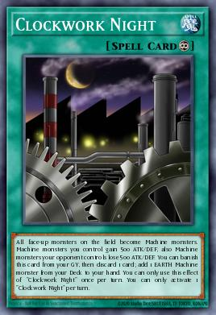

- **Copias y zona:** Main 2x. No altera las cantidades registradas.
- **Nombre oficial de referencia:** Noche Mecánica. CID cotejado con la ficha oficial; el nombre histórico del inventario se conserva aunque su grafía/traducción difiera.
- **Función principal y secundaria:** searcher · buscador · cierre.
- **Estado de sinergia y función:** Sinergia indirecta (soporte o recursos). Es una clasificación de juego; revisar la relación concreta en A06.
- **Papel como recurso, descarte o coste:** Coste o consumo descrito en A05: descarte de mano.
- **Efecto operativo (paráfrasis analítica):** búsqueda o incorporación de cartas a mano; presión de combate o modificación de estadísticas. Son operaciones detectadas en el texto, no efectos independientes garantizados; leer sus condiciones en la fuente.
- **Mapa de activación y resultados:** 1) efecto propio o continuo: incorpora la pieza indicada a la mano. Cada operación está sujeta a la secuencia y al «si lo haces» del texto oficial.
- **Ventanas de activación identificadas:** requieren la fase o condición específica indicada en el texto; sin ventana rápida general asumida.
- **Costes o recursos potenciales:** descarte de mano.
- **Restricciones y requisitos:** hay límite por turno según el efecto concreto; depende de recursos en Cementerio. 
- **Prioridad al ir primero:** proteger acceso a Core/recursos y preparar presencia legal. Para esta carta: Convertir la activación en acceso a la siguiente pieza del motor, sin duplicar buscadores inútilmente.
- **Prioridad al ir segundo:** romper el campo rival y convertir Máquinas en Fusión o ataque de cierre. Identificar primero la respuesta rival que afecta su función «searcher».
- **Medio/tardío y recuperación:** reciclar piezas Cyber y recuperar acceso al Extra Deck. No asumir que por sí misma recicla recursos si el texto no lo permite.
- **Sinergias y acceso a líneas:** Relación contextual con Máquinas, nombres Cyber Dragon, Fusión/Xyz/Enlace y cierre de partida por daño. Habilita una línea del motor sólo si coinciden recursos, objetivos y restricciones; no equivale a un combo completo validado.
- **Riesgo / brick / interrupciones:** Depende del Cementerio y es sensible a destierro o negación de ese recurso. No atribuirle velocidad rápida por el solo hecho de formar parte del motor.
- **Utilidad editorial:** 5/5 para este deck (estimación por rol y zona, no probabilidad calculada). No cambiar copias; cualquier sugerencia de alta/baja pasa por el apartado 22 y aprobación.
- **Referencia oficial y trazabilidad:** https://www.db.yugioh-card.com/yugiohdb/card_search.action?cid=17625&ope=2&request_locale=es. **Confianza:** texto y tipo de efecto cotejados en Konami; síntesis táctica editorial, no demostración de combo.
- **Aplicación concreta dentro de este deck (A06):** búsqueda o incorporación de cartas a mano; presión de combate o modificación de estadísticas.

**USO PRÁCTICO Y SINERGIA — Clockwork Night**

- **Label funcional:** Sinergia indirecta. Clasificación documental; una relación es válida solo si se satisfacen sus condiciones exactas.
- **Qué hace:** búsqueda o incorporación de cartas a mano; presión de combate o modificación de estadísticas. Son operaciones detectadas en el texto, no efectos independientes garantizados; leer sus condiciones en la fuente.
- **Cómo aprovecharla en este deck:** búsqueda o incorporación de cartas a mano; presión de combate o modificación de estadísticas.
- **Al jugar primero:** proteger acceso a Core/recursos y preparar presencia legal. Para esta carta: Convertir la activación en acceso a la siguiente pieza del motor, sin duplicar buscadores inútilmente.
- **Al jugar segundo:** romper el campo rival y convertir Máquinas en Fusión o ataque de cierre. Identificar primero la respuesta rival que afecta su función «searcher».
- **Cuándo tener precaución:** Depende del Cementerio y es sensible a destierro o negación de ese recurso. No atribuirle velocidad rápida por el solo hecho de formar parte del motor.

#### 20. Power Bond

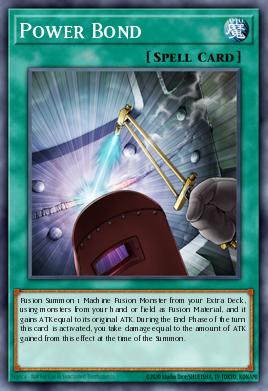

- **Copias y zona:** Main 1x, Reserva 1x. No altera las cantidades registradas.
- **Nombre oficial de referencia:** Vínculo de Poder. CID cotejado con la ficha oficial; el nombre histórico del inventario se conserva aunque su grafía/traducción difiera.
- **Función principal y secundaria:** mágica de Fusión · finisher.
- **Estado de sinergia y función:** Sinergia indirecta (soporte o recursos). Es una clasificación de juego; revisar la relación concreta en A06.
- **Papel como recurso, descarte o coste:** Material o destino del Extra condicionado a los requisitos de invocación.
- **Efecto operativo (paráfrasis analítica):** Power Bond fusiona Máquinas con materiales de mano/campo, duplica el ATK de la Fusión y causa daño al propio jugador en End Phase. 
- **Mapa de activación y resultados:** 1) efecto propio o continuo: realiza Fusión con materiales permitidos. Cada operación está sujeta a la secuencia y al «si lo haces» del texto oficial.
- **Ventanas de activación identificadas:** End Phase.
- **Costes o recursos potenciales:** sin coste independiente identificado en esta síntesis; comprobar las acciones previas al punto y coma de cada efecto.
- **Restricciones y requisitos:** exige materiales de Extra Deck o materiales adecuados. 
- **Prioridad al ir primero:** proteger acceso a Core/recursos y preparar presencia legal. Para esta carta: Activar cuando las condiciones permitan obtener valor real, preservando recursos de seguimiento.
- **Prioridad al ir segundo:** romper el campo rival y convertir Máquinas en Fusión o ataque de cierre. Identificar primero la respuesta rival que afecta su función «mágica de Fusión».
- **Medio/tardío y recuperación:** reciclar piezas Cyber y recuperar acceso al Extra Deck. No asumir que por sí misma recicla recursos si el texto no lo permite.
- **Sinergias y acceso a líneas:** Relación contextual con Máquinas, nombres Cyber Dragon, Fusión/Xyz/Enlace y cierre de partida por daño. Habilita una línea del motor sólo si coinciden recursos, objetivos y restricciones; no equivale a un combo completo validado.
- **Riesgo / brick / interrupciones:** Puede ganar la partida o perderla por el daño propio si no se termina el duelo. No atribuirle velocidad rápida por el solo hecho de formar parte del motor.
- **Utilidad editorial:** 3/5 para este deck (estimación por rol y zona, no probabilidad calculada). No cambiar copias; cualquier sugerencia de alta/baja pasa por el apartado 22 y aprobación.
- **Referencia oficial y trazabilidad:** https://www.db.yugioh-card.com/yugiohdb/card_search.action?cid=6398&ope=2&request_locale=es. **Confianza:** texto y tipo de efecto cotejados en Konami; síntesis táctica editorial, no demostración de combo.
- **Aplicación concreta dentro de este deck (A06):** Power Bond fusiona Máquinas con materiales de mano/campo, duplica el ATK de la Fusión y causa daño al propio jugador en End Phase.

**USO PRÁCTICO Y SINERGIA — Power Bond**

- **Label funcional:** Sinergia indirecta. Clasificación documental; una relación es válida solo si se satisfacen sus condiciones exactas.
- **Qué hace:** Power Bond fusiona Máquinas con materiales de mano/campo, duplica el ATK de la Fusión y causa daño al propio jugador en End Phase.
- **Cómo aprovecharla en este deck:** escoge el **propósito antes de activarla**: (1) `684:A09:POWERBOND:CYBER_NACHSTER:HEOS09` con Cyber Dragon + Nachster de mano = **Heosvarog DEF 2800**, negación de Mágica/Trampa y **cero daño** de Power Bond por ATK original cero; (2) `684:A09:POWERBOND:CYBER_HERZ_NACHSTER:ETERNITY10` añade Herz = **Eternity 5600 ATK** y **2800 LP propios de daño** en End Phase. No usar los mismos materiales en ambas Fusiones simultáneamente.
- **Al jugar primero:** proteger acceso a Core/recursos y preparar presencia legal. Para esta carta: Activar cuando las condiciones permitan obtener valor real, preservando recursos de seguimiento.
- **Al jugar segundo:** romper el campo rival y convertir Máquinas en Fusión o ataque de cierre. Identificar primero la respuesta rival que afecta su función «mágica de Fusión».
- **Cuándo tener precaución:** Puede ganar la partida o perderla por el daño propio si no se termina el duelo. No atribuirle velocidad rápida por el solo hecho de formar parte del motor.

#### 21. Limiter Removal

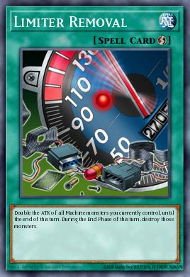

- **Copias y zona:** Main 1x. No altera las cantidades registradas.
- **Nombre oficial de referencia:** Quitar el Limitador. CID cotejado con la ficha oficial; el nombre histórico del inventario se conserva aunque su grafía/traducción difiera.
- **Función principal y secundaria:** removal · cierre.
- **Estado de sinergia y función:** Sin relación demostrada. Es una clasificación de juego; revisar la relación concreta en A06.
- **Papel como recurso, descarte o coste:** No se demuestra que esta carta sea recurso de descarte o pago para otra.
- **Efecto operativo (paráfrasis analítica):** destrucción de cartas o empleo de destrucción como detonante; presión de combate o modificación de estadísticas. Son operaciones detectadas en el texto, no efectos independientes garantizados; leer sus condiciones en la fuente.
- **Mapa de activación y resultados:** 1) efecto propio o continuo: destruye la carta o recurso previsto. Cada operación está sujeta a la secuencia y al «si lo haces» del texto oficial.
- **Ventanas de activación identificadas:** End Phase.
- **Costes o recursos potenciales:** sin coste independiente identificado en esta síntesis; comprobar las acciones previas al punto y coma de cada efecto.
- **Restricciones y requisitos:** aplicar restricciones de selección, activación y copias que consten en el texto original. 
- **Prioridad al ir primero:** proteger acceso a Core/recursos y preparar presencia legal. Para esta carta: Activar cuando las condiciones permitan obtener valor real, preservando recursos de seguimiento.
- **Prioridad al ir segundo:** romper el campo rival y convertir Máquinas en Fusión o ataque de cierre. Identificar primero la respuesta rival que afecta su función «removal».
- **Medio/tardío y recuperación:** reciclar piezas Cyber y recuperar acceso al Extra Deck. No asumir que por sí misma recicla recursos si el texto no lo permite.
- **Sinergias y acceso a líneas:** Relación contextual con Máquinas, nombres Cyber Dragon, Fusión/Xyz/Enlace y cierre de partida por daño. Habilita una línea del motor sólo si coinciden recursos, objetivos y restricciones; no equivale a un combo completo validado.
- **Riesgo / brick / interrupciones:** Riesgo operativo: materiales exigidos, efectos que requieren campo rival y bloqueos de Invocación Especial. Confirmar objetivos disponibles y costes antes de activar. No atribuirle velocidad rápida por el solo hecho de formar parte del motor.
- **Utilidad editorial:** 3/5 para este deck (estimación por rol y zona, no probabilidad calculada). No cambiar copias; cualquier sugerencia de alta/baja pasa por el apartado 22 y aprobación.
- **Referencia oficial y trazabilidad:** https://www.db.yugioh-card.com/yugiohdb/card_search.action?cid=5129&ope=2&request_locale=es. **Confianza:** texto y tipo de efecto cotejados en Konami; síntesis táctica editorial, no demostración de combo.
- **Aplicación concreta dentro de este deck (A06):** destrucción de cartas o empleo de destrucción como detonante; presión de combate o modificación de estadísticas. A06 aún no identifica su conexión; no equivale a incompatibilidad ni borra rutas A09.

**USO PRÁCTICO Y SINERGIA — Limiter Removal**

- **Label funcional:** Sin sinergia demostrada. Clasificación documental; una relación es válida solo si se satisfacen sus condiciones exactas.
- **Qué hace:** destrucción de cartas o empleo de destrucción como detonante; presión de combate o modificación de estadísticas. Son operaciones detectadas en el texto, no efectos independientes garantizados; leer sus condiciones en la fuente.
- **Cómo aprovecharla en este deck:** destrucción de cartas o empleo de destrucción como detonante; presión de combate o modificación de estadísticas. A06 aún no identifica su conexión; no equivale a incompatibilidad ni borra rutas A09.
- **Al jugar primero:** proteger acceso a Core/recursos y preparar presencia legal. Para esta carta: Activar cuando las condiciones permitan obtener valor real, preservando recursos de seguimiento.
- **Al jugar segundo:** romper el campo rival y convertir Máquinas en Fusión o ataque de cierre. Identificar primero la respuesta rival que afecta su función «removal».
- **Cuándo tener precaución:** Riesgo operativo: materiales exigidos, efectos que requieren campo rival y bloqueos de Invocación Especial. Confirmar objetivos disponibles y costes antes de activar. No atribuirle velocidad rápida por el solo hecho de formar parte del motor.
- **Sinergia no demostrada:** conservar su función individual si la tiene; no vincularla con otro combo sin una interacción real.

#### 22. Cyberload Fusion

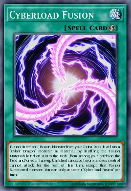

- **Copias y zona:** Main 1x. No altera las cantidades registradas.
- **Nombre oficial de referencia:** Fusión Cibercarga. CID cotejado con la ficha oficial; el nombre histórico del inventario se conserva aunque su grafía/traducción difiera.
- **Función principal y secundaria:** removal · recuperación.
- **Estado de sinergia y función:** Sinergia indirecta (soporte o recursos). Es una clasificación de juego; revisar la relación concreta en A06.
- **Papel como recurso, descarte o coste:** No se demuestra que esta carta sea recurso de descarte o pago para otra.
- **Efecto operativo (paráfrasis analítica):** destierro de recursos o de amenazas; retorno o reciclaje hacia mano/Deck/Extra. Son operaciones detectadas en el texto, no efectos independientes garantizados; leer sus condiciones en la fuente.
- **Mapa de activación y resultados:** 1) efecto propio o continuo: realiza Fusión con materiales permitidos, destierra el recurso u objetivo previsto, devuelve recursos a mano/Deck/Extra. Cada operación está sujeta a la secuencia y al «si lo haces» del texto oficial.
- **Ventanas de activación identificadas:** requieren la fase o condición específica indicada en el texto; sin ventana rápida general asumida.
- **Costes o recursos potenciales:** sin coste independiente identificado en esta síntesis; comprobar las acciones previas al punto y coma de cada efecto.
- **Restricciones y requisitos:** hay límite por turno según el efecto concreto; puede limitar ataques. 
- **Prioridad al ir primero:** proteger acceso a Core/recursos y preparar presencia legal. Para esta carta: Escoger la amenaza o recurso que genere mayor ventaja de tempo; respetar selección y zona.
- **Prioridad al ir segundo:** romper el campo rival y convertir Máquinas en Fusión o ataque de cierre. Identificar primero la respuesta rival que afecta su función «removal».
- **Medio/tardío y recuperación:** reciclar piezas Cyber y recuperar acceso al Extra Deck. Verificar que el objetivo de recuperación continúe disponible.
- **Sinergias y acceso a líneas:** Relación contextual con Máquinas, nombres Cyber Dragon, Fusión/Xyz/Enlace y cierre de partida por daño. Habilita una línea del motor sólo si coinciden recursos, objetivos y restricciones; no equivale a un combo completo validado.
- **Riesgo / brick / interrupciones:** Riesgo operativo: materiales exigidos, efectos que requieren campo rival y bloqueos de Invocación Especial. Confirmar objetivos disponibles y costes antes de activar. No atribuirle velocidad rápida por el solo hecho de formar parte del motor.
- **Utilidad editorial:** 3/5 para este deck (estimación por rol y zona, no probabilidad calculada). No cambiar copias; cualquier sugerencia de alta/baja pasa por el apartado 22 y aprobación.
- **Referencia oficial y trazabilidad:** https://www.db.yugioh-card.com/yugiohdb/card_search.action?cid=13849&ope=2&request_locale=es. **Confianza:** texto y tipo de efecto cotejados en Konami; síntesis táctica editorial, no demostración de combo.
- **Aplicación concreta dentro de este deck (A06):** destierro de recursos o de amenazas; retorno o reciclaje hacia mano/Deck/Extra.

**USO PRÁCTICO Y SINERGIA — Cyberload Fusion**

- **Label funcional:** Sinergia indirecta. Clasificación documental; una relación es válida solo si se satisfacen sus condiciones exactas.
- **Qué hace:** destierro de recursos o de amenazas; retorno o reciclaje hacia mano/Deck/Extra. Son operaciones detectadas en el texto, no efectos independientes garantizados; leer sus condiciones en la fuente.
- **Cómo aprovecharla en este deck:** destierro de recursos o de amenazas; retorno o reciclaje hacia mano/Deck/Extra.
- **Al jugar primero:** proteger acceso a Core/recursos y preparar presencia legal. Para esta carta: Escoger la amenaza o recurso que genere mayor ventaja de tempo; respetar selección y zona.
- **Al jugar segundo:** romper el campo rival y convertir Máquinas en Fusión o ataque de cierre. Identificar primero la respuesta rival que afecta su función «removal».
- **Cuándo tener precaución:** Riesgo operativo: materiales exigidos, efectos que requieren campo rival y bloqueos de Invocación Especial. Confirmar objetivos disponibles y costes antes de activar. No atribuirle velocidad rápida por el solo hecho de formar parte del motor.

#### 23. Overload Fusion

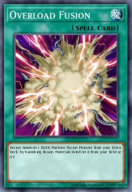

- **Copias y zona:** Main 1x. No altera las cantidades registradas.
- **Nombre oficial de referencia:** Sobrecarga de Fusión. CID cotejado con la ficha oficial; el nombre histórico del inventario se conserva aunque su grafía/traducción difiera.
- **Función principal y secundaria:** recurso situacional.
- **Estado de sinergia y función:** Sinergia indirecta (soporte o recursos). Es una clasificación de juego; revisar la relación concreta en A06.
- **Papel como recurso, descarte o coste:** No se demuestra que esta carta sea recurso de descarte o pago para otra.
- **Efecto operativo (paráfrasis analítica):** interacción propia de la carta que requiere consultar el texto íntegro enlazado. Son operaciones detectadas en el texto, no efectos independientes garantizados; leer sus condiciones en la fuente.
- **Mapa de activación y resultados:** 1) efecto propio o continuo: realiza Fusión con materiales permitidos. Cada operación está sujeta a la secuencia y al «si lo haces» del texto oficial.
- **Ventanas de activación identificadas:** requieren la fase o condición específica indicada en el texto; sin ventana rápida general asumida.
- **Costes o recursos potenciales:** sin coste independiente identificado en esta síntesis; comprobar las acciones previas al punto y coma de cada efecto.
- **Restricciones y requisitos:** aplicar restricciones de selección, activación y copias que consten en el texto original. 
- **Prioridad al ir primero:** proteger acceso a Core/recursos y preparar presencia legal. Para esta carta: Activar cuando las condiciones permitan obtener valor real, preservando recursos de seguimiento.
- **Prioridad al ir segundo:** romper el campo rival y convertir Máquinas en Fusión o ataque de cierre. Identificar primero la respuesta rival que afecta su función «recurso situacional».
- **Medio/tardío y recuperación:** reciclar piezas Cyber y recuperar acceso al Extra Deck. No asumir que por sí misma recicla recursos si el texto no lo permite.
- **Sinergias y acceso a líneas:** Relación contextual con Máquinas, nombres Cyber Dragon, Fusión/Xyz/Enlace y cierre de partida por daño. Habilita una línea del motor sólo si coinciden recursos, objetivos y restricciones; no equivale a un combo completo validado.
- **Riesgo / brick / interrupciones:** Riesgo operativo: materiales exigidos, efectos que requieren campo rival y bloqueos de Invocación Especial. Confirmar objetivos disponibles y costes antes de activar. No atribuirle velocidad rápida por el solo hecho de formar parte del motor.
- **Utilidad editorial:** 3/5 para este deck (estimación por rol y zona, no probabilidad calculada). No cambiar copias; cualquier sugerencia de alta/baja pasa por el apartado 22 y aprobación.
- **Referencia oficial y trazabilidad:** https://www.db.yugioh-card.com/yugiohdb/card_search.action?cid=6783&ope=2&request_locale=es. **Confianza:** texto y tipo de efecto cotejados en Konami; síntesis táctica editorial, no demostración de combo.
- **Aplicación concreta dentro de este deck (A06):** interacción propia de la carta que requiere consultar el texto íntegro enlazado.

**USO PRÁCTICO Y SINERGIA — Overload Fusion**

- **Label funcional:** Sinergia indirecta. Clasificación documental; una relación es válida solo si se satisfacen sus condiciones exactas.
- **Qué hace:** interacción propia de la carta que requiere consultar el texto íntegro enlazado. Son operaciones detectadas en el texto, no efectos independientes garantizados; leer sus condiciones en la fuente.
- **Cómo aprovecharla en este deck:** interacción propia de la carta que requiere consultar el texto íntegro enlazado.
- **Al jugar primero:** proteger acceso a Core/recursos y preparar presencia legal. Para esta carta: Activar cuando las condiciones permitan obtener valor real, preservando recursos de seguimiento.
- **Al jugar segundo:** romper el campo rival y convertir Máquinas en Fusión o ataque de cierre. Identificar primero la respuesta rival que afecta su función «recurso situacional».
- **Cuándo tener precaución:** Riesgo operativo: materiales exigidos, efectos que requieren campo rival y bloqueos de Invocación Especial. Confirmar objetivos disponibles y costes antes de activar. No atribuirle velocidad rápida por el solo hecho de formar parte del motor.

#### 24. Cyber Eternal

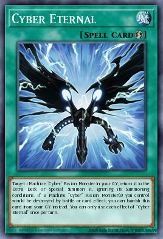

- **Copias y zona:** Main 1x. No altera las cantidades registradas.
- **Nombre oficial de referencia:** Ciber Eterno. CID cotejado con la ficha oficial; el nombre histórico del inventario se conserva aunque su grafía/traducción difiera.
- **Función principal y secundaria:** recurso situacional.
- **Estado de sinergia y función:** Sinergia indirecta (soporte o recursos). Es una clasificación de juego; revisar la relación concreta en A06.
- **Papel como recurso, descarte o coste:** No se demuestra que esta carta sea recurso de descarte o pago para otra.
- **Efecto operativo (paráfrasis analítica):** interacción propia de la carta que requiere consultar el texto íntegro enlazado. Son operaciones detectadas en el texto, no efectos independientes garantizados; leer sus condiciones en la fuente.
- **Mapa de activación y resultados:** efecto de estadística, condición o material; no asumir un disparador adicional. Cada operación está sujeta a la secuencia y al «si lo haces» del texto oficial.
- **Ventanas de activación identificadas:** requieren la fase o condición específica indicada en el texto; sin ventana rápida general asumida.
- **Costes o recursos potenciales:** sin coste independiente identificado en esta síntesis; comprobar las acciones previas al punto y coma de cada efecto.
- **Restricciones y requisitos:** hay límite por turno según el efecto concreto; depende de recursos en Cementerio. 
- **Prioridad al ir primero:** proteger acceso a Core/recursos y preparar presencia legal. Para esta carta: Activar cuando las condiciones permitan obtener valor real, preservando recursos de seguimiento.
- **Prioridad al ir segundo:** romper el campo rival y convertir Máquinas en Fusión o ataque de cierre. Identificar primero la respuesta rival que afecta su función «recurso situacional».
- **Medio/tardío y recuperación:** reciclar piezas Cyber y recuperar acceso al Extra Deck. No asumir que por sí misma recicla recursos si el texto no lo permite.
- **Sinergias y acceso a líneas:** Relación contextual con Máquinas, nombres Cyber Dragon, Fusión/Xyz/Enlace y cierre de partida por daño. Habilita una línea del motor sólo si coinciden recursos, objetivos y restricciones; no equivale a un combo completo validado.
- **Riesgo / brick / interrupciones:** Depende del Cementerio y es sensible a destierro o negación de ese recurso. No atribuirle velocidad rápida por el solo hecho de formar parte del motor.
- **Utilidad editorial:** 3/5 para este deck (estimación por rol y zona, no probabilidad calculada). No cambiar copias; cualquier sugerencia de alta/baja pasa por el apartado 22 y aprobación.
- **Referencia oficial y trazabilidad:** https://www.db.yugioh-card.com/yugiohdb/card_search.action?cid=16297&ope=2&request_locale=es. **Confianza:** texto y tipo de efecto cotejados en Konami; síntesis táctica editorial, no demostración de combo.
- **Aplicación concreta dentro de este deck (A06):** interacción propia de la carta que requiere consultar el texto íntegro enlazado.

**USO PRÁCTICO Y SINERGIA — Cyber Eternal**

- **Label funcional:** Sinergia indirecta. Clasificación documental; una relación es válida solo si se satisfacen sus condiciones exactas.
- **Qué hace:** interacción propia de la carta que requiere consultar el texto íntegro enlazado. Son operaciones detectadas en el texto, no efectos independientes garantizados; leer sus condiciones en la fuente.
- **Cómo aprovecharla en este deck:** interacción propia de la carta que requiere consultar el texto íntegro enlazado.
- **Al jugar primero:** proteger acceso a Core/recursos y preparar presencia legal. Para esta carta: Activar cuando las condiciones permitan obtener valor real, preservando recursos de seguimiento.
- **Al jugar segundo:** romper el campo rival y convertir Máquinas en Fusión o ataque de cierre. Identificar primero la respuesta rival que afecta su función «recurso situacional».
- **Cuándo tener precaución:** Depende del Cementerio y es sensible a destierro o negación de ese recurso. No atribuirle velocidad rápida por el solo hecho de formar parte del motor.

#### 25. Mystical Space Typhoon

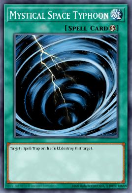

- **Copias y zona:** Main 1x. No altera las cantidades registradas.
- **Nombre oficial de referencia:** Tifón del Espacio Místico. CID cotejado con la ficha oficial; el nombre histórico del inventario se conserva aunque su grafía/traducción difiera.
- **Función principal y secundaria:** removal.
- **Estado de sinergia y función:** Sin relación demostrada. Es una clasificación de juego; revisar la relación concreta en A06.
- **Papel como recurso, descarte o coste:** No se demuestra que esta carta sea recurso de descarte o pago para otra.
- **Efecto operativo (paráfrasis analítica):** destrucción de cartas o empleo de destrucción como detonante. Son operaciones detectadas en el texto, no efectos independientes garantizados; leer sus condiciones en la fuente.
- **Mapa de activación y resultados:** 1) efecto propio o continuo: destruye la carta o recurso previsto. Cada operación está sujeta a la secuencia y al «si lo haces» del texto oficial.
- **Ventanas de activación identificadas:** requieren la fase o condición específica indicada en el texto; sin ventana rápida general asumida.
- **Costes o recursos potenciales:** sin coste independiente identificado en esta síntesis; comprobar las acciones previas al punto y coma de cada efecto.
- **Restricciones y requisitos:** aplicar restricciones de selección, activación y copias que consten en el texto original. 
- **Prioridad al ir primero:** proteger acceso a Core/recursos y preparar presencia legal. Para esta carta: Activar cuando las condiciones permitan obtener valor real, preservando recursos de seguimiento.
- **Prioridad al ir segundo:** romper el campo rival y convertir Máquinas en Fusión o ataque de cierre. Identificar primero la respuesta rival que afecta su función «removal».
- **Medio/tardío y recuperación:** reciclar piezas Cyber y recuperar acceso al Extra Deck. No asumir que por sí misma recicla recursos si el texto no lo permite.
- **Sinergias y acceso a líneas:** Relación contextual con Máquinas, nombres Cyber Dragon, Fusión/Xyz/Enlace y cierre de partida por daño. Habilita una línea del motor sólo si coinciden recursos, objetivos y restricciones; no equivale a un combo completo validado.
- **Riesgo / brick / interrupciones:** Riesgo operativo: materiales exigidos, efectos que requieren campo rival y bloqueos de Invocación Especial. Confirmar objetivos disponibles y costes antes de activar. No atribuirle velocidad rápida por el solo hecho de formar parte del motor.
- **Utilidad editorial:** 3/5 para este deck (estimación por rol y zona, no probabilidad calculada). No cambiar copias; cualquier sugerencia de alta/baja pasa por el apartado 22 y aprobación.
- **Referencia oficial y trazabilidad:** https://www.db.yugioh-card.com/yugiohdb/card_search.action?cid=4909&ope=2&request_locale=es. **Confianza:** texto y tipo de efecto cotejados en Konami; síntesis táctica editorial, no demostración de combo.
- **Aplicación concreta dentro de este deck (A06):** destrucción de cartas o empleo de destrucción como detonante. A06 aún no identifica su conexión; no equivale a incompatibilidad ni borra rutas A09.

**USO PRÁCTICO Y SINERGIA — Mystical Space Typhoon**

- **Label funcional:** Sin sinergia demostrada. Clasificación documental; una relación es válida solo si se satisfacen sus condiciones exactas.
- **Qué hace:** destrucción de cartas o empleo de destrucción como detonante. Son operaciones detectadas en el texto, no efectos independientes garantizados; leer sus condiciones en la fuente.
- **Cómo aprovecharla en este deck:** destrucción de cartas o empleo de destrucción como detonante. A06 aún no identifica su conexión; no equivale a incompatibilidad ni borra rutas A09.
- **Al jugar primero:** proteger acceso a Core/recursos y preparar presencia legal. Para esta carta: Activar cuando las condiciones permitan obtener valor real, preservando recursos de seguimiento.
- **Al jugar segundo:** romper el campo rival y convertir Máquinas en Fusión o ataque de cierre. Identificar primero la respuesta rival que afecta su función «removal».
- **Cuándo tener precaución:** Riesgo operativo: materiales exigidos, efectos que requieren campo rival y bloqueos de Invocación Especial. Confirmar objetivos disponibles y costes antes de activar. No atribuirle velocidad rápida por el solo hecho de formar parte del motor.
- **Sinergia no demostrada:** conservar su función individual si la tiene; no vincularla con otro combo sin una interacción real.

#### 26. Cosmic Cyclone

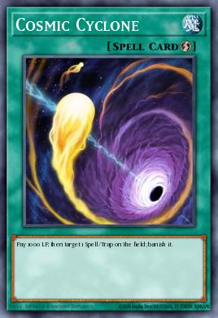

- **Copias y zona:** Main 1x, Reserva 1x. No altera las cantidades registradas.
- **Nombre oficial de referencia:** Ciclón del Cosmos. CID cotejado con la ficha oficial; el nombre histórico del inventario se conserva aunque su grafía/traducción difiera.
- **Función principal y secundaria:** mágica rápida · remoción.
- **Estado de sinergia y función:** Utilidad independiente. Es una clasificación de juego; revisar la relación concreta en A06.
- **Papel como recurso, descarte o coste:** Destierro como uso/recurso; comprobar origen, coste o efecto y recuperación.
- **Efecto operativo (paráfrasis analítica):** Paga 1000 LP para desterrar una Mágica/Trampa en campo. 
- **Mapa de activación y resultados:** efecto de estadística, condición o material; no asumir un disparador adicional. Cada operación está sujeta a la secuencia y al «si lo haces» del texto oficial.
- **Ventanas de activación identificadas:** requieren la fase o condición específica indicada en el texto; sin ventana rápida general asumida.
- **Costes o recursos potenciales:** pago de LP.
- **Restricciones y requisitos:** aplicar restricciones de selección, activación y copias que consten en el texto original. 
- **Prioridad al ir primero:** proteger acceso a Core/recursos y preparar presencia legal. Para esta carta: Activar cuando las condiciones permitan obtener valor real, preservando recursos de seguimiento.
- **Prioridad al ir segundo:** romper el campo rival y convertir Máquinas en Fusión o ataque de cierre. Identificar primero la respuesta rival que afecta su función «mágica rápida».
- **Medio/tardío y recuperación:** reciclar piezas Cyber y recuperar acceso al Extra Deck. No asumir que por sí misma recicla recursos si el texto no lo permite.
- **Sinergias y acceso a líneas:** Relación contextual con Máquinas, nombres Cyber Dragon, Fusión/Xyz/Enlace y cierre de partida por daño. Habilita una línea del motor sólo si coinciden recursos, objetivos y restricciones; no equivale a un combo completo validado.
- **Riesgo / brick / interrupciones:** El coste de LP y selección de objetivo deben pagarse/declararse antes de la resolución. No atribuirle velocidad rápida por el solo hecho de formar parte del motor.
- **Utilidad editorial:** 3/5 para este deck (estimación por rol y zona, no probabilidad calculada). No cambiar copias; cualquier sugerencia de alta/baja pasa por el apartado 22 y aprobación.
- **Referencia oficial y trazabilidad:** https://www.db.yugioh-card.com/yugiohdb/card_search.action?cid=12464&ope=2&request_locale=es. **Confianza:** texto y tipo de efecto cotejados en Konami; síntesis táctica editorial, no demostración de combo.
- **Aplicación concreta dentro de este deck (A06):** Paga 1000 LP para desterrar una Mágica/Trampa en campo. Aporta respuesta o consistencia sin exigir enlace directo.

**USO PRÁCTICO Y SINERGIA — Cosmic Cyclone**

- **Label funcional:** Función independiente. Clasificación documental; una relación es válida solo si se satisfacen sus condiciones exactas.
- **Qué hace:** Paga 1000 LP para desterrar una Mágica/Trampa en campo.
- **Cómo aprovecharla en este deck:** Paga 1000 LP para desterrar una Mágica/Trampa en campo. Aporta respuesta o consistencia sin exigir enlace directo.
- **Al jugar primero:** proteger acceso a Core/recursos y preparar presencia legal. Para esta carta: Activar cuando las condiciones permitan obtener valor real, preservando recursos de seguimiento.
- **Al jugar segundo:** romper el campo rival y convertir Máquinas en Fusión o ataque de cierre. Identificar primero la respuesta rival que afecta su función «mágica rápida».
- **Cuándo tener precaución:** El coste de LP y selección de objetivo deben pagarse/declararse antes de la resolución. No atribuirle velocidad rápida por el solo hecho de formar parte del motor.

#### 27. Infinite Impermanence

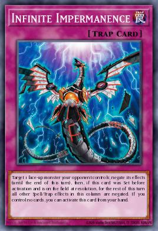

- **Copias y zona:** Main 3x. No altera las cantidades registradas.
- **Nombre oficial de referencia:** Infinito Temporal. CID cotejado con la ficha oficial; el nombre histórico del inventario se conserva aunque su grafía/traducción difiera.
- **Función principal y secundaria:** trampa · negación.
- **Estado de sinergia y función:** Utilidad independiente. Es una clasificación de juego; revisar la relación concreta en A06.
- **Papel como recurso, descarte o coste:** No se demuestra que esta carta sea recurso de descarte o pago para otra.
- **Efecto operativo (paráfrasis analítica):** Niega temporalmente un monstruo rival boca arriba; si se activó tras estar Colocada, también afecta la columna M/T correspondiente. 
- **Mapa de activación y resultados:** 1) efecto propio o continuo: niega el efecto o la activación indicada. Cada operación está sujeta a la secuencia y al «si lo haces» del texto oficial.
- **Ventanas de activación identificadas:** campo propio vacío.
- **Costes o recursos potenciales:** sin coste independiente identificado en esta síntesis; comprobar las acciones previas al punto y coma de cada efecto.
- **Restricciones y requisitos:** requiere campo propio sin las cartas indicadas. 
- **Prioridad al ir primero:** proteger acceso a Core/recursos y preparar presencia legal. Para esta carta: Conservar la interrupción para el efecto clave rival; no gastarla en un efecto irrelevante.
- **Prioridad al ir segundo:** romper el campo rival y convertir Máquinas en Fusión o ataque de cierre. Identificar primero la respuesta rival que afecta su función «trampa».
- **Medio/tardío y recuperación:** reciclar piezas Cyber y recuperar acceso al Extra Deck. No asumir que por sí misma recicla recursos si el texto no lo permite.
- **Sinergias y acceso a líneas:** Relación contextual con Máquinas, nombres Cyber Dragon, Fusión/Xyz/Enlace y cierre de partida por daño. Habilita una línea del motor sólo si coinciden recursos, objetivos y restricciones; no equivale a un combo completo validado.
- **Riesgo / brick / interrupciones:** Desde mano sólo con el campo propio vacío, conforme a la condición de activación de la Trampa. No atribuirle velocidad rápida por el solo hecho de formar parte del motor.
- **Utilidad editorial:** 3/5 para este deck (estimación por rol y zona, no probabilidad calculada). No cambiar copias; cualquier sugerencia de alta/baja pasa por el apartado 22 y aprobación.
- **Referencia oficial y trazabilidad:** https://www.db.yugioh-card.com/yugiohdb/card_search.action?cid=13631&ope=2&request_locale=es. **Confianza:** texto y tipo de efecto cotejados en Konami; síntesis táctica editorial, no demostración de combo.
- **Aplicación concreta dentro de este deck (A06):** Niega temporalmente un monstruo rival boca arriba; si se activó tras estar Colocada, también afecta la columna M/T correspondiente. Aporta respuesta o consistencia sin exigir enlace directo.

**USO PRÁCTICO Y SINERGIA — Infinite Impermanence**

- **Label funcional:** Función independiente. Clasificación documental; una relación es válida solo si se satisfacen sus condiciones exactas.
- **Qué hace:** Niega temporalmente un monstruo rival boca arriba; si se activó tras estar Colocada, también afecta la columna M/T correspondiente.
- **Cómo aprovecharla en este deck:** Niega temporalmente un monstruo rival boca arriba; si se activó tras estar Colocada, también afecta la columna M/T correspondiente. Aporta respuesta o consistencia sin exigir enlace directo.
- **Al jugar primero:** proteger acceso a Core/recursos y preparar presencia legal. Para esta carta: Conservar la interrupción para el efecto clave rival; no gastarla en un efecto irrelevante.
- **Al jugar segundo:** romper el campo rival y convertir Máquinas en Fusión o ataque de cierre. Identificar primero la respuesta rival que afecta su función «trampa».
- **Cuándo tener precaución:** Desde mano sólo con el campo propio vacío, conforme a la condición de activación de la Trampa. No atribuirle velocidad rápida por el solo hecho de formar parte del motor.

#### 28. Cybernetic Overflow

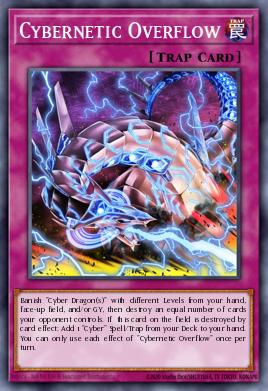

- **Copias y zona:** Main 1x. No altera las cantidades registradas.
- **Nombre oficial de referencia:** Desborde Cibernético. CID cotejado con la ficha oficial; el nombre histórico del inventario se conserva aunque su grafía/traducción difiera.
- **Función principal y secundaria:** searcher · buscador · removal.
- **Estado de sinergia y función:** Sinergia indirecta (soporte o recursos). Es una clasificación de juego; revisar la relación concreta en A06.
- **Papel como recurso, descarte o coste:** Coste o consumo descrito en A05: destierro de recurso propio.
- **Efecto operativo (paráfrasis analítica):** búsqueda o incorporación de cartas a mano; destrucción de cartas o empleo de destrucción como detonante; destierro de recursos o de amenazas. Son operaciones detectadas en el texto, no efectos independientes garantizados; leer sus condiciones en la fuente.
- **Mapa de activación y resultados:** 1) efecto propio o continuo: destierra el recurso u objetivo previsto, destruye la carta o recurso previsto · 2) con condición explícita en la carta: incorpora la pieza indicada a la mano. Cada operación está sujeta a la secuencia y al «si lo haces» del texto oficial.
- **Ventanas de activación identificadas:** requieren la fase o condición específica indicada en el texto; sin ventana rápida general asumida.
- **Costes o recursos potenciales:** destierro de recurso propio.
- **Restricciones y requisitos:** hay límite por turno según el efecto concreto. 
- **Prioridad al ir primero:** proteger acceso a Core/recursos y preparar presencia legal. Para esta carta: Convertir la activación en acceso a la siguiente pieza del motor, sin duplicar buscadores inútilmente.
- **Prioridad al ir segundo:** romper el campo rival y convertir Máquinas en Fusión o ataque de cierre. Identificar primero la respuesta rival que afecta su función «searcher».
- **Medio/tardío y recuperación:** reciclar piezas Cyber y recuperar acceso al Extra Deck. No asumir que por sí misma recicla recursos si el texto no lo permite.
- **Sinergias y acceso a líneas:** Relación contextual con Máquinas, nombres Cyber Dragon, Fusión/Xyz/Enlace y cierre de partida por daño. Habilita una línea del motor sólo si coinciden recursos, objetivos y restricciones; no equivale a un combo completo validado.
- **Riesgo / brick / interrupciones:** Riesgo operativo: materiales exigidos, efectos que requieren campo rival y bloqueos de Invocación Especial. Confirmar objetivos disponibles y costes antes de activar. No atribuirle velocidad rápida por el solo hecho de formar parte del motor.
- **Utilidad editorial:** 5/5 para este deck (estimación por rol y zona, no probabilidad calculada). No cambiar copias; cualquier sugerencia de alta/baja pasa por el apartado 22 y aprobación.
- **Referencia oficial y trazabilidad:** https://www.db.yugioh-card.com/yugiohdb/card_search.action?cid=13787&ope=2&request_locale=es. **Confianza:** texto y tipo de efecto cotejados en Konami; síntesis táctica editorial, no demostración de combo.
- **Aplicación concreta dentro de este deck (A06):** búsqueda o incorporación de cartas a mano; destrucción de cartas o empleo de destrucción como detonante; destierro de recursos o de amenazas.

**USO PRÁCTICO Y SINERGIA — Cybernetic Overflow**

- **Label funcional:** Sinergia indirecta. Clasificación documental; una relación es válida solo si se satisfacen sus condiciones exactas.
- **Qué hace:** búsqueda o incorporación de cartas a mano; destrucción de cartas o empleo de destrucción como detonante; destierro de recursos o de amenazas. Son operaciones detectadas en el texto, no efectos independientes garantizados; leer sus condiciones en la fuente.
- **Cómo aprovecharla en este deck:** búsqueda o incorporación de cartas a mano; destrucción de cartas o empleo de destrucción como detonante; destierro de recursos o de amenazas.
- **Al jugar primero:** proteger acceso a Core/recursos y preparar presencia legal. Para esta carta: Convertir la activación en acceso a la siguiente pieza del motor, sin duplicar buscadores inútilmente.
- **Al jugar segundo:** romper el campo rival y convertir Máquinas en Fusión o ataque de cierre. Identificar primero la respuesta rival que afecta su función «searcher».
- **Cuándo tener precaución:** Riesgo operativo: materiales exigidos, efectos que requieren campo rival y bloqueos de Invocación Especial. Confirmar objetivos disponibles y costes antes de activar. No atribuirle velocidad rápida por el solo hecho de formar parte del motor.

#### 29. Chimeratech Rampage Dragon (Konami ID 11764)

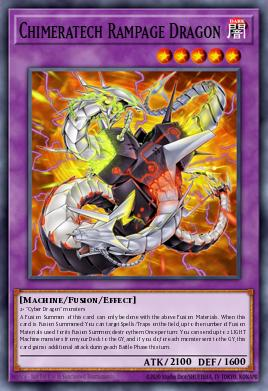

- **Copias y zona:** Extra 2x. No altera las cantidades registradas.
- **Nombre oficial de referencia:** Dragón de la Devastación Chimeratech. CID cotejado con la ficha oficial; el nombre histórico del inventario se conserva aunque su grafía/traducción difiera.
- **Función principal y secundaria:** resultado de Extra Deck · habilitador de Extra.
- **Estado de sinergia y función:** Destino Extra condicionado. Es una clasificación de juego; revisar la relación concreta en A06.
- **Papel como recurso, descarte o coste:** Material o destino del Extra condicionado a los requisitos de invocación.
- **Efecto operativo (paráfrasis analítica):** habilitación o continuación de una invocación del Extra Deck. Son operaciones detectadas en el texto, no efectos independientes garantizados; leer sus condiciones en la fuente.
- **Mapa de activación y resultados:** 1) efecto propio o continuo: realiza Fusión con materiales permitidos · 2) con condición explícita en la carta: realiza Fusión con materiales permitidos. Cada operación está sujeta a la secuencia y al «si lo haces» del texto oficial.
- **Ventanas de activación identificadas:** requieren la fase o condición específica indicada en el texto; sin ventana rápida general asumida.
- **Costes o recursos potenciales:** sin coste independiente identificado en esta síntesis; comprobar las acciones previas al punto y coma de cada efecto.
- **Restricciones y requisitos:** hay límite por turno según el efecto concreto. Invocar sólo desde el Extra Deck usando su procedimiento propio.
- **Prioridad al ir primero:** proteger acceso a Core/recursos y preparar presencia legal. Para esta carta: Comprobar materiales exactos antes de buscar este objetivo en el Extra Deck.
- **Prioridad al ir segundo:** romper el campo rival y convertir Máquinas en Fusión o ataque de cierre. Identificar primero la respuesta rival que afecta su función «resultado de Extra Deck».
- **Medio/tardío y recuperación:** reciclar piezas Cyber y recuperar acceso al Extra Deck. No asumir que por sí misma recicla recursos si el texto no lo permite.
- **Sinergias y acceso a líneas:** Relación contextual con Máquinas, nombres Cyber Dragon, Fusión/Xyz/Enlace y cierre de partida por daño. Puede cerrar o prolongar una ruta del Extra si los materiales están disponibles.
- **Riesgo / brick / interrupciones:** No contarla como extensión automática: confirmar materiales, procedimiento y restricciones vigentes. No atribuirle velocidad rápida por el solo hecho de formar parte del motor.
- **Utilidad editorial:** 4/5 para este deck (estimación por rol y zona, no probabilidad calculada). No cambiar copias; cualquier sugerencia de alta/baja pasa por el apartado 22 y aprobación.
- **Referencia oficial y trazabilidad:** https://www.db.yugioh-card.com/yugiohdb/card_search.action?cid=11764&ope=2&request_locale=es. **Confianza:** texto y tipo de efecto cotejados en Konami; síntesis táctica editorial, no demostración de combo.
- **Aplicación concreta dentro de este deck (A06):** habilitación o continuación de una invocación del Extra Deck. A06 identifica su destino, condicionado a material/procedimiento.

**USO PRÁCTICO Y SINERGIA — Chimeratech Rampage Dragon (Konami ID 11764)**

- **Label funcional:** Referencias de ruta localizadas; conexión reglamentaria sujeta al recorrido de la guía. Clasificación documental; una relación es válida solo si se satisfacen sus condiciones exactas.
- **Qué hace:** habilitación o continuación de una invocación del Extra Deck. Son operaciones detectadas en el texto, no efectos independientes garantizados; leer sus condiciones en la fuente.
- **Cómo aprovecharla en este deck:** habilitación o continuación de una invocación del Extra Deck. A06 identifica su destino, condicionado a material/procedimiento.
- **Al jugar primero:** proteger acceso a Core/recursos y preparar presencia legal. Para esta carta: Comprobar materiales exactos antes de buscar este objetivo en el Extra Deck.
- **Al jugar segundo:** romper el campo rival y convertir Máquinas en Fusión o ataque de cierre. Identificar primero la respuesta rival que afecta su función «resultado de Extra Deck».
- **Cuándo tener precaución:** No contarla como extensión automática: confirmar materiales, procedimiento y restricciones vigentes. No atribuirle velocidad rápida por el solo hecho de formar parte del motor.

**CÓMO LLEGAR DESDE TU DECK — RUTAS DOCUMENTADAS**

- **Abrir guía `684:A09:OVERLOAD:RAMPAGE01`:** entrada: Main Phase propia, Overload Fusion en mano, Cyber Dragon Core y Cyber Dragon Herz en GY propios, ambos sin ser desterrados; Chimeratech Rampage Dragon en Extra; Cyber Dragon y Cyber Dragon Nachster todavía en Deck (dos Máquinas LUZ disponibles). Zona principal libre, sin bloqueos de Invocación Especial o de efectos previos, rival sin respuestas. No se exige control de otro monstruo ni Normal disponible.. Propósito descrito: Ofensivo. Consulta sus pasos, consumo y resultado; comprobar si esta carta es realmente invocada o solo mencionada.
- **Abrir guía `684:A09:CLAW:REALM:POWERBOND:RAMPAGE01`:** entrada: Claw 1× Cyberdark Claw, 1× Ciclón del Cosmos (Mágica que será descartada como coste, no activada), Core 1× Cyber Dragon Core, Cyber Dragon 1× Cyber Dragon original. Deck: Realm Cyberdark Realm, Chimera Cyberdark Chimera, Bond Power Bond, al menos 1 Cyber Emergency y Herz Cyber Dragon Herz disponibles. Extra: Rampage Chimeratech Rampage Dragon. Campo/GY/destierro propios: vacíos, LP propios suficientes para la posterior consecuencia de 2100 si se desea sobrevivir al final de turno; Normal del turno sin utilizar, sin bloqueo previo ni respuesta rival. Solo se utiliza el motor presente en Main/Extra.. Propósito descrito: Ofensivo. Consulta sus pasos, consumo y resultado; comprobar si esta carta es realmente invocada o solo mencionada.
- **Abrir guía `684:A09:OVERLOAD:CYBERLOAD:DOUBLE_RAMPAGE01`:** entrada: Overload Fusion 1× Overload Fusion + Cyberload Fusion 1× Cyberload Fusion. GY propio inicial preparado desde turno previo: Core 1× Cyber Dragon Core + Herz 1× Cyber Dragon Herz, sin usar el efecto de recuperación de Herz en este turno. Deck: Cyber Dragon original 1× + Cyber Dragon Nachster 1×; resto de Core en Deck no se consume. Extra: Rampage 2× Chimeratech Rampage Dragon sin utilizar. Campo y destierro propios vacíos, Normal del turno disponible, sin bloqueos ni respuesta rival; no se asume una mano robada adicional.. Propósito descrito: Ofensivo. Consulta sus pasos, consumo y resultado; comprobar si esta carta es realmente invocada o solo mencionada.

#### 30. Cyber Dragon Sieger

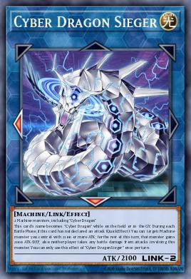

- **Copias y zona:** Extra 1x, Reserva 1x. No altera las cantidades registradas.
- **Nombre oficial de referencia:** Ciber Dragón Sieger. CID cotejado con la ficha oficial; el nombre histórico del inventario se conserva aunque su grafía/traducción difiera.
- **Función principal y secundaria:** interrupción · resultado de Extra Deck · cierre · respuesta.
- **Estado de sinergia y función:** Referencias de rutas documentales identificadas; comprobar si hay Invocación real en los pasos y validar legalidad.
- **Papel como recurso, descarte o coste:** Material o destino del Extra condicionado a los requisitos de invocación.
- **Efecto operativo (paráfrasis analítica):** presión de combate o modificación de estadísticas; interacción sobre monstruos en campo. Son operaciones detectadas en el texto, no efectos independientes garantizados; leer sus condiciones en la fuente.
- **Mapa de activación y resultados:** efecto de estadística, condición o material; no asumir un disparador adicional. Cada operación está sujeta a la secuencia y al «si lo haces» del texto oficial.
- **Ventanas de activación identificadas:** Efecto Rápido.
- **Costes o recursos potenciales:** sin coste independiente identificado en esta síntesis; comprobar las acciones previas al punto y coma de cada efecto.
- **Restricciones y requisitos:** hay límite por turno según el efecto concreto. Invocar sólo desde el Extra Deck usando su procedimiento propio.
- **Prioridad al ir primero:** proteger acceso a Core/recursos y preparar presencia legal. Para esta carta: Reservar la respuesta para la ventana rival exacta; no es una pieza buscadora de nuestro motor.
- **Prioridad al ir segundo:** romper el campo rival y convertir Máquinas en Fusión o ataque de cierre. Identificar primero la respuesta rival que afecta su función «interrupción».
- **Medio/tardío y recuperación:** reciclar piezas Cyber y recuperar acceso al Extra Deck. No asumir que por sí misma recicla recursos si el texto no lo permite.
- **Sinergias y acceso a líneas:** Relación contextual con Máquinas, nombres Cyber Dragon, Fusión/Xyz/Enlace y cierre de partida por daño. Puede cerrar o prolongar una ruta del Extra si los materiales están disponibles.
- **Riesgo / brick / interrupciones:** No contarla como extensión automática: confirmar materiales, procedimiento y restricciones vigentes. Puede emplearse en cadena sólo cuando se cumpla su condición concreta.
- **Utilidad editorial:** 4/5 para este deck (estimación por rol y zona, no probabilidad calculada). No cambiar copias; cualquier sugerencia de alta/baja pasa por el apartado 22 y aprobación.
- **Referencia oficial y trazabilidad:** https://www.db.yugioh-card.com/yugiohdb/card_search.action?cid=13758&ope=2&request_locale=es. **Confianza:** texto y tipo de efecto cotejados en Konami; síntesis táctica editorial, no demostración de combo.
- **Aplicación concreta dentro de este deck (A06):** presión de combate o modificación de estadísticas; interacción sobre monstruos en campo. Falta arista de materiales en A06; A09 podría contener una ruta válida no indexada aquí.

**USO PRÁCTICO Y SINERGIA — Cyber Dragon Sieger**

- **Label funcional:** Referencias de ruta localizadas; conexión reglamentaria sujeta al recorrido de la guía. Clasificación documental; una relación es válida solo si se satisfacen sus condiciones exactas.
- **Qué hace:** presión de combate o modificación de estadísticas; interacción sobre monstruos en campo. Son operaciones detectadas en el texto, no efectos independientes garantizados; leer sus condiciones en la fuente.
- **Cómo aprovecharla en este deck:** presión de combate o modificación de estadísticas; interacción sobre monstruos en campo. Falta arista de materiales en A06; A09 podría contener una ruta válida no indexada aquí.
- **Al jugar primero:** proteger acceso a Core/recursos y preparar presencia legal. Para esta carta: Reservar la respuesta para la ventana rival exacta; no es una pieza buscadora de nuestro motor.
- **Al jugar segundo:** romper el campo rival y convertir Máquinas en Fusión o ataque de cierre. Identificar primero la respuesta rival que afecta su función «interrupción».
- **Cuándo tener precaución:** No contarla como extensión automática: confirmar materiales, procedimiento y restricciones vigentes. Puede emplearse en cadena sólo cuando se cumpla su condición concreta.

**CÓMO LLEGAR DESDE TU DECK — RUTAS DOCUMENTADAS**

- **Abrir guía `684:A09:NACHSTER:SIEGER01`:** entrada: Cyber Dragon 1× Cyber Dragon original (Nivel 5, Máquina LUZ, ATK 2100) + Nachster 1× Cyber Dragon Nachster (Nivel 1, Máquina LUZ, ATK 200). Extra: Sieger 1× Cyber Dragon Sieger sin usar. Estado inicial: Main Phase propia; campo/GY/destierro propios vacíos, Normal disponible, zonas de monstruos libres; no hay efectos previos ni restricción externa a Enlace. No requiere cartas ni monstruos rivales para Invocar a Sieger. Sin respuesta adversaria en línea base.. Propósito descrito: Ofensivo condicional. Consulta sus pasos, consumo y resultado; comprobar si esta carta es realmente invocada o solo mencionada.

#### 31. Chimeratech Fortress Dragon

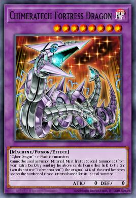

- **Copias y zona:** Extra 1x. No altera las cantidades registradas.
- **Nombre oficial de referencia:** Dragón Fortaleza Chimeratech. CID cotejado con la ficha oficial; el nombre histórico del inventario se conserva aunque su grafía/traducción difiera.
- **Función principal y secundaria:** Fusión de contacto · removal Máquina.
- **Estado de sinergia y función:** Destino Extra condicionado. Es una clasificación de juego; revisar la relación concreta en A06.
- **Papel como recurso, descarte o coste:** Material o destino del Extra condicionado a los requisitos de invocación.
- **Efecto operativo (paráfrasis analítica):** Fortress usa Cyber Dragon y Máquinas de cualquier campo enviadas al Cementerio para su Invocación especial del Extra. 
- **Mapa de activación y resultados:** 1) efecto propio o continuo: Invocación Especial desde Extra Deck. Cada operación está sujeta a la secuencia y al «si lo haces» del texto oficial.
- **Ventanas de activación identificadas:** requieren la fase o condición específica indicada en el texto; sin ventana rápida general asumida.
- **Costes o recursos potenciales:** sin coste independiente identificado en esta síntesis; comprobar las acciones previas al punto y coma de cada efecto.
- **Restricciones y requisitos:** exige materiales de Extra Deck o materiales adecuados; tiene procedimiento especial de Invocación. Invocar sólo desde el Extra Deck usando su procedimiento propio.
- **Prioridad al ir primero:** proteger acceso a Core/recursos y preparar presencia legal. Para esta carta: Escoger la amenaza o recurso que genere mayor ventaja de tempo; respetar selección y zona.
- **Prioridad al ir segundo:** romper el campo rival y convertir Máquinas en Fusión o ataque de cierre. Identificar primero la respuesta rival que afecta su función «Fusión de contacto».
- **Medio/tardío y recuperación:** reciclar piezas Cyber y recuperar acceso al Extra Deck. Verificar que el objetivo de recuperación continúe disponible.
- **Sinergias y acceso a líneas:** Relación contextual con Máquinas, nombres Cyber Dragon, Fusión/Xyz/Enlace y cierre de partida por daño. Puede cerrar o prolongar una ruta del Extra si los materiales están disponibles.
- **Riesgo / brick / interrupciones:** No es una Fusión por efecto de Polimerización; el procedimiento es específico. No atribuirle velocidad rápida por el solo hecho de formar parte del motor.
- **Utilidad editorial:** 4/5 para este deck (estimación por rol y zona, no probabilidad calculada). No cambiar copias; cualquier sugerencia de alta/baja pasa por el apartado 22 y aprobación.
- **Referencia oficial y trazabilidad:** https://www.db.yugioh-card.com/yugiohdb/card_search.action?cid=7403&ope=2&request_locale=es. **Confianza:** texto y tipo de efecto cotejados en Konami; síntesis táctica editorial, no demostración de combo.
- **Aplicación concreta dentro de este deck (A06):** Fortress usa Cyber Dragon y Máquinas de cualquier campo enviadas al Cementerio para su Invocación especial del Extra. A06 identifica su destino, condicionado a material/procedimiento.

**USO PRÁCTICO Y SINERGIA — Chimeratech Fortress Dragon**

- **Label funcional:** Referencias de ruta localizadas; conexión reglamentaria sujeta al recorrido de la guía. Clasificación documental; una relación es válida solo si se satisfacen sus condiciones exactas.
- **Qué hace:** Fortress usa Cyber Dragon y Máquinas de cualquier campo enviadas al Cementerio para su Invocación especial del Extra.
- **Cómo aprovecharla en este deck:** Fortress usa Cyber Dragon y Máquinas de cualquier campo enviadas al Cementerio para su Invocación especial del Extra. A06 identifica su destino, condicionado a material/procedimiento.
- **Al jugar primero:** proteger acceso a Core/recursos y preparar presencia legal. Para esta carta: Escoger la amenaza o recurso que genere mayor ventaja de tempo; respetar selección y zona.
- **Al jugar segundo:** romper el campo rival y convertir Máquinas en Fusión o ataque de cierre. Identificar primero la respuesta rival que afecta su función «Fusión de contacto».
- **Cuándo tener precaución:** No es una Fusión por efecto de Polimerización; el procedimiento es específico. No atribuirle velocidad rápida por el solo hecho de formar parte del motor.

**CÓMO LLEGAR DESDE TU DECK — RUTAS DOCUMENTADAS**

- **Abrir guía `684:A09:CLOCKWORK:FORTRESS01`:** entrada: 1× Cyber Dragon Core + 1× Clockwork Night. Deck propio: 1× Cyber Emergency disponible para la búsqueda. Extra Deck: 1× Chimeratech Fortress Dragon disponible. Campo inicial: propio vacío, rival controla 1 monstruo boca arriba (por ejemplo, de tipo Guerrero); no hay otras restricciones ni respuestas adversarias. Es Main Phase propia y la Normal Summon sigue disponible.. Propósito descrito: Romper campo. Consulta sus pasos, consumo y resultado; comprobar si esta carta es realmente invocada o solo mencionada.

#### 32. Clockwork Knight (Konami ID 20787)

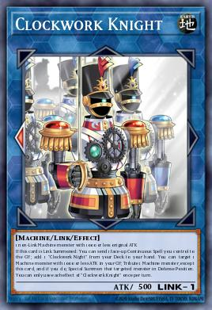

- **Copias y zona:** Extra 1x, Reserva 2x. No altera las cantidades registradas.
- **Nombre oficial de referencia:** Caballero Mecánico. CID cotejado con la ficha oficial; el nombre histórico del inventario se conserva aunque su grafía/traducción difiera.
- **Función principal y secundaria:** resultado de Extra Deck · buscador · cierre · coste/recurso.
- **Estado de sinergia y función:** **Acceso condicional demostrado V11**: Core Normal 400 ATK original es material no-Enlace válido; Knight Link1 puede enviar Clockwork Night propia como coste para buscar segunda Night; no se permite activarla dos veces el mismo turno.
- **Papel como recurso, descarte o coste:** Material o destino del Extra condicionado a los requisitos de invocación.
- **Efecto operativo (paráfrasis analítica):** búsqueda o incorporación de cartas a mano; presión de combate o modificación de estadísticas; uso de Sacrificios como parte del efecto. Son operaciones detectadas en el texto, no efectos independientes garantizados; leer sus condiciones en la fuente.
- **Mapa de activación y resultados:** 1) tras su invocación desde el Extra: incorpora la pieza indicada a la mano · 2) efecto propio o continuo: Invocación Especial desde Cementerio. Cada operación está sujeta a la secuencia y al «si lo haces» del texto oficial.
- **Ventanas de activación identificadas:** al producirse una Invocación; Invocación del Extra Deck.
- **Costes o recursos potenciales:** Sacrificio; envío de recurso propio al Cementerio.
- **Restricciones y requisitos:** hay límite por turno según el efecto concreto; depende de recursos en Cementerio. Invocar sólo desde el Extra Deck usando su procedimiento propio.
- **Prioridad al ir primero:** proteger acceso a Core/recursos y preparar presencia legal. Para esta carta: Comprobar materiales exactos antes de buscar este objetivo en el Extra Deck.
- **Prioridad al ir segundo:** romper el campo rival y convertir Máquinas en Fusión o ataque de cierre. Identificar primero la respuesta rival que afecta su función «resultado de Extra Deck».
- **Medio/tardío y recuperación:** reciclar piezas Cyber y recuperar acceso al Extra Deck. No asumir que por sí misma recicla recursos si el texto no lo permite.
- **Sinergias y acceso a líneas:** Relación contextual con Máquinas, nombres Cyber Dragon, Fusión/Xyz/Enlace y cierre de partida por daño. Puede cerrar o prolongar una ruta del Extra si los materiales están disponibles.
- **Riesgo / brick / interrupciones:** Depende del Cementerio y es sensible a destierro o negación de ese recurso. No atribuirle velocidad rápida por el solo hecho de formar parte del motor.
- **Utilidad editorial:** 4/5 para este deck (estimación por rol y zona, no probabilidad calculada). No cambiar copias; cualquier sugerencia de alta/baja pasa por el apartado 22 y aprobación.
- **Referencia oficial y trazabilidad:** https://www.db.yugioh-card.com/yugiohdb/card_search.action?cid=20787&ope=2&request_locale=es. **Confianza:** texto y tipo de efecto cotejados en Konami; síntesis táctica editorial, no demostración de combo.
- **Aplicación concreta dentro de este deck (A06):** `684:A09:CORE:NIGHT:CLOCKWORK_KNIGHT13` usa Core original ATK400 como único material del Link1; Knight envía como coste Clockwork Night boca arriba y busca otra en Deck. No puede activar esta segunda Night ese turno ni revivir Core sin una Máquina adicional propia que sacrificar.

**USO PRÁCTICO Y SINERGIA — Clockwork Knight (Konami ID 20787)**

- **Label funcional:** **Destino Extra con acceso por material Main documentado** (Core), recurso condicional de preparación; no negador.
- **Qué hace:** búsqueda o incorporación de cartas a mano; presión de combate o modificación de estadísticas; uso de Sacrificios como parte del efecto. Son operaciones detectadas en el texto, no efectos independientes garantizados; leer sus condiciones en la fuente.
- **Cómo aprovecharla en este deck:** búsqueda o incorporación de cartas a mano; presión de combate o modificación de estadísticas; uso de Sacrificios como parte del efecto. A06 identifica su destino, condicionado a material/procedimiento.
- **Al jugar primero:** proteger acceso a Core/recursos y preparar presencia legal. Para esta carta: Comprobar materiales exactos antes de buscar este objetivo en el Extra Deck.
- **Al jugar segundo:** romper el campo rival y convertir Máquinas en Fusión o ataque de cierre. Identificar primero la respuesta rival que afecta su función «resultado de Extra Deck».
- **Cuándo tener precaución:** Depende del Cementerio y es sensible a destierro o negación de ese recurso. No atribuirle velocidad rápida por el solo hecho de formar parte del motor.

**CÓMO LLEGAR DESDE TU DECK — RUTA V11 DOCUMENTADA**

- **Abrir `684:A09:CORE:NIGHT:CLOCKWORK_KNIGHT13`:** [Core + Night → Knight, pasos/fotos y campo final](guias/DECK_684_CLOCKWORK_KNIGHT_Y_BARRICADEBORG_ALTERNATIVAS_GUIA.md). A04: Extra 1x, Reserva 2x NO activas. Necesita una segunda Night en Deck y Emergency buscable; costo de Knight se paga al activar su búsqueda. La pérdida de Night en campo es la principal decisión.

#### 33. Barricadeborg Blocker

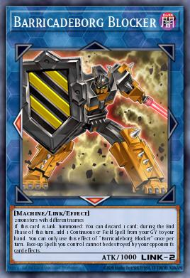

- **Copias y zona:** Extra 1x. No altera las cantidades registradas.
- **Nombre oficial de referencia:** Centinela Barricadaborg. CID cotejado con la ficha oficial; el nombre histórico del inventario se conserva aunque su grafía/traducción difiera.
- **Función principal y secundaria:** resultado de Extra Deck · buscador.
- **Estado de sinergia y función:** **Acceso condicional demostrado V11**: Cyber Dragon Especial + Cyberdark Horn Normal son **nombres diferentes**; ambos a Barricadeborg Link2, protegiendo Night boca arriba. No confundirlo con Cyber Dragon + Core (dos nombres «Cyber Dragon», no válidos).
- **Papel como recurso, descarte o coste:** Material o destino del Extra condicionado a los requisitos de invocación.
- **Efecto operativo (paráfrasis analítica):** búsqueda o incorporación de cartas a mano. Son operaciones detectadas en el texto, no efectos independientes garantizados; leer sus condiciones en la fuente.
- **Mapa de activación y resultados:** 1) tras su invocación desde el Extra: incorpora la pieza indicada a la mano. Cada operación está sujeta a la secuencia y al «si lo haces» del texto oficial.
- **Ventanas de activación identificadas:** End Phase; al producirse una Invocación; Invocación del Extra Deck.
- **Costes o recursos potenciales:** descarte de mano.
- **Restricciones y requisitos:** hay límite por turno según el efecto concreto; depende de recursos en Cementerio. Invocar sólo desde el Extra Deck usando su procedimiento propio.
- **Prioridad al ir primero:** proteger acceso a Core/recursos y preparar presencia legal. Para esta carta: Comprobar materiales exactos antes de buscar este objetivo en el Extra Deck.
- **Prioridad al ir segundo:** romper el campo rival y convertir Máquinas en Fusión o ataque de cierre. Identificar primero la respuesta rival que afecta su función «resultado de Extra Deck».
- **Medio/tardío y recuperación:** reciclar piezas Cyber y recuperar acceso al Extra Deck. No asumir que por sí misma recicla recursos si el texto no lo permite.
- **Sinergias y acceso a líneas:** Relación contextual con Máquinas, nombres Cyber Dragon, Fusión/Xyz/Enlace y cierre de partida por daño. Puede cerrar o prolongar una ruta del Extra si los materiales están disponibles.
- **Riesgo / brick / interrupciones:** Depende del Cementerio y es sensible a destierro o negación de ese recurso. No atribuirle velocidad rápida por el solo hecho de formar parte del motor.
- **Utilidad editorial:** 4/5 para este deck (estimación por rol y zona, no probabilidad calculada). No cambiar copias; cualquier sugerencia de alta/baja pasa por el apartado 22 y aprobación.
- **Referencia oficial y trazabilidad:** https://www.db.yugioh-card.com/yugiohdb/card_search.action?cid=14710&ope=2&request_locale=es. **Confianza:** texto y tipo de efecto cotejados en Konami; síntesis táctica editorial, no demostración de combo.
- **Aplicación concreta dentro de este deck (A06):** `684:A09:CYBER:HORN:NIGHT:BARRICADEBORG14`: Cyber Dragon y Horn son nombres diferentes y forman Link2, con Clockwork Night ya boca arriba; la Mágica propia queda protegida contra destrucción por efectos del oponente, **no** destierro ni negación. Su recuperación de Mágica en End Phase exige una carta extra para descartar y otra Mágica Continua/de Campo elegible en GY.

**USO PRÁCTICO Y SINERGIA — Barricadeborg Blocker**

- **Label funcional:** **Destino Extra defensivo con materiales distintos y acceso condicional documentado**, protección de Mágica activa.
- **Qué hace:** búsqueda o incorporación de cartas a mano. Son operaciones detectadas en el texto, no efectos independientes garantizados; leer sus condiciones en la fuente.
- **Cómo aprovecharla en este deck:** con Clockwork Night ya activa, usar Cyber Dragon Especial + Cyberdark Horn Normal como dos nombres diferentes. Barricadeborg protege Night de destrucción por efectos rivales; sin un descarte y Mágica en GY no prometer recuperación End Phase.
- **Al jugar primero:** proteger acceso a Core/recursos y preparar presencia legal. Para esta carta: Comprobar materiales exactos antes de buscar este objetivo en el Extra Deck.
- **Al jugar segundo:** romper el campo rival y convertir Máquinas en Fusión o ataque de cierre. Identificar primero la respuesta rival que afecta su función «resultado de Extra Deck».
- **Cuándo tener precaución:** Depende del Cementerio y es sensible a destierro o negación de ese recurso. No atribuirle velocidad rápida por el solo hecho de formar parte del motor.

**CÓMO LLEGAR DESDE TU DECK — RUTA V11 DOCUMENTADA**

- **Abrir `684:A09:CYBER:HORN:NIGHT:BARRICADEBORG14`:** [dos cartas y Night previamente activa, guía fotográfica](guias/DECK_684_CLOCKWORK_KNIGHT_Y_BARRICADEBORG_ALTERNATIVAS_GUIA.md). Protección no equivale a negación. Si el usuario sólo posee Cyber Dragon + Core, esos dos cuerpos NO cumplen los nombres distintos del Link2.

#### 34. Cyber Dragon Nova (Konami ID 10870)

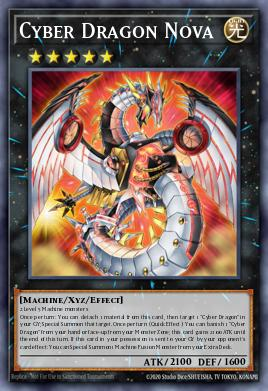

- **Copias y zona:** Extra 1x, Reserva 1x. No altera las cantidades registradas.
- **Nombre oficial de referencia:** Ciber Dragón Nova. CID cotejado con la ficha oficial; el nombre histórico del inventario se conserva aunque su grafía/traducción difiera.
- **Función principal y secundaria:** Xyz Cyber · puente a Infinity.
- **Estado de sinergia y función:** Destino Extra condicionado. Es una clasificación de juego; revisar la relación concreta en A06.
- **Papel como recurso, descarte o coste:** Envío mencionado en la interacción; no equivale por sí mismo a descarte desde la mano.
- **Efecto operativo (paráfrasis analítica):** Nova revive Cyber Dragon del Cementerio, puede ganar ATK desterrando Cyber y al ser enviado al Cementerio por efecto rival trae Fusión Máquina del Extra. 
- **Mapa de activación y resultados:** 1) una vez por turno: Invocación Especial desde Cementerio, desacopla materiales Xyz · 2) con condición explícita en la carta: Invocación Especial desde Extra Deck. Cada operación está sujeta a la secuencia y al «si lo haces» del texto oficial.
- **Ventanas de activación identificadas:** Efecto Rápido.
- **Costes o recursos potenciales:** sin coste independiente identificado en esta síntesis; comprobar las acciones previas al punto y coma de cada efecto.
- **Restricciones y requisitos:** hay límite por turno según el efecto concreto; depende de recursos en Cementerio. Invocar sólo desde el Extra Deck usando su procedimiento propio.
- **Prioridad al ir primero:** proteger acceso a Core/recursos y preparar presencia legal. Para esta carta: Activar cuando las condiciones permitan obtener valor real, preservando recursos de seguimiento.
- **Prioridad al ir segundo:** romper el campo rival y convertir Máquinas en Fusión o ataque de cierre. Identificar primero la respuesta rival que afecta su función «Xyz Cyber».
- **Medio/tardío y recuperación:** reciclar piezas Cyber y recuperar acceso al Extra Deck. No asumir que por sí misma recicla recursos si el texto no lo permite.
- **Sinergias y acceso a líneas:** Relación contextual con Máquinas, nombres Cyber Dragon, Fusión/Xyz/Enlace y cierre de partida por daño. Puede cerrar o prolongar una ruta del Extra si los materiales están disponibles.
- **Riesgo / brick / interrupciones:** Para subir a Infinity, Nova debe existir legalmente como material. Puede emplearse en cadena sólo cuando se cumpla su condición concreta.
- **Utilidad editorial:** 4/5 para este deck (estimación por rol y zona, no probabilidad calculada). No cambiar copias; cualquier sugerencia de alta/baja pasa por el apartado 22 y aprobación.
- **Referencia oficial y trazabilidad:** https://www.db.yugioh-card.com/yugiohdb/card_search.action?cid=10870&ope=2&request_locale=es. **Confianza:** texto y tipo de efecto cotejados en Konami; síntesis táctica editorial, no demostración de combo.
- **Aplicación concreta dentro de este deck (A06):** Nova revive Cyber Dragon del Cementerio, puede ganar ATK desterrando Cyber y al ser enviado al Cementerio por efecto rival trae Fusión Máquina del Extra. A06 identifica su destino, condicionado a material/procedimiento.

**USO PRÁCTICO Y SINERGIA — Cyber Dragon Nova (Konami ID 10870)**

- **Label funcional:** Referencias de ruta localizadas; conexión reglamentaria sujeta al recorrido de la guía. Clasificación documental; una relación es válida solo si se satisfacen sus condiciones exactas.
- **Qué hace:** Nova revive Cyber Dragon del Cementerio, puede ganar ATK desterrando Cyber y al ser enviado al Cementerio por efecto rival trae Fusión Máquina del Extra.
- **Cómo aprovecharla en este deck:** Nova revive Cyber Dragon del Cementerio, puede ganar ATK desterrando Cyber y al ser enviado al Cementerio por efecto rival trae Fusión Máquina del Extra. A06 identifica su destino, condicionado a material/procedimiento.
- **Al jugar primero:** proteger acceso a Core/recursos y preparar presencia legal. Para esta carta: Activar cuando las condiciones permitan obtener valor real, preservando recursos de seguimiento.
- **Al jugar segundo:** romper el campo rival y convertir Máquinas en Fusión o ataque de cierre. Identificar primero la respuesta rival que afecta su función «Xyz Cyber».
- **Cuándo tener precaución:** Para subir a Infinity, Nova debe existir legalmente como material. Puede emplearse en cadena sólo cuando se cumpla su condición concreta.

**CÓMO LLEGAR DESDE TU DECK — RUTAS DOCUMENTADAS**

- **Abrir guía `684:A09:REV:HERZ:NOVA:INFINITY01`:** entrada: Cyber Dragon Cyber Dragon original (1) + Cyber Revsystem Cyber Revsystem (1). Cementerio propio inicial: Cyber Dragon Herz Cyber Dragon Herz (1) ya enviado por una jugada previa, sin haber usado su efecto de cambio de Nivel este turno. Campo propio: sin monstruos al inicio; rival con al menos un monstruo en su Campo; Main Phase propia, Normal aún disponible. Extra: Nova Cyber Dragon Nova (1) y Infinity Cyber Dragon Infinity (1) disponibles. Sin bloqueos de Invocación Especial de Máquina, con zonas y materiales libres; no se necesitan cartas de Reserva ni Side.. Propósito descrito: Negadores (si su efecto está disponible). Consulta sus pasos, consumo y resultado; comprobar si esta carta es realmente invocada o solo mencionada.

#### 35. Heosvarog the Mechanical Dawn (Konami ID 20511)

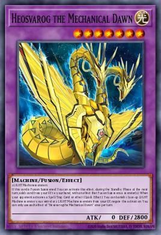

- **Copias y zona:** Extra 1x. No altera las cantidades registradas.
- **Nombre oficial de referencia:** Heosvarog el Amanecer Mecánico. CID cotejado con la ficha oficial; el nombre histórico del inventario se conserva aunque su grafía/traducción difiera.
- **Función principal y secundaria:** interrupción · resultado de Extra Deck · buscador · negación.
- **Estado de sinergia y función:** Ruta de acceso real documentada con Power Bond + Cyber Dragon + Nachster de Main. Guía `684:A09:POWERBOND:CYBER_NACHSTER:HEOS09`: Fusión de **dos Máquinas LUZ** para preparar negación de Mágica/Trampa.
- **Papel como recurso, descarte o coste:** Material o destino del Extra condicionado a los requisitos de invocación.
- **Efecto operativo (paráfrasis analítica):** Heosvarog 0 ATK/2800 DEF; al Fusionarse prepara para la Standby siguiente recuperar del GY una carta con efecto de Fusión (Power Bond). Como Efecto Rápido, cuando el rival activa Mágica/Trampa o su efecto, puede desterrar una Máquina LUZ propia boca arriba o **dos** Máquinas LUZ de tu GY para **negar esa activación**. No niega monstruos.
- **Mapa de activación y resultados:** 1) tras su invocación desde el Extra: incorpora la pieza indicada a la mano · 2) en respuesta a activación rival: niega el efecto o la activación indicada. Cada operación está sujeta a la secuencia y al «si lo haces» del texto oficial.
- **Ventanas de activación identificadas:** Standby Phase; al producirse una Invocación; respuesta a activación rival; Efecto Rápido; Invocación del Extra Deck.
- **Costes o recursos potenciales:** 2 Máquinas LUZ de tu GY o 1 Máquina LUZ boca arriba de tu Campo por negación; Power Bond gana ATK igual al original: con Heosvarog de 0 ATK, la ganancia y daño final asociados son 0.
- **Restricciones y requisitos:** hay límite por turno según el efecto concreto; depende de recursos en Cementerio. Invocar sólo desde el Extra Deck usando su procedimiento propio.
- **Prioridad al ir primero:** proteger acceso a Core/recursos y preparar presencia legal. Para esta carta: Reservar la respuesta para la ventana rival exacta; no es una pieza buscadora de nuestro motor.
- **Prioridad al ir segundo:** romper el campo rival y convertir Máquinas en Fusión o ataque de cierre. Identificar primero la respuesta rival que afecta su función «interrupción».
- **Medio/tardío y recuperación:** reciclar piezas Cyber y recuperar acceso al Extra Deck. No asumir que por sí misma recicla recursos si el texto no lo permite.
- **Sinergias y acceso a líneas:** Relación contextual con Máquinas, nombres Cyber Dragon, Fusión/Xyz/Enlace y cierre de partida por daño. Puede cerrar o prolongar una ruta del Extra si los materiales están disponibles.
- **Riesgo / brick / interrupciones:** Depende del Cementerio y es sensible a destierro o negación de ese recurso. Puede emplearse en cadena sólo cuando se cumpla su condición concreta.
- **Utilidad editorial:** 4/5 para este deck (estimación por rol y zona, no probabilidad calculada). No cambiar copias; cualquier sugerencia de alta/baja pasa por el apartado 22 y aprobación.
- **Referencia oficial y trazabilidad:** https://www.db.yugioh-card.com/yugiohdb/card_search.action?cid=20511&ope=2&request_locale=es. **Confianza:** texto y tipo de efecto cotejados en Konami; síntesis táctica editorial, no demostración de combo.
- **Aplicación concreta dentro de este deck (A06):** **Heosvarog desde mano Cyber Dragon + Nachster + Power Bond**, sin usar Normal ni depender de monstruo rival; los materiales quedan en GY para costear su respuesta M/T. Abrir `684:A09:POWERBOND:CYBER_NACHSTER:HEOS09`.

**USO PRÁCTICO Y SINERGIA — Heosvarog the Mechanical Dawn (Konami ID 20511)**

- **Label funcional:** **SINERGIA CONCRETA DOCUMENTADA, CAMPO DEFENSIVO/NEGADOR**; ruta con tres cartas del Main y materiales de Fusión exactos.
- **Qué hace:** niega una activación de Mágica/Trampa pagando las dos Máquinas LUZ del GY; no es una negación genérica de monstruos.
- **Cómo aprovecharla en este deck:** Power Bond Fusiona Cyber Dragon + Nachster desde mano; Heosvarog en Defensa, materiales enviados al GY; siguiente Standby puede recuperar Power Bond si es elegible. Guía `684:A09:POWERBOND:CYBER_NACHSTER:HEOS09`.
- **Al jugar primero:** proteger acceso a Core/recursos y preparar presencia legal. Para esta carta: Reservar la respuesta para la ventana rival exacta; no es una pieza buscadora de nuestro motor.
- **Al jugar segundo:** romper el campo rival y convertir Máquinas en Fusión o ataque de cierre. Identificar primero la respuesta rival que afecta su función «interrupción».
- **Cuándo tener precaución:** Depende del Cementerio y es sensible a destierro o negación de ese recurso. Puede emplearse en cadena sólo cuando se cumpla su condición concreta.

**CÓMO LLEGAR DESDE TU DECK — GUÍA VISUAL VERIFICADA EN ESTADO BASE**

- `684:A09:POWERBOND:CYBER_NACHSTER:HEOS09`: mano Cyber Dragon + Nachster + Power Bond; Heosvarog 0 ATK/2800 DEF; negación M/T gastando dos Máquinas LUZ que quedaron en GY. Ver cinco pasos con fotos, decisión de ir primero y qué hacer si destierran el GY.

#### 36. Qliphort Genius

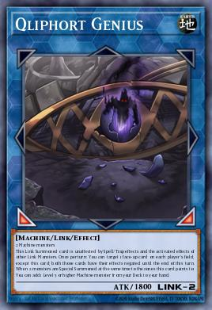

- **Copias y zona:** Extra 1x. No altera las cantidades registradas.
- **Nombre oficial de referencia:** Genio Qlifuerte. CID cotejado con la ficha oficial; el nombre histórico del inventario se conserva aunque su grafía/traducción difiera.
- **Función principal y secundaria:** resultado de Extra Deck · buscador · extensor · protección.
- **Estado de sinergia y función:** Acceso situacional documentado con **Clockwork Night + Cyber Dragon + Core** y una carta boca arriba en cada campo; `684:A09:CYBER:CORE:CLOCKWORK:GENIUS12`.
- **Papel como recurso, descarte o coste:** Material o destino del Extra condicionado a los requisitos de invocación.
- **Efecto operativo (paráfrasis analítica):** búsqueda o incorporación de cartas a mano; acceso al campo desde la mano; protección o resistencia contra respuestas. Son operaciones detectadas en el texto, no efectos independientes garantizados; leer sus condiciones en la fuente.
- **Mapa de activación y resultados:** 1) efecto propio o continuo: habilita Enlace · 2) con condición explícita en la carta: incorpora la pieza indicada a la mano. Cada operación está sujeta a la secuencia y al «si lo haces» del texto oficial.
- **Ventanas de activación identificadas:** requieren la fase o condición específica indicada en el texto; sin ventana rápida general asumida.
- **Costes o recursos potenciales:** sin coste independiente identificado en esta síntesis; comprobar las acciones previas al punto y coma de cada efecto.
- **Restricciones y requisitos:** hay límite por turno según el efecto concreto. Invocar sólo desde el Extra Deck usando su procedimiento propio.
- **Prioridad al ir primero:** proteger acceso a Core/recursos y preparar presencia legal. Para esta carta: Comprobar materiales exactos antes de buscar este objetivo en el Extra Deck.
- **Prioridad al ir segundo:** romper el campo rival y convertir Máquinas en Fusión o ataque de cierre. Identificar primero la respuesta rival que afecta su función «resultado de Extra Deck».
- **Medio/tardío y recuperación:** reciclar piezas Cyber y recuperar acceso al Extra Deck. No asumir que por sí misma recicla recursos si el texto no lo permite.
- **Sinergias y acceso a líneas:** Relación contextual con Máquinas, nombres Cyber Dragon, Fusión/Xyz/Enlace y cierre de partida por daño. Puede cerrar o prolongar una ruta del Extra si los materiales están disponibles.
- **Riesgo / brick / interrupciones:** No contarla como extensión automática: confirmar materiales, procedimiento y restricciones vigentes. No atribuirle velocidad rápida por el solo hecho de formar parte del motor.
- **Utilidad editorial:** 4/5 para este deck (estimación por rol y zona, no probabilidad calculada). No cambiar copias; cualquier sugerencia de alta/baja pasa por el apartado 22 y aprobación.
- **Referencia oficial y trazabilidad:** https://www.db.yugioh-card.com/yugiohdb/card_search.action?cid=13502&ope=2&request_locale=es. **Confianza:** texto y tipo de efecto cotejados en Konami; síntesis táctica editorial, no demostración de combo.
- **Aplicación concreta dentro de este deck (A06):** dos Máquinas (Cyber Dragon + Core) forman Genius Link2; este puede seleccionar **Clockwork Night propia** y **un monstruo rival** para negar ambos efectos hasta fin de turno. También se niega la conversión de Tipo de la propia Mágica. Genius Invocado por Enlace es inmune a efectos M/T y no recibe su bono de ATK. La búsqueda de Máquina Nivel5+ de Genius requiere invocaciones simultáneas a zonas apuntadas, que esta ruta **no genera**.

**USO PRÁCTICO Y SINERGIA — Qliphort Genius**

- **Label funcional:** ruta condicional de Máquina documentada desde tres cartas de mano.
- **Qué hace:** tras ser Invocado por Enlace con **2 Máquinas**, en Main propia Genius puede seleccionar una carta boca arriba de **cada campo** (excepto sí mismo) y negar ambas hasta fin de turno. No niega activaciones y **no es efecto rápido**.
- **Cómo aprovecharla en este deck:** `Clockwork Night` de mano + `Cyber Dragon` Especial si el rival controla monstruo + `Core` Normal que busca `Cyber Emergency` → Genius. Genius selecciona la Mágica propia y un monstruo rival; su efecto también **apaga Clockwork Night** durante el turno.
- **Al jugar primero:** no presuponer rival con monstruo ni blanco en ambos campos; esta mano exacta no inicia a Genius de esa forma.
- **Al jugar segundo:** si resulta prioritario negar un monstruo rival boca arriba y no importa perder temporalmente el efecto de Clockwork Night, considerar Genius; de lo contrario, reservar la Mágica para la línea de Fortress.
- **Uso y consumo de recursos:** tres cartas de mano, dos monstruos convertidos en material Link, Normal gastada, Cyber Emergency buscada y Clockwork Night propia negada hasta End Phase.
- **Cuándo tener precaución:** Genius **no recibe** el +500 de Clockwork Night por su inmunidad a Magias/Trampas; su efecto de búsqueda separado NO se dispara en esta ruta. No prometerlo si el rival elimina Clockwork antes de la selección y falta otro objetivo propio.
- **Alcance de la guía:** cotejo individual con textos oficiales y estado explícito; no valida las demás rutas Cyber.

**CÓMO LLEGAR DESDE TU DECK — RUTA TÁCTICA DE 5 PASOS**

- `684:A09:CYBER:CORE:CLOCKWORK:GENIUS12`: Clockwork Night activa → Cyber Dragon Especial → Core Normal busca Emergency → Link2 Genius → negar Clockwork propia y monstruo rival hasta End Phase. Fotos, objetivos, inmunidad y endboard: `guias/DECK_684_CLOCKWORK_CORE_GENIUS_NEGACION_GUIA.md`. **Alternativas excluyentes:** S:P defensiva y Fortress por contacto.

#### 37. Chimeratech Megafleet Dragon

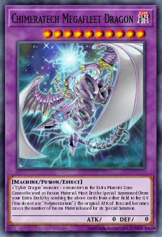

- **Copias y zona:** Extra 1x. No altera las cantidades registradas.
- **Nombre oficial de referencia:** Dragón Megaflota Chimeratech. CID cotejado con la ficha oficial; el nombre histórico del inventario se conserva aunque su grafía/traducción difiera.
- **Función principal y secundaria:** Fusión de contacto · removal Extra.
- **Estado de sinergia y función:** Destino Extra condicionado. Es una clasificación de juego; revisar la relación concreta en A06.
- **Papel como recurso, descarte o coste:** Envío mencionado en la interacción; no equivale por sí mismo a descarte desde la mano.
- **Efecto operativo (paráfrasis analítica):** Megafleet requiere Cyber Dragon y monstruos en zona Extra, enviados desde cualquier campo al Cementerio. 
- **Mapa de activación y resultados:** 1) efecto propio o continuo: Invocación Especial desde Extra Deck. Cada operación está sujeta a la secuencia y al «si lo haces» del texto oficial.
- **Ventanas de activación identificadas:** requieren la fase o condición específica indicada en el texto; sin ventana rápida general asumida.
- **Costes o recursos potenciales:** sin coste independiente identificado en esta síntesis; comprobar las acciones previas al punto y coma de cada efecto.
- **Restricciones y requisitos:** exige materiales de Extra Deck o materiales adecuados; tiene procedimiento especial de Invocación. Invocar sólo desde el Extra Deck usando su procedimiento propio.
- **Prioridad al ir primero:** proteger acceso a Core/recursos y preparar presencia legal. Para esta carta: Escoger la amenaza o recurso que genere mayor ventaja de tempo; respetar selección y zona.
- **Prioridad al ir segundo:** romper el campo rival y convertir Máquinas en Fusión o ataque de cierre. Identificar primero la respuesta rival que afecta su función «Fusión de contacto».
- **Medio/tardío y recuperación:** reciclar piezas Cyber y recuperar acceso al Extra Deck. Verificar que el objetivo de recuperación continúe disponible.
- **Sinergias y acceso a líneas:** Relación contextual con Máquinas, nombres Cyber Dragon, Fusión/Xyz/Enlace y cierre de partida por daño. Puede cerrar o prolongar una ruta del Extra si los materiales están disponibles.
- **Riesgo / brick / interrupciones:** No consume cualquier monstruo en zonas principales: importa la zona Extra. No atribuirle velocidad rápida por el solo hecho de formar parte del motor.
- **Utilidad editorial:** 4/5 para este deck (estimación por rol y zona, no probabilidad calculada). No cambiar copias; cualquier sugerencia de alta/baja pasa por el apartado 22 y aprobación.
- **Referencia oficial y trazabilidad:** https://www.db.yugioh-card.com/yugiohdb/card_search.action?cid=13358&ope=2&request_locale=es. **Confianza:** texto y tipo de efecto cotejados en Konami; síntesis táctica editorial, no demostración de combo.
- **Aplicación concreta dentro de este deck (A06):** Megafleet requiere Cyber Dragon y monstruos en zona Extra, enviados desde cualquier campo al Cementerio. A06 identifica su destino, condicionado a material/procedimiento.

**USO PRÁCTICO Y SINERGIA — Chimeratech Megafleet Dragon**

- **Label funcional:** Referencias de ruta localizadas; conexión reglamentaria sujeta al recorrido de la guía. Clasificación documental; una relación es válida solo si se satisfacen sus condiciones exactas.
- **Qué hace:** Megafleet requiere Cyber Dragon y monstruos en zona Extra, enviados desde cualquier campo al Cementerio.
- **Cómo aprovecharla en este deck:** Megafleet requiere Cyber Dragon y monstruos en zona Extra, enviados desde cualquier campo al Cementerio. A06 identifica su destino, condicionado a material/procedimiento.
- **Al jugar primero:** proteger acceso a Core/recursos y preparar presencia legal. Para esta carta: Escoger la amenaza o recurso que genere mayor ventaja de tempo; respetar selección y zona.
- **Al jugar segundo:** romper el campo rival y convertir Máquinas en Fusión o ataque de cierre. Identificar primero la respuesta rival que afecta su función «Fusión de contacto».
- **Cuándo tener precaución:** No consume cualquier monstruo en zonas principales: importa la zona Extra. No atribuirle velocidad rápida por el solo hecho de formar parte del motor.

**CÓMO LLEGAR DESDE TU DECK — RUTAS DOCUMENTADAS**

- **Abrir guía `684:A09:MEGAFLEET:CYBER01`:** entrada: Cyber Dragon 1× Cyber Dragon original; no presuponer búsquedas.. Propósito descrito: Ofensivo condicional. Consulta sus pasos, consumo y resultado; comprobar si esta carta es realmente invocada o solo mencionada.
- **Abrir guía `684:A09:MEGAFLEET:CORE01`:** entrada: Core 1× Cyber Dragon Core. Condición rival: al menos 1 monstruo no Péndulo/no Ficha boca arriba en Zona de Monstruos Extra, elegible para ser enviado al GY, no en una zona principal ordinaria. Main Phase propia, Campo propio vacío, GY/destierro vacíos, Normal disponible, una copia de Emergency Cyber Emergency en Deck y una de Megafleet Megafleet en Extra. Sin respuestas en la línea canónica.. Propósito descrito: Ofensivo condicional. Consulta sus pasos, consumo y resultado; comprobar si esta carta es realmente invocada o solo mencionada.

#### 38. Sky Striker Ace - Azalea

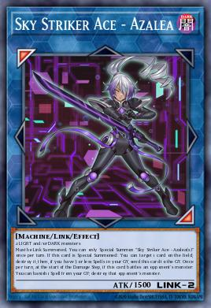

- **Copias y zona:** Extra 1x. No altera las cantidades registradas.
- **Nombre oficial de referencia:** Caza del Cielo As - Azalea. CID cotejado con la ficha oficial; el nombre histórico del inventario se conserva aunque su grafía/traducción difiera.
- **Función principal y secundaria:** resultado de Extra Deck · removal.
- **Estado de sinergia y función:** Acceso por Enlace con Cyber Dragon + Core demostrado condicionalmente en V12; no hay garantía de dejar Azalea en campo.
- **Papel como recurso, descarte o coste:** Material o destino del Extra condicionado a los requisitos de invocación.
- **Efecto operativo (paráfrasis analítica):** destrucción de cartas o empleo de destrucción como detonante. Son operaciones detectadas en el texto, no efectos independientes garantizados; leer sus condiciones en la fuente.
- **Mapa de activación y resultados:** 1) efecto propio o continuo: habilita Enlace, Invocación Especial desde zona permitida · 2) una vez por turno: destruye la carta o recurso previsto. Cada operación está sujeta a la secuencia y al «si lo haces» del texto oficial.
- **Ventanas de activación identificadas:** al producirse una Invocación.
- **Costes o recursos potenciales:** sin coste independiente identificado en esta síntesis; comprobar las acciones previas al punto y coma de cada efecto.
- **Restricciones y requisitos:** hay límite por turno según el efecto concreto; depende de recursos en Cementerio. Invocar sólo desde el Extra Deck usando su procedimiento propio.
- **Prioridad al ir primero:** proteger acceso a Core/recursos y preparar presencia legal. Para esta carta: Comprobar materiales exactos antes de buscar este objetivo en el Extra Deck.
- **Prioridad al ir segundo:** romper el campo rival y convertir Máquinas en Fusión o ataque de cierre. Identificar primero la respuesta rival que afecta su función «resultado de Extra Deck».
- **Medio/tardío y recuperación:** reciclar piezas Cyber y recuperar acceso al Extra Deck. No asumir que por sí misma recicla recursos si el texto no lo permite.
- **Sinergias y acceso a líneas:** Relación contextual con Máquinas, nombres Cyber Dragon, Fusión/Xyz/Enlace y cierre de partida por daño. Puede cerrar o prolongar una ruta del Extra si los materiales están disponibles.
- **Riesgo / brick / interrupciones:** No computar como invocación normal disponible: depende de su procedimiento y de recursos previos. No atribuirle velocidad rápida por el solo hecho de formar parte del motor.
- **Utilidad editorial:** 4/5 para este deck (estimación por rol y zona, no probabilidad calculada). No cambiar copias; cualquier sugerencia de alta/baja pasa por el apartado 22 y aprobación.
- **Referencia oficial y trazabilidad:** https://www.db.yugioh-card.com/yugiohdb/card_search.action?cid=18448&ope=2&request_locale=es. **Confianza:** texto y tipo de efecto cotejados en Konami; síntesis táctica editorial, no demostración de combo.
- **Aplicación concreta dentro de este deck (A06):** `684:A09:CYBER:CORE:AZALEA15`: Cyber Dragon Especial ante monstruo rival + Core Normal, ambos LUZ, cumplen Azalea Enlace-2 y Core busca Emergency. Azalea destruye carta seleccionable y **se envía a sí misma al GY si hay 3 o menos Mágicas en tu GY**; no conservarla en el endboard de esa variante.

**USO PRÁCTICO Y SINERGIA — Sky Striker Ace - Azalea**

- **Label funcional:** Destino Extra con acceso condicionado V12 (materiales LUZ reales); no atribuir negación ni supervivencia con GY sin Mágicas.
- **Qué hace:** destrucción de cartas o empleo de destrucción como detonante. Son operaciones detectadas en el texto, no efectos independientes garantizados; leer sus condiciones en la fuente.
- **Cómo aprovecharla en este deck:** romper una carta rival destruyéndola en la variante con menos de 4 Mágicas en GY, a costa de perder Azalea tras resolver; con 4+ Mágicas es otra rama de campo final.
- **Al jugar primero:** proteger acceso a Core/recursos y preparar presencia legal. Para esta carta: Comprobar materiales exactos antes de buscar este objetivo en el Extra Deck.
- **Al jugar segundo:** romper el campo rival y convertir Máquinas en Fusión o ataque de cierre. Identificar primero la respuesta rival que afecta su función «resultado de Extra Deck».
- **Cuándo tener precaución:** No computar como invocación normal disponible: depende de su procedimiento y de recursos previos. No atribuirle velocidad rápida por el solo hecho de formar parte del motor.

**CÓMO LLEGAR DESDE TU DECK — V12, CONDICIONADO**

- `684:A09:CYBER:CORE:AZALEA15` — [guía con fotos, objetivo rival, materiales y efecto de autoinvío al GY](guias/DECK_684_687_AZALEA_VIMANA_PRINCESS_GUIA_V12.md). Estado: REVISIÓN TCG.

#### 39. Chronomaly Vimana

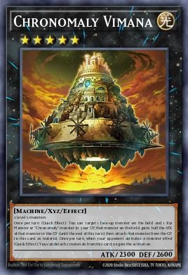

- **Copias y zona:** Extra 1x. No altera las cantidades registradas.
- **Nombre oficial de referencia:** Vimana Cronómalo. CID cotejado con la ficha oficial; el nombre histórico del inventario se conserva aunque su grafía/traducción difiera.
- **Función principal y secundaria:** interrupción · resultado de Extra Deck · negación · cierre · habilitador Xyz.
- **Estado de sinergia y función:** Acceso Xyz V12 con dos monstruos Nivel5 reales: Jormungardr y Cyber Dragon sacado del Deck por efecto.
- **Papel como recurso, descarte o coste:** Material o destino del Extra condicionado a los requisitos de invocación.
- **Efecto operativo (paráfrasis analítica):** negación de efectos o activaciones; presión de combate o modificación de estadísticas; gestión de materiales Xyz. Son operaciones detectadas en el texto, no efectos independientes garantizados; leer sus condiciones en la fuente.
- **Mapa de activación y resultados:** 1) en respuesta a activación rival: niega el efecto o la activación indicada, desacopla materiales Xyz. Cada operación está sujeta a la secuencia y al «si lo haces» del texto oficial.
- **Ventanas de activación identificadas:** respuesta a activación rival; Efecto Rápido.
- **Costes o recursos potenciales:** sin coste independiente identificado en esta síntesis; comprobar las acciones previas al punto y coma de cada efecto.
- **Restricciones y requisitos:** hay límite por turno según el efecto concreto; depende de recursos en Cementerio. Invocar sólo desde el Extra Deck usando su procedimiento propio.
- **Prioridad al ir primero:** proteger acceso a Core/recursos y preparar presencia legal. Para esta carta: Reservar la respuesta para la ventana rival exacta; no es una pieza buscadora de nuestro motor.
- **Prioridad al ir segundo:** romper el campo rival y convertir Máquinas en Fusión o ataque de cierre. Identificar primero la respuesta rival que afecta su función «interrupción».
- **Medio/tardío y recuperación:** reciclar piezas Cyber y recuperar acceso al Extra Deck. No asumir que por sí misma recicla recursos si el texto no lo permite.
- **Sinergias y acceso a líneas:** Relación contextual con Máquinas, nombres Cyber Dragon, Fusión/Xyz/Enlace y cierre de partida por daño. Puede cerrar o prolongar una ruta del Extra si los materiales están disponibles.
- **Riesgo / brick / interrupciones:** Se agota al consumir materiales; no asumir material adicional al pasar de un Xyz a otro. Puede emplearse en cadena sólo cuando se cumpla su condición concreta.
- **Utilidad editorial:** 4/5 para este deck (estimación por rol y zona, no probabilidad calculada). No cambiar copias; cualquier sugerencia de alta/baja pasa por el apartado 22 y aprobación.
- **Referencia oficial y trazabilidad:** https://www.db.yugioh-card.com/yugiohdb/card_search.action?cid=16233&ope=2&request_locale=es. **Confianza:** texto y tipo de efecto cotejados en Konami; síntesis táctica editorial, no demostración de combo.
- **Aplicación concreta dentro de este deck (A06):** `684:A09:JORMUNGARDR:VIMANA16`: Jormungardr (Nivel5) + Cyber Dragon del Deck (Nivel5), Máquina Rango5 de 2300 ATK con 2 materiales. Desacoplar ambos para negar activación de **efecto de monstruo del rival**, no efectos M/T ni destruir automáticamente.

**USO PRÁCTICO Y SINERGIA — Chronomaly Vimana**

- **Label funcional:** Destino Xyz con acceso condicionado V12; requiere Cyber Dragon original todavía en Deck y Jormungardr resolviendo ante monstruo rival.
- **Qué hace:** negación de efectos o activaciones; presión de combate o modificación de estadísticas; gestión de materiales Xyz. Son operaciones detectadas en el texto, no efectos independientes garantizados; leer sus condiciones en la fuente.
- **Cómo aprovecharla en este deck:** salida alternativa a Nova/Infinity con 2 materiales para negar una activación posterior de efecto de monstruo (coste: desacoplar 2). Su aumento/recarga exige Xyz o Cronómalo elegible en GY: NO disponible en la entrada mínima.
- **Al jugar primero:** proteger acceso a Core/recursos y preparar presencia legal. Para esta carta: Reservar la respuesta para la ventana rival exacta; no es una pieza buscadora de nuestro motor.
- **Al jugar segundo:** romper el campo rival y convertir Máquinas en Fusión o ataque de cierre. Identificar primero la respuesta rival que afecta su función «interrupción».
- **Cuándo tener precaución:** Se agota al consumir materiales; no asumir material adicional al pasar de un Xyz a otro. Puede emplearse en cadena sólo cuando se cumpla su condición concreta.

**CÓMO LLEGAR DESDE TU DECK — V12, CONDICIONADO**

- `684:A09:JORMUNGARDR:VIMANA16` — [guía con fotos de la única pieza de mano, Cyber Dragon del Deck, restricción Máquinas y tablero Vimana](guias/DECK_684_687_AZALEA_VIMANA_PRINCESS_GUIA_V12.md). Estado: REVISIÓN TCG.

#### 40. Cyber Dragon Infinity (Konami ID 11765)

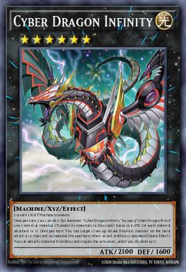

- **Copias y zona:** Extra 1x. No altera las cantidades registradas.
- **Nombre oficial de referencia:** Ciber Dragón del Infinito. CID cotejado con la ficha oficial; el nombre histórico del inventario se conserva aunque su grafía/traducción difiera.
- **Función principal y secundaria:** jefe Xyz Cyber · negación.
- **Estado de sinergia y función:** Destino Extra condicionado. Es una clasificación de juego; revisar la relación concreta en A06.
- **Papel como recurso, descarte o coste:** Material o destino del Extra condicionado a los requisitos de invocación.
- **Efecto operativo (paráfrasis analítica):** Infinity sube sobre Nova, gana ATK por materiales, absorbe monstruo en ataque y niega activaciones al desacoplar. 
- **Mapa de activación y resultados:** 1) una vez por turno: niega el efecto o la activación indicada, desacopla materiales Xyz. Cada operación está sujeta a la secuencia y al «si lo haces» del texto oficial.
- **Ventanas de activación identificadas:** Efecto Rápido.
- **Costes o recursos potenciales:** sin coste independiente identificado en esta síntesis; comprobar las acciones previas al punto y coma de cada efecto.
- **Restricciones y requisitos:** hay límite por turno según el efecto concreto. Invocar sólo desde el Extra Deck usando su procedimiento propio.
- **Prioridad al ir primero:** proteger acceso a Core/recursos y preparar presencia legal. Para esta carta: Conservar la interrupción para el efecto clave rival; no gastarla en un efecto irrelevante.
- **Prioridad al ir segundo:** romper el campo rival y convertir Máquinas en Fusión o ataque de cierre. Identificar primero la respuesta rival que afecta su función «jefe Xyz Cyber».
- **Medio/tardío y recuperación:** reciclar piezas Cyber y recuperar acceso al Extra Deck. No asumir que por sí misma recicla recursos si el texto no lo permite.
- **Sinergias y acceso a líneas:** Relación contextual con Máquinas, nombres Cyber Dragon, Fusión/Xyz/Enlace y cierre de partida por daño. Puede cerrar o prolongar una ruta del Extra si los materiales están disponibles.
- **Riesgo / brick / interrupciones:** Distinguir absorber como efecto de negación y conservar material Xyz. Puede emplearse en cadena sólo cuando se cumpla su condición concreta.
- **Utilidad editorial:** 4/5 para este deck (estimación por rol y zona, no probabilidad calculada). No cambiar copias; cualquier sugerencia de alta/baja pasa por el apartado 22 y aprobación.
- **Referencia oficial y trazabilidad:** https://www.db.yugioh-card.com/yugiohdb/card_search.action?cid=11765&ope=2&request_locale=es. **Confianza:** texto y tipo de efecto cotejados en Konami; síntesis táctica editorial, no demostración de combo.
- **Aplicación concreta dentro de este deck (A06):** Infinity sube sobre Nova, gana ATK por materiales, absorbe monstruo en ataque y niega activaciones al desacoplar. A06 identifica su destino, condicionado a material/procedimiento.

**USO PRÁCTICO Y SINERGIA — Cyber Dragon Infinity (Konami ID 11765)**

- **Label funcional:** Referencias de ruta localizadas; conexión reglamentaria sujeta al recorrido de la guía. Clasificación documental; una relación es válida solo si se satisfacen sus condiciones exactas.
- **Qué hace:** Infinity sube sobre Nova, gana ATK por materiales, absorbe monstruo en ataque y niega activaciones al desacoplar.
- **Cómo aprovecharla en este deck:** Infinity sube sobre Nova, gana ATK por materiales, absorbe monstruo en ataque y niega activaciones al desacoplar. A06 identifica su destino, condicionado a material/procedimiento.
- **Al jugar primero:** proteger acceso a Core/recursos y preparar presencia legal. Para esta carta: Conservar la interrupción para el efecto clave rival; no gastarla en un efecto irrelevante.
- **Al jugar segundo:** romper el campo rival y convertir Máquinas en Fusión o ataque de cierre. Identificar primero la respuesta rival que afecta su función «jefe Xyz Cyber».
- **Cuándo tener precaución:** Distinguir absorber como efecto de negación y conservar material Xyz. Puede emplearse en cadena sólo cuando se cumpla su condición concreta.

**CÓMO LLEGAR DESDE TU DECK — RUTAS DOCUMENTADAS**

- **Abrir guía `684:A09:REV:HERZ:NOVA:INFINITY01`:** entrada: Cyber Dragon Cyber Dragon original (1) + Cyber Revsystem Cyber Revsystem (1). Cementerio propio inicial: Cyber Dragon Herz Cyber Dragon Herz (1) ya enviado por una jugada previa, sin haber usado su efecto de cambio de Nivel este turno. Campo propio: sin monstruos al inicio; rival con al menos un monstruo en su Campo; Main Phase propia, Normal aún disponible. Extra: Nova Cyber Dragon Nova (1) y Infinity Cyber Dragon Infinity (1) disponibles. Sin bloqueos de Invocación Especial de Máquina, con zonas y materiales libres; no se necesitan cartas de Reserva ni Side.. Propósito descrito: Negadores (si su efecto está disponible). Consulta sus pasos, consumo y resultado; comprobar si esta carta es realmente invocada o solo mencionada.

#### 41. S:P Little Knight

- **Copias y zona:** Extra 1x. No altera las cantidades registradas.
- **Nombre oficial de referencia:** S:P Pequeña Caballera. CID cotejado con la ficha oficial; el nombre histórico del inventario se conserva aunque su grafía/traducción difiera.
- **Función principal y secundaria:** interrupción · resultado de Extra Deck · removal · respuesta.
- **Estado de sinergia y función:** Acceso **defensivo condicional** demostrado desde dos monstruos de efecto del Main. La relación exacta es Cyber Dragon original + Cyber Dragon Core → Link-2 S:P, sin efecto de destierro inmediato en esta variante.
- **Papel como recurso, descarte o coste:** Material o destino del Extra condicionado a los requisitos de invocación.
- **Efecto operativo (paráfrasis analítica):** destierro de recursos o de amenazas; interacción sobre monstruos en campo. Son operaciones detectadas en el texto, no efectos independientes garantizados; leer sus condiciones en la fuente.
- **Mapa de activación y resultados:** 1) en respuesta a activación rival: destierra el recurso u objetivo previsto. Cada operación está sujeta a la secuencia y al «si lo haces» del texto oficial.
- **Ventanas de activación identificadas:** al producirse una Invocación; respuesta a activación rival; Efecto Rápido; Invocación del Extra Deck.
- **Costes o recursos potenciales:** sin coste independiente identificado en esta síntesis; comprobar las acciones previas al punto y coma de cada efecto.
- **Restricciones y requisitos:** hay límite por turno según el efecto concreto; puede limitar ataques. Invocar sólo desde el Extra Deck usando su procedimiento propio.
- **Prioridad al ir primero:** proteger acceso a Core/recursos y preparar presencia legal. Para esta carta: Reservar la respuesta para la ventana rival exacta; no es una pieza buscadora de nuestro motor.
- **Prioridad al ir segundo:** romper el campo rival y convertir Máquinas en Fusión o ataque de cierre. Identificar primero la respuesta rival que afecta su función «interrupción».
- **Medio/tardío y recuperación:** reciclar piezas Cyber y recuperar acceso al Extra Deck. No asumir que por sí misma recicla recursos si el texto no lo permite.
- **Sinergias y acceso a líneas:** Relación contextual con Máquinas, nombres Cyber Dragon, Fusión/Xyz/Enlace y cierre de partida por daño. Puede cerrar o prolongar una ruta del Extra si los materiales están disponibles.
- **Riesgo / brick / interrupciones:** No contarla como extensión automática: confirmar materiales, procedimiento y restricciones vigentes. Puede emplearse en cadena sólo cuando se cumpla su condición concreta.
- **Utilidad editorial:** 4/5 para este deck (estimación por rol y zona, no probabilidad calculada). No cambiar copias; cualquier sugerencia de alta/baja pasa por el apartado 22 y aprobación.
- **Referencia oficial y trazabilidad:** https://www.db.yugioh-card.com/yugiohdb/card_search.action?cid=19188&ope=2&request_locale=es. **Confianza:** texto y tipo de efecto cotejados en Konami; síntesis táctica editorial, no demostración de combo.
- **Aplicación concreta dentro de este deck (A06):** frente al Campo de un rival que ya tiene monstruo: Cyber Dragon se Invoca Especialmente de mano, Core se Invoca Normal y busca Emergency. Con ambos se Invoca S:P (Guerrero OSCURIDAD) por Enlace. En una activación rival posterior, S:P puede desterrar temporalmente dos monstruos boca arriba, incluido uno tuyo. No niega esa activación. **No** activar restricciones a Máquina procedentes de otras cartas antes de Invocarla.

**USO PRÁCTICO Y SINERGIA — S:P Little Knight**

- **Label funcional:** Acceso al Extra demostrado (relación condicional Core + Cyber Dragon). No confundir la ruta con una negación o un destierro de carta al Invocar S:P.
- **Qué hace:** destierro de recursos o de amenazas; interacción sobre monstruos en campo. Son operaciones detectadas en el texto, no efectos independientes garantizados; leer sus condiciones en la fuente.
- **Cómo aprovecharla en este deck:** gastar Cyber Dragon original + Core como dos monstruos de efecto para formar S:P cuando el rival ya controla monstruo. Conservar S:P como respuesta a una futura activación rival, no atribuirle destierro inmediato por esta Invocación.
- **Al jugar primero:** proteger acceso a Core/recursos y preparar presencia legal. Para esta carta: Reservar la respuesta para la ventana rival exacta; no es una pieza buscadora de nuestro motor.
- **Al jugar segundo:** romper el campo rival y convertir Máquinas en Fusión o ataque de cierre. Identificar primero la respuesta rival que afecta su función «interrupción».
- **Cuándo tener precaución:** No contarla como extensión automática: confirmar materiales, procedimiento y restricciones vigentes. Puede emplearse en cadena sólo cuando se cumpla su condición concreta.

**CÓMO LLEGAR DESDE TU DECK — RUTA DEFENSIVA CONDICIONAL**

- `684:A09:CYBER:CORE:SP_DEFENSA11` — **mano de dos**: Cyber Dragon + Cyber Dragon Core; rival con monstruo y Campo propio vacío. Cyber Dragon entra Especial, Core Normal busca Cyber Emergency, ambos hacen Link-2 S:P. **Resultado:** S:P con efecto de destierro temporal disponible cuando el rival activa carta/efecto y hay dos monstruos boca arriba seleccionables. **El primer efecto de S:P al ser Invocada NO se habilita** porque los materiales eran monstruos Main, no Extra. Cinco pasos ilustrados: `guias/DECK_684_CYBER_CORE_SP_DEFENSA_GUIA.md`. Comparar con el plan Máquina de Nova/Infinity y las Fusiones antes de consumir ambos cuerpos.
- **Rama competidora:** `684:A09:CYBER:CORE:CLOCKWORK:GENIUS12` consume Cyber Dragon + Core también, pero necesita una tercera carta **Clockwork Night**, acaba en Genius **Máquina** y niega los efectos de la propia Mágica junto a una carta rival; no conserva los cuerpos para S:P ni habilita su Efecto Rápido.

#### 42. Cyber Eternity Dragon

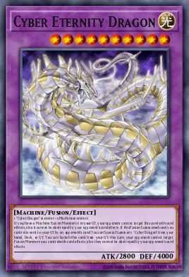

- **Copias y zona:** Extra 1x. No altera las cantidades registradas.
- **Nombre oficial de referencia:** Dragón Ciber Eternidad. CID cotejado con la ficha oficial; el nombre histórico del inventario se conserva aunque su grafía/traducción difiera.
- **Función principal y secundaria:** resultado de Extra Deck · recuperación · extensor · respuesta · protección.
- **Estado de sinergia y función:** Acceso ofensivo demostrado mediante Power Bond con 1 «Cyber Dragon» + 2 Máquina desde mano. Es una ruta específica, no un efecto de Invocación propio de Eternity.
- **Papel como recurso, descarte o coste:** Destino de Fusión en Extra; en la ruta de cuatro cartas se envían Cyber Dragon, Herz y Nachster al GY como materiales.
- **Efecto operativo (paráfrasis analítica):** 2800 ATK/4000 DEF; solo cuando tienes un Monstruo de Fusión Máquina **en GY**, Eternity queda protegido frente a selección y destrucción por efectos enemigos. Si esta carta Invocada por Fusión bajo tu control va a tu GY por una carta rival, puedes Invocar un Cyber Dragon de mano/Deck/GY. Además, puedes desterrar Eternity desde tu GY para proteger otras Fusiones de selección/destrucción de efectos en ese turno.
- **Mapa de activación y resultados:** Fusión propia con Power Bond, posible respuesta posterior si rival envía Eternity al GY, o protección a otras Fusiones desterrándola de tu GY. No confundir ninguno con «revivir a Eternity».
- **Ventanas de activación identificadas:** requieren la fase o condición específica indicada en el texto; sin ventana rápida general asumida.
- **Costes o recursos potenciales:** Fusión de tres materiales; con Power Bond la ganancia al invocar es +2800 ATK y el **daño de End Phase es 2800 LP** aunque Eternity haya salido del Campo. Desterrarla de tu GY es el coste de su efecto de protección a otras Fusiones.
- **Restricciones y requisitos:** requisito original 1 «Cyber Dragon» monstruo + 2 monstruos Máquina. La protección propia no existe cuando el GY no contiene una Fusión Máquina; la propia Eternity en Campo no cumple ese requisito.
- **Prioridad al ir primero:** proteger acceso a Core/recursos y preparar presencia legal. Para esta carta: Comprobar materiales exactos antes de buscar este objetivo en el Extra Deck.
- **Prioridad al ir segundo:** romper el campo rival y convertir Máquinas en Fusión o ataque de cierre. Identificar primero la respuesta rival que afecta su función «resultado de Extra Deck».
- **Medio/tardío y recuperación:** reciclar piezas Cyber y recuperar acceso al Extra Deck. Verificar que el objetivo de recuperación continúe disponible.
- **Sinergias y acceso a líneas:** Relación contextual con Máquinas, nombres Cyber Dragon, Fusión/Xyz/Enlace y cierre de partida por daño. Puede cerrar o prolongar una ruta del Extra si los materiales están disponibles.
- **Riesgo / brick / interrupciones:** Depende del Cementerio y es sensible a destierro o negación de ese recurso. No atribuirle velocidad rápida por el solo hecho de formar parte del motor.
- **Utilidad editorial:** 4/5 para este deck (estimación por rol y zona, no probabilidad calculada). No cambiar copias; cualquier sugerencia de alta/baja pasa por el apartado 22 y aprobación.
- **Referencia oficial y trazabilidad:** https://www.db.yugioh-card.com/yugiohdb/card_search.action?cid=13847&ope=2&request_locale=es. **Confianza:** texto y tipo de efecto cotejados en Konami; síntesis táctica editorial, no demostración de combo.
- **Aplicación concreta dentro de este deck (A06):** `684:A09:POWERBOND:CYBER_HERZ_NACHSTER:ETERNITY10`: mano Cyber Dragon original + Herz + Nachster + Power Bond → Eternity 5600 ATK, Herz recupera original en cadena posterior; cuidado con daño fijo 2800 en End Phase y falta de protección inicial.

**USO PRÁCTICO Y SINERGIA — Cyber Eternity Dragon**

- **Label funcional:** Destino de Extra accesible por motor de Fusión, con línea real de 4 cartas; no es una pieza iniciadora en mano.
- **Qué hace:** 2800 ATK/4000 DEF; se protege de selección/destrucción por efecto enemigo solo si **ya** hay una Fusión Máquina en tu GY, y desde GY puede proteger tus otras Fusiones desterrándose.
- **Cómo aprovecharla en este deck:** activar Power Bond con Cyber Dragon original + Herz + Nachster en la mano. Eternity entra con 5600 ATK; después Herz puede añadir el Cyber Dragon original que fue al GY. Abrir guía `684:A09:POWERBOND:CYBER_HERZ_NACHSTER:ETERNITY10`.
- **Al jugar primero:** normalmente no invertir esas cuatro cartas para un 5600 ATK que no niega ni se protege con GY vacío; comparar con la línea Heosvarog.
- **Al jugar segundo:** si hay blanco legal y daño suficiente, buscar presión por 5600; comparar con Rampage si se necesitan múltiples ataques o destruir M/T.
- **Uso y consumo de recursos:** 3 monstruos y 1 Power Bond de mano; no utiliza la Normal. Herz permite recuperar un «Cyber Dragon» de GY en cadena posterior.
- **Cuándo tener precaución:** Power Bond cobrará 2800 LP en End Phase incluso si Eternity es retirado. Sin Máquina/Fusión en GY previa, no hay protección de Eternity. No llamarlo OTK.
- **Alcance de la guía:** verificadas precondiciones y texto oficial para esta línea; no se certifican las otras rutas históricas.

**CÓMO LLEGAR DESDE TU DECK — 5 PASOS CON FOTOS**

- `684:A09:POWERBOND:CYBER_HERZ_NACHSTER:ETERNITY10`: mano exacta Cyber Dragon + Herz + Nachster + Power Bond; Fusión de 3 materiales → Eternity ATK 5600 → Herz recupera original → Battle Phase si legal → End Phase con daño propio 2800. Guía importable: `guias/DECK_684_ETERNITY_POWERBOND_PRESION_GUIA.md`.

#### 43. El Calculador

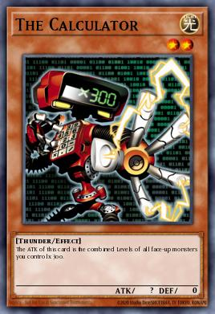

- **Copias y zona:** Reserva 2x. No altera las cantidades registradas.
- **Nombre oficial de referencia:** El Calculador. CID cotejado con la ficha oficial; el nombre histórico del inventario se conserva aunque su grafía/traducción difiera.
- **Función principal y secundaria:** cierre.
- **Estado de sinergia y función:** Reserva fuera de lista activa. Es una clasificación de juego; revisar la relación concreta en A06.
- **Papel como recurso, descarte o coste:** No se demuestra que esta carta sea recurso de descarte o pago para otra.
- **Efecto operativo (paráfrasis analítica):** presión de combate o modificación de estadísticas. Son operaciones detectadas en el texto, no efectos independientes garantizados; leer sus condiciones en la fuente.
- **Mapa de activación y resultados:** efecto de estadística, condición o material; no asumir un disparador adicional. Cada operación está sujeta a la secuencia y al «si lo haces» del texto oficial.
- **Ventanas de activación identificadas:** requieren la fase o condición específica indicada en el texto; sin ventana rápida general asumida.
- **Costes o recursos potenciales:** sin coste independiente identificado en esta síntesis; comprobar las acciones previas al punto y coma de cada efecto.
- **Restricciones y requisitos:** aplicar restricciones de selección, activación y copias que consten en el texto original. 
- **Prioridad al ir primero:** proteger acceso a Core/recursos y preparar presencia legal. Para esta carta: Activar cuando las condiciones permitan obtener valor real, preservando recursos de seguimiento.
- **Prioridad al ir segundo:** romper el campo rival y convertir Máquinas en Fusión o ataque de cierre. Identificar primero la respuesta rival que afecta su función «cierre».
- **Medio/tardío y recuperación:** reciclar piezas Cyber y recuperar acceso al Extra Deck. No asumir que por sí misma recicla recursos si el texto no lo permite.
- **Sinergias y acceso a líneas:** Relación contextual con Máquinas, nombres Cyber Dragon, Fusión/Xyz/Enlace y cierre de partida por daño. Habilita una línea del motor sólo si coinciden recursos, objetivos y restricciones; no equivale a un combo completo validado.
- **Riesgo / brick / interrupciones:** Riesgo operativo: materiales exigidos, efectos que requieren campo rival y bloqueos de Invocación Especial. Confirmar objetivos disponibles y costes antes de activar. No atribuirle velocidad rápida por el solo hecho de formar parte del motor.
- **Utilidad editorial:** 3/5 para este deck (estimación por rol y zona, no probabilidad calculada). No cambiar copias; cualquier sugerencia de alta/baja pasa por el apartado 22 y aprobación.
- **Referencia oficial y trazabilidad:** https://www.db.yugioh-card.com/yugiohdb/card_search.action?cid=7436&ope=2&request_locale=es. **Confianza:** texto y tipo de efecto cotejados en Konami; síntesis táctica editorial, no demostración de combo.
- **Aplicación concreta dentro de este deck (A06):** Fuera de lista. presión de combate o modificación de estadísticas.. No aporta recursos durante este duelo.

**USO PRÁCTICO Y SINERGIA — El Calculador**

- **Label funcional:** Sin sinergia demostrada (con la evidencia actual). Clasificación documental; una relación es válida solo si se satisfacen sus condiciones exactas.
- **Qué hace:** presión de combate o modificación de estadísticas. Son operaciones detectadas en el texto, no efectos independientes garantizados; leer sus condiciones en la fuente.
- **Cómo aprovecharla en este deck:** Fuera de lista. presión de combate o modificación de estadísticas.. No aporta recursos durante este duelo.
- **Al jugar primero:** proteger acceso a Core/recursos y preparar presencia legal. Para esta carta: Activar cuando las condiciones permitan obtener valor real, preservando recursos de seguimiento.
- **Al jugar segundo:** romper el campo rival y convertir Máquinas en Fusión o ataque de cierre. Identificar primero la respuesta rival que afecta su función «cierre».
- **Cuándo tener precaución:** Riesgo operativo: materiales exigidos, efectos que requieren campo rival y bloqueos de Invocación Especial. Confirmar objetivos disponibles y costes antes de activar. No atribuirle velocidad rápida por el solo hecho de formar parte del motor.

#### 44. Prisión Dimensional

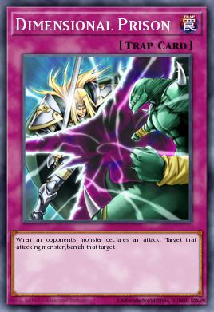

- **Copias y zona:** Reserva 1x. No altera las cantidades registradas.
- **Nombre oficial de referencia:** Prisión Dimensional. CID cotejado con la ficha oficial; el nombre histórico del inventario se conserva aunque su grafía/traducción difiera.
- **Función principal y secundaria:** trampa · remoción de atacante.
- **Estado de sinergia y función:** Reserva fuera de lista activa. Es una clasificación de juego; revisar la relación concreta en A06.
- **Papel como recurso, descarte o coste:** No se demuestra que esta carta sea recurso de descarte o pago para otra.
- **Efecto operativo (paráfrasis analítica):** Cuando un monstruo rival declara ataque, lo selecciona y destierra. 
- **Mapa de activación y resultados:** 1) con condición explícita en la carta: destierra el recurso u objetivo previsto. Cada operación está sujeta a la secuencia y al «si lo haces» del texto oficial.
- **Ventanas de activación identificadas:** requieren la fase o condición específica indicada en el texto; sin ventana rápida general asumida.
- **Costes o recursos potenciales:** sin coste independiente identificado en esta síntesis; comprobar las acciones previas al punto y coma de cada efecto.
- **Restricciones y requisitos:** aplicar restricciones de selección, activación y copias que consten en el texto original. 
- **Prioridad al ir primero:** proteger acceso a Core/recursos y preparar presencia legal. Para esta carta: Escoger la amenaza o recurso que genere mayor ventaja de tempo; respetar selección y zona.
- **Prioridad al ir segundo:** romper el campo rival y convertir Máquinas en Fusión o ataque de cierre. Identificar primero la respuesta rival que afecta su función «trampa».
- **Medio/tardío y recuperación:** reciclar piezas Cyber y recuperar acceso al Extra Deck. No asumir que por sí misma recicla recursos si el texto no lo permite.
- **Sinergias y acceso a líneas:** Relación contextual con Máquinas, nombres Cyber Dragon, Fusión/Xyz/Enlace y cierre de partida por daño. Habilita una línea del motor sólo si coinciden recursos, objetivos y restricciones; no equivale a un combo completo validado.
- **Riesgo / brick / interrupciones:** No se activa fuera de la ventana de declaración de ataque. No atribuirle velocidad rápida por el solo hecho de formar parte del motor.
- **Utilidad editorial:** 3/5 para este deck (estimación por rol y zona, no probabilidad calculada). No cambiar copias; cualquier sugerencia de alta/baja pasa por el apartado 22 y aprobación.
- **Referencia oficial y trazabilidad:** https://www.db.yugioh-card.com/yugiohdb/card_search.action?cid=7400&ope=2&request_locale=es. **Confianza:** texto y tipo de efecto cotejados en Konami; síntesis táctica editorial, no demostración de combo.
- **Aplicación concreta dentro de este deck (A06):** Fuera de lista. Cuando un monstruo rival declara ataque, lo selecciona y destierra.. No aporta recursos durante este duelo.

**USO PRÁCTICO Y SINERGIA — Prisión Dimensional**

- **Label funcional:** Sin sinergia demostrada (con la evidencia actual). Clasificación documental; una relación es válida solo si se satisfacen sus condiciones exactas.
- **Qué hace:** Cuando un monstruo rival declara ataque, lo selecciona y destierra.
- **Cómo aprovecharla en este deck:** Fuera de lista. Cuando un monstruo rival declara ataque, lo selecciona y destierra.. No aporta recursos durante este duelo.
- **Al jugar primero:** proteger acceso a Core/recursos y preparar presencia legal. Para esta carta: Escoger la amenaza o recurso que genere mayor ventaja de tempo; respetar selección y zona.
- **Al jugar segundo:** romper el campo rival y convertir Máquinas en Fusión o ataque de cierre. Identificar primero la respuesta rival que afecta su función «trampa».
- **Cuándo tener precaución:** No se activa fuera de la ventana de declaración de ataque. No atribuirle velocidad rápida por el solo hecho de formar parte del motor.

#### 45. Fuwalos Multivadora

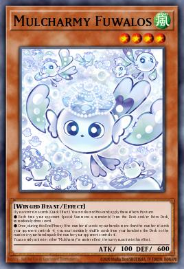

- **Copias y zona:** Reserva 2x. No altera las cantidades registradas.
- **Nombre oficial de referencia:** Fuwalos Multivadora. CID cotejado con la ficha oficial; el nombre histórico del inventario se conserva aunque su grafía/traducción difiera.
- **Función principal y secundaria:** handtrap · robo condicional.
- **Estado de sinergia y función:** Reserva fuera de lista activa. Es una clasificación de juego; revisar la relación concreta en A06.
- **Papel como recurso, descarte o coste:** Coste o consumo descrito en A05: descarte de mano; reciclaje de recurso propio.
- **Efecto operativo (paráfrasis analítica):** Con campo propio sin cartas, descarta y roba al producirse Invocaciones Especiales rivales desde Deck o Extra; ajusta la mano en End Phase. 
- **Mapa de activación y resultados:** 1) con campo propio vacío: Invocación Especial desde Extra Deck, devuelve recursos a mano/Deck/Extra. Cada operación está sujeta a la secuencia y al «si lo haces» del texto oficial.
- **Ventanas de activación identificadas:** campo propio vacío; Efecto Rápido.
- **Costes o recursos potenciales:** descarte de mano; reciclaje de recurso propio.
- **Restricciones y requisitos:** requiere campo propio sin las cartas indicadas; interactúa con información oculta o resultados no siempre elegibles. 
- **Prioridad al ir primero:** proteger acceso a Core/recursos y preparar presencia legal. Para esta carta: Reservar la respuesta para la ventana rival exacta; no es una pieza buscadora de nuestro motor.
- **Prioridad al ir segundo:** romper el campo rival y convertir Máquinas en Fusión o ataque de cierre. Identificar primero la respuesta rival que afecta su función «handtrap».
- **Medio/tardío y recuperación:** reciclar piezas Cyber y recuperar acceso al Extra Deck. Verificar que el objetivo de recuperación continúe disponible.
- **Sinergias y acceso a líneas:** Relación contextual con Máquinas, nombres Cyber Dragon, Fusión/Xyz/Enlace y cierre de partida por daño. Habilita una línea del motor sólo si coinciden recursos, objetivos y restricciones; no equivale a un combo completo validado.
- **Riesgo / brick / interrupciones:** No roba por Invocaciones desde la mano; comparte restricción de efectos Mulcharmy. Puede emplearse en cadena sólo cuando se cumpla su condición concreta.
- **Utilidad editorial:** 3/5 para este deck (estimación por rol y zona, no probabilidad calculada). No cambiar copias; cualquier sugerencia de alta/baja pasa por el apartado 22 y aprobación.
- **Referencia oficial y trazabilidad:** https://www.db.yugioh-card.com/yugiohdb/card_search.action?cid=20500&ope=2&request_locale=es. **Confianza:** texto y tipo de efecto cotejados en Konami; síntesis táctica editorial, no demostración de combo.
- **Aplicación concreta dentro de este deck (A06):** Fuera de lista. Con campo propio sin cartas, descarta y roba al producirse Invocaciones Especiales rivales desde Deck o Extra; ajusta la mano en End Phase.. No aporta recursos durante este duelo.

**USO PRÁCTICO Y SINERGIA — Fuwalos Multivadora**

- **Label funcional:** Sin sinergia demostrada (con la evidencia actual). Clasificación documental; una relación es válida solo si se satisfacen sus condiciones exactas.
- **Qué hace:** Con campo propio sin cartas, descarta y roba al producirse Invocaciones Especiales rivales desde Deck o Extra; ajusta la mano en End Phase.
- **Cómo aprovecharla en este deck:** Fuera de lista. Con campo propio sin cartas, descarta y roba al producirse Invocaciones Especiales rivales desde Deck o Extra; ajusta la mano en End Phase.. No aporta recursos durante este duelo.
- **Al jugar primero:** proteger acceso a Core/recursos y preparar presencia legal. Para esta carta: Reservar la respuesta para la ventana rival exacta; no es una pieza buscadora de nuestro motor.
- **Al jugar segundo:** romper el campo rival y convertir Máquinas en Fusión o ataque de cierre. Identificar primero la respuesta rival que afecta su función «handtrap».
- **Cuándo tener precaución:** No roba por Invocaciones desde la mano; comparte restricción de efectos Mulcharmy. Puede emplearse en cadena sólo cuando se cumpla su condición concreta.

#### 46. Droll & Lock Bird

- **Copias y zona:** Reserva 2x. No altera las cantidades registradas.
- **Nombre oficial de referencia:** El Bufón y el Pájaro del Candado. CID cotejado con la ficha oficial; el nombre histórico del inventario se conserva aunque su grafía/traducción difiera.
- **Función principal y secundaria:** handtrap · bloqueo de búsquedas.
- **Estado de sinergia y función:** Reserva fuera de lista activa. Es una clasificación de juego; revisar la relación concreta en A06.
- **Papel como recurso, descarte o coste:** Envío mencionado en la interacción; no equivale por sí mismo a descarte desde la mano.
- **Efecto operativo (paráfrasis analítica):** Tras una incorporación desde el Deck a la mano rival, se envía al Cementerio para impedir nuevas adiciones desde ambos Decks principales ese turno. 
- **Mapa de activación y resultados:** 1) con condición explícita en la carta: impide nuevas incorporaciones a mano. Cada operación está sujeta a la secuencia y al «si lo haces» del texto oficial.
- **Ventanas de activación identificadas:** Efecto Rápido.
- **Costes o recursos potenciales:** envío de recurso propio al Cementerio.
- **Restricciones y requisitos:** aplicar restricciones de selección, activación y copias que consten en el texto original. 
- **Prioridad al ir primero:** proteger acceso a Core/recursos y preparar presencia legal. Para esta carta: Reservar la respuesta para la ventana rival exacta; no es una pieza buscadora de nuestro motor.
- **Prioridad al ir segundo:** romper el campo rival y convertir Máquinas en Fusión o ataque de cierre. Identificar primero la respuesta rival que afecta su función «handtrap».
- **Medio/tardío y recuperación:** reciclar piezas Cyber y recuperar acceso al Extra Deck. No asumir que por sí misma recicla recursos si el texto no lo permite.
- **Sinergias y acceso a líneas:** Relación contextual con Máquinas, nombres Cyber Dragon, Fusión/Xyz/Enlace y cierre de partida por daño. Habilita una línea del motor sólo si coinciden recursos, objetivos y restricciones; no equivale a un combo completo validado.
- **Riesgo / brick / interrupciones:** No niega la primera búsqueda y también restringe las adiciones del propio jugador. Puede emplearse en cadena sólo cuando se cumpla su condición concreta.
- **Utilidad editorial:** 3/5 para este deck (estimación por rol y zona, no probabilidad calculada). No cambiar copias; cualquier sugerencia de alta/baja pasa por el apartado 22 y aprobación.
- **Referencia oficial y trazabilidad:** https://www.db.yugioh-card.com/yugiohdb/card_search.action?cid=9279&ope=2&request_locale=es. **Confianza:** texto y tipo de efecto cotejados en Konami; síntesis táctica editorial, no demostración de combo.
- **Aplicación concreta dentro de este deck (A06):** Fuera de lista. Tras una incorporación desde el Deck a la mano rival, se envía al Cementerio para impedir nuevas adiciones desde ambos Decks principales ese turno.. No aporta recursos durante este duelo.

**USO PRÁCTICO Y SINERGIA — Droll & Lock Bird**

- **Label funcional:** Sin sinergia demostrada (con la evidencia actual). Clasificación documental; una relación es válida solo si se satisfacen sus condiciones exactas.
- **Qué hace:** Tras una incorporación desde el Deck a la mano rival, se envía al Cementerio para impedir nuevas adiciones desde ambos Decks principales ese turno.
- **Cómo aprovecharla en este deck:** Fuera de lista. Tras una incorporación desde el Deck a la mano rival, se envía al Cementerio para impedir nuevas adiciones desde ambos Decks principales ese turno.. No aporta recursos durante este duelo.
- **Al jugar primero:** proteger acceso a Core/recursos y preparar presencia legal. Para esta carta: Reservar la respuesta para la ventana rival exacta; no es una pieza buscadora de nuestro motor.
- **Al jugar segundo:** romper el campo rival y convertir Máquinas en Fusión o ataque de cierre. Identificar primero la respuesta rival que afecta su función «handtrap».
- **Cuándo tener precaución:** No niega la primera búsqueda y también restringe las adiciones del propio jugador. Puede emplearse en cadena sólo cuando se cumpla su condición concreta.

#### 47. Tormenta de Relámpagos

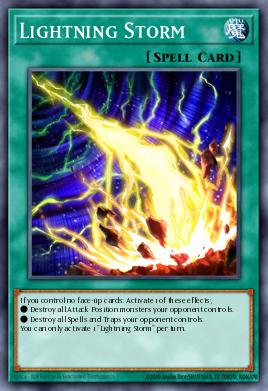

- **Copias y zona:** Reserva 3x. No altera las cantidades registradas.
- **Nombre oficial de referencia:** Tormenta de Relámpagos. CID cotejado con la ficha oficial; el nombre histórico del inventario se conserva aunque su grafía/traducción difiera.
- **Función principal y secundaria:** mágica · ruptura de mesa.
- **Estado de sinergia y función:** Reserva fuera de lista activa. Es una clasificación de juego; revisar la relación concreta en A06.
- **Papel como recurso, descarte o coste:** No se demuestra que esta carta sea recurso de descarte o pago para otra.
- **Efecto operativo (paráfrasis analítica):** Con ningún permanente propio boca arriba, elige destruir los monstruos enemigos en ataque o las Mágicas/Trampas rivales. 
- **Mapa de activación y resultados:** 1) con campo propio vacío: destruye la carta o recurso previsto. Cada operación está sujeta a la secuencia y al «si lo haces» del texto oficial.
- **Ventanas de activación identificadas:** campo propio vacío.
- **Costes o recursos potenciales:** sin coste independiente identificado en esta síntesis; comprobar las acciones previas al punto y coma de cada efecto.
- **Restricciones y requisitos:** hay límite por turno según el efecto concreto; requiere campo propio sin las cartas indicadas. 
- **Prioridad al ir primero:** proteger acceso a Core/recursos y preparar presencia legal. Para esta carta: Activar cuando las condiciones permitan obtener valor real, preservando recursos de seguimiento.
- **Prioridad al ir segundo:** romper el campo rival y convertir Máquinas en Fusión o ataque de cierre. Identificar primero la respuesta rival que afecta su función «mágica».
- **Medio/tardío y recuperación:** reciclar piezas Cyber y recuperar acceso al Extra Deck. No asumir que por sí misma recicla recursos si el texto no lo permite.
- **Sinergias y acceso a líneas:** Relación contextual con Máquinas, nombres Cyber Dragon, Fusión/Xyz/Enlace y cierre de partida por daño. Habilita una línea del motor sólo si coinciden recursos, objetivos y restricciones; no equivale a un combo completo validado.
- **Riesgo / brick / interrupciones:** No destruye monstruos en defensa con su primera opción. No atribuirle velocidad rápida por el solo hecho de formar parte del motor.
- **Utilidad editorial:** 3/5 para este deck (estimación por rol y zona, no probabilidad calculada). No cambiar copias; cualquier sugerencia de alta/baja pasa por el apartado 22 y aprobación.
- **Referencia oficial y trazabilidad:** https://www.db.yugioh-card.com/yugiohdb/card_search.action?cid=14876&ope=2&request_locale=es. **Confianza:** texto y tipo de efecto cotejados en Konami; síntesis táctica editorial, no demostración de combo.
- **Aplicación concreta dentro de este deck (A06):** Fuera de lista. Con ningún permanente propio boca arriba, elige destruir los monstruos enemigos en ataque o las Mágicas/Trampas rivales.. No aporta recursos durante este duelo.

**USO PRÁCTICO Y SINERGIA — Tormenta de Relámpagos**

- **Label funcional:** Sin sinergia demostrada (con la evidencia actual). Clasificación documental; una relación es válida solo si se satisfacen sus condiciones exactas.
- **Qué hace:** Con ningún permanente propio boca arriba, elige destruir los monstruos enemigos en ataque o las Mágicas/Trampas rivales.
- **Cómo aprovecharla en este deck:** Fuera de lista. Con ningún permanente propio boca arriba, elige destruir los monstruos enemigos en ataque o las Mágicas/Trampas rivales.. No aporta recursos durante este duelo.
- **Al jugar primero:** proteger acceso a Core/recursos y preparar presencia legal. Para esta carta: Activar cuando las condiciones permitan obtener valor real, preservando recursos de seguimiento.
- **Al jugar segundo:** romper el campo rival y convertir Máquinas en Fusión o ataque de cierre. Identificar primero la respuesta rival que afecta su función «mágica».
- **Cuándo tener precaución:** No destruye monstruos en defensa con su primera opción. No atribuirle velocidad rápida por el solo hecho de formar parte del motor.

#### 48. Fusion Recycling Plant

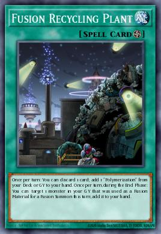

- **Copias y zona:** Reserva 1x. No altera las cantidades registradas.
- **Nombre oficial de referencia:** Planta de Reciclamiento de la Fusión. CID cotejado con la ficha oficial; el nombre histórico del inventario se conserva aunque su grafía/traducción difiera.
- **Función principal y secundaria:** buscador · habilitador de Extra.
- **Estado de sinergia y función:** Reserva fuera de lista activa. Es una clasificación de juego; revisar la relación concreta en A06.
- **Papel como recurso, descarte o coste:** Coste o consumo descrito en A05: descarte de mano.
- **Efecto operativo (paráfrasis analítica):** búsqueda o incorporación de cartas a mano; habilitación o continuación de una invocación del Extra Deck. Son operaciones detectadas en el texto, no efectos independientes garantizados; leer sus condiciones en la fuente.
- **Mapa de activación y resultados:** 1) una vez por turno: incorpora la pieza indicada a la mano · 2) en End Phase: realiza Fusión con materiales permitidos. Cada operación está sujeta a la secuencia y al «si lo haces» del texto oficial.
- **Ventanas de activación identificadas:** End Phase.
- **Costes o recursos potenciales:** descarte de mano.
- **Restricciones y requisitos:** hay límite por turno según el efecto concreto; depende de recursos en Cementerio; exige materiales de Extra Deck o materiales adecuados. 
- **Prioridad al ir primero:** proteger acceso a Core/recursos y preparar presencia legal. Para esta carta: Convertir la activación en acceso a la siguiente pieza del motor, sin duplicar buscadores inútilmente.
- **Prioridad al ir segundo:** romper el campo rival y convertir Máquinas en Fusión o ataque de cierre. Identificar primero la respuesta rival que afecta su función «buscador».
- **Medio/tardío y recuperación:** reciclar piezas Cyber y recuperar acceso al Extra Deck. No asumir que por sí misma recicla recursos si el texto no lo permite.
- **Sinergias y acceso a líneas:** Relación contextual con Máquinas, nombres Cyber Dragon, Fusión/Xyz/Enlace y cierre de partida por daño. Habilita una línea del motor sólo si coinciden recursos, objetivos y restricciones; no equivale a un combo completo validado.
- **Riesgo / brick / interrupciones:** Depende del Cementerio y es sensible a destierro o negación de ese recurso. No atribuirle velocidad rápida por el solo hecho de formar parte del motor.
- **Utilidad editorial:** 3/5 para este deck (estimación por rol y zona, no probabilidad calculada). No cambiar copias; cualquier sugerencia de alta/baja pasa por el apartado 22 y aprobación.
- **Referencia oficial y trazabilidad:** https://www.db.yugioh-card.com/yugiohdb/card_search.action?cid=12872&ope=2&request_locale=es. **Confianza:** texto y tipo de efecto cotejados en Konami; síntesis táctica editorial, no demostración de combo.
- **Aplicación concreta dentro de este deck (A06):** Fuera de lista. búsqueda o incorporación de cartas a mano; habilitación o continuación de una invocación del Extra Deck.. No aporta recursos durante este duelo.

**USO PRÁCTICO Y SINERGIA — Fusion Recycling Plant**

- **Label funcional:** Sin sinergia demostrada (con la evidencia actual). Clasificación documental; una relación es válida solo si se satisfacen sus condiciones exactas.
- **Qué hace:** búsqueda o incorporación de cartas a mano; habilitación o continuación de una invocación del Extra Deck. Son operaciones detectadas en el texto, no efectos independientes garantizados; leer sus condiciones en la fuente.
- **Cómo aprovecharla en este deck:** Fuera de lista. búsqueda o incorporación de cartas a mano; habilitación o continuación de una invocación del Extra Deck.. No aporta recursos durante este duelo.
- **Al jugar primero:** proteger acceso a Core/recursos y preparar presencia legal. Para esta carta: Convertir la activación en acceso a la siguiente pieza del motor, sin duplicar buscadores inútilmente.
- **Al jugar segundo:** romper el campo rival y convertir Máquinas en Fusión o ataque de cierre. Identificar primero la respuesta rival que afecta su función «buscador».
- **Cuándo tener precaución:** Depende del Cementerio y es sensible a destierro o negación de ese recurso. No atribuirle velocidad rápida por el solo hecho de formar parte del motor.

#### 49. Talento de Tácticas Triples

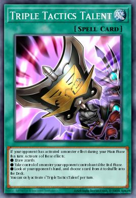

- **Copias y zona:** Reserva 1x. No altera las cantidades registradas.
- **Nombre oficial de referencia:** Talento de Tácticas Triples. CID cotejado con la ficha oficial; el nombre histórico del inventario se conserva aunque su grafía/traducción difiera.
- **Función principal y secundaria:** mágica de respuesta · ventaja.
- **Estado de sinergia y función:** Reserva fuera de lista activa. Es una clasificación de juego; revisar la relación concreta en A06.
- **Papel como recurso, descarte o coste:** No se demuestra que esta carta sea recurso de descarte o pago para otra.
- **Efecto operativo (paráfrasis analítica):** Si el rival activó un efecto de monstruo durante tu Main Phase, permite elegir entre robar dos, tomar control temporal o devolver una carta de mano al Deck. 
- **Mapa de activación y resultados:** 1) en Main Phase: devuelve recursos a mano/Deck/Extra, roba cartas, toma temporalmente el control. Cada operación está sujeta a la secuencia y al «si lo haces» del texto oficial.
- **Ventanas de activación identificadas:** Main Phase.
- **Costes o recursos potenciales:** sin coste independiente identificado en esta síntesis; comprobar las acciones previas al punto y coma de cada efecto.
- **Restricciones y requisitos:** hay límite por turno según el efecto concreto. 
- **Prioridad al ir primero:** proteger acceso a Core/recursos y preparar presencia legal. Para esta carta: Activar cuando las condiciones permitan obtener valor real, preservando recursos de seguimiento.
- **Prioridad al ir segundo:** romper el campo rival y convertir Máquinas en Fusión o ataque de cierre. Identificar primero la respuesta rival que afecta su función «mágica de respuesta».
- **Medio/tardío y recuperación:** reciclar piezas Cyber y recuperar acceso al Extra Deck. Verificar que el objetivo de recuperación continúe disponible.
- **Sinergias y acceso a líneas:** Relación contextual con Máquinas, nombres Cyber Dragon, Fusión/Xyz/Enlace y cierre de partida por daño. Habilita una línea del motor sólo si coinciden recursos, objetivos y restricciones; no equivale a un combo completo validado.
- **Riesgo / brick / interrupciones:** La condición exige activación de monstruo rival en tu Main Phase; sólo un modo. No atribuirle velocidad rápida por el solo hecho de formar parte del motor.
- **Utilidad editorial:** 3/5 para este deck (estimación por rol y zona, no probabilidad calculada). No cambiar copias; cualquier sugerencia de alta/baja pasa por el apartado 22 y aprobación.
- **Referencia oficial y trazabilidad:** https://www.db.yugioh-card.com/yugiohdb/card_search.action?cid=15296&ope=2&request_locale=es. **Confianza:** texto y tipo de efecto cotejados en Konami; síntesis táctica editorial, no demostración de combo.
- **Aplicación concreta dentro de este deck (A06):** Fuera de lista. Si el rival activó un efecto de monstruo durante tu Main Phase, permite elegir entre robar dos, tomar control temporal o devolver una carta de mano al Deck.. No aporta recursos durante este duelo.

**USO PRÁCTICO Y SINERGIA — Talento de Tácticas Triples**

- **Label funcional:** Sin sinergia demostrada (con la evidencia actual). Clasificación documental; una relación es válida solo si se satisfacen sus condiciones exactas.
- **Qué hace:** Si el rival activó un efecto de monstruo durante tu Main Phase, permite elegir entre robar dos, tomar control temporal o devolver una carta de mano al Deck.
- **Cómo aprovecharla en este deck:** Fuera de lista. Si el rival activó un efecto de monstruo durante tu Main Phase, permite elegir entre robar dos, tomar control temporal o devolver una carta de mano al Deck.. No aporta recursos durante este duelo.
- **Al jugar primero:** proteger acceso a Core/recursos y preparar presencia legal. Para esta carta: Activar cuando las condiciones permitan obtener valor real, preservando recursos de seguimiento.
- **Al jugar segundo:** romper el campo rival y convertir Máquinas en Fusión o ataque de cierre. Identificar primero la respuesta rival que afecta su función «mágica de respuesta».
- **Cuándo tener precaución:** La condición exige activación de monstruo rival en tu Main Phase; sólo un modo. No atribuirle velocidad rápida por el solo hecho de formar parte del motor.

#### 50. Revolución Cibernética

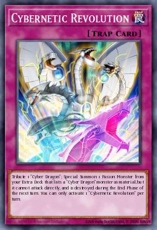

- **Copias y zona:** Reserva 1x. No altera las cantidades registradas.
- **Nombre oficial de referencia:** Revolución Cibernética. CID cotejado con la ficha oficial; el nombre histórico del inventario se conserva aunque su grafía/traducción difiera.
- **Función principal y secundaria:** coste/recurso.
- **Estado de sinergia y función:** Reserva fuera de lista activa. Es una clasificación de juego; revisar la relación concreta en A06.
- **Papel como recurso, descarte o coste:** Coste o consumo descrito en A05: Sacrificio.
- **Efecto operativo (paráfrasis analítica):** uso de Sacrificios como parte del efecto. Son operaciones detectadas en el texto, no efectos independientes garantizados; leer sus condiciones en la fuente.
- **Mapa de activación y resultados:** 1) efecto propio o continuo: Invocación Especial desde Extra Deck. Cada operación está sujeta a la secuencia y al «si lo haces» del texto oficial.
- **Ventanas de activación identificadas:** End Phase.
- **Costes o recursos potenciales:** Sacrificio.
- **Restricciones y requisitos:** hay límite por turno según el efecto concreto; puede limitar ataques. 
- **Prioridad al ir primero:** proteger acceso a Core/recursos y preparar presencia legal. Para esta carta: Activar cuando las condiciones permitan obtener valor real, preservando recursos de seguimiento.
- **Prioridad al ir segundo:** romper el campo rival y convertir Máquinas en Fusión o ataque de cierre. Identificar primero la respuesta rival que afecta su función «coste/recurso».
- **Medio/tardío y recuperación:** reciclar piezas Cyber y recuperar acceso al Extra Deck. No asumir que por sí misma recicla recursos si el texto no lo permite.
- **Sinergias y acceso a líneas:** Relación contextual con Máquinas, nombres Cyber Dragon, Fusión/Xyz/Enlace y cierre de partida por daño. Habilita una línea del motor sólo si coinciden recursos, objetivos y restricciones; no equivale a un combo completo validado.
- **Riesgo / brick / interrupciones:** Riesgo operativo: materiales exigidos, efectos que requieren campo rival y bloqueos de Invocación Especial. Confirmar objetivos disponibles y costes antes de activar. No atribuirle velocidad rápida por el solo hecho de formar parte del motor.
- **Utilidad editorial:** 3/5 para este deck (estimación por rol y zona, no probabilidad calculada). No cambiar copias; cualquier sugerencia de alta/baja pasa por el apartado 22 y aprobación.
- **Referencia oficial y trazabilidad:** https://www.db.yugioh-card.com/yugiohdb/card_search.action?cid=13851&ope=2&request_locale=es. **Confianza:** texto y tipo de efecto cotejados en Konami; síntesis táctica editorial, no demostración de combo.
- **Aplicación concreta dentro de este deck (A06):** Fuera de lista. uso de Sacrificios como parte del efecto.. No aporta recursos durante este duelo.

**USO PRÁCTICO Y SINERGIA — Revolución Cibernética**

- **Label funcional:** Sin sinergia demostrada (con la evidencia actual). Clasificación documental; una relación es válida solo si se satisfacen sus condiciones exactas.
- **Qué hace:** uso de Sacrificios como parte del efecto. Son operaciones detectadas en el texto, no efectos independientes garantizados; leer sus condiciones en la fuente.
- **Cómo aprovecharla en este deck:** Fuera de lista. uso de Sacrificios como parte del efecto.. No aporta recursos durante este duelo.
- **Al jugar primero:** proteger acceso a Core/recursos y preparar presencia legal. Para esta carta: Activar cuando las condiciones permitan obtener valor real, preservando recursos de seguimiento.
- **Al jugar segundo:** romper el campo rival y convertir Máquinas en Fusión o ataque de cierre. Identificar primero la respuesta rival que afecta su función «coste/recurso».
- **Cuándo tener precaución:** Riesgo operativo: materiales exigidos, efectos que requieren campo rival y bloqueos de Invocación Especial. Confirmar objetivos disponibles y costes antes de activar. No atribuirle velocidad rápida por el solo hecho de formar parte del motor.

#### 51. Dragón Ciber Final

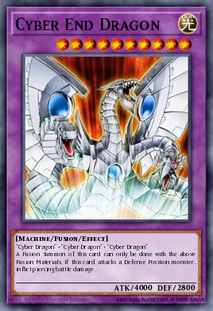

- **Copias y zona:** Reserva 1x. No altera las cantidades registradas.
- **Nombre oficial de referencia:** Dragón Ciber Final. CID cotejado con la ficha oficial; el nombre histórico del inventario se conserva aunque su grafía/traducción difiera.
- **Función principal y secundaria:** habilitador de Extra · cierre.
- **Estado de sinergia y función:** Reserva fuera de lista activa. Es una clasificación de juego; revisar la relación concreta en A06.
- **Papel como recurso, descarte o coste:** No se demuestra que esta carta sea recurso de descarte o pago para otra.
- **Efecto operativo (paráfrasis analítica):** habilitación o continuación de una invocación del Extra Deck; presión de combate o modificación de estadísticas. Son operaciones detectadas en el texto, no efectos independientes garantizados; leer sus condiciones en la fuente.
- **Mapa de activación y resultados:** 1) efecto propio o continuo: realiza Fusión con materiales permitidos · 2) efecto propio o continuo: inflige daño. Cada operación está sujeta a la secuencia y al «si lo haces» del texto oficial.
- **Ventanas de activación identificadas:** requieren la fase o condición específica indicada en el texto; sin ventana rápida general asumida.
- **Costes o recursos potenciales:** sin coste independiente identificado en esta síntesis; comprobar las acciones previas al punto y coma de cada efecto.
- **Restricciones y requisitos:** aplicar restricciones de selección, activación y copias que consten en el texto original. 
- **Prioridad al ir primero:** proteger acceso a Core/recursos y preparar presencia legal. Para esta carta: Activar cuando las condiciones permitan obtener valor real, preservando recursos de seguimiento.
- **Prioridad al ir segundo:** romper el campo rival y convertir Máquinas en Fusión o ataque de cierre. Identificar primero la respuesta rival que afecta su función «habilitador de Extra».
- **Medio/tardío y recuperación:** reciclar piezas Cyber y recuperar acceso al Extra Deck. No asumir que por sí misma recicla recursos si el texto no lo permite.
- **Sinergias y acceso a líneas:** Relación contextual con Máquinas, nombres Cyber Dragon, Fusión/Xyz/Enlace y cierre de partida por daño. Habilita una línea del motor sólo si coinciden recursos, objetivos y restricciones; no equivale a un combo completo validado.
- **Riesgo / brick / interrupciones:** Riesgo operativo: materiales exigidos, efectos que requieren campo rival y bloqueos de Invocación Especial. Confirmar objetivos disponibles y costes antes de activar. No atribuirle velocidad rápida por el solo hecho de formar parte del motor.
- **Utilidad editorial:** 3/5 para este deck (estimación por rol y zona, no probabilidad calculada). No cambiar copias; cualquier sugerencia de alta/baja pasa por el apartado 22 y aprobación.
- **Referencia oficial y trazabilidad:** https://www.db.yugioh-card.com/yugiohdb/card_search.action?cid=6397&ope=2&request_locale=es. **Confianza:** texto y tipo de efecto cotejados en Konami; síntesis táctica editorial, no demostración de combo.
- **Aplicación concreta dentro de este deck (A06):** Fuera de lista. habilitación o continuación de una invocación del Extra Deck; presión de combate o modificación de estadísticas.. No aporta recursos durante este duelo.

**USO PRÁCTICO Y SINERGIA — Dragón Ciber Final**

- **Label funcional:** Sin sinergia demostrada (con la evidencia actual). Clasificación documental; una relación es válida solo si se satisfacen sus condiciones exactas.
- **Qué hace:** habilitación o continuación de una invocación del Extra Deck; presión de combate o modificación de estadísticas. Son operaciones detectadas en el texto, no efectos independientes garantizados; leer sus condiciones en la fuente.
- **Cómo aprovecharla en este deck:** Fuera de lista. habilitación o continuación de una invocación del Extra Deck; presión de combate o modificación de estadísticas.. No aporta recursos durante este duelo.
- **Al jugar primero:** proteger acceso a Core/recursos y preparar presencia legal. Para esta carta: Activar cuando las condiciones permitan obtener valor real, preservando recursos de seguimiento.
- **Al jugar segundo:** romper el campo rival y convertir Máquinas en Fusión o ataque de cierre. Identificar primero la respuesta rival que afecta su función «habilitador de Extra».
- **Cuándo tener precaución:** Riesgo operativo: materiales exigidos, efectos que requieren campo rival y bloqueos de Invocación Especial. Confirmar objetivos disponibles y costes antes de activar. No atribuirle velocidad rápida por el solo hecho de formar parte del motor.

#### 52. Chimeratech Overdragon

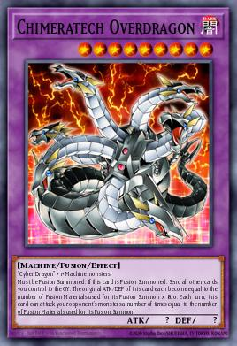

- **Copias y zona:** Reserva 1x. No altera las cantidades registradas.
- **Nombre oficial de referencia:** Súper Dragón Chimeratech. CID cotejado con la ficha oficial; el nombre histórico del inventario se conserva aunque su grafía/traducción difiera.
- **Función principal y secundaria:** Fusión Cyber · limpieza propia y OTK.
- **Estado de sinergia y función:** Reserva fuera de lista activa. Es una clasificación de juego; revisar la relación concreta en A06.
- **Papel como recurso, descarte o coste:** Envío mencionado en la interacción; no equivale por sí mismo a descarte desde la mano.
- **Efecto operativo (paráfrasis analítica):** Overdragon requiere Cyber Dragon más Máquinas, envía las otras cartas propias al Cementerio y escala ATK/ataques según materiales. 
- **Mapa de activación y resultados:** 1) efecto propio o continuo: realiza Fusión con materiales permitidos · 2) tras su invocación desde el Extra: realiza Fusión con materiales permitidos. Cada operación está sujeta a la secuencia y al «si lo haces» del texto oficial.
- **Ventanas de activación identificadas:** al producirse una Invocación; Invocación del Extra Deck.
- **Costes o recursos potenciales:** sin coste independiente identificado en esta síntesis; comprobar las acciones previas al punto y coma de cada efecto.
- **Restricciones y requisitos:** aplicar restricciones de selección, activación y copias que consten en el texto original. 
- **Prioridad al ir primero:** proteger acceso a Core/recursos y preparar presencia legal. Para esta carta: Activar cuando las condiciones permitan obtener valor real, preservando recursos de seguimiento.
- **Prioridad al ir segundo:** romper el campo rival y convertir Máquinas en Fusión o ataque de cierre. Identificar primero la respuesta rival que afecta su función «Fusión Cyber».
- **Medio/tardío y recuperación:** reciclar piezas Cyber y recuperar acceso al Extra Deck. No asumir que por sí misma recicla recursos si el texto no lo permite.
- **Sinergias y acceso a líneas:** Relación contextual con Máquinas, nombres Cyber Dragon, Fusión/Xyz/Enlace y cierre de partida por daño. Habilita una línea del motor sólo si coinciden recursos, objetivos y restricciones; no equivale a un combo completo validado.
- **Riesgo / brick / interrupciones:** Puede dejar tu propio campo vacío: revisar exactamente materiales y daño posible. No atribuirle velocidad rápida por el solo hecho de formar parte del motor.
- **Utilidad editorial:** 3/5 para este deck (estimación por rol y zona, no probabilidad calculada). No cambiar copias; cualquier sugerencia de alta/baja pasa por el apartado 22 y aprobación.
- **Referencia oficial y trazabilidad:** https://www.db.yugioh-card.com/yugiohdb/card_search.action?cid=6734&ope=2&request_locale=es. **Confianza:** texto y tipo de efecto cotejados en Konami; síntesis táctica editorial, no demostración de combo.
- **Aplicación concreta dentro de este deck (A06):** Fuera de lista. Overdragon requiere Cyber Dragon más Máquinas, envía las otras cartas propias al Cementerio y escala ATK/ataques según materiales.. No aporta recursos durante este duelo.

**USO PRÁCTICO Y SINERGIA — Chimeratech Overdragon**

- **Label funcional:** Sin sinergia demostrada (con la evidencia actual). Clasificación documental; una relación es válida solo si se satisfacen sus condiciones exactas.
- **Qué hace:** Overdragon requiere Cyber Dragon más Máquinas, envía las otras cartas propias al Cementerio y escala ATK/ataques según materiales.
- **Cómo aprovecharla en este deck:** Fuera de lista. Overdragon requiere Cyber Dragon más Máquinas, envía las otras cartas propias al Cementerio y escala ATK/ataques según materiales.. No aporta recursos durante este duelo.
- **Al jugar primero:** proteger acceso a Core/recursos y preparar presencia legal. Para esta carta: Activar cuando las condiciones permitan obtener valor real, preservando recursos de seguimiento.
- **Al jugar segundo:** romper el campo rival y convertir Máquinas en Fusión o ataque de cierre. Identificar primero la respuesta rival que afecta su función «Fusión Cyber».
- **Cuándo tener precaución:** Puede dejar tu propio campo vacío: revisar exactamente materiales y daño posible. No atribuirle velocidad rápida por el solo hecho de formar parte del motor.

## SINERGIAS Y MOTORES
## RESUMEN FUNCIONAL DE SINERGIAS — 684

**Medición descriptiva de etiquetas existentes (NO certificación):** 20/52 identidades con etiqueta directa/indirecta (38.5 %). Main: 20/28 (71.4 %); Extra: 0/14 (0.0 %). Se cuenta una identidad una sola vez; una carta autónoma puede ser útil sin sinergia de motor. Estas cifras provienen de clasificaciones documentales A05/A06: **no son el porcentaje final de sinergias verificadas**, ni una tasa estadística de victoria. Para promoverlas a métricas verificadas, se deben comprobar los pares de cartas y su operación legal.

#### A06.0 — En 30 segundos: cómo cooperan realmente estas cartas

- **Dictamen de conjunto:** motor Ciber Dragón potente y diversificado; hay competencia entre destinos Extra y vínculos de ciertas cartas que siguen sin probarse.
- **Motor que mueve el deck:** Core, Emergencia, Herz y Nachster convierten búsquedas, cuerpos Máquina LUZ y reciclaje en recursos de Fusión/Xyz.
- **Puentes reales:** Ciberoscuro (Claw, Reino, Horizonte y Quimera) alimenta Fusiones; dos Máquinas Nivel 5 reales abren Nova/Infinito; Noche Mecánica y los materiales rivales habilitan contacto Fortress/Megafleet según zona.
- **Sinergia indirecta:** enviar un Dragón apropiado a GY puede habilitar Equipos Ciberoscuros; no confundir esa utilidad como starter autónomo.
- **Conflicto decisivo:** el mismo Ciber Dragón en campo/GY/destierro no financia a la vez Fusión, Nova y contacto; Megafleet exige material en la Zona de Monstruos Extra y Horn requiere un Dragón de nivel permitido en GY.
- **Decisión concreta:** mantener destinos como alternativas y revisar los cuatro vínculos pendientes con cartas Ciberoscuras; no prometer Infinity ni Fusión sin material adicional.
- **Qué aprender después:** seleccionar OTK Fusión, negación Xyz o retirada por contacto según campo rival y recursos propios.

#### Motores de acceso, recuperación y cierre

1. **Núcleo Ciber Dragón.** **Core** (CID 10866) se llama «Ciber Dragón» solo en Campo/GY y en Invocación Normal busca M/T «Ciber» o «Cíber» como **Ciber Emergencia** (8428), **Ciber Revsystem** (13770) o **Desborde Cibernético** (13787) cuando cumplan nombres. Desde GY, Core puede desterrarse para Invocar un **«Ciber Dragón»** del Deck solo cuando el adversario es el único que controla monstruos; no mezclar ambos efectos de Core en el mismo turno. **Emergencia** busca «Ciber Dragón» o Máquina LUZ no Invocable Normalmente.
2. **Recursión y niveles.** **Herz** (13723) se llama Ciber Dragón en Campo/GY; al ir al GY busca otro Ciber Dragón en Deck/GY. **Nachster** (14047) descarta un monstruo para Invocarse y al ser Invocado puede revivir Máquina de **2100 ATK o DEF**, con posterior bloqueo a Máquina. **Wurm** (21164) puede entrar desde mano/GY si hay otra Máquina «Ciber» disponible y manda un Ciber Dragón de mano/Deck al GY; su efecto es **una vez por duelo**. **Jormungardr** (21163) requiere monstruo rival y permite Invocar/equipar Ciber Dragón desde Deck, pero bloquea después a Máquina.
3. **Motor Ciberoscuro y Equipos.** **Ciberoscura Claw** (13181) se descarta para buscar M/T «Ciberoscura»; **Reino Ciberoscuro** (16298) busca monstruo Ciberoscuro al activarse y ofrece Invocación Normal adicional de Ciberoscuro. **Horizonte Cibernético** (16301), tratado como Ciberoscuro, envía dos cartas «Ciber» Dragón/Máquina de Atributos distintos desde **mano y Deck**, busca otra carta compatible y manda una Fusión Máquina Ciber del Extra al GY; ese turno solo pueden salir **Máquinas** del Extra. **Quimera Ciberoscura** (16296) descarta M/T para buscar **Vínculo de Poder** (6398), y habilita una Fusión del turno usando también recursos del GY desterrados, bajo su restricción de materiales «Ciber».
4. **Fusiones de combate.** **Vínculo de Poder** (6398) usa materiales de mano/campo para una Fusión Máquina, duplica su ATK original y causa daño propio en End Phase. **Fusión Sobrecarga** (6783) destierra materiales de Campo/GY para una Fusión Máquina OSCURIDAD, como **Quimeratech Rampage** (11764) con materiales Ciber Dragón aptos. **Fusión Cibercarga** (13849) usa material de Campo o **desterrado boca arriba**, no del GY libremente, para una Fusión que cite Ciber Dragón; tras su resolución solo el Fusionado podrá atacar ese turno. **Ciber Eterno** (16297) recupera/protege una Fusión Máquina Ciber y compite con otros usos del GY/Extra.
5. **Ruta Xyz independiente.** Con dos **Máquinas de Nivel 5** se puede considerar **Ciber Dragón Nova** (10870), que revive Ciber Dragón desde GY; **Ciber Dragón Infinito** (11765) puede colocarse encima de Nova como procedimiento alternativo, transfiriendo materiales, y niega activaciones desacoplando. No basta controlar un Ciber Dragón de Nivel 5 para afirmar que ya hay dos materiales, ni revivir cualquier Máquina con Nova.
6. **Retirada por contacto.** **Noche Mecánica** (17625) convierte todos los monstruos boca arriba en **Máquina**, incluidos los rivales. Con un «Ciber Dragón» válido, **Quimeratech Fortress** (7403) puede usar Máquinas de cualquier campo por su procedimiento de envío al GY; **Quimeratech Megafleet** (13358) usa Ciber Dragón y monstruos de la **Zona de Monstruos Extra**. No se trata de una Fusión mediante Power Bond ni permite tomar cartas rivales de cualquier zona para Megafleet. **Caballero Mecánico** (20787) puede recuperar Noche Mecánica del Deck enviando una Mágica Continua propia boca arriba al GY, sujeto a su requisito de Link.
7. **Apoyos y columnas.** **Therion «Rey» Regulus** (17119) aprovecha una Máquina del GY como Equipo y ofrece negación a coste de carta de monstruo Therion; **Inactidisparador** (20205) afecta efectos **en su columna**, también propios, si se ubica allí. **Cyberdark Horn** requiere un Dragón de Nivel 3 o menor en GY para equiparlo; no se convierte por defecto en «Ciber Dragón».

#### Mapa para imágenes auténticas por CID

| Arista | Relación | Condición y coste | Visual |
|---|---|---|---|
| Core (10866) → Emergencia (8428) / Reino (16298) | Búsqueda de M/T apropiada y acceso a carta Ciber o Ciberoscura. | Core debe ser Invocado **Normal** para buscar; nombres de soporte exactos. |    |
| Claw (13181) → Reino (16298) → Quimera (16296) → Vínculo de Poder (6398) | Cadena de búsquedas hacia Fusión Máquina. | Claw descartada, objetivos disponibles, materiales y coste de Quimera. |     |
| Horizonte (16301) → Herz (13723) / Fusión Máquina del Extra | Preparar GY, búsqueda y Fusión posterior. | Dos Atributos distintos, cartas en mano y Deck, cierre a Máquina. |   |
| Nachster (14047) / Revsystem (13770) → Nivel 5 → Nova (10870) → Infinito (11765) | Recursión y acceso a Xyz. | Dos Máquinas Nivel 5 antes de Nova; no confundir revivir con crear materiales. |     |
| Noche Mecánica (17625) + Ciber Dragón (6390) → Fortress (7403) | Convertir monstruos boca arriba en Máquina para material por contacto. | Monstruos en campo elegibles; no toda carta boca abajo. |    |
| Sobrecarga (6783) / Cibercarga (13849) → Rampage (11764) | Dos fuentes diferentes de materiales de Fusión. | Sobrecarga usa Campo/GY; Cibercarga Campo/destierro boca arriba. |    |

#### Compatibilidad y redundancia

- **Bloqueos Máquina:** Nachster, Herz, Jormungardr y Horizonte pueden cerrar el Extra a Máquina; no prometer después **S:P Pequeña Caballera** ni otros enlaces no Máquina. Revisar orden de Ciber Dragón Sieger, Qliphort Genius y demás Extra según su Tipo.
- **Costes que consumen el mismo recurso:** Herz en GY, Wurm, Nachster, Regulus y Overload pueden necesitar un Ciber Dragón concreto; **Cibercarga** necesita que esté **desterrado boca arriba** o en Campo. No usar dos veces una carta movida fuera de esa zona.
- **Control de nombres:** Core/Nachster/Herz/Wurm adquieren «Ciber Dragón» en Campo/GY **solo según su texto**; Horn y Claw no lo adquieren automáticamente. Distinguir efecto de nombre frente a soporte genérico «Ciber».
- **Reserva 24:** Fusiones/monstruos adicionales como Overdragon, Cyber End Dragon, otro Nova y otro Sieger no se encuentran en el Extra actual. No se autoriza usarlos en un combo.

#### A06.1 — Arquitectura operativa de los motores (síntesis no redundante)

Las siguientes filas son **relaciones funcionales**, no secuencias certificadas ni garantía de mano inicial. La lista real y los límites están en A04/A05/A07.

| Tipo / motor | Starter o vía de acceso real | Recurso y destino | Cuello de botella |
|---|---|---|---|
| **Principal: Ciber Dragón** | Core, Emergencia, Herz, Nachster, Wurm | Acceso Máquina LUZ y recuperación de cuerpos | Nombres en Campo/GY, objetivos 2100 ATK/DEF y límites por turno |
| **Submotor: Ciberoscuro/Fusión** | Claw, Reino, Horizonte, Quimera, Vínculo de Poder | Acceso a Fusión Máquina desde materiales adecuados | Distinguir Campo/GY/destierro y los cierres a Máquina |
| **Submotor: Nova/Infinito** | Dos Máquinas Nivel 5, Nova e Infinito | Xyz y negación | Un solo Nivel 5 no basta; confirmar tipo y dos materiales |
| **Apoyo: retirada por contacto** | Noche Mecánica, Ciber Dragón, Fortress/Megafleet | Uso de monstruos Máquina rivales elegibles | Zonas distintas: Megafleet exige zona Extra; no equivale a Fusión de mano |

#### A06.2 — Estado funcional y justificación de TODAS las cartas

**Cómo leerlo:** un estado de sinergia describe el papel **de juego**, no el avance de una auditoría. No hay obligación de que cada carta tenga un enlace con otra: una defensa autónoma, una herramienta de Side o un recurso de descarte justificado también tiene propósito. Las relaciones directas descritas aquí se deben contrastar con los textos oficiales antes de representarlas como una ruta legal A09.

| Carta / CID y zona | Estado funcional de sinergia | Motivo de inclusión | Relación y condición concreta | Papel como coste, descarte o material | Límite o riesgo | Decisión táctica |
|---|---|---|---|---|---|---|
| **Cyber Dragon Core** (CID 10866) — Main 3x | **Sinergia directa descrita** | starter Cyber · búsqueda | Core se llama Cyber Dragon en campo/Cementerio, busca M/T Cyber al ser Invocada Normal y desde GY habilita Cyber del Deck ante campo sólo rival | No se demuestra que esta carta sea recurso de descarte o pago para otra | depende de recursos en Cementerio | Conservar; verificar coste y orden |
| **Cyber Dragon** (CID 6390) — Main 1x | **Sinergia directa descrita** | extensor Cyber · acceso gratuito | Cyber Dragon se Invoca Especial desde mano únicamente cuando solo el oponente controla monstruos | No se demuestra que esta carta sea recurso de descarte o pago para otra | aplicar restricciones de selección, activación y copias que consten en el texto original | Conservar; verificar coste y orden |
| **Cyber Dragon Nachster** (CID 14047) — Main 1x | **Sinergia indirecta (soporte o recursos)** | extensor · cierre | acceso al campo desde la mano; presión de combate o modificación de estadísticas | Coste o consumo descrito en A05: descarte de mano | hay límite por turno según el efecto concreto; puede bloquear tipos de Invocación del Extra Deck; depende de recursos en Cementerio | Conservar; verificar coste y orden |
| **Cyber Dragon Herz** (CID 13723) — Main 1x, Reserva 1x | **Sinergia indirecta (soporte o recursos)** | searcher · buscador · recuperación | búsqueda o incorporación de cartas a mano; recuperación e invocación desde Cementerio/destierro | No se demuestra que esta carta sea recurso de descarte o pago para otra | puede bloquear tipos de Invocación del Extra Deck | Conservar; verificar coste y orden |
| **Cyberdark Chimera** (CID 16296) — Main 1x | **Sinergia indirecta (soporte o recursos)** | searcher · buscador | búsqueda o incorporación de cartas a mano | Coste o consumo descrito en A05: descarte de mano | hay límite por turno según el efecto concreto; depende de recursos en Cementerio; exige materiales de Extra Deck o materiales adecuados | Conservar; verificar coste y orden |
| **Cyberdark Horn** (CID 6830) — Main 1x | **Sinergia directa condicional V11** | Material de Enlace de nombre distinto a Cyber Dragon | Cyber Dragon Especial + Horn Normal → Barricadeborg; Clockwork Night propia ya boca arriba queda protegida de destrucción por efecto rival; `684:A09:CYBER:HORN:NIGHT:BARRICADEBORG14` | Los dos cuerpos se envían como materiales | Precondición Night activa, monstruo rival, libre Normal y nombres diferentes | Mantener 1x provisional; analizar frecuencia real |
| **Cyberdark Wurm [Konami 21164]** (CID 21164) — Main 1x | **Sinergia indirecta (soporte o recursos)** | searcher · buscador · recuperación · extensor | búsqueda o incorporación de cartas a mano; recuperación e invocación desde Cementerio/destierro; acceso al campo desde la mano | Coste o consumo descrito en A05: envío de recurso propio al Cementerio | hay límite por turno según el efecto concreto; depende de recursos en Cementerio | Conservar; verificar coste y orden |
| **Cyberdark Claw** (CID 13181) — Main 2x | **Sinergia indirecta (soporte o recursos)** | searcher · buscador · cierre · motor Equipo | búsqueda o incorporación de cartas a mano; presión de combate o modificación de estadísticas; uso o producción de cartas equipadas | Coste o consumo descrito en A05: descarte de mano | hay límite por turno según el efecto concreto; depende de recursos en Cementerio | Conservar; verificar coste y orden |
| **Cyber Phoenix** (CID 6663) — Main 1x | **Sin relación demostrada** | Función individual: ventaja de mano | No se documenta una operación concreta que conecte esta carta con el motor; no inferir inutilidad | No se demuestra que esta carta sea recurso de descarte o pago para otra | aplicar restricciones de selección, activación y copias que consten en el texto original | Cruzar A05/A09; alternativa no demostrada |
| **Cyber Jormungardr [Konami 21163]** (CID 21163) — Main 1x | **Sinergia indirecta (soporte o recursos)** | searcher · buscador · extensor · motor Equipo | búsqueda o incorporación de cartas a mano; extensión mediante monstruos procedentes del Deck; acceso al campo desde la mano; uso o producción de cartas equipadas | No se demuestra que esta carta sea recurso de descarte o pago para otra | hay límite por turno según el efecto concreto; puede bloquear tipos de Invocación del Extra Deck; tiene procedimiento especial de Invocación | Conservar; verificar coste y orden |
| **Therion "King" Regulus** (CID 17119) — Main 1x | **Sinergia directa descrita** | extensor Máquina · negación | Regulus se invoca desde mano equipando Máquina o Therion del GY y ofrece una negación con coste de envío de Therion | Coste o consumo descrito en A05: envío de recurso propio al Cementerio | hay límite por turno según el efecto concreto; depende de recursos en Cementerio | Conservar; verificar coste y orden |
| **Ash Blossom & Joyous Spring** (CID 12950) — Main 3x | **Utilidad independiente** | handtrap · negación | Descarta desde la mano para detener efectos que buscan, invocan o mandan cartas desde el Deck. Aporta respuesta o consistencia sin exigir enlace directo | Descarte mencionado: comprobar carta que lo exige, zona, coste frente a efecto y utilidad del recurso | hay límite por turno según el efecto concreto | Conservar según rival y conflictos propios |
| **Ghost Belle & Haunted Mansion** (CID 13587) — Main 2x | **Utilidad independiente** | handtrap · negación de Cementerio | Descarta para negar la activación de una operación que recupere, invoque o destierre cartas del Cementerio. Aporta respuesta o consistencia sin exigir enlace directo | Descarte mencionado: comprobar carta que lo exige, zona, coste frente a efecto y utilidad del recurso | hay límite por turno según el efecto concreto | Conservar según rival y conflictos propios |
| **Inactidisparador, la Fortaleza de la Negación [Máquina/Péndulo/EFECTO; texto…** (CID 20205) — Main 1x | **Sinergia indirecta (soporte o recursos)** | extensor | acceso al campo desde la mano | No se demuestra que esta carta sea recurso de descarte o pago para otra | hay límite por turno según el efecto concreto | Conservar; verificar coste y orden |
| **Cyber Emergency** (CID 8428) — Main 3x | **Sinergia indirecta (soporte o recursos)** | searcher · buscador | búsqueda o incorporación de cartas a mano | Coste o consumo descrito en A05: descarte de mano | hay límite por turno según el efecto concreto; depende de recursos en Cementerio | Conservar; verificar coste y orden |
| **Cyberdark Realm** (CID 16298) — Main 2x, Reserva 1x | **Sinergia indirecta (soporte o recursos)** | searcher · buscador · motor Equipo | búsqueda o incorporación de cartas a mano; uso o producción de cartas equipadas | No se demuestra que esta carta sea recurso de descarte o pago para otra | hay límite por turno según el efecto concreto; depende de recursos en Cementerio | Conservar; verificar coste y orden |
| **Cyber Revsystem** (CID 13770) — Main 2x | **Sinergia indirecta (soporte o recursos)** | recuperación · extensor · protección | recuperación e invocación desde Cementerio/destierro; acceso al campo desde la mano; protección o resistencia contra respuestas | No se demuestra que esta carta sea recurso de descarte o pago para otra | aplicar restricciones de selección, activación y copias que consten en el texto original | Conservar; verificar coste y orden |
| **Cybernetic Horizon** (CID 16301) — Main 2x, Reserva 1x | **Sinergia indirecta (soporte o recursos)** | searcher · buscador | búsqueda o incorporación de cartas a mano | No se demuestra que esta carta sea recurso de descarte o pago para otra | hay límite por turno según el efecto concreto; puede bloquear tipos de Invocación del Extra Deck | Conservar; verificar coste y orden |
| **Clockwork Night** (CID 17625) — Main 2x | **Sinergia indirecta (soporte o recursos)** | searcher · buscador · cierre | búsqueda o incorporación de cartas a mano; presión de combate o modificación de estadísticas | Coste o consumo descrito en A05: descarte de mano | hay límite por turno según el efecto concreto; depende de recursos en Cementerio | Conservar; verificar coste y orden |
| **Power Bond** (CID 6398) — Main 1x, Reserva 1x | **Sinergia indirecta (soporte o recursos)** | mágica de Fusión · finisher | Power Bond fusiona Máquinas con materiales de mano/campo, duplica el ATK de la Fusión y causa daño al propio jugador en End Phase | Material o destino del Extra condicionado a los requisitos de invocación | exige materiales de Extra Deck o materiales adecuados | Conservar; verificar coste y orden |
| **Limiter Removal** (CID 5129) — Main 1x | **Sin relación demostrada** | Función individual: removal · cierre | No se documenta una operación concreta que conecte esta carta con el motor; no inferir inutilidad | No se demuestra que esta carta sea recurso de descarte o pago para otra | aplicar restricciones de selección, activación y copias que consten en el texto original | Cruzar A05/A09; alternativa no demostrada |
| **Cyberload Fusion** (CID 13849) — Main 1x | **Sinergia indirecta (soporte o recursos)** | removal · recuperación | destierro de recursos o de amenazas; retorno o reciclaje hacia mano/Deck/Extra | No se demuestra que esta carta sea recurso de descarte o pago para otra | hay límite por turno según el efecto concreto; puede limitar ataques | Conservar; verificar coste y orden |
| **Overload Fusion** (CID 6783) — Main 1x | **Sinergia indirecta (soporte o recursos)** | recurso situacional | interacción propia de la carta que requiere consultar el texto íntegro enlazado | No se demuestra que esta carta sea recurso de descarte o pago para otra | aplicar restricciones de selección, activación y copias que consten en el texto original | Conservar; verificar coste y orden |
| **Cyber Eternal** (CID 16297) — Main 1x | **Sinergia indirecta (soporte o recursos)** | recurso situacional | interacción propia de la carta que requiere consultar el texto íntegro enlazado | No se demuestra que esta carta sea recurso de descarte o pago para otra | hay límite por turno según el efecto concreto; depende de recursos en Cementerio | Conservar; verificar coste y orden |
| **Mystical Space Typhoon** (CID 4909) — Main 1x | **Sin relación demostrada** | Función individual: removal | No se documenta una operación concreta que conecte esta carta con el motor; no inferir inutilidad | No se demuestra que esta carta sea recurso de descarte o pago para otra | aplicar restricciones de selección, activación y copias que consten en el texto original | Cruzar A05/A09; alternativa no demostrada |
| **Cosmic Cyclone** (CID 12464) — Main 1x, Reserva 1x | **Utilidad independiente** | mágica rápida · remoción | Paga 1000 LP para desterrar una Mágica/Trampa en campo. Aporta respuesta o consistencia sin exigir enlace directo | Destierro como uso/recurso; comprobar origen, coste o efecto y recuperación | aplicar restricciones de selección, activación y copias que consten en el texto original | Conservar según rival y conflictos propios |
| **Infinite Impermanence** (CID 13631) — Main 3x | **Utilidad independiente** | trampa · negación | Niega temporalmente un monstruo rival boca arriba; si se activó tras estar Colocada, también afecta la columna M/T correspondiente. Aporta respuesta o consistencia sin exigir enlace directo | No se demuestra que esta carta sea recurso de descarte o pago para otra | requiere campo propio sin las cartas indicadas | Conservar según rival y conflictos propios |
| **Cybernetic Overflow** (CID 13787) — Main 1x | **Sinergia indirecta (soporte o recursos)** | searcher · buscador · removal | búsqueda o incorporación de cartas a mano; destrucción de cartas o empleo de destrucción como detonante; destierro de recursos o de amenazas | Coste o consumo descrito en A05: destierro de recurso propio | hay límite por turno según el efecto concreto | Conservar; verificar coste y orden |
| **Chimeratech Rampage Dragon (Konami ID 11764)** (CID 11764) — Extra 2x | **Destino Extra condicionado** | resultado de Extra Deck · habilitador de Extra | habilitación o continuación de una invocación del Extra Deck | Material o destino del Extra condicionado a los requisitos de invocación | hay límite por turno según el efecto concreto. Invocar sólo desde el Extra Deck usando su procedimiento propio | Conservar si hay materiales legales |
| **Cyber Dragon Sieger** (CID 13758) — Extra 1x, Reserva 1x | **Sin acceso al Extra demostrado** | Función individual: interrupción · resultado de Extra Deck · cierre · respuesta | No se documenta una operación concreta que conecte esta carta con el motor; no inferir inutilidad | Material o destino del Extra condicionado a los requisitos de invocación | hay límite por turno según el efecto concreto. Invocar sólo desde el Extra Deck usando su procedimiento propio | Cruzar A09/A07 antes de proponer reemplazo |
| **Chimeratech Fortress Dragon** (CID 7403) — Extra 1x | **Destino Extra condicionado** | Fusión de contacto · removal Máquina | Fortress usa Cyber Dragon y Máquinas de cualquier campo enviadas al Cementerio para su Invocación especial del Extra | Material o destino del Extra condicionado a los requisitos de invocación | exige materiales de Extra Deck o materiales adecuados; tiene procedimiento especial de Invocación. Invocar sólo desde el Extra Deck usando su… | Conservar si hay materiales legales |
| **Clockwork Knight (Konami ID 20787)** (CID 20787) — Extra 1x, Reserva 2x | **Destino Extra con material legal V11** | Link1 Máquina, recicla Clockwork Night con coste | Core original ATK400 → Knight Link1; enviar Night boca arriba como coste para buscar segunda Night del Deck, `684:A09:CORE:NIGHT:CLOCKWORK_KNIGHT13`. No activar la segunda ese turno. | Consume Core, Normal y Night propia activa | Su otra reanimación necesita **otra Máquina** propia para Sacrificar | Mantener 1x provisional, no promover las 2 Reserva sin aprobación |
| **Barricadeborg Blocker** (CID 14710) — Extra 1x | **Destino Extra con material legal V11** | Link2, protección de Mágicas propias boca arriba | Cyber Dragon + Cyberdark Horn de nombres distintos → Blocker protegiendo Night ya activa; `684:A09:CYBER:HORN:NIGHT:BARRICADEBORG14` | Consume 2 monstruos; descarte opcional solo con otra carta en mano | No niega; recuperación End Phase exige Mágica elegible en GY; Cyber Dragon+Core **no cumplen nombres distintos** | Mantener 1x provisional, comparar valor frente a Genius/Fortress |
| **Cyber Dragon Nova (Konami ID 10870)** (CID 10870) — Extra 1x, Reserva 1x | **Destino Extra condicionado** | Xyz Cyber · puente a Infinity | Nova revive Cyber Dragon del Cementerio, puede ganar ATK desterrando Cyber y al ser enviado al Cementerio por efecto rival trae Fusión Máquina del Extra | Envío mencionado en la interacción; no equivale por sí mismo a descarte desde la mano | hay límite por turno según el efecto concreto; depende de recursos en Cementerio. Invocar sólo desde el Extra Deck usando su procedimiento… | Conservar si hay materiales legales |
| **Heosvarog the Mechanical Dawn (Konami ID 20511)** (CID 20511) — Extra 1x | **Acceso defensivo demostrado** | Fusión Máquina LUZ; respuesta a Mágica/Trampa | Mano Cyber Dragon + Nachster + Power Bond: Fusionar ambas Máquinas LUZ, dejar Heosvarog DEF 2800; ambas entran al GY para desterrarse al negar una activación rival M/T | 3 cartas de mano; no consume Normal. ATK original 0: Power Bond no concede ATK ni daño al final por esa mejora | Efecto Rápido no niega monstruos; recuperación de Power Bond desde GY solo en Standby siguiente si se resuelve su efecto y es elegible | Abrir cinco pasos `684:A09:POWERBOND:CYBER_NACHSTER:HEOS09`; comparar con Infinity/Rampage según propósito |
| **Qliphort Genius** (CID 13502) — Extra 1x | **Acceso condicional documentado** | Link2 Máquina, negación táctica hasta End Phase | `684:A09:CYBER:CORE:CLOCKWORK:GENIUS12`: Clockwork Night+Cyber Dragon+Core; 2 Máquinas → Genius | Niega su propia Clockwork Night junto a carta rival; Cyber Emergency buscada queda en mano | No es rápido; el propio Genius es inmune a M/T al ser Invocado por Enlace; búsqueda separada no se dispara | Ruta cotejada; no duplicar final de S:P/Fortress |
| **Chimeratech Megafleet Dragon** (CID 13358) — Extra 1x | **Destino Extra condicionado** | Fusión de contacto · removal Extra | Megafleet requiere Cyber Dragon y monstruos en zona Extra, enviados desde cualquier campo al Cementerio | Envío mencionado en la interacción; no equivale por sí mismo a descarte desde la mano | exige materiales de Extra Deck o materiales adecuados; tiene procedimiento especial de Invocación. Invocar sólo desde el Extra Deck usando su… | Conservar si hay materiales legales |
| **Sky Striker Ace - Azalea** (CID 18448) — Extra 1x | **Acceso V12 condicionado** | Enlace-2 LUZ y/o OSCURIDAD, remoción sin negación | `684:A09:CYBER:CORE:AZALEA15`: Cyber Dragon Especial + Core Normal (2 LUZ), Core busca Emergency; Azalea destruye una carta rival seleccionable | Gasta los dos cuerpos; con **3 o menos Mágicas en GY**, Azalea se envía a sí misma al GY tras destruir | No es campo final de 1500 ATK permanente en esa entrada, ni una negación | Mantener 1x provisional, comparar con Genius/S:P y recordar restricción por GY |
| **Chronomaly Vimana** (CID 16233) — Extra 1x | **Acceso V12 condicionado** | Máquina Xyz Rango5, negación de activación de monstruo rival | `684:A09:JORMUNGARDR:VIMANA16`: Jormungardr Especial trae Cyber Dragon **desde Deck**, dos Nivel5 → Vimana 2300 ATK con 2 materiales | Desacopla ambos materiales para negar **activación de efecto de monstruo**, no M/T | Jormungardr bloquea Especial de no-Máquinas resto del turno; no queda Cyber Dragon en campo; Nova/Infinity es alternativa con los mismos cuerpos | Mantener 1x provisional, verificar disponibilidad de Cyber Dragon 1x en Deck |
| **Cyber Dragon Infinity (Konami ID 11765)** (CID 11765) — Extra 1x | **Destino Extra condicionado** | jefe Xyz Cyber · negación | Infinity sube sobre Nova, gana ATK por materiales, absorbe monstruo en ataque y niega activaciones al desacoplar | Material o destino del Extra condicionado a los requisitos de invocación | hay límite por turno según el efecto concreto. Invocar sólo desde el Extra Deck usando su procedimiento propio | Conservar si hay materiales legales |
| **S:P Little Knight** (CID 19188) — Extra 1x | **Acceso defensivo condicionado ya documentado** | Link2 de dos monstruos Efecto, retirada temporal | `684:A09:CYBER:CORE:SP_DEFENSA11`: Cyber Dragon Especial + Core Normal → S:P; Cyber Emergency buscada en mano | Consumen ambos cuerpos; no se usó material Extra, por eso no habilita destierro al Invocarla | Efecto Rápido exige activación rival y dos monstruos boca arriba seleccionables incluidos uno propio; NO niega | Conservar provisional, no equiparar con Genius/Azalea que gastan mismos materiales |
| **Cyber Eternity Dragon** (CID 13847) — Extra 1x | **Fusión ofensiva documentada** | 1 «Cyber Dragon» + 2 Máquina; Power Bond = 5600 ATK | `684:A09:POWERBOND:CYBER_HERZ_NACHSTER:ETERNITY10`: Cyber Dragon + Herz + Nachster + Power Bond desde mano; Herz recupera el original | 4 cartas, Normal disponible, sin protección frente a efectos enemigos si no había Fusión Máquina en GY | Power Bond inflige **2800 LP propios** en End Phase, aunque Eternity ya no esté | Abrir 5 pasos, comparar con defensa Heosvarog y ataques de Rampage |
| **El Calculador** (CID 7436) — Reserva 2x | **Reserva fuera de lista activa** | Opción externa al listado activo; su función potencial no justifica jugarla sin incorporarla legalmente | Solo puede utilizarse si se incorpora a una lista aplicable; no es recurso del duelo activo | No se demuestra que esta carta sea recurso de descarte o pago para otra | aplicar restricciones de selección, activación y copias que consten en el texto original | Reserva; propuesta solo tras aprobación |
| **Prisión Dimensional** (CID 7400) — Reserva 1x | **Reserva fuera de lista activa** | Opción externa al listado activo; su función potencial no justifica jugarla sin incorporarla legalmente | Solo puede utilizarse si se incorpora a una lista aplicable; no es recurso del duelo activo | No se demuestra que esta carta sea recurso de descarte o pago para otra | aplicar restricciones de selección, activación y copias que consten en el texto original | Reserva; propuesta solo tras aprobación |
| **Fuwalos Multivadora** (CID 20500) — Reserva 2x | **Reserva fuera de lista activa** | Opción externa al listado activo; su función potencial no justifica jugarla sin incorporarla legalmente | Solo puede utilizarse si se incorpora a una lista aplicable; no es recurso del duelo activo | Coste o consumo descrito en A05: descarte de mano; reciclaje de recurso propio | requiere campo propio sin las cartas indicadas; interactúa con información oculta o resultados no siempre elegibles | Reserva; propuesta solo tras aprobación |
| **Droll & Lock Bird** (CID 9279) — Reserva 2x | **Reserva fuera de lista activa** | Opción externa al listado activo; su función potencial no justifica jugarla sin incorporarla legalmente | Solo puede utilizarse si se incorpora a una lista aplicable; no es recurso del duelo activo | Envío mencionado en la interacción; no equivale por sí mismo a descarte desde la mano | aplicar restricciones de selección, activación y copias que consten en el texto original | Reserva; propuesta solo tras aprobación |
| **Tormenta de Relámpagos** (CID 14876) — Reserva 3x | **Reserva fuera de lista activa** | Opción externa al listado activo; su función potencial no justifica jugarla sin incorporarla legalmente | Solo puede utilizarse si se incorpora a una lista aplicable; no es recurso del duelo activo | No se demuestra que esta carta sea recurso de descarte o pago para otra | hay límite por turno según el efecto concreto; requiere campo propio sin las cartas indicadas | Reserva; propuesta solo tras aprobación |
| **Fusion Recycling Plant** (CID 12872) — Reserva 1x | **Reserva fuera de lista activa** | Opción externa al listado activo; su función potencial no justifica jugarla sin incorporarla legalmente | Solo puede utilizarse si se incorpora a una lista aplicable; no es recurso del duelo activo | Coste o consumo descrito en A05: descarte de mano | hay límite por turno según el efecto concreto; depende de recursos en Cementerio; exige materiales de Extra Deck o materiales adecuados | Reserva; propuesta solo tras aprobación |
| **Talento de Tácticas Triples** (CID 15296) — Reserva 1x | **Reserva fuera de lista activa** | Opción externa al listado activo; su función potencial no justifica jugarla sin incorporarla legalmente | Solo puede utilizarse si se incorpora a una lista aplicable; no es recurso del duelo activo | No se demuestra que esta carta sea recurso de descarte o pago para otra | hay límite por turno según el efecto concreto | Reserva; propuesta solo tras aprobación |
| **Revolución Cibernética** (CID 13851) — Reserva 1x | **Reserva fuera de lista activa** | Opción externa al listado activo; su función potencial no justifica jugarla sin incorporarla legalmente | Solo puede utilizarse si se incorpora a una lista aplicable; no es recurso del duelo activo | Coste o consumo descrito en A05: Sacrificio | hay límite por turno según el efecto concreto; puede limitar ataques | Reserva; propuesta solo tras aprobación |
| **Dragón Ciber Final** (CID 6397) — Reserva 1x | **Reserva fuera de lista activa** | Opción externa al listado activo; su función potencial no justifica jugarla sin incorporarla legalmente | Solo puede utilizarse si se incorpora a una lista aplicable; no es recurso del duelo activo | No se demuestra que esta carta sea recurso de descarte o pago para otra | aplicar restricciones de selección, activación y copias que consten en el texto original | Reserva; propuesta solo tras aprobación |
| **Chimeratech Overdragon** (CID 6734) — Reserva 1x | **Reserva fuera de lista activa** | Opción externa al listado activo; su función potencial no justifica jugarla sin incorporarla legalmente | Solo puede utilizarse si se incorpora a una lista aplicable; no es recurso del duelo activo | Envío mencionado en la interacción; no equivale por sí mismo a descarte desde la mano | aplicar restricciones de selección, activación y copias que consten en el texto original | Reserva; propuesta solo tras aprobación |

## INTERACCIONES Y CLASIFICACIÓN

| ID documental | Categoría provisional | Piezas | Resultado | Requisitos | Check |
|---|---|---|---|---|---|
| 684:A08:01 | STARTER | Core (10866) → Emergencia (8428) / Reino (16298) | Búsqueda de M/T apropiada y acceso a carta Ciber o Ciberoscura. | Core debe ser Invocado **Normal** para buscar; nombres de soporte exactos. | |
| 684:A08:02 | STARTER | Claw (13181) → Reino (16298) → Quimera (16296) → Vínculo de Poder (6398) | Cadena de búsquedas hacia Fusión Máquina. | Claw descartada, objetivos disponibles, materiales y coste de Quimera. | |
| 684:A08:03 | INTERACCION | Horizonte (16301) → Herz (13723) / Fusión Máquina del Extra | Preparar GY, búsqueda y Fusión posterior. | Dos Atributos distintos, cartas en mano y Deck, cierre a Máquina. | |
| 684:A08:04 | RUTA | Nachster (14047) / Revsystem (13770) → Nivel 5 → Nova (10870) → Infinito (11765) | Recursión y acceso a Xyz. | Dos Máquinas Nivel 5 antes de Nova; no confundir revivir con crear materiales. | |
| 684:A08:05 | RUTA | Noche Mecánica (17625) + Ciber Dragón (6390) → Fortress (7403) | Convertir monstruos boca arriba en Máquina para material por contacto. | Monstruos en campo elegibles; no toda carta boca abajo. | |
| 684:A08:06 | RUTA | Sobrecarga (6783) / Cibercarga (13849) → Rampage (11764) | Dos fuentes diferentes de materiales de Fusión. | Sobrecarga usa Campo/GY; Cibercarga Campo/destierro boca arriba. | |

#### Rol registrado por cada carta

| ID A08 | Carta registrada | Zona | Clasificación funcional | Rol documentado en A05 | Check de clasificación |
|---|---|---|---|---|---|
| 684:A08:C001 | Cyber Dragon Core | Main | STARTER_POTENCIAL | starter Cyber · búsqueda. | |
| 684:A08:C002 | Cyber Dragon | Main | EXTENSOR_POTENCIAL | extensor Cyber · acceso gratuito. | |
| 684:A08:C003 | Cyber Dragon Nachster | Main | EXTENSOR_POTENCIAL | extensor · cierre. | |
| 684:A08:C004 | Cyber Dragon Herz | Main | BUSCADOR_INTERACCION | searcher · buscador · recuperación. | |
| 684:A08:C005 | Cyberdark Chimera | Main | BUSCADOR_INTERACCION | searcher · buscador. | |
| 684:A08:C006 | Cyberdark Horn | Main | FUNCION_A05 (recurso jugable sujeto a condición) | removal · cierre · motor Equipo. | |
| 684:A08:C007 | Cyberdark Wurm [Konami 21164] | Main | EXTENSOR_POTENCIAL | searcher · buscador · recuperación · extensor. | |
| 684:A08:C008 | Cyberdark Claw | Main | BUSCADOR_INTERACCION | searcher · buscador · cierre · motor Equipo. | |
| 684:A08:C009 | Cyber Phoenix | Main | FUNCION_A05 (recurso jugable sujeto a condición) | ventaja de mano. | |
| 684:A08:C010 | Cyber Jormungardr [Konami 21163] | Main | EXTENSOR_POTENCIAL | searcher · buscador · extensor · motor Equipo. | |
| 684:A08:C011 | Therion "King" Regulus | Main | EXTENSOR_POTENCIAL | extensor Máquina · negación. | |
| 684:A08:C012 | Ash Blossom & Joyous Spring | Main | INTERACCION_DEFENSIVA | handtrap · negación. | |
| 684:A08:C013 | Ghost Belle & Haunted Mansion | Main | INTERACCION_DEFENSIVA | handtrap · negación de Cementerio. | |
| 684:A08:C014 | Inactidisparador, la Fortaleza de la Negación [Máquina/Péndulo/EFECTO; texto fotografiado y nombre confirmado] | Main | EXTENSOR_POTENCIAL | extensor. | |
| 684:A08:C015 | Cyber Emergency | Main | BUSCADOR_INTERACCION | searcher · buscador. | |
| 684:A08:C016 | Cyberdark Realm | Main | BUSCADOR_INTERACCION | searcher · buscador · motor Equipo. | |
| 684:A08:C017 | Cyber Revsystem | Main | EXTENSOR_POTENCIAL | recuperación · extensor · protección. | |
| 684:A08:C018 | Cybernetic Horizon | Main | BUSCADOR_INTERACCION | searcher · buscador. | |
| 684:A08:C019 | Clockwork Night | Main | BUSCADOR_INTERACCION | searcher · buscador · cierre. | |
| 684:A08:C020 | Power Bond | Main | RECURSO_MATERIAL | mágica de Fusión · finisher. | |
| 684:A08:C021 | Limiter Removal | Main | FUNCION_A05 (recurso jugable sujeto a condición) | removal · cierre. | |
| 684:A08:C022 | Cyberload Fusion | Main | FUNCION_A05 (recurso jugable sujeto a condición) | removal · recuperación. | |
| 684:A08:C023 | Overload Fusion | Main | FUNCION_A05 (recurso jugable sujeto a condición) | recurso situacional. | |
| 684:A08:C024 | Cyber Eternal | Main | FUNCION_A05 (recurso jugable sujeto a condición) | recurso situacional. | |
| 684:A08:C025 | Mystical Space Typhoon | Main | FUNCION_A05 (recurso jugable sujeto a condición) | removal. | |
| 684:A08:C026 | Cosmic Cyclone | Main | FUNCION_A05 (recurso jugable sujeto a condición) | mágica rápida · remoción. | |
| 684:A08:C027 | Infinite Impermanence | Main | INTERACCION_DEFENSIVA | trampa · negación. | |
| 684:A08:C028 | Cybernetic Overflow | Main | BUSCADOR_INTERACCION | searcher · buscador · removal. | |
| 684:A08:C029 | Chimeratech Rampage Dragon (Konami ID 11764) | Extra | DESTINO_EXTRA (materiales/procedimiento por comprobar) | resultado de Extra Deck · habilitador de Extra. | |
| 684:A08:C030 | Cyber Dragon Sieger | Extra | DESTINO_EXTRA (materiales/procedimiento por comprobar) | interrupción · resultado de Extra Deck · cierre · respuesta. | |
| 684:A08:C031 | Chimeratech Fortress Dragon | Extra | DESTINO_EXTRA (materiales/procedimiento por comprobar) | Fusión de contacto · removal Máquina. | |
| 684:A08:C032 | Clockwork Knight (Konami ID 20787) | Extra | DESTINO_EXTRA (materiales/procedimiento por comprobar) | resultado de Extra Deck · buscador · cierre · coste/recurso. | |
| 684:A08:C033 | Barricadeborg Blocker | Extra | DESTINO_EXTRA (materiales/procedimiento por comprobar) | resultado de Extra Deck · buscador. | |
| 684:A08:C034 | Cyber Dragon Nova (Konami ID 10870) | Extra | DESTINO_EXTRA (materiales/procedimiento por comprobar) | Xyz Cyber · puente a Infinity. | |
| 684:A08:C035 | Heosvarog the Mechanical Dawn (Konami ID 20511) | Extra | COMBO DEFENSIVO VALIDADO CON ESTADO INICIAL | `684:A09:POWERBOND:CYBER_NACHSTER:HEOS09`: Fusión desde mano; niega activación Mágica/Trampa pagando dos LIGHT Machine del Cementerio, no efecto de monstruo. | |
| 684:A08:C036 | Qliphort Genius | Extra | DESTINO_EXTRA (materiales/procedimiento por comprobar) | resultado de Extra Deck · buscador · extensor · protección. | |
| 684:A08:C037 | Chimeratech Megafleet Dragon | Extra | DESTINO_EXTRA (materiales/procedimiento por comprobar) | Fusión de contacto · removal Extra. | |
| 684:A08:C038 | Sky Striker Ace - Azalea | Extra | DESTINO_EXTRA (materiales/procedimiento por comprobar) | resultado de Extra Deck · removal. | |
| 684:A08:C039 | Chronomaly Vimana | Extra | DESTINO_EXTRA (materiales/procedimiento por comprobar) | interrupción · resultado de Extra Deck · negación · cierre · habilitador Xyz. | |
| 684:A08:C040 | Cyber Dragon Infinity (Konami ID 11765) | Extra | DESTINO_EXTRA (materiales/procedimiento por comprobar) | jefe Xyz Cyber · negación. | |
| 684:A08:C041 | S:P Little Knight | Extra | DESTINO_EXTRA (materiales/procedimiento por comprobar) | interrupción · resultado de Extra Deck · removal · respuesta. | |
| 684:A08:C042 | Cyber Eternity Dragon | Extra | FUSIÓN OFENSIVA CON MANO DEMOSTRADA | `684:A09:POWERBOND:CYBER_HERZ_NACHSTER:ETERNITY10`: ATK 5600, búsqueda de Herz posterior y daño fijo propio 2800; sin protección inicial en GY vacío. | |
| 684:A08:C043 | El Calculador | Reserva | RESERVA (no disponible en el deck actual) | cierre. | |
| 684:A08:C044 | Prisión Dimensional | Reserva | RESERVA (no disponible en el deck actual) | trampa · remoción de atacante. | |
| 684:A08:C045 | Fuwalos Multivadora | Reserva | RESERVA (no disponible en el deck actual) | handtrap · robo condicional. | |
| 684:A08:C046 | Droll & Lock Bird | Reserva | RESERVA (no disponible en el deck actual) | handtrap · bloqueo de búsquedas. | |
| 684:A08:C047 | Tormenta de Relámpagos | Reserva | RESERVA (no disponible en el deck actual) | mágica · ruptura de mesa. | |
| 684:A08:C048 | Fusion Recycling Plant | Reserva | RESERVA (no disponible en el deck actual) | buscador · habilitador de Extra. | |
| 684:A08:C049 | Talento de Tácticas Triples | Reserva | RESERVA (no disponible en el deck actual) | mágica de respuesta · ventaja. | |
| 684:A08:C050 | Revolución Cibernética | Reserva | RESERVA (no disponible en el deck actual) | coste/recurso. | |
| 684:A08:C051 | Dragón Ciber Final | Reserva | RESERVA (no disponible en el deck actual) | habilitador de Extra · cierre. | |
| 684:A08:C052 | Chimeratech Overdragon | Reserva | RESERVA (no disponible en el deck actual) | Fusión Cyber · limpieza propia y OTK. | |

## JUGADAS DOCUMENTADAS

> Requieren comprobación A11–A13 y validación de estado final. No publicar las rutas como combos certificados por tener fotografías.

#### A09 — Ficha reproducida `684:A09:OVERLOAD:RAMPAGE01`

- **Categoría:** `COMBO_CONDICIONAL_DE_GY` (no es starter de una carta desde campo vacío). **Estado de secuencia:** `LEGALIDAD_CONTRASTADA_SIN_RESPUESTA`; guía interactiva A10 documental generada; legalidad A11–A13 pendiente, por tanto no publicar en Station X.
- **Objetivo:** invocar **Chimeratech Rampage Dragon** y, en Main Phase, enviar 2 Máquinas LUZ del Deck al GY para habilitar **hasta 3 ataques totales durante cada Battle Phase de este turno**. No se garantiza daño ni OTK.
- **Estado inicial explícito:** Main Phase propia, **Overload Fusion** en mano, **Cyber Dragon Core** y **Cyber Dragon Herz** en GY propios, ambos sin ser desterrados; **Chimeratech Rampage Dragon** en Extra; **Cyber Dragon** y **Cyber Dragon Nachster** todavía en Deck (dos Máquinas LUZ disponibles). Zona principal libre, sin bloqueos de Invocación Especial o de efectos previos, rival sin respuestas. No se exige control de otro monstruo ni Normal disponible.

| Paso | Acción y regla | Resolución y estado |
|---|---|---|
| 1 | Activar **Overload Fusion** desde mano (CL1) para invocar una Fusión Máquina OSCURIDAD. Seleccionar **Core** y **Herz** en GY: allí sus nombres son «Cyber Dragon». | Desterrar Core y Herz como materiales por resolución; invocar por Fusión **Chimeratech Rampage Dragon** del Extra al Campo. Overload va al GY. Core y Herz ya no están en GY ni Campo. |
| 2 | Efecto disparado opcional de Rampage al ser Invocado por Fusión: si hay Mágicas/Trampas en Campo, seleccionar hasta 2 (porque se usaron dos materiales). | Destruir solo los objetivos que continúen siendo válidos. **Sin objetivos no se promete destrucción**; este paso se omite sin alterar el resto de la ruta. |
| 3 | En Main Phase, activar el otro efecto de Rampage (una vez por turno) para enviar **Cyber Dragon** y **Cyber Dragon Nachster** desde Deck al GY al resolver. | Si ambos se envían, Rampage gana 2 ataques adicionales durante **cada Battle Phase de este turno**: hasta 3 ataques en total. No declarar ataques antes de la Battle Phase ni daño sin objetivos/campo adversario definido. |

**Traza A09 de zonas al terminar cada paso (línea sin respuesta):** se sigue únicamente la mano mínima declarada y los recursos preexistentes; la destrucción opcional del paso 2 no se presupone. Las fotos solo representan cuerpos o M/T propios independientes.

| Hito | Mano | Monstruos | M/T | Cementerio | Destierro propio | Estado rival | Materiales | Normal y Extra |
|---|---|---|---|---|---|---|---|---|
| P1 | Apertura mínima agotada | Rampage #11764 (Ataque, 2100 ATK) | — | Overload Fusion #6783 en GY | Core #10866 y Herz #13723 (boca arriba) | Sin cambios rivales probados por la Fusión | Fusión: Core y Herz ya desterrados; no son Xyz | Normal sin usar; se consumió una copia Rampage del Extra |
| P2 | — | Rampage #11764 (Ataque, 2100 ATK) | — | Overload Fusion en GY | Core y Herz desterrados boca arriba | Destrucción M/T opcional solo si hay objetivos legales; sin objetivo no se adjudica cambio | — | Normal sin usar; una copia Rampage del Extra utilizada |
| P3 | — | Rampage #11764 (Ataque, 2100 ATK; hasta 3 ataques si hay Battle Phase legal) | — | Overload Fusion #6783, Cyber Dragon #6390 y Nachster #14047 en GY | Core y Herz desterrados boca arriba | Sin batalla, daño o eliminación adversaria garantizados | — | Normal sin usar; una copia Rampage del Extra utilizada |

**Campo final propio al acabar Main Phase:** Rampage boca arriba, 2100 ATK/1600 DEF, habilitado para 3 ataques este turno; Overload en GY, Cyber Dragon y Nachster en GY, Core y Herz desterrados. Resto de mano no definido. **No hay negaciones ni protecciones inherentes garantizadas**.

**Fuentes Neuron:** [Overload Fusion](https://www.db.yugioh-card.com/yugiohdb/card_search.action?cid=6783&ope=2&request_locale=en), [Rampage](https://www.db.yugioh-card.com/yugiohdb/card_search.action?cid=11764&ope=2&request_locale=en), [Core](https://www.db.yugioh-card.com/yugiohdb/card_search.action?cid=10866&ope=2&request_locale=en), [Herz](https://www.db.yugioh-card.com/yugiohdb/card_search.action?cid=13723&ope=2&request_locale=en), [Cyber Dragon](https://www.db.yugioh-card.com/yugiohdb/card_search.action?cid=6390&ope=2&request_locale=en). Esta ruta requiere GY preparado, no demuestra por sí sola cómo enviarlo allí desde mano inicial.

#### A09 — `684:A09:CLAW:REALM:POWERBOND:RAMPAGE01` (apertura de 4 cartas)

- **Familia:** `684:A08:02` / `684:A09:C02`. **Objetivo:** Invocar Chimeratech Rampage de **ATK 4200 por Vínculo de Poder**, establecer dos ataques potenciales y recuperar Cyber Dragon a mano. **Dificultad:** media por costes y Normal adicional; **primero/segundo:** apertura propia en Main Phase, sólo podría causar daño de batalla si existe Battle Phase y se realizan ataques legales. **TCG**, versión de contrato 4; sin validar banlist ni aplicar Reserva.
- **Mano inicial exacta (4):**  **1× Cyberdark Claw**, **1× Ciclón del Cosmos** (Mágica que será descartada como coste, no activada),  **1× Cyber Dragon Core**,  **1× Cyber Dragon original**. **Deck:**  **Cyberdark Realm**,  **Cyberdark Chimera**,  **Power Bond**, al menos 1 **Cyber Emergency** y  **Cyber Dragon Herz** disponibles. **Extra:**  Chimeratech Rampage Dragon. **Campo/GY/destierro propios:** vacíos, LP propios suficientes para la posterior consecuencia de 2100 si se desea sobrevivir al final de turno; Normal del turno sin utilizar, sin bloqueo previo ni respuesta rival. Solo se utiliza el motor presente en Main/Extra.
1. En Main Phase, activar el efecto de **Claw** desde mano **descartando Claw como COSTE** (mano→GY); al resolver buscar **Cyberdark Realm** del Deck a mano. No equipar Claw ni activar su efecto de batalla: está en GY como monstruo.
2. **Activar Cyberdark Realm** desde mano como Mágica Continua (CL1); al resolver su efecto de activación **añadir Cyberdark Chimera desde Deck a mano**. Es legal porque en GY está Claw pero **no hay otra Chimera**. Realm queda boca arriba en M/T.
3. Durante Main Phase, activar el **efecto de Realm de Invocación Normal adicional** y, **justo después de resolverlo**, Invocar Normalmente **Chimera** desde mano. Esta Normal es la habilitada por Realm, **separada de la Normal ordinaria del turno**; no se ha consumido todavía la que se destina a Core. Chimera en Campo (Máquina OSCURIDAD, ATK 800).
4. Activar el efecto de **Chimera** **descartando Ciclón del Cosmos de la mano COMO COSTE**; al resolver **añadir Power Bond desde Deck a mano**. Se establece para este turno la restricción de que sólo se pueden usar como materiales de Fusión monstruos «Cyber» de tipo **Dragón o Máquina**; también permite desterrar materiales del GY en una Fusión durante el turno, pero **no es necesario** usar esa opción en esta ruta. Ciclón en GY, sin efecto propio de destierro activado.
5. Efectuar la **Normal ordinaria** del turno con **Cyber Dragon Core** desde mano; activar su búsqueda CL1 y, al resolver, **añadir Cyber Emergency desde Deck a mano**. Core queda boca arriba en Campo, por lo que **su nombre actual es «Cyber Dragon»**. Chimera permanece como monstruo separado; Realm boca arriba.
6. Activar  **Power Bond**, seleccionando **Cyber Dragon original desde mano** + **Core desde Campo (nombre «Cyber Dragon»)**, ambos Máquinas «Cyber» válidos para la restricción de Chimera. Al resolver enviarlos al GY **como materiales de Fusión** e Invocar **Chimeratech Rampage Dragon** desde Extra. Tiene ATK original 2100 y gana otros **2100 ATK → ATK actual 4200** por Power Bond. Core y Cyber Dragon original están ahora en GY; **Chimera sigue en Campo** y no fue material. Power Bond termina en GY. El efecto opcional de Rampage de destruir M/T puede **no activarse**: no afirmar destrucción sin objetivos.
7. En Main Phase activar el segundo efecto de Rampage (una vez por turno), enviando **solamente Herz, Máquina LUZ, desde Deck al GY por efecto**; al resolver Rampage obtiene **un ataque adicional** en cada Battle Phase de ese turno (**hasta dos ataques en total**). Después de esa cadena, activar desde GY el efecto de **Herz** (cadena nueva): seleccionar **Cyber Dragon original en GY**, una carta «Cyber Dragon» distinta de Herz, y añadirla a la mano. No usar simultáneamente el efecto de Herz de cambiar su Nivel por Invocación Especial: Herz no fue Invocado.
8. **End Phase de este mismo turno:** por el efecto ya resuelto de **Power Bond** el jugador recibe **2100 LP de daño propio**, cifra igual al ATK que recibió Rampage al Invocarse. Este daño no es daño al rival y **no depende** de que se haya declarado algún ataque; si se termina el turno con LP insuficientes puede perderse el Duelo. No se declaró ataque ni se presupuso campo rival vacío para generar OTK.

**Traza A09 de zonas al terminar cada paso (las cuatro cartas iniciales, sin respuesta):** `P8` es una fotografía de cierre de turno; la habilidad de atacar dos veces corresponde al turno del paso 7, no al siguiente. Los LP propios se anotan como consecuencia y no se altera la vida rival.

| Hito | Mano | Monstruos | M/T | Cementerio | Destierro propio | Estado rival | Materiales | Normal y Extra |
|---|---|---|---|---|---|---|---|---|
| P1 | Ciclón del Cosmos, Core #10866, Cyber Dragon #6390 y Realm #16298 | — | — | Cyberdark Claw #13181 en GY (coste) | — | Sin cambios adversarios demostrados | — | Normal ordinaria y adicional sin gastar; Extra intacto |
| P2 | Ciclón del Cosmos, Core #10866, Cyber Dragon #6390 y Chimera #16296 | — | Cyberdark Realm #16298 (Continua boca arriba) | Claw en GY | — | Sin cambios adversarios demostrados | — | Normal ordinaria libre; Normal adicional de Realm disponible |
| P3 | Ciclón del Cosmos, Core #10866 y Cyber Dragon #6390 | Cyberdark Chimera #16296 (Ataque, 800 ATK) | Realm #16298 (Continua) | Claw en GY | — | Sin cambios adversarios demostrados | — | Normal adicional de Realm gastada; Normal ordinaria libre |
| P4 | Core #10866, Cyber Dragon #6390 y Power Bond #6398 | Chimera #16296 (Ataque) | Realm #16298 (Continua) | Claw #13181 y Ciclón del Cosmos en GY (descarte, no activación) | — | Sin cambios adversarios demostrados | — | Normal adicional gastada; ordinaria libre; Fusión restringida a Dragones/Máquinas Cyber |
| P5 | Cyber Dragon #6390, Power Bond #6398 y Cyber Emergency #8428 | Chimera #16296 (Ataque), Core #10866 (Ataque, se llama Cyber Dragon en Campo) | Realm #16298 (Continua) | Claw y Ciclón del Cosmos en GY | — | Sin cambios adversarios demostrados | — | Normales ordinaria y adicional gastadas; Extra intacto |
| P6 | Cyber Emergency #8428 | Chimera #16296 (Ataque), Rampage #11764 (Ataque, ATK 4200 por Power Bond) | Realm #16298 (Continua) | Claw, Ciclón, Cyber Dragon original #6390, Core #10866 y Power Bond #6398 en GY | — | Sin objetivos M/T rivales atribuidos ni batalla declarada | Fusión: Cyber Dragon de mano y Core de Campo enviados a GY; no son Xyz | Ambas Normales gastadas; Rampage ya salió del Extra; 2100 LP de daño propio pendiente en End Phase, no un coste de activación |
| P7 | Cyber Emergency #8428 y Cyber Dragon original #6390 recuperado | Chimera #16296 (Ataque), Rampage #11764 (ATK 4200; 2 ataques potenciales este turno) | Realm #16298 (Continua) | Claw, Ciclón, Core, Power Bond y Herz #13723 en GY | — | Sin ataques, daño ni destrucciones acreditados | — | Ambas Normales gastadas; Rampage usado del Extra; Power Bond causará 2100 LP propios en End Phase |
| P8 | Cyber Emergency #8428 y Cyber Dragon original #6390 | Chimera #16296 (Ataque), Rampage #11764 (ATK 4200 mientras se mantenga la ganancia de Power Bond; ataques extra expirados) | Realm #16298 (Continua) | Claw, Ciclón, Core, Power Bond y Herz en GY | — | Sin daño rival garantizado; se aplica daño propio de 2100 LP en End Phase | — | Ambas Normales gastadas; termina la autorización de ataques extra de este turno |
- **Endboard antes de End Phase:** **Rampage ATK 4200 / DEF 1600**, habilitado para dos ataques **solo en Battle Phase de este turno**; **Chimera ATK 800** como segundo monstruo; **Cyberdark Realm** continua boca arriba. **Mano final de esta apertura:** **Cyber Emergency + Cyber Dragon original recuperado**. **GY:** Claw, Ciclón del Cosmos, Core, Power Bond y Herz (más otros recursos únicamente si ya existían, que aquí no); **destierro:** vacío; **Normal ordinaria gastada y Normal adicional de Realm gastada**. Al finalizar el turno, **2100 LP propios perdidos** y expiró la bonificación de ataque adicional de Rampage; no afirmar 8400 LP de daño al rival sin Battle Phase y ataques exitosos.
- **Vulnerabilidades:** detener búsqueda de Realm o Chimera, negar Power Bond, retirar Core antes de Fusión, impedir que Herz llegue al GY. El motor **no garantiza** inmunidad ni negación; pruebas específicas pendientes A12–A13. **Evidencia primaria:** [Claw](https://www.db.yugioh-card.com/yugiohdb/card_search.action?cid=13181&ope=2&request_locale=en), [Realm](https://www.db.yugioh-card.com/yugiohdb/card_search.action?cid=16298&ope=2&request_locale=en), [Chimera](https://www.db.yugioh-card.com/yugiohdb/card_search.action?cid=16296&ope=2&request_locale=en), [Core](https://www.db.yugioh-card.com/yugiohdb/card_search.action?cid=10866&ope=2&request_locale=en), [Power Bond](https://www.db.yugioh-card.com/yugiohdb/card_search.action?cid=6398&ope=2&request_locale=en), [Rampage](https://www.db.yugioh-card.com/yugiohdb/card_search.action?cid=11764&ope=2&request_locale=en), [Herz](https://www.db.yugioh-card.com/yugiohdb/card_search.action?cid=13723&ope=2&request_locale=en).;.

#### A09 — Ficha reproducida `684:A09:CLOCKWORK:FORTRESS01` (familia `684:A08:05`)

- **Categoría:** `RUPTURA_DE_CAMPO_CONDICIONAL`; **estado:** `LEGALIDAD_CONTRASTADA_SIN_RESPUESTA`, **A10 incompleto**. Se requieren **2 cartas propias en mano** y **1 monstruo boca arriba del adversario en el Campo**. Sin el monstruo rival no se puede afirmar esta línea concreta con solo las dos cartas.
- **Mano inicial:** 1× **Cyber Dragon Core** + 1× **Clockwork Night**. **Deck propio:** 1× **Cyber Emergency** disponible para la búsqueda. **Extra Deck:** 1× **Chimeratech Fortress Dragon** disponible. **Campo inicial:** propio vacío, rival controla 1 monstruo boca arriba (por ejemplo, de tipo Guerrero); no hay otras restricciones ni respuestas adversarias. Es Main Phase propia y la Normal Summon sigue disponible.
- **Objetivo:** retirar ese monstruo rival al Cementerio como material de la Invocación Especial propia de Fortress y terminar controlando Fortress de ATK original **2000**. Es una invocación **por procedimiento de contacto**, **no activa Polymerization ni inicia Cadena**.

| Paso | Acción concreta | Estado verificado |
|---|---|---|
| 1 | Activar **Clockwork Night** de la mano como Mágica Continua; dejar resolver (CL1). | El monstruo rival boca arriba pasa a ser **Máquina**. Clockwork Night permanece boca arriba en nuestra Zona de M/T. |
| 2 | Invocar **Normal** Cyber Dragon Core. Al ser Invocado, se activa su búsqueda en nueva cadena (CL1) y se añade **Cyber Emergency** del Deck al resolver, si nadie responde. | Core está boca arriba en Campo, donde su nombre es **«Cyber Dragon»**. Cyber Emergency queda en mano; no se activa ni es requisito para Fortress. |
| 3 | En Main Phase, aplicar el procedimiento de **Chimeratech Fortress Dragon**: enviar al GY **Core** propio (nombre Cyber Dragon en Campo) **y el monstruo rival** que Clockwork Night vuelve Máquina. Invocar Fortress desde el Extra. | Son exactamente 2 materiales; Fortress queda en nuestra Zona de Monstruos. No se usa efecto que seleccione objetivo ni una Fusión con carta mágica. |

**Traza A09 de zonas al terminar cada paso (monstruo rival elegible boca arriba, sin respuesta):** no se fabrica una fotografía ni un nombre para ese monstruo rival; se documenta su cambio de Tipo y su envío al GY.

| Hito | Mano | Monstruos | M/T | Cementerio | Destierro propio | Estado rival | Materiales | Normal y Extra |
|---|---|---|---|---|---|---|---|---|
| P1 | Cyber Dragon Core #10866 | — | Clockwork Night #17625 (Continua boca arriba) | — | — | Monstruo rival boca arriba de identidad variable, ahora Máquina por Clockwork Night | — | Normal disponible; Fortress continúa en Extra |
| P2 | Cyber Emergency #8428 | Cyber Dragon Core #10866 (Ataque, se llama Cyber Dragon en Campo) | Clockwork Night #17625 (Continua) | — | — | Monstruo rival elegible sigue boca arriba como Máquina | — | Normal gastada; Fortress en Extra |
| P3 | Cyber Emergency #8428 | Chimeratech Fortress Dragon #7403 (Ataque, 2000 ATK original; 2500 actual por Clockwork Night) | Clockwork Night #17625 (Continua) | Cyber Dragon Core #10866 en GY propio | — | Monstruo rival desconocido enviado a su GY como material, no destruido; resto del campo rival no definido | Contacto: Core propio y monstruo Máquina rival enviados a sus respectivos GY; sin Xyz | Normal gastada; Fortress salió del Extra por procedimiento sin Cadena |

**Tablero final:** propio Fortress (ATK **original** 2000), Clockwork Night continua boca arriba, Cyber Emergency en mano; GY propio Core, GY rival su monstruo enviado. Clockwork Night no añade 500 ATK a Fortress de forma *original*: mientras siga boca arriba, concede **500 ATK continuo**, por lo que el **ATK actual** de Fortress es **2500**. Se exige indicar ambos valores por separado. **No se garantiza OTK ni destruir/desterrar todo un Campo adversario**.

**Fuentes oficiales:** [Core](https://www.db.yugioh-card.com/yugiohdb/card_search.action?cid=10866&ope=2&request_locale=en), [Clockwork Night](https://www.db.yugioh-card.com/yugiohdb/card_search.action?cid=17625&ope=2&request_locale=en), [Chimeratech Fortress Dragon](https://www.db.yugioh-card.com/yugiohdb/card_search.action?cid=7403&ope=2&request_locale=en). **Nota de legalidad:** si el monstruo rival estuviera boca abajo al intentar el procedimiento, Clockwork Night no lo convertiría en Máquina por su efecto sobre monstruos boca arriba. No confundir el monstruo enviado como material con destrucción por efecto.

#### A09 — `684:A09:MEGAFLEET:CYBER01` (una carta; Invocación Normal libre)

- **ID estable / familia:** `684:A09:MEGAFLEET:CYBER01`; variante de **retirada por contacto contra Zona Extra** relacionada con `684:A08:05`. **Formato:** TCG; versión de contrato 4 / inventario recibido 2026-11-03, no validado en Station X. **Dificultad:** baja, dependiente del Campo rival. **Uso:** principalmente ir segundo, no funciona desde un Campo rival vacío. **Mano inicial real:**  **1× Cyber Dragon original**; no presuponer búsquedas.
- **Estado previo requerido:** Main Phase propia, **ningún monstruo propio en Campo**; adversario controla por lo menos **un monstruo boca arriba no Péndulo/no Ficha en una Zona de Monstruos Extra**, cuyo envío al GY es permitido. El Cyber Dragon está en mano, **Chimeratech Megafleet Dragon** (1 copia) disponible en Extra, GY/destierro propios vacíos para esta línea mínima, Normal sin gastar, Zona de Monstruos propia libre. Sin restricciones que impidan la Invocación Especial de Máquina OSCURIDAD y sin respuestas rivales que alteren la secuencia.

| Paso | Acción legal | Resultado y recursos tras resolver |
|---|---|---|
| 1 | Con solo monstruos del oponente en Campo, aplicar el procedimiento propio de  Cyber Dragon desde mano: **Invocarlo Especialmente** en una Zona de Monstruos Principal propia, Ataque, 2100 ATK. | Cyber Dragon pasa **mano→Campo**; no se gasta Normal. Esta Invocación propia **no inicia Cadena**; no adjudicar búsqueda ni daño. |
| 2 | En Main Phase, realizar la **Invocación Especial por procedimiento de contacto** de  Chimeratech Megafleet Dragon desde Extra, **enviando al GY** Cyber Dragon propio y el monstruo rival que estaba **en Zona de Monstruos Extra** como sus **dos materiales**. | Cyber Dragon sale del Campo al **GY propio**; el monstruo rival va a su **GY**. Megafleet entra a Zona propia legal desde Extra en Ataque. No activar Polymerization, no seleccionar objetivo por efecto, no tratar el envío como destrucción. Este procedimiento de Invocación **no inicia Cadena**. |

**Traza A09 de zonas al terminar cada paso (requisito rival en Zona Extra):** el objetivo rival no recibe foto ni identidad supuesta. El cambio a GY es uso de material de contacto, no destrucción por efecto.

| Hito | Mano | Monstruos | M/T | Cementerio | Destierro propio | Estado rival | Materiales | Normal y Extra |
|---|---|---|---|---|---|---|---|---|
| P1 | Mano mínima agotada | Cyber Dragon original #6390 (Ataque, 2100 ATK) | — | — | — | Monstruo rival boca arriba de identidad variable aún ocupa Zona de Monstruos Extra | — | Normal sin gastar; Megafleet disponible en Extra |
| P2 | — | Chimeratech Megafleet Dragon #13358 (Ataque, 2400 ATK con 2 materiales de Fusión usados) | — | Cyber Dragon original #6390 en GY | — | El monstruo rival de Zona Extra fue enviado a su GY como material; otras cartas rivales no determinadas | Contacto: Cyber Dragon propio y cuerpo de Zona Extra rival enviados a GY; Megafleet no conserva materiales Xyz | Normal sin gastar; Megafleet salió del Extra |

**Endboard sin respuesta:**  Megafleet boca arriba, **ATK original y actual 2400 = 1200 × 2 materiales** (si no hay modificadores adicionales); Cyber Dragon en GY propio; monstruo rival de Zona Extra en GY rival; mano inicial consumida, Normal **libre**, sin destierros/daño causado ni negación inherente. En ausencia de cartas adicionales no se acredita ataque letal ni más Invocaciones. **Principal vulnerabilidad:** si desaparece el monstruo de Zona Extra antes del procedimiento, esta línea mínima **ya no puede usarlo**. No suponer inmunidades ni saltarse impedimentos que prohíban enviar cartas al GY. **Valor táctico:** retirar una pieza rival del Extra sin utilizar una carta de Fusión; conservar la Normal para el siguiente starter si existe.

- **Si el rival retira o mueve el monstruo de su Zona Extra después de Invocar Cyber Dragon:** deja de existir el segundo material requerido. **Estado residual:** Cyber Dragon 2100 ATK en Campo, la Normal sigue libre y Megafleet continúa en Extra; **no** se retira al adversario una carta que ya abandonó esa zona. Solo una nueva pieza rival elegible en Zona Extra permitiría reevaluar el procedimiento, sin crear otra Invocación de Cyber Dragon desde la mano ya consumida.
- **Si el rival impide la Invocación Especial inicial de Cyber Dragon:** no hay monstruo propio de esta ruta para enviar como primer material; el campo final Megafleet 2400 queda imposibilitado. Las cartas que se movieran por esa negación ocupan las zonas establecidas por el efecto rival, y **no** se supone una copia adicional de Cyber Dragon en mano. Ninguna de las dos acciones anteriores usa una Mágica de Fusión ni genera negación por sí misma.

**Fuentes oficiales:** [Cyber Dragon (CID 6390)](https://www.db.yugioh-card.com/yugiohdb/card_search.action?cid=6390&ope=2&request_locale=en) y [Chimeratech Megafleet (CID 13358)](https://www.db.yugioh-card.com/yugiohdb/card_search.action?cid=13358&ope=2&request_locale=en).;; **NO PARA IMPORTAR**.

#### A09 — `684:A09:MEGAFLEET:CORE01` (una carta; Cyber Emergency queda en mano)

- **ID / relación:** `684:A09:MEGAFLEET:CORE01`, variante **diferente** de la anterior: consume Normal, añade recurso a mano y abre una ventana de Ash legal en la búsqueda, aunque el material de contacto sigue siendo el mismo tipo de carta. **Dificultad:** baja; **uso:** ir segundo. **Mano real:**  **1× Cyber Dragon Core**. **Condición rival:** al menos 1 monstruo no Péndulo/no Ficha boca arriba en **Zona de Monstruos Extra**, elegible para ser enviado al GY, no en una zona principal ordinaria. Main Phase propia, Campo propio vacío, GY/destierro vacíos, Normal disponible, una copia de  Cyber Emergency en Deck y una de  Megafleet en Extra. Sin respuestas en la línea canónica.

| Paso | Acción legal | Estado después del paso |
|---|---|---|
| 1 | **Invocar Normalmente** Cyber Dragon Core a Campo en Ataque. Su nombre es **«Cyber Dragon» mientras está en Campo**. | Core en Zona Principal propia, Normal **gastada**; se abre su efecto de búsqueda como nueva cadena. |
| 2 | Resolver el efecto de Core (CL1) que añade **Cyber Emergency** (Mágica «Cyber») del Deck a mano. | Emergency pasa **Deck→mano**; **no** activarla ni adjudicar una carta Cyber Dragon adicional. Core permanece en Campo y conserva el nombre «Cyber Dragon». |
| 3 | En Main Phase, realizar el procedimiento propio de **Megafleet**: enviar **Core propio desde Campo al GY** y el **monstruo rival en Zona Extra desde Campo a su GY**, Invocando Megafleet desde Extra. | Megafleet en Campo en Ataque, **2400 ATK con 2 materiales**; Core en GY propio, el material rival en su GY; Cyber Emergency **permanece en mano**. No se activa Fusión, no se destruye el monstruo, no se usa Clockwork Night. |

**Traza A09 de zonas al terminar cada paso (Core y monstruo rival de Zona Extra):** la búsqueda está resuelta únicamente en la línea sin respuesta; la negación de esa búsqueda pertenece a la rama condicional descrita después, con una mano diferente.

| Hito | Mano | Monstruos | M/T | Cementerio | Destierro propio | Estado rival | Materiales | Normal y Extra |
|---|---|---|---|---|---|---|---|---|
| P1 | Mano mínima agotada; búsqueda de Emergency pendiente de resolución | Cyber Dragon Core #10866 (Ataque, nombre Cyber Dragon en Campo) | — | — | — | Monstruo rival de identidad variable boca arriba en Zona de Monstruos Extra | — | Normal gastada; Megafleet disponible en Extra |
| P2 | Cyber Emergency #8428 | Core #10866 (Ataque, nombre Cyber Dragon en Campo) | — | — | — | Monstruo rival elegible sigue en Zona Extra | — | Normal gastada; Megafleet en Extra |
| P3 | Cyber Emergency #8428 | Chimeratech Megafleet Dragon #13358 (Ataque, ATK 2400) | — | Cyber Dragon Core #10866 en GY | — | Monstruo rival de Zona Extra enviado a su GY como material de contacto; resto no identificado | Contacto: Core y cuerpo rival enviados a respectivos GY; sin materiales Xyz | Normal gastada; Megafleet salió del Extra |

**Endboard demostrado:** Megafleet 2400 ATK, Cyber Emergency en mano, Core en GY, Normal **gastada**; 0 daño garantizado, 0 negaciones inherentes. El efecto de Core de buscar en su Invocación Normal **sí fue utilizado**; no atribuirle un segundo efecto activado el mismo turno. **Si la búsqueda se niega**, el desenlace con Emergency en mano deja de estar demostrado, aunque Core siga contando como Cyber Dragon en Campo y el procedimiento Megafleet pueda volver a evaluarse con los materiales; **esa rama pertenece a A12–A13**. La modalidad `CYBER01` conserva Normal; esta modalidad `CORE01` cambia recursos y exposición a respuestas, así que no fusionar sus fichas. **Siguiente acción:** producir sus dos vistas A10 por separado y verificar respuestas sobre cada momento. Fuentes [Core (CID 10866)](https://www.db.yugioh-card.com/yugiohdb/card_search.action?cid=10866&ope=2&request_locale=en) y [Megafleet (CID 13358)](https://www.db.yugioh-card.com/yugiohdb/card_search.action?cid=13358&ope=2&request_locale=en).;; **NO PARA IMPORTAR**.

- **Si el rival niega solo la búsqueda de Cyber Dragon Core, pero Core permanece y el monstruo rival sigue en Zona Extra:** todavía se puede enviar ambos materiales por el procedimiento de Megafleet, si no hay otra restricción; se termina con **Megafleet 2400 ATK, Core en GY y Normal gastada**, pero **sin Cyber Emergency añadida a la mano**. No se requiere que el efecto de búsqueda resuelva para que Core ocupe el Campo como material.
- **Si el rival quita el monstruo de Zona Extra después de que la búsqueda de Core resolvió:** **Core permanece propio en Campo** y **Cyber Emergency en mano**, con Normal gastada, pero **no hay Megafleet** desde esta mano mínima; el procedimiento no puede consumir un monstruo que ya no ocupa esa zona. Para pasar a otra ruta es obligatorio comprobar sus nuevas precondiciones, no adjudicar Rampage/Infinity desde este único Core.
- **Si el rival retira Core antes del procedimiento de contacto:** sin el material propio ya no hay Megafleet, aunque el monstruo rival siga en Zona Extra. Si la búsqueda ya había resuelto se conserva **Cyber Emergency en mano**, salvo efecto rival sobre ella; no se conserva Core en Campo ni se le atribuye material de Fusión inexistente.

#### A09 — `684:A09:REV:HERZ:NOVA:INFINITY01` (2 cartas en mano + Herz previo en GY)

- **Clase:** `EXTENSION_CON_GY_PREPARADO_A_XYZ_DE_CONTROL`, candidata `684:A08:04`; **formato TCG / contrato 4**. **Objetivo:** Invocar **Cyber Dragon Infinity** con tres materiales y una respuesta de negación activable en ventana legal, **sin consumir la Normal**. **Dificultad:** media por recurso previo en GY; **uso:** ir segundo frente a un rival que controla un monstruo, o turno propio posterior si se cumple exactamente esa condición. **No** es un starter garantizado con solo dos cartas desde cero.
- **Mano inicial:**  **Cyber Dragon original (1)** +  **Cyber Revsystem (1)**. **Cementerio propio inicial:**  **Cyber Dragon Herz (1)** ya enviado por una jugada previa, sin haber usado su efecto de cambio de Nivel este turno. **Campo propio:** sin monstruos al inicio; rival con al menos un monstruo en su Campo; Main Phase propia, Normal aún disponible. **Extra:**  Cyber Dragon Nova (1) y  Cyber Dragon Infinity (1) disponibles. Sin bloqueos de Invocación Especial de Máquina, con zonas y materiales libres; no se necesitan cartas de Reserva ni Side.

| Paso | Carta, zona y acción | Estado verificable y por qué puede continuar |
|---|---|---|
| 1 | Como solamente el rival controla monstruos, aplicar el procedimiento de **Cyber Dragon original**, **mano→Campo** mediante Invocación Especial en Ataque (Nivel 5, Máquina/LUZ). | Cyber Dragon 2100 ATK en Zona Principal propia; Normal **sin gastar**. No inicia Cadena; aún no se realizó Xyz. |
| 2 | Activar **Cyber Revsystem**, Mágica Normal **CL1**, y al resolver Invocar Especialmente **Herz** del GY. Es objetivo legal por llamarse **«Cyber Dragon» en el GY**. | Revsystem termina GY; Herz Nivel 1 vuelve boca arriba al Campo, con protección de Revsystem contra **destrucción por efectos** mientras aplique. Ningún segundo Cyber Dragon original fue inventado. |
| 3 | Tras la Invocación Especial de Herz, activar su efecto opcional en cadena nueva para hacer que **su Nivel sea 5 hasta End Phase**. | En el Campo existen ahora **dos Máquinas de Nivel 5**: Cyber Dragon original y Herz. Por el efecto usado, durante el resto del turno **solo pueden Invocarse Especialmente Máquinas**; tanto Nova como Infinity son Máquinas. No usar el otro efecto de Herz este mismo turno. |
| 4 | Realizar **Invocación Xyz de Cyber Dragon Nova** (Rango 5), superponiendo **Cyber Dragon + Herz**. | Nova en Campo con **2 materiales Xyz**. Cyber Dragon y Herz están debajo de Nova; **ya no son monstruos independientes** ni están en GY. No activar ni desprender materiales de Nova en esta línea. |
| 5 | Aplicar el procedimiento alternativo de Xyz de **Cyber Dragon Infinity** usando **Nova propia como material** (una vez este turno). | Infinity Rango 6 en Campo. Conserva como materiales a **Nova y los dos materiales que Nova tenía**, **3 materiales** en total. ATK: **2100 base + (3 × 200) = 2700 actual**. No declarar que Nova siga en Zona de Monstruos. |

**Traza A09 de zonas al terminar cada paso (GY preparado, rival controla monstruo):** en P4 y P5 los materiales no se dibujan como cuerpos independientes. La negación de Infinity no se consume: requiere una futura activación rival respondible y desprender material como coste.

| Hito | Mano | Monstruos | M/T | Cementerio | Destierro propio | Estado rival | Materiales | Normal y Extra |
|---|---|---|---|---|---|---|---|---|
| P1 | Cyber Revsystem #13770 | Cyber Dragon original #6390 (Ataque, Nivel 5) | — | Herz #13723 en GY inicial | — | Rival sigue controlando al menos un monstruo de identidad no especificada | — | Normal libre; Nova e Infinity disponibles en Extra |
| P2 | — | Cyber Dragon #6390 (Ataque, Nivel 5), Herz #13723 (Ataque, Nivel 1, protegido según Revsystem mientras permanezca) | — | Cyber Revsystem #13770 en GY | — | Sin cambios adversarios por la ruta | — | Normal libre; Extra sin consumo todavía |
| P3 | — | Cyber Dragon #6390 (Ataque, Nivel 5), Herz #13723 (Ataque, Nivel cambiado a 5) | — | Cyber Revsystem en GY | — | Sin cambios adversarios por la ruta | — | Normal libre; solo Invocaciones Especiales de Máquina por efecto de Herz durante el resto del turno |
| P4 | — | Cyber Dragon Nova #10870 (Ataque, Rango 5) | — | Cyber Revsystem #13770 en GY | — | Sin cambios adversarios por la ruta | Nova: Cyber Dragon original y Herz acoplados (2); no están en GY ni en Zona de Monstruos | Normal libre; solo Máquina; Nova ya salió del Extra, Infinity disponible |
| P5 | — | Cyber Dragon Infinity #11765 (Ataque, 2700 ATK actual, Rango 6) | — | Cyber Revsystem en GY | — | No se activó ni consumió negación; monstruo rival sigue en Campo salvo intervención externa | Infinity: Nova, Cyber Dragon original y Herz acoplados (3) | Normal libre; solo Máquina este turno; Infinity salió del Extra usando Nova |

**Estado final al acabar la Main Phase:**  **Cyber Dragon Infinity 2700 ATK actual, 3 materiales (Nova, Cyber Dragon, Herz)**; Cyber Revsystem en GY; mano inicial consumida; Normal **disponible**; sin destrucciones ni daño rival garantizados. Infinity tiene **una negación de activación de carta/efecto por turno (Quick Effect)** que exige **desacoplar 1 material al activarse**; al pagar ese coste quedarán **2 materiales y 2500 ATK actuales** si no se aplican otros modificadores. Esta interrupción es **potencial hasta que el rival active algo legalmente respondible**, no una negación ya efectuada. **Riesgo:** un efecto que impida Invocar Máquina, mover Herz del GY antes de Revsystem, negar su cambio de Nivel o impedir la Xyz invalida la continuación. La resistencia a destrucción que Revsystem concedió a Herz **no se transfiere automáticamente** a Infinity tras usar Herz como material. **Turno siguiente:** Infinity puede seguir en Campo si sobrevive; no se garantiza nueva mano ni otro uso de Herz.

**Referencias oficiales:** [Cyber Dragon](https://www.db.yugioh-card.com/yugiohdb/card_search.action?cid=6390&ope=2&request_locale=en), [Revsystem](https://www.db.yugioh-card.com/yugiohdb/card_search.action?cid=13770&ope=2&request_locale=en), [Herz](https://www.db.yugioh-card.com/yugiohdb/card_search.action?cid=13723&ope=2&request_locale=en), [Nova](https://www.db.yugioh-card.com/yugiohdb/card_search.action?cid=10870&ope=2&request_locale=en), [Infinity](https://www.db.yugioh-card.com/yugiohdb/card_search.action?cid=11765&ope=2&request_locale=en).;; **NO PARA IMPORTAR**.

#### A09 — `684:A09:OVERLOAD:CYBERLOAD:DOUBLE_RAMPAGE01` (2 cartas + GY preparado; 2 Fusiones)

- **Familia:** `684:A08:06`, sucesión de dos Fusiones que **sí usa las dos copias reales** de Chimeratech Rampage Dragon presentes en el Extra. **Objetivo:** recuperar dos materiales desterrados con Cyberload, formar dos Rampage en Campo y recuperar Cyber Dragon original a la mano mediante Herz; no confundir con una apertura de dos cartas desde GY vacío.
- **Mano exacta al inicio de Main Phase:**  **1× Overload Fusion** +  **1× Cyberload Fusion**. **GY propio inicial preparado desde turno previo:**  **1× Cyber Dragon Core** +  **1× Cyber Dragon Herz**, sin usar el efecto de recuperación de Herz en este turno. **Deck:** **Cyber Dragon original 1×** + **Cyber Dragon Nachster 1×**; resto de Core en Deck no se consume. **Extra:**  **2× Chimeratech Rampage Dragon** sin utilizar. Campo y destierro propios vacíos, Normal del turno disponible, sin bloqueos ni respuesta rival; no se asume una mano robada adicional.

| Paso | Acción y ventana | Recursos y estado |
|---|---|---|
| 1 | Activar **Overload Fusion** (Mágica Normal) en tu Main Phase para Fusion Summon de un monstruo Fusión Máquina OSCURIDAD. Al resolver, **desterrar Core y Herz del GY** como los dos materiales «Cyber Dragon» (nombres que ambas cartas reciben en GY) e Invocar **Rampage A**. | Rampage A 2100 ATK en Campo; Core y Herz desterrados boca arriba; Overload en GY. Su efecto opcional al ser Invocado que destruye M/T **se omite**; no crear objetivos rivales ficticios. |
| 2 | Activar el segundo efecto de **Rampage A**, enviando desde Deck al GY **Cyber Dragon original** (Máquina LUZ) y **Cyber Dragon Nachster** (Máquina LUZ). | A gana **2 ataques adicionales** este turno si entra en Battle Phase, *pero esa capacidad dejará de ser utilizable tras Cyberload*; ambos monstruos enviados permanecen en GY. |
| 3 | Activar **Cyberload Fusion**, Mágica Rápida, desde la mano durante esta Main Phase. Elegir el **segundo Rampage** del Extra y **barajar las dos cartas propias desterradas boca arriba: Core + Herz**, que siguen siendo monstruos del arquetipo «Cyber Dragon» por su nombre, como materiales de Fusión. | Rampage B 2100 ATK se Invoca por Fusión, Core y Herz vuelven al Deck. **Restricción de Cyberload:** durante el resto del turno **solo puede atacar Rampage B**, el monstruo Invocado por esta Cyberload; Rampage A no puede atacar, pese a su efecto de paso 2. Cyberload acaba en GY. No activar el efecto opcional de Rampage B de destruir M/T sin objetivos. |
| 4 | Activar el otro efecto de **Rampage B** enviando del Deck al GY **Cyber Dragon Herz**, que acaba de regresar al Deck en paso 3 (1 Máquina LUZ; no se necesita enviar dos). | B obtiene **1 ataque adicional**, hasta dos ataques si se llega legalmente a Battle Phase. Herz queda en GY y habilita su efecto de recuperación, no el efecto alternativo de ajustar Nivel. |
| 5 | Tras concluir la cadena anterior, activar el efecto de Herz por haber sido enviada al GY, **añadiendo Cyber Dragon original del GY a mano**. | Cyber Dragon original es una carta diferente a Herz y está legalmente en GY desde paso 2. No mover a la mano el segundo Rampage ni suponer cartas adicionales. |

**Traza A09 de zonas al terminar cada paso (GY preparado, dos copias reales de Rampage):** A y B son monstruos diferentes aunque compartan CID; el bloqueo de ataques de Cyberload aparece desde P3. La capacidad ofensiva de A documentada en P2 no autoriza atacarlo tras P3.

| Hito | Mano | Monstruos | M/T | Cementerio | Destierro propio | Estado rival | Materiales | Normal y Extra |
|---|---|---|---|---|---|---|---|---|
| P1 | Cyberload Fusion #13849 | Rampage A #11764 (Ataque, 2100 ATK) | — | Overload Fusion #6783 en GY | Core #10866 y Herz #13723 desterrados boca arriba | Sin objetivos M/T ni daños rivales adjudicados | Fusión A consumió Core/Herz desde GY; no conserva materiales Xyz | Normal libre; queda otra copia Rampage en Extra |
| P2 | Cyberload Fusion #13849 | Rampage A #11764 (Ataque, 2100 ATK; 3 ataques potenciales antes de Cyberload) | — | Overload Fusion #6783, Cyber Dragon original #6390 y Nachster #14047 en GY | Core y Herz desterrados boca arriba | Sin batalla ni destrucción rival demostrada | — | Normal libre; otra copia Rampage en Extra |
| P3 | — | Rampage A #11764 (Ataque, 2100 ATK; no puede atacar este turno), Rampage B #11764 (Ataque, 2100 ATK; por Cyberload solo B podrá atacar) | — | Overload Fusion #6783, Cyberload Fusion #13849, Cyber Dragon original #6390 y Nachster #14047 en GY | — (Core y Herz barajados de vuelta al Deck) | No se presupone destrucción ni daño al rival | Fusión B usó Core/Herz del destierro y los devolvió al Deck; no son Xyz | Normal libre; dos copias Rampage ya salieron del Extra |
| P4 | — | Rampage A #11764 (Ataque; no puede atacar), Rampage B #11764 (Ataque; solo B atacará, hasta dos veces) | — | Overload Fusion, Cyberload Fusion, Cyber Dragon original, Nachster y Herz #13723 en GY | — | Sin combate ni daño adversario por ahora | — | Normal libre; ambos Rampage usados del Extra; bloqueo de ataque de Cyberload vigente |
| P5 | Cyber Dragon original #6390 recuperado | Rampage A #11764 (Ataque, 2100 ATK; no ataca), Rampage B #11764 (Ataque, 2100 ATK; solo B puede atacar este turno) | — | Overload Fusion #6783, Cyberload Fusion #13849, Nachster #14047 y Herz #13723 en GY | — | Sin daño rival garantizado; no se suman ataques de A | — | Normal libre; Extra consumió dos Rampage; bloqueo de ataque vigente |

- **Endboard de Main Phase:** **dos Rampage A/B en Campo, 2100 ATK cada uno**. **Solo B** puede atacar en lo restante del turno por Cyberload, con **hasta 2 ataques** de B si las reglas de batalla y sus objetivos lo permiten. **Mano:** 1× Cyber Dragon original recuperado. **GY:** Overload, Cyberload, Cyber Dragon Nachster y Herz; **destierro:** vacío, porque Core/Herz retornaron al Deck; **Core** queda barajado en Deck y no vuelve al GY; Normal libre. **Daño garantizado al oponente: 0**; no sumar ataques de A después de activar Cyberload, no afirmar OTK ni destrucción sin objetivos. Esta secuencia exige un GY ya preparado, y sus 2 cartas de mano no bastan por sí solas desde campo/recursos vacíos.
- **Riesgos reales:** si una de las dos cartas material deja de estar en GY antes de Overload, no se forma A; si las cartas desterradas se mueven antes de Cyberload, B no puede usar esas dos piezas; una restricción que impida Invocar Máquinas del Extra bloquea la continuación. **Fuentes oficiales:** [Overload Fusion](https://www.db.yugioh-card.com/yugiohdb/card_search.action?cid=6783&ope=2&request_locale=en), [Cyberload Fusion](https://www.db.yugioh-card.com/yugiohdb/card_search.action?cid=13849&ope=2&request_locale=en), [Rampage](https://www.db.yugioh-card.com/yugiohdb/card_search.action?cid=11764&ope=2&request_locale=en), [Core](https://www.db.yugioh-card.com/yugiohdb/card_search.action?cid=10866&ope=2&request_locale=en), [Herz](https://www.db.yugioh-card.com/yugiohdb/card_search.action?cid=13723&ope=2&request_locale=en).;. **No importable sin aprobación**.

#### A09 — `684:A09:NACHSTER:SIEGER01` (2 cartas; Link alternativo, sin Normal)

- **Objetivo/categoría:** crear un Link-2 Máquina con capacidad de **aumentar ATK durante Battle Phase**, usando dos cartas de mano y sin depender de Cementerio previo ni gastar la Normal. **No es Nova/Infinity ni garantiza daño letal**. Dificultad baja-media, útil primero para presencia o segundo para superar por batalla un monstruo; TCG, deck 684 y contrato 4.
- **Mano mínima exacta:**  1× **Cyber Dragon** original (Nivel 5, Máquina LUZ, ATK 2100) +  1× **Cyber Dragon Nachster** (Nivel 1, Máquina LUZ, ATK 200). **Extra:**  1× **Cyber Dragon Sieger** sin usar. **Estado inicial:** Main Phase propia; campo/GY/destierro propios vacíos, Normal disponible, zonas de monstruos libres; no hay efectos previos ni restricción externa a Enlace. No requiere cartas ni monstruos rivales para Invocar a Sieger. Sin respuesta adversaria en línea base.

| Paso | Acción y ventana | Estado preciso |
|---|---|---|
| 1 | En Main Phase, activar el efecto de **Nachster en mano**; **descartar Cyber Dragon original COMO COSTE** al GY; resolver la Invocación Especial de **Nachster** en una Zona Principal. | Mano sin esas dos cartas; Cyber Dragon original está en GY (Máquina 2100 ATK), Nachster boca arriba en Campo y se llama «Cyber Dragon» mientras permanece allí. Normal no consumida. |
| 2 | Tras su Invocación Especial, activar **el otro efecto de Nachster en nueva Cadena**, seleccionando **Cyber Dragon original del GY** (Máquina con exactamente 2100 ATK). | Resolver e Invocar Especialmente Cyber Dragon original al propio Campo. Desde la resolución de este efecto, el jugador **no puede Invocar Especialmente monstruos que no sean Máquina el resto del turno**. En Campo hay **dos Máquinas**, ambas con nombre «Cyber Dragon» en ese momento. |
| 3 | En Main Phase, utilizar **Nachster + Cyber Dragon original como los dos materiales de Enlace** de **Cyber Dragon Sieger** (Enlace-2: requiere 2 Máquinas, incluyendo Cyber Dragon). | Enviar ambos monstruos al GY como materiales de Enlace; Invocar **Sieger** desde Extra a zona legal. La restricción de Nachster permite esta Invocación porque Sieger es Máquina. **No** deja materiales acoplados tipo Xyz. |
| 4 | **Sólo durante una Battle Phase** y si Sieger no declaró un ataque, se puede activar su Efecto Rápido y **seleccionar al propio Sieger** (Máquina con 2100 ATK) para darle **+2100 ATK/DEF hasta fin de turno**. | Sieger pasa temporalmente a **4200 ATK**, útil para destruir por batalla un monstruo elegible con ATK menor. **Ningún jugador recibe daño de batalla de ataques que involucren al monstruo fortalecido**. En Main Phase el efecto **no está disponible**; no adjudicar daño de batalla. |

**Traza A09 de zonas al terminar cada paso (Main Phase → posible Battle Phase):** P4 es estrictamente condicional a una Battle Phase legal y a que Sieger no haya declarado ataque; si no ocurre, la línea acaba en P3 y no se proyecta ATK 4200.

| Hito | Mano | Monstruos | M/T | Cementerio | Destierro propio | Estado rival | Materiales | Normal y Extra |
|---|---|---|---|---|---|---|---|---|
| P1 | Mano mínima agotada | Cyber Dragon Nachster #14047 (Ataque, 200 ATK, nombre Cyber Dragon en Campo) | — | Cyber Dragon original #6390 en GY (coste de Nachster) | — | No se requiere ni se altera monstruo rival | — | Normal libre; Sieger disponible en Extra |
| P2 | — | Nachster #14047 (Ataque), Cyber Dragon original #6390 (Ataque, 2100 ATK) | — | — | — | Sin cambio rival documentado | — | Normal libre; resto del turno solo Invocaciones Especiales de Máquina; Sieger en Extra |
| P3 | — | Cyber Dragon Sieger #13758 (Ataque, 2100 ATK, Link-2) | — | Nachster #14047 y Cyber Dragon original #6390 en GY (materiales Link) | — | Sin cambio rival documentado | Materiales Link fueron enviados a GY; Sieger NO tiene materiales Xyz acoplados | Normal libre; solo Máquina por Nachster este turno; Sieger salió del Extra |
| P4 | — | Cyber Dragon Sieger #13758 (Ataque, 4200 ATK TEMPORAL solo si se resolvió efecto en Battle Phase elegible) | — | Nachster y Cyber Dragon original en GY | — | No se garantiza destrucción ni daño rival; ataques que involucren a Sieger fortalecido no causan daño de batalla | Sin materiales Xyz; objetivo del Efecto Rápido es el propio Sieger | Normal libre; solo Máquina por Nachster este turno; el +2100 vence al terminar el turno |

- **Endboard al finalizar Main Phase:** 1× Sieger **ATK 2100**; Cyber Dragon original y Nachster en **GY**, mano inicial vacía, destierro vacío, Normal sin gastar; 0 negaciones y 0 daño garantizados. Si durante la Battle Phase se activa el paso 4, el **estado temporal** de Sieger es ATK 4200, regresando a 2100 al acabar el turno; en una Battle Phase rival también podría usarse en ventana legal si Sieger permanece y cumple la condición. **Restricción vigente de Nachster:** únicamente futuras Invocaciones Especiales de Máquina hasta finalizar el turno en que se activó. **Riesgos:** si se niega o retira Nachster antes de la reanimación, o desaparece Cyber Dragon del GY, no se obtienen ambos materiales. No se da por disponible ninguna otra Máquina no registrada.
- **Fuentes primarias:** [Cyber Dragon](https://www.db.yugioh-card.com/yugiohdb/card_search.action?cid=6390&ope=2&request_locale=en), [Nachster](https://www.db.yugioh-card.com/yugiohdb/card_search.action?cid=14047&ope=2&request_locale=en), [Sieger](https://www.db.yugioh-card.com/yugiohdb/card_search.action?cid=13758&ope=2&request_locale=en).;, **NO IMPORTABLE**.

#### A09 — Matriz de jugadas según fase, amenaza y objetivo

| Situación | Línea y decisiones concretas | Campo final comprobable / precaución |
|---|---|---|
| **Primero: dejar una negación para rival** | `REV:HERZ:NOVA:INFINITY01` **solo con Cyber Dragon + Revsystem en mano y Herz ya en GY**, frente a rival que controla monstruo. | **Infinity 2700 ATK / 3 materiales**, Normal sin gastar. Una negación por turno **si** el rival activa carta/efecto respondible; desacoplar 1 y bajar a 2500 ATK. **No** presentarlo como starter 2 cartas desde GY vacío. |
| **Segundo: rival tiene monstruo en Zona Extra** | `MEGAFLEET:CYBER01` conserva Normal; `MEGAFLEET:CORE01` gasta Normal pero deja Emergency en mano. | **Megafleet 2400 ATK con 2 materiales**, monstruo rival de Zona Extra retirado **enviado como material**, no destruido. Si el monstruo rival está solo en zona principal, no corresponde. |
| **Segundo: rival tiene monstruo en zona principal y Clockwork Night** | `CLOCKWORK:FORTRESS01` con Core + Clockwork Night; transformar monstruo rival boca arriba en Máquina. | **Fortress ATK original 2000 / actual 2500** por Clockwork Night + Emergency en mano; rival pierde monstruo por procedimiento de contacto, no por efecto que seleccione. |
| **Segundo: romper retaguardia y atacar varias veces** | `CLAW:REALM:POWERBOND:RAMPAGE01` con **4 cartas exactas** y requisitos de Deck; usar Rampage en Battle Phase **si conserva el cuerpo**. | **Rampage 4200 ATK (2 ataques potenciales) + Chimera + Realm**, Emergency y Cyber Dragon en mano. **2100 LP de daño propio en End Phase**; no afirmar daño letal si el rival mantiene defensas. |
| **Segundo con GY ya preparado** | `OVERLOAD:RAMPAGE01` y `OVERLOAD:CYBERLOAD:DOUBLE_RAMPAGE01` usan **Core + Herz ya en GY**. | Primero **1 Rampage de hasta 3 ataques**; segundo **2 Rampage**, pero después de Cyberload **solo el Rampage B** puede atacar (hasta 2 ataques). No sumar ataques de ambos. |
| **Combate: vencer monstruo de alto ATK** | `NACHSTER:SIEGER01` lleva **Cyber Dragon + Nachster** a Sieger; esperar una Battle Phase propia o rival y elegir a Sieger si no declaró ataque. | Sieger puede quedar **4200 ATK temporal**, pero **ningún jugador recibe daño de batalla de los ataques que involucren al monstruo fortalecido**. Es solución de batalla, **no línea OTK**. |
| **Durante turno rival: proteger activación** | Si Infinity desde la primera ruta **sobrevive con material**, encadenar su Efecto Rápido a activación elegible, desacoplar 1 como coste. | Efecto negado y destrucción según su texto; **no** significa negación ilimitada ni inmunidad de Infinity. Si solo quedó Sieger, su aumento de ATK es relevante en batalla, no una negación de efectos. |
| **Alternativa cuando no hay monstruo en Zona Extra** | Sustituir ruta Megafleet por `CLOCKWORK:FORTRESS01` **únicamente** si Clockwork Night y Core están presentes y hay monstruo rival boca arriba, o por una Fusión **solo** si están disponibles sus materiales. | No mover imaginariamente monstruos rivales de zona principal a Extra; **condición de mano distinta**. Si no existe ninguna condición, registrar sin combo demostrado. |
| **Recuperación: búsqueda o Máquina Nivel 5 negada** | Si el rival impide que Herz sea **Nivel 5**, no superponer Nova; si se niega Core, no añadir Emergency, aunque Core puede seguir llamándose «Cyber Dragon» en Campo. | Mantener los recursos realmente presentes y buscar una vía de contacto o Fusión si hay cartas necesarias; no acreditar Infinity ni Rampage en el mismo escenario sin nuevos materiales. |

**Nota de cómputo:** las 8 líneas originales son **8 aperturas multietapa distintas**; sus usos de batalla, respuesta rápida, sustitución y recuperación forman **decisiones asociadas**, no más aperturas artificiales..

<!-- STATION_X_EJECUCION_A01_A10_20261116 -->
## EJECUCIÓN DOCUMENTAL A01–A10 Y MATRIZ CANÓNICA A06 — 16-11-2026

**Naturaleza de este corte:** comprobación automática y cruzada de fuentes ya incluidas en el paquete. **No** es replay, juicio de legalidad completo, ensayo físico, confirmación nueva del titular ni integración en producción. Los estados parciales se conservan, incluso cuando la presencia estructural es del 100 %. No se añadieron cartas, modificaron cantidades ni inventaron combos. La investigación restante es tarea de IA; no se incorporan pruebas del usuario a sus denominadores.

**Inventario base cotejado:** `684` · Cyber Dragon Pure · Main 42 · Extra 15 · Side 0 · Reserva 24 · 52 identidades distintas.

### Estado de ejecución por apartado (contenido de este deck)

**Control individual de Cyber Dragon Pure (corte 16-11-2026):** las diez filas A01–A10 de abajo son el tablero **de este deck**, no un promedio de los trece. La cobertura documental allí expresada no acredita cierres totales: el porcentaje de **cierre de cada apartado sigue sin conciliación**, y ninguno debe etiquetarse 100 % por existir una fila. En la comprobación funcional A05 reciente se contrastaron **3/52** fichas con fuente oficial para su función principal (restan **49** sin ese contraste de la misma tanda; las 3 tampoco suponen cierre integral de A05). A06 conserva **39 relaciones condicionales** y **0 accesos Extra** sin acreditar. **Próxima ejecución local recomendada:** concluir A05 por identidad, después A06/A07 con las relaciones, materiales y fuentes de este mismo inventario; finalmente A08–A10. Solo actualizar la fila A01–A10 trabajada de este archivo y su reflejo en el registro único; no actualizar otros decks ni llevar porcentajes para los módulos 11–36.

| Apartado | Estado del corte | Resultado material comprobado | Pendiente específico para cerrar |
|---|---|---|---|
| **01** Rol y propósito | DOCUMENTADO; AUDITORÍA PARCIAL | Perfil y plan de juego anteriores conservados | Contrastar condiciones de victoria y sus cartas contra A09 y amenazas reales |
| **02** Recepción e identidad | IDENTIDAD COTEJADA; AUDITORÍA PARCIAL | Deck ID, formato y cantidades confrontadas con inventario confirmado | Corroborar datos de equipo/versión cuando no consten; no cambiar inventario |
| **03** Inventario | COINCIDE ESTRUCTURALMENTE; AUDITORÍA PARCIAL | 52/52 fichas visibles; zonas A05: Main 42/42, Extra 15/15, Side 0/0, Reserva 24/24 | Cotejar requisitos mecánicos individuales y excepciones de identidad sin revisión general de banlist |
| **04** Fuentes y fotografías | COINCIDENCIA DE ARCHIVOS; AUDITORÍA PARCIAL | 52/52 imágenes CID decodificables; 52/52 fichas con URL de fuente | Cotejar texto vigente completo y fotografía correcta en fuente oficial; existencia de archivo no equivale a identidad visual validada |
| **05** Cartas individuales | COBERTURA DOCUMENTAL 52/52; AUDITORÍA PARCIAL | 52 fichas A05 enlazadas a la matriz A06; funciones preexistentes preservadas | Verificar efecto, coste, restricción, utilidad y uso autónomo por identidad |
| **06** Sinergias y motores | MATRIZ CREADA 52/52; AUDITORÍA PARCIAL | 52 filas por identidad y copias desglosadas por zona según A05; etiquetas A06 originales sin promoción de evidencia | Confirmar relaciones causales, Extra sin acceso acreditado y enlaces A08/A09 en ambos sentidos |
| **07** Reglas | CONTRATOS EXISTENTES 52/52; AUDITORÍA PARCIAL | Identidad/CID cruzados con A05 en 52/52 identidades | Resolver ventanas, materiales, cadenas, restricciones y excepciones por efecto y formato |
| **08** Jugadas y decisiones | 7 DECISIONES DOCUMENTADAS; AUDITORÍA PARCIAL | 7 casos A08 y 0 planes Side documentales; IDs referenciados en la matriz cuando consta CID | Demostrar acción legal y resultado, y ampliar combinaciones 1/2/3/4+ sin inflar combos |
| **09** Combos y rutas | 16 EJERCICIOS DOCUMENTADOS; AUDITORÍA PARCIAL | 16 ejercicios y 10 manos registradas; fotos enlazadas solo como indicios, no como participantes certificados | Reconstruir pasos, comprobar todas las cartas/materiales y asignar participantes causales antes de declarar cualquier ruta legal |
| **10** Guías visuales | CONFORME EDITORIAL SEGÚN DECISIÓN V31; REVISIÓN TÉCNICA PARCIAL | Archivo de guía existente; se conserva diseño actual | Cotejar visualmente por paso las rutas A09 comprobadas; no confundir aceptación editorial con simulación |

### APARTADO_06 — Matriz única de trazabilidad por identidad de carta

Una fila por identidad (`deck_id:CARD:CID`), con el desglose íntegro de copias y zonas que proviene de A05; cuando el mapa A06 agrupa copias bajo una zona primaria, **prevalece este desglose**. Los IDs A08 provienen de `cartas_relevantes` y representan **vínculos documentales por comprobar**. Los IDs A09 proceden únicamente de fotografías de los ejercicios; indican **candidatas a contraste**, **no** participación causal acreditada ni combo válido. No omitir una carta si todavía carece de enlaces. Los planes Side son condicionales entre duelos; Reserva nunca se trata como disponible.

| ID / Carta | Zona y copias (A05) | Función A05 | Relación A06 | A08 documentado (sin validar) | A09 candidato por foto (sin validar) | Side / Reserva | Estado / acción siguiente |
|---|---|---|---|---|---|---|---|
| `684:CARD:10866` Cyber Dragon Core | Main ×3 | EXTENSOR_CONDICIONADO · ACCESO_NORMAL · CONSISTENCIA · CONTROL_DESTIERRO | SINERGIA_DE_ENGINE_DOCUMENTADA | A08:684:HABILIDAD_O_CONTINUIDAD; A08:684:MANO_IRREGULAR; A08:684:PRIMERO; A08:684:RECURSOS; A08:684:RESPUESTA_RIVAL; A08:684:SEGUNDO; A08:684:TURNO_TARDIO | 684:A09:CLAW:REALM:POWERBOND:RAMPAGE01; 684:A09:CLOCKWORK:FORTRESS01; 684:A09:CORE:NIGHT:CLOCKWORK_KNIGHT13; 684:A09:CYBER:CORE:AZALEA15; 684:A09:CYBER:CORE:CLOCKWORK:GENIUS12; 684:A09:CYBER:CORE:SP_DEFENSA11; 684:A09:MEGAFLEET:CORE01 | Lista actual | PRECLASIFICACIÓN; comprobar acción concreta, enlace y legalidad |
| `684:CARD:6390` Cyber Dragon | Main ×1 | EXTENSOR_CONDICIONADO | SINERGIA_DE_ENGINE_DOCUMENTADA | A08:684:HABILIDAD_O_CONTINUIDAD; A08:684:MANO_IRREGULAR; A08:684:PRIMERO; A08:684:RECURSOS; A08:684:RESPUESTA_RIVAL; A08:684:SEGUNDO; A08:684:TURNO_TARDIO | 684:A09:CLAW:REALM:POWERBOND:RAMPAGE01; 684:A09:CLOCKWORK:FORTRESS01; 684:A09:CYBER:CORE:AZALEA15; 684:A09:CYBER:CORE:CLOCKWORK:GENIUS12; 684:A09:CYBER:CORE:SP_DEFENSA11; 684:A09:CYBER:HORN:NIGHT:BARRICADEBORG14; 684:A09:JORMUNGARDR:VIMANA16; 684:A09:MEGAFLEET:CORE01; 684:A09:MEGAFLEET:CYBER01; 684:A09:NACHSTER:SIEGER01; 684:A09:OVERLOAD:CYBERLOAD:DOUBLE_RAMPAGE01; 684:A09:OVERLOAD:RAMPAGE01; 684:A09:POWERBOND:CYBER_HERZ_NACHSTER:ETERNITY10; 684:A09:POWERBOND:CYBER_NACHSTER:HEOS09; 684:A09:REV:HERZ:NOVA:INFINITY01 | Lista actual | PRECLASIFICACIÓN; comprobar acción concreta, enlace y legalidad |
| `684:CARD:14047` Cyber Dragon Nachster | Main ×1 | EXTENSOR_CONDICIONADO · SELECCION_OBJETIVO | SINERGIA_DE_ENGINE_DOCUMENTADA | SIN_ENLACE_A08_CID | 684:A09:NACHSTER:SIEGER01; 684:A09:OVERLOAD:CYBERLOAD:DOUBLE_RAMPAGE01; 684:A09:OVERLOAD:RAMPAGE01; 684:A09:POWERBOND:CYBER_HERZ_NACHSTER:ETERNITY10; 684:A09:POWERBOND:CYBER_NACHSTER:HEOS09 | Lista actual | PRECLASIFICACIÓN; comprobar acción concreta, enlace y legalidad |
| `684:CARD:13723` Cyber Dragon Herz | Main ×1; Reserva ×1 | EXTENSOR_CONDICIONADO · CONSISTENCIA | SINERGIA_DE_ENGINE_DOCUMENTADA | SIN_ENLACE_A08_CID | 684:A09:OVERLOAD:CYBERLOAD:DOUBLE_RAMPAGE01; 684:A09:POWERBOND:CYBER_HERZ_NACHSTER:ETERNITY10; 684:A09:REV:HERZ:NOVA:INFINITY01 | Reserva: HIPOTÉTICA | PRECLASIFICACIÓN; comprobar acción concreta, enlace y legalidad |
| `684:CARD:16296` Cyberdark Chimera | Main ×1 | CONSISTENCIA · CARGA_CEMENTERIO · CONTROL_DESTIERRO · ACCESO_FUSION | CONDICIONAL_NO_VERIFICADA | SIN_ENLACE_A08_CID | 684:A09:CLAW:REALM:POWERBOND:RAMPAGE01 | Lista actual | PRECLASIFICACIÓN; comprobar acción concreta, enlace y legalidad |
| `684:CARD:6830` Cyberdark Horn | Main ×1 | ACCESO_NORMAL · INTERACCION_DESTRUCCION · EQUIPAMIENTO · SELECCION_OBJETIVO · P… | CONDICIONAL_NO_VERIFICADA | SIN_ENLACE_A08_CID | 684:A09:CYBER:HORN:NIGHT:BARRICADEBORG14 | Lista actual | PRECLASIFICACIÓN; comprobar acción concreta, enlace y legalidad |
| `684:CARD:21164` Cyberdark Wurm | Main ×1 | EXTENSOR_CONDICIONADO · CARGA_CEMENTERIO · RECICLAJE | CONDICIONAL_NO_VERIFICADA | A08:684:HABILIDAD_O_CONTINUIDAD; A08:684:MANO_IRREGULAR; A08:684:PRIMERO; A08:684:RECURSOS; A08:684:RESPUESTA_RIVAL; A08:684:SEGUNDO; A08:684:TURNO_TARDIO | SIN_ENLACE_A09_FOTO | Lista actual | PRECLASIFICACIÓN; comprobar acción concreta, enlace y legalidad |
| `684:CARD:13181` Cyberdark Claw | Main ×2 | CONSISTENCIA · CARGA_CEMENTERIO · EQUIPAMIENTO · SELECCION_OBJETIVO · PRESION_LP | CONDICIONAL_NO_VERIFICADA | SIN_ENLACE_A08_CID | SIN_ENLACE_A09_FOTO | Lista actual | PRECLASIFICACIÓN; comprobar acción concreta, enlace y legalidad; sin referencia A08/A09 por CID/foto (no implica inutilidad) |
| `684:CARD:6663` Cyber Phoenix | Main ×1 | INTERACCION_DESTRUCCION · RESPUESTA_NEGACION · RECUPERACION_MANO · SELECCION_OB… | CONDICIONAL_NO_VERIFICADA | SIN_ENLACE_A08_CID | SIN_ENLACE_A09_FOTO | Lista actual | PRECLASIFICACIÓN; comprobar acción concreta, enlace y legalidad; sin referencia A08/A09 por CID/foto (no implica inutilidad) |
| `684:CARD:21163` Cyber Jormungardr | Main ×1 | EXTENSOR_CONDICIONADO · ACCESO_NORMAL · CONSISTENCIA · EQUIPAMIENTO | CONDICIONAL_NO_VERIFICADA | SIN_ENLACE_A08_CID | 684:A09:JORMUNGARDR:VIMANA16 | Lista actual | PRECLASIFICACIÓN; comprobar acción concreta, enlace y legalidad |
| `684:CARD:17119` Therion "King" Regulus | Main ×1 | EXTENSOR_CONDICIONADO · CARGA_CEMENTERIO · EQUIPAMIENTO · RESPUESTA_NEGACION ·… | CONDICIONAL_NO_VERIFICADA | SIN_ENLACE_A08_CID | SIN_ENLACE_A09_FOTO | Lista actual | PRECLASIFICACIÓN; comprobar acción concreta, enlace y legalidad; sin referencia A08/A09 por CID/foto (no implica inutilidad) |
| `684:CARD:12950` Ash Blossom & Joyous Spring | Main ×3 | HANDTRAP_NEGACION_SELECTIVA · FUNCION_AUTONOMA; posible material Cantante solo si una ruta lo demuestra | CONDICIONAL_NO_VERIFICADA · FUNCIÓN_COTEJADA_CON_KONAMI | SIN_ENLACE_A08_CID | SIN_ENLACE_A09_FOTO | Lista actual | PRECLASIFICACIÓN; comprobar acción concreta, enlace y legalidad; sin referencia A08/A09 por CID/foto (no implica inutilidad) |
| `684:CARD:13587` Ghost Belle & Haunted Mansion | Main ×2 | EXTENSOR_CONDICIONADO · CONTROL_DESTIERRO · RESPUESTA_NEGACION · INTERACCION_CA… | CONDICIONAL_NO_VERIFICADA | SIN_ENLACE_A08_CID | SIN_ENLACE_A09_FOTO | Lista actual | PRECLASIFICACIÓN; comprobar acción concreta, enlace y legalidad; sin referencia A08/A09 por CID/foto (no implica inutilidad) |
| `684:CARD:20205` Disablaster the Negation Fortress | Main ×1 | EXTENSOR_CONDICIONADO · INTERACCION_DESTRUCCION · RESPUESTA_NEGACION | CONDICIONAL_NO_VERIFICADA | SIN_ENLACE_A08_CID | SIN_ENLACE_A09_FOTO | Lista actual | PRECLASIFICACIÓN; comprobar acción concreta, enlace y legalidad; sin referencia A08/A09 por CID/foto (no implica inutilidad) |
| `684:CARD:8428` Cyber Emergency | Main ×3 | ACCESO_NORMAL · CONSISTENCIA · RESPUESTA_NEGACION | SINERGIA_DE_ENGINE_DOCUMENTADA | A08:684:HABILIDAD_O_CONTINUIDAD; A08:684:MANO_IRREGULAR; A08:684:PRIMERO; A08:684:RECURSOS; A08:684:RESPUESTA_RIVAL; A08:684:SEGUNDO; A08:684:TURNO_TARDIO | 684:A09:CLAW:REALM:POWERBOND:RAMPAGE01; 684:A09:CLOCKWORK:FORTRESS01; 684:A09:CYBER:CORE:CLOCKWORK:GENIUS12; 684:A09:CYBER:CORE:SP_DEFENSA11; 684:A09:MEGAFLEET:CORE01 | Lista actual | PRECLASIFICACIÓN; comprobar acción concreta, enlace y legalidad |
| `684:CARD:16298` Cyberdark Realm | Main ×2; Reserva ×1 | EXTENSOR_CONDICIONADO · ACCESO_NORMAL · CONSISTENCIA · EQUIPAMIENTO | CONDICIONAL_NO_VERIFICADA | SIN_ENLACE_A08_CID | 684:A09:CLAW:REALM:POWERBOND:RAMPAGE01 | Reserva: HIPOTÉTICA | PRECLASIFICACIÓN; comprobar acción concreta, enlace y legalidad |
| `684:CARD:13770` Cyber Revsystem | Main ×2 | EXTENSOR_CONDICIONADO · INTERACCION_DESTRUCCION | CONDICIONAL_NO_VERIFICADA | SIN_ENLACE_A08_CID | 684:A09:REV:HERZ:NOVA:INFINITY01 | Lista actual | PRECLASIFICACIÓN; comprobar acción concreta, enlace y legalidad |
| `684:CARD:16301` Cybernetic Horizon | Main ×2; Reserva ×1 | EXTENSOR_CONDICIONADO · INTERACCION_DESTRUCCION · EQUIPAMIENTO · SELECCION_OBJE… | CONDICIONAL_NO_VERIFICADA | SIN_ENLACE_A08_CID | SIN_ENLACE_A09_FOTO | Reserva: HIPOTÉTICA | PRECLASIFICACIÓN; comprobar acción concreta, enlace y legalidad; sin referencia A08/A09 por CID/foto (no implica inutilidad) |
| `684:CARD:17625` Clockwork Night | Main ×2 | CONSISTENCIA · CONTROL_DESTIERRO · COMBATE | SINERGIA_DE_ENGINE_DOCUMENTADA | SIN_ENLACE_A08_CID | 684:A09:CLOCKWORK:FORTRESS01; 684:A09:CORE:NIGHT:CLOCKWORK_KNIGHT13; 684:A09:CYBER:CORE:CLOCKWORK:GENIUS12; 684:A09:CYBER:HORN:NIGHT:BARRICADEBORG14; 684:A09:MEGAFLEET:CORE01 | Lista actual | PRECLASIFICACIÓN; comprobar acción concreta, enlace y legalidad |
| `684:CARD:6398` Power Bond | Main ×1; Reserva ×1 | ACCESO_FUSION · PRESION_LP | SINERGIA_DE_ENGINE_DOCUMENTADA | SIN_ENLACE_A08_CID | 684:A09:CLAW:REALM:POWERBOND:RAMPAGE01; 684:A09:POWERBOND:CYBER_HERZ_NACHSTER:ETERNITY10; 684:A09:POWERBOND:CYBER_NACHSTER:HEOS09 | Reserva: HIPOTÉTICA | PRECLASIFICACIÓN; comprobar acción concreta, enlace y legalidad |
| `684:CARD:5129` Limiter Removal | Main ×1 | INTERACCION_DESTRUCCION | CONDICIONAL_NO_VERIFICADA | SIN_ENLACE_A08_CID | SIN_ENLACE_A09_FOTO | Lista actual | PRECLASIFICACIÓN; comprobar acción concreta, enlace y legalidad; sin referencia A08/A09 por CID/foto (no implica inutilidad) |
| `684:CARD:13849` Cyberload Fusion | Main ×1 | CONTROL_DESTIERRO · ACCESO_FUSION | CONDICIONAL_NO_VERIFICADA | SIN_ENLACE_A08_CID | 684:A09:OVERLOAD:CYBERLOAD:DOUBLE_RAMPAGE01 | Lista actual | PRECLASIFICACIÓN; comprobar acción concreta, enlace y legalidad |
| `684:CARD:6783` Overload Fusion | Main ×1 | CONTROL_DESTIERRO · ACCESO_FUSION | CONDICIONAL_NO_VERIFICADA | SIN_ENLACE_A08_CID | 684:A09:OVERLOAD:CYBERLOAD:DOUBLE_RAMPAGE01; 684:A09:OVERLOAD:RAMPAGE01 | Lista actual | PRECLASIFICACIÓN; comprobar acción concreta, enlace y legalidad |
| `684:CARD:16297` Cyber Eternal | Main ×1 | EXTENSOR_CONDICIONADO · INTERACCION_DESTRUCCION · CONTROL_DESTIERRO · SELECCION… | CONDICIONAL_NO_VERIFICADA | SIN_ENLACE_A08_CID | SIN_ENLACE_A09_FOTO | Lista actual | PRECLASIFICACIÓN; comprobar acción concreta, enlace y legalidad; sin referencia A08/A09 por CID/foto (no implica inutilidad) |
| `684:CARD:4909` Mystical Space Typhoon | Main ×1 | INTERACCION_DESTRUCCION · SELECCION_OBJETIVO | CONDICIONAL_NO_VERIFICADA | SIN_ENLACE_A08_CID | SIN_ENLACE_A09_FOTO | Lista actual | PRECLASIFICACIÓN; comprobar acción concreta, enlace y legalidad; sin referencia A08/A09 por CID/foto (no implica inutilidad) |
| `684:CARD:12464` Cosmic Cyclone | Main ×1; Reserva ×1 | CONTROL_DESTIERRO · SELECCION_OBJETIVO | CONDICIONAL_NO_VERIFICADA | SIN_ENLACE_A08_CID | SIN_ENLACE_A09_FOTO | Reserva: HIPOTÉTICA | PRECLASIFICACIÓN; comprobar acción concreta, enlace y legalidad; sin referencia A08/A09 por CID/foto (no implica inutilidad) |
| `684:CARD:13631` Infinite Impermanence | Main ×3 | TRAMPA_NEGACION_MONSTRUO · CONTROL_DE_COLUMNA_CONDICIONAL · FUNCION_AUTONOMA | CONDICIONAL_NO_VERIFICADA · FUNCIÓN_COTEJADA_CON_KONAMI | SIN_ENLACE_A08_CID | SIN_ENLACE_A09_FOTO | Lista actual | PRECLASIFICACIÓN; comprobar acción concreta, enlace y legalidad; sin referencia A08/A09 por CID/foto (no implica inutilidad) |
| `684:CARD:13787` Cybernetic Overflow | Main ×1 | CONSISTENCIA · INTERACCION_DESTRUCCION · CONTROL_DESTIERRO | SINERGIA_DE_ENGINE_DOCUMENTADA | SIN_ENLACE_A08_CID | SIN_ENLACE_A09_FOTO | Lista actual | PRECLASIFICACIÓN; comprobar acción concreta, enlace y legalidad; sin referencia A08/A09 por CID/foto (no implica inutilidad) |
| `684:CARD:11764` Chimeratech Rampage Dragon | Extra ×2 | CARGA_CEMENTERIO · INTERACCION_DESTRUCCION · SELECCION_OBJETIVO · ACCESO_FUSION | SINERGIA_DE_ENGINE_DOCUMENTADA | SIN_ENLACE_A08_CID | 684:A09:CLAW:REALM:POWERBOND:RAMPAGE01; 684:A09:OVERLOAD:CYBERLOAD:DOUBLE_RAMPAGE01; 684:A09:OVERLOAD:RAMPAGE01 | Lista actual | PRECLASIFICACIÓN; comprobar acción concreta, enlace y legalidad |
| `684:CARD:13758` Cyber Dragon Sieger | Extra ×1; Reserva ×1 | SELECCION_OBJETIVO · PRESION_LP · COMBATE · INTERACCION_CADENA | CONDICIONAL_NO_VERIFICADA | SIN_ENLACE_A08_CID | 684:A09:NACHSTER:SIEGER01 | Reserva: HIPOTÉTICA | PRECLASIFICACIÓN; comprobar acción concreta, enlace y legalidad |
| `684:CARD:7403` Chimeratech Fortress Dragon | Extra ×1 | EXTENSOR_CONDICIONADO | SINERGIA_DE_ENGINE_DOCUMENTADA | A08:684:HABILIDAD_O_CONTINUIDAD; A08:684:MANO_IRREGULAR; A08:684:PRIMERO; A08:684:RECURSOS; A08:684:RESPUESTA_RIVAL; A08:684:SEGUNDO; A08:684:TURNO_TARDIO | 684:A09:CLOCKWORK:FORTRESS01 | Lista actual | PRECLASIFICACIÓN; comprobar acción concreta, enlace y legalidad |
| `684:CARD:20787` Clockwork Knight | Extra ×1; Reserva ×2 | EXTENSOR_CONDICIONADO · CONSISTENCIA · CARGA_CEMENTERIO · SELECCION_OBJETIVO ·… | CONDICIONAL_NO_VERIFICADA | SIN_ENLACE_A08_CID | 684:A09:CORE:NIGHT:CLOCKWORK_KNIGHT13 | Reserva: HIPOTÉTICA | PRECLASIFICACIÓN; comprobar acción concreta, enlace y legalidad |
| `684:CARD:14710` Barricadeborg Blocker | Extra ×1 | INTERACCION_DESTRUCCION · RECICLAJE | CONDICIONAL_NO_VERIFICADA | SIN_ENLACE_A08_CID | 684:A09:CYBER:HORN:NIGHT:BARRICADEBORG14 | Lista actual | PRECLASIFICACIÓN; comprobar acción concreta, enlace y legalidad |
| `684:CARD:10870` Cyber Dragon Nova | Extra ×1; Reserva ×1 | EXTENSOR_CONDICIONADO · CONTROL_DESTIERRO · SELECCION_OBJETIVO · ACCESO_FUSION… | SINERGIA_DE_ENGINE_DOCUMENTADA | SIN_ENLACE_A08_CID | 684:A09:REV:HERZ:NOVA:INFINITY01 | Reserva: HIPOTÉTICA | PRECLASIFICACIÓN; comprobar acción concreta, enlace y legalidad |
| `684:CARD:20511` Heosvarog the Mechanical Dawn | Extra ×1 | CONTROL_DESTIERRO · RESPUESTA_NEGACION · ACCESO_FUSION · RECICLAJE · INTERACCIO… | CONDICIONAL_NO_VERIFICADA | SIN_ENLACE_A08_CID | 684:A09:POWERBOND:CYBER_NACHSTER:HEOS09 | Lista actual | PRECLASIFICACIÓN; comprobar acción concreta, enlace y legalidad |
| `684:CARD:13502` Qliphort Genius | Extra ×1 | EXTENSOR_CONDICIONADO · CONSISTENCIA · RESPUESTA_NEGACION · SELECCION_OBJETIVO | CONDICIONAL_NO_VERIFICADA | SIN_ENLACE_A08_CID | 684:A09:CYBER:CORE:CLOCKWORK:GENIUS12 | Lista actual | PRECLASIFICACIÓN; comprobar acción concreta, enlace y legalidad |
| `684:CARD:13358` Chimeratech Megafleet Dragon | Extra ×1 | EXTENSOR_CONDICIONADO | SINERGIA_DE_ENGINE_DOCUMENTADA | SIN_ENLACE_A08_CID | 684:A09:MEGAFLEET:CORE01; 684:A09:MEGAFLEET:CYBER01 | Lista actual | PRECLASIFICACIÓN; comprobar acción concreta, enlace y legalidad |
| `684:CARD:18448` Sky Striker Ace - Azalea | Extra ×1 | EXTENSOR_CONDICIONADO · CARGA_CEMENTERIO · INTERACCION_DESTRUCCION · CONTROL_DE… | CONDICIONAL_NO_VERIFICADA | SIN_ENLACE_A08_CID | 684:A09:CYBER:CORE:AZALEA15 | Lista actual | PRECLASIFICACIÓN; comprobar acción concreta, enlace y legalidad |
| `684:CARD:16233` Chronomaly Vimana | Extra ×1 | RESPUESTA_NEGACION · SELECCION_OBJETIVO · ACCESO_XYZ · INTERACCION_CADENA | CONDICIONAL_NO_VERIFICADA | SIN_ENLACE_A08_CID | 684:A09:JORMUNGARDR:VIMANA16 | Lista actual | PRECLASIFICACIÓN; comprobar acción concreta, enlace y legalidad |
| `684:CARD:11765` Cyber Dragon Infinity | Extra ×1 | INTERACCION_DESTRUCCION · RESPUESTA_NEGACION · SELECCION_OBJETIVO · ACCESO_XYZ… | SINERGIA_DE_ENGINE_DOCUMENTADA | SIN_ENLACE_A08_CID | 684:A09:REV:HERZ:NOVA:INFINITY01 | Lista actual | PRECLASIFICACIÓN; comprobar acción concreta, enlace y legalidad |
| `684:CARD:19188` S:P Little Knight | Extra ×1 | CONTROL_DESTIERRO · SELECCION_OBJETIVO · INTERACCION_CADENA | CONDICIONAL_NO_VERIFICADA | SIN_ENLACE_A08_CID | 684:A09:CYBER:CORE:SP_DEFENSA11 | Lista actual | PRECLASIFICACIÓN; comprobar acción concreta, enlace y legalidad |
| `684:CARD:13847` Cyber Eternity Dragon | Extra ×1 | EXTENSOR_CONDICIONADO · INTERACCION_DESTRUCCION · CONTROL_DESTIERRO · SELECCION… | CONDICIONAL_NO_VERIFICADA | SIN_ENLACE_A08_CID | 684:A09:POWERBOND:CYBER_HERZ_NACHSTER:ETERNITY10 | Lista actual | PRECLASIFICACIÓN; comprobar acción concreta, enlace y legalidad |
| `684:CARD:7436` The Calculator | Reserva ×2 | COMBATE | CONDICIONAL_NO_VERIFICADA | SIN_ENLACE_A08_CID | SIN_ENLACE_A09_FOTO | Reserva: HIPOTÉTICA | PRECLASIFICACIÓN; comprobar acción concreta, enlace y legalidad; sin referencia A08/A09 por CID/foto (no implica inutilidad) |
| `684:CARD:7400` Dimensional Prison | Reserva ×1 | CONTROL_DESTIERRO · SELECCION_OBJETIVO | CONDICIONAL_NO_VERIFICADA | SIN_ENLACE_A08_CID | SIN_ENLACE_A09_FOTO | Reserva: HIPOTÉTICA | PRECLASIFICACIÓN; comprobar acción concreta, enlace y legalidad; sin referencia A08/A09 por CID/foto (no implica inutilidad) |
| `684:CARD:20500` Mulcharmy Fuwalos | Reserva ×2 | EXTENSOR_CONDICIONADO · RECUPERACION_MANO · INTERACCION_CADENA | CONDICIONAL_NO_VERIFICADA | SIN_ENLACE_A08_CID | SIN_ENLACE_A09_FOTO | Reserva: HIPOTÉTICA | PRECLASIFICACIÓN; comprobar acción concreta, enlace y legalidad; sin referencia A08/A09 por CID/foto (no implica inutilidad) |
| `684:CARD:9279` Droll & Lock Bird | Reserva ×2 | HANDTRAP_BLOQUEO_BUSQUEDAS · CONTROL_DE_ACCESO_AL_DECK · FUNCION_AUTONOMA | CONDICIONAL_NO_VERIFICADA · FUNCIÓN_COTEJADA_CON_KONAMI | SIN_ENLACE_A08_CID | SIN_ENLACE_A09_FOTO | Reserva: HIPOTÉTICA | PRECLASIFICACIÓN; comprobar acción concreta, enlace y legalidad; sin referencia A08/A09 por CID/foto (no implica inutilidad) |
| `684:CARD:14876` Lightning Storm | Reserva ×3 | INTERACCION_DESTRUCCION | CONDICIONAL_NO_VERIFICADA | SIN_ENLACE_A08_CID | SIN_ENLACE_A09_FOTO | Reserva: HIPOTÉTICA | PRECLASIFICACIÓN; comprobar acción concreta, enlace y legalidad; sin referencia A08/A09 por CID/foto (no implica inutilidad) |
| `684:CARD:12872` Fusion Recycling Plant | Reserva ×1 | CONSISTENCIA · SELECCION_OBJETIVO · ACCESO_FUSION | CONDICIONAL_NO_VERIFICADA | SIN_ENLACE_A08_CID | SIN_ENLACE_A09_FOTO | Reserva: HIPOTÉTICA | PRECLASIFICACIÓN; comprobar acción concreta, enlace y legalidad; sin referencia A08/A09 por CID/foto (no implica inutilidad) |
| `684:CARD:15296` Triple Tactics Talent | Reserva ×1 | RECUPERACION_MANO | CONDICIONAL_NO_VERIFICADA | SIN_ENLACE_A08_CID | SIN_ENLACE_A09_FOTO | Reserva: HIPOTÉTICA | PRECLASIFICACIÓN; comprobar acción concreta, enlace y legalidad; sin referencia A08/A09 por CID/foto (no implica inutilidad) |
| `684:CARD:13851` Cybernetic Revolution | Reserva ×1 | EXTENSOR_CONDICIONADO · INTERACCION_DESTRUCCION · ACCESO_FUSION · TRIBUTO | CONDICIONAL_NO_VERIFICADA | SIN_ENLACE_A08_CID | SIN_ENLACE_A09_FOTO | Reserva: HIPOTÉTICA | PRECLASIFICACIÓN; comprobar acción concreta, enlace y legalidad; sin referencia A08/A09 por CID/foto (no implica inutilidad) |
| `684:CARD:6397` Cyber End Dragon | Reserva ×1 | ACCESO_FUSION · PRESION_LP | CONDICIONAL_NO_VERIFICADA | SIN_ENLACE_A08_CID | SIN_ENLACE_A09_FOTO | Reserva: HIPOTÉTICA | PRECLASIFICACIÓN; comprobar acción concreta, enlace y legalidad; sin referencia A08/A09 por CID/foto (no implica inutilidad) |
| `684:CARD:6734` Chimeratech Overdragon | Reserva ×1 | CARGA_CEMENTERIO · ACCESO_FUSION · COMBATE | CONDICIONAL_NO_VERIFICADA | SIN_ENLACE_A08_CID | SIN_ENLACE_A09_FOTO | Reserva: HIPOTÉTICA | PRECLASIFICACIÓN; comprobar acción concreta, enlace y legalidad; sin referencia A08/A09 por CID/foto (no implica inutilidad) |

### Balance de referencias y faltantes identificados

- Identidades analizadas como **datos de inventario**, no como legalidad: **52/52**. Main 42; Extra 15; Side 0; Reserva 24.
- Con referencia documental A08 mediante CID: **5/52** identidades. Sin referencia A08 por CID: **47**; ello no equivale a falta de utilidad.
- Con fotografía en algún ejercicio A09: **28/52** identidades. Sin tal indicio: **24**; las fotos no certifican pasos ni participación.
- Extra con acceso no acreditado según A06: **0** identidades; priorizar contraste de material, procedimiento, restricciones y usos alternativos.
- Decisiones A08 que mencionan CID fuera del inventario: **0**; fotos A09 con CID ajeno: **0**; rutas de fotografía ausentes: **0**. Los casos requieren revisión contextual antes de clasificarlos como error de juego.
- Hallazgos estructurales a tratar: **ninguno en los controles de existencia y conteo**.
- Próxima ejecución IA prioritaria: cotejar texto completo y materiales de cada enlace, cerrar condiciones A07/A09, separar rutas verdaderas de interacciones y actualizar estados individuales en el único registro global. No se autoriza modificar las listas ni publicar resultados en Station X.

<!-- STATION_X_CURADURIA_A05_A06_20261116 -->
### APARTADOS 05 y 06 — Rectificación funcional con fuente oficial (16-11-2026)

Se corrigen etiquetas derivadas de búsqueda automática de palabras: una carta que menciona Invocación Especial o enviar al Cementerio **no necesariamente realiza esa operación**. La tabla siguiente prevalece sobre los rótulos heurísticos anteriores para estos CID. El resto conserva su estado previo. Se verificó el **efecto/función de la carta**, no su participación en una ruta A09; las fotografías no acreditan combos. Sin revisión de banlist ni cambios al inventario.

| CID / carta | Función real comprobada | Requisito, coste y límite decisivos | Sinergia o uso dentro del deck | Estado de combo | Fuente oficial |
|---|---|---|---|---|---|
| `12950` Ash Blossom & Joyous Spring | HANDTRAP_NEGACION_SELECTIVA · FUNCION_AUTONOMA; posible material Cantante solo si una ruta lo demuestra | Descartar esta carta desde la mano al activar su Efecto Rápido. En cadena a la activación de un efecto que incluya una de las tres operaciones previstas; efecto una vez por turno. | Función autónoma de interrupción; para usarla como material Cantante hace falta ruta específica con Nivel y restricciones comprobados. | **NO VALIDADO A09**; verificar si aparece causalmente en alguna ruta | [Konami CID 12950](https://www.db.yugioh-card.com/yugiohdb/card_search.action?cid=12950&ope=2&request_locale=en) |
| `13631` Infinite Impermanence | TRAMPA_NEGACION_MONSTRUO · CONTROL_DE_COLUMNA_CONDICIONAL · FUNCION_AUTONOMA | No exige descarte ni sacrificio; requiere monstruo rival boca arriba seleccionable. Trampa Normal; desde mano solo si no controlas cartas. La negación de columna exige que estuviera Colocada y permanezca en campo al resolver. | Interrupción autónoma que protege el desarrollo del motor, sin ser starter ni buscador. | **NO VALIDADO A09**; verificar si aparece causalmente en alguna ruta | [Konami CID 13631](https://www.db.yugioh-card.com/yugiohdb/card_search.action?cid=13631&ope=2&request_locale=en) |
| `9279` Droll & Lock Bird | HANDTRAP_BLOQUEO_BUSQUEDAS · CONTROL_DE_ACCESO_AL_DECK · FUNCION_AUTONOMA | Enviar esta carta de la mano al Cementerio. Efecto Rápido después de que el rival añada una o más cartas desde Main Deck a mano, fuera de Draw Phase; dura lo restante del turno. | Utilidad autónoma contra motores de búsqueda; conflicto temporal con buscadores propios como Fenrir/Unicorn cuando corresponda. | **NO VALIDADO A09**; verificar si aparece causalmente en alguna ruta | [Konami CID 9279](https://www.db.yugioh-card.com/yugiohdb/card_search.action?cid=9279&ope=2&request_locale=en) |

Los vínculos por fotografía/ID previos siguen siendo **candidatos** hasta comprobar el paso exacto, la disponibilidad (Side/Reserva) y las restricciones del Extra. No se asume sinergia cero por falta de combo.

<!-- ESCENARIOS_DOCUMENTALES_CONSOLIDADOS_684 -->
### Escenarios documentales y bloqueos por carta

Evidencia documental hist?rica conservada con sus identificadores y estados originales; no constituye una prueba de motor ni de mesa. Los valores mantienen sus nombres de origen para preservar condiciones, referencias y pendientes.

**Datos del conjunto:** `{"schema":"station-x-scenario-contract/1","deck_id":684,"deck":"Cyber Dragon Pure"}`

**684:COBERTURA:MAIN:21164:E05:ESCENARIO ? Sierpe Ciberoscura / Cyberdark Wurm [Konami 21164]**

- **id:** 684:COBERTURA:MAIN:21164:E05:ESCENARIO
- **deck id:** 684
- **deck:** Cyber Dragon Pure
- **case id:** 684:COBERTURA:MAIN:21164
- **cid:** 21164
- **card name:** Sierpe Ciberoscura / Cyberdark Wurm [Konami 21164]
- **zone:** main
- **quantity:** 1
- **image:** imagenes/tcg/21164.jpg
- **reference file:** 01_INFORMACION_PARA_IMPORTAR/decks/DECK_684_CYBER_DRAGON_PURE/guias/DECK_684_CYBER_DRAGON_DOCE_CASOS_20261113.md
- **purpose:** Cyberdark Wurm
- **scenario:**
  - **initial condition:** Tienes otro Máquina “Cyber” en campo/GY; Wurm en mano/GY → envía un “Cyber Dragon” desde mano o Deck al GY → Invoca Wurm Especial → opcionalmente recupera Mágica/Trampa “Cyber” de GY
  - **action:** Aplicar solo el efecto/procedimiento registrado bajo su ventana legal, identificando coste, objetivo y origen
  - **expected outcome:** **Una vez por Duelo**. En campo/GY su nombre pasa a Cyber Dragon; no inventar una segunda utilización ni otra carta distinta
  - **risk and counterexample:** Sin requisitos completos no ofrecer activación
  - **skill gate:** No corresponde una Skill externa
  - **blocked as access:** No
- **a03:** Preservar zona y cantidad exactamente como inventario
- **a04:** Usar imagen real por CID y vincular fuente
- **a05:** Función de la carta; evaluar su uso primero/segundo según condición y resultado
- **a06:** Sinergia y conflictos: si falla «Tienes otro Máquina “Cyber” en campo/GY; Wurm en mano/GY → envía un “Cyber Dragon” desde mano o Deck al GY → Invoca Wurm Especial », no ejecutar resultado.
- **a07:** Comprobar reglas de formato, zonas, costes y ventanas
- **a08:** Clasificar interacción básica, inicio, extensión, combo o continuación
- **a09:** Completar secuencia desde entrada hasta resultado, probar con y sin requisito; registrar recursos
- **a10:** Imagen real por paso, materiales, flechas y tablero final; pendiente replay Codex
- **scenario kind:** EFECTO_O_USO_CONDICIONAL
- **acceptance:**
  - **given:** Tienes otro Máquina “Cyber” en campo/GY; Wurm en mano/GY → envía un “Cyber Dragon” desde mano o Deck al GY → Invoca Wurm Especial → opcionalmente recupera Mágica/Trampa “Cyber” de GY
  - **when:** Se intenta la acción de Sierpe Ciberoscura / Cyberdark Wurm [Konami 21164]
  - **then:** **Una vez por Duelo**. En campo/GY su nombre pasa a Cyber Dragon; no inventar una segunda utilización ni otra carta distinta
  - **negative test:** Falta condición para activar
  - **requires card text check:** Si
  - **requires engine replay:** Si
- **validation:** DOCUMENTAL_SIN_REPLAY

**684:COBERTURA:MAIN:6663:E05:ESCENARIO ? Ciber Fénix / Cyber Phoenix**

- **id:** 684:COBERTURA:MAIN:6663:E05:ESCENARIO
- **deck id:** 684
- **deck:** Cyber Dragon Pure
- **case id:** 684:COBERTURA:MAIN:6663
- **cid:** 6663
- **card name:** Ciber Fénix / Cyber Phoenix
- **zone:** main
- **quantity:** 1
- **image:** imagenes/tcg/6663.jpg
- **reference file:** 01_INFORMACION_PARA_IMPORTAR/decks/DECK_684_CYBER_DRAGON_PURE/guias/DECK_684_CYBER_DRAGON_DOCE_CASOS_20261113.md
- **purpose:** Cyber Phoenix
- **scenario:**
  - **initial condition:** Invocar Normalmente o mantenerlo boca arriba en ATK para proteger determinadas Máquinas propias de efectos que seleccionan como objetivo; al destruirse por batalla, robo según condición
  - **action:** Aplicar solo el efecto/procedimiento registrado bajo su ventana legal, identificando coste, objetivo y origen
  - **expected outcome:** No es negación universal de Monstruos/Trampas. Verificar posición y objetivos elegibles antes de dibujar protección
  - **risk and counterexample:** Sin requisitos completos no ofrecer activación
  - **skill gate:** No corresponde una Skill externa
  - **blocked as access:** No
- **a03:** Preservar zona y cantidad exactamente como inventario
- **a04:** Usar imagen real por CID y vincular fuente
- **a05:** Función de la carta; evaluar su uso primero/segundo según condición y resultado
- **a06:** Sinergia y conflictos: si falla «Invocar Normalmente o mantenerlo boca arriba en ATK para proteger determinadas Máquinas propias de efectos que seleccionan como ob», no ejecutar resultado.
- **a07:** Comprobar reglas de formato, zonas, costes y ventanas
- **a08:** Clasificar interacción básica, inicio, extensión, combo o continuación
- **a09:** Completar secuencia desde entrada hasta resultado, probar con y sin requisito; registrar recursos
- **a10:** Imagen real por paso, materiales, flechas y tablero final; pendiente replay Codex
- **scenario kind:** EFECTO_O_USO_CONDICIONAL
- **acceptance:**
  - **given:** Invocar Normalmente o mantenerlo boca arriba en ATK para proteger determinadas Máquinas propias de efectos que seleccionan como objetivo; al destruirse por batalla, robo según condición
  - **when:** Se intenta la acción de Ciber Fénix / Cyber Phoenix
  - **then:** No es negación universal de Monstruos/Trampas. Verificar posición y objetivos elegibles antes de dibujar protección
  - **negative test:** Falta condición para activar
  - **requires card text check:** Si
  - **requires engine replay:** Si
- **validation:** DOCUMENTAL_SIN_REPLAY

**684:COBERTURA:MAIN:17119:E05:ESCENARIO ? Therion «Rey» Regulus / Therion "King" Regulus**

- **id:** 684:COBERTURA:MAIN:17119:E05:ESCENARIO
- **deck id:** 684
- **deck:** Cyber Dragon Pure
- **case id:** 684:COBERTURA:MAIN:17119
- **cid:** 17119
- **card name:** Therion «Rey» Regulus / Therion "King" Regulus
- **zone:** main
- **quantity:** 1
- **image:** imagenes/tcg/17119.jpg
- **reference file:** 01_INFORMACION_PARA_IMPORTAR/decks/DECK_684_CYBER_DRAGON_PURE/guias/DECK_684_CYBER_DRAGON_DOCE_CASOS_20261113.md
- **purpose:** Therion “King” Regulus
- **scenario:**
  - **initial condition:** Con Máquina elegible en GY, seleccionarla para Especial desde mano y equiparla; su efecto puede negar una activación enviando Therion elegible de mano/campo al GY
  - **action:** Aplicar solo el efecto/procedimiento registrado bajo su ventana legal, identificando coste, objetivo y origen
  - **expected outcome:** Sin Máquina en GY la apertura no existe; cuerpo equipado no implica que se Invocó la Máquina equipada
  - **risk and counterexample:** Sin requisitos completos no ofrecer activación
  - **skill gate:** No corresponde una Skill externa
  - **blocked as access:** No
- **a03:** Preservar zona y cantidad exactamente como inventario
- **a04:** Usar imagen real por CID y vincular fuente
- **a05:** Función de la carta; evaluar su uso primero/segundo según condición y resultado
- **a06:** Sinergia y conflictos: si falla «Con Máquina elegible en GY, seleccionarla para Especial desde mano y equiparla; su efecto puede negar una activación enviando Ther», no ejecutar resultado.
- **a07:** Comprobar reglas de formato, zonas, costes y ventanas
- **a08:** Clasificar interacción básica, inicio, extensión, combo o continuación
- **a09:** Completar secuencia desde entrada hasta resultado, probar con y sin requisito; registrar recursos
- **a10:** Imagen real por paso, materiales, flechas y tablero final; pendiente replay Codex
- **scenario kind:** EFECTO_O_USO_CONDICIONAL
- **acceptance:**
  - **given:** Con Máquina elegible en GY, seleccionarla para Especial desde mano y equiparla; su efecto puede negar una activación enviando Therion elegible de mano/campo al GY
  - **when:** Se intenta la acción de Therion «Rey» Regulus / Therion "King" Regulus
  - **then:** Sin Máquina en GY la apertura no existe; cuerpo equipado no implica que se Invocó la Máquina equipada
  - **negative test:** Falta condición para activar
  - **requires card text check:** Si
  - **requires engine replay:** Si
- **validation:** DOCUMENTAL_SIN_REPLAY

**684:COBERTURA:MAIN:12950:E05:ESCENARIO ? Flor de Ceniza y Primavera Feliz / Ash Blossom & Joyous Spring**

- **id:** 684:COBERTURA:MAIN:12950:E05:ESCENARIO
- **deck id:** 684
- **deck:** Cyber Dragon Pure
- **case id:** 684:COBERTURA:MAIN:12950
- **cid:** 12950
- **card name:** Flor de Ceniza y Primavera Feliz / Ash Blossom &amp; Joyous Spring
- **zone:** main
- **quantity:** 3
- **image:** imagenes/tcg/12950.jpg
- **reference file:** 01_INFORMACION_PARA_IMPORTAR/decks/DECK_684_CYBER_DRAGON_PURE/guias/DECK_684_CYBER_DRAGON_DOCE_CASOS_20261113.md
- **purpose:** Ash Blossom
- **scenario:**
  - **initial condition:** Rival activa un efecto que incluye buscar/Invocar/enviar desde Deck; descarta Ash y niega **el efecto** si resuelve
  - **action:** Aplicar solo el efecto/procedimiento registrado bajo su ventana legal, identificando coste, objetivo y origen
  - **expected outcome:** No recupera el descarte ni destruye siempre carta rival
  - **risk and counterexample:** Sin requisitos completos no ofrecer activación
  - **skill gate:** No corresponde una Skill externa
  - **blocked as access:** No
- **a03:** Preservar zona y cantidad exactamente como inventario
- **a04:** Usar imagen real por CID y vincular fuente
- **a05:** Función de la carta; evaluar su uso primero/segundo según condición y resultado
- **a06:** Sinergia y conflictos: si falla «Rival activa un efecto que incluye buscar/Invocar/enviar desde Deck; descarta Ash y niega **el efecto** si resuelve», no ejecutar resultado.
- **a07:** Comprobar reglas de formato, zonas, costes y ventanas
- **a08:** Clasificar interacción básica, inicio, extensión, combo o continuación
- **a09:** Completar secuencia desde entrada hasta resultado, probar con y sin requisito; registrar recursos
- **a10:** Imagen real por paso, materiales, flechas y tablero final; pendiente replay Codex
- **scenario kind:** EFECTO_O_USO_CONDICIONAL
- **acceptance:**
  - **given:** Rival activa un efecto que incluye buscar/Invocar/enviar desde Deck; descarta Ash y niega **el efecto** si resuelve
  - **when:** Se intenta la acción de Flor de Ceniza y Primavera Feliz / Ash Blossom &amp; Joyous Spring
  - **then:** No recupera el descarte ni destruye siempre carta rival
  - **negative test:** Falta condición para activar
  - **requires card text check:** Si
  - **requires engine replay:** Si
- **validation:** DOCUMENTAL_SIN_REPLAY

**684:COBERTURA:MAIN:13587:E05:ESCENARIO ? Bella Fantasma y Mansión Embrujada / Ghost Belle & Haunted Mansion**

- **id:** 684:COBERTURA:MAIN:13587:E05:ESCENARIO
- **deck id:** 684
- **deck:** Cyber Dragon Pure
- **case id:** 684:COBERTURA:MAIN:13587
- **cid:** 13587
- **card name:** Bella Fantasma y Mansión Embrujada / Ghost Belle &amp; Haunted Mansion
- **zone:** main
- **quantity:** 2
- **image:** imagenes/tcg/13587.jpg
- **reference file:** 01_INFORMACION_PARA_IMPORTAR/decks/DECK_684_CYBER_DRAGON_PURE/guias/DECK_684_CYBER_DRAGON_DOCE_CASOS_20261113.md
- **purpose:** Ghost Belle
- **scenario:**
  - **initial condition:** Rival activa efecto que incluye regresar cartas desde GY, Invocar desde GY o desterrar cartas del GY; descarta Belle para negar **la activación**
  - **action:** Aplicar solo el efecto/procedimiento registrado bajo su ventana legal, identificando coste, objetivo y origen
  - **expected outcome:** No niega cualquier efecto activado en Cementerio
  - **risk and counterexample:** Sin requisitos completos no ofrecer activación
  - **skill gate:** No corresponde una Skill externa
  - **blocked as access:** No
- **a03:** Preservar zona y cantidad exactamente como inventario
- **a04:** Usar imagen real por CID y vincular fuente
- **a05:** Función de la carta; evaluar su uso primero/segundo según condición y resultado
- **a06:** Sinergia y conflictos: si falla «Rival activa efecto que incluye regresar cartas desde GY, Invocar desde GY o desterrar cartas del GY; descarta Belle para negar **», no ejecutar resultado.
- **a07:** Comprobar reglas de formato, zonas, costes y ventanas
- **a08:** Clasificar interacción básica, inicio, extensión, combo o continuación
- **a09:** Completar secuencia desde entrada hasta resultado, probar con y sin requisito; registrar recursos
- **a10:** Imagen real por paso, materiales, flechas y tablero final; pendiente replay Codex
- **scenario kind:** EFECTO_O_USO_CONDICIONAL
- **acceptance:**
  - **given:** Rival activa efecto que incluye regresar cartas desde GY, Invocar desde GY o desterrar cartas del GY; descarta Belle para negar **la activación**
  - **when:** Se intenta la acción de Bella Fantasma y Mansión Embrujada / Ghost Belle &amp; Haunted Mansion
  - **then:** No niega cualquier efecto activado en Cementerio
  - **negative test:** Falta condición para activar
  - **requires card text check:** Si
  - **requires engine replay:** Si
- **validation:** DOCUMENTAL_SIN_REPLAY

**684:COBERTURA:MAIN:20205:E05:ESCENARIO ? Inactidisparador, la Fortaleza de la Negación [Máquina/Péndulo/EFECTO; texto fotografiado y nombre confirmado]**

- **id:** 684:COBERTURA:MAIN:20205:E05:ESCENARIO
- **deck id:** 684
- **deck:** Cyber Dragon Pure
- **case id:** 684:COBERTURA:MAIN:20205
- **cid:** 20205
- **card name:** Inactidisparador, la Fortaleza de la Negación [Máquina/Péndulo/EFECTO; texto fotografiado y nombre confirmado]
- **zone:** main
- **quantity:** 1
- **image:** imagenes/tcg/20205.jpg
- **reference file:** 01_INFORMACION_PARA_IMPORTAR/decks/DECK_684_CYBER_DRAGON_PURE/guias/DECK_684_CYBER_DRAGON_DOCE_CASOS_20261113.md
- **purpose:** Disablaster the Negation Fortress
- **scenario:**
  - **initial condition:** Monstruo Máquina Péndulo con efectos propios; estudiar su presencia/condiciones como carta de respuesta sin tratarlo como máquina genérica
  - **action:** Aplicar solo el efecto/procedimiento registrado bajo su ventana legal, identificando coste, objetivo y origen
  - **expected outcome:** Requiere estado preciso de sus Zonas y activaciones; no atribuir negación universal sin condiciones
  - **risk and counterexample:** Sin requisitos completos no ofrecer activación
  - **skill gate:** No corresponde una Skill externa
  - **blocked as access:** No
- **a03:** Preservar zona y cantidad exactamente como inventario
- **a04:** Usar imagen real por CID y vincular fuente
- **a05:** Función de la carta; evaluar su uso primero/segundo según condición y resultado
- **a06:** Sinergia y conflictos: si falla «Monstruo Máquina Péndulo con efectos propios; estudiar su presencia/condiciones como carta de respuesta sin tratarlo como máquina », no ejecutar resultado.
- **a07:** Comprobar reglas de formato, zonas, costes y ventanas
- **a08:** Clasificar interacción básica, inicio, extensión, combo o continuación
- **a09:** Completar secuencia desde entrada hasta resultado, probar con y sin requisito; registrar recursos
- **a10:** Imagen real por paso, materiales, flechas y tablero final; pendiente replay Codex
- **scenario kind:** EFECTO_O_USO_CONDICIONAL
- **acceptance:**
  - **given:** Monstruo Máquina Péndulo con efectos propios; estudiar su presencia/condiciones como carta de respuesta sin tratarlo como máquina genérica
  - **when:** Se intenta la acción de Inactidisparador, la Fortaleza de la Negación [Máquina/Péndulo/EFECTO; texto fotografiado y nombre confirmado]
  - **then:** Requiere estado preciso de sus Zonas y activaciones; no atribuir negación universal sin condiciones
  - **negative test:** Falta condición para activar
  - **requires card text check:** Si
  - **requires engine replay:** Si
- **validation:** DOCUMENTAL_SIN_REPLAY

**684:COBERTURA:MAIN:16301:E05:ESCENARIO ? Horizonte Cibernético / Cybernetic Horizon**

- **id:** 684:COBERTURA:MAIN:16301:E05:ESCENARIO
- **deck id:** 684
- **deck:** Cyber Dragon Pure
- **case id:** 684:COBERTURA:MAIN:16301
- **cid:** 16301
- **card name:** Horizonte Cibernético / Cybernetic Horizon
- **zone:** main
- **quantity:** 2
- **image:** imagenes/tcg/16301.jpg
- **reference file:** 01_INFORMACION_PARA_IMPORTAR/decks/DECK_684_CYBER_DRAGON_PURE/guias/DECK_684_CYBER_DRAGON_DOCE_CASOS_20261113.md
- **purpose:** Cybernetic Horizon
- **scenario:**
  - **initial condition:** Enviar dos monstruos Dragon/Máquina “Cyber” de **Atributos distintos**, uno de mano y otro de Deck, al GY; buscar otro Cyber de Deck; después enviar Fusión Máquina Cyber del Extra al GY
  - **action:** Aplicar solo el efecto/procedimiento registrado bajo su ventana legal, identificando coste, objetivo y origen
  - **expected outcome:** No es descarte; bloquea Invocaciones Especiales desde Extra que no sean Máquina durante el turno. Enviar Fusión del Extra no la Invoca
  - **risk and counterexample:** Sin requisitos completos no ofrecer activación
  - **skill gate:** No corresponde una Skill externa
  - **blocked as access:** No
- **a03:** Preservar zona y cantidad exactamente como inventario
- **a04:** Usar imagen real por CID y vincular fuente
- **a05:** Función de la carta; evaluar su uso primero/segundo según condición y resultado
- **a06:** Sinergia y conflictos: si falla «Enviar dos monstruos Dragon/Máquina “Cyber” de **Atributos distintos**, uno de mano y otro de Deck, al GY; buscar otro Cyber de De», no ejecutar resultado.
- **a07:** Comprobar reglas de formato, zonas, costes y ventanas
- **a08:** Clasificar interacción básica, inicio, extensión, combo o continuación
- **a09:** Completar secuencia desde entrada hasta resultado, probar con y sin requisito; registrar recursos
- **a10:** Imagen real por paso, materiales, flechas y tablero final; pendiente replay Codex
- **scenario kind:** EFECTO_O_USO_CONDICIONAL
- **acceptance:**
  - **given:** Enviar dos monstruos Dragon/Máquina “Cyber” de **Atributos distintos**, uno de mano y otro de Deck, al GY; buscar otro Cyber de Deck; después enviar Fusión Máquina Cyber del Extra al GY
  - **when:** Se intenta la acción de Horizonte Cibernético / Cybernetic Horizon
  - **then:** No es descarte; bloquea Invocaciones Especiales desde Extra que no sean Máquina durante el turno. Enviar Fusión del Extra no la Invoca
  - **negative test:** Falta condición para activar
  - **requires card text check:** Si
  - **requires engine replay:** Si
- **validation:** DOCUMENTAL_SIN_REPLAY

**684:COBERTURA:MAIN:5129:E05:ESCENARIO ? Eliminar el Límite / Limiter Removal**

- **id:** 684:COBERTURA:MAIN:5129:E05:ESCENARIO
- **deck id:** 684
- **deck:** Cyber Dragon Pure
- **case id:** 684:COBERTURA:MAIN:5129
- **cid:** 5129
- **card name:** Eliminar el Límite / Limiter Removal
- **zone:** main
- **quantity:** 1
- **image:** imagenes/tcg/5129.jpg
- **reference file:** 01_INFORMACION_PARA_IMPORTAR/decks/DECK_684_CYBER_DRAGON_PURE/guias/DECK_684_CYBER_DRAGON_DOCE_CASOS_20261113.md
- **purpose:** Limiter Removal
- **scenario:**
  - **initial condition:** Durante turno elegible, duplicar ATK actual de Máquinas propias boca arriba
  - **action:** Aplicar solo el efecto/procedimiento registrado bajo su ventana legal, identificando coste, objetivo y origen
  - **expected outcome:** Al final del turno destruye monstruos a los que se aplicó; no elimina automáticamente el coste de otras cartas ni se conserva indefinidamente
  - **risk and counterexample:** Sin requisitos completos no ofrecer activación
  - **skill gate:** No corresponde una Skill externa
  - **blocked as access:** No
- **a03:** Preservar zona y cantidad exactamente como inventario
- **a04:** Usar imagen real por CID y vincular fuente
- **a05:** Función de la carta; evaluar su uso primero/segundo según condición y resultado
- **a06:** Sinergia y conflictos: si falla «Durante turno elegible, duplicar ATK actual de Máquinas propias boca arriba», no ejecutar resultado.
- **a07:** Comprobar reglas de formato, zonas, costes y ventanas
- **a08:** Clasificar interacción básica, inicio, extensión, combo o continuación
- **a09:** Completar secuencia desde entrada hasta resultado, probar con y sin requisito; registrar recursos
- **a10:** Imagen real por paso, materiales, flechas y tablero final; pendiente replay Codex
- **scenario kind:** EFECTO_O_USO_CONDICIONAL
- **acceptance:**
  - **given:** Durante turno elegible, duplicar ATK actual de Máquinas propias boca arriba
  - **when:** Se intenta la acción de Eliminar el Límite / Limiter Removal
  - **then:** Al final del turno destruye monstruos a los que se aplicó; no elimina automáticamente el coste de otras cartas ni se conserva indefinidamente
  - **negative test:** Falta condición para activar
  - **requires card text check:** Si
  - **requires engine replay:** Si
- **validation:** DOCUMENTAL_SIN_REPLAY

**684:COBERTURA:MAIN:16297:E05:ESCENARIO ? Ciber Eterno / Cyber Eternal**

- **id:** 684:COBERTURA:MAIN:16297:E05:ESCENARIO
- **deck id:** 684
- **deck:** Cyber Dragon Pure
- **case id:** 684:COBERTURA:MAIN:16297
- **cid:** 16297
- **card name:** Ciber Eterno / Cyber Eternal
- **zone:** main
- **quantity:** 1
- **image:** imagenes/tcg/16297.jpg
- **reference file:** 01_INFORMACION_PARA_IMPORTAR/decks/DECK_684_CYBER_DRAGON_PURE/guias/DECK_684_CYBER_DRAGON_DOCE_CASOS_20261113.md
- **purpose:** Cyber Eternal
- **scenario:**
  - **initial condition:** Seleccionar una Fusión Máquina Cyber en GY; devolverla al Extra o Invocarla Especialmente según efecto, ignorando condiciones escritas
  - **action:** Aplicar solo el efecto/procedimiento registrado bajo su ventana legal, identificando coste, objetivo y origen
  - **expected outcome:** La regla general de Invocación correcta previa sigue importando para revivir monstruos del Extra; su efecto de GY puede sustituir destrucción de Fusión Máquina Cyber propia
  - **risk and counterexample:** Sin requisitos completos no ofrecer activación
  - **skill gate:** No corresponde una Skill externa
  - **blocked as access:** No
- **a03:** Preservar zona y cantidad exactamente como inventario
- **a04:** Usar imagen real por CID y vincular fuente
- **a05:** Función de la carta; evaluar su uso primero/segundo según condición y resultado
- **a06:** Sinergia y conflictos: si falla «Seleccionar una Fusión Máquina Cyber en GY; devolverla al Extra o Invocarla Especialmente según efecto, ignorando condiciones escr», no ejecutar resultado.
- **a07:** Comprobar reglas de formato, zonas, costes y ventanas
- **a08:** Clasificar interacción básica, inicio, extensión, combo o continuación
- **a09:** Completar secuencia desde entrada hasta resultado, probar con y sin requisito; registrar recursos
- **a10:** Imagen real por paso, materiales, flechas y tablero final; pendiente replay Codex
- **scenario kind:** EFECTO_O_USO_CONDICIONAL
- **acceptance:**
  - **given:** Seleccionar una Fusión Máquina Cyber en GY; devolverla al Extra o Invocarla Especialmente según efecto, ignorando condiciones escritas
  - **when:** Se intenta la acción de Ciber Eterno / Cyber Eternal
  - **then:** La regla general de Invocación correcta previa sigue importando para revivir monstruos del Extra; su efecto de GY puede sustituir destrucción de Fusión Máquina Cyber propia
  - **negative test:** Falta condición para activar
  - **requires card text check:** Si
  - **requires engine replay:** Si
- **validation:** DOCUMENTAL_SIN_REPLAY

**684:COBERTURA:MAIN:4909:E05:ESCENARIO ? Tifón del Espacio Místico / Mystical Space Typhoon**

- **id:** 684:COBERTURA:MAIN:4909:E05:ESCENARIO
- **deck id:** 684
- **deck:** Cyber Dragon Pure
- **case id:** 684:COBERTURA:MAIN:4909
- **cid:** 4909
- **card name:** Tifón del Espacio Místico / Mystical Space Typhoon
- **zone:** main
- **quantity:** 1
- **image:** imagenes/tcg/4909.jpg
- **reference file:** 01_INFORMACION_PARA_IMPORTAR/decks/DECK_684_CYBER_DRAGON_PURE/guias/DECK_684_CYBER_DRAGON_DOCE_CASOS_20261113.md
- **purpose:** Mystical Space Typhoon
- **scenario:**
  - **initial condition:** Mágica Rápida: seleccionar una Mágica/Trampa en campo y destruirla al resolver
  - **action:** Aplicar solo el efecto/procedimiento registrado bajo su ventana legal, identificando coste, objetivo y origen
  - **expected outcome:** **Destruye, no niega** automáticamente el efecto ya activado; considerar cadenas y permanentes que necesitan estar boca arriba
  - **risk and counterexample:** Sin requisitos completos no ofrecer activación
  - **skill gate:** No corresponde una Skill externa
  - **blocked as access:** No
- **a03:** Preservar zona y cantidad exactamente como inventario
- **a04:** Usar imagen real por CID y vincular fuente
- **a05:** Función de la carta; evaluar su uso primero/segundo según condición y resultado
- **a06:** Sinergia y conflictos: si falla «Mágica Rápida: seleccionar una Mágica/Trampa en campo y destruirla al resolver», no ejecutar resultado.
- **a07:** Comprobar reglas de formato, zonas, costes y ventanas
- **a08:** Clasificar interacción básica, inicio, extensión, combo o continuación
- **a09:** Completar secuencia desde entrada hasta resultado, probar con y sin requisito; registrar recursos
- **a10:** Imagen real por paso, materiales, flechas y tablero final; pendiente replay Codex
- **scenario kind:** EFECTO_O_USO_CONDICIONAL
- **acceptance:**
  - **given:** Mágica Rápida: seleccionar una Mágica/Trampa en campo y destruirla al resolver
  - **when:** Se intenta la acción de Tifón del Espacio Místico / Mystical Space Typhoon
  - **then:** **Destruye, no niega** automáticamente el efecto ya activado; considerar cadenas y permanentes que necesitan estar boca arriba
  - **negative test:** Falta condición para activar
  - **requires card text check:** Si
  - **requires engine replay:** Si
- **validation:** DOCUMENTAL_SIN_REPLAY

**684:COBERTURA:MAIN:13631:E05:ESCENARIO ? Infinito Temporal / Infinite Impermanence**

- **id:** 684:COBERTURA:MAIN:13631:E05:ESCENARIO
- **deck id:** 684
- **deck:** Cyber Dragon Pure
- **case id:** 684:COBERTURA:MAIN:13631
- **cid:** 13631
- **card name:** Infinito Temporal / Infinite Impermanence
- **zone:** main
- **quantity:** 3
- **image:** imagenes/tcg/13631.jpg
- **reference file:** 01_INFORMACION_PARA_IMPORTAR/decks/DECK_684_CYBER_DRAGON_PURE/guias/DECK_684_CYBER_DRAGON_DOCE_CASOS_20261113.md
- **purpose:** Infinite Impermanence
- **scenario:**
  - **initial condition:** Negar efectos de monstruo boca arriba rival hasta fin de turno; desde mano únicamente sin cartas propias controladas
  - **action:** Aplicar solo el efecto/procedimiento registrado bajo su ventana legal, identificando coste, objetivo y origen
  - **expected outcome:** Si se activó Colocada, también afecta efectos de Magias/Trampas en la columna de esa carta durante el turno
  - **risk and counterexample:** Sin requisitos completos no ofrecer activación
  - **skill gate:** No corresponde una Skill externa
  - **blocked as access:** No
- **a03:** Preservar zona y cantidad exactamente como inventario
- **a04:** Usar imagen real por CID y vincular fuente
- **a05:** Función de la carta; evaluar su uso primero/segundo según condición y resultado
- **a06:** Sinergia y conflictos: si falla «Negar efectos de monstruo boca arriba rival hasta fin de turno; desde mano únicamente sin cartas propias controladas», no ejecutar resultado.
- **a07:** Comprobar reglas de formato, zonas, costes y ventanas
- **a08:** Clasificar interacción básica, inicio, extensión, combo o continuación
- **a09:** Completar secuencia desde entrada hasta resultado, probar con y sin requisito; registrar recursos
- **a10:** Imagen real por paso, materiales, flechas y tablero final; pendiente replay Codex
- **scenario kind:** EFECTO_O_USO_CONDICIONAL
- **acceptance:**
  - **given:** Negar efectos de monstruo boca arriba rival hasta fin de turno; desde mano únicamente sin cartas propias controladas
  - **when:** Se intenta la acción de Infinito Temporal / Infinite Impermanence
  - **then:** Si se activó Colocada, también afecta efectos de Magias/Trampas en la columna de esa carta durante el turno
  - **negative test:** Falta condición para activar
  - **requires card text check:** Si
  - **requires engine replay:** Si
- **validation:** DOCUMENTAL_SIN_REPLAY

**684:COBERTURA:MAIN:13787:E05:ESCENARIO ? Desborde Cibernético / Cybernetic Overflow**

- **id:** 684:COBERTURA:MAIN:13787:E05:ESCENARIO
- **deck id:** 684
- **deck:** Cyber Dragon Pure
- **case id:** 684:COBERTURA:MAIN:13787
- **cid:** 13787
- **card name:** Desborde Cibernético / Cybernetic Overflow
- **zone:** main
- **quantity:** 1
- **image:** imagenes/tcg/13787.jpg
- **reference file:** 01_INFORMACION_PARA_IMPORTAR/decks/DECK_684_CYBER_DRAGON_PURE/guias/DECK_684_CYBER_DRAGON_DOCE_CASOS_20261113.md
- **purpose:** Cybernetic Overflow
- **scenario:**
  - **initial condition:** Con Ciber Dragones en mano/campo/GY de Niveles distintos, desterrarlos para destruir cartas del rival hasta cantidad elegible
  - **action:** Aplicar solo el efecto/procedimiento registrado bajo su ventana legal, identificando coste, objetivo y origen
  - **expected outcome:** No usar dos del mismo Nivel para dos destrucciones; cuenta monstruos «Cyber Dragon» y sus niveles según condición real
  - **risk and counterexample:** Sin requisitos completos no ofrecer activación
  - **skill gate:** No corresponde una Skill externa
  - **blocked as access:** No
- **a03:** Preservar zona y cantidad exactamente como inventario
- **a04:** Usar imagen real por CID y vincular fuente
- **a05:** Función de la carta; evaluar su uso primero/segundo según condición y resultado
- **a06:** Sinergia y conflictos: si falla «Con Ciber Dragones en mano/campo/GY de Niveles distintos, desterrarlos para destruir cartas del rival hasta cantidad elegible», no ejecutar resultado.
- **a07:** Comprobar reglas de formato, zonas, costes y ventanas
- **a08:** Clasificar interacción básica, inicio, extensión, combo o continuación
- **a09:** Completar secuencia desde entrada hasta resultado, probar con y sin requisito; registrar recursos
- **a10:** Imagen real por paso, materiales, flechas y tablero final; pendiente replay Codex
- **scenario kind:** EFECTO_O_USO_CONDICIONAL
- **acceptance:**
  - **given:** Con Ciber Dragones en mano/campo/GY de Niveles distintos, desterrarlos para destruir cartas del rival hasta cantidad elegible
  - **when:** Se intenta la acción de Desborde Cibernético / Cybernetic Overflow
  - **then:** No usar dos del mismo Nivel para dos destrucciones; cuenta monstruos «Cyber Dragon» y sus niveles según condición real
  - **negative test:** Falta condición para activar
  - **requires card text check:** Si
  - **requires engine replay:** Si
- **validation:** DOCUMENTAL_SIN_REPLAY

<!-- DATOS_EDITORIALES_CONSOLIDADOS A06_13_CANDIDATAS_CONDICIONALES_V27.json 684 -->
### Evidencia documental por carta y decisiones del deck

Fuente hist?rica: `A06_13_CANDIDATAS_CONDICIONALES_V27.json`. Se preservan los campos, estados, l?mites y pendientes tal como fueron registrados; son evidencia hist?rica y no acreditan pruebas de motor o mesa.

**Metadatos de origen:** `{"schema":"STATION_X_13_CONEXIONES_CANDIDATAS_V27","fecha":"2026-11-15","total":13,"nota":"Compatibilidad textual comprobada; no equivale a combo completo desde mano inicial."}`

**Colecci?n:** `conexiones`

**Registro 2**

- **deck id:** 684
- **cid:** 16296
- **nombre:** Cyberdark Chimera
- **objetivo cid:** 6398
- **objetivo nombre:** Power Bond
- **tipo:** SINERGIA_CONDICIONAL_POR_TEXTO
- **proposito:** BUSCADOR_DE_FUSION_CON_COSTE
- **restricciones y costes:** Descarta una Mágica/Trampa para buscar Power Bond; el efecto restringe los materiales a Dragon/Machine Cyber y habilita una modalidad de material desde Cementerio.
- **compatibilidad de nombres y catalogo:** ACREDITADA
- **secuencia completa desde mano inicial:** NO_ACREDITADA
- **prueba fisica:** PENDIENTE_USUARIO
- **fuente:** https://www.db.yugioh-card.com/yugiohdb/card_search.action?cid=16296&amp;ope=2&amp;request_locale=en

**Registro 3**

- **deck id:** 684
- **cid:** 21164
- **nombre:** Cyberdark Wurm
- **objetivo cid:** 6390
- **objetivo nombre:** Cyber Dragon
- **tipo:** SINERGIA_CONDICIONAL_POR_TEXTO
- **proposito:** EXTENSOR_Y_RECUPERACION
- **restricciones y costes:** Cuenta como Cyber Dragon en Campo/GY. Requiere otro Machine Cyber en Campo/GY, manda un Cyber Dragon de mano/Deck al GY para Invocarse y puede recuperar Mágica/Trampa Cyber; límite por Duelo.
- **compatibilidad de nombres y catalogo:** ACREDITADA
- **secuencia completa desde mano inicial:** NO_ACREDITADA
- **prueba fisica:** PENDIENTE_USUARIO
- **fuente:** https://www.db.yugioh-card.com/yugiohdb/card_search.action?cid=21164&amp;ope=2&amp;request_locale=en

**Registro 4**

- **deck id:** 684
- **cid:** 21163
- **nombre:** Cyber Jormungardr
- **objetivo cid:** 6390
- **objetivo nombre:** Cyber Dragon
- **tipo:** SINERGIA_CONDICIONAL_POR_TEXTO
- **proposito:** EXTENSOR_RIVAL_PRESENTE
- **restricciones y costes:** Con monstruo rival, se Invoca de mano y trae o equipa Cyber Dragon del Deck; después restringe Invocaciones a Máquinas ese turno.
- **compatibilidad de nombres y catalogo:** ACREDITADA
- **secuencia completa desde mano inicial:** NO_ACREDITADA
- **prueba fisica:** PENDIENTE_USUARIO
- **fuente:** https://www.db.yugioh-card.com/yugiohdb/card_search.action?cid=21163&amp;ope=2&amp;request_locale=en

**Registro 5**

- **deck id:** 684
- **cid:** 13770
- **nombre:** Cyber Revsystem
- **objetivo cid:** 6390
- **objetivo nombre:** Cyber Dragon
- **tipo:** SINERGIA_CONDICIONAL_POR_TEXTO
- **proposito:** INVOCACION_Y_PROTECCION
- **restricciones y costes:** Invoca Cyber Dragon desde mano o Cementerio con protección contra destrucción por efectos; no invoca cualquier monstruo Cyber.
- **compatibilidad de nombres y catalogo:** ACREDITADA
- **secuencia completa desde mano inicial:** NO_ACREDITADA
- **prueba fisica:** PENDIENTE_USUARIO
- **fuente:** https://www.db.yugioh-card.com/yugiohdb/card_search.action?cid=13770&amp;ope=2&amp;request_locale=en

**Registro 6**

- **deck id:** 684
- **cid:** 13849
- **nombre:** Cyberload Fusion
- **objetivo cid:** 6390
- **objetivo nombre:** Cyber Dragon
- **tipo:** SINERGIA_CONDICIONAL_POR_TEXTO
- **proposito:** FUSION_DESDE_CAMPO_O_DESTERRADAS
- **restricciones y costes:** Fusiona monstruo que liste Cyber Dragon como material, devolviendo materiales de campo y/o desterrados boca arriba; no usa Cementerio directamente.
- **compatibilidad de nombres y catalogo:** ACREDITADA
- **secuencia completa desde mano inicial:** NO_ACREDITADA
- **prueba fisica:** PENDIENTE_USUARIO
- **fuente:** https://www.db.yugioh-card.com/yugiohdb/card_search.action?cid=13849&amp;ope=2&amp;request_locale=en

**Registro 7**

- **deck id:** 684
- **cid:** 13758
- **nombre:** Cyber Dragon Sieger
- **objetivo cid:** 6390
- **objetivo nombre:** Cyber Dragon
- **tipo:** SINERGIA_CONDICIONAL_POR_TEXTO
- **proposito:** ENLACE_Y_REFUERZO_DE_COMBATE
- **restricciones y costes:** Requiere dos Máquinas, incluida Cyber Dragon; gana ese nombre en Campo/GY y potencia una Máquina de ATK suficiente durante Battle Phase con restricción de daño.
- **compatibilidad de nombres y catalogo:** ACREDITADA
- **secuencia completa desde mano inicial:** NO_ACREDITADA
- **prueba fisica:** PENDIENTE_USUARIO
- **fuente:** https://www.db.yugioh-card.com/yugiohdb/card_search.action?cid=13758&amp;ope=2&amp;request_locale=en

**Registro 8**

- **deck id:** 684
- **cid:** 20787
- **nombre:** Clockwork Knight
- **objetivo cid:** 17625
- **objetivo nombre:** Clockwork Night
- **tipo:** SINERGIA_CONDICIONAL_POR_TEXTO
- **proposito:** BUSQUEDA_CON_CONTINUA
- **restricciones y costes:** Como Link de Máquina no-Link con ATK original máximo 1000, puede mandar una Mágica Continua propia boca arriba al GY para buscar Clockwork Night; necesita material y continua reales.
- **compatibilidad de nombres y catalogo:** ACREDITADA
- **secuencia completa desde mano inicial:** NO_ACREDITADA
- **prueba fisica:** PENDIENTE_USUARIO
- **fuente:** https://www.db.yugioh-card.com/yugiohdb/card_search.action?cid=20787&amp;ope=2&amp;request_locale=en

**Registro 9**

- **deck id:** 684
- **cid:** 13847
- **nombre:** Cyber Eternity Dragon
- **objetivo cid:** 6390
- **objetivo nombre:** Cyber Dragon
- **tipo:** SINERGIA_CONDICIONAL_POR_TEXTO
- **proposito:** FUSION_Y_PROTECCION_POSTERIOR
- **restricciones y costes:** Requiere un monstruo Cyber Dragon y dos Máquinas; además puede desterrarse desde Cementerio para proteger Fusiones. Materiales y vía de Fusión deben acreditarse.
- **compatibilidad de nombres y catalogo:** ACREDITADA
- **secuencia completa desde mano inicial:** NO_ACREDITADA
- **prueba fisica:** PENDIENTE_USUARIO
- **fuente:** https://www.db.yugioh-card.com/yugiohdb/card_search.action?cid=13847&amp;ope=2&amp;request_locale=en

**Registro 10**

- **deck id:** 684
- **cid:** 13851
- **nombre:** Cybernetic Revolution
- **objetivo cid:** 6390
- **objetivo nombre:** Cyber Dragon
- **tipo:** SINERGIA_CONDICIONAL_POR_TEXTO
- **proposito:** TRIBUTO_PARA_INVOCAR_FUSION
- **restricciones y costes:** Sacrifica Cyber Dragon para Invocar una Fusión del Extra que lo liste; se destruye al final del siguiente turno y no ataca directamente.
- **compatibilidad de nombres y catalogo:** ACREDITADA
- **secuencia completa desde mano inicial:** NO_ACREDITADA
- **prueba fisica:** PENDIENTE_USUARIO
- **fuente:** https://www.db.yugioh-card.com/yugiohdb/card_search.action?cid=13851&amp;ope=2&amp;request_locale=en

**Registro 11**

- **deck id:** 684
- **cid:** 6397
- **nombre:** Cyber End Dragon
- **objetivo cid:** 6390
- **objetivo nombre:** Cyber Dragon
- **tipo:** SINERGIA_CONDICIONAL_POR_TEXTO
- **proposito:** FUSION_TRES_CYBER_DRAGON
- **restricciones y costes:** Requiere exactamente tres materiales denominados Cyber Dragon para su Fusión; nombres sustitutos dependen de su estado y texto.
- **compatibilidad de nombres y catalogo:** ACREDITADA
- **secuencia completa desde mano inicial:** NO_ACREDITADA
- **prueba fisica:** PENDIENTE_USUARIO
- **fuente:** https://www.db.yugioh-card.com/yugiohdb/card_search.action?cid=6397&amp;ope=2&amp;request_locale=en

**Registro 12**

- **deck id:** 684
- **cid:** 6734
- **nombre:** Chimeratech Overdragon
- **objetivo cid:** 6390
- **objetivo nombre:** Cyber Dragon
- **tipo:** SINERGIA_CONDICIONAL_POR_TEXTO
- **proposito:** FUSION_MAQUINAS_Y_LIMPIEZA_PROPIA
- **restricciones y costes:** Requiere Cyber Dragon más una o más Máquinas; al Fusionarse manda las demás cartas propias al Cementerio, riesgo estratégico que debe planearse.
- **compatibilidad de nombres y catalogo:** ACREDITADA
- **secuencia completa desde mano inicial:** NO_ACREDITADA
- **prueba fisica:** PENDIENTE_USUARIO
- **fuente:** https://www.db.yugioh-card.com/yugiohdb/card_search.action?cid=6734&amp;ope=2&amp;request_locale=en

<!-- DATOS_EDITORIALES_CONSOLIDADOS DECISIONES_MOTORES_INTERRUPCIONES_11_DECKS_V14.json 684 -->
### Evidencia documental por carta y decisiones del deck

Fuente hist?rica: `DECISIONES_MOTORES_INTERRUPCIONES_11_DECKS_V14.json`. Se preservan los campos, estados, l?mites y pendientes tal como fueron registrados; son evidencia hist?rica y no acreditan pruebas de motor o mesa.

**Metadatos de origen:** `{"schema":"STATION_X_11_DECKS_A01_A10_V14","fecha":"2026-11-14"}`

**Colecci?n:** `decks`

**Registro 5**

- **deck id:** 684
- **deck:** Cyber Dragon Pure
- **formato:** TCG
- **motor:** Core/Emergency localizan piezas; Clockwork Night transforma monstruos boca arriba rivales en Máquina para Fortress; Megafleet utiliza monstruo de Extra Monster Zone.
- **ir primero:**
  - Core + Emergency es redundancia de acceso; decide si guardar Emergency para recuperar Core sin duplicar una búsqueda que ya resolvió.
  - Nova→Infinity requiere dos Nivel5 para Nova y después apilar Infinity; no se fabrica con dos Core Nivel2.
  - Si vas primero y Clockwork Night sin objetivo, guárdala salvo que ayude a protegerte; gastar contacto Fusion sin monstruos rivales es imposible.
- **ir segundo:**
  - Clockwork Night + Cyber Dragon permiten Fortress contra monstruos rivales convertidos en Máquina, si son utilizables para contacto; no es destrucción ni efecto activado de Fortress.
  - Megafleet usa un monstruo rival de la Extra Monster Zone y Cyber Dragon; un monstruo en zona principal no sirve por el simple hecho de proceder del Extra Deck.
  - Cuando rival responde a Core con Ash, la Normal quedó gastada; conservar Cyber Emergency en mano puede sostener extensión si queda destino.
- **respuestas interrupcion:**
  - Detalle:
    - **evento:** Ash a Core
    - **respuesta:** No incorporas Cyber Spell/Trap por Core; cuerpo Core permanece y Normal está gastada.
  - Detalle:
    - **evento:** Remoción de Clockwork Night
    - **respuesta:** Al salir Night antes de contacto, monstruos enemigos pueden dejar de ser Máquina; verifica tipos actuales.
  - Detalle:
    - **evento:** Nibiru al combo de Link/Infinity
    - **respuesta:** Antes de quinta Invocación valora detenerte con una amenaza ya activa.
- **decisiones:**
  - Detalle:
    - **decision:** ¿Fortress o Megafleet?
    - **criterio:** Fortress ante Máquina/Clockwork en Monster Zone; Megafleet ante amenaza en Extra Monster Zone. Requisitos distintos, no intercambiables.
  - Detalle:
    - **decision:** ¿Power Bond o contacto?
    - **criterio:** Power Bond gasta materiales y puede dar daño terminal; contacto consume presencia rival sin activar Fusion Spell. Elegir por tablero rival y respuesta prevista.
- **practica:**
  - Detalle:
    - **id:** 684:PRACTICA:V14:1
  - Detalle:
    - **id:** 684:PRACTICA:V14:2
  - Detalle:
    - **id:** 684:PRACTICA:V14:3
- **mejora sin aplicar:**
  - Side registrado como Reserva; separar claramente los candidatos de entrada de las cartas realmente inscritas.
  - Examinar si la reserva de Cyber Dragon 1x es insuficiente para rutas dependientes de él, como propuesta de ajuste; no aplicarlo.
- **side y reserva:** No se identifica Side competitivo validado; todas las recomendaciones de incorporación son propuestas no aplicadas. Analizar mano contra campos de Máquina y contra extra-zone antes de proponer remover motor.

<!-- DATOS_EDITORIALES_CONSOLIDADOS PROBABILIDADES_EXACTAS_APERTURA_11_DECKS_V14.json 684 -->
### Evidencia documental por carta y decisiones del deck

Fuente hist?rica: `PROBABILIDADES_EXACTAS_APERTURA_11_DECKS_V14.json`. Se preservan los campos, estados, l?mites y pendientes tal como fueron registrados; son evidencia hist?rica y no acreditan pruebas de motor o mesa.

**Metadatos de origen:** `{"schema":"STATION_X_PROBABILIDADES_EXACTAS_V14","fecha":"2026-11-14","modelo":"Extracción hipergeométrica sin reemplazo. TCG 5 y Rush 4 cartas iniciales; ninguna Skill, Extra, Side ni Reserva se roba."}`

**Colecci?n:** `indicadores`

**Registro 10**

- **deck id:** 684
- **deck:** Cyber Dragon Pure
- **formato:** TCG
- **deck size:** 42
- **mano inicial:** 5
- **indicador:** Core o Emergency
- **grupos cid:**
  - Detalle:
    - 10866
    - 8428
- **probabilidad exacta:** 0.5568282808334156
- **porcentaje:** 55.683
- **nota:** Emergency puede buscar Core; considerar la carta que será descartada si activación propia falla.
- **metodo:** hipergeometrica exacta, sin reemplazo

**Registro 11**

- **deck id:** 684
- **deck:** Cyber Dragon Pure
- **formato:** TCG
- **deck size:** 42
- **mano inicial:** 5
- **indicador:** Cyber Dragon + Clockwork Night
- **grupos cid:**
  - Detalle:
    - 6390
  - Detalle:
    - 17625
- **probabilidad exacta:** 0.022357723577235773
- **porcentaje:** 2.236
- **nota:** Fortress aún exige Máquinas apropiadas en campo rival.
- **metodo:** hipergeometrica exacta, sin reemplazo

<!-- DATOS_EDITORIALES_CONSOLIDADOS REVISION_DE_200_CARTAS_SIN_CONEXION_V26.json 684 -->
### Evidencia documental por carta y decisiones del deck

Fuente hist?rica: `REVISION_DE_200_CARTAS_SIN_CONEXION_V26.json`. Se preservan los campos, estados, l?mites y pendientes tal como fueron registrados; son evidencia hist?rica y no acreditan pruebas de motor o mesa.

**Metadatos de origen:** `{"schema":"STATION_X_A06_REEVALUACION_200_CARTAS_V26","fecha":"2026-11-15","criterio":"Lectura de texto oficial de 149 identidades distintas sobre 200 fichas; uso textual distinto de sinergia acreditada.","resumen":{"fichas_revisadas":200,"identidades_oficiales_unicas":149,"funcion_textual_detectada":200,"referencia_a_carta_del_mismo_deck":13,"registros_no_incluidos_de_los_214":14,"por_deck":{"650":24,"653":20,"656":29,"665":25,"670":33,"684":39,"687":25,"704":5}}}`

**Colecci?n:** `fichas`

**Registro 131**

- **deck id:** 684
- **cid:** 16296
- **nombre:** Cyberdark Chimera
- **zona:** Main
- **fuente oficial:** https://www.db.yugioh-card.com/yugiohdb/card_search.action?cid=16296&amp;ope=2&amp;request_locale=en
- **texto oficial cotejado:** Si
- **caracteres texto:** 469
- **acciones identificadas:**
  - Detalle:
    - **tipo:** ENVIO_AL_CEMENTERIO
    - **justificacion:** Interviene en envío al Cementerio; distinguir coste, condición y resolución.
  - Detalle:
    - **tipo:** BUSQUEDA_O_ACCESO
    - **justificacion:** Accede a recursos del Deck conforme a un disparador.
  - Detalle:
    - **tipo:** EFECTO_AL_ENVIARSE
    - **justificacion:** Recurso activado por evento de envío, destrucción o destierro.
  - Detalle:
    - **tipo:** DESTIERRO
    - **justificacion:** El texto menciona destierro; comprobar origen, objetivo y si es coste.
  - Detalle:
    - **tipo:** BUSQUEDA_REFERIDA
    - **justificacion:** Menciona acceso o adición de recursos; comprobar objeto y zona.
- **referencias a cartas del mismo deck:**
  - Detalle:
    - **cid:** 6398
    - **nombre:** Power Bond
- **diagnostico:** REFERENCIA_TEXTUAL_A_CARTA_DEL_DECK
- **proposito resumido:** ENVIO_AL_CEMENTERIO · BUSQUEDA_O_ACCESO · EFECTO_AL_ENVIARSE
- **sinergia documentada:** CERO_CONEXIONES_PREVIAMENTE_ACREDITADAS
- **clasificacion condicional:** CANDIDATA_SINERGIA_CONDICIONAL_PENDIENTE_REQUISITOS
- **validacion:** COTEJO_TEXTO_Y_PATRONES_NO_JUICIO_ARBITRAL_EXHAUSTIVO

**Registro 132**

- **deck id:** 684
- **cid:** 6830
- **nombre:** Cyberdark Horn
- **zona:** Main
- **fuente oficial:** https://www.db.yugioh-card.com/yugiohdb/card_search.action?cid=6830&amp;ope=2&amp;request_locale=en
- **texto oficial cotejado:** Si
- **caracteres texto:** 371
- **acciones identificadas:**
  - Detalle:
    - **tipo:** CONTROL_DE_COMBATE
    - **justificacion:** Presión de batalla o ajuste estadístico condicionado.
  - Detalle:
    - **tipo:** DESTRUCCION
    - **justificacion:** El texto menciona destrucción; identificar quién se destruye y si se paga o resuelve.
  - Detalle:
    - **tipo:** SELECCION_OBJETIVO
    - **justificacion:** Selecciona objetivo o carta conforme a la cláusula; verificar legalidad.
  - Detalle:
    - **tipo:** EQUIPO
    - **justificacion:** Interacción con carta de equipo; confirmar lugar y controlador.
- **referencias a cartas del mismo deck:**
  - Sin elementos
- **diagnostico:** FUNCION_AUTONOMA_O_CONDICIONAL_SIN_ENLACE_VERIFICADO
- **proposito resumido:** CONTROL_DE_COMBATE
- **sinergia documentada:** CERO_CONEXIONES_PREVIAMENTE_ACREDITADAS
- **clasificacion condicional:** UTILIDAD_AUTONOMA_O_CONDICIONAL
- **validacion:** COTEJO_TEXTO_Y_PATRONES_NO_JUICIO_ARBITRAL_EXHAUSTIVO

**Registro 133**

- **deck id:** 684
- **cid:** 21164
- **nombre:** Cyberdark Wurm
- **zona:** Main
- **fuente oficial:** https://www.db.yugioh-card.com/yugiohdb/card_search.action?cid=21164&amp;ope=2&amp;request_locale=en
- **texto oficial cotejado:** Si
- **caracteres texto:** 401
- **acciones identificadas:**
  - Detalle:
    - **tipo:** ENVIO_AL_CEMENTERIO
    - **justificacion:** Interviene en envío al Cementerio; distinguir coste, condición y resolución.
  - Detalle:
    - **tipo:** BUSQUEDA_O_ACCESO
    - **justificacion:** Accede a recursos del Deck conforme a un disparador.
  - Detalle:
    - **tipo:** INVOCACION_ESPECIAL_REFERIDA
    - **justificacion:** El texto menciona Invocación Especial, sin implicar automáticamente que la carta se invoque.
  - Detalle:
    - **tipo:** BUSQUEDA_REFERIDA
    - **justificacion:** Menciona acceso o adición de recursos; comprobar objeto y zona.
- **referencias a cartas del mismo deck:**
  - Detalle:
    - **cid:** 6390
    - **nombre:** Cyber Dragon
- **diagnostico:** REFERENCIA_TEXTUAL_A_CARTA_DEL_DECK
- **proposito resumido:** ENVIO_AL_CEMENTERIO · BUSQUEDA_O_ACCESO
- **sinergia documentada:** CERO_CONEXIONES_PREVIAMENTE_ACREDITADAS
- **clasificacion condicional:** CANDIDATA_SINERGIA_CONDICIONAL_PENDIENTE_REQUISITOS
- **validacion:** COTEJO_TEXTO_Y_PATRONES_NO_JUICIO_ARBITRAL_EXHAUSTIVO

**Registro 134**

- **deck id:** 684
- **cid:** 13181
- **nombre:** Cyberdark Claw
- **zona:** Main
- **fuente oficial:** https://www.db.yugioh-card.com/yugiohdb/card_search.action?cid=13181&amp;ope=2&amp;request_locale=en
- **texto oficial cotejado:** Si
- **caracteres texto:** 426
- **acciones identificadas:**
  - Detalle:
    - **tipo:** DESCARTE_COMO_COSTE
    - **justificacion:** El texto contempla descartar; comprobar si es coste, condición o efecto.
  - Detalle:
    - **tipo:** ENVIO_AL_CEMENTERIO
    - **justificacion:** Interviene en envío al Cementerio; distinguir coste, condición y resolución.
  - Detalle:
    - **tipo:** BUSQUEDA_O_ACCESO
    - **justificacion:** Accede a recursos del Deck conforme a un disparador.
  - Detalle:
    - **tipo:** EFECTO_AL_ENVIARSE
    - **justificacion:** Recurso activado por evento de envío, destrucción o destierro.
  - Detalle:
    - **tipo:** SELECCION_OBJETIVO
    - **justificacion:** Selecciona objetivo o carta conforme a la cláusula; verificar legalidad.
  - Detalle:
    - **tipo:** BUSQUEDA_REFERIDA
    - **justificacion:** Menciona acceso o adición de recursos; comprobar objeto y zona.
- **referencias a cartas del mismo deck:**
  - Sin elementos
- **diagnostico:** FUNCION_AUTONOMA_O_CONDICIONAL_SIN_ENLACE_VERIFICADO
- **proposito resumido:** DESCARTE_COMO_COSTE · ENVIO_AL_CEMENTERIO · BUSQUEDA_O_ACCESO · EFECTO_AL_ENVIARSE
- **sinergia documentada:** CERO_CONEXIONES_PREVIAMENTE_ACREDITADAS
- **clasificacion condicional:** UTILIDAD_AUTONOMA_O_CONDICIONAL
- **validacion:** COTEJO_TEXTO_Y_PATRONES_NO_JUICIO_ARBITRAL_EXHAUSTIVO

**Registro 135**

- **deck id:** 684
- **cid:** 6663
- **nombre:** Cyber Phoenix
- **zona:** Main
- **fuente oficial:** https://www.db.yugioh-card.com/yugiohdb/card_search.action?cid=6663&amp;ope=2&amp;request_locale=en
- **texto oficial cotejado:** Si
- **caracteres texto:** 211
- **acciones identificadas:**
  - Detalle:
    - **tipo:** ENVIO_AL_CEMENTERIO
    - **justificacion:** Interviene en envío al Cementerio; distinguir coste, condición y resolución.
  - Detalle:
    - **tipo:** INTERRUPCION_AUTONOMA
    - **justificacion:** Puede proporcionar interrupción o control sin combo propio.
  - Detalle:
    - **tipo:** DESTRUCCION
    - **justificacion:** El texto menciona destrucción; identificar quién se destruye y si se paga o resuelve.
  - Detalle:
    - **tipo:** ROBO
    - **justificacion:** El texto menciona robo condicionado.
  - Detalle:
    - **tipo:** SELECCION_OBJETIVO
    - **justificacion:** Selecciona objetivo o carta conforme a la cláusula; verificar legalidad.
- **referencias a cartas del mismo deck:**
  - Sin elementos
- **diagnostico:** FUNCION_AUTONOMA_O_CONDICIONAL_SIN_ENLACE_VERIFICADO
- **proposito resumido:** ENVIO_AL_CEMENTERIO · INTERRUPCION_AUTONOMA
- **sinergia documentada:** CERO_CONEXIONES_PREVIAMENTE_ACREDITADAS
- **clasificacion condicional:** UTILIDAD_AUTONOMA_O_CONDICIONAL
- **validacion:** COTEJO_TEXTO_Y_PATRONES_NO_JUICIO_ARBITRAL_EXHAUSTIVO

**Registro 136**

- **deck id:** 684
- **cid:** 21163
- **nombre:** Cyber Jormungardr
- **zona:** Main
- **fuente oficial:** https://www.db.yugioh-card.com/yugiohdb/card_search.action?cid=21163&amp;ope=2&amp;request_locale=en
- **texto oficial cotejado:** Si
- **caracteres texto:** 538
- **acciones identificadas:**
  - Detalle:
    - **tipo:** INVOCACION_DESDE_MANO
    - **justificacion:** Puede proporcionar un cuerpo si se cumplen las condiciones.
  - Detalle:
    - **tipo:** BUSQUEDA_O_ACCESO
    - **justificacion:** Accede a recursos del Deck conforme a un disparador.
  - Detalle:
    - **tipo:** EQUIPO
    - **justificacion:** Interacción con carta de equipo; confirmar lugar y controlador.
  - Detalle:
    - **tipo:** INVOCACION_ESPECIAL_REFERIDA
    - **justificacion:** El texto menciona Invocación Especial, sin implicar automáticamente que la carta se invoque.
  - Detalle:
    - **tipo:** BUSQUEDA_REFERIDA
    - **justificacion:** Menciona acceso o adición de recursos; comprobar objeto y zona.
- **referencias a cartas del mismo deck:**
  - Detalle:
    - **cid:** 6390
    - **nombre:** Cyber Dragon
- **diagnostico:** REFERENCIA_TEXTUAL_A_CARTA_DEL_DECK
- **proposito resumido:** INVOCACION_DESDE_MANO · BUSQUEDA_O_ACCESO
- **sinergia documentada:** CERO_CONEXIONES_PREVIAMENTE_ACREDITADAS
- **clasificacion condicional:** CANDIDATA_SINERGIA_CONDICIONAL_PENDIENTE_REQUISITOS
- **validacion:** COTEJO_TEXTO_Y_PATRONES_NO_JUICIO_ARBITRAL_EXHAUSTIVO

**Registro 137**

- **deck id:** 684
- **cid:** 17119
- **nombre:** Therion "King" Regulus
- **zona:** Main
- **fuente oficial:** https://www.db.yugioh-card.com/yugiohdb/card_search.action?cid=17119&amp;ope=2&amp;request_locale=en
- **texto oficial cotejado:** Si
- **caracteres texto:** 559
- **acciones identificadas:**
  - Detalle:
    - **tipo:** ENVIO_AL_CEMENTERIO
    - **justificacion:** Interviene en envío al Cementerio; distinguir coste, condición y resolución.
  - Detalle:
    - **tipo:** INVOCACION_DESDE_MANO
    - **justificacion:** Puede proporcionar un cuerpo si se cumplen las condiciones.
  - Detalle:
    - **tipo:** INTERRUPCION_AUTONOMA
    - **justificacion:** Puede proporcionar interrupción o control sin combo propio.
  - Detalle:
    - **tipo:** SELECCION_OBJETIVO
    - **justificacion:** Selecciona objetivo o carta conforme a la cláusula; verificar legalidad.
  - Detalle:
    - **tipo:** EQUIPO
    - **justificacion:** Interacción con carta de equipo; confirmar lugar y controlador.
  - Detalle:
    - **tipo:** INVOCACION_ESPECIAL_REFERIDA
    - **justificacion:** El texto menciona Invocación Especial, sin implicar automáticamente que la carta se invoque.
- **referencias a cartas del mismo deck:**
  - Sin elementos
- **diagnostico:** FUNCION_AUTONOMA_O_CONDICIONAL_SIN_ENLACE_VERIFICADO
- **proposito resumido:** ENVIO_AL_CEMENTERIO · INVOCACION_DESDE_MANO · INTERRUPCION_AUTONOMA
- **sinergia documentada:** CERO_CONEXIONES_PREVIAMENTE_ACREDITADAS
- **clasificacion condicional:** UTILIDAD_AUTONOMA_O_CONDICIONAL
- **validacion:** COTEJO_TEXTO_Y_PATRONES_NO_JUICIO_ARBITRAL_EXHAUSTIVO

**Registro 138**

- **deck id:** 684
- **cid:** 12950
- **nombre:** Ash Blossom &amp; Joyous Spring
- **zona:** Main
- **fuente oficial:** https://www.db.yugioh-card.com/yugiohdb/card_search.action?cid=12950&amp;ope=2&amp;request_locale=en
- **texto oficial cotejado:** Si
- **caracteres texto:** 317
- **acciones identificadas:**
  - Detalle:
    - **tipo:** DESCARTE_COMO_COSTE
    - **justificacion:** El texto contempla descartar; comprobar si es coste, condición o efecto.
  - Detalle:
    - **tipo:** INTERRUPCION_AUTONOMA
    - **justificacion:** Puede proporcionar interrupción o control sin combo propio.
  - Detalle:
    - **tipo:** INVOCACION_ESPECIAL_REFERIDA
    - **justificacion:** El texto menciona Invocación Especial, sin implicar automáticamente que la carta se invoque.
- **referencias a cartas del mismo deck:**
  - Sin elementos
- **diagnostico:** FUNCION_AUTONOMA_O_CONDICIONAL_SIN_ENLACE_VERIFICADO
- **proposito resumido:** DESCARTE_COMO_COSTE · INTERRUPCION_AUTONOMA
- **sinergia documentada:** CERO_CONEXIONES_PREVIAMENTE_ACREDITADAS
- **clasificacion condicional:** UTILIDAD_AUTONOMA_O_CONDICIONAL
- **validacion:** COTEJO_TEXTO_Y_PATRONES_NO_JUICIO_ARBITRAL_EXHAUSTIVO

**Registro 139**

- **deck id:** 684
- **cid:** 13587
- **nombre:** Ghost Belle &amp; Haunted Mansion
- **zona:** Main
- **fuente oficial:** https://www.db.yugioh-card.com/yugiohdb/card_search.action?cid=13587&amp;ope=2&amp;request_locale=en
- **texto oficial cotejado:** Si
- **caracteres texto:** 358
- **acciones identificadas:**
  - Detalle:
    - **tipo:** DESCARTE_COMO_COSTE
    - **justificacion:** El texto contempla descartar; comprobar si es coste, condición o efecto.
  - Detalle:
    - **tipo:** INTERRUPCION_AUTONOMA
    - **justificacion:** Puede proporcionar interrupción o control sin combo propio.
  - Detalle:
    - **tipo:** DESTIERRO
    - **justificacion:** El texto menciona destierro; comprobar origen, objetivo y si es coste.
  - Detalle:
    - **tipo:** INVOCACION_ESPECIAL_REFERIDA
    - **justificacion:** El texto menciona Invocación Especial, sin implicar automáticamente que la carta se invoque.
- **referencias a cartas del mismo deck:**
  - Sin elementos
- **diagnostico:** FUNCION_AUTONOMA_O_CONDICIONAL_SIN_ENLACE_VERIFICADO
- **proposito resumido:** DESCARTE_COMO_COSTE · INTERRUPCION_AUTONOMA
- **sinergia documentada:** CERO_CONEXIONES_PREVIAMENTE_ACREDITADAS
- **clasificacion condicional:** UTILIDAD_AUTONOMA_O_CONDICIONAL
- **validacion:** COTEJO_TEXTO_Y_PATRONES_NO_JUICIO_ARBITRAL_EXHAUSTIVO

**Registro 140**

- **deck id:** 684
- **cid:** 20205
- **nombre:** Disablaster the Negation Fortress
- **zona:** Main
- **fuente oficial:** https://www.db.yugioh-card.com/yugiohdb/card_search.action?cid=20205&amp;ope=2&amp;request_locale=en
- **texto oficial cotejado:** Si
- **caracteres texto:** 353
- **acciones identificadas:**
  - Detalle:
    - **tipo:** INVOCACION_DESDE_MANO
    - **justificacion:** Puede proporcionar un cuerpo si se cumplen las condiciones.
  - Detalle:
    - **tipo:** INTERRUPCION_AUTONOMA
    - **justificacion:** Puede proporcionar interrupción o control sin combo propio.
  - Detalle:
    - **tipo:** DESTRUCCION
    - **justificacion:** El texto menciona destrucción; identificar quién se destruye y si se paga o resuelve.
  - Detalle:
    - **tipo:** INVOCACION_ESPECIAL_REFERIDA
    - **justificacion:** El texto menciona Invocación Especial, sin implicar automáticamente que la carta se invoque.
- **referencias a cartas del mismo deck:**
  - Sin elementos
- **diagnostico:** FUNCION_AUTONOMA_O_CONDICIONAL_SIN_ENLACE_VERIFICADO
- **proposito resumido:** INVOCACION_DESDE_MANO · INTERRUPCION_AUTONOMA
- **sinergia documentada:** CERO_CONEXIONES_PREVIAMENTE_ACREDITADAS
- **clasificacion condicional:** UTILIDAD_AUTONOMA_O_CONDICIONAL
- **validacion:** COTEJO_TEXTO_Y_PATRONES_NO_JUICIO_ARBITRAL_EXHAUSTIVO

**Registro 141**

- **deck id:** 684
- **cid:** 16298
- **nombre:** Cyberdark Realm
- **zona:** Main
- **fuente oficial:** https://www.db.yugioh-card.com/yugiohdb/card_search.action?cid=16298&amp;ope=2&amp;request_locale=en
- **texto oficial cotejado:** Si
- **caracteres texto:** 552
- **acciones identificadas:**
  - Detalle:
    - **tipo:** BUSQUEDA_O_ACCESO
    - **justificacion:** Accede a recursos del Deck conforme a un disparador.
  - Detalle:
    - **tipo:** EQUIPO
    - **justificacion:** Interacción con carta de equipo; confirmar lugar y controlador.
  - Detalle:
    - **tipo:** INVOCACION_ESPECIAL_REFERIDA
    - **justificacion:** El texto menciona Invocación Especial, sin implicar automáticamente que la carta se invoque.
  - Detalle:
    - **tipo:** BUSQUEDA_REFERIDA
    - **justificacion:** Menciona acceso o adición de recursos; comprobar objeto y zona.
- **referencias a cartas del mismo deck:**
  - Sin elementos
- **diagnostico:** FUNCION_AUTONOMA_O_CONDICIONAL_SIN_ENLACE_VERIFICADO
- **proposito resumido:** BUSQUEDA_O_ACCESO
- **sinergia documentada:** CERO_CONEXIONES_PREVIAMENTE_ACREDITADAS
- **clasificacion condicional:** UTILIDAD_AUTONOMA_O_CONDICIONAL
- **validacion:** COTEJO_TEXTO_Y_PATRONES_NO_JUICIO_ARBITRAL_EXHAUSTIVO

**Registro 142**

- **deck id:** 684
- **cid:** 13770
- **nombre:** Cyber Revsystem
- **zona:** Main
- **fuente oficial:** https://www.db.yugioh-card.com/yugiohdb/card_search.action?cid=13770&amp;ope=2&amp;request_locale=en
- **texto oficial cotejado:** Si
- **caracteres texto:** 93
- **acciones identificadas:**
  - Detalle:
    - **tipo:** DESTRUCCION
    - **justificacion:** El texto menciona destrucción; identificar quién se destruye y si se paga o resuelve.
  - Detalle:
    - **tipo:** INVOCACION_ESPECIAL_REFERIDA
    - **justificacion:** El texto menciona Invocación Especial, sin implicar automáticamente que la carta se invoque.
- **referencias a cartas del mismo deck:**
  - Detalle:
    - **cid:** 6390
    - **nombre:** Cyber Dragon
- **diagnostico:** REFERENCIA_TEXTUAL_A_CARTA_DEL_DECK
- **proposito resumido:** Revisar cláusula completa; no inventar uso ni declararla inútil.
- **sinergia documentada:** CERO_CONEXIONES_PREVIAMENTE_ACREDITADAS
- **clasificacion condicional:** CANDIDATA_SINERGIA_CONDICIONAL_PENDIENTE_REQUISITOS
- **validacion:** COTEJO_TEXTO_Y_PATRONES_NO_JUICIO_ARBITRAL_EXHAUSTIVO

**Registro 143**

- **deck id:** 684
- **cid:** 16301
- **nombre:** Cybernetic Horizon
- **zona:** Main
- **fuente oficial:** https://www.db.yugioh-card.com/yugiohdb/card_search.action?cid=16301&amp;ope=2&amp;request_locale=en
- **texto oficial cotejado:** Si
- **caracteres texto:** 489
- **acciones identificadas:**
  - Detalle:
    - **tipo:** ENVIO_AL_CEMENTERIO
    - **justificacion:** Interviene en envío al Cementerio; distinguir coste, condición y resolución.
  - Detalle:
    - **tipo:** BUSQUEDA_O_ACCESO
    - **justificacion:** Accede a recursos del Deck conforme a un disparador.
  - Detalle:
    - **tipo:** INVOCACION_ESPECIAL_REFERIDA
    - **justificacion:** El texto menciona Invocación Especial, sin implicar automáticamente que la carta se invoque.
  - Detalle:
    - **tipo:** BUSQUEDA_REFERIDA
    - **justificacion:** Menciona acceso o adición de recursos; comprobar objeto y zona.
- **referencias a cartas del mismo deck:**
  - Sin elementos
- **diagnostico:** FUNCION_AUTONOMA_O_CONDICIONAL_SIN_ENLACE_VERIFICADO
- **proposito resumido:** ENVIO_AL_CEMENTERIO · BUSQUEDA_O_ACCESO
- **sinergia documentada:** CERO_CONEXIONES_PREVIAMENTE_ACREDITADAS
- **clasificacion condicional:** UTILIDAD_AUTONOMA_O_CONDICIONAL
- **validacion:** COTEJO_TEXTO_Y_PATRONES_NO_JUICIO_ARBITRAL_EXHAUSTIVO

**Registro 144**

- **deck id:** 684
- **cid:** 5129
- **nombre:** Limiter Removal
- **zona:** Main
- **fuente oficial:** https://www.db.yugioh-card.com/yugiohdb/card_search.action?cid=5129&amp;ope=2&amp;request_locale=en
- **texto oficial cotejado:** Si
- **caracteres texto:** 148
- **acciones identificadas:**
  - Detalle:
    - **tipo:** DESTRUCCION
    - **justificacion:** El texto menciona destrucción; identificar quién se destruye y si se paga o resuelve.
- **referencias a cartas del mismo deck:**
  - Sin elementos
- **diagnostico:** FUNCION_AUTONOMA_O_CONDICIONAL_SIN_ENLACE_VERIFICADO
- **proposito resumido:** DESTRUCCION
- **sinergia documentada:** CERO_CONEXIONES_PREVIAMENTE_ACREDITADAS
- **clasificacion condicional:** UTILIDAD_AUTONOMA_O_CONDICIONAL
- **validacion:** COTEJO_TEXTO_Y_PATRONES_NO_JUICIO_ARBITRAL_EXHAUSTIVO

**Registro 145**

- **deck id:** 684
- **cid:** 13849
- **nombre:** Cyberload Fusion
- **zona:** Main
- **fuente oficial:** https://www.db.yugioh-card.com/yugiohdb/card_search.action?cid=13849&amp;ope=2&amp;request_locale=en
- **texto oficial cotejado:** Si
- **caracteres texto:** 389
- **acciones identificadas:**
  - Detalle:
    - **tipo:** MATERIALES_DECLARADOS
    - **justificacion:** Menciona materiales; su disponibilidad real requiere prueba.
  - Detalle:
    - **tipo:** DESTIERRO
    - **justificacion:** El texto menciona destierro; comprobar origen, objetivo y si es coste.
- **referencias a cartas del mismo deck:**
  - Detalle:
    - **cid:** 6390
    - **nombre:** Cyber Dragon
- **diagnostico:** REFERENCIA_TEXTUAL_A_CARTA_DEL_DECK
- **proposito resumido:** MATERIALES_DECLARADOS
- **sinergia documentada:** CERO_CONEXIONES_PREVIAMENTE_ACREDITADAS
- **clasificacion condicional:** CANDIDATA_SINERGIA_CONDICIONAL_PENDIENTE_REQUISITOS
- **validacion:** COTEJO_TEXTO_Y_PATRONES_NO_JUICIO_ARBITRAL_EXHAUSTIVO

**Registro 146**

- **deck id:** 684
- **cid:** 6783
- **nombre:** Overload Fusion
- **zona:** Main
- **fuente oficial:** https://www.db.yugioh-card.com/yugiohdb/card_search.action?cid=6783&amp;ope=2&amp;request_locale=en
- **texto oficial cotejado:** Si
- **caracteres texto:** 134
- **acciones identificadas:**
  - Detalle:
    - **tipo:** MATERIALES_DECLARADOS
    - **justificacion:** Menciona materiales; su disponibilidad real requiere prueba.
  - Detalle:
    - **tipo:** DESTIERRO
    - **justificacion:** El texto menciona destierro; comprobar origen, objetivo y si es coste.
- **referencias a cartas del mismo deck:**
  - Sin elementos
- **diagnostico:** FUNCION_AUTONOMA_O_CONDICIONAL_SIN_ENLACE_VERIFICADO
- **proposito resumido:** MATERIALES_DECLARADOS
- **sinergia documentada:** CERO_CONEXIONES_PREVIAMENTE_ACREDITADAS
- **clasificacion condicional:** UTILIDAD_AUTONOMA_O_CONDICIONAL
- **validacion:** COTEJO_TEXTO_Y_PATRONES_NO_JUICIO_ARBITRAL_EXHAUSTIVO

**Registro 147**

- **deck id:** 684
- **cid:** 16297
- **nombre:** Cyber Eternal
- **zona:** Main
- **fuente oficial:** https://www.db.yugioh-card.com/yugiohdb/card_search.action?cid=16297&amp;ope=2&amp;request_locale=en
- **texto oficial cotejado:** Si
- **caracteres texto:** 342
- **acciones identificadas:**
  - Detalle:
    - **tipo:** DESTIERRO_DESDE_CEMENTERIO
    - **justificacion:** Destierro desde Cementerio sujeto a la cláusula exacta.
  - Detalle:
    - **tipo:** DESTRUCCION
    - **justificacion:** El texto menciona destrucción; identificar quién se destruye y si se paga o resuelve.
  - Detalle:
    - **tipo:** DESTIERRO
    - **justificacion:** El texto menciona destierro; comprobar origen, objetivo y si es coste.
  - Detalle:
    - **tipo:** SELECCION_OBJETIVO
    - **justificacion:** Selecciona objetivo o carta conforme a la cláusula; verificar legalidad.
  - Detalle:
    - **tipo:** INVOCACION_ESPECIAL_REFERIDA
    - **justificacion:** El texto menciona Invocación Especial, sin implicar automáticamente que la carta se invoque.
- **referencias a cartas del mismo deck:**
  - Sin elementos
- **diagnostico:** FUNCION_AUTONOMA_O_CONDICIONAL_SIN_ENLACE_VERIFICADO
- **proposito resumido:** DESTIERRO_DESDE_CEMENTERIO
- **sinergia documentada:** CERO_CONEXIONES_PREVIAMENTE_ACREDITADAS
- **clasificacion condicional:** UTILIDAD_AUTONOMA_O_CONDICIONAL
- **validacion:** COTEJO_TEXTO_Y_PATRONES_NO_JUICIO_ARBITRAL_EXHAUSTIVO

**Registro 148**

- **deck id:** 684
- **cid:** 4909
- **nombre:** Mystical Space Typhoon
- **zona:** Main
- **fuente oficial:** https://www.db.yugioh-card.com/yugiohdb/card_search.action?cid=4909&amp;ope=2&amp;request_locale=en
- **texto oficial cotejado:** Si
- **caracteres texto:** 54
- **acciones identificadas:**
  - Detalle:
    - **tipo:** DESTRUCCION
    - **justificacion:** El texto menciona destrucción; identificar quién se destruye y si se paga o resuelve.
  - Detalle:
    - **tipo:** SELECCION_OBJETIVO
    - **justificacion:** Selecciona objetivo o carta conforme a la cláusula; verificar legalidad.
- **referencias a cartas del mismo deck:**
  - Sin elementos
- **diagnostico:** FUNCION_AUTONOMA_O_CONDICIONAL_SIN_ENLACE_VERIFICADO
- **proposito resumido:** DESTRUCCION · SELECCION_OBJETIVO
- **sinergia documentada:** CERO_CONEXIONES_PREVIAMENTE_ACREDITADAS
- **clasificacion condicional:** UTILIDAD_AUTONOMA_O_CONDICIONAL
- **validacion:** COTEJO_TEXTO_Y_PATRONES_NO_JUICIO_ARBITRAL_EXHAUSTIVO

**Registro 149**

- **deck id:** 684
- **cid:** 12464
- **nombre:** Cosmic Cyclone
- **zona:** Main
- **fuente oficial:** https://www.db.yugioh-card.com/yugiohdb/card_search.action?cid=12464&amp;ope=2&amp;request_locale=en
- **texto oficial cotejado:** Si
- **caracteres texto:** 62
- **acciones identificadas:**
  - Detalle:
    - **tipo:** DESTIERRO
    - **justificacion:** El texto menciona destierro; comprobar origen, objetivo y si es coste.
  - Detalle:
    - **tipo:** SELECCION_OBJETIVO
    - **justificacion:** Selecciona objetivo o carta conforme a la cláusula; verificar legalidad.
  - Detalle:
    - **tipo:** PAGO_LP
    - **justificacion:** Paga LP al activar si corresponde al coste.
- **referencias a cartas del mismo deck:**
  - Sin elementos
- **diagnostico:** FUNCION_AUTONOMA_O_CONDICIONAL_SIN_ENLACE_VERIFICADO
- **proposito resumido:** DESTIERRO · SELECCION_OBJETIVO · PAGO_LP
- **sinergia documentada:** CERO_CONEXIONES_PREVIAMENTE_ACREDITADAS
- **clasificacion condicional:** UTILIDAD_AUTONOMA_O_CONDICIONAL
- **validacion:** COTEJO_TEXTO_Y_PATRONES_NO_JUICIO_ARBITRAL_EXHAUSTIVO

**Registro 150**

- **deck id:** 684
- **cid:** 13631
- **nombre:** Infinite Impermanence
- **zona:** Main
- **fuente oficial:** https://www.db.yugioh-card.com/yugiohdb/card_search.action?cid=13631&amp;ope=2&amp;request_locale=en
- **texto oficial cotejado:** Si
- **caracteres texto:** 327
- **acciones identificadas:**
  - Detalle:
    - **tipo:** INTERRUPCION_AUTONOMA
    - **justificacion:** Puede proporcionar interrupción o control sin combo propio.
  - Detalle:
    - **tipo:** SELECCION_OBJETIVO
    - **justificacion:** Selecciona objetivo o carta conforme a la cláusula; verificar legalidad.
- **referencias a cartas del mismo deck:**
  - Sin elementos
- **diagnostico:** FUNCION_AUTONOMA_O_CONDICIONAL_SIN_ENLACE_VERIFICADO
- **proposito resumido:** INTERRUPCION_AUTONOMA
- **sinergia documentada:** CERO_CONEXIONES_PREVIAMENTE_ACREDITADAS
- **clasificacion condicional:** UTILIDAD_AUTONOMA_O_CONDICIONAL
- **validacion:** COTEJO_TEXTO_Y_PATRONES_NO_JUICIO_ARBITRAL_EXHAUSTIVO

**Registro 151**

- **deck id:** 684
- **cid:** 13758
- **nombre:** Cyber Dragon Sieger
- **zona:** Extra
- **fuente oficial:** https://www.db.yugioh-card.com/yugiohdb/card_search.action?cid=13758&amp;ope=2&amp;request_locale=en
- **texto oficial cotejado:** Si
- **caracteres texto:** 477
- **acciones identificadas:**
  - Detalle:
    - **tipo:** INTERRUPCION_AUTONOMA
    - **justificacion:** Puede proporcionar interrupción o control sin combo propio.
  - Detalle:
    - **tipo:** CONTROL_DE_COMBATE
    - **justificacion:** Presión de batalla o ajuste estadístico condicionado.
  - Detalle:
    - **tipo:** SELECCION_OBJETIVO
    - **justificacion:** Selecciona objetivo o carta conforme a la cláusula; verificar legalidad.
- **referencias a cartas del mismo deck:**
  - Detalle:
    - **cid:** 6390
    - **nombre:** Cyber Dragon
- **diagnostico:** REFERENCIA_TEXTUAL_A_CARTA_DEL_DECK
- **proposito resumido:** INTERRUPCION_AUTONOMA · CONTROL_DE_COMBATE
- **sinergia documentada:** CERO_CONEXIONES_PREVIAMENTE_ACREDITADAS
- **clasificacion condicional:** CANDIDATA_SINERGIA_CONDICIONAL_PENDIENTE_REQUISITOS
- **validacion:** COTEJO_TEXTO_Y_PATRONES_NO_JUICIO_ARBITRAL_EXHAUSTIVO

**Registro 152**

- **deck id:** 684
- **cid:** 20787
- **nombre:** Clockwork Knight
- **zona:** Extra
- **fuente oficial:** https://www.db.yugioh-card.com/yugiohdb/card_search.action?cid=20787&amp;ope=2&amp;request_locale=en
- **texto oficial cotejado:** Si
- **caracteres texto:** 455
- **acciones identificadas:**
  - Detalle:
    - **tipo:** ENVIO_AL_CEMENTERIO
    - **justificacion:** Interviene en envío al Cementerio; distinguir coste, condición y resolución.
  - Detalle:
    - **tipo:** BUSQUEDA_O_ACCESO
    - **justificacion:** Accede a recursos del Deck conforme a un disparador.
  - Detalle:
    - **tipo:** SELECCION_OBJETIVO
    - **justificacion:** Selecciona objetivo o carta conforme a la cláusula; verificar legalidad.
  - Detalle:
    - **tipo:** TRIBUTO
    - **justificacion:** Puede exigir o habilitar sacrificio; confirmar coste frente a efecto.
  - Detalle:
    - **tipo:** INVOCACION_ESPECIAL_REFERIDA
    - **justificacion:** El texto menciona Invocación Especial, sin implicar automáticamente que la carta se invoque.
  - Detalle:
    - **tipo:** BUSQUEDA_REFERIDA
    - **justificacion:** Menciona acceso o adición de recursos; comprobar objeto y zona.
- **referencias a cartas del mismo deck:**
  - Detalle:
    - **cid:** 17625
    - **nombre:** Clockwork Night
- **diagnostico:** REFERENCIA_TEXTUAL_A_CARTA_DEL_DECK
- **proposito resumido:** ENVIO_AL_CEMENTERIO · BUSQUEDA_O_ACCESO
- **sinergia documentada:** CERO_CONEXIONES_PREVIAMENTE_ACREDITADAS
- **clasificacion condicional:** CANDIDATA_SINERGIA_CONDICIONAL_PENDIENTE_REQUISITOS
- **validacion:** COTEJO_TEXTO_Y_PATRONES_NO_JUICIO_ARBITRAL_EXHAUSTIVO

**Registro 153**

- **deck id:** 684
- **cid:** 14710
- **nombre:** Barricadeborg Blocker
- **zona:** Extra
- **fuente oficial:** https://www.db.yugioh-card.com/yugiohdb/card_search.action?cid=14710&amp;ope=2&amp;request_locale=en
- **texto oficial cotejado:** Si
- **caracteres texto:** 331
- **acciones identificadas:**
  - Detalle:
    - **tipo:** DESCARTE_COMO_COSTE
    - **justificacion:** El texto contempla descartar; comprobar si es coste, condición o efecto.
  - Detalle:
    - **tipo:** BUSQUEDA_O_ACCESO
    - **justificacion:** Accede a recursos del Deck conforme a un disparador.
  - Detalle:
    - **tipo:** DESTRUCCION
    - **justificacion:** El texto menciona destrucción; identificar quién se destruye y si se paga o resuelve.
  - Detalle:
    - **tipo:** BUSQUEDA_REFERIDA
    - **justificacion:** Menciona acceso o adición de recursos; comprobar objeto y zona.
- **referencias a cartas del mismo deck:**
  - Sin elementos
- **diagnostico:** FUNCION_AUTONOMA_O_CONDICIONAL_SIN_ENLACE_VERIFICADO
- **proposito resumido:** DESCARTE_COMO_COSTE · BUSQUEDA_O_ACCESO
- **sinergia documentada:** CERO_CONEXIONES_PREVIAMENTE_ACREDITADAS
- **clasificacion condicional:** UTILIDAD_AUTONOMA_O_CONDICIONAL
- **validacion:** COTEJO_TEXTO_Y_PATRONES_NO_JUICIO_ARBITRAL_EXHAUSTIVO

**Registro 154**

- **deck id:** 684
- **cid:** 20511
- **nombre:** Heosvarog the Mechanical Dawn
- **zona:** Extra
- **fuente oficial:** https://www.db.yugioh-card.com/yugiohdb/card_search.action?cid=20511&amp;ope=2&amp;request_locale=en
- **texto oficial cotejado:** Si
- **caracteres texto:** 493
- **acciones identificadas:**
  - Detalle:
    - **tipo:** BUSQUEDA_O_ACCESO
    - **justificacion:** Accede a recursos del Deck conforme a un disparador.
  - Detalle:
    - **tipo:** INTERRUPCION_AUTONOMA
    - **justificacion:** Puede proporcionar interrupción o control sin combo propio.
  - Detalle:
    - **tipo:** DESTIERRO
    - **justificacion:** El texto menciona destierro; comprobar origen, objetivo y si es coste.
  - Detalle:
    - **tipo:** BUSQUEDA_REFERIDA
    - **justificacion:** Menciona acceso o adición de recursos; comprobar objeto y zona.
- **referencias a cartas del mismo deck:**
  - Sin elementos
- **diagnostico:** FUNCION_AUTONOMA_O_CONDICIONAL_SIN_ENLACE_VERIFICADO
- **proposito resumido:** BUSQUEDA_O_ACCESO · INTERRUPCION_AUTONOMA
- **sinergia documentada:** CERO_CONEXIONES_PREVIAMENTE_ACREDITADAS
- **clasificacion condicional:** UTILIDAD_AUTONOMA_O_CONDICIONAL
- **validacion:** COTEJO_TEXTO_Y_PATRONES_NO_JUICIO_ARBITRAL_EXHAUSTIVO

**Registro 155**

- **deck id:** 684
- **cid:** 13502
- **nombre:** Qliphort Genius
- **zona:** Extra
- **fuente oficial:** https://www.db.yugioh-card.com/yugiohdb/card_search.action?cid=13502&amp;ope=2&amp;request_locale=en
- **texto oficial cotejado:** Si
- **caracteres texto:** 452
- **acciones identificadas:**
  - Detalle:
    - **tipo:** BUSQUEDA_O_ACCESO
    - **justificacion:** Accede a recursos del Deck conforme a un disparador.
  - Detalle:
    - **tipo:** SELECCION_OBJETIVO
    - **justificacion:** Selecciona objetivo o carta conforme a la cláusula; verificar legalidad.
  - Detalle:
    - **tipo:** INVOCACION_ESPECIAL_REFERIDA
    - **justificacion:** El texto menciona Invocación Especial, sin implicar automáticamente que la carta se invoque.
  - Detalle:
    - **tipo:** BUSQUEDA_REFERIDA
    - **justificacion:** Menciona acceso o adición de recursos; comprobar objeto y zona.
- **referencias a cartas del mismo deck:**
  - Sin elementos
- **diagnostico:** FUNCION_AUTONOMA_O_CONDICIONAL_SIN_ENLACE_VERIFICADO
- **proposito resumido:** BUSQUEDA_O_ACCESO
- **sinergia documentada:** CERO_CONEXIONES_PREVIAMENTE_ACREDITADAS
- **clasificacion condicional:** UTILIDAD_AUTONOMA_O_CONDICIONAL
- **validacion:** COTEJO_TEXTO_Y_PATRONES_NO_JUICIO_ARBITRAL_EXHAUSTIVO

**Registro 156**

- **deck id:** 684
- **cid:** 18448
- **nombre:** Sky Striker Ace - Azalea
- **zona:** Extra
- **fuente oficial:** https://www.db.yugioh-card.com/yugiohdb/card_search.action?cid=18448&amp;ope=2&amp;request_locale=en
- **texto oficial cotejado:** Si
- **caracteres texto:** 441
- **acciones identificadas:**
  - Detalle:
    - **tipo:** ENVIO_AL_CEMENTERIO
    - **justificacion:** Interviene en envío al Cementerio; distinguir coste, condición y resolución.
  - Detalle:
    - **tipo:** DESTIERRO_DESDE_CEMENTERIO
    - **justificacion:** Destierro desde Cementerio sujeto a la cláusula exacta.
  - Detalle:
    - **tipo:** DESTRUCCION
    - **justificacion:** El texto menciona destrucción; identificar quién se destruye y si se paga o resuelve.
  - Detalle:
    - **tipo:** DESTIERRO
    - **justificacion:** El texto menciona destierro; comprobar origen, objetivo y si es coste.
  - Detalle:
    - **tipo:** SELECCION_OBJETIVO
    - **justificacion:** Selecciona objetivo o carta conforme a la cláusula; verificar legalidad.
  - Detalle:
    - **tipo:** INVOCACION_ESPECIAL_REFERIDA
    - **justificacion:** El texto menciona Invocación Especial, sin implicar automáticamente que la carta se invoque.
- **referencias a cartas del mismo deck:**
  - Sin elementos
- **diagnostico:** FUNCION_AUTONOMA_O_CONDICIONAL_SIN_ENLACE_VERIFICADO
- **proposito resumido:** ENVIO_AL_CEMENTERIO · DESTIERRO_DESDE_CEMENTERIO
- **sinergia documentada:** CERO_CONEXIONES_PREVIAMENTE_ACREDITADAS
- **clasificacion condicional:** UTILIDAD_AUTONOMA_O_CONDICIONAL
- **validacion:** COTEJO_TEXTO_Y_PATRONES_NO_JUICIO_ARBITRAL_EXHAUSTIVO

**Registro 157**

- **deck id:** 684
- **cid:** 16233
- **nombre:** Chronomaly Vimana
- **zona:** Extra
- **fuente oficial:** https://www.db.yugioh-card.com/yugiohdb/card_search.action?cid=16233&amp;ope=2&amp;request_locale=en
- **texto oficial cotejado:** Si
- **caracteres texto:** 455
- **acciones identificadas:**
  - Detalle:
    - **tipo:** INTERRUPCION_AUTONOMA
    - **justificacion:** Puede proporcionar interrupción o control sin combo propio.
  - Detalle:
    - **tipo:** SELECCION_OBJETIVO
    - **justificacion:** Selecciona objetivo o carta conforme a la cláusula; verificar legalidad.
- **referencias a cartas del mismo deck:**
  - Sin elementos
- **diagnostico:** FUNCION_AUTONOMA_O_CONDICIONAL_SIN_ENLACE_VERIFICADO
- **proposito resumido:** INTERRUPCION_AUTONOMA
- **sinergia documentada:** CERO_CONEXIONES_PREVIAMENTE_ACREDITADAS
- **clasificacion condicional:** UTILIDAD_AUTONOMA_O_CONDICIONAL
- **validacion:** COTEJO_TEXTO_Y_PATRONES_NO_JUICIO_ARBITRAL_EXHAUSTIVO

**Registro 158**

- **deck id:** 684
- **cid:** 19188
- **nombre:** S:P Little Knight
- **zona:** Extra
- **fuente oficial:** https://www.db.yugioh-card.com/yugiohdb/card_search.action?cid=19188&amp;ope=2&amp;request_locale=en
- **texto oficial cotejado:** Si
- **caracteres texto:** 485
- **acciones identificadas:**
  - Detalle:
    - **tipo:** INTERRUPCION_AUTONOMA
    - **justificacion:** Puede proporcionar interrupción o control sin combo propio.
  - Detalle:
    - **tipo:** MATERIALES_DECLARADOS
    - **justificacion:** Menciona materiales; su disponibilidad real requiere prueba.
  - Detalle:
    - **tipo:** DESTIERRO
    - **justificacion:** El texto menciona destierro; comprobar origen, objetivo y si es coste.
  - Detalle:
    - **tipo:** SELECCION_OBJETIVO
    - **justificacion:** Selecciona objetivo o carta conforme a la cláusula; verificar legalidad.
- **referencias a cartas del mismo deck:**
  - Sin elementos
- **diagnostico:** FUNCION_AUTONOMA_O_CONDICIONAL_SIN_ENLACE_VERIFICADO
- **proposito resumido:** INTERRUPCION_AUTONOMA · MATERIALES_DECLARADOS
- **sinergia documentada:** CERO_CONEXIONES_PREVIAMENTE_ACREDITADAS
- **clasificacion condicional:** UTILIDAD_AUTONOMA_O_CONDICIONAL
- **validacion:** COTEJO_TEXTO_Y_PATRONES_NO_JUICIO_ARBITRAL_EXHAUSTIVO

**Registro 159**

- **deck id:** 684
- **cid:** 13847
- **nombre:** Cyber Eternity Dragon
- **zona:** Extra
- **fuente oficial:** https://www.db.yugioh-card.com/yugiohdb/card_search.action?cid=13847&amp;ope=2&amp;request_locale=en
- **texto oficial cotejado:** Si
- **caracteres texto:** 555
- **acciones identificadas:**
  - Detalle:
    - **tipo:** DESTIERRO_DESDE_CEMENTERIO
    - **justificacion:** Destierro desde Cementerio sujeto a la cláusula exacta.
  - Detalle:
    - **tipo:** DESTRUCCION
    - **justificacion:** El texto menciona destrucción; identificar quién se destruye y si se paga o resuelve.
  - Detalle:
    - **tipo:** DESTIERRO
    - **justificacion:** El texto menciona destierro; comprobar origen, objetivo y si es coste.
  - Detalle:
    - **tipo:** SELECCION_OBJETIVO
    - **justificacion:** Selecciona objetivo o carta conforme a la cláusula; verificar legalidad.
  - Detalle:
    - **tipo:** INVOCACION_ESPECIAL_REFERIDA
    - **justificacion:** El texto menciona Invocación Especial, sin implicar automáticamente que la carta se invoque.
- **referencias a cartas del mismo deck:**
  - Detalle:
    - **cid:** 6390
    - **nombre:** Cyber Dragon
- **diagnostico:** REFERENCIA_TEXTUAL_A_CARTA_DEL_DECK
- **proposito resumido:** DESTIERRO_DESDE_CEMENTERIO
- **sinergia documentada:** CERO_CONEXIONES_PREVIAMENTE_ACREDITADAS
- **clasificacion condicional:** CANDIDATA_SINERGIA_CONDICIONAL_PENDIENTE_REQUISITOS
- **validacion:** COTEJO_TEXTO_Y_PATRONES_NO_JUICIO_ARBITRAL_EXHAUSTIVO

**Registro 160**

- **deck id:** 684
- **cid:** 7436
- **nombre:** The Calculator
- **zona:** Reserva
- **fuente oficial:** https://www.db.yugioh-card.com/yugiohdb/card_search.action?cid=7436&amp;ope=2&amp;request_locale=en
- **texto oficial cotejado:** Si
- **caracteres texto:** 86
- **acciones identificadas:**
  - Detalle:
    - **tipo:** ATK_CONTINUO
    - **justificacion:** ATK = suma de Niveles de monstruos propios boca arriba × 300; no es efecto activado.
- **referencias a cartas del mismo deck:**
  - Sin elementos
- **diagnostico:** FUNCION_AUTONOMA_CONCRETA
- **proposito resumido:** ATK_CONTINUO
- **sinergia documentada:** CERO_CONEXIONES_PREVIAMENTE_ACREDITADAS
- **clasificacion condicional:** UTILIDAD_AUTONOMA_O_CONDICIONAL
- **validacion:** LECTURA_INDIVIDUAL_DE_EFECTO_CONTINUO

**Registro 161**

- **deck id:** 684
- **cid:** 7400
- **nombre:** Dimensional Prison
- **zona:** Reserva
- **fuente oficial:** https://www.db.yugioh-card.com/yugiohdb/card_search.action?cid=7400&amp;ope=2&amp;request_locale=en
- **texto oficial cotejado:** Si
- **caracteres texto:** 97
- **acciones identificadas:**
  - Detalle:
    - **tipo:** DESTIERRO
    - **justificacion:** El texto menciona destierro; comprobar origen, objetivo y si es coste.
  - Detalle:
    - **tipo:** SELECCION_OBJETIVO
    - **justificacion:** Selecciona objetivo o carta conforme a la cláusula; verificar legalidad.
- **referencias a cartas del mismo deck:**
  - Sin elementos
- **diagnostico:** FUNCION_AUTONOMA_O_CONDICIONAL_SIN_ENLACE_VERIFICADO
- **proposito resumido:** DESTIERRO · SELECCION_OBJETIVO
- **sinergia documentada:** CERO_CONEXIONES_PREVIAMENTE_ACREDITADAS
- **clasificacion condicional:** UTILIDAD_AUTONOMA_O_CONDICIONAL
- **validacion:** COTEJO_TEXTO_Y_PATRONES_NO_JUICIO_ARBITRAL_EXHAUSTIVO

**Registro 162**

- **deck id:** 684
- **cid:** 20500
- **nombre:** Mulcharmy Fuwalos
- **zona:** Reserva
- **fuente oficial:** https://www.db.yugioh-card.com/yugiohdb/card_search.action?cid=20500&amp;ope=2&amp;request_locale=en
- **texto oficial cotejado:** Si
- **caracteres texto:** 561
- **acciones identificadas:**
  - Detalle:
    - **tipo:** DESCARTE_COMO_COSTE
    - **justificacion:** El texto contempla descartar; comprobar si es coste, condición o efecto.
  - Detalle:
    - **tipo:** INTERRUPCION_AUTONOMA
    - **justificacion:** Puede proporcionar interrupción o control sin combo propio.
  - Detalle:
    - **tipo:** ROBO
    - **justificacion:** El texto menciona robo condicionado.
  - Detalle:
    - **tipo:** RECICLAJE
    - **justificacion:** Devuelve o baraja recursos hacia Deck u otras zonas.
  - Detalle:
    - **tipo:** INVOCACION_ESPECIAL_REFERIDA
    - **justificacion:** El texto menciona Invocación Especial, sin implicar automáticamente que la carta se invoque.
- **referencias a cartas del mismo deck:**
  - Sin elementos
- **diagnostico:** FUNCION_AUTONOMA_O_CONDICIONAL_SIN_ENLACE_VERIFICADO
- **proposito resumido:** DESCARTE_COMO_COSTE · INTERRUPCION_AUTONOMA
- **sinergia documentada:** CERO_CONEXIONES_PREVIAMENTE_ACREDITADAS
- **clasificacion condicional:** UTILIDAD_AUTONOMA_O_CONDICIONAL
- **validacion:** COTEJO_TEXTO_Y_PATRONES_NO_JUICIO_ARBITRAL_EXHAUSTIVO

**Registro 163**

- **deck id:** 684
- **cid:** 9279
- **nombre:** Droll &amp; Lock Bird
- **zona:** Reserva
- **fuente oficial:** https://www.db.yugioh-card.com/yugiohdb/card_search.action?cid=9279&amp;ope=2&amp;request_locale=en
- **texto oficial cotejado:** Si
- **caracteres texto:** 252
- **acciones identificadas:**
  - Detalle:
    - **tipo:** ENVIO_AL_CEMENTERIO
    - **justificacion:** Interviene en envío al Cementerio; distinguir coste, condición y resolución.
  - Detalle:
    - **tipo:** INTERRUPCION_AUTONOMA
    - **justificacion:** Puede proporcionar interrupción o control sin combo propio.
  - Detalle:
    - **tipo:** ROBO
    - **justificacion:** El texto menciona robo condicionado.
- **referencias a cartas del mismo deck:**
  - Sin elementos
- **diagnostico:** FUNCION_AUTONOMA_O_CONDICIONAL_SIN_ENLACE_VERIFICADO
- **proposito resumido:** ENVIO_AL_CEMENTERIO · INTERRUPCION_AUTONOMA
- **sinergia documentada:** CERO_CONEXIONES_PREVIAMENTE_ACREDITADAS
- **clasificacion condicional:** UTILIDAD_AUTONOMA_O_CONDICIONAL
- **validacion:** COTEJO_TEXTO_Y_PATRONES_NO_JUICIO_ARBITRAL_EXHAUSTIVO

**Registro 164**

- **deck id:** 684
- **cid:** 14876
- **nombre:** Lightning Storm
- **zona:** Reserva
- **fuente oficial:** https://www.db.yugioh-card.com/yugiohdb/card_search.action?cid=14876&amp;ope=2&amp;request_locale=en
- **texto oficial cotejado:** Si
- **caracteres texto:** 229
- **acciones identificadas:**
  - Detalle:
    - **tipo:** DESTRUCCION
    - **justificacion:** El texto menciona destrucción; identificar quién se destruye y si se paga o resuelve.
- **referencias a cartas del mismo deck:**
  - Sin elementos
- **diagnostico:** FUNCION_AUTONOMA_O_CONDICIONAL_SIN_ENLACE_VERIFICADO
- **proposito resumido:** DESTRUCCION
- **sinergia documentada:** CERO_CONEXIONES_PREVIAMENTE_ACREDITADAS
- **clasificacion condicional:** UTILIDAD_AUTONOMA_O_CONDICIONAL
- **validacion:** COTEJO_TEXTO_Y_PATRONES_NO_JUICIO_ARBITRAL_EXHAUSTIVO

**Registro 165**

- **deck id:** 684
- **cid:** 12872
- **nombre:** Fusion Recycling Plant
- **zona:** Reserva
- **fuente oficial:** https://www.db.yugioh-card.com/yugiohdb/card_search.action?cid=12872&amp;ope=2&amp;request_locale=en
- **texto oficial cotejado:** Si
- **caracteres texto:** 254
- **acciones identificadas:**
  - Detalle:
    - **tipo:** DESCARTE_COMO_COSTE
    - **justificacion:** El texto contempla descartar; comprobar si es coste, condición o efecto.
  - Detalle:
    - **tipo:** BUSQUEDA_O_ACCESO
    - **justificacion:** Accede a recursos del Deck conforme a un disparador.
  - Detalle:
    - **tipo:** SELECCION_OBJETIVO
    - **justificacion:** Selecciona objetivo o carta conforme a la cláusula; verificar legalidad.
  - Detalle:
    - **tipo:** BUSQUEDA_REFERIDA
    - **justificacion:** Menciona acceso o adición de recursos; comprobar objeto y zona.
- **referencias a cartas del mismo deck:**
  - Sin elementos
- **diagnostico:** FUNCION_AUTONOMA_O_CONDICIONAL_SIN_ENLACE_VERIFICADO
- **proposito resumido:** DESCARTE_COMO_COSTE · BUSQUEDA_O_ACCESO
- **sinergia documentada:** CERO_CONEXIONES_PREVIAMENTE_ACREDITADAS
- **clasificacion condicional:** UTILIDAD_AUTONOMA_O_CONDICIONAL
- **validacion:** COTEJO_TEXTO_Y_PATRONES_NO_JUICIO_ARBITRAL_EXHAUSTIVO

**Registro 166**

- **deck id:** 684
- **cid:** 15296
- **nombre:** Triple Tactics Talent
- **zona:** Reserva
- **fuente oficial:** https://www.db.yugioh-card.com/yugiohdb/card_search.action?cid=15296&amp;ope=2&amp;request_locale=en
- **texto oficial cotejado:** Si
- **caracteres texto:** 337
- **acciones identificadas:**
  - Detalle:
    - **tipo:** ROBO
    - **justificacion:** El texto menciona robo condicionado.
  - Detalle:
    - **tipo:** RECICLAJE
    - **justificacion:** Devuelve o baraja recursos hacia Deck u otras zonas.
  - Detalle:
    - **tipo:** CONTROL_RIVAL
    - **justificacion:** Puede tomar control de monstruos bajo requisitos.
- **referencias a cartas del mismo deck:**
  - Sin elementos
- **diagnostico:** FUNCION_AUTONOMA_O_CONDICIONAL_SIN_ENLACE_VERIFICADO
- **proposito resumido:** ROBO · RECICLAJE · CONTROL_RIVAL
- **sinergia documentada:** CERO_CONEXIONES_PREVIAMENTE_ACREDITADAS
- **clasificacion condicional:** UTILIDAD_AUTONOMA_O_CONDICIONAL
- **validacion:** COTEJO_TEXTO_Y_PATRONES_NO_JUICIO_ARBITRAL_EXHAUSTIVO

**Registro 167**

- **deck id:** 684
- **cid:** 13851
- **nombre:** Cybernetic Revolution
- **zona:** Reserva
- **fuente oficial:** https://www.db.yugioh-card.com/yugiohdb/card_search.action?cid=13851&amp;ope=2&amp;request_locale=en
- **texto oficial cotejado:** Si
- **caracteres texto:** 272
- **acciones identificadas:**
  - Detalle:
    - **tipo:** DESTRUCCION
    - **justificacion:** El texto menciona destrucción; identificar quién se destruye y si se paga o resuelve.
  - Detalle:
    - **tipo:** TRIBUTO
    - **justificacion:** Puede exigir o habilitar sacrificio; confirmar coste frente a efecto.
  - Detalle:
    - **tipo:** INVOCACION_ESPECIAL_REFERIDA
    - **justificacion:** El texto menciona Invocación Especial, sin implicar automáticamente que la carta se invoque.
- **referencias a cartas del mismo deck:**
  - Detalle:
    - **cid:** 6390
    - **nombre:** Cyber Dragon
- **diagnostico:** REFERENCIA_TEXTUAL_A_CARTA_DEL_DECK
- **proposito resumido:** Revisar cláusula completa; no inventar uso ni declararla inútil.
- **sinergia documentada:** CERO_CONEXIONES_PREVIAMENTE_ACREDITADAS
- **clasificacion condicional:** CANDIDATA_SINERGIA_CONDICIONAL_PENDIENTE_REQUISITOS
- **validacion:** COTEJO_TEXTO_Y_PATRONES_NO_JUICIO_ARBITRAL_EXHAUSTIVO

**Registro 168**

- **deck id:** 684
- **cid:** 6397
- **nombre:** Cyber End Dragon
- **zona:** Reserva
- **fuente oficial:** https://www.db.yugioh-card.com/yugiohdb/card_search.action?cid=6397&amp;ope=2&amp;request_locale=en
- **texto oficial cotejado:** Si
- **caracteres texto:** 208
- **acciones identificadas:**
  - Detalle:
    - **tipo:** MATERIALES_DECLARADOS
    - **justificacion:** Menciona materiales; su disponibilidad real requiere prueba.
  - Detalle:
    - **tipo:** CONTROL_DE_COMBATE
    - **justificacion:** Presión de batalla o ajuste estadístico condicionado.
- **referencias a cartas del mismo deck:**
  - Detalle:
    - **cid:** 6390
    - **nombre:** Cyber Dragon
- **diagnostico:** REFERENCIA_TEXTUAL_A_CARTA_DEL_DECK
- **proposito resumido:** MATERIALES_DECLARADOS · CONTROL_DE_COMBATE
- **sinergia documentada:** CERO_CONEXIONES_PREVIAMENTE_ACREDITADAS
- **clasificacion condicional:** CANDIDATA_SINERGIA_CONDICIONAL_PENDIENTE_REQUISITOS
- **validacion:** COTEJO_TEXTO_Y_PATRONES_NO_JUICIO_ARBITRAL_EXHAUSTIVO

**Registro 169**

- **deck id:** 684
- **cid:** 6734
- **nombre:** Chimeratech Overdragon
- **zona:** Reserva
- **fuente oficial:** https://www.db.yugioh-card.com/yugiohdb/card_search.action?cid=6734&amp;ope=2&amp;request_locale=en
- **texto oficial cotejado:** Si
- **caracteres texto:** 406
- **acciones identificadas:**
  - Detalle:
    - **tipo:** MATERIALES_DECLARADOS
    - **justificacion:** Menciona materiales; su disponibilidad real requiere prueba.
- **referencias a cartas del mismo deck:**
  - Detalle:
    - **cid:** 6390
    - **nombre:** Cyber Dragon
- **diagnostico:** REFERENCIA_TEXTUAL_A_CARTA_DEL_DECK
- **proposito resumido:** MATERIALES_DECLARADOS
- **sinergia documentada:** CERO_CONEXIONES_PREVIAMENTE_ACREDITADAS
- **clasificacion condicional:** CANDIDATA_SINERGIA_CONDICIONAL_PENDIENTE_REQUISITOS
- **validacion:** COTEJO_TEXTO_Y_PATRONES_NO_JUICIO_ARBITRAL_EXHAUSTIVO

<!-- DATOS_EDITORIALES_CONSOLIDADOS SINERGIAS_A06_370_EVIDENCIA_OFICIAL_V22.json 684 -->
### Evidencia documental por carta y decisiones del deck

Fuente hist?rica: `SINERGIAS_A06_370_EVIDENCIA_OFICIAL_V22.json`. Se preservan los campos, estados, l?mites y pendientes tal como fueron registrados; son evidencia hist?rica y no acreditan pruebas de motor o mesa.

**Metadatos de origen:** `{"schema":"STATION_X_A06_370_EVALUACION_FUNCIONAL_ANCLADA_V22","fecha":"2026-11-15","total":370,"con_texto_oficial_recuperado":370,"porcentaje_cotejo_fuente":100,"relaciones_con_documento":157,"revision_editorial_anterior":162,"pendientes_editoriales":208,"nota":"100% de cartas con función anclada en texto oficial, aunque solo 162/370 recibieron cotejo editorial específico previo."}`

**Colecci?n:** `fichas`

**Registro 212**

- **modal id:** 684:CARD:10866
- **deck id:** 684
- **cid:** 10866
- **nombre:** Cyber Dragon Core
- **zona:**
  - Detalle:
    - **zona:** Main
    - **copias:** 3
- **fuente:** https://www.db.yugioh-card.com/yugiohdb/card_search.action?cid=10866&amp;ope=2&amp;request_locale=en
- **huella texto oficial:** 2f8254e8
- **funcion concreta en inventario:** EXTENSOR_CONDICIONADO · ACCESO_NORMAL · CONSISTENCIA · CONTROL_DESTIERRO
- **justificacion por texto:**
  - Detalle:
    - **clave:** INVOCACION_ESPECIAL
    - **rol:** EXTENSOR_CONDICIONADO
    - **alcance:** Invoca de manera Especial cuando se cumplen origen, zona, recursos y límites.
  - Detalle:
    - **clave:** INVOCACION_NORMAL
    - **rol:** ACCESO_NORMAL
    - **alcance:** Interviene en una Invocación Normal; no atribuir Invocación Especial.
  - Detalle:
    - **clave:** BUSQUEDA_DECK
    - **rol:** CONSISTENCIA
    - **alcance:** Accede a una carta desde el Deck en la forma autorizada, y se puede interrumpir.
  - Detalle:
    - **clave:** DESTIERRO
    - **rol:** CONTROL_DESTIERRO
    - **alcance:** El destierro exige zona, objetivo y tipo boca arriba/abajo definidos por el texto.
- **conexiones concretas:**
  - A06:REL:025
  - A06:REL:026
  - A06:REL:148
- **tipo conexion:** ENLACE_ESPECIFICO_DESCRITO
- **sinergia no inventada:** No
- **rol segun zona:** Carta registrada en Main; evaluar mano real, zona de campo y recursos disponibles antes de usar.
- **calidad verificacion:** COTEJO_EDITORIAL_PREVIO_Y_TEXTO_RECUPERADO
- **no certificacion:** Una carta sin sinergia directa comprobada no se marca como combo; una relación descrita no se marca como partida simulada.

**Registro 213**

- **modal id:** 684:CARD:6390
- **deck id:** 684
- **cid:** 6390
- **nombre:** Cyber Dragon
- **zona:**
  - Detalle:
    - **zona:** Main
    - **copias:** 1
- **fuente:** https://www.db.yugioh-card.com/yugiohdb/card_search.action?cid=6390&amp;ope=2&amp;request_locale=en
- **huella texto oficial:** 4537d8a7
- **funcion concreta en inventario:** EXTENSOR_CONDICIONADO
- **justificacion por texto:**
  - Detalle:
    - **clave:** INVOCACION_ESPECIAL
    - **rol:** EXTENSOR_CONDICIONADO
    - **alcance:** Invoca de manera Especial cuando se cumplen origen, zona, recursos y límites.
- **conexiones concretas:**
  - A06:REL:028
  - A06:REL:057
- **tipo conexion:** ENLACE_ESPECIFICO_DESCRITO
- **sinergia no inventada:** No
- **rol segun zona:** Carta registrada en Main; evaluar mano real, zona de campo y recursos disponibles antes de usar.
- **calidad verificacion:** COTEJO_EDITORIAL_PREVIO_Y_TEXTO_RECUPERADO
- **no certificacion:** Una carta sin sinergia directa comprobada no se marca como combo; una relación descrita no se marca como partida simulada.

**Registro 214**

- **modal id:** 684:CARD:14047
- **deck id:** 684
- **cid:** 14047
- **nombre:** Cyber Dragon Nachster
- **zona:**
  - Detalle:
    - **zona:** Main
    - **copias:** 1
- **fuente:** https://www.db.yugioh-card.com/yugiohdb/card_search.action?cid=14047&amp;ope=2&amp;request_locale=en
- **huella texto oficial:** 1b7b0331
- **funcion concreta en inventario:** EXTENSOR_CONDICIONADO · SELECCION_OBJETIVO
- **justificacion por texto:**
  - Detalle:
    - **clave:** INVOCACION_ESPECIAL
    - **rol:** EXTENSOR_CONDICIONADO
    - **alcance:** Invoca de manera Especial cuando se cumplen origen, zona, recursos y límites.
  - Detalle:
    - **clave:** OBJETIVO
    - **rol:** SELECCION_OBJETIVO
    - **alcance:** Comprobar objetivo legal al activar y persistencia al resolver.
- **conexiones concretas:**
  - A06:REL:057
  - A06:REL:058
  - A06:REL:145
- **tipo conexion:** ENLACE_ESPECIFICO_DESCRITO
- **sinergia no inventada:** No
- **rol segun zona:** Carta registrada en Main; evaluar mano real, zona de campo y recursos disponibles antes de usar.
- **calidad verificacion:** COTEJO_EDITORIAL_PREVIO_Y_TEXTO_RECUPERADO
- **no certificacion:** Una carta sin sinergia directa comprobada no se marca como combo; una relación descrita no se marca como partida simulada.

**Registro 215**

- **modal id:** 684:CARD:13723
- **deck id:** 684
- **cid:** 13723
- **nombre:** Cyber Dragon Herz
- **zona:**
  - Detalle:
    - **zona:** Main
    - **copias:** 1
  - Detalle:
    - **zona:** Reserva
    - **copias:** 1
- **fuente:** https://www.db.yugioh-card.com/yugiohdb/card_search.action?cid=13723&amp;ope=2&amp;request_locale=en
- **huella texto oficial:** 0afd76b8
- **funcion concreta en inventario:** EXTENSOR_CONDICIONADO · CONSISTENCIA
- **justificacion por texto:**
  - Detalle:
    - **clave:** INVOCACION_ESPECIAL
    - **rol:** EXTENSOR_CONDICIONADO
    - **alcance:** Invoca de manera Especial cuando se cumplen origen, zona, recursos y límites.
  - Detalle:
    - **clave:** BUSQUEDA_DECK
    - **rol:** CONSISTENCIA
    - **alcance:** Accede a una carta desde el Deck en la forma autorizada, y se puede interrumpir.
- **conexiones concretas:**
  - A06:REL:056
  - A06:REL:058
  - A06:REL:149
- **tipo conexion:** ENLACE_ESPECIFICO_DESCRITO
- **sinergia no inventada:** No
- **rol segun zona:** Carta registrada en Main; evaluar mano real, zona de campo y recursos disponibles antes de usar.
- **calidad verificacion:** COTEJO_EDITORIAL_PREVIO_Y_TEXTO_RECUPERADO
- **no certificacion:** Una carta sin sinergia directa comprobada no se marca como combo; una relación descrita no se marca como partida simulada.

**Registro 216**

- **modal id:** 684:CARD:16296
- **deck id:** 684
- **cid:** 16296
- **nombre:** Cyberdark Chimera
- **zona:**
  - Detalle:
    - **zona:** Main
    - **copias:** 1
- **fuente:** https://www.db.yugioh-card.com/yugiohdb/card_search.action?cid=16296&amp;ope=2&amp;request_locale=en
- **huella texto oficial:** 50840bf9
- **funcion concreta en inventario:** CONSISTENCIA · CARGA_CEMENTERIO · CONTROL_DESTIERRO · ACCESO_FUSION
- **justificacion por texto:**
  - Detalle:
    - **clave:** BUSQUEDA_DECK
    - **rol:** CONSISTENCIA
    - **alcance:** Accede a una carta desde el Deck en la forma autorizada, y se puede interrumpir.
  - Detalle:
    - **clave:** ENVIO_CEMENTERIO
    - **rol:** CARGA_CEMENTERIO
    - **alcance:** Envía recursos al Cementerio; no es sinónimo de destrucción ni sacrificio.
  - Detalle:
    - **clave:** DESTIERRO
    - **rol:** CONTROL_DESTIERRO
    - **alcance:** El destierro exige zona, objetivo y tipo boca arriba/abajo definidos por el texto.
  - Detalle:
    - **clave:** FUSION
    - **rol:** ACCESO_FUSION
    - **alcance:** Si corresponde a Invocación Fusión, verificar materiales, ubicaciones y bloqueo del Extra.
- **conexiones concretas:**
  - Sin elementos
- **tipo conexion:** FUNCION_AUTONOMA_SIN_ENLACE_COMPROBADO
- **sinergia no inventada:** Si
- **rol segun zona:** Carta registrada en Main; evaluar mano real, zona de campo y recursos disponibles antes de usar.
- **calidad verificacion:** COTEJO_TEXTUAL_AUTOMATICO_PENDIENTE_EDITORIAL
- **no certificacion:** Una carta sin sinergia directa comprobada no se marca como combo; una relación descrita no se marca como partida simulada.

**Registro 217**

- **modal id:** 684:CARD:6830
- **deck id:** 684
- **cid:** 6830
- **nombre:** Cyberdark Horn
- **zona:**
  - Detalle:
    - **zona:** Main
    - **copias:** 1
- **fuente:** https://www.db.yugioh-card.com/yugiohdb/card_search.action?cid=6830&amp;ope=2&amp;request_locale=en
- **huella texto oficial:** 1a2bf927
- **funcion concreta en inventario:** ACCESO_NORMAL · INTERACCION_DESTRUCCION · EQUIPAMIENTO · SELECCION_OBJETIVO · PRESION_LP
- **justificacion por texto:**
  - Detalle:
    - **clave:** INVOCACION_NORMAL
    - **rol:** ACCESO_NORMAL
    - **alcance:** Interviene en una Invocación Normal; no atribuir Invocación Especial.
  - Detalle:
    - **clave:** DESTRUCCION_MENCIONADA
    - **rol:** INTERACCION_DESTRUCCION
    - **alcance:** El texto menciona destrucción, ya sea como acción, disparador o protección; leer la cláusula exacta.
  - Detalle:
    - **clave:** EQUIPO
    - **rol:** EQUIPAMIENTO
    - **alcance:** Interacción con Equip; distinguir carta equipada de material Xyz y destino de equipo.
  - Detalle:
    - **clave:** OBJETIVO
    - **rol:** SELECCION_OBJETIVO
    - **alcance:** Comprobar objetivo legal al activar y persistencia al resolver.
  - Detalle:
    - **clave:** DAÑO
    - **rol:** PRESION_LP
    - **alcance:** Puede modificar LP; registrar fórmula y condiciones de cálculo.
- **conexiones concretas:**
  - Sin elementos
- **tipo conexion:** FUNCION_AUTONOMA_SIN_ENLACE_COMPROBADO
- **sinergia no inventada:** Si
- **rol segun zona:** Carta registrada en Main; evaluar mano real, zona de campo y recursos disponibles antes de usar.
- **calidad verificacion:** COTEJO_TEXTUAL_AUTOMATICO_PENDIENTE_EDITORIAL
- **no certificacion:** Una carta sin sinergia directa comprobada no se marca como combo; una relación descrita no se marca como partida simulada.

**Registro 218**

- **modal id:** 684:CARD:21164
- **deck id:** 684
- **cid:** 21164
- **nombre:** Cyberdark Wurm
- **zona:**
  - Detalle:
    - **zona:** Main
    - **copias:** 1
- **fuente:** https://www.db.yugioh-card.com/yugiohdb/card_search.action?cid=21164&amp;ope=2&amp;request_locale=en
- **huella texto oficial:** 24a8e057
- **funcion concreta en inventario:** EXTENSOR_CONDICIONADO · CARGA_CEMENTERIO · RECICLAJE
- **justificacion por texto:**
  - Detalle:
    - **clave:** INVOCACION_ESPECIAL
    - **rol:** EXTENSOR_CONDICIONADO
    - **alcance:** Invoca de manera Especial cuando se cumplen origen, zona, recursos y límites.
  - Detalle:
    - **clave:** ENVIO_CEMENTERIO
    - **rol:** CARGA_CEMENTERIO
    - **alcance:** Envía recursos al Cementerio; no es sinónimo de destrucción ni sacrificio.
  - Detalle:
    - **clave:** RECUPERA_RECURSO
    - **rol:** RECICLAJE
    - **alcance:** Recupera cartas desde la zona especificada, no automáticamente desde cualquier lugar.
- **conexiones concretas:**
  - Sin elementos
- **tipo conexion:** FUNCION_AUTONOMA_SIN_ENLACE_COMPROBADO
- **sinergia no inventada:** Si
- **rol segun zona:** Carta registrada en Main; evaluar mano real, zona de campo y recursos disponibles antes de usar.
- **calidad verificacion:** COTEJO_EDITORIAL_PREVIO_Y_TEXTO_RECUPERADO
- **no certificacion:** Una carta sin sinergia directa comprobada no se marca como combo; una relación descrita no se marca como partida simulada.

**Registro 219**

- **modal id:** 684:CARD:13181
- **deck id:** 684
- **cid:** 13181
- **nombre:** Cyberdark Claw
- **zona:**
  - Detalle:
    - **zona:** Main
    - **copias:** 2
- **fuente:** https://www.db.yugioh-card.com/yugiohdb/card_search.action?cid=13181&amp;ope=2&amp;request_locale=en
- **huella texto oficial:** 6b2687f1
- **funcion concreta en inventario:** CONSISTENCIA · CARGA_CEMENTERIO · EQUIPAMIENTO · SELECCION_OBJETIVO · PRESION_LP
- **justificacion por texto:**
  - Detalle:
    - **clave:** BUSQUEDA_DECK
    - **rol:** CONSISTENCIA
    - **alcance:** Accede a una carta desde el Deck en la forma autorizada, y se puede interrumpir.
  - Detalle:
    - **clave:** ENVIO_CEMENTERIO
    - **rol:** CARGA_CEMENTERIO
    - **alcance:** Envía recursos al Cementerio; no es sinónimo de destrucción ni sacrificio.
  - Detalle:
    - **clave:** EQUIPO
    - **rol:** EQUIPAMIENTO
    - **alcance:** Interacción con Equip; distinguir carta equipada de material Xyz y destino de equipo.
  - Detalle:
    - **clave:** OBJETIVO
    - **rol:** SELECCION_OBJETIVO
    - **alcance:** Comprobar objetivo legal al activar y persistencia al resolver.
  - Detalle:
    - **clave:** DAÑO
    - **rol:** PRESION_LP
    - **alcance:** Puede modificar LP; registrar fórmula y condiciones de cálculo.
- **conexiones concretas:**
  - Sin elementos
- **tipo conexion:** FUNCION_AUTONOMA_SIN_ENLACE_COMPROBADO
- **sinergia no inventada:** Si
- **rol segun zona:** Carta registrada en Main; evaluar mano real, zona de campo y recursos disponibles antes de usar.
- **calidad verificacion:** COTEJO_TEXTUAL_AUTOMATICO_PENDIENTE_EDITORIAL
- **no certificacion:** Una carta sin sinergia directa comprobada no se marca como combo; una relación descrita no se marca como partida simulada.

**Registro 220**

- **modal id:** 684:CARD:6663
- **deck id:** 684
- **cid:** 6663
- **nombre:** Cyber Phoenix
- **zona:**
  - Detalle:
    - **zona:** Main
    - **copias:** 1
- **fuente:** https://www.db.yugioh-card.com/yugiohdb/card_search.action?cid=6663&amp;ope=2&amp;request_locale=en
- **huella texto oficial:** 90a931cb
- **funcion concreta en inventario:** INTERACCION_DESTRUCCION · RESPUESTA_NEGACION · RECUPERACION_MANO · SELECCION_OBJETIVO
- **justificacion por texto:**
  - Detalle:
    - **clave:** DESTRUCCION_MENCIONADA
    - **rol:** INTERACCION_DESTRUCCION
    - **alcance:** El texto menciona destrucción, ya sea como acción, disparador o protección; leer la cláusula exacta.
  - Detalle:
    - **clave:** NEGACION
    - **rol:** RESPUESTA_NEGACION
    - **alcance:** La negación afecta solamente lo que se nombra y requiere la ventana legal.
  - Detalle:
    - **clave:** ROBO
    - **rol:** RECUPERACION_MANO
    - **alcance:** Roba o menciona robo; diferenciar de añadir desde Deck.
  - Detalle:
    - **clave:** OBJETIVO
    - **rol:** SELECCION_OBJETIVO
    - **alcance:** Comprobar objetivo legal al activar y persistencia al resolver.
- **conexiones concretas:**
  - Sin elementos
- **tipo conexion:** FUNCION_AUTONOMA_SIN_ENLACE_COMPROBADO
- **sinergia no inventada:** Si
- **rol segun zona:** Carta registrada en Main; evaluar mano real, zona de campo y recursos disponibles antes de usar.
- **calidad verificacion:** COTEJO_TEXTUAL_AUTOMATICO_PENDIENTE_EDITORIAL
- **no certificacion:** Una carta sin sinergia directa comprobada no se marca como combo; una relación descrita no se marca como partida simulada.

**Registro 221**

- **modal id:** 684:CARD:21163
- **deck id:** 684
- **cid:** 21163
- **nombre:** Cyber Jormungardr
- **zona:**
  - Detalle:
    - **zona:** Main
    - **copias:** 1
- **fuente:** https://www.db.yugioh-card.com/yugiohdb/card_search.action?cid=21163&amp;ope=2&amp;request_locale=en
- **huella texto oficial:** d776e317
- **funcion concreta en inventario:** EXTENSOR_CONDICIONADO · ACCESO_NORMAL · CONSISTENCIA · EQUIPAMIENTO
- **justificacion por texto:**
  - Detalle:
    - **clave:** INVOCACION_ESPECIAL
    - **rol:** EXTENSOR_CONDICIONADO
    - **alcance:** Invoca de manera Especial cuando se cumplen origen, zona, recursos y límites.
  - Detalle:
    - **clave:** INVOCACION_NORMAL
    - **rol:** ACCESO_NORMAL
    - **alcance:** Interviene en una Invocación Normal; no atribuir Invocación Especial.
  - Detalle:
    - **clave:** BUSQUEDA_DECK
    - **rol:** CONSISTENCIA
    - **alcance:** Accede a una carta desde el Deck en la forma autorizada, y se puede interrumpir.
  - Detalle:
    - **clave:** EQUIPO
    - **rol:** EQUIPAMIENTO
    - **alcance:** Interacción con Equip; distinguir carta equipada de material Xyz y destino de equipo.
- **conexiones concretas:**
  - Sin elementos
- **tipo conexion:** FUNCION_AUTONOMA_SIN_ENLACE_COMPROBADO
- **sinergia no inventada:** Si
- **rol segun zona:** Carta registrada en Main; evaluar mano real, zona de campo y recursos disponibles antes de usar.
- **calidad verificacion:** COTEJO_TEXTUAL_AUTOMATICO_PENDIENTE_EDITORIAL
- **no certificacion:** Una carta sin sinergia directa comprobada no se marca como combo; una relación descrita no se marca como partida simulada.

**Registro 222**

- **modal id:** 684:CARD:17119
- **deck id:** 684
- **cid:** 17119
- **nombre:** Therion "King" Regulus
- **zona:**
  - Detalle:
    - **zona:** Main
    - **copias:** 1
- **fuente:** https://www.db.yugioh-card.com/yugiohdb/card_search.action?cid=17119&amp;ope=2&amp;request_locale=en
- **huella texto oficial:** 8f4b808b
- **funcion concreta en inventario:** EXTENSOR_CONDICIONADO · CARGA_CEMENTERIO · EQUIPAMIENTO · RESPUESTA_NEGACION · SELECCION_OBJETIVO · INTERACCION_CADENA
- **justificacion por texto:**
  - Detalle:
    - **clave:** INVOCACION_ESPECIAL
    - **rol:** EXTENSOR_CONDICIONADO
    - **alcance:** Invoca de manera Especial cuando se cumplen origen, zona, recursos y límites.
  - Detalle:
    - **clave:** ENVIO_CEMENTERIO
    - **rol:** CARGA_CEMENTERIO
    - **alcance:** Envía recursos al Cementerio; no es sinónimo de destrucción ni sacrificio.
  - Detalle:
    - **clave:** EQUIPO
    - **rol:** EQUIPAMIENTO
    - **alcance:** Interacción con Equip; distinguir carta equipada de material Xyz y destino de equipo.
  - Detalle:
    - **clave:** NEGACION
    - **rol:** RESPUESTA_NEGACION
    - **alcance:** La negación afecta solamente lo que se nombra y requiere la ventana legal.
  - Detalle:
    - **clave:** OBJETIVO
    - **rol:** SELECCION_OBJETIVO
    - **alcance:** Comprobar objetivo legal al activar y persistencia al resolver.
  - Detalle:
    - **clave:** EFECTO_RAPIDO
    - **rol:** INTERACCION_CADENA
    - **alcance:** Puede habilitar respuesta rápida solo en la cláusula que corresponda.
- **conexiones concretas:**
  - Sin elementos
- **tipo conexion:** FUNCION_AUTONOMA_SIN_ENLACE_COMPROBADO
- **sinergia no inventada:** Si
- **rol segun zona:** Carta registrada en Main; evaluar mano real, zona de campo y recursos disponibles antes de usar.
- **calidad verificacion:** COTEJO_TEXTUAL_AUTOMATICO_PENDIENTE_EDITORIAL
- **no certificacion:** Una carta sin sinergia directa comprobada no se marca como combo; una relación descrita no se marca como partida simulada.

**Registro 223**

- **modal id:** 684:CARD:12950
- **deck id:** 684
- **cid:** 12950
- **nombre:** Ash Blossom &amp; Joyous Spring
- **zona:**
  - Detalle:
    - **zona:** Main
    - **copias:** 3
- **fuente:** https://www.db.yugioh-card.com/yugiohdb/card_search.action?cid=12950&amp;ope=2&amp;request_locale=en
- **huella texto oficial:** 6ecfa187
- **funcion concreta en inventario:** EXTENSOR_CONDICIONADO · CARGA_CEMENTERIO · RESPUESTA_NEGACION · INTERACCION_CADENA
- **justificacion por texto:**
  - Detalle:
    - **clave:** INVOCACION_ESPECIAL
    - **rol:** EXTENSOR_CONDICIONADO
    - **alcance:** Invoca de manera Especial cuando se cumplen origen, zona, recursos y límites.
  - Detalle:
    - **clave:** ENVIO_CEMENTERIO
    - **rol:** CARGA_CEMENTERIO
    - **alcance:** Envía recursos al Cementerio; no es sinónimo de destrucción ni sacrificio.
  - Detalle:
    - **clave:** NEGACION
    - **rol:** RESPUESTA_NEGACION
    - **alcance:** La negación afecta solamente lo que se nombra y requiere la ventana legal.
  - Detalle:
    - **clave:** EFECTO_RAPIDO
    - **rol:** INTERACCION_CADENA
    - **alcance:** Puede habilitar respuesta rápida solo en la cláusula que corresponda.
- **conexiones concretas:**
  - Sin elementos
- **tipo conexion:** FUNCION_AUTONOMA_SIN_ENLACE_COMPROBADO
- **sinergia no inventada:** Si
- **rol segun zona:** Carta registrada en Main; evaluar mano real, zona de campo y recursos disponibles antes de usar.
- **calidad verificacion:** COTEJO_TEXTUAL_AUTOMATICO_PENDIENTE_EDITORIAL
- **no certificacion:** Una carta sin sinergia directa comprobada no se marca como combo; una relación descrita no se marca como partida simulada.

**Registro 224**

- **modal id:** 684:CARD:13587
- **deck id:** 684
- **cid:** 13587
- **nombre:** Ghost Belle &amp; Haunted Mansion
- **zona:**
  - Detalle:
    - **zona:** Main
    - **copias:** 2
- **fuente:** https://www.db.yugioh-card.com/yugiohdb/card_search.action?cid=13587&amp;ope=2&amp;request_locale=en
- **huella texto oficial:** 37a14ba0
- **funcion concreta en inventario:** EXTENSOR_CONDICIONADO · CONTROL_DESTIERRO · RESPUESTA_NEGACION · INTERACCION_CADENA
- **justificacion por texto:**
  - Detalle:
    - **clave:** INVOCACION_ESPECIAL
    - **rol:** EXTENSOR_CONDICIONADO
    - **alcance:** Invoca de manera Especial cuando se cumplen origen, zona, recursos y límites.
  - Detalle:
    - **clave:** DESTIERRO
    - **rol:** CONTROL_DESTIERRO
    - **alcance:** El destierro exige zona, objetivo y tipo boca arriba/abajo definidos por el texto.
  - Detalle:
    - **clave:** NEGACION
    - **rol:** RESPUESTA_NEGACION
    - **alcance:** La negación afecta solamente lo que se nombra y requiere la ventana legal.
  - Detalle:
    - **clave:** EFECTO_RAPIDO
    - **rol:** INTERACCION_CADENA
    - **alcance:** Puede habilitar respuesta rápida solo en la cláusula que corresponda.
- **conexiones concretas:**
  - Sin elementos
- **tipo conexion:** FUNCION_AUTONOMA_SIN_ENLACE_COMPROBADO
- **sinergia no inventada:** Si
- **rol segun zona:** Carta registrada en Main; evaluar mano real, zona de campo y recursos disponibles antes de usar.
- **calidad verificacion:** COTEJO_TEXTUAL_AUTOMATICO_PENDIENTE_EDITORIAL
- **no certificacion:** Una carta sin sinergia directa comprobada no se marca como combo; una relación descrita no se marca como partida simulada.

**Registro 225**

- **modal id:** 684:CARD:20205
- **deck id:** 684
- **cid:** 20205
- **nombre:** Disablaster the Negation Fortress
- **zona:**
  - Detalle:
    - **zona:** Main
    - **copias:** 1
- **fuente:** https://www.db.yugioh-card.com/yugiohdb/card_search.action?cid=20205&amp;ope=2&amp;request_locale=en
- **huella texto oficial:** 4aa3e5f8
- **funcion concreta en inventario:** EXTENSOR_CONDICIONADO · INTERACCION_DESTRUCCION · RESPUESTA_NEGACION
- **justificacion por texto:**
  - Detalle:
    - **clave:** INVOCACION_ESPECIAL
    - **rol:** EXTENSOR_CONDICIONADO
    - **alcance:** Invoca de manera Especial cuando se cumplen origen, zona, recursos y límites.
  - Detalle:
    - **clave:** DESTRUCCION_MENCIONADA
    - **rol:** INTERACCION_DESTRUCCION
    - **alcance:** El texto menciona destrucción, ya sea como acción, disparador o protección; leer la cláusula exacta.
  - Detalle:
    - **clave:** NEGACION
    - **rol:** RESPUESTA_NEGACION
    - **alcance:** La negación afecta solamente lo que se nombra y requiere la ventana legal.
- **conexiones concretas:**
  - Sin elementos
- **tipo conexion:** FUNCION_AUTONOMA_SIN_ENLACE_COMPROBADO
- **sinergia no inventada:** Si
- **rol segun zona:** Carta registrada en Main; evaluar mano real, zona de campo y recursos disponibles antes de usar.
- **calidad verificacion:** COTEJO_TEXTUAL_AUTOMATICO_PENDIENTE_EDITORIAL
- **no certificacion:** Una carta sin sinergia directa comprobada no se marca como combo; una relación descrita no se marca como partida simulada.

**Registro 226**

- **modal id:** 684:CARD:8428
- **deck id:** 684
- **cid:** 8428
- **nombre:** Cyber Emergency
- **zona:**
  - Detalle:
    - **zona:** Main
    - **copias:** 3
- **fuente:** https://www.db.yugioh-card.com/yugiohdb/card_search.action?cid=8428&amp;ope=2&amp;request_locale=en
- **huella texto oficial:** fdd520ed
- **funcion concreta en inventario:** ACCESO_NORMAL · CONSISTENCIA · RESPUESTA_NEGACION
- **justificacion por texto:**
  - Detalle:
    - **clave:** INVOCACION_NORMAL
    - **rol:** ACCESO_NORMAL
    - **alcance:** Interviene en una Invocación Normal; no atribuir Invocación Especial.
  - Detalle:
    - **clave:** BUSQUEDA_DECK
    - **rol:** CONSISTENCIA
    - **alcance:** Accede a una carta desde el Deck en la forma autorizada, y se puede interrumpir.
  - Detalle:
    - **clave:** NEGACION
    - **rol:** RESPUESTA_NEGACION
    - **alcance:** La negación afecta solamente lo que se nombra y requiere la ventana legal.
- **conexiones concretas:**
  - A06:REL:025
  - A06:REL:026
  - A06:REL:145
- **tipo conexion:** ENLACE_ESPECIFICO_DESCRITO
- **sinergia no inventada:** No
- **rol segun zona:** Carta registrada en Main; evaluar mano real, zona de campo y recursos disponibles antes de usar.
- **calidad verificacion:** COTEJO_EDITORIAL_PREVIO_Y_TEXTO_RECUPERADO
- **no certificacion:** Una carta sin sinergia directa comprobada no se marca como combo; una relación descrita no se marca como partida simulada.

**Registro 227**

- **modal id:** 684:CARD:16298
- **deck id:** 684
- **cid:** 16298
- **nombre:** Cyberdark Realm
- **zona:**
  - Detalle:
    - **zona:** Main
    - **copias:** 2
  - Detalle:
    - **zona:** Reserva
    - **copias:** 1
- **fuente:** https://www.db.yugioh-card.com/yugiohdb/card_search.action?cid=16298&amp;ope=2&amp;request_locale=en
- **huella texto oficial:** 3539826f
- **funcion concreta en inventario:** EXTENSOR_CONDICIONADO · ACCESO_NORMAL · CONSISTENCIA · EQUIPAMIENTO
- **justificacion por texto:**
  - Detalle:
    - **clave:** INVOCACION_ESPECIAL
    - **rol:** EXTENSOR_CONDICIONADO
    - **alcance:** Invoca de manera Especial cuando se cumplen origen, zona, recursos y límites.
  - Detalle:
    - **clave:** INVOCACION_NORMAL
    - **rol:** ACCESO_NORMAL
    - **alcance:** Interviene en una Invocación Normal; no atribuir Invocación Especial.
  - Detalle:
    - **clave:** BUSQUEDA_DECK
    - **rol:** CONSISTENCIA
    - **alcance:** Accede a una carta desde el Deck en la forma autorizada, y se puede interrumpir.
  - Detalle:
    - **clave:** EQUIPO
    - **rol:** EQUIPAMIENTO
    - **alcance:** Interacción con Equip; distinguir carta equipada de material Xyz y destino de equipo.
- **conexiones concretas:**
  - Sin elementos
- **tipo conexion:** FUNCION_AUTONOMA_SIN_ENLACE_COMPROBADO
- **sinergia no inventada:** Si
- **rol segun zona:** Carta registrada en Main; evaluar mano real, zona de campo y recursos disponibles antes de usar.
- **calidad verificacion:** COTEJO_TEXTUAL_AUTOMATICO_PENDIENTE_EDITORIAL
- **no certificacion:** Una carta sin sinergia directa comprobada no se marca como combo; una relación descrita no se marca como partida simulada.

**Registro 228**

- **modal id:** 684:CARD:13770
- **deck id:** 684
- **cid:** 13770
- **nombre:** Cyber Revsystem
- **zona:**
  - Detalle:
    - **zona:** Main
    - **copias:** 2
- **fuente:** https://www.db.yugioh-card.com/yugiohdb/card_search.action?cid=13770&amp;ope=2&amp;request_locale=en
- **huella texto oficial:** 495d7666
- **funcion concreta en inventario:** EXTENSOR_CONDICIONADO · INTERACCION_DESTRUCCION
- **justificacion por texto:**
  - Detalle:
    - **clave:** INVOCACION_ESPECIAL
    - **rol:** EXTENSOR_CONDICIONADO
    - **alcance:** Invoca de manera Especial cuando se cumplen origen, zona, recursos y límites.
  - Detalle:
    - **clave:** DESTRUCCION_MENCIONADA
    - **rol:** INTERACCION_DESTRUCCION
    - **alcance:** El texto menciona destrucción, ya sea como acción, disparador o protección; leer la cláusula exacta.
- **conexiones concretas:**
  - Sin elementos
- **tipo conexion:** FUNCION_AUTONOMA_SIN_ENLACE_COMPROBADO
- **sinergia no inventada:** Si
- **rol segun zona:** Carta registrada en Main; evaluar mano real, zona de campo y recursos disponibles antes de usar.
- **calidad verificacion:** COTEJO_TEXTUAL_AUTOMATICO_PENDIENTE_EDITORIAL
- **no certificacion:** Una carta sin sinergia directa comprobada no se marca como combo; una relación descrita no se marca como partida simulada.

**Registro 229**

- **modal id:** 684:CARD:16301
- **deck id:** 684
- **cid:** 16301
- **nombre:** Cybernetic Horizon
- **zona:**
  - Detalle:
    - **zona:** Main
    - **copias:** 2
  - Detalle:
    - **zona:** Reserva
    - **copias:** 1
- **fuente:** https://www.db.yugioh-card.com/yugiohdb/card_search.action?cid=16301&amp;ope=2&amp;request_locale=en
- **huella texto oficial:** 347c3941
- **funcion concreta en inventario:** EXTENSOR_CONDICIONADO · INTERACCION_DESTRUCCION · EQUIPAMIENTO · SELECCION_OBJETIVO · ACCESO_FUSION
- **justificacion por texto:**
  - Detalle:
    - **clave:** INVOCACION_ESPECIAL
    - **rol:** EXTENSOR_CONDICIONADO
    - **alcance:** Invoca de manera Especial cuando se cumplen origen, zona, recursos y límites.
  - Detalle:
    - **clave:** DESTRUCCION_MENCIONADA
    - **rol:** INTERACCION_DESTRUCCION
    - **alcance:** El texto menciona destrucción, ya sea como acción, disparador o protección; leer la cláusula exacta.
  - Detalle:
    - **clave:** EQUIPO
    - **rol:** EQUIPAMIENTO
    - **alcance:** Interacción con Equip; distinguir carta equipada de material Xyz y destino de equipo.
  - Detalle:
    - **clave:** OBJETIVO
    - **rol:** SELECCION_OBJETIVO
    - **alcance:** Comprobar objetivo legal al activar y persistencia al resolver.
  - Detalle:
    - **clave:** FUSION
    - **rol:** ACCESO_FUSION
    - **alcance:** Si corresponde a Invocación Fusión, verificar materiales, ubicaciones y bloqueo del Extra.
- **conexiones concretas:**
  - Sin elementos
- **tipo conexion:** FUNCION_AUTONOMA_SIN_ENLACE_COMPROBADO
- **sinergia no inventada:** Si
- **rol segun zona:** Carta registrada en Main; evaluar mano real, zona de campo y recursos disponibles antes de usar.
- **calidad verificacion:** COTEJO_TEXTUAL_AUTOMATICO_PENDIENTE_EDITORIAL
- **no certificacion:** Una carta sin sinergia directa comprobada no se marca como combo; una relación descrita no se marca como partida simulada.

**Registro 230**

- **modal id:** 684:CARD:17625
- **deck id:** 684
- **cid:** 17625
- **nombre:** Clockwork Night
- **zona:**
  - Detalle:
    - **zona:** Main
    - **copias:** 2
- **fuente:** https://www.db.yugioh-card.com/yugiohdb/card_search.action?cid=17625&amp;ope=2&amp;request_locale=en
- **huella texto oficial:** 7297e666
- **funcion concreta en inventario:** CONSISTENCIA · CONTROL_DESTIERRO · COMBATE
- **justificacion por texto:**
  - Detalle:
    - **clave:** BUSQUEDA_DECK
    - **rol:** CONSISTENCIA
    - **alcance:** Accede a una carta desde el Deck en la forma autorizada, y se puede interrumpir.
  - Detalle:
    - **clave:** DESTIERRO
    - **rol:** CONTROL_DESTIERRO
    - **alcance:** El destierro exige zona, objetivo y tipo boca arriba/abajo definidos por el texto.
  - Detalle:
    - **clave:** MODIFICA_ATK_DEF
    - **rol:** COMBATE
    - **alcance:** El texto modifica o fija estadísticas; calcular únicamente la fórmula autorizada.
- **conexiones concretas:**
  - A06:REL:027
- **tipo conexion:** ENLACE_ESPECIFICO_DESCRITO
- **sinergia no inventada:** No
- **rol segun zona:** Carta registrada en Main; evaluar mano real, zona de campo y recursos disponibles antes de usar.
- **calidad verificacion:** COTEJO_EDITORIAL_PREVIO_Y_TEXTO_RECUPERADO
- **no certificacion:** Una carta sin sinergia directa comprobada no se marca como combo; una relación descrita no se marca como partida simulada.

**Registro 231**

- **modal id:** 684:CARD:6398
- **deck id:** 684
- **cid:** 6398
- **nombre:** Power Bond
- **zona:**
  - Detalle:
    - **zona:** Main
    - **copias:** 1
  - Detalle:
    - **zona:** Reserva
    - **copias:** 1
- **fuente:** https://www.db.yugioh-card.com/yugiohdb/card_search.action?cid=6398&amp;ope=2&amp;request_locale=en
- **huella texto oficial:** fd648d54
- **funcion concreta en inventario:** ACCESO_FUSION · PRESION_LP
- **justificacion por texto:**
  - Detalle:
    - **clave:** FUSION
    - **rol:** ACCESO_FUSION
    - **alcance:** Si corresponde a Invocación Fusión, verificar materiales, ubicaciones y bloqueo del Extra.
  - Detalle:
    - **clave:** DAÑO
    - **rol:** PRESION_LP
    - **alcance:** Puede modificar LP; registrar fórmula y condiciones de cálculo.
- **conexiones concretas:**
  - A06:REL:147
- **tipo conexion:** ENLACE_ESPECIFICO_DESCRITO
- **sinergia no inventada:** No
- **rol segun zona:** Carta registrada en Main; evaluar mano real, zona de campo y recursos disponibles antes de usar.
- **calidad verificacion:** COTEJO_EDITORIAL_PREVIO_Y_TEXTO_RECUPERADO
- **no certificacion:** Una carta sin sinergia directa comprobada no se marca como combo; una relación descrita no se marca como partida simulada.

**Registro 232**

- **modal id:** 684:CARD:5129
- **deck id:** 684
- **cid:** 5129
- **nombre:** Limiter Removal
- **zona:**
  - Detalle:
    - **zona:** Main
    - **copias:** 1
- **fuente:** https://www.db.yugioh-card.com/yugiohdb/card_search.action?cid=5129&amp;ope=2&amp;request_locale=en
- **huella texto oficial:** 69a98763
- **funcion concreta en inventario:** INTERACCION_DESTRUCCION
- **justificacion por texto:**
  - Detalle:
    - **clave:** DESTRUCCION_MENCIONADA
    - **rol:** INTERACCION_DESTRUCCION
    - **alcance:** El texto menciona destrucción, ya sea como acción, disparador o protección; leer la cláusula exacta.
- **conexiones concretas:**
  - Sin elementos
- **tipo conexion:** FUNCION_AUTONOMA_SIN_ENLACE_COMPROBADO
- **sinergia no inventada:** Si
- **rol segun zona:** Carta registrada en Main; evaluar mano real, zona de campo y recursos disponibles antes de usar.
- **calidad verificacion:** COTEJO_TEXTUAL_AUTOMATICO_PENDIENTE_EDITORIAL
- **no certificacion:** Una carta sin sinergia directa comprobada no se marca como combo; una relación descrita no se marca como partida simulada.

**Registro 233**

- **modal id:** 684:CARD:13849
- **deck id:** 684
- **cid:** 13849
- **nombre:** Cyberload Fusion
- **zona:**
  - Detalle:
    - **zona:** Main
    - **copias:** 1
- **fuente:** https://www.db.yugioh-card.com/yugiohdb/card_search.action?cid=13849&amp;ope=2&amp;request_locale=en
- **huella texto oficial:** 27179275
- **funcion concreta en inventario:** CONTROL_DESTIERRO · ACCESO_FUSION
- **justificacion por texto:**
  - Detalle:
    - **clave:** DESTIERRO
    - **rol:** CONTROL_DESTIERRO
    - **alcance:** El destierro exige zona, objetivo y tipo boca arriba/abajo definidos por el texto.
  - Detalle:
    - **clave:** FUSION
    - **rol:** ACCESO_FUSION
    - **alcance:** Si corresponde a Invocación Fusión, verificar materiales, ubicaciones y bloqueo del Extra.
- **conexiones concretas:**
  - Sin elementos
- **tipo conexion:** FUNCION_AUTONOMA_SIN_ENLACE_COMPROBADO
- **sinergia no inventada:** Si
- **rol segun zona:** Carta registrada en Main; evaluar mano real, zona de campo y recursos disponibles antes de usar.
- **calidad verificacion:** COTEJO_TEXTUAL_AUTOMATICO_PENDIENTE_EDITORIAL
- **no certificacion:** Una carta sin sinergia directa comprobada no se marca como combo; una relación descrita no se marca como partida simulada.

**Registro 234**

- **modal id:** 684:CARD:6783
- **deck id:** 684
- **cid:** 6783
- **nombre:** Overload Fusion
- **zona:**
  - Detalle:
    - **zona:** Main
    - **copias:** 1
- **fuente:** https://www.db.yugioh-card.com/yugiohdb/card_search.action?cid=6783&amp;ope=2&amp;request_locale=en
- **huella texto oficial:** 1a298b0f
- **funcion concreta en inventario:** CONTROL_DESTIERRO · ACCESO_FUSION
- **justificacion por texto:**
  - Detalle:
    - **clave:** DESTIERRO
    - **rol:** CONTROL_DESTIERRO
    - **alcance:** El destierro exige zona, objetivo y tipo boca arriba/abajo definidos por el texto.
  - Detalle:
    - **clave:** FUSION
    - **rol:** ACCESO_FUSION
    - **alcance:** Si corresponde a Invocación Fusión, verificar materiales, ubicaciones y bloqueo del Extra.
- **conexiones concretas:**
  - Sin elementos
- **tipo conexion:** FUNCION_AUTONOMA_SIN_ENLACE_COMPROBADO
- **sinergia no inventada:** Si
- **rol segun zona:** Carta registrada en Main; evaluar mano real, zona de campo y recursos disponibles antes de usar.
- **calidad verificacion:** COTEJO_TEXTUAL_AUTOMATICO_PENDIENTE_EDITORIAL
- **no certificacion:** Una carta sin sinergia directa comprobada no se marca como combo; una relación descrita no se marca como partida simulada.

**Registro 235**

- **modal id:** 684:CARD:16297
- **deck id:** 684
- **cid:** 16297
- **nombre:** Cyber Eternal
- **zona:**
  - Detalle:
    - **zona:** Main
    - **copias:** 1
- **fuente:** https://www.db.yugioh-card.com/yugiohdb/card_search.action?cid=16297&amp;ope=2&amp;request_locale=en
- **huella texto oficial:** 42b307e9
- **funcion concreta en inventario:** EXTENSOR_CONDICIONADO · INTERACCION_DESTRUCCION · CONTROL_DESTIERRO · SELECCION_OBJETIVO · ACCESO_FUSION
- **justificacion por texto:**
  - Detalle:
    - **clave:** INVOCACION_ESPECIAL
    - **rol:** EXTENSOR_CONDICIONADO
    - **alcance:** Invoca de manera Especial cuando se cumplen origen, zona, recursos y límites.
  - Detalle:
    - **clave:** DESTRUCCION_MENCIONADA
    - **rol:** INTERACCION_DESTRUCCION
    - **alcance:** El texto menciona destrucción, ya sea como acción, disparador o protección; leer la cláusula exacta.
  - Detalle:
    - **clave:** DESTIERRO
    - **rol:** CONTROL_DESTIERRO
    - **alcance:** El destierro exige zona, objetivo y tipo boca arriba/abajo definidos por el texto.
  - Detalle:
    - **clave:** OBJETIVO
    - **rol:** SELECCION_OBJETIVO
    - **alcance:** Comprobar objetivo legal al activar y persistencia al resolver.
  - Detalle:
    - **clave:** FUSION
    - **rol:** ACCESO_FUSION
    - **alcance:** Si corresponde a Invocación Fusión, verificar materiales, ubicaciones y bloqueo del Extra.
- **conexiones concretas:**
  - Sin elementos
- **tipo conexion:** FUNCION_AUTONOMA_SIN_ENLACE_COMPROBADO
- **sinergia no inventada:** Si
- **rol segun zona:** Carta registrada en Main; evaluar mano real, zona de campo y recursos disponibles antes de usar.
- **calidad verificacion:** COTEJO_TEXTUAL_AUTOMATICO_PENDIENTE_EDITORIAL
- **no certificacion:** Una carta sin sinergia directa comprobada no se marca como combo; una relación descrita no se marca como partida simulada.

**Registro 236**

- **modal id:** 684:CARD:4909
- **deck id:** 684
- **cid:** 4909
- **nombre:** Mystical Space Typhoon
- **zona:**
  - Detalle:
    - **zona:** Main
    - **copias:** 1
- **fuente:** https://www.db.yugioh-card.com/yugiohdb/card_search.action?cid=4909&amp;ope=2&amp;request_locale=en
- **huella texto oficial:** e5345fdc
- **funcion concreta en inventario:** INTERACCION_DESTRUCCION · SELECCION_OBJETIVO
- **justificacion por texto:**
  - Detalle:
    - **clave:** DESTRUCCION_MENCIONADA
    - **rol:** INTERACCION_DESTRUCCION
    - **alcance:** El texto menciona destrucción, ya sea como acción, disparador o protección; leer la cláusula exacta.
  - Detalle:
    - **clave:** OBJETIVO
    - **rol:** SELECCION_OBJETIVO
    - **alcance:** Comprobar objetivo legal al activar y persistencia al resolver.
- **conexiones concretas:**
  - Sin elementos
- **tipo conexion:** FUNCION_AUTONOMA_SIN_ENLACE_COMPROBADO
- **sinergia no inventada:** Si
- **rol segun zona:** Carta registrada en Main; evaluar mano real, zona de campo y recursos disponibles antes de usar.
- **calidad verificacion:** COTEJO_TEXTUAL_AUTOMATICO_PENDIENTE_EDITORIAL
- **no certificacion:** Una carta sin sinergia directa comprobada no se marca como combo; una relación descrita no se marca como partida simulada.

**Registro 237**

- **modal id:** 684:CARD:12464
- **deck id:** 684
- **cid:** 12464
- **nombre:** Cosmic Cyclone
- **zona:**
  - Detalle:
    - **zona:** Main
    - **copias:** 1
  - Detalle:
    - **zona:** Reserva
    - **copias:** 1
- **fuente:** https://www.db.yugioh-card.com/yugiohdb/card_search.action?cid=12464&amp;ope=2&amp;request_locale=en
- **huella texto oficial:** 6b003712
- **funcion concreta en inventario:** CONTROL_DESTIERRO · SELECCION_OBJETIVO
- **justificacion por texto:**
  - Detalle:
    - **clave:** DESTIERRO
    - **rol:** CONTROL_DESTIERRO
    - **alcance:** El destierro exige zona, objetivo y tipo boca arriba/abajo definidos por el texto.
  - Detalle:
    - **clave:** OBJETIVO
    - **rol:** SELECCION_OBJETIVO
    - **alcance:** Comprobar objetivo legal al activar y persistencia al resolver.
- **conexiones concretas:**
  - Sin elementos
- **tipo conexion:** FUNCION_AUTONOMA_SIN_ENLACE_COMPROBADO
- **sinergia no inventada:** Si
- **rol segun zona:** Carta registrada en Main; evaluar mano real, zona de campo y recursos disponibles antes de usar.
- **calidad verificacion:** COTEJO_TEXTUAL_AUTOMATICO_PENDIENTE_EDITORIAL
- **no certificacion:** Una carta sin sinergia directa comprobada no se marca como combo; una relación descrita no se marca como partida simulada.

**Registro 238**

- **modal id:** 684:CARD:13631
- **deck id:** 684
- **cid:** 13631
- **nombre:** Infinite Impermanence
- **zona:**
  - Detalle:
    - **zona:** Main
    - **copias:** 3
- **fuente:** https://www.db.yugioh-card.com/yugiohdb/card_search.action?cid=13631&amp;ope=2&amp;request_locale=en
- **huella texto oficial:** 21b1b175
- **funcion concreta en inventario:** RESPUESTA_NEGACION · SELECCION_OBJETIVO · PREPARACION_CAMPO
- **justificacion por texto:**
  - Detalle:
    - **clave:** NEGACION
    - **rol:** RESPUESTA_NEGACION
    - **alcance:** La negación afecta solamente lo que se nombra y requiere la ventana legal.
  - Detalle:
    - **clave:** OBJETIVO
    - **rol:** SELECCION_OBJETIVO
    - **alcance:** Comprobar objetivo legal al activar y persistencia al resolver.
  - Detalle:
    - **clave:** COLOCACION
    - **rol:** PREPARACION_CAMPO
    - **alcance:** Prepara una carta en campo si el efecto lo permite; respetar ventana de activación.
- **conexiones concretas:**
  - Sin elementos
- **tipo conexion:** FUNCION_AUTONOMA_SIN_ENLACE_COMPROBADO
- **sinergia no inventada:** Si
- **rol segun zona:** Carta registrada en Main; evaluar mano real, zona de campo y recursos disponibles antes de usar.
- **calidad verificacion:** COTEJO_TEXTUAL_AUTOMATICO_PENDIENTE_EDITORIAL
- **no certificacion:** Una carta sin sinergia directa comprobada no se marca como combo; una relación descrita no se marca como partida simulada.

**Registro 239**

- **modal id:** 684:CARD:13787
- **deck id:** 684
- **cid:** 13787
- **nombre:** Cybernetic Overflow
- **zona:**
  - Detalle:
    - **zona:** Main
    - **copias:** 1
- **fuente:** https://www.db.yugioh-card.com/yugiohdb/card_search.action?cid=13787&amp;ope=2&amp;request_locale=en
- **huella texto oficial:** b43a9d57
- **funcion concreta en inventario:** CONSISTENCIA · INTERACCION_DESTRUCCION · CONTROL_DESTIERRO
- **justificacion por texto:**
  - Detalle:
    - **clave:** BUSQUEDA_DECK
    - **rol:** CONSISTENCIA
    - **alcance:** Accede a una carta desde el Deck en la forma autorizada, y se puede interrumpir.
  - Detalle:
    - **clave:** DESTRUCCION_MENCIONADA
    - **rol:** INTERACCION_DESTRUCCION
    - **alcance:** El texto menciona destrucción, ya sea como acción, disparador o protección; leer la cláusula exacta.
  - Detalle:
    - **clave:** DESTIERRO
    - **rol:** CONTROL_DESTIERRO
    - **alcance:** El destierro exige zona, objetivo y tipo boca arriba/abajo definidos por el texto.
- **conexiones concretas:**
  - A06:REL:148
  - A06:REL:149
  - A06:REL:150
- **tipo conexion:** ENLACE_ESPECIFICO_DESCRITO
- **sinergia no inventada:** No
- **rol segun zona:** Carta registrada en Main; evaluar mano real, zona de campo y recursos disponibles antes de usar.
- **calidad verificacion:** COTEJO_EDITORIAL_PREVIO_Y_TEXTO_RECUPERADO
- **no certificacion:** Una carta sin sinergia directa comprobada no se marca como combo; una relación descrita no se marca como partida simulada.

**Registro 240**

- **modal id:** 684:CARD:11764
- **deck id:** 684
- **cid:** 11764
- **nombre:** Chimeratech Rampage Dragon
- **zona:**
  - Detalle:
    - **zona:** Extra
    - **copias:** 2
- **fuente:** https://www.db.yugioh-card.com/yugiohdb/card_search.action?cid=11764&amp;ope=2&amp;request_locale=en
- **huella texto oficial:** c8b683a8
- **funcion concreta en inventario:** CARGA_CEMENTERIO · INTERACCION_DESTRUCCION · SELECCION_OBJETIVO · ACCESO_FUSION
- **justificacion por texto:**
  - Detalle:
    - **clave:** ENVIO_CEMENTERIO
    - **rol:** CARGA_CEMENTERIO
    - **alcance:** Envía recursos al Cementerio; no es sinónimo de destrucción ni sacrificio.
  - Detalle:
    - **clave:** DESTRUCCION_MENCIONADA
    - **rol:** INTERACCION_DESTRUCCION
    - **alcance:** El texto menciona destrucción, ya sea como acción, disparador o protección; leer la cláusula exacta.
  - Detalle:
    - **clave:** OBJETIVO
    - **rol:** SELECCION_OBJETIVO
    - **alcance:** Comprobar objetivo legal al activar y persistencia al resolver.
  - Detalle:
    - **clave:** FUSION
    - **rol:** ACCESO_FUSION
    - **alcance:** Si corresponde a Invocación Fusión, verificar materiales, ubicaciones y bloqueo del Extra.
- **conexiones concretas:**
  - A06:REL:147
- **tipo conexion:** ENLACE_ESPECIFICO_DESCRITO
- **sinergia no inventada:** No
- **rol segun zona:** Carta de Extra; acreditar materiales exactos y restricciones vigentes, no solo que figure en la lista.
- **calidad verificacion:** COTEJO_TEXTUAL_AUTOMATICO_PENDIENTE_EDITORIAL
- **no certificacion:** Una carta sin sinergia directa comprobada no se marca como combo; una relación descrita no se marca como partida simulada.

**Registro 241**

- **modal id:** 684:CARD:13758
- **deck id:** 684
- **cid:** 13758
- **nombre:** Cyber Dragon Sieger
- **zona:**
  - Detalle:
    - **zona:** Extra
    - **copias:** 1
  - Detalle:
    - **zona:** Reserva
    - **copias:** 1
- **fuente:** https://www.db.yugioh-card.com/yugiohdb/card_search.action?cid=13758&amp;ope=2&amp;request_locale=en
- **huella texto oficial:** f964d60b
- **funcion concreta en inventario:** SELECCION_OBJETIVO · PRESION_LP · COMBATE · INTERACCION_CADENA
- **justificacion por texto:**
  - Detalle:
    - **clave:** OBJETIVO
    - **rol:** SELECCION_OBJETIVO
    - **alcance:** Comprobar objetivo legal al activar y persistencia al resolver.
  - Detalle:
    - **clave:** DAÑO
    - **rol:** PRESION_LP
    - **alcance:** Puede modificar LP; registrar fórmula y condiciones de cálculo.
  - Detalle:
    - **clave:** MODIFICA_ATK_DEF
    - **rol:** COMBATE
    - **alcance:** El texto modifica o fija estadísticas; calcular únicamente la fórmula autorizada.
  - Detalle:
    - **clave:** EFECTO_RAPIDO
    - **rol:** INTERACCION_CADENA
    - **alcance:** Puede habilitar respuesta rápida solo en la cláusula que corresponda.
- **conexiones concretas:**
  - Sin elementos
- **tipo conexion:** FUNCION_AUTONOMA_SIN_ENLACE_COMPROBADO
- **sinergia no inventada:** Si
- **rol segun zona:** Carta de Extra; acreditar materiales exactos y restricciones vigentes, no solo que figure en la lista.
- **calidad verificacion:** COTEJO_TEXTUAL_AUTOMATICO_PENDIENTE_EDITORIAL
- **no certificacion:** Una carta sin sinergia directa comprobada no se marca como combo; una relación descrita no se marca como partida simulada.

**Registro 242**

- **modal id:** 684:CARD:7403
- **deck id:** 684
- **cid:** 7403
- **nombre:** Chimeratech Fortress Dragon
- **zona:**
  - Detalle:
    - **zona:** Extra
    - **copias:** 1
- **fuente:** https://www.db.yugioh-card.com/yugiohdb/card_search.action?cid=7403&amp;ope=2&amp;request_locale=en
- **huella texto oficial:** 3a50a788
- **funcion concreta en inventario:** EXTENSOR_CONDICIONADO
- **justificacion por texto:**
  - Detalle:
    - **clave:** INVOCACION_ESPECIAL
    - **rol:** EXTENSOR_CONDICIONADO
    - **alcance:** Invoca de manera Especial cuando se cumplen origen, zona, recursos y límites.
- **conexiones concretas:**
  - A06:REL:027
- **tipo conexion:** ENLACE_ESPECIFICO_DESCRITO
- **sinergia no inventada:** No
- **rol segun zona:** Carta de Extra; acreditar materiales exactos y restricciones vigentes, no solo que figure en la lista.
- **calidad verificacion:** COTEJO_EDITORIAL_PREVIO_Y_TEXTO_RECUPERADO
- **no certificacion:** Una carta sin sinergia directa comprobada no se marca como combo; una relación descrita no se marca como partida simulada.

**Registro 243**

- **modal id:** 684:CARD:20787
- **deck id:** 684
- **cid:** 20787
- **nombre:** Clockwork Knight
- **zona:**
  - Detalle:
    - **zona:** Extra
    - **copias:** 1
  - Detalle:
    - **zona:** Reserva
    - **copias:** 2
- **fuente:** https://www.db.yugioh-card.com/yugiohdb/card_search.action?cid=20787&amp;ope=2&amp;request_locale=en
- **huella texto oficial:** c68821ea
- **funcion concreta en inventario:** EXTENSOR_CONDICIONADO · CONSISTENCIA · CARGA_CEMENTERIO · SELECCION_OBJETIVO · TRIBUTO
- **justificacion por texto:**
  - Detalle:
    - **clave:** INVOCACION_ESPECIAL
    - **rol:** EXTENSOR_CONDICIONADO
    - **alcance:** Invoca de manera Especial cuando se cumplen origen, zona, recursos y límites.
  - Detalle:
    - **clave:** BUSQUEDA_DECK
    - **rol:** CONSISTENCIA
    - **alcance:** Accede a una carta desde el Deck en la forma autorizada, y se puede interrumpir.
  - Detalle:
    - **clave:** ENVIO_CEMENTERIO
    - **rol:** CARGA_CEMENTERIO
    - **alcance:** Envía recursos al Cementerio; no es sinónimo de destrucción ni sacrificio.
  - Detalle:
    - **clave:** OBJETIVO
    - **rol:** SELECCION_OBJETIVO
    - **alcance:** Comprobar objetivo legal al activar y persistencia al resolver.
  - Detalle:
    - **clave:** SACRIFICIO
    - **rol:** TRIBUTO
    - **alcance:** Validar qué monstruos sirven como tributo y cómo se clasifican las invocaciones.
- **conexiones concretas:**
  - Sin elementos
- **tipo conexion:** FUNCION_AUTONOMA_SIN_ENLACE_COMPROBADO
- **sinergia no inventada:** Si
- **rol segun zona:** Carta de Extra; acreditar materiales exactos y restricciones vigentes, no solo que figure en la lista.
- **calidad verificacion:** COTEJO_TEXTUAL_AUTOMATICO_PENDIENTE_EDITORIAL
- **no certificacion:** Una carta sin sinergia directa comprobada no se marca como combo; una relación descrita no se marca como partida simulada.

**Registro 244**

- **modal id:** 684:CARD:14710
- **deck id:** 684
- **cid:** 14710
- **nombre:** Barricadeborg Blocker
- **zona:**
  - Detalle:
    - **zona:** Extra
    - **copias:** 1
- **fuente:** https://www.db.yugioh-card.com/yugiohdb/card_search.action?cid=14710&amp;ope=2&amp;request_locale=en
- **huella texto oficial:** 9df88057
- **funcion concreta en inventario:** INTERACCION_DESTRUCCION · RECICLAJE
- **justificacion por texto:**
  - Detalle:
    - **clave:** DESTRUCCION_MENCIONADA
    - **rol:** INTERACCION_DESTRUCCION
    - **alcance:** El texto menciona destrucción, ya sea como acción, disparador o protección; leer la cláusula exacta.
  - Detalle:
    - **clave:** RECUPERA_RECURSO
    - **rol:** RECICLAJE
    - **alcance:** Recupera cartas desde la zona especificada, no automáticamente desde cualquier lugar.
- **conexiones concretas:**
  - Sin elementos
- **tipo conexion:** FUNCION_AUTONOMA_SIN_ENLACE_COMPROBADO
- **sinergia no inventada:** Si
- **rol segun zona:** Carta de Extra; acreditar materiales exactos y restricciones vigentes, no solo que figure en la lista.
- **calidad verificacion:** COTEJO_TEXTUAL_AUTOMATICO_PENDIENTE_EDITORIAL
- **no certificacion:** Una carta sin sinergia directa comprobada no se marca como combo; una relación descrita no se marca como partida simulada.

**Registro 245**

- **modal id:** 684:CARD:10870
- **deck id:** 684
- **cid:** 10870
- **nombre:** Cyber Dragon Nova
- **zona:**
  - Detalle:
    - **zona:** Extra
    - **copias:** 1
  - Detalle:
    - **zona:** Reserva
    - **copias:** 1
- **fuente:** https://www.db.yugioh-card.com/yugiohdb/card_search.action?cid=10870&amp;ope=2&amp;request_locale=en
- **huella texto oficial:** 00a6a185
- **funcion concreta en inventario:** EXTENSOR_CONDICIONADO · CONTROL_DESTIERRO · SELECCION_OBJETIVO · ACCESO_FUSION · INTERACCION_CADENA
- **justificacion por texto:**
  - Detalle:
    - **clave:** INVOCACION_ESPECIAL
    - **rol:** EXTENSOR_CONDICIONADO
    - **alcance:** Invoca de manera Especial cuando se cumplen origen, zona, recursos y límites.
  - Detalle:
    - **clave:** DESTIERRO
    - **rol:** CONTROL_DESTIERRO
    - **alcance:** El destierro exige zona, objetivo y tipo boca arriba/abajo definidos por el texto.
  - Detalle:
    - **clave:** OBJETIVO
    - **rol:** SELECCION_OBJETIVO
    - **alcance:** Comprobar objetivo legal al activar y persistencia al resolver.
  - Detalle:
    - **clave:** FUSION
    - **rol:** ACCESO_FUSION
    - **alcance:** Si corresponde a Invocación Fusión, verificar materiales, ubicaciones y bloqueo del Extra.
  - Detalle:
    - **clave:** EFECTO_RAPIDO
    - **rol:** INTERACCION_CADENA
    - **alcance:** Puede habilitar respuesta rápida solo en la cláusula que corresponda.
- **conexiones concretas:**
  - A06:REL:056
  - A06:REL:146
- **tipo conexion:** ENLACE_ESPECIFICO_DESCRITO
- **sinergia no inventada:** No
- **rol segun zona:** Carta de Extra; acreditar materiales exactos y restricciones vigentes, no solo que figure en la lista.
- **calidad verificacion:** COTEJO_EDITORIAL_PREVIO_Y_TEXTO_RECUPERADO
- **no certificacion:** Una carta sin sinergia directa comprobada no se marca como combo; una relación descrita no se marca como partida simulada.

**Registro 246**

- **modal id:** 684:CARD:20511
- **deck id:** 684
- **cid:** 20511
- **nombre:** Heosvarog the Mechanical Dawn
- **zona:**
  - Detalle:
    - **zona:** Extra
    - **copias:** 1
- **fuente:** https://www.db.yugioh-card.com/yugiohdb/card_search.action?cid=20511&amp;ope=2&amp;request_locale=en
- **huella texto oficial:** 1052626d
- **funcion concreta en inventario:** CONTROL_DESTIERRO · RESPUESTA_NEGACION · ACCESO_FUSION · RECICLAJE · INTERACCION_CADENA
- **justificacion por texto:**
  - Detalle:
    - **clave:** DESTIERRO
    - **rol:** CONTROL_DESTIERRO
    - **alcance:** El destierro exige zona, objetivo y tipo boca arriba/abajo definidos por el texto.
  - Detalle:
    - **clave:** NEGACION
    - **rol:** RESPUESTA_NEGACION
    - **alcance:** La negación afecta solamente lo que se nombra y requiere la ventana legal.
  - Detalle:
    - **clave:** FUSION
    - **rol:** ACCESO_FUSION
    - **alcance:** Si corresponde a Invocación Fusión, verificar materiales, ubicaciones y bloqueo del Extra.
  - Detalle:
    - **clave:** RECUPERA_RECURSO
    - **rol:** RECICLAJE
    - **alcance:** Recupera cartas desde la zona especificada, no automáticamente desde cualquier lugar.
  - Detalle:
    - **clave:** EFECTO_RAPIDO
    - **rol:** INTERACCION_CADENA
    - **alcance:** Puede habilitar respuesta rápida solo en la cláusula que corresponda.
- **conexiones concretas:**
  - Sin elementos
- **tipo conexion:** FUNCION_AUTONOMA_SIN_ENLACE_COMPROBADO
- **sinergia no inventada:** Si
- **rol segun zona:** Carta de Extra; acreditar materiales exactos y restricciones vigentes, no solo que figure en la lista.
- **calidad verificacion:** COTEJO_TEXTUAL_AUTOMATICO_PENDIENTE_EDITORIAL
- **no certificacion:** Una carta sin sinergia directa comprobada no se marca como combo; una relación descrita no se marca como partida simulada.

**Registro 247**

- **modal id:** 684:CARD:13502
- **deck id:** 684
- **cid:** 13502
- **nombre:** Qliphort Genius
- **zona:**
  - Detalle:
    - **zona:** Extra
    - **copias:** 1
- **fuente:** https://www.db.yugioh-card.com/yugiohdb/card_search.action?cid=13502&amp;ope=2&amp;request_locale=en
- **huella texto oficial:** 83301417
- **funcion concreta en inventario:** EXTENSOR_CONDICIONADO · CONSISTENCIA · RESPUESTA_NEGACION · SELECCION_OBJETIVO
- **justificacion por texto:**
  - Detalle:
    - **clave:** INVOCACION_ESPECIAL
    - **rol:** EXTENSOR_CONDICIONADO
    - **alcance:** Invoca de manera Especial cuando se cumplen origen, zona, recursos y límites.
  - Detalle:
    - **clave:** BUSQUEDA_DECK
    - **rol:** CONSISTENCIA
    - **alcance:** Accede a una carta desde el Deck en la forma autorizada, y se puede interrumpir.
  - Detalle:
    - **clave:** NEGACION
    - **rol:** RESPUESTA_NEGACION
    - **alcance:** La negación afecta solamente lo que se nombra y requiere la ventana legal.
  - Detalle:
    - **clave:** OBJETIVO
    - **rol:** SELECCION_OBJETIVO
    - **alcance:** Comprobar objetivo legal al activar y persistencia al resolver.
- **conexiones concretas:**
  - Sin elementos
- **tipo conexion:** FUNCION_AUTONOMA_SIN_ENLACE_COMPROBADO
- **sinergia no inventada:** Si
- **rol segun zona:** Carta de Extra; acreditar materiales exactos y restricciones vigentes, no solo que figure en la lista.
- **calidad verificacion:** COTEJO_TEXTUAL_AUTOMATICO_PENDIENTE_EDITORIAL
- **no certificacion:** Una carta sin sinergia directa comprobada no se marca como combo; una relación descrita no se marca como partida simulada.

**Registro 248**

- **modal id:** 684:CARD:13358
- **deck id:** 684
- **cid:** 13358
- **nombre:** Chimeratech Megafleet Dragon
- **zona:**
  - Detalle:
    - **zona:** Extra
    - **copias:** 1
- **fuente:** https://www.db.yugioh-card.com/yugiohdb/card_search.action?cid=13358&amp;ope=2&amp;request_locale=en
- **huella texto oficial:** 6dcab148
- **funcion concreta en inventario:** EXTENSOR_CONDICIONADO
- **justificacion por texto:**
  - Detalle:
    - **clave:** INVOCACION_ESPECIAL
    - **rol:** EXTENSOR_CONDICIONADO
    - **alcance:** Invoca de manera Especial cuando se cumplen origen, zona, recursos y límites.
- **conexiones concretas:**
  - A06:REL:028
- **tipo conexion:** ENLACE_ESPECIFICO_DESCRITO
- **sinergia no inventada:** No
- **rol segun zona:** Carta de Extra; acreditar materiales exactos y restricciones vigentes, no solo que figure en la lista.
- **calidad verificacion:** COTEJO_TEXTUAL_AUTOMATICO_PENDIENTE_EDITORIAL
- **no certificacion:** Una carta sin sinergia directa comprobada no se marca como combo; una relación descrita no se marca como partida simulada.

**Registro 249**

- **modal id:** 684:CARD:18448
- **deck id:** 684
- **cid:** 18448
- **nombre:** Sky Striker Ace - Azalea
- **zona:**
  - Detalle:
    - **zona:** Extra
    - **copias:** 1
- **fuente:** https://www.db.yugioh-card.com/yugiohdb/card_search.action?cid=18448&amp;ope=2&amp;request_locale=en
- **huella texto oficial:** 10f08e2d
- **funcion concreta en inventario:** EXTENSOR_CONDICIONADO · CARGA_CEMENTERIO · INTERACCION_DESTRUCCION · CONTROL_DESTIERRO · SELECCION_OBJETIVO · PRESION_LP
- **justificacion por texto:**
  - Detalle:
    - **clave:** INVOCACION_ESPECIAL
    - **rol:** EXTENSOR_CONDICIONADO
    - **alcance:** Invoca de manera Especial cuando se cumplen origen, zona, recursos y límites.
  - Detalle:
    - **clave:** ENVIO_CEMENTERIO
    - **rol:** CARGA_CEMENTERIO
    - **alcance:** Envía recursos al Cementerio; no es sinónimo de destrucción ni sacrificio.
  - Detalle:
    - **clave:** DESTRUCCION_MENCIONADA
    - **rol:** INTERACCION_DESTRUCCION
    - **alcance:** El texto menciona destrucción, ya sea como acción, disparador o protección; leer la cláusula exacta.
  - Detalle:
    - **clave:** DESTIERRO
    - **rol:** CONTROL_DESTIERRO
    - **alcance:** El destierro exige zona, objetivo y tipo boca arriba/abajo definidos por el texto.
  - Detalle:
    - **clave:** OBJETIVO
    - **rol:** SELECCION_OBJETIVO
    - **alcance:** Comprobar objetivo legal al activar y persistencia al resolver.
  - Detalle:
    - **clave:** DAÑO
    - **rol:** PRESION_LP
    - **alcance:** Puede modificar LP; registrar fórmula y condiciones de cálculo.
- **conexiones concretas:**
  - Sin elementos
- **tipo conexion:** FUNCION_AUTONOMA_SIN_ENLACE_COMPROBADO
- **sinergia no inventada:** Si
- **rol segun zona:** Carta de Extra; acreditar materiales exactos y restricciones vigentes, no solo que figure en la lista.
- **calidad verificacion:** COTEJO_TEXTUAL_AUTOMATICO_PENDIENTE_EDITORIAL
- **no certificacion:** Una carta sin sinergia directa comprobada no se marca como combo; una relación descrita no se marca como partida simulada.

**Registro 250**

- **modal id:** 684:CARD:16233
- **deck id:** 684
- **cid:** 16233
- **nombre:** Chronomaly Vimana
- **zona:**
  - Detalle:
    - **zona:** Extra
    - **copias:** 1
- **fuente:** https://www.db.yugioh-card.com/yugiohdb/card_search.action?cid=16233&amp;ope=2&amp;request_locale=en
- **huella texto oficial:** 19e42d9c
- **funcion concreta en inventario:** RESPUESTA_NEGACION · SELECCION_OBJETIVO · ACCESO_XYZ · INTERACCION_CADENA
- **justificacion por texto:**
  - Detalle:
    - **clave:** NEGACION
    - **rol:** RESPUESTA_NEGACION
    - **alcance:** La negación afecta solamente lo que se nombra y requiere la ventana legal.
  - Detalle:
    - **clave:** OBJETIVO
    - **rol:** SELECCION_OBJETIVO
    - **alcance:** Comprobar objetivo legal al activar y persistencia al resolver.
  - Detalle:
    - **clave:** XYZ
    - **rol:** ACCESO_XYZ
    - **alcance:** Si corresponde a Xyz, comprobar Niveles, Rangos, materiales y procedimiento.
  - Detalle:
    - **clave:** EFECTO_RAPIDO
    - **rol:** INTERACCION_CADENA
    - **alcance:** Puede habilitar respuesta rápida solo en la cláusula que corresponda.
- **conexiones concretas:**
  - Sin elementos
- **tipo conexion:** FUNCION_AUTONOMA_SIN_ENLACE_COMPROBADO
- **sinergia no inventada:** Si
- **rol segun zona:** Carta de Extra; acreditar materiales exactos y restricciones vigentes, no solo que figure en la lista.
- **calidad verificacion:** COTEJO_TEXTUAL_AUTOMATICO_PENDIENTE_EDITORIAL
- **no certificacion:** Una carta sin sinergia directa comprobada no se marca como combo; una relación descrita no se marca como partida simulada.

**Registro 251**

- **modal id:** 684:CARD:11765
- **deck id:** 684
- **cid:** 11765
- **nombre:** Cyber Dragon Infinity
- **zona:**
  - Detalle:
    - **zona:** Extra
    - **copias:** 1
- **fuente:** https://www.db.yugioh-card.com/yugiohdb/card_search.action?cid=11765&amp;ope=2&amp;request_locale=en
- **huella texto oficial:** 228a0623
- **funcion concreta en inventario:** INTERACCION_DESTRUCCION · RESPUESTA_NEGACION · SELECCION_OBJETIVO · ACCESO_XYZ · INTERACCION_CADENA
- **justificacion por texto:**
  - Detalle:
    - **clave:** DESTRUCCION_MENCIONADA
    - **rol:** INTERACCION_DESTRUCCION
    - **alcance:** El texto menciona destrucción, ya sea como acción, disparador o protección; leer la cláusula exacta.
  - Detalle:
    - **clave:** NEGACION
    - **rol:** RESPUESTA_NEGACION
    - **alcance:** La negación afecta solamente lo que se nombra y requiere la ventana legal.
  - Detalle:
    - **clave:** OBJETIVO
    - **rol:** SELECCION_OBJETIVO
    - **alcance:** Comprobar objetivo legal al activar y persistencia al resolver.
  - Detalle:
    - **clave:** XYZ
    - **rol:** ACCESO_XYZ
    - **alcance:** Si corresponde a Xyz, comprobar Niveles, Rangos, materiales y procedimiento.
  - Detalle:
    - **clave:** EFECTO_RAPIDO
    - **rol:** INTERACCION_CADENA
    - **alcance:** Puede habilitar respuesta rápida solo en la cláusula que corresponda.
- **conexiones concretas:**
  - A06:REL:146
  - A06:REL:150
- **tipo conexion:** ENLACE_ESPECIFICO_DESCRITO
- **sinergia no inventada:** No
- **rol segun zona:** Carta de Extra; acreditar materiales exactos y restricciones vigentes, no solo que figure en la lista.
- **calidad verificacion:** COTEJO_EDITORIAL_PREVIO_Y_TEXTO_RECUPERADO
- **no certificacion:** Una carta sin sinergia directa comprobada no se marca como combo; una relación descrita no se marca como partida simulada.

**Registro 252**

- **modal id:** 684:CARD:19188
- **deck id:** 684
- **cid:** 19188
- **nombre:** S:P Little Knight
- **zona:**
  - Detalle:
    - **zona:** Extra
    - **copias:** 1
- **fuente:** https://www.db.yugioh-card.com/yugiohdb/card_search.action?cid=19188&amp;ope=2&amp;request_locale=en
- **huella texto oficial:** 3b99386c
- **funcion concreta en inventario:** CONTROL_DESTIERRO · SELECCION_OBJETIVO · INTERACCION_CADENA
- **justificacion por texto:**
  - Detalle:
    - **clave:** DESTIERRO
    - **rol:** CONTROL_DESTIERRO
    - **alcance:** El destierro exige zona, objetivo y tipo boca arriba/abajo definidos por el texto.
  - Detalle:
    - **clave:** OBJETIVO
    - **rol:** SELECCION_OBJETIVO
    - **alcance:** Comprobar objetivo legal al activar y persistencia al resolver.
  - Detalle:
    - **clave:** EFECTO_RAPIDO
    - **rol:** INTERACCION_CADENA
    - **alcance:** Puede habilitar respuesta rápida solo en la cláusula que corresponda.
- **conexiones concretas:**
  - Sin elementos
- **tipo conexion:** FUNCION_AUTONOMA_SIN_ENLACE_COMPROBADO
- **sinergia no inventada:** Si
- **rol segun zona:** Carta de Extra; acreditar materiales exactos y restricciones vigentes, no solo que figure en la lista.
- **calidad verificacion:** COTEJO_TEXTUAL_AUTOMATICO_PENDIENTE_EDITORIAL
- **no certificacion:** Una carta sin sinergia directa comprobada no se marca como combo; una relación descrita no se marca como partida simulada.

**Registro 253**

- **modal id:** 684:CARD:13847
- **deck id:** 684
- **cid:** 13847
- **nombre:** Cyber Eternity Dragon
- **zona:**
  - Detalle:
    - **zona:** Extra
    - **copias:** 1
- **fuente:** https://www.db.yugioh-card.com/yugiohdb/card_search.action?cid=13847&amp;ope=2&amp;request_locale=en
- **huella texto oficial:** a43ce1b0
- **funcion concreta en inventario:** EXTENSOR_CONDICIONADO · INTERACCION_DESTRUCCION · CONTROL_DESTIERRO · SELECCION_OBJETIVO · ACCESO_FUSION
- **justificacion por texto:**
  - Detalle:
    - **clave:** INVOCACION_ESPECIAL
    - **rol:** EXTENSOR_CONDICIONADO
    - **alcance:** Invoca de manera Especial cuando se cumplen origen, zona, recursos y límites.
  - Detalle:
    - **clave:** DESTRUCCION_MENCIONADA
    - **rol:** INTERACCION_DESTRUCCION
    - **alcance:** El texto menciona destrucción, ya sea como acción, disparador o protección; leer la cláusula exacta.
  - Detalle:
    - **clave:** DESTIERRO
    - **rol:** CONTROL_DESTIERRO
    - **alcance:** El destierro exige zona, objetivo y tipo boca arriba/abajo definidos por el texto.
  - Detalle:
    - **clave:** OBJETIVO
    - **rol:** SELECCION_OBJETIVO
    - **alcance:** Comprobar objetivo legal al activar y persistencia al resolver.
  - Detalle:
    - **clave:** FUSION
    - **rol:** ACCESO_FUSION
    - **alcance:** Si corresponde a Invocación Fusión, verificar materiales, ubicaciones y bloqueo del Extra.
- **conexiones concretas:**
  - Sin elementos
- **tipo conexion:** FUNCION_AUTONOMA_SIN_ENLACE_COMPROBADO
- **sinergia no inventada:** Si
- **rol segun zona:** Carta de Extra; acreditar materiales exactos y restricciones vigentes, no solo que figure en la lista.
- **calidad verificacion:** COTEJO_TEXTUAL_AUTOMATICO_PENDIENTE_EDITORIAL
- **no certificacion:** Una carta sin sinergia directa comprobada no se marca como combo; una relación descrita no se marca como partida simulada.

**Registro 254**

- **modal id:** 684:CARD:7436
- **deck id:** 684
- **cid:** 7436
- **nombre:** The Calculator
- **zona:**
  - Detalle:
    - **zona:** Reserva
    - **copias:** 2
- **fuente:** https://www.db.yugioh-card.com/yugiohdb/card_search.action?cid=7436&amp;ope=2&amp;request_locale=en
- **huella texto oficial:** 6dc57563
- **funcion concreta en inventario:** COMBATE
- **justificacion por texto:**
  - Detalle:
    - **clave:** MODIFICA_ATK_DEF
    - **rol:** COMBATE
    - **alcance:** El texto modifica o fija estadísticas; calcular únicamente la fórmula autorizada.
- **conexiones concretas:**
  - Sin elementos
- **tipo conexion:** FUNCION_AUTONOMA_SIN_ENLACE_COMPROBADO
- **sinergia no inventada:** Si
- **rol segun zona:** Carta en Reserva; no cuenta como carta jugable de la lista activa.
- **calidad verificacion:** COTEJO_TEXTUAL_AUTOMATICO_PENDIENTE_EDITORIAL
- **no certificacion:** Una carta sin sinergia directa comprobada no se marca como combo; una relación descrita no se marca como partida simulada.

**Registro 255**

- **modal id:** 684:CARD:7400
- **deck id:** 684
- **cid:** 7400
- **nombre:** Dimensional Prison
- **zona:**
  - Detalle:
    - **zona:** Reserva
    - **copias:** 1
- **fuente:** https://www.db.yugioh-card.com/yugiohdb/card_search.action?cid=7400&amp;ope=2&amp;request_locale=en
- **huella texto oficial:** 4943b843
- **funcion concreta en inventario:** CONTROL_DESTIERRO · SELECCION_OBJETIVO
- **justificacion por texto:**
  - Detalle:
    - **clave:** DESTIERRO
    - **rol:** CONTROL_DESTIERRO
    - **alcance:** El destierro exige zona, objetivo y tipo boca arriba/abajo definidos por el texto.
  - Detalle:
    - **clave:** OBJETIVO
    - **rol:** SELECCION_OBJETIVO
    - **alcance:** Comprobar objetivo legal al activar y persistencia al resolver.
- **conexiones concretas:**
  - Sin elementos
- **tipo conexion:** FUNCION_AUTONOMA_SIN_ENLACE_COMPROBADO
- **sinergia no inventada:** Si
- **rol segun zona:** Carta en Reserva; no cuenta como carta jugable de la lista activa.
- **calidad verificacion:** COTEJO_TEXTUAL_AUTOMATICO_PENDIENTE_EDITORIAL
- **no certificacion:** Una carta sin sinergia directa comprobada no se marca como combo; una relación descrita no se marca como partida simulada.

**Registro 256**

- **modal id:** 684:CARD:20500
- **deck id:** 684
- **cid:** 20500
- **nombre:** Mulcharmy Fuwalos
- **zona:**
  - Detalle:
    - **zona:** Reserva
    - **copias:** 2
- **fuente:** https://www.db.yugioh-card.com/yugiohdb/card_search.action?cid=20500&amp;ope=2&amp;request_locale=en
- **huella texto oficial:** 8a8de9ad
- **funcion concreta en inventario:** EXTENSOR_CONDICIONADO · RECUPERACION_MANO · INTERACCION_CADENA
- **justificacion por texto:**
  - Detalle:
    - **clave:** INVOCACION_ESPECIAL
    - **rol:** EXTENSOR_CONDICIONADO
    - **alcance:** Invoca de manera Especial cuando se cumplen origen, zona, recursos y límites.
  - Detalle:
    - **clave:** ROBO
    - **rol:** RECUPERACION_MANO
    - **alcance:** Roba o menciona robo; diferenciar de añadir desde Deck.
  - Detalle:
    - **clave:** EFECTO_RAPIDO
    - **rol:** INTERACCION_CADENA
    - **alcance:** Puede habilitar respuesta rápida solo en la cláusula que corresponda.
- **conexiones concretas:**
  - Sin elementos
- **tipo conexion:** FUNCION_AUTONOMA_SIN_ENLACE_COMPROBADO
- **sinergia no inventada:** Si
- **rol segun zona:** Carta en Reserva; no cuenta como carta jugable de la lista activa.
- **calidad verificacion:** COTEJO_TEXTUAL_AUTOMATICO_PENDIENTE_EDITORIAL
- **no certificacion:** Una carta sin sinergia directa comprobada no se marca como combo; una relación descrita no se marca como partida simulada.

**Registro 257**

- **modal id:** 684:CARD:9279
- **deck id:** 684
- **cid:** 9279
- **nombre:** Droll &amp; Lock Bird
- **zona:**
  - Detalle:
    - **zona:** Reserva
    - **copias:** 2
- **fuente:** https://www.db.yugioh-card.com/yugiohdb/card_search.action?cid=9279&amp;ope=2&amp;request_locale=en
- **huella texto oficial:** f2655959
- **funcion concreta en inventario:** CARGA_CEMENTERIO · RECUPERACION_MANO · INTERACCION_CADENA
- **justificacion por texto:**
  - Detalle:
    - **clave:** ENVIO_CEMENTERIO
    - **rol:** CARGA_CEMENTERIO
    - **alcance:** Envía recursos al Cementerio; no es sinónimo de destrucción ni sacrificio.
  - Detalle:
    - **clave:** ROBO
    - **rol:** RECUPERACION_MANO
    - **alcance:** Roba o menciona robo; diferenciar de añadir desde Deck.
  - Detalle:
    - **clave:** EFECTO_RAPIDO
    - **rol:** INTERACCION_CADENA
    - **alcance:** Puede habilitar respuesta rápida solo en la cláusula que corresponda.
- **conexiones concretas:**
  - Sin elementos
- **tipo conexion:** FUNCION_AUTONOMA_SIN_ENLACE_COMPROBADO
- **sinergia no inventada:** Si
- **rol segun zona:** Carta en Reserva; no cuenta como carta jugable de la lista activa.
- **calidad verificacion:** COTEJO_TEXTUAL_AUTOMATICO_PENDIENTE_EDITORIAL
- **no certificacion:** Una carta sin sinergia directa comprobada no se marca como combo; una relación descrita no se marca como partida simulada.

**Registro 258**

- **modal id:** 684:CARD:14876
- **deck id:** 684
- **cid:** 14876
- **nombre:** Lightning Storm
- **zona:**
  - Detalle:
    - **zona:** Reserva
    - **copias:** 3
- **fuente:** https://www.db.yugioh-card.com/yugiohdb/card_search.action?cid=14876&amp;ope=2&amp;request_locale=en
- **huella texto oficial:** 4abee27e
- **funcion concreta en inventario:** INTERACCION_DESTRUCCION
- **justificacion por texto:**
  - Detalle:
    - **clave:** DESTRUCCION_MENCIONADA
    - **rol:** INTERACCION_DESTRUCCION
    - **alcance:** El texto menciona destrucción, ya sea como acción, disparador o protección; leer la cláusula exacta.
- **conexiones concretas:**
  - Sin elementos
- **tipo conexion:** FUNCION_AUTONOMA_SIN_ENLACE_COMPROBADO
- **sinergia no inventada:** Si
- **rol segun zona:** Carta en Reserva; no cuenta como carta jugable de la lista activa.
- **calidad verificacion:** COTEJO_TEXTUAL_AUTOMATICO_PENDIENTE_EDITORIAL
- **no certificacion:** Una carta sin sinergia directa comprobada no se marca como combo; una relación descrita no se marca como partida simulada.

**Registro 259**

- **modal id:** 684:CARD:12872
- **deck id:** 684
- **cid:** 12872
- **nombre:** Fusion Recycling Plant
- **zona:**
  - Detalle:
    - **zona:** Reserva
    - **copias:** 1
- **fuente:** https://www.db.yugioh-card.com/yugiohdb/card_search.action?cid=12872&amp;ope=2&amp;request_locale=en
- **huella texto oficial:** 5b13c1ed
- **funcion concreta en inventario:** CONSISTENCIA · SELECCION_OBJETIVO · ACCESO_FUSION
- **justificacion por texto:**
  - Detalle:
    - **clave:** BUSQUEDA_DECK
    - **rol:** CONSISTENCIA
    - **alcance:** Accede a una carta desde el Deck en la forma autorizada, y se puede interrumpir.
  - Detalle:
    - **clave:** OBJETIVO
    - **rol:** SELECCION_OBJETIVO
    - **alcance:** Comprobar objetivo legal al activar y persistencia al resolver.
  - Detalle:
    - **clave:** FUSION
    - **rol:** ACCESO_FUSION
    - **alcance:** Si corresponde a Invocación Fusión, verificar materiales, ubicaciones y bloqueo del Extra.
- **conexiones concretas:**
  - Sin elementos
- **tipo conexion:** FUNCION_AUTONOMA_SIN_ENLACE_COMPROBADO
- **sinergia no inventada:** Si
- **rol segun zona:** Carta en Reserva; no cuenta como carta jugable de la lista activa.
- **calidad verificacion:** COTEJO_TEXTUAL_AUTOMATICO_PENDIENTE_EDITORIAL
- **no certificacion:** Una carta sin sinergia directa comprobada no se marca como combo; una relación descrita no se marca como partida simulada.

**Registro 260**

- **modal id:** 684:CARD:15296
- **deck id:** 684
- **cid:** 15296
- **nombre:** Triple Tactics Talent
- **zona:**
  - Detalle:
    - **zona:** Reserva
    - **copias:** 1
- **fuente:** https://www.db.yugioh-card.com/yugiohdb/card_search.action?cid=15296&amp;ope=2&amp;request_locale=en
- **huella texto oficial:** 6f5a85ef
- **funcion concreta en inventario:** RECUPERACION_MANO
- **justificacion por texto:**
  - Detalle:
    - **clave:** ROBO
    - **rol:** RECUPERACION_MANO
    - **alcance:** Roba o menciona robo; diferenciar de añadir desde Deck.
- **conexiones concretas:**
  - Sin elementos
- **tipo conexion:** FUNCION_AUTONOMA_SIN_ENLACE_COMPROBADO
- **sinergia no inventada:** Si
- **rol segun zona:** Carta en Reserva; no cuenta como carta jugable de la lista activa.
- **calidad verificacion:** COTEJO_TEXTUAL_AUTOMATICO_PENDIENTE_EDITORIAL
- **no certificacion:** Una carta sin sinergia directa comprobada no se marca como combo; una relación descrita no se marca como partida simulada.

**Registro 261**

- **modal id:** 684:CARD:13851
- **deck id:** 684
- **cid:** 13851
- **nombre:** Cybernetic Revolution
- **zona:**
  - Detalle:
    - **zona:** Reserva
    - **copias:** 1
- **fuente:** https://www.db.yugioh-card.com/yugiohdb/card_search.action?cid=13851&amp;ope=2&amp;request_locale=en
- **huella texto oficial:** 99b07932
- **funcion concreta en inventario:** EXTENSOR_CONDICIONADO · INTERACCION_DESTRUCCION · ACCESO_FUSION · TRIBUTO
- **justificacion por texto:**
  - Detalle:
    - **clave:** INVOCACION_ESPECIAL
    - **rol:** EXTENSOR_CONDICIONADO
    - **alcance:** Invoca de manera Especial cuando se cumplen origen, zona, recursos y límites.
  - Detalle:
    - **clave:** DESTRUCCION_MENCIONADA
    - **rol:** INTERACCION_DESTRUCCION
    - **alcance:** El texto menciona destrucción, ya sea como acción, disparador o protección; leer la cláusula exacta.
  - Detalle:
    - **clave:** FUSION
    - **rol:** ACCESO_FUSION
    - **alcance:** Si corresponde a Invocación Fusión, verificar materiales, ubicaciones y bloqueo del Extra.
  - Detalle:
    - **clave:** SACRIFICIO
    - **rol:** TRIBUTO
    - **alcance:** Validar qué monstruos sirven como tributo y cómo se clasifican las invocaciones.
- **conexiones concretas:**
  - Sin elementos
- **tipo conexion:** FUNCION_AUTONOMA_SIN_ENLACE_COMPROBADO
- **sinergia no inventada:** Si
- **rol segun zona:** Carta en Reserva; no cuenta como carta jugable de la lista activa.
- **calidad verificacion:** COTEJO_TEXTUAL_AUTOMATICO_PENDIENTE_EDITORIAL
- **no certificacion:** Una carta sin sinergia directa comprobada no se marca como combo; una relación descrita no se marca como partida simulada.

**Registro 262**

- **modal id:** 684:CARD:6397
- **deck id:** 684
- **cid:** 6397
- **nombre:** Cyber End Dragon
- **zona:**
  - Detalle:
    - **zona:** Reserva
    - **copias:** 1
- **fuente:** https://www.db.yugioh-card.com/yugiohdb/card_search.action?cid=6397&amp;ope=2&amp;request_locale=en
- **huella texto oficial:** ce6f7dec
- **funcion concreta en inventario:** ACCESO_FUSION · PRESION_LP
- **justificacion por texto:**
  - Detalle:
    - **clave:** FUSION
    - **rol:** ACCESO_FUSION
    - **alcance:** Si corresponde a Invocación Fusión, verificar materiales, ubicaciones y bloqueo del Extra.
  - Detalle:
    - **clave:** DAÑO
    - **rol:** PRESION_LP
    - **alcance:** Puede modificar LP; registrar fórmula y condiciones de cálculo.
- **conexiones concretas:**
  - Sin elementos
- **tipo conexion:** FUNCION_AUTONOMA_SIN_ENLACE_COMPROBADO
- **sinergia no inventada:** Si
- **rol segun zona:** Carta en Reserva; no cuenta como carta jugable de la lista activa.
- **calidad verificacion:** COTEJO_TEXTUAL_AUTOMATICO_PENDIENTE_EDITORIAL
- **no certificacion:** Una carta sin sinergia directa comprobada no se marca como combo; una relación descrita no se marca como partida simulada.

**Registro 263**

- **modal id:** 684:CARD:6734
- **deck id:** 684
- **cid:** 6734
- **nombre:** Chimeratech Overdragon
- **zona:**
  - Detalle:
    - **zona:** Reserva
    - **copias:** 1
- **fuente:** https://www.db.yugioh-card.com/yugiohdb/card_search.action?cid=6734&amp;ope=2&amp;request_locale=en
- **huella texto oficial:** 34381617
- **funcion concreta en inventario:** CARGA_CEMENTERIO · ACCESO_FUSION · COMBATE
- **justificacion por texto:**
  - Detalle:
    - **clave:** ENVIO_CEMENTERIO
    - **rol:** CARGA_CEMENTERIO
    - **alcance:** Envía recursos al Cementerio; no es sinónimo de destrucción ni sacrificio.
  - Detalle:
    - **clave:** FUSION
    - **rol:** ACCESO_FUSION
    - **alcance:** Si corresponde a Invocación Fusión, verificar materiales, ubicaciones y bloqueo del Extra.
  - Detalle:
    - **clave:** MODIFICA_ATK_DEF
    - **rol:** COMBATE
    - **alcance:** El texto modifica o fija estadísticas; calcular únicamente la fórmula autorizada.
- **conexiones concretas:**
  - Sin elementos
- **tipo conexion:** FUNCION_AUTONOMA_SIN_ENLACE_COMPROBADO
- **sinergia no inventada:** Si
- **rol segun zona:** Carta en Reserva; no cuenta como carta jugable de la lista activa.
- **calidad verificacion:** COTEJO_TEXTUAL_AUTOMATICO_PENDIENTE_EDITORIAL
- **no certificacion:** Una carta sin sinergia directa comprobada no se marca como combo; una relación descrita no se marca como partida simulada.

<!-- INTEGRADO_FICHAS_V19_684 -->
### Fichas de cartas y sinergias documentadas

Contenido editorial previo incorporado a esta ficha; conserva las condiciones y pendientes indicados y no acredita pruebas f?sicas ni de motor.

> # Cyber Dragon Pure — A05 y A06 V19
>
> A05 52/52 con campos completos: 12 cotejadas editorialmente, 40 estructurales desde texto oficial. A06 52/52 clasificadas, 13 relaciones específicas descritas.
>
> ## Fichas A05 — evidencia y uso
>
> ### Cyber Dragon Core — 10866 / REVISADA_EDITORIALMENTE
>
> - **Qué hace:** Solo al ser Invocado NORMAL busca Spell/Trap Cyber. En campo y Cementerio su nombre es Cyber Dragon. Si solo rival controla monstruo puede desterrarse del GY para traer Cyber Dragon del Deck.
> - **Cuándo:** Búsqueda disparada Normal; efecto GY cuando propio campo carece monstruos y rival sí tiene.
> - **Costes y recursos:** Desterrar Core del GY como coste para segundo efecto.
> - **Restricciones:** Se permite solo UNO de los dos efectos de Core por turno; no ambos.
> - **Ir primero:** Buscar Cyber Emergency o Cyberload según lista y recursos reales.
> - **Ir segundo:** Usar GY Core cuando perdiste campo; no si ya controlas un monstruo propio.
> - **Riesgos/interrupciones:** Si Ash niega búsqueda, no puedes activar luego el otro efecto ese turno.
> - **Propósito:** starter Cyber · búsqueda. Core se llama Cyber Dragon en campo/Cementerio, busca M/T Cyber al ser Invocada Normal y desde GY habilita Cyber del Deck ante campo sólo rival. Relación contextual con Máquinas, nombres Cyber Dragon, Fusión/Xyz/Enlace y cierre de partida por daño. Habilita una línea del motor sólo si coinciden recursos, objetivos y restricciones; no equivale a un combo completo validado.
> - **Fuente:** https://www.db.yugioh-card.com/yugiohdb/card_search.action?cid=10866&ope=2&request_locale=en
>
> ### Cyber Dragon — 6390 / REVISADA_EDITORIALMENTE
>
> - **Qué hace:** Cyber Dragon es un monstruo Máquina LUZ Nivel 5; puede Invocarse Especial desde mano cuando el oponente controla monstruo y tú no controlas ninguno. Su propio texto no busca cartas ni realiza Fusión.
> - **Cuándo:** Procedimiento de Invocación desde mano en campo propio vacío y campo enemigo con monstruo.
> - **Costes y recursos:** No paga descarte; se requiere cumplir la asimetría de monstruos.
> - **Restricciones:** Si ambos campos vacíos no se Invoca por este procedimiento.
> - **Ir primero:** Guardar como futuro material de Máquina Nivel5 para Nova y piezas Cyber.
> - **Ir segundo:** Abrir segundo sin gastar Invocación Normal cuando rival tiene presencia.
> - **Riesgos/interrupciones:** Invocar otro monstruo propio antes de Cyber Dragon cierra su procedimiento.
> - **Propósito:** Nivel5 de acceso y material principal de contacto/Fusión.
> - **Fuente:** https://www.db.yugioh-card.com/yugiohdb/card_search.action?cid=6390&ope=2&request_locale=en
>
> ### Cyber Dragon Nachster — 14047 / REVISADA_EDITORIALMENTE
>
> - **Qué hace:** Descarta otro monstruo para Invocarse Especial desde mano. Al Invocarse Normal/Especial puede seleccionar Máquina con 2100 ATK o DEF en GY y traerla; a partir de ahí solo Invoca Especial Máquinas el resto del turno. En campo/GY se llama Cyber Dragon.
> - **Cuándo:** Procedimiento desde mano por descarte; disparo por Invocación.
> - **Costes y recursos:** Descartar otro monstruo para Invocación propia; objetivo Máquina de ATK/DEF 2100 para revivir.
> - **Restricciones:** No revive cualquier Máquina ni cualquier Cyber Dragon; bloqueo Máquinas posteriores.
> - **Ir primero:** Descartar Herz solo si su disparador y la ventana/uso siguen disponibles.
> - **Ir segundo:** Revive un cuerpo válido para contacto/Fusión o materiales, verificando ATK/DEF exactos.
> - **Riesgos/interrupciones:** Desterrar/eliminar objetivo de GY puede inutilizar revivir.
> - **Propósito:** Extensor que recupera Máquinas concretas, especialmente de 2100.
> - **Fuente:** https://www.db.yugioh-card.com/yugiohdb/card_search.action?cid=14047&ope=2&request_locale=en
>
> ### Cyber Dragon Herz — 13723 / REVISADA_EDITORIALMENTE
>
> - **Qué hace:** En campo y GY se llama Cyber Dragon. Solo uno de sus dos efectos por turno: al ser Invocado Especial puede convertirse en Nivel 5 y limitar invocaciones posteriores a Máquinas; o al enviarse a GY recupera otro Cyber Dragon desde Deck/GY.
> - **Cuándo:** Disparador por Invocación Especial o por envío al Cementerio.
> - **Costes y recursos:** Recuperación requiere Cyber Dragon distinto de Herz elegible; no es coste de descarte.
> - **Restricciones:** Solo uno de los dos efectos por turno; cambio Nivel5 no es automático.
> - **Ir primero:** Si necesitas Nivel5 para Nova, usar modalidad al Invocarse; si necesitas recuperar, dejarlo ir a GY.
> - **Ir segundo:** Después de convertir Nivel, respetar bloqueo Máquina y buscar el segundo Nivel5.
> - **Riesgos/interrupciones:** Usar Nivel5 impide usar búsqueda en GY el mismo turno; negaciones pueden desarmar Nova.
> - **Propósito:** Pieza que intercambia acceso a materiales o recuperación de cartas.
> - **Fuente:** https://www.db.yugioh-card.com/yugiohdb/card_search.action?cid=13723&ope=2&request_locale=en
>
> ### Cyberdark Chimera — 16296 / ESTRUCTURADA_POR_TEXTO_OFICIAL_SIN_COTEJO_EDITORIAL
>
> - **Qué hace:** Operaciones registradas en el texto de la carta: Permite agregar una carta desde el Deck a la mano. Contempla enviar una carta al Cementerio. Contempla destierro de cartas. Tiene interacción explícita con Invocación por Fusión. La redacción exacta de requisitos se consulta en la fuente del CID.
> - **Cuándo:** Disparo condicionado al envío al Cementerio.
> - **Costes y recursos:** Ningún coste inequívoco detectado; diferenciar la operación de resolución del coste de activación.
> - **Restricciones:** Contiene límite de uso por turno.
> - **Ir primero:** Reservar esta pieza si su efecto puede servir como interrupción en el turno rival; verificar ventana y objetivo. En este deck: proteger acceso a Core/recursos y preparar presencia legal. Para esta carta: Convertir la activación en acceso a la siguiente pieza del motor, sin duplicar buscadores inútilmente.
> - **Ir segundo:** Evaluar la remoción ante la amenaza rival antes de invertir otros extensores; no presuponer que la carta es efecto rápido. En este deck: romper el campo rival y convertir Máquinas en Fusión o ataque de cierre. Identificar primero la respuesta rival que afecta su función «searcher».
> - **Riesgos/interrupciones:** Riesgos de esta identidad: Depende del Cementerio y es sensible a destierro o negación de ese recurso. No atribuirle velocidad rápida por el solo hecho de formar parte del motor. Una negación, destierro o retirada del objetivo no produce automáticamente todos los resultados de la carta.
> - **Propósito:** searcher · buscador. búsqueda o incorporación de cartas a mano. Relación contextual con Máquinas, nombres Cyber Dragon, Fusión/Xyz/Enlace y cierre de partida por daño. Habilita una línea del motor sólo si coinciden recursos, objetivos y restricciones; no equivale a un combo completo validado.
> - **Fuente:** https://www.db.yugioh-card.com/yugiohdb/card_search.action?cid=16296&ope=2&request_locale=en
>
> ### Cyberdark Horn — 6830 / ESTRUCTURADA_POR_TEXTO_OFICIAL_SIN_COTEJO_EDITORIAL
>
> - **Qué hace:** Operaciones registradas en el texto de la carta: Contempla destrucción. Alguna modalidad selecciona objetivo; confirmar cuál es elegible. Contempla equipar o usar un Equipo. Incluye interacción con posición de batalla. Produce o recibe daño por efecto bajo condiciones. La redacción exacta de requisitos se consulta en la fuente del CID.
> - **Cuándo:** Disparo tras la Invocación indicada.
> - **Costes y recursos:** Ningún coste inequívoco detectado; diferenciar la operación de resolución del coste de activación.
> - **Restricciones:** Revisar condiciones específicas de materiales, objetivos y zonas antes de ejecutar.
> - **Ir primero:** Reservar esta pieza si su efecto puede servir como interrupción en el turno rival; verificar ventana y objetivo. En este deck: proteger acceso a Core/recursos y preparar presencia legal. Para esta carta: Activar cuando las condiciones permitan obtener valor real, preservando recursos de seguimiento.
> - **Ir segundo:** Evaluar la remoción ante la amenaza rival antes de invertir otros extensores; no presuponer que la carta es efecto rápido. En este deck: romper el campo rival y convertir Máquinas en Fusión o ataque de cierre. Identificar primero la respuesta rival que afecta su función «removal».
> - **Riesgos/interrupciones:** Riesgos de esta identidad: Depende del Cementerio y es sensible a destierro o negación de ese recurso. No atribuirle velocidad rápida por el solo hecho de formar parte del motor. Una negación, destierro o retirada del objetivo no produce automáticamente todos los resultados de la carta.
> - **Propósito:** removal · cierre · motor Equipo. `684:A09:CYBER:HORN:NIGHT:BARRICADEBORG14` exige Cyber Dragon y Horn de nombres **distintos**, Night previamente activa y monstruo rival. Horn Normal, junto a Cyber Dragon Especial, se emplea como material para Barricadeborg; su efecto propio de Equipo no es requisito ni permanece tras Enlace. Relación contextual con Máquinas, nombres Cyber Dragon, Fusión/Xyz/Enlace y cierre de partida por daño. Habilita una línea del motor sólo si coinciden recursos, objetivos y restricciones; no equivale a un combo completo validado.
> - **Fuente:** https://www.db.yugioh-card.com/yugiohdb/card_search.action?cid=6830&ope=2&request_locale=en
>
> ### Cyberdark Wurm [Konami 21164] — 21164 / REVISADA_EDITORIALMENTE
>
> - **Qué hace:** Es Nivel5. Su nombre pasa a Cyber Dragon en campo o GY. Si está en mano/GY y tienes otra Máquina 'Cyber' en campo/GY, puedes enviar un monstruo Cyber Dragon desde mano o Deck al GY como coste para Invocar Wurm; después puedes recuperar una M/T Cyber del GY.
> - **Cuándo:** Efecto de Wurm solo UNA VEZ POR DUELO, no por turno. La carta enviada debe ser monstruo Cyber Dragon, no cualquier Máquina.
> - **Costes y recursos:** envío de recurso propio al Cementerio.
> - **Restricciones:** hay límite por turno según el efecto concreto; depende de recursos en Cementerio.
> - **Ir primero:** proteger acceso a Core/recursos y preparar presencia legal. Para esta carta: Convertir la activación en acceso a la siguiente pieza del motor, sin duplicar buscadores inútilmente.
> - **Ir segundo:** romper el campo rival y convertir Máquinas en Fusión o ataque de cierre. Identificar primero la respuesta rival que afecta su función «searcher».
> - **Riesgos/interrupciones:** Depende del Cementerio y es sensible a destierro o negación de ese recurso. No atribuirle velocidad rápida por el solo hecho de formar parte del motor.
> - **Propósito:** searcher · buscador · recuperación · extensor. búsqueda o incorporación de cartas a mano; recuperación e invocación desde Cementerio/destierro; acceso al campo desde la mano. Relación contextual con Máquinas, nombres Cyber Dragon, Fusión/Xyz/Enlace y cierre de partida por daño. Habilita una línea del motor sólo si coinciden recursos, objetivos y restricciones; no equivale a un combo completo validado.
> - **Fuente:** https://www.db.yugioh-card.com/yugiohdb/card_search.action?cid=21164&ope=2&request_locale=en
>
> ### Cyberdark Claw — 13181 / ESTRUCTURADA_POR_TEXTO_OFICIAL_SIN_COTEJO_EDITORIAL
>
> - **Qué hace:** Operaciones registradas en el texto de la carta: Permite agregar una carta desde el Deck a la mano. Contempla enviar una carta al Cementerio. Alguna modalidad selecciona objetivo; confirmar cuál es elegible. La redacción exacta de requisitos se consulta en la fuente del CID.
> - **Cuándo:** Disparo condicionado al envío al Cementerio.
> - **Costes y recursos:** Ningún coste inequívoco detectado; diferenciar la operación de resolución del coste de activación.
> - **Restricciones:** Contiene límite de uso por turno.
> - **Ir primero:** Priorizar su función de acceso, material o continuidad si existen los recursos requeridos. En este deck: proteger acceso a Core/recursos y preparar presencia legal. Para esta carta: Convertir la activación en acceso a la siguiente pieza del motor, sin duplicar buscadores inútilmente.
> - **Ir segundo:** Evaluar si puede extender desde Deck, Cementerio o mano según sus operaciones y condiciones. En este deck: romper el campo rival y convertir Máquinas en Fusión o ataque de cierre. Identificar primero la respuesta rival que afecta su función «searcher».
> - **Riesgos/interrupciones:** Riesgos de esta identidad: Depende del Cementerio y es sensible a destierro o negación de ese recurso. No atribuirle velocidad rápida por el solo hecho de formar parte del motor. Una negación, destierro o retirada del objetivo no produce automáticamente todos los resultados de la carta.
> - **Propósito:** searcher · buscador · cierre · motor Equipo. búsqueda o incorporación de cartas a mano; presión de combate o modificación de estadísticas; uso o producción de cartas equipadas. Relación contextual con Máquinas, nombres Cyber Dragon, Fusión/Xyz/Enlace y cierre de partida por daño. Habilita una línea del motor sólo si coinciden recursos, objetivos y restricciones; no equivale a un combo completo validado.
> - **Fuente:** https://www.db.yugioh-card.com/yugiohdb/card_search.action?cid=13181&ope=2&request_locale=en
>
> ### Cyber Phoenix — 6663 / ESTRUCTURADA_POR_TEXTO_OFICIAL_SIN_COTEJO_EDITORIAL
>
> - **Qué hace:** Operaciones registradas en el texto de la carta: Contiene robo de cartas. Permite negar efectos o activaciones según el texto y la ventana. Alguna modalidad selecciona objetivo; confirmar cuál es elegible. Incluye interacción con posición de batalla. La redacción exacta de requisitos se consulta en la fuente del CID.
> - **Cuándo:** No se reconoció disparador específico; conservar timing exacto de la carta y no asumir uso libre.
> - **Costes y recursos:** Ningún coste inequívoco detectado; diferenciar la operación de resolución del coste de activación.
> - **Restricciones:** Revisar condiciones específicas de materiales, objetivos y zonas antes de ejecutar.
> - **Ir primero:** Reservar esta pieza si su efecto puede servir como interrupción en el turno rival; verificar ventana y objetivo. En este deck: proteger acceso a Core/recursos y preparar presencia legal. Para esta carta: Activar cuando las condiciones permitan obtener valor real, preservando recursos de seguimiento.
> - **Ir segundo:** Evaluar la remoción ante la amenaza rival antes de invertir otros extensores; no presuponer que la carta es efecto rápido. En este deck: romper el campo rival y convertir Máquinas en Fusión o ataque de cierre. Identificar primero la respuesta rival que afecta su función «ventaja de mano».
> - **Riesgos/interrupciones:** Riesgos de esta identidad: Riesgo operativo: materiales exigidos, efectos que requieren campo rival y bloqueos de Invocación Especial. Confirmar objetivos disponibles y costes antes de activar. No atribuirle velocidad rápida por el solo hecho de formar parte del motor. Una negación, destierro o retirada del objetivo no produce automáticamente todos los resultados de la carta.
> - **Propósito:** ventaja de mano. generación de cartas por robo. A06 aún no identifica su conexión; no equivale a incompatibilidad ni borra rutas A09. Relación contextual con Máquinas, nombres Cyber Dragon, Fusión/Xyz/Enlace y cierre de partida por daño. Habilita una línea del motor sólo si coinciden recursos, objetivos y restricciones; no equivale a un combo completo validado.
> - **Fuente:** https://www.db.yugioh-card.com/yugiohdb/card_search.action?cid=6663&ope=2&request_locale=en
>
> ### Cyber Jormungardr [Konami 21163] — 21163 / ESTRUCTURADA_POR_TEXTO_OFICIAL_SIN_COTEJO_EDITORIAL
>
> - **Qué hace:** Operaciones registradas en el texto de la carta: Puede Invocar Especial cuando se reúnen sus condiciones. Permite agregar una carta desde el Deck a la mano. Contempla devolución de carta a zona indicada. Contempla equipar o usar un Equipo. Permite Invocación Especial desde el Deck con sus restricciones. La redacción exacta de requisitos se consulta en la fuente del CID.
> - **Cuándo:** No se reconoció disparador específico; conservar timing exacto de la carta y no asumir uso libre.
> - **Costes y recursos:** Ningún coste inequívoco detectado; diferenciar la operación de resolución del coste de activación.
> - **Restricciones:** Contiene bloqueo de Invocaciones Especiales con excepción: no ignorar tipo permitido.
> - **Ir primero:** Priorizar su función de acceso, material o continuidad si existen los recursos requeridos. En este deck: proteger acceso a Core/recursos y preparar presencia legal. Para esta carta: Convertir acceso al Deck en cuerpos o materiales antes de bloquearse con restricciones.
> - **Ir segundo:** Evaluar la remoción ante la amenaza rival antes de invertir otros extensores; no presuponer que la carta es efecto rápido. En este deck: romper el campo rival y convertir Máquinas en Fusión o ataque de cierre. Identificar primero la respuesta rival que afecta su función «searcher».
> - **Riesgos/interrupciones:** Riesgos de esta identidad: No computar como invocación normal disponible: depende de su procedimiento y de recursos previos. No atribuirle velocidad rápida por el solo hecho de formar parte del motor. Una negación, destierro o retirada del objetivo no produce automáticamente todos los resultados de la carta.
> - **Propósito:** searcher · buscador · extensor · motor Equipo. `684:A09:JORMUNGARDR:VIMANA16`: Jormungardr Main 1x desde mano si rival tiene monstruo + **Cyber Dragon original desde Deck** (1x) → dos Máquinas Nivel5 para Vimana Rango5; Vimana se permite bajo el bloqueo a no-Máquinas y conserva dos materiales para negar activación de efecto de monstruo rival. Relación contextual con Máquinas, nombres Cyber Dragon, Fusión/Xyz/Enlace y cierre de partida por daño. Habilita una línea del motor sólo si coinciden recursos, objetivos y restricciones; no equivale a un combo completo validado.
> - **Fuente:** https://www.db.yugioh-card.com/yugiohdb/card_search.action?cid=21163&ope=2&request_locale=en
>
> ### Therion "King" Regulus — 17119 / ESTRUCTURADA_POR_TEXTO_OFICIAL_SIN_COTEJO_EDITORIAL
>
> - **Qué hace:** Operaciones registradas en el texto de la carta: Puede Invocar Especial cuando se reúnen sus condiciones. Contempla enviar una carta al Cementerio. Permite negar efectos o activaciones según el texto y la ventana. Alguna modalidad selecciona objetivo; confirmar cuál es elegible. Contempla equipar o usar un Equipo. La redacción exacta de requisitos se consulta en la fuente del CID.
> - **Cuándo:** Efecto rápido; necesita condición, velocidad y momento legales. Respuesta a activación concreta; requiere cadena válida.
> - **Costes y recursos:** Enviar recurso especificado al activar.
> - **Restricciones:** Contiene límite de uso por turno.
> - **Ir primero:** Reservar esta pieza si su efecto puede servir como interrupción en el turno rival; verificar ventana y objetivo. En este deck: proteger acceso a Core/recursos y preparar presencia legal. Para esta carta: Conservar la interrupción para el efecto clave rival; no gastarla en un efecto irrelevante.
> - **Ir segundo:** Evaluar la remoción ante la amenaza rival antes de invertir otros extensores; no presuponer que la carta es efecto rápido. En este deck: romper el campo rival y convertir Máquinas en Fusión o ataque de cierre. Identificar primero la respuesta rival que afecta su función «extensor Máquina».
> - **Riesgos/interrupciones:** Riesgos de esta identidad: Su activación exige equipo/recursos adecuados y no se confunde con una negación pasiva. Puede emplearse en cadena sólo cuando se cumpla su condición concreta. Una negación, destierro o retirada del objetivo no produce automáticamente todos los resultados de la carta.
> - **Propósito:** extensor Máquina · negación. Regulus se invoca desde mano equipando Máquina o Therion del GY y ofrece una negación con coste de envío de Therion. Relación contextual con Máquinas, nombres Cyber Dragon, Fusión/Xyz/Enlace y cierre de partida por daño. Habilita una línea del motor sólo si coinciden recursos, objetivos y restricciones; no equivale a un combo completo validado.
> - **Fuente:** https://www.db.yugioh-card.com/yugiohdb/card_search.action?cid=17119&ope=2&request_locale=en
>
> ### Ash Blossom & Joyous Spring — 12950 / ESTRUCTURADA_POR_TEXTO_OFICIAL_SIN_COTEJO_EDITORIAL
>
> - **Qué hace:** Operaciones registradas en el texto de la carta: Puede Invocar Especial cuando se reúnen sus condiciones. Contempla enviar una carta al Cementerio. Permite negar efectos o activaciones según el texto y la ventana. Permite Invocación Especial desde el Deck con sus restricciones. La redacción exacta de requisitos se consulta en la fuente del CID.
> - **Cuándo:** Efecto rápido; necesita condición, velocidad y momento legales. Respuesta a activación concreta; requiere cadena válida.
> - **Costes y recursos:** Descartar según texto, al activar la modalidad indicada.
> - **Restricciones:** Contiene límite de uso por turno.
> - **Ir primero:** Reservar esta pieza si su efecto puede servir como interrupción en el turno rival; verificar ventana y objetivo. En este deck: proteger acceso a Core/recursos y preparar presencia legal. Para esta carta: Reservar la respuesta para la ventana rival exacta; no es una pieza buscadora de nuestro motor.
> - **Ir segundo:** Evaluar la remoción ante la amenaza rival antes de invertir otros extensores; no presuponer que la carta es efecto rápido. En este deck: romper el campo rival y convertir Máquinas en Fusión o ataque de cierre. Identificar primero la respuesta rival que afecta su función «handtrap».
> - **Riesgos/interrupciones:** Riesgos de esta identidad: Reaccionar al efecto del Deck que habilite la jugada rival; no da búsquedas propias. Puede emplearse en cadena sólo cuando se cumpla su condición concreta. Una negación, destierro o retirada del objetivo no produce automáticamente todos los resultados de la carta.
> - **Propósito:** handtrap · negación. Descarta desde la mano para detener efectos que buscan, invocan o mandan cartas desde el Deck. Aporta respuesta o consistencia sin exigir enlace directo. Relación contextual con Máquinas, nombres Cyber Dragon, Fusión/Xyz/Enlace y cierre de partida por daño. Habilita una línea del motor sólo si coinciden recursos, objetivos y restricciones; no equivale a un combo completo validado.
> - **Fuente:** https://www.db.yugioh-card.com/yugiohdb/card_search.action?cid=12950&ope=2&request_locale=en
>
> ### Ghost Belle & Haunted Mansion — 13587 / ESTRUCTURADA_POR_TEXTO_OFICIAL_SIN_COTEJO_EDITORIAL
>
> - **Qué hace:** Operaciones registradas en el texto de la carta: Puede Invocar Especial cuando se reúnen sus condiciones. Contempla destierro de cartas. Permite negar efectos o activaciones según el texto y la ventana. Puede recuperar un monstruo desde Cementerio. La redacción exacta de requisitos se consulta en la fuente del CID.
> - **Cuándo:** Efecto rápido; necesita condición, velocidad y momento legales. Respuesta a activación concreta; requiere cadena válida.
> - **Costes y recursos:** Descartar según texto, al activar la modalidad indicada.
> - **Restricciones:** Contiene límite de uso por turno.
> - **Ir primero:** Reservar esta pieza si su efecto puede servir como interrupción en el turno rival; verificar ventana y objetivo. En este deck: proteger acceso a Core/recursos y preparar presencia legal. Para esta carta: Reservar la respuesta para la ventana rival exacta; no es una pieza buscadora de nuestro motor.
> - **Ir segundo:** Evaluar la remoción ante la amenaza rival antes de invertir otros extensores; no presuponer que la carta es efecto rápido. En este deck: romper el campo rival y convertir Máquinas en Fusión o ataque de cierre. Identificar primero la respuesta rival que afecta su función «handtrap».
> - **Riesgos/interrupciones:** Riesgos de esta identidad: No niega todos los efectos: exige que el efecto incluya una de las acciones enumeradas. Puede emplearse en cadena sólo cuando se cumpla su condición concreta. Una negación, destierro o retirada del objetivo no produce automáticamente todos los resultados de la carta.
> - **Propósito:** handtrap · negación de Cementerio. Descarta para negar la activación de una operación que recupere, invoque o destierre cartas del Cementerio. Aporta respuesta o consistencia sin exigir enlace directo. Relación contextual con Máquinas, nombres Cyber Dragon, Fusión/Xyz/Enlace y cierre de partida por daño. Habilita una línea del motor sólo si coinciden recursos, objetivos y restricciones; no equivale a un combo completo validado.
> - **Fuente:** https://www.db.yugioh-card.com/yugiohdb/card_search.action?cid=13587&ope=2&request_locale=en
>
> ### Inactidisparador, la Fortaleza de la Negación [Máquina/Péndulo/EFECTO; texto fotografiado y nombre confirmado] — 20205 / ESTRUCTURADA_POR_TEXTO_OFICIAL_SIN_COTEJO_EDITORIAL
>
> - **Qué hace:** Operaciones registradas en el texto de la carta: Puede Invocar Especial cuando se reúnen sus condiciones. Permite negar efectos o activaciones según el texto y la ventana. La redacción exacta de requisitos se consulta en la fuente del CID.
> - **Cuándo:** No se reconoció disparador específico; conservar timing exacto de la carta y no asumir uso libre.
> - **Costes y recursos:** Ningún coste inequívoco detectado; diferenciar la operación de resolución del coste de activación.
> - **Restricciones:** Contiene límite de uso por turno.
> - **Ir primero:** Reservar esta pieza si su efecto puede servir como interrupción en el turno rival; verificar ventana y objetivo. En este deck: proteger acceso a Core/recursos y preparar presencia legal. Para esta carta: Activar cuando las condiciones permitan obtener valor real, preservando recursos de seguimiento.
> - **Ir segundo:** Evaluar la remoción ante la amenaza rival antes de invertir otros extensores; no presuponer que la carta es efecto rápido. En este deck: romper el campo rival y convertir Máquinas en Fusión o ataque de cierre. Identificar primero la respuesta rival que afecta su función «extensor».
> - **Riesgos/interrupciones:** Riesgos de esta identidad: Riesgo operativo: materiales exigidos, efectos que requieren campo rival y bloqueos de Invocación Especial. Confirmar objetivos disponibles y costes antes de activar. No atribuirle velocidad rápida por el solo hecho de formar parte del motor. Una negación, destierro o retirada del objetivo no produce automáticamente todos los resultados de la carta.
> - **Propósito:** extensor. acceso al campo desde la mano. Relación contextual con Máquinas, nombres Cyber Dragon, Fusión/Xyz/Enlace y cierre de partida por daño. Habilita una línea del motor sólo si coinciden recursos, objetivos y restricciones; no equivale a un combo completo validado.
> - **Fuente:** https://www.db.yugioh-card.com/yugiohdb/card_search.action?cid=20205&ope=2&request_locale=en
>
> ### Cyber Emergency — 8428 / REVISADA_EDITORIALMENTE
>
> - **Qué hace:** Cyber Emergency añade desde Deck un Cyber Dragon monstruo o una Máquina LUZ que no pueda Invocarse Normal/Colocarse. Si el rival niega su activación y la carta termina en GY, se puede descartar una carta para recuperarla a mano.
> - **Cuándo:** Mágica Normal en Main; segundo disparo tras negación de activación por efecto rival.
> - **Costes y recursos:** Descartar una carta para recuperación tras negación; primera búsqueda no descarta.
> - **Restricciones:** Solo se puede activar una copia por turno; Core es elegible por nombre Cyber Dragon, no por ser no normalizable.
> - **Ir primero:** Buscar Core u otro Cyber Dragon acorde a la mano.
> - **Ir segundo:** Acceder a Nachster/Herz según material o recuperación necesaria.
> - **Riesgos/interrupciones:** Negar efecto sin negar activación puede no cumplir condición de recobrar; distinguir.
> - **Propósito:** Tutor principal de la familia Cyber Dragon.
> - **Fuente:** https://www.db.yugioh-card.com/yugiohdb/card_search.action?cid=8428&ope=2&request_locale=en
>
> ### Cyberdark Realm — 16298 / ESTRUCTURADA_POR_TEXTO_OFICIAL_SIN_COTEJO_EDITORIAL
>
> - **Qué hace:** Operaciones registradas en el texto de la carta: Permite agregar una carta desde el Deck a la mano. Contempla equipar o usar un Equipo. La redacción exacta de requisitos se consulta en la fuente del CID.
> - **Cuándo:** En Main Phase bajo condición específica.
> - **Costes y recursos:** Ningún coste inequívoco detectado; diferenciar la operación de resolución del coste de activación.
> - **Restricciones:** Contiene límite de uso por turno.
> - **Ir primero:** Priorizar su función de acceso, material o continuidad si existen los recursos requeridos. En este deck: proteger acceso a Core/recursos y preparar presencia legal. Para esta carta: Convertir la activación en acceso a la siguiente pieza del motor, sin duplicar buscadores inútilmente.
> - **Ir segundo:** Evaluar si puede extender desde Deck, Cementerio o mano según sus operaciones y condiciones. En este deck: romper el campo rival y convertir Máquinas en Fusión o ataque de cierre. Identificar primero la respuesta rival que afecta su función «searcher».
> - **Riesgos/interrupciones:** Riesgos de esta identidad: Depende del Cementerio y es sensible a destierro o negación de ese recurso. No atribuirle velocidad rápida por el solo hecho de formar parte del motor. Una negación, destierro o retirada del objetivo no produce automáticamente todos los resultados de la carta.
> - **Propósito:** searcher · buscador · motor Equipo. búsqueda o incorporación de cartas a mano; uso o producción de cartas equipadas. Relación contextual con Máquinas, nombres Cyber Dragon, Fusión/Xyz/Enlace y cierre de partida por daño. Habilita una línea del motor sólo si coinciden recursos, objetivos y restricciones; no equivale a un combo completo validado.
> - **Fuente:** https://www.db.yugioh-card.com/yugiohdb/card_search.action?cid=16298&ope=2&request_locale=en
>
> ### Cyber Revsystem — 13770 / ESTRUCTURADA_POR_TEXTO_OFICIAL_SIN_COTEJO_EDITORIAL
>
> - **Qué hace:** Operaciones registradas en el texto de la carta: Puede Invocar Especial cuando se reúnen sus condiciones. La redacción exacta de requisitos se consulta en la fuente del CID.
> - **Cuándo:** No se reconoció disparador específico; conservar timing exacto de la carta y no asumir uso libre.
> - **Costes y recursos:** Ningún coste inequívoco detectado; diferenciar la operación de resolución del coste de activación.
> - **Restricciones:** Revisar condiciones específicas de materiales, objetivos y zonas antes de ejecutar.
> - **Ir primero:** Priorizar su función de acceso, material o continuidad si existen los recursos requeridos. En este deck: proteger acceso a Core/recursos y preparar presencia legal. Para esta carta: Escoger la amenaza o recurso que genere mayor ventaja de tempo; respetar selección y zona.
> - **Ir segundo:** Evaluar si puede extender desde Deck, Cementerio o mano según sus operaciones y condiciones. En este deck: romper el campo rival y convertir Máquinas en Fusión o ataque de cierre. Identificar primero la respuesta rival que afecta su función «recuperación».
> - **Riesgos/interrupciones:** Riesgos de esta identidad: Riesgo operativo: materiales exigidos, efectos que requieren campo rival y bloqueos de Invocación Especial. Confirmar objetivos disponibles y costes antes de activar. No atribuirle velocidad rápida por el solo hecho de formar parte del motor. Una negación, destierro o retirada del objetivo no produce automáticamente todos los resultados de la carta.
> - **Propósito:** recuperación · extensor · protección. recuperación e invocación desde Cementerio/destierro; acceso al campo desde la mano; protección o resistencia contra respuestas. Relación contextual con Máquinas, nombres Cyber Dragon, Fusión/Xyz/Enlace y cierre de partida por daño. Habilita una línea del motor sólo si coinciden recursos, objetivos y restricciones; no equivale a un combo completo validado.
> - **Fuente:** https://www.db.yugioh-card.com/yugiohdb/card_search.action?cid=13770&ope=2&request_locale=en
>
> ### Cybernetic Horizon — 16301 / ESTRUCTURADA_POR_TEXTO_OFICIAL_SIN_COTEJO_EDITORIAL
>
> - **Qué hace:** Operaciones registradas en el texto de la carta: Puede Invocar Especial cuando se reúnen sus condiciones. Permite agregar una carta desde el Deck a la mano. Contempla enviar una carta al Cementerio. La redacción exacta de requisitos se consulta en la fuente del CID.
> - **Cuándo:** No se reconoció disparador específico; conservar timing exacto de la carta y no asumir uso libre.
> - **Costes y recursos:** Ningún coste inequívoco detectado; diferenciar la operación de resolución del coste de activación.
> - **Restricciones:** Contiene bloqueo de Invocaciones Especiales con excepción: no ignorar tipo permitido. La modalidad o carta posee exclusión de usos alternativos.
> - **Ir primero:** Priorizar su función de acceso, material o continuidad si existen los recursos requeridos. En este deck: proteger acceso a Core/recursos y preparar presencia legal. Para esta carta: Convertir la activación en acceso a la siguiente pieza del motor, sin duplicar buscadores inútilmente.
> - **Ir segundo:** Evaluar si puede extender desde Deck, Cementerio o mano según sus operaciones y condiciones. En este deck: romper el campo rival y convertir Máquinas en Fusión o ataque de cierre. Identificar primero la respuesta rival que afecta su función «searcher».
> - **Riesgos/interrupciones:** Riesgos de esta identidad: La restricción de invocaciones puede cerrar rutas alternativas; revisar el orden de activación. No atribuirle velocidad rápida por el solo hecho de formar parte del motor. Una negación, destierro o retirada del objetivo no produce automáticamente todos los resultados de la carta.
> - **Propósito:** searcher · buscador. búsqueda o incorporación de cartas a mano. Relación contextual con Máquinas, nombres Cyber Dragon, Fusión/Xyz/Enlace y cierre de partida por daño. Habilita una línea del motor sólo si coinciden recursos, objetivos y restricciones; no equivale a un combo completo validado.
> - **Fuente:** https://www.db.yugioh-card.com/yugiohdb/card_search.action?cid=16301&ope=2&request_locale=en
>
> ### Clockwork Night — 17625 / REVISADA_EDITORIALMENTE
>
> - **Qué hace:** Continuamente convierte TODOS los monstruos boca arriba en Máquina; propios Machine +500 ATK/DEF y rivales -500. Desde GY se destierra y descarta para buscar Machine TIERRA.
> - **Cuándo:** Efecto continuo mientras esté boca arriba; búsqueda activada en GY.
> - **Costes y recursos:** Desterrar la carta de GY Y descartar 1 como coste de la búsqueda.
> - **Restricciones:** Solo una activación de Clockwork Night por turno; búsqueda GY una vez por turno.
> - **Ir primero:** Facilita contacto con Fortress usando Machine rivales boca arriba y Cyber Dragon propio.
> - **Ir segundo:** No convierte monstruos rivales boca abajo ni crea acceso gratuito a Extra.
> - **Riesgos/interrupciones:** Destruir Night antes del contacto quita el tipo Machine impuesto; no presumir Fusión legal.
> - **Propósito:** searcher · buscador · cierre. búsqueda o incorporación de cartas a mano; presión de combate o modificación de estadísticas. Relación contextual con Máquinas, nombres Cyber Dragon, Fusión/Xyz/Enlace y cierre de partida por daño. Habilita una línea del motor sólo si coinciden recursos, objetivos y restricciones; no equivale a un combo completo validado.
> - **Fuente:** https://www.db.yugioh-card.com/yugiohdb/card_search.action?cid=17625&ope=2&request_locale=en
>
> ### Power Bond — 6398 / REVISADA_EDITORIALMENTE
>
> - **Qué hace:** Vínculo de Poder Fusiona una Máquina del Extra usando materiales de mano o campo. La Fusión gana ATK igual a su ATK original; durante End Phase de ese turno recibes daño igual al ATK ganado al ser Invocada.
> - **Cuándo:** Mágica Normal Main con materiales exactos de Fusión Máquina en mano/campo.
> - **Costes y recursos:** Consumir materiales; daño por efecto propio en End Phase.
> - **Restricciones:** No fusiona con Cementerio; el daño se calcula según ganancia al Invocar, no nueva ATK posteriormente.
> - **Ir primero:** Evaluar el pago de End Phase y si el campo final debe sobrevivir.
> - **Ir segundo:** Buscar eliminación por batalla/OTK con ATK aumentado.
> - **Riesgos/interrupciones:** Si el duelo no terminó, el daño propio puede ser letal; no confundirlo con coste negable.
> - **Propósito:** Aumento de ATK por Fusión con riesgo de End Phase.
> - **Fuente:** https://www.db.yugioh-card.com/yugiohdb/card_search.action?cid=6398&ope=2&request_locale=en
>
> ### Limiter Removal — 5129 / ESTRUCTURADA_POR_TEXTO_OFICIAL_SIN_COTEJO_EDITORIAL
>
> - **Qué hace:** Operaciones registradas en el texto de la carta: Contempla destrucción. La redacción exacta de requisitos se consulta en la fuente del CID.
> - **Cuándo:** No se reconoció disparador específico; conservar timing exacto de la carta y no asumir uso libre.
> - **Costes y recursos:** Ningún coste inequívoco detectado; diferenciar la operación de resolución del coste de activación.
> - **Restricciones:** Revisar condiciones específicas de materiales, objetivos y zonas antes de ejecutar.
> - **Ir primero:** Reservar esta pieza si su efecto puede servir como interrupción en el turno rival; verificar ventana y objetivo. En este deck: proteger acceso a Core/recursos y preparar presencia legal. Para esta carta: Activar cuando las condiciones permitan obtener valor real, preservando recursos de seguimiento.
> - **Ir segundo:** Evaluar la remoción ante la amenaza rival antes de invertir otros extensores; no presuponer que la carta es efecto rápido. En este deck: romper el campo rival y convertir Máquinas en Fusión o ataque de cierre. Identificar primero la respuesta rival que afecta su función «removal».
> - **Riesgos/interrupciones:** Riesgos de esta identidad: Riesgo operativo: materiales exigidos, efectos que requieren campo rival y bloqueos de Invocación Especial. Confirmar objetivos disponibles y costes antes de activar. No atribuirle velocidad rápida por el solo hecho de formar parte del motor. Una negación, destierro o retirada del objetivo no produce automáticamente todos los resultados de la carta.
> - **Propósito:** removal · cierre. destrucción de cartas o empleo de destrucción como detonante; presión de combate o modificación de estadísticas. A06 aún no identifica su conexión; no equivale a incompatibilidad ni borra rutas A09. Relación contextual con Máquinas, nombres Cyber Dragon, Fusión/Xyz/Enlace y cierre de partida por daño. Habilita una línea del motor sólo si coinciden recursos, objetivos y restricciones; no equivale a un combo completo validado.
> - **Fuente:** https://www.db.yugioh-card.com/yugiohdb/card_search.action?cid=5129&ope=2&request_locale=en
>
> ### Cyberload Fusion — 13849 / ESTRUCTURADA_POR_TEXTO_OFICIAL_SIN_COTEJO_EDITORIAL
>
> - **Qué hace:** Operaciones registradas en el texto de la carta: Tiene interacción explícita con Invocación por Fusión. La redacción exacta de requisitos se consulta en la fuente del CID.
> - **Cuándo:** No se reconoció disparador específico; conservar timing exacto de la carta y no asumir uso libre.
> - **Costes y recursos:** Ningún coste inequívoco detectado; diferenciar la operación de resolución del coste de activación.
> - **Restricciones:** Incluye restricción sobre ataques. La modalidad o carta posee exclusión de usos alternativos.
> - **Ir primero:** Priorizar su función de acceso, material o continuidad si existen los recursos requeridos. En este deck: proteger acceso a Core/recursos y preparar presencia legal. Para esta carta: Escoger la amenaza o recurso que genere mayor ventaja de tempo; respetar selección y zona.
> - **Ir segundo:** Evaluar si puede extender desde Deck, Cementerio o mano según sus operaciones y condiciones. En este deck: romper el campo rival y convertir Máquinas en Fusión o ataque de cierre. Identificar primero la respuesta rival que afecta su función «removal».
> - **Riesgos/interrupciones:** Riesgos de esta identidad: Riesgo operativo: materiales exigidos, efectos que requieren campo rival y bloqueos de Invocación Especial. Confirmar objetivos disponibles y costes antes de activar. No atribuirle velocidad rápida por el solo hecho de formar parte del motor. Una negación, destierro o retirada del objetivo no produce automáticamente todos los resultados de la carta.
> - **Propósito:** removal · recuperación. destierro de recursos o de amenazas; retorno o reciclaje hacia mano/Deck/Extra. Relación contextual con Máquinas, nombres Cyber Dragon, Fusión/Xyz/Enlace y cierre de partida por daño. Habilita una línea del motor sólo si coinciden recursos, objetivos y restricciones; no equivale a un combo completo validado.
> - **Fuente:** https://www.db.yugioh-card.com/yugiohdb/card_search.action?cid=13849&ope=2&request_locale=en
>
> ### Overload Fusion — 6783 / ESTRUCTURADA_POR_TEXTO_OFICIAL_SIN_COTEJO_EDITORIAL
>
> - **Qué hace:** Operaciones registradas en el texto de la carta: Tiene interacción explícita con Invocación por Fusión. La redacción exacta de requisitos se consulta en la fuente del CID.
> - **Cuándo:** No se reconoció disparador específico; conservar timing exacto de la carta y no asumir uso libre.
> - **Costes y recursos:** Ningún coste inequívoco detectado; diferenciar la operación de resolución del coste de activación.
> - **Restricciones:** Revisar condiciones específicas de materiales, objetivos y zonas antes de ejecutar.
> - **Ir primero:** Priorizar su función de acceso, material o continuidad si existen los recursos requeridos. En este deck: proteger acceso a Core/recursos y preparar presencia legal. Para esta carta: Activar cuando las condiciones permitan obtener valor real, preservando recursos de seguimiento.
> - **Ir segundo:** Evaluar si puede extender desde Deck, Cementerio o mano según sus operaciones y condiciones. En este deck: romper el campo rival y convertir Máquinas en Fusión o ataque de cierre. Identificar primero la respuesta rival que afecta su función «recurso situacional».
> - **Riesgos/interrupciones:** Riesgos de esta identidad: Riesgo operativo: materiales exigidos, efectos que requieren campo rival y bloqueos de Invocación Especial. Confirmar objetivos disponibles y costes antes de activar. No atribuirle velocidad rápida por el solo hecho de formar parte del motor. Una negación, destierro o retirada del objetivo no produce automáticamente todos los resultados de la carta.
> - **Propósito:** recurso situacional. interacción propia de la carta que requiere consultar el texto íntegro enlazado. Relación contextual con Máquinas, nombres Cyber Dragon, Fusión/Xyz/Enlace y cierre de partida por daño. Habilita una línea del motor sólo si coinciden recursos, objetivos y restricciones; no equivale a un combo completo validado.
> - **Fuente:** https://www.db.yugioh-card.com/yugiohdb/card_search.action?cid=6783&ope=2&request_locale=en
>
> ### Cyber Eternal — 16297 / ESTRUCTURADA_POR_TEXTO_OFICIAL_SIN_COTEJO_EDITORIAL
>
> - **Qué hace:** Operaciones registradas en el texto de la carta: Puede Invocar Especial cuando se reúnen sus condiciones. Contempla destierro de cartas. Alguna modalidad selecciona objetivo; confirmar cuál es elegible. Contempla devolución de carta a zona indicada. La redacción exacta de requisitos se consulta en la fuente del CID.
> - **Cuándo:** No se reconoció disparador específico; conservar timing exacto de la carta y no asumir uso libre.
> - **Costes y recursos:** Ningún coste inequívoco detectado; diferenciar la operación de resolución del coste de activación.
> - **Restricciones:** Contiene límite de uso por turno.
> - **Ir primero:** Reservar esta pieza si su efecto puede servir como interrupción en el turno rival; verificar ventana y objetivo. En este deck: proteger acceso a Core/recursos y preparar presencia legal. Para esta carta: Activar cuando las condiciones permitan obtener valor real, preservando recursos de seguimiento.
> - **Ir segundo:** Evaluar la remoción ante la amenaza rival antes de invertir otros extensores; no presuponer que la carta es efecto rápido. En este deck: romper el campo rival y convertir Máquinas en Fusión o ataque de cierre. Identificar primero la respuesta rival que afecta su función «recurso situacional».
> - **Riesgos/interrupciones:** Riesgos de esta identidad: Depende del Cementerio y es sensible a destierro o negación de ese recurso. No atribuirle velocidad rápida por el solo hecho de formar parte del motor. Una negación, destierro o retirada del objetivo no produce automáticamente todos los resultados de la carta.
> - **Propósito:** recurso situacional. interacción propia de la carta que requiere consultar el texto íntegro enlazado. Relación contextual con Máquinas, nombres Cyber Dragon, Fusión/Xyz/Enlace y cierre de partida por daño. Habilita una línea del motor sólo si coinciden recursos, objetivos y restricciones; no equivale a un combo completo validado.
> - **Fuente:** https://www.db.yugioh-card.com/yugiohdb/card_search.action?cid=16297&ope=2&request_locale=en
>
> ### Mystical Space Typhoon — 4909 / ESTRUCTURADA_POR_TEXTO_OFICIAL_SIN_COTEJO_EDITORIAL
>
> - **Qué hace:** Operaciones registradas en el texto de la carta: Contempla destrucción. Alguna modalidad selecciona objetivo; confirmar cuál es elegible. La redacción exacta de requisitos se consulta en la fuente del CID.
> - **Cuándo:** No se reconoció disparador específico; conservar timing exacto de la carta y no asumir uso libre.
> - **Costes y recursos:** Ningún coste inequívoco detectado; diferenciar la operación de resolución del coste de activación.
> - **Restricciones:** Revisar condiciones específicas de materiales, objetivos y zonas antes de ejecutar.
> - **Ir primero:** Reservar esta pieza si su efecto puede servir como interrupción en el turno rival; verificar ventana y objetivo. En este deck: proteger acceso a Core/recursos y preparar presencia legal. Para esta carta: Activar cuando las condiciones permitan obtener valor real, preservando recursos de seguimiento.
> - **Ir segundo:** Evaluar la remoción ante la amenaza rival antes de invertir otros extensores; no presuponer que la carta es efecto rápido. En este deck: romper el campo rival y convertir Máquinas en Fusión o ataque de cierre. Identificar primero la respuesta rival que afecta su función «removal».
> - **Riesgos/interrupciones:** Riesgos de esta identidad: Riesgo operativo: materiales exigidos, efectos que requieren campo rival y bloqueos de Invocación Especial. Confirmar objetivos disponibles y costes antes de activar. No atribuirle velocidad rápida por el solo hecho de formar parte del motor. Una negación, destierro o retirada del objetivo no produce automáticamente todos los resultados de la carta.
> - **Propósito:** removal. destrucción de cartas o empleo de destrucción como detonante. A06 aún no identifica su conexión; no equivale a incompatibilidad ni borra rutas A09. Relación contextual con Máquinas, nombres Cyber Dragon, Fusión/Xyz/Enlace y cierre de partida por daño. Habilita una línea del motor sólo si coinciden recursos, objetivos y restricciones; no equivale a un combo completo validado.
> - **Fuente:** https://www.db.yugioh-card.com/yugiohdb/card_search.action?cid=4909&ope=2&request_locale=en
>
> ### Cosmic Cyclone — 12464 / ESTRUCTURADA_POR_TEXTO_OFICIAL_SIN_COTEJO_EDITORIAL
>
> - **Qué hace:** Operaciones registradas en el texto de la carta: Contempla destierro de cartas. Alguna modalidad selecciona objetivo; confirmar cuál es elegible. La redacción exacta de requisitos se consulta en la fuente del CID.
> - **Cuándo:** No se reconoció disparador específico; conservar timing exacto de la carta y no asumir uso libre.
> - **Costes y recursos:** Ningún coste inequívoco detectado; diferenciar la operación de resolución del coste de activación.
> - **Restricciones:** Revisar condiciones específicas de materiales, objetivos y zonas antes de ejecutar.
> - **Ir primero:** Reservar esta pieza si su efecto puede servir como interrupción en el turno rival; verificar ventana y objetivo. En este deck: proteger acceso a Core/recursos y preparar presencia legal. Para esta carta: Activar cuando las condiciones permitan obtener valor real, preservando recursos de seguimiento.
> - **Ir segundo:** Evaluar la remoción ante la amenaza rival antes de invertir otros extensores; no presuponer que la carta es efecto rápido. En este deck: romper el campo rival y convertir Máquinas en Fusión o ataque de cierre. Identificar primero la respuesta rival que afecta su función «mágica rápida».
> - **Riesgos/interrupciones:** Riesgos de esta identidad: El coste de LP y selección de objetivo deben pagarse/declararse antes de la resolución. No atribuirle velocidad rápida por el solo hecho de formar parte del motor. Una negación, destierro o retirada del objetivo no produce automáticamente todos los resultados de la carta.
> - **Propósito:** mágica rápida · remoción. Paga 1000 LP para desterrar una Mágica/Trampa en campo. Aporta respuesta o consistencia sin exigir enlace directo. Relación contextual con Máquinas, nombres Cyber Dragon, Fusión/Xyz/Enlace y cierre de partida por daño. Habilita una línea del motor sólo si coinciden recursos, objetivos y restricciones; no equivale a un combo completo validado.
> - **Fuente:** https://www.db.yugioh-card.com/yugiohdb/card_search.action?cid=12464&ope=2&request_locale=en
>
> ### Infinite Impermanence — 13631 / ESTRUCTURADA_POR_TEXTO_OFICIAL_SIN_COTEJO_EDITORIAL
>
> - **Qué hace:** Operaciones registradas en el texto de la carta: Permite negar efectos o activaciones según el texto y la ventana. Alguna modalidad selecciona objetivo; confirmar cuál es elegible. La redacción exacta de requisitos se consulta en la fuente del CID.
> - **Cuándo:** No se reconoció disparador específico; conservar timing exacto de la carta y no asumir uso libre.
> - **Costes y recursos:** Ningún coste inequívoco detectado; diferenciar la operación de resolución del coste de activación.
> - **Restricciones:** Revisar condiciones específicas de materiales, objetivos y zonas antes de ejecutar.
> - **Ir primero:** Reservar esta pieza si su efecto puede servir como interrupción en el turno rival; verificar ventana y objetivo. En este deck: proteger acceso a Core/recursos y preparar presencia legal. Para esta carta: Conservar la interrupción para el efecto clave rival; no gastarla en un efecto irrelevante.
> - **Ir segundo:** Evaluar la remoción ante la amenaza rival antes de invertir otros extensores; no presuponer que la carta es efecto rápido. En este deck: romper el campo rival y convertir Máquinas en Fusión o ataque de cierre. Identificar primero la respuesta rival que afecta su función «trampa».
> - **Riesgos/interrupciones:** Riesgos de esta identidad: Desde mano sólo con el campo propio vacío, conforme a la condición de activación de la Trampa. No atribuirle velocidad rápida por el solo hecho de formar parte del motor. Una negación, destierro o retirada del objetivo no produce automáticamente todos los resultados de la carta.
> - **Propósito:** trampa · negación. Niega temporalmente un monstruo rival boca arriba; si se activó tras estar Colocada, también afecta la columna M/T correspondiente. Aporta respuesta o consistencia sin exigir enlace directo. Relación contextual con Máquinas, nombres Cyber Dragon, Fusión/Xyz/Enlace y cierre de partida por daño. Habilita una línea del motor sólo si coinciden recursos, objetivos y restricciones; no equivale a un combo completo validado.
> - **Fuente:** https://www.db.yugioh-card.com/yugiohdb/card_search.action?cid=13631&ope=2&request_locale=en
>
> ### Cybernetic Overflow — 13787 / REVISADA_EDITORIALMENTE
>
> - **Qué hace:** Desbordamiento Cibernético destierra Cyber Dragon(s) de Niveles diferentes desde mano, campo boca arriba o GY y destruye igual número de cartas rivales. Si esta Trampa en campo es destruida por efecto, añade M/T Cyber del Deck.
> - **Cuándo:** Trampa Normal con recursos Cyber Dragon de Niveles distintos.
> - **Costes y recursos:** Desterrar cartas Cyber Dragon de Niveles diferentes como parte de operación.
> - **Restricciones:** No puede usar dos con mismo Nivel para dos destrucciones; el envío y destrucción son secuenciales.
> - **Ir primero:** Conservar Core/Herz y Cyber Dragon de Niveles distintos como recursos.
> - **Ir segundo:** Destruir múltiples cartas rivales sin necesidad de atacar.
> - **Riesgos/interrupciones:** Si faltan nombres Cyber Dragon o niveles distintos, el número de destrucciones se reduce.
> - **Propósito:** Remoción de cartas por banish de recursos escalonados.
> - **Fuente:** https://www.db.yugioh-card.com/yugiohdb/card_search.action?cid=13787&ope=2&request_locale=en
>
> ### Chimeratech Rampage Dragon (Konami ID 11764) — 11764 / ESTRUCTURADA_POR_TEXTO_OFICIAL_SIN_COTEJO_EDITORIAL
>
> - **Qué hace:** Operaciones registradas en el texto de la carta: Contempla enviar una carta al Cementerio. Contempla destrucción. Alguna modalidad selecciona objetivo; confirmar cuál es elegible. Tiene interacción explícita con Invocación por Fusión. La redacción exacta de requisitos se consulta en la fuente del CID.
> - **Cuándo:** No se reconoció disparador específico; conservar timing exacto de la carta y no asumir uso libre.
> - **Costes y recursos:** Ningún coste inequívoco detectado; diferenciar la operación de resolución del coste de activación.
> - **Restricciones:** Contiene límite de uso por turno.
> - **Ir primero:** Reservar esta pieza si su efecto puede servir como interrupción en el turno rival; verificar ventana y objetivo. En este deck: proteger acceso a Core/recursos y preparar presencia legal. Para esta carta: Comprobar materiales exactos antes de buscar este objetivo en el Extra Deck.
> - **Ir segundo:** Evaluar la remoción ante la amenaza rival antes de invertir otros extensores; no presuponer que la carta es efecto rápido. En este deck: romper el campo rival y convertir Máquinas en Fusión o ataque de cierre. Identificar primero la respuesta rival que afecta su función «resultado de Extra Deck».
> - **Riesgos/interrupciones:** Riesgos de esta identidad: No contarla como extensión automática: confirmar materiales, procedimiento y restricciones vigentes. No atribuirle velocidad rápida por el solo hecho de formar parte del motor. Una negación, destierro o retirada del objetivo no produce automáticamente todos los resultados de la carta.
> - **Propósito:** resultado de Extra Deck · habilitador de Extra. habilitación o continuación de una invocación del Extra Deck. A06 identifica su destino, condicionado a material/procedimiento. Relación contextual con Máquinas, nombres Cyber Dragon, Fusión/Xyz/Enlace y cierre de partida por daño. Puede cerrar o prolongar una ruta del Extra si los materiales están disponibles.
> - **Fuente:** https://www.db.yugioh-card.com/yugiohdb/card_search.action?cid=11764&ope=2&request_locale=en
>
> ### Cyber Dragon Sieger — 13758 / ESTRUCTURADA_POR_TEXTO_OFICIAL_SIN_COTEJO_EDITORIAL
>
> - **Qué hace:** Operaciones registradas en el texto de la carta: Alguna modalidad selecciona objetivo; confirmar cuál es elegible. La redacción exacta de requisitos se consulta en la fuente del CID.
> - **Cuándo:** Efecto rápido; necesita condición, velocidad y momento legales.
> - **Costes y recursos:** Ningún coste inequívoco detectado; diferenciar la operación de resolución del coste de activación.
> - **Restricciones:** Contiene límite de uso por turno.
> - **Ir primero:** Priorizar su función de acceso, material o continuidad si existen los recursos requeridos. En este deck: proteger acceso a Core/recursos y preparar presencia legal. Para esta carta: Reservar la respuesta para la ventana rival exacta; no es una pieza buscadora de nuestro motor.
> - **Ir segundo:** Evaluar si puede extender desde Deck, Cementerio o mano según sus operaciones y condiciones. En este deck: romper el campo rival y convertir Máquinas en Fusión o ataque de cierre. Identificar primero la respuesta rival que afecta su función «interrupción».
> - **Riesgos/interrupciones:** Riesgos de esta identidad: No contarla como extensión automática: confirmar materiales, procedimiento y restricciones vigentes. Puede emplearse en cadena sólo cuando se cumpla su condición concreta. Una negación, destierro o retirada del objetivo no produce automáticamente todos los resultados de la carta.
> - **Propósito:** interrupción · resultado de Extra Deck · cierre · respuesta. presión de combate o modificación de estadísticas; interacción sobre monstruos en campo. Falta arista de materiales en A06; A09 podría contener una ruta válida no indexada aquí. Relación contextual con Máquinas, nombres Cyber Dragon, Fusión/Xyz/Enlace y cierre de partida por daño. Puede cerrar o prolongar una ruta del Extra si los materiales están disponibles.
> - **Fuente:** https://www.db.yugioh-card.com/yugiohdb/card_search.action?cid=13758&ope=2&request_locale=en
>
> ### Chimeratech Fortress Dragon — 7403 / REVISADA_EDITORIALMENTE
>
> - **Qué hace:** Se Invoca desde Extra enviando Cyber Dragon +1 o más Máquina desde cualquiera de los campos al GY; ATK original 1000 por material. No se usa como material de Fusión.
> - **Cuándo:** Procedimiento de contacto, no activación de Polymerization.
> - **Costes y recursos:** Los materiales permitidos se envían desde campos; no desde Deck/Mano por esta condición.
> - **Restricciones:** Debe primero Invocarse así; requisito Cyber Dragon real o nombre cambiado en campo.
> - **Ir primero:** Si Night está activa, escoger Máquinas rivales disponibles para aliviar tablero.
> - **Ir segundo:** La removal no destruye; útil contra protección a destrucción, sujeto a efectos de inmunidad.
> - **Riesgos/interrupciones:** Un rival no puede encadenar a procedimiento sin cadena; sí puede actuar en ventanas previas.
> - **Propósito:** Fusión de contacto · removal Máquina. Fortress usa Cyber Dragon y Máquinas de cualquier campo enviadas al Cementerio para su Invocación especial del Extra. A06 identifica su destino, condicionado a material/procedimiento. Relación contextual con Máquinas, nombres Cyber Dragon, Fusión/Xyz/Enlace y cierre de partida por daño. Puede cerrar o prolongar una ruta del Extra si los materiales están disponibles.
> - **Fuente:** https://www.db.yugioh-card.com/yugiohdb/card_search.action?cid=7403&ope=2&request_locale=en
>
> ### Clockwork Knight (Konami ID 20787) — 20787 / ESTRUCTURADA_POR_TEXTO_OFICIAL_SIN_COTEJO_EDITORIAL
>
> - **Qué hace:** Operaciones registradas en el texto de la carta: Puede Invocar Especial cuando se reúnen sus condiciones. Permite agregar una carta desde el Deck a la mano. Contempla enviar una carta al Cementerio. Alguna modalidad selecciona objetivo; confirmar cuál es elegible. Incluye interacción con posición de batalla. La redacción exacta de requisitos se consulta en la fuente del CID.
> - **Cuándo:** No se reconoció disparador específico; conservar timing exacto de la carta y no asumir uso libre.
> - **Costes y recursos:** Enviar recurso especificado al activar.
> - **Restricciones:** Contiene límite de uso por turno.
> - **Ir primero:** Priorizar su función de acceso, material o continuidad si existen los recursos requeridos. En este deck: proteger acceso a Core/recursos y preparar presencia legal. Para esta carta: Comprobar materiales exactos antes de buscar este objetivo en el Extra Deck.
> - **Ir segundo:** Evaluar si puede extender desde Deck, Cementerio o mano según sus operaciones y condiciones. En este deck: romper el campo rival y convertir Máquinas en Fusión o ataque de cierre. Identificar primero la respuesta rival que afecta su función «resultado de Extra Deck».
> - **Riesgos/interrupciones:** Riesgos de esta identidad: Depende del Cementerio y es sensible a destierro o negación de ese recurso. No atribuirle velocidad rápida por el solo hecho de formar parte del motor. Una negación, destierro o retirada del objetivo no produce automáticamente todos los resultados de la carta.
> - **Propósito:** resultado de Extra Deck · buscador · cierre · coste/recurso. `684:A09:CORE:NIGHT:CLOCKWORK_KNIGHT13` usa Core original ATK400 como único material del Link1; Knight envía como coste Clockwork Night boca arriba y busca otra en Deck. No puede activar esta segunda Night ese turno ni revivir Core sin una Máquina adicional propia que sacrificar. Relación contextual con Máquinas, nombres Cyber Dragon, Fusión/Xyz/Enlace y cierre de partida por daño. Puede cerrar o prolongar una ruta del Extra si los materiales están disponibles.
> - **Fuente:** https://www.db.yugioh-card.com/yugiohdb/card_search.action?cid=20787&ope=2&request_locale=en
>
> ### Barricadeborg Blocker — 14710 / ESTRUCTURADA_POR_TEXTO_OFICIAL_SIN_COTEJO_EDITORIAL
>
> - **Qué hace:** Operaciones registradas en el texto de la carta: Carta sin operación activada identificada por el extractor; verificar si es Normal, Equipo o condición continua. La redacción exacta de requisitos se consulta en la fuente del CID.
> - **Cuándo:** No se reconoció disparador específico; conservar timing exacto de la carta y no asumir uso libre.
> - **Costes y recursos:** Descartar según texto, al activar la modalidad indicada.
> - **Restricciones:** Contiene límite de uso por turno.
> - **Ir primero:** Priorizar su función de acceso, material o continuidad si existen los recursos requeridos. En este deck: proteger acceso a Core/recursos y preparar presencia legal. Para esta carta: Comprobar materiales exactos antes de buscar este objetivo en el Extra Deck.
> - **Ir segundo:** Evaluar si puede extender desde Deck, Cementerio o mano según sus operaciones y condiciones. En este deck: romper el campo rival y convertir Máquinas en Fusión o ataque de cierre. Identificar primero la respuesta rival que afecta su función «resultado de Extra Deck».
> - **Riesgos/interrupciones:** Riesgos de esta identidad: Depende del Cementerio y es sensible a destierro o negación de ese recurso. No atribuirle velocidad rápida por el solo hecho de formar parte del motor. Una negación, destierro o retirada del objetivo no produce automáticamente todos los resultados de la carta.
> - **Propósito:** resultado de Extra Deck · buscador. `684:A09:CYBER:HORN:NIGHT:BARRICADEBORG14`: Cyber Dragon y Horn son nombres diferentes y forman Link2, con Clockwork Night ya boca arriba; la Mágica propia queda protegida contra destrucción por efectos del oponente, **no** destierro ni negación. Su recuperación de Mágica en End Phase exige una carta extra para descartar y otra Mágica Continua/de Campo elegible en GY. Relación contextual con Máquinas, nombres Cyber Dragon, Fusión/Xyz/Enlace y cierre de partida por daño. Puede cerrar o prolongar una ruta del Extra si los materiales están disponibles.
> - **Fuente:** https://www.db.yugioh-card.com/yugiohdb/card_search.action?cid=14710&ope=2&request_locale=en
>
> ### Cyber Dragon Nova (Konami ID 10870) — 10870 / REVISADA_EDITORIALMENTE
>
> - **Qué hace:** Cyber Dragon Nova es Xyz de dos Máquinas Nivel5. Desacopla material para revivir Cyber Dragon del GY. Como Quick destierra Cyber Dragon de mano/campo propio boca arriba para ganar 2100 ATK hasta End Phase. Si rival manda Nova al GY por efecto, puede Invocar Fusión Máquina del Extra.
> - **Cuándo:** Ignición de revivir, Quick de ATK y disparo por envío rival por efecto.
> - **Costes y recursos:** Desacoplar uno para revivir; desterrar Cyber Dragon propio para +2100.
> - **Restricciones:** No sirve con Core Nivel2 sin convertirlo; segundo efecto no es negación.
> - **Ir primero:** Alinear dos Máquinas Nivel5 y elegir entre revivir o superponer Infinity.
> - **Ir segundo:** Ganar ATK en combate o forzar amenaza antes de Infinity.
> - **Riesgos/interrupciones:** Sin Cyber Dragon en GY no revive; salida por coste propio no dispara Fusion por rival.
> - **Propósito:** Base de Infinity y recuperación de Ciber Dragón.
> - **Fuente:** https://www.db.yugioh-card.com/yugiohdb/card_search.action?cid=10870&ope=2&request_locale=en
>
> ### Heosvarog the Mechanical Dawn (Konami ID 20511) — 20511 / ESTRUCTURADA_POR_TEXTO_OFICIAL_SIN_COTEJO_EDITORIAL
>
> - **Qué hace:** Operaciones registradas en el texto de la carta: Contempla destierro de cartas. Permite negar efectos o activaciones según el texto y la ventana. La redacción exacta de requisitos se consulta en la fuente del CID.
> - **Cuándo:** Efecto rápido; necesita condición, velocidad y momento legales. Respuesta a activación concreta; requiere cadena válida.
> - **Costes y recursos:** Desterrar recurso indicado al activar.
> - **Restricciones:** Contiene límite de uso por turno.
> - **Ir primero:** Reservar esta pieza si su efecto puede servir como interrupción en el turno rival; verificar ventana y objetivo. En este deck: proteger acceso a Core/recursos y preparar presencia legal. Para esta carta: Reservar la respuesta para la ventana rival exacta; no es una pieza buscadora de nuestro motor.
> - **Ir segundo:** Evaluar la remoción ante la amenaza rival antes de invertir otros extensores; no presuponer que la carta es efecto rápido. En este deck: romper el campo rival y convertir Máquinas en Fusión o ataque de cierre. Identificar primero la respuesta rival que afecta su función «interrupción».
> - **Riesgos/interrupciones:** Riesgos de esta identidad: Depende del Cementerio y es sensible a destierro o negación de ese recurso. Puede emplearse en cadena sólo cuando se cumpla su condición concreta. Una negación, destierro o retirada del objetivo no produce automáticamente todos los resultados de la carta.
> - **Propósito:** interrupción · resultado de Extra Deck · buscador · negación. **Heosvarog desde mano Cyber Dragon + Nachster + Power Bond**, sin usar Normal ni depender de monstruo rival; los materiales quedan en GY para costear su respuesta M/T. Abrir `684:A09:POWERBOND:CYBER_NACHSTER:HEOS09`. Relación contextual con Máquinas, nombres Cyber Dragon, Fusión/Xyz/Enlace y cierre de partida por daño. Puede cerrar o prolongar una ruta del Extra si los materiales están disponibles.
> - **Fuente:** https://www.db.yugioh-card.com/yugiohdb/card_search.action?cid=20511&ope=2&request_locale=en
>
> ### Qliphort Genius — 13502 / ESTRUCTURADA_POR_TEXTO_OFICIAL_SIN_COTEJO_EDITORIAL
>
> - **Qué hace:** Operaciones registradas en el texto de la carta: Permite agregar una carta desde el Deck a la mano. Alguna modalidad selecciona objetivo; confirmar cuál es elegible. La redacción exacta de requisitos se consulta en la fuente del CID.
> - **Cuándo:** No se reconoció disparador específico; conservar timing exacto de la carta y no asumir uso libre.
> - **Costes y recursos:** Ningún coste inequívoco detectado; diferenciar la operación de resolución del coste de activación.
> - **Restricciones:** Contiene límite de uso por turno.
> - **Ir primero:** Priorizar su función de acceso, material o continuidad si existen los recursos requeridos. En este deck: proteger acceso a Core/recursos y preparar presencia legal. Para esta carta: Comprobar materiales exactos antes de buscar este objetivo en el Extra Deck.
> - **Ir segundo:** Evaluar si puede extender desde Deck, Cementerio o mano según sus operaciones y condiciones. En este deck: romper el campo rival y convertir Máquinas en Fusión o ataque de cierre. Identificar primero la respuesta rival que afecta su función «resultado de Extra Deck».
> - **Riesgos/interrupciones:** Riesgos de esta identidad: No contarla como extensión automática: confirmar materiales, procedimiento y restricciones vigentes. No atribuirle velocidad rápida por el solo hecho de formar parte del motor. Una negación, destierro o retirada del objetivo no produce automáticamente todos los resultados de la carta.
> - **Propósito:** resultado de Extra Deck · buscador · extensor · protección. dos Máquinas (Cyber Dragon + Core) forman Genius Link2; este puede seleccionar **Clockwork Night propia** y **un monstruo rival** para negar ambos efectos hasta fin de turno. También se niega la conversión de Tipo de la propia Mágica. Genius Invocado por Enlace es inmune a efectos M/T y no recibe su bono de ATK. La búsqueda de Máquina Nivel5+ de Genius requiere invocaciones simultáneas a zonas apuntadas, que esta ruta **no genera**. Relación contextual con Máquinas, nombres Cyber Dragon, Fusión/Xyz/Enlace y cierre de partida por daño. Puede cerrar o prolongar una ruta del Extra si los materiales están disponibles.
> - **Fuente:** https://www.db.yugioh-card.com/yugiohdb/card_search.action?cid=13502&ope=2&request_locale=en
>
> ### Chimeratech Megafleet Dragon — 13358 / ESTRUCTURADA_POR_TEXTO_OFICIAL_SIN_COTEJO_EDITORIAL
>
> - **Qué hace:** Operaciones registradas en el texto de la carta: Puede Invocar Especial cuando se reúnen sus condiciones. La redacción exacta de requisitos se consulta en la fuente del CID.
> - **Cuándo:** No se reconoció disparador específico; conservar timing exacto de la carta y no asumir uso libre.
> - **Costes y recursos:** Ningún coste inequívoco detectado; diferenciar la operación de resolución del coste de activación.
> - **Restricciones:** Revisar condiciones específicas de materiales, objetivos y zonas antes de ejecutar.
> - **Ir primero:** Priorizar su función de acceso, material o continuidad si existen los recursos requeridos. En este deck: proteger acceso a Core/recursos y preparar presencia legal. Para esta carta: Escoger la amenaza o recurso que genere mayor ventaja de tempo; respetar selección y zona.
> - **Ir segundo:** Evaluar si puede extender desde Deck, Cementerio o mano según sus operaciones y condiciones. En este deck: romper el campo rival y convertir Máquinas en Fusión o ataque de cierre. Identificar primero la respuesta rival que afecta su función «Fusión de contacto».
> - **Riesgos/interrupciones:** Riesgos de esta identidad: No consume cualquier monstruo en zonas principales: importa la zona Extra. No atribuirle velocidad rápida por el solo hecho de formar parte del motor. Una negación, destierro o retirada del objetivo no produce automáticamente todos los resultados de la carta.
> - **Propósito:** Fusión de contacto · removal Extra. Megafleet requiere Cyber Dragon y monstruos en zona Extra, enviados desde cualquier campo al Cementerio. A06 identifica su destino, condicionado a material/procedimiento. Relación contextual con Máquinas, nombres Cyber Dragon, Fusión/Xyz/Enlace y cierre de partida por daño. Puede cerrar o prolongar una ruta del Extra si los materiales están disponibles.
> - **Fuente:** https://www.db.yugioh-card.com/yugiohdb/card_search.action?cid=13358&ope=2&request_locale=en
>
> ### Sky Striker Ace - Azalea — 18448 / ESTRUCTURADA_POR_TEXTO_OFICIAL_SIN_COTEJO_EDITORIAL
>
> - **Qué hace:** Operaciones registradas en el texto de la carta: Puede Invocar Especial cuando se reúnen sus condiciones. Contempla enviar una carta al Cementerio. Contempla destierro de cartas. Contempla destrucción. Alguna modalidad selecciona objetivo; confirmar cuál es elegible. La redacción exacta de requisitos se consulta en la fuente del CID.
> - **Cuándo:** Disparo tras la Invocación indicada. Al comienzo del Damage Step, sin extenderlo a otras ventanas.
> - **Costes y recursos:** Desterrar recurso indicado al activar.
> - **Restricciones:** Contiene límite de uso por turno.
> - **Ir primero:** Reservar esta pieza si su efecto puede servir como interrupción en el turno rival; verificar ventana y objetivo. En este deck: proteger acceso a Core/recursos y preparar presencia legal. Para esta carta: Comprobar materiales exactos antes de buscar este objetivo en el Extra Deck.
> - **Ir segundo:** Evaluar la remoción ante la amenaza rival antes de invertir otros extensores; no presuponer que la carta es efecto rápido. En este deck: romper el campo rival y convertir Máquinas en Fusión o ataque de cierre. Identificar primero la respuesta rival que afecta su función «resultado de Extra Deck».
> - **Riesgos/interrupciones:** Riesgos de esta identidad: No computar como invocación normal disponible: depende de su procedimiento y de recursos previos. No atribuirle velocidad rápida por el solo hecho de formar parte del motor. Una negación, destierro o retirada del objetivo no produce automáticamente todos los resultados de la carta.
> - **Propósito:** resultado de Extra Deck · removal. `684:A09:CYBER:CORE:AZALEA15`: Cyber Dragon Especial ante monstruo rival + Core Normal, ambos LUZ, cumplen Azalea Enlace-2 y Core busca Emergency. Azalea destruye carta seleccionable y **se envía a sí misma al GY si hay 3 o menos Mágicas en tu GY**; no conservarla en el endboard de esa variante. Relación contextual con Máquinas, nombres Cyber Dragon, Fusión/Xyz/Enlace y cierre de partida por daño. Puede cerrar o prolongar una ruta del Extra si los materiales están disponibles.
> - **Fuente:** https://www.db.yugioh-card.com/yugiohdb/card_search.action?cid=18448&ope=2&request_locale=en
>
> ### Chronomaly Vimana — 16233 / ESTRUCTURADA_POR_TEXTO_OFICIAL_SIN_COTEJO_EDITORIAL
>
> - **Qué hace:** Operaciones registradas en el texto de la carta: Permite negar efectos o activaciones según el texto y la ventana. Alguna modalidad selecciona objetivo; confirmar cuál es elegible. La redacción exacta de requisitos se consulta en la fuente del CID.
> - **Cuándo:** Efecto rápido; necesita condición, velocidad y momento legales. Respuesta a activación concreta; requiere cadena válida.
> - **Costes y recursos:** Desacoplar material(es) Xyz para modalidad indicada.
> - **Restricciones:** Contiene límite de uso por turno.
> - **Ir primero:** Reservar esta pieza si su efecto puede servir como interrupción en el turno rival; verificar ventana y objetivo. En este deck: proteger acceso a Core/recursos y preparar presencia legal. Para esta carta: Reservar la respuesta para la ventana rival exacta; no es una pieza buscadora de nuestro motor.
> - **Ir segundo:** Evaluar la remoción ante la amenaza rival antes de invertir otros extensores; no presuponer que la carta es efecto rápido. En este deck: romper el campo rival y convertir Máquinas en Fusión o ataque de cierre. Identificar primero la respuesta rival que afecta su función «interrupción».
> - **Riesgos/interrupciones:** Riesgos de esta identidad: Se agota al consumir materiales; no asumir material adicional al pasar de un Xyz a otro. Puede emplearse en cadena sólo cuando se cumpla su condición concreta. Una negación, destierro o retirada del objetivo no produce automáticamente todos los resultados de la carta.
> - **Propósito:** interrupción · resultado de Extra Deck · negación · cierre · habilitador Xyz. `684:A09:JORMUNGARDR:VIMANA16`: Jormungardr (Nivel5) + Cyber Dragon del Deck (Nivel5), Máquina Rango5 de 2300 ATK con 2 materiales. Desacoplar ambos para negar activación de **efecto de monstruo del rival**, no efectos M/T ni destruir automáticamente. Relación contextual con Máquinas, nombres Cyber Dragon, Fusión/Xyz/Enlace y cierre de partida por daño. Puede cerrar o prolongar una ruta del Extra si los materiales están disponibles.
> - **Fuente:** https://www.db.yugioh-card.com/yugiohdb/card_search.action?cid=16233&ope=2&request_locale=en
>
> ### Cyber Dragon Infinity (Konami ID 11765) — 11765 / REVISADA_EDITORIALMENTE
>
> - **Qué hace:** Cyber Dragon Infinity es Xyz de tres Máquinas LUZ Nivel6 o se Invoca sobre Nova propio transfiriendo materiales. Gana 200 ATK por material; una vez por turno puede absorber un monstruo boca arriba en Ataque como material. Como Quick desacopla uno para negar activación de carta/efecto y destruirla.
> - **Cuándo:** Invocación Xyz alternativa, absorción de monstruo en propia Main y Quick encadenado.
> - **Costes y recursos:** Desacoplar 1 material para negar; objetivo en Ataque para absorber como material.
> - **Restricciones:** La absorción selecciona monstruo boca arriba en Ataque; no añade monstruo en Defensa.
> - **Ir primero:** Superponerlo sobre Nova con material suficiente para negar el turno rival.
> - **Ir segundo:** Absorber amenaza rival en Ataque y guardar material para una negación posterior.
> - **Riesgos/interrupciones:** Sin material no niega; la absorción no se usa como respuesta rápida al efecto enemigo.
> - **Propósito:** Jefe Xyz de toma de recursos y negación.
> - **Fuente:** https://www.db.yugioh-card.com/yugiohdb/card_search.action?cid=11765&ope=2&request_locale=en
>
> ### S:P Little Knight — 19188 / ESTRUCTURADA_POR_TEXTO_OFICIAL_SIN_COTEJO_EDITORIAL
>
> - **Qué hace:** Operaciones registradas en el texto de la carta: Contempla destierro de cartas. Alguna modalidad selecciona objetivo; confirmar cuál es elegible. La redacción exacta de requisitos se consulta en la fuente del CID.
> - **Cuándo:** Efecto rápido; necesita condición, velocidad y momento legales. Respuesta a activación concreta; requiere cadena válida.
> - **Costes y recursos:** Ningún coste inequívoco detectado; diferenciar la operación de resolución del coste de activación.
> - **Restricciones:** Contiene límite de uso por turno. Incluye restricción sobre ataques.
> - **Ir primero:** Reservar esta pieza si su efecto puede servir como interrupción en el turno rival; verificar ventana y objetivo. En este deck: proteger acceso a Core/recursos y preparar presencia legal. Para esta carta: Reservar la respuesta para la ventana rival exacta; no es una pieza buscadora de nuestro motor.
> - **Ir segundo:** Evaluar la remoción ante la amenaza rival antes de invertir otros extensores; no presuponer que la carta es efecto rápido. En este deck: romper el campo rival y convertir Máquinas en Fusión o ataque de cierre. Identificar primero la respuesta rival que afecta su función «interrupción».
> - **Riesgos/interrupciones:** Riesgos de esta identidad: No contarla como extensión automática: confirmar materiales, procedimiento y restricciones vigentes. Puede emplearse en cadena sólo cuando se cumpla su condición concreta. Una negación, destierro o retirada del objetivo no produce automáticamente todos los resultados de la carta.
> - **Propósito:** interrupción · resultado de Extra Deck · removal · respuesta. frente al Campo de un rival que ya tiene monstruo: Cyber Dragon se Invoca Especialmente de mano, Core se Invoca Normal y busca Emergency. Con ambos se Invoca S:P (Guerrero OSCURIDAD) por Enlace. En una activación rival posterior, S:P puede desterrar temporalmente dos monstruos boca arriba, incluido uno tuyo. No niega esa activación. **No** activar restricciones a Máquina procedentes de otras cartas antes de Invocarla. Relación contextual con Máquinas, nombres Cyber Dragon, Fusión/Xyz/Enlace y cierre de partida por daño. Puede cerrar o prolongar una ruta del Extra si los materiales están disponibles.
> - **Fuente:** https://www.db.yugioh-card.com/yugiohdb/card_search.action?cid=19188&ope=2&request_locale=en
>
> ### Cyber Eternity Dragon — 13847 / ESTRUCTURADA_POR_TEXTO_OFICIAL_SIN_COTEJO_EDITORIAL
>
> - **Qué hace:** Operaciones registradas en el texto de la carta: Puede Invocar Especial cuando se reúnen sus condiciones. Alguna modalidad selecciona objetivo; confirmar cuál es elegible. La redacción exacta de requisitos se consulta en la fuente del CID.
> - **Cuándo:** No se reconoció disparador específico; conservar timing exacto de la carta y no asumir uso libre.
> - **Costes y recursos:** Ningún coste inequívoco detectado; diferenciar la operación de resolución del coste de activación.
> - **Restricciones:** Revisar condiciones específicas de materiales, objetivos y zonas antes de ejecutar.
> - **Ir primero:** Priorizar su función de acceso, material o continuidad si existen los recursos requeridos. En este deck: proteger acceso a Core/recursos y preparar presencia legal. Para esta carta: Comprobar materiales exactos antes de buscar este objetivo en el Extra Deck.
> - **Ir segundo:** Evaluar si puede extender desde Deck, Cementerio o mano según sus operaciones y condiciones. En este deck: romper el campo rival y convertir Máquinas en Fusión o ataque de cierre. Identificar primero la respuesta rival que afecta su función «resultado de Extra Deck».
> - **Riesgos/interrupciones:** Riesgos de esta identidad: Depende del Cementerio y es sensible a destierro o negación de ese recurso. No atribuirle velocidad rápida por el solo hecho de formar parte del motor. Una negación, destierro o retirada del objetivo no produce automáticamente todos los resultados de la carta.
> - **Propósito:** resultado de Extra Deck · recuperación · extensor · respuesta · protección. `684:A09:POWERBOND:CYBER_HERZ_NACHSTER:ETERNITY10`: mano Cyber Dragon original + Herz + Nachster + Power Bond → Eternity 5600 ATK, Herz recupera original en cadena posterior; cuidado con daño fijo 2800 en End Phase y falta de protección inicial. Relación contextual con Máquinas, nombres Cyber Dragon, Fusión/Xyz/Enlace y cierre de partida por daño. Puede cerrar o prolongar una ruta del Extra si los materiales están disponibles.
> - **Fuente:** https://www.db.yugioh-card.com/yugiohdb/card_search.action?cid=13847&ope=2&request_locale=en
>
> ### El Calculador — 7436 / ESTRUCTURADA_POR_TEXTO_OFICIAL_SIN_COTEJO_EDITORIAL
>
> - **Qué hace:** Operaciones registradas en el texto de la carta: Carta sin operación activada identificada por el extractor; verificar si es Normal, Equipo o condición continua. La redacción exacta de requisitos se consulta en la fuente del CID.
> - **Cuándo:** No se reconoció disparador específico; conservar timing exacto de la carta y no asumir uso libre.
> - **Costes y recursos:** Ningún coste inequívoco detectado; diferenciar la operación de resolución del coste de activación.
> - **Restricciones:** Revisar condiciones específicas de materiales, objetivos y zonas antes de ejecutar.
> - **Ir primero:** Priorizar su función de acceso, material o continuidad si existen los recursos requeridos. En este deck: proteger acceso a Core/recursos y preparar presencia legal. Para esta carta: Activar cuando las condiciones permitan obtener valor real, preservando recursos de seguimiento.
> - **Ir segundo:** Evaluar si puede extender desde Deck, Cementerio o mano según sus operaciones y condiciones. En este deck: romper el campo rival y convertir Máquinas en Fusión o ataque de cierre. Identificar primero la respuesta rival que afecta su función «cierre».
> - **Riesgos/interrupciones:** Riesgos de esta identidad: Riesgo operativo: materiales exigidos, efectos que requieren campo rival y bloqueos de Invocación Especial. Confirmar objetivos disponibles y costes antes de activar. No atribuirle velocidad rápida por el solo hecho de formar parte del motor. Una negación, destierro o retirada del objetivo no produce automáticamente todos los resultados de la carta.
> - **Propósito:** cierre. Fuera de lista. presión de combate o modificación de estadísticas.. No aporta recursos durante este duelo. Relación contextual con Máquinas, nombres Cyber Dragon, Fusión/Xyz/Enlace y cierre de partida por daño. Habilita una línea del motor sólo si coinciden recursos, objetivos y restricciones; no equivale a un combo completo validado.
> - **Fuente:** https://www.db.yugioh-card.com/yugiohdb/card_search.action?cid=7436&ope=2&request_locale=en
>
> ### Prisión Dimensional — 7400 / ESTRUCTURADA_POR_TEXTO_OFICIAL_SIN_COTEJO_EDITORIAL
>
> - **Qué hace:** Operaciones registradas en el texto de la carta: Contempla destierro de cartas. Alguna modalidad selecciona objetivo; confirmar cuál es elegible. La redacción exacta de requisitos se consulta en la fuente del CID.
> - **Cuándo:** No se reconoció disparador específico; conservar timing exacto de la carta y no asumir uso libre.
> - **Costes y recursos:** Ningún coste inequívoco detectado; diferenciar la operación de resolución del coste de activación.
> - **Restricciones:** Revisar condiciones específicas de materiales, objetivos y zonas antes de ejecutar.
> - **Ir primero:** Reservar esta pieza si su efecto puede servir como interrupción en el turno rival; verificar ventana y objetivo. En este deck: proteger acceso a Core/recursos y preparar presencia legal. Para esta carta: Escoger la amenaza o recurso que genere mayor ventaja de tempo; respetar selección y zona.
> - **Ir segundo:** Evaluar la remoción ante la amenaza rival antes de invertir otros extensores; no presuponer que la carta es efecto rápido. En este deck: romper el campo rival y convertir Máquinas en Fusión o ataque de cierre. Identificar primero la respuesta rival que afecta su función «trampa».
> - **Riesgos/interrupciones:** Riesgos de esta identidad: No se activa fuera de la ventana de declaración de ataque. No atribuirle velocidad rápida por el solo hecho de formar parte del motor. Una negación, destierro o retirada del objetivo no produce automáticamente todos los resultados de la carta.
> - **Propósito:** trampa · remoción de atacante. Fuera de lista. Cuando un monstruo rival declara ataque, lo selecciona y destierra.. No aporta recursos durante este duelo. Relación contextual con Máquinas, nombres Cyber Dragon, Fusión/Xyz/Enlace y cierre de partida por daño. Habilita una línea del motor sólo si coinciden recursos, objetivos y restricciones; no equivale a un combo completo validado.
> - **Fuente:** https://www.db.yugioh-card.com/yugiohdb/card_search.action?cid=7400&ope=2&request_locale=en
>
> ### Fuwalos Multivadora — 20500 / ESTRUCTURADA_POR_TEXTO_OFICIAL_SIN_COTEJO_EDITORIAL
>
> - **Qué hace:** Operaciones registradas en el texto de la carta: Contiene robo de cartas. La redacción exacta de requisitos se consulta en la fuente del CID.
> - **Cuándo:** Efecto rápido; necesita condición, velocidad y momento legales.
> - **Costes y recursos:** Descartar según texto, al activar la modalidad indicada.
> - **Restricciones:** La modalidad o carta posee exclusión de usos alternativos.
> - **Ir primero:** Priorizar su función de acceso, material o continuidad si existen los recursos requeridos. En este deck: proteger acceso a Core/recursos y preparar presencia legal. Para esta carta: Reservar la respuesta para la ventana rival exacta; no es una pieza buscadora de nuestro motor.
> - **Ir segundo:** Evaluar si puede extender desde Deck, Cementerio o mano según sus operaciones y condiciones. En este deck: romper el campo rival y convertir Máquinas en Fusión o ataque de cierre. Identificar primero la respuesta rival que afecta su función «handtrap».
> - **Riesgos/interrupciones:** Riesgos de esta identidad: No roba por Invocaciones desde la mano; comparte restricción de efectos Mulcharmy. Puede emplearse en cadena sólo cuando se cumpla su condición concreta. Una negación, destierro o retirada del objetivo no produce automáticamente todos los resultados de la carta.
> - **Propósito:** handtrap · robo condicional. Fuera de lista. Con campo propio sin cartas, descarta y roba al producirse Invocaciones Especiales rivales desde Deck o Extra; ajusta la mano en End Phase.. No aporta recursos durante este duelo. Relación contextual con Máquinas, nombres Cyber Dragon, Fusión/Xyz/Enlace y cierre de partida por daño. Habilita una línea del motor sólo si coinciden recursos, objetivos y restricciones; no equivale a un combo completo validado.
> - **Fuente:** https://www.db.yugioh-card.com/yugiohdb/card_search.action?cid=20500&ope=2&request_locale=en
>
> ### Droll & Lock Bird — 9279 / ESTRUCTURADA_POR_TEXTO_OFICIAL_SIN_COTEJO_EDITORIAL
>
> - **Qué hace:** Operaciones registradas en el texto de la carta: Contempla enviar una carta al Cementerio. La redacción exacta de requisitos se consulta en la fuente del CID.
> - **Cuándo:** Efecto rápido; necesita condición, velocidad y momento legales.
> - **Costes y recursos:** Enviar recurso especificado al activar.
> - **Restricciones:** Revisar condiciones específicas de materiales, objetivos y zonas antes de ejecutar.
> - **Ir primero:** Priorizar su función de acceso, material o continuidad si existen los recursos requeridos. En este deck: proteger acceso a Core/recursos y preparar presencia legal. Para esta carta: Reservar la respuesta para la ventana rival exacta; no es una pieza buscadora de nuestro motor.
> - **Ir segundo:** Evaluar si puede extender desde Deck, Cementerio o mano según sus operaciones y condiciones. En este deck: romper el campo rival y convertir Máquinas en Fusión o ataque de cierre. Identificar primero la respuesta rival que afecta su función «handtrap».
> - **Riesgos/interrupciones:** Riesgos de esta identidad: No niega la primera búsqueda y también restringe las adiciones del propio jugador. Puede emplearse en cadena sólo cuando se cumpla su condición concreta. Una negación, destierro o retirada del objetivo no produce automáticamente todos los resultados de la carta.
> - **Propósito:** handtrap · bloqueo de búsquedas. Fuera de lista. Tras una incorporación desde el Deck a la mano rival, se envía al Cementerio para impedir nuevas adiciones desde ambos Decks principales ese turno.. No aporta recursos durante este duelo. Relación contextual con Máquinas, nombres Cyber Dragon, Fusión/Xyz/Enlace y cierre de partida por daño. Habilita una línea del motor sólo si coinciden recursos, objetivos y restricciones; no equivale a un combo completo validado.
> - **Fuente:** https://www.db.yugioh-card.com/yugiohdb/card_search.action?cid=9279&ope=2&request_locale=en
>
> ### Tormenta de Relámpagos — 14876 / ESTRUCTURADA_POR_TEXTO_OFICIAL_SIN_COTEJO_EDITORIAL
>
> - **Qué hace:** Operaciones registradas en el texto de la carta: Contempla destrucción. Incluye interacción con posición de batalla. La redacción exacta de requisitos se consulta en la fuente del CID.
> - **Cuándo:** No se reconoció disparador específico; conservar timing exacto de la carta y no asumir uso libre.
> - **Costes y recursos:** Ningún coste inequívoco detectado; diferenciar la operación de resolución del coste de activación.
> - **Restricciones:** La modalidad o carta posee exclusión de usos alternativos.
> - **Ir primero:** Reservar esta pieza si su efecto puede servir como interrupción en el turno rival; verificar ventana y objetivo. En este deck: proteger acceso a Core/recursos y preparar presencia legal. Para esta carta: Activar cuando las condiciones permitan obtener valor real, preservando recursos de seguimiento.
> - **Ir segundo:** Evaluar la remoción ante la amenaza rival antes de invertir otros extensores; no presuponer que la carta es efecto rápido. En este deck: romper el campo rival y convertir Máquinas en Fusión o ataque de cierre. Identificar primero la respuesta rival que afecta su función «mágica».
> - **Riesgos/interrupciones:** Riesgos de esta identidad: No destruye monstruos en defensa con su primera opción. No atribuirle velocidad rápida por el solo hecho de formar parte del motor. Una negación, destierro o retirada del objetivo no produce automáticamente todos los resultados de la carta.
> - **Propósito:** mágica · ruptura de mesa. Fuera de lista. Con ningún permanente propio boca arriba, elige destruir los monstruos enemigos en ataque o las Mágicas/Trampas rivales.. No aporta recursos durante este duelo. Relación contextual con Máquinas, nombres Cyber Dragon, Fusión/Xyz/Enlace y cierre de partida por daño. Habilita una línea del motor sólo si coinciden recursos, objetivos y restricciones; no equivale a un combo completo validado.
> - **Fuente:** https://www.db.yugioh-card.com/yugiohdb/card_search.action?cid=14876&ope=2&request_locale=en
>
> ### Fusion Recycling Plant — 12872 / ESTRUCTURADA_POR_TEXTO_OFICIAL_SIN_COTEJO_EDITORIAL
>
> - **Qué hace:** Operaciones registradas en el texto de la carta: Permite agregar una carta desde el Deck a la mano. Alguna modalidad selecciona objetivo; confirmar cuál es elegible. Tiene interacción explícita con Invocación por Fusión. La redacción exacta de requisitos se consulta en la fuente del CID.
> - **Cuándo:** No se reconoció disparador específico; conservar timing exacto de la carta y no asumir uso libre.
> - **Costes y recursos:** Descartar según texto, al activar la modalidad indicada.
> - **Restricciones:** Contiene límite de uso por turno.
> - **Ir primero:** Priorizar su función de acceso, material o continuidad si existen los recursos requeridos. En este deck: proteger acceso a Core/recursos y preparar presencia legal. Para esta carta: Convertir la activación en acceso a la siguiente pieza del motor, sin duplicar buscadores inútilmente.
> - **Ir segundo:** Evaluar si puede extender desde Deck, Cementerio o mano según sus operaciones y condiciones. En este deck: romper el campo rival y convertir Máquinas en Fusión o ataque de cierre. Identificar primero la respuesta rival que afecta su función «buscador».
> - **Riesgos/interrupciones:** Riesgos de esta identidad: Depende del Cementerio y es sensible a destierro o negación de ese recurso. No atribuirle velocidad rápida por el solo hecho de formar parte del motor. Una negación, destierro o retirada del objetivo no produce automáticamente todos los resultados de la carta.
> - **Propósito:** buscador · habilitador de Extra. Fuera de lista. búsqueda o incorporación de cartas a mano; habilitación o continuación de una invocación del Extra Deck.. No aporta recursos durante este duelo. Relación contextual con Máquinas, nombres Cyber Dragon, Fusión/Xyz/Enlace y cierre de partida por daño. Habilita una línea del motor sólo si coinciden recursos, objetivos y restricciones; no equivale a un combo completo validado.
> - **Fuente:** https://www.db.yugioh-card.com/yugiohdb/card_search.action?cid=12872&ope=2&request_locale=en
>
> ### Talento de Tácticas Triples — 15296 / ESTRUCTURADA_POR_TEXTO_OFICIAL_SIN_COTEJO_EDITORIAL
>
> - **Qué hace:** Operaciones registradas en el texto de la carta: Contiene robo de cartas. La redacción exacta de requisitos se consulta en la fuente del CID.
> - **Cuándo:** En Main Phase bajo condición específica.
> - **Costes y recursos:** Ningún coste inequívoco detectado; diferenciar la operación de resolución del coste de activación.
> - **Restricciones:** La modalidad o carta posee exclusión de usos alternativos.
> - **Ir primero:** Priorizar su función de acceso, material o continuidad si existen los recursos requeridos. En este deck: proteger acceso a Core/recursos y preparar presencia legal. Para esta carta: Activar cuando las condiciones permitan obtener valor real, preservando recursos de seguimiento.
> - **Ir segundo:** Evaluar si puede extender desde Deck, Cementerio o mano según sus operaciones y condiciones. En este deck: romper el campo rival y convertir Máquinas en Fusión o ataque de cierre. Identificar primero la respuesta rival que afecta su función «mágica de respuesta».
> - **Riesgos/interrupciones:** Riesgos de esta identidad: La condición exige activación de monstruo rival en tu Main Phase; sólo un modo. No atribuirle velocidad rápida por el solo hecho de formar parte del motor. Una negación, destierro o retirada del objetivo no produce automáticamente todos los resultados de la carta.
> - **Propósito:** mágica de respuesta · ventaja. Fuera de lista. Si el rival activó un efecto de monstruo durante tu Main Phase, permite elegir entre robar dos, tomar control temporal o devolver una carta de mano al Deck.. No aporta recursos durante este duelo. Relación contextual con Máquinas, nombres Cyber Dragon, Fusión/Xyz/Enlace y cierre de partida por daño. Habilita una línea del motor sólo si coinciden recursos, objetivos y restricciones; no equivale a un combo completo validado.
> - **Fuente:** https://www.db.yugioh-card.com/yugiohdb/card_search.action?cid=15296&ope=2&request_locale=en
>
> ### Revolución Cibernética — 13851 / ESTRUCTURADA_POR_TEXTO_OFICIAL_SIN_COTEJO_EDITORIAL
>
> - **Qué hace:** Operaciones registradas en el texto de la carta: Puede Invocar Especial cuando se reúnen sus condiciones. La redacción exacta de requisitos se consulta en la fuente del CID.
> - **Cuándo:** No se reconoció disparador específico; conservar timing exacto de la carta y no asumir uso libre.
> - **Costes y recursos:** Ningún coste inequívoco detectado; diferenciar la operación de resolución del coste de activación.
> - **Restricciones:** Incluye restricción sobre ataques. La modalidad o carta posee exclusión de usos alternativos.
> - **Ir primero:** Priorizar su función de acceso, material o continuidad si existen los recursos requeridos. En este deck: proteger acceso a Core/recursos y preparar presencia legal. Para esta carta: Activar cuando las condiciones permitan obtener valor real, preservando recursos de seguimiento.
> - **Ir segundo:** Evaluar si puede extender desde Deck, Cementerio o mano según sus operaciones y condiciones. En este deck: romper el campo rival y convertir Máquinas en Fusión o ataque de cierre. Identificar primero la respuesta rival que afecta su función «coste/recurso».
> - **Riesgos/interrupciones:** Riesgos de esta identidad: Riesgo operativo: materiales exigidos, efectos que requieren campo rival y bloqueos de Invocación Especial. Confirmar objetivos disponibles y costes antes de activar. No atribuirle velocidad rápida por el solo hecho de formar parte del motor. Una negación, destierro o retirada del objetivo no produce automáticamente todos los resultados de la carta.
> - **Propósito:** coste/recurso. Fuera de lista. uso de Sacrificios como parte del efecto.. No aporta recursos durante este duelo. Relación contextual con Máquinas, nombres Cyber Dragon, Fusión/Xyz/Enlace y cierre de partida por daño. Habilita una línea del motor sólo si coinciden recursos, objetivos y restricciones; no equivale a un combo completo validado.
> - **Fuente:** https://www.db.yugioh-card.com/yugiohdb/card_search.action?cid=13851&ope=2&request_locale=en
>
> ### Dragón Ciber Final — 6397 / ESTRUCTURADA_POR_TEXTO_OFICIAL_SIN_COTEJO_EDITORIAL
>
> - **Qué hace:** Operaciones registradas en el texto de la carta: Tiene interacción explícita con Invocación por Fusión. Incluye interacción con posición de batalla. Produce o recibe daño por efecto bajo condiciones. La redacción exacta de requisitos se consulta en la fuente del CID.
> - **Cuándo:** No se reconoció disparador específico; conservar timing exacto de la carta y no asumir uso libre.
> - **Costes y recursos:** Ningún coste inequívoco detectado; diferenciar la operación de resolución del coste de activación.
> - **Restricciones:** Revisar condiciones específicas de materiales, objetivos y zonas antes de ejecutar.
> - **Ir primero:** Priorizar su función de acceso, material o continuidad si existen los recursos requeridos. En este deck: proteger acceso a Core/recursos y preparar presencia legal. Para esta carta: Activar cuando las condiciones permitan obtener valor real, preservando recursos de seguimiento.
> - **Ir segundo:** Evaluar si puede extender desde Deck, Cementerio o mano según sus operaciones y condiciones. En este deck: romper el campo rival y convertir Máquinas en Fusión o ataque de cierre. Identificar primero la respuesta rival que afecta su función «habilitador de Extra».
> - **Riesgos/interrupciones:** Riesgos de esta identidad: Riesgo operativo: materiales exigidos, efectos que requieren campo rival y bloqueos de Invocación Especial. Confirmar objetivos disponibles y costes antes de activar. No atribuirle velocidad rápida por el solo hecho de formar parte del motor. Una negación, destierro o retirada del objetivo no produce automáticamente todos los resultados de la carta.
> - **Propósito:** habilitador de Extra · cierre. Fuera de lista. habilitación o continuación de una invocación del Extra Deck; presión de combate o modificación de estadísticas.. No aporta recursos durante este duelo. Relación contextual con Máquinas, nombres Cyber Dragon, Fusión/Xyz/Enlace y cierre de partida por daño. Habilita una línea del motor sólo si coinciden recursos, objetivos y restricciones; no equivale a un combo completo validado.
> - **Fuente:** https://www.db.yugioh-card.com/yugiohdb/card_search.action?cid=6397&ope=2&request_locale=en
>
> ### Chimeratech Overdragon — 6734 / ESTRUCTURADA_POR_TEXTO_OFICIAL_SIN_COTEJO_EDITORIAL
>
> - **Qué hace:** Operaciones registradas en el texto de la carta: Contempla enviar una carta al Cementerio. Tiene interacción explícita con Invocación por Fusión. La redacción exacta de requisitos se consulta en la fuente del CID.
> - **Cuándo:** No se reconoció disparador específico; conservar timing exacto de la carta y no asumir uso libre.
> - **Costes y recursos:** Ningún coste inequívoco detectado; diferenciar la operación de resolución del coste de activación.
> - **Restricciones:** Revisar condiciones específicas de materiales, objetivos y zonas antes de ejecutar.
> - **Ir primero:** Priorizar su función de acceso, material o continuidad si existen los recursos requeridos. En este deck: proteger acceso a Core/recursos y preparar presencia legal. Para esta carta: Activar cuando las condiciones permitan obtener valor real, preservando recursos de seguimiento.
> - **Ir segundo:** Evaluar si puede extender desde Deck, Cementerio o mano según sus operaciones y condiciones. En este deck: romper el campo rival y convertir Máquinas en Fusión o ataque de cierre. Identificar primero la respuesta rival que afecta su función «Fusión Cyber».
> - **Riesgos/interrupciones:** Riesgos de esta identidad: Puede dejar tu propio campo vacío: revisar exactamente materiales y daño posible. No atribuirle velocidad rápida por el solo hecho de formar parte del motor. Una negación, destierro o retirada del objetivo no produce automáticamente todos los resultados de la carta.
> - **Propósito:** Fusión Cyber · limpieza propia y OTK. Fuera de lista. Overdragon requiere Cyber Dragon más Máquinas, envía las otras cartas propias al Cementerio y escala ATK/ataques según materiales.. No aporta recursos durante este duelo. Relación contextual con Máquinas, nombres Cyber Dragon, Fusión/Xyz/Enlace y cierre de partida por daño. Habilita una línea del motor sólo si coinciden recursos, objetivos y restricciones; no equivale a un combo completo validado.
> - **Fuente:** https://www.db.yugioh-card.com/yugiohdb/card_search.action?cid=6734&ope=2&request_locale=en
>
> ## A06 — clasificación por identidad
>
> - **Cyber Dragon Core (10866):** RELACIONES_ESPECIFICAS_DOCUMENTADAS. 3 conexión(es) entre cartas; 0 Skill(s). Cada condición se evalúa por separado.
> - **Cyber Dragon (6390):** RELACIONES_ESPECIFICAS_DOCUMENTADAS. 2 conexión(es) entre cartas; 0 Skill(s). Cada condición se evalúa por separado.
> - **Cyber Dragon Nachster (14047):** RELACIONES_ESPECIFICAS_DOCUMENTADAS. 3 conexión(es) entre cartas; 0 Skill(s). Cada condición se evalúa por separado.
> - **Cyber Dragon Herz (13723):** RELACIONES_ESPECIFICAS_DOCUMENTADAS. 3 conexión(es) entre cartas; 0 Skill(s). Cada condición se evalúa por separado.
> - **Cyberdark Chimera (16296):** FUNCION_AUTONOMA_EXTRAIDA_DE_TEXTO. Rol documental: Permite agregar una carta desde el Deck a la mano. Contempla enviar una carta al Cementerio. Contempla destierro de cartas. Tiene interacción explícita con Invocación por Fusión. No existe relación específica comprobada con otra identidad de este deck; no atribuir combo inexistente.
> - **Cyberdark Horn (6830):** FUNCION_AUTONOMA_EXTRAIDA_DE_TEXTO. Rol documental: Contempla destrucción. Alguna modalidad selecciona objetivo; confirmar cuál es elegible. Contempla equipar o usar un Equipo. Incluye interacción con posición de batalla. Produce o recibe daño por efecto bajo condiciones. No existe relación específica comprobada con otra identidad de este deck; no atribuir combo inexistente.
> - **Cyberdark Wurm [Konami 21164] (21164):** FUNCION_AUTONOMA_COTEJADA. Función propia identificada sin relación directa nueva demostrada.
> - **Cyberdark Claw (13181):** FUNCION_AUTONOMA_EXTRAIDA_DE_TEXTO. Rol documental: Permite agregar una carta desde el Deck a la mano. Contempla enviar una carta al Cementerio. Alguna modalidad selecciona objetivo; confirmar cuál es elegible. No existe relación específica comprobada con otra identidad de este deck; no atribuir combo inexistente.
> - **Cyber Phoenix (6663):** FUNCION_AUTONOMA_EXTRAIDA_DE_TEXTO. Rol documental: Contiene robo de cartas. Permite negar efectos o activaciones según el texto y la ventana. Alguna modalidad selecciona objetivo; confirmar cuál es elegible. Incluye interacción con posición de batalla. No existe relación específica comprobada con otra identidad de este deck; no atribuir combo inexistente.
> - **Cyber Jormungardr [Konami 21163] (21163):** FUNCION_AUTONOMA_EXTRAIDA_DE_TEXTO. Rol documental: Puede Invocar Especial cuando se reúnen sus condiciones. Permite agregar una carta desde el Deck a la mano. Contempla devolución de carta a zona indicada. Contempla equipar o usar un Equipo. Permite Invocación Especial desde el Deck con sus restricciones. No existe relación específica comprobada con otra identidad de este deck; no atribuir combo inexistente.
> - **Therion "King" Regulus (17119):** FUNCION_AUTONOMA_EXTRAIDA_DE_TEXTO. Rol documental: Puede Invocar Especial cuando se reúnen sus condiciones. Contempla enviar una carta al Cementerio. Permite negar efectos o activaciones según el texto y la ventana. Alguna modalidad selecciona objetivo; confirmar cuál es elegible. Contempla equipar o usar un Equipo. No existe relación específica comprobada con otra identidad de este deck; no atribuir combo inexistente.
> - **Ash Blossom & Joyous Spring (12950):** FUNCION_AUTONOMA_EXTRAIDA_DE_TEXTO. Rol documental: Puede Invocar Especial cuando se reúnen sus condiciones. Contempla enviar una carta al Cementerio. Permite negar efectos o activaciones según el texto y la ventana. Permite Invocación Especial desde el Deck con sus restricciones. No existe relación específica comprobada con otra identidad de este deck; no atribuir combo inexistente.
> - **Ghost Belle & Haunted Mansion (13587):** FUNCION_AUTONOMA_EXTRAIDA_DE_TEXTO. Rol documental: Puede Invocar Especial cuando se reúnen sus condiciones. Contempla destierro de cartas. Permite negar efectos o activaciones según el texto y la ventana. Puede recuperar un monstruo desde Cementerio. No existe relación específica comprobada con otra identidad de este deck; no atribuir combo inexistente.
> - **Inactidisparador, la Fortaleza de la Negación [Máquina/Péndulo/EFECTO; texto fotografiado y nombre confirmado] (20205):** FUNCION_AUTONOMA_EXTRAIDA_DE_TEXTO. Rol documental: Puede Invocar Especial cuando se reúnen sus condiciones. Permite negar efectos o activaciones según el texto y la ventana. No existe relación específica comprobada con otra identidad de este deck; no atribuir combo inexistente.
> - **Cyber Emergency (8428):** RELACIONES_ESPECIFICAS_DOCUMENTADAS. 3 conexión(es) entre cartas; 0 Skill(s). Cada condición se evalúa por separado.
> - **Cyberdark Realm (16298):** FUNCION_AUTONOMA_EXTRAIDA_DE_TEXTO. Rol documental: Permite agregar una carta desde el Deck a la mano. Contempla equipar o usar un Equipo. No existe relación específica comprobada con otra identidad de este deck; no atribuir combo inexistente.
> - **Cyber Revsystem (13770):** FUNCION_AUTONOMA_EXTRAIDA_DE_TEXTO. Rol documental: Puede Invocar Especial cuando se reúnen sus condiciones. No existe relación específica comprobada con otra identidad de este deck; no atribuir combo inexistente.
> - **Cybernetic Horizon (16301):** FUNCION_AUTONOMA_EXTRAIDA_DE_TEXTO. Rol documental: Puede Invocar Especial cuando se reúnen sus condiciones. Permite agregar una carta desde el Deck a la mano. Contempla enviar una carta al Cementerio. No existe relación específica comprobada con otra identidad de este deck; no atribuir combo inexistente.
> - **Clockwork Night (17625):** RELACIONES_ESPECIFICAS_DOCUMENTADAS. 1 conexión(es) entre cartas; 0 Skill(s). Cada condición se evalúa por separado.
> - **Power Bond (6398):** RELACIONES_ESPECIFICAS_DOCUMENTADAS. 1 conexión(es) entre cartas; 0 Skill(s). Cada condición se evalúa por separado.
> - **Limiter Removal (5129):** FUNCION_AUTONOMA_EXTRAIDA_DE_TEXTO. Rol documental: Contempla destrucción. No existe relación específica comprobada con otra identidad de este deck; no atribuir combo inexistente.
> - **Cyberload Fusion (13849):** FUNCION_AUTONOMA_EXTRAIDA_DE_TEXTO. Rol documental: Tiene interacción explícita con Invocación por Fusión. No existe relación específica comprobada con otra identidad de este deck; no atribuir combo inexistente.
> - **Overload Fusion (6783):** FUNCION_AUTONOMA_EXTRAIDA_DE_TEXTO. Rol documental: Tiene interacción explícita con Invocación por Fusión. No existe relación específica comprobada con otra identidad de este deck; no atribuir combo inexistente.
> - **Cyber Eternal (16297):** FUNCION_AUTONOMA_EXTRAIDA_DE_TEXTO. Rol documental: Puede Invocar Especial cuando se reúnen sus condiciones. Contempla destierro de cartas. Alguna modalidad selecciona objetivo; confirmar cuál es elegible. Contempla devolución de carta a zona indicada. No existe relación específica comprobada con otra identidad de este deck; no atribuir combo inexistente.
> - **Mystical Space Typhoon (4909):** FUNCION_AUTONOMA_EXTRAIDA_DE_TEXTO. Rol documental: Contempla destrucción. Alguna modalidad selecciona objetivo; confirmar cuál es elegible. No existe relación específica comprobada con otra identidad de este deck; no atribuir combo inexistente.
> - **Cosmic Cyclone (12464):** FUNCION_AUTONOMA_EXTRAIDA_DE_TEXTO. Rol documental: Contempla destierro de cartas. Alguna modalidad selecciona objetivo; confirmar cuál es elegible. No existe relación específica comprobada con otra identidad de este deck; no atribuir combo inexistente.
> - **Infinite Impermanence (13631):** FUNCION_AUTONOMA_EXTRAIDA_DE_TEXTO. Rol documental: Permite negar efectos o activaciones según el texto y la ventana. Alguna modalidad selecciona objetivo; confirmar cuál es elegible. No existe relación específica comprobada con otra identidad de este deck; no atribuir combo inexistente.
> - **Cybernetic Overflow (13787):** RELACIONES_ESPECIFICAS_DOCUMENTADAS. 3 conexión(es) entre cartas; 0 Skill(s). Cada condición se evalúa por separado.
> - **Chimeratech Rampage Dragon (Konami ID 11764) (11764):** RELACIONES_ESPECIFICAS_DOCUMENTADAS. 1 conexión(es) entre cartas; 0 Skill(s). Cada condición se evalúa por separado.
> - **Cyber Dragon Sieger (13758):** FUNCION_AUTONOMA_EXTRAIDA_DE_TEXTO. Rol documental: Alguna modalidad selecciona objetivo; confirmar cuál es elegible. No existe relación específica comprobada con otra identidad de este deck; no atribuir combo inexistente.
> - **Chimeratech Fortress Dragon (7403):** RELACIONES_ESPECIFICAS_DOCUMENTADAS. 1 conexión(es) entre cartas; 0 Skill(s). Cada condición se evalúa por separado.
> - **Clockwork Knight (Konami ID 20787) (20787):** FUNCION_AUTONOMA_EXTRAIDA_DE_TEXTO. Rol documental: Puede Invocar Especial cuando se reúnen sus condiciones. Permite agregar una carta desde el Deck a la mano. Contempla enviar una carta al Cementerio. Alguna modalidad selecciona objetivo; confirmar cuál es elegible. Incluye interacción con posición de batalla. No existe relación específica comprobada con otra identidad de este deck; no atribuir combo inexistente.
> - **Barricadeborg Blocker (14710):** FUNCION_AUTONOMA_EXTRAIDA_DE_TEXTO. Rol documental: Material o efecto continuo según tipo. No existe relación específica comprobada con otra identidad de este deck; no atribuir combo inexistente.
> - **Cyber Dragon Nova (Konami ID 10870) (10870):** RELACIONES_ESPECIFICAS_DOCUMENTADAS. 2 conexión(es) entre cartas; 0 Skill(s). Cada condición se evalúa por separado.
> - **Heosvarog the Mechanical Dawn (Konami ID 20511) (20511):** FUNCION_AUTONOMA_EXTRAIDA_DE_TEXTO. Rol documental: Contempla destierro de cartas. Permite negar efectos o activaciones según el texto y la ventana. No existe relación específica comprobada con otra identidad de este deck; no atribuir combo inexistente.
> - **Qliphort Genius (13502):** FUNCION_AUTONOMA_EXTRAIDA_DE_TEXTO. Rol documental: Permite agregar una carta desde el Deck a la mano. Alguna modalidad selecciona objetivo; confirmar cuál es elegible. No existe relación específica comprobada con otra identidad de este deck; no atribuir combo inexistente.
> - **Chimeratech Megafleet Dragon (13358):** RELACIONES_ESPECIFICAS_DOCUMENTADAS. 1 conexión(es) entre cartas; 0 Skill(s). Cada condición se evalúa por separado.
> - **Sky Striker Ace - Azalea (18448):** FUNCION_AUTONOMA_EXTRAIDA_DE_TEXTO. Rol documental: Puede Invocar Especial cuando se reúnen sus condiciones. Contempla enviar una carta al Cementerio. Contempla destierro de cartas. Contempla destrucción. Alguna modalidad selecciona objetivo; confirmar cuál es elegible. No existe relación específica comprobada con otra identidad de este deck; no atribuir combo inexistente.
> - **Chronomaly Vimana (16233):** FUNCION_AUTONOMA_EXTRAIDA_DE_TEXTO. Rol documental: Permite negar efectos o activaciones según el texto y la ventana. Alguna modalidad selecciona objetivo; confirmar cuál es elegible. No existe relación específica comprobada con otra identidad de este deck; no atribuir combo inexistente.
> - **Cyber Dragon Infinity (Konami ID 11765) (11765):** RELACIONES_ESPECIFICAS_DOCUMENTADAS. 2 conexión(es) entre cartas; 0 Skill(s). Cada condición se evalúa por separado.
> - **S:P Little Knight (19188):** FUNCION_AUTONOMA_EXTRAIDA_DE_TEXTO. Rol documental: Contempla destierro de cartas. Alguna modalidad selecciona objetivo; confirmar cuál es elegible. No existe relación específica comprobada con otra identidad de este deck; no atribuir combo inexistente.
> - **Cyber Eternity Dragon (13847):** FUNCION_AUTONOMA_EXTRAIDA_DE_TEXTO. Rol documental: Puede Invocar Especial cuando se reúnen sus condiciones. Alguna modalidad selecciona objetivo; confirmar cuál es elegible. No existe relación específica comprobada con otra identidad de este deck; no atribuir combo inexistente.
> - **El Calculador (7436):** FUNCION_AUTONOMA_EXTRAIDA_DE_TEXTO. Rol documental: Material o efecto continuo según tipo. No existe relación específica comprobada con otra identidad de este deck; no atribuir combo inexistente.
> - **Prisión Dimensional (7400):** FUNCION_AUTONOMA_EXTRAIDA_DE_TEXTO. Rol documental: Contempla destierro de cartas. Alguna modalidad selecciona objetivo; confirmar cuál es elegible. No existe relación específica comprobada con otra identidad de este deck; no atribuir combo inexistente.
> - **Fuwalos Multivadora (20500):** FUNCION_AUTONOMA_EXTRAIDA_DE_TEXTO. Rol documental: Contiene robo de cartas. No existe relación específica comprobada con otra identidad de este deck; no atribuir combo inexistente.
> - **Droll & Lock Bird (9279):** FUNCION_AUTONOMA_EXTRAIDA_DE_TEXTO. Rol documental: Contempla enviar una carta al Cementerio. No existe relación específica comprobada con otra identidad de este deck; no atribuir combo inexistente.
> - **Tormenta de Relámpagos (14876):** FUNCION_AUTONOMA_EXTRAIDA_DE_TEXTO. Rol documental: Contempla destrucción. Incluye interacción con posición de batalla. No existe relación específica comprobada con otra identidad de este deck; no atribuir combo inexistente.
> - **Fusion Recycling Plant (12872):** FUNCION_AUTONOMA_EXTRAIDA_DE_TEXTO. Rol documental: Permite agregar una carta desde el Deck a la mano. Alguna modalidad selecciona objetivo; confirmar cuál es elegible. Tiene interacción explícita con Invocación por Fusión. No existe relación específica comprobada con otra identidad de este deck; no atribuir combo inexistente.
> - **Talento de Tácticas Triples (15296):** FUNCION_AUTONOMA_EXTRAIDA_DE_TEXTO. Rol documental: Contiene robo de cartas. No existe relación específica comprobada con otra identidad de este deck; no atribuir combo inexistente.
> - **Revolución Cibernética (13851):** FUNCION_AUTONOMA_EXTRAIDA_DE_TEXTO. Rol documental: Puede Invocar Especial cuando se reúnen sus condiciones. No existe relación específica comprobada con otra identidad de este deck; no atribuir combo inexistente.
> - **Dragón Ciber Final (6397):** FUNCION_AUTONOMA_EXTRAIDA_DE_TEXTO. Rol documental: Tiene interacción explícita con Invocación por Fusión. Incluye interacción con posición de batalla. Produce o recibe daño por efecto bajo condiciones. No existe relación específica comprobada con otra identidad de este deck; no atribuir combo inexistente.
> - **Chimeratech Overdragon (6734):** FUNCION_AUTONOMA_EXTRAIDA_DE_TEXTO. Rol documental: Contempla enviar una carta al Cementerio. Tiene interacción explícita con Invocación por Fusión. No existe relación específica comprobada con otra identidad de este deck; no atribuir combo inexistente.
>
> ## A06 — relaciones explícitas con condiciones
>
> - **DIRECTA:** Cyber Dragon Core → Cyber Emergency: Core Normal añade una Mágica/Trampa Cyber del Deck como Emergency; solo un efecto de Core por turno.
> - **DIRECTA:** Cyber Emergency → Cyber Dragon Core: Cyber Emergency busca Core por pertenecer al grupo de monstruos «Cyber Dragon», aunque Core sí puede Invocarse de Modo Normal; no confundir las dos alternativas de búsqueda de Emergency.
> - **CONDICIONADA:** Clockwork Night → Chimeratech Fortress Dragon: Clockwork Night convierte monstruos boca arriba en Máquina; Fortress usa Cyber Dragon y Máquina(s) reales del campo, no el Extra.
> - **CONDICIONADA:** Cyber Dragon → Chimeratech Megafleet Dragon: Megafleet utiliza Cyber Dragon y al menos un monstruo de Extra Monster Zone, no cualquiera de Main Monster Zone.
> - **CONDICIONADA:** Cyber Dragon Herz → Cyber Dragon Nova (Konami ID 10870): Herz, si fue Invocado Especial y elige Nivel5, puede ser uno de DOS Máquinas Nivel5 para Nova; no genera el segundo material.
> - **CONDICIONADA:** Cyber Dragon Nachster → Cyber Dragon: Nachster revive Máquina con exactamente 2100 ATK o DEF, como Cyber Dragon original de 2100 ATK, si yace en GY.
> - **CONDICIONADA:** Cyber Dragon Herz → Cyber Dragon Nachster: Al descartarse Herz para Invocar Nachster, Herz puede escoger su búsqueda de Cyber Dragon si no utilizó su otro efecto este turno.
> - **BUSQUEDA:** Cyber Emergency → Cyber Dragon Nachster: Cyber Emergency busca Nachster por ser monstruo Cyber Dragon; su función posterior depende de mano y cementerio.
> - **ASCENSO_XYZ:** Cyber Dragon Nova (Konami ID 10870) → Cyber Dragon Infinity (Konami ID 11765): Infinity se Invoca sobre Nova propio transfiriendo todos los materiales por el procedimiento alternativo.
> - **FUSION_CON_MATERIALES:** Power Bond → Chimeratech Rampage Dragon (Konami ID 11764): Power Bond puede Invocar Chimeratech Rampage con materiales Máquina exactos de mano/campo y aumenta ATK, con daño propio en End Phase.
> - **DESTIERRO_CON_NIVELES:** Cybernetic Overflow → Cyber Dragon Core: Overflow puede desterrar Core desde mano/campo/GY porque en campo/GY toma nombre Cyber Dragon; para varias destrucciones necesita otros Cyber Dragon de Niveles diferentes.
> - **DESTIERRO_CON_NIVELES:** Cybernetic Overflow → Cyber Dragon Herz: Overflow puede usar Herz como Cyber Dragon en campo/GY; verificar Niveles diferentes y cantidad de objetivos enemigos.
> - **GESTION_DE_RECURSOS:** Cyber Dragon Infinity (Konami ID 11765) → Cybernetic Overflow: Infinity puede absorber monstruo boca arriba en Ataque y conservar material de negación mientras Overflow gestiona Cyber Dragon por Niveles distintos.
>
> _Las fichas estructuradas automáticamente requieren cotejo semántico para certificar rulings. No se alteran inventarios ni se consideran listas._

<!-- INTEGRADO_ESCENARIOS_A03_A10_684 -->
### Escenarios y bloqueos documentados

Contenido editorial previo incorporado a esta ficha; conserva las condiciones y pendientes indicados y no acredita pruebas f?sicas ni de motor.

> # Cyber Dragon Pure — escenarios individuales y decisiones A03–A10
>
> Casos procesados: **12 de 12**. No se ha ejecutado el motor; las siguientes pruebas son contratos documentales derivados de las fichas existentes.
>
> | CID | Carta | Requisito o escenario | Resultado documentado | Contraejemplo o riesgo |
> |---:|---|---|---|---|
> | 21164 | Sierpe Ciberoscura / Cyberdark Wurm [Konami 21164] | Tienes otro Máquina “Cyber” en campo/GY; Wurm en mano/GY → envía un “Cyber Dragon” desde mano o Deck al GY → Invoca Wurm Especial → opcionalmente recupera Mágica/Trampa “Cyber” de  | **Una vez por Duelo**. En campo/GY su nombre pasa a Cyber Dragon; no inventar una segunda utilización ni otra carta distinta | Sin requisitos completos no ofrecer activación |
> | 6663 | Ciber Fénix / Cyber Phoenix | Invocar Normalmente o mantenerlo boca arriba en ATK para proteger determinadas Máquinas propias de efectos que seleccionan como objetivo; al destruirse por batalla, robo según cond | No es negación universal de Monstruos/Trampas. Verificar posición y objetivos elegibles antes de dibujar protección | Sin requisitos completos no ofrecer activación |
> | 17119 | Therion «Rey» Regulus / Therion "King" Regulus | Con Máquina elegible en GY, seleccionarla para Especial desde mano y equiparla; su efecto puede negar una activación enviando Therion elegible de mano/campo al GY | Sin Máquina en GY la apertura no existe; cuerpo equipado no implica que se Invocó la Máquina equipada | Sin requisitos completos no ofrecer activación |
> | 12950 | Flor de Ceniza y Primavera Feliz / Ash Blossom & Joyous Spring | Rival activa un efecto que incluye buscar/Invocar/enviar desde Deck; descarta Ash y niega **el efecto** si resuelve | No recupera el descarte ni destruye siempre carta rival | Sin requisitos completos no ofrecer activación |
> | 13587 | Bella Fantasma y Mansión Embrujada / Ghost Belle & Haunted Mansion | Rival activa efecto que incluye regresar cartas desde GY, Invocar desde GY o desterrar cartas del GY; descarta Belle para negar **la activación** | No niega cualquier efecto activado en Cementerio | Sin requisitos completos no ofrecer activación |
> | 20205 | Inactidisparador, la Fortaleza de la Negación [Máquina/Péndulo/EFECTO; texto fotografiado y nombre confirmado] | Monstruo Máquina Péndulo con efectos propios; estudiar su presencia/condiciones como carta de respuesta sin tratarlo como máquina genérica | Requiere estado preciso de sus Zonas y activaciones; no atribuir negación universal sin condiciones | Sin requisitos completos no ofrecer activación |
> | 16301 | Horizonte Cibernético / Cybernetic Horizon | Enviar dos monstruos Dragon/Máquina “Cyber” de **Atributos distintos**, uno de mano y otro de Deck, al GY; buscar otro Cyber de Deck; después enviar Fusión Máquina Cyber del Extra  | No es descarte; bloquea Invocaciones Especiales desde Extra que no sean Máquina durante el turno. Enviar Fusión del Extra no la Invoca | Sin requisitos completos no ofrecer activación |
> | 5129 | Eliminar el Límite / Limiter Removal | Durante turno elegible, duplicar ATK actual de Máquinas propias boca arriba | Al final del turno destruye monstruos a los que se aplicó; no elimina automáticamente el coste de otras cartas ni se conserva indefinidamente | Sin requisitos completos no ofrecer activación |
> | 16297 | Ciber Eterno / Cyber Eternal | Seleccionar una Fusión Máquina Cyber en GY; devolverla al Extra o Invocarla Especialmente según efecto, ignorando condiciones escritas | La regla general de Invocación correcta previa sigue importando para revivir monstruos del Extra; su efecto de GY puede sustituir destrucción de Fusión Máquina Cyber propia | Sin requisitos completos no ofrecer activación |
> | 4909 | Tifón del Espacio Místico / Mystical Space Typhoon | Mágica Rápida: seleccionar una Mágica/Trampa en campo y destruirla al resolver | **Destruye, no niega** automáticamente el efecto ya activado; considerar cadenas y permanentes que necesitan estar boca arriba | Sin requisitos completos no ofrecer activación |
> | 13631 | Infinito Temporal / Infinite Impermanence | Negar efectos de monstruo boca arriba rival hasta fin de turno; desde mano únicamente sin cartas propias controladas | Si se activó Colocada, también afecta efectos de Magias/Trampas en la columna de esa carta durante el turno | Sin requisitos completos no ofrecer activación |
> | 13787 | Desborde Cibernético / Cybernetic Overflow | Con Ciber Dragones en mano/campo/GY de Niveles distintos, desterrarlos para destruir cartas del rival hasta cantidad elegible | No usar dos del mismo Nivel para dos destrucciones; cuenta monstruos «Cyber Dragon» y sus niveles según condición real | Sin requisitos completos no ofrecer activación |
>
> ## Instrucciones de decisión y práctica
>
> 1. **A03/A04:** mantener inventario por zonas, CID e imagen auténtica; no insertar cartas por inferencia.
> 2. **A05/A06:** función de cada carta, costes, sinergias, conflictos, uso primero/segundo y decisión ante rival.
> 3. **A07:** comprobar formato, materiales, zonas, ventanas y Skills; no transportar cadenas TCG a Rush.
> 4. **A08:** distinguir interacción básica, starter, extensión, combo completo y continuación.
> 5. **A09:** probar una versión con requisito cumplido y otra sin cumplirlo; exigir mano, pasos, recursos y campo final.
> 6. **A10:** fotografía por paso y tablero final; no poner marca de validación hasta cotejar texto y probar replay.
>
> Skill: Sin Skill externa en este dossier

### Gu?as visuales hist?ricas por ruta

Estas infograf?as son apoyo documental; sus posiciones y legalidad no est?n certificadas.

| Ruta | Gu?a |
|---|---|
| `684:A09:OVERLOAD:RAMPAGE01` | [Overload Fusion: construir Rampage y presión de combate](imagenes/infografias/684_A09_OVERLOAD_RAMPAGE01.webp) |
| `684:A09:CLAW:REALM:POWERBOND:RAMPAGE01` | [Claw/Reino/Power Bond: acceso alternativo a Rampage](imagenes/infografias/684_A09_CLAW_REALM_POWERBOND_RAMPAGE01.webp) |
| `684:A09:CLOCKWORK:FORTRESS01` | [Clockwork Night: retirar Máquinas con Fortress](imagenes/infografias/684_A09_CLOCKWORK_FORTRESS01.webp) |
| `684:A09:MEGAFLEET:CYBER01` | [Cyber Dragon: usar Megafleet contra material en zona elegible](imagenes/infografias/684_A09_MEGAFLEET_CYBER01.webp) |
| `684:A09:MEGAFLEET:CORE01` | [Core: variante para preparar Megafleet](imagenes/infografias/684_A09_MEGAFLEET_CORE01.webp) |
| `684:A09:REV:HERZ:NOVA:INFINITY01` | [Revolution/Herz: reunir Nivel 5 para Nova/Infinity](imagenes/infografias/684_A09_REV_HERZ_NOVA_INFINITY01.webp) |
| `684:A09:OVERLOAD:CYBERLOAD:DOUBLE_RAMPAGE01` | [Overload y Cyberload: secuencia de Fusiones por recursos](imagenes/infografias/684_A09_OVERLOAD_CYBERLOAD_DOUBLE_RAMPAGE01.webp) |
| `684:A09:NACHSTER:SIEGER01` | [Nachster: preparar Sieger para ampliar ofensiva](imagenes/infografias/684_A09_NACHSTER_SIEGER01.webp) |
| `684:A09:POWERBOND:CYBER_NACHSTER:HEOS09` | [Power Bond + Nachster: Heosvarog ante Mágicas/Trampas](imagenes/infografias/684_A09_POWERBOND_CYBER_NACHSTER_HEOS09.webp) |
| `684:A09:POWERBOND:CYBER_HERZ_NACHSTER:ETERNITY10` | [Power Bond: Cyber Eternity para presión de ataque](imagenes/infografias/684_A09_POWERBOND_CYBER_HERZ_NACHSTER_ETERNITY10.webp) |
| `684:A09:CYBER:CORE:SP_DEFENSA11` | [Cyber Dragon + Core: S:P para respuesta defensiva](imagenes/infografias/684_A09_CYBER_CORE_SP_DEFENSA11.webp) |
| `684:A09:CYBER:CORE:CLOCKWORK:GENIUS12` | [Cyber Dragon + Core: Genius y protección de Clockwork](imagenes/infografias/684_A09_CYBER_CORE_CLOCKWORK_GENIUS12.webp) |
| `684:A09:CORE:NIGHT:CLOCKWORK_KNIGHT13` | [Core + Clockwork Night: buscar segunda Night](imagenes/infografias/684_A09_CORE_NIGHT_CLOCKWORK_KNIGHT13.webp) |
| `684:A09:CYBER:HORN:NIGHT:BARRICADEBORG14` | [Cyber Dragon + Horn: proteger Clockwork Night ya activa](imagenes/infografias/684_A09_CYBER_HORN_NIGHT_BARRICADEBORG14.webp) |
| `684:A09:CYBER:CORE:AZALEA15` | [Cyber Dragon + Core: Azalea para destruir una carta](imagenes/infografias/684_A09_CYBER_CORE_AZALEA15.webp) |
| `684:A09:JORMUNGARDR:VIMANA16` | [Jormungardr: Vimana con dos materiales para negar](imagenes/infografias/684_A09_JORMUNGARDR_VIMANA16.webp) |

### Manos reproducibles para entrenamiento

Estas manos son ejemplos documentales; no certifican jugadas, objetivos ni resoluci?n.

- **Mano 1:** Cyberdark Realm (CID 16298), Ghost Belle & Haunted Mansion (CID 13587), Infinite Impermanence (CID 13631), Ash Blossom & Joyous Spring (CID 12950), Cyber Dragon (CID 6390). Core o Emergency: no presente; Cyber Dragon + Clockwork Night: no presente. MANO DE PRUEBA: tener los iniciadores no certifica objetivos, Extra, restricciones ni resolución frente al rival.
- **Mano 2:** Ash Blossom & Joyous Spring (CID 12950), Cybernetic Horizon (CID 16301), Cyber Dragon (CID 6390), Cyber Dragon Core (CID 10866), Overload Fusion (CID 6783). Core o Emergency: presente; Cyber Dragon + Clockwork Night: no presente. MANO DE PRUEBA: tener los iniciadores no certifica objetivos, Extra, restricciones ni resolución frente al rival.
- **Mano 3:** Cyber Dragon Nachster (CID 14047), Mystical Space Typhoon (CID 4909), Cosmic Cyclone (CID 12464), Ash Blossom & Joyous Spring (CID 12950), Cyber Emergency (CID 8428). Core o Emergency: presente; Cyber Dragon + Clockwork Night: no presente. MANO DE PRUEBA: tener los iniciadores no certifica objetivos, Extra, restricciones ni resolución frente al rival.
- **Mano 4:** Cybernetic Horizon (CID 16301), Cybernetic Overflow (CID 13787), Cyber Revsystem (CID 13770), Ash Blossom & Joyous Spring (CID 12950), Cyberdark Claw (CID 13181). Core o Emergency: no presente; Cyber Dragon + Clockwork Night: no presente. MANO DE PRUEBA: tener los iniciadores no certifica objetivos, Extra, restricciones ni resolución frente al rival.
- **Mano 5:** Cyber Dragon Core (CID 10866), Cyber Dragon Nachster (CID 14047), Ash Blossom & Joyous Spring (CID 12950), Ash Blossom & Joyous Spring (CID 12950), Cosmic Cyclone (CID 12464). Core o Emergency: presente; Cyber Dragon + Clockwork Night: no presente. MANO DE PRUEBA: tener los iniciadores no certifica objetivos, Extra, restricciones ni resolución frente al rival.
- **Mano 6:** Infinite Impermanence (CID 13631), Ghost Belle & Haunted Mansion (CID 13587), Cyber Emergency (CID 8428), Cosmic Cyclone (CID 12464), Clockwork Night (CID 17625). Core o Emergency: presente; Cyber Dragon + Clockwork Night: no presente. MANO DE PRUEBA: tener los iniciadores no certifica objetivos, Extra, restricciones ni resolución frente al rival.
- **Mano 7:** Cyber Eternal (CID 16297), Infinite Impermanence (CID 13631), Cyber Dragon Core (CID 10866), Cyber Dragon (CID 6390), Cyber Dragon Core (CID 10866). Core o Emergency: presente; Cyber Dragon + Clockwork Night: no presente. MANO DE PRUEBA: tener los iniciadores no certifica objetivos, Extra, restricciones ni resolución frente al rival.
- **Mano 8:** Therion "King" Regulus (CID 17119), Cyber Emergency (CID 8428), Cyber Revsystem (CID 13770), Ash Blossom & Joyous Spring (CID 12950), Cybernetic Overflow (CID 13787). Core o Emergency: presente; Cyber Dragon + Clockwork Night: no presente. MANO DE PRUEBA: tener los iniciadores no certifica objetivos, Extra, restricciones ni resolución frente al rival.
- **Mano 9:** Cyber Dragon (CID 6390), Cosmic Cyclone (CID 12464), Cyberdark Claw (CID 13181), Ghost Belle & Haunted Mansion (CID 13587), Cyberdark Wurm [Konami 21164] (CID 21164). Core o Emergency: no presente; Cyber Dragon + Clockwork Night: no presente. MANO DE PRUEBA: tener los iniciadores no certifica objetivos, Extra, restricciones ni resolución frente al rival.
- **Mano 10:** Ash Blossom & Joyous Spring (CID 12950), Limiter Removal (CID 5129), Cyber Dragon Nachster (CID 14047), Cyber Dragon Herz (CID 13723), Power Bond (CID 6398). Core o Emergency: no presente; Cyber Dragon + Clockwork Night: no presente. MANO DE PRUEBA: tener los iniciadores no certifica objetivos, Extra, restricciones ni resolución frente al rival.

### Desafios de pr?ctica

Son ejercicios documentales; sus condiciones y respuestas requieren comprobaci?n en juego.

- **684:PRACTICA:V14:1 ? Megafleet zona:** Rival tiene Fusión en Main Monster Zone y no tiene nada en Extra Monster Zone. ¿Puedo convertirla en Megafleet por ese motivo? **Respuesta documentada:** No: Megafleet requiere material de la Extra Monster Zone. (DECISION_REAL_NO_PREDICCION).
- **684:PRACTICA:V14:2 ? Clockwork:** Night activa convierte monstruos boca arriba rivales en Máquina. ¿Puedo usar uno boca abajo como Máquina por Night? **Respuesta documentada:** No asumirlo: Night afecta monstruos boca arriba; comprueba el texto y la posición. (DECISION_REAL_NO_PREDICCION).
- **684:PRACTICA:V14:3 ? Nova material:** Dos Core Nivel2, ¿hacen Nova Rango5? **Respuesta documentada:** No. Necesitas dos Nivel5 o un procedimiento alternativo explícito. (DECISION_REAL_NO_PREDICCION).

### Planes de Side por situaci?n

Son propuestas no aplicadas; no cambian el inventario y requieren validaci?n.

- **Backrow persistente con negaciones de campo:** Ir segundo con zona de campo propia vacía y varias M/T rivales que dificultan Power Bond. Entradas propuestas: 3 x CID 14876 (Reserva). Salidas propuestas: 2 x CID 13587 (Main), 1 x CID 6663 (Main). Candidato 3× Lightning Storm a cambio de dos Ghost Belle y Cyber Phoenix sólo si no compromete al motor restante; Reserva no se juega actualmente. Con campo propio sin cartas boca arriba, Lightning Storm permite elegir M/T o monstruos boca arriba en Ataque, no ambos. Luego explorar Clockwork Night + Chimeratech Fortress si el rival sigue controlando materiales Máquina legales. Contra primer turno, Infinity+Overflow puede ser mejor que cartas de retirada que no se activarán hasta siguiente turno. Si no se cambia: Mantener Cyber Phoenix y Ghost Belle en Main; usar sólo Cyclone original y otras retiradas disponibles. Estado: CANDIDATO_RESERVA_NO_JUGABLE.
- **M/T continua cuyo envío al GY activa efecto:** Se necesita desterrar, no destruir, una S/T puntual antes de la línea de Fusión. Entradas propuestas: 1 x CID 12464 (Reserva). Salidas propuestas: 1 x CID 6663 (Main). Aumentar una copia de Cosmic frente a cartas que se benefician de ser destruidas; pendiente de cambio de lista. Pagar 1000 LP y seleccionar la S/T objetivo para desterrarla. No confundir Cosmic con Mystical Space Typhoon: el primero destierra y el segundo destruye. Mantener recurso Cyber Dragon original si se pretende activar Revsystem posteriormente. Si no se cambia: Main ya tiene un Cosmic Cyclone 1x y MST 1x; se usan tal como están. Estado: CANDIDATO_RESERVA_NO_JUGABLE.

### Ejercicios, decisiones y resultados documentales

Material hist?rico para estudio: no acredita reglas, replays ni posiciones espaciales. Se conservan sus estados y condiciones.

**Overload Fusion: construir Rampage y presión de combate** ? `684:A09:OVERLOAD:RAMPAGE01:PRACTICA_V06`, `684:A09:OVERLOAD:RAMPAGE01`
- Route type: RUTA
- Purpose: Ofensivo
- Challenge: initial state: Main Phase propia, Overload Fusion en mano, Cyber Dragon Core y Cyber Dragon Herz en GY propios, ambos sin ser desterrados; Chimeratech Rampage Dragon en Extra; Cyber Dragon y Cyber Dragon Nachster todavía en Deck (dos Máquinas LUZ disponibles). Zona principal libre, sin bloqueos de Invocación Especial o de efectos previos, rival sin respuestas. No se exige control de otro monstruo ni Normal disponible.; question: ¿Cómo alcanzas «Ofensivo» sin saltar pasos?; first action: Activar Overload Fusion desde mano (CL1) para invocar una Fusión Máquina OSCURIDAD. Seleccionar Core y Herz en GY: allí sus nombres son «Cyber Dragon».; last action: En Main Phase, activar el otro efecto de Rampage (una vez por turno) para enviar Cyber Dragon y Cyber Dragon Nachster desde Deck al GY al resolver.; expected final: Campo final propio al acabar Main Phase: Rampage boca arriba, 2100 ATK/1600 DEF, habilitado para 3 ataques este turno; Overload en GY, Cyber Dragon y Nachster en GY, Core y Herz desterrados. Resto de mano no definido. No hay negaciones ni protecciones inherentes garantizadas.
- Check before play: ¿El rival controla monstruo si lo exige Cyber Dragon y sigue libre de bloqueos Máquina?; Power Bond altera el ATK y genera daño en End Phase según la ganancia; ¿Se cumplieron costes, objetivos, fases y límites de uso una vez por turno?; ¿Hay cartas reales en cada zona indicada?
- Branches: id: BASE; scenario: Sin respuesta rival; expected: Secuencia documentada a comprobar; jamás marcar replay como aprobado por el texto; id: NEGACION_INICIO; scenario: Ash a Core y restricción de Máquina previa a una Link Guerrero; expected: Evaluar estado real en el punto de la respuesta; no saltar al campo final predefinido; id: FALTA_RECURSO; scenario: Se pierde el material, objetivo o carta clave antes de resolver; expected: Mostrar fallo de requisito y recurso consumido; proponer continuación únicamente si otra ruta acreditada lo permite
- Teaching: a08: Distinguir la ruta completa de sus interacciones y extensiones individuales; a09: Exigir pasos, costes, ventanas, materiales, resultado y rama rival; a10: Mostrar imágenes auténticas y campo final, sin fingir zonas espaciales no verificadas
- Images: decks/DECK_684_CYBER_DRAGON_PURE/imagenes/tcg/6783.jpg; decks/DECK_684_CYBER_DRAGON_PURE/imagenes/tcg/6390.jpg; decks/DECK_684_CYBER_DRAGON_PURE/imagenes/tcg/11764.jpg; decks/DECK_684_CYBER_DRAGON_PURE/imagenes/tcg/14047.jpg
- Validation: card text checked all: No; engine replayed: No; spatial endboard ready: No
- Codex integration: Agrupar práctica bajo ruta existente y preservar identificador; no duplicar A09 ni adjudicar una victoria por completar el ejercicio

**Claw/Reino/Power Bond: acceso alternativo a Rampage** ? `684:A09:CLAW:REALM:POWERBOND:RAMPAGE01:PRACTICA_V06`, `684:A09:CLAW:REALM:POWERBOND:RAMPAGE01`
- Route type: RUTA
- Purpose: Ofensivo
- Challenge: initial state: Claw 1× Cyberdark Claw, 1× Ciclón del Cosmos (Mágica que será descartada como coste, no activada), Core 1× Cyber Dragon Core, Cyber Dragon 1× Cyber Dragon original. Deck: Realm Cyberdark Realm, Chimera Cyberdark Chimera, Bond Power Bond, al menos 1 Cyber Emergency y Herz Cyber Dragon Herz disponibles. Extra: Rampage Chimeratech Rampage Dragon. Campo/GY/destierro propios: vacíos, LP propios suficientes para la posterior consecuencia de 2100 si se desea sobrevivir al final de turno; Normal del turno sin utilizar, sin bloqueo previo ni respuesta rival. Solo se utiliza el motor presente en Main/Extra.; question: ¿Cómo alcanzas «Ofensivo» sin saltar pasos?; first action: En Main Phase, activar el efecto de Claw desde mano descartando Claw como COSTE (mano→GY); al resolver buscar Cyberdark Realm del Deck a mano.; last action: End Phase de este mismo turno: por el efecto ya resuelto de Power Bond el jugador recibe 2100 LP de daño propio, cifra igual al ATK que recibió Rampage al Invocarse.; expected final: Endboard antes de End Phase: Rampage ATK 4200 / DEF 1600, habilitado para dos ataques solo en Battle Phase de este turno; Chimera ATK 800 como segundo monstruo; Cyberdark Realm continua boca arriba. Mano final de esta apertura: Cyber Emergency + Cyber Dragon original recuperado. GY: Claw, Ciclón del Cosmos, Core, Power Bond y Herz (más otros recursos únicamente si ya existían, que aquí no); destierro: vacío; Normal ordinaria gastada y Normal adicional de Realm gastada. Al finalizar el turno, 2100 LP propios perdidos y expiró la bonificación de ataque adicional de Rampage; no afirmar 8400 LP de daño al rival sin Battle Phase y ataques exitosos.
- Check before play: ¿El rival controla monstruo si lo exige Cyber Dragon y sigue libre de bloqueos Máquina?; Power Bond altera el ATK y genera daño en End Phase según la ganancia; ¿Se cumplieron costes, objetivos, fases y límites de uso una vez por turno?; ¿Hay cartas reales en cada zona indicada?
- Branches: id: BASE; scenario: Sin respuesta rival; expected: Secuencia documentada a comprobar; jamás marcar replay como aprobado por el texto; id: NEGACION_INICIO; scenario: Ash a Core y restricción de Máquina previa a una Link Guerrero; expected: Evaluar estado real en el punto de la respuesta; no saltar al campo final predefinido; id: FALTA_RECURSO; scenario: Se pierde el material, objetivo o carta clave antes de resolver; expected: Mostrar fallo de requisito y recurso consumido; proponer continuación únicamente si otra ruta acreditada lo permite
- Teaching: a08: Distinguir la ruta completa de sus interacciones y extensiones individuales; a09: Exigir pasos, costes, ventanas, materiales, resultado y rama rival; a10: Mostrar imágenes auténticas y campo final, sin fingir zonas espaciales no verificadas
- Images: decks/DECK_684_CYBER_DRAGON_PURE/imagenes/tcg/16298.jpg; decks/DECK_684_CYBER_DRAGON_PURE/imagenes/tcg/16296.jpg; decks/DECK_684_CYBER_DRAGON_PURE/imagenes/tcg/6398.jpg; decks/DECK_684_CYBER_DRAGON_PURE/imagenes/tcg/10866.jpg; decks/DECK_684_CYBER_DRAGON_PURE/imagenes/tcg/8428.jpg; decks/DECK_684_CYBER_DRAGON_PURE/imagenes/tcg/6390.jpg; decks/DECK_684_CYBER_DRAGON_PURE/imagenes/tcg/11764.jpg
- Validation: card text checked all: No; engine replayed: No; spatial endboard ready: No
- Codex integration: Agrupar práctica bajo ruta existente y preservar identificador; no duplicar A09 ni adjudicar una victoria por completar el ejercicio

**Clockwork Night: retirar Máquinas con Fortress** ? `684:A09:CLOCKWORK:FORTRESS01:PRACTICA_V06`, `684:A09:CLOCKWORK:FORTRESS01`
- Route type: RUTA
- Purpose: Romper campo
- Challenge: initial state: 1× Cyber Dragon Core + 1× Clockwork Night. Deck propio: 1× Cyber Emergency disponible para la búsqueda. Extra Deck: 1× Chimeratech Fortress Dragon disponible. Campo inicial: propio vacío, rival controla 1 monstruo boca arriba (por ejemplo, de tipo Guerrero); no hay otras restricciones ni respuestas adversarias. Es Main Phase propia y la Normal Summon sigue disponible.; question: ¿Cómo alcanzas «Romper campo» sin saltar pasos?; first action: Activar Clockwork Night de la mano como Mágica Continua; dejar resolver (CL1).; last action: En Main Phase, aplicar el procedimiento de Chimeratech Fortress Dragon: enviar al GY Core propio (nombre Cyber Dragon en Campo) y el monstruo rival que Clockwork Night vuelve Máquina.; expected final: Tablero final: propio Fortress (ATK original 2000), Clockwork Night continua boca arriba, Cyber Emergency en mano; GY propio Core, GY rival su monstruo enviado. Clockwork Night no añade 500 ATK a Fortress de forma original: mientras siga boca arriba, concede 500 ATK continuo, por lo que el ATK actual de Fortress es 2500. Se exige indicar ambos valores por separado. No se garantiza OTK ni destruir/desterrar todo un Campo adversario.
- Check before play: ¿El rival controla monstruo si lo exige Cyber Dragon y sigue libre de bloqueos Máquina?; Power Bond altera el ATK y genera daño en End Phase según la ganancia; ¿Se cumplieron costes, objetivos, fases y límites de uso una vez por turno?; ¿Hay cartas reales en cada zona indicada?
- Branches: id: BASE; scenario: Sin respuesta rival; expected: Secuencia documentada a comprobar; jamás marcar replay como aprobado por el texto; id: NEGACION_INICIO; scenario: Ash a Core y restricción de Máquina previa a una Link Guerrero; expected: Evaluar estado real en el punto de la respuesta; no saltar al campo final predefinido; id: FALTA_RECURSO; scenario: Se pierde el material, objetivo o carta clave antes de resolver; expected: Mostrar fallo de requisito y recurso consumido; proponer continuación únicamente si otra ruta acreditada lo permite
- Teaching: a08: Distinguir la ruta completa de sus interacciones y extensiones individuales; a09: Exigir pasos, costes, ventanas, materiales, resultado y rama rival; a10: Mostrar imágenes auténticas y campo final, sin fingir zonas espaciales no verificadas
- Images: decks/DECK_684_CYBER_DRAGON_PURE/imagenes/tcg/17625.jpg; decks/DECK_684_CYBER_DRAGON_PURE/imagenes/tcg/10866.jpg; decks/DECK_684_CYBER_DRAGON_PURE/imagenes/tcg/8428.jpg; decks/DECK_684_CYBER_DRAGON_PURE/imagenes/tcg/7403.jpg; decks/DECK_684_CYBER_DRAGON_PURE/imagenes/tcg/6390.jpg
- Validation: card text checked all: No; engine replayed: No; spatial endboard ready: No
- Codex integration: Agrupar práctica bajo ruta existente y preservar identificador; no duplicar A09 ni adjudicar una victoria por completar el ejercicio

**Cyber Dragon: usar Megafleet contra material en zona elegible** ? `684:A09:MEGAFLEET:CYBER01:PRACTICA_V06`, `684:A09:MEGAFLEET:CYBER01`
- Route type: RUTA
- Purpose: Ofensivo condicional
- Challenge: initial state: Cyber Dragon 1× Cyber Dragon original; no presuponer búsquedas.; question: ¿Cómo alcanzas «Ofensivo condicional» sin saltar pasos?; first action: Con solo monstruos del oponente en Campo, aplicar el procedimiento propio de Cyber Dragon Cyber Dragon desde mano.; last action: En Main Phase, realizar la Invocación Especial por procedimiento de contacto de Megafleet Chimeratech Megafleet Dragon desde Extra, enviando al GY Cyber Dragon propio y el monstruo rival que estaba en Zona de Monstruos Extra como sus dos materiales.; expected final: Endboard sin respuesta: Megafleet Megafleet boca arriba, ATK original y actual 2400 = 1200 × 2 materiales (si no hay modificadores adicionales); Cyber Dragon en GY propio; monstruo rival de Zona Extra en GY rival; mano inicial consumida, Normal libre, sin destierros/daño causado ni negación inherente. En ausencia de cartas adicionales no se acredita ataque letal ni más Invocaciones. Principal vulnerabilidad: si desaparece el monstruo de Zona Extra antes del procedimiento, esta línea mínima ya no puede usarlo. No suponer inmunidades ni saltarse impedimentos que prohíban enviar cartas al GY. Valor táctico: retirar una pieza rival del Extra sin utilizar una carta de Fusión; conservar la Normal para el siguiente starter si existe.
- Check before play: ¿El rival controla monstruo si lo exige Cyber Dragon y sigue libre de bloqueos Máquina?; Power Bond altera el ATK y genera daño en End Phase según la ganancia; ¿Se cumplieron costes, objetivos, fases y límites de uso una vez por turno?; ¿Hay cartas reales en cada zona indicada?
- Branches: id: BASE; scenario: Sin respuesta rival; expected: Secuencia documentada a comprobar; jamás marcar replay como aprobado por el texto; id: NEGACION_INICIO; scenario: Ash a Core y restricción de Máquina previa a una Link Guerrero; expected: Evaluar estado real en el punto de la respuesta; no saltar al campo final predefinido; id: FALTA_RECURSO; scenario: Se pierde el material, objetivo o carta clave antes de resolver; expected: Mostrar fallo de requisito y recurso consumido; proponer continuación únicamente si otra ruta acreditada lo permite
- Teaching: a08: Distinguir la ruta completa de sus interacciones y extensiones individuales; a09: Exigir pasos, costes, ventanas, materiales, resultado y rama rival; a10: Mostrar imágenes auténticas y campo final, sin fingir zonas espaciales no verificadas
- Images: decks/DECK_684_CYBER_DRAGON_PURE/imagenes/tcg/6390.jpg; decks/DECK_684_CYBER_DRAGON_PURE/imagenes/tcg/13358.jpg
- Validation: card text checked all: No; engine replayed: No; spatial endboard ready: No
- Codex integration: Agrupar práctica bajo ruta existente y preservar identificador; no duplicar A09 ni adjudicar una victoria por completar el ejercicio

**Core: variante para preparar Megafleet** ? `684:A09:MEGAFLEET:CORE01:PRACTICA_V06`, `684:A09:MEGAFLEET:CORE01`
- Route type: RUTA
- Purpose: Ofensivo condicional
- Challenge: initial state: Core 1× Cyber Dragon Core. Condición rival: al menos 1 monstruo no Péndulo/no Ficha boca arriba en Zona de Monstruos Extra, elegible para ser enviado al GY, no en una zona principal ordinaria. Main Phase propia, Campo propio vacío, GY/destierro vacíos, Normal disponible, una copia de Emergency Cyber Emergency en Deck y una de Megafleet Megafleet en Extra. Sin respuestas en la línea canónica.; question: ¿Cómo alcanzas «Ofensivo condicional» sin saltar pasos?; first action: Invocar Normalmente Cyber Dragon Core a Campo en Ataque. Su nombre es «Cyber Dragon» mientras está en Campo.; last action: En Main Phase, realizar el procedimiento propio de Megafleet: enviar Core propio desde Campo al GY y el monstruo rival en Zona Extra desde Campo a su GY, Invocando Megafleet desde Extra.; expected final: Endboard demostrado: Megafleet 2400 ATK, Cyber Emergency en mano, Core en GY, Normal gastada; 0 daño garantizado, 0 negaciones inherentes. El efecto de Core de buscar en su Invocación Normal sí fue utilizado; no atribuirle un segundo efecto activado el mismo turno. Si la búsqueda se niega, el desenlace con Emergency en mano deja de estar demostrado, aunque Core siga contando como Cyber Dragon en Campo y el procedimiento Megafleet pueda volver a evaluarse con los materiales; esa rama pertenece a A12–A13. La modalidad CYBER01 conserva Normal; esta modalidad CORE01 cambia recursos y exposición a respuestas, así que no fusionar sus fichas. Siguiente acción: producir sus dos vistas A10 por separado y verificar respuestas sobre cada momento. Fuentes Core (CID 10866) y Megafleet (CID 13358).;; NO PARA IMPORTAR.
- Check before play: ¿El rival controla monstruo si lo exige Cyber Dragon y sigue libre de bloqueos Máquina?; Power Bond altera el ATK y genera daño en End Phase según la ganancia; ¿Se cumplieron costes, objetivos, fases y límites de uso una vez por turno?; ¿Hay cartas reales en cada zona indicada?
- Branches: id: BASE; scenario: Sin respuesta rival; expected: Secuencia documentada a comprobar; jamás marcar replay como aprobado por el texto; id: NEGACION_INICIO; scenario: Ash a Core y restricción de Máquina previa a una Link Guerrero; expected: Evaluar estado real en el punto de la respuesta; no saltar al campo final predefinido; id: FALTA_RECURSO; scenario: Se pierde el material, objetivo o carta clave antes de resolver; expected: Mostrar fallo de requisito y recurso consumido; proponer continuación únicamente si otra ruta acreditada lo permite
- Teaching: a08: Distinguir la ruta completa de sus interacciones y extensiones individuales; a09: Exigir pasos, costes, ventanas, materiales, resultado y rama rival; a10: Mostrar imágenes auténticas y campo final, sin fingir zonas espaciales no verificadas
- Images: decks/DECK_684_CYBER_DRAGON_PURE/imagenes/tcg/10866.jpg; decks/DECK_684_CYBER_DRAGON_PURE/imagenes/tcg/6390.jpg; decks/DECK_684_CYBER_DRAGON_PURE/imagenes/tcg/8428.jpg; decks/DECK_684_CYBER_DRAGON_PURE/imagenes/tcg/13358.jpg; decks/DECK_684_CYBER_DRAGON_PURE/imagenes/tcg/17625.jpg
- Validation: card text checked all: No; engine replayed: No; spatial endboard ready: No
- Codex integration: Agrupar práctica bajo ruta existente y preservar identificador; no duplicar A09 ni adjudicar una victoria por completar el ejercicio

**Revolution/Herz: reunir Nivel 5 para Nova/Infinity** ? `684:A09:REV:HERZ:NOVA:INFINITY01:PRACTICA_V06`, `684:A09:REV:HERZ:NOVA:INFINITY01`
- Route type: RUTA
- Purpose: Negadores (si su efecto está disponible)
- Challenge: initial state: Cyber Dragon Cyber Dragon original (1) + Cyber Revsystem Cyber Revsystem (1). Cementerio propio inicial: Cyber Dragon Herz Cyber Dragon Herz (1) ya enviado por una jugada previa, sin haber usado su efecto de cambio de Nivel este turno. Campo propio: sin monstruos al inicio; rival con al menos un monstruo en su Campo; Main Phase propia, Normal aún disponible. Extra: Nova Cyber Dragon Nova (1) y Infinity Cyber Dragon Infinity (1) disponibles. Sin bloqueos de Invocación Especial de Máquina, con zonas y materiales libres; no se necesitan cartas de Reserva ni Side.; question: ¿Cómo alcanzas «Negadores (si su efecto está disponible)» sin saltar pasos?; first action: Como solamente el rival controla monstruos, aplicar el procedimiento de Cyber Dragon original, mano→Campo mediante Invocación Especial en Ataque (Nivel 5, Máquina/LUZ).; last action: Aplicar el procedimiento alternativo de Xyz de Cyber Dragon Infinity usando Nova propia como material (una vez este turno).; expected final: Estado final al acabar la Main Phase: Infinity Cyber Dragon Infinity 2700 ATK actual, 3 materiales (Nova, Cyber Dragon, Herz); Cyber Revsystem en GY; mano inicial consumida; Normal disponible; sin destrucciones ni daño rival garantizados. Infinity tiene una negación de activación de carta/efecto por turno (Quick Effect) que exige desacoplar 1 material al activarse; al pagar ese coste quedarán 2 materiales y 2500 ATK actuales si no se aplican otros modificadores. Esta interrupción es potencial hasta que el rival active algo legalmente respondible, no una negación ya efectuada. Riesgo: un efecto que impida Invocar Máquina, mover Herz del GY antes de Revsystem, negar su cambio de Nivel o impedir la Xyz invalida la continuación. La resistencia a destrucción que Revsystem concedió a Herz no se transfiere automáticamente a Infinity tras usar He
- Check before play: ¿El rival controla monstruo si lo exige Cyber Dragon y sigue libre de bloqueos Máquina?; Power Bond altera el ATK y genera daño en End Phase según la ganancia; ¿Se cumplieron costes, objetivos, fases y límites de uso una vez por turno?; ¿Hay cartas reales en cada zona indicada?
- Branches: id: BASE; scenario: Sin respuesta rival; expected: Secuencia documentada a comprobar; jamás marcar replay como aprobado por el texto; id: NEGACION_INICIO; scenario: Ash a Core y restricción de Máquina previa a una Link Guerrero; expected: Evaluar estado real en el punto de la respuesta; no saltar al campo final predefinido; id: FALTA_RECURSO; scenario: Se pierde el material, objetivo o carta clave antes de resolver; expected: Mostrar fallo de requisito y recurso consumido; proponer continuación únicamente si otra ruta acreditada lo permite
- Teaching: a08: Distinguir la ruta completa de sus interacciones y extensiones individuales; a09: Exigir pasos, costes, ventanas, materiales, resultado y rama rival; a10: Mostrar imágenes auténticas y campo final, sin fingir zonas espaciales no verificadas
- Images: decks/DECK_684_CYBER_DRAGON_PURE/imagenes/tcg/6390.jpg; decks/DECK_684_CYBER_DRAGON_PURE/imagenes/tcg/13770.jpg; decks/DECK_684_CYBER_DRAGON_PURE/imagenes/tcg/10870.jpg; decks/DECK_684_CYBER_DRAGON_PURE/imagenes/tcg/11765.jpg; decks/DECK_684_CYBER_DRAGON_PURE/imagenes/tcg/13723.jpg
- Validation: card text checked all: No; engine replayed: No; spatial endboard ready: No
- Codex integration: Agrupar práctica bajo ruta existente y preservar identificador; no duplicar A09 ni adjudicar una victoria por completar el ejercicio

**Overload y Cyberload: secuencia de Fusiones por recursos** ? `684:A09:OVERLOAD:CYBERLOAD:DOUBLE_RAMPAGE01:PRACTICA_V06`, `684:A09:OVERLOAD:CYBERLOAD:DOUBLE_RAMPAGE01`
- Route type: RUTA
- Purpose: Ofensivo
- Challenge: initial state: Overload Fusion 1× Overload Fusion + Cyberload Fusion 1× Cyberload Fusion. GY propio inicial preparado desde turno previo: Core 1× Cyber Dragon Core + Herz 1× Cyber Dragon Herz, sin usar el efecto de recuperación de Herz en este turno. Deck: Cyber Dragon original 1× + Cyber Dragon Nachster 1×; resto de Core en Deck no se consume. Extra: Rampage 2× Chimeratech Rampage Dragon sin utilizar. Campo y destierro propios vacíos, Normal del turno disponible, sin bloqueos ni respuesta rival; no se asume una mano robada adicional.; question: ¿Cómo alcanzas «Ofensivo» sin saltar pasos?; first action: Activar Overload Fusion (Mágica Normal) en tu Main Phase para Fusion Summon de un monstruo Fusión Máquina OSCURIDAD.; last action: Tras concluir la cadena anterior, activar el efecto de Herz por haber sido enviada al GY, añadiendo Cyber Dragon original del GY a mano.; expected final: Endboard de Main Phase: dos Rampage A/B en Campo, 2100 ATK cada uno. Solo B puede atacar en lo restante del turno por Cyberload, con hasta 2 ataques de B si las reglas de batalla y sus objetivos lo permiten. Mano: 1× Cyber Dragon original recuperado. GY: Overload, Cyberload, Cyber Dragon Nachster y Herz; destierro: vacío, porque Core/Herz retornaron al Deck; Core queda barajado en Deck y no vuelve al GY; Normal libre. Daño garantizado al oponente: 0; no sumar ataques de A después de activar Cyberload, no afirmar OTK ni destrucción sin objetivos. Esta secuencia exige un GY ya preparado, y sus 2 cartas de mano no bastan por sí solas desde campo/recursos vacíos.
- Check before play: ¿El rival controla monstruo si lo exige Cyber Dragon y sigue libre de bloqueos Máquina?; Power Bond altera el ATK y genera daño en End Phase según la ganancia; ¿Se cumplieron costes, objetivos, fases y límites de uso una vez por turno?; ¿Hay cartas reales en cada zona indicada?
- Branches: id: BASE; scenario: Sin respuesta rival; expected: Secuencia documentada a comprobar; jamás marcar replay como aprobado por el texto; id: NEGACION_INICIO; scenario: Ash a Core y restricción de Máquina previa a una Link Guerrero; expected: Evaluar estado real en el punto de la respuesta; no saltar al campo final predefinido; id: FALTA_RECURSO; scenario: Se pierde el material, objetivo o carta clave antes de resolver; expected: Mostrar fallo de requisito y recurso consumido; proponer continuación únicamente si otra ruta acreditada lo permite
- Teaching: a08: Distinguir la ruta completa de sus interacciones y extensiones individuales; a09: Exigir pasos, costes, ventanas, materiales, resultado y rama rival; a10: Mostrar imágenes auténticas y campo final, sin fingir zonas espaciales no verificadas
- Images: decks/DECK_684_CYBER_DRAGON_PURE/imagenes/tcg/6783.jpg; decks/DECK_684_CYBER_DRAGON_PURE/imagenes/tcg/6390.jpg; decks/DECK_684_CYBER_DRAGON_PURE/imagenes/tcg/11764.jpg; decks/DECK_684_CYBER_DRAGON_PURE/imagenes/tcg/14047.jpg; decks/DECK_684_CYBER_DRAGON_PURE/imagenes/tcg/13849.jpg; decks/DECK_684_CYBER_DRAGON_PURE/imagenes/tcg/13723.jpg
- Validation: card text checked all: No; engine replayed: No; spatial endboard ready: No
- Codex integration: Agrupar práctica bajo ruta existente y preservar identificador; no duplicar A09 ni adjudicar una victoria por completar el ejercicio

**Nachster: preparar Sieger para ampliar ofensiva** ? `684:A09:NACHSTER:SIEGER01:PRACTICA_V06`, `684:A09:NACHSTER:SIEGER01`
- Route type: RUTA
- Purpose: Ofensivo condicional
- Challenge: initial state: Cyber Dragon 1× Cyber Dragon original (Nivel 5, Máquina LUZ, ATK 2100) + Nachster 1× Cyber Dragon Nachster (Nivel 1, Máquina LUZ, ATK 200). Extra: Sieger 1× Cyber Dragon Sieger sin usar. Estado inicial: Main Phase propia; campo/GY/destierro propios vacíos, Normal disponible, zonas de monstruos libres; no hay efectos previos ni restricción externa a Enlace. No requiere cartas ni monstruos rivales para Invocar a Sieger. Sin respuesta adversaria en línea base.; question: ¿Cómo alcanzas «Ofensivo condicional» sin saltar pasos?; first action: En Main Phase, activar el efecto de Nachster en mano; descartar Cyber Dragon original COMO COSTE al GY; resolver la Invocación Especial de Nachster en una Zona Principal.; last action: Sólo durante una Battle Phase y si Sieger no declaró un ataque, se puede activar su Efecto Rápido y seleccionar al propio Sieger (Máquina con 2100 ATK) para darle +2100 ATK/DEF hasta fin de turno.; expected final: Endboard al finalizar Main Phase: 1× Sieger ATK 2100; Cyber Dragon original y Nachster en GY, mano inicial vacía, destierro vacío, Normal sin gastar; 0 negaciones y 0 daño garantizados. Si durante la Battle Phase se activa el paso 4, el estado temporal de Sieger es ATK 4200, regresando a 2100 al acabar el turno; en una Battle Phase rival también podría usarse en ventana legal si Sieger permanece y cumple la condición. Restricción vigente de Nachster: únicamente futuras Invocaciones Especiales de Máquina hasta finalizar el turno en que se activó. Riesgos: si se niega o retira Nachster antes de la reanimación, o desaparece Cyber Dragon del GY, no se obtienen ambos materiales. No se da por disponible ninguna otra Máquina no registrada.
- Check before play: ¿El rival controla monstruo si lo exige Cyber Dragon y sigue libre de bloqueos Máquina?; Power Bond altera el ATK y genera daño en End Phase según la ganancia; ¿Se cumplieron costes, objetivos, fases y límites de uso una vez por turno?; ¿Hay cartas reales en cada zona indicada?
- Branches: id: BASE; scenario: Sin respuesta rival; expected: Secuencia documentada a comprobar; jamás marcar replay como aprobado por el texto; id: NEGACION_INICIO; scenario: Ash a Core y restricción de Máquina previa a una Link Guerrero; expected: Evaluar estado real en el punto de la respuesta; no saltar al campo final predefinido; id: FALTA_RECURSO; scenario: Se pierde el material, objetivo o carta clave antes de resolver; expected: Mostrar fallo de requisito y recurso consumido; proponer continuación únicamente si otra ruta acreditada lo permite
- Teaching: a08: Distinguir la ruta completa de sus interacciones y extensiones individuales; a09: Exigir pasos, costes, ventanas, materiales, resultado y rama rival; a10: Mostrar imágenes auténticas y campo final, sin fingir zonas espaciales no verificadas
- Images: decks/DECK_684_CYBER_DRAGON_PURE/imagenes/tcg/6390.jpg; decks/DECK_684_CYBER_DRAGON_PURE/imagenes/tcg/14047.jpg; decks/DECK_684_CYBER_DRAGON_PURE/imagenes/tcg/13758.jpg
- Validation: card text checked all: No; engine replayed: No; spatial endboard ready: No
- Codex integration: Agrupar práctica bajo ruta existente y preservar identificador; no duplicar A09 ni adjudicar una victoria por completar el ejercicio

**Power Bond + Nachster: Heosvarog ante Mágicas/Trampas** ? `684:A09:POWERBOND:CYBER_NACHSTER:HEOS09:PRACTICA_V06`, `684:A09:POWERBOND:CYBER_NACHSTER:HEOS09`
- Route type: CONTINUACION
- Purpose: Invocar Heosvarog y preservar materiales en GY para negar una activación de M/T
- Challenge: initial state: Consultar requisitos exactos en la ruta técnica enlazada.; question: ¿Cómo alcanzas «Invocar Heosvarog y preservar materiales en GY para negar una activación de M/T» sin saltar pasos?; first action: Materiales reales; last action: Endboard; expected final: Heosvarog boca arriba en Defensa (ATK 0/DEF 2800), Normal libre; Power Bond y dos materiales en GY hasta uso posterior. Power Bond produjo incremento ATK 0 y daño de End Phase 0 en este escenario.
- Check before play: ¿El rival controla monstruo si lo exige Cyber Dragon y sigue libre de bloqueos Máquina?; Power Bond altera el ATK y genera daño en End Phase según la ganancia; ¿Se cumplieron costes, objetivos, fases y límites de uso una vez por turno?; ¿Hay cartas reales en cada zona indicada?
- Branches: id: BASE; scenario: Sin respuesta rival; expected: Secuencia documentada a comprobar; jamás marcar replay como aprobado por el texto; id: NEGACION_INICIO; scenario: Ash a Core y restricción de Máquina previa a una Link Guerrero; expected: Evaluar estado real en el punto de la respuesta; no saltar al campo final predefinido; id: FALTA_RECURSO; scenario: Se pierde el material, objetivo o carta clave antes de resolver; expected: Mostrar fallo de requisito y recurso consumido; proponer continuación únicamente si otra ruta acreditada lo permite
- Teaching: a08: Distinguir la ruta completa de sus interacciones y extensiones individuales; a09: Exigir pasos, costes, ventanas, materiales, resultado y rama rival; a10: Mostrar imágenes auténticas y campo final, sin fingir zonas espaciales no verificadas
- Images: decks/DECK_684_CYBER_DRAGON_PURE/imagenes/tcg/6390.jpg; decks/DECK_684_CYBER_DRAGON_PURE/imagenes/tcg/14047.jpg; decks/DECK_684_CYBER_DRAGON_PURE/imagenes/tcg/6398.jpg; decks/DECK_684_CYBER_DRAGON_PURE/imagenes/tcg/20511.jpg
- Validation: card text checked all: No; engine replayed: No; spatial endboard ready: No
- Codex integration: Agrupar práctica bajo ruta existente y preservar identificador; no duplicar A09 ni adjudicar una victoria por completar el ejercicio

**Power Bond: Cyber Eternity para presión de ataque** ? `684:A09:POWERBOND:CYBER_HERZ_NACHSTER:ETERNITY10:PRACTICA_V06`, `684:A09:POWERBOND:CYBER_HERZ_NACHSTER:ETERNITY10`
- Route type: CONTINUACION
- Purpose: Invocar Cyber Eternity con 5600 ATK y anticipar daño propio de Power Bond en End Phase
- Challenge: initial state: Consultar requisitos exactos en la ruta técnica enlazada.; question: ¿Cómo alcanzas «Invocar Cyber Eternity con 5600 ATK y anticipar daño propio de Power Bond en End Phase» sin saltar pasos?; first action: Cuatro cartas de mano, tres materiales; last action: Endboard y precaución de vida; expected final: Cyber Eternity Dragon ATK 5600/DEF 4000, Cyber Dragon original en mano; Herz, Nachster y Power Bond en GY. No asumir protección de Eternity sin Fusión Máquina en GY. Daño eventual Power Bond: 2800 en End Phase si no se previene.
- Check before play: ¿El rival controla monstruo si lo exige Cyber Dragon y sigue libre de bloqueos Máquina?; Power Bond altera el ATK y genera daño en End Phase según la ganancia; ¿Se cumplieron costes, objetivos, fases y límites de uso una vez por turno?; ¿Hay cartas reales en cada zona indicada?
- Branches: id: BASE; scenario: Sin respuesta rival; expected: Secuencia documentada a comprobar; jamás marcar replay como aprobado por el texto; id: NEGACION_INICIO; scenario: Ash a Core y restricción de Máquina previa a una Link Guerrero; expected: Evaluar estado real en el punto de la respuesta; no saltar al campo final predefinido; id: FALTA_RECURSO; scenario: Se pierde el material, objetivo o carta clave antes de resolver; expected: Mostrar fallo de requisito y recurso consumido; proponer continuación únicamente si otra ruta acreditada lo permite
- Teaching: a08: Distinguir la ruta completa de sus interacciones y extensiones individuales; a09: Exigir pasos, costes, ventanas, materiales, resultado y rama rival; a10: Mostrar imágenes auténticas y campo final, sin fingir zonas espaciales no verificadas
- Images: decks/DECK_684_CYBER_DRAGON_PURE/imagenes/tcg/6390.jpg; decks/DECK_684_CYBER_DRAGON_PURE/imagenes/tcg/13723.jpg; decks/DECK_684_CYBER_DRAGON_PURE/imagenes/tcg/14047.jpg; decks/DECK_684_CYBER_DRAGON_PURE/imagenes/tcg/6398.jpg; decks/DECK_684_CYBER_DRAGON_PURE/imagenes/tcg/13847.jpg
- Validation: card text checked all: No; engine replayed: No; spatial endboard ready: No
- Codex integration: Agrupar práctica bajo ruta existente y preservar identificador; no duplicar A09 ni adjudicar una victoria por completar el ejercicio

**Cyber Dragon + Core: S:P para respuesta defensiva** ? `684:A09:CYBER:CORE:SP_DEFENSA11:PRACTICA_V06`, `684:A09:CYBER:CORE:SP_DEFENSA11`
- Route type: CONTINUACION
- Purpose: Conservar destierro temporal de S:P durante respuesta rival; no adjudicar primer destierro al invocar
- Challenge: initial state: Consultar requisitos exactos en la ruta técnica enlazada.; question: ¿Cómo alcanzas «Conservar destierro temporal de S:P durante respuesta rival; no adjudicar primer destierro al invocar» sin saltar pasos?; first action: Cyber Dragon de mano, Especial por campo rival.; last action: Endboard y ventana rival.; expected final: S:P Little Knight en campo y Cyber Emergency en mano, Cyber Dragon y Core en GY, Normal consumida. Respuesta rápida de S:P solo con activación rival y dos monstruos boca arriba elegibles; destierro temporal, no negación.
- Check before play: ¿El rival controla monstruo si lo exige Cyber Dragon y sigue libre de bloqueos Máquina?; Power Bond altera el ATK y genera daño en End Phase según la ganancia; ¿Se cumplieron costes, objetivos, fases y límites de uso una vez por turno?; ¿Hay cartas reales en cada zona indicada?
- Branches: id: BASE; scenario: Sin respuesta rival; expected: Secuencia documentada a comprobar; jamás marcar replay como aprobado por el texto; id: NEGACION_INICIO; scenario: Ash a Core y restricción de Máquina previa a una Link Guerrero; expected: Evaluar estado real en el punto de la respuesta; no saltar al campo final predefinido; id: FALTA_RECURSO; scenario: Se pierde el material, objetivo o carta clave antes de resolver; expected: Mostrar fallo de requisito y recurso consumido; proponer continuación únicamente si otra ruta acreditada lo permite
- Teaching: a08: Distinguir la ruta completa de sus interacciones y extensiones individuales; a09: Exigir pasos, costes, ventanas, materiales, resultado y rama rival; a10: Mostrar imágenes auténticas y campo final, sin fingir zonas espaciales no verificadas
- Images: decks/DECK_684_CYBER_DRAGON_PURE/imagenes/tcg/6390.jpg; decks/DECK_684_CYBER_DRAGON_PURE/imagenes/tcg/10866.jpg; decks/DECK_684_CYBER_DRAGON_PURE/imagenes/tcg/8428.jpg; decks/DECK_684_CYBER_DRAGON_PURE/imagenes/tcg/19188.jpg
- Validation: card text checked all: No; engine replayed: No; spatial endboard ready: No
- Codex integration: Agrupar práctica bajo ruta existente y preservar identificador; no duplicar A09 ni adjudicar una victoria por completar el ejercicio

**Cyber Dragon + Core: Genius y protección de Clockwork** ? `684:A09:CYBER:CORE:CLOCKWORK:GENIUS12:PRACTICA_V06`, `684:A09:CYBER:CORE:CLOCKWORK:GENIUS12`
- Route type: CONTINUACION
- Purpose: Acceder a enlace Máquina usando dos cuerpos y decidir si compensa conservar Clockwork Night
- Challenge: initial state: Consultar requisitos exactos en la ruta técnica enlazada.; question: ¿Cómo alcanzas «Acceder a enlace Máquina usando dos cuerpos y decidir si compensa conservar Clockwork Night» sin saltar pasos?; first action: Activar Clockwork Night.; last action: Genius selecciona una carta boca arriba en cada campo.; expected final: Genius 1800, Clockwork Night boca arriba negada, Cyber Emergency en mano, Cyber Dragon/Core en GY. Sin objetivo propio, no hay negación; no es Efecto Rápido. Guía individual con respuesta a interrupciones, fuentes y comparación con Fortress/S:P: guias_a10/DECK_684_CLOCKWORK_CORE_GENIUS_NEGACION_GUIA.md.
- Check before play: ¿El rival controla monstruo si lo exige Cyber Dragon y sigue libre de bloqueos Máquina?; Power Bond altera el ATK y genera daño en End Phase según la ganancia; ¿Se cumplieron costes, objetivos, fases y límites de uso una vez por turno?; ¿Hay cartas reales en cada zona indicada?
- Branches: id: BASE; scenario: Sin respuesta rival; expected: Secuencia documentada a comprobar; jamás marcar replay como aprobado por el texto; id: NEGACION_INICIO; scenario: Ash a Core y restricción de Máquina previa a una Link Guerrero; expected: Evaluar estado real en el punto de la respuesta; no saltar al campo final predefinido; id: FALTA_RECURSO; scenario: Se pierde el material, objetivo o carta clave antes de resolver; expected: Mostrar fallo de requisito y recurso consumido; proponer continuación únicamente si otra ruta acreditada lo permite
- Teaching: a08: Distinguir la ruta completa de sus interacciones y extensiones individuales; a09: Exigir pasos, costes, ventanas, materiales, resultado y rama rival; a10: Mostrar imágenes auténticas y campo final, sin fingir zonas espaciales no verificadas
- Images: decks/DECK_684_CYBER_DRAGON_PURE/imagenes/tcg/17625.jpg; decks/DECK_684_CYBER_DRAGON_PURE/imagenes/tcg/6390.jpg; decks/DECK_684_CYBER_DRAGON_PURE/imagenes/tcg/10866.jpg; decks/DECK_684_CYBER_DRAGON_PURE/imagenes/tcg/8428.jpg; decks/DECK_684_CYBER_DRAGON_PURE/imagenes/tcg/13502.jpg
- Validation: card text checked all: No; engine replayed: No; spatial endboard ready: No
- Codex integration: Agrupar práctica bajo ruta existente y preservar identificador; no duplicar A09 ni adjudicar una victoria por completar el ejercicio

**Core + Clockwork Night: buscar segunda Night** ? `684:A09:CORE:NIGHT:CLOCKWORK_KNIGHT13:PRACTICA_V06`, `684:A09:CORE:NIGHT:CLOCKWORK_KNIGHT13`
- Route type: CONTINUACION
- Purpose: Enviar la Night activa como coste y recuperar una copia de Deck para preparar turno posterior
- Challenge: initial state: Consultar requisitos exactos en la ruta técnica enlazada.; question: ¿Cómo alcanzas «Enviar la Night activa como coste y recuperar una copia de Deck para preparar turno posterior» sin saltar pasos?; first action: Core NORMAL (ATK original 400) → Cyber Emergency a mano, si permanece en Deck.; last action: Campo final: Knight 500 ATK, Cyber Emergency + segunda Night en mano, Core y primera Night GY, Normal gastada. No activar otra Clockwork Night ese turno (solo una activación por turno). Knight NO revive Core con este campo: necesita otra Máquina propia que Sac; expected final: Knight 500 ATK, Cyber Emergency + segunda Night en mano, Core y primera Night GY, Normal gastada. No activar otra Clockwork Night ese turno (solo una activación por turno). Knight NO revive Core con este campo: necesita otra Máquina propia que Sacrificar.
- Check before play: ¿El rival controla monstruo si lo exige Cyber Dragon y sigue libre de bloqueos Máquina?; Power Bond altera el ATK y genera daño en End Phase según la ganancia; ¿Se cumplieron costes, objetivos, fases y límites de uso una vez por turno?; ¿Hay cartas reales en cada zona indicada?
- Branches: id: BASE; scenario: Sin respuesta rival; expected: Secuencia documentada a comprobar; jamás marcar replay como aprobado por el texto; id: NEGACION_INICIO; scenario: Ash a Core y restricción de Máquina previa a una Link Guerrero; expected: Evaluar estado real en el punto de la respuesta; no saltar al campo final predefinido; id: FALTA_RECURSO; scenario: Se pierde el material, objetivo o carta clave antes de resolver; expected: Mostrar fallo de requisito y recurso consumido; proponer continuación únicamente si otra ruta acreditada lo permite
- Teaching: a08: Distinguir la ruta completa de sus interacciones y extensiones individuales; a09: Exigir pasos, costes, ventanas, materiales, resultado y rama rival; a10: Mostrar imágenes auténticas y campo final, sin fingir zonas espaciales no verificadas
- Images: decks/DECK_684_CYBER_DRAGON_PURE/imagenes/tcg/10866.jpg; decks/DECK_684_CYBER_DRAGON_PURE/imagenes/tcg/17625.jpg; decks/DECK_684_CYBER_DRAGON_PURE/imagenes/tcg/20787.jpg
- Validation: card text checked all: No; engine replayed: No; spatial endboard ready: No
- Codex integration: Agrupar práctica bajo ruta existente y preservar identificador; no duplicar A09 ni adjudicar una victoria por completar el ejercicio

**Cyber Dragon + Horn: proteger Clockwork Night ya activa** ? `684:A09:CYBER:HORN:NIGHT:BARRICADEBORG14:PRACTICA_V06`, `684:A09:CYBER:HORN:NIGHT:BARRICADEBORG14`
- Route type: CONTINUACION
- Purpose: Invocar Barricadeborg Blocker para proteger Night de destrucción por efecto, no de otras retiradas
- Challenge: initial state: Consultar requisitos exactos en la ruta técnica enlazada.; question: ¿Cómo alcanzas «Invocar Barricadeborg Blocker para proteger Night de destrucción por efecto, no de otras retiradas» sin saltar pasos?; first action: Campo anterior: Clockwork Night propia ya boca arriba, propios sin monstruos, rival con monstruo; mano Cyber Dragon + Cyberdark Horn.; last action: Campo final: Blocker 1500 ATK bajo Night (+500), Night protegida frente a destrucción por efectos del adversario, dos materiales GY, Normal gastada. No negar ni proteger contra destierro/retorno; el descarte y la recuperación End Phase NO se activan automática; expected final: Blocker 1500 ATK bajo Night (+500), Night protegida frente a destrucción por efectos del adversario, dos materiales GY, Normal gastada. No negar ni proteger contra destierro/retorno; el descarte y la recuperación End Phase NO se activan automáticamente.
- Check before play: ¿El rival controla monstruo si lo exige Cyber Dragon y sigue libre de bloqueos Máquina?; Power Bond altera el ATK y genera daño en End Phase según la ganancia; ¿Se cumplieron costes, objetivos, fases y límites de uso una vez por turno?; ¿Hay cartas reales en cada zona indicada?
- Branches: id: BASE; scenario: Sin respuesta rival; expected: Secuencia documentada a comprobar; jamás marcar replay como aprobado por el texto; id: NEGACION_INICIO; scenario: Ash a Core y restricción de Máquina previa a una Link Guerrero; expected: Evaluar estado real en el punto de la respuesta; no saltar al campo final predefinido; id: FALTA_RECURSO; scenario: Se pierde el material, objetivo o carta clave antes de resolver; expected: Mostrar fallo de requisito y recurso consumido; proponer continuación únicamente si otra ruta acreditada lo permite
- Teaching: a08: Distinguir la ruta completa de sus interacciones y extensiones individuales; a09: Exigir pasos, costes, ventanas, materiales, resultado y rama rival; a10: Mostrar imágenes auténticas y campo final, sin fingir zonas espaciales no verificadas
- Images: decks/DECK_684_CYBER_DRAGON_PURE/imagenes/tcg/17625.jpg; decks/DECK_684_CYBER_DRAGON_PURE/imagenes/tcg/6390.jpg; decks/DECK_684_CYBER_DRAGON_PURE/imagenes/tcg/6830.jpg; decks/DECK_684_CYBER_DRAGON_PURE/imagenes/tcg/14710.jpg
- Validation: card text checked all: No; engine replayed: No; spatial endboard ready: No
- Codex integration: Agrupar práctica bajo ruta existente y preservar identificador; no duplicar A09 ni adjudicar una victoria por completar el ejercicio

**Cyber Dragon + Core: Azalea para destruir una carta** ? `684:A09:CYBER:CORE:AZALEA15:PRACTICA_V06`, `684:A09:CYBER:CORE:AZALEA15`
- Route type: CONTINUACION
- Purpose: Usar dos LUZ y destruir un objetivo rival; Azalea puede acabar en GY según Mágicas disponibles
- Challenge: initial state: Consultar requisitos exactos en la ruta técnica enlazada.; question: ¿Cómo alcanzas «Usar dos LUZ y destruir un objetivo rival; Azalea puede acabar en GY según Mágicas disponibles» sin saltar pasos?; first action: Cyber Dragon ESPECIAL desde mano si solo el rival controla monstruos.; last action: Final base (0 Mágicas GY iniciales): carta rival destruida, Azalea+ambos materiales GY; Cyber Emergency mano; propio campo sin monstruos. Con 4+ Mágicas en GY la rama puede dejar Azalea en campo, pero no se suma a esta.; expected final: (0 Mágicas GY iniciales): carta rival destruida, Azalea+ambos materiales GY; Cyber Emergency mano; propio campo sin monstruos. Con 4+ Mágicas en GY la rama puede dejar Azalea en campo, pero no se suma a esta.
- Check before play: ¿El rival controla monstruo si lo exige Cyber Dragon y sigue libre de bloqueos Máquina?; Power Bond altera el ATK y genera daño en End Phase según la ganancia; ¿Se cumplieron costes, objetivos, fases y límites de uso una vez por turno?; ¿Hay cartas reales en cada zona indicada?
- Branches: id: BASE; scenario: Sin respuesta rival; expected: Secuencia documentada a comprobar; jamás marcar replay como aprobado por el texto; id: NEGACION_INICIO; scenario: Ash a Core y restricción de Máquina previa a una Link Guerrero; expected: Evaluar estado real en el punto de la respuesta; no saltar al campo final predefinido; id: FALTA_RECURSO; scenario: Se pierde el material, objetivo o carta clave antes de resolver; expected: Mostrar fallo de requisito y recurso consumido; proponer continuación únicamente si otra ruta acreditada lo permite
- Teaching: a08: Distinguir la ruta completa de sus interacciones y extensiones individuales; a09: Exigir pasos, costes, ventanas, materiales, resultado y rama rival; a10: Mostrar imágenes auténticas y campo final, sin fingir zonas espaciales no verificadas
- Images: decks/DECK_684_CYBER_DRAGON_PURE/imagenes/tcg/6390.jpg; decks/DECK_684_CYBER_DRAGON_PURE/imagenes/tcg/10866.jpg; decks/DECK_684_CYBER_DRAGON_PURE/imagenes/tcg/18448.jpg
- Validation: card text checked all: No; engine replayed: No; spatial endboard ready: No
- Codex integration: Agrupar práctica bajo ruta existente y preservar identificador; no duplicar A09 ni adjudicar una victoria por completar el ejercicio

**Jormungardr: Vimana con dos materiales para negar** ? `684:A09:JORMUNGARDR:VIMANA16:PRACTICA_V06`, `684:A09:JORMUNGARDR:VIMANA16`
- Route type: CONTINUACION
- Purpose: Crear Vimana Máquina Rango 5 y negar una activación de monstruo desacoplando dos materiales
- Challenge: initial state: Consultar requisitos exactos en la ruta técnica enlazada.; question: ¿Cómo alcanzas «Crear Vimana Máquina Rango 5 y negar una activación de monstruo desacoplando dos materiales» sin saltar pasos?; first action: Requisitos: rival controla monstruo; Jormungardr en mano, Cyber Dragon original disponible en Deck; Vimana en Extra.; last action: Final: Vimana con 2 materiales; ante activación de efecto de monstruo rival puede desacoplar los 2 y negar esa ACTIVACIÓN. No destruye monstruo automáticamente, no niega M/T, no activa su otro efecto sin Xyz/Chronomaly en GY. Nova/Infinity es alternativa, no t; expected final: Vimana con 2 materiales; ante activación de efecto de monstruo rival puede desacoplar los 2 y negar esa ACTIVACIÓN. No destruye monstruo automáticamente, no niega M/T, no activa su otro efecto sin Xyz/Chronomaly en GY. Nova/Infinity es alternativa, no tablero acumulable.
- Check before play: ¿El rival controla monstruo si lo exige Cyber Dragon y sigue libre de bloqueos Máquina?; Power Bond altera el ATK y genera daño en End Phase según la ganancia; ¿Se cumplieron costes, objetivos, fases y límites de uso una vez por turno?; ¿Hay cartas reales en cada zona indicada?
- Branches: id: BASE; scenario: Sin respuesta rival; expected: Secuencia documentada a comprobar; jamás marcar replay como aprobado por el texto; id: NEGACION_INICIO; scenario: Ash a Core y restricción de Máquina previa a una Link Guerrero; expected: Evaluar estado real en el punto de la respuesta; no saltar al campo final predefinido; id: FALTA_RECURSO; scenario: Se pierde el material, objetivo o carta clave antes de resolver; expected: Mostrar fallo de requisito y recurso consumido; proponer continuación únicamente si otra ruta acreditada lo permite
- Teaching: a08: Distinguir la ruta completa de sus interacciones y extensiones individuales; a09: Exigir pasos, costes, ventanas, materiales, resultado y rama rival; a10: Mostrar imágenes auténticas y campo final, sin fingir zonas espaciales no verificadas
- Images: decks/DECK_684_CYBER_DRAGON_PURE/imagenes/tcg/21163.jpg; decks/DECK_684_CYBER_DRAGON_PURE/imagenes/tcg/6390.jpg; decks/DECK_684_CYBER_DRAGON_PURE/imagenes/tcg/16233.jpg
- Validation: card text checked all: No; engine replayed: No; spatial endboard ready: No
- Codex integration: Agrupar práctica bajo ruta existente y preservar identificador; no duplicar A09 ni adjudicar una victoria por completar el ejercicio

**PRIMERO** ? `A08:684:PRIMERO`
- Formato: TCG
- Estado inicial que debe confirmarse: Core + búsqueda disponible
- Cartas relevantes: cid: 10866; nombre: Cyber Dragon Core; cid: 8428; nombre: Cyber Emergency; cid: 21164; nombre: Cyberdark Wurm; cid: 6390; nombre: Cyber Dragon; cid: 7403; nombre: Chimeratech Fortress Dragon
- Linea preferida condicionada: Usar Core para obtener Emergency u otra Cyber según pieza faltante; conservar Normal.
- Riesgo y respuesta: No activar ambos efectos de Core si el texto lo impide.
- Alternativa: Si faltan costes, materiales, objetivos o condiciones, conservar recursos y elegir una línea disponible de la lista original; no ejecutar la línea imposible.
- Informacion obligatoria: mano real; turno y fase; campo propio; campo rival; cementerios; recursos en Deck/Extra; acción y resultado
- Indicador para prueba: Anotar interrupciones recibidas, recursos restantes, campo final y capacidad de recuperación; comparar contra alternativa con mismo estado inicial.
- No asumir: Una recomendación estratégica documentada requiere cotejo contra cartas oficiales y partidas para considerarse probada.
- Estado: DECISION_SITUACIONAL_DOCUMENTADA_SIN_PARTIDA

**SEGUNDO** ? `A08:684:SEGUNDO`
- Formato: TCG
- Estado inicial que debe confirmarse: Clockwork Night activa y rival controla Máquinas
- Cartas relevantes: cid: 10866; nombre: Cyber Dragon Core; cid: 8428; nombre: Cyber Emergency; cid: 21164; nombre: Cyberdark Wurm; cid: 6390; nombre: Cyber Dragon; cid: 7403; nombre: Chimeratech Fortress Dragon
- Linea preferida condicionada: Comparar contacto Fortress con Nova/Infinity según amenaza.
- Riesgo y respuesta: Contact Fusion no es destrucción.
- Alternativa: Si faltan costes, materiales, objetivos o condiciones, conservar recursos y elegir una línea disponible de la lista original; no ejecutar la línea imposible.
- Informacion obligatoria: mano real; turno y fase; campo propio; campo rival; cementerios; recursos en Deck/Extra; acción y resultado
- Indicador para prueba: Anotar interrupciones recibidas, recursos restantes, campo final y capacidad de recuperación; comparar contra alternativa con mismo estado inicial.
- No asumir: Una recomendación estratégica documentada requiere cotejo contra cartas oficiales y partidas para considerarse probada.
- Estado: DECISION_SITUACIONAL_DOCUMENTADA_SIN_PARTIDA

**RESPUESTA_RIVAL** ? `A08:684:RESPUESTA_RIVAL`
- Formato: TCG
- Estado inicial que debe confirmarse: Imperm sobre Core
- Cartas relevantes: cid: 10866; nombre: Cyber Dragon Core; cid: 8428; nombre: Cyber Emergency; cid: 21164; nombre: Cyberdark Wurm; cid: 6390; nombre: Cyber Dragon; cid: 7403; nombre: Chimeratech Fortress Dragon
- Linea preferida condicionada: Conservar cuerpo Máquina e intentar Wurm solo si existe recurso real.
- Riesgo y respuesta: No registrar mágica buscada si negaron Core.
- Alternativa: Si faltan costes, materiales, objetivos o condiciones, conservar recursos y elegir una línea disponible de la lista original; no ejecutar la línea imposible.
- Informacion obligatoria: mano real; turno y fase; campo propio; campo rival; cementerios; recursos en Deck/Extra; acción y resultado
- Indicador para prueba: Anotar interrupciones recibidas, recursos restantes, campo final y capacidad de recuperación; comparar contra alternativa con mismo estado inicial.
- No asumir: Una recomendación estratégica documentada requiere cotejo contra cartas oficiales y partidas para considerarse probada.
- Estado: DECISION_SITUACIONAL_DOCUMENTADA_SIN_PARTIDA

**RECURSOS** ? `A08:684:RECURSOS`
- Formato: TCG
- Estado inicial que debe confirmarse: Wurm puede enviar Cyber Dragon al GY
- Cartas relevantes: cid: 10866; nombre: Cyber Dragon Core; cid: 8428; nombre: Cyber Emergency; cid: 21164; nombre: Cyberdark Wurm; cid: 6390; nombre: Cyber Dragon; cid: 7403; nombre: Chimeratech Fortress Dragon
- Linea preferida condicionada: Planificar reanimación y segundo Nivel5 antes de Nova.
- Riesgo y respuesta: Un único Nivel5 no permite Nova.
- Alternativa: Si faltan costes, materiales, objetivos o condiciones, conservar recursos y elegir una línea disponible de la lista original; no ejecutar la línea imposible.
- Informacion obligatoria: mano real; turno y fase; campo propio; campo rival; cementerios; recursos en Deck/Extra; acción y resultado
- Indicador para prueba: Anotar interrupciones recibidas, recursos restantes, campo final y capacidad de recuperación; comparar contra alternativa con mismo estado inicial.
- No asumir: Una recomendación estratégica documentada requiere cotejo contra cartas oficiales y partidas para considerarse probada.
- Estado: DECISION_SITUACIONAL_DOCUMENTADA_SIN_PARTIDA

**MANO_IRREGULAR** ? `A08:684:MANO_IRREGULAR`
- Formato: TCG
- Estado inicial que debe confirmarse: Nova disponible y ruta a Infinity
- Cartas relevantes: cid: 10866; nombre: Cyber Dragon Core; cid: 8428; nombre: Cyber Emergency; cid: 21164; nombre: Cyberdark Wurm; cid: 6390; nombre: Cyber Dragon; cid: 7403; nombre: Chimeratech Fortress Dragon
- Linea preferida condicionada: Priorizar Infinity si se necesita negación; Overflow puede retirar carta de forma distinta.
- Riesgo y respuesta: No consumir material sin calcular siguiente turno.
- Alternativa: Si faltan costes, materiales, objetivos o condiciones, conservar recursos y elegir una línea disponible de la lista original; no ejecutar la línea imposible.
- Informacion obligatoria: mano real; turno y fase; campo propio; campo rival; cementerios; recursos en Deck/Extra; acción y resultado
- Indicador para prueba: Anotar interrupciones recibidas, recursos restantes, campo final y capacidad de recuperación; comparar contra alternativa con mismo estado inicial.
- No asumir: Una recomendación estratégica documentada requiere cotejo contra cartas oficiales y partidas para considerarse probada.
- Estado: DECISION_SITUACIONAL_DOCUMENTADA_SIN_PARTIDA

**HABILIDAD_O_CONTINUIDAD** ? `A08:684:HABILIDAD_O_CONTINUIDAD`
- Formato: TCG
- Estado inicial que debe confirmarse: Overflow preparada y Cyber Dragon elegible
- Cartas relevantes: cid: 10866; nombre: Cyber Dragon Core; cid: 8428; nombre: Cyber Emergency; cid: 21164; nombre: Cyberdark Wurm; cid: 6390; nombre: Cyber Dragon; cid: 7403; nombre: Chimeratech Fortress Dragon
- Linea preferida condicionada: Contar Niveles distintos de los Cyber desterrados, no copias totales.
- Riesgo y respuesta: No declarar dos destrucciones por un único Nivel2.
- Alternativa: Si faltan costes, materiales, objetivos o condiciones, conservar recursos y elegir una línea disponible de la lista original; no ejecutar la línea imposible.
- Informacion obligatoria: mano real; turno y fase; campo propio; campo rival; cementerios; recursos en Deck/Extra; acción y resultado
- Indicador para prueba: Anotar interrupciones recibidas, recursos restantes, campo final y capacidad de recuperación; comparar contra alternativa con mismo estado inicial.
- No asumir: Una recomendación estratégica documentada requiere cotejo contra cartas oficiales y partidas para considerarse probada.
- Estado: DECISION_SITUACIONAL_DOCUMENTADA_SIN_PARTIDA

**TURNO_TARDIO** ? `A08:684:TURNO_TARDIO`
- Formato: TCG
- Estado inicial que debe confirmarse: Turno de recuperación tras perder Infinity
- Cartas relevantes: cid: 10866; nombre: Cyber Dragon Core; cid: 8428; nombre: Cyber Emergency; cid: 21164; nombre: Cyberdark Wurm; cid: 6390; nombre: Cyber Dragon; cid: 7403; nombre: Chimeratech Fortress Dragon
- Linea preferida condicionada: Usar Nachster/Revsystem si están disponibles y los límites lo permiten.
- Riesgo y respuesta: No reanimar objetivos que nunca fueron invocados correctamente desde Extra.
- Alternativa: Si faltan costes, materiales, objetivos o condiciones, conservar recursos y elegir una línea disponible de la lista original; no ejecutar la línea imposible.
- Informacion obligatoria: mano real; turno y fase; campo propio; campo rival; cementerios; recursos en Deck/Extra; acción y resultado
- Indicador para prueba: Anotar interrupciones recibidas, recursos restantes, campo final y capacidad de recuperación; comparar contra alternativa con mismo estado inicial.
- No asumir: Una recomendación estratégica documentada requiere cotejo contra cartas oficiales y partidas para considerarse probada.
- Estado: DECISION_SITUACIONAL_DOCUMENTADA_SIN_PARTIDA

**Overload Fusion: construir Rampage y presión de combate** ? `684:A09:OVERLOAD:RAMPAGE01`
- Purpose: Ofensivo
- Format: tcg
- Final state text: Campo final propio al acabar Main Phase: Rampage boca arriba, 2100 ATK/1600 DEF, habilitado para 3 ataques este turno; Overload en GY, Cyber Dragon y Nachster en GY, Core y Herz desterrados. Resto de mano no definido. No hay negaciones ni protecciones inherentes garantizadas.
- Last action: En Main Phase, activar el otro efecto de Rampage (una vez por turno) para enviar Cyber Dragon y Cyber Dragon Nachster desde Deck al GY al resolver.
- Last detail: Chimeratech Rampage Dragon (Konami ID 11764) ACTIVAR → Cyber Dragon ENVIAR → Cyber Dragon Nachster ENVIAR En Main Phase, activar el otro efecto de Rampage (una vez por turno) para enviar Cyber Dragon y Cyber Dragon Nachster desde Deck al GY al resolver. *Recurso / restricción:* Si ambos se envían, Rampage gana 2 ataques adicionales durante cada Battle Phase de este turno: hasta 3 ataques en total. No declarar ataques antes de la Battle Phase ni daño sin objetivos/campo adversario definido.
- Image assets: name: Overload Fusion; image: decks/DECK_684_CYBER_DRAGON_PURE/imagenes/tcg/6783.jpg; name: Cyber Dragon; image: decks/DECK_684_CYBER_DRAGON_PURE/imagenes/tcg/6390.jpg; name: Chimeratech Rampage Dragon (Konami ID 11764); image: decks/DECK_684_CYBER_DRAGON_PURE/imagenes/tcg/11764.jpg; name: Cyber Dragon Nachster; image: decks/DECK_684_CYBER_DRAGON_PURE/imagenes/tcg/14047.jpg
- Spatial layout: Sin dato documentado
- Spatial layout status: REQUIRES_NATIVE_CODEX_FIELD_REPLAY
- Artwork policy: Imágenes auténticas del catálogo; la presencia de una carta en pasos NO significa que permanezca en campo final
- Source status: DOCUMENTAL_NOT_CERTIFIED
- Codex acceptance: Mostrar texto y recursos; convertir a posiciones espaciales únicamente tras replay o evidencia exacta de zonas; no poner todas las cartas mencionadas como cuerpos finales.

**Claw/Reino/Power Bond: acceso alternativo a Rampage** ? `684:A09:CLAW:REALM:POWERBOND:RAMPAGE01`
- Purpose: Ofensivo
- Format: tcg
- Final state text: Endboard antes de End Phase: Rampage ATK 4200 / DEF 1600, habilitado para dos ataques solo en Battle Phase de este turno; Chimera ATK 800 como segundo monstruo; Cyberdark Realm continua boca arriba. Mano final de esta apertura: Cyber Emergency + Cyber Dragon original recuperado. GY: Claw, Ciclón del Cosmos, Core, Power Bond y Herz (más otros recursos únicamente si ya existían, que aquí no); destierro: vacío; Normal ordinaria gastada y Normal adicional de Realm gastada. Al finalizar el turno, 2100 LP propios perdidos y expiró la bonificación de ataque adicional de Rampage; no afirmar 8400 LP de daño al rival sin Battle Phase y ataques exitosos.
- Last action: End Phase de este mismo turno: por el efecto ya resuelto de Power Bond el jugador recibe 2100 LP de daño propio, cifra igual al ATK que recibió Rampage al Invocarse.
- Last detail: Power Bond ESTADO / CONTEXTO → Chimeratech Rampage Dragon (Konami ID 11764) ESTADO / CONTEXTO End Phase de este mismo turno: por el efecto ya resuelto de Power Bond el jugador recibe 2100 LP de daño propio, cifra igual al ATK que recibió Rampage al Invocarse. Este daño no es daño al rival y no depende de que se haya declarado algún ataque; si se termina el turno con LP insuficientes puede perderse el Duelo. No se declaró ataque ni se presupuso campo rival vacío para generar OTK. *Recurso / restricción:* Este daño no es daño al rival y no depende de que se haya declarado algún ataque; si se termina el turno con LP insuficientes puede perderse el Duelo. No se declaró ataque ni se presupuso campo rival vacío para generar OTK.
- Image assets: name: Cyberdark Realm; image: decks/DECK_684_CYBER_DRAGON_PURE/imagenes/tcg/16298.jpg; name: Cyberdark Chimera; image: decks/DECK_684_CYBER_DRAGON_PURE/imagenes/tcg/16296.jpg; name: Power Bond; image: decks/DECK_684_CYBER_DRAGON_PURE/imagenes/tcg/6398.jpg; name: Cyber Dragon Core; image: decks/DECK_684_CYBER_DRAGON_PURE/imagenes/tcg/10866.jpg; name: Cyber Emergency; image: decks/DECK_684_CYBER_DRAGON_PURE/imagenes/tcg/8428.jpg; name: Cyber Dragon; image: decks/DECK_684_CYBER_DRAGON_PURE/imagenes/tcg/6390.jpg; name: Chimeratech Rampage Dragon (Konami ID 11764); image: decks/DECK_684_CYBER_DRAGON_PURE/imagenes/tcg/11764.jpg
- Spatial layout: Sin dato documentado
- Spatial layout status: REQUIRES_NATIVE_CODEX_FIELD_REPLAY
- Artwork policy: Imágenes auténticas del catálogo; la presencia de una carta en pasos NO significa que permanezca en campo final
- Source status: DOCUMENTAL_NOT_CERTIFIED
- Codex acceptance: Mostrar texto y recursos; convertir a posiciones espaciales únicamente tras replay o evidencia exacta de zonas; no poner todas las cartas mencionadas como cuerpos finales.

**Clockwork Night: retirar Máquinas con Fortress** ? `684:A09:CLOCKWORK:FORTRESS01`
- Purpose: Romper campo
- Format: tcg
- Final state text: Tablero final: propio Fortress (ATK original 2000), Clockwork Night continua boca arriba, Cyber Emergency en mano; GY propio Core, GY rival su monstruo enviado. Clockwork Night no añade 500 ATK a Fortress de forma original: mientras siga boca arriba, concede 500 ATK continuo, por lo que el ATK actual de Fortress es 2500. Se exige indicar ambos valores por separado. No se garantiza OTK ni destruir/desterrar todo un Campo adversario.
- Last action: En Main Phase, aplicar el procedimiento de Chimeratech Fortress Dragon: enviar al GY Core propio (nombre Cyber Dragon en Campo) y el monstruo rival que Clockwork Night vuelve Máquina.
- Last detail: Chimeratech Fortress Dragon ESTADO / CONTEXTO → Cyber Dragon ENVIAR → Clockwork Night ENVIAR En Main Phase, aplicar el procedimiento de Chimeratech Fortress Dragon: enviar al GY Core propio (nombre Cyber Dragon en Campo) y el monstruo rival que Clockwork Night vuelve Máquina. Invocar Fortress desde el Extra. *Recurso / restricción:* Invocar Fortress desde el Extra. Son exactamente 2 materiales; Fortress queda en nuestra Zona de Monstruos. No se usa efecto que seleccione objetivo ni una Fusión con carta mágica.
- Image assets: name: Clockwork Night; image: decks/DECK_684_CYBER_DRAGON_PURE/imagenes/tcg/17625.jpg; name: Cyber Dragon Core; image: decks/DECK_684_CYBER_DRAGON_PURE/imagenes/tcg/10866.jpg; name: Cyber Emergency; image: decks/DECK_684_CYBER_DRAGON_PURE/imagenes/tcg/8428.jpg; name: Chimeratech Fortress Dragon; image: decks/DECK_684_CYBER_DRAGON_PURE/imagenes/tcg/7403.jpg; name: Cyber Dragon; image: decks/DECK_684_CYBER_DRAGON_PURE/imagenes/tcg/6390.jpg
- Spatial layout: Sin dato documentado
- Spatial layout status: REQUIRES_NATIVE_CODEX_FIELD_REPLAY
- Artwork policy: Imágenes auténticas del catálogo; la presencia de una carta en pasos NO significa que permanezca en campo final
- Source status: DOCUMENTAL_NOT_CERTIFIED
- Codex acceptance: Mostrar texto y recursos; convertir a posiciones espaciales únicamente tras replay o evidencia exacta de zonas; no poner todas las cartas mencionadas como cuerpos finales.

**Cyber Dragon: usar Megafleet contra material en zona elegible** ? `684:A09:MEGAFLEET:CYBER01`
- Purpose: Ofensivo condicional
- Format: tcg
- Final state text: Endboard sin respuesta: Megafleet Megafleet boca arriba, ATK original y actual 2400 = 1200 × 2 materiales (si no hay modificadores adicionales); Cyber Dragon en GY propio; monstruo rival de Zona Extra en GY rival; mano inicial consumida, Normal libre, sin destierros/daño causado ni negación inherente. En ausencia de cartas adicionales no se acredita ataque letal ni más Invocaciones. Principal vulnerabilidad: si desaparece el monstruo de Zona Extra antes del procedimiento, esta línea mínima ya no puede usarlo. No suponer inmunidades ni saltarse impedimentos que prohíban enviar cartas al GY. Valor táctico: retirar una pieza rival del Extra sin utilizar una carta de Fusión; conservar la Normal para el siguiente starter si existe.
- Last action: En Main Phase, realizar la Invocación Especial por procedimiento de contacto de Megafleet Chimeratech Megafleet Dragon desde Extra, enviando al GY Cyber Dragon propio y el monstruo rival que estaba en Zona de Monstruos Extra como sus dos materiales.
- Last detail: Chimeratech Megafleet Dragon ESPECIAL → Cyber Dragon ENVIAR En Main Phase, realizar la Invocación Especial por procedimiento de contacto de Megafleet Chimeratech Megafleet Dragon desde Extra, enviando al GY Cyber Dragon propio y el monstruo rival que estaba en Zona de Monstruos Extra como sus dos materiales. *Recurso / restricción:* Cyber Dragon sale del Campo al GY propio; el monstruo rival va a su GY. Megafleet entra a Zona propia legal desde Extra en Ataque. No activar Polymerization, no seleccionar objetivo por efecto, no tratar el envío como destrucción. Este procedimiento de Invocación no inicia Cadena.
- Image assets: name: Cyber Dragon; image: decks/DECK_684_CYBER_DRAGON_PURE/imagenes/tcg/6390.jpg; name: Chimeratech Megafleet Dragon; image: decks/DECK_684_CYBER_DRAGON_PURE/imagenes/tcg/13358.jpg
- Spatial layout: Sin dato documentado
- Spatial layout status: REQUIRES_NATIVE_CODEX_FIELD_REPLAY
- Artwork policy: Imágenes auténticas del catálogo; la presencia de una carta en pasos NO significa que permanezca en campo final
- Source status: DOCUMENTAL_NOT_CERTIFIED
- Codex acceptance: Mostrar texto y recursos; convertir a posiciones espaciales únicamente tras replay o evidencia exacta de zonas; no poner todas las cartas mencionadas como cuerpos finales.

**Core: variante para preparar Megafleet** ? `684:A09:MEGAFLEET:CORE01`
- Purpose: Ofensivo condicional
- Format: tcg
- Final state text: Endboard demostrado: Megafleet 2400 ATK, Cyber Emergency en mano, Core en GY, Normal gastada; 0 daño garantizado, 0 negaciones inherentes. El efecto de Core de buscar en su Invocación Normal sí fue utilizado; no atribuirle un segundo efecto activado el mismo turno. Si la búsqueda se niega, el desenlace con Emergency en mano deja de estar demostrado, aunque Core siga contando como Cyber Dragon en Campo y el procedimiento Megafleet pueda volver a evaluarse con los materiales; esa rama pertenece a A12–A13. La modalidad CYBER01 conserva Normal; esta modalidad CORE01 cambia recursos y exposición a respuestas, así que no fusionar sus fichas. Siguiente acción: producir sus dos vistas A10 por separado y verificar respuestas sobre cada momento. Fuentes Core (CID 10866) y Megafleet (CID 13358).;; NO PARA IMPORTAR.
- Last action: En Main Phase, realizar el procedimiento propio de Megafleet: enviar Core propio desde Campo al GY y el monstruo rival en Zona Extra desde Campo a su GY, Invocando Megafleet desde Extra.
- Last detail: Chimeratech Megafleet Dragon ENVIAR → Cyber Emergency YA EN CAMPO → Clockwork Night ACTIVAR En Main Phase, realizar el procedimiento propio de Megafleet: enviar Core propio desde Campo al GY y el monstruo rival en Zona Extra desde Campo a su GY, Invocando Megafleet desde Extra. *Recurso / restricción:* Megafleet en Campo en Ataque, 2400 ATK con 2 materiales; Core en GY propio, el material rival en su GY; Cyber Emergency permanece en mano. No se activa Fusión, no se destruye el monstruo, no se usa Clockwork Night.
- Image assets: name: Cyber Dragon Core; image: decks/DECK_684_CYBER_DRAGON_PURE/imagenes/tcg/10866.jpg; name: Cyber Dragon; image: decks/DECK_684_CYBER_DRAGON_PURE/imagenes/tcg/6390.jpg; name: Cyber Emergency; image: decks/DECK_684_CYBER_DRAGON_PURE/imagenes/tcg/8428.jpg; name: Chimeratech Megafleet Dragon; image: decks/DECK_684_CYBER_DRAGON_PURE/imagenes/tcg/13358.jpg; name: Clockwork Night; image: decks/DECK_684_CYBER_DRAGON_PURE/imagenes/tcg/17625.jpg
- Spatial layout: Sin dato documentado
- Spatial layout status: REQUIRES_NATIVE_CODEX_FIELD_REPLAY
- Artwork policy: Imágenes auténticas del catálogo; la presencia de una carta en pasos NO significa que permanezca en campo final
- Source status: DOCUMENTAL_NOT_CERTIFIED
- Codex acceptance: Mostrar texto y recursos; convertir a posiciones espaciales únicamente tras replay o evidencia exacta de zonas; no poner todas las cartas mencionadas como cuerpos finales.

**Revolution/Herz: reunir Nivel 5 para Nova/Infinity** ? `684:A09:REV:HERZ:NOVA:INFINITY01`
- Purpose: Negadores (si su efecto está disponible)
- Format: tcg
- Final state text: Estado final al acabar la Main Phase: Infinity Cyber Dragon Infinity 2700 ATK actual, 3 materiales (Nova, Cyber Dragon, Herz); Cyber Revsystem en GY; mano inicial consumida; Normal disponible; sin destrucciones ni daño rival garantizados. Infinity tiene una negación de activación de carta/efecto por turno (Quick Effect) que exige desacoplar 1 material al activarse; al pagar ese coste quedarán 2 materiales y 2500 ATK actuales si no se aplican otros modificadores. Esta interrupción es potencial hasta que el rival active algo legalmente respondible, no una negación ya efectuada. Riesgo: un efecto que impida Invocar Máquina, mover Herz del GY antes de Revsystem, negar su cambio de Nivel o impedir la Xyz invalida la continuación. La resistencia a destrucción que Revsystem concedió a Herz no se transfiere automáticamente a Infinity tras usar He
- Last action: Aplicar el procedimiento alternativo de Xyz de Cyber Dragon Infinity usando Nova propia como material (una vez este turno).
- Last detail: Cyber Dragon ESTADO / CONTEXTO → Cyber Dragon Infinity (Konami ID 11765) YA EN CAMPO → Cyber Dragon Nova (Konami ID 10870) MATERIAL XYZ Aplicar el procedimiento alternativo de Xyz de Cyber Dragon Infinity usando Nova propia como material (una vez este turno). *Recurso / restricción:* Infinity Rango 6 en Campo. Conserva como materiales a Nova y los dos materiales que Nova tenía, 3 materiales en total. ATK: 2100 base + (3 × 200) = 2700 actual. No declarar que Nova siga en Zona de Monstruos.
- Image assets: name: Cyber Dragon; image: decks/DECK_684_CYBER_DRAGON_PURE/imagenes/tcg/6390.jpg; name: Cyber Revsystem; image: decks/DECK_684_CYBER_DRAGON_PURE/imagenes/tcg/13770.jpg; name: Cyber Dragon Nova (Konami ID 10870); image: decks/DECK_684_CYBER_DRAGON_PURE/imagenes/tcg/10870.jpg; name: Cyber Dragon Infinity (Konami ID 11765); image: decks/DECK_684_CYBER_DRAGON_PURE/imagenes/tcg/11765.jpg; name: Cyber Dragon Herz; image: decks/DECK_684_CYBER_DRAGON_PURE/imagenes/tcg/13723.jpg
- Spatial layout: Sin dato documentado
- Spatial layout status: REQUIRES_NATIVE_CODEX_FIELD_REPLAY
- Artwork policy: Imágenes auténticas del catálogo; la presencia de una carta en pasos NO significa que permanezca en campo final
- Source status: DOCUMENTAL_NOT_CERTIFIED
- Codex acceptance: Mostrar texto y recursos; convertir a posiciones espaciales únicamente tras replay o evidencia exacta de zonas; no poner todas las cartas mencionadas como cuerpos finales.

**Overload y Cyberload: secuencia de Fusiones por recursos** ? `684:A09:OVERLOAD:CYBERLOAD:DOUBLE_RAMPAGE01`
- Purpose: Ofensivo
- Format: tcg
- Final state text: Endboard de Main Phase: dos Rampage A/B en Campo, 2100 ATK cada uno. Solo B puede atacar en lo restante del turno por Cyberload, con hasta 2 ataques de B si las reglas de batalla y sus objetivos lo permiten. Mano: 1× Cyber Dragon original recuperado. GY: Overload, Cyberload, Cyber Dragon Nachster y Herz; destierro: vacío, porque Core/Herz retornaron al Deck; Core queda barajado en Deck y no vuelve al GY; Normal libre. Daño garantizado al oponente: 0; no sumar ataques de A después de activar Cyberload, no afirmar OTK ni destrucción sin objetivos. Esta secuencia exige un GY ya preparado, y sus 2 cartas de mano no bastan por sí solas desde campo/recursos vacíos.
- Last action: Tras concluir la cadena anterior, activar el efecto de Herz por haber sido enviada al GY, añadiendo Cyber Dragon original del GY a mano.
- Last detail: Cyber Dragon AÑADIR A MANO → Chimeratech Rampage Dragon (Konami ID 11764) ESTADO / CONTEXTO Tras concluir la cadena anterior, activar el efecto de Herz por haber sido enviada al GY, añadiendo Cyber Dragon original del GY a mano. *Recurso / restricción:* Cyber Dragon original es una carta diferente a Herz y está legalmente en GY desde paso 2. No mover a la mano el segundo Rampage ni suponer cartas adicionales.
- Image assets: name: Overload Fusion; image: decks/DECK_684_CYBER_DRAGON_PURE/imagenes/tcg/6783.jpg; name: Cyber Dragon; image: decks/DECK_684_CYBER_DRAGON_PURE/imagenes/tcg/6390.jpg; name: Chimeratech Rampage Dragon (Konami ID 11764); image: decks/DECK_684_CYBER_DRAGON_PURE/imagenes/tcg/11764.jpg; name: Cyber Dragon Nachster; image: decks/DECK_684_CYBER_DRAGON_PURE/imagenes/tcg/14047.jpg; name: Cyberload Fusion; image: decks/DECK_684_CYBER_DRAGON_PURE/imagenes/tcg/13849.jpg; name: Cyber Dragon Herz; image: decks/DECK_684_CYBER_DRAGON_PURE/imagenes/tcg/13723.jpg
- Spatial layout: Sin dato documentado
- Spatial layout status: REQUIRES_NATIVE_CODEX_FIELD_REPLAY
- Artwork policy: Imágenes auténticas del catálogo; la presencia de una carta en pasos NO significa que permanezca en campo final
- Source status: DOCUMENTAL_NOT_CERTIFIED
- Codex acceptance: Mostrar texto y recursos; convertir a posiciones espaciales únicamente tras replay o evidencia exacta de zonas; no poner todas las cartas mencionadas como cuerpos finales.

**Nachster: preparar Sieger para ampliar ofensiva** ? `684:A09:NACHSTER:SIEGER01`
- Purpose: Ofensivo condicional
- Format: tcg
- Final state text: Endboard al finalizar Main Phase: 1× Sieger ATK 2100; Cyber Dragon original y Nachster en GY, mano inicial vacía, destierro vacío, Normal sin gastar; 0 negaciones y 0 daño garantizados. Si durante la Battle Phase se activa el paso 4, el estado temporal de Sieger es ATK 4200, regresando a 2100 al acabar el turno; en una Battle Phase rival también podría usarse en ventana legal si Sieger permanece y cumple la condición. Restricción vigente de Nachster: únicamente futuras Invocaciones Especiales de Máquina hasta finalizar el turno en que se activó. Riesgos: si se niega o retira Nachster antes de la reanimación, o desaparece Cyber Dragon del GY, no se obtienen ambos materiales. No se da por disponible ninguna otra Máquina no registrada.
- Last action: Sólo durante una Battle Phase y si Sieger no declaró un ataque, se puede activar su Efecto Rápido y seleccionar al propio Sieger (Máquina con 2100 ATK) para darle +2100 ATK/DEF hasta fin de turno.
- Last detail: Cyber Dragon Sieger OBJETIVO Sólo durante una Battle Phase y si Sieger no declaró un ataque, se puede activar su Efecto Rápido y seleccionar al propio Sieger (Máquina con 2100 ATK) para darle +2100 ATK/DEF hasta fin de turno. *Recurso / restricción:* Sieger pasa temporalmente a 4200 ATK, útil para destruir por batalla un monstruo elegible con ATK menor. Ningún jugador recibe daño de batalla de ataques que involucren al monstruo fortalecido. En Main Phase el efecto no está disponible; no adjudicar daño de batalla.
- Image assets: name: Cyber Dragon; image: decks/DECK_684_CYBER_DRAGON_PURE/imagenes/tcg/6390.jpg; name: Cyber Dragon Nachster; image: decks/DECK_684_CYBER_DRAGON_PURE/imagenes/tcg/14047.jpg; name: Cyber Dragon Sieger; image: decks/DECK_684_CYBER_DRAGON_PURE/imagenes/tcg/13758.jpg
- Spatial layout: Sin dato documentado
- Spatial layout status: REQUIRES_NATIVE_CODEX_FIELD_REPLAY
- Artwork policy: Imágenes auténticas del catálogo; la presencia de una carta en pasos NO significa que permanezca en campo final
- Source status: DOCUMENTAL_NOT_CERTIFIED
- Codex acceptance: Mostrar texto y recursos; convertir a posiciones espaciales únicamente tras replay o evidencia exacta de zonas; no poner todas las cartas mencionadas como cuerpos finales.

**Power Bond + Nachster: Heosvarog ante Mágicas/Trampas** ? `684:A09:POWERBOND:CYBER_NACHSTER:HEOS09`
- Purpose: Invocar Heosvarog y preservar materiales en GY para negar una activación de M/T
- Format: tcg
- Final state text: Heosvarog boca arriba en Defensa (ATK 0/DEF 2800), Normal libre; Power Bond y dos materiales en GY hasta uso posterior. Power Bond produjo incremento ATK 0 y daño de End Phase 0 en este escenario.
- Last action: Endboard
- Last detail: Heosvarog DEF 2800; ATK 0; Normal sin usar. En GY: Power Bond + los dos materiales hasta que se gasten. Ganancia de Power Bond = 0 ATK, daño de End Phase por esa ganancia = 0. Guía completa con respuestas, ventanas y fuente Konami: guias_a10/DECK_684_HEOSVAROG_POWERBOND_NEGADOR_GUIA.md.
- Image assets: name: Cyber Dragon; image: decks/DECK_684_CYBER_DRAGON_PURE/imagenes/tcg/6390.jpg; name: Nachster; image: decks/DECK_684_CYBER_DRAGON_PURE/imagenes/tcg/14047.jpg; name: Power Bond; image: decks/DECK_684_CYBER_DRAGON_PURE/imagenes/tcg/6398.jpg; name: Heosvarog; image: decks/DECK_684_CYBER_DRAGON_PURE/imagenes/tcg/20511.jpg
- Spatial layout: Sin dato documentado
- Spatial layout status: REQUIRES_NATIVE_CODEX_FIELD_REPLAY
- Artwork policy: Imágenes auténticas del catálogo; la presencia de una carta en pasos NO significa que permanezca en campo final
- Source status: DOCUMENTAL_NOT_CERTIFIED
- Codex acceptance: Mostrar texto y recursos; convertir a posiciones espaciales únicamente tras replay o evidencia exacta de zonas; no poner todas las cartas mencionadas como cuerpos finales.

**Power Bond: Cyber Eternity para presión de ataque** ? `684:A09:POWERBOND:CYBER_HERZ_NACHSTER:ETERNITY10`
- Purpose: Invocar Cyber Eternity con 5600 ATK y anticipar daño propio de Power Bond en End Phase
- Format: tcg
- Final state text: Cyber Eternity Dragon ATK 5600/DEF 4000, Cyber Dragon original en mano; Herz, Nachster y Power Bond en GY. No asumir protección de Eternity sin Fusión Máquina en GY. Daño eventual Power Bond: 2800 en End Phase si no se previene.
- Last action: Endboard y precaución de vida
- Last detail: Cyber Eternity Dragon ATK 5600 / DEF 4000, Cyber Dragon original en mano; Herz, Nachster y Power Bond en GY. Sin protección propia de Eternity todavía (no hay Monstruo de Fusión Máquina en GY). Recibirás 2800 de daño en End Phase por Power Bond si nada lo evita, aunque Eternity deje el Campo. Guía completa con decisión entre Eternity, Rampage y Heosvarog: guias_a10/DECK_684_ETERNITY_POWERBOND_PRESION_GUIA.md.
- Image assets: name: Cyber Dragon; image: decks/DECK_684_CYBER_DRAGON_PURE/imagenes/tcg/6390.jpg; name: Herz; image: decks/DECK_684_CYBER_DRAGON_PURE/imagenes/tcg/13723.jpg; name: Nachster; image: decks/DECK_684_CYBER_DRAGON_PURE/imagenes/tcg/14047.jpg; name: Power Bond; image: decks/DECK_684_CYBER_DRAGON_PURE/imagenes/tcg/6398.jpg; name: Cyber Eternity Dragon; image: decks/DECK_684_CYBER_DRAGON_PURE/imagenes/tcg/13847.jpg
- Spatial layout: Sin dato documentado
- Spatial layout status: REQUIRES_NATIVE_CODEX_FIELD_REPLAY
- Artwork policy: Imágenes auténticas del catálogo; la presencia de una carta en pasos NO significa que permanezca en campo final
- Source status: DOCUMENTAL_NOT_CERTIFIED
- Codex acceptance: Mostrar texto y recursos; convertir a posiciones espaciales únicamente tras replay o evidencia exacta de zonas; no poner todas las cartas mencionadas como cuerpos finales.

**Cyber Dragon + Core: S:P para respuesta defensiva** ? `684:A09:CYBER:CORE:SP_DEFENSA11`
- Purpose: Conservar destierro temporal de S:P durante respuesta rival; no adjudicar primer destierro al invocar
- Format: tcg
- Final state text: S:P Little Knight en campo y Cyber Emergency en mano, Cyber Dragon y Core en GY, Normal consumida. Respuesta rápida de S:P solo con activación rival y dos monstruos boca arriba elegibles; destierro temporal, no negación.
- Last action: Endboard y ventana rival.
- Last detail: S:P Little Knight CAMPO + Cyber Emergency MANO. Si el rival activa una carta o efecto y existen dos monstruos boca arriba seleccionables (uno propio), S:P puede desterrar temporalmente a sí misma y al monstruo rival hasta End Phase. No es negación. La Normal está gastada; Cyber Dragon y Core están en GY. Guía técnica comprobada: guias_a10/DECK_684_CYBER_CORE_SP_DEFENSA_GUIA.md. Alternativa: conservar los cuerpos para rutas Nova/Fusiones si el objetivo requiere materiales Máquina; S:P es Guerrero.
- Image assets: name: Cyber Dragon; image: decks/DECK_684_CYBER_DRAGON_PURE/imagenes/tcg/6390.jpg; name: Cyber Dragon Core; image: decks/DECK_684_CYBER_DRAGON_PURE/imagenes/tcg/10866.jpg; name: Cyber Emergency; image: decks/DECK_684_CYBER_DRAGON_PURE/imagenes/tcg/8428.jpg; name: S:P Little Knight; image: decks/DECK_684_CYBER_DRAGON_PURE/imagenes/tcg/19188.jpg
- Spatial layout: Sin dato documentado
- Spatial layout status: REQUIRES_NATIVE_CODEX_FIELD_REPLAY
- Artwork policy: Imágenes auténticas del catálogo; la presencia de una carta en pasos NO significa que permanezca en campo final
- Source status: DOCUMENTAL_NOT_CERTIFIED
- Codex acceptance: Mostrar texto y recursos; convertir a posiciones espaciales únicamente tras replay o evidencia exacta de zonas; no poner todas las cartas mencionadas como cuerpos finales.

**Cyber Dragon + Core: Genius y protección de Clockwork** ? `684:A09:CYBER:CORE:CLOCKWORK:GENIUS12`
- Purpose: Acceder a enlace Máquina usando dos cuerpos y decidir si compensa conservar Clockwork Night
- Format: tcg
- Final state text: Genius 1800, Clockwork Night boca arriba negada, Cyber Emergency en mano, Cyber Dragon/Core en GY. Sin objetivo propio, no hay negación; no es Efecto Rápido. Guía individual con respuesta a interrupciones, fuentes y comparación con Fortress/S:P: guias_a10/DECK_684_CLOCKWORK_CORE_GENIUS_NEGACION_GUIA.md.
- Last action: Genius selecciona una carta boca arriba en cada campo.
- Last detail: Qliphort Genius → Clockwork Night PROPIA + MONSTRUO RIVAL: ambos efectos negados hasta fin de turno. Clockwork Night deja de convertir Tipos y modificar ATK ese turno. Endboard: Genius 1800, Clockwork Night boca arriba negada, Cyber Emergency en mano, Cyber Dragon/Core en GY. Sin objetivo propio, no hay negación; no es Efecto Rápido. Guía individual con respuesta a interrupciones, fuentes y comparación con Fortress/S:P: guias_a10/DECK_684_CLOCKWORK_CORE_GENIUS_NEGACION_GUIA.md.
- Image assets: name: Clockwork Night; image: decks/DECK_684_CYBER_DRAGON_PURE/imagenes/tcg/17625.jpg; name: Cyber Dragon; image: decks/DECK_684_CYBER_DRAGON_PURE/imagenes/tcg/6390.jpg; name: Cyber Dragon Core; image: decks/DECK_684_CYBER_DRAGON_PURE/imagenes/tcg/10866.jpg; name: Cyber Emergency; image: decks/DECK_684_CYBER_DRAGON_PURE/imagenes/tcg/8428.jpg; name: Qliphort Genius; image: decks/DECK_684_CYBER_DRAGON_PURE/imagenes/tcg/13502.jpg
- Spatial layout: Sin dato documentado
- Spatial layout status: REQUIRES_NATIVE_CODEX_FIELD_REPLAY
- Artwork policy: Imágenes auténticas del catálogo; la presencia de una carta en pasos NO significa que permanezca en campo final
- Source status: DOCUMENTAL_NOT_CERTIFIED
- Codex acceptance: Mostrar texto y recursos; convertir a posiciones espaciales únicamente tras replay o evidencia exacta de zonas; no poner todas las cartas mencionadas como cuerpos finales.

**Core + Clockwork Night: buscar segunda Night** ? `684:A09:CORE:NIGHT:CLOCKWORK_KNIGHT13`
- Purpose: Enviar la Night activa como coste y recuperar una copia de Deck para preparar turno posterior
- Format: tcg
- Final state text: Knight 500 ATK, Cyber Emergency + segunda Night en mano, Core y primera Night GY, Normal gastada. No activar otra Clockwork Night ese turno (solo una activación por turno). Knight NO revive Core con este campo: necesita otra Máquina propia que Sacrificar.
- Last action: Campo final: Knight 500 ATK, Cyber Emergency + segunda Night en mano, Core y primera Night GY, Normal gastada. No activar otra Clockwork Night ese turno (solo una activación por turno). Knight NO revive Core con este campo: necesita otra Máquina propia que Sac
- Last detail: Campo final: Knight 500 ATK, Cyber Emergency + segunda Night en mano, Core y primera Night GY, Normal gastada. No activar otra Clockwork Night ese turno (solo una activación por turno). Knight NO revive Core con este campo: necesita otra Máquina propia que Sacrificar.
- Image assets: name: Core; image: decks/DECK_684_CYBER_DRAGON_PURE/imagenes/tcg/10866.jpg; name: Night; image: decks/DECK_684_CYBER_DRAGON_PURE/imagenes/tcg/17625.jpg; name: Clockwork Knight; image: decks/DECK_684_CYBER_DRAGON_PURE/imagenes/tcg/20787.jpg
- Spatial layout: Sin dato documentado
- Spatial layout status: REQUIRES_NATIVE_CODEX_FIELD_REPLAY
- Artwork policy: Imágenes auténticas del catálogo; la presencia de una carta en pasos NO significa que permanezca en campo final
- Source status: DOCUMENTAL_NOT_CERTIFIED
- Codex acceptance: Mostrar texto y recursos; convertir a posiciones espaciales únicamente tras replay o evidencia exacta de zonas; no poner todas las cartas mencionadas como cuerpos finales.

**Cyber Dragon + Horn: proteger Clockwork Night ya activa** ? `684:A09:CYBER:HORN:NIGHT:BARRICADEBORG14`
- Purpose: Invocar Barricadeborg Blocker para proteger Night de destrucción por efecto, no de otras retiradas
- Format: tcg
- Final state text: Blocker 1500 ATK bajo Night (+500), Night protegida frente a destrucción por efectos del adversario, dos materiales GY, Normal gastada. No negar ni proteger contra destierro/retorno; el descarte y la recuperación End Phase NO se activan automáticamente.
- Last action: Campo final: Blocker 1500 ATK bajo Night (+500), Night protegida frente a destrucción por efectos del adversario, dos materiales GY, Normal gastada. No negar ni proteger contra destierro/retorno; el descarte y la recuperación End Phase NO se activan automática
- Last detail: Campo final: Blocker 1500 ATK bajo Night (+500), Night protegida frente a destrucción por efectos del adversario, dos materiales GY, Normal gastada. No negar ni proteger contra destierro/retorno; el descarte y la recuperación End Phase NO se activan automáticamente.
- Image assets: name: Clockwork Night; image: decks/DECK_684_CYBER_DRAGON_PURE/imagenes/tcg/17625.jpg; name: Cyber Dragon; image: decks/DECK_684_CYBER_DRAGON_PURE/imagenes/tcg/6390.jpg; name: Horn; image: decks/DECK_684_CYBER_DRAGON_PURE/imagenes/tcg/6830.jpg; name: Barricadeborg Blocker; image: decks/DECK_684_CYBER_DRAGON_PURE/imagenes/tcg/14710.jpg
- Spatial layout: Sin dato documentado
- Spatial layout status: REQUIRES_NATIVE_CODEX_FIELD_REPLAY
- Artwork policy: Imágenes auténticas del catálogo; la presencia de una carta en pasos NO significa que permanezca en campo final
- Source status: DOCUMENTAL_NOT_CERTIFIED
- Codex acceptance: Mostrar texto y recursos; convertir a posiciones espaciales únicamente tras replay o evidencia exacta de zonas; no poner todas las cartas mencionadas como cuerpos finales.

**Cyber Dragon + Core: Azalea para destruir una carta** ? `684:A09:CYBER:CORE:AZALEA15`
- Purpose: Usar dos LUZ y destruir un objetivo rival; Azalea puede acabar en GY según Mágicas disponibles
- Format: tcg
- Final state text: (0 Mágicas GY iniciales): carta rival destruida, Azalea+ambos materiales GY; Cyber Emergency mano; propio campo sin monstruos. Con 4+ Mágicas en GY la rama puede dejar Azalea en campo, pero no se suma a esta.
- Last action: Final base (0 Mágicas GY iniciales): carta rival destruida, Azalea+ambos materiales GY; Cyber Emergency mano; propio campo sin monstruos. Con 4+ Mágicas en GY la rama puede dejar Azalea en campo, pero no se suma a esta.
- Last detail: Final base (0 Mágicas GY iniciales): carta rival destruida, Azalea+ambos materiales GY; Cyber Emergency mano; propio campo sin monstruos. Con 4+ Mágicas en GY la rama puede dejar Azalea en campo, pero no se suma a esta.
- Image assets: name: Cyber Dragon; image: decks/DECK_684_CYBER_DRAGON_PURE/imagenes/tcg/6390.jpg; name: Core; image: decks/DECK_684_CYBER_DRAGON_PURE/imagenes/tcg/10866.jpg; name: Azalea; image: decks/DECK_684_CYBER_DRAGON_PURE/imagenes/tcg/18448.jpg
- Spatial layout: Sin dato documentado
- Spatial layout status: REQUIRES_NATIVE_CODEX_FIELD_REPLAY
- Artwork policy: Imágenes auténticas del catálogo; la presencia de una carta en pasos NO significa que permanezca en campo final
- Source status: DOCUMENTAL_NOT_CERTIFIED
- Codex acceptance: Mostrar texto y recursos; convertir a posiciones espaciales únicamente tras replay o evidencia exacta de zonas; no poner todas las cartas mencionadas como cuerpos finales.

**Jormungardr: Vimana con dos materiales para negar** ? `684:A09:JORMUNGARDR:VIMANA16`
- Purpose: Crear Vimana Máquina Rango 5 y negar una activación de monstruo desacoplando dos materiales
- Format: tcg
- Final state text: Vimana con 2 materiales; ante activación de efecto de monstruo rival puede desacoplar los 2 y negar esa ACTIVACIÓN. No destruye monstruo automáticamente, no niega M/T, no activa su otro efecto sin Xyz/Chronomaly en GY. Nova/Infinity es alternativa, no tablero acumulable.
- Last action: Final: Vimana con 2 materiales; ante activación de efecto de monstruo rival puede desacoplar los 2 y negar esa ACTIVACIÓN. No destruye monstruo automáticamente, no niega M/T, no activa su otro efecto sin Xyz/Chronomaly en GY. Nova/Infinity es alternativa, no t
- Last detail: Final: Vimana con 2 materiales; ante activación de efecto de monstruo rival puede desacoplar los 2 y negar esa ACTIVACIÓN. No destruye monstruo automáticamente, no niega M/T, no activa su otro efecto sin Xyz/Chronomaly en GY. Nova/Infinity es alternativa, no tablero acumulable.
- Image assets: name: Jormungardr; image: decks/DECK_684_CYBER_DRAGON_PURE/imagenes/tcg/21163.jpg; name: Cyber Dragon; image: decks/DECK_684_CYBER_DRAGON_PURE/imagenes/tcg/6390.jpg; name: Vimana; image: decks/DECK_684_CYBER_DRAGON_PURE/imagenes/tcg/16233.jpg
- Spatial layout: Sin dato documentado
- Spatial layout status: REQUIRES_NATIVE_CODEX_FIELD_REPLAY
- Artwork policy: Imágenes auténticas del catálogo; la presencia de una carta en pasos NO significa que permanezca en campo final
- Source status: DOCUMENTAL_NOT_CERTIFIED
- Codex acceptance: Mostrar texto y recursos; convertir a posiciones espaciales únicamente tras replay o evidencia exacta de zonas; no poner todas las cartas mencionadas como cuerpos finales.
