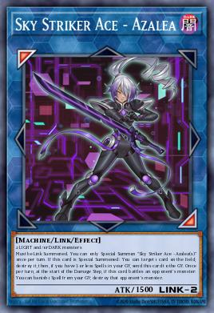
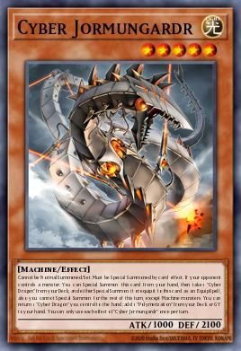
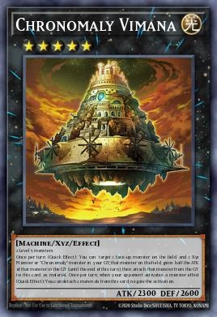
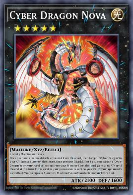
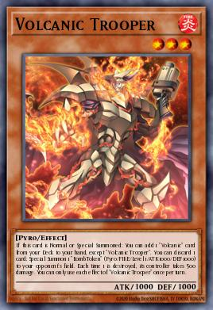
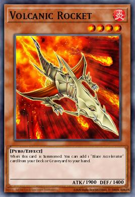
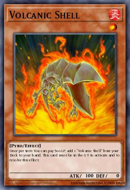
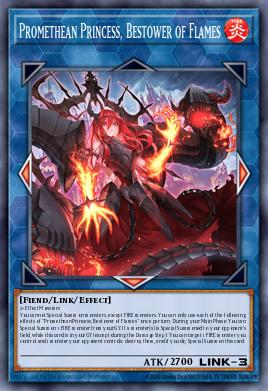

# Iteración V12 — Tres accesos adicionales del Extra: Azalea, Vimana y Princesa Prometea

**Guía visual importable a A09/A10.** Dos cartas destino de Cyber Dragon Pure (deck 684) y una de Volcanic (deck 687). Las tres rutas son **alternativas situacionales**, con recursos reales de inventarios confirmados. Se encuentran en **REVISIÓN TCG**; la comprobación de texto oficial realizada no equivale a validar todos los estados competitivos, cadenas o respuestas. Ninguna carta se agregó o retiró del inventario.

## `684:A09:CYBER:CORE:AZALEA15` — romper una carta, pero perder Azalea si hay pocas Mágicas en GY

**Categoría:** remoción ofensiva / conversión de materiales; **dificultad:** baja-media; **recursos:** 2 cartas de mano, Normal, Cyber Emergency en Deck, carta rival seleccionable. **Objetivo:** sustituir dos cuerpos por destrucción de una carta rival, con coste real de que Azalea puede terminar en GY.

**Entrada exacta:** mano  **Cyber Dragon (1 copia Main)** y  **Core (3 copias Main)**; propia zona de monstruos vacía, rival controla al menos un monstruo **y una carta seleccionable/destruible**; GY propio con **0 Mágicas** (para fijar la variante base), Normal disponible, **Cyber Emergency** todavía en Deck.  **Azalea** disponible en Extra 1x. Sin limitaciones previas que impidan Enlace.

1.  **ESPECIAL → campo** desde mano cuando solo el adversario controla monstruos; la invocación no consume Normal.
2.  **NORMAL → campo**. Su búsqueda añade **Cyber Emergency** del Deck a mano. Core cambia su nombre a «Cyber Dragon» en campo, pero **Azalea NO exige nombres diferentes**: requiere 2 monstruos **LUZ y/o OSCURIDAD**, que Cyber Dragon y Core satisfacen.
3.  +  **ENLACE-2 →**  **Sky Striker Ace - Azalea, 1500 ATK**. Ambos materiales van al GY; no se usa I:P ni se activa S:P; es una decisión de Extra **excluyente** de las salidas Genius, S:P y Fortress de las mismas piezas.
4. Al Invocarse Especialmente, activar efecto de : **selecciona 1 carta del campo** (en la línea base, rival) y **destrúyela si es destruible**. Con **0 Mágicas en GY** al realizar esta operación, la propia Azalea **SE ENVÍA al GY después de la destrucción**; el efecto no la deja como monstruo final. No describir este envío como coste ni como destrucción de Azalea.
5. **Campo final:** carta rival seleccionada **destruida**, **Azalea + Cyber Dragon + Core en GY**, **Cyber Emergency en mano**, Normal gastada, ningún monstruo propio; objetivo de ruptura, **NO negación**, **NO OTK**, **NO campo con Azalea viva** en esta variante.

**Variante distinta, no acumulable:** con **4 o más Mágicas** ya presentes en tu GY al resolver su efecto y destrucción efectuada, Azalea **no se envía por esa cláusula**, permanece en campo 1500 ATK y podría combatir. Su segundo efecto de combate exige que exista una Mágica en GY para desterrar y ocurre **al inicio del Damage Step**; no sustituye el efecto de Invocación. Si la carta rival no puede seleccionarse o la destrucción no ocurre, reexaminar resolución con el texto literal; **no prometer remoción garantizada**. Si Cyber Dragon no se Invoca Especial o Core no permanece para Enlace, la línea no está demostrada.

**Materiales/efectos oficiales:** [Cyber Dragon](https://www.db.yugioh-card.com/yugiohdb/card_search.action?cid=6390&ope=2&request_locale=en); [Cyber Dragon Core](https://www.db.yugioh-card.com/yugiohdb/card_search.action?cid=10866&ope=2&request_locale=en); [Sky Striker Ace - Azalea (CID 18448)](https://www.db.yugioh-card.com/yugiohdb/card_search.action?cid=18448&ope=2&request_locale=en).

## `684:A09:JORMUNGARDR:VIMANA16` — un Cyber del Deck habilita Rango 5 con negación real

**Categoría:** apertura reactiva / acceso a Xyz / negación de efecto de monstruo; **dificultad:** media; **recurso mínimo:** 1 carta en mano, rival con monstruo y Cyber Dragon original en Deck. **Objetivo:** terminar con Vimana de 2 materiales y preservar la negación ante el efecto decisivo del adversario.

**Entrada exacta:** mano  **Cyber Jormungardr (Main 1x)**; oponente ya controla un monstruo, campo propio vacío. **Cyber Dragon original (Main 1x) debe seguir en el Deck** (si está en mano/GY, el paso de tomarla del Deck falla); Extra posee  **Chronomaly Vimana (1x)**. Main Phase propia, zonas libres, sin bloqueo anterior de Xyz/Máquinas.

1.  **ACTIVAR SU EFECTO → ESPECIAL DESDE MANO** porque el rival controla un monstruo. Es un monstruo que **no puede Invocarse Normalmente**; su propia Invocación por efecto satisface el requisito. Jormungardr es Máquina LUZ **Nivel5 / 1000 ATK**.
2. Como continuación de la misma resolución, **tomar**  **Cyber Dragon del Deck y elegir INVOCARLA ESPECIALMENTE** (no equiparla). Se tienen **dos Máquinas Nivel5** boca arriba; no se requiere que Cyber Dragon cumpla su condición alternativa de Invocación desde la mano porque aquí se Invoca **por el efecto de Jormungardr**.
3. **Restricción que ya aplica:** tras resolver el efecto de Jormungardr, por el **resto del turno** solo pueden Invocarse Especialmente **monstruos Máquina**.  **Vimana es Máquina**, por lo que este Xyz no viola el bloqueo. No convertir aquí los dos cuerpos en S:P/I:P ni en cualquier Link no-Máquina.
4.  +  **SUPERPONER → Xyz Rango5** , **2300 ATK / 2600 DEF**, con ambos materiales acoplados. A diferencia de Cyber Dragon Nova, Vimana solo requiere **dos monstruos Nivel5** (no restringe a Máquina como material, aunque estos lo son).
5. **Campo final:**  **Vimana con 2 materiales Xyz**. Ante la **activación posterior de un efecto de monstruo del rival**, su Efecto Rápido puede **desacoplar 2 materiales como COSTE** para **negar esa activación**; entonces queda con 0 materiales. **No** niega Mágicas/Trampas y **no** destruye automáticamente al monstruo cuyo efecto niega. Su otro Efecto Rápido de aumentar ATK/acoplar exige **un Xyz o «Chronomaly» elegible en tu GY**, ausente en la entrada base; **NO se activa aquí**.

**Alternativa excluyente:** con los mismos dos cuerpos, optar por  **Cyber Dragon Nova** Máquina Rango5 y posteriormente Infinity cuando ambos estén disponibles, pero NO crear Vimana + Nova + Infinity a partir de solo dos materiales. El valor de Vimana es una negación de **activación de efecto de monstruo** inmediatamente respaldada por sus 2 materiales; a cambio, el efecto de búsqueda de Polimerización de Jormungardr no se utiliza y sus dos cuerpos ya son materiales Xyz. Si el Cyber Dragon único no está en Deck o Jormungardr no resuelve, **no se alcanza** el tablero indicado.

**Materiales/efectos oficiales:** [Cyber Jormungardr (CID 21163)](https://www.db.yugioh-card.com/yugiohdb/card_search.action?cid=21163&ope=2&request_locale=en); [Cyber Dragon](https://www.db.yugioh-card.com/yugiohdb/card_search.action?cid=6390&ope=2&request_locale=en); [Chronomaly Vimana (CID 16233)](https://www.db.yugioh-card.com/yugiohdb/card_search.action?cid=16233&ope=2&request_locale=en); [Cyber Dragon Nova (CID 10870)](https://www.db.yugioh-card.com/yugiohdb/card_search.action?cid=10870&ope=2&request_locale=en).

## `687:A09:TROOPER:ROCKET:SHELL:PRINCESS17` — continuación de campo con tres FUEGO

**Categoría:** extensión condicionada desde tablero previo / reanimación; **dificultad:** media-alta por preparación; **objetivo:** convertir tres cuerpos FUEGO en Princesa Prometea y recuperar uno desde GY.

**Campo de partida explícito, NO mano inicial automática:** ya controlas boca arriba  **Volcanic Trooper (FUEGO/Piro/Efecto, Main 3x)**,  **Volcanic Rocket (FUEGO/Piro/Efecto, Main 3x)** y  **Volcanic Shell (FUEGO/Piro/Efecto, Main 3x)**. Ninguno está afectado por una restricción que impida usarlo como Enlace; Princesa Prometea está en Extra 1x, hay Zona Extra legal y no hay prohibición vigente de Invocar monstruos Demonio. **NO** asumir que se reúnen los tres en un mismo turno desde tres cartas de mano ni que Trooper/Rocket buscan dos veces sin texto habilitante.

1.  +  +  **USAR TRES MONSTRUOS DE EFECTO** (FUEGO) como materiales; Link total **3** hacia  **Promethean Princess, Bestower of Flames Enlace-3, 2700 ATK**. Todos los materiales van al GY **por procedimiento de Enlace**, NO como descarte, coste activado o destrucción. El requisito impreso de Princess es **2+ monstruos de efecto**, no «2+ FIRE»; se eligen FUEGO por compatibilidad con su recuperación y restricción.
2. Durante tu propia Main Phase, activar efecto de  para **seleccionar**  **Rocket FUEGO de tu GY** recién depositado e **Invocarlo Especialmente**. No equipar ni recuperar al Deck; Rocket vuelve al campo.
3. Rocket, al ser Invocado, puede añadir **una carta «Blaze Accelerator» real** del Deck o GY. **Solo si existe objetivo elegible**; su efecto es opcional y la guía no supone cuántas Mágicas/Trampas de ese nombre quedan. No contar una carta en mano si no se seleccionó y resolvió correctamente.
4. **Campo final base:**  **Princesa Prometea (2700 ATK)** +  **Volcanic Rocket (1900 ATK)**, Trooper y Shell en GY, opción de una «Blaze Accelerator» buscada si había disponibilidad. Princess impone **«no puedes Invocar Especialmente excepto monstruos FUEGO»** mientras su restricción aplica; no seguir de inmediato a Unicornio, I:P, S:P o Links no-FUEGO por asumir que cualquier Extra está disponible.

**Elección táctica:** si necesitas conservar recursos Volcanic y cartas de acelerador, **no gastar tres cuerpos** solo por llenar Princesa. Si una respuesta retira Princess antes de la reanimación, no se garantiza Rocket en campo. Cuando Princess llegue después al GY, su otro efecto de destrucción/reactivación exige **un monstruo rival Invocado Especialmente y dos objetivos válidos para destruir**, uno FUEGO propio y uno del adversario; no se dispara automáticamente en esta secuencia. El coste principal de la ruta es **un campo previo de tres monstruos**; por ello es extensión, **no apertura universal** ni prueba de OTK.

**Materiales/efectos oficiales:** [Volcanic Trooper (CID 18916)](https://www.db.yugioh-card.com/yugiohdb/card_search.action?cid=18916&ope=2&request_locale=en); [Volcanic Rocket (CID 7243)](https://www.db.yugioh-card.com/yugiohdb/card_search.action?cid=7243&ope=2&request_locale=en); [Volcanic Shell (CID 7082)](https://www.db.yugioh-card.com/yugiohdb/card_search.action?cid=7082&ope=2&request_locale=en); [Promethean Princess (CID 19507)](https://www.db.yugioh-card.com/yugiohdb/card_search.action?cid=19507&ope=2&request_locale=en).

## Decisión global V12

| Ruta | Resultado | Qué se gasta | Alternativas a comparar |
|---|---|---|---|
| Azalea15 | 1 destrucción condicionada; Azalea se envía al GY si al resolver tienes 3 o menos Mágicas en GY | Cyber Dragon+Core, Normal, presencia propia | S:P sin destierro inicial; Genius con Clockwork; Fortress sobre Máquina rival |
| Vimana16 | Rango5 con **2 materiales**, negación activación efecto monstruo rival por desprender 2 | Jormungardr + Cyber Dragon **del Deck**, sin Normal en base | Nova→Infinity consumiendo los mismos 2 Nivel5; no ambas |
| Princess17 | Link3 FIRE 2700 + Rocket 1900 revivido; búsqueda Blaze opcional | Tablero previo Trooper+Rocket+Shell, tres cuerpos | I:P, Almiraj, Emperor o preservar Aceleradores |

**Estado técnico:** textos y materiales cotejados de forma puntual en la base de datos oficial; se requiere ensayo completo de interrupciones/cadenas y lista actualizada antes de marcar como jugable certificada. Conservar inventario, Skill y zonas originales. Fotos de todos los CID usados están en la carpeta `imagenes/tcg/` del paquete.
