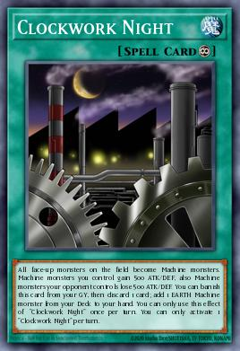
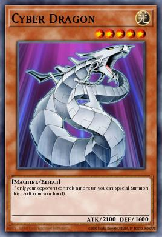
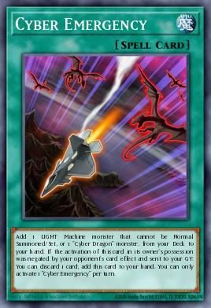
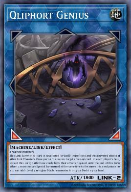

# Cyber Dragon Pure — Clockwork Night + Cyber Dragon + Core → Qliphort Genius

**ID A09/A10:** `684:A09:CYBER:CORE:CLOCKWORK:GENIUS12`.

**Tipo:** alternativa táctica condicional; no es combo de una carta ni una negación de activación. **Objetivo:** buscar una Mágica Cyber y, si ambos jugadores controlan una carta boca arriba seleccionable, utilizar el efecto de **Qliphort Genius** para negar hasta fin de turno una carta rival a cambio de **negar también tu propio Clockwork Night**.

**Mano inicial exacta (3):** `Clockwork Night` (CID 17625), `Cyber Dragon` original (CID 6390) y `Cyber Dragon Core` (CID 10866). **Deck:** al menos un `Cyber Emergency` (CID 8428) para buscar. **Extra:** `Qliphort Genius` (CID 13502). **Campo/GY propios:** vacíos. **Rival:** controla al menos un monstruo boca arriba seleccionable. **Turno propio:** Main Phase y Normal Summon disponibles; el rival no interrumpe en la línea base. Ningún efecto previo impide Invocar monstruos Máquina por Enlace. Todas esas cartas constan en las zonas aprobadas del deck; no se toman piezas de Side o Reserva.

## Cinco pasos con fotografías reales

### 1. Activar Clockwork Night en tu zona Mágica/Trampa

 → **MÁGICA CONTINUA BOCA ARRIBA**

Al resolver su activación, todos los monstruos boca arriba pasan a ser **Máquina** mientras su efecto continuo se aplique. Tus Máquinas reciben +500 ATK y los del rival -500 ATK/DEF. **Clockwork Night es una Mágica, no un monstruo:** no estropea la condición de Invocación Especial de Cyber Dragon.

### 2. Invocar Especialmente a Cyber Dragon desde la mano

 → **2100 ATK base**

Como el adversario controla un monstruo y tú ninguno, Invoca Especialmente al Cyber Dragon original. Mientras Clockwork Night esté aplicándose, Cyber Dragon es Máquina y recibe temporalmente +500 ATK. Su Invocación no consume la Normal.

### 3. Invocar Normalmente a Core y buscar Cyber Emergency

 →  **A MANO**

Invoca Normalmente a Core. Activa su búsqueda y añade Cyber Emergency del Deck a la mano. **La carta buscada queda en la mano y no puede servir de objetivo propio para Genius.** La Normal se consumió. El otro efecto de Core que se activa desde GY no puede usarse también en el mismo turno.

### 4. Formar Qliphort Genius con los dos monstruos Máquina

 +  →  **ENLACE-2**

Los dos cuerpos Máquina cumplen **«2 monstruos Máquina»**. Se envían al GY como materiales de Enlace y Qliphort Genius ocupa una zona legal. El propio Genius Invocado por Enlace es **inmune a efectos de Mágicas/Trampas**: **Clockwork Night no le concede +500 ATK**; conserva 1800 ATK mientras se cumpla esa protección. No atribuyas a esta Invocación su efecto buscador: exige **dos monstruos Invocados Especialmente al mismo tiempo a sus zonas apuntadas**, hecho que aquí no ocurre.

### 5. Negar Clockwork Night Y una carta rival

 →  **PROPIA** + **MONSTRUO RIVAL BOCA ARRIBA**

En tu **Main Phase**, puedes activar el efecto de Genius (una vez por turno), **seleccionando exactamente una carta boca arriba de tu campo que NO sea el propio Genius**, en este caso Clockwork Night, **y una carta boca arriba del rival**. Si resuelve, **ambas tienen sus efectos negados hasta el final del turno**. La negación de Clockwork Night apaga temporalmente su conversión de Tipo y sus cambios de ATK/DEF. El monstruo rival pierde sus efectos hasta fin de turno, pero su activación previa **no queda negada automáticamente**.

**Campo propio final mínimo:** Qliphort Genius (1800 ATK) y Clockwork Night boca arriba, pero **negada hasta End Phase**; Cyber Emergency en mano; Cyber Dragon y Core en GY. **Campo rival:** monstruo boca arriba con efectos negados hasta End Phase si todo resolvió. No se destruye ni destierra nada.

## Por qué elegir esta línea o rechazarla

| Decisión | Beneficio | Precio y límite |
|---|---|---|
| **Genius + Clockwork Night** | Negación temporal sobre una carta rival en tu turno, con Genius Máquina | Gasta los dos monstruos y niega la Mágica propia; pierde durante ese turno la conversión global de Máquinas que podría facilitar **Fortress**. |
| **Conservar Clockwork Night para Fortress** | Mantener el Tipo Máquina de monstruos rivales y la opción de Fusión por contacto | Requiere Cyber Dragon legal y materiales de Fortress; no se debe afirmar que ocurre a la vez que Genius. |
| **Cyber Dragon + Core → S:P** (`684:A09:CYBER:CORE:SP_DEFENSA11`) | Preparar destierro temporal reactivo a una activación rival | S:P es **Guerrero** y no sirve si ya existe un bloqueo a Máquinas; con materiales solo Main, no destierra al ser Invocada. |

**Respuestas e interrupciones:** si el rival elimina uno de los monstruos antes del Enlace, no hay dos materiales. Si elimina Clockwork Night antes de activar Genius y no controlas otra carta boca arriba distinta del Link, no hay objetivo propio y **no puedes activar esa negación**. Si el rival retira alguno de los objetivos encadenando una respuesta, no prometas que se nieguen ambos. No llames a Genius negador rápido para turno rival.

**Clasificación:** dificultad media; recursos 3 cartas iniciales, Normal y 1 Extra; utilidad situacional para ir segundo. No se debe aumentar ni disminuir copias por esta única secuencia; la recomendación de construcción queda **condicional**.

## Fuentes oficiales de efectos

- [Konami — Qliphort Genius, CID 13502](https://www.db.yugioh-card.com/yugiohdb/card_search.action?cid=13502&ope=2&request_locale=en): dos Máquinas, protección M/T y efecto de seleccionar una carta boca arriba de cada lado para negar ambas.
- [Konami — Clockwork Night, CID 17625](https://www.db.yugioh-card.com/yugiohdb/card_search.action?cid=17625&ope=2&request_locale=en): conversión de Tipo y modificaciones estadísticas como efecto continuo.
- [Konami — Cyber Dragon, CID 6390](https://www.db.yugioh-card.com/yugiohdb/card_search.action?cid=6390&ope=2&request_locale=en): Invocación Especial condicional.
- [Konami — Cyber Dragon Core, CID 10866](https://www.db.yugioh-card.com/yugiohdb/card_search.action?cid=10866&ope=2&request_locale=en): búsqueda al Invocar Normal.

**Alcance de cotejo:** esta línea y su estado inicial específico; las otras 11 rutas del deck conservan sus estados individuales de revisión. No modifica el inventario aprobado ni asegura victoria.
