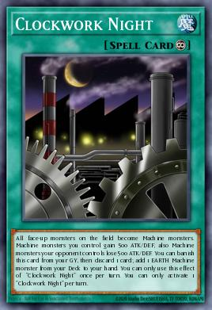
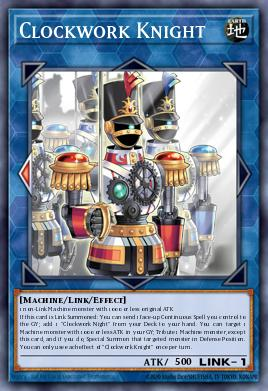
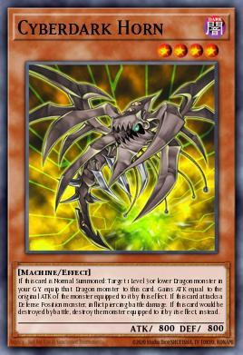
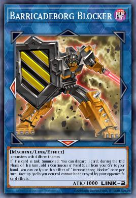

# Cyber Dragon Pure — Clockwork Knight y Barricadeborg Blocker: acceso condicionado, no combo universal

**Dos rutas A09/A10 nuevas:** `684:A09:CORE:NIGHT:CLOCKWORK_KNIGHT13` y `684:A09:CYBER:HORN:NIGHT:BARRICADEBORG14`.

**Objetivo de la guía:** explicar cómo invocar las dos cartas del Extra que antes carecían de material enlazado, **qué beneficio concreto tienen y qué sacrificas**. Son dos situaciones **independientes**; no se trata de dos monstruos que aparezcan juntos. Clasificación: **interacción de reciclaje de Mágica Continua** (ruta 13) y **continuación defensiva sobre una Mágica Continua ya activa** (ruta 14). Formato TCG; revisión reglamentaria acotada con fuentes oficiales, no certificación integral.

## Ruta 13 — Core + Clockwork Night → Clockwork Knight (Enlace-1)

### Entrada exacta

- **Mano propia:** 1×  **Cyber Dragon Core** (Máquina no-Enlace, ATK original 400) y 1×  **Clockwork Night**.
- **Deck:** al menos 1× **Cyber Emergency** que Core pueda añadir al ser Invocado Normalmente, y **otra copia de Clockwork Night** además de la de mano. La lista registrada tiene **Clockwork Night 2× en Main** y **Core 3×**; no se añade ninguna carta.
- **Extra:** 1×  **Clockwork Knight** (Máquina Enlace-1, 500 ATK, requisito **1 Máquina no-Enlace con ATK original 1000 o menos**).
- **Campo y fase:** Campo, GY y destierro propios vacíos; Normal disponible; Main Phase propia; no hay bloqueo previo de Invocación Enlace. El rival no necesita aportar monstruos y se supone sin respuestas solo en la secuencia base.

### Secuencia ilustrada

1.  **NORMAL → Cyber Dragon Core**, original 400 ATK. Activar su efecto al ser Invocado Normalmente para añadir **Cyber Emergency** del Deck a mano. No se activa simultáneamente su otro efecto desde GY; Core solo permite usar uno por turno.
2.  **ACTIVAR → MÁGICA CONTINUA** de tu mano. Los monstruos boca arriba del campo se convierten en Máquinas y ajustan ATK/DEF; Core sigue teniendo **ATK original 400**, aunque su ATK actual suba a 900.
3.  →  **ENLACE-1**. Enviar Core al GY como material no cambia que su **ATK original** cumple 1000 o menos. Invocar Knight en Zona de Monstruos Extra legal; aún controlas Clockwork Night boca arriba. No se necesita Cyber Dragon original ni otro monstruo.
4. Al Invocarse Knight por Enlace, activar su efecto:  **ENVIAR MÁGICA CONTINUA PROPIA BOCA ARRIBA AL GY COMO COSTE DE ACTIVACIÓN** (texto antes del punto y coma); al resolver,  **AÑADIR OTRA COPIA DESDE DECK A MANO**. El envío **NO es destrucción** y la segunda Night debe estar realmente en el Deck. Si te niegan el efecto activado, la primera Night ya se envió como coste y **no** hay búsqueda.
5. **Campo final real:**  **500 ATK** en campo; **Cyber Emergency + segunda Clockwork Night** en mano; Core y primera Night en GY; Normal gastada; sin otro monstruo. **No puedes activar la Night buscada este mismo turno**, porque ya activaste una Clockwork Night (máximo una activación por turno). Se conserva para un turno posterior, o se usa como otro recurso según reglas.

**Opción secundaria no ejecutada en esta ruta:** Knight puede seleccionar Máquina de **ATK actual 1000 o menos** en tu GY y, **Sacrificando otra Máquina propia distinta de Knight**, Invocarla de Modo Especial en Defensa. Aunque Core ya está en GY, este campo final **no posee otra Máquina propia sacrificable**, así que NO puedes afirmar que Core vuelve automáticamente. Si en un turno posterior existe otra Máquina propia y objetivos válidos, reevaluar esa extensión.

**Respuestas e interrupciones:** si Core es negado, no se obtiene Emergency, pero podría Invocarse Knight si queda Core como material. Si Night no puede permanecer boca arriba cuando se activa el efecto de Knight, **no se puede enviarla como coste** y la búsqueda no queda asegurada. Si te niegan el efecto de Knight después del pago del coste, pierdes la primera Night **sin añadir la segunda**. Si la otra Night no está disponible en Deck, tampoco hay búsqueda. Usar la primera Night como recurso apaga su conversión a Máquina y su modificación de ATK/DEF; por ello esta ruta puede ser peor que mantener Night activa o hacer Fortress sobre un monstruo rival.

## Ruta 14 — Cyber Dragon + Cyberdark Horn → Barricadeborg con Night protegida

### Entrada exacta

- **Mano:** 1×  **Cyber Dragon** (Máquina LUZ Nivel5, 2100 ATK) + 1×  **Cyberdark Horn** (Máquina OSCURIDAD Nivel4, 800 ATK).
- **Campo previo:** 1×  **Clockwork Night propia YA BOCA ARRIBA** como Mágica Continua; **sin monstruos propios**. Debe haber un monstruo del rival para la Invocación Especial de Cyber Dragon. Normal libre, Main Phase propia, sin restricciones que impidan Enlace OSCURIDAD/Máquina. **GY propio sin Dragón Nivel3 o inferior** para que la Invocación Normal de Horn no equipe un recurso en esta secuencia base; si hay uno, decidir la cadena sin asumir que sobrevive al Enlace.
- **Extra:** 1×  **Barricadeborg Blocker** Enlace-2 (Máquina OSCURIDAD, 1000 ATK; requiere **2 monstruos con nombres diferentes**). Los nombres en campo **Cyber Dragon** y **Cyberdark Horn** son distintos; **NO sustituir Horn por Cyber Dragon Core**, porque Core se llama «Cyber Dragon» en campo y dejaría dos monstruos de igual nombre, inválidos para Blocker.

### Secuencia ilustrada

1.  **ESPECIAL → CAMPO** desde la mano: solo el adversario controla monstruos y tú ninguno (una Mágica Continua propia no equivale a controlar un monstruo).
2.  **NORMAL → CAMPO**. El GY de entrada no tiene Dragón Nivel3 o menor elegible; no generar un equipamiento fantasma. Clockwork Night convierte/ajusta máquinas en ambos campos: en este momento Cyber Dragon 2600 ATK y Horn 1300 ATK, si no existen otras modificaciones.
3.  +  →  **ENLACE-2**. Dos nombres diferentes, dos materiales reales, ambos al GY. Barricadeborg gana 500 ATK de Clockwork Night, por lo que queda con **1500 ATK** mientras Night esté aplicada.
4. **No activar el descarte opcional de Blocker**: la secuencia base no acredita ninguna Mágica Continua/de Campo propia en GY para recuperar ni una tercera carta de mano. Su **efecto continuo** sí protege tus Mágicas boca arriba de **destrucción por efectos del adversario**: Clockwork Night continúa en campo protegida mientras Blocker permanezca boca arriba con efecto aplicable. No protege contra destierro, devolución a mano, enviar al GY, negar efectos, ni destrucción por tus propios efectos.
5. **Campo final:**  **1500 ATK con Night activa**;  propia boca arriba y protegida de destrucción por efectos rivales; Cyber Dragon + Horn en GY; Normal gastada; la propia Night mantiene a monstruos boca arriba como Máquinas. Sin negación ni otro cuerpo sobreviviente.

**Extensión condicional separada:** si una **Mágica Continua/de Campo** propia (p. ej. la **otra** Clockwork Night, segunda copia de tu Main) ya estuviera en GY **antes** de Enlazar, y además conservaras una carta adicional para **descartar**, al Invocarse Blocker podrías activar su efecto de descartar como coste para añadir en la End Phase una de esas Mágicas del GY. Es **otra entrada, no incluida en la línea de dos cartas**. El efecto de buscar al final no protege la carta que recuperas y no te deja activar una segunda Night si ya activaste una ese turno.

**Interrupciones y coste estratégico:** si Cyber Dragon no puede Invocarse Especial, dos cartas de mano no bastan para estos materiales. Si la Normal a Horn es negada o retirada, no queda pareja válida. Si se destruye Night antes del campo final, Blocker todavía puede quedar con 1000 ATK, pero no protege una Night que ya no está. Elegir entre este Link defensivo y conservar Cyber Dragon 2100 para Fusionar/romper campo: la protección de Mágicas **no es negación** y puede ser insuficiente ante remoción no destructiva. El rival que controle un monstruo sin efecto relevante no hace esta línea obligatoria.

## Tabla de elección y alcance de la guía

| Ruta | Categoría y propósito | Entrada | Ventaja | Límite que NO se debe omitir |
|---|---|---|---|---|
| 13 — Clockwork Knight | Interacción básica de reciclaje, preparación próxima | Core + Night en mano, otra Night y Emergency en Deck | Convierte Core en Link1; busca otra Night y Emergency | **No** reactivar Night en mismo turno; no revivir Core sin otra Máquina propia |
| 14 — Barricadeborg | Continuación defensiva, protección de Mágica activa | Cyber + Horn en mano, Night propia activa, rival con monstruo | Protege Night contra destrucción por efecto rival; Blocker 1500 | Cyber + **Core no cumple** dos nombres distintos; el reciclaje End Phase exige descarte y Mágica en GY |

**Dificultad:** ruta 13 baja-media (2 cartas de mano); ruta 14 media (2 cartas de mano + Night preestablecida + monstruo rival). **No** son estrategias de OTK, negación rápida ni pruebas de que ambas deban mantenerse por sus copias actuales. A05/A06/optimización deben valorar si el beneficio justifica gastar materiales y espacio Extra, comparar con Genius, S:P, Fortress y las Fusiones, y ofrecer propuestas de cantidad **sin mutar el inventario**.

## Fuentes oficiales Konami

- [Cyber Dragon Core, CID 10866](https://www.db.yugioh-card.com/yugiohdb/card_search.action?cid=10866&ope=2&request_locale=en): Máquina ATK original 400, búsqueda Normal y nombre «Cyber Dragon» en campo/GY.
- [Clockwork Night, CID 17625](https://www.db.yugioh-card.com/yugiohdb/card_search.action?cid=17625&ope=2&request_locale=en): Mágica Continua, bono y cambio de Tipo, límite **activar solo una por turno**.
- [Clockwork Knight, CID 20787](https://www.db.yugioh-card.com/yugiohdb/card_search.action?cid=20787&ope=2&request_locale=en): requisito de Enlace1 por ATK ORIGINAL, envío de Mágica Continua boca arriba y búsqueda, reanimación con otro sacrificio.
- [Cyber Dragon, CID 6390](https://www.db.yugioh-card.com/yugiohdb/card_search.action?cid=6390&ope=2&request_locale=en): condición de Invocación Especial.
- [Cyberdark Horn, CID 6830](https://www.db.yugioh-card.com/yugiohdb/card_search.action?cid=6830&ope=2&request_locale=en): Máquina de nombre distinto de Cyber Dragon, efecto de equipo al Normal con Dragón elegible.
- [Barricadeborg Blocker, CID 14710](https://www.db.yugioh-card.com/yugiohdb/card_search.action?cid=14710&ope=2&request_locale=en): exactamente **dos nombres diferentes**, recuperación diferida con descarte y protección de Mágicas propias boca arriba.

**Estado V11:** dos rutas alternativas con materiales exactos y cotejo parcial de textos oficiales. Ambas pasan a **REVISIÓN TCG**, no a «certificadas». No actualizar listas, banlist ni base de datos de producción.
