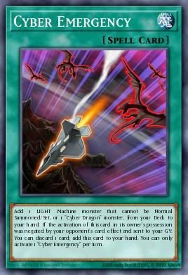

# Cyber Dragon — Cyber Dragon + Core → S:P Pequeña Caballera: preparar una respuesta rápida

**ID adicional:** `684:A09:CYBER:CORE:SP_DEFENSA11`

**Categoría:** acceso condicional a Link-2 y preparación de respuesta defensiva para el turno rival. **Objetivo:** transformar dos monstruos Máquina LUZ de Main en la S:P de Extra y conservar una Mágica «Cyber» en mano. No es un OTK, una negación ni un destierro automático al invocarla.

**Mano inicial exacta:** 1 Cyber Dragon original (CID 6390) + 1 Cyber Dragon Core (CID 10866). **Deck:** 1 Cyber Emergency (CID 8428) disponible como búsqueda; **Extra:** 1 S:P Little Knight (CID 19188). **Campo/GY propio:** vacíos; Main Phase propia con Normal disponible; ningún efecto previo que restrinja invocaciones a Máquina. **Rival:** controla al menos 1 monstruo para que Cyber Dragon pueda Invocarse Especialmente de mano; más adelante se ilustra una respuesta adversaria que activa una carta/efecto y mantiene un monstruo boca arriba elegible. Sin respuesta rival durante la preparación inicial.

## Guía visual de 5 pasos

### Paso 1 — Cyber Dragon entra de mano sin usar la Normal

 → **INVOCACIÓN ESPECIAL · 2100 ATK**

Como tú no controlas monstruos y el rival sí, puedes Invocar **Cyber Dragon** de forma Especial desde la mano, sin cadena y sin gastar la Normal. Si antes pusiste otro monstruo en tu Campo, ya no tienes las condiciones de esta entrada.

### Paso 2 — Core se Invoca Normal y busca Cyber Emergency

 →  **AÑADIR A MANO**

Invoca Normalmente a **Cyber Dragon Core** (Nivel 2, 400 ATK), activa su efecto de Invocación Normal y añade 1 **Cyber Emergency** del Deck a la mano. Core consume su efecto disponible ese turno; **no** puedes después activar también su otro efecto desde el Cementerio en ese turno. Buscar Cyber Emergency no impone aquí un bloqueo de Máquinas.

### Paso 3 — Link-2 usando exactamente dos monstruos de efecto

 +  →  **ENLACE-2**

Envía ambos monstruos desde tu Campo al GY como **dos materiales de Enlace**. Invoca a **S:P Little Knight** (Guerrero OSCURIDAD, 1600 ATK) del Extra en una zona permitida. Esto es legal **porque no activaste** los efectos de Nachster, Herz de cambio de Nivel ni Drei que restringen la Invocación Especial a monstruos Máquina.

### Paso 4 — No activar el efecto de destierro al hacer Enlace

 **REGLA CLAVE**

El primer efecto de S:P solo se habilita al Invocarla por Enlace **usando como material al menos un monstruo de Fusión, Sincronía, Xyz o Enlace**. Cyber Dragon y Core eran monstruos del **Main Deck**; por tanto, **esta línea no habilita ese destierro al invocarla**. No puede anunciase como eliminación inmediata del monstruo adversario. Su segundo efecto rápido sí queda disponible en la ventana correspondiente.

### Paso 5 — Campo preparado y respuesta real en el turno rival

 **1600 ATK** +  **EN MANO**

**Endboard propio:** S:P boca arriba, Cyber Emergency en mano; Cyber Dragon y Core en GY; Normal gastada. Si en el turno rival el oponente **activa una carta o efecto** y controla un monstruo boca arriba seleccionable, puedes encadenar el Efecto Rápido de S:P para **seleccionar dos monstruos boca arriba en el Campo, incluido uno que controles**: por ejemplo, **tu S:P + ese monstruo rival**. Al resolver, ambos se destierran **hasta la End Phase** y normalmente regresan entonces. No es negar la activación, destruir ni desterrar permanentemente.

Si S:P deja de estar boca arriba o no existe un segundo monstruo seleccionable, no se presupone esta respuesta. El rival puede responder a la cadena y alterar sus objetivos o la resolución.

## ¿Cuándo elegirla?

| Situación | Decisión | Motivo |
|---|---|---|
| Necesitas conservar una respuesta para cuando el rival active un efecto | **S:P** | Puede retirar temporalmente dos monstruos boca arriba y esquivar amenazas, no negar. |
| Tienes al rival sin monstruos al inicio | **No abrir con esta mano exacta** | Cyber Dragon no se Invoca Especialmente por su condición propia. |
| Quieres eliminar una carta inmediatamente al Invocar S:P | **No usar esta línea para prometerlo** | No se utilizó material procedente del Extra Deck; falla la condición del primer efecto. |
| Activaste un efecto que restringe posteriores Especiales a Máquina | **No Invocar S:P ese turno** | S:P es Guerrero, de Tipo diferente a Máquina. |
| Quieres guardar Cyber Dragon/Core para Nova/Infinity o Fusión | **Evaluar ruta alternativa** | Enlazarlos consume los dos cuerpos; S:P no crea los materiales que necesitarías para esos otros finales. |

## Fuentes oficiales

- [Konami — Cyber Dragon, CID 6390](https://www.db.yugioh-card.com/yugiohdb/card_search.action?cid=6390&ope=2&request_locale=en): Invocación Especial condicionada a controlar solo el rival monstruos.
- [Konami — Cyber Dragon Core, CID 10866](https://www.db.yugioh-card.com/yugiohdb/card_search.action?cid=10866&ope=2&request_locale=en): búsqueda al Invocar Normal y solo uno de sus efectos por turno.
- [Konami — S:P Little Knight, CID 19188](https://www.db.yugioh-card.com/yugiohdb/card_search.action?cid=19188&ope=2&request_locale=en): dos monstruos de efecto, primer efecto condicionado a material de Extra y Efecto Rápido temporal.

**Estado de revisión:** secuencia cotejada con los textos oficiales para el escenario inicial definido; no certifica las otras rutas del deck ni convierte las variaciones no documentadas en combos comprobados.
