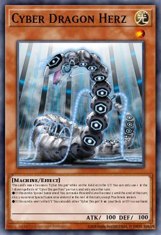
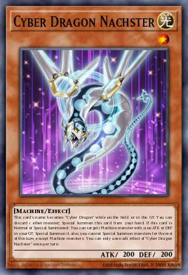
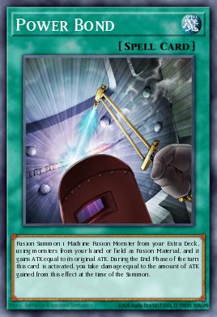
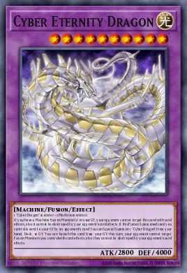

# Cyber Dragon Pure — ¿para qué sirve Cyber Eternity Dragon? Ataque de 5600 con coste final

**ID de guía adicional:** `684:A09:POWERBOND:CYBER_HERZ_NACHSTER:ETERNITY10`

**Propósito:** ofensivo condicional; convertir cuatro cartas reales de mano en una Fusión de 5600 ATK con Power Bond, conservando un Cyber Dragon recuperado. **No** es campo de negadores, no garantiza OTK y **no** se obtiene protección automática contra objetivos/destrucción en el escenario inicial.

**Mano inicial exacta:** Cyber Dragon original x1 + Cyber Dragon Herz x1 + Cyber Dragon Nachster x1 + Power Bond x1. **Campo/GY/destierro propios vacíos**, Main Phase propia, sin efectos anteriores, Extra disponible Cyber Eternity Dragon x1, rival sin respuestas. No se requiere monstruo rival, pero el daño de batalla es condicional a los monstruos, defensas y LP que realmente tenga.

## Guía visual con estado verificable

### Paso 1 — La mano necesaria: cuatro cartas reales

 +  +  + 

**Cyber Eternity Dragon** exige exactamente **1 monstruo «Cyber Dragon» + 2 monstruos Máquina**. Cyber Dragon original satisface la primera pieza; Herz y Nachster son Máquina y satisfacen las otras dos. No hace falta Invocar Normal o Especialmente esos monstruos antes: todos permanecen en la mano hasta la Fusión.

### Paso 2 — Activar Power Bond y emplear exactamente tres materiales

 →  +  +  → 

Power Bond permite material desde **mano/campo**, envía los tres monstruos al GY y trae Cyber Eternity Dragon desde Extra en Ataque (**2800 ATK base**). Su bonificación es otros 2800, por lo que queda en **5600 ATK** durante el turno, mientras siga aplicándose el efecto. La Invocación Normal permanece disponible.

### Paso 3 — Separar el efecto posterior de Herz de la resolución de Power Bond

 (GY) →  (GY → mano)

Tras **terminar** la resolución de Power Bond, el efecto opcional de Herz puede activarse porque fue enviado al Cementerio. Selecciona un «Cyber Dragon» **distinto de Herz**, en este caso el **Cyber Dragon original que acaba de ser material y está en GY**; añádelo a la mano al resolver. No se obtiene una segunda copia física ni se añade Nachster del GY como si fuera «Cyber Dragon» por nombre: este ejemplo recupera específicamente el original.

### Paso 4 — Evaluar si es correcto atacar ahora

 → **Battle Phase opcional**

Con 5600 ATK puede intentar superar un monstruo enemigo susceptible de batalla o atacar directamente si el Campo rival y las reglas lo permiten. **No inventar ataque directo**, daño exacto ni victoria sin conocer el Campo enemigo. Si rival tiene respuestas de negación/retirada o no puedes ganar, considera reservar Power Bond para una ruta de Rampage o emplear la defensa Heosvarog de la guía `684:A09:POWERBOND:CYBER_NACHSTER:HEOS09` (otra mano y otro resultado).

### Paso 5 — Campo final y daño que debes pagar incluso si no ganas

 **5600 ATK (por Power Bond) / 4000 DEF (base, sin aumento)**

- **Campo:** 1 Cyber Eternity Dragon en Ataque, sin otras cartas asumidas; Invocación Normal no usada.
- **Mano:** 1 Cyber Dragon original recuperado por Herz si ese efecto se resolvió; las otras tres cartas de la mano inicial ya se consumieron.
- **GY:** Herz, Nachster y Power Bond; el Cyber Dragon original salió de GY por la búsqueda posterior de Herz.
- **Protección actual:** **NINGUNA** del efecto continuo de Cyber Eternity, porque en este escenario tu Cementerio **no contiene otro Monstruo de Fusión Máquina**. Power Bond no proporciona protección.
- **End Phase:** recibes **2800 de daño por Power Bond** porque esa fue la cantidad de ATK ganada **en el momento de Invocación**; **sigue siendo un daño previsto aun si Eternity fue retirado posteriormente**. Si tus LP son 2800 o menos y no alteras esa consecuencia, esta línea te hace perder al final del turno.

## ¿Cuándo escogerla frente a otras cartas del Extra?

| Necesidad | Elección razonada | Qué NO prometer |
|---|---|---|
| Voy segundo, tengo las cuatro cartas y necesito un atacante grande | **Eternity + Power Bond** | No es OTK automático; se debe poder atacar y sobrevivir al daño final de 2800. |
| Voy primero y quiero negar Magias/Trampas | **Heosvarog** con Cyber Dragon + Nachster + Power Bond, en lugar de gastar un Herz adicional | Eternity no niega Magias/Trampas y no comienza protegido con GY vacío. |
| Necesito varios ataques o destruir Magias/Trampas en la Invocación | **Chimeratech Rampage**, solo si se cumplen sus materiales y una ruta ya verificada | Eternity no hereda ataques múltiples ni la destrucción de Rampage. |
| Ya tengo un Monstruo de Fusión Máquina en GY antes de invocar Eternity | Entonces **sí** aplicará su protección contra selección y destrucción por efectos rivales | La Fusión que está actualmente en Campo **no se cuenta** como Monstruo de Fusión en GY. |
| Me quedan pocos LP | **No activar esta ruta sin calcular el daño de Power Bond** | No se evita el daño solo porque Eternity abandone el Campo. |

## Legalidad y fuentes primarias

1. [Konami — Cyber Eternity Dragon, CID 13847](https://www.db.yugioh-card.com/yugiohdb/card_search.action?cid=13847&ope=2&request_locale=en): requisito 1 «Cyber Dragon» + 2 Máquina, base 2800/4000, protección **condicionada** a Máquina/Fusión en GY; protección de Fusión al desterrarse desde GY en otra situación.
2. [Konami — Power Bond, CID 6398](https://www.db.yugioh-card.com/yugiohdb/card_search.action?cid=6398&ope=2&request_locale=en): material desde mano/campo, aumento igual al ATK original, daño de End Phase calculado en la Invocación.
3. [Konami — Herz, CID 13723](https://www.db.yugioh-card.com/yugiohdb/card_search.action?cid=13723&ope=2&request_locale=en): trigger opcional cuando llega al GY, recuperación de otro «Cyber Dragon» desde Deck/GY. No confundir el uso de Herz en GY con el efecto que se activa al ser Invocado Especialmente.
4. [Konami — Nachster, CID 14047](https://www.db.yugioh-card.com/yugiohdb/card_search.action?cid=14047&ope=2&request_locale=en): Máquina LUZ en la mano; **no se activa su efecto de Invocación propia** para esta línea.

**Estado:** ruta comprobada para las cuatro cartas declaradas y sin intervención contraria. No altera el inventario ni prueba las rutas históricas. Es una alternativa **incompatible** con gastar las mismas piezas de mano en Heosvarog/Rampage al mismo tiempo.
