# A10 — Guías visuales documentales · Cyber Dragon Pure

> Guía documental: utilizar únicamente secuencias con condiciones y restricciones comprobadas.

- Deck ID: `684`. Formato declarado: `TCG`.
- Rutas visualizadas en esta entrega: **8**.
- Los pasos, movimientos y zonas se cotejan con la ficha A09; no asumir respuestas no descritas.
- Un estado desconocido se conserva como no documentado: nunca se inventa.

## OVERLOAD · RAMPAGE01 · `684:A09:OVERLOAD:RAMPAGE01`

**Propósito competitivo principal (lectura documental):** Ofensivo. El objetivo solo se acredita si las acciones y el campo final detallados en esta guía lo permiten; no implica legalidad certificada ni garantiza el resultado ante respuestas adversarias.

**Categoría:** APERTURA

**Propósito y resultado documental:**

Campo final propio al acabar Main Phase: Rampage boca arriba, 2100 ATK/1600 DEF, habilitado para 3 ataques este turno; Overload en GY, Cyber Dragon y Nachster en GY, Core y Herz desterrados. Resto de mano no definido. No hay negaciones ni protecciones inherentes garantizadas.

### Mano y estado inicial

Main Phase propia, Overload Fusion en mano, Cyber Dragon Core y Cyber Dragon Herz en GY propios, ambos sin ser desterrados; Chimeratech Rampage Dragon en Extra; Cyber Dragon y Cyber Dragon Nachster todavía en Deck (dos Máquinas LUZ disponibles). Zona principal libre, sin bloqueos de Invocación Especial o de efectos previos, rival sin respuestas. No se exige control de otro monstruo ni Normal disponible.

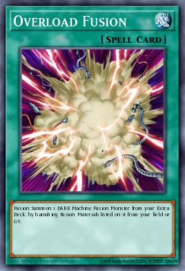 **Overload Fusion**

### Ejecución numerada

#### Paso 1 — Activar Overload Fusion desde mano (CL1) para invocar una Fusión Máquina OSCURIDAD. Seleccionar Core y Herz en GY: allí sus nombres son «Cyber Dragon».

 **ACTIVAR** →  **OBJETIVO** → 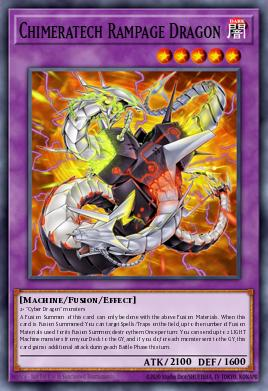 **FUSIÓN**

**Acción concreta:** Activar Overload Fusion desde mano (CL1) para invocar una Fusión Máquina OSCURIDAD. Seleccionar Core y Herz en GY: allí sus nombres son «Cyber Dragon».
**Detalle técnico documentado:** Desterrar Core y Herz como materiales por resolución; invocar por Fusión Chimeratech Rampage Dragon del Extra al Campo. Overload va al GY. Core y Herz ya no están en GY ni Campo.

**Estado por zonas después del paso:**

| Zona/recurso | Estado narrativo A09 |
|---|---|
| Mano | Apertura mínima agotada |
| Monstruos | Rampage #11764 (Ataque, 2100 ATK) |
| Mágicas y trampas | — |
| Cementerio | Overload Fusion #6783 en GY |
| Destierro propio | Core #10866 y Herz #13723 (boca arriba) |
| Campo y estado rival | Sin cambios rivales probados por la Fusión |
| Materiales Xyz/Fusión/Sincro | Fusión: Core y Herz ya desterrados; no son Xyz |
| Normal, Extra, fase y restricciones | Normal sin usar; se consumió una copia Rampage del Extra |

**Campo visual de este paso:**

**Monstruos propios:**
-  **Rampage (Ataque, 2100 ATK)** — zona declarada: `MONSTER`.
**Mágicas/Trampas/Campo:** sin carta propia demostrada en esta vista.
*Relación ilustrada de cartas presentes tras este paso, documentada en A09. La posición, materiales, otras zonas y rival se leen en la tabla de estado.*

#### Paso 2 — Efecto disparado opcional de Rampage al ser Invocado por Fusión: si hay Mágicas/Trampas en Campo, seleccionar hasta 2 (porque se usaron dos materiales).

 **ESTADO / CONTEXTO**

**Acción concreta:** Efecto disparado opcional de Rampage al ser Invocado por Fusión: si hay Mágicas/Trampas en Campo, seleccionar hasta 2 (porque se usaron dos materiales).
**Detalle técnico documentado:** Destruir solo los objetivos que continúen siendo válidos. Sin objetivos no se promete destrucción; este paso se omite sin alterar el resto de la ruta.

**Estado por zonas después del paso:**

| Zona/recurso | Estado narrativo A09 |
|---|---|
| Mano | — |
| Monstruos | Rampage #11764 (Ataque, 2100 ATK) |
| Mágicas y trampas | — |
| Cementerio | Overload Fusion en GY |
| Destierro propio | Core y Herz desterrados boca arriba |
| Campo y estado rival | Destrucción M/T opcional solo si hay objetivos legales; sin objetivo no se adjudica cambio |
| Materiales Xyz/Fusión/Sincro | — |
| Normal, Extra, fase y restricciones | Normal sin usar; una copia Rampage del Extra utilizada |

**Campo visual de este paso:**

**Monstruos propios:**
-  **Rampage (Ataque, 2100 ATK)** — zona declarada: `MONSTER`.
**Mágicas/Trampas/Campo:** sin carta propia demostrada en esta vista.
*Relación ilustrada de cartas presentes tras este paso, documentada en A09. La posición, materiales, otras zonas y rival se leen en la tabla de estado.*

#### Paso 3 — En Main Phase, activar el otro efecto de Rampage (una vez por turno) para enviar Cyber Dragon y Cyber Dragon Nachster desde Deck al GY al resolver.

 **ACTIVAR** →  **ENVIAR** → 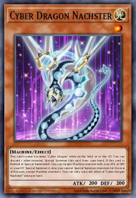 **ENVIAR**

**Acción concreta:** En Main Phase, activar el otro efecto de Rampage (una vez por turno) para enviar Cyber Dragon y Cyber Dragon Nachster desde Deck al GY al resolver.
**Detalle técnico documentado:** Si ambos se envían, Rampage gana 2 ataques adicionales durante cada Battle Phase de este turno: hasta 3 ataques en total. No declarar ataques antes de la Battle Phase ni daño sin objetivos/campo adversario definido.

**Estado por zonas después del paso:**

| Zona/recurso | Estado narrativo A09 |
|---|---|
| Mano | — |
| Monstruos | Rampage #11764 (Ataque, 2100 ATK; hasta 3 ataques si hay Battle Phase legal) |
| Mágicas y trampas | — |
| Cementerio | Overload Fusion #6783, Cyber Dragon #6390 y Nachster #14047 en GY |
| Destierro propio | Core y Herz desterrados boca arriba |
| Campo y estado rival | Sin batalla, daño o eliminación adversaria garantizados |
| Materiales Xyz/Fusión/Sincro | — |
| Normal, Extra, fase y restricciones | Normal sin usar; una copia Rampage del Extra utilizada |

**Campo visual de este paso:**

**Monstruos propios:**
-  **Rampage (Ataque, 2100 ATK; hasta 3 ataques si hay Battle Phase legal)** — zona declarada: `MONSTER`.
**Mágicas/Trampas/Campo:** sin carta propia demostrada en esta vista.
*Relación ilustrada de cartas presentes tras este paso, documentada en A09. La posición, materiales, otras zonas y rival se leen en la tabla de estado.*

### Campo final documentado

Esta vista procede **del último paso**, no de una lista de cartas deducida del título.

**Monstruos propios:**
-  **Rampage (Ataque, 2100 ATK; hasta 3 ataques si hay Battle Phase legal)** — zona declarada: `MONSTER`.
**Mágicas/Trampas/Campo:** sin carta propia demostrada en esta vista.
*Relación ilustrada de cartas presentes tras este paso, documentada en A09. La posición, materiales, otras zonas y rival se leen en la tabla de estado.*

| Zona/recurso | Estado final documentado |
|---|---|
| Mano | — |
| Monstruos | Rampage #11764 (Ataque, 2100 ATK; hasta 3 ataques si hay Battle Phase legal) |
| Mágicas y trampas | — |
| Cementerio | Overload Fusion #6783, Cyber Dragon #6390 y Nachster #14047 en GY |
| Destierro propio | Core y Herz desterrados boca arriba |
| Campo y estado rival | Sin batalla, daño o eliminación adversaria garantizados |
| Materiales Xyz/Fusión/Sincro | — |
| Normal, Extra, fase y restricciones | Normal sin usar; una copia Rampage del Extra utilizada |

### Si el oponente interrumpe

- **INTERRUPCIÓN A12 — paso sin anclaje confirmado: A12 — Ash al efecto de envío de Rampage**
  - Condicional: el oponente tiene Ash Blossom disponible, y Rampage activa en Main Phase el efecto que incluye enviar 2 Máquinas LUZ del Deck al GY. CL1: Rampage; CL2: Ash descartada para negar ese efecto. Resolver CL2 primero: no se envían los dos monstruos ni se ganan ataques adicionales de ese efecto.
  - No afirmar que Ash niega Overload Fusion por sí misma: Overload Fusion utiliza material de Campo/GY, no añade ni envía desde Deck. No atribuir un resultado universal a una carta de respuesta fuera de su texto.
  - Fuente: Ash Blossom y Rampage. Estado.
  - Estado de rama: `Resuelto solo en el escenario que detalla A12/A13; las otras respuestas no están demostradas.`.
- **RECUPERACIÓN A13 — paso sin anclaje confirmado: A13 — Rama Rampage al recibir Ash**
  - La Invocación por Fusión ya se resolvió. Recursos ya consumidos: Overload en GY; Core y Herz desterrados. Ash rival descartada como coste. Negado: el efecto de enviar 2 Máquinas LUZ desde Deck y ganar ataques adicionales.
  - Campo alternativo: Rampage todavía en Campo (si nada más lo retira), con solo su ataque normal disponible en ese turno; si el efecto de destrucción de M/T se resolvió antes, sus resultados permanecen condicionados al estado en que se resolvió. Cyber Dragon y Nachster siguen en Deck en esta rama.
  - Continuación con los recursos mínimos descritos: SIN_CONTINUACION_DEMOSTRADA para obtener los dos ataques adicionales; otras cartas de mano requieren variantes independientes. Estado.
  - Estado de rama: `Resuelto solo en el escenario que detalla A12/A13; las otras respuestas no están demostradas.`.

---

## CLAW · REALM · POWERBOND · RAMPAGE01 · `684:A09:CLAW:REALM:POWERBOND:RAMPAGE01`

**Propósito competitivo principal (lectura documental):** Ofensivo. El objetivo solo se acredita si las acciones y el campo final detallados en esta guía lo permiten; no implica legalidad certificada ni garantiza el resultado ante respuestas adversarias.

**Categoría:** APERTURA

**Propósito y resultado documental:**

Endboard antes de End Phase: Rampage ATK 4200 / DEF 1600, habilitado para dos ataques solo en Battle Phase de este turno; Chimera ATK 800 como segundo monstruo; Cyberdark Realm continua boca arriba. Mano final de esta apertura: Cyber Emergency + Cyber Dragon original recuperado. GY: Claw, Ciclón del Cosmos, Core, Power Bond y Herz (más otros recursos únicamente si ya existían, que aquí no); destierro: vacío; Normal ordinaria gastada y Normal adicional de Realm gastada. Al finalizar el turno, 2100 LP propios perdidos y expiró la bonificación de ataque adicional de Rampage; no afirmar 8400 LP de daño al rival sin Battle Phase y ataques exitosos.

### Mano y estado inicial

Claw 1× Cyberdark Claw, 1× Ciclón del Cosmos (Mágica que será descartada como coste, no activada), Core 1× Cyber Dragon Core, Cyber Dragon 1× Cyber Dragon original. Deck: Realm Cyberdark Realm, Chimera Cyberdark Chimera, Bond Power Bond, al menos 1 Cyber Emergency y Herz Cyber Dragon Herz disponibles. Extra: Rampage Chimeratech Rampage Dragon. Campo/GY/destierro propios: vacíos, LP propios suficientes para la posterior consecuencia de 2100 si se desea sobrevivir al final de turno; Normal del turno sin utilizar, sin bloqueo previo ni respuesta rival. Solo se utiliza el motor presente en Main/Extra.

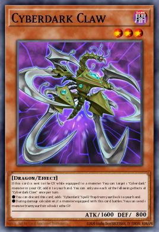 **Cyberdark Claw**
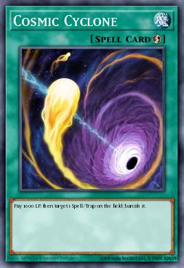 **Cosmic Cyclone**
 **Cyber Dragon Core**
 **Cyber Dragon**

### Ejecución numerada

#### Paso 1 — En Main Phase, activar el efecto de Claw desde mano descartando Claw como COSTE (mano→GY); al resolver buscar Cyberdark Realm del Deck a mano.

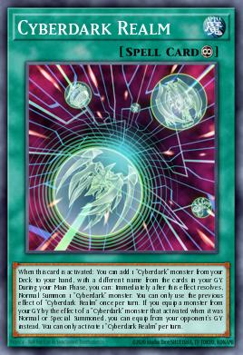 **AÑADIR A MANO**

**Acción concreta:** En Main Phase, activar el efecto de Claw desde mano descartando Claw como COSTE (mano→GY); al resolver buscar Cyberdark Realm del Deck a mano. No equipar Claw ni activar su efecto de batalla: está en GY como monstruo.
**Detalle técnico documentado:** No equipar Claw ni activar su efecto de batalla: está en GY como monstruo.

**Estado por zonas después del paso:**

| Zona/recurso | Estado narrativo A09 |
|---|---|
| Mano | Ciclón del Cosmos, Core #10866, Cyber Dragon #6390 y Realm #16298 |
| Monstruos | — |
| Mágicas y trampas | — |
| Cementerio | Cyberdark Claw #13181 en GY (coste) |
| Destierro propio | — |
| Campo y estado rival | Sin cambios adversarios demostrados |
| Materiales Xyz/Fusión/Sincro | — |
| Normal, Extra, fase y restricciones | Normal ordinaria y adicional sin gastar; Extra intacto |

**Campo visual de este paso:**

**Monstruos propios:** sin carta propia demostrada en esta vista.
**Mágicas/Trampas/Campo:** sin carta propia demostrada en esta vista.
*Relación ilustrada de cartas presentes tras este paso, documentada en A09. La posición, materiales, otras zonas y rival se leen en la tabla de estado.*

#### Paso 2 — Activar Cyberdark Realm desde mano como Mágica Continua (CL1); al resolver su efecto de activación añadir Cyberdark Chimera desde Deck a mano.

 **ACTIVAR** → 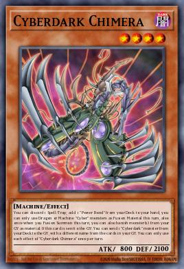 **AÑADIR A MANO**

**Acción concreta:** Activar Cyberdark Realm desde mano como Mágica Continua (CL1); al resolver su efecto de activación añadir Cyberdark Chimera desde Deck a mano. Es legal porque en GY está Claw pero no hay otra Chimera. Realm queda boca arriba en M/T.
**Detalle técnico documentado:** Es legal porque en GY está Claw pero no hay otra Chimera. Realm queda boca arriba en M/T.

**Estado por zonas después del paso:**

| Zona/recurso | Estado narrativo A09 |
|---|---|
| Mano | Ciclón del Cosmos, Core #10866, Cyber Dragon #6390 y Chimera #16296 |
| Monstruos | — |
| Mágicas y trampas | Cyberdark Realm #16298 (Continua boca arriba) |
| Cementerio | Claw en GY |
| Destierro propio | — |
| Campo y estado rival | Sin cambios adversarios demostrados |
| Materiales Xyz/Fusión/Sincro | — |
| Normal, Extra, fase y restricciones | Normal ordinaria libre; Normal adicional de Realm disponible |

**Campo visual de este paso:**

**Monstruos propios:** sin carta propia demostrada en esta vista.
**Mágicas/Trampas/Campo:**
-  **Cyberdark Realm (Continua boca arriba)** — zona declarada: `SPELL_TRAP`.
*Relación ilustrada de cartas presentes tras este paso, documentada en A09. La posición, materiales, otras zonas y rival se leen en la tabla de estado.*

#### Paso 3 — Durante Main Phase, activar el efecto de Realm de Invocación Normal adicional y, justo después de resolverlo, Invocar Normalmente Chimera desde mano.

 **NORMAL**

**Acción concreta:** Durante Main Phase, activar el efecto de Realm de Invocación Normal adicional y, justo después de resolverlo, Invocar Normalmente Chimera desde mano. Esta Normal es la habilitada por Realm, separada de la Normal ordinaria del turno; no se ha consumido todavía la que se destina a Core. Chimera en Campo (Máquina OSCURIDAD, ATK 800).
**Detalle técnico documentado:** Esta Normal es la habilitada por Realm, separada de la Normal ordinaria del turno; no se ha consumido todavía la que se destina a Core. Chimera en Campo (Máquina OSCURIDAD, ATK 800).

**Estado por zonas después del paso:**

| Zona/recurso | Estado narrativo A09 |
|---|---|
| Mano | Ciclón del Cosmos, Core #10866 y Cyber Dragon #6390 |
| Monstruos | Cyberdark Chimera #16296 (Ataque, 800 ATK) |
| Mágicas y trampas | Realm #16298 (Continua) |
| Cementerio | Claw en GY |
| Destierro propio | — |
| Campo y estado rival | Sin cambios adversarios demostrados |
| Materiales Xyz/Fusión/Sincro | — |
| Normal, Extra, fase y restricciones | Normal adicional de Realm gastada; Normal ordinaria libre |

**Campo visual de este paso:**

**Monstruos propios:**
-  **Cyberdark Chimera (Ataque, 800 ATK)** — zona declarada: `MONSTER`.
**Mágicas/Trampas/Campo:**
-  **Realm (Continua)** — zona declarada: `SPELL_TRAP`.
*Relación ilustrada de cartas presentes tras este paso, documentada en A09. La posición, materiales, otras zonas y rival se leen en la tabla de estado.*

#### Paso 4 — Activar el efecto de Chimera descartando Ciclón del Cosmos de la mano COMO COSTE; al resolver añadir Power Bond desde Deck a mano.

 **ACTIVAR** → 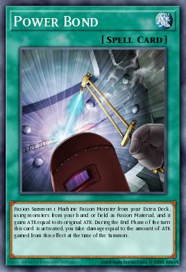 **AÑADIR A MANO**

**Acción concreta:** Activar el efecto de Chimera descartando Ciclón del Cosmos de la mano COMO COSTE; al resolver añadir Power Bond desde Deck a mano. Se establece para este turno la restricción de que sólo se pueden usar como materiales de Fusión monstruos «Cyber» de tipo Dragón o Máquina; también permite desterrar materiales del GY en una Fusión durante el turno, pero no es necesario usar esa opción en esta ruta. Ciclón en GY, sin efecto propio de destierro activado.
**Detalle técnico documentado:** Se establece para este turno la restricción de que sólo se pueden usar como materiales de Fusión monstruos «Cyber» de tipo Dragón o Máquina; también permite desterrar materiales del GY en una Fusión durante el turno, pero no es necesario usar esa opción en esta ruta. Ciclón en GY, sin efecto propio de destierro activado.

**Estado por zonas después del paso:**

| Zona/recurso | Estado narrativo A09 |
|---|---|
| Mano | Core #10866, Cyber Dragon #6390 y Power Bond #6398 |
| Monstruos | Chimera #16296 (Ataque) |
| Mágicas y trampas | Realm #16298 (Continua) |
| Cementerio | Claw #13181 y Ciclón del Cosmos en GY (descarte, no activación) |
| Destierro propio | — |
| Campo y estado rival | Sin cambios adversarios demostrados |
| Materiales Xyz/Fusión/Sincro | — |
| Normal, Extra, fase y restricciones | Normal adicional gastada; ordinaria libre; Fusión restringida a Dragones/Máquinas Cyber |

**Campo visual de este paso:**

**Monstruos propios:**
-  **Chimera (Ataque)** — zona declarada: `MONSTER`.
**Mágicas/Trampas/Campo:**
-  **Realm (Continua)** — zona declarada: `SPELL_TRAP`.
*Relación ilustrada de cartas presentes tras este paso, documentada en A09. La posición, materiales, otras zonas y rival se leen en la tabla de estado.*

#### Paso 5 — Efectuar la Normal ordinaria del turno con Cyber Dragon Core desde mano; activar su búsqueda CL1 y, al resolver, añadir Cyber Emergency desde Deck a mano.

 **ESTADO / CONTEXTO** → 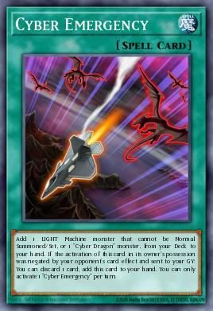 **AÑADIR A MANO** →  **YA EN CAMPO**

**Acción concreta:** Efectuar la Normal ordinaria del turno con Cyber Dragon Core desde mano; activar su búsqueda CL1 y, al resolver, añadir Cyber Emergency desde Deck a mano. Core queda boca arriba en Campo, por lo que su nombre actual es «Cyber Dragon». Chimera permanece como monstruo separado; Realm boca arriba.
**Detalle técnico documentado:** Core queda boca arriba en Campo, por lo que su nombre actual es «Cyber Dragon». Chimera permanece como monstruo separado; Realm boca arriba.

**Estado por zonas después del paso:**

| Zona/recurso | Estado narrativo A09 |
|---|---|
| Mano | Cyber Dragon #6390, Power Bond #6398 y Cyber Emergency #8428 |
| Monstruos | Chimera #16296 (Ataque), Core #10866 (Ataque, se llama Cyber Dragon en Campo) |
| Mágicas y trampas | Realm #16298 (Continua) |
| Cementerio | Claw y Ciclón del Cosmos en GY |
| Destierro propio | — |
| Campo y estado rival | Sin cambios adversarios demostrados |
| Materiales Xyz/Fusión/Sincro | — |
| Normal, Extra, fase y restricciones | Normales ordinaria y adicional gastadas; Extra intacto |

**Campo visual de este paso:**

**Monstruos propios:**
-  **Chimera (Ataque)** — zona declarada: `MONSTER`.
-  **Core (Ataque, se llama Cyber Dragon en Campo)** — zona declarada: `MONSTER`.
**Mágicas/Trampas/Campo:**
-  **Realm (Continua)** — zona declarada: `SPELL_TRAP`.
*Relación ilustrada de cartas presentes tras este paso, documentada en A09. La posición, materiales, otras zonas y rival se leen en la tabla de estado.*

#### Paso 6 — Activar Power Bond Power Bond, seleccionando Cyber Dragon original desde mano + Core desde Campo (nombre «Cyber Dragon»), ambos Máquinas «Cyber» válidos para la restricción de Chimera.

 **OBJETIVO** →  **MATERIAL XYZ** →  **YA EN CAMPO**

**Acción concreta:** Activar Power Bond Power Bond, seleccionando Cyber Dragon original desde mano + Core desde Campo (nombre «Cyber Dragon»), ambos Máquinas «Cyber» válidos para la restricción de Chimera. Al resolver enviarlos al GY como materiales de Fusión e Invocar Chimeratech Rampage Dragon desde Extra. Tiene ATK original 2100 y gana otros 2100 ATK → ATK actual 4200 por Power Bond. Core y Cyber Dragon original están ahora en GY; Chimera sigue en Campo y no fue material. Power Bond termina en GY. El efecto opcional de Rampage de destruir M/T puede no activarse: no afirmar destrucción sin objetivos.
**Detalle técnico documentado:** Al resolver enviarlos al GY como materiales de Fusión e Invocar Chimeratech Rampage Dragon desde Extra. Tiene ATK original 2100 y gana otros 2100 ATK → ATK actual 4200 por Power Bond. Core y Cyber Dragon original están ahora en GY; Chimera sigue en Campo y no fue material. Power Bond termina en GY. El efecto opcional de Rampage de destruir M/T puede no activarse: no afirmar destrucción sin objetivos.

**Estado por zonas después del paso:**

| Zona/recurso | Estado narrativo A09 |
|---|---|
| Mano | Cyber Emergency #8428 |
| Monstruos | Chimera #16296 (Ataque), Rampage #11764 (Ataque, ATK 4200 por Power Bond) |
| Mágicas y trampas | Realm #16298 (Continua) |
| Cementerio | Claw, Ciclón, Cyber Dragon original #6390, Core #10866 y Power Bond #6398 en GY |
| Destierro propio | — |
| Campo y estado rival | Sin objetivos M/T rivales atribuidos ni batalla declarada |
| Materiales Xyz/Fusión/Sincro | Fusión: Cyber Dragon de mano y Core de Campo enviados a GY; no son Xyz |
| Normal, Extra, fase y restricciones | Ambas Normales gastadas; Rampage ya salió del Extra; 2100 LP de daño propio pendiente en End Phase, no un coste de activación |

**Campo visual de este paso:**

**Monstruos propios:**
-  **Chimera (Ataque)** — zona declarada: `MONSTER`.
-  **Rampage (Ataque, ATK 4200 por Power Bond)** — zona declarada: `MONSTER`.
**Mágicas/Trampas/Campo:**
-  **Realm (Continua)** — zona declarada: `SPELL_TRAP`.
*Relación ilustrada de cartas presentes tras este paso, documentada en A09. La posición, materiales, otras zonas y rival se leen en la tabla de estado.*

#### Paso 7 — En Main Phase activar el segundo efecto de Rampage (una vez por turno), enviando solamente Herz, Máquina LUZ, desde Deck al GY por efecto.

 **ACTIVAR** →  **OBJETIVO**

**Acción concreta:** En Main Phase activar el segundo efecto de Rampage (una vez por turno), enviando solamente Herz, Máquina LUZ, desde Deck al GY por efecto; al resolver Rampage obtiene un ataque adicional en cada Battle Phase de ese turno (hasta dos ataques en total). Después de esa cadena, activar desde GY el efecto de Herz (cadena nueva): seleccionar Cyber Dragon original en GY, una carta «Cyber Dragon» distinta de Herz, y añadirla a la mano. No usar simultáneamente el efecto de Herz de cambiar su Nivel por Invocación Especial: Herz no fue Invocado.
**Detalle técnico documentado:** al resolver Rampage obtiene un ataque adicional en cada Battle Phase de ese turno (hasta dos ataques en total). Después de esa cadena, activar desde GY el efecto de Herz (cadena nueva): seleccionar Cyber Dragon original en GY, una carta «Cyber Dragon» distinta de Herz, y añadirla a la mano. No usar simultáneamente el efecto de Herz de cambiar su Nivel por Invocación Especial: Herz no fue Invocado.

**Estado por zonas después del paso:**

| Zona/recurso | Estado narrativo A09 |
|---|---|
| Mano | Cyber Emergency #8428 y Cyber Dragon original #6390 recuperado |
| Monstruos | Chimera #16296 (Ataque), Rampage #11764 (ATK 4200; 2 ataques potenciales este turno) |
| Mágicas y trampas | Realm #16298 (Continua) |
| Cementerio | Claw, Ciclón, Core, Power Bond y Herz #13723 en GY |
| Destierro propio | — |
| Campo y estado rival | Sin ataques, daño ni destrucciones acreditados |
| Materiales Xyz/Fusión/Sincro | — |
| Normal, Extra, fase y restricciones | Ambas Normales gastadas; Rampage usado del Extra; Power Bond causará 2100 LP propios en End Phase |

**Campo visual de este paso:**

**Monstruos propios:**
-  **Chimera (Ataque)** — zona declarada: `MONSTER`.
-  **Rampage (ATK 4200; 2 ataques potenciales este turno)** — zona declarada: `MONSTER`.
**Mágicas/Trampas/Campo:**
-  **Realm (Continua)** — zona declarada: `SPELL_TRAP`.
*Relación ilustrada de cartas presentes tras este paso, documentada en A09. La posición, materiales, otras zonas y rival se leen en la tabla de estado.*

#### Paso 8 — End Phase de este mismo turno: por el efecto ya resuelto de Power Bond el jugador recibe 2100 LP de daño propio, cifra igual al ATK que recibió Rampage al Invocarse.

 **ESTADO / CONTEXTO** →  **ESTADO / CONTEXTO**

**Acción concreta:** End Phase de este mismo turno: por el efecto ya resuelto de Power Bond el jugador recibe 2100 LP de daño propio, cifra igual al ATK que recibió Rampage al Invocarse. Este daño no es daño al rival y no depende de que se haya declarado algún ataque; si se termina el turno con LP insuficientes puede perderse el Duelo. No se declaró ataque ni se presupuso campo rival vacío para generar OTK.
**Detalle técnico documentado:** Este daño no es daño al rival y no depende de que se haya declarado algún ataque; si se termina el turno con LP insuficientes puede perderse el Duelo. No se declaró ataque ni se presupuso campo rival vacío para generar OTK.

**Estado por zonas después del paso:**

| Zona/recurso | Estado narrativo A09 |
|---|---|
| Mano | Cyber Emergency #8428 y Cyber Dragon original #6390 |
| Monstruos | Chimera #16296 (Ataque), Rampage #11764 (ATK 4200 mientras se mantenga la ganancia de Power Bond; ataques extra expirados) |
| Mágicas y trampas | Realm #16298 (Continua) |
| Cementerio | Claw, Ciclón, Core, Power Bond y Herz en GY |
| Destierro propio | — |
| Campo y estado rival | Sin daño rival garantizado; se aplica daño propio de 2100 LP en End Phase |
| Materiales Xyz/Fusión/Sincro | — |
| Normal, Extra, fase y restricciones | Ambas Normales gastadas; termina la autorización de ataques extra de este turno |

**Campo visual de este paso:**

**Monstruos propios:**
-  **Chimera (Ataque)** — zona declarada: `MONSTER`.
-  **Rampage (ATK 4200 mientras se mantenga la ganancia de Power Bond; ataques extra expirados)** — zona declarada: `MONSTER`.
**Mágicas/Trampas/Campo:**
-  **Realm (Continua)** — zona declarada: `SPELL_TRAP`.
*Relación ilustrada de cartas presentes tras este paso, documentada en A09. La posición, materiales, otras zonas y rival se leen en la tabla de estado.*

### Campo final documentado

Esta vista procede **del último paso**, no de una lista de cartas deducida del título.

**Monstruos propios:**
-  **Chimera (Ataque)** — zona declarada: `MONSTER`.
-  **Rampage (ATK 4200 mientras se mantenga la ganancia de Power Bond; ataques extra expirados)** — zona declarada: `MONSTER`.
**Mágicas/Trampas/Campo:**
-  **Realm (Continua)** — zona declarada: `SPELL_TRAP`.
*Relación ilustrada de cartas presentes tras este paso, documentada en A09. La posición, materiales, otras zonas y rival se leen en la tabla de estado.*

| Zona/recurso | Estado final documentado |
|---|---|
| Mano | Cyber Emergency #8428 y Cyber Dragon original #6390 |
| Monstruos | Chimera #16296 (Ataque), Rampage #11764 (ATK 4200 mientras se mantenga la ganancia de Power Bond; ataques extra expirados) |
| Mágicas y trampas | Realm #16298 (Continua) |
| Cementerio | Claw, Ciclón, Core, Power Bond y Herz en GY |
| Destierro propio | — |
| Campo y estado rival | Sin daño rival garantizado; se aplica daño propio de 2100 LP en End Phase |
| Materiales Xyz/Fusión/Sincro | — |
| Normal, Extra, fase y restricciones | Ambas Normales gastadas; termina la autorización de ataques extra de este turno |

### Si el oponente interrumpe

- **INTERRUPCIÓN A12 — paso sin anclaje confirmado: A12 — Ash al efecto de envío de Rampage**
  - Condicional: el oponente tiene Ash Blossom disponible, y Rampage activa en Main Phase el efecto que incluye enviar 2 Máquinas LUZ del Deck al GY. CL1: Rampage; CL2: Ash descartada para negar ese efecto. Resolver CL2 primero: no se envían los dos monstruos ni se ganan ataques adicionales de ese efecto.
  - No afirmar que Ash niega Overload Fusion por sí misma: Overload Fusion utiliza material de Campo/GY, no añade ni envía desde Deck. No atribuir un resultado universal a una carta de respuesta fuera de su texto.
  - Fuente: Ash Blossom y Rampage. Estado.
  - Estado de rama: `Resuelto solo en el escenario que detalla A12/A13; las otras respuestas no están demostradas.`.
- **RECUPERACIÓN A13 — paso sin anclaje confirmado: A13 — Rama Rampage al recibir Ash**
  - La Invocación por Fusión ya se resolvió. Recursos ya consumidos: Overload en GY; Core y Herz desterrados. Ash rival descartada como coste. Negado: el efecto de enviar 2 Máquinas LUZ desde Deck y ganar ataques adicionales.
  - Campo alternativo: Rampage todavía en Campo (si nada más lo retira), con solo su ataque normal disponible en ese turno; si el efecto de destrucción de M/T se resolvió antes, sus resultados permanecen condicionados al estado en que se resolvió. Cyber Dragon y Nachster siguen en Deck en esta rama.
  - Continuación con los recursos mínimos descritos: SIN_CONTINUACION_DEMOSTRADA para obtener los dos ataques adicionales; otras cartas de mano requieren variantes independientes. Estado.
  - Estado de rama: `Resuelto solo en el escenario que detalla A12/A13; las otras respuestas no están demostradas.`.

---

## CLOCKWORK · FORTRESS01 · `684:A09:CLOCKWORK:FORTRESS01`

**Propósito competitivo principal (lectura documental):** Romper campo. El objetivo solo se acredita si las acciones y el campo final detallados en esta guía lo permiten; no implica legalidad certificada ni garantiza el resultado ante respuestas adversarias.

**Categoría:** APERTURA

**Propósito y resultado documental:**

Tablero final: propio Fortress (ATK original 2000), Clockwork Night continua boca arriba, Cyber Emergency en mano; GY propio Core, GY rival su monstruo enviado. Clockwork Night no añade 500 ATK a Fortress de forma original: mientras siga boca arriba, concede 500 ATK continuo, por lo que el ATK actual de Fortress es 2500. Se exige indicar ambos valores por separado. No se garantiza OTK ni destruir/desterrar todo un Campo adversario.

### Mano y estado inicial

1× Cyber Dragon Core + 1× Clockwork Night. Deck propio: 1× Cyber Emergency disponible para la búsqueda. Extra Deck: 1× Chimeratech Fortress Dragon disponible. Campo inicial: propio vacío, rival controla 1 monstruo boca arriba (por ejemplo, de tipo Guerrero); no hay otras restricciones ni respuestas adversarias. Es Main Phase propia y la Normal Summon sigue disponible.

 **Cyber Dragon Core**
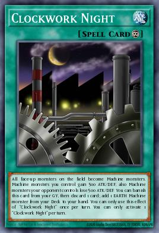 **Clockwork Night**

### Ejecución numerada

#### Paso 1 — Activar Clockwork Night de la mano como Mágica Continua; dejar resolver (CL1).

 **ACTIVAR**

**Acción concreta:** Activar Clockwork Night de la mano como Mágica Continua; dejar resolver (CL1).
**Detalle técnico documentado:** El monstruo rival boca arriba pasa a ser Máquina. Clockwork Night permanece boca arriba en nuestra Zona de M/T.

**Estado por zonas después del paso:**

| Zona/recurso | Estado narrativo A09 |
|---|---|
| Mano | Cyber Dragon Core #10866 |
| Monstruos | — |
| Mágicas y trampas | Clockwork Night #17625 (Continua boca arriba) |
| Cementerio | — |
| Destierro propio | — |
| Campo y estado rival | Monstruo rival boca arriba de identidad variable, ahora Máquina por Clockwork Night |
| Materiales Xyz/Fusión/Sincro | — |
| Normal, Extra, fase y restricciones | Normal disponible; Fortress continúa en Extra |

**Campo visual de este paso:**

**Monstruos propios:** sin carta propia demostrada en esta vista.
**Mágicas/Trampas/Campo:**
-  **Clockwork Night (Continua boca arriba)** — zona declarada: `SPELL_TRAP`.
*Relación ilustrada de cartas presentes tras este paso, documentada en A09. La posición, materiales, otras zonas y rival se leen en la tabla de estado.*

#### Paso 2 — Invocar Normal Cyber Dragon Core. Al ser Invocado, se activa su búsqueda en nueva cadena (CL1) y se añade Cyber Emergency del Deck al resolver, si nadie responde.

 **ESTADO / CONTEXTO** →  **ACTIVAR** → 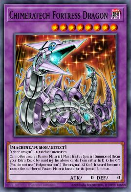 **ACTIVAR**

**Acción concreta:** Invocar Normal Cyber Dragon Core. Al ser Invocado, se activa su búsqueda en nueva cadena (CL1) y se añade Cyber Emergency del Deck al resolver, si nadie responde.
**Detalle técnico documentado:** Core está boca arriba en Campo, donde su nombre es «Cyber Dragon». Cyber Emergency queda en mano; no se activa ni es requisito para Fortress.

**Estado por zonas después del paso:**

| Zona/recurso | Estado narrativo A09 |
|---|---|
| Mano | Cyber Emergency #8428 |
| Monstruos | Cyber Dragon Core #10866 (Ataque, se llama Cyber Dragon en Campo) |
| Mágicas y trampas | Clockwork Night #17625 (Continua) |
| Cementerio | — |
| Destierro propio | — |
| Campo y estado rival | Monstruo rival elegible sigue boca arriba como Máquina |
| Materiales Xyz/Fusión/Sincro | — |
| Normal, Extra, fase y restricciones | Normal gastada; Fortress en Extra |

**Campo visual de este paso:**

**Monstruos propios:**
-  **Cyber Dragon Core (Ataque, se llama Cyber Dragon en Campo)** — zona declarada: `MONSTER`.
**Mágicas/Trampas/Campo:**
-  **Clockwork Night (Continua)** — zona declarada: `SPELL_TRAP`.
*Relación ilustrada de cartas presentes tras este paso, documentada en A09. La posición, materiales, otras zonas y rival se leen en la tabla de estado.*

#### Paso 3 — En Main Phase, aplicar el procedimiento de Chimeratech Fortress Dragon: enviar al GY Core propio (nombre Cyber Dragon en Campo) y el monstruo rival que Clockwork Night vuelve Máquina.

 **ESTADO / CONTEXTO** →  **ENVIAR** →  **ENVIAR**

**Acción concreta:** En Main Phase, aplicar el procedimiento de Chimeratech Fortress Dragon: enviar al GY Core propio (nombre Cyber Dragon en Campo) y el monstruo rival que Clockwork Night vuelve Máquina. Invocar Fortress desde el Extra.
**Detalle técnico documentado:** Invocar Fortress desde el Extra. Son exactamente 2 materiales; Fortress queda en nuestra Zona de Monstruos. No se usa efecto que seleccione objetivo ni una Fusión con carta mágica.

**Estado por zonas después del paso:**

| Zona/recurso | Estado narrativo A09 |
|---|---|
| Mano | Cyber Emergency #8428 |
| Monstruos | Chimeratech Fortress Dragon #7403 (Ataque, 2000 ATK original; 2500 actual por Clockwork Night) |
| Mágicas y trampas | Clockwork Night #17625 (Continua) |
| Cementerio | Cyber Dragon Core #10866 en GY propio |
| Destierro propio | — |
| Campo y estado rival | Monstruo rival desconocido enviado a su GY como material, no destruido; resto del campo rival no definido |
| Materiales Xyz/Fusión/Sincro | Contacto: Core propio y monstruo Máquina rival enviados a sus respectivos GY; sin Xyz |
| Normal, Extra, fase y restricciones | Normal gastada; Fortress salió del Extra por procedimiento sin Cadena |

**Campo visual de este paso:**

**Monstruos propios:**
-  **Chimeratech Fortress Dragon (Ataque, 2000 ATK original; 2500 actual por Clockwork Night)** — zona declarada: `MONSTER`.
**Mágicas/Trampas/Campo:**
-  **Clockwork Night (Continua)** — zona declarada: `SPELL_TRAP`.
*Relación ilustrada de cartas presentes tras este paso, documentada en A09. La posición, materiales, otras zonas y rival se leen en la tabla de estado.*

### Campo final documentado

Esta vista procede **del último paso**, no de una lista de cartas deducida del título.

**Monstruos propios:**
-  **Chimeratech Fortress Dragon (Ataque, 2000 ATK original; 2500 actual por Clockwork Night)** — zona declarada: `MONSTER`.
**Mágicas/Trampas/Campo:**
-  **Clockwork Night (Continua)** — zona declarada: `SPELL_TRAP`.
*Relación ilustrada de cartas presentes tras este paso, documentada en A09. La posición, materiales, otras zonas y rival se leen en la tabla de estado.*

| Zona/recurso | Estado final documentado |
|---|---|
| Mano | Cyber Emergency #8428 |
| Monstruos | Chimeratech Fortress Dragon #7403 (Ataque, 2000 ATK original; 2500 actual por Clockwork Night) |
| Mágicas y trampas | Clockwork Night #17625 (Continua) |
| Cementerio | Cyber Dragon Core #10866 en GY propio |
| Destierro propio | — |
| Campo y estado rival | Monstruo rival desconocido enviado a su GY como material, no destruido; resto del campo rival no definido |
| Materiales Xyz/Fusión/Sincro | Contacto: Core propio y monstruo Máquina rival enviados a sus respectivos GY; sin Xyz |
| Normal, Extra, fase y restricciones | Normal gastada; Fortress salió del Extra por procedimiento sin Cadena |

### Si el oponente interrumpe

- **INTERRUPCIÓN A12 — paso sin anclaje confirmado: A12 — Dos interrupciones legales de 684:A09:CLOCKWORK:FORTRESS01**
  - 1. Ash Blossom sobre la búsqueda de Core: tras la Normal Summon y el efecto de Core (CL1), el rival descarta Ash (CL2), que niega el efecto de añadir Cyber Emergency. No se niega el cambio de nombre continuo de Core en Campo. Con Clockwork Night activa y el monstruo rival boca arriba, sigue siendo posible Invocar Fortress usando esos dos materiales. La diferencia frente a la ruta sin respuesta es no ganar Emergency en mano.
  - 2. Effect Veiler sobre Core durante nuestra Main Phase: en respuesta al efecto de búsqueda de Core (CL1), el rival descarta Veiler (CL2) y niega los efectos de Core hasta el final del turno. Queda negada la búsqueda y el cambio de nombre continuo de Core. Aunque Clockwork Night convierte a ambos monstruos boca arriba en Máquina, Core ya no tiene el nombre exacto «Cyber Dragon»; el procedimiento a Fortress no es legal usando únicamente esos dos monstruos. No atribuir negación de Clockwork Night a Veiler.
  - Ambas respuestas son escenarios separados, con recursos adversarios supuestos disponibles y sin otras jugadas añadidas. Fuentes oficiales Ash, Effect Veiler, Core. Estado:.
  - Estado de rama: `Resuelto solo en el escenario que detalla A12/A13; las otras respuestas no están demostradas.`.
- **RECUPERACIÓN A13 — paso sin anclaje confirmado: A13 — Ramas de 684:A09:CLOCKWORK:FORTRESS01**
  - Punto de interrupción | Recursos propios posteriores | Tablero/continuación legal | Resultado
  - Ash sobre Core CL2 | Clockwork Night boca arriba; Core aún «Cyber Dragon» en Campo; monstruo rival vuelto Máquina; no se añadió Emergency. | Invocar Fortress por procedimiento con Core + monstruo rival. Fortress ATK original 2000, actual 2500 bajo Clockwork. |, pero sin carta buscada.
  - Veiler sobre Core CL2 | Clockwork Night boca arriba; Core sigue físicamente en Campo, pero sin su cambio de nombre; monstruo rival Máquina; no se añadió Emergency. | No es legal usar Core como «Cyber Dragon» para Fortress con solo estos recursos. El tablero residual consta de Core y Clockwork Night propios, y el monstruo rival aún en Campo. |; otras cartas de la mano no supuestas.
  - Límite de cobertura: estas dos ramas no demuestran que el deck gane o pierda el duelo y no autorizan importar el combo sin completar A10 y la casilla de aprobación individual.
  - Estado de rama: `Resuelto solo en el escenario que detalla A12/A13; las otras respuestas no están demostradas.`.

---

## MEGAFLEET · CYBER01 · `684:A09:MEGAFLEET:CYBER01`

**Propósito competitivo principal (lectura documental):** Ofensivo condicional. El objetivo solo se acredita si las acciones y el campo final detallados en esta guía lo permiten; no implica legalidad certificada ni garantiza el resultado ante respuestas adversarias.

**Categoría:** APERTURA

**Propósito y resultado documental:**

Endboard sin respuesta: Megafleet Megafleet boca arriba, ATK original y actual 2400 = 1200 × 2 materiales (si no hay modificadores adicionales); Cyber Dragon en GY propio; monstruo rival de Zona Extra en GY rival; mano inicial consumida, Normal libre, sin destierros/daño causado ni negación inherente. En ausencia de cartas adicionales no se acredita ataque letal ni más Invocaciones. Principal vulnerabilidad: si desaparece el monstruo de Zona Extra antes del procedimiento, esta línea mínima ya no puede usarlo. No suponer inmunidades ni saltarse impedimentos que prohíban enviar cartas al GY. Valor táctico: retirar una pieza rival del Extra sin utilizar una carta de Fusión; conservar la Normal para el siguiente starter si existe.

### Mano y estado inicial

Cyber Dragon 1× Cyber Dragon original; no presuponer búsquedas.

 **Cyber Dragon**

### Ejecución numerada

#### Paso 1 — Con solo monstruos del oponente en Campo, aplicar el procedimiento propio de Cyber Dragon Cyber Dragon desde mano.

 **YA EN CAMPO**

**Acción concreta:** Con solo monstruos del oponente en Campo, aplicar el procedimiento propio de Cyber Dragon Cyber Dragon desde mano: Invocarlo Especialmente en una Zona de Monstruos Principal propia, Ataque, 2100 ATK.
**Detalle técnico documentado:** Invocarlo Especialmente en una Zona de Monstruos Principal propia, Ataque, 2100 ATK. Cyber Dragon pasa mano→Campo; no se gasta Normal. Esta Invocación propia no inicia Cadena; no adjudicar búsqueda ni daño.

**Estado por zonas después del paso:**

| Zona/recurso | Estado narrativo A09 |
|---|---|
| Mano | Mano mínima agotada |
| Monstruos | Cyber Dragon original #6390 (Ataque, 2100 ATK) |
| Mágicas y trampas | — |
| Cementerio | — |
| Destierro propio | — |
| Campo y estado rival | Monstruo rival boca arriba de identidad variable aún ocupa Zona de Monstruos Extra |
| Materiales Xyz/Fusión/Sincro | — |
| Normal, Extra, fase y restricciones | Normal sin gastar; Megafleet disponible en Extra |

**Campo visual de este paso:**

**Monstruos propios:**
-  **Cyber Dragon original (Ataque, 2100 ATK)** — zona declarada: `MONSTER`.
**Mágicas/Trampas/Campo:** sin carta propia demostrada en esta vista.
*Relación ilustrada de cartas presentes tras este paso, documentada en A09. La posición, materiales, otras zonas y rival se leen en la tabla de estado.*

#### Paso 2 — En Main Phase, realizar la Invocación Especial por procedimiento de contacto de Megafleet Chimeratech Megafleet Dragon desde Extra, enviando al GY Cyber Dragon propio y el monstruo rival que estaba en Zona de Monstruos Extra como sus dos materiales.

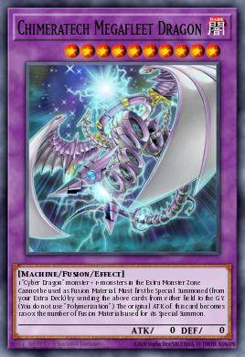 **ESPECIAL** →  **ENVIAR**

**Acción concreta:** En Main Phase, realizar la Invocación Especial por procedimiento de contacto de Megafleet Chimeratech Megafleet Dragon desde Extra, enviando al GY Cyber Dragon propio y el monstruo rival que estaba en Zona de Monstruos Extra como sus dos materiales.
**Detalle técnico documentado:** Cyber Dragon sale del Campo al GY propio; el monstruo rival va a su GY. Megafleet entra a Zona propia legal desde Extra en Ataque. No activar Polymerization, no seleccionar objetivo por efecto, no tratar el envío como destrucción. Este procedimiento de Invocación no inicia Cadena.

**Estado por zonas después del paso:**

| Zona/recurso | Estado narrativo A09 |
|---|---|
| Mano | — |
| Monstruos | Chimeratech Megafleet Dragon #13358 (Ataque, 2400 ATK con 2 materiales de Fusión usados) |
| Mágicas y trampas | — |
| Cementerio | Cyber Dragon original #6390 en GY |
| Destierro propio | — |
| Campo y estado rival | El monstruo rival de Zona Extra fue enviado a su GY como material; otras cartas rivales no determinadas |
| Materiales Xyz/Fusión/Sincro | Contacto: Cyber Dragon propio y cuerpo de Zona Extra rival enviados a GY; Megafleet no conserva materiales Xyz |
| Normal, Extra, fase y restricciones | Normal sin gastar; Megafleet salió del Extra |

**Campo visual de este paso:**

**Monstruos propios:**
-  **Chimeratech Megafleet Dragon (Ataque, 2400 ATK con 2 materiales de Fusión usados)** — zona declarada: `MONSTER`.
**Mágicas/Trampas/Campo:** sin carta propia demostrada en esta vista.
*Relación ilustrada de cartas presentes tras este paso, documentada en A09. La posición, materiales, otras zonas y rival se leen en la tabla de estado.*

### Campo final documentado

Esta vista procede **del último paso**, no de una lista de cartas deducida del título.

**Monstruos propios:**
-  **Chimeratech Megafleet Dragon (Ataque, 2400 ATK con 2 materiales de Fusión usados)** — zona declarada: `MONSTER`.
**Mágicas/Trampas/Campo:** sin carta propia demostrada en esta vista.
*Relación ilustrada de cartas presentes tras este paso, documentada en A09. La posición, materiales, otras zonas y rival se leen en la tabla de estado.*

| Zona/recurso | Estado final documentado |
|---|---|
| Mano | — |
| Monstruos | Chimeratech Megafleet Dragon #13358 (Ataque, 2400 ATK con 2 materiales de Fusión usados) |
| Mágicas y trampas | — |
| Cementerio | Cyber Dragon original #6390 en GY |
| Destierro propio | — |
| Campo y estado rival | El monstruo rival de Zona Extra fue enviado a su GY como material; otras cartas rivales no determinadas |
| Materiales Xyz/Fusión/Sincro | Contacto: Cyber Dragon propio y cuerpo de Zona Extra rival enviados a GY; Megafleet no conserva materiales Xyz |
| Normal, Extra, fase y restricciones | Normal sin gastar; Megafleet salió del Extra |

### Si el oponente interrumpe

No se documenta una continuación alternativa con los recursos indicados.

---

## MEGAFLEET · CORE01 · `684:A09:MEGAFLEET:CORE01`

**Propósito competitivo principal (lectura documental):** Ofensivo condicional. El objetivo solo se acredita si las acciones y el campo final detallados en esta guía lo permiten; no implica legalidad certificada ni garantiza el resultado ante respuestas adversarias.

**Categoría:** APERTURA

**Propósito y resultado documental:**

Endboard demostrado: Megafleet 2400 ATK, Cyber Emergency en mano, Core en GY, Normal gastada; 0 daño garantizado, 0 negaciones inherentes. El efecto de Core de buscar en su Invocación Normal sí fue utilizado; no atribuirle un segundo efecto activado el mismo turno. Si la búsqueda se niega, el desenlace con Emergency en mano deja de estar demostrado, aunque Core siga contando como Cyber Dragon en Campo y el procedimiento Megafleet pueda volver a evaluarse con los materiales; esa rama pertenece a A12–A13. La modalidad CYBER01 conserva Normal; esta modalidad CORE01 cambia recursos y exposición a respuestas, así que no fusionar sus fichas. Siguiente acción: producir sus dos vistas A10 por separado y verificar respuestas sobre cada momento. Fuentes Core (CID 10866) y Megafleet (CID 13358).;; NO PARA IMPORTAR.

### Mano y estado inicial

Core 1× Cyber Dragon Core. Condición rival: al menos 1 monstruo no Péndulo/no Ficha boca arriba en Zona de Monstruos Extra, elegible para ser enviado al GY, no en una zona principal ordinaria. Main Phase propia, Campo propio vacío, GY/destierro vacíos, Normal disponible, una copia de Emergency Cyber Emergency en Deck y una de Megafleet Megafleet en Extra. Sin respuestas en la línea canónica.

 **Cyber Dragon Core**

### Ejecución numerada

#### Paso 1 — Invocar Normalmente Cyber Dragon Core a Campo en Ataque. Su nombre es «Cyber Dragon» mientras está en Campo.

 **NORMAL** →  **NORMAL**

**Acción concreta:** Invocar Normalmente Cyber Dragon Core a Campo en Ataque. Su nombre es «Cyber Dragon» mientras está en Campo.
**Detalle técnico documentado:** Core en Zona Principal propia, Normal gastada; se abre su efecto de búsqueda como nueva cadena.

**Estado por zonas después del paso:**

| Zona/recurso | Estado narrativo A09 |
|---|---|
| Mano | Mano mínima agotada; búsqueda de Emergency pendiente de resolución |
| Monstruos | Cyber Dragon Core #10866 (Ataque, nombre Cyber Dragon en Campo) |
| Mágicas y trampas | — |
| Cementerio | — |
| Destierro propio | — |
| Campo y estado rival | Monstruo rival de identidad variable boca arriba en Zona de Monstruos Extra |
| Materiales Xyz/Fusión/Sincro | — |
| Normal, Extra, fase y restricciones | Normal gastada; Megafleet disponible en Extra |

**Campo visual de este paso:**

**Monstruos propios:**
-  **Cyber Dragon Core (Ataque, nombre Cyber Dragon en Campo)** — zona declarada: `MONSTER`.
**Mágicas/Trampas/Campo:** sin carta propia demostrada en esta vista.
*Relación ilustrada de cartas presentes tras este paso, documentada en A09. La posición, materiales, otras zonas y rival se leen en la tabla de estado.*

#### Paso 2 — Resolver el efecto de Core (CL1) que añade Cyber Emergency (Mágica «Cyber») del Deck a mano.

 **ESTADO / CONTEXTO** →  **ACTIVAR**

**Acción concreta:** Resolver el efecto de Core (CL1) que añade Cyber Emergency (Mágica «Cyber») del Deck a mano.
**Detalle técnico documentado:** Emergency pasa Deck→mano; no activarla ni adjudicar una carta Cyber Dragon adicional. Core permanece en Campo y conserva el nombre «Cyber Dragon».

**Estado por zonas después del paso:**

| Zona/recurso | Estado narrativo A09 |
|---|---|
| Mano | Cyber Emergency #8428 |
| Monstruos | Core #10866 (Ataque, nombre Cyber Dragon en Campo) |
| Mágicas y trampas | — |
| Cementerio | — |
| Destierro propio | — |
| Campo y estado rival | Monstruo rival elegible sigue en Zona Extra |
| Materiales Xyz/Fusión/Sincro | — |
| Normal, Extra, fase y restricciones | Normal gastada; Megafleet en Extra |

**Campo visual de este paso:**

**Monstruos propios:**
-  **Core (Ataque, nombre Cyber Dragon en Campo)** — zona declarada: `MONSTER`.
**Mágicas/Trampas/Campo:** sin carta propia demostrada en esta vista.
*Relación ilustrada de cartas presentes tras este paso, documentada en A09. La posición, materiales, otras zonas y rival se leen en la tabla de estado.*

#### Paso 3 — En Main Phase, realizar el procedimiento propio de Megafleet: enviar Core propio desde Campo al GY y el monstruo rival en Zona Extra desde Campo a su GY, Invocando Megafleet desde Extra.

 **ENVIAR** →  **YA EN CAMPO** →  **ACTIVAR**

**Acción concreta:** En Main Phase, realizar el procedimiento propio de Megafleet: enviar Core propio desde Campo al GY y el monstruo rival en Zona Extra desde Campo a su GY, Invocando Megafleet desde Extra.
**Detalle técnico documentado:** Megafleet en Campo en Ataque, 2400 ATK con 2 materiales; Core en GY propio, el material rival en su GY; Cyber Emergency permanece en mano. No se activa Fusión, no se destruye el monstruo, no se usa Clockwork Night.

**Estado por zonas después del paso:**

| Zona/recurso | Estado narrativo A09 |
|---|---|
| Mano | Cyber Emergency #8428 |
| Monstruos | Chimeratech Megafleet Dragon #13358 (Ataque, ATK 2400) |
| Mágicas y trampas | — |
| Cementerio | Cyber Dragon Core #10866 en GY |
| Destierro propio | — |
| Campo y estado rival | Monstruo rival de Zona Extra enviado a su GY como material de contacto; resto no identificado |
| Materiales Xyz/Fusión/Sincro | Contacto: Core y cuerpo rival enviados a respectivos GY; sin materiales Xyz |
| Normal, Extra, fase y restricciones | Normal gastada; Megafleet salió del Extra |

**Campo visual de este paso:**

**Monstruos propios:**
-  **Chimeratech Megafleet Dragon (Ataque, ATK 2400)** — zona declarada: `MONSTER`.
**Mágicas/Trampas/Campo:** sin carta propia demostrada en esta vista.
*Relación ilustrada de cartas presentes tras este paso, documentada en A09. La posición, materiales, otras zonas y rival se leen en la tabla de estado.*

### Campo final documentado

Esta vista procede **del último paso**, no de una lista de cartas deducida del título.

**Monstruos propios:**
-  **Chimeratech Megafleet Dragon (Ataque, ATK 2400)** — zona declarada: `MONSTER`.
**Mágicas/Trampas/Campo:** sin carta propia demostrada en esta vista.
*Relación ilustrada de cartas presentes tras este paso, documentada en A09. La posición, materiales, otras zonas y rival se leen en la tabla de estado.*

| Zona/recurso | Estado final documentado |
|---|---|
| Mano | Cyber Emergency #8428 |
| Monstruos | Chimeratech Megafleet Dragon #13358 (Ataque, ATK 2400) |
| Mágicas y trampas | — |
| Cementerio | Cyber Dragon Core #10866 en GY |
| Destierro propio | — |
| Campo y estado rival | Monstruo rival de Zona Extra enviado a su GY como material de contacto; resto no identificado |
| Materiales Xyz/Fusión/Sincro | Contacto: Core y cuerpo rival enviados a respectivos GY; sin materiales Xyz |
| Normal, Extra, fase y restricciones | Normal gastada; Megafleet salió del Extra |

### Si el oponente interrumpe

- **INTERRUPCIÓN A12 — paso 2: A12 — Dos respuestas distintas al paso P2 de 684:A09:MEGAFLEET:CORE01**
  - 1. Ash Blossom: P1 Normal de Core y CL1 de búsqueda; CL2 Ash descartada de mano rival. Resolución inversa: Ash niega solo el efecto que añade Emergency. Core permanece en Campo y conserva su nombre continuo «Cyber Dragon». Si el monstruo rival sigue en Zona Extra y no existe otro impedimento, P3 Megafleet sigue disponible.
  - 2. Effect Veiler: P1 Normal de Core y CL1 búsqueda; durante nuestra Main Phase, CL2 Veiler desde mano adversaria (enviada al GY como coste), seleccionando Core boca arriba. Veiler niega los efectos de Core hasta final de turno: no se añade Emergency y Core ya no adquiere el nombre «Cyber Dragon». Con únicamente estos recursos, no existe el primer material exigido para Megafleet P3.
  - Distinción reglamentaria: ninguno de los dos rivales se «encadena al procedimiento Megafleet»; responde a CL1 de Core, antes de que el estado vuelva a estar abierto para el procedimiento. Cada caso supone un solo handtrap disponible y no altera Clockwork Night ni otras rutas. Fuentes Ash (CID 12950), Veiler (CID 8933), Core (CID 10866), ventanas Konami. Estado:, sin extrapolación a otras respuestas.
  - <!-- A12_AUDITORIA_RUTA_INICIO -->
  - Estado de rama: `Resuelto solo en el escenario que detalla A12/A13; las otras respuestas no están demostradas.`.
- **RECUPERACIÓN A13 — paso 2: A13 — Resultados alternativos tras el paso P2 de 684:A09:MEGAFLEET:CORE01**
  - Interrupción P2 | Recursos ya consumidos | Qué no se obtiene | Continuación legal y campo resultante
  - CL2 Ash sobre Core | Invocación Normal gastada; Ash rival descartada. | Cyber Emergency no llega a mano. | Si Core y el monstruo rival en Zona Extra continúan disponibles, aplicar P3: enviar ambos al GY e Invocar Megafleet 2400 ATK. Core en GY; Normal gastada; sin Emergency..
  - CL2 Veiler sobre Core | Normal gastada; Veiler rival enviada al GY como coste. | No hay Emergency; no queda el nombre continuo «Cyber Dragon» en Core durante este turno. | Con mano/campo mínimos A09, no realizar P3. Permanecen Core boca arriba (400 ATK, salvo modificadores) y el monstruo rival en Zona Extra, sin Megafleet. SIN_CONTINUACION_DEMOSTRADA sin cartas adicionales..
  - No extrapolar: si el rival retira por otro efecto al monstruo de su Zona Extra después de CL1, falta ese material incluso si la búsqueda de Core resolvió; para describir una cadena concreta de esa retirada se necesita identificar la carta, el momento y su objetivo. Tampoco se presume otra copia de Cyber Dragon, otra carta de Fusión o una segunda Normal. Estas dos ramas quedan vinculadas a P2 de CORE01; la ruta CYBER01 tiene otro coste de oportunidad (Normal libre) y requiere ensayo adversario independiente.
  - <!-- A13_AUDITORIA_RUTA_INICIO -->
  - Estado de rama: `Resuelto solo en el escenario que detalla A12/A13; las otras respuestas no están demostradas.`.

---

## REV · HERZ · NOVA · INFINITY01 · `684:A09:REV:HERZ:NOVA:INFINITY01`

**Propósito competitivo principal (lectura documental):** Negadores (si su efecto está disponible). El objetivo solo se acredita si las acciones y el campo final detallados en esta guía lo permiten; no implica legalidad certificada ni garantiza el resultado ante respuestas adversarias.

**Categoría:** APERTURA

**Propósito y resultado documental:**

Estado final al acabar la Main Phase: Infinity Cyber Dragon Infinity 2700 ATK actual, 3 materiales (Nova, Cyber Dragon, Herz); Cyber Revsystem en GY; mano inicial consumida; Normal disponible; sin destrucciones ni daño rival garantizados. Infinity tiene una negación de activación de carta/efecto por turno (Quick Effect) que exige desacoplar 1 material al activarse; al pagar ese coste quedarán 2 materiales y 2500 ATK actuales si no se aplican otros modificadores. Esta interrupción es potencial hasta que el rival active algo legalmente respondible, no una negación ya efectuada. Riesgo: un efecto que impida Invocar Máquina, mover Herz del GY antes de Revsystem, negar su cambio de Nivel o impedir la Xyz invalida la continuación. La resistencia a destrucción que Revsystem concedió a Herz no se transfiere automáticamente a Infinity tras usar Herz como material. Turno siguiente: Infinity puede seguir en Campo si sobrevive; no se garantiza nueva mano ni otro uso de Herz.

### Mano y estado inicial

Cyber Dragon Cyber Dragon original (1) + Cyber Revsystem Cyber Revsystem (1). Cementerio propio inicial: Cyber Dragon Herz Cyber Dragon Herz (1) ya enviado por una jugada previa, sin haber usado su efecto de cambio de Nivel este turno. Campo propio: sin monstruos al inicio; rival con al menos un monstruo en su Campo; Main Phase propia, Normal aún disponible. Extra: Nova Cyber Dragon Nova (1) y Infinity Cyber Dragon Infinity (1) disponibles. Sin bloqueos de Invocación Especial de Máquina, con zonas y materiales libres; no se necesitan cartas de Reserva ni Side.

 **Cyber Dragon**
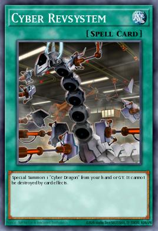 **Cyber Revsystem**

### Ejecución numerada

#### Paso 1 — Como solamente el rival controla monstruos, aplicar el procedimiento de Cyber Dragon original, mano→Campo mediante Invocación Especial en Ataque (Nivel 5, Máquina/LUZ).

 **ESTADO / CONTEXTO**

**Acción concreta:** Como solamente el rival controla monstruos, aplicar el procedimiento de Cyber Dragon original, mano→Campo mediante Invocación Especial en Ataque (Nivel 5, Máquina/LUZ).
**Detalle técnico documentado:** Cyber Dragon 2100 ATK en Zona Principal propia; Normal sin gastar. No inicia Cadena; aún no se realizó Xyz.

**Estado por zonas después del paso:**

| Zona/recurso | Estado narrativo A09 |
|---|---|
| Mano | Cyber Revsystem #13770 |
| Monstruos | Cyber Dragon original #6390 (Ataque, Nivel 5) |
| Mágicas y trampas | — |
| Cementerio | Herz #13723 en GY inicial |
| Destierro propio | — |
| Campo y estado rival | Rival sigue controlando al menos un monstruo de identidad no especificada |
| Materiales Xyz/Fusión/Sincro | — |
| Normal, Extra, fase y restricciones | Normal libre; Nova e Infinity disponibles en Extra |

**Campo visual de este paso:**

**Monstruos propios:**
-  **Cyber Dragon original (Ataque, Nivel 5)** — zona declarada: `MONSTER`.
**Mágicas/Trampas/Campo:** sin carta propia demostrada en esta vista.
*Relación ilustrada de cartas presentes tras este paso, documentada en A09. La posición, materiales, otras zonas y rival se leen en la tabla de estado.*

#### Paso 2 — Activar Cyber Revsystem, Mágica Normal CL1, y al resolver Invocar Especialmente Herz del GY. Es objetivo legal por llamarse «Cyber Dragon» en el GY.

 **ACTIVAR** →  **OBJETIVO**

**Acción concreta:** Activar Cyber Revsystem, Mágica Normal CL1, y al resolver Invocar Especialmente Herz del GY. Es objetivo legal por llamarse «Cyber Dragon» en el GY.
**Detalle técnico documentado:** Revsystem termina GY; Herz Nivel 1 vuelve boca arriba al Campo, con protección de Revsystem contra destrucción por efectos mientras aplique. Ningún segundo Cyber Dragon original fue inventado.

**Estado por zonas después del paso:**

| Zona/recurso | Estado narrativo A09 |
|---|---|
| Mano | — |
| Monstruos | Cyber Dragon #6390 (Ataque, Nivel 5), Herz #13723 (Ataque, Nivel 1, protegido según Revsystem mientras permanezca) |
| Mágicas y trampas | — |
| Cementerio | Cyber Revsystem #13770 en GY |
| Destierro propio | — |
| Campo y estado rival | Sin cambios adversarios por la ruta |
| Materiales Xyz/Fusión/Sincro | — |
| Normal, Extra, fase y restricciones | Normal libre; Extra sin consumo todavía |

**Campo visual de este paso:**

**Monstruos propios:**
-  **Cyber Dragon (Ataque, Nivel 5)** — zona declarada: `MONSTER`.
- 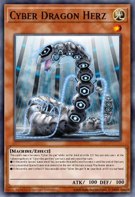 **Herz (Ataque, Nivel 1, protegido según Revsystem mientras permanezca)** — zona declarada: `MONSTER`.
**Mágicas/Trampas/Campo:** sin carta propia demostrada en esta vista.
*Relación ilustrada de cartas presentes tras este paso, documentada en A09. La posición, materiales, otras zonas y rival se leen en la tabla de estado.*

#### Paso 3 — Tras la Invocación Especial de Herz, activar su efecto opcional en cadena nueva para hacer que su Nivel sea 5 hasta End Phase.

 **ESTADO / CONTEXTO** → 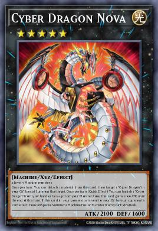 **ESTADO / CONTEXTO** → 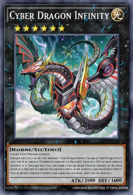 **ESTADO / CONTEXTO**

**Acción concreta:** Tras la Invocación Especial de Herz, activar su efecto opcional en cadena nueva para hacer que su Nivel sea 5 hasta End Phase.
**Detalle técnico documentado:** En el Campo existen ahora dos Máquinas de Nivel 5: Cyber Dragon original y Herz. Por el efecto usado, durante el resto del turno solo pueden Invocarse Especialmente Máquinas; tanto Nova como Infinity son Máquinas. No usar el otro efecto de Herz este mismo turno.

**Estado por zonas después del paso:**

| Zona/recurso | Estado narrativo A09 |
|---|---|
| Mano | — |
| Monstruos | Cyber Dragon #6390 (Ataque, Nivel 5), Herz #13723 (Ataque, Nivel cambiado a 5) |
| Mágicas y trampas | — |
| Cementerio | Cyber Revsystem en GY |
| Destierro propio | — |
| Campo y estado rival | Sin cambios adversarios por la ruta |
| Materiales Xyz/Fusión/Sincro | — |
| Normal, Extra, fase y restricciones | Normal libre; solo Invocaciones Especiales de Máquina por efecto de Herz durante el resto del turno |

**Campo visual de este paso:**

**Monstruos propios:**
-  **Cyber Dragon (Ataque, Nivel 5)** — zona declarada: `MONSTER`.
-  **Herz (Ataque, Nivel cambiado a 5)** — zona declarada: `MONSTER`.
**Mágicas/Trampas/Campo:** sin carta propia demostrada en esta vista.
*Relación ilustrada de cartas presentes tras este paso, documentada en A09. La posición, materiales, otras zonas y rival se leen en la tabla de estado.*

#### Paso 4 — Realizar Invocación Xyz de Cyber Dragon Nova (Rango 5), superponiendo Cyber Dragon + Herz.

 **INVOCAR XYZ** →  **INVOCAR XYZ** →  **REFERENCIA A09**

**Acción concreta:** Realizar Invocación Xyz de Cyber Dragon Nova (Rango 5), superponiendo Cyber Dragon + Herz.
**Detalle técnico documentado:** Nova en Campo con 2 materiales Xyz. Cyber Dragon y Herz están debajo de Nova; ya no son monstruos independientes ni están en GY. No activar ni desprender materiales de Nova en esta línea.

**Estado por zonas después del paso:**

| Zona/recurso | Estado narrativo A09 |
|---|---|
| Mano | — |
| Monstruos | Cyber Dragon Nova #10870 (Ataque, Rango 5) |
| Mágicas y trampas | — |
| Cementerio | Cyber Revsystem #13770 en GY |
| Destierro propio | — |
| Campo y estado rival | Sin cambios adversarios por la ruta |
| Materiales Xyz/Fusión/Sincro | Nova: Cyber Dragon original y Herz acoplados (2); no están en GY ni en Zona de Monstruos |
| Normal, Extra, fase y restricciones | Normal libre; solo Máquina; Nova ya salió del Extra, Infinity disponible |

**Campo visual de este paso:**

**Monstruos propios:**
-  **Cyber Dragon Nova (Ataque, Rango 5)** — zona declarada: `MONSTER`.
**Mágicas/Trampas/Campo:** sin carta propia demostrada en esta vista.
*Relación ilustrada de cartas presentes tras este paso, documentada en A09. La posición, materiales, otras zonas y rival se leen en la tabla de estado.*

#### Paso 5 — Aplicar el procedimiento alternativo de Xyz de Cyber Dragon Infinity usando Nova propia como material (una vez este turno).

 **ESTADO / CONTEXTO** →  **YA EN CAMPO** →  **MATERIAL XYZ**

**Acción concreta:** Aplicar el procedimiento alternativo de Xyz de Cyber Dragon Infinity usando Nova propia como material (una vez este turno).
**Detalle técnico documentado:** Infinity Rango 6 en Campo. Conserva como materiales a Nova y los dos materiales que Nova tenía, 3 materiales en total. ATK: 2100 base + (3 × 200) = 2700 actual. No declarar que Nova siga en Zona de Monstruos.

**Estado por zonas después del paso:**

| Zona/recurso | Estado narrativo A09 |
|---|---|
| Mano | — |
| Monstruos | Cyber Dragon Infinity #11765 (Ataque, 2700 ATK actual, Rango 6) |
| Mágicas y trampas | — |
| Cementerio | Cyber Revsystem en GY |
| Destierro propio | — |
| Campo y estado rival | No se activó ni consumió negación; monstruo rival sigue en Campo salvo intervención externa |
| Materiales Xyz/Fusión/Sincro | Infinity: Nova, Cyber Dragon original y Herz acoplados (3) |
| Normal, Extra, fase y restricciones | Normal libre; solo Máquina este turno; Infinity salió del Extra usando Nova |

**Campo visual de este paso:**

**Monstruos propios:**
-  **Cyber Dragon Infinity (Ataque, 2700 ATK actual, Rango 6)** — zona declarada: `MONSTER`.
**Mágicas/Trampas/Campo:** sin carta propia demostrada en esta vista.
*Relación ilustrada de cartas presentes tras este paso, documentada en A09. La posición, materiales, otras zonas y rival se leen en la tabla de estado.*

### Campo final documentado

Esta vista procede **del último paso**, no de una lista de cartas deducida del título.

**Monstruos propios:**
-  **Cyber Dragon Infinity (Ataque, 2700 ATK actual, Rango 6)** — zona declarada: `MONSTER`.
**Mágicas/Trampas/Campo:** sin carta propia demostrada en esta vista.
*Relación ilustrada de cartas presentes tras este paso, documentada en A09. La posición, materiales, otras zonas y rival se leen en la tabla de estado.*

| Zona/recurso | Estado final documentado |
|---|---|
| Mano | — |
| Monstruos | Cyber Dragon Infinity #11765 (Ataque, 2700 ATK actual, Rango 6) |
| Mágicas y trampas | — |
| Cementerio | Cyber Revsystem en GY |
| Destierro propio | — |
| Campo y estado rival | No se activó ni consumió negación; monstruo rival sigue en Campo salvo intervención externa |
| Materiales Xyz/Fusión/Sincro | Infinity: Nova, Cyber Dragon original y Herz acoplados (3) |
| Normal, Extra, fase y restricciones | Normal libre; solo Máquina este turno; Infinity salió del Extra usando Nova |

### Si el oponente interrumpe

No se documenta una continuación alternativa con los recursos indicados.

---

## OVERLOAD · CYBERLOAD · DOUBLE RAMPAGE01 · `684:A09:OVERLOAD:CYBERLOAD:DOUBLE_RAMPAGE01`

**Propósito competitivo principal (lectura documental):** Ofensivo. El objetivo solo se acredita si las acciones y el campo final detallados en esta guía lo permiten; no implica legalidad certificada ni garantiza el resultado ante respuestas adversarias.

**Categoría:** APERTURA

**Propósito y resultado documental:**

Endboard de Main Phase: dos Rampage A/B en Campo, 2100 ATK cada uno. Solo B puede atacar en lo restante del turno por Cyberload, con hasta 2 ataques de B si las reglas de batalla y sus objetivos lo permiten. Mano: 1× Cyber Dragon original recuperado. GY: Overload, Cyberload, Cyber Dragon Nachster y Herz; destierro: vacío, porque Core/Herz retornaron al Deck; Core queda barajado en Deck y no vuelve al GY; Normal libre. Daño garantizado al oponente: 0; no sumar ataques de A después de activar Cyberload, no afirmar OTK ni destrucción sin objetivos. Esta secuencia exige un GY ya preparado, y sus 2 cartas de mano no bastan por sí solas desde campo/recursos vacíos.

### Mano y estado inicial

Overload Fusion 1× Overload Fusion + Cyberload Fusion 1× Cyberload Fusion. GY propio inicial preparado desde turno previo: Core 1× Cyber Dragon Core + Herz 1× Cyber Dragon Herz, sin usar el efecto de recuperación de Herz en este turno. Deck: Cyber Dragon original 1× + Cyber Dragon Nachster 1×; resto de Core en Deck no se consume. Extra: Rampage 2× Chimeratech Rampage Dragon sin utilizar. Campo y destierro propios vacíos, Normal del turno disponible, sin bloqueos ni respuesta rival; no se asume una mano robada adicional.

 **Overload Fusion**
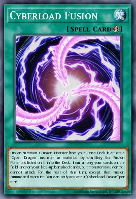 **Cyberload Fusion**

### Ejecución numerada

#### Paso 1 — Activar Overload Fusion (Mágica Normal) en tu Main Phase para Fusion Summon de un monstruo Fusión Máquina OSCURIDAD.

 **ACTIVAR** →  **DESTERRAR** →  **YA EN CAMPO**

**Acción concreta:** Activar Overload Fusion (Mágica Normal) en tu Main Phase para Fusion Summon de un monstruo Fusión Máquina OSCURIDAD. Al resolver, desterrar Core y Herz del GY como los dos materiales «Cyber Dragon» (nombres que ambas cartas reciben en GY) e Invocar Rampage A.
**Detalle técnico documentado:** Al resolver, desterrar Core y Herz del GY como los dos materiales «Cyber Dragon» (nombres que ambas cartas reciben en GY) e Invocar Rampage A. Rampage A 2100 ATK en Campo; Core y Herz desterrados boca arriba; Overload en GY. Su efecto opcional al ser Invocado que destruye M/T se omite; no crear objetivos rivales ficticios.

**Estado por zonas después del paso:**

| Zona/recurso | Estado narrativo A09 |
|---|---|
| Mano | Cyberload Fusion #13849 |
| Monstruos | Rampage A #11764 (Ataque, 2100 ATK) |
| Mágicas y trampas | — |
| Cementerio | Overload Fusion #6783 en GY |
| Destierro propio | Core #10866 y Herz #13723 desterrados boca arriba |
| Campo y estado rival | Sin objetivos M/T ni daños rivales adjudicados |
| Materiales Xyz/Fusión/Sincro | Fusión A consumió Core/Herz desde GY; no conserva materiales Xyz |
| Normal, Extra, fase y restricciones | Normal libre; queda otra copia Rampage en Extra |

**Campo visual de este paso:**

**Monstruos propios:**
-  **Rampage A (Ataque, 2100 ATK)** — zona declarada: `MONSTER`.
**Mágicas/Trampas/Campo:** sin carta propia demostrada en esta vista.
*Relación ilustrada de cartas presentes tras este paso, documentada en A09. La posición, materiales, otras zonas y rival se leen en la tabla de estado.*

#### Paso 2 — Activar el segundo efecto de Rampage A, enviando desde Deck al GY Cyber Dragon original (Máquina LUZ) y Cyber Dragon Nachster (Máquina LUZ).

 **ACTIVAR** →  **ENVIAR** →  **ENVIAR**

**Acción concreta:** Activar el segundo efecto de Rampage A, enviando desde Deck al GY Cyber Dragon original (Máquina LUZ) y Cyber Dragon Nachster (Máquina LUZ).
**Detalle técnico documentado:** A gana 2 ataques adicionales este turno si entra en Battle Phase, pero esa capacidad dejará de ser utilizable tras Cyberload; ambos monstruos enviados permanecen en GY.

**Estado por zonas después del paso:**

| Zona/recurso | Estado narrativo A09 |
|---|---|
| Mano | Cyberload Fusion #13849 |
| Monstruos | Rampage A #11764 (Ataque, 2100 ATK; 3 ataques potenciales antes de Cyberload) |
| Mágicas y trampas | — |
| Cementerio | Overload Fusion #6783, Cyber Dragon original #6390 y Nachster #14047 en GY |
| Destierro propio | Core y Herz desterrados boca arriba |
| Campo y estado rival | Sin batalla ni destrucción rival demostrada |
| Materiales Xyz/Fusión/Sincro | — |
| Normal, Extra, fase y restricciones | Normal libre; otra copia Rampage en Extra |

**Campo visual de este paso:**

**Monstruos propios:**
-  **Rampage A (Ataque, 2100 ATK; 3 ataques potenciales antes de Cyberload)** — zona declarada: `MONSTER`.
**Mágicas/Trampas/Campo:** sin carta propia demostrada en esta vista.
*Relación ilustrada de cartas presentes tras este paso, documentada en A09. La posición, materiales, otras zonas y rival se leen en la tabla de estado.*

#### Paso 3 — Activar Cyberload Fusion, Mágica Rápida, desde la mano durante esta Main Phase.

 **ACTIVAR** →  **ESTADO / CONTEXTO** →  **ATACAR**

**Acción concreta:** Activar Cyberload Fusion, Mágica Rápida, desde la mano durante esta Main Phase. Elegir el segundo Rampage del Extra y barajar las dos cartas propias desterradas boca arriba: Core + Herz, que siguen siendo monstruos del arquetipo «Cyber Dragon» por su nombre, como materiales de Fusión.
**Detalle técnico documentado:** Elegir el segundo Rampage del Extra y barajar las dos cartas propias desterradas boca arriba: Core + Herz, que siguen siendo monstruos del arquetipo «Cyber Dragon» por su nombre, como materiales de Fusión. Rampage B 2100 ATK se Invoca por Fusión, Core y Herz vuelven al Deck. Restricción de Cyberload: durante el resto del turno solo puede atacar Rampage B, el monstruo Invocado por esta Cyberload; Rampage A no puede atacar, pese a su efecto de paso 2. Cyberload acaba en GY. No activar el efecto opcional de Rampage B de destruir M/T sin objetivos.

**Estado por zonas después del paso:**

| Zona/recurso | Estado narrativo A09 |
|---|---|
| Mano | — |
| Monstruos | Rampage A #11764 (Ataque, 2100 ATK; no puede atacar este turno), Rampage B #11764 (Ataque, 2100 ATK; por Cyberload solo B podrá atacar) |
| Mágicas y trampas | — |
| Cementerio | Overload Fusion #6783, Cyberload Fusion #13849, Cyber Dragon original #6390 y Nachster #14047 en GY |
| Destierro propio | — (Core y Herz barajados de vuelta al Deck) |
| Campo y estado rival | No se presupone destrucción ni daño al rival |
| Materiales Xyz/Fusión/Sincro | Fusión B usó Core/Herz del destierro y los devolvió al Deck; no son Xyz |
| Normal, Extra, fase y restricciones | Normal libre; dos copias Rampage ya salieron del Extra |

**Campo visual de este paso:**

**Monstruos propios:**
-  **Rampage A (Ataque, 2100 ATK; no puede atacar este turno)** — zona declarada: `MONSTER`.
-  **Rampage B (Ataque, 2100 ATK; por Cyberload solo B podrá atacar)** — zona declarada: `MONSTER`.
**Mágicas/Trampas/Campo:** sin carta propia demostrada en esta vista.
*Relación ilustrada de cartas presentes tras este paso, documentada en A09. La posición, materiales, otras zonas y rival se leen en la tabla de estado.*

#### Paso 4 — Activar el otro efecto de Rampage B enviando del Deck al GY Cyber Dragon Herz, que acaba de regresar al Deck en paso 3 (1 Máquina LUZ; no se necesita enviar dos).

 **ACTIVAR** →  **ENVIAR** →  **ENVIAR**

**Acción concreta:** Activar el otro efecto de Rampage B enviando del Deck al GY Cyber Dragon Herz, que acaba de regresar al Deck en paso 3 (1 Máquina LUZ; no se necesita enviar dos).
**Detalle técnico documentado:** B obtiene 1 ataque adicional, hasta dos ataques si se llega legalmente a Battle Phase. Herz queda en GY y habilita su efecto de recuperación, no el efecto alternativo de ajustar Nivel.

**Estado por zonas después del paso:**

| Zona/recurso | Estado narrativo A09 |
|---|---|
| Mano | — |
| Monstruos | Rampage A #11764 (Ataque; no puede atacar), Rampage B #11764 (Ataque; solo B atacará, hasta dos veces) |
| Mágicas y trampas | — |
| Cementerio | Overload Fusion, Cyberload Fusion, Cyber Dragon original, Nachster y Herz #13723 en GY |
| Destierro propio | — |
| Campo y estado rival | Sin combate ni daño adversario por ahora |
| Materiales Xyz/Fusión/Sincro | — |
| Normal, Extra, fase y restricciones | Normal libre; ambos Rampage usados del Extra; bloqueo de ataque de Cyberload vigente |

**Campo visual de este paso:**

**Monstruos propios:**
-  **Rampage A (Ataque; no puede atacar)** — zona declarada: `MONSTER`.
-  **Rampage B (Ataque; solo B atacará, hasta dos veces)** — zona declarada: `MONSTER`.
**Mágicas/Trampas/Campo:** sin carta propia demostrada en esta vista.
*Relación ilustrada de cartas presentes tras este paso, documentada en A09. La posición, materiales, otras zonas y rival se leen en la tabla de estado.*

#### Paso 5 — Tras concluir la cadena anterior, activar el efecto de Herz por haber sido enviada al GY, añadiendo Cyber Dragon original del GY a mano.

 **AÑADIR A MANO** →  **ESTADO / CONTEXTO**

**Acción concreta:** Tras concluir la cadena anterior, activar el efecto de Herz por haber sido enviada al GY, añadiendo Cyber Dragon original del GY a mano.
**Detalle técnico documentado:** Cyber Dragon original es una carta diferente a Herz y está legalmente en GY desde paso 2. No mover a la mano el segundo Rampage ni suponer cartas adicionales.

**Estado por zonas después del paso:**

| Zona/recurso | Estado narrativo A09 |
|---|---|
| Mano | Cyber Dragon original #6390 recuperado |
| Monstruos | Rampage A #11764 (Ataque, 2100 ATK; no ataca), Rampage B #11764 (Ataque, 2100 ATK; solo B puede atacar este turno) |
| Mágicas y trampas | — |
| Cementerio | Overload Fusion #6783, Cyberload Fusion #13849, Nachster #14047 y Herz #13723 en GY |
| Destierro propio | — |
| Campo y estado rival | Sin daño rival garantizado; no se suman ataques de A |
| Materiales Xyz/Fusión/Sincro | — |
| Normal, Extra, fase y restricciones | Normal libre; Extra consumió dos Rampage; bloqueo de ataque vigente |

**Campo visual de este paso:**

**Monstruos propios:**
-  **Rampage A (Ataque, 2100 ATK; no ataca)** — zona declarada: `MONSTER`.
-  **Rampage B (Ataque, 2100 ATK; solo B puede atacar este turno)** — zona declarada: `MONSTER`.
**Mágicas/Trampas/Campo:** sin carta propia demostrada en esta vista.
*Relación ilustrada de cartas presentes tras este paso, documentada en A09. La posición, materiales, otras zonas y rival se leen en la tabla de estado.*

### Campo final documentado

Esta vista procede **del último paso**, no de una lista de cartas deducida del título.

**Monstruos propios:**
-  **Rampage A (Ataque, 2100 ATK; no ataca)** — zona declarada: `MONSTER`.
-  **Rampage B (Ataque, 2100 ATK; solo B puede atacar este turno)** — zona declarada: `MONSTER`.
**Mágicas/Trampas/Campo:** sin carta propia demostrada en esta vista.
*Relación ilustrada de cartas presentes tras este paso, documentada en A09. La posición, materiales, otras zonas y rival se leen en la tabla de estado.*

| Zona/recurso | Estado final documentado |
|---|---|
| Mano | Cyber Dragon original #6390 recuperado |
| Monstruos | Rampage A #11764 (Ataque, 2100 ATK; no ataca), Rampage B #11764 (Ataque, 2100 ATK; solo B puede atacar este turno) |
| Mágicas y trampas | — |
| Cementerio | Overload Fusion #6783, Cyberload Fusion #13849, Nachster #14047 y Herz #13723 en GY |
| Destierro propio | — |
| Campo y estado rival | Sin daño rival garantizado; no se suman ataques de A |
| Materiales Xyz/Fusión/Sincro | — |
| Normal, Extra, fase y restricciones | Normal libre; Extra consumió dos Rampage; bloqueo de ataque vigente |

### Si el oponente interrumpe

No se documenta una continuación alternativa con los recursos indicados.

---

## NACHSTER · SIEGER01 · `684:A09:NACHSTER:SIEGER01`

**Propósito competitivo principal (lectura documental):** Ofensivo condicional. El objetivo solo se acredita si las acciones y el campo final detallados en esta guía lo permiten; no implica legalidad certificada ni garantiza el resultado ante respuestas adversarias.

**Categoría:** APERTURA

**Propósito y resultado documental:**

Endboard al finalizar Main Phase: 1× Sieger ATK 2100; Cyber Dragon original y Nachster en GY, mano inicial vacía, destierro vacío, Normal sin gastar; 0 negaciones y 0 daño garantizados. Si durante la Battle Phase se activa el paso 4, el estado temporal de Sieger es ATK 4200, regresando a 2100 al acabar el turno; en una Battle Phase rival también podría usarse en ventana legal si Sieger permanece y cumple la condición. Restricción vigente de Nachster: únicamente futuras Invocaciones Especiales de Máquina hasta finalizar el turno en que se activó. Riesgos: si se niega o retira Nachster antes de la reanimación, o desaparece Cyber Dragon del GY, no se obtienen ambos materiales. No se da por disponible ninguna otra Máquina no registrada.

### Mano y estado inicial

Cyber Dragon 1× Cyber Dragon original (Nivel 5, Máquina LUZ, ATK 2100) + Nachster 1× Cyber Dragon Nachster (Nivel 1, Máquina LUZ, ATK 200). Extra: Sieger 1× Cyber Dragon Sieger sin usar. Estado inicial: Main Phase propia; campo/GY/destierro propios vacíos, Normal disponible, zonas de monstruos libres; no hay efectos previos ni restricción externa a Enlace. No requiere cartas ni monstruos rivales para Invocar a Sieger. Sin respuesta adversaria en línea base.

 **Cyber Dragon**
 **Cyber Dragon Nachster**

### Ejecución numerada

#### Paso 1 — En Main Phase, activar el efecto de Nachster en mano; descartar Cyber Dragon original COMO COSTE al GY; resolver la Invocación Especial de Nachster en una Zona Principal.

 **DESCARTAR** →  **ESPECIAL**

**Acción concreta:** En Main Phase, activar el efecto de Nachster en mano; descartar Cyber Dragon original COMO COSTE al GY; resolver la Invocación Especial de Nachster en una Zona Principal.
**Detalle técnico documentado:** Mano sin esas dos cartas; Cyber Dragon original está en GY (Máquina 2100 ATK), Nachster boca arriba en Campo y se llama «Cyber Dragon» mientras permanece allí. Normal no consumida.

**Estado por zonas después del paso:**

| Zona/recurso | Estado narrativo A09 |
|---|---|
| Mano | Mano mínima agotada |
| Monstruos | Cyber Dragon Nachster #14047 (Ataque, 200 ATK, nombre Cyber Dragon en Campo) |
| Mágicas y trampas | — |
| Cementerio | Cyber Dragon original #6390 en GY (coste de Nachster) |
| Destierro propio | — |
| Campo y estado rival | No se requiere ni se altera monstruo rival |
| Materiales Xyz/Fusión/Sincro | — |
| Normal, Extra, fase y restricciones | Normal libre; Sieger disponible en Extra |

**Campo visual de este paso:**

**Monstruos propios:**
-  **Cyber Dragon Nachster (Ataque, 200 ATK, nombre Cyber Dragon en Campo)** — zona declarada: `MONSTER`.
**Mágicas/Trampas/Campo:** sin carta propia demostrada en esta vista.
*Relación ilustrada de cartas presentes tras este paso, documentada en A09. La posición, materiales, otras zonas y rival se leen en la tabla de estado.*

#### Paso 2 — Tras su Invocación Especial, activar el otro efecto de Nachster en nueva Cadena, seleccionando Cyber Dragon original del GY (Máquina con exactamente 2100 ATK).

 **ESPECIAL** →  **ESPECIAL**

**Acción concreta:** Tras su Invocación Especial, activar el otro efecto de Nachster en nueva Cadena, seleccionando Cyber Dragon original del GY (Máquina con exactamente 2100 ATK).
**Detalle técnico documentado:** Resolver e Invocar Especialmente Cyber Dragon original al propio Campo. Desde la resolución de este efecto, el jugador no puede Invocar Especialmente monstruos que no sean Máquina el resto del turno. En Campo hay dos Máquinas, ambas con nombre «Cyber Dragon» en ese momento.

**Estado por zonas después del paso:**

| Zona/recurso | Estado narrativo A09 |
|---|---|
| Mano | — |
| Monstruos | Nachster #14047 (Ataque), Cyber Dragon original #6390 (Ataque, 2100 ATK) |
| Mágicas y trampas | — |
| Cementerio | — |
| Destierro propio | — |
| Campo y estado rival | Sin cambio rival documentado |
| Materiales Xyz/Fusión/Sincro | — |
| Normal, Extra, fase y restricciones | Normal libre; resto del turno solo Invocaciones Especiales de Máquina; Sieger en Extra |

**Campo visual de este paso:**

**Monstruos propios:**
-  **Nachster (Ataque)** — zona declarada: `MONSTER`.
-  **Cyber Dragon original (Ataque, 2100 ATK)** — zona declarada: `MONSTER`.
**Mágicas/Trampas/Campo:** sin carta propia demostrada en esta vista.
*Relación ilustrada de cartas presentes tras este paso, documentada en A09. La posición, materiales, otras zonas y rival se leen en la tabla de estado.*

#### Paso 3 — En Main Phase, utilizar Nachster + Cyber Dragon original como los dos materiales de Enlace de Cyber Dragon Sieger (Enlace-2: requiere 2 Máquinas, incluyendo Cyber Dragon).

 **ESTADO / CONTEXTO** →  **ESTADO / CONTEXTO** → 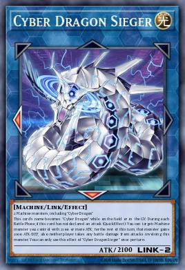 **ESTADO / CONTEXTO**

**Acción concreta:** En Main Phase, utilizar Nachster + Cyber Dragon original como los dos materiales de Enlace de Cyber Dragon Sieger (Enlace-2: requiere 2 Máquinas, incluyendo Cyber Dragon).
**Detalle técnico documentado:** Enviar ambos monstruos al GY como materiales de Enlace; Invocar Sieger desde Extra a zona legal. La restricción de Nachster permite esta Invocación porque Sieger es Máquina. No deja materiales acoplados tipo Xyz.

**Estado por zonas después del paso:**

| Zona/recurso | Estado narrativo A09 |
|---|---|
| Mano | — |
| Monstruos | Cyber Dragon Sieger #13758 (Ataque, 2100 ATK, Link-2) |
| Mágicas y trampas | — |
| Cementerio | Nachster #14047 y Cyber Dragon original #6390 en GY (materiales Link) |
| Destierro propio | — |
| Campo y estado rival | Sin cambio rival documentado |
| Materiales Xyz/Fusión/Sincro | Materiales Link fueron enviados a GY; Sieger NO tiene materiales Xyz acoplados |
| Normal, Extra, fase y restricciones | Normal libre; solo Máquina por Nachster este turno; Sieger salió del Extra |

**Campo visual de este paso:**

**Monstruos propios:**
-  **Cyber Dragon Sieger (Ataque, 2100 ATK, Link-2)** — zona declarada: `MONSTER`.
**Mágicas/Trampas/Campo:** sin carta propia demostrada en esta vista.
*Relación ilustrada de cartas presentes tras este paso, documentada en A09. La posición, materiales, otras zonas y rival se leen en la tabla de estado.*

#### Paso 4 — Sólo durante una Battle Phase y si Sieger no declaró un ataque, se puede activar su Efecto Rápido y seleccionar al propio Sieger (Máquina con 2100 ATK) para darle +2100 ATK/DEF hasta fin de turno.

 **OBJETIVO**

**Acción concreta:** Sólo durante una Battle Phase y si Sieger no declaró un ataque, se puede activar su Efecto Rápido y seleccionar al propio Sieger (Máquina con 2100 ATK) para darle +2100 ATK/DEF hasta fin de turno.
**Detalle técnico documentado:** Sieger pasa temporalmente a 4200 ATK, útil para destruir por batalla un monstruo elegible con ATK menor. Ningún jugador recibe daño de batalla de ataques que involucren al monstruo fortalecido. En Main Phase el efecto no está disponible; no adjudicar daño de batalla.

**Estado por zonas después del paso:**

| Zona/recurso | Estado narrativo A09 |
|---|---|
| Mano | — |
| Monstruos | Cyber Dragon Sieger #13758 (Ataque, 4200 ATK TEMPORAL solo si se resolvió efecto en Battle Phase elegible) |
| Mágicas y trampas | — |
| Cementerio | Nachster y Cyber Dragon original en GY |
| Destierro propio | — |
| Campo y estado rival | No se garantiza destrucción ni daño rival; ataques que involucren a Sieger fortalecido no causan daño de batalla |
| Materiales Xyz/Fusión/Sincro | Sin materiales Xyz; objetivo del Efecto Rápido es el propio Sieger |
| Normal, Extra, fase y restricciones | Normal libre; solo Máquina por Nachster este turno; el +2100 vence al terminar el turno |

**Campo visual de este paso:**

**Monstruos propios:**
-  **Cyber Dragon Sieger (Ataque, 4200 ATK TEMPORAL solo si se resolvió efecto en Battle Phase elegible)** — zona declarada: `MONSTER`.
**Mágicas/Trampas/Campo:** sin carta propia demostrada en esta vista.
*Relación ilustrada de cartas presentes tras este paso, documentada en A09. La posición, materiales, otras zonas y rival se leen en la tabla de estado.*

### Campo final documentado

Esta vista procede **del último paso**, no de una lista de cartas deducida del título.

**Monstruos propios:**
-  **Cyber Dragon Sieger (Ataque, 4200 ATK TEMPORAL solo si se resolvió efecto en Battle Phase elegible)** — zona declarada: `MONSTER`.
**Mágicas/Trampas/Campo:** sin carta propia demostrada en esta vista.
*Relación ilustrada de cartas presentes tras este paso, documentada en A09. La posición, materiales, otras zonas y rival se leen en la tabla de estado.*

| Zona/recurso | Estado final documentado |
|---|---|
| Mano | — |
| Monstruos | Cyber Dragon Sieger #13758 (Ataque, 4200 ATK TEMPORAL solo si se resolvió efecto en Battle Phase elegible) |
| Mágicas y trampas | — |
| Cementerio | Nachster y Cyber Dragon original en GY |
| Destierro propio | — |
| Campo y estado rival | No se garantiza destrucción ni daño rival; ataques que involucren a Sieger fortalecido no causan daño de batalla |
| Materiales Xyz/Fusión/Sincro | Sin materiales Xyz; objetivo del Efecto Rápido es el propio Sieger |
| Normal, Extra, fase y restricciones | Normal libre; solo Máquina por Nachster este turno; el +2100 vence al terminar el turno |

### Si el oponente interrumpe

No se documenta una continuación alternativa con los recursos indicados.

---
