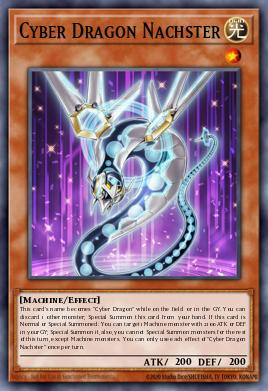
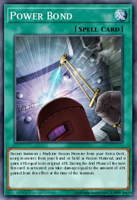
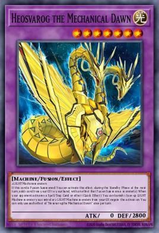

# Cyber Dragon Pure — la Fusión defensiva que sí usa tu Extra: Heosvarog

**ID adicional:** `684:A09:POWERBOND:CYBER_NACHSTER:HEOS09`

**Tipo:** combo corto de 3 cartas, **propósito defensivo/negador de Mágica o Trampa**, no OTK ni negación de monstruos. No requiere cartas nuevas. Main registrado: 1 Cyber Dragon, 1 Cyber Dragon Nachster, 1 Power Bond; Extra registrado: Heosvarog the Mechanical Dawn.

**Mano inicial exacta:** **Cyber Dragon + Cyber Dragon Nachster + Power Bond**. Campo, GY y destierro propios vacíos. Main Phase propia, sin efectos usados ni restricciones externas, sin respuesta rival. **No se necesita que el adversario controle un monstruo** porque ambas piezas se usarán desde la mano como materiales: no estás Invocando a Cyber Dragon por su procedimiento propio.

## ¿Qué campo voy a crear?

Un **Heosvarog (0 ATK / 2800 DEF)** Invocado por Fusión, en Defensa, con **dos Máquinas LUZ en tu Cementerio** listas para costear **una negación** de activación de Mágica/Trampa del rival. Power Bond aplica ganancia igual a ATK original: **0 + 0 = 0**, así que tampoco genera daño de End Phase por esa ganancia nula. No anunciar una negación de efecto de monstruo.

### Paso 1 — Comprobar materiales en la mano

 +  + 

Ambos monstruos son **Máquina LUZ**; Heosvarog exige exactamente dos monstruos Máquina LUZ como materiales de Fusión. El Cyber Dragon original no tiene que haber sido Invocado Especialmente antes: Power Bond utiliza monstruos de la **mano o Campo**.

### Paso 2 — Activar Power Bond, enviando dos materiales al GY

 → **Cyber Dragon + Nachster (desde mano a GY)** → 

Power Bond Invoca por Fusión a **Heosvarog** desde el Extra. Cyber Dragon y Nachster pasan al Cementerio por el procedimiento de Fusión. Heosvarog queda con **0 ATK / 2800 DEF**; eliges Defensa al Invocarlo y conservas tu Invocación Normal.

### Paso 3 — Activar efecto de recuperación para el próximo turno

 → **EFECTO AL SER INVOCADO POR FUSIÓN**

Si activas y se resuelve ese efecto, durante la **Standby Phase del turno siguiente** podrás añadir desde tu GY a la mano una carta que tenga efecto de Invocación por Fusión: **Power Bond** es una candidata si continúa en GY. **No** añades Power Bond inmediatamente al Invocar Heosvarog.

### Paso 4 — Reservar el coste de negación

 +  → **DOS MÁQUINAS LUZ EN TU GY**

Cuando el rival **active una Carta Mágica/Trampa o uno de sus efectos**, Heosvarog puede activar su Efecto Rápido y **desterrar las dos Máquinas LUZ del GY** para negar **la activación**. Una segunda modalidad requiere desterrar un monstruo Máquina LUZ boca arriba de tu propio Campo. No confundir esta negación con destrucción, y no gastar los materiales en otra carta si quieres reservar la respuesta.

### Paso 5 — Campo final antes de la respuesta

 **Heosvarog en Defensa: DEF 2800**

**GY:** Cyber Dragon, Nachster, Power Bond. **Mano:** se consumieron las 3 cartas exactas; cartas adicionales no se presuponen. **Campo M/T:** ninguna propia por esta línea (Power Bond fue al GY al resolver). **Normal:** sin usar. **Negación disponible:** una activación rival Mágica/Trampa, pagando destierro de ambos materiales del GY. **Seguimiento:** posible recuperación de Power Bond en la Standby del turno siguiente si se cumplieron sus condiciones.

## Elecciones tácticas y puntos de falla

| Situación | ¿Conviene esta ruta? | Razón / alternativa |
|---|---|---|
| Voy primero y temo una Mágica o Trampa rival importante | **Sí, si poseo las 3 cartas** | Heosvarog amenaza negar una activación M/T desde la posición de Defensa. |
| Voy segundo y necesito daño inmediato | **Habitualmente no** | Heosvarog tiene 0 ATK; comparar Power Bond → Rampage (`684:A09:CLAW:REALM:POWERBOND:RAMPAGE01`) con materiales propios de esa ruta. |
| Quiero negar un monstruo rival | **No con Heosvarog** | Su respuesta se refiere a activación de Mágica/Trampa. Para monstruos evaluar ruta Nova → Infinity `684:A09:REV:HERZ:NOVA:INFINITY01`, con condiciones distintas. |
| El rival destierra las dos Máquinas del GY primero | **Ya no hay coste de GY disponible** | Solo podría pagar con Máquina LUZ boca arriba propia si la controlas; no asumirla gratis. |
| El rival niega Power Bond | **No hay Fusión** | Los materiales no se envían por la Fusión que no resolvió; revisar exactamente cómo fue negada la carta. |
| El rival destruye Heosvarog después de invocarse | **Pierdes la negación de campo** | La recuperación de Standby queda sujeta a que su efecto previo se haya activado y resuelto; no prometer negación fuera del Campo. |

## Verificación Konami

- [Power Bond (CID 6398)](https://www.db.yugioh-card.com/yugiohdb/card_search.action?cid=6398&ope=2&request_locale=en): monstruos de mano/campo como materiales; ganancia de ATK igual al ATK original y daño al final del turno por lo ganado en la Invocación.
- [Heosvarog the Mechanical Dawn (CID 20511)](https://www.db.yugioh-card.com/yugiohdb/card_search.action?cid=20511&ope=2&request_locale=en): requiere 2 LIGHT Machine, tiene 0 ATK / 2800 DEF, efecto diferido de recuperación y Efecto Rápido para negar activación de M/T desterrando Máquina LUZ propia o dos del GY.
- [Cyber Dragon original (CID 6390)](https://www.db.yugioh-card.com/yugiohdb/card_search.action?cid=6390&ope=2&request_locale=en) y [Cyber Dragon Nachster (CID 14047)](https://www.db.yugioh-card.com/yugiohdb/card_search.action?cid=14047&ope=2&request_locale=en): ambos Máquina LUZ.

**Condición de legalidad:** ruta cotejada para el estado declarado y sin interrupciones; no es una secuencia universal frente a respuestas. Mantener el inventario sin cambios y enlazar desde Power Bond, Cyber Dragon, Nachster y **la única copia actual** de Heosvarog del Extra.
