# Volcanic

## APARTADO_01 — Perfil A01 importable 687

- **Arquetipo:** Volcánico / Aceleradores de Llama
- **Tipo de estrategia:** Control por daño de efecto y retirada de campo
- **Estilo breve:** Envía munición Volcánica al Cementerio para retirar monstruos, reciclar recursos y preparar Infierno; Emperador añade presión de daño directo.
- **Resumen para ficha:** Soldado busca el soporte, el Acelerador despliega Piros y envía munición. Disparo Disperso puede limpiar monstruos; Emperador e Infierno sostienen el daño y la interacción.
- **Cómo se juega:** Primero: preparar Inferno y conservar munición. Invoca Normalmente Soldado Volcánico y añade Infierno Volcánico del Deck; Coloca la Trampa. Activa Eyección de Fuego para enviar Cartucho Volcánico de Nivel 1 desde Deck al Cementerio; aplica su daño según el Nivel. Con Cartucho en Cementerio, paga 500 LP para buscar otra copia si queda disponible. En turno rival, cuando active el efecto de un monstruo en Campo, usa Infierno en su ventana legal: destierra Cartucho del Cementerio, inflige 500 LP y puedes negar ese efecto porque desterraste un Volcánico. Soldado en Campo, Infierno preparada y otra copia de Cartucho en mano si la búsqueda resolvió. En la End Phase rival, Infierno puede devolver hasta dos Volcánicos desterrados o en Cementerio al fondo del Deck. Segundo: limpiar y retirar Magias/Trampas. Con Soldado y Misil Volcánico en mano, Invoca Normalmente Soldado, busca Acelerador de Llama Volcánico y actívalo enviando el Acelerador original al Cementerio. Usa el Acelerador Volcánico para Invocar Misil desde mano y buscar Recarga. Si hay un objetivo boca arriba, usa el otro efecto del Acelerador para enviar Percusión Anular de Nivel 1 y destruir ese monstruo. Enlaza Soldado + Misil en Caballero de Pesadilla Fénix; descarta Recarga y selecciona una Magia/Trampa rival para destruirla. Recarga en Cementerio permite preparar la interacción de Disparo Disperso si están las tres copias; solo Invoca Emperador si se encuentra en mano o Cementerio y puedes pagar su procedimiento. Fénix y retirada de una Magia/Trampa si resuelve; el barrido de Disparo Disperso y la Invocación de Emperador son extensiones condicionadas a sus recursos, no consecuencias automáticas. Juego medio: elegir la munición. Cuando VBA pueda usar su efecto, elige Rimfire para preparar Reload o Shell para conservar recursos de mano. Con Percusión Anular (Rimfire) en Cementerio, destierra un Acelerador de Llama de Campo boca arriba o Cementerio para poner Recarga boca arriba desde mano o Deck; no la mandes al Cementerio por este efecto. Con Shell en Cementerio, paga los 500 LP solo si necesitas otra copia de Deck y puedes asumir ese coste. Reload preparado o una Shell recuperada, además de la retirada del monstruo si resolvió; no ambos resultados del mismo uso de VBA. Juego tardío: Emperador o retirada puntual. Si Emperador está infligiendo presión al rival, evita convertirlo en material sin una razón concreta. Con una carta de mano para el coste de Unicornio, evalúa I:P y Emperador para devolver una carta rival al Deck. Si necesitas una respuesta de destierro temporal, considera S:P mediante I:P, respetando sus materiales y objetivos. Emperador conservado para daño o una retirada puntual con Unicornio o S:P; no quedan los jefes simultáneamente.
- **Qué vigilar:** Infierno solo puede negar cuando destierras un Volcánico; Disparo Disperso necesita el envío exigido y dos copias adicionales. No presupongas Invocaciones rivales.

**Procedencia:** paquete estructurado de esta identidad con inventario vivo validado en solo lectura; ninguna importación de producción se atribuye a este cambio.

<!-- A01_PLAYER_STRATEGY_V2_START -->
### Plan práctico de juego

#### Primero: preparar Inferno y conservar munición

**Objetivo:** Dejar una respuesta concreta a un efecto de monstruo del rival sin necesitar que ya controle uno.

**Situación:** Soldado Volcánico (Trooper) y Eyección de Fuego en mano; quedan Infierno Volcánico (Inferno) y al menos dos Cartuchos Volcánicos (Shell) en Deck.

**Cartas:** Volcanic Trooper — Soldado Volcánico, Fire Ejection — Eyección de Fuego, Volcanic Shell — Cartucho Volcánico, Volcanic Inferno — Infierno Volcánico, Volcanic Emperor — Emperador Volcánico, Volcanic Blaze Accelerator — Acelerador de Llama Volcánico, Blaze Accelerator — Acelerador de Llama, Salamangreat Almiraj — Salamangrande Almiraj

1. Invoca Normalmente Soldado Volcánico y añade Infierno Volcánico del Deck; Coloca la Trampa.
2. Activa Eyección de Fuego para enviar Cartucho Volcánico de Nivel 1 desde Deck al Cementerio; aplica su daño según el Nivel. Con Cartucho en Cementerio, paga 500 LP para buscar otra copia si queda disponible.
3. En turno rival, cuando active el efecto de un monstruo en Campo, usa Infierno en su ventana legal: destierra Cartucho del Cementerio, inflige 500 LP y puedes negar ese efecto porque desterraste un Volcánico.

**Resultado esperado:** Soldado en Campo, Infierno preparada y otra copia de Cartucho en mano si la búsqueda resolvió. En la End Phase rival, Infierno puede devolver hasta dos Volcánicos desterrados o en Cementerio al fondo del Deck.

**Recursos que conservar:** Un monstruo Volcánico en Cementerio para pagar Infierno; no basta con cualquier Piro si deseas negar el efecto.

**Alternativa:** Con Acelerador de Llama Volcánico además de Soldado y Eyección, envía el Acelerador original del Deck al Cementerio, envía Emperador con Eyección y destierra el Acelerador original para Invocar Emperador. Convierte Soldado en Almiraj si quieres dejarlo como munición de Infierno.

#### Segundo: limpiar y retirar Magias/Trampas

**Objetivo:** Romper un campo enemigo antes de atacar con Emperador.

**Situación:** Trooper y Rocket en mano; el rival controla un monstruo y una Magia/Trampa elegibles; Phoenix y Emperador disponibles.

**Cartas:** Volcanic Trooper — Soldado Volcánico, Volcanic Rocket — Misil Volcánico, Volcanic Blaze Accelerator — Acelerador de Llama Volcánico, Volcanic Scattershot — Disparo Disperso Volcánico, Knightmare Phoenix — Caballero de Pesadilla Fénix, Volcanic Emperor — Emperador Volcánico, Volcanic Inferno — Infierno Volcánico

1. Con Soldado y Misil Volcánico en mano, Invoca Normalmente Soldado, busca Acelerador de Llama Volcánico y actívalo enviando el Acelerador original al Cementerio.
2. Usa el Acelerador Volcánico para Invocar Misil desde mano y buscar Recarga. Si hay un objetivo boca arriba, usa el otro efecto del Acelerador para enviar Percusión Anular de Nivel 1 y destruir ese monstruo.
3. Enlaza Soldado + Misil en Caballero de Pesadilla Fénix; descarta Recarga y selecciona una Magia/Trampa rival para destruirla. Recarga en Cementerio permite preparar la interacción de Disparo Disperso si están las tres copias; solo Invoca Emperador si se encuentra en mano o Cementerio y puedes pagar su procedimiento.

**Resultado esperado:** Fénix y retirada de una Magia/Trampa si resuelve; el barrido de Disparo Disperso y la Invocación de Emperador son extensiones condicionadas a sus recursos, no consecuencias automáticas.

**Recursos que conservar:** VBA e Inferno para el siguiente turno y cualquier Piro que aún pueda pagar su coste.

**Alternativa:** Si no hay Magia/Trampa que justifique Phoenix, conserva los cuerpos o elige una retirada diferente.

#### Juego medio: elegir la munición

**Objetivo:** Decidir entre recuperar Cartucho o preparar Reload sin gastar el mismo efecto dos veces.

**Situación:** VBA activo y una copia de Rimfire o Shell disponible en Deck según la variante; rival con objetivo destruible.

**Cartas:** Volcanic Blaze Accelerator — Acelerador de Llama Volcánico, Volcanic Rimfire — Percusión Anular Volcánica, Volcanic Shell — Cartucho Volcánico, Blaze Accelerator — Acelerador de Llama, Blaze Accelerator Reload — Recarga del Acelerador de Llama

1. Cuando VBA pueda usar su efecto, elige Rimfire para preparar Reload o Shell para conservar recursos de mano.
2. Con Percusión Anular (Rimfire) en Cementerio, destierra un Acelerador de Llama de Campo boca arriba o Cementerio para poner Recarga boca arriba desde mano o Deck; no la mandes al Cementerio por este efecto.
3. Con Shell en Cementerio, paga los 500 LP solo si necesitas otra copia de Deck y puedes asumir ese coste.

**Resultado esperado:** Reload preparado o una Shell recuperada, además de la retirada del monstruo si resolvió; no ambos resultados del mismo uso de VBA.

**Recursos que conservar:** La copia de munición de Deck y los LP que exige Shell.

**Alternativa:** Si no hay objetivo rival para el Acelerador, conserva su activación y prepara una línea de Fire Ejection.

#### Juego tardío: Emperador o retirada puntual

**Objetivo:** Conservar la presión de daño de Emperador salvo que una amenaza deba retirarse inmediatamente.

**Situación:** Emperador e I:P permanecen en Campo y tienes recursos para la alternativa de Enlace.

**Cartas:** Volcanic Emperor — Emperador Volcánico, I:P Masquerena — I:P Enmascarada, Knightmare Unicorn — Caballero de Pesadilla Unicornio, S:P Little Knight — S:P Pequeña Caballera, Forbidden Droplet — Gotas Prohibidas

1. Si Emperador está infligiendo presión al rival, evita convertirlo en material sin una razón concreta.
2. Con una carta de mano para el coste de Unicornio, evalúa I:P y Emperador para devolver una carta rival al Deck.
3. Si necesitas una respuesta de destierro temporal, considera S:P mediante I:P, respetando sus materiales y objetivos.

**Resultado esperado:** Emperador conservado para daño o una retirada puntual con Unicornio o S:P; no quedan los jefes simultáneamente.

**Recursos que conservar:** Un Piro de recuperación y recursos de mano suficientes para el coste de la salida elegida.

**Alternativa:** Si no hay objetivo que justifique sacrificar Emperador, mantén la presión y prepara Inferno.

#### Mano débil: Ejection o Shell

**Objetivo:** Obtener una ventaja concreta incluso cuando no puedes construir el campo completo.

**Situación:** Fire Ejection en mano con Rimfire y Scattershot en Deck, o Shell con otra copia y Linkuriboh disponible.

**Cartas:** Fire Ejection — Eyección de Fuego, Volcanic Rimfire — Percusión Anular Volcánica, Volcanic Scattershot — Disparo Disperso Volcánico, Volcanic Shell — Cartucho Volcánico, Linkuriboh — Enlacekuriboh

1. Con Ejection sola, envía Rimfire y usa su efecto posterior para preparar el Scattershot de la interacción documentada.
2. Aplica únicamente el daño de los efectos que se resuelvan; esta apertura no cumple el barrido de tres Scattershot.
3. Con Shell, utiliza la Normal hacia Linkuriboh y recupera otra copia por 500 LP si sigue disponible.

**Resultado esperado:** Hasta 600 LP en la línea breve de Ejection, o Linkuriboh con otra Shell y una defensa de batalla condicionada.

**Recursos que conservar:** La Normal en la apertura de Ejection y una Shell para la siguiente acción.

**Alternativa:** Si no puedes pagar Shell o no queda otra copia, conserva tus LP y no declares un recurso de mano inexistente.

#### Interrupción: Reload desde el Cementerio

**Objetivo:** Distinguir una negación que deja combustible disponible de una línea completamente cortada.

**Situación:** Gotas Prohibidas y Reload en mano, tres Scattershot disponibles en Deck y condiciones legales para activar Gotas.

**Cartas:** Forbidden Droplet — Gotas Prohibidas, Blaze Accelerator Reload — Recarga del Acelerador de Llama, Volcanic Scattershot — Disparo Disperso Volcánico, Fire Ejection — Eyección de Fuego, Volcanic Emperor — Emperador Volcánico

1. Si puedes activar Gotas legalmente, envía Reload como parte del coste correspondiente.
2. En la ventana válida, destierra Reload desde Cementerio para enviar Scattershot mediante su efecto de Acelerador.
3. Resuelve la parte que permite enviar las otras dos Scattershot solo si siguen disponibles y se cumple el evento exigido.

**Resultado esperado:** Barrido de monstruos destruibles y 1500 LP de daño si resuelve la línea completa; no requiere activar una Trampa recién colocada.

**Recursos que conservar:** Las tres Scattershot y una copia de Emperador para una continuación que realmente lo habilite.

**Alternativa:** Si falta una Scattershot, no prometas barrido; valora la línea directa de VBA y Fire Ejection hacia Emperador.

#### Ganar: combinar daño directo y batalla

**Objetivo:** Reducir los LP mediante munición y Emperador sin suponer una cantidad de Invocaciones del rival.

**Situación:** Emperador en Campo o disponible mediante una ruta de Ejection; conoces LP, amenazas y el número real de Invocaciones Especiales.

**Cartas:** Volcanic Emperor — Emperador Volcánico, Fire Ejection — Eyección de Fuego, Volcanic Scattershot — Disparo Disperso Volcánico, Volcanic Emission — Emisión Volcánica, Volcanic Inferno — Infierno Volcánico

1. Contabiliza el daño real de Scattershot y Ejection conforme a la carta enviada y al efecto resuelto.
2. Emperador causa 500 LP por cada Piro desterrado para su procedimiento (si eliges ese efecto), y luego 500 LP por cada evento de Invocación Especial rival, aunque ese evento invoque varios monstruos.
3. Decide si Emission permite una amenaza temporal adicional en el turno rival, o si Inferno es más útil para proteger el campo.

**Resultado esperado:** Presión de daño directo y 3100 ATK de Emperador; el letal requiere sumar únicamente eventos reales.

**Recursos que conservar:** Emperador y un Piro para Inferno si la partida no termina.

**Alternativa:** Si el rival evita Invocaciones Especiales o retira Emperador, continúa con Acelerador y munición disponible.

#### Errores: tres Scattershot y restricciones de FUEGO

**Objetivo:** Evitar declarar limpieza, daño o un campo de Enlace que no permiten los recursos.

**Situación:** Estás utilizando Scattershot, Reload, Gozen o Princesa Prometea.

**Cartas:** Volcanic Scattershot — Disparo Disperso Volcánico, Blaze Accelerator Reload — Recarga del Acelerador de Llama, Gozen Match — Emparejamiento de Atributos, Promethean Princess, Bestower of Flames — Princesa Prometea, Volcanic Emperor — Emperador Volcánico, I:P Masquerena — I:P Enmascarada

1. El barrido de Scattershot requiere el envío correspondiente por un Acelerador y otras dos copias disponibles.
2. Infierno recién Colocada debe esperar una ventana legal. Su efecto solo responde a monstruos en Campo: destierra un Piro del Cementerio, causa 500 LP y solo puede negar si el Piro desterrado era Volcánico.
3. Con Gozen o el límite de FUEGO de Princesa, revisa Atributos de I:P, S:P y las siguientes Invocaciones.

**Resultado esperado:** Daño, destrucción y Enlaces únicamente cuando las condiciones de cada efecto y restricción se cumplen.

**Recursos que conservar:** Munición suficiente y una respuesta que sea compatible con tus propios bloqueos.

**Alternativa:** Si necesitas Gozen, usa la salida de Hiita FUEGO documentada en lugar del campo con I:P.

<!-- A01_PLAYER_STRATEGY_V2_END -->

## APARTADO_02 — Continuidad del contenido anterior

> **Alcance editorial de todas las cartas y guías de este deck:** Las fichas son interpretaciones tácticas: costes, objetivos, ventanas y límites deben cotejarse con el texto oficial antes de acreditar una secuencia A09. Las guías explican funciones derivadas; no certifican nuevas invocaciones ni cadenas.

## IDENTIDAD BÁSICA

- `deck_id`: **687**
- Nombre registrado: **Volcanic**
- Formato: **tcg_advanced**
- Main: **42**; Extra: **15**; Side: **0**; Reserva: **14**.

## APARTADO_01 — A01 fuente del deck Volcanic (687)

**Inventario original comprobado:** TCG Advanced. Main 42, Extra 15, Side 0, Reserva 14. 36 identidades documentadas con CID, sección, cantidades y función. Sin banlist ni traslado de copias entre zonas.

### A01-T1 — Diagnóstico estratégico individual

- **Arquetipo:** Volcanic, alrededor de Blaze Accelerator.
- **Clasificación:** daño por efectos, control de monstruos y gestión de munición Piro/FUEGO.
- **Estilo y motor principal:** presión de recursos, control del campo y acumulación de daño.
- **Plan por fases y salidas condicionales:** Trooper y Rocket encuentran piezas; los Aceleradores envían munición como Rimfire, Shell o Scattershot bajo condiciones distintas. Emperor, Inferno y Emission convierten recursos reunidos en presión y respuestas.
- **Riesgos, materiales y restricciones:** qué efecto envió cada carta al Cementerio y cuántos recursos quedan. Rocket + Reload por sí solos son una interacción básica, no un combo completo.
- **Condición de victoria:** convertir acceso legal a los motores y al Extra en control, tempo o daño; sin anunciar OTK ni campo final garantizados. Los recursos se analizan carta a carta en la matriz T3.
- **Alcance:** el diagnóstico se respalda en el inventario y las fichas de este deck; aún se deben cotejar los efectos y ventanas pendientes en A05/A07 antes de construir reglas ejecutables.

### A01-T2 — Perfil de seis campos para preparar importación (aún no certificado)

- **Arquetipo:** Volcanic, alrededor de Blaze Accelerator.
- **Tipo de estrategia:** daño por efectos, control de monstruos y gestión de munición Piro/FUEGO.
- **Estilo breve:** presión de recursos, control del campo y acumulación de daño.
- **Resumen para ficha:** Trooper y Rocket encuentran piezas; los Aceleradores envían munición como Rimfire, Shell o Scattershot bajo condiciones distintas. Emperor, Inferno y Emission convierten recursos reunidos en presión y respuestas.
- **Cómo se juega:** Trooper y Rocket encuentran piezas; los Aceleradores envían munición como Rimfire, Shell o Scattershot bajo condiciones distintas. Emperor, Inferno y Emission convierten recursos reunidos en presión y respuestas.
- **Qué vigilar:** qué efecto envió cada carta al Cementerio y cuántos recursos quedan. Rocket + Reload por sí solos son una interacción básica, no un combo completo.

Estilo breve 61/190; Resumen para ficha 212/250. **T2 pendiente**: no existe prueba de igualdad literal con el paquete estructurado de este deck.

### A01-T3 — Inventario y propósitos trazados por CID

| CID fuente Konami | Identidad | Zona/copias | Rol documental | Efecto pendiente de cotejo jurídico/reglamentario | Condición/riesgo |
|---|---|---|---|---|---|
| [18916](https://www.db.yugioh-card.com/yugiohdb/card_search.action?cid=18916&ope=2) | Volcanic Trooper — Soldado Volcánico | Main **3x**; **starter / buscador / creador de objetivos Pyro rivales**. | al ser Invocado Normal o Especialmente puede añadir del Deck **1 carta «Volcanic» distinta de Trooper**. Con otro efecto independiente, **descarta 1 carta** y coloca una **Ficha Bo | al ser Invocado Normal o Especialmente puede añadir del Deck **1 carta «Volcanic» distinta de Trooper**. Con otro efecto independiente, **descarta 1 carta** y coloca una **Ficha Bomba Pyro/FUEGO** en el campo del oponente; su controlador recibe **500 daños cuando es destruida**. Cada efect | necesita una Invocación efectiva para buscar; la Ficha ocupa un espacio rival y puede ser aprovechada por este. Si la Ficha no se destruye, no aplica su daño por destrucción; cuida |
| [18915](https://www.db.yugioh-card.com/yugiohdb/card_search.action?cid=18915&ope=2) | Volcanic Emperor — Emperador Volcánico | Main **2x**; **jefe de campo / finisher de daño / acceso a trampas Volcanic**. | **no puede ser Invocado Normalmente**. Se Invoca Especialmente desde mano o GY por su procedimiento propio desterrando **3 monstruos Pyro o 1 carta «Blaze Accelerator»** del campo  | **no puede ser Invocado Normalmente**. Se Invoca Especialmente desde mano o GY por su procedimiento propio desterrando **3 monstruos Pyro o 1 carta «Blaze Accelerator»** del campo propio boca arriba y/o GY; como máximo **1 Invocación Especial de Emperor por turno**. Al ser Invocado **de es | desterrar 3 Pyro compite con munición de Shell/Scattershot y coste de Inferno. **Volcanic Emission** puede Invocarlo ignorando condiciones, pero esa Invocación **no cumple «Invocad |
| [7243](https://www.db.yugioh-card.com/yugiohdb/card_search.action?cid=7243&ope=2) | Volcanic Rocket — Misil Volcánico | Main **3x**; **buscador de motor / recuperación de aceleradores**. | cuando es Invocado, puede añadir **1 carta «Blaze Accelerator» desde Deck o GY**; no hay que inventar coste de descarte para esa búsqueda. | cuando es Invocado, puede añadir **1 carta «Blaze Accelerator» desde Deck o GY**; no hay que inventar coste de descarte para esa búsqueda. | depende de que queden aceleradores en Deck/GY; no recupera una carta desterrada, y no sustituye la exigencia de recursos para activar VBA. |
| [18917](https://www.db.yugioh-card.com/yugiohdb/card_search.action?cid=18917&ope=2) | Volcanic Rimfire — Percusión Anular Volcánica | Main **3x**; **enabler de GY / puente hacia Scattershot o aceleradores continuos**; **Pyro Nivel 1** | cuando va al GY puede elegir **un efecto**: (a) desterrarse para enviar **otro monstruo Volcanic** del Deck al GY, o (b) desterrar **1 carta Blaze Accelerator** del campo propio bo | cuando va al GY puede elegir **un efecto**: (a) desterrarse para enviar **otro monstruo Volcanic** del Deck al GY, o (b) desterrar **1 carta Blaze Accelerator** del campo propio boca arriba/GY y **colocar boca arriba** desde mano/Deck **1 Mágica/Trampa Continua Blaze Accelerator**. **Cada  | desterrarlo impide usar esa misma copia para **Volcanic Inferno** o como parte de los tres Pyro de Emperor; la opción (b) necesita un acelerador disponible para desterrar y un cont |
| [7083](https://www.db.yugioh-card.com/yugiohdb/card_search.action?cid=7083&ope=2) | Volcanic Scattershot — Disparo Disperso Volcánico | Main **3x**; **removal masivo / daño por efecto / munición crítica**; **Pyro Nivel 2**. | cada copia enviada al GY inflige **500 daños**. Si se envía al GY **por efecto de una carta Blaze Accelerator**, puede enviar **otras 2 copias** desde mano y/o Deck al GY para **de | cada copia enviada al GY inflige **500 daños**. Si se envía al GY **por efecto de una carta Blaze Accelerator**, puede enviar **otras 2 copias** desde mano y/o Deck al GY para **destruir todos los monstruos que controla el rival**. Si las tres copias llegan al GY por esa resolución y dispa | **Volcanic Blaze Accelerator** solo envía **Pyro Nivel 1 desde Deck**, por lo que **no puede elegir Scattershot Nivel 2**. Destrucción no es negación ni afecta automáticamente a mo |
| [7082](https://www.db.yugioh-card.com/yugiohdb/card_search.action?cid=7082&ope=2) | Volcanic Shell — Cartucho Volcánico | Main **3x**; **recurso reciclable / munición / ventaja incremental**; **Pyro Nivel 1**. | **una vez por turno** paga **500 LP** para añadir **otra Shell del Deck** a la mano. La copia que usa ese efecto **debe permanecer en GY tanto al activarlo como al resolverlo**. | **una vez por turno** paga **500 LP** para añadir **otra Shell del Deck** a la mano. La copia que usa ese efecto **debe permanecer en GY tanto al activarlo como al resolverlo**. | cada uso consume LP y una copia que permanezca en Deck; si un efecto rival mueve la Shell del GY antes de resolver, falla su requisito. Su búsqueda no añade un «Volcanic» cualquier |
| [6884](https://www.db.yugioh-card.com/yugiohdb/card_search.action?cid=6884&ope=2) | Barrier Statue of the Inferno — Estatua-Barrera del Infierno | Main **1x**; **bloqueo de Invocaciones Especiales / presión al ir primero**. | mientras esté en campo, **ningún jugador puede Invocar Especialmente monstruos que no sean FUEGO**. No niega monstruos que ya estaban en campo y afecta también al controlador. | mientras esté en campo, **ningún jugador puede Invocar Especialmente monstruos que no sean FUEGO**. No niega monstruos que ya estaban en campo y afecta también al controlador. | es una restricción **simétrica**; no convocar piezas incompatibles como si la Estatua no estuviese presente. No genera recursos ni daño por sí misma. |
| [9455](https://www.db.yugioh-card.com/yugiohdb/card_search.action?cid=9455&ope=2) | Maxx "C" — «C» Maxx | Main **2x**, **Reserva 1x adicional**; **handtrap de ventaja / disuasión ante extensión rival**. La  | como **efecto rápido**, se envía de la mano al GY; durante ese turno, cada vez que el rival **realiza un evento de Invocación Especial**, se roba **1 carta**. Máximo un uso por tur | como **efecto rápido**, se envía de la mano al GY; durante ese turno, cada vez que el rival **realiza un evento de Invocación Especial**, se roba **1 carta**. Máximo un uso por turno. **No es negación** y no roba por Invocaciones anteriores a su resolución. | el rival puede detenerse; puede ser negada o quedarse sin valor si el oponente no Invoca Especialmente. **No se revisa aquí estatus de banlist** por instrucción de alcance. |
| [18918](https://www.db.yugioh-card.com/yugiohdb/card_search.action?cid=18918&ope=2) | Volcanic Blaze Accelerator — Acelerador de Llama Volcánico | Main **3x**; **núcleo continuo / extensor de Invocación / removal puntual con envío al GY**. | para activarlo debe enviar **1 carta «Blaze Accelerator» de mano, Deck o campo propio boca arriba al GY**; solo puede controlarse **1 VBA**. Una vez por turno durante la propia Mai | para activarlo debe enviar **1 carta «Blaze Accelerator» de mano, Deck o campo propio boca arriba al GY**; solo puede controlarse **1 VBA**. Una vez por turno durante la propia Main Phase Invoca Especialmente **1 Volcanic de la mano**. Por separado, una vez por turno puede seleccionar **1  | **Scattershot es Nivel 2**: nunca representarlo como envío legal de este efecto. Sin acelerador que pueda enviarse como coste, no se activa VBA. Si el rival niega el efecto o prote |
| [7086](https://www.db.yugioh-card.com/yugiohdb/card_search.action?cid=7086&ope=2) | Blaze Accelerator — Acelerador de Llama | Main **1x**; **pieza de acceso / removal de monstruo a costa de munición**. | Mágica Continua que selecciona **1 monstruo rival**, envía al GY **1 Pyro con 500 ATK o menos desde la mano** y, si se envía, destruye el objetivo. **Los monstruos propios no puede | Mágica Continua que selecciona **1 monstruo rival**, envía al GY **1 Pyro con 500 ATK o menos desde la mano** y, si se envía, destruye el objetivo. **Los monstruos propios no pueden atacar el turno que se activa este efecto**. | consume carta de mano y bloquea ataques **ese turno**; en planes de daño de combate se debe preferir otra vía o posponerla. También es recurso para el método propio de Emperor. |
| [18919](https://www.db.yugioh-card.com/yugiohdb/card_search.action?cid=18919&ope=2) | Fire Ejection — Eyección de Fuego | Main **3x**; **envío preciso Pyro desde Deck / habilitador de GY / generador de Ficha**. | Mágica Normal que envía **1 Pyro del Deck al GY**. Si fue un **Volcanic**, se elige **una** de dos opciones: quemar **Nivel × 100**, o Invocar al campo rival **1 Ficha Bomba Pyro/F | Mágica Normal que envía **1 Pyro del Deck al GY**. Si fue un **Volcanic**, se elige **una** de dos opciones: quemar **Nivel × 100**, o Invocar al campo rival **1 Ficha Bomba Pyro/FUEGO** que inflige **500 a su controlador al ser destruida**. Solo puede activarse **1 Fire Ejection por turno | no se puede elegir **a la vez** daño por nivel y Ficha; enviar Scattershot por Fire Ejection **no** satisface «enviada por efecto Blaze Accelerator»; la Ficha puede favorecer al ri |
| [15299](https://www.db.yugioh-card.com/yugiohdb/card_search.action?cid=15299&ope=2) | Forbidden Droplet — Gotas Prohibidas | Main **3x**; **board breaker / negación de monstruos / apoyo ofensivo**. | Mágica de Juego Rápido: envía **otras cartas de mano y/o campo** al GY, luego escoge igual cantidad de **monstruos de efecto rivales**; hasta final de turno reduce sus ATK a la mit | Mágica de Juego Rápido: envía **otras cartas de mano y/o campo** al GY, luego escoge igual cantidad de **monstruos de efecto rivales**; hasta final de turno reduce sus ATK a la mitad y niega sus efectos. En respuesta a su activación, el rival no puede activar cartas/efectos de los **tipos  | el número de monstruos afectados depende de cuántas cartas **se envíen realmente**; no destruye ni destierra; gastar varias piezas Volcanic podría dejar sin motor. No trata monstru |
| [19027](https://www.db.yugioh-card.com/yugiohdb/card_search.action?cid=19027&ope=2) | Bonfire — Hoguera | Main **3x**; **starter genérico / tutor de Pyro pequeño**. | añade a la mano **1 monstruo Pyro de Nivel 4 o inferior** desde el Deck; se activa como máximo **1 Bonfire por turno**. | añade a la mano **1 monstruo Pyro de Nivel 4 o inferior** desde el Deck; se activa como máximo **1 Bonfire por turno**. | gastar Bonfire para una pieza que ya está duplicada reduce capacidad de resolver una mano difícil; si el acceso al Deck está negado, no aporta alternativa de GY. |
| [14144](https://www.db.yugioh-card.com/yugiohdb/card_search.action?cid=14144&ope=2) | Pot of Extravagance — Olla de la Extravagancia | Main **2x**; **robo / impulso de consistencia con coste de Extra Deck**. | **al comienzo de Main Phase 1**, destierra **3 o 6 cartas aleatorias del Extra Deck boca abajo**, y roba **1 por cada 3**. Después de resolver, no puede **robar por efectos de cart | **al comienzo de Main Phase 1**, destierra **3 o 6 cartas aleatorias del Extra Deck boca abajo**, y roba **1 por cada 3**. Después de resolver, no puede **robar por efectos de cartas** por el resto de ese turno. | el destierro es **aleatorio**: no garantizar que quede una ruta Extra concreta. Si ya se realizó otra jugada de Main Phase 1, se pierde la ventana de activación. Evaluar la presión |
| [11597](https://www.db.yugioh-card.com/yugiohdb/card_search.action?cid=11597&ope=2) | Blaze Accelerator Reload — Recarga del Acelerador de Llama | Main **3x**; **motor de robo / remitente de munición al GY / activador de Scattershot**. | Trampa Continua cuyo nombre pasa a **Tri-Blaze Accelerator** mientras está en zona Mágica/Trampa. En Main Phase puede **enviar 1 carta Volcanic de la mano al GY** para **robar 1**  | Trampa Continua cuyo nombre pasa a **Tri-Blaze Accelerator** mientras está en zona Mágica/Trampa. En Main Phase puede **enviar 1 carta Volcanic de la mano al GY** para **robar 1** (este efecto, una vez por turno). Desde GY, durante Main Phase puede **desterrar Reload** para **enviar 1 cart | robo desde mano y envío desde Deck **son efectos distintos**; no confundir el primero con enviar del Deck gratis. El descarte no es su coste: el efecto dice **enviar**; **Extravaga |
| [18921](https://www.db.yugioh-card.com/yugiohdb/card_search.action?cid=18921&ope=2) | Volcanic Inferno — Infierno Volcánico | Main **1x**; **interrupción de efecto de monstruo / reciclaje para juego tardío**. | Trampa Continua: cuando el rival **activa un efecto de monstruo en campo**, puede **desterrar 1 Pyro de su GY** para infligir **500 de daño**; si el desterrado era **Volcanic**, pu | Trampa Continua: cuando el rival **activa un efecto de monstruo en campo**, puede **desterrar 1 Pyro de su GY** para infligir **500 de daño**; si el desterrado era **Volcanic**, puede además **negar ese efecto**. Durante la End Phase rival puede devolver al **fondo del Deck hasta 2 Volcani | con Pyro **no Volcanic** solo hay 500 de daño, **no negación**; no niega efectos de monstruos activados exclusivamente en mano o GY por esa condición. No puede activar normalmente  |
| [18920](https://www.db.yugioh-card.com/yugiohdb/card_search.action?cid=18920&ope=2) | Volcanic Emission — Emisión Volcánica | Main **1x**; **extensión puntual / daño de Pyro en campo**. | Trampa Normal que **elige una opción por activación**: (a) tomar del Deck **1 monstruo Volcanic**, añadirlo a mano o Invocarlo Especialmente **ignorando sus condiciones**, pero si  | Trampa Normal que **elige una opción por activación**: (a) tomar del Deck **1 monstruo Volcanic**, añadirlo a mano o Invocarlo Especialmente **ignorando sus condiciones**, pero si se Invocó devolverlo a mano en End Phase; (b) seleccionar **1 Pyro en campo** y quemar su **ATK original**, o  | carta Colocada debe esperar normalmente turno permitido; la Invocación temporal vuelve a mano al final y no se convierte mágicamente en Invocación del procedimiento de Emperor. Dis |
| [7934](https://www.db.yugioh-card.com/yugiohdb/card_search.action?cid=7934&ope=2) | Gozen Match — Emparejamiento de Atributos | Main **2x**, **Reserva 1x adicional**; **control de Atributos / limitación simétrica de campo**. | Trampa Continua: cada jugador solo puede controlar monstruos boca arriba de **1 Atributo**; los otros propios boca arriba van al GY. También restringe las futuras Invocaciones de A | Trampa Continua: cada jugador solo puede controlar monstruos boca arriba de **1 Atributo**; los otros propios boca arriba van al GY. También restringe las futuras Invocaciones de Atributo distinto mientras se controla alguno boca arriba. | **no confundir Atributo (Gozen) con Tipo (Rivalry)**; tampoco suponer que se puede usar libremente un Link no FUEGO cuando ya se controla FUEGO bajo Gozen. La tercera copia registr |
| [14676](https://www.db.yugioh-card.com/yugiohdb/card_search.action?cid=14676&ope=2) | I:P Masquerena — I:P Enmascarada | Extra **2x**; **interrupción Link durante Main Phase rival / protección al nuevo Link**. **OSCURIDAD | se Invoca por Enlace con **2 monstruos que no sean Link**. Durante la **Main Phase rival**, como efecto rápido y máximo una vez por turno, permite **Invocar por Enlace después de r | se Invoca por Enlace con **2 monstruos que no sean Link**. Durante la **Main Phase rival**, como efecto rápido y máximo una vez por turno, permite **Invocar por Enlace después de resolver** usando los materiales propios que incluya a I:P. El Link que use a I:P como material **no puede ser  | **Gozen Match** y **Barrier Statue of the Inferno** activas junto a monstruos FUEGO restringen su Invocación OSCURIDAD; **Rivalry** puede bloquearla por ser Ciberso frente a Pyro.  |
| [14133](https://www.db.yugioh-card.com/yugiohdb/card_search.action?cid=14133&ope=2) | Hiita the Fire Charmer, Ablaze — Hiita, la Encantadora del Fuego Encendida | Extra **1x**; **aprovechar GY rival / puente de Link FUEGO**. **FUEGO, Lanzador de Conjuros, Link 2* | requiere **2 monstruos, incluido uno FUEGO**. Puede seleccionar **1 FUEGO del GY rival** e Invocarlo Especialmente a una zona apuntada por Hiita. Si esta Hiita Invocada por Enlace  | requiere **2 monstruos, incluido uno FUEGO**. Puede seleccionar **1 FUEGO del GY rival** e Invocarlo Especialmente a una zona apuntada por Hiita. Si esta Hiita Invocada por Enlace es destruida por batalla o por efecto rival en la Zona de Monstruos de su dueño, puede añadir del Deck **1 mon | si no existe objetivo FUEGO rival o zona apuntada libre, no hay Invocación; el efecto buscador no se dispara por destruirla uno mismo arbitrariamente. |
| [13601](https://www.db.yugioh-card.com/yugiohdb/card_search.action?cid=13601&ope=2) | Knightmare Unicorn — Caballero de Pesadilla Unicornio | Extra **1x**; **removal por barajar / interrupción con I:P**. **OSCURIDAD, Demonio, Link 3**. | requiere **2 o más monstruos de nombres diferentes** y material suficiente para Link 3. Si fue Invocado por Enlace, puede **descartar 1 carta**, seleccionar **1 carta en el campo** | requiere **2 o más monstruos de nombres diferentes** y material suficiente para Link 3. Si fue Invocado por Enlace, puede **descartar 1 carta**, seleccionar **1 carta en el campo** y **barajarla al Deck**; si estaba coenlazado al activar, **roba 1 carta**. El efecto es una vez por turno. | necesita descarte, objetivo seleccionable y requisitos Link; su **robo solo se obtiene si está coenlazado en la activación**. Puede estar bloqueado por Estatua/Gozen y por Rivalry  |
| [15741](https://www.db.yugioh-card.com/yugiohdb/card_search.action?cid=15741&ope=2) | Underworld Goddess of the Closed World — Diosa del Inframundo del Mundo Cerrado | Extra **1x**; **respuesta a monstruos problemáticos / negación de campo**. **LUZ, Demonio, Link 5**. | requiere **4 o más monstruos de Efecto** y material que sume Link 5; puede emplear **1 monstruo del rival** como parte de sus materiales. Al ser Invocada por Enlace, puede negar lo | requiere **4 o más monstruos de Efecto** y material que sume Link 5; puede emplear **1 monstruo del rival** como parte de sus materiales. Al ser Invocada por Enlace, puede negar los efectos de todos los monstruos rivales que estén boca arriba en ese momento. Invocada por Enlace, es inmune  | no basta un solo monstruo rival; solo permite **1 monstruo adversario** como material adicional. **Gozen (LUZ frente a FUEGO), Barrier Statue y Rivalry** pueden hacer ilegal la Inv |
| [13600](https://www.db.yugioh-card.com/yugiohdb/card_search.action?cid=13600&ope=2) | Knightmare Phoenix — Caballero de Pesadilla Fénix | Extra **1x**; **removal de Mágicas/Trampas / Link FUEGO alternativo**. **FUEGO, Demonio, Link 2**. | necesita **2 monstruos de nombres diferentes**. Al ser Invocado por Enlace puede **descartar 1**, seleccionar **1 Mágica/Trampa rival** y destruirla; si estaba coenlazado cuando ac | necesita **2 monstruos de nombres diferentes**. Al ser Invocado por Enlace puede **descartar 1**, seleccionar **1 Mágica/Trampa rival** y destruirla; si estaba coenlazado cuando activó, puede **robar 1**. Efecto una vez por turno. Los monstruos propios coenlazados no pueden destruirse en b | no destruye monstruos; si no se coenlaza **no roba**. Su Tipo **Demonio** choca con **Rivalry** si se mantienen Pyro propios en campo. |
| [13346](https://www.db.yugioh-card.com/yugiohdb/card_search.action?cid=13346&ope=2) | Linkuriboh — Enlacekuriboh | Extra **1x**; **conversión de Nivel 1 / protección de batalla / recurso desde GY**. **OSCURIDAD, Cib | requiere **1 monstruo de Nivel 1**. Cuando un monstruo rival declara ataque puede Sacrificarse para que el ATK de ese atacante sea **0 hasta final del turno**. Desde GY, como efect | requiere **1 monstruo de Nivel 1**. Cuando un monstruo rival declara ataque puede Sacrificarse para que el ATK de ese atacante sea **0 hasta final del turno**. Desde GY, como efecto rápido y una vez por turno, puede Sacrificar **1 monstruo de Nivel 1 propio** para Invocarse Especialmente. | la protección exige que esté presente cuando se declara ataque; el atacante no pierde permanentemente ATK. Es **OSCURIDAD/Ciberso**, incompatible con restricciones propias activas  |
| [19184](https://www.db.yugioh-card.com/yugiohdb/card_search.action?cid=19184&ope=2) | Super Starslayer TY-PHON - Sky Crisis — Súper Asesino Estelar TY-PHON | Extra **3x**; **respuesta Xyz de emergencia / devolución de monstruos**. **OSCURIDAD, Demonio, Rango | normalmente exige **2 monstruos Nivel 12**. Como alternativa, durante el turno en que el rival Invocó Especialmente **2 o más monstruos del Extra Deck**, o **el turno siguiente**,  | normalmente exige **2 monstruos Nivel 12**. Como alternativa, durante el turno en que el rival Invocó Especialmente **2 o más monstruos del Extra Deck**, o **el turno siguiente**, puede hacerse Xyz sobre **1 monstruo propio de mayor ATK** (a elección en empate), heredando sus materiales. S | la sustitución usa **el propio monstruo de mayor ATK**, que podría ser **Emperor**; no permite extender después. Su bloqueo de **efectos activados por monstruos de ≥3000 ATK** tamb |
| [19188](https://www.db.yugioh-card.com/yugiohdb/card_search.action?cid=19188&ope=2) | S:P Little Knight — S:P Pequeña Caballera | Extra **3x**; **interrupción temporal / removal de campo o GY**. **OSCURIDAD, Guerrero, Link 2**. | usa **2 monstruos de Efecto**. Si fue Invocada por Enlace utilizando como material un **Fusión, Sincronía, Xyz o Link**, puede seleccionar **1 carta del campo o de cualquier GY** y | usa **2 monstruos de Efecto**. Si fue Invocada por Enlace utilizando como material un **Fusión, Sincronía, Xyz o Link**, puede seleccionar **1 carta del campo o de cualquier GY** y desterrarla; sus monstruos no pueden atacar directamente ese turno. Cuando el rival activa una carta o efecto | la salida de **dos monstruos** requiere objetivos legales y el segundo efecto no es destierro definitivo; no inventar destierro al Invocar si se usaron solo dos monstruos del Main  |
| [14338](https://www.db.yugioh-card.com/yugiohdb/card_search.action?cid=14338&ope=2) | Salamangreat Almiraj — Salamangrande Almiraj | Extra **1x**; **salida de monstruo pequeño / protección puntual**. **FUEGO, Ciberso, Link 1**. | requiere **1 monstruo que haya sido Invocado Normalmente y posea ATK 1000 o menor**. Como efecto rápido puede **Sacrificarse y seleccionar otro monstruo propio** para protegerlo fr | requiere **1 monstruo que haya sido Invocado Normalmente y posea ATK 1000 o menor**. Como efecto rápido puede **Sacrificarse y seleccionar otro monstruo propio** para protegerlo frente a destrucción por efectos rivales ese turno. Si un monstruo propio Invocado Normalmente es destruido en b | no vale cualquier Invocación Especial ni monstruo de más de 1000 ATK como único material; su efecto protector exige **otro monstruo propio** al resolver el sacrificio. El efecto de |
| [19507](https://www.db.yugioh-card.com/yugiohdb/card_search.action?cid=19507&ope=2) | Promethean Princess, Bestower of Flames — Princesa Prometea | Extra **1x**; **extensor FUEGO / reaparición desde GY y destrucción reactiva**. **FUEGO, Demonio, Li | exige **2 o más monstruos de Efecto** para Link 3. Mientras está en campo, **no permite Invocaciones Especiales propias salvo monstruos FUEGO**. Una vez por turno, en Main Phase pr | exige **2 o más monstruos de Efecto** para Link 3. Mientras está en campo, **no permite Invocaciones Especiales propias salvo monstruos FUEGO**. Una vez por turno, en Main Phase propia, puede Invocar Especialmente **1 FUEGO del GY propio**. Desde su GY, si un monstruo fue Invocado Especial | está limitada a **FUEGO** mientras permanece en campo: no proyectar I:P/S:P/TY-PHON OSCURIDAD ni Goddess LUZ después. El efecto desde GY requiere **dos objetivos válidos** y destru |
| [13631](https://www.db.yugioh-card.com/yugiohdb/card_search.action?cid=13631&ope=2) | Infinite Impermanence — Infinito Temporal | **Reserva 3x, NO en Main ni Side**; **opción de handtrap / negación puntual** para evaluar incorpora | Trampa Normal que selecciona **1 monstruo rival boca arriba** y niega sus efectos hasta fin de turno. Si fue **Colocada antes**, y aún está en el campo al resolver, niega por el re | Trampa Normal que selecciona **1 monstruo rival boca arriba** y niega sus efectos hasta fin de turno. Si fue **Colocada antes**, y aún está en el campo al resolver, niega por el resto del turno los **otros efectos de Mágicas/Trampas en su misma columna**. Si **no controlas cartas**, puede  | con cartas controladas **no** se usa desde mano; la cláusula de columna **no** se aplica a una activación desde mano. La Reserva debe incorporarse mediante decisión posterior, sin  |
| [12950](https://www.db.yugioh-card.com/yugiohdb/card_search.action?cid=12950&ope=2) | Ash Blossom & Joyous Spring — Flor de Ceniza y Primavera Feliz | **Reserva 2x**; **handtrap de acceso al Deck**, **no disponible** mientras siga en Reserva. | como efecto rápido, se **descarta de mano** para negar el **efecto** que incluya añadir carta del Deck a mano, Invocar Especialmente desde Deck o enviar carta del Deck al GY. Solo  | como efecto rápido, se **descarta de mano** para negar el **efecto** que incluya añadir carta del Deck a mano, Invocar Especialmente desde Deck o enviar carta del Deck al GY. Solo usa su efecto una vez por turno. | no debe presentarse como negación genérica de cualquier efecto; como carta de Reserva no forma parte de probabilidades de mano ni de las rutas actuales. |
| [8213](https://www.db.yugioh-card.com/yugiohdb/card_search.action?cid=8213&ope=2) | Forbidden Chalice — Corona Prohibida | **Reserva 2x**; **Mágica de Juego Rápido / negación temporal**, solo si luego se aprueba incorporaci | selecciona **1 monstruo boca arriba de cualquier campo**; hasta fin de turno le da **400 ATK** y **niega sus efectos**. No requiere enviar carta al GY. | selecciona **1 monstruo boca arriba de cualquier campo**; hasta fin de turno le da **400 ATK** y **niega sus efectos**. No requiere enviar carta al GY. | no destruye ni elimina al monstruo, y seleccionar un monstruo propio normalmente también lo niega; no proponer usarla en la mano durante turno rival sin haberla Colocado cuando las |
| [13002](https://www.db.yugioh-card.com/yugiohdb/card_search.action?cid=13002&ope=2) | Clashing Souls — Almas en Choque | **Reserva 1x**; Mágica de Juego Rápido para situaciones de batalla; **no disponible para el duelo ac | PENDIENTE_COTEJO | PENDIENTE_COTEJO | una resolución mal calculada podría provocar la pérdida de **todo el campo propio**; para proponer un combo será necesario comprobar los estados de batalla y pagos en el caso concr |
| [13293](https://www.db.yugioh-card.com/yugiohdb/card_search.action?cid=13293&ope=2) | Evenly Matched — Pelea Pareja | **Reserva 1x**; **board breaker al final de Battle Phase**, únicamente como opción futura. | al **final de la Battle Phase**, si el oponente controla más cartas que tú, puede obligársele a **desterrar boca abajo cartas de su propio campo** hasta controlar **la misma cantid | al **final de la Battle Phase**, si el oponente controla más cartas que tú, puede obligársele a **desterrar boca abajo cartas de su propio campo** hasta controlar **la misma cantidad**. Si **no controlas cartas**, puede activarse desde la mano. | no actúa durante Main Phase ni elimina automáticamente todas las cartas rivales; la propia Trampa activada desde el campo cuenta al comparar cartas si permanece allí. Como Reserva, |
| [5622](https://www.db.yugioh-card.com/yugiohdb/card_search.action?cid=5622&ope=2) | Rivalry of Warlords — Rivalidad de los Señores de la Guerra | **Reserva 1x**; **bloqueo por Tipo**, no puede utilizarse hasta que se incorpore en una configuració | Trampa Continua: cada jugador puede controlar solo monstruos boca arriba de **1 Tipo** (Pyro, Demonio, Ciberso, etc.); los demás que controla se envían al GY, y restringe futuras I | Trampa Continua: cada jugador puede controlar solo monstruos boca arriba de **1 Tipo** (Pyro, Demonio, Ciberso, etc.); los demás que controla se envían al GY, y restringe futuras Invocaciones de otros Tipos mientras se mantienen monstruos boca arriba. | **Rivalry no es Gozen**: comparte un tipo, no un atributo. La interacción de bloqueo de Invocaciones está explicada en el **FAQ oficial**; no recomendar activarla como si todos los |
| [4678](https://www.db.yugioh-card.com/yugiohdb/card_search.action?cid=4678&ope=2) | Harpie's Feather Duster — Polvo de Pluma de Arpía | **Reserva 1x**; **limpieza masiva de Mágicas/Trampas**, no integra la mano ni el Deck actual. | Mágica Normal: **destruye todas las Mágicas y Trampas que controla el rival**; no se exige descarte ni selecciona una por una. | Mágica Normal: **destruye todas las Mágicas y Trampas que controla el rival**; no se exige descarte ni selecciona una por una. | no destruye monstruos y puede tropezar con inmunidades, respuestas o negaciones; tampoco recupera recursos Volcanic. No convertirla en herramienta actual sin moverla desde Reserva. |
| [15756](https://www.db.yugioh-card.com/yugiohdb/card_search.action?cid=15756&ope=2) | Pot of Prosperity — Olla de la Prosperidad | **Reserva 1x**; **búsqueda de consistencia con coste de Extra Deck**. No disponible en el Main actua | destierra **3 o 6 cartas escogidas del Extra Deck boca abajo**, excava igual cantidad de cartas del Deck, **añade solo 1** a la mano y devuelve las demás al fondo en orden elegido. | destierra **3 o 6 cartas escogidas del Extra Deck boca abajo**, excava igual cantidad de cartas del Deck, **añade solo 1** a la mano y devuelve las demás al fondo en orden elegido. Desde que resuelve, **todo daño que recibe el rival se reduce a la mitad ese turno**. Solo una activación por | no es un robo de varias cartas, sino **excavar y elegir una**; sus restricciones dañan dos pilares del plan Volcanic. Requiere aprobación de incorporación desde Reserva y comprobac |

Todos los CID provienen de la fuente previa. El enlace de referencia **no certifica** que cada paráfrasis haya sido cotejada contra texto vigente; los `effect_id`, `motor_id` y `route_id` que no constan de forma verificable se dejan `PENDIENTE_DE_ENLACE_A05_A09`. No se crean efectos ni combos ficticios.

### A01-T4 y A01-T5 — Por certificar

- T4: faltan JSON original exportado por Station X, inventario ligado, paridad literal de los seis campos y contrato `a01_profile_contract` verificado.
- T5: faltan importación real, exportación, render (móvil y escritorio) y rechazo de paquetes inválidos para este deck. Sin estos ensayos no se declara A01 cerrado.

## CONTROL_DE_TAREAS_A01_A10

**A01:** T1/T3 completadas documentalmente; T2/T4/T5 siguen pendientes. No se relabelan tareas anteriores y A10B no ha sido solicitado.

### A01
- [x] **A01-T1** — Matriz específica con CID/cantidad/rol y diagnóstico en este documento.
- [ ] **A01-T2** — Sin evidencia nueva suficiente para certificación bajo este manifiesto.
- [x] **A01-T3** — Matriz específica con CID/cantidad/rol y diagnóstico en este documento.
- [ ] **A01-T4** — Sin evidencia nueva suficiente para certificación bajo este manifiesto.
- [ ] **A01-T5** — Sin evidencia nueva suficiente para certificación bajo este manifiesto.

### A02
- [ ] **A02-T1** — Sin evidencia nueva suficiente para certificación bajo este manifiesto.
- [ ] **A02-T2** — Sin evidencia nueva suficiente para certificación bajo este manifiesto.
- [ ] **A02-T3** — Sin evidencia nueva suficiente para certificación bajo este manifiesto.

### A03
- [ ] **A03-T1** — Sin evidencia nueva suficiente para certificación bajo este manifiesto.
- [ ] **A03-T2** — Sin evidencia nueva suficiente para certificación bajo este manifiesto.
- [ ] **A03-T3** — Sin evidencia nueva suficiente para certificación bajo este manifiesto.

### A04
- [ ] **A04-T1** — Sin evidencia nueva suficiente para certificación bajo este manifiesto.
- [ ] **A04-T2** — Sin evidencia nueva suficiente para certificación bajo este manifiesto.
- [ ] **A04-T3** — Sin evidencia nueva suficiente para certificación bajo este manifiesto.

### A05
- [ ] **A05-T1** — Sin evidencia nueva suficiente para certificación bajo este manifiesto.
- [ ] **A05-T2** — Sin evidencia nueva suficiente para certificación bajo este manifiesto.
- [ ] **A05-T3** — Sin evidencia nueva suficiente para certificación bajo este manifiesto.
- [ ] **A05-T4** — Sin evidencia nueva suficiente para certificación bajo este manifiesto.

### A06
- [ ] **A06-T1** — Sin evidencia nueva suficiente para certificación bajo este manifiesto.
- [ ] **A06-T2** — Sin evidencia nueva suficiente para certificación bajo este manifiesto.
- [ ] **A06-T3** — Sin evidencia nueva suficiente para certificación bajo este manifiesto.
- [ ] **A06-T4** — Sin evidencia nueva suficiente para certificación bajo este manifiesto.

### A07
- [ ] **A07-T1** — Sin evidencia nueva suficiente para certificación bajo este manifiesto.
- [ ] **A07-T2** — Sin evidencia nueva suficiente para certificación bajo este manifiesto.
- [ ] **A07-T3** — Sin evidencia nueva suficiente para certificación bajo este manifiesto.
- [ ] **A07-T4** — Sin evidencia nueva suficiente para certificación bajo este manifiesto.

### A08
- [ ] **A08-T1** — Sin evidencia nueva suficiente para certificación bajo este manifiesto.
- [ ] **A08-T2** — Sin evidencia nueva suficiente para certificación bajo este manifiesto.
- [ ] **A08-T3** — Sin evidencia nueva suficiente para certificación bajo este manifiesto.
- [ ] **A08-T4** — Sin evidencia nueva suficiente para certificación bajo este manifiesto.

### A09
- [ ] **A09-T1** — Sin evidencia nueva suficiente para certificación bajo este manifiesto.
- [ ] **A09-T2** — Sin evidencia nueva suficiente para certificación bajo este manifiesto.
- [ ] **A09-T3** — Sin evidencia nueva suficiente para certificación bajo este manifiesto.
- [ ] **A09-T4** — Sin evidencia nueva suficiente para certificación bajo este manifiesto.

### A10A
- [ ] **A10A-T1** — Sin evidencia nueva suficiente para certificación bajo este manifiesto.
- [ ] **A10A-T2** — Sin evidencia nueva suficiente para certificación bajo este manifiesto.
- [ ] **A10A-T3** — Sin evidencia nueva suficiente para certificación bajo este manifiesto.

### A10B (opcional)
- [ ] **A10B-T4** — Sin evidencia nueva suficiente para certificación bajo este manifiesto.
- [ ] **A10B-T5** — Sin evidencia nueva suficiente para certificación bajo este manifiesto.
- [ ] **A10B-T6** — Sin evidencia nueva suficiente para certificación bajo este manifiesto.

---
## PERFIL BREVE — CONOCE TU DECK

- **Arquetipo:** Volcanic, alrededor de Blaze Accelerator.
- **Tipo de estrategia:** daño por efectos, control de monstruos y gestión de munición Piro/FUEGO.
- **Estilo de juego:** presión de recursos, control del campo y acumulación de daño.
- **Cómo se juega:** Trooper y Rocket encuentran piezas; los Aceleradores envían munición como Rimfire, Shell o Scattershot bajo condiciones distintas. Emperor, Inferno y Emission convierten recursos reunidos en presión y respuestas.
- **Cartas representativas:** Volcanic Trooper, Volcanic Rocket, Blaze Accelerator Reload, Scattershot y Volcanic Emperor.
- **Qué vigilar:** qué efecto envió cada carta al Cementerio y cuántos recursos quedan. Rocket + Reload por sí solos son una interacción básica, no un combo completo.

### A02 — Decisión táctica por mano y ventana (síntesis del perfil)

- Priorizar búsqueda si faltan Aceleradores y reservar munición si el rival aún no presenta objetivo; diferenciar envío desde mano y desde Deck para decidir si Scattershot puede activar el efecto pertinente.
- **Estado de evidencia:** criterio orientativo basado en el perfil; los pasos, costes y campos finales se acreditan exclusivamente en A07–A09.

### A03 — Integridad del inventario físico por zonas

### A03 — Revisión secuencial 24-11-2026 (evidencia privada)

**Estado de esta nueva ejecución: PARCIAL — cotejo documental satisfactorio; cierre físico/oficial pendiente**. No sustituye evidencias ni aprobaciones históricas. [Station X V40 687](https://github.com/senior23enginer-coder/platform-yugioh-md/blob/base/torneos_yugioh/assets/editorial/20261117-folder-delivery-v40/687.json), GPT `7bd257a47655d332c931f9cf944f8cf099ee2ba7`, Markdown anterior blob `40aa314166271468cdb2b4cf3c80fae1eb3b365c`.

- **A03-T1:** 38 filas, 36 CID, 71 copias, Main/Extra/Side/Reserva 42/15/0/14, 0 Skill(s). Cotejo ID/CID/nombre/zona/cantidad y slots: PASS. Sin consulta BD viva ni inspección física; no se acredita nuevo cierre físico.
- **A03-T2:** 36/36 referencias oficiales con CID coherente; 36/36 fichas con huella histórica V22. Nombre documental e IDs cotejados con V40; pendiente cotejo oficial/mecánico independiente donde falte evidencia.
- **A03-T3:** inventario congelado por referencia al commit (sin hash vivo inventado); 22 rutas, 95 pasos, 0 IDs de efecto A05 distintos identificados por patrón en Markdown (0/36 CID representados). Conteo documental, no censo oficial exhaustivo. CID multizona: 9455, 7934. No se cuentan reglas/variantes como efectos; falta denominador oficial contrastado.

| card_id | CID | Nombre documental | Zona | Copias | Fuente registrada |
|---:|---:|---|---|---:|---|
| 284 | 18916 | Volcanic Trooper — Soldado Volcánico | main | 3 | https://www.db.yugioh-card.com/yugiohdb/card_search.action?cid=18916&ope=2&request_locale=en |
| 285 | 18915 | Volcanic Emperor — Emperador Volcánico | main | 2 | https://www.db.yugioh-card.com/yugiohdb/card_search.action?cid=18915&ope=2&request_locale=en |
| 286 | 7243 | Volcanic Rocket — Misil Volcánico | main | 3 | https://www.db.yugioh-card.com/yugiohdb/card_search.action?cid=7243&ope=2&request_locale=en |
| 287 | 18917 | Volcanic Rimfire — Percusión Anular Volcánica | main | 3 | https://www.db.yugioh-card.com/yugiohdb/card_search.action?cid=18917&ope=2&request_locale=en |
| 288 | 7083 | Volcanic Scattershot — Disparo Disperso Volcánico | main | 3 | https://www.db.yugioh-card.com/yugiohdb/card_search.action?cid=7083&ope=2&request_locale=en |
| 289 | 7082 | Volcanic Shell — Cartucho Volcánico | main | 3 | https://www.db.yugioh-card.com/yugiohdb/card_search.action?cid=7082&ope=2&request_locale=en |
| 290 | 6884 | Barrier Statue of the Inferno — Estatua-Barrera del Infierno | main | 1 | https://www.db.yugioh-card.com/yugiohdb/card_search.action?cid=6884&ope=2&request_locale=en |
| 291 | 9455 | Maxx "C" — «C» Maxx | main | 2 | https://www.db.yugioh-card.com/yugiohdb/card_search.action?cid=9455&ope=2&request_locale=en |
| 292 | 18918 | Volcanic Blaze Accelerator — Acelerador de Llama Volcánico | main | 3 | https://www.db.yugioh-card.com/yugiohdb/card_search.action?cid=18918&ope=2&request_locale=en |
| 293 | 7086 | Blaze Accelerator — Acelerador de Llama | main | 1 | https://www.db.yugioh-card.com/yugiohdb/card_search.action?cid=7086&ope=2&request_locale=en |
| 294 | 18919 | Fire Ejection — Eyección de Fuego | main | 3 | https://www.db.yugioh-card.com/yugiohdb/card_search.action?cid=18919&ope=2&request_locale=en |
| 295 | 15299 | Forbidden Droplet — Gotas Prohibidas | main | 3 | https://www.db.yugioh-card.com/yugiohdb/card_search.action?cid=15299&ope=2&request_locale=en |
| 296 | 19027 | Bonfire — Hoguera | main | 3 | https://www.db.yugioh-card.com/yugiohdb/card_search.action?cid=19027&ope=2&request_locale=en |
| 297 | 14144 | Pot of Extravagance — Olla de la Extravagancia | main | 2 | https://www.db.yugioh-card.com/yugiohdb/card_search.action?cid=14144&ope=2&request_locale=en |
| 298 | 11597 | Blaze Accelerator Reload — Recarga del Acelerador de Llama | main | 3 | https://www.db.yugioh-card.com/yugiohdb/card_search.action?cid=11597&ope=2&request_locale=en |
| 299 | 18921 | Volcanic Inferno — Infierno Volcánico | main | 1 | https://www.db.yugioh-card.com/yugiohdb/card_search.action?cid=18921&ope=2&request_locale=en |
| 300 | 18920 | Volcanic Emission — Emisión Volcánica | main | 1 | https://www.db.yugioh-card.com/yugiohdb/card_search.action?cid=18920&ope=2&request_locale=en |
| 301 | 7934 | Gozen Match — Emparejamiento de Atributos | main | 2 | https://www.db.yugioh-card.com/yugiohdb/card_search.action?cid=7934&ope=2&request_locale=en |
| 302 | 14676 | I:P Masquerena — I:P Enmascarada | extra | 2 | https://www.db.yugioh-card.com/yugiohdb/card_search.action?cid=14676&ope=2&request_locale=en |
| 303 | 14133 | Hiita the Fire Charmer, Ablaze — Hiita, la Encantadora del Fuego Encendida | extra | 1 | https://www.db.yugioh-card.com/yugiohdb/card_search.action?cid=14133&ope=2&request_locale=en |
| 304 | 13601 | Knightmare Unicorn — Caballero de Pesadilla Unicornio | extra | 1 | https://www.db.yugioh-card.com/yugiohdb/card_search.action?cid=13601&ope=2&request_locale=en |
| 305 | 15741 | Underworld Goddess of the Closed World — Diosa del Inframundo del Mundo Cerrado | extra | 1 | https://www.db.yugioh-card.com/yugiohdb/card_search.action?cid=15741&ope=2&request_locale=en |
| 306 | 13600 | Knightmare Phoenix — Caballero de Pesadilla Fénix | extra | 1 | https://www.db.yugioh-card.com/yugiohdb/card_search.action?cid=13600&ope=2&request_locale=en |
| 307 | 13346 | Linkuriboh — Enlacekuriboh | extra | 1 | https://www.db.yugioh-card.com/yugiohdb/card_search.action?cid=13346&ope=2&request_locale=en |
| 308 | 19184 | Super Starslayer TY-PHON - Sky Crisis — Súper Asesino Estelar TY-PHON | extra | 3 | https://www.db.yugioh-card.com/yugiohdb/card_search.action?cid=19184&ope=2&request_locale=en |
| 309 | 19188 | S:P Little Knight — S:P Pequeña Caballera | extra | 3 | https://www.db.yugioh-card.com/yugiohdb/card_search.action?cid=19188&ope=2&request_locale=en |
| 310 | 14338 | Salamangreat Almiraj — Salamangrande Almiraj | extra | 1 | https://www.db.yugioh-card.com/yugiohdb/card_search.action?cid=14338&ope=2&request_locale=en |
| 311 | 19507 | Promethean Princess, Bestower of Flames — Princesa Prometea | extra | 1 | https://www.db.yugioh-card.com/yugiohdb/card_search.action?cid=19507&ope=2&request_locale=en |
| 312 | 13631 | Infinite Impermanence — Infinito Temporal | reserve | 3 | https://www.db.yugioh-card.com/yugiohdb/card_search.action?cid=13631&ope=2&request_locale=en |
| 313 | 12950 | Ash Blossom & Joyous Spring — Flor de Ceniza y Primavera Feliz | reserve | 2 | https://www.db.yugioh-card.com/yugiohdb/card_search.action?cid=12950&ope=2&request_locale=en |
| 314 | 8213 | Forbidden Chalice — Corona Prohibida | reserve | 2 | https://www.db.yugioh-card.com/yugiohdb/card_search.action?cid=8213&ope=2&request_locale=en |
| 315 | 13002 | Clashing Souls — Almas en Choque | reserve | 1 | https://www.db.yugioh-card.com/yugiohdb/card_search.action?cid=13002&ope=2&request_locale=en |
| 316 | 13293 | Evenly Matched — Pelea Pareja | reserve | 1 | https://www.db.yugioh-card.com/yugiohdb/card_search.action?cid=13293&ope=2&request_locale=en |
| 317 | 5622 | Rivalry of Warlords — Rivalidad de los Señores de la Guerra | reserve | 1 | https://www.db.yugioh-card.com/yugiohdb/card_search.action?cid=5622&ope=2&request_locale=en |
| 318 | 4678 | Harpie's Feather Duster — Polvo de Pluma de Arpía | reserve | 1 | https://www.db.yugioh-card.com/yugiohdb/card_search.action?cid=4678&ope=2&request_locale=en |
| 319 | 9455 | Maxx "C" — «C» Maxx | reserve | 1 | https://www.db.yugioh-card.com/yugiohdb/card_search.action?cid=9455&ope=2&request_locale=en |
| 320 | 7934 | Gozen Match — Emparejamiento de Atributos | reserve | 1 | https://www.db.yugioh-card.com/yugiohdb/card_search.action?cid=7934&ope=2&request_locale=en |
| 321 | 15756 | Pot of Prosperity — Olla de la Prosperidad | reserve | 1 | https://www.db.yugioh-card.com/yugiohdb/card_search.action?cid=15756&ope=2&request_locale=en |

Sin banlist, cambios de cartas, Skills, rutas, importación ni ejecución de A04–A10. Siguiente acción A03: completar fuentes oficiales, evidencia física/nativa actual y denominadores. Checks históricos no representan esta nueva revisión.

- **Conteo recibido:** 42 Main · 15 Extra · 0 Side recibido · 14 Reserva separada. No convertir Reserva en Side ni una Skill en carta de mano.
- **Control:** la lista individual y su CID/fotografía prevalecen ante cualquier ejemplo táctico; no se crean, sustituyen ni retiran cartas en esta sección.

## CARTAS: FUNCIÓN, RESTRICCIONES Y UTILIDAD

#### 01. Volcanic Trooper — Soldado Volcánico

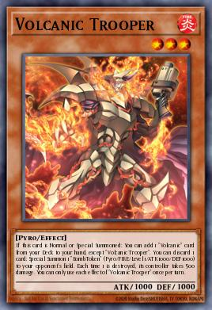

- **Disponibilidad / papel:** Main **3x**; **starter / buscador / creador de objetivos Pyro rivales**.
- **Estado de sinergia y función:** Sinergia indirecta (soporte o recursos). Es una clasificación de juego; revisar la relación concreta en A06.
- **Papel como recurso, descarte o coste:** Su efecto menciona descartar; verificar si es coste o resolución, qué pieza consume y qué recurso queda.
- **Efecto y requisito:** al ser Invocado Normal o Especialmente puede añadir del Deck **1 carta «Volcanic» distinta de Trooper**. Con otro efecto independiente, **descarta 1 carta** y coloca una **Ficha Bomba Pyro/FUEGO** en el campo del oponente; su controlador recibe **500 daños cuando es destruida**. Cada efecto de Trooper se usa **una vez por turno**.
- **Primero / segundo / tardío:** primero obtiene pieza del motor (por ejemplo, Volcanic Blaze Accelerator, Emission o Inferno) según la mano; segundo puede dar una Ficha susceptible de ser destruida o seleccionada; en turnos largos sigue buscando si quedan objetivos en el Deck.
- **Sinergias verificables:** **Volcanic Emission** puede seleccionar una Ficha Pyro del rival para daño según su ATK original; **Volcanic Blaze Accelerator** puede seleccionar un monstruo rival boca arriba. Descartar **Rimfire/Scattershot/Shell** sirve para situarlos en GY, pero no equivale a envío **por un Blaze Accelerator**.
- **Riesgo / recurso:** necesita una Invocación efectiva para buscar; la Ficha ocupa un espacio rival y puede ser aprovechada por este. Si la Ficha no se destruye, no aplica su daño por destrucción; cuidar qué carta se descarta.
- **Fuente / confianza:** **TEXTO_OFICIAL_COTEJADO** — https://www.db.yugioh-card.com/yugiohdb/card_search.action?cid=18916&ope=2&request_locale=en
- **Aplicación concreta dentro de este deck (A06):** Volcanic Emission puede seleccionar una Ficha Pyro del rival para daño según su ATK original; Volcanic Blaze Accelerator puede seleccionar un monstruo rival boca arriba.

**USO PRÁCTICO Y SINERGIA — Volcanic Trooper — Soldado Volcánico**

- **Label funcional:** Sinergia indirecta. Clasificación documental; una relación es válida solo si se satisfacen sus condiciones exactas.
- **Qué hace:** al ser Invocado Normal o Especialmente puede añadir del Deck **1 carta «Volcanic» distinta de Trooper**. Con otro efecto independiente, **descarta 1 carta** y coloca una **Ficha Bomba Pyro/FUEGO** en el campo del oponente; su controlador recibe **500 daños cuando es destruida**. Cada efecto de Trooper se usa **una vez por turno**.
- **Cómo aprovecharla en este deck:** Volcanic Emission puede seleccionar una Ficha Pyro del rival para daño según su ATK original; Volcanic Blaze Accelerator puede seleccionar un monstruo rival boca arriba.
- **Al jugar primero:** primero obtiene pieza del motor (por ejemplo, Volcanic Blaze Accelerator, Emission o Inferno) según la mano; segundo puede dar una Ficha susceptible de ser destruida o seleccionada; en turnos largos sigue buscando si quedan objetivos en el Deck.

#### 02. Volcanic Emperor — Emperador Volcánico

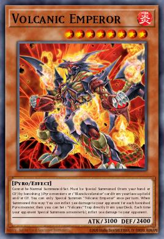

- **Disponibilidad / papel:** Main **2x**; **jefe de campo / finisher de daño / acceso a trampas Volcanic**.
- **Estado de sinergia y función:** Sinergia indirecta (soporte o recursos). Es una clasificación de juego; revisar la relación concreta en A06.
- **Papel como recurso, descarte o coste:** Coste o consumo descrito en A05: desterrar 3 Pyro compite con munición de Shell/Scattershot y coste de Inferno. **Volcanic Emission** puede Invocarlo….
- **Efecto y requisito:** **no puede ser Invocado Normalmente**. Se Invoca Especialmente desde mano o GY por su procedimiento propio desterrando **3 monstruos Pyro o 1 carta «Blaze Accelerator»** del campo propio boca arriba y/o GY; como máximo **1 Invocación Especial de Emperor por turno**. Al ser Invocado **de esa manera**, puede hacer **500 de daño por cada Pyro desterrado** y después **Colocar 1 Trampa «Volcanic» del Deck**. Cada evento de Invocación Especial del rival provoca **500 de daño**, no 500 por cada monstruo de un mismo evento.
- **Primero / segundo / tardío:** primero establece presión y prepara **Volcanic Inferno** o **Volcanic Emission**; segundo aporta 3100 ATK y presión de daño si se pagó su coste. En juego tardío puede volver del GY por su propio método si hay recursos.
- **Sinergias verificables:** **Fire Ejection, Rimfire, Reload y Scattershot** suministran Pyro al GY; **Volcanic Inferno** recicla algunos recursos y disputa efectos de monstruo. Con destierro de **solo 1 Blaze Accelerator** no se generan automáticamente los 1500 daños ligados a **3 Pyro desterrados**.
- **Riesgo / recurso:** desterrar 3 Pyro compite con munición de Shell/Scattershot y coste de Inferno. **Volcanic Emission** puede Invocarlo ignorando condiciones, pero esa Invocación **no cumple «Invocado de esta manera»**: no se le atribuye la Colocación de Trampa del procedimiento propio.
- **Fuente / confianza:** **TEXTO_OFICIAL_COTEJADO** — https://www.db.yugioh-card.com/yugiohdb/card_search.action?cid=18915&ope=2&request_locale=en
- **Aplicación concreta dentro de este deck (A06):** Fire Ejection, Rimfire, Reload y Scattershot suministran Pyro al GY; Volcanic Inferno recicla algunos recursos y disputa efectos de monstruo.

**USO PRÁCTICO Y SINERGIA — Volcanic Emperor — Emperador Volcánico**

- **Label funcional:** Sinergia indirecta. Clasificación documental; una relación es válida solo si se satisfacen sus condiciones exactas.
- **Qué hace:** **no puede ser Invocado Normalmente**. Se Invoca Especialmente desde mano o GY por su procedimiento propio desterrando **3 monstruos Pyro o 1 carta «Blaze Accelerator»** del campo propio boca arriba y/o GY; como máximo **1 Invocación Especial de Emperor por turno**. Al ser Invocado **de esa manera**, puede hacer **500 de daño por cada Pyro desterrado** y después **Colocar 1 Trampa «Volcanic» del Deck**. Cada evento de Invocación Especial del rival provoca **500 de daño**, no 500 por cada monstruo de un mismo evento.
- **Cómo aprovecharla en este deck:** Fire Ejection, Rimfire, Reload y Scattershot suministran Pyro al GY; Volcanic Inferno recicla algunos recursos y disputa efectos de monstruo.
- **Al jugar primero:** primero establece presión y prepara **Volcanic Inferno** o **Volcanic Emission**; segundo aporta 3100 ATK y presión de daño si se pagó su coste. En juego tardío puede volver del GY por su propio método si hay recursos.

#### 03. Volcanic Rocket — Misil Volcánico

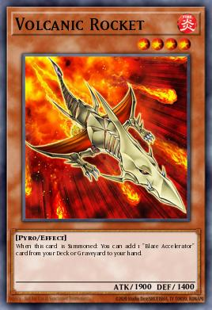

- **Disponibilidad / papel:** Main **3x**; **buscador de motor / recuperación de aceleradores**.
- **Estado de sinergia y función:** Sinergia directa descrita. Es una clasificación de juego; revisar la relación concreta en A06.
- **Papel como recurso, descarte o coste:** Su efecto menciona descartar; verificar si es coste o resolución, qué pieza consume y qué recurso queda.
- **Efecto y requisito:** cuando es Invocado, puede añadir **1 carta «Blaze Accelerator» desde Deck o GY**; no hay que inventar coste de descarte para esa búsqueda.
- **Primero / segundo / tardío:** primero proporciona la pieza continua o la trampa Reload que falte; segundo recompone el motor tras gastarlo; tardío convierte otra Invocación de Rocket en recuperación del GY.
- **Sinergias verificables:** recupera **Blaze Accelerator**, **Blaze Accelerator Reload** o **Volcanic Blaze Accelerator** según sus nombres disponibles y la situación; las copias de la última necesitan además un coste de activación legal.
- **Riesgo / recurso:** depende de que queden aceleradores en Deck/GY; no recupera una carta desterrada, y no sustituye la exigencia de recursos para activar VBA.
- **Fuente / confianza:** **TEXTO_OFICIAL_COTEJADO** — https://www.db.yugioh-card.com/yugiohdb/card_search.action?cid=7243&ope=2&request_locale=en
- **Aplicación concreta dentro de este deck (A06):** recupera Blaze Accelerator, Blaze Accelerator Reload o Volcanic Blaze Accelerator según sus nombres disponibles y la situación.

**USO PRÁCTICO Y SINERGIA — Volcanic Rocket — Misil Volcánico**

- **Label funcional:** Sinergia directa. Clasificación documental; una relación es válida solo si se satisfacen sus condiciones exactas.
- **Qué hace:** cuando es Invocado, puede añadir **1 carta «Blaze Accelerator» desde Deck o GY**; no hay que inventar coste de descarte para esa búsqueda.
- **Cómo aprovecharla en este deck:** recupera Blaze Accelerator, Blaze Accelerator Reload o Volcanic Blaze Accelerator según sus nombres disponibles y la situación.
- **Al jugar primero:** primero proporciona la pieza continua o la trampa Reload que falte; segundo recompone el motor tras gastarlo; tardío convierte otra Invocación de Rocket en recuperación del GY.

#### 04. Volcanic Rimfire — Percusión Anular Volcánica

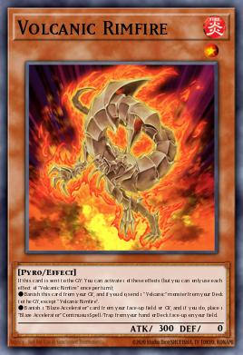

- **Disponibilidad / papel:** Main **3x**; **enabler de GY / puente hacia Scattershot o aceleradores continuos**; **Pyro Nivel 1**.
- **Estado de sinergia y función:** Sinergia directa descrita. Es una clasificación de juego; revisar la relación concreta en A06.
- **Papel como recurso, descarte o coste:** Envío mencionado en la interacción; no equivale por sí mismo a descarte desde la mano.
- **Efecto y requisito:** cuando va al GY puede elegir **un efecto**: (a) desterrarse para enviar **otro monstruo Volcanic** del Deck al GY, o (b) desterrar **1 carta Blaze Accelerator** del campo propio boca arriba/GY y **colocar boca arriba** desde mano/Deck **1 Mágica/Trampa Continua Blaze Accelerator**. **Cada opción**, máximo una vez por turno.
- **Primero / segundo / tardío:** primero inicia el circuito de GY y acceso a Reload; segundo prepara el envío de Scattershot y presión sobre monstruos; tardío debe valorarse si merece gastar acelerador para abrir una carta continua.
- **Sinergias verificables:** **Fire Ejection** puede enviarlo desde Deck; el envío de Rimfire por **VBA** es legal porque es **Nivel 1**; su opción (a) puede enviar **Scattershot** y causar 500 daños, pero al ser efecto **de Rimfire**, por sí sola **no cumple** la condición del barrido de Scattershot ligado a Blaze Accelerator.
- **Riesgo / recurso:** desterrarlo impide usar esa misma copia para **Volcanic Inferno** o como parte de los tres Pyro de Emperor; la opción (b) necesita un acelerador disponible para desterrar y un continuo objetivo realmente existente.
- **Fuente / confianza:** **TEXTO_OFICIAL_COTEJADO** — https://www.db.yugioh-card.com/yugiohdb/card_search.action?cid=18917&ope=2&request_locale=en
- **Aplicación concreta dentro de este deck (A06):** Fire Ejection puede enviarlo desde Deck; el envío de Rimfire por VBA es legal porque es Nivel 1; su opción (a) puede enviar Scattershot y causar 500 daños.

**USO PRÁCTICO Y SINERGIA — Volcanic Rimfire — Percusión Anular Volcánica**

- **Label funcional:** Sinergia directa. Clasificación documental; una relación es válida solo si se satisfacen sus condiciones exactas.
- **Qué hace:** cuando va al GY puede elegir **un efecto**: (a) desterrarse para enviar **otro monstruo Volcanic** del Deck al GY, o (b) desterrar **1 carta Blaze Accelerator** del campo propio boca arriba/GY y **colocar boca arriba** desde mano/Deck **1 Mágica/Trampa Continua Blaze Accelerator**. **Cada opción**, máximo una vez por turno.
- **Cómo aprovecharla en este deck:** Fire Ejection puede enviarlo desde Deck; el envío de Rimfire por VBA es legal porque es Nivel 1; su opción (a) puede enviar Scattershot y causar 500 daños.
- **Al jugar primero:** primero inicia el circuito de GY y acceso a Reload; segundo prepara el envío de Scattershot y presión sobre monstruos; tardío debe valorarse si merece gastar acelerador para abrir una carta continua.

#### 05. Volcanic Scattershot — Disparo Disperso Volcánico

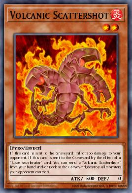

- **Disponibilidad / papel:** Main **3x**; **removal masivo / daño por efecto / munición crítica**; **Pyro Nivel 2**.
- **Estado de sinergia y función:** Sinergia directa descrita. Es una clasificación de juego; revisar la relación concreta en A06.
- **Papel como recurso, descarte o coste:** Envío mencionado en la interacción; no equivale por sí mismo a descarte desde la mano.
- **Efecto y requisito:** cada copia enviada al GY inflige **500 daños**. Si se envía al GY **por efecto de una carta Blaze Accelerator**, puede enviar **otras 2 copias** desde mano y/o Deck al GY para **destruir todos los monstruos que controla el rival**. Si las tres copias llegan al GY por esa resolución y disparan sus efectos de daño, el potencial conjunto es **1500 daños**, sujeto a resolución real.
- **Primero / segundo / tardío:** segundo es limpieza de tablero; primero es amenaza a conservar vía Reload; tardío necesita comprobar que las dos copias adicionales siguen en mano/Deck.
- **Sinergias verificables:** **Blaze Accelerator** lo puede enviar **desde la mano** si satisface su requisito de ATK; **Blaze Accelerator Reload**, mediante su efecto desde GY, lo envía **desde Deck** y habilita la condición de barrido; **Fire Ejection/Rimfire/Forbidden Droplet** pueden mandarlo al GY para 500, pero **no** activan por sí mismos el barrido.
- **Riesgo / recurso:** **Volcanic Blaze Accelerator** solo envía **Pyro Nivel 1 desde Deck**, por lo que **no puede elegir Scattershot Nivel 2**. Destrucción no es negación ni afecta automáticamente a monstruos protegidos. Si ya no quedan las otras 2 copias elegibles, no prometer la limpieza.
- **Fuente / confianza:** **TEXTO_OFICIAL_COTEJADO** — https://www.db.yugioh-card.com/yugiohdb/card_search.action?cid=7083&ope=2&request_locale=en
- **Aplicación concreta dentro de este deck (A06):** Blaze Accelerator lo puede enviar desde la mano si satisface su requisito de ATK.

**USO PRÁCTICO Y SINERGIA — Volcanic Scattershot — Disparo Disperso Volcánico**

- **Label funcional:** Sinergia directa. Clasificación documental; una relación es válida solo si se satisfacen sus condiciones exactas.
- **Qué hace:** cada copia enviada al GY inflige **500 daños**. Si se envía al GY **por efecto de una carta Blaze Accelerator**, puede enviar **otras 2 copias** desde mano y/o Deck al GY para **destruir todos los monstruos que controla el rival**. Si las tres copias llegan al GY por esa resolución y disparan sus efectos de daño, el potencial conjunto es **1500 daños**, sujeto a resolución real.
- **Cómo aprovecharla en este deck:** Blaze Accelerator lo puede enviar desde la mano si satisface su requisito de ATK.
- **Al jugar primero:** segundo es limpieza de tablero; primero es amenaza a conservar vía Reload; tardío necesita comprobar que las dos copias adicionales siguen en mano/Deck.

#### 06. Volcanic Shell — Cartucho Volcánico

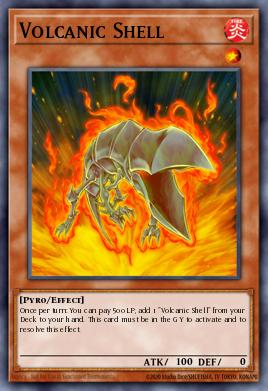

- **Disponibilidad / papel:** Main **3x**; **recurso reciclable / munición / ventaja incremental**; **Pyro Nivel 1**.
- **Estado de sinergia y función:** Sinergia indirecta (soporte o recursos). Es una clasificación de juego; revisar la relación concreta en A06.
- **Papel como recurso, descarte o coste:** Envío mencionado en la interacción; no equivale por sí mismo a descarte desde la mano.
- **Efecto y requisito:** **una vez por turno** paga **500 LP** para añadir **otra Shell del Deck** a la mano. La copia que usa ese efecto **debe permanecer en GY tanto al activarlo como al resolverlo**.
- **Primero / segundo / tardío:** primero convierte un envío al GY en carta adicional para coste futuro; segundo abastece recursos, no rompe por sí sola el tablero; tardío pierde valor si no quedan Shell en Deck.
- **Sinergias verificables:** **VBA** puede enviarla desde Deck por exigir Pyro Nivel 1 y un objetivo rival boca arriba; **Blaze Accelerator** puede enviarla desde mano; las copias obtenidas pueden alimentar **Reload** o el coste de descarte de Trooper.
- **Riesgo / recurso:** cada uso consume LP y una copia que permanezca en Deck; si un efecto rival mueve la Shell del GY antes de resolver, falla su requisito. Su búsqueda no añade un «Volcanic» cualquiera.
- **Fuente / confianza:** **TEXTO_OFICIAL_COTEJADO** — https://www.db.yugioh-card.com/yugiohdb/card_search.action?cid=7082&ope=2&request_locale=en
- **Aplicación concreta dentro de este deck (A06 y nueva ruta):** `687:A09:SHELL:LINKURIBOH:DEFENSA15` parte de **Shell en mano**, la Invoca Normal y la usa como material Nivel 1 de Enlacekuriboh. Shell llega al GY, paga 500 LP para buscar otra Shell, mientras el Link queda listo para alterar ATK de un atacante rival. Alternativa de motor con Acelerador: `687:A09:BLAZE:SHELL:RESOURCE01`; consumir la Normal en Shell compite con Trooper/Rocket.

**USO PRÁCTICO Y SINERGIA — Volcanic Shell — Cartucho Volcánico**

- **Label funcional:** Sinergia indirecta. Clasificación documental; una relación es válida solo si se satisfacen sus condiciones exactas.
- **Qué hace:** **una vez por turno** paga **500 LP** para añadir **otra Shell del Deck** a la mano. La copia que usa ese efecto **debe permanecer en GY tanto al activarlo como al resolverlo**.
- **Cómo aprovecharla en este deck:** desde una Shell en mano y Normal libre, `687:A09:SHELL:LINKURIBOH:DEFENSA15` demuestra paso a paso Shell → Enlacekuriboh; la Shell en GY añade otra copia del Deck pagando 500 LP. Cuando ya controlas Aceleradores, la línea `687:A09:BLAZE:SHELL:RESOURCE01` puede ser mejor para ahorrar la Normal.
- **Al jugar primero:** primero convierte un envío al GY en carta adicional para coste futuro; segundo abastece recursos, no rompe por sí sola el tablero; tardío pierde valor si no quedan Shell en Deck.

**NUEVA INTERACCIÓN BÁSICA ILUSTRADA:** abrir `687:A09:SHELL:LINKURIBOH:DEFENSA15`. Mano inicial Shell 1x; Normal Shell Nivel 1 → Enlacekuriboh Link1; pagar 500 LP en GY para otra Shell; defensa por Sacrificio solo al declararse ataque rival. No prometer que el ataque queda negado ni daño evitado por un posible replay.

#### 07. Barrier Statue of the Inferno — Estatua-Barrera del Infierno

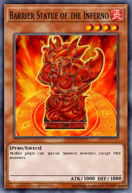

- **Disponibilidad / papel:** Main **1x**; **bloqueo de Invocaciones Especiales / presión al ir primero**.
- **Estado de sinergia y función:** Sinergia indirecta (soporte o recursos). Es una clasificación de juego; revisar la relación concreta en A06.
- **Papel como recurso, descarte o coste:** Coste o consumo descrito en A05: es una restricción **simétrica**; no convocar piezas incompatibles como si la Estatua no estuviese presente. No genera….
- **Efecto y requisito:** mientras esté en campo, **ningún jugador puede Invocar Especialmente monstruos que no sean FUEGO**. No niega monstruos que ya estaban en campo y afecta también al controlador.
- **Primero / segundo / tardío:** primero dificulta la expansión de rivales no FUEGO; segundo no retira un tablero establecido y expone un cuerpo frágil; tardío depende de su supervivencia.
- **Sinergias verificables:** convive con buena parte del Main Pyro/FUEGO y con **Hiita, Knightmare Phoenix, Salamangreat Almiraj y Promethean Princess**; impide mientras se aplica Invocaciones de **I:P, S:P, Linkuriboh, Unicorn, Underworld Goddess o TY-PHON** por no ser FUEGO.
- **Riesgo / recurso:** es una restricción **simétrica**; no convocar piezas incompatibles como si la Estatua no estuviese presente. No genera recursos ni daño por sí misma.
- **Fuente / confianza:** **TEXTO_OFICIAL_COTEJADO** — https://www.db.yugioh-card.com/yugiohdb/card_search.action?cid=6884&ope=2&request_locale=en
- **Aplicación concreta dentro de este deck (A06):** convive con buena parte del Main Pyro/FUEGO y con Hiita, Knightmare Phoenix, Salamangreat Almiraj y Promethean Princess.

**USO PRÁCTICO Y SINERGIA — Barrier Statue of the Inferno — Estatua-Barrera del Infierno**

- **Label funcional:** Sinergia indirecta. Clasificación documental; una relación es válida solo si se satisfacen sus condiciones exactas.
- **Qué hace:** mientras esté en campo, **ningún jugador puede Invocar Especialmente monstruos que no sean FUEGO**. No niega monstruos que ya estaban en campo y afecta también al controlador.
- **Cómo aprovecharla en este deck:** convive con buena parte del Main Pyro/FUEGO y con Hiita, Knightmare Phoenix, Salamangreat Almiraj y Promethean Princess.
- **Al jugar primero:** primero dificulta la expansión de rivales no FUEGO; segundo no retira un tablero establecido y expone un cuerpo frágil; tardío depende de su supervivencia.

#### 08. Maxx "C" — «C» Maxx

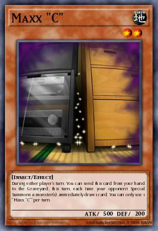

- **Disponibilidad / papel:** Main **2x**, **Reserva 1x adicional**; **handtrap de ventaja / disuasión ante extensión rival**. La Reserva **no participa** en partidas actuales.
- **Estado de sinergia y función:** Utilidad independiente. Es una clasificación de juego; revisar la relación concreta en A06.
- **Papel como recurso, descarte o coste:** Coste o consumo descrito en A05: el rival puede detenerse; puede ser negada o quedarse sin valor si el oponente no Invoca Especialmente. **No se revisa aquí….
- **Efecto y requisito:** como **efecto rápido**, se envía de la mano al GY; durante ese turno, cada vez que el rival **realiza un evento de Invocación Especial**, se roba **1 carta**. Máximo un uso por turno. **No es negación** y no roba por Invocaciones anteriores a su resolución.
- **Primero / segundo / tardío:** sirve especialmente cuando el rival intenta prolongar su turno; primero se reserva para turno rival, segundo puede presionar su siguiente turno; tardío vale si aún hay Deck y jugadas rivales.
- **Sinergias verificables:** puede aportar nuevas cartas del motor, pero **Pot of Extravagance** impide robar por efectos **después de resolver**, y **Pot of Prosperity** impide robar por efectos durante **todo el turno** de activación; evaluar conflictos temporales.
- **Riesgo / recurso:** el rival puede detenerse; puede ser negada o quedarse sin valor si el oponente no Invoca Especialmente. **No se revisa aquí estatus de banlist** por instrucción de alcance.
- **Fuente / confianza:** **TEXTO_OFICIAL_COTEJADO** — https://www.db.yugioh-card.com/yugiohdb/card_search.action?cid=9455&ope=2&request_locale=en
- **Aplicación concreta dentro de este deck (A06):** puede aportar nuevas cartas del motor, pero Pot of Extravagance impide robar por efectos después de resolver, y Pot of Prosperity impide robar por efectos durante todo el turno de activación. Aporta respuesta o consistencia sin exigir enlace directo.

**USO PRÁCTICO Y SINERGIA — Maxx "C" — «C» Maxx**

- **Label funcional:** Función independiente. Clasificación documental; una relación es válida solo si se satisfacen sus condiciones exactas.
- **Qué hace:** como **efecto rápido**, se envía de la mano al GY; durante ese turno, cada vez que el rival **realiza un evento de Invocación Especial**, se roba **1 carta**. Máximo un uso por turno. **No es negación** y no roba por Invocaciones anteriores a su resolución.
- **Cómo aprovecharla en este deck:** puede aportar nuevas cartas del motor, pero Pot of Extravagance impide robar por efectos después de resolver, y Pot of Prosperity impide robar por efectos durante todo el turno de activación. Aporta respuesta o consistencia sin exigir enlace directo.
- **Al jugar primero:** sirve especialmente cuando el rival intenta prolongar su turno; primero se reserva para turno rival, segundo puede presionar su siguiente turno; tardío vale si aún hay Deck y jugadas rivales.

#### 09. Volcanic Blaze Accelerator — Acelerador de Llama Volcánico

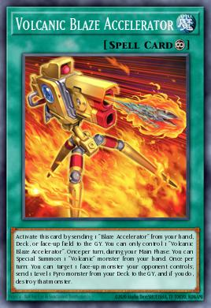

- **Disponibilidad / papel:** Main **3x**; **núcleo continuo / extensor de Invocación / removal puntual con envío al GY**.
- **Estado de sinergia y función:** Sinergia directa descrita. Es una clasificación de juego; revisar la relación concreta en A06.
- **Papel como recurso, descarte o coste:** Envío mencionado en la interacción; no equivale por sí mismo a descarte desde la mano.
- **Efecto y requisito:** para activarlo debe enviar **1 carta «Blaze Accelerator» de mano, Deck o campo propio boca arriba al GY**; solo puede controlarse **1 VBA**. Una vez por turno durante la propia Main Phase Invoca Especialmente **1 Volcanic de la mano**. Por separado, una vez por turno puede seleccionar **1 monstruo rival boca arriba**, enviar **1 Pyro Nivel 1 del Deck al GY** y, si el envío se efectúa, destruir el objetivo.
- **Primero / segundo / tardío:** primero extiende la presencia en campo y carga Rimfire/Shell; segundo aporta destrucción selectiva; tardío depende de una fuente real de cartas «Blaze Accelerator» para activar y de objetivos que puedan resolverse.
- **Sinergias verificables:** enviar **Rimfire Nivel 1** habilita su efecto de GY; enviar **Shell Nivel 1** prepara recursión; su Invocación desde mano puede desplegar Trooper para buscar.
- **Riesgo / recurso:** **Scattershot es Nivel 2**: nunca representarlo como envío legal de este efecto. Sin acelerador que pueda enviarse como coste, no se activa VBA. Si el rival niega el efecto o protege el objetivo, no prometer destrucción.
- **Fuente / confianza:** **TEXTO_OFICIAL_COTEJADO** — https://www.db.yugioh-card.com/yugiohdb/card_search.action?cid=18918&ope=2&request_locale=en
- **Aplicación concreta dentro de este deck (A06):** enviar Rimfire Nivel 1 habilita su efecto de GY; enviar Shell Nivel 1 prepara recursión; su Invocación desde mano puede desplegar Trooper para buscar.

**USO PRÁCTICO Y SINERGIA — Volcanic Blaze Accelerator — Acelerador de Llama Volcánico**

- **Label funcional:** Sinergia directa. Clasificación documental; una relación es válida solo si se satisfacen sus condiciones exactas.
- **Qué hace:** para activarlo debe enviar **1 carta «Blaze Accelerator» de mano, Deck o campo propio boca arriba al GY**; solo puede controlarse **1 VBA**. Una vez por turno durante la propia Main Phase Invoca Especialmente **1 Volcanic de la mano**. Por separado, una vez por turno puede seleccionar **1 monstruo rival boca arriba**, enviar **1 Pyro Nivel 1 del Deck al GY** y, si el envío se efectúa, destruir el objetivo.
- **Cómo aprovecharla en este deck:** enviar Rimfire Nivel 1 habilita su efecto de GY; enviar Shell Nivel 1 prepara recursión; su Invocación desde mano puede desplegar Trooper para buscar.
- **Al jugar primero:** primero extiende la presencia en campo y carga Rimfire/Shell; segundo aporta destrucción selectiva; tardío depende de una fuente real de cartas «Blaze Accelerator» para activar y de objetivos que puedan resolverse.

#### 10. Blaze Accelerator — Acelerador de Llama

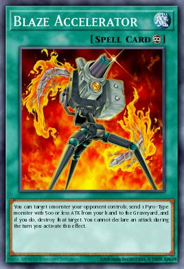

- **Disponibilidad / papel:** Main **1x**; **pieza de acceso / removal de monstruo a costa de munición**.
- **Estado de sinergia y función:** Sinergia directa descrita. Es una clasificación de juego; revisar la relación concreta en A06.
- **Papel como recurso, descarte o coste:** Envío mencionado en la interacción; no equivale por sí mismo a descarte desde la mano.
- **Efecto y requisito:** Mágica Continua que selecciona **1 monstruo rival**, envía al GY **1 Pyro con 500 ATK o menos desde la mano** y, si se envía, destruye el objetivo. **Los monstruos propios no pueden atacar el turno que se activa este efecto**.
- **Primero / segundo / tardío:** primero puede servir como coste de activación de VBA; segundo es destrucción a cambio de perder la oportunidad de atacar; tardío puede ser recuperada por Rocket si está en GY.
- **Sinergias verificables:** **Scattershot** reúne el requisito de hasta 500 ATK y, si este efecto lo envía al GY, puede disparar el envío de otras dos copias y destrucción masiva. **Shell/Rimfire** también son munición apropiada.
- **Riesgo / recurso:** consume carta de mano y bloquea ataques **ese turno**; en planes de daño de combate se debe preferir otra vía o posponerla. También es recurso para el método propio de Emperor.
- **Fuente / confianza:** **TEXTO_OFICIAL_COTEJADO** — https://www.db.yugioh-card.com/yugiohdb/card_search.action?cid=7086&ope=2&request_locale=en
- **Aplicación concreta dentro de este deck (A06):** Scattershot reúne el requisito de hasta 500 ATK y, si este efecto lo envía al GY, puede disparar el envío de otras dos copias y destrucción masiva.

**USO PRÁCTICO Y SINERGIA — Blaze Accelerator — Acelerador de Llama**

- **Label funcional:** Sinergia directa. Clasificación documental; una relación es válida solo si se satisfacen sus condiciones exactas.
- **Qué hace:** Mágica Continua que selecciona **1 monstruo rival**, envía al GY **1 Pyro con 500 ATK o menos desde la mano** y, si se envía, destruye el objetivo. **Los monstruos propios no pueden atacar el turno que se activa este efecto**.
- **Cómo aprovecharla en este deck:** Scattershot reúne el requisito de hasta 500 ATK y, si este efecto lo envía al GY, puede disparar el envío de otras dos copias y destrucción masiva.
- **Al jugar primero:** primero puede servir como coste de activación de VBA; segundo es destrucción a cambio de perder la oportunidad de atacar; tardío puede ser recuperada por Rocket si está en GY.

#### 11. Fire Ejection — Eyección de Fuego

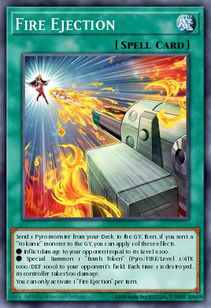

- **Disponibilidad / papel:** Main **3x**; **envío preciso Pyro desde Deck / habilitador de GY / generador de Ficha**.
- **Estado de sinergia y función:** Sinergia directa descrita. Es una clasificación de juego; revisar la relación concreta en A06.
- **Papel como recurso, descarte o coste:** Envío mencionado en la interacción; no equivale por sí mismo a descarte desde la mano.
- **Efecto y requisito:** Mágica Normal que envía **1 Pyro del Deck al GY**. Si fue un **Volcanic**, se elige **una** de dos opciones: quemar **Nivel × 100**, o Invocar al campo rival **1 Ficha Bomba Pyro/FUEGO** que inflige **500 a su controlador al ser destruida**. Solo puede activarse **1 Fire Ejection por turno**.
- **Primero / segundo / tardío:** primero priorizar **Rimfire** o Shell por continuidad, según los recursos; segundo enviar **Scattershot** produce al menos su daño de envío, pero no el barrido; tardío depende de qué Pyro quede en Deck.
- **Sinergias verificables:** prepara un Rimfire de GY para colocar acelerador; envía Shell al GY para obtener otra copia; pone Ficha rival para efectos que seleccionan Pyro, como **Volcanic Emission**.
- **Riesgo / recurso:** no se puede elegir **a la vez** daño por nivel y Ficha; enviar Scattershot por Fire Ejection **no** satisface «enviada por efecto Blaze Accelerator»; la Ficha puede favorecer al rival si no se explota.
- **Fuente / confianza:** **TEXTO_OFICIAL_COTEJADO** — https://www.db.yugioh-card.com/yugiohdb/card_search.action?cid=18919&ope=2&request_locale=en
- **Aplicación concreta dentro de este deck (A06):** prepara un Rimfire de GY para colocar acelerador; envía Shell al GY para obtener otra copia; pone Ficha rival para efectos que seleccionan Pyro, como Volcanic Emission.

**USO PRÁCTICO Y SINERGIA — Fire Ejection — Eyección de Fuego**

- **Label funcional:** Sinergia directa. Clasificación documental; una relación es válida solo si se satisfacen sus condiciones exactas.
- **Qué hace:** Mágica Normal que envía **1 Pyro del Deck al GY**. Si fue un **Volcanic**, se elige **una** de dos opciones: quemar **Nivel × 100**, o Invocar al campo rival **1 Ficha Bomba Pyro/FUEGO** que inflige **500 a su controlador al ser destruida**. Solo puede activarse **1 Fire Ejection por turno**.
- **Cómo aprovecharla en este deck:** prepara un Rimfire de GY para colocar acelerador; envía Shell al GY para obtener otra copia; pone Ficha rival para efectos que seleccionan Pyro, como Volcanic Emission.
- **Al jugar primero:** primero priorizar **Rimfire** o Shell por continuidad, según los recursos; segundo enviar **Scattershot** produce al menos su daño de envío, pero no el barrido; tardío depende de qué Pyro quede en Deck.

#### 12. Forbidden Droplet — Gotas Prohibidas

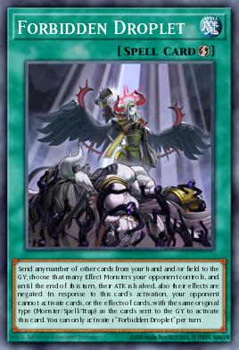

- **Disponibilidad / papel:** Main **3x**; **board breaker / negación de monstruos / apoyo ofensivo**.
- **Estado de sinergia y función:** Utilidad independiente. Es una clasificación de juego; revisar la relación concreta en A06.
- **Papel como recurso, descarte o coste:** Envío mencionado en la interacción; no equivale por sí mismo a descarte desde la mano.
- **Efecto y requisito:** Mágica de Juego Rápido: envía **otras cartas de mano y/o campo** al GY, luego escoge igual cantidad de **monstruos de efecto rivales**; hasta final de turno reduce sus ATK a la mitad y niega sus efectos. En respuesta a su activación, el rival no puede activar cartas/efectos de los **tipos originales** (Monstruo/Mágica/Trampa) enviados para activarla. Solo 1 activación por turno.
- **Primero / segundo / tardío:** segundo desactiva varios bloqueos para jugar; primero puede guardarse para defenderse en turno rival si estuvo Colocada de antes; tardío convierte cartas sobrantes en acceso al combate.
- **Sinergias verificables:** enviar **Rimfire o Scattershot** como recurso de la mano al GY puede preparar sus disparadores propios; **no** transforma el envío en «efecto Blaze Accelerator». Reducir ATK favorece al Emperor y ataques subsiguientes.
- **Riesgo / recurso:** el número de monstruos afectados depende de cuántas cartas **se envíen realmente**; no destruye ni destierra; gastar varias piezas Volcanic podría dejar sin motor. No trata monstruos que carecen de efecto como blancos adecuados.
- **Fuente / confianza:** **TEXTO_OFICIAL_COTEJADO** — https://www.db.yugioh-card.com/yugiohdb/card_search.action?cid=15299&ope=2&request_locale=en
- **Aplicación concreta dentro de este deck (A06):** enviar Rimfire o Scattershot como recurso de la mano al GY puede preparar sus disparadores propios; no transforma el envío en «efecto Blaze Accelerator». Aporta respuesta o consistencia sin exigir enlace directo.

**USO PRÁCTICO Y SINERGIA — Forbidden Droplet — Gotas Prohibidas**

- **Label funcional:** Función independiente. Clasificación documental; una relación es válida solo si se satisfacen sus condiciones exactas.
- **Qué hace:** Mágica de Juego Rápido: envía **otras cartas de mano y/o campo** al GY, luego escoge igual cantidad de **monstruos de efecto rivales**; hasta final de turno reduce sus ATK a la mitad y niega sus efectos. En respuesta a su activación, el rival no puede activar cartas/efectos de los **tipos originales** (Monstruo/Mágica/Trampa) enviados para activarla. Solo 1 activación por turno.
- **Cómo aprovecharla en este deck:** enviar Rimfire o Scattershot como recurso de la mano al GY puede preparar sus disparadores propios; no transforma el envío en «efecto Blaze Accelerator». Aporta respuesta o consistencia sin exigir enlace directo.
- **Al jugar primero:** segundo desactiva varios bloqueos para jugar; primero puede guardarse para defenderse en turno rival si estuvo Colocada de antes; tardío convierte cartas sobrantes en acceso al combate.

#### 13. Bonfire — Hoguera

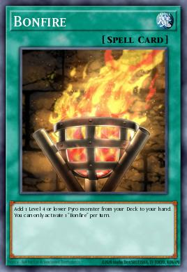

- **Disponibilidad / papel:** Main **3x**; **starter genérico / tutor de Pyro pequeño**.
- **Estado de sinergia y función:** Sinergia indirecta (soporte o recursos). Es una clasificación de juego; revisar la relación concreta en A06.
- **Papel como recurso, descarte o coste:** Coste o consumo descrito en A05: gastar Bonfire para una pieza que ya está duplicada reduce capacidad de resolver una mano difícil; si el acceso al Deck está….
- **Efecto y requisito:** añade a la mano **1 monstruo Pyro de Nivel 4 o inferior** desde el Deck; se activa como máximo **1 Bonfire por turno**.
- **Primero / segundo / tardío:** primero busca **Trooper** para abrir motor o **Rocket** para buscar un acelerador; segundo puede elegir **Rimfire / Scattershot / Shell** si falta munición concreta; tardío depende de objetivos remanentes.
- **Sinergias verificables:** ofrece acceso a todas las piezas **Pyro Nivel 1–4** de esta lista; **NO** puede añadir **Volcanic Emperor (Nivel 8)** ni cartas Mágicas/Trampa.
- **Riesgo / recurso:** gastar Bonfire para una pieza que ya está duplicada reduce capacidad de resolver una mano difícil; si el acceso al Deck está negado, no aporta alternativa de GY.
- **Fuente / confianza:** **TEXTO_OFICIAL_COTEJADO** — https://www.db.yugioh-card.com/yugiohdb/card_search.action?cid=19027&ope=2&request_locale=en
- **Aplicación concreta dentro de este deck (A06):** ofrece acceso a todas las piezas Pyro Nivel 1–4 de esta lista; NO puede añadir Volcanic Emperor (Nivel 8) ni cartas Mágicas/Trampa.

**USO PRÁCTICO Y SINERGIA — Bonfire — Hoguera**

- **Label funcional:** Sinergia indirecta. Clasificación documental; una relación es válida solo si se satisfacen sus condiciones exactas.
- **Qué hace:** añade a la mano **1 monstruo Pyro de Nivel 4 o inferior** desde el Deck; se activa como máximo **1 Bonfire por turno**.
- **Cómo aprovecharla en este deck:** ofrece acceso a todas las piezas Pyro Nivel 1–4 de esta lista; NO puede añadir Volcanic Emperor (Nivel 8) ni cartas Mágicas/Trampa.
- **Al jugar primero:** primero busca **Trooper** para abrir motor o **Rocket** para buscar un acelerador; segundo puede elegir **Rimfire / Scattershot / Shell** si falta munición concreta; tardío depende de objetivos remanentes.

#### 14. Pot of Extravagance — Olla de la Extravagancia

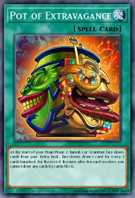

- **Disponibilidad / papel:** Main **2x**; **robo / impulso de consistencia con coste de Extra Deck**.
- **Estado de sinergia y función:** Sinergia indirecta (soporte o recursos). Es una clasificación de juego; revisar la relación concreta en A06.
- **Papel como recurso, descarte o coste:** Coste o consumo descrito en A05: el destierro es **aleatorio**: no garantizar que quede una ruta Extra concreta. Si ya se realizó otra jugada de Main Phase….
- **Efecto y requisito:** **al comienzo de Main Phase 1**, destierra **3 o 6 cartas aleatorias del Extra Deck boca abajo**, y roba **1 por cada 3**. Después de resolver, no puede **robar por efectos de cartas** por el resto de ese turno.
- **Primero / segundo / tardío:** primero mejora la mano antes de dedicar Invocación Normal, si se acepta el coste; segundo ayuda a reunir respuestas; tardío puede no activarse si ya no hay suficientes cartas de Extra.
- **Sinergias verificables:** puede hallar Trooper/Bonfire/Droplet, pero compite con **I:P / S:P / TY-PHON / Promethean Princess** por el Extra y deshabilita el robo posterior de **Blaze Accelerator Reload** en el mismo turno.
- **Riesgo / recurso:** el destierro es **aleatorio**: no garantizar que quede una ruta Extra concreta. Si ya se realizó otra jugada de Main Phase 1, se pierde la ventana de activación. Evaluar la presión del rival antes de comprometer seis cartas.
- **Fuente / confianza:** **TEXTO_OFICIAL_COTEJADO** — https://www.db.yugioh-card.com/yugiohdb/card_search.action?cid=14144&ope=2&request_locale=en
- **Aplicación concreta dentro de este deck (A06):** puede hallar Trooper/Bonfire/Droplet, pero compite con I:P / S:P / TY-PHON / Promethean Princess por el Extra y deshabilita el robo posterior de Blaze Accelerator Reload en el mismo turno.

**USO PRÁCTICO Y SINERGIA — Pot of Extravagance — Olla de la Extravagancia**

- **Label funcional:** Sinergia indirecta. Clasificación documental; una relación es válida solo si se satisfacen sus condiciones exactas.
- **Qué hace:** **al comienzo de Main Phase 1**, destierra **3 o 6 cartas aleatorias del Extra Deck boca abajo**, y roba **1 por cada 3**. Después de resolver, no puede **robar por efectos de cartas** por el resto de ese turno.
- **Cómo aprovecharla en este deck:** puede hallar Trooper/Bonfire/Droplet, pero compite con I:P / S:P / TY-PHON / Promethean Princess por el Extra y deshabilita el robo posterior de Blaze Accelerator Reload en el mismo turno.
- **Al jugar primero:** primero mejora la mano antes de dedicar Invocación Normal, si se acepta el coste; segundo ayuda a reunir respuestas; tardío puede no activarse si ya no hay suficientes cartas de Extra.

**CÓMO LLEGAR DESDE TU DECK — SIN RUTA DEMOSTRADA**

- La biblioteca actual no contiene una ruta identificada para esta carta del Extra. No se debe exhibir una descripción genérica como sustituto de mano inicial, materiales y pasos. Para completarla, contrastar requisitos oficiales y recursos del Main; si no es alcanzable, explicar el impedimento exacto.

#### 15. Blaze Accelerator Reload — Recarga del Acelerador de Llama

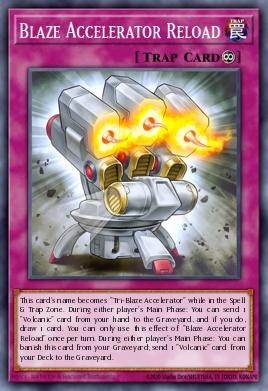

- **Disponibilidad / papel:** Main **3x**; **motor de robo / remitente de munición al GY / activador de Scattershot**.
- **Estado de sinergia y función:** Sinergia directa descrita. Es una clasificación de juego; revisar la relación concreta en A06.
- **Papel como recurso, descarte o coste:** Envío mencionado en la interacción; no equivale por sí mismo a descarte desde la mano.
- **Efecto y requisito:** Trampa Continua cuyo nombre pasa a **Tri-Blaze Accelerator** mientras está en zona Mágica/Trampa. En Main Phase puede **enviar 1 carta Volcanic de la mano al GY** para **robar 1** (este efecto, una vez por turno). Desde GY, durante Main Phase puede **desterrar Reload** para **enviar 1 carta Volcanic del Deck al GY**.
- **Primero / segundo / tardío:** primero colocarla o acceder a ella con Rimfire; durante turno rival, si ya está activa y es Main Phase, puede convertir mano en GY/robo. Segundo o tardío su efecto en GY habilita daño y despeje de Scattershot.
- **Sinergias verificables:** enviar **Scattershot** desde Deck por efecto de esta carta puede habilitar su **barrido** si quedan otras dos copias; mandar Rimfire al GY inicia una de sus opciones. **Rocket** puede recuperarla de GY cuando convenga más colocarla que desterrarla.
- **Riesgo / recurso:** robo desde mano y envío desde Deck **son efectos distintos**; no confundir el primero con enviar del Deck gratis. El descarte no es su coste: el efecto dice **enviar**; **Extravagance/Prosperity** pueden prohibir el robo por efecto según su ventana. El efecto desde GY exige que Reload esté efectivamente ahí.
- **Fuente / confianza:** **TEXTO_OFICIAL_COTEJADO** — https://www.db.yugioh-card.com/yugiohdb/card_search.action?cid=11597&ope=2&request_locale=en
- **Aplicación concreta dentro de este deck (A06):** enviar Scattershot desde Deck por efecto de esta carta puede habilitar su barrido si quedan otras dos copias; mandar Rimfire al GY inicia una de sus opciones.

**USO PRÁCTICO Y SINERGIA — Blaze Accelerator Reload — Recarga del Acelerador de Llama**

- **Label funcional:** Sinergia directa. Clasificación documental; una relación es válida solo si se satisfacen sus condiciones exactas.
- **Qué hace:** Trampa Continua cuyo nombre pasa a **Tri-Blaze Accelerator** mientras está en zona Mágica/Trampa. En Main Phase puede **enviar 1 carta Volcanic de la mano al GY** para **robar 1** (este efecto, una vez por turno). Desde GY, durante Main Phase puede **desterrar Reload** para **enviar 1 carta Volcanic del Deck al GY**.
- **Cómo aprovecharla en este deck:** enviar Scattershot desde Deck por efecto de esta carta puede habilitar su barrido si quedan otras dos copias; mandar Rimfire al GY inicia una de sus opciones.
- **Al jugar primero:** primero colocarla o acceder a ella con Rimfire; durante turno rival, si ya está activa y es Main Phase, puede convertir mano en GY/robo. Segundo o tardío su efecto en GY habilita daño y despeje de Scattershot.

#### 16. Volcanic Inferno — Infierno Volcánico

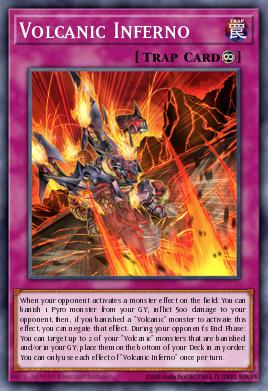

- **Disponibilidad / papel:** Main **1x**; **interrupción de efecto de monstruo / reciclaje para juego tardío**.
- **Estado de sinergia y función:** Sinergia indirecta (soporte o recursos). Es una clasificación de juego; revisar la relación concreta en A06.
- **Papel como recurso, descarte o coste:** Coste o consumo descrito en A05: con Pyro **no Volcanic** solo hay 500 de daño, **no negación**; no niega efectos de monstruos activados exclusivamente en….
- **Efecto y requisito:** Trampa Continua: cuando el rival **activa un efecto de monstruo en campo**, puede **desterrar 1 Pyro de su GY** para infligir **500 de daño**; si el desterrado era **Volcanic**, puede además **negar ese efecto**. Durante la End Phase rival puede devolver al **fondo del Deck hasta 2 Volcanic** propios desterrados o del GY. **Cada efecto**, una vez por turno.
- **Primero / segundo / tardío:** primero es excelente objetivo para **Emperor**, que puede Colocarla si usó su procedimiento; segundo reacciona a un campo aún activo tras instalarla; tardío recicla piezas como Scattershot/Shell y evita agotamiento.
- **Sinergias verificables:** el primer efecto consume el mismo GY de Pyro que **Emperor** y **Rimfire**; el segundo puede volver a habilitar copias de Scattershot en Deck para otro envío legal.
- **Riesgo / recurso:** con Pyro **no Volcanic** solo hay 500 de daño, **no negación**; no niega efectos de monstruos activados exclusivamente en mano o GY por esa condición. No puede activar normalmente una Trampa recién Colocada en ese mismo turno.
- **Fuente / confianza:** **TEXTO_OFICIAL_COTEJADO** — https://www.db.yugioh-card.com/yugiohdb/card_search.action?cid=18921&ope=2&request_locale=en
- **Aplicación concreta dentro de este deck (A06):** el primer efecto consume el mismo GY de Pyro que Emperor y Rimfire; el segundo puede volver a habilitar copias de Scattershot en Deck para otro envío legal.

**USO PRÁCTICO Y SINERGIA — Volcanic Inferno — Infierno Volcánico**

- **Label funcional:** Sinergia indirecta. Clasificación documental; una relación es válida solo si se satisfacen sus condiciones exactas.
- **Qué hace:** Trampa Continua: cuando el rival **activa un efecto de monstruo en campo**, puede **desterrar 1 Pyro de su GY** para infligir **500 de daño**; si el desterrado era **Volcanic**, puede además **negar ese efecto**. Durante la End Phase rival puede devolver al **fondo del Deck hasta 2 Volcanic** propios desterrados o del GY. **Cada efecto**, una vez por turno.
- **Cómo aprovecharla en este deck:** el primer efecto consume el mismo GY de Pyro que Emperor y Rimfire; el segundo puede volver a habilitar copias de Scattershot en Deck para otro envío legal.
- **Al jugar primero:** primero es excelente objetivo para **Emperor**, que puede Colocarla si usó su procedimiento; segundo reacciona a un campo aún activo tras instalarla; tardío recicla piezas como Scattershot/Shell y evita agotamiento.

#### 17. Volcanic Emission — Emisión Volcánica

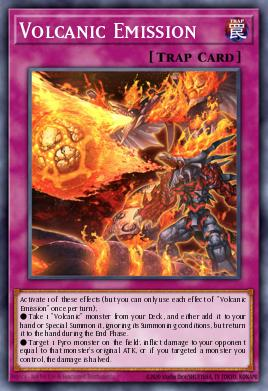

- **Disponibilidad / papel:** Main **1x**; **extensión puntual / daño de Pyro en campo**.
- **Estado de sinergia y función:** Sinergia indirecta (soporte o recursos). Es una clasificación de juego; revisar la relación concreta en A06.
- **Papel como recurso, descarte o coste:** Coste o consumo descrito en A05: carta Colocada debe esperar normalmente turno permitido; la Invocación temporal vuelve a mano al final y no se convierte….
- **Efecto y requisito:** Trampa Normal que **elige una opción por activación**: (a) tomar del Deck **1 monstruo Volcanic**, añadirlo a mano o Invocarlo Especialmente **ignorando sus condiciones**, pero si se Invocó devolverlo a mano en End Phase; (b) seleccionar **1 Pyro en campo** y quemar su **ATK original**, o **la mitad** si es uno propio. Cada opción como máximo **una vez por turno**.
- **Primero / segundo / tardío:** primero se prepara como acceso a motor en turno posterior; segundo puede capitalizar una Ficha Bomba rival o enemigo Pyro de alto ATK; tardío es recurso flexible mientras haya Volcanic en Deck o objetivo Pyro en campo.
- **Sinergias verificables:** puede elegir **Emperor** desde Deck ignorando condiciones como cuerpo temporal, pero **NO** dispara el efecto que Emperor reserva para su propia Invocación; el objetivo **Ficha Bomba** del rival tiene ATK original 1000, por lo que su modo de daño puede hacer 1000 si la carta resuelve.
- **Riesgo / recurso:** carta Colocada debe esperar normalmente turno permitido; la Invocación temporal vuelve a mano al final y no se convierte mágicamente en Invocación del procedimiento de Emperor. Distinguir el daño por ATK **original**, no actual.
- **Fuente / confianza:** **TEXTO_OFICIAL_COTEJADO** — https://www.db.yugioh-card.com/yugiohdb/card_search.action?cid=18920&ope=2&request_locale=en
- **Aplicación concreta dentro de este deck (A06):** puede elegir Emperor desde Deck ignorando condiciones como cuerpo temporal, pero NO dispara el efecto que Emperor reserva para su propia Invocación.

**USO PRÁCTICO Y SINERGIA — Volcanic Emission — Emisión Volcánica**

- **Label funcional:** Sinergia indirecta. Clasificación documental; una relación es válida solo si se satisfacen sus condiciones exactas.
- **Qué hace:** Trampa Normal que **elige una opción por activación**: (a) tomar del Deck **1 monstruo Volcanic**, añadirlo a mano o Invocarlo Especialmente **ignorando sus condiciones**, pero si se Invocó devolverlo a mano en End Phase; (b) seleccionar **1 Pyro en campo** y quemar su **ATK original**, o **la mitad** si es uno propio. Cada opción como máximo **una vez por turno**.
- **Cómo aprovecharla en este deck:** puede elegir Emperor desde Deck ignorando condiciones como cuerpo temporal, pero NO dispara el efecto que Emperor reserva para su propia Invocación.
- **Al jugar primero:** primero se prepara como acceso a motor en turno posterior; segundo puede capitalizar una Ficha Bomba rival o enemigo Pyro de alto ATK; tardío es recurso flexible mientras haya Volcanic en Deck o objetivo Pyro en campo.

#### 18. Gozen Match — Emparejamiento de Atributos

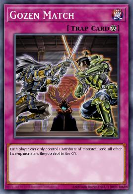

- **Disponibilidad / papel:** Main **2x**, **Reserva 1x adicional**; **control de Atributos / limitación simétrica de campo**.
- **Estado de sinergia y función:** Sinergia indirecta (soporte o recursos). Es una clasificación de juego; revisar la relación concreta en A06.
- **Papel como recurso, descarte o coste:** Coste o consumo descrito en A05: **no confundir Atributo (Gozen) con Tipo (Rivalry)**; tampoco suponer que se puede usar libremente un Link no FUEGO cuando….
- **Efecto y requisito:** Trampa Continua: cada jugador solo puede controlar monstruos boca arriba de **1 Atributo**; los otros propios boca arriba van al GY. También restringe las futuras Invocaciones de Atributo distinto mientras se controla alguno boca arriba.
- **Primero / segundo / tardío:** primero puede fijar FUEGO y recortar rutas del rival; segundo exige evaluar si ya se puede resolver sin perder piezas propias; tardío sirve mientras el oponente necesite desplegar varios atributos.
- **Sinergias verificables:** Main Volcanic es predominantemente **FUEGO**; en Extra **Hiita, Knightmare Phoenix, Salamangreat Almiraj y Promethean Princess** también son FUEGO, mientras **I:P, S:P, Linkuriboh, Unicorn, Goddess y TY-PHON** usan otros atributos.
- **Riesgo / recurso:** **no confundir Atributo (Gozen) con Tipo (Rivalry)**; tampoco suponer que se puede usar libremente un Link no FUEGO cuando ya se controla FUEGO bajo Gozen. La tercera copia registrada es solo Reserva.
- **Fuente / confianza:** **TEXTO_OFICIAL_COTEJADO** — https://www.db.yugioh-card.com/yugiohdb/card_search.action?cid=7934&ope=2&request_locale=en
- **Aplicación concreta dentro de este deck (A06):** Main Volcanic es predominantemente FUEGO; en Extra Hiita.

**USO PRÁCTICO Y SINERGIA — Gozen Match — Emparejamiento de Atributos**

- **Label funcional:** Sinergia indirecta. Clasificación documental; una relación es válida solo si se satisfacen sus condiciones exactas.
- **Qué hace:** Trampa Continua: cada jugador solo puede controlar monstruos boca arriba de **1 Atributo**; los otros propios boca arriba van al GY. También restringe las futuras Invocaciones de Atributo distinto mientras se controla alguno boca arriba.
- **Cómo aprovecharla en este deck:** Main Volcanic es predominantemente FUEGO; en Extra Hiita.
- **Al jugar primero:** primero puede fijar FUEGO y recortar rutas del rival; segundo exige evaluar si ya se puede resolver sin perder piezas propias; tardío sirve mientras el oponente necesite desplegar varios atributos.

#### 19. I:P Masquerena — I:P Enmascarada

- **Disponibilidad / papel:** Extra **2x**; **interrupción Link durante Main Phase rival / protección al nuevo Link**. **OSCURIDAD, Ciberso, Link 2**.
- **Estado de sinergia y función:** Referencias de rutas documentales identificadas; comprobar si hay Invocación real en los pasos y validar legalidad.
- **Papel como recurso, descarte o coste:** Material o destino del Extra condicionado a los requisitos de invocación.
- **Efecto y requisito:** se Invoca por Enlace con **2 monstruos que no sean Link**. Durante la **Main Phase rival**, como efecto rápido y máximo una vez por turno, permite **Invocar por Enlace después de resolver** usando los materiales propios que incluya a I:P. El Link que use a I:P como material **no puede ser destruido por efectos de cartas del rival**.
- **Primero / segundo / tardío:** primero es objetivo de campo defensivo si hay dos cuerpos no Link; segundo puede convertir excedente de campo en utilidad del Extra; tardío depende de que queden materiales y Link posteriores.
- **Sinergias verificables:** con suficientes materiales del campo propio, durante Main rival puede conducir a **Knightmare Unicorn** (barajar una carta) o a **Underworld Goddess** (requisitos superiores), según legalidad en ese estado. Los cuerpos Volcanic proporcionan materiales si las Invocaciones fueron válidas.
- **Riesgo / recurso:** **Gozen Match** y **Barrier Statue of the Inferno** activas junto a monstruos FUEGO restringen su Invocación OSCURIDAD; **Rivalry** puede bloquearla por ser Ciberso frente a Pyro. I:P no convierte por sí sola una secuencia incompleta en Link legal.
- **Fuente / confianza:** **TEXTO_OFICIAL_COTEJADO** — https://www.db.yugioh-card.com/yugiohdb/card_search.action?cid=14676&ope=2&request_locale=en
- **Aplicación concreta dentro de este deck (A06 y continuación contrastada):** `687:A09:IP:EMPEROR:UNICORN14` define I:P (valor 2) + Emperador (valor 1) y el efecto rápido de I:P en Main Phase rival. **Ruta distinta V13 para Diosa:** `687:A09:IP:TROOPER:ROCKET:GODDESS19`, I:P Link2 + Trooper + Rocket propios y monstruo no-Link enemigo como cuarto material, en **Main propia y sin activar el rápido de I:P**; ninguna implica la otra.
- **Rama alternativa de Enlace-2 cotejada:** `687:A09:IP:EMPEROR:SP_DEFENSA16` usa la misma I:P **como valor de Enlace 1**, más Emperador como valor 1, para S:P Link-2. Por utilizar I:P como material Link, S:P puede activar su destierro inicial. No requiere descarte; consume ambos cuerpos y pierde el daño futuro de Emperador.

**USO PRÁCTICO Y SINERGIA — I:P Masquerena — I:P Enmascarada**

- **Label funcional:** Referencias de ruta localizadas; conexión reglamentaria sujeta al recorrido de la guía. Clasificación documental; una relación es válida solo si se satisfacen sus condiciones exactas.
- **Qué hace:** se Invoca por Enlace con **2 monstruos que no sean Link**. Durante la **Main Phase rival**, como efecto rápido y máximo una vez por turno, permite **Invocar por Enlace después de resolver** usando los materiales propios que incluya a I:P. El Link que use a I:P como material **no puede ser destruido por efectos de cartas del rival**.
- **Cómo aprovecharla en este deck:** tras construir Emperador + I:P, elegir en Main rival entre `687:A09:IP:EMPEROR:UNICORN14` (Unicornio Link3, **necesita descarte** para barajar), `687:A09:IP:EMPEROR:SP_DEFENSA16` (S:P Link2, **no necesita descarte**, primer destierro habilitado) o mantener Emperador 3100 y su presión de daño. Las ramas gastan los **mismos dos monstruos**.
- **Al jugar primero:** primero es objetivo de campo defensivo si hay dos cuerpos no Link; segundo puede convertir excedente de campo en utilidad del Extra; tardío depende de que queden materiales y Link posteriores.

**CÓMO LLEGAR DESDE TU DECK — RUTAS DOCUMENTADAS**

- **Abrir guía `687:A09:SITUACION:GO_FIRST:TROOPER_ROCKET_IP01`:** entrada: Objetivo: montar campo y una negación para turno rival con mano Trooper + Rocket, Campo/GY propios vacíos, Normal disponible. Deck: VBA, Blaze Accelerator original, 1 Reload, 1 Rimfire, 1 Emperor, las 3 Scattershot, 1 Inferno. Extra: I:P. Oponente sin respuestas; no requiere monstruo rival porque se genera Ficha. Dificultad alta, ir primero.. Propósito descrito: Ofensivo condicional. Consulta sus pasos, consumo y resultado; comprobar si esta carta es realmente invocada o solo mencionada.
- **Abrir guía `687:A09:SITUACION:GO_FIRST:TROOPER_VBA_ROCKET_EJECTION_IP07`:** entrada: Mano: Trooper + VBA + Rocket + Fire Ejection. Deck: Blaze original, 1 Emperor, Inferno, Reload; Extra: I:P. Campo propio vacío, Normal libre, sin respuesta. Objetivo: conservar I:P + Emperor + Inferno y Reload Colocadas sin depender del envío de las tres Scattershot.. Propósito descrito: Ofensivo condicional. Consulta sus pasos, consumo y resultado; comprobar si esta carta es realmente invocada o solo mencionada.
- **Continuación `687:A09:IP:EMPEROR:UNICORN14`:** I:P (Enlace-2) + Emperador (valor 1) → Unicornio Link-3 **durante Main Phase rival**, con una carta de mano reservada para descartar, sin Gozen/Estatua activos. Cinco pasos ilustrados y decisión entre conservar daño de Emperador o barajar una amenaza.
- **Alternativa `687:A09:IP:EMPEROR:SP_DEFENSA16`:** I:P (contada como **valor1**) + Emperador (valor1) → S:P Link2 durante Main rival; **no hay descarte**, sí destierro al Invocar si existe objetivo elegible por haber usado material Link; protección heredada contra destrucción por efectos rivales. Guía visual: `guias/DECK_687_IP_EMPEROR_SP_RESPUESTA_GUIA.md`.

#### 20. Hiita the Fire Charmer, Ablaze — Hiita, la Encantadora del Fuego Encendida

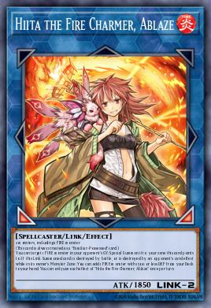

- **Disponibilidad / papel:** Extra **1x**; **aprovechar GY rival / puente de Link FUEGO**. **FUEGO, Lanzador de Conjuros, Link 2**.
- **Estado de sinergia y función:** Referencias de rutas documentales identificadas; comprobar si hay Invocación real en los pasos y validar legalidad.
- **Papel como recurso, descarte o coste:** Material o destino del Extra condicionado a los requisitos de invocación.
- **Efecto y requisito:** requiere **2 monstruos, incluido uno FUEGO**. Puede seleccionar **1 FUEGO del GY rival** e Invocarlo Especialmente a una zona apuntada por Hiita. Si esta Hiita Invocada por Enlace es destruida por batalla o por efecto rival en la Zona de Monstruos de su dueño, puede añadir del Deck **1 monstruo FUEGO de DEF 1500 o menos**. Cada efecto, una vez por turno.
- **Primero / segundo / tardío:** primero es situacional si aún no hay GY FUEGO rival; segundo gana material usando la destrucción previa de monstruos oponentes; tardío puede convertir un GY rival acumulado en presencia adicional.
- **Sinergias verificables:** utiliza cualquier FUEGO que permitan las zonas y el GY enemigo; bajo **Gozen/Barrier Statue** es una opción FUEGO compatible, pero bajo **Rivalry** debe comprobarse su Tipo Lanzador de Conjuros frente a Pyro.
- **Riesgo / recurso:** si no existe objetivo FUEGO rival o zona apuntada libre, no hay Invocación; el efecto buscador no se dispara por destruirla uno mismo arbitrariamente.
- **Fuente / confianza:** **TEXTO_OFICIAL_COTEJADO** — https://www.db.yugioh-card.com/yugiohdb/card_search.action?cid=14133&ope=2&request_locale=en
- **Aplicación concreta dentro de este deck (A06):** utiliza cualquier FUEGO que permitan las zonas y el GY enemigo. Falta arista de materiales en A06; A09 podría contener una ruta válida no indexada aquí.

**USO PRÁCTICO Y SINERGIA — Hiita the Fire Charmer, Ablaze — Hiita, la Encantadora del Fuego Encendida**

- **Label funcional:** Referencias de ruta localizadas; conexión reglamentaria sujeta al recorrido de la guía. Clasificación documental; una relación es válida solo si se satisfacen sus condiciones exactas.
- **Qué hace:** requiere **2 monstruos, incluido uno FUEGO**. Puede seleccionar **1 FUEGO del GY rival** e Invocarlo Especialmente a una zona apuntada por Hiita. Si esta Hiita Invocada por Enlace es destruida por batalla o por efecto rival en la Zona de Monstruos de su dueño, puede añadir del Deck **1 monstruo FUEGO de DEF 1500 o menos**. Cada efecto, una vez por turno.
- **Cómo aprovecharla en este deck:** utiliza cualquier FUEGO que permitan las zonas y el GY enemigo. Falta arista de materiales en A06; A09 podría contener una ruta válida no indexada aquí.
- **Al jugar primero:** primero es situacional si aún no hay GY FUEGO rival; segundo gana material usando la destrucción previa de monstruos oponentes; tardío puede convertir un GY rival acumulado en presencia adicional.

**CÓMO LLEGAR DESDE TU DECK — RUTAS DOCUMENTADAS**

- **Abrir guía `687:A09:SITUACION:GO_FIRST:TROOPER_ROCKET_GOZEN04`:** entrada: P1 | Gozen Match #7934 (única carta restante de la mano inicial de 3) | Trooper #18916, Rocket #7243, Emperor #18915 (3100 ATK) | VBA #18918, Inferno #18921 (Colocada) | Blaze original #7086 | Rimfire #18917, Reload #11597, 3× Scattershot #7083 | Ficha Bomba previa destruida; 3500 LP de daño sin respuesta | Ninguno | Normal gastada; no se hizo Enlace todavía. Propósito descrito: Preparación de recursos / despliegue. Consulta sus pasos, consumo y resultado; comprobar si esta carta es realmente invocada o solo mencionada.

#### 21. Knightmare Unicorn — Caballero de Pesadilla Unicornio

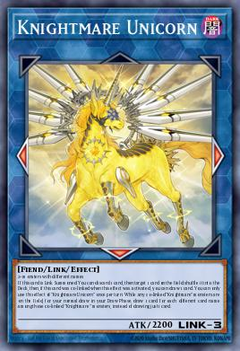

- **Disponibilidad / papel:** Extra **1x**; **removal por barajar / interrupción con I:P**. **OSCURIDAD, Demonio, Link 3**.
- **Estado de sinergia y función:** **Acceso condicional documentado** desde I:P + Emperador; ruta concreta `687:A09:IP:EMPEROR:UNICORN14`.
- **Papel como recurso, descarte o coste:** Su efecto menciona descartar; verificar si es coste o resolución, qué pieza consume y qué recurso queda.
- **Efecto y requisito:** requiere **2 o más monstruos de nombres diferentes** y material suficiente para Link 3. Si fue Invocado por Enlace, puede **descartar 1 carta**, seleccionar **1 carta en el campo** y **barajarla al Deck**; si estaba coenlazado al activar, **roba 1 carta**. El efecto es una vez por turno.
- **Primero / segundo / tardío:** primero se prepara a través de **I:P** para usar en Main rival si hay materiales; segundo retira amenaza que pueda devolverse al Deck; tardío resuelve cartas difíciles sin exigir destrucción.
- **Sinergias verificables:** descartes de **Rimfire/Scattershot** pueden activar sus efectos generales de GY; **I:P** puede darle protección contra destrucción por efecto rival cuando es material. Barajar no es desterrar ni destruir.
- **Riesgo / recurso:** necesita descarte, objetivo seleccionable y requisitos Link; su **robo solo se obtiene si está coenlazado en la activación**. Puede estar bloqueado por Estatua/Gozen y por Rivalry cuando se mantiene Pyro.
- **Fuente / confianza:** **TEXTO_OFICIAL_COTEJADO** — https://www.db.yugioh-card.com/yugiohdb/card_search.action?cid=13601&ope=2&request_locale=en
- **Aplicación concreta dentro de este deck:** en Main rival, I:P (valor 2) y Emperador (valor 1), ambos propios en campo, se envían al GY para Unicornio. Se descarta una Gotas Prohibidas (Main 3x) **solo como coste del efecto de Unicornio**, que selecciona y baraja una carta; no activa Gotas. Pierdes los 3100 ATK y daño recurrente de Emperador a cambio de la interrupción puntual. `687:A09:IP:EMPEROR:UNICORN14`.

**USO PRÁCTICO Y SINERGIA — Knightmare Unicorn — Caballero de Pesadilla Unicornio**

- **Label funcional:** **Sinergia condicional demostrada** con I:P + Emperador y descarte. No implica que toda apertura que produzca I:P deje una carta descartable; comprobar el estado.
- **Qué hace:** requiere **2 o más monstruos de nombres diferentes** y material suficiente para Link 3. Si fue Invocado por Enlace, puede **descartar 1 carta**, seleccionar **1 carta en el campo** y **barajarla al Deck**; si estaba coenlazado al activar, **roba 1 carta**. El efecto es una vez por turno.
- **Cómo aprovecharla en este deck:** conservar una carta de la mano inicial si puedes acabar con I:P + Emperador. Durante una Main rival, activar I:P, usar I:P (2) + Emperador (1) y descartar la carta reservada al activar Unicornio para barajar una amenaza. Ruta `687:A09:IP:EMPEROR:UNICORN14`.
- **Al jugar primero:** primero se prepara a través de **I:P** para usar en Main rival si hay materiales; segundo retira amenaza que pueda devolverse al Deck; tardío resuelve cartas difíciles sin exigir destrucción.
- **Uso y consumo de recursos:** descartar una carta de mano es **coste de activación** del efecto de Unicornio; I:P y Emperador se consumen como materiales de Enlace. Se conserva el efecto de protección frente a destrucción por efectos rivales otorgado por I:P, pero se pierde el daño futuro de Emperador.

**CÓMO LLEGAR DESDE TU DECK — CONTINUACIÓN CON MATERIALES DEMOSTRADOS**

- **Abrir guía de cinco pasos `687:A09:IP:EMPEROR:UNICORN14`**: el punto de partida **no es una carta en mano**, sino I:P y Emperador propios en campo al inicio de la Main rival, con una carta adicional en mano para descartar (p. ej. Gotas Prohibidas del Main). Los endboards `687:A09:SITUACION:GO_FIRST:TROOPER_ROCKET_IP01` y `687:A09:SITUACION:GO_FIRST:TROOPER_VBA_ROCKET_EJECTION_IP07` son posibles entradas, **solo si queda ese descarte** y no hay bloqueos OSCURIDAD; sus aperturas históricas siguen pendientes de revisión independiente. Resultado: Unicornio 2200 protegido por I:P y una carta rival devuelta al Deck si resuelve. Alternativa legítima: conservar Emperador 3100 y su daño por Invocación rival.

#### 22. Underworld Goddess of the Closed World — Diosa del Inframundo del Mundo Cerrado

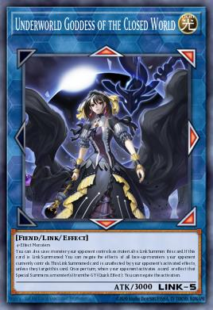

**Ruta visual V13 (tablero previo obligatorio):** `687:A09:IP:TROOPER:ROCKET:GODDESS19`.  I:P Link2 +  +  y un monstruo rival de Efecto **no-Link** = **4 cuerpos, valor 2+1+1+1=5** → Diosa Link5 3000. Es **Enlace normal en tu Main**, sin activar el rápido de I:P; al usar I:P como material, Diosa recibe protección contra **destrucción por efectos del adversario**. No hay ruta válida bajo Princess FIRE-only activa. [Cinco pasos, fotos y campo final](guias/DECK_665_670_687_TYPHON_GODDESS_GUIA_V13.md).

- **Disponibilidad / papel:** Extra **1x**; **respuesta a monstruos problemáticos / negación de campo**. **LUZ, Demonio, Link 5**.
- **Estado de sinergia y función:** Acceso condicional V13 documentado desde tablero ya desarrollado, no desde mano inicial.
- **Papel como recurso, descarte o coste:** Material o destino del Extra condicionado a los requisitos de invocación.
- **Efecto y requisito:** requiere **4 o más monstruos de Efecto** y material que sume Link 5; puede emplear **1 monstruo del rival** como parte de sus materiales. Al ser Invocada por Enlace, puede negar los efectos de todos los monstruos rivales que estén boca arriba en ese momento. Invocada por Enlace, es inmune a efectos rivales activados **salvo los que la seleccionen**. Una vez por turno, como efecto rápido, puede negar la **activación** de una carta/efecto rival que Invoque Especialmente desde GY.
- **Primero / segundo / tardío:** segundo ofrece forma de superar un monstruo rival al usarlo como material, si existen los otros materiales; primero normalmente requiere mucha inversión; tardío sirve de cierre si quedó material en campo.
- **Sinergias verificables:** un campo propio de Volcanic extendido y Links intermedios puede contribuir; **I:P** tiene valor en rutas legales de Link si hay todos los materiales, pero no sustituye el requisito de **4+ monstruos de Efecto**.
- **Riesgo / recurso:** no basta un solo monstruo rival; solo permite **1 monstruo adversario** como material adicional. **Gozen (LUZ frente a FUEGO), Barrier Statue y Rivalry** pueden hacer ilegal la Invocación. No afirmar inmunidad universal ante efectos que sí la seleccionan.
- **Fuente / confianza:** **TEXTO_OFICIAL_COTEJADO** — https://www.db.yugioh-card.com/yugiohdb/card_search.action?cid=15741&ope=2&request_locale=en
- **Aplicación concreta dentro de este deck (A06):** `687:A09:IP:TROOPER:ROCKET:GODDESS19`, Enlace normal con I:P Link2 + Trooper + Rocket + monstruo Efecto no-Link rival; el montaje de los tres propios es condición previa, no apertura asegurada.

**USO PRÁCTICO Y SINERGIA — Underworld Goddess of the Closed World — Diosa del Inframundo del Mundo Cerrado**

- **Label funcional:** Acceso condicional del Extra V13, sin modificar etiquetas funcionales cuantificadas del Main.
- **Qué hace:** requiere **4 o más monstruos de Efecto** y material que sume Link 5; puede emplear **1 monstruo del rival** como parte de sus materiales. Al ser Invocada por Enlace, puede negar los efectos de todos los monstruos rivales que estén boca arriba en ese momento. Invocada por Enlace, es inmune a efectos rivales activados **salvo los que la seleccionen**. Una vez por turno, como efecto rápido, puede negar la **activación** de una carta/efecto rival que Invoque Especialmente desde GY.
- **Cómo aprovecharla en este deck:** campo previo I:P + Trooper + Rocket propios y Efecto no-Link rival, Enlace5 usando exactamente un material enemigo; Diosa queda protegida contra destrucción por efecto rival al usar I:P.
- **Al jugar primero:** segundo ofrece forma de superar un monstruo rival al usarlo como material, si existen los otros materiales; primero normalmente requiere mucha inversión; tardío sirve de cierre si quedó material en campo.

**CÓMO LLEGAR DESDE TU DECK — RUTA CONDICIONAL V13**

- `687:A09:IP:TROOPER:ROCKET:GODDESS19`, [guía fotográfica y respuestas](guias/DECK_665_670_687_TYPHON_GODDESS_GUIA_V13.md). La necesidad de campo previo no debe ocultarse al jugador.

#### 23. Knightmare Phoenix — Caballero de Pesadilla Fénix

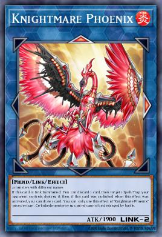

- **Disponibilidad / papel:** Extra **1x**; **removal de Mágicas/Trampas / Link FUEGO alternativo**. **FUEGO, Demonio, Link 2**.
- **Estado de sinergia y función:** Referencias de rutas documentales identificadas; comprobar si hay Invocación real en los pasos y validar legalidad.
- **Papel como recurso, descarte o coste:** Su efecto menciona descartar; verificar si es coste o resolución, qué pieza consume y qué recurso queda.
- **Efecto y requisito:** necesita **2 monstruos de nombres diferentes**. Al ser Invocado por Enlace puede **descartar 1**, seleccionar **1 Mágica/Trampa rival** y destruirla; si estaba coenlazado cuando activó, puede **robar 1**. Efecto una vez por turno. Los monstruos propios coenlazados no pueden destruirse en batalla.
- **Primero / segundo / tardío:** segundo despeja backrow que estorbe al motor; primero es opción utilitaria antes de dejar restricciones; tardío convierte recursos sobrantes en acceso al campo.
- **Sinergias verificables:** es **FUEGO** y puede ser compatible con **Gozen/Barrier Statue**; descartar **Rimfire** prepara un efecto de GY, pero no equivale a enviarlo por Blaze Accelerator. **I:P** puede Invocarlo en Main rival si se reúnen materiales legales.
- **Riesgo / recurso:** no destruye monstruos; si no se coenlaza **no roba**. Su Tipo **Demonio** choca con **Rivalry** si se mantienen Pyro propios en campo.
- **Fuente / confianza:** **TEXTO_OFICIAL_COTEJADO** — https://www.db.yugioh-card.com/yugiohdb/card_search.action?cid=13600&ope=2&request_locale=en
- **Aplicación concreta dentro de este deck (A06):** es FUEGO y puede ser compatible con Gozen/Barrier Statue; descartar Rimfire prepara un efecto de GY, pero no equivale a enviarlo por Blaze Accelerator. Falta arista de materiales en A06; A09 podría contener una ruta válida no indexada aquí.

**USO PRÁCTICO Y SINERGIA — Knightmare Phoenix — Caballero de Pesadilla Fénix**

- **Label funcional:** Referencias de ruta localizadas; conexión reglamentaria sujeta al recorrido de la guía. Clasificación documental; una relación es válida solo si se satisfacen sus condiciones exactas.
- **Qué hace:** necesita **2 monstruos de nombres diferentes**. Al ser Invocado por Enlace puede **descartar 1**, seleccionar **1 Mágica/Trampa rival** y destruirla; si estaba coenlazado cuando activó, puede **robar 1**. Efecto una vez por turno. Los monstruos propios coenlazados no pueden destruirse en batalla.
- **Cómo aprovecharla en este deck:** es FUEGO y puede ser compatible con Gozen/Barrier Statue; descartar Rimfire prepara un efecto de GY, pero no equivale a enviarlo por Blaze Accelerator. Falta arista de materiales en A06; A09 podría contener una ruta válida no indexada aquí.
- **Al jugar primero:** segundo despeja backrow que estorbe al motor; primero es opción utilitaria antes de dejar restricciones; tardío convierte recursos sobrantes en acceso al campo.

**CÓMO LLEGAR DESDE TU DECK — RUTAS DOCUMENTADAS**

- **Abrir guía `687:A09:SITUACION:GO_SECOND:TROOPER_ROCKET_PHOENIX02`:** entrada: la misma Trooper + Rocket, pero el adversario tiene al menos un monstruo boca arriba seleccionable y una M/T seleccionable. Deck: VBA, Blaze original, Rimfire, Emperor, Reload, 3 Scattershot, Inferno. Extra: Knightmare Phoenix. Objetivo: quitar frente y retaguardia y terminar con Phoenix + Emperor + Inferno; útil ir segundo, no requiere Ficha Bomba.. Propósito descrito: Ofensivo condicional. Consulta sus pasos, consumo y resultado; comprobar si esta carta es realmente invocada o solo mencionada.

#### 24. Linkuriboh — Enlacekuriboh

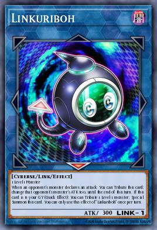

- **Disponibilidad / papel:** Extra **1x**; **conversión de Nivel 1 / protección de batalla / recurso desde GY**. **OSCURIDAD, Ciberso, Link 1**.
- **Estado de sinergia y función:** **Acceso demostrado desde Shell Nivel 1 del Main**; es una interacción básica defensiva, no combo completo.
- **Papel como recurso, descarte o coste:** Material o destino del Extra condicionado a los requisitos de invocación.
- **Efecto y requisito:** requiere **1 monstruo de Nivel 1**. Cuando un monstruo rival declara ataque puede Sacrificarse para que el ATK de ese atacante sea **0 hasta final del turno**. Desde GY, como efecto rápido y una vez por turno, puede Sacrificar **1 monstruo de Nivel 1 propio** para Invocarse Especialmente.
- **Primero / segundo / tardío:** primero transforma Shell o Rimfire en Link y defensa potencial; segundo puede consumir un Nivel 1 ya usado; tardío reaprovecha pequeños cuerpos si el bloqueo de Atributos/Tipos lo permite.
- **Sinergias verificables:** **Volcanic Shell y Rimfire son Nivel 1**, pero la **Ficha Bomba creada por Trooper está en el campo rival**, por lo que no puede sacrificarse como monstruo propio para revivir Linkuriboh.
- **Riesgo / recurso:** la protección exige que esté presente cuando se declara ataque; el atacante no pierde permanentemente ATK. Es **OSCURIDAD/Ciberso**, incompatible con restricciones propias activas de FUEGO/Pyro.
- **Fuente / confianza:** **TEXTO_OFICIAL_COTEJADO** — https://www.db.yugioh-card.com/yugiohdb/card_search.action?cid=13346&ope=2&request_locale=en
- **Aplicación concreta dentro de este deck:** `687:A09:SHELL:LINKURIBOH:DEFENSA15` conecta **Shell (Main 3x, Nivel 1)** Normal → Linkuriboh (Extra 1x), Shell al GY → pagar 500 LP y obtener otra Shell. Tras ataque rival, Linkuriboh puede Sacrificarse para poner ATK atacante a 0 hasta fin de turno, **sin negar el ataque**. La Ficha Bomba creada por Trooper está en campo rival y no sirve como sacrificio propio para revivir Linkuriboh.

**USO PRÁCTICO Y SINERGIA — Linkuriboh — Enlacekuriboh**

- **Label funcional:** **Sinergia indirecta demostrada como conversión de recurso de Nivel 1**, no motor de negación ni combo extendido.
- **Qué hace:** requiere **1 monstruo de Nivel 1**. Cuando un monstruo rival declara ataque puede Sacrificarse para que el ATK de ese atacante sea **0 hasta final del turno**. Desde GY, como efecto rápido y una vez por turno, puede Sacrificar **1 monstruo de Nivel 1 propio** para Invocarse Especialmente.
- **Cómo aprovecharla en este deck:** con Shell en mano y Normal disponible, llevarla a campo y usarla como **único** material de Link1; pagar 500 LP desde GY para otra Shell. Elegir este campo defensivo si no se requiere la Normal para Trooper/Rocket. `687:A09:SHELL:LINKURIBOH:DEFENSA15` muestra cinco fotos/pasos y los dos tiempos de tablero.
- **Al jugar primero:** primero transforma Shell o Rimfire en Link y defensa potencial; segundo puede consumir un Nivel 1 ya usado; tardío reaprovecha pequeños cuerpos si el bloqueo de Atributos/Tipos lo permite.
- **Uso y consumo de recursos:** gasta la Invocación Normal, envía Shell al GY **como material** (no destrucción) y paga 500 LP para otra Shell. Ante declaración de ataque, **Sacrifica** Linkuriboh, que sale de campo; el rival puede repetir ataque según el estado, por lo que no es daño evitado garantizado.

**CÓMO LLEGAR DESDE TU DECK — INTERACCIÓN BÁSICA DEMOSTRADA**

- **Abrir cinco pasos `687:A09:SHELL:LINKURIBOH:DEFENSA15`:** Volcanic Shell del Main (Nivel 1) Normal → Enlacekuriboh Link1; desde GY Shell paga 500 LP, busca otra Shell. **Campo final inicial:** Enlacekuriboh 300 ATK y una Shell en mano; respuesta de ATK a 0 solo si rival declara ataque, sin negar ataque y con posible replay. **Requisitos:** Normal libre, copia restante en Deck, 500 LP, ausencia de restricciones OSCURIDAD/Ciberso. La Reserva y la Ficha Bomba en campo rival no son materiales disponibles.

#### 25. Super Starslayer TY-PHON - Sky Crisis — Súper Asesino Estelar TY-PHON

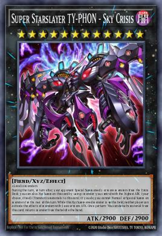

**Ruta V13:** `687:A09:SHELL:TYPHON18`. Tras 2+ Especiales desde Extra del rival este o anterior turno,  Normal como único monstruo propio → TY-PHON Xyz alternativo Rango12 con un material, desacoplar Shell para devolver un monstruo; en GY Shell **puede** pagar 500 LP para buscar otra copia si existe. No permitir Invocaciones Normal/Especial posteriores en ese turno. [Fotos y variantes](guias/DECK_665_670_687_TYPHON_GODDESS_GUIA_V13.md).

- **Disponibilidad / papel:** Extra **3x**; **respuesta Xyz de emergencia / devolución de monstruos**. **OSCURIDAD, Demonio, Rango 12; 2900 ATK**.
- **Estado de sinergia y función:** Acceso reactivo V13 documentado; requiere despliegue previo del rival desde Extra.
- **Papel como recurso, descarte o coste:** Material o destino del Extra condicionado a los requisitos de invocación.
- **Efecto y requisito:** normalmente exige **2 monstruos Nivel 12**. Como alternativa, durante el turno en que el rival Invocó Especialmente **2 o más monstruos del Extra Deck**, o **el turno siguiente**, puede hacerse Xyz sobre **1 monstruo propio de mayor ATK** (a elección en empate), heredando sus materiales. Si usa ese método, **no puede Invocar Normal ni Especialmente otros monstruos por el resto del turno**. Mientras esta Xyz esté en campo, ninguno puede activar efectos de monstruos con **3000 ATK o más**. Una vez por turno, desprende **1 material** para devolver **1 monstruo del campo a la mano**.
- **Primero / segundo / tardío:** es más relevante **yendo segundo** tras expansión rival de Extra; en turno siguiente aún puede servir; primero no presupone que el rival haya cumplido la condición.
- **Sinergias verificables:** transforma un cuerpo propio superviviente en amenaza de devolución sin exigir dos Nivel 12; las **3 copias** ofrecen redundancia ante el destierro aleatorio de **Extravagance**, sin garantizar que sobreviva alguna.
- **Riesgo / recurso:** la sustitución usa **el propio monstruo de mayor ATK**, que podría ser **Emperor**; no permite extender después. Su bloqueo de **efectos activados por monstruos de ≥3000 ATK** también puede perjudicar al propio Emperor. Es OSCURIDAD y choca con **Gozen/Barrier Statue**.
- **Fuente / confianza:** **TEXTO_OFICIAL_COTEJADO** — https://www.db.yugioh-card.com/yugiohdb/card_search.action?cid=19184&ope=2&request_locale=en
- **Aplicación concreta dentro de este deck (A06):** `687:A09:SHELL:TYPHON18` convierte una Shell propia en TY-PHON con 1 material si la condición rival se cumplió; Shell desprendida puede buscar otra pagando 500 LP de manera independiente.

**USO PRÁCTICO Y SINERGIA — Super Starslayer TY-PHON - Sky Crisis — Súper Asesino Estelar TY-PHON**

- **Label funcional:** Acceso reactivo condicional V13, no sinergia directa de apertura del motor.
- **Qué hace:** normalmente exige **2 monstruos Nivel 12**. Como alternativa, durante el turno en que el rival Invocó Especialmente **2 o más monstruos del Extra Deck**, o **el turno siguiente**, puede hacerse Xyz sobre **1 monstruo propio de mayor ATK** (a elección en empate), heredando sus materiales. Si usa ese método, **no puede Invocar Normal ni Especialmente otros monstruos por el resto del turno**. Mientras esta Xyz esté en campo, ninguno puede activar efectos de monstruos con **3000 ATK o más**. Una vez por turno, desprende **1 material** para devolver **1 monstruo del campo a la mano**.
- **Cómo aprovecharla en este deck:** Shell Normal en campo vacío, si el oponente invocó 2+ monstruos del Extra este/turno anterior; TY-PHON Rango12 vuelve un monstruo del campo y termina la capacidad de Invocar ese turno.
- **Al jugar primero:** es más relevante **yendo segundo** tras expansión rival de Extra; en turno siguiente aún puede servir; primero no presupone que el rival haya cumplido la condición.

**CÓMO LLEGAR DESDE TU DECK — RUTA CONDICIONAL V13**

- `687:A09:SHELL:TYPHON18`, [guía visual con requisito rival, costes y campo final](guias/DECK_665_670_687_TYPHON_GODDESS_GUIA_V13.md). **No prometer primer turno.**

#### 26. S:P Little Knight — S:P Pequeña Caballera

- **Disponibilidad / papel:** Extra **3x**; **interrupción temporal / removal de campo o GY**. **OSCURIDAD, Guerrero, Link 2**.
- **Estado de sinergia y función:** Acceso concreto condicional desde I:P + Emperador: `687:A09:IP:EMPEROR:SP_DEFENSA16`, alternativa excluyente a Unicornio.
- **Papel como recurso, descarte o coste:** Material o destino del Extra condicionado a los requisitos de invocación.
- **Efecto y requisito:** usa **2 monstruos de Efecto**. Si fue Invocada por Enlace utilizando como material un **Fusión, Sincronía, Xyz o Link**, puede seleccionar **1 carta del campo o de cualquier GY** y desterrarla; sus monstruos no pueden atacar directamente ese turno. Cuando el rival activa una carta o efecto, puede como efecto rápido seleccionar **2 monstruos boca arriba en el campo, incluido uno propio**, y desterrarlos **hasta la End Phase**. Cada efecto, una vez por turno.
- **Primero / segundo / tardío:** primero es pieza de interrupción si se crea un Link legal; segundo puede retirar recursos clave, con coste estratégico de ataques directos; tardío vuelve a dar tiempo para reconstruirse.
- **Sinergias verificables:** puede utilizar un Link previo del Extra como material para habilitar su destierro inicial; su destierro temporal de un monstruo propio puede preservarlo frente a un enfrentamiento, sujeto a la ventana de activación.
- **Riesgo / recurso:** la salida de **dos monstruos** requiere objetivos legales y el segundo efecto no es destierro definitivo; no inventar destierro al Invocar si se usaron solo dos monstruos del Main sin material del Extra listado. **Gozen/Barrier/Rivalry** limitan esta carta OSCURIDAD/Guerrero.
- **Fuente / confianza:** **TEXTO_OFICIAL_COTEJADO** — https://www.db.yugioh-card.com/yugiohdb/card_search.action?cid=19188&ope=2&request_locale=en
- **Aplicación concreta dentro de este deck (A06):** I:P cuenta como valor de Enlace **1**, Emperador como valor1; al formar S:P Link2 en Main rival, I:P (material Link) **habilita destierro inicial**, sin descartar. Se pierde Emperador 3100 ATK y daño recurrente. No confundir con Unicornio Link3, que requiere descarte para barajar.

**USO PRÁCTICO Y SINERGIA — S:P Little Knight — S:P Pequeña Caballera**

- **Label funcional:** acceso desde tablero I:P + Emperador documentado y cotejado individualmente.
- **Qué hace:** usa **2 monstruos de Efecto**. Si fue Invocada por Enlace utilizando como material un **Fusión, Sincronía, Xyz o Link**, puede seleccionar **1 carta del campo o de cualquier GY** y desterrarla; sus monstruos no pueden atacar directamente ese turno. Cuando el rival activa una carta o efecto, puede como efecto rápido seleccionar **2 monstruos boca arriba en el campo, incluido uno propio**, y desterrarlos **hasta la End Phase**. Cada efecto, una vez por turno.
- **Cómo aprovecharla en este deck:** en Main rival usar el efecto rápido de I:P; contar I:P como valor1 y Emperador valor1 → S:P Link2. El primer efecto de S:P **sí** destierra una carta elegible porque usó monstruo Link como material. Segundo efecto rápido separado exige activación rival y dos monstruos boca arriba, no niega.
- **Al jugar primero:** primero es pieza de interrupción si se crea un Link legal; segundo puede retirar recursos clave, con coste estratégico de ataques directos; tardío vuelve a dar tiempo para reconstruirse.
- **Uso y consumo de recursos:** dos monstruos propios de campo, cero descartes, 1 S:P del Extra; pierde Emperador y sus futuros 500 LP de daño por Invocación Especial rival.
- **Alcance de la guía:** cotejo de esta **continuación**, no de las aperturas históricas que podrían construir I:P + Emperador.

**CÓMO LLEGAR DESDE TU DECK — 5 PASOS Y ALTERNATIVAS**

- `687:A09:IP:EMPEROR:SP_DEFENSA16`: I:P + Emperador propios → efecto rápido I:P en Main rival → S:P Link2 con I:P valor1 → destierro inicial permitido por material Link → S:P 1600 protegida contra destrucción por efectos rivales. Comparar coste y resultado con Unicornio o conservar Emperador. Guía de fotos, flechas y tablero final: `guias/DECK_687_IP_EMPEROR_SP_RESPUESTA_GUIA.md`.

#### 27. Salamangreat Almiraj — Salamangrande Almiraj

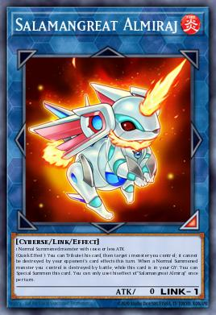

- **Disponibilidad / papel:** Extra **1x**; **salida de monstruo pequeño / protección puntual**. **FUEGO, Ciberso, Link 1**.
- **Estado de sinergia y función:** Referencias de rutas documentales identificadas; comprobar si hay Invocación real en los pasos y validar legalidad.
- **Papel como recurso, descarte o coste:** Material o destino del Extra condicionado a los requisitos de invocación.
- **Efecto y requisito:** requiere **1 monstruo que haya sido Invocado Normalmente y posea ATK 1000 o menor**. Como efecto rápido puede **Sacrificarse y seleccionar otro monstruo propio** para protegerlo frente a destrucción por efectos rivales ese turno. Si un monstruo propio Invocado Normalmente es destruido en batalla mientras Almiraj está en GY, puede Invocarse Especialmente del GY (una vez por turno para esta última habilidad).
- **Primero / segundo / tardío:** primero permite convertir un pequeño Pyro Normal en Link y proteger un monstruo relevante; segundo da cuerpo FUEGO para rutas legales; tardío puede retornar bajo la condición concreta de destrucción en batalla.
- **Sinergias verificables:** **Rimfire, Shell y Scattershot** con Invocación Normal y ATK adecuado pueden alimentar este Link; su Atributo **FUEGO** combina con Gozen/Barrier, pero su Tipo **Ciberso** puede chocar con Rivalry.
- **Riesgo / recurso:** no vale cualquier Invocación Especial ni monstruo de más de 1000 ATK como único material; su efecto protector exige **otro monstruo propio** al resolver el sacrificio. El efecto desde GY no se dispara por destrucción por efecto.
- **Fuente / confianza:** **TEXTO_OFICIAL_COTEJADO** — https://www.db.yugioh-card.com/yugiohdb/card_search.action?cid=14338&ope=2&request_locale=en
- **Aplicación concreta dentro de este deck (A06):** Rimfire, Shell y Scattershot con Invocación Normal y ATK adecuado pueden alimentar este Link; su Atributo FUEGO combina con Gozen/Barrier, pero su Tipo Ciberso puede chocar con Rivalry. Falta arista de materiales en A06; A09 podría contener una ruta válida no indexada aquí.

**USO PRÁCTICO Y SINERGIA — Salamangreat Almiraj — Salamangrande Almiraj**

- **Label funcional:** Referencias de ruta localizadas; conexión reglamentaria sujeta al recorrido de la guía. Clasificación documental; una relación es válida solo si se satisfacen sus condiciones exactas.
- **Qué hace:** requiere **1 monstruo que haya sido Invocado Normalmente y posea ATK 1000 o menor**. Como efecto rápido puede **Sacrificarse y seleccionar otro monstruo propio** para protegerlo frente a destrucción por efectos rivales ese turno. Si un monstruo propio Invocado Normalmente es destruido en batalla mientras Almiraj está en GY, puede Invocarse Especialmente del GY (una vez por turno para esta última habilidad).
- **Cómo aprovecharla en este deck:** Rimfire, Shell y Scattershot con Invocación Normal y ATK adecuado pueden alimentar este Link; su Atributo FUEGO combina con Gozen/Barrier, pero su Tipo Ciberso puede chocar con Rivalry. Falta arista de materiales en A06; A09 podría contener una ruta válida no indexada aquí.
- **Al jugar primero:** primero permite convertir un pequeño Pyro Normal en Link y proteger un monstruo relevante; segundo da cuerpo FUEGO para rutas legales; tardío puede retornar bajo la condición concreta de destrucción en batalla.

**CÓMO LLEGAR DESDE TU DECK — RUTAS DOCUMENTADAS**

- **Abrir guía `687:A09:SITUACION:GO_FIRST:TROOPER_RELOAD_ALMIRAJ03`:** entrada: Mano: Trooper + Reload. Deck: VBA, Blaze original, Rimfire, Emperor, tres Scattershot, Inferno. Extra: Almiraj. Campo/GY vacíos; Normal libre; sin respuesta. Objetivo: una apertura alternativa cuando Rocket no está en mano.. Propósito descrito: Ofensivo condicional. Consulta sus pasos, consumo y resultado; comprobar si esta carta es realmente invocada o solo mencionada.
- **Abrir guía `687:A09:SITUACION:GO_FIRST:TROOPER_VBA_EJECTION_INFERNO05`:** entrada: Mano: Trooper + VBA + Fire Ejection. En Deck: Blaze original, 1 Emperor, Inferno. Extra: Almiraj. Campo propio vacío; Normal disponible; sin necesidad de Scattershot ni de monstruo rival.. Propósito descrito: Preparación de recursos / despliegue. Consulta sus pasos, consumo y resultado; comprobar si esta carta es realmente invocada o solo mencionada.
- **Abrir guía `687:A09:SITUACION:OPPONENT_TURN:TROOPER_VBA_EJECTION_EMISSION06`:** entrada: Misma mano de tres cartas y estado que INFERNO05; objetivo distinto: priorizar daño por Invocaciones Especiales rivales con dos Emperors. Deck debe contener dos Emperor (ambos registrados) y Emission; Extra Almiraj. Sin Inferno en esta rama.. Propósito descrito: Ofensivo condicional. Consulta sus pasos, consumo y resultado; comprobar si esta carta es realmente invocada o solo mencionada.

#### 28. Promethean Princess, Bestower of Flames — Princesa Prometea

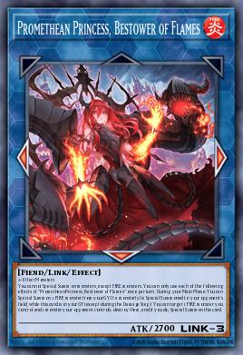

- **Disponibilidad / papel:** Extra **1x**; **extensor FUEGO / reaparición desde GY y destrucción reactiva**. **FUEGO, Demonio, Link 3**.
- **Estado de sinergia y función:** Acceso al Extra condicionado a un **campo previo** con tres monstruos de Efecto FUEGO ya presentes; nueva ruta V12.
- **Papel como recurso, descarte o coste:** Material o destino del Extra condicionado a los requisitos de invocación.
- **Efecto y requisito:** exige **2 o más monstruos de Efecto** para Link 3. Mientras está en campo, **no permite Invocaciones Especiales propias salvo monstruos FUEGO**. Una vez por turno, en Main Phase propia, puede Invocar Especialmente **1 FUEGO del GY propio**. Desde su GY, si un monstruo fue Invocado Especialmente al campo rival fuera de Damage Step, puede seleccionar **1 FUEGO propio y 1 monstruo rival**, destruir ambos y, si lo logra, **Invocarse desde GY**. Cada efecto, una vez por turno.
- **Primero / segundo / tardío:** primero revive recursos FUEGO y permite presión; segundo puede destruir una amenaza en respuesta a una Invocación Especial al campo adversario; tardío aprovecha GY si aún se controla FUEGO para el intercambio.
- **Sinergias verificables:** las Fichas Bomba que **Trooper/Fire Ejection** Invocan Especialmente al rival pueden cumplir el evento de disparo desde GY; la destrucción de Ficha rival puede generar su daño propio si se cumple también el requisito de destruir un FUEGO aliado.
- **Riesgo / recurso:** está limitada a **FUEGO** mientras permanece en campo: no proyectar I:P/S:P/TY-PHON OSCURIDAD ni Goddess LUZ después. El efecto desde GY requiere **dos objetivos válidos** y destruirlos; por **Rivalry** (Demonio) puede ser incompatible con monstruos Pyro propios.
- **Fuente / confianza:** **TEXTO_OFICIAL_COTEJADO** — https://www.db.yugioh-card.com/yugiohdb/card_search.action?cid=19507&ope=2&request_locale=en
- **Aplicación concreta dentro de este deck (A06):** `687:A09:TROOPER:ROCKET:SHELL:PRINCESS17`: **Trooper+Rocket+Shell ya en campo** como tres monstruos FUEGO/Piro/Efecto → Princesa Prometea Link3; esta Invoca Rocket FIRE de GY para una búsqueda Blaze condicional. Princess impide Especial de no-FUEGO mientras aplica; la recuperación desde su GY sigue siendo otra situación independiente.

**USO PRÁCTICO Y SINERGIA — Promethean Princess, Bestower of Flames — Princesa Prometea**

- **Label funcional:** Destino Extra con sinergia material FUEGO condicionada y ruta V12; coste de tres cuerpos y recuperación puntual. No inferir apertura desde mano automáticamente.
- **Qué hace:** exige **2 o más monstruos de Efecto** para Link 3. Mientras está en campo, **no permite Invocaciones Especiales propias salvo monstruos FUEGO**. Una vez por turno, en Main Phase propia, puede Invocar Especialmente **1 FUEGO del GY propio**. Desde su GY, si un monstruo fue Invocado Especialmente al campo rival fuera de Damage Step, puede seleccionar **1 FUEGO propio y 1 monstruo rival**, destruir ambos y, si lo logra, **Invocarse desde GY**. Cada efecto, una vez por turno.
- **Cómo aprovecharla en este deck:** usar tres cuerpos FUEGO de Efecto **ya reunidos**; Link3 Princesa 2700 → revive Rocket 1900 desde GY. La línea consume los tres materiales originales, e impone bloqueo de Invocación Especial FUEGO; competiría con mantener I:P/Emperador.
- **Al jugar primero:** primero revive recursos FUEGO y permite presión; segundo puede destruir una amenaza en respuesta a una Invocación Especial al campo adversario; tardío aprovecha GY si aún se controla FUEGO para el intercambio.

**CÓMO LLEGAR DESDE TU DECK — V12, CAMPO PREEXISTENTE**

- `687:A09:TROOPER:ROCKET:SHELL:PRINCESS17` — [guía visual completa de tres materiales FUEGO, reanimación Rocket, zona final, restricciones e interrupciones](guias/DECK_684_687_AZALEA_VIMANA_PRINCESS_GUIA_V12.md). Estado: REVISIÓN TCG. No contarla como combo de una sola carta.

#### 29. Infinite Impermanence — Infinito Temporal

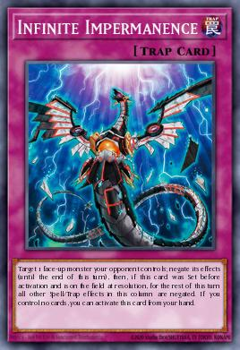

- **Disponibilidad / papel:** **Reserva 3x, NO en Main ni Side**; **opción de handtrap / negación puntual** para evaluar incorporación, no carta disponible actualmente.
- **Estado de sinergia y función:** Reserva fuera de lista activa. Es una clasificación de juego; revisar la relación concreta en A06.
- **Papel como recurso, descarte o coste:** Coste o consumo descrito en A05: con cartas controladas **no** se usa desde mano; la cláusula de columna **no** se aplica a una activación desde mano. La….
- **Efecto y requisito:** Trampa Normal que selecciona **1 monstruo rival boca arriba** y niega sus efectos hasta fin de turno. Si fue **Colocada antes**, y aún está en el campo al resolver, niega por el resto del turno los **otros efectos de Mágicas/Trampas en su misma columna**. Si **no controlas cartas**, puede activarse desde la mano.
- **Uso potencial:** al ir segundo, desde mano vacía de campo puede interrumpir un primer efecto rival; al ir primero, si se incorpora y se coloca, puede abrir respuesta durante turno rival.
- **Sinergias verificables:** protege la activación de Trooper/Reload al negar una amenaza de monstruo, sin generar Pyro ni daño propio. La columna ofrece valor táctico si estaba colocada de antes.
- **Riesgo / recurso:** con cartas controladas **no** se usa desde mano; la cláusula de columna **no** se aplica a una activación desde mano. La Reserva debe incorporarse mediante decisión posterior, sin añadirla aquí a Main.
- **Fuente / confianza:** **TEXTO_OFICIAL_COTEJADO** — https://www.db.yugioh-card.com/yugiohdb/card_search.action?cid=13631&ope=2&request_locale=en
- **Aplicación concreta dentro de este deck (A06):** Fuera de lista. protege la activación de Trooper/Reload al negar una amenaza de monstruo, sin generar Pyro ni daño propio.. No aporta recursos durante este duelo.

**USO PRÁCTICO Y SINERGIA — Infinite Impermanence — Infinito Temporal**

- **Label funcional:** Sin sinergia demostrada (con la evidencia actual). Clasificación documental; una relación es válida solo si se satisfacen sus condiciones exactas.
- **Qué hace:** Trampa Normal que selecciona **1 monstruo rival boca arriba** y niega sus efectos hasta fin de turno. Si fue **Colocada antes**, y aún está en el campo al resolver, niega por el resto del turno los **otros efectos de Mágicas/Trampas en su misma columna**. Si **no controlas cartas**, puede activarse desde la mano.
- **Cómo aprovecharla en este deck:** Fuera de lista. protege la activación de Trooper/Reload al negar una amenaza de monstruo, sin generar Pyro ni daño propio.. No aporta recursos durante este duelo.

#### 30. Ash Blossom & Joyous Spring — Flor de Ceniza y Primavera Feliz

- **Disponibilidad / papel:** **Reserva 2x**; **handtrap de acceso al Deck**, **no disponible** mientras siga en Reserva.
- **Estado de sinergia y función:** Reserva fuera de lista activa. Es una clasificación de juego; revisar la relación concreta en A06.
- **Papel como recurso, descarte o coste:** Su efecto menciona descartar; verificar si es coste o resolución, qué pieza consume y qué recurso queda.
- **Efecto y requisito:** como efecto rápido, se **descarta de mano** para negar el **efecto** que incluya añadir carta del Deck a mano, Invocar Especialmente desde Deck o enviar carta del Deck al GY. Solo usa su efecto una vez por turno.
- **Uso potencial:** primero y segundo puede cortar una búsqueda o un envío rival clave si previamente se incorpora al Main; no cancela todas las cartas del rival ni las Invocaciones desde GY por el solo hecho de ser Invocaciones.
- **Sinergias verificables:** protege indirectamente el plan Volcanic al impedir que el oponente encuentre piezas; es **FUEGO** pero **Zombi**, por lo que no se confunde con **Pyro** para costes de Emperor o activación de Shell.
- **Riesgo / recurso:** no debe presentarse como negación genérica de cualquier efecto; como carta de Reserva no forma parte de probabilidades de mano ni de las rutas actuales.
- **Fuente / confianza:** **TEXTO_OFICIAL_COTEJADO** — https://www.db.yugioh-card.com/yugiohdb/card_search.action?cid=12950&ope=2&request_locale=en
- **Aplicación concreta dentro de este deck (A06):** Fuera de lista. protege indirectamente el plan Volcanic al impedir que el oponente encuentre piezas; es FUEGO pero Zombi, por lo que no se confunde con Pyro para costes de Emperor o activación de Shell.. No aporta recursos durante este duelo.

**USO PRÁCTICO Y SINERGIA — Ash Blossom & Joyous Spring — Flor de Ceniza y Primavera Feliz**

- **Label funcional:** Sin sinergia demostrada (con la evidencia actual). Clasificación documental; una relación es válida solo si se satisfacen sus condiciones exactas.
- **Qué hace:** como efecto rápido, se **descarta de mano** para negar el **efecto** que incluya añadir carta del Deck a mano, Invocar Especialmente desde Deck o enviar carta del Deck al GY. Solo usa su efecto una vez por turno.
- **Cómo aprovecharla en este deck:** Fuera de lista. protege indirectamente el plan Volcanic al impedir que el oponente encuentre piezas; es FUEGO pero Zombi, por lo que no se confunde con Pyro para costes de Emperor o activación de Shell.. No aporta recursos durante este duelo.

#### 31. Forbidden Chalice — Corona Prohibida

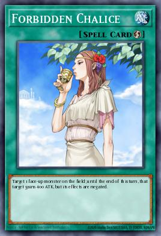

- **Disponibilidad / papel:** **Reserva 2x**; **Mágica de Juego Rápido / negación temporal**, solo si luego se aprueba incorporación.
- **Estado de sinergia y función:** Reserva fuera de lista activa. Es una clasificación de juego; revisar la relación concreta en A06.
- **Papel como recurso, descarte o coste:** Coste o consumo descrito en A05: no destruye ni elimina al monstruo, y seleccionar un monstruo propio normalmente también lo niega; no proponer usarla en la….
- **Efecto y requisito:** selecciona **1 monstruo boca arriba de cualquier campo**; hasta fin de turno le da **400 ATK** y **niega sus efectos**. No requiere enviar carta al GY.
- **Uso potencial:** segundo ayuda a frenar un monstruo rival; primero puede servir como interrupción si se Colocó legalmente el turno anterior; tardío es respuesta económica frente a un solo efecto.
- **Sinergias verificables:** reduce bloqueos que impedirían resolver Trooper/VBA; al dar también 400 ATK al objetivo rival, debe recalcularse combate y daño en vez de considerar el ataque sin cambios.
- **Riesgo / recurso:** no destruye ni elimina al monstruo, y seleccionar un monstruo propio normalmente también lo niega; no proponer usarla en la mano durante turno rival sin haberla Colocado cuando las reglas lo exigen.
- **Fuente / confianza:** **TEXTO_OFICIAL_COTEJADO** — https://www.db.yugioh-card.com/yugiohdb/card_search.action?cid=8213&ope=2&request_locale=en
- **Aplicación concreta dentro de este deck (A06):** Fuera de lista. reduce bloqueos que impedirían resolver Trooper/VBA; al dar también 400 ATK al objetivo rival, debe recalcularse combate y daño en vez de considerar el ataque sin cambios.. No aporta recursos durante este duelo.

**USO PRÁCTICO Y SINERGIA — Forbidden Chalice — Corona Prohibida**

- **Label funcional:** Sin sinergia demostrada (con la evidencia actual). Clasificación documental; una relación es válida solo si se satisfacen sus condiciones exactas.
- **Qué hace:** selecciona **1 monstruo boca arriba de cualquier campo**; hasta fin de turno le da **400 ATK** y **niega sus efectos**. No requiere enviar carta al GY.
- **Cómo aprovecharla en este deck:** Fuera de lista. reduce bloqueos que impedirían resolver Trooper/VBA; al dar también 400 ATK al objetivo rival, debe recalcularse combate y daño en vez de considerar el ataque sin cambios.. No aporta recursos durante este duelo.

#### 32. Clashing Souls — Almas en Choque

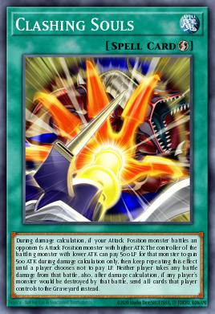

- **Disponibilidad / papel:** **Reserva 1x**; Mágica de Juego Rápido para situaciones de batalla; **no disponible para el duelo actual** mientras permanezca en Reserva.
- **Estado de sinergia y función:** Reserva fuera de lista activa. Es una clasificación de juego; revisar la relación concreta en A06.
- **Papel como recurso, descarte o coste:** Coste o consumo descrito en A05: una resolución mal calculada podría provocar la pérdida de **todo el campo propio**; para proponer un combo será necesario….
- **Identidad confirmada:** Miguel confirmó que la carta antes transcrita como «Clash of Souls» es **«Clashing Souls» / «Almas en Choque»** (**CID 13002**). Ambos nombres oficiales constan en **Yu-Gi-Oh! Neuron**; la cantidad y zona registradas permanecen intactas.
- **Efecto y condición:** Mágica de Juego Rápido utilizable durante cálculo de daño cuando un monstruo propio en ataque batalla con otro en ataque y ATK mayor; el controlador del monstruo de menor ATK puede pagar **500 LP para darle +500 ATK** y continuar con ese intercambio hasta que no paguen. Ese combate no inflige daño de batalla; tras el cálculo, si un monstruo fuera destruido por ese combate, **todas las cartas que controla ese jugador se envían al GY**.
- **Uso potencial / sinergia:** carta **muy situacional**, quizá respuesta ante batalla desfavorable, pero consume LP y el desenlace depende de ambos jugadores. No es pieza del motor Blaze Accelerator ni ruta comprobada.
- **Riesgo / recurso:** una resolución mal calculada podría provocar la pérdida de **todo el campo propio**; para proponer un combo será necesario comprobar los estados de batalla y pagos en el caso concreto, aunque la identidad de la carta ya está confirmada.
- **Fuente / confianza:** **TEXTO_OFICIAL_COTEJADO — IDENTIDAD_CONFIRMADA_POR_MIGUEL** — https://www.db.yugioh-card.com/yugiohdb/card_search.action?cid=13002&ope=2&request_locale=es
- **Aplicación concreta dentro de este deck (A06):** Fuera de lista. Reserva 1x; Mágica de Juego Rápido para situaciones de batalla; no disponible para…. No aporta recursos durante este duelo.

**USO PRÁCTICO Y SINERGIA — Clashing Souls — Almas en Choque**

- **Label funcional:** Sin sinergia demostrada (con la evidencia actual). Clasificación documental; una relación es válida solo si se satisfacen sus condiciones exactas.
- **Cómo aprovecharla en este deck:** Fuera de lista. Reserva 1x; Mágica de Juego Rápido para situaciones de batalla; no disponible para…. No aporta recursos durante este duelo.

#### 33. Evenly Matched — Pelea Pareja

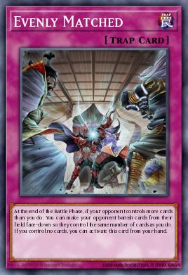

- **Disponibilidad / papel:** **Reserva 1x**; **board breaker al final de Battle Phase**, únicamente como opción futura.
- **Estado de sinergia y función:** Reserva fuera de lista activa. Es una clasificación de juego; revisar la relación concreta en A06.
- **Papel como recurso, descarte o coste:** Coste o consumo descrito en A05: no actúa durante Main Phase ni elimina automáticamente todas las cartas rivales; la propia Trampa activada desde el campo….
- **Efecto y requisito:** al **final de la Battle Phase**, si el oponente controla más cartas que tú, puede obligársele a **desterrar boca abajo cartas de su propio campo** hasta controlar **la misma cantidad**. Si **no controlas cartas**, puede activarse desde la mano.
- **Uso potencial:** al ir segundo y si se incorpora, penaliza campos grandes **antes de desarrollar el motor**; tardío puede reiniciar una situación desfavorable si se alcanza la ventana de Battle Phase.
- **Sinergias verificables:** abre espacio para el posterior desarrollo de Trooper/Emperor; es removal por **destierro boca abajo**, distinto de la destrucción de Scattershot.
- **Riesgo / recurso:** no actúa durante Main Phase ni elimina automáticamente todas las cartas rivales; la propia Trampa activada desde el campo cuenta al comparar cartas si permanece allí. Como Reserva, **no forma parte de la mano actual**.
- **Fuente / confianza:** **TEXTO_OFICIAL_COTEJADO** — https://www.db.yugioh-card.com/yugiohdb/card_search.action?cid=13293&ope=2&request_locale=en
- **Aplicación concreta dentro de este deck (A06):** Fuera de lista. abre espacio para el posterior desarrollo de Trooper/Emperor; es removal por destierro boca abajo, distinto de la destrucción de Scattershot.. No aporta recursos durante este duelo.

**USO PRÁCTICO Y SINERGIA — Evenly Matched — Pelea Pareja**

- **Label funcional:** Sin sinergia demostrada (con la evidencia actual). Clasificación documental; una relación es válida solo si se satisfacen sus condiciones exactas.
- **Qué hace:** al **final de la Battle Phase**, si el oponente controla más cartas que tú, puede obligársele a **desterrar boca abajo cartas de su propio campo** hasta controlar **la misma cantidad**. Si **no controlas cartas**, puede activarse desde la mano.
- **Cómo aprovecharla en este deck:** Fuera de lista. abre espacio para el posterior desarrollo de Trooper/Emperor; es removal por destierro boca abajo, distinto de la destrucción de Scattershot.. No aporta recursos durante este duelo.

#### 34. Rivalry of Warlords — Rivalidad de los Señores de la Guerra

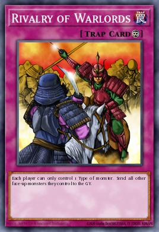

- **Disponibilidad / papel:** **Reserva 1x**; **bloqueo por Tipo**, no puede utilizarse hasta que se incorpore en una configuración permitida.
- **Estado de sinergia y función:** Reserva fuera de lista activa. Es una clasificación de juego; revisar la relación concreta en A06.
- **Papel como recurso, descarte o coste:** Coste o consumo descrito en A05: **Rivalry no es Gozen**: comparte un tipo, no un atributo. La interacción de bloqueo de Invocaciones está explicada en el….
- **Efecto y requisito:** Trampa Continua: cada jugador puede controlar solo monstruos boca arriba de **1 Tipo** (Pyro, Demonio, Ciberso, etc.); los demás que controla se envían al GY, y restringe futuras Invocaciones de otros Tipos mientras se mantienen monstruos boca arriba.
- **Uso potencial:** al ir primero con mesa de **Pyro Volcanic** puede imponer limitación al oponente; segundo puede perjudicar la mesa propia si ya se usaron Links de Tipos diferentes.
- **Sinergias verificables:** Main **Trooper, Emperor, Rocket, Rimfire, Scattershot y Shell** son **Pyro**; el Extra usa **Ciberso (I:P, Almiraj, Linkuriboh), Demonio (Phoenix, Unicorn, TY-PHON, Princess, Goddess), Lanzador de Conjuros (Hiita), Guerrero (S:P)**.
- **Riesgo / recurso:** **Rivalry no es Gozen**: comparte un tipo, no un atributo. La interacción de bloqueo de Invocaciones está explicada en el **FAQ oficial**; no recomendar activarla como si todos los Links FUEGO fueran Pyro.
- **Fuentes / confianza:** **TEXTO_OFICIAL_COTEJADO** — https://www.db.yugioh-card.com/yugiohdb/card_search.action?cid=5622&ope=2&request_locale=en ; FAQ Konami: https://www.yugioh-card.com/en/play/card-faq-1/
- **Aplicación concreta dentro de este deck (A06):** Fuera de lista. Main Trooper, Emperor, Rocket, Rimfire, Scattershot y Shell son Pyro.. No aporta recursos durante este duelo.

**USO PRÁCTICO Y SINERGIA — Rivalry of Warlords — Rivalidad de los Señores de la Guerra**

- **Label funcional:** Sin sinergia demostrada (con la evidencia actual). Clasificación documental; una relación es válida solo si se satisfacen sus condiciones exactas.
- **Qué hace:** Trampa Continua: cada jugador puede controlar solo monstruos boca arriba de **1 Tipo** (Pyro, Demonio, Ciberso, etc.); los demás que controla se envían al GY, y restringe futuras Invocaciones de otros Tipos mientras se mantienen monstruos boca arriba.
- **Cómo aprovecharla en este deck:** Fuera de lista. Main Trooper, Emperor, Rocket, Rimfire, Scattershot y Shell son Pyro.. No aporta recursos durante este duelo.

#### 35. Harpie's Feather Duster — Polvo de Pluma de Arpía

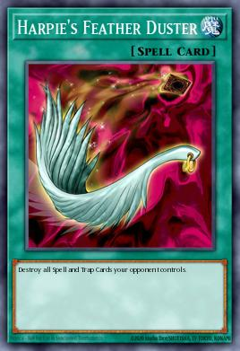

- **Disponibilidad / papel:** **Reserva 1x**; **limpieza masiva de Mágicas/Trampas**, no integra la mano ni el Deck actual.
- **Estado de sinergia y función:** Reserva fuera de lista activa. Es una clasificación de juego; revisar la relación concreta en A06.
- **Papel como recurso, descarte o coste:** Su efecto menciona descartar; verificar si es coste o resolución, qué pieza consume y qué recurso queda.
- **Efecto y requisito:** Mágica Normal: **destruye todas las Mágicas y Trampas que controla el rival**; no se exige descarte ni selecciona una por una.
- **Uso potencial:** segundo retira protección de backrow antes de activar las piezas Volcanic; tardío abre tablero cuando quedan varias cartas continuas rivales.
- **Sinergias verificables:** complementa **Knightmare Phoenix**, que destruye una Mágica/Trampa concreta con material Link y descarte; esta opción cubre múltiples cartas sin generar material.
- **Riesgo / recurso:** no destruye monstruos y puede tropezar con inmunidades, respuestas o negaciones; tampoco recupera recursos Volcanic. No convertirla en herramienta actual sin moverla desde Reserva.
- **Fuente / confianza:** **TEXTO_OFICIAL_COTEJADO** — https://www.db.yugioh-card.com/yugiohdb/card_search.action?cid=4678&ope=2&request_locale=en
- **Aplicación concreta dentro de este deck (A06):** Fuera de lista. complementa Knightmare Phoenix, que destruye una Mágica/Trampa concreta con material Link y descarte; esta opción cubre múltiples cartas sin generar material.. No aporta recursos durante este duelo.

**USO PRÁCTICO Y SINERGIA — Harpie's Feather Duster — Polvo de Pluma de Arpía**

- **Label funcional:** Sin sinergia demostrada (con la evidencia actual). Clasificación documental; una relación es válida solo si se satisfacen sus condiciones exactas.
- **Qué hace:** Mágica Normal: **destruye todas las Mágicas y Trampas que controla el rival**; no se exige descarte ni selecciona una por una.
- **Cómo aprovecharla en este deck:** Fuera de lista. complementa Knightmare Phoenix, que destruye una Mágica/Trampa concreta con material Link y descarte; esta opción cubre múltiples cartas sin generar material.. No aporta recursos durante este duelo.

#### 36. Pot of Prosperity — Olla de la Prosperidad

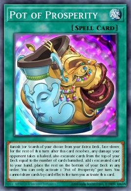

- **Disponibilidad / papel:** **Reserva 1x**; **búsqueda de consistencia con coste de Extra Deck**. No disponible en el Main actual.
- **Estado de sinergia y función:** Reserva fuera de lista activa. Es una clasificación de juego; revisar la relación concreta en A06.
- **Papel como recurso, descarte o coste:** Coste o consumo descrito en A05: no es un robo de varias cartas, sino **excavar y elegir una**; sus restricciones dañan dos pilares del plan Volcanic….
- **Efecto y requisito:** destierra **3 o 6 cartas escogidas del Extra Deck boca abajo**, excava igual cantidad de cartas del Deck, **añade solo 1** a la mano y devuelve las demás al fondo en orden elegido. Desde que resuelve, **todo daño que recibe el rival se reduce a la mitad ese turno**. Solo una activación por turno; **no se pueden robar cartas por efectos durante el turno en que se activa**.
- **Uso potencial:** si se incorpora, ayuda a buscar Volcanic Trooper, Bonfire o una respuesta; es útil primero para consistencia, pero **menos favorable en el turno de daño letal** por su reducción de daño.
- **Sinergias verificables:** permite escoger cuáles piezas Extra perder, a diferencia de **Extravagance** (azar); sin embargo, impide el robo de **Blaze Accelerator Reload** ese turno y recorta la **presión de daño por efecto** de Emperor/Scattershot/Emission.
- **Riesgo / recurso:** no es un robo de varias cartas, sino **excavar y elegir una**; sus restricciones dañan dos pilares del plan Volcanic. Requiere aprobación de incorporación desde Reserva y comprobación del efecto en el momento.
- **Fuente / confianza:** **TEXTO_OFICIAL_COTEJADO** — https://www.db.yugioh-card.com/yugiohdb/card_search.action?cid=15756&ope=2&request_locale=en
- **Aplicación concreta dentro de este deck (A06):** Fuera de lista. permite escoger cuáles piezas Extra perder, a diferencia de Extravagance (azar).. No aporta recursos durante este duelo.

**USO PRÁCTICO Y SINERGIA — Pot of Prosperity — Olla de la Prosperidad**

- **Label funcional:** Sin sinergia demostrada (con la evidencia actual). Clasificación documental; una relación es válida solo si se satisfacen sus condiciones exactas.
- **Qué hace:** destierra **3 o 6 cartas escogidas del Extra Deck boca abajo**, excava igual cantidad de cartas del Deck, **añade solo 1** a la mano y devuelve las demás al fondo en orden elegido. Desde que resuelve, **todo daño que recibe el rival se reduce a la mitad ese turno**. Solo una activación por turno; **no se pueden robar cartas por efectos durante el turno en que se activa**.
- **Cómo aprovecharla en este deck:** Fuera de lista. permite escoger cuáles piezas Extra perder, a diferencia de Extravagance (azar).. No aporta recursos durante este duelo.

**CÓMO LLEGAR DESDE TU DECK — SIN RUTA DEMOSTRADA**

- La biblioteca actual no contiene una ruta identificada para esta carta del Extra. No se debe exhibir una descripción genérica como sustituto de mano inicial, materiales y pasos. Para completarla, contrastar requisitos oficiales y recursos del Main; si no es alcanzable, explicar el impedimento exacto.

## SINERGIAS Y MOTORES
## RESUMEN FUNCIONAL DE SINERGIAS — 687

**Medición descriptiva de etiquetas existentes (NO certificación):** 16/36 identidades con etiqueta directa/indirecta (44.4 %). Main: 16/21 (76.2 %); Extra: 1/12 (8.3 %). Se cuenta una identidad una sola vez; una carta autónoma puede ser útil sin sinergia de motor. Estas cifras provienen de clasificaciones documentales A05/A06: **no son el porcentaje final de sinergias verificadas**, ni una tasa estadística de victoria. Para promoverlas a métricas verificadas, se deben comprobar los pares de cartas y su operación legal.

#### A06.0 — En 30 segundos: cómo cooperan realmente estas cartas

- **Dictamen de conjunto:** motores Volcanic cooperan mediante munición y Cementerio; la mayor fragilidad está en confundir el tipo de envío y en consumir recursos destinados a Emperor.
- **Motor que mueve el deck:** Bonfire/Trooper/Rocket encuentran Aceleradores; VBA y Reload permiten administrar cartas Piro y sus envíos.
- **Puentes reales:** Rimfire, Shell y Scattershot generan valor como munición; Emperor/Inferno/Emission transforman recursos acumulados en presión, daño y respuestas.
- **Sinergia indirecta:** Shell o Scattershot enviados al GY no son cartas muertas: importa si el envío provino del efecto correcto. Rocket + Reload aislados son INTERACCIÓN BÁSICA, no combo.
- **Conflicto decisivo:** el barrido de Scattershot exige envío por efecto de Blaze Accelerator y las otras dos copias; un envío por Droplet o Fire Ejection NO sustituye esa condición. Emperor y su motor compiten por Pyro y Aceleradores.
- **Decisión concreta:** revisar Extravagancia frente a la posible Prosperidad de Reserva por consumo de Extra y restricción de robo; no cambiar nada sin comparar el coste de oportunidad.
- **Qué aprender después:** separar preparación Rocket/Reload, extensión Rimfire y combo Emperor con objetivo y tablero final.

#### Motores y uso de recursos

1. **Acceso al motor Blaze Accelerator.** **Bonfire** (CID 19027) busca Pyro Nivel 4 o menor como **Volcanic Trooper** (18916) o **Volcanic Rocket** (7243), pero no **Emperor**. Trooper, al Invocarse, busca una carta **Volcanic** distinta de sí; Rocket busca una carta **Blaze Accelerator** de Deck/GY: **Blaze Accelerator** (7086), **Reload** (11597) o **Volcanic Blaze Accelerator** (18918). La Mágica Continua VBA exige enviar otra carta Blaze Accelerator de mano/Deck/Campo boca arriba al GY para activarse; no entra gratis por recibirla en mano.
2. **Motor Nivel 1 y depósito del GY.** El efecto de **Volcanic Blaze Accelerator** manda **Pyro Nivel 1** desde Deck al GY para destruir un monstruo rival boca arriba: sirve para **Rimfire** (18917) o **Shell** (7082), **NO** para **Scattershot**, que es Nivel 2. **Fire Ejection** (18919) manda cualquier Pyro apropiado del Deck al GY y elige entre daño por Nivel o Ficha Bomba si fue Volcanic; no combina ambas opciones en una activación.
3. **Rimfire / Reload como acceso indirecto.** **Rimfire** en GY puede desterrarse para enviar otro Volcanic desde Deck al GY, **o** desterrar un Blaze Accelerator del campo/GY para colocar boca arriba un Blaze Accelerator **Continuo** desde mano/Deck. **Reload** en Campo envía Volcanic de mano al GY para robar; en GY puede desterrarse durante Main Phase para mandar un Volcanic **desde Deck** al GY. Son dos efectos, con zonas y condiciones distintas.
4. **Scattershot como daño y retirada.** **Scattershot** (7083) enviada al GY inflige 500; solo cuando llega **por el efecto de una carta Blaze Accelerator** puede mandar otras **dos** copias desde mano/Deck y destruir los monstruos rivales. El envío por Fire Ejection, Trooper, Rimfire o Droplet no genera por sí mismo el segundo efecto. Hay que comprobar las copias disponibles antes de anunciar el barrido. **Shell** en GY paga 500 LP para buscar otra Shell del Deck, convirtiéndose en recurso para el envío de Reload/Trooper.
5. **Emperor y trampas propias.** **Volcanic Emperor** (18915) entra desde mano/GY por su método, desterrando **3 Pyro o 1 Blaze Accelerator** de Campo/GY; el daño inicial depende de los **Pyro desterrados** y luego puede Colocar una Trampa Volcanic como **Inferno** (18921) o **Emission** (18920). **Inferno** puede negar efecto de monstruo rival activado en **Campo** si destierra Pyro **Volcanic** de tu GY y luego recicla hasta dos Volcanic en End Phase rival; esos recursos compiten con el coste de Emperor.
6. **Ficha Bomba y Emission.** Trooper (descartando carta) o Fire Ejection (eligiendo Ficha) pueden dejar Ficha Bomba en campo rival. **Emission** puede seleccionar un Pyro del Campo y causar daño según su **ATK original**; o acceder a un Volcanic de Deck por su otra opción. Invocar **Emperor** con Emission ignorando condiciones **no** activa su recompensa específica de haber sido Invocado por su propio procedimiento.
7. **Extra auxiliar y restricciones simétricas.** Cuerpos Volcanic permiten, con materiales legales, conexiones a **Salamangreat Almiraj**, **Hiita FUEGO**, **I:P Enmascarada**, **S:P Pequeña Caballera**, **Promethean Princess**, **Knightmare** o **TY-PHON**. **Estatua-Barrera del Infierno** (6884) solo permite Invocaciones Especiales de **FUEGO** mientras esté boca arriba. **Gozen Match** (7934) solo permite un Atributo boca arriba por jugador. Ambas pueden cerrar tus propios Enlaces de otro Atributo; no se consideran un motor de búsqueda.

#### Mapa de relaciones y pruebas documentales

| Enlaces de las fichas (CID) | Resultado apoyado por texto | Diferencia decisiva | Imagen |
|---|---|---|---|
| Bonfire (19027) → Trooper (18916) / Rocket (7243) | Acceso a monstruo pequeño, búsqueda Volcanic o Blaze Accelerator. | La carta buscada y zona disponible determinan el siguiente paso. |    |
| Rocket (7243) → VBA (18918) → Rimfire (18917) / Shell (7082) | Acceso al motor y envío de Pyro Nivel 1 desde Deck. | VBA necesita otro Blaze Accelerator para activarse y objetivo rival boca arriba. |     |
| Rimfire (18917) → Reload (11597) → Scattershot (7083) | Colocar Acelerador Continuo y enviar por efecto Blaze Accelerator desde Deck. | Reload en GY, Main Phase y otras dos copias Scattershot disponibles. |    |
| Fire Ejection (18919) / Trooper (18916) → Ficha → Emission (18920) | Crear Pyro rival para daño con referencia a ATK original. | Elegir efecto correcto, esperar Trampa Colocada y objetivo legal. |    |
| Emperor (18915) → Inferno (18921) / Emission (18920) | Jefe que coloca Trampa tras su Invocación por procedimiento propio. | 3 Pyro o 1 acelerador desterrados; no equivaler a Invocación por Emission. |    |
| Estatua (6884) / Gozen (7934) → Extra FUEGO | Control de convocatorias; usar Hiita/Almiraj/Promethean si cumplen requisitos. | No invocar I:P/S:P/TY-PHON de otro Atributo bajo el bloqueo. |   |

#### Conflictos y redundancias

- **Munición compartida:** desterrar Shell/Rimfire para Emperor priva de uso posterior del GY y puede impedir el efecto de búsqueda/colocación; Inferno también necesita Pyro en GY. Un recurso no se reutiliza como si siguiera ahí.
- **Robo bloqueado:** **Olla de la Extravagancia** (14144) no permite más robo por efectos tras resolverla; puede afectar la opción de robo de Reload o Maxx C ese turno. Además destierra al azar 3/6 Extra y no garantiza conservar I:P/S:P/Princess. El Main registra **2x Maxx C**, la Reserva otra copia, sin revisiones de banlist aquí.
- **Destrucción vs negación:** Scattershot destruye monstruos, Inferno niega efectos en Campo bajo su condición, Droplet niega efectos y reduce ATK sin destruir. No se intercambian esos resultados.
- **Reserva confirmada:** **«Clashing Souls» / «Almas en Choque» (CID 13002)** se identifica de forma inequívoca por confirmación de Miguel y cotejo oficial; **1x exclusivamente en Reserva**. Puede evaluarse como respuesta de batalla tras incorporación futura, pero no forma parte de una jugada actual.

#### A06.1 — Arquitectura operativa de los motores (síntesis no redundante)

Las siguientes filas son **relaciones funcionales**, no secuencias certificadas ni garantía de mano inicial. La lista real y los límites están en A04/A05/A07.

| Tipo / motor | Starter o vía de acceso real | Recurso y destino | Cuello de botella |
|---|---|---|---|
| **Principal: Volcanic/Blaze Accelerator** | Bonfire, Trooper, Rocket, VBA y Reload | Búsqueda y envío controlado de Pyro | Bonfire solo Pyro Nivel 4 o menor; VBA requiere otro Acelerador |
| **Submotor: munición de Cementerio** | Rimfire, Shell, Scattershot y Fire Ejection | Descarte, recuperación, daño o destrucción | Scattershot barre solo enviada por efecto Blaze Accelerator con otras dos copias |
| **Submotor: Emperor/trampas** | Emperor, Inferno, Emission y Ficha Bomba | Presión, daño, respuesta en turno rival | Consumir tres Pyro o un Acelerador compite con el plan de recuperación |
| **Apoyo autónomo: control** | Estatua-Barrera, Gozen, Droplet, staples | Limitar invocaciones o responder al campo | Atributos propios del Extra y bloqueo de robo de Extravagancia |

#### A06.2 — Estado funcional y justificación de TODAS las cartas

**Cómo leerlo:** un estado de sinergia describe el papel **de juego**, no el avance de una auditoría. No hay obligación de que cada carta tenga un enlace con otra: una defensa autónoma, una herramienta de Side o un recurso de descarte justificado también tiene propósito. Las relaciones directas descritas aquí se deben contrastar con los textos oficiales antes de representarlas como una ruta legal A09.

| Carta / CID y zona | Estado funcional de sinergia | Motivo de inclusión | Relación y condición concreta | Papel como coste, descarte o material | Límite o riesgo | Decisión táctica |
|---|---|---|---|---|---|---|
| **Volcanic Trooper — Soldado Volcánico** (CID 18916) — Main 3x | **Sinergia indirecta (soporte o recursos)** | Main **3x**; **starter / buscador / creador de objetivos Pyro rivales** | Volcanic Emission puede seleccionar una Ficha Pyro del rival para daño según su ATK original; Volcanic Blaze Accelerator puede seleccionar un monstruo rival boca arriba | Su efecto menciona descartar; verificar si es coste o resolución, qué pieza consume y qué recurso queda | al ser Invocado Normal o Especialmente puede añadir del Deck **1 carta «Volcanic» distinta de Trooper**. Con otro efecto independiente… | Conservar; verificar coste y orden |
| **Volcanic Emperor — Emperador Volcánico** (CID 18915) — Main 2x | **Sinergia indirecta (soporte o recursos)** | Main **2x**; **jefe de campo / finisher de daño / acceso a trampas Volcanic** | Fire Ejection, Rimfire, Reload y Scattershot suministran Pyro al GY; Volcanic Inferno recicla algunos recursos y disputa efectos de monstruo | Coste o consumo descrito en A05: desterrar 3 Pyro compite con munición de Shell/Scattershot y coste de Inferno. **Volcanic Emission** puede Invocarlo… | **no puede ser Invocado Normalmente**. Se Invoca Especialmente desde mano o GY por su procedimiento propio desterrando **3 monstruos Pyro o 1… | Conservar; verificar coste y orden |
| **Volcanic Rocket — Misil Volcánico** (CID 7243) — Main 3x | **Sinergia directa descrita** | Main **3x**; **buscador de motor / recuperación de aceleradores** | recupera Blaze Accelerator, Blaze Accelerator Reload o Volcanic Blaze Accelerator según sus nombres disponibles y la situación | Su efecto menciona descartar; verificar si es coste o resolución, qué pieza consume y qué recurso queda | cuando es Invocado, puede añadir **1 carta «Blaze Accelerator» desde Deck o GY**; no hay que inventar coste de descarte para esa búsqueda | Conservar; verificar coste y orden |
| **Volcanic Rimfire — Percusión Anular Volcánica** (CID 18917) — Main 3x | **Sinergia directa descrita** | Main **3x**; **enabler de GY / puente hacia Scattershot o aceleradores continuos**; **Pyro Nivel 1** | Fire Ejection puede enviarlo desde Deck; el envío de Rimfire por VBA es legal porque es Nivel 1; su opción (a) puede enviar Scattershot y causar 500 daños | Envío mencionado en la interacción; no equivale por sí mismo a descarte desde la mano | cuando va al GY puede elegir **un efecto**: (a) desterrarse para enviar **otro monstruo Volcanic** del Deck al GY, o (b) desterrar **1 carta… | Conservar; verificar coste y orden |
| **Volcanic Scattershot — Disparo Disperso Volcánico** (CID 7083) — Main 3x | **Sinergia directa descrita** | Main **3x**; **removal masivo / daño por efecto / munición crítica**; **Pyro Nivel 2** | Blaze Accelerator lo puede enviar desde la mano si satisface su requisito de ATK | Envío mencionado en la interacción; no equivale por sí mismo a descarte desde la mano | cada copia enviada al GY inflige **500 daños**. Si se envía al GY **por efecto de una carta Blaze Accelerator**, puede enviar **otras 2 copias**… | Conservar; verificar coste y orden |
| **Volcanic Shell — Cartucho Volcánico** (CID 7082) — Main 3x | **Sinergia indirecta (soporte o recursos)** | Main **3x**; **recurso reciclable / munición / ventaja incremental**; **Pyro Nivel 1** | VBA puede enviarla desde Deck por exigir Pyro Nivel 1 y un objetivo rival boca arriba | Envío mencionado en la interacción; no equivale por sí mismo a descarte desde la mano | **una vez por turno** paga **500 LP** para añadir **otra Shell del Deck** a la mano. La copia que usa ese efecto **debe permanecer en GY tanto… | Conservar; verificar coste y orden |
| **Barrier Statue of the Inferno — Estatua-Barrera del Infierno** (CID 6884) — Main 1x | **Sinergia indirecta (soporte o recursos)** | Main **1x**; **bloqueo de Invocaciones Especiales / presión al ir primero** | convive con buena parte del Main Pyro/FUEGO y con Hiita, Knightmare Phoenix, Salamangreat Almiraj y Promethean Princess | Coste o consumo descrito en A05: es una restricción **simétrica**; no convocar piezas incompatibles como si la Estatua no estuviese presente. No genera… | mientras esté en campo, **ningún jugador puede Invocar Especialmente monstruos que no sean FUEGO**. No niega monstruos que ya estaban en campo y… | Conservar; verificar coste y orden |
| **Maxx "C" — «C» Maxx** (CID 9455) — Main 2x, Reserva 1x adicional | **Utilidad independiente** | Main **2x**, **Reserva 1x adicional**; **handtrap de ventaja / disuasión ante extensión rival**. La Reserva **no participa** en partidas… | puede aportar nuevas cartas del motor, pero Pot of Extravagance impide robar por efectos después de resolver, y Pot of Prosperity impide robar por efectos durante todo el turno de activación. Aporta respuesta o consistencia sin exigir enlace directo | Coste o consumo descrito en A05: el rival puede detenerse; puede ser negada o quedarse sin valor si el oponente no Invoca Especialmente. **No se revisa aquí… | como **efecto rápido**, se envía de la mano al GY; durante ese turno, cada vez que el rival **realiza un evento de Invocación Especial**, se… | Conservar según rival y conflictos propios |
| **Volcanic Blaze Accelerator — Acelerador de Llama Volcánico** (CID 18918) — Main 3x | **Sinergia directa descrita** | Main **3x**; **núcleo continuo / extensor de Invocación / removal puntual con envío al GY** | enviar Rimfire Nivel 1 habilita su efecto de GY; enviar Shell Nivel 1 prepara recursión; su Invocación desde mano puede desplegar Trooper para buscar | Envío mencionado en la interacción; no equivale por sí mismo a descarte desde la mano | para activarlo debe enviar **1 carta «Blaze Accelerator» de mano, Deck o campo propio boca arriba al GY**; solo puede controlarse **1 VBA**. Una… | Conservar; verificar coste y orden |
| **Blaze Accelerator — Acelerador de Llama** (CID 7086) — Main 1x | **Sinergia directa descrita** | Main **1x**; **pieza de acceso / removal de monstruo a costa de munición** | Scattershot reúne el requisito de hasta 500 ATK y, si este efecto lo envía al GY, puede disparar el envío de otras dos copias y destrucción masiva | Envío mencionado en la interacción; no equivale por sí mismo a descarte desde la mano | Mágica Continua que selecciona **1 monstruo rival**, envía al GY **1 Pyro con 500 ATK o menos desde la mano** y, si se envía, destruye el… | Conservar; verificar coste y orden |
| **Fire Ejection — Eyección de Fuego** (CID 18919) — Main 3x | **Sinergia directa descrita** | Main **3x**; **envío preciso Pyro desde Deck / habilitador de GY / generador de Ficha** | prepara un Rimfire de GY para colocar acelerador; envía Shell al GY para obtener otra copia; pone Ficha rival para efectos que seleccionan Pyro, como Volcanic Emission | Envío mencionado en la interacción; no equivale por sí mismo a descarte desde la mano | Mágica Normal que envía **1 Pyro del Deck al GY**. Si fue un **Volcanic**, se elige **una** de dos opciones: quemar **Nivel × 100**, o Invocar… | Conservar; verificar coste y orden |
| **Forbidden Droplet — Gotas Prohibidas** (CID 15299) — Main 3x | **Utilidad independiente** | Main **3x**; **board breaker / negación de monstruos / apoyo ofensivo** | enviar Rimfire o Scattershot como recurso de la mano al GY puede preparar sus disparadores propios; no transforma el envío en «efecto Blaze Accelerator». Aporta respuesta o consistencia sin exigir enlace directo | Envío mencionado en la interacción; no equivale por sí mismo a descarte desde la mano | Mágica de Juego Rápido: envía **otras cartas de mano y/o campo** al GY, luego escoge igual cantidad de **monstruos de efecto rivales**; hasta… | Conservar según rival y conflictos propios |
| **Bonfire — Hoguera** (CID 19027) — Main 3x | **Sinergia indirecta (soporte o recursos)** | Main **3x**; **starter genérico / tutor de Pyro pequeño** | ofrece acceso a todas las piezas Pyro Nivel 1–4 de esta lista; NO puede añadir Volcanic Emperor (Nivel 8) ni cartas Mágicas/Trampa | Coste o consumo descrito en A05: gastar Bonfire para una pieza que ya está duplicada reduce capacidad de resolver una mano difícil; si el acceso al Deck está… | añade a la mano **1 monstruo Pyro de Nivel 4 o inferior** desde el Deck; se activa como máximo **1 Bonfire por turno** | Conservar; verificar coste y orden |
| **Pot of Extravagance — Olla de la Extravagancia** (CID 14144) — Main 2x | **Sinergia indirecta (soporte o recursos)** | Main **2x**; **robo / impulso de consistencia con coste de Extra Deck** | puede hallar Trooper/Bonfire/Droplet, pero compite con I:P / S:P / TY-PHON / Promethean Princess por el Extra y deshabilita el robo posterior de Blaze Accelerator Reload en el mismo turno | Coste o consumo descrito en A05: el destierro es **aleatorio**: no garantizar que quede una ruta Extra concreta. Si ya se realizó otra jugada de Main Phase… | **al comienzo de Main Phase 1**, destierra **3 o 6 cartas aleatorias del Extra Deck boca abajo**, y roba **1 por cada 3**. Después de resolver… | Conservar; verificar coste y orden |
| **Blaze Accelerator Reload — Recarga del Acelerador de Llama** (CID 11597) — Main 3x | **Sinergia directa descrita** | Main **3x**; **motor de robo / remitente de munición al GY / activador de Scattershot** | enviar Scattershot desde Deck por efecto de esta carta puede habilitar su barrido si quedan otras dos copias; mandar Rimfire al GY inicia una de sus opciones | Envío mencionado en la interacción; no equivale por sí mismo a descarte desde la mano | Trampa Continua cuyo nombre pasa a **Tri-Blaze Accelerator** mientras está en zona Mágica/Trampa. En Main Phase puede **enviar 1 carta Volcanic… | Conservar; verificar coste y orden |
| **Volcanic Inferno — Infierno Volcánico** (CID 18921) — Main 1x | **Sinergia indirecta (soporte o recursos)** | Main **1x**; **interrupción de efecto de monstruo / reciclaje para juego tardío** | el primer efecto consume el mismo GY de Pyro que Emperor y Rimfire; el segundo puede volver a habilitar copias de Scattershot en Deck para otro envío legal | Coste o consumo descrito en A05: con Pyro **no Volcanic** solo hay 500 de daño, **no negación**; no niega efectos de monstruos activados exclusivamente en… | Trampa Continua: cuando el rival **activa un efecto de monstruo en campo**, puede **desterrar 1 Pyro de su GY** para infligir **500 de daño**… | Conservar; verificar coste y orden |
| **Volcanic Emission — Emisión Volcánica** (CID 18920) — Main 1x | **Sinergia indirecta (soporte o recursos)** | Main **1x**; **extensión puntual / daño de Pyro en campo** | puede elegir Emperor desde Deck ignorando condiciones como cuerpo temporal, pero NO dispara el efecto que Emperor reserva para su propia Invocación | Coste o consumo descrito en A05: carta Colocada debe esperar normalmente turno permitido; la Invocación temporal vuelve a mano al final y no se convierte… | Trampa Normal que **elige una opción por activación**: (a) tomar del Deck **1 monstruo Volcanic**, añadirlo a mano o Invocarlo Especialmente… | Conservar; verificar coste y orden |
| **Gozen Match — Emparejamiento de Atributos** (CID 7934) — Main 2x, Reserva 1x adicional | **Sinergia indirecta (soporte o recursos)** | Main **2x**, **Reserva 1x adicional**; **control de Atributos / limitación simétrica de campo** | Main Volcanic es predominantemente FUEGO; en Extra Hiita | Coste o consumo descrito en A05: **no confundir Atributo (Gozen) con Tipo (Rivalry)**; tampoco suponer que se puede usar libremente un Link no FUEGO cuando… | Trampa Continua: cada jugador solo puede controlar monstruos boca arriba de **1 Atributo**; los otros propios boca arriba van al GY. También… | Conservar; verificar coste y orden |
| **I:P Masquerena — I:P Enmascarada** (CID 14676) — Extra 2x | **Tres salidas condicionales documentadas** | Extra **2x**; dos rutas rápidas en Main rival y una por Enlace normal en Main propia | `687:A09:IP:EMPEROR:UNICORN14` Link3; `687:A09:IP:EMPEROR:SP_DEFENSA16` Link2; **V13** `687:A09:IP:TROOPER:ROCKET:GODDESS19` Link5 con 1 Efecto no-Link rival | Unicornio gasta descarte, S:P no; Diosa exige campo previo I:P+Trooper+Rocket+enemigo | I:P protege al Link nuevo contra destrucción por efectos rivales **aun si se usa en un Enlace ordinario** | Alternativas excluyentes; no usar rápido de I:P en la ruta Diosa Main propia |
| **Hiita the Fire Charmer, Ablaze — Hiita, la Encantadora del Fuego Encendida** (CID 14133) — Extra 1x | **Sin acceso al Extra demostrado** | Función individual: Extra **1x**; **aprovechar GY rival / puente de Link FUEGO**. **FUEGO, Lanzador de Conjuros, Link… | No se documenta una operación concreta que conecte esta carta con el motor; no inferir inutilidad | Material o destino del Extra condicionado a los requisitos de invocación | requiere **2 monstruos, incluido uno FUEGO**. Puede seleccionar **1 FUEGO del GY rival** e Invocarlo Especialmente a una zona apuntada por… | Cruzar A09/A07 antes de proponer reemplazo |
| **Knightmare Unicorn — Caballero de Pesadilla Unicornio** (CID 13601) — Extra 1x | **Acceso condicional demostrado** | Extra **1x**; salida de control/retirada sin destruir | `687:A09:IP:EMPEROR:UNICORN14` explica foto a foto I:P + Emperador → Unicornio y cuándo priorizarlo | Descartar 1 carta de mano (p. ej. Gotas Prohibidas Main) como coste del efecto de Unicornio | Main rival; barajar una carta seleccionable al Deck; sin robo salvo coenlace | Pierde 3100 ATK/daño futuro de Emperador; no funciona con bloqueos de OSCURIDAD |
| **Underworld Goddess of the Closed World — Diosa del Inframundo del Mundo Cerrado** (CID 15741) — Extra 1x | **Acceso condicional V13** | `687:A09:IP:TROOPER:ROCKET:GODDESS19`, Link5 con material enemigo | I:P Link2 + Trooper + Rocket propios + 1 Efecto no-Link del rival = 4 materiales, valor5 | 3 cuerpos propios ya montados, Enlace ordinario Main propia | Diosa 3000; niega efectos de monstruos enemigos presentes si resuelve; I:P aporta protección contra destrucción por efectos del rival | No usable con bloqueo FIRE Princess ni sin material rival elegible |
| **Knightmare Phoenix — Caballero de Pesadilla Fénix** (CID 13600) — Extra 1x | **Sin acceso al Extra demostrado** | Función individual: Extra **1x**; **removal de Mágicas/Trampas / Link FUEGO alternativo**. **FUEGO, Demonio, Link 2** | No se documenta una operación concreta que conecte esta carta con el motor; no inferir inutilidad | Su efecto menciona descartar; verificar si es coste o resolución, qué pieza consume y qué recurso queda | necesita **2 monstruos de nombres diferentes**. Al ser Invocado por Enlace puede **descartar 1**, seleccionar **1 Mágica/Trampa rival** y… | Cruzar A09/A07 antes de proponer reemplazo |
| **Linkuriboh — Enlacekuriboh** (CID 13346) — Extra 1x | **Acceso concreto desde Shell Nivel 1** | Extra **1x**; conversión de recurso, defensa por ATK 0 en batalla | `687:A09:SHELL:LINKURIBOH:DEFENSA15`: Shell Normal → Link1; Shell paga 500 LP en GY y añade otra al buscar | Consumes la Normal, material Nivel1 y 500 LP; después Sacrificar Linkuriboh ante ataque rival | No niega ataques, puede haber replay; GY Shell debe mantenerse para buscar | Revisado con Konami; no activar con bloqueos OSCURIDAD/Ciberso |
| **Super Starslayer TY-PHON - Sky Crisis — Súper Asesino Estelar TY-PHON** (CID 19184) — Extra 3x | **Acceso reactivo V13** | `687:A09:SHELL:TYPHON18`, Rango12 con 1 material | Shell Normal único propio si rival hizo 2+ Especiales desde Extra este/turno anterior | No Normal/Especial después; desprender Shell para devolver monstruo, luego Shell en GY puede pagar 500 LP y buscar otra si disponible | TY-PHON 2900, prohíbe activaciones de monstruos con 3000+ ATK de ambos | Alternativa a Shell→Linkuriboh, no acumulable |
| **S:P Little Knight — S:P Pequeña Caballera** (CID 19188) — Extra 3x | **Acceso condicional demostrado** | Extra **3x**; destierro inicial y respuesta temporal | `687:A09:IP:EMPEROR:SP_DEFENSA16`: I:P valor1 + Emperador valor1 → S:P Link2 en Main rival; I:P como material habilita primer destierro | Gasta I:P + Emperador, **sin descarte**; pierde futuros 500 LP recurrentes | Respuesta rápida separada destierra temporalmente y no niega; bloquear OSCURIDAD puede impedirlo | Cinco pasos ilustrados, alternativa a Unicornio o conservar jefe |
| **Salamangreat Almiraj — Salamangrande Almiraj** (CID 14338) — Extra 1x | **Sin acceso al Extra demostrado** | Función individual: Extra **1x**; **salida de monstruo pequeño / protección puntual**. **FUEGO, Ciberso, Link 1** | No se documenta una operación concreta que conecte esta carta con el motor; no inferir inutilidad | Material o destino del Extra condicionado a los requisitos de invocación | requiere **1 monstruo que haya sido Invocado Normalmente y posea ATK 1000 o menor**. Como efecto rápido puede **Sacrificarse y seleccionar otro… | Cruzar A09/A07 antes de proponer reemplazo |
| **Promethean Princess, Bestower of Flames — Princesa Prometea** (CID 19507) — Extra 1x | **Sin acceso al Extra demostrado** | Función individual: Extra **1x**; **extensor FUEGO / reaparición desde GY y destrucción reactiva**. **FUEGO, Demonio… | No se documenta una operación concreta que conecte esta carta con el motor; no inferir inutilidad | Material o destino del Extra condicionado a los requisitos de invocación | exige **2 o más monstruos de Efecto** para Link 3. Mientras está en campo, **no permite Invocaciones Especiales propias salvo monstruos FUEGO**… | Cruzar A09/A07 antes de proponer reemplazo |
| **Infinite Impermanence — Infinito Temporal** (CID 13631) — Reserva 3x, NO en Main ni Side | **Reserva fuera de lista activa** | Opción externa al listado activo; su función potencial no justifica jugarla sin incorporarla legalmente | Solo puede utilizarse si se incorpora a una lista aplicable; no es recurso del duelo activo | Coste o consumo descrito en A05: con cartas controladas **no** se usa desde mano; la cláusula de columna **no** se aplica a una activación desde mano. La… | Trampa Normal que selecciona **1 monstruo rival boca arriba** y niega sus efectos hasta fin de turno. Si fue **Colocada antes**, y aún está en… | Reserva; propuesta solo tras aprobación |
| **Ash Blossom & Joyous Spring — Flor de Ceniza y Primavera Feliz** (CID 12950) — Reserva 2x | **Reserva fuera de lista activa** | Opción externa al listado activo; su función potencial no justifica jugarla sin incorporarla legalmente | Solo puede utilizarse si se incorpora a una lista aplicable; no es recurso del duelo activo | Su efecto menciona descartar; verificar si es coste o resolución, qué pieza consume y qué recurso queda | como efecto rápido, se **descarta de mano** para negar el **efecto** que incluya añadir carta del Deck a mano, Invocar Especialmente desde Deck… | Reserva; propuesta solo tras aprobación |
| **Forbidden Chalice — Corona Prohibida** (CID 8213) — Reserva 2x | **Reserva fuera de lista activa** | Opción externa al listado activo; su función potencial no justifica jugarla sin incorporarla legalmente | Solo puede utilizarse si se incorpora a una lista aplicable; no es recurso del duelo activo | Coste o consumo descrito en A05: no destruye ni elimina al monstruo, y seleccionar un monstruo propio normalmente también lo niega; no proponer usarla en la… | selecciona **1 monstruo boca arriba de cualquier campo**; hasta fin de turno le da **400 ATK** y **niega sus efectos**. No requiere enviar carta… | Reserva; propuesta solo tras aprobación |
| **Clashing Souls — Almas en Choque** (CID 13002) — Reserva 1x | **Reserva fuera de lista activa** | Opción externa al listado activo; su función potencial no justifica jugarla sin incorporarla legalmente | Solo puede utilizarse si se incorpora a una lista aplicable; no es recurso del duelo activo | Coste o consumo descrito en A05: una resolución mal calculada podría provocar la pérdida de **todo el campo propio**; para proponer un combo será necesario… | Aplicar restricciones del efecto en A05 | Reserva; propuesta solo tras aprobación |
| **Evenly Matched — Pelea Pareja** (CID 13293) — Reserva 1x | **Reserva fuera de lista activa** | Opción externa al listado activo; su función potencial no justifica jugarla sin incorporarla legalmente | Solo puede utilizarse si se incorpora a una lista aplicable; no es recurso del duelo activo | Coste o consumo descrito en A05: no actúa durante Main Phase ni elimina automáticamente todas las cartas rivales; la propia Trampa activada desde el campo… | al **final de la Battle Phase**, si el oponente controla más cartas que tú, puede obligársele a **desterrar boca abajo cartas de su propio… | Reserva; propuesta solo tras aprobación |
| **Rivalry of Warlords — Rivalidad de los Señores de la Guerra** (CID 5622) — Reserva 1x | **Reserva fuera de lista activa** | Opción externa al listado activo; su función potencial no justifica jugarla sin incorporarla legalmente | Solo puede utilizarse si se incorpora a una lista aplicable; no es recurso del duelo activo | Coste o consumo descrito en A05: **Rivalry no es Gozen**: comparte un tipo, no un atributo. La interacción de bloqueo de Invocaciones está explicada en el… | Trampa Continua: cada jugador puede controlar solo monstruos boca arriba de **1 Tipo** (Pyro, Demonio, Ciberso, etc.); los demás que controla se… | Reserva; propuesta solo tras aprobación |
| **Harpie's Feather Duster — Polvo de Pluma de Arpía** (CID 4678) — Reserva 1x | **Reserva fuera de lista activa** | Opción externa al listado activo; su función potencial no justifica jugarla sin incorporarla legalmente | Solo puede utilizarse si se incorpora a una lista aplicable; no es recurso del duelo activo | Su efecto menciona descartar; verificar si es coste o resolución, qué pieza consume y qué recurso queda | Mágica Normal: **destruye todas las Mágicas y Trampas que controla el rival**; no se exige descarte ni selecciona una por una | Reserva; propuesta solo tras aprobación |
| **Pot of Prosperity — Olla de la Prosperidad** (CID 15756) — Reserva 1x | **Reserva fuera de lista activa** | Opción externa al listado activo; su función potencial no justifica jugarla sin incorporarla legalmente | Solo puede utilizarse si se incorpora a una lista aplicable; no es recurso del duelo activo | Coste o consumo descrito en A05: no es un robo de varias cartas, sino **excavar y elegir una**; sus restricciones dañan dos pilares del plan Volcanic… | destierra **3 o 6 cartas escogidas del Extra Deck boca abajo**, excava igual cantidad de cartas del Deck, **añade solo 1** a la mano y devuelve… | Reserva; propuesta solo tras aprobación |

## INTERACCIONES Y CLASIFICACIÓN

| ID documental | Categoría provisional | Piezas | Resultado | Requisitos | Check |
|---|---|---|---|---|---|
| 687:A08:01 | STARTER | Bonfire (19027) → Trooper (18916) / Rocket (7243) | Acceso a monstruo pequeño, búsqueda Volcanic o Blaze Accelerator. | La carta buscada y zona disponible determinan el siguiente paso. | |
| 687:A08:02 | EXTENSION | Rocket (7243) → VBA (18918) → Rimfire (18917) / Shell (7082) | Acceso al motor y envío de Pyro Nivel 1 desde Deck. | VBA necesita otro Blaze Accelerator para activarse y objetivo rival boca arriba. | |
| 687:A08:03 | EXTENSION | Rimfire (18917) → Reload (11597) → Scattershot (7083) | Colocar Acelerador Continuo y enviar por efecto Blaze Accelerator desde Deck. | Reload en GY, Main Phase y otras dos copias Scattershot disponibles. | |
| 687:A08:04 | PLAN | Fire Ejection (18919) / Trooper (18916) → Ficha → Emission (18920) | Crear Pyro rival para daño con referencia a ATK original. | Elegir efecto correcto, esperar Trampa Colocada y objetivo legal. | |
| 687:A08:05 | RUTA | Emperor (18915) → Inferno (18921) / Emission (18920) | Jefe que coloca Trampa tras su Invocación por procedimiento propio. | 3 Pyro o 1 acelerador desterrados; no equivaler a Invocación por Emission. | |
| 687:A08:06 | PLAN | Estatua (6884) / Gozen (7934) → Extra FUEGO | Control de convocatorias; usar Hiita/Almiraj/Promethean si cumplen requisitos. | No invocar I:P/S:P/TY-PHON de otro Atributo bajo el bloqueo. | |

#### Rol registrado por cada carta

| ID A08 | Carta registrada | Zona | Clasificación funcional | Rol documentado en A05 | Check de clasificación |
|---|---|---|---|---|---|
| 687:A08:C001 | Volcanic Trooper — Soldado Volcánico | Main | STARTER_POTENCIAL | Main **3x**; **starter / buscador / creador de objetivos Pyro rivales**. | |
| 687:A08:C002 | Volcanic Emperor — Emperador Volcánico | Main | FUNCION_A05 (recurso jugable sujeto a condición) | Main **2x**; **jefe de campo / finisher de daño / acceso a trampas Volcanic**. | |
| 687:A08:C003 | Volcanic Rocket — Misil Volcánico | Main | BUSCADOR_INTERACCION | Main **3x**; **buscador de motor / recuperación de aceleradores**. | |
| 687:A08:C004 | Volcanic Rimfire — Percusión Anular Volcánica | Main | FUNCION_A05 (recurso jugable sujeto a condición) | Main **3x**; **enabler de GY / puente hacia Scattershot o aceleradores continuos**; **Pyro Nivel 1**. | |
| 687:A08:C005 | Volcanic Scattershot — Disparo Disperso Volcánico | Main | FUNCION_A05 (recurso jugable sujeto a condición) | Main **3x**; **removal masivo / daño por efecto / munición crítica**; **Pyro Nivel 2**. | |
| 687:A08:C006 | Volcanic Shell — Cartucho Volcánico | Main | FUNCION_A05 (recurso jugable sujeto a condición) | Main **3x**; **recurso reciclable / munición / ventaja incremental**; **Pyro Nivel 1**. | |
| 687:A08:C007 | Barrier Statue of the Inferno — Estatua-Barrera del Infierno | Main | FUNCION_A05 (recurso jugable sujeto a condición) | Main **1x**; **bloqueo de Invocaciones Especiales / presión al ir primero**. | |
| 687:A08:C008 | Maxx "C" — «C» Maxx | Main | EXTENSOR_POTENCIAL | Main **2x**, **Reserva 1x adicional**; **handtrap de ventaja / disuasión ante extensión rival**. La Reserva **no participa** en partidas actuales. | |
| 687:A08:C009 | Volcanic Blaze Accelerator — Acelerador de Llama Volcánico | Main | EXTENSOR_POTENCIAL | Main **3x**; **núcleo continuo / extensor de Invocación / removal puntual con envío al GY**. | |
| 687:A08:C010 | Blaze Accelerator — Acelerador de Llama | Main | FUNCION_A05 (recurso jugable sujeto a condición) | Main **1x**; **pieza de acceso / removal de monstruo a costa de munición**. | |
| 687:A08:C011 | Fire Ejection — Eyección de Fuego | Main | FUNCION_A05 (recurso jugable sujeto a condición) | Main **3x**; **envío preciso Pyro desde Deck / habilitador de GY / generador de Ficha**. | |
| 687:A08:C012 | Forbidden Droplet — Gotas Prohibidas | Main | INTERACCION_DEFENSIVA | Main **3x**; **board breaker / negación de monstruos / apoyo ofensivo**. | |
| 687:A08:C013 | Bonfire — Hoguera | Main | STARTER_POTENCIAL | Main **3x**; **starter genérico / tutor de Pyro pequeño**. | |
| 687:A08:C014 | Pot of Extravagance — Olla de la Extravagancia | Main | FUNCION_A05 (recurso jugable sujeto a condición) | Main **2x**; **robo / impulso de consistencia con coste de Extra Deck**. | |
| 687:A08:C015 | Blaze Accelerator Reload — Recarga del Acelerador de Llama | Main | FUNCION_A05 (recurso jugable sujeto a condición) | Main **3x**; **motor de robo / remitente de munición al GY / activador de Scattershot**. | |
| 687:A08:C016 | Volcanic Inferno — Infierno Volcánico | Main | INTERACCION_DEFENSIVA | Main **1x**; **interrupción de efecto de monstruo / reciclaje para juego tardío**. | |
| 687:A08:C017 | Volcanic Emission — Emisión Volcánica | Main | EXTENSOR_POTENCIAL | Main **1x**; **extensión puntual / daño de Pyro en campo**. | |
| 687:A08:C018 | Gozen Match — Emparejamiento de Atributos | Main | FUNCION_A05 (recurso jugable sujeto a condición) | Main **2x**, **Reserva 1x adicional**; **control de Atributos / limitación simétrica de campo**. | |
| 687:A08:C019 | I:P Masquerena — I:P Enmascarada | Main | INTERACCION_DEFENSIVA | Extra **2x**; **interrupción Link durante Main Phase rival / protección al nuevo Link**. **OSCURIDAD, Ciberso, Link 2**. | |
| 687:A08:C020 | Hiita the Fire Charmer, Ablaze — Hiita, la Encantadora del Fuego Encendida | Extra | DESTINO_EXTRA (materiales/procedimiento por comprobar) | Extra **1x**; **aprovechar GY rival / puente de Link FUEGO**. **FUEGO, Lanzador de Conjuros, Link 2**. | |
| 687:A08:C021 | Knightmare Unicorn — Caballero de Pesadilla Unicornio | Extra | DESTINO_EXTRA (materiales/procedimiento por comprobar) | Extra **1x**; **removal por barajar / interrupción con I:P**. **OSCURIDAD, Demonio, Link 3**. | |
| 687:A08:C022 | Underworld Goddess of the Closed World — Diosa del Inframundo del Mundo Cerrado | Extra | DESTINO_EXTRA (materiales/procedimiento por comprobar) | Extra **1x**; **respuesta a monstruos problemáticos / negación de campo**. **LUZ, Demonio, Link 5**. | |
| 687:A08:C023 | Knightmare Phoenix — Caballero de Pesadilla Fénix | Extra | DESTINO_EXTRA (materiales/procedimiento por comprobar) | Extra **1x**; **removal de Mágicas/Trampas / Link FUEGO alternativo**. **FUEGO, Demonio, Link 2**. | |
| 687:A08:C024 | Linkuriboh — Enlacekuriboh | Extra | DESTINO_EXTRA (materiales/procedimiento por comprobar) | Extra **1x**; **conversión de Nivel 1 / protección de batalla / recurso desde GY**. **OSCURIDAD, Ciberso, Link 1**. | |
| 687:A08:C025 | Super Starslayer TY-PHON - Sky Crisis — Súper Asesino Estelar TY-PHON | Extra | DESTINO_EXTRA (materiales/procedimiento por comprobar) | Extra **3x**; **respuesta Xyz de emergencia / devolución de monstruos**. **OSCURIDAD, Demonio, Rango 12; 2900 ATK**. | |
| 687:A08:C026 | S:P Little Knight — S:P Pequeña Caballera | Extra | DESTINO_EXTRA (materiales/procedimiento por comprobar) | Extra **3x**; **interrupción temporal / removal de campo o GY**. **OSCURIDAD, Guerrero, Link 2**. | |
| 687:A08:C027 | Salamangreat Almiraj — Salamangrande Almiraj | Extra | DESTINO_EXTRA (materiales/procedimiento por comprobar) | Extra **1x**; **salida de monstruo pequeño / protección puntual**. **FUEGO, Ciberso, Link 1**. | |
| 687:A08:C028 | Promethean Princess, Bestower of Flames — Princesa Prometea | Extra | DESTINO_EXTRA (materiales/procedimiento por comprobar) | Extra **1x**; **extensor FUEGO / reaparición desde GY y destrucción reactiva**. **FUEGO, Demonio, Link 3**. | |
| 687:A08:C029 | Infinite Impermanence — Infinito Temporal | Main | INTERACCION_DEFENSIVA | **Reserva 3x, NO en Main ni Side**; **opción de handtrap / negación puntual** para evaluar incorporación, no carta disponible actualmente. | |
| 687:A08:C030 | Ash Blossom & Joyous Spring — Flor de Ceniza y Primavera Feliz | Reserva | RESERVA (no disponible en el deck actual) | **Reserva 2x**; **handtrap de acceso al Deck**, **no disponible** mientras siga en Reserva. | |
| 687:A08:C031 | Forbidden Chalice — Corona Prohibida | Reserva | RESERVA (no disponible en el deck actual) | **Reserva 2x**; **Mágica de Juego Rápido / negación temporal**, solo si luego se aprueba incorporación. | |
| 687:A08:C032 | Clashing Souls — Almas en Choque | Reserva | RESERVA (no disponible en el deck actual) | **Reserva 1x**; Mágica de Juego Rápido para situaciones de batalla; **no disponible para el duelo actual** mientras permanezca en Reserva. | |
| 687:A08:C033 | Evenly Matched — Pelea Pareja | Reserva | RESERVA (no disponible en el deck actual) | **Reserva 1x**; **board breaker al final de Battle Phase**, únicamente como opción futura. | |
| 687:A08:C034 | Rivalry of Warlords — Rivalidad de los Señores de la Guerra | Reserva | RESERVA (no disponible en el deck actual) | **Reserva 1x**; **bloqueo por Tipo**, no puede utilizarse hasta que se incorpore en una configuración permitida. | |
| 687:A08:C035 | Harpie's Feather Duster — Polvo de Pluma de Arpía | Reserva | RESERVA (no disponible en el deck actual) | **Reserva 1x**; **limpieza masiva de Mágicas/Trampas**, no integra la mano ni el Deck actual. | |
| 687:A08:C036 | Pot of Prosperity — Olla de la Prosperidad | Main | BUSCADOR_INTERACCION | **Reserva 1x**; **búsqueda de consistencia con coste de Extra Deck**. No disponible en el Main actual. | |

## JUGADAS DOCUMENTADAS

> Requieren comprobación A11–A13 y validación de estado final. No publicar las rutas como combos certificados por tener fotografías.

#### A09 — Interacción prolongada `687:A09:BONFIRE:TROOPER_EMISSION` (NO combo completo)

- **Clasificación:**, no certificar como combo completo porque su resultado es preparar una Trampa, no un endboard táctico demostrado con respuesta rival. **Inicio:** solo Bonfire en mano, Main Phase propia, sin monstruos ni bloqueos, Trooper y Emission disponibles en Deck; no se presupone una segunda carta.
- **Paso 1:** activar **Bonfire** desde mano (Mágica Normal), al resolver añadir **Volcanic Trooper** del Deck a la mano: es Pyro de Nivel 3, por tanto objetivo legal.
- **Paso 2:** Invocar Normalmente **Volcanic Trooper** en Zona de Monstruos libre. Esto consume la Invocación Normal del turno.
- **Paso 3:** activar efecto de Trooper que se dispara al ser Invocado Normal o Especialmente; añadir desde el Deck **Volcanic Emission** (Trampa «Volcanic», distinta de Trooper) a la mano.
- **Paso 4:** colocar **Volcanic Emission** boca abajo en Zona de Mágicas/Trampas. **No activarla ese mismo turno en condiciones normales**, por tratarse de una Trampa recién Colocada.
- **Estado final al pasar turno:** Trooper boca arriba (1000 ATK), Emission colocada, Bonfire en GY y Normal usada. No se han creado fichas, quemado LP, invocado Emperor ni obtenido cartas adicionales. Si el oponente controla respuestas, la secuencia puede fallar: ver A12–A13.
- **Fuentes oficiales:** [Bonfire](https://www.db.yugioh-card.com/yugiohdb/card_search.action?cid=19027&ope=2&request_locale=en), [Volcanic Trooper](https://www.db.yugioh-card.com/yugiohdb/card_search.action?cid=18916&ope=2&request_locale=en), [Volcanic Emission](https://www.db.yugioh-card.com/yugiohdb/card_search.action?cid=18920&ope=2&request_locale=en). La interacción está documentada sin atribuir un uso futuro concreto de Emission como garantizado.

#### A09 — `687:A09:BLAZE:RIMFIRE:RELOAD01` (ruptura condicional; NO OTK)

- **Categoría:** `EXTENSION_CONDICIONAL_DE_RUPTURA_Y_PREPARACION`; no confundir con una apertura de campo vacío frente a rival sin monstruos. **Mano inicial propia:** 1× **Volcanic Blaze Accelerator**. **Deck:** 1× **Blaze Accelerator** original, 1× **Volcanic Rimfire** Nivel 1 y 1× **Blaze Accelerator Reload** disponibles. **Rival:** controla un monstruo **boca arriba** destruible por efecto; sin respuestas adversarias en la línea principal. **Estado:** Main Phase propia, Campo propio vacío, sin impedimentos de activación.
- **Objetivo:** destruir **ese único monstruo rival** y establecer dos recursos continuos (**Volcanic Blaze Accelerator + Reload**), conservando la Invocación Normal. **Daño demostrado:** 0 LP; no se destierra ni se envía Scattershot, no se barre el Campo entero.

| Paso | Acción contrastada | Coste y resolución exacta |
|---|---|---|
| 1 | Activar **Volcanic Blaze Accelerator** desde mano como Mágica Continua (CL1). | Para activarla, enviar 1 **Blaze Accelerator** original **desde el Deck** al GY. Tras resolver sin respuesta, Volcanic Blaze Accelerator permanece boca arriba en Zona M/T. Esta acción no envía Rimfire todavía. |
| 2 | En Main Phase, activar su efecto de destruir (CL1) **seleccionando el monstruo rival boca arriba**. | En resolución enviar **Volcanic Rimfire** (Piro Nivel 1) del Deck al GY y, si se envió, **destruir el monstruo seleccionado**. No enviar Scattershot: es Nivel 2 y no satisface «Piro Nivel 1». |
| 3 | Tras concluir la Cadena del paso 2, activar el disparo opcional de **Rimfire** en GY (nueva CL1), eligiendo **su segunda opción**. | Al resolver, **desterrar del GY el Blaze Accelerator original** enviado en paso 1 y, al hacerlo, **colocar boca arriba Blaze Accelerator Reload directamente desde Deck** en Zona M/T libre. Rimfire permanece en GY; no se eligió su primera opción de desterrarse a sí mismo. |

**Traza A09 de zonas al terminar cada paso (apertura mínima, rival sin responder):** el monstruo rival se destruye solo cuando VBA resuelve con blanco elegible. Reload no aparece antes de resolver Rimfire. La traza muestra la zona física de Reload como M/T boca arriba, no como carta en mano ni como Trampa recién Colocada boca abajo.

| Hito | Mano | Monstruos | M/T | Cementerio | Destierro propio | Estado rival | Materiales | Normal y Extra |
|---|---|---|---|---|---|---|---|---|
| P1 | — | — | Volcanic Blaze Accelerator #18918 (Continua boca arriba) | Blaze Accelerator original en GY | — | Monstruo rival boca arriba todavía presente como objetivo; identidad desconocida | — | Normal libre; Extra sin restricción acreditada; 0 daño |
| P2 | — | — | Volcanic Blaze Accelerator #18918 (Continua boca arriba) | Blaze Accelerator original y Rimfire en GY | — | Monstruo seleccionado destruido y enviado a su GY si la resolución fue legal | — | Normal libre; Extra sin restricción acreditada; 0 daño |
| P3 | — | — | Volcanic Blaze Accelerator #18918 (Continua boca arriba), Blaze Accelerator Reload #11597 (boca arriba por Rimfire) | Rimfire en GY | Blaze Accelerator original boca arriba | Monstruo seleccionado destruido; demás campo rival desconocido | — | Normal libre; Extra sin restricción acreditada; no se robó carta |

**Tablero resultante (solo esta secuencia):** propio **Volcanic Blaze Accelerator** y **Blaze Accelerator Reload** boca arriba en M/T; sin monstruos propios; Rimfire en GY propio; Blaze Accelerator original desterrado boca arriba; 1 monstruo rival destruido y enviado a su GY **si el estado y la resolución lo permitían**; Normal sin gastar. Reload adopta el nombre «Tri-Blaze Accelerator» **únicamente mientras está en la Zona M/T**. No se activó su efecto de robo ni el de envío desde GY; ninguna carta robada es supuesta.

**Condiciones omitidas deliberadamente:** no afirmar que Scattershot limpia el Campo (no fue enviado por un acelerador) ni que un Reload colocado por efecto haya sido «Colocado boca abajo» con espera obligatoria de Trampa. La carta se coloca **boca arriba mediante un efecto**, no se activa desde la mano. Fuentes oficiales: [Volcanic Blaze Accelerator](https://www.db.yugioh-card.com/yugiohdb/card_search.action?cid=18918&ope=2&request_locale=en), [Rimfire](https://www.db.yugioh-card.com/yugiohdb/card_search.action?cid=18917&ope=2&request_locale=en), [Reload](https://www.db.yugioh-card.com/yugiohdb/card_search.action?cid=11597&ope=2&request_locale=en), [Scattershot](https://www.db.yugioh-card.com/yugiohdb/card_search.action?cid=7083&ope=2&request_locale=en).;.

**Variante agrupada, no nuevo combo independiente — `687:A09:ROCKET→BLAZE:RIMFIRE01`:** una mano inicial con solo **Volcanic Rocket** (en vez de VBA), rival con un monstruo boca arriba, VBA y las demás piezas en Deck. Normal Summon Rocket, su efecto CL1 añade **Volcanic Blaze Accelerator** desde Deck a mano; después ejecutar exactamente los pasos 1–3 de `BLAZE:RIMFIRE:RELOAD01`. **Diferencia de endboard:** Rocket (1900 ATK) permanece como monstruo propio, Normal **gastada**, más VBA y Reload boca arriba, Rimfire GY y BA original desterrado; 1 monstruo rival destruido si ninguna respuesta impidió los pasos. **No contar esta variante como familia nueva:** sustituye la forma de acceder al mismo motor. Fuente [Rocket](https://www.db.yugioh-card.com/yugiohdb/card_search.action?cid=7243&ope=2&request_locale=en)..

#### A09 — `687:A09:BLAZE:SHELL:RESOURCE01` (ruta alternativa de recurso)

- **Naturaleza:** resultado alternativo de la familia VBA, **no** extensión simultánea de Rimfire→Reload; con el efecto de VBA disponible una vez por turno, se escoge **Shell o Rimfire**, no ambos en esta misma activación. **Mano mínima:** VBA. **Deck:** 1 Blaze Accelerator original y **al menos dos Volcanic Shell**. **Rival:** un monstruo boca arriba destruible por efecto. **GY propio vacío, LP propios superiores a 500, Main Phase propia**, sin respuesta rival. Normal libre.
1. Activar VBA desde la mano enviando Blaze Accelerator original del Deck al GY; VBA queda boca arriba.
2. Activar el efecto de VBA sobre el monstruo rival boca arriba: al resolver **enviar Volcanic Shell (Nivel 1, Piro) desde Deck al GY y destruir el monstruo seleccionado** si el envío y la destrucción resuelven legalmente. **No** se envió Rimfire, por lo que tampoco se coloca Reload.
3. Con Shell en GY, activar su efecto en **una cadena nueva**, **pagando 500 LP al activarlo**, y añadir **otra copia de Volcanic Shell del Deck a la mano** al resolver. La Shell que activó el efecto debe **permanecer en GY hasta la resolución**.

**Traza A09 de zonas al terminar cada paso (apertura mínima, rival sin responder):** elegir Shell excluye Rimfire en este uso de VBA. La Shell del Cementerio y la segunda Shell añadida a mano son **dos copias distintas**; no se representa Reload ni un barrido de monstruos.

| Hito | Mano | Monstruos | M/T | Cementerio | Destierro propio | Estado rival | Materiales | Normal y Extra |
|---|---|---|---|---|---|---|---|---|
| P1 | — | — | Volcanic Blaze Accelerator #18918 (Continua boca arriba) | Blaze Accelerator original en GY | — | Monstruo rival boca arriba todavía presente; objetivo para VBA | — | Normal libre; LP propios sin gasto; Extra sin restricción documentada |
| P2 | — | — | Volcanic Blaze Accelerator #18918 (Continua boca arriba) | Blaze Accelerator original y Shell primera copia en GY | — | Monstruo rival seleccionado destruido si la resolución fue legal | — | Normal libre; LP propios sin gasto; Extra sin restricción documentada |
| P3 | Shell segunda copia en mano | — | Volcanic Blaze Accelerator #18918 (Continua boca arriba) | Blaze Accelerator original y Shell primera copia en GY | — | Monstruo seleccionado destruido; otros recursos rivales desconocidos | — | Normal libre; 500 LP propios pagados al activar Shell; no hubo daño al rival |

- **Resultado demostrado:** VBA boca arriba, Blaze Accelerator original en GY, una Shell en GY, **otra Shell en mano**, un monstruo rival destruido y **500 LP propios pagados**. Normal libre, sin Reload instalado, sin Scattershot ni daño por efecto al rival. No gastar una Shell que ya no permanezca en GY al resolver. Fuentes oficiales: [Shell](https://www.db.yugioh-card.com/yugiohdb/card_search.action?cid=7082&ope=2&request_locale=en) y [VBA](https://www.db.yugioh-card.com/yugiohdb/card_search.action?cid=18918&ope=2&request_locale=en).;.

#### A09 — Interacción breve `687:A09:EJECTION:RIMFIRE:SCATTERSHOT` (600 LP; NO barrido)

- **Categoría:** `INTERACCION_BASICA_DE_DANO`, **NO combo largo certificado**. Mano inicial: solo **Fire Ejection**; Deck contiene Rimfire (Nivel 1) y una copia de Scattershot (Nivel 2), Normal libre, sin respuesta rival y sin efectos de sustitución de envío al GY. No depende de monstruos rivales.
1. Activar **Fire Ejection** CL1. Al resolver, enviar **Volcanic Rimfire** del Deck al GY y elegir la modalidad de **daño igual a Nivel × 100**: Rimfire es Nivel 1, por lo que el rival recibe **100 LP de daño**. No elegir simultáneamente crear Bomb Token.
2. Tras finalizar esa cadena, activar el disparo de Rimfire en GY (nuevo CL1) escogiendo **su primera opción**: desterrar Rimfire del GY y, si se desterró, **enviar 1 Volcanic Scattershot desde Deck al GY**.
3. **Scattershot** fue enviado por efecto de **Rimfire**, **no** por un efecto «Blaze Accelerator». Su primer efecto inflige **500 LP** de daño en nueva cadena. Su segundo efecto de enviar otras dos copias y destruir monstruos **no cumple su condición**; esas dos copias permanecen en Deck.
- **Resultado:** daño directo **100 + 500 = 600 LP** si todo resuelve; Fire Ejection y Scattershot en GY propio; Rimfire desterrado boca arriba; sin monstruos propios ni Bomb Token; Normal libre. **No se limpia el Campo enemigo**. Fuentes [Fire Ejection](https://www.db.yugioh-card.com/yugiohdb/card_search.action?cid=18919&ope=2&request_locale=en), [Rimfire](https://www.db.yugioh-card.com/yugiohdb/card_search.action?cid=18917&ope=2&request_locale=en), [Scattershot](https://www.db.yugioh-card.com/yugiohdb/card_search.action?cid=7083&ope=2&request_locale=en).; no importable como combo A09+A10 completo.

#### A09 — `687:A09:VBA:EJECTION:EMPEROR01` (2 cartas; 800 LP y Emperor)

- **Categoría:** combo de **acceso al jefe desde GY**, sin necesidad de monstruo rival. **Mano inicial mínima:** 1× Volcanic Blaze Accelerator (**VBA**) + 1× Fire Ejection. **Deck propio:** Blaze Accelerator original (1 copia) y Volcanic Emperor Nivel 8 (al menos 1 de 2 copias) disponibles. **Campo/GY propios:** vacíos; Main Phase propia, sin respuestas/impedimentos; Extra irrelevante. **No se requiere ni se consume la Invocación Normal**.

| Paso | Acción | Recursos y resultado |
|---|---|---|
| 1 | Activar **VBA** desde mano, enviando **Blaze Accelerator** original del Deck al GY para su activación. | VBA permanece boca arriba en Zona M/T. BA original permanece en GY, listo para ser utilizado por el procedimiento de Emperor. No enviar Rimfire ni Scattershot. |
| 2 | Activar **Fire Ejection** desde mano **CL1**. | Al resolver, enviar **Volcanic Emperor** (Piro, Nivel **8**) desde Deck al GY; elegir el modo de daño de la Mágica: **8 × 100 = 800 LP** de daño al rival. No Invocar Bomb Token. Fire Ejection termina en GY. |
| 3 | Aplicar el **procedimiento de Invocación Especial propio** de Emperor desde el GY: **desterrar Blaze Accelerator original del GY**. | Invocar **Volcanic Emperor** desde GY en Ataque (ATK **3100**). Solo se desterró una carta Mágica, **0 monstruos Piro**. La Invocación por procedimiento no inicia Cadena. |

**Traza A09 de zonas al terminar cada paso (apertura mínima, rival sin responder):** separar los 800 LP que causa Fire Ejection de los 500 LP futuros que Emperor **solo podría causar si el rival realiza las acciones correspondientes**. Como se destierran **cero Piros**, no declarar una Trampa Volcanic Colocada por Emperor.

| Hito | Mano | Monstruos | M/T | Cementerio | Destierro propio | Estado rival | Materiales | Normal y Extra |
|---|---|---|---|---|---|---|---|---|
| P1 | Fire Ejection en mano | — | Volcanic Blaze Accelerator #18918 (Continua boca arriba) | Blaze Accelerator original en GY | — | Sin daño al rival todavía causado por esta ruta | — | Normal libre; Extra sin restricción acreditada |
| P2 | — | — | Volcanic Blaze Accelerator #18918 (Continua boca arriba) | Blaze Accelerator original, Fire Ejection y Emperor en GY | — | 800 LP de daño por Fire Ejection al resolver; sin Bomb Token | — | Normal libre; Extra sin restricción acreditada |
| P3 | — | Volcanic Emperor #18915 (Ataque, 3100 ATK impreso) | Volcanic Blaze Accelerator #18918 (Continua boca arriba) | Fire Ejection en GY | Blaze Accelerator original boca arriba | 800 LP infligidos; daño futuro de 500 por Invocaciones rivales solo condicionado | —; cero Piros desterrados | Normal libre; Extra sin restricción acreditada; no se Colocó Trampa Volcanic |

**Endboard demostrado:** Emperor en Ataque 3100 ATK, VBA boca arriba en M/T, BA original desterrado, Fire Ejection GY, 800 LP de daño infligidos por Fire Ejection, Normal **libre**, sin cartas en mano provenientes de las dos iniciales. Su efecto de daño futuro de 500 por Invocación Especial rival es condicional, **no daño ya causado**.

**Límite ahora resuelto con FAQ oficial de Konami:** con **cero monstruos Piro desterrados boca arriba**, el efecto opcional de Emperor **NO PUEDE ACTIVARSE**, por lo tanto **NO inflige daño adicional ni puede Colocar una Trampa «Volcanic»**. La FAQ oficial indica expresamente que la activación exige al menos un Piro desterrado boca arriba y que la Colocación solo puede realizarse **después de haber infligido con éxito el daño**. Esta ficha demuestra únicamente la Invocación de Emperor y los 800 LP de Fire Ejection. Fuentes [VBA](https://www.db.yugioh-card.com/yugiohdb/card_search.action?cid=18918&ope=2&request_locale=en), [Fire Ejection](https://www.db.yugioh-card.com/yugiohdb/card_search.action?cid=18919&ope=2&request_locale=en), [Emperor](https://www.db.yugioh-card.com/yugiohdb/card_search.action?cid=18915&ope=2&request_locale=en), [FAQ oficial OCG de Emperor, notas suplementarias](https://www.db.yugioh-card.com/yugiohdb/faq_search.action?cid=18915&ope=4).;;.

**Variante agrupada, misma familia de Emperor:** **Rocket + Fire Ejection** en mano y VBA/BA original/Emperor en Deck. Invocar Normal Rocket (1900 ATK) → buscar VBA desde Deck por su CL1 → seguir los tres pasos anteriores. Resultado: **Rocket + Emperor** en Campo, VBA en M/T, Fire Ejection GY y BA desterrado; 800 LP de daño; **Normal gastada**. No contar como una familia de combo adicional: cambia el acceso y un cuerpo de campo; la búsqueda de Rocket es otra ventana para Ash. No usar esta variante si VBA ya no está disponible en Deck.

#### A09 — `687:A09:DROPLET:RELOAD:SCATTERSHOT01` (2 cartas; barrido condicionado y 1500 LP)

- **Referencia:** `687:A08:03` / preficha `687:A09:C03`; habilitador alternativo de Recarga en GY sin asumir que una Trampa recién Colocada pueda activarse. **Objetivo:** destruir los monstruos rivales que se puedan destruir por efecto y causar **1500 LP** de daño del motor Scattershot. **Dificultad:** media por disparos simultáneos, sinergia de coste y cadenas; **uso:** ir segundo en la Main Phase propia. **TCG, contrato 4.**
- **Mano inicial exacta:**  **1× Gotas Prohibidas** +  **1× Recarga del Acelerador de Llama** (tres copias de Reload en Main; esta se empieza en la mano). **Deck:**  **3× Disparo Disperso Volcánico** disponibles, sin copias usadas previamente. **Campo propio / GY / destierro:** vacíos, Normal disponible. **Rival:** controla al menos **un monstruo de Efecto boca arriba** que puede verse afectado por Droplet y destruirse por efectos; sin respuestas ni protección contra destrucción, prevención de daño, reemplazos de envío o restricciones previas. No se presuponen objetivos adicionales ni cartas de Extra.
1. En Main Phase propia, **activar Gotas Prohibidas** desde mano (Mágica Rápida). **Mandar Reload desde mano al GY COMO COSTE** antes de formar CL1 (es la única otra carta enviada para activar Gotas); elegir **exactamente 1 monstruo de Efecto boca arriba rival**. Al resolver, **dividir su ATK por dos y negar sus efectos hasta fin de turno**. Como se envió una **Trampa** como coste, el rival no puede encadenar efectos de cartas de **tipo original Trampa** a la activación de Gotas, aunque otras respuestas legales aún deben probarse por separado. Gotas termina en GY. Reload no fue activada ni colocada; está en GY por coste.
2. En otra cadena durante Main Phase, activar el **efecto desde el GY de Reload**: **desterrar Reload del GY COMO COSTE**; al resolver **enviar una Scattershot del Deck al GY POR EFECTO DE UNA CARTA «Blaze Accelerator»**, porque el nombre de Reload contiene «Blaze Accelerator». No atribuir a esta acción una activación previa de la Trampa sobre el Campo. Reload queda **desterrada boca arriba**.
3. Una vez concluida la cadena anterior, **Scattershot #1** fue enviada al GY y puede aplicar sus **dos efectos**: el obligatorio de **500 LP de daño al rival** y el condicional que, por el origen Reload, permite **mandar otras 2 Scattershot desde Deck/Mano al GY COMO COSTE DE ACTIVACIÓN** para destruir todos los monstruos que controle el adversario **al resolver**. Registrar los dos efectos de Scattershot #1 en la nueva cadena: primero el obligatorio (CL1), después el opcional (CL2), si ambos son legalmente activables. **Las copias #2 y #3 se mandan al GY al activar CL2, antes de permitir una respuesta rival**, no como parte de la resolución de la destrucción. El barrido no selecciona objetivos individuales; la primera Scattershot no fue enviada por Rimfire o Fire Ejection.
4. Las **Scattershot #2 y #3** salen del Deck al GY **como coste para activar Scattershot #1**, **NO** por el efecto de una carta «Blaze Accelerator». Por tanto, cada una aplica **solamente su efecto obligatorio de infligir 500 LP** en una nueva cadena después de que termine la cadena de los dos efectos de Scattershot #1, sin volver a enviar otras dos copias ni intentar un segundo barrido. **Daño total sin respuesta: 500 + 500 + 500 = 1500 LP**. La destrucción total de monstruos enemigos solo ocurre si sus cartas son destruibles al resolver la acción de Scattershot #1.
- **Endboard al cerrar la secuencia:** Campo propio sin monstruos ni M/T activas; **Gotas y las tres Scattershot en GY**, **Reload desterrada boca arriba**; **0 cartas robadas**; mano inicial consumida; Normal sin gastar. Rival pierde **1500 LP** si no hay prevención ni interrupción y sus monstruos **destruibles** son destruidos por Scattershot #1; no se afirma que monstruos indestructibles desaparezcan, ni daño de batalla, OTK o que se reviva un monstruo del Extra.
- **Variante de GY preparado (NO nueva apertura contada):** si Reload ya estaba legalmente en GY al iniciar tu Main Phase, se omite el paso Droplet; siguen siendo necesarios 3 Scattershot disponibles para la familia de 1500 LP y barrido, pero **no** se acredita cómo entró Reload al GY ni el monstruo rival negado en el paso 1. Nunca contar ambas variantes en el mismo duelo sin otra copia/activación pertinente.
- **Vulnerabilidades:** negar Reload GY, impedir el envío desde Deck, desterrar una Scattershot necesaria antes de la resolución o proteger monstruos contra destrucción. **Fuentes oficiales:** [Gotas Prohibidas](https://www.db.yugioh-card.com/yugiohdb/card_search.action?cid=15299&ope=2&request_locale=en), [Reload](https://www.db.yugioh-card.com/yugiohdb/card_search.action?cid=11597&ope=2&request_locale=en), [Scattershot](https://www.db.yugioh-card.com/yugiohdb/card_search.action?cid=7083&ope=2&request_locale=en).;.

**Traza A09 de zonas al terminar cada paso `687:A09:DROPLET:RELOAD:SCATTERSHOT01`:** las dos Scattershot extra fueron enviadas como coste de la propia Scattershot #1; ninguna permanece en Deck tras P3.

| Hito | Mano | Monstruos | M/T | Cementerio | Destierro propio | Estado rival | Materiales | Normal y Extra |
|---|---|---|---|---|---|---|---|---|
| P1 | ∅ | ∅ | ∅ | Gotas #15299, Reload #11597 (enviada como coste desde mano) | ∅ | Un monstruo rival de Efecto boca arriba queda con ATK a la mitad y efectos negados hasta fin de turno; identidad no fijada | Ninguno | Normal libre; Extra intacto |
| P2 | ∅ | ∅ | ∅ | Gotas #15299, Scattershot #7083 (primera; desde Deck por efecto Reload) | Reload #11597 (desterrada como coste, boca arriba) | Monstruo rival antes negado sigue, salvo otros efectos; no hay barrido aún | Ninguno | Normal libre; Extra intacto |
| P3 | ∅ | ∅ | ∅ | Gotas #15299, 3× Scattershot #7083 (primera por efecto, otras dos como coste) | Reload #11597 | Monstruos enemigos destruibles barridos al resolver CL2; primera Scattershot aporta 500 LP en CL1 | Ninguno | Normal libre; Extra intacto |
| P4 | ∅ | ∅ | ∅ | Gotas #15299, 3× Scattershot #7083 | Reload #11597 | Los dos disparos obligatorios restantes aportan 1000 LP; daño acumulado 1500 LP, solo si no hubo prevención | Ninguno | Normal libre; sin Invocación de Extra |

#### A09 — `687:A09:DROPLET:RELOAD:EJECTION:EMPEROR01` (3 cartas; 3800 LP y Trampa preparada)

- **Referencia:** `687:A08:03` + `687:A08:05`; extensión que cambia tanto el daño como el tablero final de `DROPLET:RELOAD:SCATTERSHOT01`. **Objetivo:** 1500 LP de Scattershot + 800 LP de Fire Ejection + 1500 LP de Emperor = **3800 LP de daño por efectos**, limpiar monstruos destructibles del oponente y terminar con Emperor + una Trampa Volcanic colocada. No se afirma victoria automática ni se utiliza la Reserva.
- **Mano inicial real:**  **Gotas Prohibidas** +  **Blaze Accelerator Reload** +  **Fire Ejection**. **Deck inicial:** tres  **Volcanic Scattershot**, al menos un  **Volcanic Emperor** y **Volcanic Emission** (1x) sin gastar. **GY propio vacío, Campo propio vacío, cero Piro desterrados, Invocación Normal libre**. Oponente: al menos un monstruo de Efecto boca arriba afectable por Droplet, sin respuestas que detengan la secuencia, sin prevención de daño ni protección contra destrucción. Main Phase propia con 8000 LP rivales como ejemplo, sin fases saltadas.

| Paso | Acción y cadena | Resultado y recursos |
|---|---|---|
| 1 | Activar Gotas desde la mano mandando Reload al GY **como coste**; elegir el monstruo de Efecto rival boca arriba. | El monstruo seleccionado queda con ATK a la mitad y efectos negados hasta fin de turno; Gotas pasa al GY. La Trampa fue enviada desde la mano, **no activada**. |
| 2 | Nueva cadena: desterrar Reload del GY **como coste**; enviar Scattershot #1 del Deck al GY **por efecto de Reload**, que es carta «Blaze Accelerator». | Reload desterrada; #1 en GY. Tras terminar esta cadena quedan disponibles los dos efectos disparados de #1. |
| 3 | Cadena posterior: Scattershot #1 CL1 obligatorio **500 LP**; su segundo efecto CL2 opcional si quedan **dos copias**: mandar #2 y #3 desde el Deck al GY **como coste de CL2**. Resolver CL2 destruyendo monstruos rivales que puedan ser destruidos por el efecto y después CL1 infligiendo 500 LP. | Ambas Scattershot nuevas fueron enviadas **como coste**, no por efecto de un acelerador. Tras acabar esa cadena, sus disparos obligatorios de **500 LP cada uno** forman la siguiente cadena y resuelven: subtotal **1500 LP**; las tres Scattershot en GY. No volver a ejecutar el barrido por #2 ni #3. |
| 4 | Activar Fire Ejection desde mano; enviar **Volcanic Emperor** (Piro Nivel 8) del Deck al GY y elegir la modalidad de daño. | Al resolver, Fire Ejection inflige **800 LP** (`8 × 100`) y va al GY. Subtotal acumulado: **2300 LP**. No se Invoca Bomb Token. |
| 5 | Invocar a Emperor del GY mediante su **procedimiento sin Cadena**, desterrando **las tres Scattershot Piro** de tu GY. | Emperor aparece boca arriba en Ataque (**3100 ATK**). Scattershot #1, #2 y #3 quedan desterradas boca arriba; ya no están en GY para otro uso. No se consume Normal. |
| 6 | En una nueva cadena, activar el efecto opcional de Emperor tras ser Invocado así: hay **tres Piro desterrados boca arriba**, requisito oficial de activación; infligir **500 LP por cada uno** (**3 × 500 = 1500 LP**); **si el daño fue infligido con éxito**, después **colocar directamente del Deck Volcanic Emission** en zona M/T propia disponible. | Al resolver sin respuesta ni prevención de daño, daño acumulado **1500 + 800 + 1500 = 3800 LP**; Trampa colocada **boca abajo**, todavía sin activar. Si el daño de Emperor se previene, **NO** se atribuye Colocación. Su activación ordinaria debe esperar a una fase legal del **turno siguiente**. |

- **Endboard al terminar la Main Phase:** Emperor 3100 ATK en campo + **Volcanic Emission colocada**, ningún otro monstruo/M/T propios; **Gotas y Fire Ejection en GY**, **Reload y las tres Scattershot desterradas**, mano inicial consumida, Normal disponible. Con oponente a 8000 LP y sin otros cambios, **4200 LP restantes**. El daño futuro de Emperor por Invocaciones Especiales del rival **no se incluye** en los 3800 LP y Emission aún no puede activarse. Los efectos de Scattershot y Emperor pueden ser negados/interrumpidos; esta es una **línea condicionada sin respuesta rival**, no una garantía de duelo real.
- **Variante de daño, misma familia:** en el turno posterior, si Emission sigue colocada y Emperor permanece boca arriba, podrá seleccionarlo para **1550 LP** adicionales (mitad de su ATK original 3100) al resolver la modalidad de daño a un Piro propio. **No sumar esos 1550 al combo de turno inicial**, ni contabilizar daño futuro condicional como daño garantizado.
- **Fuentes oficiales:** [Droplet](https://www.db.yugioh-card.com/yugiohdb/card_search.action?cid=15299&ope=2&request_locale=en), [Reload](https://www.db.yugioh-card.com/yugiohdb/card_search.action?cid=11597&ope=2&request_locale=en), [Scattershot](https://www.db.yugioh-card.com/yugiohdb/card_search.action?cid=7083&ope=2&request_locale=en), [Fire Ejection](https://www.db.yugioh-card.com/yugiohdb/card_search.action?cid=18919&ope=2&request_locale=en), [Emperor](https://www.db.yugioh-card.com/yugiohdb/card_search.action?cid=18915&ope=2&request_locale=en), [Emission](https://www.db.yugioh-card.com/yugiohdb/card_search.action?cid=18920&ope=2&request_locale=en), [FAQ oficial Konami: Emperor, daño exitoso antes de Colocar](https://www.db.yugioh-card.com/yugiohdb/faq_search.action?cid=18915&ope=4).;.

**Traza A09 de zonas al terminar cada paso `687:A09:DROPLET:RELOAD:EJECTION:EMPEROR01`:** efecto de Emission aún no se activa en esta ruta: queda **Colocada** al último paso. El daño 3800 presupone resolver todos los efectos y no prevenir daño.

| Hito | Mano | Monstruos | M/T | Cementerio | Destierro propio | Estado rival | Materiales | Normal y Extra |
|---|---|---|---|---|---|---|---|---|
| P1 | Fire Ejection #18919 | ∅ | ∅ | Gotas #15299, Reload #11597 (coste) | ∅ | Monstruo rival boca arriba elegible con efectos negados y ATK reducido | Ninguno | Normal libre; Extra intacto |
| P2 | Fire Ejection #18919 | ∅ | ∅ | Gotas #15299, Scattershot #7083 (primera por efecto) | Reload #11597 | Monstruo rival elegible aún presente; barrido pendiente | Ninguno | Normal libre; Extra intacto |
| P3 | Fire Ejection #18919 | ∅ | ∅ | Gotas #15299, 3× Scattershot #7083 | Reload #11597 | Monstruos destruibles barridos; 1500 LP por tres disparos sin respuesta | Ninguno | Normal libre; Extra intacto |
| P4 | ∅ | ∅ | ∅ | Gotas #15299, 3× Scattershot #7083, Fire Ejection #18919, Emperor #18915 (enviado del Deck al GY) | Reload #11597 | Daño por efecto acumulado 2300 LP si resuelve (1500 + 800) | Ninguno | Normal libre; Extra intacto |
| P5 | ∅ | Emperor #18915 (3100 ATK, Invocado por desterrar 3 Piros) | ∅ | Gotas #15299, Fire Ejection #18919 | Reload #11597, 3× Scattershot #7083 (desterradas boca arriba para Emperor) | Sin nuevos daños hasta resolver disparo de Emperor | Ninguno | Normal libre; sin Extra usado |
| P6 | ∅ | Emperor #18915 (3100 ATK) | Emission #18920 (Colocada si se infligieron los 1500 adicionales) | Gotas #15299, Fire Ejection #18919 | Reload #11597, 3× Scattershot #7083 | Total 3800 LP de daño sin respuesta; Emission depende de que daño de Emperor sí se infligió | Ninguno | Normal libre; Emission NO activable aún este turno |

#### A09 — `687:A09:BONFIRE:TROOPER:BOMB:EMISSION01` (2 cartas; 1000 LP en turno rival)

- **Referencia:** `687:A08:01` y `687:A08:04`. **Apertura de preparación de Trampa, más acción en turno rival**; distingue explícitamente el estado de fin de turno propio del desenlace condicional del turno siguiente. **Mano propia:**  **Bonfire** + **cualquier otra carta descartable de mano**, aquí  **Fire Ejection** solo como ejemplo de coste, **sin activar su efecto**. **Deck:**  **Volcanic Trooper** y  **Volcanic Emission**. Zonas libres; Normal disponible; rival con espacio para una Bomb Token en su Campo. Sin interrupción rival y asumiendo expresamente que la Ficha sigue disponible al siguiente turno.
1. En tu Main Phase, activar **Bonfire**; al resolver añadir **Volcanic Trooper** (Piro Nivel 3) del Deck a la mano. Bonfire va al GY.
2. Invocar Normal a **Trooper** en zona propia y activar su primer efecto; añadir **Volcanic Emission** desde Deck a mano (carta «Volcanic» distinta de Trooper). **Normal gastada**.
3. Activar el segundo efecto de Trooper, **descartando Fire Ejection como coste**; al resolver Invocar Especialmente **una Bomb Token** FUEGO/Piro/Nivel 1/**1000 ATK/1000 DEF** al Campo del **adversario**. No se utilizó Fire Ejection como Mágica ni se envió Pyro alguno del Deck; la Ficha no es monstruo propio.
4. Colocar **Volcanic Emission** boca abajo en M/T propia. **Fin del turno propio:** Trooper propio 1000 ATK, Emission colocada, rival controla la Bomb Token; Bonfire y Fire Ejection en GY; Normal usada. **Daño infligido por la línea hasta este instante: 0 LP**.
5. En el **siguiente turno rival**, activar **Volcanic Emission** seleccionando su **Bomb Token** Piro boca arriba en Campo rival, únicamente si Emission fue Colocada en el turno previo y sigue disponible en una ventana legal. Al resolver, infligir daño igual al ATK **original de la Ficha: 1000 LP**. Emission va al GY; la Ficha **no se destruye** por esta modalidad. No reducir el daño a la mitad: el rival controla la Ficha.
- **Resultado comprobable:** propia Normal gastada; Trooper 1000 ATK permanece si sobrevivió; 1000 LP de efecto por Emission **solo si la Ficha persistió hasta la activación**, Bomb Token todavía presente tras Emission, Bonfire/Fire Ejection/Emission en GY. Si posteriormente alguien destruye Bomb Token, **su controlador** recibe 500 LP más por el texto de la Ficha, pero **no se cuentan esos 500 LP** sin una acción de destrucción documentada. La misma arquitectura con otro descarte es una **variante agrupada, no otro combo**.
- **Fuentes oficiales:** [Bonfire](https://www.db.yugioh-card.com/yugiohdb/card_search.action?cid=19027&ope=2&request_locale=en), [Trooper](https://www.db.yugioh-card.com/yugiohdb/card_search.action?cid=18916&ope=2&request_locale=en), [Emission](https://www.db.yugioh-card.com/yugiohdb/card_search.action?cid=18920&ope=2&request_locale=en).;.

**Traza A09 de zonas al terminar cada paso `687:A09:BONFIRE:TROOPER:BOMB:EMISSION01`:** la Ficha Bomba es **monstruo del rival**, nunca monstruo propio ni foto con CID ficticio; P5 es en turno del rival.

| Hito | Mano | Monstruos | M/T | Cementerio | Destierro propio | Estado rival | Materiales | Normal y Extra |
|---|---|---|---|---|---|---|---|---|
| P1 | Fire Ejection #18919 (descarte pendiente), Trooper #18916 (buscado) | ∅ | ∅ | Bonfire #19027 | ∅ | Sin respuesta; Campo aún no determinado | Ninguno | Normal libre; Extra intacto |
| P2 | Fire Ejection #18919, Emission #18920 (buscada) | Trooper #18916 (Normal, 1000 ATK) | ∅ | Bonfire #19027 | ∅ | Sin cambios acreditados | Ninguno | Normal gastada; Extra intacto |
| P3 | Emission #18920 | Trooper #18916 | ∅ | Bonfire #19027, Fire Ejection #18919 (descartada como coste; NO activada) | ∅ | Ficha Bomba en Campo rival, 1000 ATK original, identidad token; sin daño todavía | Ninguno | Normal gastada; Extra intacto |
| P4 | ∅ | Trooper #18916 | Emission #18920 (Colocada, no se activa el mismo turno) | Bonfire #19027, Fire Ejection #18919 | ∅ | Ficha Bomba rival permanece si no fue retirada; daño hasta ahora 0 | Ninguno | Normal gastada; fin de turno propio |
| P5 | ∅ | Trooper #18916 (solo si sobrevivió) | ∅ | Bonfire #19027, Fire Ejection #18919, Emission #18920 (ya activada) | ∅ | Ficha Bomba rival permanece después de recibir 1000 LP por Emission; no se destruye por esa modalidad | Ninguno | Turno rival; Normal gastada desde turno propio; Extra intacto |

#### A09 — Ampliación de combos según momento y situación (atlas corregido)

**Regla común y comprobada:**  **Volcanic Emperor** puede Invocarse desde mano/GY desterrando **1 Blaze Accelerator** o **3 Piros** de Campo/GY. **Solo si destierra Piros y puede infligir 500 por cada uno**, puede continuar para **Colocar Volcanic Inferno desde Deck**. Desterrar solo Blaze Accelerator no da derecho a Colocar por ese efecto. Una Inferno que queda Colocada tampoco se puede activar ese mismo turno. La fuente original del atlas de 26 secuencias se utiliza como **catálogo de hipótesis**, no como verificación automática; las fichas siguientes ajustan recursos y tableros. Fuentes [Emperor](https://www.db.yugioh-card.com/yugiohdb/card_search.action?cid=18915&ope=2&request_locale=en), [Inferno](https://www.db.yugioh-card.com/yugiohdb/card_search.action?cid=18921&ope=2&request_locale=en), [VBA](https://www.db.yugioh-card.com/yugiohdb/card_search.action?cid=18918&ope=2&request_locale=en), [Trooper](https://www.db.yugioh-card.com/yugiohdb/card_search.action?cid=18916&ope=2&request_locale=en).

##### `687:A09:SITUACION:GO_FIRST:TROOPER_ROCKET_IP01` — dos cartas, I:P + Emperor + Inferno y 3500 LP

**Referencias primarias de identidad y texto:** [Trooper](https://www.db.yugioh-card.com/yugiohdb/card_search.action?cid=18916&ope=2&request_locale=es), [Rocket](https://www.db.yugioh-card.com/yugiohdb/card_search.action?cid=7243&ope=2&request_locale=es), [Emperor](https://www.db.yugioh-card.com/yugiohdb/card_search.action?cid=18915&ope=2&request_locale=es), [Inferno](https://www.db.yugioh-card.com/yugiohdb/card_search.action?cid=18921&ope=2&request_locale=es). Son fuentes para cotejar cada condición y destino de cartas; la coincidencia de CIDs no constituye por sí misma una simulación legal de esta ruta.

- **Objetivo:** montar campo y una negación para turno rival con mano **Trooper + Rocket**, Campo/GY propios vacíos, Normal disponible. **Deck:** VBA, Blaze Accelerator original, 1 Reload, 1 Rimfire, 1 Emperor, las **3 Scattershot**, 1 Inferno. **Extra:** I:P. Oponente sin respuestas; no requiere monstruo rival porque se genera Ficha. **Dificultad alta, ir primero**.
1. Normal **Trooper**; buscar **VBA** del Deck. Activar VBA enviando **Blaze Accelerator original** desde Deck al GY. Usar el efecto de VBA para **Invocar Rocket desde la mano**, no gasta Normal adicional.
2. Efecto de Rocket por Invocación: buscar **Reload** y añadir a mano. Trooper **descarta esa Reload como coste** de su otro efecto y crea una **Ficha Bomba** boca arriba en el Campo rival.
3. Activar efecto de VBA seleccionando la Ficha rival boca arriba; enviar **Rimfire, Piro Nivel 1**, desde Deck al GY y **destruir la Ficha**. Su controlador recibe **500 LP** de daño. En nueva cadena, desterrar Rimfire del GY para **enviar Emperor desde Deck al GY**.
4. En Main Phase desterrar **Reload desde GY** y mandar **Scattershot inicial (Nivel 2)** desde Deck al GY; su efecto propio envía **otras dos Scattershot** del Deck al GY y, si se resuelve, destruye monstruos rivales y causa **1500 LP** (3 × 500). **No** se manda Scattershot con VBA, que solo permite Piro **Nivel 1**.
5. Desde GY, Invocar **Emperor** mediante su procedimiento **desterrando las tres Scattershot del GY (Piros)**, **no** el Blaze original. Por esas tres Piro desterradas inflige **1500 LP** adicionales y **Coloca Inferno** desde Deck. Las tres Scattershot están **desterradas**, no en el GY para otro efecto.
6. Usar **Trooper y Rocket**, dos monstruos de efecto propios, para Invocar por Enlace **I:P Masquerena**; ambos van al GY. **Endboard propio:** Emperor 3100 + I:P, VBA boca arriba, Inferno **Colocada**; GY incluye Trooper/Rocket (Piros para futura Inferno) y Blaze original; Rimfire/Reload y Scattershot desterrados. **Daño previo sin respuesta: 3500 LP (500+1500+1500)**, no OTK. En turno rival Inferno puede desterrar un Volcanic del GY, infligir 500 y negar un efecto de monstruo activado en Campo. Emperor causa otros 500 **por evento posterior de Invocación Especial rival**, no de antemano.
- **Debilidad:** Ash a Trooper/Rocket, negar el envío de Reload o retirar la Ficha antes de VBA impiden esta ruta exacta. **Alternativa:** `TROOPER_ROCKET_PHOENIX02` contra un Campo ya formado..

**Traza A09 de zonas al terminar cada paso `687:A09:SITUACION:GO_FIRST:TROOPER_ROCKET_IP01`:** abrir con Trooper + Rocket; el rival solo recibe Ficha temporal en P2 y la pierde en P3. Los tres Scattershot se destierran con Emperor en P5; Inferno permanece Colocada.

| Hito | Mano | Monstruos | M/T | Cementerio | Destierro propio | Estado rival | Materiales | Normal y Extra |
|---|---|---|---|---|---|---|---|---|
| P1 | ∅ | Trooper #18916 (Normal), Rocket #7243 (Especial por VBA) | VBA #18918 (boca arriba) | Blaze Accelerator original #7086 (enviado desde Deck) | ∅ | Sin respuesta; Campo no determinado | Ninguno | Normal gastada; Extra intacto |
| P2 | ∅; Reload buscada y luego descartada como coste | Trooper #18916, Rocket #7243 | VBA #18918 | Blaze original #7086, Reload #11597 (descartada por Trooper) | ∅ | Ficha Bomba rival de 1000 ATK original en su Campo; no daña aún | Ninguno | Normal gastada; Extra intacto |
| P3 | ∅ | Trooper #18916, Rocket #7243 | VBA #18918 | Blaze original #7086, Reload #11597, Emperor #18915 (enviado desde Deck por Rimfire) | Rimfire #18917 (desterrada de GY como coste) | Ficha Bomba rival destruida por VBA: 500 LP de daño; no hay Ficha propia | Ninguno | Normal gastada; Extra intacto |
| P4 | ∅ | Trooper #18916, Rocket #7243 | VBA #18918 | Blaze original #7086, Emperor #18915 (enviado por Rimfire), 3× Scattershot #7083 | Rimfire #18917, Reload #11597 | Barrido de monstruos rivales destruibles y 1500 LP más: subtotal 2000 LP | Ninguno | Normal gastada; Extra intacto |
| P5 | ∅ | Trooper #18916, Rocket #7243, Emperor #18915 (3100 ATK) | VBA #18918, Inferno #18921 (Colocada) | Blaze original #7086 | Rimfire #18917, Reload #11597, 3× Scattershot #7083 | 1500 LP adicionales de Emperor; subtotal 3500 LP si no hay prevención | Ninguno | Normal gastada; Inferno no activable todavía |
| P6 | ∅ | Emperor #18915 (3100 ATK), I:P Masquerena #14676 (Enlace 2) | VBA #18918, Inferno #18921 (Colocada) | Blaze original #7086, Trooper #18916, Rocket #7243 | Rimfire #18917, Reload #11597, 3× Scattershot #7083 | Total 3500 LP daño por efecto sin respuesta; sin Invocación rival supuesta | Ninguno | Normal gastada; I:P salió del Extra, Inferno para turno rival |

##### `687:A09:SITUACION:GO_SECOND:TROOPER_ROCKET_PHOENIX02` — dos cartas, romper monstruo + M/T

**Referencias primarias de identidad y texto:** [Trooper](https://www.db.yugioh-card.com/yugiohdb/card_search.action?cid=18916&ope=2&request_locale=es), [Rocket](https://www.db.yugioh-card.com/yugiohdb/card_search.action?cid=7243&ope=2&request_locale=es), [Emperor](https://www.db.yugioh-card.com/yugiohdb/card_search.action?cid=18915&ope=2&request_locale=es), [Reload](https://www.db.yugioh-card.com/yugiohdb/card_search.action?cid=11597&ope=2&request_locale=es). Son fuentes para cotejar cada condición y destino de cartas; la coincidencia de CIDs no constituye por sí misma una simulación legal de esta ruta.

- **Apertura:** la misma **Trooper + Rocket**, pero el adversario tiene al menos **un monstruo boca arriba seleccionable** y **una M/T seleccionable**. Deck: VBA, Blaze original, Rimfire, Emperor, Reload, 3 Scattershot, Inferno. Extra: **Knightmare Phoenix**. **Objetivo:** quitar frente y retaguardia y terminar con **Phoenix + Emperor + Inferno**; útil ir segundo, **no requiere Ficha Bomba**.
1. Normal Trooper para buscar VBA; activar VBA enviando Blaze original al GY. VBA Invoca Rocket desde mano, y Rocket busca Reload (Reload se mantiene en mano).
2. VBA **selecciona el monstruo rival boca arriba**, envía Rimfire Nivel 1 del Deck al GY y lo destruye. Desterrar Rimfire del GY para mandar Emperor desde Deck al GY.
3. Usar **Trooper + Rocket** para Link-2 **Knightmare Phoenix**; activar su efecto **descartando Reload de mano como coste** y seleccionando una M/T rival para destruirla. Si no hay blanco M/T legal no ejecutar esta variante; no se obtiene robo extra salvo condición de coenlace demostrada, que aquí no existe.
4. Desterrar Reload desde GY en Main Phase para enviar Scattershot del Deck al GY. Su resolución con las otras dos Scattershot destruye monstruos rivales y hace **1500 LP** de daño, si todas las piezas están disponibles.
5. Emperor ya en GY **destierra las 3 Scattershot** para Invocarse, hace **1500 LP**, y **Coloca Inferno**. **Final:** Phoenix Link-2 + Emperor 3100 + VBA boca arriba + Inferno Colocada. Trooper y Rocket GY alimentan Inferno en turno rival; Rimfire, Reload y Scattershot desterrados. **3000 LP de daño por efecto**, M/T objetivo eliminada y monstruos destruidos; sin garantizar daño de batalla ni que el oponente carezca de protecciones.
- **Rama de contingencia:** si la M/T no existe, Phoenix no puede ejecutar su efecto de descarte/retirada como se describe; elegir `TROOPER_ROCKET_IP01` si hay Ficha Bomba posible..
- **Si el rival niega únicamente el efecto de Knightmare Phoenix después de descartar Reload como coste:** **Reload permanece en GY** aunque la M/T objetivo no fue destruida; Phoenix sigue Link-2 si no lo retiraron, y su cuerpo permite continuar el paso 4 con Reload desde GY, si quedan Scattershot y los demás recursos. El campo Phoenix + Emperor + Inferno podría alcanzarse, **pero la M/T rival inicialmente seleccionada permanece**, por lo que no se declara ruptura total del mismo Campo enemigo.
- **Si el rival niega el envío de Scattershot por el efecto de Reload desde GY:** Reload ya fue desterrada como coste y **no** se ejecuta el envío de Scattershot ni su barrido de 1500; sin tres Piros enviados no se asegura la Colocación de Inferno mediante Emperor. Si el Blaze Accelerator original sigue en GY y Emperor llegó allí por Rimfire, **Emperor puede Invocarse desterrando ese Blaze** como alternativa, pero **sin 1500 por Piros ni Inferno obtenida por ese procedimiento**. Quedaría Phoenix + Emperor + VBA si sus respectivos pasos sobrevivieron, no el campo base.
- **Si el rival retira el monstruo que VBA iba a destruir antes de que la ruta produzca su envío de Rimfire:** no afirmar que Emperor llegó al GY ni 3000 de daño. La invocación de Phoenix, la M/T rival y el envío posterior de Reload se reevaluarán según qué efectos realmente resolvieron; no se supone un objetivo sustituto ni otro monstruo destruido.

**Traza A09 de zonas al terminar cada paso `687:A09:SITUACION:GO_SECOND:TROOPER_ROCKET_PHOENIX02`:** no se genera Ficha; VBA actúa sobre monstruo rival boca arriba y Phoenix sobre M/T rival legal. El objetivo rival no se identifica ni se inventa su fotografía.

| Hito | Mano | Monstruos | M/T | Cementerio | Destierro propio | Estado rival | Materiales | Normal y Extra |
|---|---|---|---|---|---|---|---|---|
| P1 | Reload #11597 (buscada y conservada) | Trooper #18916, Rocket #7243 | VBA #18918 | Blaze original #7086 | ∅ | Monstruo boca arriba elegible y M/T seleccionable adversarias aún presentes | Ninguno | Normal gastada; Extra intacto |
| P2 | Reload #11597 | Trooper #18916, Rocket #7243 | VBA #18918 | Blaze original #7086, Emperor #18915 (enviado desde Deck por Rimfire) | Rimfire #18917 | Monstruo rival seleccionado fue destruido por VBA; M/T rival aún presente | Ninguno | Normal gastada; Extra intacto |
| P3 | ∅ | Knightmare Phoenix #13600 (Enlace 2) | VBA #18918 | Blaze original #7086, Emperor #18915, Trooper #18916, Rocket #7243, Reload #11597 (descarte coste de Phoenix) | Rimfire #18917 | M/T rival elegida destruida si resolvió; no hay robo por coenlace en este estado | Ninguno | Normal gastada; Phoenix salió del Extra |
| P4 | ∅ | Knightmare Phoenix #13600 | VBA #18918 | Blaze original #7086, Emperor #18915, Trooper #18916, Rocket #7243, 3× Scattershot #7083 | Rimfire #18917, Reload #11597 | 1500 LP daño por Scattershot y barrido de monstruos destruibles | Ninguno | Normal gastada; Phoenix permanece |
| P5 | ∅ | Knightmare Phoenix #13600, Emperor #18915 (3100 ATK) | VBA #18918, Inferno #18921 (Colocada) | Blaze original #7086, Trooper #18916, Rocket #7243 | Rimfire #18917, Reload #11597, 3× Scattershot #7083 | Daño acumulado 3000 LP si no hubo prevención; M/T rival objetivo destruida previamente | Ninguno | Normal gastada; Inferno para turno rival |

##### `687:A09:SITUACION:GO_FIRST:TROOPER_RELOAD_ALMIRAJ03` — dos cartas, campo defensivo sin Rocket

**Referencias primarias de identidad y texto:** [Trooper](https://www.db.yugioh-card.com/yugiohdb/card_search.action?cid=18916&ope=2&request_locale=es), [Reload](https://www.db.yugioh-card.com/yugiohdb/card_search.action?cid=11597&ope=2&request_locale=es), [Emperor](https://www.db.yugioh-card.com/yugiohdb/card_search.action?cid=18915&ope=2&request_locale=es). Son fuentes para cotejar cada condición y destino de cartas; la coincidencia de CIDs no constituye por sí misma una simulación legal de esta ruta.

- **Mano:** Trooper + Reload. **Deck:** VBA, Blaze original, Rimfire, Emperor, tres Scattershot, Inferno. **Extra:** Almiraj. Campo/GY vacíos; Normal libre; sin respuesta. **Objetivo:** una apertura alternativa cuando Rocket **no está** en mano.
1. Normal Trooper, buscar VBA, activar VBA enviando Blaze original al GY. Trooper **descarta Reload** para generar Ficha Bomba rival.
2. VBA destruye esa Ficha enviando Rimfire Nivel 1; **500 LP**. Rimfire se destierra y **envía Emperor del Deck al GY**.
3. Reload desterrada del GY envía Scattershot; las otras dos Scattershot van al GY, destruyen los monstruos rivales y generan **1500 LP** al resolverse.
4. Emperor destierra **esas tres Scattershot** del GY para Invocarse, inflige **1500 LP** y **Coloca Inferno**. No usar como coste Blaze original si se pretende Colocar Inferno.
5. Convertir **Trooper Invocado Normalmente, ATK 1000**, en **Salamangreat Almiraj Link-1**. Trooper pasa al GY y permite pagar la futura Inferno. **Final:** Emperor + Almiraj, VBA boca arriba, Inferno Colocada; **3500 LP de daño** sin respuesta, Normal gastada. Almiraj puede sacrificarse posteriormente para proteger un monstruo propio de destrucción por efecto rival según su texto; ese efecto no se ha gastado.
-.
- **Si el rival niega la búsqueda de VBA por Trooper:** **Trooper** puede seguir en Campo y **Reload** en mano, pero no está demostrada la Mágica que debe enviar Blaze Accelerator original al GY ni la retirada de Ficha con Rimfire. Si se usa el otro efecto de Trooper para descartar Reload, quedará una Ficha rival, **sin Emperor ni Inferno garantizados**; la Normal ya está gastada.
- **Si el rival retira la Ficha Bomba antes de que VBA pueda seleccionar un monstruo rival boca arriba:** bajo el estado de partida sin otros monstruos rivales no existe el objetivo requerido. Reload puede estar en GY y ser usada después según ventana, pero **Emperor no se considera enviado al GY por Rimfire** y no se construye automáticamente Emperor + Almiraj + Inferno. La Ficha retirada no produce el 500 de la destrucción por VBA.
- **Si el rival niega únicamente el envío de Scattershot por Reload después de pagar su destierro:** **Reload queda desterrada**, no hay tres Scattershot en GY ni 1500 del barrido. Si Rimfire logró enviar Emperor antes, se puede considerar la alternativa de desterrar Blaze original para Invocarlo, pero no causa 1500 por Piros ni Coloca Inferno; el Campo deja de ser la apertura defensiva original.

**Traza A09 de zonas al terminar cada paso `687:A09:SITUACION:GO_FIRST:TROOPER_RELOAD_ALMIRAJ03`:** se inicia con Trooper + Reload, SIN Rocket. No se exige ninguna otra carta de mano para el descartado de Trooper.

| Hito | Mano | Monstruos | M/T | Cementerio | Destierro propio | Estado rival | Materiales | Normal y Extra |
|---|---|---|---|---|---|---|---|---|
| P1 | ∅ | Trooper #18916 (Normal) | VBA #18918 (boca arriba) | Blaze original #7086, Reload #11597 (coste de Trooper) | ∅ | Ficha Bomba rival 1000 ATK en su Campo; sin daño | Ninguno | Normal gastada; Extra intacto |
| P2 | ∅ | Trooper #18916 | VBA #18918 | Blaze original #7086, Reload #11597, Emperor #18915 (enviado desde Deck por Rimfire) | Rimfire #18917 (desterrada de GY como coste) | Ficha rival destruida por VBA; 500 LP | Ninguno | Normal gastada; Extra intacto |
| P3 | ∅ | Trooper #18916 | VBA #18918 | Blaze original #7086, Emperor #18915, 3× Scattershot #7083 | Rimfire #18917, Reload #11597 | Barrido destructible + 1500 LP adicionales, subtotal 2000 | Ninguno | Normal gastada; Extra intacto |
| P4 | ∅ | Trooper #18916, Emperor #18915 (3100 ATK) | VBA #18918, Inferno #18921 (Colocada) | Blaze original #7086 | Rimfire #18917, Reload #11597, 3× Scattershot #7083 (coste de Emperor) | 1500 LP de Emperor, total 3500 si resuelve | Ninguno | Normal gastada; Inferno esperando turno rival |
| P5 | ∅ | Almiraj #14338 (Enlace 1), Emperor #18915 (3100 ATK) | VBA #18918, Inferno #18921 (Colocada) | Blaze original #7086, Trooper #18916 (material de Enlace) | Rimfire #18917, Reload #11597, 3× Scattershot #7083 | Daño acumulado 3500 sin respuesta; no hay más eventos rivales supuestos | Ninguno | Normal gastada; Almiraj del Extra; protege solo si después paga su Efecto Rápido |

##### `687:A09:SITUACION:GO_FIRST:TROOPER_ROCKET_GOZEN04` — tres cartas, control FUEGO

**Referencias primarias de identidad y texto:** [Trooper](https://www.db.yugioh-card.com/yugiohdb/card_search.action?cid=18916&ope=2&request_locale=es), [Rocket](https://www.db.yugioh-card.com/yugiohdb/card_search.action?cid=7243&ope=2&request_locale=es), [Gozen Match](https://www.db.yugioh-card.com/yugiohdb/card_search.action?cid=7934&ope=2&request_locale=es). Son fuentes para cotejar cada condición y destino de cartas; la coincidencia de CIDs no constituye por sí misma una simulación legal de esta ruta.

- **Mano:** Trooper + Rocket + **Gozen Match**; los mismos requisitos Deck/Extra de `TROOPER_ROCKET_IP01`, salvo que Extra necesita **Hiita the Fire Charmer, Ablaze** en lugar de I:P. **Turno propio**, rival sin respuesta; Gozen todavía no activada.
1. Completar pasos 1–5 de `TROOPER_ROCKET_IP01`: ficha→Rimfire→Emperor GY→Reload/Scattershot→Invocar Emperor con **tres Piros desterrados**, 3500 de daño y **Inferno Colocada**.
2. En vez de enlazar Trooper+Rocket en I:P **DARK**, usarlos para **Hiita Link-2 FIRE**, conservando Emperor FIRE. **Colocar Gozen Match** desde la mano junto a Inferno.
3. **Final:** Emperor FIRE + Hiita FIRE, VBA boca arriba, Inferno y Gozen Colocadas; Trooper/Rocket GY para Inferno. Durante turno rival se puede activar Gozen (Trampa Continua colocada el turno anterior); ambos monstruos propios son FIRE. **Nunca afirmar un campo Emperor FIRE + I:P DARK bajo Gozen ya activa**: esa combinación no cumple la restricción de Atributo.
-.
- **Si el rival destruye Gozen Match Colocada antes de poder activarla en el turno siguiente:** el final propio puede seguir siendo **Emperor FUEGO + Hiita FUEGO + VBA + Inferno Colocada** si sobrevivieron, pero no se aplica ninguna restricción de Atributos de Gozen. No atribuir una floodgate a la zona de una Trampa que ya no está.
- **Si el rival niega la activación de Gozen durante su turno:** Emperor y Hiita no pierden por ello su Atributo FUEGO, pero **el oponente no queda restringido** por esa Trampa. Inferno solo ofrece una interrupción separada si estaba legalmente Colocada, un Volcanic válido existe en GY y su activación realmente puede responder al efecto de monstruo rival.
- **Si el rival retira Hiita después de activar Gozen pero conserva Emperor:** solo **Emperor FIRE** permanece de esos dos monstruos propios y Gozen continúa aplicada si su activación/resolución sobreviven. No dibujar I:P DARK como sustituto mientras Gozen activa impide coexistir con Emperor de distinto Atributo; el cambio de Enlace requeriría reevaluar recursos reales.

**Traza A09 de zonas al terminar cada paso `687:A09:SITUACION:GO_FIRST:TROOPER_ROCKET_GOZEN04`:** es continuación interna de IP01 P5, pero sustituye el Enlace por Hiita FUEGO y agrega Gozen **Colocada**, jamás Gozen activa junto a I:P OSCURIDAD.

| Hito | Mano | Monstruos | M/T | Cementerio | Destierro propio | Estado rival | Materiales | Normal y Extra |
|---|---|---|---|---|---|---|---|---|
| P1 | Gozen Match #7934 (única carta restante de la mano inicial de 3) | Trooper #18916, Rocket #7243, Emperor #18915 (3100 ATK) | VBA #18918, Inferno #18921 (Colocada) | Blaze original #7086 | Rimfire #18917, Reload #11597, 3× Scattershot #7083 | Ficha Bomba previa destruida; 3500 LP de daño sin respuesta | Ninguno | Normal gastada; no se hizo Enlace todavía |
| P2 | ∅ | Emperor #18915 (FUEGO), Hiita #14133 (FUEGO, Enlace 2) | VBA #18918, Inferno #18921 (Colocada), Gozen Match #7934 (Colocada) | Blaze original #7086, Trooper #18916, Rocket #7243 | Rimfire #18917, Reload #11597, 3× Scattershot #7083 | Sin restricción de Gozen todavía; se activaría legalmente durante turno rival | Ninguno | Normal gastada; Hiita del Extra, no I:P |
| P3 | ∅ | Emperor #18915 (FUEGO), Hiita #14133 (FUEGO) | VBA #18918, Inferno #18921 (Colocada), Gozen Match #7934 (Colocada) | Blaze original #7086, Trooper #18916, Rocket #7243 | Rimfire #18917, Reload #11597, 3× Scattershot #7083 | 3500 LP por motor sin respuesta; Gozen sin aplicar restricciones mientras siga Colocada | Ninguno | Normal gastada; ambos cuerpos FUEGO, compatibles al activar Gozen |

##### `687:A09:SITUACION:GO_FIRST:TROOPER_VBA_EJECTION_INFERNO05` — tres cartas, alternativa sin Scattershot

**Referencias primarias de identidad y texto:** [Trooper](https://www.db.yugioh-card.com/yugiohdb/card_search.action?cid=18916&ope=2&request_locale=es), [VBA](https://www.db.yugioh-card.com/yugiohdb/card_search.action?cid=18918&ope=2&request_locale=es), [Fire Ejection](https://www.db.yugioh-card.com/yugiohdb/card_search.action?cid=18919&ope=2&request_locale=es), [Emperor](https://www.db.yugioh-card.com/yugiohdb/card_search.action?cid=18915&ope=2&request_locale=es). Son fuentes para cotejar cada condición y destino de cartas; la coincidencia de CIDs no constituye por sí misma una simulación legal de esta ruta.

- **Mano:** Trooper + VBA + Fire Ejection. En Deck: Blaze original, 1 Emperor, Inferno. Extra: Almiraj. Campo propio vacío; Normal disponible; **sin necesidad de Scattershot ni de monstruo rival**.
1. Normal Trooper, **buscar Inferno** (no VBA, porque VBA ya estaba en mano), **Colocarla boca abajo**. Activar VBA desde mano enviando Blaze Accelerator original del Deck al GY.
2. Activar Fire Ejection, mandar **Emperor Nivel 8** del Deck al GY y elegir **800 LP** de daño. No generar Ficha además: ambas opciones son excluyentes.
3. Emperor destierra **solo el Blaze Accelerator original** del GY para Invocarse. **NO coloca otra Inferno por Emperor**, pues no desterró Piros. La Inferno existente es la **buscada y Colocada por Trooper** en el paso 1.
4. Invocar por Enlace Almiraj usando Trooper Normal ATK 1000, que pasa al GY. **Final:** Emperor + Almiraj + VBA boca arriba + Inferno Colocada; 800 LP por Ejection, Normal gastada, Trooper Piro en GY permite futura negación de Inferno. Ejection no crea cuerpo adicional.
- **Uso:** campo consistente primero cuando falta acceso al motor Reload/Scattershot..
- **Si el rival niega la búsqueda de Inferno por Trooper, pero VBA y Fire Ejection permanecen disponibles desde la apertura:** la línea puede continuar **sin la Trampa buscada**: VBA envía Blaze original al GY, Ejection envía Emperor y causa 800 si resuelve, Emperor destierra Blaze para Invocarse y Trooper forma Almiraj. **Campo residual: Emperor + Almiraj + VBA; 800 LP**, sin Inferno porque no fue buscada y Emperor no desterró Piros. Es una alternativa reducida, no otro combo contado.
- **Si el rival niega Fire Ejection antes de que envíe Emperor:** **Emperor no llega al GY ni se causan 800 LP** por esa Mágica. Trooper y VBA, si sobrevivieron, pueden continuar, e Inferno puede quedar Colocada por la búsqueda previa; no se dibuja Emperor, y la futura Inferno solo tendrá la utilidad permitida si cuenta con un Volcanic real en GY tras convertir Trooper en Almiraj.
- **Si el rival retira Blaze Accelerator original del GY antes del procedimiento de Emperor:** al no haberse enviado tres Piros para desterrar en esta línea mínima, **no se puede Invocar Emperor por la vía de una sola Blaze**. Mantener VBA, Trooper/Almiraj e Inferno solo si sus acciones sí se ejecutaron; no convertir Ejection en una Invocación automática.

**Traza A09 de zonas al terminar cada paso `687:A09:SITUACION:GO_FIRST:TROOPER_VBA_EJECTION_INFERNO05`:** Inferno se busca con Trooper P1; Emperor **no** la busca por desterrar un Blaze original (en vez de 3 Piros). No hay Scattershot.

| Hito | Mano | Monstruos | M/T | Cementerio | Destierro propio | Estado rival | Materiales | Normal y Extra |
|---|---|---|---|---|---|---|---|---|
| P1 | Fire Ejection #18919 | Trooper #18916 (Normal) | VBA #18918, Inferno #18921 (Colocada por Trooper) | Blaze original #7086 (enviado desde Deck para activar VBA) | ∅ | Sin respuesta; sin monstruo rival requerido | Ninguno | Normal gastada; Extra intacto |
| P2 | ∅ | Trooper #18916 | VBA #18918, Inferno #18921 (Colocada) | Blaze original #7086, Fire Ejection #18919, Emperor #18915 (enviado desde Deck) | ∅ | 800 LP por Ejection, sin Ficha Bomba | Ninguno | Normal gastada; Extra intacto |
| P3 | ∅ | Trooper #18916, Emperor #18915 (3100 ATK) | VBA #18918, Inferno #18921 (Colocada) | Fire Ejection #18919 | Blaze original #7086 (único coste para Emperor) | 800 LP acumulados; NO 1500 adicionales por Piros | Ninguno | Normal gastada; ningún otro Inferno Colocado por Emperor |
| P4 | ∅ | Almiraj #14338 (Enlace 1), Emperor #18915 | VBA #18918, Inferno #18921 (Colocada) | Fire Ejection #18919, Trooper #18916 (material de Enlace) | Blaze original #7086 | 800 LP de efecto sin respuesta | Ninguno | Normal gastada; Almiraj del Extra, Volcanic en GY para Inferno futura |

##### `687:A09:SITUACION:OPPONENT_TURN:TROOPER_VBA_EJECTION_EMISSION06` — tres cartas, segundo Emperor temporal

**Referencias primarias de identidad y texto:** [Trooper](https://www.db.yugioh-card.com/yugiohdb/card_search.action?cid=18916&ope=2&request_locale=es), [Emission](https://www.db.yugioh-card.com/yugiohdb/card_search.action?cid=18920&ope=2&request_locale=es), [Emperor](https://www.db.yugioh-card.com/yugiohdb/card_search.action?cid=18915&ope=2&request_locale=es). Son fuentes para cotejar cada condición y destino de cartas; la coincidencia de CIDs no constituye por sí misma una simulación legal de esta ruta.

- **Misma mano de tres cartas** y estado que `INFERNO05`; **objetivo distinto:** priorizar daño por Invocaciones Especiales rivales con **dos Emperors**. Deck debe contener **dos** Emperor (ambos registrados) y **Emission**; Extra Almiraj. **Sin Inferno** en esta rama.
1. Normal Trooper y **buscar Emission**, Colocarla. VBA desde mano se activa enviando Blaze original del Deck al GY.
2. Fire Ejection manda **primer Emperor del Deck al GY** e inflige 800 LP. Ese primer Emperor se Invoca desde GY **desterrando solo Blaze original**; **no Coloca Inferno**.
3. Trooper Normal→Almiraj. **Endboard turno propio:** Emperor #1 + Almiraj + VBA boca arriba + **Emission Colocada**, 800 de daño previo; Emperor #2 permanece en Deck.
4. **Durante Main Phase rival** (o ventana legal de Trampa), activar la Emission **colocada desde el turno anterior** y elegir su primer efecto: Invocar Especialmente **Emperor #2 desde Deck ignorando sus condiciones**, que regresará a mano en End Phase. Como **no** fue Invocado por su propio procedimiento, **no** aplica el efecto de Colocar Trampa ni el de daño al Invocarse de ese modo.
5. **Campo temporal rival:** dos Emperor + Almiraj + VBA, con Emission ahora en GY. Cada vez que el rival **realmente Invoca Especialmente un grupo de monstruos**, cada Emperor presente inflige 500 (potencial de **1000 LP por evento**, sujeto a resolución); en End Phase el segundo Emperor vuelve a la mano. No atribuir ataques ni quemaduras antes de esos eventos.
-.
- **Si el rival retira Emission Colocada antes del turno en que podía activarse:** termina la preparación con **Emperor #1 + Almiraj + VBA** si sobrevivieron, pero **Emperor #2 permanece en Deck** y no se produce el Campo temporal doble. Solo el Emperor realmente presente puede causar sus 500 LP por cada evento posterior de Invocación Especial rival.
- **Si el rival niega la activación/resolución de Emission durante su turno:** no hay Invocación de Emperor #2 ni devolución a mano en End Phase procedente de esa Trampa; el Campo previo con **Emperor #1 + Almiraj + VBA** solo se conserva si sigue en juego. No contabilizar 1000 LP por evento con una segunda copia que nunca apareció.
- **Si el rival Invoca Especialmente antes de la resolución legal de Emission que trae Emperor #2:** durante ese evento solo está demostrado **Emperor #1**, capaz de infligir sus **500 LP** si su efecto se aplica; el Emperor #2 no inflige retroactivamente otro 500. Los **1000 LP por evento** son posibles únicamente para futuras Invocaciones Especiales realizadas **después de que ambos Emperors estén realmente boca arriba**.

**Traza A09 de zonas al terminar cada paso `687:A09:SITUACION:OPPONENT_TURN:TROOPER_VBA_EJECTION_EMISSION06`:** dos Emperor son **dos copias físicas**. En P4 se Invoca la segunda desde Deck ignorando condiciones y se devolverá a mano en End Phase; nunca aparece como carta equipada ni como material.

| Hito | Mano | Monstruos | M/T | Cementerio | Destierro propio | Estado rival | Materiales | Normal y Extra |
|---|---|---|---|---|---|---|---|---|
| P1 | Fire Ejection #18919 | Trooper #18916 (Normal) | VBA #18918, Emission #18920 (Colocada por Trooper) | Blaze original #7086 | ∅ | Sin respuesta; aún no se produce Invocación rival | Ninguno | Normal gastada; Extra intacto |
| P2 | ∅ | Trooper #18916, primer Emperor #18915 (desde GY) | VBA #18918, Emission #18920 (Colocada) | Fire Ejection #18919 | Blaze original #7086 (coste de Emperor #1) | 800 LP por Ejection; segundo Emperor continúa en Deck | Ninguno | Normal gastada; Extra intacto |
| P3 | ∅ | Primer Emperor #18915, Almiraj #14338 (Link-1) | VBA #18918, Emission #18920 (Colocada) | Fire Ejection #18919, Trooper #18916 (material de Enlace) | Blaze original #7086 | Fin de turno propio, 800 LP sin respuesta | Ninguno | Normal gastada en turno propio; Almiraj salió del Extra |
| P4 | ∅ | Primer Emperor #18915, segundo Emperor #18915 (desde Deck, temporal), Almiraj #14338 | VBA #18918 | Fire Ejection #18919, Trooper #18916, Emission #18920 (activada desde Colocada) | Blaze original #7086 | Main Phase rival: Emission resuelta; no se atribuye evento de Invocación Especial enemigo anterior ni daño retroactivo | Ninguno | Turno rival; segundo Emperor regresará a mano en End Phase |
| P5 | Segundo Emperor #18915 (solo después de su devolución en End Phase rival; antes de eso continúa en Campo) | Primer Emperor #18915, Almiraj #14338 (tras End Phase; durante Main rival estaban ambas copias) | VBA #18918 | Fire Ejection #18919, Trooper #18916, Emission #18920 | Blaze original #7086 | Si rival hizo un EVENTO de Invocación Especial mientras ambos estaban: 500 LP por Emperor, potencial 1000 por evento; NO se garantiza evento | Ninguno | Turno rival, segundo Emperor vuelve a mano en End Phase; Extra sin más gasto |

##### `687:A09:SITUACION:GO_FIRST:TROOPER_VBA_ROCKET_EJECTION_IP07` — cuatro cartas, doble recurso y negación

**Referencias primarias de identidad y texto:** [Trooper](https://www.db.yugioh-card.com/yugiohdb/card_search.action?cid=18916&ope=2&request_locale=es), [Rocket](https://www.db.yugioh-card.com/yugiohdb/card_search.action?cid=7243&ope=2&request_locale=es), [VBA](https://www.db.yugioh-card.com/yugiohdb/card_search.action?cid=18918&ope=2&request_locale=es), [Emperor](https://www.db.yugioh-card.com/yugiohdb/card_search.action?cid=18915&ope=2&request_locale=es). Son fuentes para cotejar cada condición y destino de cartas; la coincidencia de CIDs no constituye por sí misma una simulación legal de esta ruta.

- **Mano:** Trooper + VBA + Rocket + Fire Ejection. Deck: Blaze original, 1 Emperor, Inferno, Reload; Extra: I:P. Campo propio vacío, Normal libre, sin respuesta. **Objetivo:** conservar **I:P + Emperor + Inferno y Reload Colocadas** sin depender del envío de las tres Scattershot.
1. Normal Trooper; buscar **Inferno del Deck y Colocarla**. Activar VBA de la mano, enviando Blaze original desde Deck al GY.
2. Efecto VBA: **Invocar Rocket desde mano**; Rocket busca **Reload**, que se **Coloca**. Ninguna de las dos Trampas puede activarse ese mismo turno.
3. Fire Ejection **envía Emperor al GY** y causa 800 LP; Emperor se Invoca del GY desterrando **Blaze original**. **No** coloca Trampa mediante su propio efecto porque no se desterraron Piros.
4. Link **Trooper + Rocket → I:P**; ambos Piros al GY. **Final:** Emperor + I:P, VBA boca arriba, **Inferno + Reload Colocadas**; daño previo 800. En turno rival Inferno puede banish Trooper/Rocket del GY como coste para su negación y Reload tiene su uso propio. Si se niega la búsqueda de Rocket, se pierde Reload pero **Inferno sigue**.
-.

**Traza A09 de zonas al terminar cada paso `687:A09:SITUACION:GO_FIRST:TROOPER_VBA_ROCKET_EJECTION_IP07`:** apertura de cuatro cartas; Inferno y Reload se **Colocan** desde mano/búsqueda y ninguna se activa el turno propio.

| Hito | Mano | Monstruos | M/T | Cementerio | Destierro propio | Estado rival | Materiales | Normal y Extra |
|---|---|---|---|---|---|---|---|---|
| P1 | Rocket #7243, Fire Ejection #18919 | Trooper #18916 (Normal) | VBA #18918 (Continua), Inferno #18921 (Colocada por Trooper) | Blaze original #7086 | ∅ | Sin respuesta; Campo no determinado | Ninguno | Normal gastada; Extra intacto |
| P2 | Fire Ejection #18919 | Trooper #18916, Rocket #7243 (desde mano por VBA) | VBA #18918, Inferno #18921 (Colocada), Reload #11597 (Colocada tras búsqueda de Rocket) | Blaze original #7086 | ∅ | Sin cambios acreditados | Ninguno | Normal gastada; Trampas recién Colocadas |
| P3 | ∅ | Trooper #18916, Rocket #7243, Emperor #18915 (3100 ATK) | VBA #18918, Inferno #18921 (Colocada), Reload #11597 (Colocada) | Fire Ejection #18919 | Blaze original #7086 (coste de invocación de Emperor) | 800 LP por Fire Ejection; sin 1500 LP por Piros | Ninguno | Normal gastada; Emperor NO coloca Trampa extra |
| P4 | ∅ | Emperor #18915 (3100 ATK), I:P Masquerena #14676 (Enlace 2) | VBA #18918, Inferno #18921 (Colocada), Reload #11597 (Colocada) | Fire Ejection #18919, Trooper #18916, Rocket #7243 (materiales de Enlace) | Blaze original #7086 | 800 LP de efecto sin respuesta; futuras negaciones dependen de activaciones en turno rival | Ninguno | Normal gastada; I:P salió del Extra, ambas Trampas no activadas |

<!-- STATION_X_EJECUCION_A01_A10_20261116 -->
## EJECUCIÓN DOCUMENTAL A01–A10 Y MATRIZ CANÓNICA A06 — 16-11-2026

**Naturaleza de este corte:** comprobación automática y cruzada de fuentes ya incluidas en el paquete. **No** es replay, juicio de legalidad completo, ensayo físico, confirmación nueva del titular ni integración en producción. Los estados parciales se conservan, incluso cuando la presencia estructural es del 100 %. No se añadieron cartas, modificaron cantidades ni inventaron combos. La investigación restante es tarea de IA; no se incorporan pruebas del usuario a sus denominadores.

**Inventario base cotejado:** `687` · Volcanic · Main 42 · Extra 15 · Side 0 · Reserva 14 · 36 identidades distintas.

### Estado de ejecución por apartado (contenido de este deck)

**Control individual de Volcanic (corte 16-11-2026):** las diez filas A01–A10 de abajo son el tablero **de este deck**, no un promedio de los trece. La cobertura documental allí expresada no acredita cierres totales: el porcentaje de **cierre de cada apartado sigue sin conciliación**, y ninguno debe etiquetarse 100 % por existir una fila. En la comprobación funcional A05 reciente se contrastaron **3/36** fichas con fuente oficial para su función principal (restan **33** sin ese contraste de la misma tanda; las 3 tampoco suponen cierre integral de A05). A06 conserva **25 relaciones condicionales** y **0 accesos Extra** sin acreditar. **Próxima ejecución local recomendada:** concluir A05 por identidad, después A06/A07 con las relaciones, materiales y fuentes de este mismo inventario; finalmente A08–A10. Solo actualizar la fila A01–A10 trabajada de este archivo y su reflejo en el registro único; no actualizar otros decks ni llevar porcentajes para los módulos 11–36.

| Apartado | Estado del corte | Resultado material comprobado | Pendiente específico para cerrar |
|---|---|---|---|
| **01** Rol y propósito | DOCUMENTADO; AUDITORÍA PARCIAL | Perfil y plan de juego anteriores conservados | Contrastar condiciones de victoria y sus cartas contra A09 y amenazas reales |
| **02** Recepción e identidad | IDENTIDAD COTEJADA; AUDITORÍA PARCIAL | Deck ID, formato y cantidades confrontadas con inventario confirmado | Corroborar datos de equipo/versión cuando no consten; no cambiar inventario |
| **03** Inventario | COINCIDE ESTRUCTURALMENTE; AUDITORÍA PARCIAL | 36/36 fichas visibles; zonas A05: Main 42/42, Extra 15/15, Side 0/0, Reserva 14/14 | Cotejar requisitos mecánicos individuales y excepciones de identidad sin revisión general de banlist |
| **04** Fuentes y fotografías | COINCIDENCIA DE ARCHIVOS; AUDITORÍA PARCIAL | 36/36 imágenes CID decodificables; 36/36 fichas con URL de fuente | Cotejar texto vigente completo y fotografía correcta en fuente oficial; existencia de archivo no equivale a identidad visual validada |
| **05** Cartas individuales | COBERTURA DOCUMENTAL 36/36; AUDITORÍA PARCIAL | 36 fichas A05 enlazadas a la matriz A06; funciones preexistentes preservadas | Verificar efecto, coste, restricción, utilidad y uso autónomo por identidad |
| **06** Sinergias y motores | MATRIZ CREADA 36/36; AUDITORÍA PARCIAL | 36 filas por identidad y copias desglosadas por zona según A05; etiquetas A06 originales sin promoción de evidencia | Confirmar relaciones causales, Extra sin acceso acreditado y enlaces A08/A09 en ambos sentidos |
| **07** Reglas | CONTRATOS EXISTENTES 36/36; AUDITORÍA PARCIAL | Identidad/CID cruzados con A05 en 36/36 identidades | Resolver ventanas, materiales, cadenas, restricciones y excepciones por efecto y formato |
| **08** Jugadas y decisiones | 7 DECISIONES DOCUMENTADAS; AUDITORÍA PARCIAL | 7 casos A08 y 0 planes Side documentales; IDs referenciados en la matriz cuando consta CID | Demostrar acción legal y resultado, y ampliar combinaciones 1/2/3/4+ sin inflar combos |
| **09** Combos y rutas | 19 EJERCICIOS DOCUMENTADOS; AUDITORÍA PARCIAL | 19 ejercicios y 10 manos registradas; fotos enlazadas solo como indicios, no como participantes certificados | Reconstruir pasos, comprobar todas las cartas/materiales y asignar participantes causales antes de declarar cualquier ruta legal |
| **10** Guías visuales | CONFORME EDITORIAL SEGÚN DECISIÓN V31; REVISIÓN TÉCNICA PARCIAL | Archivo de guía existente; se conserva diseño actual | Cotejar visualmente por paso las rutas A09 comprobadas; no confundir aceptación editorial con simulación |

### APARTADO_06 — Matriz única de trazabilidad por identidad de carta

Una fila por identidad (`deck_id:CARD:CID`), con el desglose íntegro de copias y zonas que proviene de A05; cuando el mapa A06 agrupa copias bajo una zona primaria, **prevalece este desglose**. Los IDs A08 provienen de `cartas_relevantes` y representan **vínculos documentales por comprobar**. Los IDs A09 proceden únicamente de fotografías de los ejercicios; indican **candidatas a contraste**, **no** participación causal acreditada ni combo válido. No omitir una carta si todavía carece de enlaces. Los planes Side son condicionales entre duelos; Reserva nunca se trata como disponible.

| ID / Carta | Zona y copias (A05) | Función A05 | Relación A06 | A08 documentado (sin validar) | A09 candidato por foto (sin validar) | Side / Reserva | Estado / acción siguiente |
|---|---|---|---|---|---|---|---|
| `687:CARD:18916` Volcanic Trooper | Main ×3 | EXTENSOR_CONDICIONADO · CONSISTENCIA · INTERACCION_DESTRUCCION · PRESION_LP | SINERGIA_DE_ENGINE_DOCUMENTADA | A08:687:HABILIDAD_O_CONTINUIDAD; A08:687:MANO_IRREGULAR; A08:687:PRIMERO; A08:687:RECURSOS; A08:687:RESPUESTA_RIVAL; A08:687:SEGUNDO; A08:687:TURNO_TARDIO | 687:A09:BONFIRE:TROOPER:BOMB:EMISSION01; 687:A09:IP:TROOPER:ROCKET:GODDESS19; 687:A09:SITUACION:GO_FIRST:TROOPER_RELOAD_ALMIRAJ03; 687:A09:SITUACION:GO_FIRST:TROOPER_ROCKET_GOZEN04; 687:A09:SITUACION:GO_FIRST:TROOPER_ROCKET_IP01; 687:A09:SITUACION:GO_FIRST:TROOPER_VBA_EJECTION_INFERNO05; 687:A09:SITUACION:GO_FIRST:TROOPER_VBA_ROCKET_EJECTION_IP07; 687:A09:SITUACION:GO_SECOND:TROOPER_ROCKET_PHOENIX02; 687:A09:SITUACION:OPPONENT_TURN:TROOPER_VBA_EJECTION_EMISSION06; 687:A09:TROOPER:ROCKET:SHELL:PRINCESS17 | Lista actual | PRECLASIFICACIÓN; comprobar acción concreta, enlace y legalidad |
| `687:CARD:18915` Volcanic Emperor | Main ×2 | EXTENSOR_CONDICIONADO · ACCESO_NORMAL · CONTROL_DESTIERRO · PREPARACION_CAMPO ·… | SINERGIA_DE_ENGINE_DOCUMENTADA | A08:687:HABILIDAD_O_CONTINUIDAD; A08:687:MANO_IRREGULAR; A08:687:PRIMERO; A08:687:RECURSOS; A08:687:RESPUESTA_RIVAL; A08:687:SEGUNDO; A08:687:TURNO_TARDIO | 687:A09:DROPLET:RELOAD:EJECTION:EMPEROR01; 687:A09:IP:EMPEROR:SP_DEFENSA16; 687:A09:IP:EMPEROR:UNICORN14; 687:A09:SITUACION:GO_FIRST:TROOPER_RELOAD_ALMIRAJ03; 687:A09:SITUACION:GO_FIRST:TROOPER_ROCKET_GOZEN04; 687:A09:SITUACION:GO_FIRST:TROOPER_ROCKET_IP01; 687:A09:SITUACION:GO_FIRST:TROOPER_VBA_EJECTION_INFERNO05; 687:A09:SITUACION:GO_FIRST:TROOPER_VBA_ROCKET_EJECTION_IP07; 687:A09:SITUACION:GO_SECOND:TROOPER_ROCKET_PHOENIX02; 687:A09:SITUACION:OPPONENT_TURN:TROOPER_VBA_EJECTION_EMISSION06; 687:A09:VBA:EJECTION:EMPEROR01 | Lista actual | PRECLASIFICACIÓN; comprobar acción concreta, enlace y legalidad |
| `687:CARD:7243` Volcanic Rocket | Main ×3 | CONSISTENCIA | SINERGIA_DE_ENGINE_DOCUMENTADA | SIN_ENLACE_A08_CID | 687:A09:IP:TROOPER:ROCKET:GODDESS19; 687:A09:SITUACION:GO_FIRST:TROOPER_ROCKET_GOZEN04; 687:A09:SITUACION:GO_FIRST:TROOPER_ROCKET_IP01; 687:A09:SITUACION:GO_FIRST:TROOPER_VBA_ROCKET_EJECTION_IP07; 687:A09:SITUACION:GO_SECOND:TROOPER_ROCKET_PHOENIX02; 687:A09:TROOPER:ROCKET:SHELL:PRINCESS17 | Lista actual | PRECLASIFICACIÓN; comprobar acción concreta, enlace y legalidad |
| `687:CARD:18917` Volcanic Rimfire | Main ×3 | CARGA_CEMENTERIO · CONTROL_DESTIERRO | SINERGIA_DE_ENGINE_DOCUMENTADA | A08:687:HABILIDAD_O_CONTINUIDAD; A08:687:MANO_IRREGULAR; A08:687:PRIMERO; A08:687:RECURSOS; A08:687:RESPUESTA_RIVAL; A08:687:SEGUNDO; A08:687:TURNO_TARDIO | 687:A09:BLAZE:RIMFIRE:RELOAD01; 687:A09:BLAZE:SHELL:RESOURCE01; 687:A09:DROPLET:RELOAD:SCATTERSHOT01; 687:A09:SITUACION:GO_FIRST:TROOPER_RELOAD_ALMIRAJ03; 687:A09:SITUACION:GO_FIRST:TROOPER_ROCKET_GOZEN04; 687:A09:SITUACION:GO_FIRST:TROOPER_ROCKET_IP01; 687:A09:SITUACION:GO_SECOND:TROOPER_ROCKET_PHOENIX02; 687:A09:VBA:EJECTION:EMPEROR01 | Lista actual | PRECLASIFICACIÓN; comprobar acción concreta, enlace y legalidad |
| `687:CARD:7083` Volcanic Scattershot | Main ×3 | CARGA_CEMENTERIO · INTERACCION_DESTRUCCION · PRESION_LP | SINERGIA_DE_ENGINE_DOCUMENTADA | SIN_ENLACE_A08_CID | 687:A09:BLAZE:RIMFIRE:RELOAD01; 687:A09:DROPLET:RELOAD:EJECTION:EMPEROR01; 687:A09:DROPLET:RELOAD:SCATTERSHOT01; 687:A09:SITUACION:GO_FIRST:TROOPER_RELOAD_ALMIRAJ03; 687:A09:SITUACION:GO_FIRST:TROOPER_ROCKET_IP01; 687:A09:SITUACION:GO_SECOND:TROOPER_ROCKET_PHOENIX02 | Lista actual | PRECLASIFICACIÓN; comprobar acción concreta, enlace y legalidad |
| `687:CARD:7082` Volcanic Shell | Main ×3 | CONSISTENCIA | SINERGIA_DE_ENGINE_DOCUMENTADA | A08:687:HABILIDAD_O_CONTINUIDAD; A08:687:MANO_IRREGULAR; A08:687:PRIMERO; A08:687:RECURSOS; A08:687:RESPUESTA_RIVAL; A08:687:SEGUNDO; A08:687:TURNO_TARDIO | 687:A09:BLAZE:SHELL:RESOURCE01; 687:A09:SHELL:LINKURIBOH:DEFENSA15; 687:A09:SHELL:TYPHON18; 687:A09:TROOPER:ROCKET:SHELL:PRINCESS17 | Lista actual | PRECLASIFICACIÓN; comprobar acción concreta, enlace y legalidad |
| `687:CARD:6884` Barrier Statue of the Inferno | Main ×1 | EXTENSOR_CONDICIONADO | CONDICIONAL_NO_VERIFICADA | SIN_ENLACE_A08_CID | SIN_ENLACE_A09_FOTO | Lista actual | PRECLASIFICACIÓN; comprobar acción concreta, enlace y legalidad; sin referencia A08/A09 por CID/foto (no implica inutilidad) |
| `687:CARD:9455` Maxx "C" | Main ×2; Reserva ×1 | EXTENSOR_CONDICIONADO · CARGA_CEMENTERIO · RECUPERACION_MANO · INTERACCION_CADE… | CONDICIONAL_NO_VERIFICADA | SIN_ENLACE_A08_CID | SIN_ENLACE_A09_FOTO | Reserva: HIPOTÉTICA | PRECLASIFICACIÓN; comprobar acción concreta, enlace y legalidad; sin referencia A08/A09 por CID/foto (no implica inutilidad) |
| `687:CARD:18918` Volcanic Blaze Accelerator | Main ×3 | EXTENSOR_CONDICIONADO · CARGA_CEMENTERIO · INTERACCION_DESTRUCCION · SELECCION_… | SINERGIA_DE_ENGINE_DOCUMENTADA | A08:687:HABILIDAD_O_CONTINUIDAD; A08:687:MANO_IRREGULAR; A08:687:PRIMERO; A08:687:RECURSOS; A08:687:RESPUESTA_RIVAL; A08:687:SEGUNDO; A08:687:TURNO_TARDIO | 687:A09:BLAZE:RIMFIRE:RELOAD01; 687:A09:BLAZE:SHELL:RESOURCE01; 687:A09:SITUACION:GO_FIRST:TROOPER_RELOAD_ALMIRAJ03; 687:A09:SITUACION:GO_FIRST:TROOPER_ROCKET_GOZEN04; 687:A09:SITUACION:GO_FIRST:TROOPER_ROCKET_IP01; 687:A09:SITUACION:GO_FIRST:TROOPER_VBA_EJECTION_INFERNO05; 687:A09:SITUACION:GO_FIRST:TROOPER_VBA_ROCKET_EJECTION_IP07; 687:A09:SITUACION:GO_SECOND:TROOPER_ROCKET_PHOENIX02; 687:A09:SITUACION:OPPONENT_TURN:TROOPER_VBA_EJECTION_EMISSION06; 687:A09:VBA:EJECTION:EMPEROR01 | Lista actual | PRECLASIFICACIÓN; comprobar acción concreta, enlace y legalidad |
| `687:CARD:7086` Blaze Accelerator | Main ×1 | CARGA_CEMENTERIO · INTERACCION_DESTRUCCION · SELECCION_OBJETIVO | SINERGIA_DE_ENGINE_DOCUMENTADA | SIN_ENLACE_A08_CID | 687:A09:BLAZE:RIMFIRE:RELOAD01; 687:A09:BLAZE:SHELL:RESOURCE01; 687:A09:DROPLET:RELOAD:EJECTION:EMPEROR01; 687:A09:DROPLET:RELOAD:SCATTERSHOT01; 687:A09:VBA:EJECTION:EMPEROR01 | Lista actual | PRECLASIFICACIÓN; comprobar acción concreta, enlace y legalidad |
| `687:CARD:18919` Fire Ejection | Main ×3 | EXTENSOR_CONDICIONADO · CARGA_CEMENTERIO · INTERACCION_DESTRUCCION · PRESION_LP | SINERGIA_DE_ENGINE_DOCUMENTADA | A08:687:HABILIDAD_O_CONTINUIDAD; A08:687:MANO_IRREGULAR; A08:687:PRIMERO; A08:687:RECURSOS; A08:687:RESPUESTA_RIVAL; A08:687:SEGUNDO; A08:687:TURNO_TARDIO | 687:A09:BONFIRE:TROOPER:BOMB:EMISSION01; 687:A09:DROPLET:RELOAD:EJECTION:EMPEROR01; 687:A09:SITUACION:GO_FIRST:TROOPER_VBA_EJECTION_INFERNO05; 687:A09:SITUACION:GO_FIRST:TROOPER_VBA_ROCKET_EJECTION_IP07; 687:A09:SITUACION:OPPONENT_TURN:TROOPER_VBA_EJECTION_EMISSION06; 687:A09:VBA:EJECTION:EMPEROR01 | Lista actual | PRECLASIFICACIÓN; comprobar acción concreta, enlace y legalidad |
| `687:CARD:15299` Forbidden Droplet | Main ×3 | CARGA_CEMENTERIO · RESPUESTA_NEGACION | CONDICIONAL_NO_VERIFICADA | SIN_ENLACE_A08_CID | 687:A09:IP:EMPEROR:UNICORN14 | Lista actual | PRECLASIFICACIÓN; comprobar acción concreta, enlace y legalidad |
| `687:CARD:19027` Bonfire | Main ×3 | CONSISTENCIA | CONDICIONAL_NO_VERIFICADA | SIN_ENLACE_A08_CID | 687:A09:BONFIRE:TROOPER:BOMB:EMISSION01 | Lista actual | PRECLASIFICACIÓN; comprobar acción concreta, enlace y legalidad |
| `687:CARD:14144` Pot of Extravagance | Main ×2 | CONTROL_DESTIERRO · RECUPERACION_MANO | CONDICIONAL_NO_VERIFICADA | SIN_ENLACE_A08_CID | SIN_ENLACE_A09_FOTO | Lista actual | PRECLASIFICACIÓN; comprobar acción concreta, enlace y legalidad; sin referencia A08/A09 por CID/foto (no implica inutilidad) |
| `687:CARD:11597` Blaze Accelerator Reload | Main ×3 | CARGA_CEMENTERIO · CONTROL_DESTIERRO · RECUPERACION_MANO | SINERGIA_DE_ENGINE_DOCUMENTADA | A08:687:HABILIDAD_O_CONTINUIDAD; A08:687:MANO_IRREGULAR; A08:687:PRIMERO; A08:687:RECURSOS; A08:687:RESPUESTA_RIVAL; A08:687:SEGUNDO; A08:687:TURNO_TARDIO | 687:A09:BLAZE:RIMFIRE:RELOAD01; 687:A09:DROPLET:RELOAD:EJECTION:EMPEROR01; 687:A09:DROPLET:RELOAD:SCATTERSHOT01; 687:A09:SITUACION:GO_FIRST:TROOPER_RELOAD_ALMIRAJ03; 687:A09:SITUACION:GO_FIRST:TROOPER_ROCKET_GOZEN04; 687:A09:SITUACION:GO_FIRST:TROOPER_ROCKET_IP01; 687:A09:SITUACION:GO_FIRST:TROOPER_VBA_ROCKET_EJECTION_IP07; 687:A09:SITUACION:GO_SECOND:TROOPER_ROCKET_PHOENIX02 | Lista actual | PRECLASIFICACIÓN; comprobar acción concreta, enlace y legalidad |
| `687:CARD:18921` Volcanic Inferno | Main ×1 | CARGA_CEMENTERIO · CONTROL_DESTIERRO · RECUPERACION_MANO | CONDICIONAL_NO_VERIFICADA | SIN_ENLACE_A08_CID | 687:A09:SITUACION:GO_FIRST:TROOPER_RELOAD_ALMIRAJ03; 687:A09:SITUACION:GO_FIRST:TROOPER_ROCKET_IP01; 687:A09:SITUACION:GO_FIRST:TROOPER_VBA_EJECTION_INFERNO05; 687:A09:SITUACION:GO_FIRST:TROOPER_VBA_ROCKET_EJECTION_IP07; 687:A09:SITUACION:GO_SECOND:TROOPER_ROCKET_PHOENIX02; 687:A09:SITUACION:OPPONENT_TURN:TROOPER_VBA_EJECTION_EMISSION06 | Lista actual | PRECLASIFICACIÓN; comprobar acción concreta, enlace y legalidad |
| `687:CARD:18920` Volcanic Emission | Main ×1 | CARGA_CEMENTERIO · CONTROL_DESTIERRO · RECUPERACION_MANO | SINERGIA_DE_ENGINE_DOCUMENTADA | SIN_ENLACE_A08_CID | 687:A09:BONFIRE:TROOPER:BOMB:EMISSION01; 687:A09:DROPLET:RELOAD:EJECTION:EMPEROR01; 687:A09:SITUACION:OPPONENT_TURN:TROOPER_VBA_EJECTION_EMISSION06 | Lista actual | PRECLASIFICACIÓN; comprobar acción concreta, enlace y legalidad |
| `687:CARD:7934` Gozen Match | Main ×2; Reserva ×1 | CARGA_CEMENTERIO · TRIBUTO | CONDICIONAL_NO_VERIFICADA | SIN_ENLACE_A08_CID | SIN_ENLACE_A09_FOTO | Reserva: HIPOTÉTICA | PRECLASIFICACIÓN; comprobar acción concreta, enlace y legalidad; sin referencia A08/A09 por CID/foto (no implica inutilidad) |
| `687:CARD:14676` I:P Masquerena | Extra ×2 | INTERACCION_DESTRUCCION · INTERACCION_CADENA | CONDICIONAL_NO_VERIFICADA | SIN_ENLACE_A08_CID | 687:A09:IP:EMPEROR:SP_DEFENSA16; 687:A09:IP:EMPEROR:UNICORN14; 687:A09:IP:TROOPER:ROCKET:GODDESS19 | Lista actual | PRECLASIFICACIÓN; comprobar acción concreta, enlace y legalidad |
| `687:CARD:14133` Hiita the Fire Charmer, Ablaze | Extra ×1 | EXTENSOR_CONDICIONADO · CONSISTENCIA · INTERACCION_DESTRUCCION · SELECCION_OBJE… | CONDICIONAL_NO_VERIFICADA | SIN_ENLACE_A08_CID | 687:A09:SITUACION:GO_FIRST:TROOPER_ROCKET_GOZEN04 | Lista actual | PRECLASIFICACIÓN; comprobar acción concreta, enlace y legalidad |
| `687:CARD:13601` Knightmare Unicorn | Extra ×1 | RECUPERACION_MANO · SELECCION_OBJETIVO | CONDICIONAL_NO_VERIFICADA | SIN_ENLACE_A08_CID | 687:A09:IP:EMPEROR:UNICORN14 | Lista actual | PRECLASIFICACIÓN; comprobar acción concreta, enlace y legalidad |
| `687:CARD:15741` Underworld Goddess of the Closed World | Extra ×1 | EXTENSOR_CONDICIONADO · RESPUESTA_NEGACION · SELECCION_OBJETIVO · INTERACCION_C… | CONDICIONAL_NO_VERIFICADA | SIN_ENLACE_A08_CID | 687:A09:IP:TROOPER:ROCKET:GODDESS19 | Lista actual | PRECLASIFICACIÓN; comprobar acción concreta, enlace y legalidad |
| `687:CARD:13600` Knightmare Phoenix | Extra ×1 | INTERACCION_DESTRUCCION · RECUPERACION_MANO · SELECCION_OBJETIVO | CONDICIONAL_NO_VERIFICADA | SIN_ENLACE_A08_CID | 687:A09:SITUACION:GO_SECOND:TROOPER_ROCKET_PHOENIX02 | Lista actual | PRECLASIFICACIÓN; comprobar acción concreta, enlace y legalidad |
| `687:CARD:13346` Linkuriboh | Extra ×1 | EXTENSOR_CONDICIONADO · TRIBUTO · INTERACCION_CADENA | CONDICIONAL_NO_VERIFICADA | SIN_ENLACE_A08_CID | 687:A09:SHELL:LINKURIBOH:DEFENSA15 | Lista actual | PRECLASIFICACIÓN; comprobar acción concreta, enlace y legalidad |
| `687:CARD:19184` Super Starslayer TY-PHON - Sky Crisis | Extra ×3 | EXTENSOR_CONDICIONADO · ACCESO_XYZ | CONDICIONAL_NO_VERIFICADA | SIN_ENLACE_A08_CID | 687:A09:SHELL:TYPHON18 | Lista actual | PRECLASIFICACIÓN; comprobar acción concreta, enlace y legalidad |
| `687:CARD:19188` S:P Little Knight | Extra ×3 | CONTROL_DESTIERRO · SELECCION_OBJETIVO · INTERACCION_CADENA | CONDICIONAL_NO_VERIFICADA | SIN_ENLACE_A08_CID | 687:A09:IP:EMPEROR:SP_DEFENSA16 | Lista actual | PRECLASIFICACIÓN; comprobar acción concreta, enlace y legalidad |
| `687:CARD:14338` Salamangreat Almiraj | Extra ×1 | EXTENSOR_CONDICIONADO · ACCESO_NORMAL · INTERACCION_DESTRUCCION · SELECCION_OBJ… | CONDICIONAL_NO_VERIFICADA | SIN_ENLACE_A08_CID | 687:A09:SITUACION:GO_FIRST:TROOPER_RELOAD_ALMIRAJ03; 687:A09:SITUACION:GO_FIRST:TROOPER_VBA_EJECTION_INFERNO05; 687:A09:SITUACION:OPPONENT_TURN:TROOPER_VBA_EJECTION_EMISSION06 | Lista actual | PRECLASIFICACIÓN; comprobar acción concreta, enlace y legalidad |
| `687:CARD:19507` Promethean Princess, Bestower of Flames | Extra ×1 | EXTENSOR_CONDICIONADO · INTERACCION_DESTRUCCION · SELECCION_OBJETIVO · PRESION_… | CONDICIONAL_NO_VERIFICADA | SIN_ENLACE_A08_CID | 687:A09:TROOPER:ROCKET:SHELL:PRINCESS17 | Lista actual | PRECLASIFICACIÓN; comprobar acción concreta, enlace y legalidad |
| `687:CARD:13631` Infinite Impermanence | Reserva ×3 | TRAMPA_NEGACION_MONSTRUO · CONTROL_DE_COLUMNA_CONDICIONAL · FUNCION_AUTONOMA | CONDICIONAL_NO_VERIFICADA · FUNCIÓN_COTEJADA_CON_KONAMI | SIN_ENLACE_A08_CID | SIN_ENLACE_A09_FOTO | Reserva: HIPOTÉTICA | PRECLASIFICACIÓN; comprobar acción concreta, enlace y legalidad; sin referencia A08/A09 por CID/foto (no implica inutilidad) |
| `687:CARD:12950` Ash Blossom & Joyous Spring | Reserva ×2 | HANDTRAP_NEGACION_SELECTIVA · FUNCION_AUTONOMA; posible material Cantante solo si una ruta lo demuestra | CONDICIONAL_NO_VERIFICADA · FUNCIÓN_COTEJADA_CON_KONAMI | SIN_ENLACE_A08_CID | SIN_ENLACE_A09_FOTO | Reserva: HIPOTÉTICA | PRECLASIFICACIÓN; comprobar acción concreta, enlace y legalidad; sin referencia A08/A09 por CID/foto (no implica inutilidad) |
| `687:CARD:8213` Forbidden Chalice | Reserva ×2 | RESPUESTA_NEGACION · SELECCION_OBJETIVO | CONDICIONAL_NO_VERIFICADA | SIN_ENLACE_A08_CID | SIN_ENLACE_A09_FOTO | Reserva: HIPOTÉTICA | PRECLASIFICACIÓN; comprobar acción concreta, enlace y legalidad; sin referencia A08/A09 por CID/foto (no implica inutilidad) |
| `687:CARD:13002` Clashing Souls | Reserva ×1 | CARGA_CEMENTERIO · INTERACCION_DESTRUCCION · PRESION_LP · COMBATE | CONDICIONAL_NO_VERIFICADA | SIN_ENLACE_A08_CID | SIN_ENLACE_A09_FOTO | Reserva: HIPOTÉTICA | PRECLASIFICACIÓN; comprobar acción concreta, enlace y legalidad; sin referencia A08/A09 por CID/foto (no implica inutilidad) |
| `687:CARD:13293` Evenly Matched | Reserva ×1 | CONTROL_DESTIERRO | CONDICIONAL_NO_VERIFICADA | SIN_ENLACE_A08_CID | SIN_ENLACE_A09_FOTO | Reserva: HIPOTÉTICA | PRECLASIFICACIÓN; comprobar acción concreta, enlace y legalidad; sin referencia A08/A09 por CID/foto (no implica inutilidad) |
| `687:CARD:5622` Rivalry of Warlords | Reserva ×1 | CARGA_CEMENTERIO | CONDICIONAL_NO_VERIFICADA | SIN_ENLACE_A08_CID | SIN_ENLACE_A09_FOTO | Reserva: HIPOTÉTICA | PRECLASIFICACIÓN; comprobar acción concreta, enlace y legalidad; sin referencia A08/A09 por CID/foto (no implica inutilidad) |
| `687:CARD:4678` Harpie's Feather Duster | Reserva ×1 | INTERACCION_DESTRUCCION | CONDICIONAL_NO_VERIFICADA | SIN_ENLACE_A08_CID | SIN_ENLACE_A09_FOTO | Reserva: HIPOTÉTICA | PRECLASIFICACIÓN; comprobar acción concreta, enlace y legalidad; sin referencia A08/A09 por CID/foto (no implica inutilidad) |
| `687:CARD:15756` Pot of Prosperity | Reserva ×1 | CONSISTENCIA_EXCAVACION · SELECCION_DE_CARTA · COSTE_RECURSOS_EXTRA · RESTRICCION_DE_ROBO | CONDICIONAL_NO_VERIFICADA · FUNCIÓN_COTEJADA_CON_KONAMI | SIN_ENLACE_A08_CID | SIN_ENLACE_A09_FOTO | Reserva: HIPOTÉTICA | PRECLASIFICACIÓN; comprobar acción concreta, enlace y legalidad; sin referencia A08/A09 por CID/foto (no implica inutilidad) |

### Balance de referencias y faltantes identificados

- Identidades analizadas como **datos de inventario**, no como legalidad: **36/36**. Main 42; Extra 15; Side 0; Reserva 14.
- Con referencia documental A08 mediante CID: **7/36** identidades. Sin referencia A08 por CID: **29**; ello no equivale a falta de utilidad.
- Con fotografía en algún ejercicio A09: **24/36** identidades. Sin tal indicio: **12**; las fotos no certifican pasos ni participación.
- Extra con acceso no acreditado según A06: **0** identidades; priorizar contraste de material, procedimiento, restricciones y usos alternativos.
- Decisiones A08 que mencionan CID fuera del inventario: **0**; fotos A09 con CID ajeno: **0**; rutas de fotografía ausentes: **0**. Los casos requieren revisión contextual antes de clasificarlos como error de juego.
- Hallazgos estructurales a tratar: **ninguno en los controles de existencia y conteo**.
- Próxima ejecución IA prioritaria: cotejar texto completo y materiales de cada enlace, cerrar condiciones A07/A09, separar rutas verdaderas de interacciones y actualizar estados individuales en el único registro global. No se autoriza modificar las listas ni publicar resultados en Station X.

<!-- STATION_X_CURADURIA_A05_A06_20261116 -->
### APARTADOS 05 y 06 — Rectificación funcional con fuente oficial (16-11-2026)

Se corrigen etiquetas derivadas de búsqueda automática de palabras: una carta que menciona Invocación Especial o enviar al Cementerio **no necesariamente realiza esa operación**. La tabla siguiente prevalece sobre los rótulos heurísticos anteriores para estos CID. El resto conserva su estado previo. Se verificó el **efecto/función de la carta**, no su participación en una ruta A09; las fotografías no acreditan combos. Sin revisión de banlist ni cambios al inventario.

| CID / carta | Función real comprobada | Requisito, coste y límite decisivos | Sinergia o uso dentro del deck | Estado de combo | Fuente oficial |
|---|---|---|---|---|---|
| `13631` Infinite Impermanence | TRAMPA_NEGACION_MONSTRUO · CONTROL_DE_COLUMNA_CONDICIONAL · FUNCION_AUTONOMA | No exige descarte ni sacrificio; requiere monstruo rival boca arriba seleccionable. Trampa Normal; desde mano solo si no controlas cartas. La negación de columna exige que estuviera Colocada y permanezca en campo al resolver. | Interrupción autónoma que protege el desarrollo del motor, sin ser starter ni buscador. | **NO VALIDADO A09**; verificar si aparece causalmente en alguna ruta | [Konami CID 13631](https://www.db.yugioh-card.com/yugiohdb/card_search.action?cid=13631&ope=2&request_locale=en) |
| `12950` Ash Blossom & Joyous Spring | HANDTRAP_NEGACION_SELECTIVA · FUNCION_AUTONOMA; posible material Cantante solo si una ruta lo demuestra | Descartar esta carta desde la mano al activar su Efecto Rápido. En cadena a la activación de un efecto que incluya una de las tres operaciones previstas; efecto una vez por turno. | Función autónoma de interrupción; para usarla como material Cantante hace falta ruta específica con Nivel y restricciones comprobados. | **NO VALIDADO A09**; verificar si aparece causalmente en alguna ruta | [Konami CID 12950](https://www.db.yugioh-card.com/yugiohdb/card_search.action?cid=12950&ope=2&request_locale=en) |
| `15756` Pot of Prosperity | CONSISTENCIA_EXCAVACION · SELECCION_DE_CARTA · COSTE_RECURSOS_EXTRA · RESTRICCION_DE_ROBO | Desterrar boca abajo 3 o 6 cartas elegidas del propio Extra Deck. Mágica Normal, una activación por turno; no puedes robar por efectos el mismo turno, y el daño al rival se reduce a la mitad después de resolver. | Apoyo autónomo de consistencia; puede reducir rutas Xyz/Sincro/Fusión al consumir piezas del Extra. | **NO VALIDADO A09**; verificar si aparece causalmente en alguna ruta | [Konami CID 15756](https://www.db.yugioh-card.com/yugiohdb/card_search.action?cid=15756&ope=2&request_locale=en) |

Los vínculos por fotografía/ID previos siguen siendo **candidatos** hasta comprobar el paso exacto, la disponibilidad (Side/Reserva) y las restricciones del Extra. No se asume sinergia cero por falta de combo.

<!-- ESCENARIOS_DOCUMENTALES_CONSOLIDADOS_687 -->
### Escenarios documentales y bloqueos por carta

Evidencia documental hist?rica conservada con sus identificadores y estados originales; no constituye una prueba de motor ni de mesa. Los valores mantienen sus nombres de origen para preservar condiciones, referencias y pendientes.

**Datos del conjunto:** `{"schema":"station-x-scenario-contract/1","deck_id":687,"deck":"Volcanic"}`

**687:COBERTURA:MAIN:6884:E05:ESCENARIO ? Estatua-Barrera del Infierno / Barrier Statue of the Inferno**

- **id:** 687:COBERTURA:MAIN:6884:E05:ESCENARIO
- **deck id:** 687
- **deck:** Volcanic
- **case id:** 687:COBERTURA:MAIN:6884
- **cid:** 6884
- **card name:** Estatua-Barrera del Infierno / Barrier Statue of the Inferno
- **zone:** main
- **quantity:** 1
- **image:** imagenes/tcg/6884.jpg
- **reference file:** 01_INFORMACION_PARA_IMPORTAR/decks/DECK_687_VOLCANIC/guias/DECK_687_VOLCANIC_TRES_CASOS_20261113.md
- **purpose:** Sin dato documentado
- **scenario:**
  - **initial condition:** Barrier Statue en mano; Normal disponible; campo propio sin restricciones que impidan Invocarla Normalmente.
  - **action:** Aplicar solo el efecto/procedimiento registrado bajo su ventana legal, identificando coste, objetivo y origen
  - **expected outcome:** un monstruo FUEGO y bloqueo simétrico condicionado a su permanencia. No es una combinación de dos cartas por el solo hecho de existir en Main.
  - **risk and counterexample:** destrucción en batalla, retirada de campo o negación de efecto continuo elimina su restricción cuando corresponda. No presume protección automática.
  - **skill gate:** No corresponde una Skill externa
  - **blocked as access:** No
- **a03:** Preservar zona y cantidad exactamente como inventario
- **a04:** Usar imagen real por CID y vincular fuente
- **a05:** Función de la carta; evaluar su uso primero/segundo según condición y resultado
- **a06:** Sinergia y conflictos: si falla «Barrier Statue en mano; Normal disponible; campo propio sin restricciones que impidan Invocarla Normalmente.», no ejecutar resultado.
- **a07:** Comprobar reglas de formato, zonas, costes y ventanas
- **a08:** Clasificar interacción básica, inicio, extensión, combo o continuación
- **a09:** Completar secuencia desde entrada hasta resultado, probar con y sin requisito; registrar recursos
- **a10:** Imagen real por paso, materiales, flechas y tablero final; pendiente replay Codex
- **scenario kind:** EFECTO_O_USO_CONDICIONAL
- **acceptance:**
  - **given:** Barrier Statue en mano; Normal disponible; campo propio sin restricciones que impidan Invocarla Normalmente.
  - **when:** Se intenta la acción de Estatua-Barrera del Infierno / Barrier Statue of the Inferno
  - **then:** un monstruo FUEGO y bloqueo simétrico condicionado a su permanencia. No es una combinación de dos cartas por el solo hecho de existir en Main.
  - **negative test:** destrucción en batalla, retirada de campo o negación de efecto continuo elimina su restricción cuando corresponda. No presume protección automática.
  - **requires card text check:** Si
  - **requires engine replay:** Si
- **validation:** DOCUMENTAL_SIN_REPLAY

**687:COBERTURA:MAIN:9455:E05:ESCENARIO ? "C" Maxx / Maxx "C"**

- **id:** 687:COBERTURA:MAIN:9455:E05:ESCENARIO
- **deck id:** 687
- **deck:** Volcanic
- **case id:** 687:COBERTURA:MAIN:9455
- **cid:** 9455
- **card name:** "C" Maxx / Maxx "C"
- **zone:** main
- **quantity:** 2
- **image:** imagenes/tcg/9455.jpg
- **reference file:** 01_INFORMACION_PARA_IMPORTAR/decks/DECK_687_VOLCANIC/guias/DECK_687_VOLCANIC_TRES_CASOS_20261113.md
- **purpose:** Sin dato documentado
- **scenario:**
  - **initial condition:** la ficha TCG oficial identifica Maxx “C” como **Forbidden**. No ofrecer su efecto como respuesta activa en el formato TCG Advanced del deck, aunque la carta permanezca documentada en el inventario confirmado.
  - **action:** Aplicar solo el efecto/procedimiento registrado bajo su ventana legal, identificando coste, objetivo y origen
  - **expected outcome:** No se acredita resultado autónomo sin condición y ruta
  - **risk and counterexample:** Sin requisitos completos no ofrecer activación
  - **skill gate:** No corresponde una Skill externa
  - **blocked as access:** No
- **a03:** Preservar zona y cantidad exactamente como inventario
- **a04:** Usar imagen real por CID y vincular fuente
- **a05:** Función de la carta; evaluar su uso primero/segundo según condición y resultado
- **a06:** Sinergia y conflictos: si falla «la ficha TCG oficial identifica Maxx “C” como **Forbidden**. No ofrecer su efecto como respuesta activa en el formato TCG Advanced», no ejecutar resultado.
- **a07:** Comprobar reglas de formato, zonas, costes y ventanas
- **a08:** Clasificar interacción básica, inicio, extensión, combo o continuación
- **a09:** Completar secuencia desde entrada hasta resultado, probar con y sin requisito; registrar recursos
- **a10:** Imagen real por paso, materiales, flechas y tablero final; pendiente replay Codex
- **scenario kind:** EFECTO_O_USO_CONDICIONAL
- **acceptance:**
  - **given:** la ficha TCG oficial identifica Maxx “C” como **Forbidden**. No ofrecer su efecto como respuesta activa en el formato TCG Advanced del deck, aunque la carta permanezca documentada en el inventario confirmado.
  - **when:** Se intenta la acción de "C" Maxx / Maxx "C"
  - **then:** Sin resolución afirmada
  - **negative test:** Falta condición para activar
  - **requires card text check:** Si
  - **requires engine replay:** Si
- **validation:** DOCUMENTAL_SIN_REPLAY

**687:COBERTURA:MAIN:14144:E05:ESCENARIO ? Olla de la Extravagancia / Pot of Extravagance**

- **id:** 687:COBERTURA:MAIN:14144:E05:ESCENARIO
- **deck id:** 687
- **deck:** Volcanic
- **case id:** 687:COBERTURA:MAIN:14144
- **cid:** 14144
- **card name:** Olla de la Extravagancia / Pot of Extravagance
- **zone:** main
- **quantity:** 2
- **image:** imagenes/tcg/14144.jpg
- **reference file:** 01_INFORMACION_PARA_IMPORTAR/decks/DECK_687_VOLCANIC/guias/DECK_687_VOLCANIC_TRES_CASOS_20261113.md
- **purpose:** Sin dato documentado
- **scenario:**
  - **initial condition:** Pot of Extravagance en mano, inicio de Main Phase 1 propia y al menos 3 (o 6) cartas en Extra que puedan desterrarse boca abajo aleatoriamente; no se ha robado por otro efecto este turno y se satisfacen sus restricciones.
  - **action:** Aplicar solo el efecto/procedimiento registrado bajo su ventana legal, identificando coste, objetivo y origen
  - **expected outcome:** mano y Extra actualizados con pérdida aleatoria; se aplican restricciones de robo de la carta durante el turno. No se puede convertir las cartas desterradas boca abajo en materiales de una ruta posterior.
  - **risk and counterexample:** Sin requisitos completos no ofrecer activación
  - **skill gate:** No corresponde una Skill externa
  - **blocked as access:** No
- **a03:** Preservar zona y cantidad exactamente como inventario
- **a04:** Usar imagen real por CID y vincular fuente
- **a05:** Función de la carta; evaluar su uso primero/segundo según condición y resultado
- **a06:** Sinergia y conflictos: si falla «Pot of Extravagance en mano, inicio de Main Phase 1 propia y al menos 3 (o 6) cartas en Extra que puedan desterrarse boca abajo al», no ejecutar resultado.
- **a07:** Comprobar reglas de formato, zonas, costes y ventanas
- **a08:** Clasificar interacción básica, inicio, extensión, combo o continuación
- **a09:** Completar secuencia desde entrada hasta resultado, probar con y sin requisito; registrar recursos
- **a10:** Imagen real por paso, materiales, flechas y tablero final; pendiente replay Codex
- **scenario kind:** EFECTO_O_USO_CONDICIONAL
- **acceptance:**
  - **given:** Pot of Extravagance en mano, inicio de Main Phase 1 propia y al menos 3 (o 6) cartas en Extra que puedan desterrarse boca abajo aleatoriamente; no se ha robado por otro efecto este turno y se satisfacen sus restricciones.
  - **when:** Se intenta la acción de Olla de la Extravagancia / Pot of Extravagance
  - **then:** mano y Extra actualizados con pérdida aleatoria; se aplican restricciones de robo de la carta durante el turno. No se puede convertir las cartas desterradas boca abajo en materiales de una ruta posterior.
  - **negative test:** Falta condición para activar
  - **requires card text check:** Si
  - **requires engine replay:** Si
- **validation:** DOCUMENTAL_SIN_REPLAY

<!-- DATOS_EDITORIALES_CONSOLIDADOS DECISIONES_MOTORES_INTERRUPCIONES_11_DECKS_V14.json 687 -->
### Evidencia documental por carta y decisiones del deck

Fuente hist?rica: `DECISIONES_MOTORES_INTERRUPCIONES_11_DECKS_V14.json`. Se preservan los campos, estados, l?mites y pendientes tal como fueron registrados; son evidencia hist?rica y no acreditan pruebas de motor o mesa.

**Metadatos de origen:** `{"schema":"STATION_X_11_DECKS_A01_A10_V14","fecha":"2026-11-14"}`

**Colecci?n:** `decks`

**Registro 6**

- **deck id:** 687
- **deck:** Volcanic
- **formato:** TCG
- **motor:** Trooper busca piezas Volcanic; VBA envía Blaze original para activarse; Fire Ejection manda Piro exacto y Rimfire enlaza hacia Reload. Emperor vive del Blaze en GY.
- **ir primero:**
  - Con VBA+Ejection y sin objetivo rival, manda Rimfire por Ejection para colocar Reload; no uses el efecto de destrucción de VBA sin objetivo.
  - Con Trooper+Fire Ejection, puedes colocar Inferno y cargar Shell para preparar negación futura si cumple el coste; no equivale a una negación ya usada.
  - No llamar combo a Rocket+Reload si solo buscas una carta y robas otra: interacción básica salvo que produzca un tablero y una ventaja demostrada.
- **ir segundo:**
  - Con monstruo enemigo boca arriba, VBA puede enviar Rimfire en su efecto de destrucción y encadenar colocación de Reload en nueva cadena.
  - Fire Ejection enviando Emperor causa 800 y habilita invocar Emperor si Blaze original está en GY para desterrar; no mezclar con ruta Rimfire.
  - Usa Phoenix contra backrow si hay materiales Link válidos, conserva Shell o munición si la línea requiere descartes.
- **respuestas interrupcion:**
  - Detalle:
    - **evento:** Ash a Fire Ejection
    - **respuesta:** No se manda Rimfire/Emperor del Deck; Fire Ejection no habilita derivaciones.
  - Detalle:
    - **evento:** Destrucción de VBA
    - **respuesta:** La colocación de Reload por Rimfire puede salvar valor, pero no atribuir destrucción previa al enemigo si nunca se eligió objetivo.
  - Detalle:
    - **evento:** Efecto negado de Emperor
    - **respuesta:** No marques daño futuro por Special Summons rivales si ese efecto no está activo.
- **decisiones:**
  - Detalle:
    - **decision:** ¿Rimfire o Emperor por Ejection?
    - **criterio:** Rimfire busca infraestructura de Reload sin monstruos enemigos; Emperor amenaza 3100 + presión de daño, gastando Blaze del GY. Son rutas distintas que compiten por Blaze original.
  - Detalle:
    - **decision:** ¿Bomb Token o daño?
    - **criterio:** Si vas primero, infligir daño por Nivel es más seguro que regalar un cuerpo al oponente; si necesitas objetivo para retirar o atacar, Token puede ser útil pero debes justificarlo.
- **practica:**
  - Detalle:
    - **id:** 687:PRACTICA:V14:1
  - Detalle:
    - **id:** 687:PRACTICA:V14:2
  - Detalle:
    - **id:** 687:PRACTICA:V14:3
- **mejora sin aplicar:**
  - Registrar que Blaze original es 1x: si ya está desterrado, la ruta de activación VBA desde Deck no puede repetirse así.
  - Diferenciar `Shell → Linkuriboh` (interacción) de secuencias de 3+ efectos con un final útil.
- **side y reserva:** Los nombres del inventario adicional son Reserva, no Side competitivo. Proponer respuestas a anti-GY/backrow que corta Reload, sin aplicarlas.

<!-- DATOS_EDITORIALES_CONSOLIDADOS PROBABILIDADES_EXACTAS_APERTURA_11_DECKS_V14.json 687 -->
### Evidencia documental por carta y decisiones del deck

Fuente hist?rica: `PROBABILIDADES_EXACTAS_APERTURA_11_DECKS_V14.json`. Se preservan los campos, estados, l?mites y pendientes tal como fueron registrados; son evidencia hist?rica y no acreditan pruebas de motor o mesa.

**Metadatos de origen:** `{"schema":"STATION_X_PROBABILIDADES_EXACTAS_V14","fecha":"2026-11-14","modelo":"Extracción hipergeométrica sin reemplazo. TCG 5 y Rush 4 cartas iniciales; ninguna Skill, Extra, Side ni Reserva se roba."}`

**Colecci?n:** `indicadores`

**Registro 12**

- **deck id:** 687
- **deck:** Volcanic
- **formato:** TCG
- **deck size:** 42
- **mano inicial:** 5
- **indicador:** Trooper/Bonfire/Rocket/Fire Ejection
- **grupos cid:**
  - Detalle:
    - 18916
    - 19027
    - 7243
    - 18919
- **probabilidad exacta:** 0.8324775353016688
- **porcentaje:** 83.248
- **nota:** Probabilidad de al menos uno de cuatro accesos, no de un endboard.
- **metodo:** hipergeometrica exacta, sin reemplazo

**Registro 13**

- **deck id:** 687
- **deck:** Volcanic
- **formato:** TCG
- **deck size:** 42
- **mano inicial:** 5
- **indicador:** VBA + Fire Ejection
- **grupos cid:**
  - Detalle:
    - 18918
  - Detalle:
    - 18919
- **probabilidad exacta:** 0.08951318258121853
- **porcentaje:** 8.951
- **nota:** No consume Normal; Rimfire/Blaze/Reload deben estar aún en Deck.
- **metodo:** hipergeometrica exacta, sin reemplazo

<!-- DATOS_EDITORIALES_CONSOLIDADOS REVISION_DE_200_CARTAS_SIN_CONEXION_V26.json 687 -->
### Evidencia documental por carta y decisiones del deck

Fuente hist?rica: `REVISION_DE_200_CARTAS_SIN_CONEXION_V26.json`. Se preservan los campos, estados, l?mites y pendientes tal como fueron registrados; son evidencia hist?rica y no acreditan pruebas de motor o mesa.

**Metadatos de origen:** `{"schema":"STATION_X_A06_REEVALUACION_200_CARTAS_V26","fecha":"2026-11-15","criterio":"Lectura de texto oficial de 149 identidades distintas sobre 200 fichas; uso textual distinto de sinergia acreditada.","resumen":{"fichas_revisadas":200,"identidades_oficiales_unicas":149,"funcion_textual_detectada":200,"referencia_a_carta_del_mismo_deck":13,"registros_no_incluidos_de_los_214":14,"por_deck":{"650":24,"653":20,"656":29,"665":25,"670":33,"684":39,"687":25,"704":5}}}`

**Colecci?n:** `fichas`

**Registro 170**

- **deck id:** 687
- **cid:** 6884
- **nombre:** Barrier Statue of the Inferno
- **zona:** Main
- **fuente oficial:** https://www.db.yugioh-card.com/yugiohdb/card_search.action?cid=6884&amp;ope=2&amp;request_locale=en
- **texto oficial cotejado:** Si
- **caracteres texto:** 65
- **acciones identificadas:**
  - Detalle:
    - **tipo:** INVOCACION_ESPECIAL_REFERIDA
    - **justificacion:** El texto menciona Invocación Especial, sin implicar automáticamente que la carta se invoque.
- **referencias a cartas del mismo deck:**
  - Sin elementos
- **diagnostico:** FUNCION_AUTONOMA_O_CONDICIONAL_SIN_ENLACE_VERIFICADO
- **proposito resumido:** INVOCACION_ESPECIAL_REFERIDA
- **sinergia documentada:** CERO_CONEXIONES_PREVIAMENTE_ACREDITADAS
- **clasificacion condicional:** UTILIDAD_AUTONOMA_O_CONDICIONAL
- **validacion:** COTEJO_TEXTO_Y_PATRONES_NO_JUICIO_ARBITRAL_EXHAUSTIVO

**Registro 171**

- **deck id:** 687
- **cid:** 9455
- **nombre:** Maxx "C"
- **zona:** Main
- **fuente oficial:** https://www.db.yugioh-card.com/yugiohdb/card_search.action?cid=9455&amp;ope=2&amp;request_locale=en
- **texto oficial cotejado:** Si
- **caracteres texto:** 212
- **acciones identificadas:**
  - Detalle:
    - **tipo:** ENVIO_AL_CEMENTERIO
    - **justificacion:** Interviene en envío al Cementerio; distinguir coste, condición y resolución.
  - Detalle:
    - **tipo:** INTERRUPCION_AUTONOMA
    - **justificacion:** Puede proporcionar interrupción o control sin combo propio.
  - Detalle:
    - **tipo:** ROBO
    - **justificacion:** El texto menciona robo condicionado.
  - Detalle:
    - **tipo:** INVOCACION_ESPECIAL_REFERIDA
    - **justificacion:** El texto menciona Invocación Especial, sin implicar automáticamente que la carta se invoque.
- **referencias a cartas del mismo deck:**
  - Sin elementos
- **diagnostico:** FUNCION_AUTONOMA_O_CONDICIONAL_SIN_ENLACE_VERIFICADO
- **proposito resumido:** ENVIO_AL_CEMENTERIO · INTERRUPCION_AUTONOMA
- **sinergia documentada:** CERO_CONEXIONES_PREVIAMENTE_ACREDITADAS
- **clasificacion condicional:** UTILIDAD_AUTONOMA_O_CONDICIONAL
- **validacion:** COTEJO_TEXTO_Y_PATRONES_NO_JUICIO_ARBITRAL_EXHAUSTIVO

**Registro 172**

- **deck id:** 687
- **cid:** 15299
- **nombre:** Forbidden Droplet
- **zona:** Main
- **fuente oficial:** https://www.db.yugioh-card.com/yugiohdb/card_search.action?cid=15299&amp;ope=2&amp;request_locale=en
- **texto oficial cotejado:** Si
- **caracteres texto:** 466
- **acciones identificadas:**
  - Detalle:
    - **tipo:** ENVIO_AL_CEMENTERIO
    - **justificacion:** Interviene en envío al Cementerio; distinguir coste, condición y resolución.
  - Detalle:
    - **tipo:** INTERRUPCION_AUTONOMA
    - **justificacion:** Puede proporcionar interrupción o control sin combo propio.
- **referencias a cartas del mismo deck:**
  - Sin elementos
- **diagnostico:** FUNCION_AUTONOMA_O_CONDICIONAL_SIN_ENLACE_VERIFICADO
- **proposito resumido:** ENVIO_AL_CEMENTERIO · INTERRUPCION_AUTONOMA
- **sinergia documentada:** CERO_CONEXIONES_PREVIAMENTE_ACREDITADAS
- **clasificacion condicional:** UTILIDAD_AUTONOMA_O_CONDICIONAL
- **validacion:** COTEJO_TEXTO_Y_PATRONES_NO_JUICIO_ARBITRAL_EXHAUSTIVO

**Registro 173**

- **deck id:** 687
- **cid:** 19027
- **nombre:** Bonfire
- **zona:** Main
- **fuente oficial:** https://www.db.yugioh-card.com/yugiohdb/card_search.action?cid=19027&amp;ope=2&amp;request_locale=en
- **texto oficial cotejado:** Si
- **caracteres texto:** 108
- **acciones identificadas:**
  - Detalle:
    - **tipo:** BUSQUEDA_O_ACCESO
    - **justificacion:** Accede a recursos del Deck conforme a un disparador.
  - Detalle:
    - **tipo:** BUSQUEDA_REFERIDA
    - **justificacion:** Menciona acceso o adición de recursos; comprobar objeto y zona.
- **referencias a cartas del mismo deck:**
  - Sin elementos
- **diagnostico:** FUNCION_AUTONOMA_O_CONDICIONAL_SIN_ENLACE_VERIFICADO
- **proposito resumido:** BUSQUEDA_O_ACCESO
- **sinergia documentada:** CERO_CONEXIONES_PREVIAMENTE_ACREDITADAS
- **clasificacion condicional:** UTILIDAD_AUTONOMA_O_CONDICIONAL
- **validacion:** COTEJO_TEXTO_Y_PATRONES_NO_JUICIO_ARBITRAL_EXHAUSTIVO

**Registro 174**

- **deck id:** 687
- **cid:** 14144
- **nombre:** Pot of Extravagance
- **zona:** Main
- **fuente oficial:** https://www.db.yugioh-card.com/yugiohdb/card_search.action?cid=14144&amp;ope=2&amp;request_locale=en
- **texto oficial cotejado:** Si
- **caracteres texto:** 239
- **acciones identificadas:**
  - Detalle:
    - **tipo:** DESTIERRO
    - **justificacion:** El texto menciona destierro; comprobar origen, objetivo y si es coste.
  - Detalle:
    - **tipo:** ROBO
    - **justificacion:** El texto menciona robo condicionado.
- **referencias a cartas del mismo deck:**
  - Sin elementos
- **diagnostico:** FUNCION_AUTONOMA_O_CONDICIONAL_SIN_ENLACE_VERIFICADO
- **proposito resumido:** DESTIERRO · ROBO
- **sinergia documentada:** CERO_CONEXIONES_PREVIAMENTE_ACREDITADAS
- **clasificacion condicional:** UTILIDAD_AUTONOMA_O_CONDICIONAL
- **validacion:** COTEJO_TEXTO_Y_PATRONES_NO_JUICIO_ARBITRAL_EXHAUSTIVO

**Registro 175**

- **deck id:** 687
- **cid:** 18921
- **nombre:** Volcanic Inferno
- **zona:** Main
- **fuente oficial:** https://www.db.yugioh-card.com/yugiohdb/card_search.action?cid=18921&amp;ope=2&amp;request_locale=en
- **texto oficial cotejado:** Si
- **caracteres texto:** 476
- **acciones identificadas:**
  - Detalle:
    - **tipo:** DESTIERRO_DESDE_CEMENTERIO
    - **justificacion:** Destierro desde Cementerio sujeto a la cláusula exacta.
  - Detalle:
    - **tipo:** INTERRUPCION_AUTONOMA
    - **justificacion:** Puede proporcionar interrupción o control sin combo propio.
  - Detalle:
    - **tipo:** CONTROL_DE_COMBATE
    - **justificacion:** Presión de batalla o ajuste estadístico condicionado.
  - Detalle:
    - **tipo:** DESTIERRO
    - **justificacion:** El texto menciona destierro; comprobar origen, objetivo y si es coste.
  - Detalle:
    - **tipo:** SELECCION_OBJETIVO
    - **justificacion:** Selecciona objetivo o carta conforme a la cláusula; verificar legalidad.
- **referencias a cartas del mismo deck:**
  - Sin elementos
- **diagnostico:** FUNCION_AUTONOMA_O_CONDICIONAL_SIN_ENLACE_VERIFICADO
- **proposito resumido:** DESTIERRO_DESDE_CEMENTERIO · INTERRUPCION_AUTONOMA · CONTROL_DE_COMBATE
- **sinergia documentada:** CERO_CONEXIONES_PREVIAMENTE_ACREDITADAS
- **clasificacion condicional:** UTILIDAD_AUTONOMA_O_CONDICIONAL
- **validacion:** COTEJO_TEXTO_Y_PATRONES_NO_JUICIO_ARBITRAL_EXHAUSTIVO

**Registro 176**

- **deck id:** 687
- **cid:** 7934
- **nombre:** Gozen Match
- **zona:** Main
- **fuente oficial:** https://www.db.yugioh-card.com/yugiohdb/card_search.action?cid=7934&amp;ope=2&amp;request_locale=en
- **texto oficial cotejado:** Si
- **caracteres texto:** 108
- **acciones identificadas:**
  - Detalle:
    - **tipo:** RESTRICCION_ATRIBUTO
    - **justificacion:** Cada jugador solo puede controlar monstruos de un Atributo; los demás se envían al Cementerio conforme al texto.
- **referencias a cartas del mismo deck:**
  - Sin elementos
- **diagnostico:** FUNCION_AUTONOMA_CONCRETA
- **proposito resumido:** RESTRICCION_ATRIBUTO
- **sinergia documentada:** CERO_CONEXIONES_PREVIAMENTE_ACREDITADAS
- **clasificacion condicional:** UTILIDAD_AUTONOMA_O_CONDICIONAL
- **validacion:** LECTURA_INDIVIDUAL_DE_EFECTO_CONTINUO

**Registro 177**

- **deck id:** 687
- **cid:** 14676
- **nombre:** I:P Masquerena
- **zona:** Extra
- **fuente oficial:** https://www.db.yugioh-card.com/yugiohdb/card_search.action?cid=14676&amp;ope=2&amp;request_locale=en
- **texto oficial cotejado:** Si
- **caracteres texto:** 359
- **acciones identificadas:**
  - Detalle:
    - **tipo:** INTERRUPCION_AUTONOMA
    - **justificacion:** Puede proporcionar interrupción o control sin combo propio.
  - Detalle:
    - **tipo:** DESTRUCCION
    - **justificacion:** El texto menciona destrucción; identificar quién se destruye y si se paga o resuelve.
- **referencias a cartas del mismo deck:**
  - Sin elementos
- **diagnostico:** FUNCION_AUTONOMA_O_CONDICIONAL_SIN_ENLACE_VERIFICADO
- **proposito resumido:** INTERRUPCION_AUTONOMA
- **sinergia documentada:** CERO_CONEXIONES_PREVIAMENTE_ACREDITADAS
- **clasificacion condicional:** UTILIDAD_AUTONOMA_O_CONDICIONAL
- **validacion:** COTEJO_TEXTO_Y_PATRONES_NO_JUICIO_ARBITRAL_EXHAUSTIVO

**Registro 178**

- **deck id:** 687
- **cid:** 14133
- **nombre:** Hiita the Fire Charmer, Ablaze
- **zona:** Extra
- **fuente oficial:** https://www.db.yugioh-card.com/yugiohdb/card_search.action?cid=14133&amp;ope=2&amp;request_locale=en
- **texto oficial cotejado:** Si
- **caracteres texto:** 492
- **acciones identificadas:**
  - Detalle:
    - **tipo:** BUSQUEDA_O_ACCESO
    - **justificacion:** Accede a recursos del Deck conforme a un disparador.
  - Detalle:
    - **tipo:** DESTRUCCION
    - **justificacion:** El texto menciona destrucción; identificar quién se destruye y si se paga o resuelve.
  - Detalle:
    - **tipo:** SELECCION_OBJETIVO
    - **justificacion:** Selecciona objetivo o carta conforme a la cláusula; verificar legalidad.
  - Detalle:
    - **tipo:** INVOCACION_ESPECIAL_REFERIDA
    - **justificacion:** El texto menciona Invocación Especial, sin implicar automáticamente que la carta se invoque.
  - Detalle:
    - **tipo:** BUSQUEDA_REFERIDA
    - **justificacion:** Menciona acceso o adición de recursos; comprobar objeto y zona.
- **referencias a cartas del mismo deck:**
  - Sin elementos
- **diagnostico:** FUNCION_AUTONOMA_O_CONDICIONAL_SIN_ENLACE_VERIFICADO
- **proposito resumido:** BUSQUEDA_O_ACCESO
- **sinergia documentada:** CERO_CONEXIONES_PREVIAMENTE_ACREDITADAS
- **clasificacion condicional:** UTILIDAD_AUTONOMA_O_CONDICIONAL
- **validacion:** COTEJO_TEXTO_Y_PATRONES_NO_JUICIO_ARBITRAL_EXHAUSTIVO

**Registro 179**

- **deck id:** 687
- **cid:** 13601
- **nombre:** Knightmare Unicorn
- **zona:** Extra
- **fuente oficial:** https://www.db.yugioh-card.com/yugiohdb/card_search.action?cid=13601&amp;ope=2&amp;request_locale=en
- **texto oficial cotejado:** Si
- **caracteres texto:** 519
- **acciones identificadas:**
  - Detalle:
    - **tipo:** DESCARTE_COMO_COSTE
    - **justificacion:** El texto contempla descartar; comprobar si es coste, condición o efecto.
  - Detalle:
    - **tipo:** ROBO
    - **justificacion:** El texto menciona robo condicionado.
  - Detalle:
    - **tipo:** SELECCION_OBJETIVO
    - **justificacion:** Selecciona objetivo o carta conforme a la cláusula; verificar legalidad.
  - Detalle:
    - **tipo:** RECICLAJE
    - **justificacion:** Devuelve o baraja recursos hacia Deck u otras zonas.
- **referencias a cartas del mismo deck:**
  - Sin elementos
- **diagnostico:** FUNCION_AUTONOMA_O_CONDICIONAL_SIN_ENLACE_VERIFICADO
- **proposito resumido:** DESCARTE_COMO_COSTE
- **sinergia documentada:** CERO_CONEXIONES_PREVIAMENTE_ACREDITADAS
- **clasificacion condicional:** UTILIDAD_AUTONOMA_O_CONDICIONAL
- **validacion:** COTEJO_TEXTO_Y_PATRONES_NO_JUICIO_ARBITRAL_EXHAUSTIVO

**Registro 180**

- **deck id:** 687
- **cid:** 15741
- **nombre:** Underworld Goddess of the Closed World
- **zona:** Extra
- **fuente oficial:** https://www.db.yugioh-card.com/yugiohdb/card_search.action?cid=15741&amp;ope=2&amp;request_locale=en
- **texto oficial cotejado:** Si
- **caracteres texto:** 482
- **acciones identificadas:**
  - Detalle:
    - **tipo:** INTERRUPCION_AUTONOMA
    - **justificacion:** Puede proporcionar interrupción o control sin combo propio.
  - Detalle:
    - **tipo:** SELECCION_OBJETIVO
    - **justificacion:** Selecciona objetivo o carta conforme a la cláusula; verificar legalidad.
  - Detalle:
    - **tipo:** INVOCACION_ESPECIAL_REFERIDA
    - **justificacion:** El texto menciona Invocación Especial, sin implicar automáticamente que la carta se invoque.
- **referencias a cartas del mismo deck:**
  - Sin elementos
- **diagnostico:** FUNCION_AUTONOMA_O_CONDICIONAL_SIN_ENLACE_VERIFICADO
- **proposito resumido:** INTERRUPCION_AUTONOMA
- **sinergia documentada:** CERO_CONEXIONES_PREVIAMENTE_ACREDITADAS
- **clasificacion condicional:** UTILIDAD_AUTONOMA_O_CONDICIONAL
- **validacion:** COTEJO_TEXTO_Y_PATRONES_NO_JUICIO_ARBITRAL_EXHAUSTIVO

**Registro 181**

- **deck id:** 687
- **cid:** 13600
- **nombre:** Knightmare Phoenix
- **zona:** Extra
- **fuente oficial:** https://www.db.yugioh-card.com/yugiohdb/card_search.action?cid=13600&amp;ope=2&amp;request_locale=en
- **texto oficial cotejado:** Si
- **caracteres texto:** 363
- **acciones identificadas:**
  - Detalle:
    - **tipo:** DESCARTE_COMO_COSTE
    - **justificacion:** El texto contempla descartar; comprobar si es coste, condición o efecto.
  - Detalle:
    - **tipo:** DESTRUCCION
    - **justificacion:** El texto menciona destrucción; identificar quién se destruye y si se paga o resuelve.
  - Detalle:
    - **tipo:** ROBO
    - **justificacion:** El texto menciona robo condicionado.
  - Detalle:
    - **tipo:** SELECCION_OBJETIVO
    - **justificacion:** Selecciona objetivo o carta conforme a la cláusula; verificar legalidad.
- **referencias a cartas del mismo deck:**
  - Sin elementos
- **diagnostico:** FUNCION_AUTONOMA_O_CONDICIONAL_SIN_ENLACE_VERIFICADO
- **proposito resumido:** DESCARTE_COMO_COSTE
- **sinergia documentada:** CERO_CONEXIONES_PREVIAMENTE_ACREDITADAS
- **clasificacion condicional:** UTILIDAD_AUTONOMA_O_CONDICIONAL
- **validacion:** COTEJO_TEXTO_Y_PATRONES_NO_JUICIO_ARBITRAL_EXHAUSTIVO

**Registro 182**

- **deck id:** 687
- **cid:** 13346
- **nombre:** Linkuriboh
- **zona:** Extra
- **fuente oficial:** https://www.db.yugioh-card.com/yugiohdb/card_search.action?cid=13346&amp;ope=2&amp;request_locale=en
- **texto oficial cotejado:** Si
- **caracteres texto:** 326
- **acciones identificadas:**
  - Detalle:
    - **tipo:** INTERRUPCION_AUTONOMA
    - **justificacion:** Puede proporcionar interrupción o control sin combo propio.
  - Detalle:
    - **tipo:** TRIBUTO
    - **justificacion:** Puede exigir o habilitar sacrificio; confirmar coste frente a efecto.
  - Detalle:
    - **tipo:** INVOCACION_ESPECIAL_REFERIDA
    - **justificacion:** El texto menciona Invocación Especial, sin implicar automáticamente que la carta se invoque.
- **referencias a cartas del mismo deck:**
  - Sin elementos
- **diagnostico:** FUNCION_AUTONOMA_O_CONDICIONAL_SIN_ENLACE_VERIFICADO
- **proposito resumido:** INTERRUPCION_AUTONOMA
- **sinergia documentada:** CERO_CONEXIONES_PREVIAMENTE_ACREDITADAS
- **clasificacion condicional:** UTILIDAD_AUTONOMA_O_CONDICIONAL
- **validacion:** COTEJO_TEXTO_Y_PATRONES_NO_JUICIO_ARBITRAL_EXHAUSTIVO

**Registro 183**

- **deck id:** 687
- **cid:** 19184
- **nombre:** Super Starslayer TY-PHON - Sky Crisis
- **zona:** Extra
- **fuente oficial:** https://www.db.yugioh-card.com/yugiohdb/card_search.action?cid=19184&amp;ope=2&amp;request_locale=en
- **texto oficial cotejado:** Si
- **caracteres texto:** 558
- **acciones identificadas:**
  - Detalle:
    - **tipo:** INVOCACION_ESPECIAL_REFERIDA
    - **justificacion:** El texto menciona Invocación Especial, sin implicar automáticamente que la carta se invoque.
- **referencias a cartas del mismo deck:**
  - Sin elementos
- **diagnostico:** FUNCION_AUTONOMA_O_CONDICIONAL_SIN_ENLACE_VERIFICADO
- **proposito resumido:** INVOCACION_ESPECIAL_REFERIDA
- **sinergia documentada:** CERO_CONEXIONES_PREVIAMENTE_ACREDITADAS
- **clasificacion condicional:** UTILIDAD_AUTONOMA_O_CONDICIONAL
- **validacion:** COTEJO_TEXTO_Y_PATRONES_NO_JUICIO_ARBITRAL_EXHAUSTIVO

**Registro 184**

- **deck id:** 687
- **cid:** 19188
- **nombre:** S:P Little Knight
- **zona:** Extra
- **fuente oficial:** https://www.db.yugioh-card.com/yugiohdb/card_search.action?cid=19188&amp;ope=2&amp;request_locale=en
- **texto oficial cotejado:** Si
- **caracteres texto:** 485
- **acciones identificadas:**
  - Detalle:
    - **tipo:** INTERRUPCION_AUTONOMA
    - **justificacion:** Puede proporcionar interrupción o control sin combo propio.
  - Detalle:
    - **tipo:** MATERIALES_DECLARADOS
    - **justificacion:** Menciona materiales; su disponibilidad real requiere prueba.
  - Detalle:
    - **tipo:** DESTIERRO
    - **justificacion:** El texto menciona destierro; comprobar origen, objetivo y si es coste.
  - Detalle:
    - **tipo:** SELECCION_OBJETIVO
    - **justificacion:** Selecciona objetivo o carta conforme a la cláusula; verificar legalidad.
- **referencias a cartas del mismo deck:**
  - Sin elementos
- **diagnostico:** FUNCION_AUTONOMA_O_CONDICIONAL_SIN_ENLACE_VERIFICADO
- **proposito resumido:** INTERRUPCION_AUTONOMA · MATERIALES_DECLARADOS
- **sinergia documentada:** CERO_CONEXIONES_PREVIAMENTE_ACREDITADAS
- **clasificacion condicional:** UTILIDAD_AUTONOMA_O_CONDICIONAL
- **validacion:** COTEJO_TEXTO_Y_PATRONES_NO_JUICIO_ARBITRAL_EXHAUSTIVO

**Registro 185**

- **deck id:** 687
- **cid:** 14338
- **nombre:** Salamangreat Almiraj
- **zona:** Extra
- **fuente oficial:** https://www.db.yugioh-card.com/yugiohdb/card_search.action?cid=14338&amp;ope=2&amp;request_locale=en
- **texto oficial cotejado:** Si
- **caracteres texto:** 393
- **acciones identificadas:**
  - Detalle:
    - **tipo:** INTERRUPCION_AUTONOMA
    - **justificacion:** Puede proporcionar interrupción o control sin combo propio.
  - Detalle:
    - **tipo:** DESTRUCCION
    - **justificacion:** El texto menciona destrucción; identificar quién se destruye y si se paga o resuelve.
  - Detalle:
    - **tipo:** SELECCION_OBJETIVO
    - **justificacion:** Selecciona objetivo o carta conforme a la cláusula; verificar legalidad.
  - Detalle:
    - **tipo:** TRIBUTO
    - **justificacion:** Puede exigir o habilitar sacrificio; confirmar coste frente a efecto.
  - Detalle:
    - **tipo:** INVOCACION_ESPECIAL_REFERIDA
    - **justificacion:** El texto menciona Invocación Especial, sin implicar automáticamente que la carta se invoque.
- **referencias a cartas del mismo deck:**
  - Sin elementos
- **diagnostico:** FUNCION_AUTONOMA_O_CONDICIONAL_SIN_ENLACE_VERIFICADO
- **proposito resumido:** INTERRUPCION_AUTONOMA
- **sinergia documentada:** CERO_CONEXIONES_PREVIAMENTE_ACREDITADAS
- **clasificacion condicional:** UTILIDAD_AUTONOMA_O_CONDICIONAL
- **validacion:** COTEJO_TEXTO_Y_PATRONES_NO_JUICIO_ARBITRAL_EXHAUSTIVO

**Registro 186**

- **deck id:** 687
- **cid:** 19507
- **nombre:** Promethean Princess, Bestower of Flames
- **zona:** Extra
- **fuente oficial:** https://www.db.yugioh-card.com/yugiohdb/card_search.action?cid=19507&amp;ope=2&amp;request_locale=en
- **texto oficial cotejado:** Si
- **caracteres texto:** 510
- **acciones identificadas:**
  - Detalle:
    - **tipo:** INVOCACION_DESDE_CEMENTERIO
    - **justificacion:** Recuperación o extensión desde Cementerio condicionada.
  - Detalle:
    - **tipo:** DESTRUCCION
    - **justificacion:** El texto menciona destrucción; identificar quién se destruye y si se paga o resuelve.
  - Detalle:
    - **tipo:** SELECCION_OBJETIVO
    - **justificacion:** Selecciona objetivo o carta conforme a la cláusula; verificar legalidad.
  - Detalle:
    - **tipo:** INVOCACION_ESPECIAL_REFERIDA
    - **justificacion:** El texto menciona Invocación Especial, sin implicar automáticamente que la carta se invoque.
- **referencias a cartas del mismo deck:**
  - Sin elementos
- **diagnostico:** FUNCION_AUTONOMA_O_CONDICIONAL_SIN_ENLACE_VERIFICADO
- **proposito resumido:** INVOCACION_DESDE_CEMENTERIO
- **sinergia documentada:** CERO_CONEXIONES_PREVIAMENTE_ACREDITADAS
- **clasificacion condicional:** UTILIDAD_AUTONOMA_O_CONDICIONAL
- **validacion:** COTEJO_TEXTO_Y_PATRONES_NO_JUICIO_ARBITRAL_EXHAUSTIVO

**Registro 187**

- **deck id:** 687
- **cid:** 13631
- **nombre:** Infinite Impermanence
- **zona:** Reserva
- **fuente oficial:** https://www.db.yugioh-card.com/yugiohdb/card_search.action?cid=13631&amp;ope=2&amp;request_locale=en
- **texto oficial cotejado:** Si
- **caracteres texto:** 327
- **acciones identificadas:**
  - Detalle:
    - **tipo:** INTERRUPCION_AUTONOMA
    - **justificacion:** Puede proporcionar interrupción o control sin combo propio.
  - Detalle:
    - **tipo:** SELECCION_OBJETIVO
    - **justificacion:** Selecciona objetivo o carta conforme a la cláusula; verificar legalidad.
- **referencias a cartas del mismo deck:**
  - Sin elementos
- **diagnostico:** FUNCION_AUTONOMA_O_CONDICIONAL_SIN_ENLACE_VERIFICADO
- **proposito resumido:** INTERRUPCION_AUTONOMA
- **sinergia documentada:** CERO_CONEXIONES_PREVIAMENTE_ACREDITADAS
- **clasificacion condicional:** UTILIDAD_AUTONOMA_O_CONDICIONAL
- **validacion:** COTEJO_TEXTO_Y_PATRONES_NO_JUICIO_ARBITRAL_EXHAUSTIVO

**Registro 188**

- **deck id:** 687
- **cid:** 12950
- **nombre:** Ash Blossom &amp; Joyous Spring
- **zona:** Reserva
- **fuente oficial:** https://www.db.yugioh-card.com/yugiohdb/card_search.action?cid=12950&amp;ope=2&amp;request_locale=en
- **texto oficial cotejado:** Si
- **caracteres texto:** 317
- **acciones identificadas:**
  - Detalle:
    - **tipo:** DESCARTE_COMO_COSTE
    - **justificacion:** El texto contempla descartar; comprobar si es coste, condición o efecto.
  - Detalle:
    - **tipo:** INTERRUPCION_AUTONOMA
    - **justificacion:** Puede proporcionar interrupción o control sin combo propio.
  - Detalle:
    - **tipo:** INVOCACION_ESPECIAL_REFERIDA
    - **justificacion:** El texto menciona Invocación Especial, sin implicar automáticamente que la carta se invoque.
- **referencias a cartas del mismo deck:**
  - Sin elementos
- **diagnostico:** FUNCION_AUTONOMA_O_CONDICIONAL_SIN_ENLACE_VERIFICADO
- **proposito resumido:** DESCARTE_COMO_COSTE · INTERRUPCION_AUTONOMA
- **sinergia documentada:** CERO_CONEXIONES_PREVIAMENTE_ACREDITADAS
- **clasificacion condicional:** UTILIDAD_AUTONOMA_O_CONDICIONAL
- **validacion:** COTEJO_TEXTO_Y_PATRONES_NO_JUICIO_ARBITRAL_EXHAUSTIVO

**Registro 189**

- **deck id:** 687
- **cid:** 8213
- **nombre:** Forbidden Chalice
- **zona:** Reserva
- **fuente oficial:** https://www.db.yugioh-card.com/yugiohdb/card_search.action?cid=8213&amp;ope=2&amp;request_locale=en
- **texto oficial cotejado:** Si
- **caracteres texto:** 122
- **acciones identificadas:**
  - Detalle:
    - **tipo:** SELECCION_OBJETIVO
    - **justificacion:** Selecciona objetivo o carta conforme a la cláusula; verificar legalidad.
- **referencias a cartas del mismo deck:**
  - Sin elementos
- **diagnostico:** FUNCION_AUTONOMA_O_CONDICIONAL_SIN_ENLACE_VERIFICADO
- **proposito resumido:** SELECCION_OBJETIVO
- **sinergia documentada:** CERO_CONEXIONES_PREVIAMENTE_ACREDITADAS
- **clasificacion condicional:** UTILIDAD_AUTONOMA_O_CONDICIONAL
- **validacion:** COTEJO_TEXTO_Y_PATRONES_NO_JUICIO_ARBITRAL_EXHAUSTIVO

**Registro 190**

- **deck id:** 687
- **cid:** 13002
- **nombre:** Clashing Souls
- **zona:** Reserva
- **fuente oficial:** https://www.db.yugioh-card.com/yugiohdb/card_search.action?cid=13002&amp;ope=2&amp;request_locale=en
- **texto oficial cotejado:** Si
- **caracteres texto:** 528
- **acciones identificadas:**
  - Detalle:
    - **tipo:** CONTROL_DE_COMBATE
    - **justificacion:** Presión de batalla o ajuste estadístico condicionado.
  - Detalle:
    - **tipo:** DESTRUCCION
    - **justificacion:** El texto menciona destrucción; identificar quién se destruye y si se paga o resuelve.
  - Detalle:
    - **tipo:** PAGO_LP
    - **justificacion:** Paga LP al activar si corresponde al coste.
- **referencias a cartas del mismo deck:**
  - Sin elementos
- **diagnostico:** FUNCION_AUTONOMA_O_CONDICIONAL_SIN_ENLACE_VERIFICADO
- **proposito resumido:** CONTROL_DE_COMBATE
- **sinergia documentada:** CERO_CONEXIONES_PREVIAMENTE_ACREDITADAS
- **clasificacion condicional:** UTILIDAD_AUTONOMA_O_CONDICIONAL
- **validacion:** COTEJO_TEXTO_Y_PATRONES_NO_JUICIO_ARBITRAL_EXHAUSTIVO

**Registro 191**

- **deck id:** 687
- **cid:** 13293
- **nombre:** Evenly Matched
- **zona:** Reserva
- **fuente oficial:** https://www.db.yugioh-card.com/yugiohdb/card_search.action?cid=13293&amp;ope=2&amp;request_locale=en
- **texto oficial cotejado:** Si
- **caracteres texto:** 268
- **acciones identificadas:**
  - Detalle:
    - **tipo:** DESTIERRO
    - **justificacion:** El texto menciona destierro; comprobar origen, objetivo y si es coste.
- **referencias a cartas del mismo deck:**
  - Sin elementos
- **diagnostico:** FUNCION_AUTONOMA_O_CONDICIONAL_SIN_ENLACE_VERIFICADO
- **proposito resumido:** DESTIERRO
- **sinergia documentada:** CERO_CONEXIONES_PREVIAMENTE_ACREDITADAS
- **clasificacion condicional:** UTILIDAD_AUTONOMA_O_CONDICIONAL
- **validacion:** COTEJO_TEXTO_Y_PATRONES_NO_JUICIO_ARBITRAL_EXHAUSTIVO

**Registro 192**

- **deck id:** 687
- **cid:** 5622
- **nombre:** Rivalry of Warlords
- **zona:** Reserva
- **fuente oficial:** https://www.db.yugioh-card.com/yugiohdb/card_search.action?cid=5622&amp;ope=2&amp;request_locale=en
- **texto oficial cotejado:** Si
- **caracteres texto:** 103
- **acciones identificadas:**
  - Detalle:
    - **tipo:** RESTRICCION_TIPO
    - **justificacion:** Cada jugador solo puede controlar monstruos de un Tipo; los demás se envían al Cementerio conforme al texto.
- **referencias a cartas del mismo deck:**
  - Sin elementos
- **diagnostico:** FUNCION_AUTONOMA_CONCRETA
- **proposito resumido:** RESTRICCION_TIPO
- **sinergia documentada:** CERO_CONEXIONES_PREVIAMENTE_ACREDITADAS
- **clasificacion condicional:** UTILIDAD_AUTONOMA_O_CONDICIONAL
- **validacion:** LECTURA_INDIVIDUAL_DE_EFECTO_CONTINUO

**Registro 193**

- **deck id:** 687
- **cid:** 4678
- **nombre:** Harpie's Feather Duster
- **zona:** Reserva
- **fuente oficial:** https://www.db.yugioh-card.com/yugiohdb/card_search.action?cid=4678&amp;ope=2&amp;request_locale=en
- **texto oficial cotejado:** Si
- **caracteres texto:** 52
- **acciones identificadas:**
  - Detalle:
    - **tipo:** DESTRUCCION
    - **justificacion:** El texto menciona destrucción; identificar quién se destruye y si se paga o resuelve.
- **referencias a cartas del mismo deck:**
  - Sin elementos
- **diagnostico:** FUNCION_AUTONOMA_O_CONDICIONAL_SIN_ENLACE_VERIFICADO
- **proposito resumido:** DESTRUCCION
- **sinergia documentada:** CERO_CONEXIONES_PREVIAMENTE_ACREDITADAS
- **clasificacion condicional:** UTILIDAD_AUTONOMA_O_CONDICIONAL
- **validacion:** COTEJO_TEXTO_Y_PATRONES_NO_JUICIO_ARBITRAL_EXHAUSTIVO

**Registro 194**

- **deck id:** 687
- **cid:** 15756
- **nombre:** Pot of Prosperity
- **zona:** Reserva
- **fuente oficial:** https://www.db.yugioh-card.com/yugiohdb/card_search.action?cid=15756&amp;ope=2&amp;request_locale=en
- **texto oficial cotejado:** Si
- **caracteres texto:** 462
- **acciones identificadas:**
  - Detalle:
    - **tipo:** BUSQUEDA_O_ACCESO
    - **justificacion:** Accede a recursos del Deck conforme a un disparador.
  - Detalle:
    - **tipo:** DESTIERRO
    - **justificacion:** El texto menciona destierro; comprobar origen, objetivo y si es coste.
  - Detalle:
    - **tipo:** ROBO
    - **justificacion:** El texto menciona robo condicionado.
  - Detalle:
    - **tipo:** BUSQUEDA_REFERIDA
    - **justificacion:** Menciona acceso o adición de recursos; comprobar objeto y zona.
- **referencias a cartas del mismo deck:**
  - Sin elementos
- **diagnostico:** FUNCION_AUTONOMA_O_CONDICIONAL_SIN_ENLACE_VERIFICADO
- **proposito resumido:** BUSQUEDA_O_ACCESO
- **sinergia documentada:** CERO_CONEXIONES_PREVIAMENTE_ACREDITADAS
- **clasificacion condicional:** UTILIDAD_AUTONOMA_O_CONDICIONAL
- **validacion:** COTEJO_TEXTO_Y_PATRONES_NO_JUICIO_ARBITRAL_EXHAUSTIVO

<!-- DATOS_EDITORIALES_CONSOLIDADOS SINERGIAS_A06_370_EVIDENCIA_OFICIAL_V22.json 687 -->
### Evidencia documental por carta y decisiones del deck

Fuente hist?rica: `SINERGIAS_A06_370_EVIDENCIA_OFICIAL_V22.json`. Se preservan los campos, estados, l?mites y pendientes tal como fueron registrados; son evidencia hist?rica y no acreditan pruebas de motor o mesa.

**Metadatos de origen:** `{"schema":"STATION_X_A06_370_EVALUACION_FUNCIONAL_ANCLADA_V22","fecha":"2026-11-15","total":370,"con_texto_oficial_recuperado":370,"porcentaje_cotejo_fuente":100,"relaciones_con_documento":157,"revision_editorial_anterior":162,"pendientes_editoriales":208,"nota":"100% de cartas con función anclada en texto oficial, aunque solo 162/370 recibieron cotejo editorial específico previo."}`

**Colecci?n:** `fichas`

**Registro 264**

- **modal id:** 687:CARD:18916
- **deck id:** 687
- **cid:** 18916
- **nombre:** Volcanic Trooper
- **zona:**
  - Detalle:
    - **zona:** Main
    - **copias:** 3
- **fuente:** https://www.db.yugioh-card.com/yugiohdb/card_search.action?cid=18916&amp;ope=2&amp;request_locale=en
- **huella texto oficial:** 5215ee38
- **funcion concreta en inventario:** EXTENSOR_CONDICIONADO · CONSISTENCIA · INTERACCION_DESTRUCCION · PRESION_LP
- **justificacion por texto:**
  - Detalle:
    - **clave:** INVOCACION_ESPECIAL
    - **rol:** EXTENSOR_CONDICIONADO
    - **alcance:** Invoca de manera Especial cuando se cumplen origen, zona, recursos y límites.
  - Detalle:
    - **clave:** BUSQUEDA_DECK
    - **rol:** CONSISTENCIA
    - **alcance:** Accede a una carta desde el Deck en la forma autorizada, y se puede interrumpir.
  - Detalle:
    - **clave:** DESTRUCCION_MENCIONADA
    - **rol:** INTERACCION_DESTRUCCION
    - **alcance:** El texto menciona destrucción, ya sea como acción, disparador o protección; leer la cláusula exacta.
  - Detalle:
    - **clave:** DAÑO
    - **rol:** PRESION_LP
    - **alcance:** Puede modificar LP; registrar fórmula y condiciones de cálculo.
- **conexiones concretas:**
  - A06:REL:059
- **tipo conexion:** ENLACE_ESPECIFICO_DESCRITO
- **sinergia no inventada:** No
- **rol segun zona:** Carta registrada en Main; evaluar mano real, zona de campo y recursos disponibles antes de usar.
- **calidad verificacion:** COTEJO_EDITORIAL_PREVIO_Y_TEXTO_RECUPERADO
- **no certificacion:** Una carta sin sinergia directa comprobada no se marca como combo; una relación descrita no se marca como partida simulada.

**Registro 265**

- **modal id:** 687:CARD:18915
- **deck id:** 687
- **cid:** 18915
- **nombre:** Volcanic Emperor
- **zona:**
  - Detalle:
    - **zona:** Main
    - **copias:** 2
- **fuente:** https://www.db.yugioh-card.com/yugiohdb/card_search.action?cid=18915&amp;ope=2&amp;request_locale=en
- **huella texto oficial:** fdcf9c3c
- **funcion concreta en inventario:** EXTENSOR_CONDICIONADO · ACCESO_NORMAL · CONTROL_DESTIERRO · PREPARACION_CAMPO · PRESION_LP
- **justificacion por texto:**
  - Detalle:
    - **clave:** INVOCACION_ESPECIAL
    - **rol:** EXTENSOR_CONDICIONADO
    - **alcance:** Invoca de manera Especial cuando se cumplen origen, zona, recursos y límites.
  - Detalle:
    - **clave:** INVOCACION_NORMAL
    - **rol:** ACCESO_NORMAL
    - **alcance:** Interviene en una Invocación Normal; no atribuir Invocación Especial.
  - Detalle:
    - **clave:** DESTIERRO
    - **rol:** CONTROL_DESTIERRO
    - **alcance:** El destierro exige zona, objetivo y tipo boca arriba/abajo definidos por el texto.
  - Detalle:
    - **clave:** COLOCACION
    - **rol:** PREPARACION_CAMPO
    - **alcance:** Prepara una carta en campo si el efecto lo permite; respetar ventana de activación.
  - Detalle:
    - **clave:** DAÑO
    - **rol:** PRESION_LP
    - **alcance:** Puede modificar LP; registrar fórmula y condiciones de cálculo.
- **conexiones concretas:**
  - A06:REL:032
  - A06:REL:061
  - A06:REL:156
- **tipo conexion:** ENLACE_ESPECIFICO_DESCRITO
- **sinergia no inventada:** No
- **rol segun zona:** Carta registrada en Main; evaluar mano real, zona de campo y recursos disponibles antes de usar.
- **calidad verificacion:** COTEJO_EDITORIAL_PREVIO_Y_TEXTO_RECUPERADO
- **no certificacion:** Una carta sin sinergia directa comprobada no se marca como combo; una relación descrita no se marca como partida simulada.

**Registro 266**

- **modal id:** 687:CARD:7243
- **deck id:** 687
- **cid:** 7243
- **nombre:** Volcanic Rocket
- **zona:**
  - Detalle:
    - **zona:** Main
    - **copias:** 3
- **fuente:** https://www.db.yugioh-card.com/yugiohdb/card_search.action?cid=7243&amp;ope=2&amp;request_locale=en
- **huella texto oficial:** e1877e0d
- **funcion concreta en inventario:** CONSISTENCIA
- **justificacion por texto:**
  - Detalle:
    - **clave:** BUSQUEDA_DECK
    - **rol:** CONSISTENCIA
    - **alcance:** Accede a una carta desde el Deck en la forma autorizada, y se puede interrumpir.
- **conexiones concretas:**
  - A06:REL:151
  - A06:REL:152
  - A06:REL:157
- **tipo conexion:** ENLACE_ESPECIFICO_DESCRITO
- **sinergia no inventada:** No
- **rol segun zona:** Carta registrada en Main; evaluar mano real, zona de campo y recursos disponibles antes de usar.
- **calidad verificacion:** COTEJO_EDITORIAL_PREVIO_Y_TEXTO_RECUPERADO
- **no certificacion:** Una carta sin sinergia directa comprobada no se marca como combo; una relación descrita no se marca como partida simulada.

**Registro 267**

- **modal id:** 687:CARD:18917
- **deck id:** 687
- **cid:** 18917
- **nombre:** Volcanic Rimfire
- **zona:**
  - Detalle:
    - **zona:** Main
    - **copias:** 3
- **fuente:** https://www.db.yugioh-card.com/yugiohdb/card_search.action?cid=18917&amp;ope=2&amp;request_locale=en
- **huella texto oficial:** 735a8d78
- **funcion concreta en inventario:** CARGA_CEMENTERIO · CONTROL_DESTIERRO
- **justificacion por texto:**
  - Detalle:
    - **clave:** ENVIO_CEMENTERIO
    - **rol:** CARGA_CEMENTERIO
    - **alcance:** Envía recursos al Cementerio; no es sinónimo de destrucción ni sacrificio.
  - Detalle:
    - **clave:** DESTIERRO
    - **rol:** CONTROL_DESTIERRO
    - **alcance:** El destierro exige zona, objetivo y tipo boca arriba/abajo definidos por el texto.
- **conexiones concretas:**
  - A06:REL:030
  - A06:REL:031
- **tipo conexion:** ENLACE_ESPECIFICO_DESCRITO
- **sinergia no inventada:** No
- **rol segun zona:** Carta registrada en Main; evaluar mano real, zona de campo y recursos disponibles antes de usar.
- **calidad verificacion:** COTEJO_EDITORIAL_PREVIO_Y_TEXTO_RECUPERADO
- **no certificacion:** Una carta sin sinergia directa comprobada no se marca como combo; una relación descrita no se marca como partida simulada.

**Registro 268**

- **modal id:** 687:CARD:7083
- **deck id:** 687
- **cid:** 7083
- **nombre:** Volcanic Scattershot
- **zona:**
  - Detalle:
    - **zona:** Main
    - **copias:** 3
- **fuente:** https://www.db.yugioh-card.com/yugiohdb/card_search.action?cid=7083&amp;ope=2&amp;request_locale=en
- **huella texto oficial:** 2dc409f3
- **funcion concreta en inventario:** CARGA_CEMENTERIO · INTERACCION_DESTRUCCION · PRESION_LP
- **justificacion por texto:**
  - Detalle:
    - **clave:** ENVIO_CEMENTERIO
    - **rol:** CARGA_CEMENTERIO
    - **alcance:** Envía recursos al Cementerio; no es sinónimo de destrucción ni sacrificio.
  - Detalle:
    - **clave:** DESTRUCCION_MENCIONADA
    - **rol:** INTERACCION_DESTRUCCION
    - **alcance:** El texto menciona destrucción, ya sea como acción, disparador o protección; leer la cláusula exacta.
  - Detalle:
    - **clave:** DAÑO
    - **rol:** PRESION_LP
    - **alcance:** Puede modificar LP; registrar fórmula y condiciones de cálculo.
- **conexiones concretas:**
  - A06:REL:060
  - A06:REL:153
  - A06:REL:154
- **tipo conexion:** ENLACE_ESPECIFICO_DESCRITO
- **sinergia no inventada:** No
- **rol segun zona:** Carta registrada en Main; evaluar mano real, zona de campo y recursos disponibles antes de usar.
- **calidad verificacion:** COTEJO_EDITORIAL_PREVIO_Y_TEXTO_RECUPERADO
- **no certificacion:** Una carta sin sinergia directa comprobada no se marca como combo; una relación descrita no se marca como partida simulada.

**Registro 269**

- **modal id:** 687:CARD:7082
- **deck id:** 687
- **cid:** 7082
- **nombre:** Volcanic Shell
- **zona:**
  - Detalle:
    - **zona:** Main
    - **copias:** 3
- **fuente:** https://www.db.yugioh-card.com/yugiohdb/card_search.action?cid=7082&amp;ope=2&amp;request_locale=en
- **huella texto oficial:** bd99b50e
- **funcion concreta en inventario:** CONSISTENCIA
- **justificacion por texto:**
  - Detalle:
    - **clave:** BUSQUEDA_DECK
    - **rol:** CONSISTENCIA
    - **alcance:** Accede a una carta desde el Deck en la forma autorizada, y se puede interrumpir.
- **conexiones concretas:**
  - A06:REL:155
- **tipo conexion:** ENLACE_ESPECIFICO_DESCRITO
- **sinergia no inventada:** No
- **rol segun zona:** Carta registrada en Main; evaluar mano real, zona de campo y recursos disponibles antes de usar.
- **calidad verificacion:** COTEJO_EDITORIAL_PREVIO_Y_TEXTO_RECUPERADO
- **no certificacion:** Una carta sin sinergia directa comprobada no se marca como combo; una relación descrita no se marca como partida simulada.

**Registro 270**

- **modal id:** 687:CARD:6884
- **deck id:** 687
- **cid:** 6884
- **nombre:** Barrier Statue of the Inferno
- **zona:**
  - Detalle:
    - **zona:** Main
    - **copias:** 1
- **fuente:** https://www.db.yugioh-card.com/yugiohdb/card_search.action?cid=6884&amp;ope=2&amp;request_locale=en
- **huella texto oficial:** f0c5a342
- **funcion concreta en inventario:** EXTENSOR_CONDICIONADO
- **justificacion por texto:**
  - Detalle:
    - **clave:** INVOCACION_ESPECIAL
    - **rol:** EXTENSOR_CONDICIONADO
    - **alcance:** Invoca de manera Especial cuando se cumplen origen, zona, recursos y límites.
- **conexiones concretas:**
  - Sin elementos
- **tipo conexion:** FUNCION_AUTONOMA_SIN_ENLACE_COMPROBADO
- **sinergia no inventada:** Si
- **rol segun zona:** Carta registrada en Main; evaluar mano real, zona de campo y recursos disponibles antes de usar.
- **calidad verificacion:** COTEJO_TEXTUAL_AUTOMATICO_PENDIENTE_EDITORIAL
- **no certificacion:** Una carta sin sinergia directa comprobada no se marca como combo; una relación descrita no se marca como partida simulada.

**Registro 271**

- **modal id:** 687:CARD:9455
- **deck id:** 687
- **cid:** 9455
- **nombre:** Maxx "C"
- **zona:**
  - Detalle:
    - **zona:** Main
    - **copias:** 2
  - Detalle:
    - **zona:** Reserva
    - **copias:** 1
- **fuente:** https://www.db.yugioh-card.com/yugiohdb/card_search.action?cid=9455&amp;ope=2&amp;request_locale=en
- **huella texto oficial:** 535fcb54
- **funcion concreta en inventario:** EXTENSOR_CONDICIONADO · CARGA_CEMENTERIO · RECUPERACION_MANO · INTERACCION_CADENA
- **justificacion por texto:**
  - Detalle:
    - **clave:** INVOCACION_ESPECIAL
    - **rol:** EXTENSOR_CONDICIONADO
    - **alcance:** Invoca de manera Especial cuando se cumplen origen, zona, recursos y límites.
  - Detalle:
    - **clave:** ENVIO_CEMENTERIO
    - **rol:** CARGA_CEMENTERIO
    - **alcance:** Envía recursos al Cementerio; no es sinónimo de destrucción ni sacrificio.
  - Detalle:
    - **clave:** ROBO
    - **rol:** RECUPERACION_MANO
    - **alcance:** Roba o menciona robo; diferenciar de añadir desde Deck.
  - Detalle:
    - **clave:** EFECTO_RAPIDO
    - **rol:** INTERACCION_CADENA
    - **alcance:** Puede habilitar respuesta rápida solo en la cláusula que corresponda.
- **conexiones concretas:**
  - Sin elementos
- **tipo conexion:** FUNCION_AUTONOMA_SIN_ENLACE_COMPROBADO
- **sinergia no inventada:** Si
- **rol segun zona:** Carta registrada en Main; evaluar mano real, zona de campo y recursos disponibles antes de usar.
- **calidad verificacion:** COTEJO_TEXTUAL_AUTOMATICO_PENDIENTE_EDITORIAL
- **no certificacion:** Una carta sin sinergia directa comprobada no se marca como combo; una relación descrita no se marca como partida simulada.

**Registro 272**

- **modal id:** 687:CARD:18918
- **deck id:** 687
- **cid:** 18918
- **nombre:** Volcanic Blaze Accelerator
- **zona:**
  - Detalle:
    - **zona:** Main
    - **copias:** 3
- **fuente:** https://www.db.yugioh-card.com/yugiohdb/card_search.action?cid=18918&amp;ope=2&amp;request_locale=en
- **huella texto oficial:** 1a45d09a
- **funcion concreta en inventario:** EXTENSOR_CONDICIONADO · CARGA_CEMENTERIO · INTERACCION_DESTRUCCION · SELECCION_OBJETIVO
- **justificacion por texto:**
  - Detalle:
    - **clave:** INVOCACION_ESPECIAL
    - **rol:** EXTENSOR_CONDICIONADO
    - **alcance:** Invoca de manera Especial cuando se cumplen origen, zona, recursos y límites.
  - Detalle:
    - **clave:** ENVIO_CEMENTERIO
    - **rol:** CARGA_CEMENTERIO
    - **alcance:** Envía recursos al Cementerio; no es sinónimo de destrucción ni sacrificio.
  - Detalle:
    - **clave:** DESTRUCCION_MENCIONADA
    - **rol:** INTERACCION_DESTRUCCION
    - **alcance:** El texto menciona destrucción, ya sea como acción, disparador o protección; leer la cláusula exacta.
  - Detalle:
    - **clave:** OBJETIVO
    - **rol:** SELECCION_OBJETIVO
    - **alcance:** Comprobar objetivo legal al activar y persistencia al resolver.
- **conexiones concretas:**
  - A06:REL:029
  - A06:REL:059
  - A06:REL:152
- **tipo conexion:** ENLACE_ESPECIFICO_DESCRITO
- **sinergia no inventada:** No
- **rol segun zona:** Carta registrada en Main; evaluar mano real, zona de campo y recursos disponibles antes de usar.
- **calidad verificacion:** COTEJO_EDITORIAL_PREVIO_Y_TEXTO_RECUPERADO
- **no certificacion:** Una carta sin sinergia directa comprobada no se marca como combo; una relación descrita no se marca como partida simulada.

**Registro 273**

- **modal id:** 687:CARD:7086
- **deck id:** 687
- **cid:** 7086
- **nombre:** Blaze Accelerator
- **zona:**
  - Detalle:
    - **zona:** Main
    - **copias:** 1
- **fuente:** https://www.db.yugioh-card.com/yugiohdb/card_search.action?cid=7086&amp;ope=2&amp;request_locale=en
- **huella texto oficial:** c49fd393
- **funcion concreta en inventario:** CARGA_CEMENTERIO · INTERACCION_DESTRUCCION · SELECCION_OBJETIVO
- **justificacion por texto:**
  - Detalle:
    - **clave:** ENVIO_CEMENTERIO
    - **rol:** CARGA_CEMENTERIO
    - **alcance:** Envía recursos al Cementerio; no es sinónimo de destrucción ni sacrificio.
  - Detalle:
    - **clave:** DESTRUCCION_MENCIONADA
    - **rol:** INTERACCION_DESTRUCCION
    - **alcance:** El texto menciona destrucción, ya sea como acción, disparador o protección; leer la cláusula exacta.
  - Detalle:
    - **clave:** OBJETIVO
    - **rol:** SELECCION_OBJETIVO
    - **alcance:** Comprobar objetivo legal al activar y persistencia al resolver.
- **conexiones concretas:**
  - A06:REL:029
  - A06:REL:060
  - A06:REL:153
- **tipo conexion:** ENLACE_ESPECIFICO_DESCRITO
- **sinergia no inventada:** No
- **rol segun zona:** Carta registrada en Main; evaluar mano real, zona de campo y recursos disponibles antes de usar.
- **calidad verificacion:** COTEJO_EDITORIAL_PREVIO_Y_TEXTO_RECUPERADO
- **no certificacion:** Una carta sin sinergia directa comprobada no se marca como combo; una relación descrita no se marca como partida simulada.

**Registro 274**

- **modal id:** 687:CARD:18919
- **deck id:** 687
- **cid:** 18919
- **nombre:** Fire Ejection
- **zona:**
  - Detalle:
    - **zona:** Main
    - **copias:** 3
- **fuente:** https://www.db.yugioh-card.com/yugiohdb/card_search.action?cid=18919&amp;ope=2&amp;request_locale=en
- **huella texto oficial:** 737c90d8
- **funcion concreta en inventario:** EXTENSOR_CONDICIONADO · CARGA_CEMENTERIO · INTERACCION_DESTRUCCION · PRESION_LP
- **justificacion por texto:**
  - Detalle:
    - **clave:** INVOCACION_ESPECIAL
    - **rol:** EXTENSOR_CONDICIONADO
    - **alcance:** Invoca de manera Especial cuando se cumplen origen, zona, recursos y límites.
  - Detalle:
    - **clave:** ENVIO_CEMENTERIO
    - **rol:** CARGA_CEMENTERIO
    - **alcance:** Envía recursos al Cementerio; no es sinónimo de destrucción ni sacrificio.
  - Detalle:
    - **clave:** DESTRUCCION_MENCIONADA
    - **rol:** INTERACCION_DESTRUCCION
    - **alcance:** El texto menciona destrucción, ya sea como acción, disparador o protección; leer la cláusula exacta.
  - Detalle:
    - **clave:** DAÑO
    - **rol:** PRESION_LP
    - **alcance:** Puede modificar LP; registrar fórmula y condiciones de cálculo.
- **conexiones concretas:**
  - A06:REL:030
  - A06:REL:032
- **tipo conexion:** ENLACE_ESPECIFICO_DESCRITO
- **sinergia no inventada:** No
- **rol segun zona:** Carta registrada en Main; evaluar mano real, zona de campo y recursos disponibles antes de usar.
- **calidad verificacion:** COTEJO_EDITORIAL_PREVIO_Y_TEXTO_RECUPERADO
- **no certificacion:** Una carta sin sinergia directa comprobada no se marca como combo; una relación descrita no se marca como partida simulada.

**Registro 275**

- **modal id:** 687:CARD:15299
- **deck id:** 687
- **cid:** 15299
- **nombre:** Forbidden Droplet
- **zona:**
  - Detalle:
    - **zona:** Main
    - **copias:** 3
- **fuente:** https://www.db.yugioh-card.com/yugiohdb/card_search.action?cid=15299&amp;ope=2&amp;request_locale=en
- **huella texto oficial:** 4cf78bc7
- **funcion concreta en inventario:** CARGA_CEMENTERIO · RESPUESTA_NEGACION
- **justificacion por texto:**
  - Detalle:
    - **clave:** ENVIO_CEMENTERIO
    - **rol:** CARGA_CEMENTERIO
    - **alcance:** Envía recursos al Cementerio; no es sinónimo de destrucción ni sacrificio.
  - Detalle:
    - **clave:** NEGACION
    - **rol:** RESPUESTA_NEGACION
    - **alcance:** La negación afecta solamente lo que se nombra y requiere la ventana legal.
- **conexiones concretas:**
  - Sin elementos
- **tipo conexion:** FUNCION_AUTONOMA_SIN_ENLACE_COMPROBADO
- **sinergia no inventada:** Si
- **rol segun zona:** Carta registrada en Main; evaluar mano real, zona de campo y recursos disponibles antes de usar.
- **calidad verificacion:** COTEJO_TEXTUAL_AUTOMATICO_PENDIENTE_EDITORIAL
- **no certificacion:** Una carta sin sinergia directa comprobada no se marca como combo; una relación descrita no se marca como partida simulada.

**Registro 276**

- **modal id:** 687:CARD:19027
- **deck id:** 687
- **cid:** 19027
- **nombre:** Bonfire
- **zona:**
  - Detalle:
    - **zona:** Main
    - **copias:** 3
- **fuente:** https://www.db.yugioh-card.com/yugiohdb/card_search.action?cid=19027&amp;ope=2&amp;request_locale=en
- **huella texto oficial:** 869ac3d8
- **funcion concreta en inventario:** CONSISTENCIA
- **justificacion por texto:**
  - Detalle:
    - **clave:** BUSQUEDA_DECK
    - **rol:** CONSISTENCIA
    - **alcance:** Accede a una carta desde el Deck en la forma autorizada, y se puede interrumpir.
- **conexiones concretas:**
  - Sin elementos
- **tipo conexion:** FUNCION_AUTONOMA_SIN_ENLACE_COMPROBADO
- **sinergia no inventada:** Si
- **rol segun zona:** Carta registrada en Main; evaluar mano real, zona de campo y recursos disponibles antes de usar.
- **calidad verificacion:** COTEJO_TEXTUAL_AUTOMATICO_PENDIENTE_EDITORIAL
- **no certificacion:** Una carta sin sinergia directa comprobada no se marca como combo; una relación descrita no se marca como partida simulada.

**Registro 277**

- **modal id:** 687:CARD:14144
- **deck id:** 687
- **cid:** 14144
- **nombre:** Pot of Extravagance
- **zona:**
  - Detalle:
    - **zona:** Main
    - **copias:** 2
- **fuente:** https://www.db.yugioh-card.com/yugiohdb/card_search.action?cid=14144&amp;ope=2&amp;request_locale=en
- **huella texto oficial:** 7ca953e4
- **funcion concreta en inventario:** CONTROL_DESTIERRO · RECUPERACION_MANO
- **justificacion por texto:**
  - Detalle:
    - **clave:** DESTIERRO
    - **rol:** CONTROL_DESTIERRO
    - **alcance:** El destierro exige zona, objetivo y tipo boca arriba/abajo definidos por el texto.
  - Detalle:
    - **clave:** ROBO
    - **rol:** RECUPERACION_MANO
    - **alcance:** Roba o menciona robo; diferenciar de añadir desde Deck.
- **conexiones concretas:**
  - Sin elementos
- **tipo conexion:** FUNCION_AUTONOMA_SIN_ENLACE_COMPROBADO
- **sinergia no inventada:** Si
- **rol segun zona:** Carta registrada en Main; evaluar mano real, zona de campo y recursos disponibles antes de usar.
- **calidad verificacion:** COTEJO_TEXTUAL_AUTOMATICO_PENDIENTE_EDITORIAL
- **no certificacion:** Una carta sin sinergia directa comprobada no se marca como combo; una relación descrita no se marca como partida simulada.

**Registro 278**

- **modal id:** 687:CARD:11597
- **deck id:** 687
- **cid:** 11597
- **nombre:** Blaze Accelerator Reload
- **zona:**
  - Detalle:
    - **zona:** Main
    - **copias:** 3
- **fuente:** https://www.db.yugioh-card.com/yugiohdb/card_search.action?cid=11597&amp;ope=2&amp;request_locale=en
- **huella texto oficial:** 77f618ae
- **funcion concreta en inventario:** CARGA_CEMENTERIO · CONTROL_DESTIERRO · RECUPERACION_MANO
- **justificacion por texto:**
  - Detalle:
    - **clave:** ENVIO_CEMENTERIO
    - **rol:** CARGA_CEMENTERIO
    - **alcance:** Envía recursos al Cementerio; no es sinónimo de destrucción ni sacrificio.
  - Detalle:
    - **clave:** DESTIERRO
    - **rol:** CONTROL_DESTIERRO
    - **alcance:** El destierro exige zona, objetivo y tipo boca arriba/abajo definidos por el texto.
  - Detalle:
    - **clave:** ROBO
    - **rol:** RECUPERACION_MANO
    - **alcance:** Roba o menciona robo; diferenciar de añadir desde Deck.
- **conexiones concretas:**
  - A06:REL:031
  - A06:REL:151
  - A06:REL:154
  - A06:REL:155
- **tipo conexion:** ENLACE_ESPECIFICO_DESCRITO
- **sinergia no inventada:** No
- **rol segun zona:** Carta registrada en Main; evaluar mano real, zona de campo y recursos disponibles antes de usar.
- **calidad verificacion:** COTEJO_EDITORIAL_PREVIO_Y_TEXTO_RECUPERADO
- **no certificacion:** Una carta sin sinergia directa comprobada no se marca como combo; una relación descrita no se marca como partida simulada.

**Registro 279**

- **modal id:** 687:CARD:18921
- **deck id:** 687
- **cid:** 18921
- **nombre:** Volcanic Inferno
- **zona:**
  - Detalle:
    - **zona:** Main
    - **copias:** 1
- **fuente:** https://www.db.yugioh-card.com/yugiohdb/card_search.action?cid=18921&amp;ope=2&amp;request_locale=en
- **huella texto oficial:** 77f618ae
- **funcion concreta en inventario:** CARGA_CEMENTERIO · CONTROL_DESTIERRO · RECUPERACION_MANO
- **justificacion por texto:**
  - Detalle:
    - **clave:** ENVIO_CEMENTERIO
    - **rol:** CARGA_CEMENTERIO
    - **alcance:** Envía recursos al Cementerio; no es sinónimo de destrucción ni sacrificio.
  - Detalle:
    - **clave:** DESTIERRO
    - **rol:** CONTROL_DESTIERRO
    - **alcance:** El destierro exige zona, objetivo y tipo boca arriba/abajo definidos por el texto.
  - Detalle:
    - **clave:** ROBO
    - **rol:** RECUPERACION_MANO
    - **alcance:** Roba o menciona robo; diferenciar de añadir desde Deck.
- **conexiones concretas:**
  - Sin elementos
- **tipo conexion:** FUNCION_AUTONOMA_SIN_ENLACE_COMPROBADO
- **sinergia no inventada:** Si
- **rol segun zona:** Carta registrada en Main; evaluar mano real, zona de campo y recursos disponibles antes de usar.
- **calidad verificacion:** COTEJO_EDITORIAL_PREVIO_Y_TEXTO_RECUPERADO
- **no certificacion:** Una carta sin sinergia directa comprobada no se marca como combo; una relación descrita no se marca como partida simulada.

**Registro 280**

- **modal id:** 687:CARD:18920
- **deck id:** 687
- **cid:** 18920
- **nombre:** Volcanic Emission
- **zona:**
  - Detalle:
    - **zona:** Main
    - **copias:** 1
- **fuente:** https://www.db.yugioh-card.com/yugiohdb/card_search.action?cid=18920&amp;ope=2&amp;request_locale=en
- **huella texto oficial:** 77f618ae
- **funcion concreta en inventario:** CARGA_CEMENTERIO · CONTROL_DESTIERRO · RECUPERACION_MANO
- **justificacion por texto:**
  - Detalle:
    - **clave:** ENVIO_CEMENTERIO
    - **rol:** CARGA_CEMENTERIO
    - **alcance:** Envía recursos al Cementerio; no es sinónimo de destrucción ni sacrificio.
  - Detalle:
    - **clave:** DESTIERRO
    - **rol:** CONTROL_DESTIERRO
    - **alcance:** El destierro exige zona, objetivo y tipo boca arriba/abajo definidos por el texto.
  - Detalle:
    - **clave:** ROBO
    - **rol:** RECUPERACION_MANO
    - **alcance:** Roba o menciona robo; diferenciar de añadir desde Deck.
- **conexiones concretas:**
  - A06:REL:061
  - A06:REL:156
  - A06:REL:157
- **tipo conexion:** ENLACE_ESPECIFICO_DESCRITO
- **sinergia no inventada:** No
- **rol segun zona:** Carta registrada en Main; evaluar mano real, zona de campo y recursos disponibles antes de usar.
- **calidad verificacion:** COTEJO_EDITORIAL_PREVIO_Y_TEXTO_RECUPERADO
- **no certificacion:** Una carta sin sinergia directa comprobada no se marca como combo; una relación descrita no se marca como partida simulada.

**Registro 281**

- **modal id:** 687:CARD:7934
- **deck id:** 687
- **cid:** 7934
- **nombre:** Gozen Match
- **zona:**
  - Detalle:
    - **zona:** Main
    - **copias:** 2
  - Detalle:
    - **zona:** Reserva
    - **copias:** 1
- **fuente:** https://www.db.yugioh-card.com/yugiohdb/card_search.action?cid=7934&amp;ope=2&amp;request_locale=en
- **huella texto oficial:** 18056d6e
- **funcion concreta en inventario:** CARGA_CEMENTERIO · TRIBUTO
- **justificacion por texto:**
  - Detalle:
    - **clave:** ENVIO_CEMENTERIO
    - **rol:** CARGA_CEMENTERIO
    - **alcance:** Envía recursos al Cementerio; no es sinónimo de destrucción ni sacrificio.
  - Detalle:
    - **clave:** SACRIFICIO
    - **rol:** TRIBUTO
    - **alcance:** Validar qué monstruos sirven como tributo y cómo se clasifican las invocaciones.
- **conexiones concretas:**
  - Sin elementos
- **tipo conexion:** FUNCION_AUTONOMA_SIN_ENLACE_COMPROBADO
- **sinergia no inventada:** Si
- **rol segun zona:** Carta registrada en Main; evaluar mano real, zona de campo y recursos disponibles antes de usar.
- **calidad verificacion:** COTEJO_TEXTUAL_AUTOMATICO_PENDIENTE_EDITORIAL
- **no certificacion:** Una carta sin sinergia directa comprobada no se marca como combo; una relación descrita no se marca como partida simulada.

**Registro 282**

- **modal id:** 687:CARD:14676
- **deck id:** 687
- **cid:** 14676
- **nombre:** I:P Masquerena
- **zona:**
  - Detalle:
    - **zona:** Extra
    - **copias:** 2
- **fuente:** https://www.db.yugioh-card.com/yugiohdb/card_search.action?cid=14676&amp;ope=2&amp;request_locale=en
- **huella texto oficial:** 26e69366
- **funcion concreta en inventario:** INTERACCION_DESTRUCCION · INTERACCION_CADENA
- **justificacion por texto:**
  - Detalle:
    - **clave:** DESTRUCCION_MENCIONADA
    - **rol:** INTERACCION_DESTRUCCION
    - **alcance:** El texto menciona destrucción, ya sea como acción, disparador o protección; leer la cláusula exacta.
  - Detalle:
    - **clave:** EFECTO_RAPIDO
    - **rol:** INTERACCION_CADENA
    - **alcance:** Puede habilitar respuesta rápida solo en la cláusula que corresponda.
- **conexiones concretas:**
  - Sin elementos
- **tipo conexion:** FUNCION_AUTONOMA_SIN_ENLACE_COMPROBADO
- **sinergia no inventada:** Si
- **rol segun zona:** Carta de Extra; acreditar materiales exactos y restricciones vigentes, no solo que figure en la lista.
- **calidad verificacion:** COTEJO_TEXTUAL_AUTOMATICO_PENDIENTE_EDITORIAL
- **no certificacion:** Una carta sin sinergia directa comprobada no se marca como combo; una relación descrita no se marca como partida simulada.

**Registro 283**

- **modal id:** 687:CARD:14133
- **deck id:** 687
- **cid:** 14133
- **nombre:** Hiita the Fire Charmer, Ablaze
- **zona:**
  - Detalle:
    - **zona:** Extra
    - **copias:** 1
- **fuente:** https://www.db.yugioh-card.com/yugiohdb/card_search.action?cid=14133&amp;ope=2&amp;request_locale=en
- **huella texto oficial:** d259834d
- **funcion concreta en inventario:** EXTENSOR_CONDICIONADO · CONSISTENCIA · INTERACCION_DESTRUCCION · SELECCION_OBJETIVO
- **justificacion por texto:**
  - Detalle:
    - **clave:** INVOCACION_ESPECIAL
    - **rol:** EXTENSOR_CONDICIONADO
    - **alcance:** Invoca de manera Especial cuando se cumplen origen, zona, recursos y límites.
  - Detalle:
    - **clave:** BUSQUEDA_DECK
    - **rol:** CONSISTENCIA
    - **alcance:** Accede a una carta desde el Deck en la forma autorizada, y se puede interrumpir.
  - Detalle:
    - **clave:** DESTRUCCION_MENCIONADA
    - **rol:** INTERACCION_DESTRUCCION
    - **alcance:** El texto menciona destrucción, ya sea como acción, disparador o protección; leer la cláusula exacta.
  - Detalle:
    - **clave:** OBJETIVO
    - **rol:** SELECCION_OBJETIVO
    - **alcance:** Comprobar objetivo legal al activar y persistencia al resolver.
- **conexiones concretas:**
  - Sin elementos
- **tipo conexion:** FUNCION_AUTONOMA_SIN_ENLACE_COMPROBADO
- **sinergia no inventada:** Si
- **rol segun zona:** Carta de Extra; acreditar materiales exactos y restricciones vigentes, no solo que figure en la lista.
- **calidad verificacion:** COTEJO_TEXTUAL_AUTOMATICO_PENDIENTE_EDITORIAL
- **no certificacion:** Una carta sin sinergia directa comprobada no se marca como combo; una relación descrita no se marca como partida simulada.

**Registro 284**

- **modal id:** 687:CARD:13601
- **deck id:** 687
- **cid:** 13601
- **nombre:** Knightmare Unicorn
- **zona:**
  - Detalle:
    - **zona:** Extra
    - **copias:** 1
- **fuente:** https://www.db.yugioh-card.com/yugiohdb/card_search.action?cid=13601&amp;ope=2&amp;request_locale=en
- **huella texto oficial:** 3b857ec1
- **funcion concreta en inventario:** RECUPERACION_MANO · SELECCION_OBJETIVO
- **justificacion por texto:**
  - Detalle:
    - **clave:** ROBO
    - **rol:** RECUPERACION_MANO
    - **alcance:** Roba o menciona robo; diferenciar de añadir desde Deck.
  - Detalle:
    - **clave:** OBJETIVO
    - **rol:** SELECCION_OBJETIVO
    - **alcance:** Comprobar objetivo legal al activar y persistencia al resolver.
- **conexiones concretas:**
  - Sin elementos
- **tipo conexion:** FUNCION_AUTONOMA_SIN_ENLACE_COMPROBADO
- **sinergia no inventada:** Si
- **rol segun zona:** Carta de Extra; acreditar materiales exactos y restricciones vigentes, no solo que figure en la lista.
- **calidad verificacion:** COTEJO_TEXTUAL_AUTOMATICO_PENDIENTE_EDITORIAL
- **no certificacion:** Una carta sin sinergia directa comprobada no se marca como combo; una relación descrita no se marca como partida simulada.

**Registro 285**

- **modal id:** 687:CARD:15741
- **deck id:** 687
- **cid:** 15741
- **nombre:** Underworld Goddess of the Closed World
- **zona:**
  - Detalle:
    - **zona:** Extra
    - **copias:** 1
- **fuente:** https://www.db.yugioh-card.com/yugiohdb/card_search.action?cid=15741&amp;ope=2&amp;request_locale=en
- **huella texto oficial:** d2cb8d7d
- **funcion concreta en inventario:** EXTENSOR_CONDICIONADO · RESPUESTA_NEGACION · SELECCION_OBJETIVO · INTERACCION_CADENA
- **justificacion por texto:**
  - Detalle:
    - **clave:** INVOCACION_ESPECIAL
    - **rol:** EXTENSOR_CONDICIONADO
    - **alcance:** Invoca de manera Especial cuando se cumplen origen, zona, recursos y límites.
  - Detalle:
    - **clave:** NEGACION
    - **rol:** RESPUESTA_NEGACION
    - **alcance:** La negación afecta solamente lo que se nombra y requiere la ventana legal.
  - Detalle:
    - **clave:** OBJETIVO
    - **rol:** SELECCION_OBJETIVO
    - **alcance:** Comprobar objetivo legal al activar y persistencia al resolver.
  - Detalle:
    - **clave:** EFECTO_RAPIDO
    - **rol:** INTERACCION_CADENA
    - **alcance:** Puede habilitar respuesta rápida solo en la cláusula que corresponda.
- **conexiones concretas:**
  - Sin elementos
- **tipo conexion:** FUNCION_AUTONOMA_SIN_ENLACE_COMPROBADO
- **sinergia no inventada:** Si
- **rol segun zona:** Carta de Extra; acreditar materiales exactos y restricciones vigentes, no solo que figure en la lista.
- **calidad verificacion:** COTEJO_TEXTUAL_AUTOMATICO_PENDIENTE_EDITORIAL
- **no certificacion:** Una carta sin sinergia directa comprobada no se marca como combo; una relación descrita no se marca como partida simulada.

**Registro 286**

- **modal id:** 687:CARD:13600
- **deck id:** 687
- **cid:** 13600
- **nombre:** Knightmare Phoenix
- **zona:**
  - Detalle:
    - **zona:** Extra
    - **copias:** 1
- **fuente:** https://www.db.yugioh-card.com/yugiohdb/card_search.action?cid=13600&amp;ope=2&amp;request_locale=en
- **huella texto oficial:** d3d8014e
- **funcion concreta en inventario:** INTERACCION_DESTRUCCION · RECUPERACION_MANO · SELECCION_OBJETIVO
- **justificacion por texto:**
  - Detalle:
    - **clave:** DESTRUCCION_MENCIONADA
    - **rol:** INTERACCION_DESTRUCCION
    - **alcance:** El texto menciona destrucción, ya sea como acción, disparador o protección; leer la cláusula exacta.
  - Detalle:
    - **clave:** ROBO
    - **rol:** RECUPERACION_MANO
    - **alcance:** Roba o menciona robo; diferenciar de añadir desde Deck.
  - Detalle:
    - **clave:** OBJETIVO
    - **rol:** SELECCION_OBJETIVO
    - **alcance:** Comprobar objetivo legal al activar y persistencia al resolver.
- **conexiones concretas:**
  - Sin elementos
- **tipo conexion:** FUNCION_AUTONOMA_SIN_ENLACE_COMPROBADO
- **sinergia no inventada:** Si
- **rol segun zona:** Carta de Extra; acreditar materiales exactos y restricciones vigentes, no solo que figure en la lista.
- **calidad verificacion:** COTEJO_TEXTUAL_AUTOMATICO_PENDIENTE_EDITORIAL
- **no certificacion:** Una carta sin sinergia directa comprobada no se marca como combo; una relación descrita no se marca como partida simulada.

**Registro 287**

- **modal id:** 687:CARD:13346
- **deck id:** 687
- **cid:** 13346
- **nombre:** Linkuriboh
- **zona:**
  - Detalle:
    - **zona:** Extra
    - **copias:** 1
- **fuente:** https://www.db.yugioh-card.com/yugiohdb/card_search.action?cid=13346&amp;ope=2&amp;request_locale=en
- **huella texto oficial:** 06cd1370
- **funcion concreta en inventario:** EXTENSOR_CONDICIONADO · TRIBUTO · INTERACCION_CADENA
- **justificacion por texto:**
  - Detalle:
    - **clave:** INVOCACION_ESPECIAL
    - **rol:** EXTENSOR_CONDICIONADO
    - **alcance:** Invoca de manera Especial cuando se cumplen origen, zona, recursos y límites.
  - Detalle:
    - **clave:** SACRIFICIO
    - **rol:** TRIBUTO
    - **alcance:** Validar qué monstruos sirven como tributo y cómo se clasifican las invocaciones.
  - Detalle:
    - **clave:** EFECTO_RAPIDO
    - **rol:** INTERACCION_CADENA
    - **alcance:** Puede habilitar respuesta rápida solo en la cláusula que corresponda.
- **conexiones concretas:**
  - Sin elementos
- **tipo conexion:** FUNCION_AUTONOMA_SIN_ENLACE_COMPROBADO
- **sinergia no inventada:** Si
- **rol segun zona:** Carta de Extra; acreditar materiales exactos y restricciones vigentes, no solo que figure en la lista.
- **calidad verificacion:** COTEJO_TEXTUAL_AUTOMATICO_PENDIENTE_EDITORIAL
- **no certificacion:** Una carta sin sinergia directa comprobada no se marca como combo; una relación descrita no se marca como partida simulada.

**Registro 288**

- **modal id:** 687:CARD:19184
- **deck id:** 687
- **cid:** 19184
- **nombre:** Super Starslayer TY-PHON - Sky Crisis
- **zona:**
  - Detalle:
    - **zona:** Extra
    - **copias:** 3
- **fuente:** https://www.db.yugioh-card.com/yugiohdb/card_search.action?cid=19184&amp;ope=2&amp;request_locale=en
- **huella texto oficial:** 09bb2a33
- **funcion concreta en inventario:** EXTENSOR_CONDICIONADO · ACCESO_XYZ
- **justificacion por texto:**
  - Detalle:
    - **clave:** INVOCACION_ESPECIAL
    - **rol:** EXTENSOR_CONDICIONADO
    - **alcance:** Invoca de manera Especial cuando se cumplen origen, zona, recursos y límites.
  - Detalle:
    - **clave:** XYZ
    - **rol:** ACCESO_XYZ
    - **alcance:** Si corresponde a Xyz, comprobar Niveles, Rangos, materiales y procedimiento.
- **conexiones concretas:**
  - Sin elementos
- **tipo conexion:** FUNCION_AUTONOMA_SIN_ENLACE_COMPROBADO
- **sinergia no inventada:** Si
- **rol segun zona:** Carta de Extra; acreditar materiales exactos y restricciones vigentes, no solo que figure en la lista.
- **calidad verificacion:** COTEJO_TEXTUAL_AUTOMATICO_PENDIENTE_EDITORIAL
- **no certificacion:** Una carta sin sinergia directa comprobada no se marca como combo; una relación descrita no se marca como partida simulada.

**Registro 289**

- **modal id:** 687:CARD:19188
- **deck id:** 687
- **cid:** 19188
- **nombre:** S:P Little Knight
- **zona:**
  - Detalle:
    - **zona:** Extra
    - **copias:** 3
- **fuente:** https://www.db.yugioh-card.com/yugiohdb/card_search.action?cid=19188&amp;ope=2&amp;request_locale=en
- **huella texto oficial:** 3b99386c
- **funcion concreta en inventario:** CONTROL_DESTIERRO · SELECCION_OBJETIVO · INTERACCION_CADENA
- **justificacion por texto:**
  - Detalle:
    - **clave:** DESTIERRO
    - **rol:** CONTROL_DESTIERRO
    - **alcance:** El destierro exige zona, objetivo y tipo boca arriba/abajo definidos por el texto.
  - Detalle:
    - **clave:** OBJETIVO
    - **rol:** SELECCION_OBJETIVO
    - **alcance:** Comprobar objetivo legal al activar y persistencia al resolver.
  - Detalle:
    - **clave:** EFECTO_RAPIDO
    - **rol:** INTERACCION_CADENA
    - **alcance:** Puede habilitar respuesta rápida solo en la cláusula que corresponda.
- **conexiones concretas:**
  - Sin elementos
- **tipo conexion:** FUNCION_AUTONOMA_SIN_ENLACE_COMPROBADO
- **sinergia no inventada:** Si
- **rol segun zona:** Carta de Extra; acreditar materiales exactos y restricciones vigentes, no solo que figure en la lista.
- **calidad verificacion:** COTEJO_TEXTUAL_AUTOMATICO_PENDIENTE_EDITORIAL
- **no certificacion:** Una carta sin sinergia directa comprobada no se marca como combo; una relación descrita no se marca como partida simulada.

**Registro 290**

- **modal id:** 687:CARD:14338
- **deck id:** 687
- **cid:** 14338
- **nombre:** Salamangreat Almiraj
- **zona:**
  - Detalle:
    - **zona:** Extra
    - **copias:** 1
- **fuente:** https://www.db.yugioh-card.com/yugiohdb/card_search.action?cid=14338&amp;ope=2&amp;request_locale=en
- **huella texto oficial:** 95c55eec
- **funcion concreta en inventario:** EXTENSOR_CONDICIONADO · ACCESO_NORMAL · INTERACCION_DESTRUCCION · SELECCION_OBJETIVO · TRIBUTO · INTERACCION_CADENA
- **justificacion por texto:**
  - Detalle:
    - **clave:** INVOCACION_ESPECIAL
    - **rol:** EXTENSOR_CONDICIONADO
    - **alcance:** Invoca de manera Especial cuando se cumplen origen, zona, recursos y límites.
  - Detalle:
    - **clave:** INVOCACION_NORMAL
    - **rol:** ACCESO_NORMAL
    - **alcance:** Interviene en una Invocación Normal; no atribuir Invocación Especial.
  - Detalle:
    - **clave:** DESTRUCCION_MENCIONADA
    - **rol:** INTERACCION_DESTRUCCION
    - **alcance:** El texto menciona destrucción, ya sea como acción, disparador o protección; leer la cláusula exacta.
  - Detalle:
    - **clave:** OBJETIVO
    - **rol:** SELECCION_OBJETIVO
    - **alcance:** Comprobar objetivo legal al activar y persistencia al resolver.
  - Detalle:
    - **clave:** SACRIFICIO
    - **rol:** TRIBUTO
    - **alcance:** Validar qué monstruos sirven como tributo y cómo se clasifican las invocaciones.
  - Detalle:
    - **clave:** EFECTO_RAPIDO
    - **rol:** INTERACCION_CADENA
    - **alcance:** Puede habilitar respuesta rápida solo en la cláusula que corresponda.
- **conexiones concretas:**
  - Sin elementos
- **tipo conexion:** FUNCION_AUTONOMA_SIN_ENLACE_COMPROBADO
- **sinergia no inventada:** Si
- **rol segun zona:** Carta de Extra; acreditar materiales exactos y restricciones vigentes, no solo que figure en la lista.
- **calidad verificacion:** COTEJO_TEXTUAL_AUTOMATICO_PENDIENTE_EDITORIAL
- **no certificacion:** Una carta sin sinergia directa comprobada no se marca como combo; una relación descrita no se marca como partida simulada.

**Registro 291**

- **modal id:** 687:CARD:19507
- **deck id:** 687
- **cid:** 19507
- **nombre:** Promethean Princess, Bestower of Flames
- **zona:**
  - Detalle:
    - **zona:** Extra
    - **copias:** 1
- **fuente:** https://www.db.yugioh-card.com/yugiohdb/card_search.action?cid=19507&amp;ope=2&amp;request_locale=en
- **huella texto oficial:** 64e34cdb
- **funcion concreta en inventario:** EXTENSOR_CONDICIONADO · INTERACCION_DESTRUCCION · SELECCION_OBJETIVO · PRESION_LP
- **justificacion por texto:**
  - Detalle:
    - **clave:** INVOCACION_ESPECIAL
    - **rol:** EXTENSOR_CONDICIONADO
    - **alcance:** Invoca de manera Especial cuando se cumplen origen, zona, recursos y límites.
  - Detalle:
    - **clave:** DESTRUCCION_MENCIONADA
    - **rol:** INTERACCION_DESTRUCCION
    - **alcance:** El texto menciona destrucción, ya sea como acción, disparador o protección; leer la cláusula exacta.
  - Detalle:
    - **clave:** OBJETIVO
    - **rol:** SELECCION_OBJETIVO
    - **alcance:** Comprobar objetivo legal al activar y persistencia al resolver.
  - Detalle:
    - **clave:** DAÑO
    - **rol:** PRESION_LP
    - **alcance:** Puede modificar LP; registrar fórmula y condiciones de cálculo.
- **conexiones concretas:**
  - Sin elementos
- **tipo conexion:** FUNCION_AUTONOMA_SIN_ENLACE_COMPROBADO
- **sinergia no inventada:** Si
- **rol segun zona:** Carta de Extra; acreditar materiales exactos y restricciones vigentes, no solo que figure en la lista.
- **calidad verificacion:** COTEJO_TEXTUAL_AUTOMATICO_PENDIENTE_EDITORIAL
- **no certificacion:** Una carta sin sinergia directa comprobada no se marca como combo; una relación descrita no se marca como partida simulada.

**Registro 292**

- **modal id:** 687:CARD:13631
- **deck id:** 687
- **cid:** 13631
- **nombre:** Infinite Impermanence
- **zona:**
  - Detalle:
    - **zona:** Reserva
    - **copias:** 3
- **fuente:** https://www.db.yugioh-card.com/yugiohdb/card_search.action?cid=13631&amp;ope=2&amp;request_locale=en
- **huella texto oficial:** 21b1b175
- **funcion concreta en inventario:** RESPUESTA_NEGACION · SELECCION_OBJETIVO · PREPARACION_CAMPO
- **justificacion por texto:**
  - Detalle:
    - **clave:** NEGACION
    - **rol:** RESPUESTA_NEGACION
    - **alcance:** La negación afecta solamente lo que se nombra y requiere la ventana legal.
  - Detalle:
    - **clave:** OBJETIVO
    - **rol:** SELECCION_OBJETIVO
    - **alcance:** Comprobar objetivo legal al activar y persistencia al resolver.
  - Detalle:
    - **clave:** COLOCACION
    - **rol:** PREPARACION_CAMPO
    - **alcance:** Prepara una carta en campo si el efecto lo permite; respetar ventana de activación.
- **conexiones concretas:**
  - Sin elementos
- **tipo conexion:** FUNCION_AUTONOMA_SIN_ENLACE_COMPROBADO
- **sinergia no inventada:** Si
- **rol segun zona:** Carta en Reserva; no cuenta como carta jugable de la lista activa.
- **calidad verificacion:** COTEJO_TEXTUAL_AUTOMATICO_PENDIENTE_EDITORIAL
- **no certificacion:** Una carta sin sinergia directa comprobada no se marca como combo; una relación descrita no se marca como partida simulada.

**Registro 293**

- **modal id:** 687:CARD:12950
- **deck id:** 687
- **cid:** 12950
- **nombre:** Ash Blossom &amp; Joyous Spring
- **zona:**
  - Detalle:
    - **zona:** Reserva
    - **copias:** 2
- **fuente:** https://www.db.yugioh-card.com/yugiohdb/card_search.action?cid=12950&amp;ope=2&amp;request_locale=en
- **huella texto oficial:** 6ecfa187
- **funcion concreta en inventario:** EXTENSOR_CONDICIONADO · CARGA_CEMENTERIO · RESPUESTA_NEGACION · INTERACCION_CADENA
- **justificacion por texto:**
  - Detalle:
    - **clave:** INVOCACION_ESPECIAL
    - **rol:** EXTENSOR_CONDICIONADO
    - **alcance:** Invoca de manera Especial cuando se cumplen origen, zona, recursos y límites.
  - Detalle:
    - **clave:** ENVIO_CEMENTERIO
    - **rol:** CARGA_CEMENTERIO
    - **alcance:** Envía recursos al Cementerio; no es sinónimo de destrucción ni sacrificio.
  - Detalle:
    - **clave:** NEGACION
    - **rol:** RESPUESTA_NEGACION
    - **alcance:** La negación afecta solamente lo que se nombra y requiere la ventana legal.
  - Detalle:
    - **clave:** EFECTO_RAPIDO
    - **rol:** INTERACCION_CADENA
    - **alcance:** Puede habilitar respuesta rápida solo en la cláusula que corresponda.
- **conexiones concretas:**
  - Sin elementos
- **tipo conexion:** FUNCION_AUTONOMA_SIN_ENLACE_COMPROBADO
- **sinergia no inventada:** Si
- **rol segun zona:** Carta en Reserva; no cuenta como carta jugable de la lista activa.
- **calidad verificacion:** COTEJO_TEXTUAL_AUTOMATICO_PENDIENTE_EDITORIAL
- **no certificacion:** Una carta sin sinergia directa comprobada no se marca como combo; una relación descrita no se marca como partida simulada.

**Registro 294**

- **modal id:** 687:CARD:8213
- **deck id:** 687
- **cid:** 8213
- **nombre:** Forbidden Chalice
- **zona:**
  - Detalle:
    - **zona:** Reserva
    - **copias:** 2
- **fuente:** https://www.db.yugioh-card.com/yugiohdb/card_search.action?cid=8213&amp;ope=2&amp;request_locale=en
- **huella texto oficial:** f702ddf0
- **funcion concreta en inventario:** RESPUESTA_NEGACION · SELECCION_OBJETIVO
- **justificacion por texto:**
  - Detalle:
    - **clave:** NEGACION
    - **rol:** RESPUESTA_NEGACION
    - **alcance:** La negación afecta solamente lo que se nombra y requiere la ventana legal.
  - Detalle:
    - **clave:** OBJETIVO
    - **rol:** SELECCION_OBJETIVO
    - **alcance:** Comprobar objetivo legal al activar y persistencia al resolver.
- **conexiones concretas:**
  - Sin elementos
- **tipo conexion:** FUNCION_AUTONOMA_SIN_ENLACE_COMPROBADO
- **sinergia no inventada:** Si
- **rol segun zona:** Carta en Reserva; no cuenta como carta jugable de la lista activa.
- **calidad verificacion:** COTEJO_TEXTUAL_AUTOMATICO_PENDIENTE_EDITORIAL
- **no certificacion:** Una carta sin sinergia directa comprobada no se marca como combo; una relación descrita no se marca como partida simulada.

**Registro 295**

- **modal id:** 687:CARD:13002
- **deck id:** 687
- **cid:** 13002
- **nombre:** Clashing Souls
- **zona:**
  - Detalle:
    - **zona:** Reserva
    - **copias:** 1
- **fuente:** https://www.db.yugioh-card.com/yugiohdb/card_search.action?cid=13002&amp;ope=2&amp;request_locale=en
- **huella texto oficial:** b8ba07cc
- **funcion concreta en inventario:** CARGA_CEMENTERIO · INTERACCION_DESTRUCCION · PRESION_LP · COMBATE
- **justificacion por texto:**
  - Detalle:
    - **clave:** ENVIO_CEMENTERIO
    - **rol:** CARGA_CEMENTERIO
    - **alcance:** Envía recursos al Cementerio; no es sinónimo de destrucción ni sacrificio.
  - Detalle:
    - **clave:** DESTRUCCION_MENCIONADA
    - **rol:** INTERACCION_DESTRUCCION
    - **alcance:** El texto menciona destrucción, ya sea como acción, disparador o protección; leer la cláusula exacta.
  - Detalle:
    - **clave:** DAÑO
    - **rol:** PRESION_LP
    - **alcance:** Puede modificar LP; registrar fórmula y condiciones de cálculo.
  - Detalle:
    - **clave:** MODIFICA_ATK_DEF
    - **rol:** COMBATE
    - **alcance:** El texto modifica o fija estadísticas; calcular únicamente la fórmula autorizada.
- **conexiones concretas:**
  - Sin elementos
- **tipo conexion:** FUNCION_AUTONOMA_SIN_ENLACE_COMPROBADO
- **sinergia no inventada:** Si
- **rol segun zona:** Carta en Reserva; no cuenta como carta jugable de la lista activa.
- **calidad verificacion:** COTEJO_TEXTUAL_AUTOMATICO_PENDIENTE_EDITORIAL
- **no certificacion:** Una carta sin sinergia directa comprobada no se marca como combo; una relación descrita no se marca como partida simulada.

**Registro 296**

- **modal id:** 687:CARD:13293
- **deck id:** 687
- **cid:** 13293
- **nombre:** Evenly Matched
- **zona:**
  - Detalle:
    - **zona:** Reserva
    - **copias:** 1
- **fuente:** https://www.db.yugioh-card.com/yugiohdb/card_search.action?cid=13293&amp;ope=2&amp;request_locale=en
- **huella texto oficial:** 744f25d4
- **funcion concreta en inventario:** CONTROL_DESTIERRO
- **justificacion por texto:**
  - Detalle:
    - **clave:** DESTIERRO
    - **rol:** CONTROL_DESTIERRO
    - **alcance:** El destierro exige zona, objetivo y tipo boca arriba/abajo definidos por el texto.
- **conexiones concretas:**
  - Sin elementos
- **tipo conexion:** FUNCION_AUTONOMA_SIN_ENLACE_COMPROBADO
- **sinergia no inventada:** Si
- **rol segun zona:** Carta en Reserva; no cuenta como carta jugable de la lista activa.
- **calidad verificacion:** COTEJO_TEXTUAL_AUTOMATICO_PENDIENTE_EDITORIAL
- **no certificacion:** Una carta sin sinergia directa comprobada no se marca como combo; una relación descrita no se marca como partida simulada.

**Registro 297**

- **modal id:** 687:CARD:5622
- **deck id:** 687
- **cid:** 5622
- **nombre:** Rivalry of Warlords
- **zona:**
  - Detalle:
    - **zona:** Reserva
    - **copias:** 1
- **fuente:** https://www.db.yugioh-card.com/yugiohdb/card_search.action?cid=5622&amp;ope=2&amp;request_locale=en
- **huella texto oficial:** 786da2a0
- **funcion concreta en inventario:** CARGA_CEMENTERIO
- **justificacion por texto:**
  - Detalle:
    - **clave:** ENVIO_CEMENTERIO
    - **rol:** CARGA_CEMENTERIO
    - **alcance:** Envía recursos al Cementerio; no es sinónimo de destrucción ni sacrificio.
- **conexiones concretas:**
  - Sin elementos
- **tipo conexion:** FUNCION_AUTONOMA_SIN_ENLACE_COMPROBADO
- **sinergia no inventada:** Si
- **rol segun zona:** Carta en Reserva; no cuenta como carta jugable de la lista activa.
- **calidad verificacion:** COTEJO_TEXTUAL_AUTOMATICO_PENDIENTE_EDITORIAL
- **no certificacion:** Una carta sin sinergia directa comprobada no se marca como combo; una relación descrita no se marca como partida simulada.

**Registro 298**

- **modal id:** 687:CARD:4678
- **deck id:** 687
- **cid:** 4678
- **nombre:** Harpie's Feather Duster
- **zona:**
  - Detalle:
    - **zona:** Reserva
    - **copias:** 1
- **fuente:** https://www.db.yugioh-card.com/yugiohdb/card_search.action?cid=4678&amp;ope=2&amp;request_locale=en
- **huella texto oficial:** 4a9f2e80
- **funcion concreta en inventario:** INTERACCION_DESTRUCCION
- **justificacion por texto:**
  - Detalle:
    - **clave:** DESTRUCCION_MENCIONADA
    - **rol:** INTERACCION_DESTRUCCION
    - **alcance:** El texto menciona destrucción, ya sea como acción, disparador o protección; leer la cláusula exacta.
- **conexiones concretas:**
  - Sin elementos
- **tipo conexion:** FUNCION_AUTONOMA_SIN_ENLACE_COMPROBADO
- **sinergia no inventada:** Si
- **rol segun zona:** Carta en Reserva; no cuenta como carta jugable de la lista activa.
- **calidad verificacion:** COTEJO_TEXTUAL_AUTOMATICO_PENDIENTE_EDITORIAL
- **no certificacion:** Una carta sin sinergia directa comprobada no se marca como combo; una relación descrita no se marca como partida simulada.

**Registro 299**

- **modal id:** 687:CARD:15756
- **deck id:** 687
- **cid:** 15756
- **nombre:** Pot of Prosperity
- **zona:**
  - Detalle:
    - **zona:** Reserva
    - **copias:** 1
- **fuente:** https://www.db.yugioh-card.com/yugiohdb/card_search.action?cid=15756&amp;ope=2&amp;request_locale=en
- **huella texto oficial:** 8152cf9f
- **funcion concreta en inventario:** CONTROL_DESTIERRO · RECUPERACION_MANO · PRESION_LP
- **justificacion por texto:**
  - Detalle:
    - **clave:** DESTIERRO
    - **rol:** CONTROL_DESTIERRO
    - **alcance:** El destierro exige zona, objetivo y tipo boca arriba/abajo definidos por el texto.
  - Detalle:
    - **clave:** ROBO
    - **rol:** RECUPERACION_MANO
    - **alcance:** Roba o menciona robo; diferenciar de añadir desde Deck.
  - Detalle:
    - **clave:** DAÑO
    - **rol:** PRESION_LP
    - **alcance:** Puede modificar LP; registrar fórmula y condiciones de cálculo.
- **conexiones concretas:**
  - Sin elementos
- **tipo conexion:** FUNCION_AUTONOMA_SIN_ENLACE_COMPROBADO
- **sinergia no inventada:** Si
- **rol segun zona:** Carta en Reserva; no cuenta como carta jugable de la lista activa.
- **calidad verificacion:** COTEJO_TEXTUAL_AUTOMATICO_PENDIENTE_EDITORIAL
- **no certificacion:** Una carta sin sinergia directa comprobada no se marca como combo; una relación descrita no se marca como partida simulada.

<!-- INTEGRADO_FICHAS_V19_687 -->
### Fichas de cartas y sinergias documentadas

Contenido editorial previo incorporado a esta ficha; conserva las condiciones y pendientes indicados y no acredita pruebas f?sicas ni de motor.

> # Volcanic — A05 y A06 V19
>
> A05 36/36 con campos completos: 12 cotejadas editorialmente, 24 estructurales desde texto oficial. A06 36/36 clasificadas, 14 relaciones específicas descritas.
>
> ## Fichas A05 — evidencia y uso
>
> ### Volcanic Trooper — Soldado Volcánico — 18916 / REVISADA_EDITORIALMENTE
>
> - **Qué hace:** Al Invocarse Normal o Especial añade una carta Volcanic del Deck distinta de Trooper. También puede descartar una carta de mano y colocar una Ficha Bomb en campo enemigo mediante su efecto.
> - **Cuándo:** Búsqueda en Invocación; segundo efecto al activarse con descarte y zona rival disponible.
> - **Costes y recursos:** Descartar 1 carta para crear ficha en campo rival.
> - **Restricciones:** Cada efecto una vez por turno; no convierte a Rocket+Reload en combo completo.
> - **Ir primero:** Buscar la M/T Volcanic exacta que falte para arrancar el motor.
> - **Ir segundo:** La ficha rival puede habilitar un blanco para otras cartas, pero ocupa espacio enemigo.
> - **Riesgos/interrupciones:** Negación de búsqueda no devuelve Normal; un campo rival sin zona libre impide ficha.
> - **Propósito:** Buscador Volcanic y creador de objetivo situacional.
> - **Fuente:** https://www.db.yugioh-card.com/yugiohdb/card_search.action?cid=18916&ope=2&request_locale=en
>
> ### Volcanic Emperor — Emperador Volcánico — 18915 / REVISADA_EDITORIALMENTE
>
> - **Qué hace:** Puede Invocarse Especial desde mano o GY desterrando tres monstruos Pyro o una carta Blaze Accelerator de tu campo boca arriba/GY. Al Invocarse inflige daño por Pyros desterrados con esa Invocación y coloca desde Deck una Trampa Volcanic; además quema 500 cada vez que rival Invoca Especial monstruos según su texto.
> - **Cuándo:** Procedimiento de mano/GY y efectos al Invocarse/por Invocación rival.
> - **Costes y recursos:** Desterrar 3 Pyro o 1 Blaze Accelerator permitido, sin suponer Cementerio infinito.
> - **Restricciones:** Si invocas desterrando Blaze, el cálculo de Pyro desterrados por ese procedimiento puede ser 0; respetar disparadores.
> - **Ir primero:** Preparar Blaze en GY y luego reservar la Trampa del Deck para colocación.
> - **Ir segundo:** Amenaza de daño recurrente si permanece frente a Invocaciones Especiales rivales.
> - **Riesgos/interrupciones:** Sin Blaze ni 3 Pyro disponibles no existe Invocación; remoción preventiva evita daño posterior.
> - **Propósito:** Jefe de daño y acceso a trampa con coste tangible.
> - **Fuente:** https://www.db.yugioh-card.com/yugiohdb/card_search.action?cid=18915&ope=2&request_locale=en
>
> ### Volcanic Rocket — Misil Volcánico — 7243 / REVISADA_EDITORIALMENTE
>
> - **Qué hace:** Misil Volcánico al ser Invocado de cualquier forma añade a mano una carta Blaze Accelerator desde Deck o GY. No genera por sí mismo destrucción de cartas ni daño.
> - **Cuándo:** Disparador de Invocación Normal/Especial.
> - **Costes y recursos:** No descarta.
> - **Restricciones:** La carta añadida debe pertenecer a familia Blaze Accelerator; sin objetivo no busca.
> - **Ir primero:** Buscar Volcanic Blaze Accelerator o Reload según línea disponible.
> - **Ir segundo:** Restituir Acelerador removido del GY al realizar Invocación de Rocket.
> - **Riesgos/interrupciones:** Negar la búsqueda no elimina el monstruo ya Invocado.
> - **Propósito:** Buscador de habilitador de munición, no combo final por sí solo.
> - **Fuente:** https://www.db.yugioh-card.com/yugiohdb/card_search.action?cid=7243&ope=2&request_locale=en
>
> ### Volcanic Rimfire — Percusión Anular Volcánica — 18917 / REVISADA_EDITORIALMENTE
>
> - **Qué hace:** Al ser enviado al GY puede activar uno de dos modos: desterrarse para enviar otro Volcanic del Deck o desterrar Blaze Accelerator de campo/GY para colocar Blaze Accelerator Continuo desde mano/Deck.
> - **Cuándo:** Disparador al ser enviado al GY.
> - **Costes y recursos:** Primer modo destierra Rimfire; segundo destierra una carta Blaze Accelerator elegible.
> - **Restricciones:** Cada modo una vez por turno; solo un modo por esta activación, no ambos a la vez.
> - **Ir primero:** Usar el modo que cubra la falta de Reload o Emperor, preservando recursos.
> - **Ir segundo:** La línea depende de que Blaze Accelerator exista en campo/GY si se elige el segundo.
> - **Riesgos/interrupciones:** Si no queda Accelerator para desterrar, no se anuncia colocación Reload.
> - **Propósito:** Main **3x**; **enabler de GY / puente hacia Scattershot o aceleradores continuos**; **Pyro Nivel 1**. Fire Ejection puede enviarlo desde Deck; el envío de Rimfire por VBA es legal porque es Nivel 1; su opción (a) puede enviar Scattershot y causar 500 daños. **Fire Ejection** puede enviarlo desde Deck; el envío de Rimfire por **VBA** es legal porque es **Nivel 1**; su opción (a) puede enviar **Scattershot** y causar 500 daños, pero al ser efecto **de Rimfire**, por sí sola **no cumple** la condición del barrido de Scattershot ligado a Blaze Accelerator.
> - **Fuente:** https://www.db.yugioh-card.com/yugiohdb/card_search.action?cid=18917&ope=2&request_locale=en
>
> ### Volcanic Scattershot — Disparo Disperso Volcánico — 7083 / REVISADA_EDITORIALMENTE
>
> - **Qué hace:** Si Scattershot se envía al GY causa 500 de daño. Si específicamente se envía por efecto de una carta Blaze Accelerator, puede enviar dos Scattershot adicionales de mano o Deck al GY y destruir todos los monstruos enemigos.
> - **Cuándo:** Disparo de envío al GY; limpieza solo si el envío fue por efecto Blaze Accelerator.
> - **Costes y recursos:** Para limpieza deben poder enviarse otras dos copias elegibles de Scattershot.
> - **Restricciones:** Un envío normal, Tributo o coste que no sea efecto Blaze no permite barrer el campo.
> - **Ir primero:** Conservar Scattershot y habilitador Blaze para la remoción sin gastar las piezas.
> - **Ir segundo:** Limpieza de monstruos enemigos con requisito exacto; las dos copias adicionales también se envían a GY.
> - **Riesgos/interrupciones:** Sin copias disponibles o sin Blaze como causa de envío, no declarar nuke.
> - **Propósito:** Paquete defensivo Pyro que castiga campos poblados.
> - **Fuente:** https://www.db.yugioh-card.com/yugiohdb/card_search.action?cid=7083&ope=2&request_locale=en
>
> ### Volcanic Shell — Cartucho Volcánico — 7082 / REVISADA_EDITORIALMENTE
>
> - **Qué hace:** Cartucho Volcánico solo desde GY puede pagar 500 LP para añadir otro Volcanic Shell del Deck. Debe permanecer en GY tanto al activar como al resolver.
> - **Cuándo:** Ignición desde GY.
> - **Costes y recursos:** Pagar 500 LP.
> - **Restricciones:** Una vez por turno; si el GY se vacía o Shell sale antes de resolver no recupera.
> - **Ir primero:** Obtener munición adicional para Acelerador o filtro Reload.
> - **Ir segundo:** Mantener combustible de mano en enfrentamiento largo.
> - **Riesgos/interrupciones:** Banishing Shell en respuesta hace fallar búsqueda; no recupera desde campo.
> - **Propósito:** Munición renovable de la mano con coste de LP.
> - **Fuente:** https://www.db.yugioh-card.com/yugiohdb/card_search.action?cid=7082&ope=2&request_locale=en
>
> ### Barrier Statue of the Inferno — Estatua-Barrera del Infierno — 6884 / ESTRUCTURADA_POR_TEXTO_OFICIAL_SIN_COTEJO_EDITORIAL
>
> - **Qué hace:** Operaciones registradas en el texto de la carta: Puede Invocar Especial cuando se reúnen sus condiciones. La redacción exacta de requisitos se consulta en la fuente del CID.
> - **Cuándo:** No se reconoció disparador específico; conservar timing exacto de la carta y no asumir uso libre.
> - **Costes y recursos:** Ningún coste inequívoco detectado; diferenciar la operación de resolución del coste de activación.
> - **Restricciones:** Revisar condiciones específicas de materiales, objetivos y zonas antes de ejecutar.
> - **Ir primero:** Priorizar su función de acceso, material o continuidad si existen los recursos requeridos. En este deck: primero dificulta la expansión de rivales no FUEGO; segundo no retira un tablero establecido y expone un cuerpo frágil; tardío depende de su supervivencia.
> - **Ir segundo:** Evaluar si puede extender desde Deck, Cementerio o mano según sus operaciones y condiciones. En este deck:
> - **Riesgos/interrupciones:** Riesgos de esta identidad:  Una negación, destierro o retirada del objetivo no produce automáticamente todos los resultados de la carta.
> - **Propósito:** Main **1x**; **bloqueo de Invocaciones Especiales / presión al ir primero**. convive con buena parte del Main Pyro/FUEGO y con Hiita, Knightmare Phoenix, Salamangreat Almiraj y Promethean Princess. convive con buena parte del Main Pyro/FUEGO y con **Hiita, Knightmare Phoenix, Salamangreat Almiraj y Promethean Princess**; impide mientras se aplica Invocaciones de **I:P, S:P, Linkuriboh, Unicorn, Underworld Goddess o TY-PHON** por no ser FUEGO.
> - **Fuente:** https://www.db.yugioh-card.com/yugiohdb/card_search.action?cid=6884&ope=2&request_locale=en
>
> ### Maxx "C" — «C» Maxx — 9455 / ESTRUCTURADA_POR_TEXTO_OFICIAL_SIN_COTEJO_EDITORIAL
>
> - **Qué hace:** Operaciones registradas en el texto de la carta: Contiene robo de cartas. Contempla enviar una carta al Cementerio. La redacción exacta de requisitos se consulta en la fuente del CID.
> - **Cuándo:** Efecto rápido; necesita condición, velocidad y momento legales.
> - **Costes y recursos:** Enviar recurso especificado al activar.
> - **Restricciones:** Contiene límite de uso por turno.
> - **Ir primero:** Priorizar su función de acceso, material o continuidad si existen los recursos requeridos. En este deck: sirve especialmente cuando el rival intenta prolongar su turno; primero se reserva para turno rival, segundo puede presionar su siguiente turno; tardío vale si aún hay Deck y jugadas rivales.
> - **Ir segundo:** Evaluar si puede extender desde Deck, Cementerio o mano según sus operaciones y condiciones. En este deck:
> - **Riesgos/interrupciones:** Riesgos de esta identidad:  Una negación, destierro o retirada del objetivo no produce automáticamente todos los resultados de la carta.
> - **Propósito:** Main **2x**, **Reserva 1x adicional**; **handtrap de ventaja / disuasión ante extensión rival**. La Reserva **no participa** en partidas actuales. puede aportar nuevas cartas del motor, pero Pot of Extravagance impide robar por efectos después de resolver, y Pot of Prosperity impide robar por efectos durante todo el turno de activación. Aporta respuesta o consistencia sin exigir enlace directo. puede aportar nuevas cartas del motor, pero **Pot of Extravagance** impide robar por efectos **después de resolver**, y **Pot of Prosperity** impide robar por efectos durante **todo el turno** de activación; evaluar conflictos temporales.
> - **Fuente:** https://www.db.yugioh-card.com/yugiohdb/card_search.action?cid=9455&ope=2&request_locale=en
>
> ### Volcanic Blaze Accelerator — Acelerador de Llama Volcánico — 18918 / REVISADA_EDITORIALMENTE
>
> - **Qué hace:** Se activa enviando Blaze Accelerator original de mano, Deck o campo propio boca arriba al GY. Una vez por Main Invoca Volcanic de mano; otra vez por turno apunta monstruo rival boca arriba, manda Pyro Lv1 desde Deck y destruye.
> - **Cuándo:** Activación Spell con envío inicial; dos efectos posteriores diferenciados.
> - **Costes y recursos:** Para activar exige enviar Blaze Accelerator; para destruir selecciona monstruo rival cara arriba.
> - **Restricciones:** Controlar solo una copia; cada efecto propio una vez por turno.
> - **Ir primero:** Usar efecto de eliminación para mandar Rimfire desde Deck y construir Reload.
> - **Ir segundo:** No destruir monstruos sin objetivo cara arriba ni asumir envío gratis si la Spell es negada.
> - **Riesgos/interrupciones:** Si negado efecto que apunta, el envío desde Deck en esa cadena no se ejecuta.
> - **Propósito:** Main **3x**; **núcleo continuo / extensor de Invocación / removal puntual con envío al GY**. enviar Rimfire Nivel 1 habilita su efecto de GY; enviar Shell Nivel 1 prepara recursión; su Invocación desde mano puede desplegar Trooper para buscar. enviar **Rimfire Nivel 1** habilita su efecto de GY; enviar **Shell Nivel 1** prepara recursión; su Invocación desde mano puede desplegar Trooper para buscar.
> - **Fuente:** https://www.db.yugioh-card.com/yugiohdb/card_search.action?cid=18918&ope=2&request_locale=en
>
> ### Blaze Accelerator — Acelerador de Llama — 7086 / REVISADA_EDITORIALMENTE
>
> - **Qué hace:** Acelerador de Llama es Mágica Continua: selecciona monstruo rival, manda desde mano al GY un Pyro de ATK500 o menor y después destruye al seleccionado. Tus monstruos no pueden atacar durante el turno en que activaste ese efecto.
> - **Cuándo:** Ignición de Mágica Continua boca arriba con monstruo rival objetivo.
> - **Costes y recursos:** Enviar Pyro ATK≤500 de mano al GY como parte de efecto.
> - **Restricciones:** Restringe todos tus ataques de ese turno; para Scattershot debe ser ESTE envío por efecto del Acelerador.
> - **Ir primero:** Preparar Scattershot real en mano y las otras dos copias para limpiar campo.
> - **Ir segundo:** Retirar monstruo clave rival, renunciando a atacar ese turno.
> - **Riesgos/interrupciones:** Sin Pyro de ATK≤500 de mano no funciona; retirar objetivo rival afecta resolución.
> - **Propósito:** Habilitador concreto de limpieza de Scattershot y remoción.
> - **Fuente:** https://www.db.yugioh-card.com/yugiohdb/card_search.action?cid=7086&ope=2&request_locale=en
>
> ### Fire Ejection — Eyección de Fuego — 18919 / REVISADA_EDITORIALMENTE
>
> - **Qué hace:** Envía monstruo Pyro del Deck al GY; si fue Volcanic puede elegir daño de 100×Nivel o Token Bomba para rival (la destrucción del Token causa daño a su controlador).
> - **Cuándo:** Activar Spell propia una vez por turno.
> - **Costes y recursos:** El envío del Pyro ocurre por efecto al resolver, no coste.
> - **Restricciones:** Solo una Fire Ejection activable por turno; Token no es monstruo propio.
> - **Ir primero:** Elegir Rimfire si necesitas preparar Blaze/Reload o Emperor si buscas jefe GY.
> - **Ir segundo:** Analizar si poner Token rival lo beneficia como material; no elegirlo automáticamente.
> - **Riesgos/interrupciones:** Ash puede parar el envío; no se asegura daño ni Token si no resolvió.
> - **Propósito:** Main **3x**; **envío preciso Pyro desde Deck / habilitador de GY / generador de Ficha**. prepara un Rimfire de GY para colocar acelerador; envía Shell al GY para obtener otra copia; pone Ficha rival para efectos que seleccionan Pyro, como Volcanic Emission. prepara un Rimfire de GY para colocar acelerador; envía Shell al GY para obtener otra copia; pone Ficha rival para efectos que seleccionan Pyro, como **Volcanic Emission**.
> - **Fuente:** https://www.db.yugioh-card.com/yugiohdb/card_search.action?cid=18919&ope=2&request_locale=en
>
> ### Forbidden Droplet — Gotas Prohibidas — 15299 / ESTRUCTURADA_POR_TEXTO_OFICIAL_SIN_COTEJO_EDITORIAL
>
> - **Qué hace:** Operaciones registradas en el texto de la carta: Contempla enviar una carta al Cementerio. La redacción exacta de requisitos se consulta en la fuente del CID.
> - **Cuándo:** No se reconoció disparador específico; conservar timing exacto de la carta y no asumir uso libre.
> - **Costes y recursos:** Ningún coste inequívoco detectado; diferenciar la operación de resolución del coste de activación.
> - **Restricciones:** Incluye una prohibición de activación condicionada. La modalidad o carta posee exclusión de usos alternativos.
> - **Ir primero:** Priorizar su función de acceso, material o continuidad si existen los recursos requeridos. En este deck: segundo desactiva varios bloqueos para jugar; primero puede guardarse para defenderse en turno rival si estuvo Colocada de antes; tardío convierte cartas sobrantes en acceso al combate.
> - **Ir segundo:** Evaluar si puede extender desde Deck, Cementerio o mano según sus operaciones y condiciones. En este deck:
> - **Riesgos/interrupciones:** Riesgos de esta identidad:  Una negación, destierro o retirada del objetivo no produce automáticamente todos los resultados de la carta.
> - **Propósito:** Main **3x**; **board breaker / negación de monstruos / apoyo ofensivo**. enviar Rimfire o Scattershot como recurso de la mano al GY puede preparar sus disparadores propios; no transforma el envío en «efecto Blaze Accelerator». Aporta respuesta o consistencia sin exigir enlace directo. enviar **Rimfire o Scattershot** como recurso de la mano al GY puede preparar sus disparadores propios; **no** transforma el envío en «efecto Blaze Accelerator». Reducir ATK favorece al Emperor y ataques subsiguientes.
> - **Fuente:** https://www.db.yugioh-card.com/yugiohdb/card_search.action?cid=15299&ope=2&request_locale=en
>
> ### Bonfire — Hoguera — 19027 / ESTRUCTURADA_POR_TEXTO_OFICIAL_SIN_COTEJO_EDITORIAL
>
> - **Qué hace:** Operaciones registradas en el texto de la carta: Permite agregar una carta desde el Deck a la mano. La redacción exacta de requisitos se consulta en la fuente del CID.
> - **Cuándo:** No se reconoció disparador específico; conservar timing exacto de la carta y no asumir uso libre.
> - **Costes y recursos:** Ningún coste inequívoco detectado; diferenciar la operación de resolución del coste de activación.
> - **Restricciones:** La modalidad o carta posee exclusión de usos alternativos.
> - **Ir primero:** Priorizar su función de acceso, material o continuidad si existen los recursos requeridos. En este deck: primero busca **Trooper** para abrir motor o **Rocket** para buscar un acelerador; segundo puede elegir **Rimfire / Scattershot / Shell** si falta munición concreta; tardío depende de objetivos remanentes.
> - **Ir segundo:** Evaluar si puede extender desde Deck, Cementerio o mano según sus operaciones y condiciones. En este deck:
> - **Riesgos/interrupciones:** Riesgos de esta identidad:  Una negación, destierro o retirada del objetivo no produce automáticamente todos los resultados de la carta.
> - **Propósito:** Main **3x**; **starter genérico / tutor de Pyro pequeño**. ofrece acceso a todas las piezas Pyro Nivel 1–4 de esta lista; NO puede añadir Volcanic Emperor (Nivel 8) ni cartas Mágicas/Trampa. ofrece acceso a todas las piezas **Pyro Nivel 1–4** de esta lista; **NO** puede añadir **Volcanic Emperor (Nivel 8)** ni cartas Mágicas/Trampa.
> - **Fuente:** https://www.db.yugioh-card.com/yugiohdb/card_search.action?cid=19027&ope=2&request_locale=en
>
> ### Pot of Extravagance — Olla de la Extravagancia — 14144 / ESTRUCTURADA_POR_TEXTO_OFICIAL_SIN_COTEJO_EDITORIAL
>
> - **Qué hace:** Operaciones registradas en el texto de la carta: Contiene robo de cartas. Contempla destierro de cartas. Contempla destierro boca abajo. La redacción exacta de requisitos se consulta en la fuente del CID.
> - **Cuándo:** No se reconoció disparador específico; conservar timing exacto de la carta y no asumir uso libre.
> - **Costes y recursos:** Ningún coste inequívoco detectado; diferenciar la operación de resolución del coste de activación.
> - **Restricciones:** Revisar condiciones específicas de materiales, objetivos y zonas antes de ejecutar.
> - **Ir primero:** Reservar esta pieza si su efecto puede servir como interrupción en el turno rival; verificar ventana y objetivo. En este deck: primero mejora la mano antes de dedicar Invocación Normal, si se acepta el coste; segundo ayuda a reunir respuestas; tardío puede no activarse si ya no hay suficientes cartas de Extra.
> - **Ir segundo:** Evaluar la remoción ante la amenaza rival antes de invertir otros extensores; no presuponer que la carta es efecto rápido. En este deck:
> - **Riesgos/interrupciones:** Riesgos de esta identidad:  Una negación, destierro o retirada del objetivo no produce automáticamente todos los resultados de la carta.
> - **Propósito:** Main **2x**; **robo / impulso de consistencia con coste de Extra Deck**. puede hallar Trooper/Bonfire/Droplet, pero compite con I:P / S:P / TY-PHON / Promethean Princess por el Extra y deshabilita el robo posterior de Blaze Accelerator Reload en el mismo turno. puede hallar Trooper/Bonfire/Droplet, pero compite con **I:P / S:P / TY-PHON / Promethean Princess** por el Extra y deshabilita el robo posterior de **Blaze Accelerator Reload** en el mismo turno.
> - **Fuente:** https://www.db.yugioh-card.com/yugiohdb/card_search.action?cid=14144&ope=2&request_locale=en
>
> ### Blaze Accelerator Reload — Recarga del Acelerador de Llama — 11597 / REVISADA_EDITORIALMENTE
>
> - **Qué hace:** Recarga del Acelerador de Llama es Trampa Continua que se llama Tri-Blaze Accelerator mientras está en zona M/T. En Main puede enviar Volcanic de mano al GY y después robar una. Desde GY puede desterrarse para mandar un Volcanic del Deck al GY durante Main.
> - **Cuándo:** Primera modalidad con Continua boca arriba durante Main; segunda desde GY en Main propia o rival cuando legal.
> - **Costes y recursos:** Enviar Volcanic de mano al GY por resolución; desterrar Reload desde GY para segunda.
> - **Restricciones:** La primera modalidad una vez por turno; el GY no equivale a activar otra copia en campo.
> - **Ir primero:** Usar Reload para colocar Scattershot en GY o filtrar Shell según mano, sin llamar automáticamente combo.
> - **Ir segundo:** Enviar pieza Volcanic del Deck al GY en ventana adecuada del turno rival.
> - **Riesgos/interrupciones:** Envío desde GY por Reload no es efecto de Blaze Accelerator, por sí solo Scattershot no barre campo.
> - **Propósito:** Filtrado de mano y envío directo desde Deck al GY.
> - **Fuente:** https://www.db.yugioh-card.com/yugiohdb/card_search.action?cid=11597&ope=2&request_locale=en
>
> ### Volcanic Inferno — Infierno Volcánico — 18921 / REVISADA_EDITORIALMENTE
>
> - **Qué hace:** Es Trampa Continua. Cuando rival activa un efecto de monstruo EN CAMPO, puedes desterrar un Piro de tu GY, infligir 500 y, si ese Piro era Volcanic, negar el efecto. En End Phase rival permite devolver hasta dos Volcanic desde GY/destierro al fondo del Deck.
> - **Cuándo:** No responde al efecto de monstruo activado en mano, GY o destierro. Solo un uso por turno de cada efecto. Reciclar al final del turno rival no significa robar.
> - **Costes y recursos:** Revisar coste exacto en el texto oficial.
> - **Restricciones:** Revisar límites específicos en el texto oficial.
> - **Ir primero:** primero es excelente objetivo para **Emperor**, que puede Colocarla si usó su procedimiento; segundo reacciona a un campo aún activo tras instalarla; tardío recicla piezas como Scattershot/Shell y evita agotamiento.
> - **Ir segundo:** Evaluar respuesta rival y condiciones de activación.
> - **Riesgos/interrupciones:** Evaluar negación, retirada de objetivo y bloqueo de recursos.
> - **Propósito:** Main **1x**; **interrupción de efecto de monstruo / reciclaje para juego tardío**. el primer efecto consume el mismo GY de Pyro que Emperor y Rimfire; el segundo puede volver a habilitar copias de Scattershot en Deck para otro envío legal. el primer efecto consume el mismo GY de Pyro que **Emperor** y **Rimfire**; el segundo puede volver a habilitar copias de Scattershot en Deck para otro envío legal.
> - **Fuente:** https://www.db.yugioh-card.com/yugiohdb/card_search.action?cid=18921&ope=2&request_locale=en
>
> ### Volcanic Emission — Emisión Volcánica — 18920 / REVISADA_EDITORIALMENTE
>
> - **Qué hace:** Emisión Volcánica permite elegir una modalidad: tomar un Volcanic del Deck y añadirlo a mano O Invocarlo Especial ignorando condiciones (devolviéndolo a mano en End Phase); o seleccionar Pyro en campo y causar daño por su ATK original, reducido a la mitad si es propio.
> - **Cuándo:** Trampa Normal durante ventana legal; elegir una modalidad al activar.
> - **Costes y recursos:** La segunda requiere Pyro en campo como objetivo.
> - **Restricciones:** Cada modalidad una vez por turno; el daño con Pyro propio se reduce a la mitad, no con rival.
> - **Ir primero:** Acceder a Trooper/Rocket o Emperador desde Deck bajo efecto temporal.
> - **Ir segundo:** Seleccionar Pyro rival de ATK alto para daño completo.
> - **Riesgos/interrupciones:** La Invocación temporal no activa efectos que exigen su Invocación por procedimiento propio si no aplica; verificar.
> - **Propósito:** Acceso desde Deck o daño al LP mediante objetivo Pyro.
> - **Fuente:** https://www.db.yugioh-card.com/yugiohdb/card_search.action?cid=18920&ope=2&request_locale=en
>
> ### Gozen Match — Emparejamiento de Atributos — 7934 / ESTRUCTURADA_POR_TEXTO_OFICIAL_SIN_COTEJO_EDITORIAL
>
> - **Qué hace:** Operaciones registradas en el texto de la carta: Contempla enviar una carta al Cementerio. La redacción exacta de requisitos se consulta en la fuente del CID.
> - **Cuándo:** No se reconoció disparador específico; conservar timing exacto de la carta y no asumir uso libre.
> - **Costes y recursos:** Ningún coste inequívoco detectado; diferenciar la operación de resolución del coste de activación.
> - **Restricciones:** Revisar condiciones específicas de materiales, objetivos y zonas antes de ejecutar.
> - **Ir primero:** Priorizar su función de acceso, material o continuidad si existen los recursos requeridos. En este deck: primero puede fijar FUEGO y recortar rutas del rival; segundo exige evaluar si ya se puede resolver sin perder piezas propias; tardío sirve mientras el oponente necesite desplegar varios atributos.
> - **Ir segundo:** Evaluar si puede extender desde Deck, Cementerio o mano según sus operaciones y condiciones. En este deck:
> - **Riesgos/interrupciones:** Riesgos de esta identidad:  Una negación, destierro o retirada del objetivo no produce automáticamente todos los resultados de la carta.
> - **Propósito:** Main **2x**, **Reserva 1x adicional**; **control de Atributos / limitación simétrica de campo**. Main Volcanic es predominantemente FUEGO; en Extra Hiita. Main Volcanic es predominantemente **FUEGO**; en Extra **Hiita, Knightmare Phoenix, Salamangreat Almiraj y Promethean Princess** también son FUEGO, mientras **I:P, S:P, Linkuriboh, Unicorn, Goddess y TY-PHON** usan otros atributos.
> - **Fuente:** https://www.db.yugioh-card.com/yugiohdb/card_search.action?cid=7934&ope=2&request_locale=en
>
> ### I:P Masquerena — I:P Enmascarada — 14676 / ESTRUCTURADA_POR_TEXTO_OFICIAL_SIN_COTEJO_EDITORIAL
>
> - **Qué hace:** Operaciones registradas en el texto de la carta: Tiene interacción explícita con Invocación por Enlace. La redacción exacta de requisitos se consulta en la fuente del CID.
> - **Cuándo:** Efecto rápido; necesita condición, velocidad y momento legales.
> - **Costes y recursos:** Ningún coste inequívoco detectado; diferenciar la operación de resolución del coste de activación.
> - **Restricciones:** Contiene límite de uso por turno.
> - **Ir primero:** Priorizar su función de acceso, material o continuidad si existen los recursos requeridos. En este deck: primero es objetivo de campo defensivo si hay dos cuerpos no Link; segundo puede convertir excedente de campo en utilidad del Extra; tardío depende de que queden materiales y Link posteriores.
> - **Ir segundo:** Evaluar si puede extender desde Deck, Cementerio o mano según sus operaciones y condiciones. En este deck:
> - **Riesgos/interrupciones:** Riesgos de esta identidad:  Una negación, destierro o retirada del objetivo no produce automáticamente todos los resultados de la carta.
> - **Propósito:** Extra **2x**; **interrupción Link durante Main Phase rival / protección al nuevo Link**. **OSCURIDAD, Ciberso, Link 2**. utiliza cualquier FUEGO que permitan las zonas y el GY enemigo. Falta arista de materiales en A06; A09 podría contener una ruta válida no indexada aquí. con suficientes materiales del campo propio, durante Main rival puede conducir a **Knightmare Unicorn** (barajar una carta) o a **Underworld Goddess** (requisitos superiores), según legalidad en ese estado. Los cuerpos Volcanic proporcionan materiales si las Invocaciones fueron válidas.
> - **Fuente:** https://www.db.yugioh-card.com/yugiohdb/card_search.action?cid=14676&ope=2&request_locale=en
>
> ### Hiita the Fire Charmer, Ablaze — Hiita, la Encantadora del Fuego Encendida — 14133 / ESTRUCTURADA_POR_TEXTO_OFICIAL_SIN_COTEJO_EDITORIAL
>
> - **Qué hace:** Operaciones registradas en el texto de la carta: Puede Invocar Especial cuando se reúnen sus condiciones. Permite agregar una carta desde el Deck a la mano. Alguna modalidad selecciona objetivo; confirmar cuál es elegible. La redacción exacta de requisitos se consulta en la fuente del CID.
> - **Cuándo:** No se reconoció disparador específico; conservar timing exacto de la carta y no asumir uso libre.
> - **Costes y recursos:** Ningún coste inequívoco detectado; diferenciar la operación de resolución del coste de activación.
> - **Restricciones:** Contiene límite de uso por turno.
> - **Ir primero:** Priorizar su función de acceso, material o continuidad si existen los recursos requeridos. En este deck: primero es situacional si aún no hay GY FUEGO rival; segundo gana material usando la destrucción previa de monstruos oponentes; tardío puede convertir un GY rival acumulado en presencia adicional.
> - **Ir segundo:** Evaluar si puede extender desde Deck, Cementerio o mano según sus operaciones y condiciones. En este deck:
> - **Riesgos/interrupciones:** Riesgos de esta identidad:  Una negación, destierro o retirada del objetivo no produce automáticamente todos los resultados de la carta.
> - **Propósito:** Extra **1x**; **aprovechar GY rival / puente de Link FUEGO**. **FUEGO, Lanzador de Conjuros, Link 2**. utiliza cualquier FUEGO que permitan las zonas y el GY enemigo. Falta arista de materiales en A06; A09 podría contener una ruta válida no indexada aquí. utiliza cualquier FUEGO que permitan las zonas y el GY enemigo; bajo **Gozen/Barrier Statue** es una opción FUEGO compatible, pero bajo **Rivalry** debe comprobarse su Tipo Lanzador de Conjuros frente a Pyro.
> - **Fuente:** https://www.db.yugioh-card.com/yugiohdb/card_search.action?cid=14133&ope=2&request_locale=en
>
> ### Knightmare Unicorn — Caballero de Pesadilla Unicornio — 13601 / ESTRUCTURADA_POR_TEXTO_OFICIAL_SIN_COTEJO_EDITORIAL
>
> - **Qué hace:** Operaciones registradas en el texto de la carta: Contiene robo de cartas. Alguna modalidad selecciona objetivo; confirmar cuál es elegible. La redacción exacta de requisitos se consulta en la fuente del CID.
> - **Cuándo:** No se reconoció disparador específico; conservar timing exacto de la carta y no asumir uso libre.
> - **Costes y recursos:** Descartar según texto, al activar la modalidad indicada.
> - **Restricciones:** Contiene límite de uso por turno.
> - **Ir primero:** Priorizar su función de acceso, material o continuidad si existen los recursos requeridos. En este deck: primero se prepara a través de **I:P** para usar en Main rival si hay materiales; segundo retira amenaza que pueda devolverse al Deck; tardío resuelve cartas difíciles sin exigir destrucción.
> - **Ir segundo:** Evaluar si puede extender desde Deck, Cementerio o mano según sus operaciones y condiciones. En este deck:
> - **Riesgos/interrupciones:** Riesgos de esta identidad:  Una negación, destierro o retirada del objetivo no produce automáticamente todos los resultados de la carta.
> - **Propósito:** Extra **1x**; **removal por barajar / interrupción con I:P**. **OSCURIDAD, Demonio, Link 3**. `687:A09:IP:TROOPER:ROCKET:GODDESS19`, Enlace normal con I:P Link2 + Trooper + Rocket + monstruo Efecto no-Link rival; el montaje de los tres propios es condición previa, no apertura asegurada. descartes de **Rimfire/Scattershot** pueden activar sus efectos generales de GY; **I:P** puede darle protección contra destrucción por efecto rival cuando es material. Barajar no es desterrar ni destruir.
> - **Fuente:** https://www.db.yugioh-card.com/yugiohdb/card_search.action?cid=13601&ope=2&request_locale=en
>
> ### Underworld Goddess of the Closed World — Diosa del Inframundo del Mundo Cerrado — 15741 / ESTRUCTURADA_POR_TEXTO_OFICIAL_SIN_COTEJO_EDITORIAL
>
> - **Qué hace:** Operaciones registradas en el texto de la carta: Permite negar efectos o activaciones según el texto y la ventana. Alguna modalidad selecciona objetivo; confirmar cuál es elegible. Tiene interacción explícita con Invocación por Enlace. La redacción exacta de requisitos se consulta en la fuente del CID.
> - **Cuándo:** Efecto rápido; necesita condición, velocidad y momento legales. Respuesta a activación concreta; requiere cadena válida.
> - **Costes y recursos:** Ningún coste inequívoco detectado; diferenciar la operación de resolución del coste de activación.
> - **Restricciones:** Contiene límite de uso por turno.
> - **Ir primero:** Reservar esta pieza si su efecto puede servir como interrupción en el turno rival; verificar ventana y objetivo. En este deck: segundo ofrece forma de superar un monstruo rival al usarlo como material, si existen los otros materiales; primero normalmente requiere mucha inversión; tardío sirve de cierre si quedó material en campo.
> - **Ir segundo:** Evaluar la remoción ante la amenaza rival antes de invertir otros extensores; no presuponer que la carta es efecto rápido. En este deck:
> - **Riesgos/interrupciones:** Riesgos de esta identidad:  Una negación, destierro o retirada del objetivo no produce automáticamente todos los resultados de la carta.
> - **Propósito:** Extra **1x**; **respuesta a monstruos problemáticos / negación de campo**. **LUZ, Demonio, Link 5**. `687:A09:IP:TROOPER:ROCKET:GODDESS19`, Enlace normal con I:P Link2 + Trooper + Rocket + monstruo Efecto no-Link rival; el montaje de los tres propios es condición previa, no apertura asegurada. un campo propio de Volcanic extendido y Links intermedios puede contribuir; **I:P** tiene valor en rutas legales de Link si hay todos los materiales, pero no sustituye el requisito de **4+ monstruos de Efecto**.
> - **Fuente:** https://www.db.yugioh-card.com/yugiohdb/card_search.action?cid=15741&ope=2&request_locale=en
>
> ### Knightmare Phoenix — Caballero de Pesadilla Fénix — 13600 / ESTRUCTURADA_POR_TEXTO_OFICIAL_SIN_COTEJO_EDITORIAL
>
> - **Qué hace:** Operaciones registradas en el texto de la carta: Contiene robo de cartas. Contempla destrucción. Alguna modalidad selecciona objetivo; confirmar cuál es elegible. La redacción exacta de requisitos se consulta en la fuente del CID.
> - **Cuándo:** No se reconoció disparador específico; conservar timing exacto de la carta y no asumir uso libre.
> - **Costes y recursos:** Descartar según texto, al activar la modalidad indicada.
> - **Restricciones:** Contiene límite de uso por turno.
> - **Ir primero:** Reservar esta pieza si su efecto puede servir como interrupción en el turno rival; verificar ventana y objetivo. En este deck: segundo despeja backrow que estorbe al motor; primero es opción utilitaria antes de dejar restricciones; tardío convierte recursos sobrantes en acceso al campo.
> - **Ir segundo:** Evaluar la remoción ante la amenaza rival antes de invertir otros extensores; no presuponer que la carta es efecto rápido. En este deck:
> - **Riesgos/interrupciones:** Riesgos de esta identidad:  Una negación, destierro o retirada del objetivo no produce automáticamente todos los resultados de la carta.
> - **Propósito:** Extra **1x**; **removal de Mágicas/Trampas / Link FUEGO alternativo**. **FUEGO, Demonio, Link 2**. es FUEGO y puede ser compatible con Gozen/Barrier Statue; descartar Rimfire prepara un efecto de GY, pero no equivale a enviarlo por Blaze Accelerator. Falta arista de materiales en A06; A09 podría contener una ruta válida no indexada aquí. es **FUEGO** y puede ser compatible con **Gozen/Barrier Statue**; descartar **Rimfire** prepara un efecto de GY, pero no equivale a enviarlo por Blaze Accelerator. **I:P** puede Invocarlo en Main rival si se reúnen materiales legales.
> - **Fuente:** https://www.db.yugioh-card.com/yugiohdb/card_search.action?cid=13600&ope=2&request_locale=en
>
> ### Linkuriboh — Enlacekuriboh — 13346 / ESTRUCTURADA_POR_TEXTO_OFICIAL_SIN_COTEJO_EDITORIAL
>
> - **Qué hace:** Operaciones registradas en el texto de la carta: Puede Invocar Especial cuando se reúnen sus condiciones. La redacción exacta de requisitos se consulta en la fuente del CID.
> - **Cuándo:** Efecto rápido; necesita condición, velocidad y momento legales. Modalidad desde el Cementerio.
> - **Costes y recursos:** Sacrificar recurso especificado al activar.
> - **Restricciones:** Contiene límite de uso por turno.
> - **Ir primero:** Priorizar su función de acceso, material o continuidad si existen los recursos requeridos. En este deck: primero transforma Shell o Rimfire en Link y defensa potencial; segundo puede consumir un Nivel 1 ya usado; tardío reaprovecha pequeños cuerpos si el bloqueo de Atributos/Tipos lo permite.
> - **Ir segundo:** Evaluar si puede extender desde Deck, Cementerio o mano según sus operaciones y condiciones. En este deck:
> - **Riesgos/interrupciones:** Riesgos de esta identidad:  Una negación, destierro o retirada del objetivo no produce automáticamente todos los resultados de la carta.
> - **Propósito:** Extra **1x**; **conversión de Nivel 1 / protección de batalla / recurso desde GY**. **OSCURIDAD, Ciberso, Link 1**. `687:A09:SHELL:TYPHON18` convierte una Shell propia en TY-PHON con 1 material si la condición rival se cumplió; Shell desprendida puede buscar otra pagando 500 LP de manera independiente. **Volcanic Shell y Rimfire son Nivel 1**, pero la **Ficha Bomba creada por Trooper está en el campo rival**, por lo que no puede sacrificarse como monstruo propio para revivir Linkuriboh.
> - **Fuente:** https://www.db.yugioh-card.com/yugiohdb/card_search.action?cid=13346&ope=2&request_locale=en
>
> ### Super Starslayer TY-PHON - Sky Crisis — Súper Asesino Estelar TY-PHON — 19184 / ESTRUCTURADA_POR_TEXTO_OFICIAL_SIN_COTEJO_EDITORIAL
>
> - **Qué hace:** Operaciones registradas en el texto de la carta: Puede Invocar Especial cuando se reúnen sus condiciones. Tiene interacción explícita con Invocación Xyz. La redacción exacta de requisitos se consulta en la fuente del CID.
> - **Cuándo:** No se reconoció disparador específico; conservar timing exacto de la carta y no asumir uso libre.
> - **Costes y recursos:** Ningún coste inequívoco detectado; diferenciar la operación de resolución del coste de activación.
> - **Restricciones:** Revisar condiciones específicas de materiales, objetivos y zonas antes de ejecutar.
> - **Ir primero:** Priorizar su función de acceso, material o continuidad si existen los recursos requeridos. En este deck: es más relevante **yendo segundo** tras expansión rival de Extra; en turno siguiente aún puede servir; primero no presupone que el rival haya cumplido la condición.
> - **Ir segundo:** Evaluar si puede extender desde Deck, Cementerio o mano según sus operaciones y condiciones. En este deck:
> - **Riesgos/interrupciones:** Riesgos de esta identidad:  Una negación, destierro o retirada del objetivo no produce automáticamente todos los resultados de la carta.
> - **Propósito:** Extra **3x**; **respuesta Xyz de emergencia / devolución de monstruos**. **OSCURIDAD, Demonio, Rango 12; 2900 ATK**. `687:A09:SHELL:TYPHON18` convierte una Shell propia en TY-PHON con 1 material si la condición rival se cumplió; Shell desprendida puede buscar otra pagando 500 LP de manera independiente. transforma un cuerpo propio superviviente en amenaza de devolución sin exigir dos Nivel 12; las **3 copias** ofrecen redundancia ante el destierro aleatorio de **Extravagance**, sin garantizar que sobreviva alguna.
> - **Fuente:** https://www.db.yugioh-card.com/yugiohdb/card_search.action?cid=19184&ope=2&request_locale=en
>
> ### S:P Little Knight — S:P Pequeña Caballera — 19188 / ESTRUCTURADA_POR_TEXTO_OFICIAL_SIN_COTEJO_EDITORIAL
>
> - **Qué hace:** Operaciones registradas en el texto de la carta: Contempla destierro de cartas. Alguna modalidad selecciona objetivo; confirmar cuál es elegible. La redacción exacta de requisitos se consulta en la fuente del CID.
> - **Cuándo:** Efecto rápido; necesita condición, velocidad y momento legales. Respuesta a activación concreta; requiere cadena válida.
> - **Costes y recursos:** Ningún coste inequívoco detectado; diferenciar la operación de resolución del coste de activación.
> - **Restricciones:** Contiene límite de uso por turno. Incluye restricción sobre ataques.
> - **Ir primero:** Reservar esta pieza si su efecto puede servir como interrupción en el turno rival; verificar ventana y objetivo. En este deck: primero es pieza de interrupción si se crea un Link legal; segundo puede retirar recursos clave, con coste estratégico de ataques directos; tardío vuelve a dar tiempo para reconstruirse.
> - **Ir segundo:** Evaluar la remoción ante la amenaza rival antes de invertir otros extensores; no presuponer que la carta es efecto rápido. En este deck:
> - **Riesgos/interrupciones:** Riesgos de esta identidad:  Una negación, destierro o retirada del objetivo no produce automáticamente todos los resultados de la carta.
> - **Propósito:** Extra **3x**; **interrupción temporal / removal de campo o GY**. **OSCURIDAD, Guerrero, Link 2**. I:P cuenta como valor de Enlace **1**, Emperador como valor1; al formar S:P Link2 en Main rival, I:P (material Link) **habilita destierro inicial**, sin descartar. Se pierde Emperador 3100 ATK y daño recurrente. No confundir con Unicornio Link3, que requiere descarte para barajar. puede utilizar un Link previo del Extra como material para habilitar su destierro inicial; su destierro temporal de un monstruo propio puede preservarlo frente a un enfrentamiento, sujeto a la ventana de activación.
> - **Fuente:** https://www.db.yugioh-card.com/yugiohdb/card_search.action?cid=19188&ope=2&request_locale=en
>
> ### Salamangreat Almiraj — Salamangrande Almiraj — 14338 / ESTRUCTURADA_POR_TEXTO_OFICIAL_SIN_COTEJO_EDITORIAL
>
> - **Qué hace:** Operaciones registradas en el texto de la carta: Puede Invocar Especial cuando se reúnen sus condiciones. Alguna modalidad selecciona objetivo; confirmar cuál es elegible. La redacción exacta de requisitos se consulta en la fuente del CID.
> - **Cuándo:** Efecto rápido; necesita condición, velocidad y momento legales.
> - **Costes y recursos:** Sacrificar recurso especificado al activar.
> - **Restricciones:** Contiene límite de uso por turno.
> - **Ir primero:** Priorizar su función de acceso, material o continuidad si existen los recursos requeridos. En este deck: primero permite convertir un pequeño Pyro Normal en Link y proteger un monstruo relevante; segundo da cuerpo FUEGO para rutas legales; tardío puede retornar bajo la condición concreta de destrucción en batalla.
> - **Ir segundo:** Evaluar si puede extender desde Deck, Cementerio o mano según sus operaciones y condiciones. En este deck:
> - **Riesgos/interrupciones:** Riesgos de esta identidad:  Una negación, destierro o retirada del objetivo no produce automáticamente todos los resultados de la carta.
> - **Propósito:** Extra **1x**; **salida de monstruo pequeño / protección puntual**. **FUEGO, Ciberso, Link 1**. Rimfire, Shell y Scattershot con Invocación Normal y ATK adecuado pueden alimentar este Link; su Atributo FUEGO combina con Gozen/Barrier, pero su Tipo Ciberso puede chocar con Rivalry. Falta arista de materiales en A06; A09 podría contener una ruta válida no indexada aquí. **Rimfire, Shell y Scattershot** con Invocación Normal y ATK adecuado pueden alimentar este Link; su Atributo **FUEGO** combina con Gozen/Barrier, pero su Tipo **Ciberso** puede chocar con Rivalry.
> - **Fuente:** https://www.db.yugioh-card.com/yugiohdb/card_search.action?cid=14338&ope=2&request_locale=en
>
> ### Promethean Princess, Bestower of Flames — Princesa Prometea — 19507 / ESTRUCTURADA_POR_TEXTO_OFICIAL_SIN_COTEJO_EDITORIAL
>
> - **Qué hace:** Operaciones registradas en el texto de la carta: Puede Invocar Especial cuando se reúnen sus condiciones. Puede recuperar un monstruo desde Cementerio. La redacción exacta de requisitos se consulta en la fuente del CID.
> - **Cuándo:** En Main Phase bajo condición específica.
> - **Costes y recursos:** Ningún coste inequívoco detectado; diferenciar la operación de resolución del coste de activación.
> - **Restricciones:** Contiene límite de uso por turno. Contiene bloqueo de Invocaciones Especiales con excepción: no ignorar tipo permitido.
> - **Ir primero:** Priorizar su función de acceso, material o continuidad si existen los recursos requeridos. En este deck: primero revive recursos FUEGO y permite presión; segundo puede destruir una amenaza en respuesta a una Invocación Especial al campo adversario; tardío aprovecha GY si aún se controla FUEGO para el intercambio.
> - **Ir segundo:** Evaluar si puede extender desde Deck, Cementerio o mano según sus operaciones y condiciones. En este deck:
> - **Riesgos/interrupciones:** Riesgos de esta identidad:  Una negación, destierro o retirada del objetivo no produce automáticamente todos los resultados de la carta.
> - **Propósito:** Extra **1x**; **extensor FUEGO / reaparición desde GY y destrucción reactiva**. **FUEGO, Demonio, Link 3**. `687:A09:TROOPER:ROCKET:SHELL:PRINCESS17`: **Trooper+Rocket+Shell ya en campo** como tres monstruos FUEGO/Piro/Efecto → Princesa Prometea Link3; esta Invoca Rocket FIRE de GY para una búsqueda Blaze condicional. Princess impide Especial de no-FUEGO mientras aplica; la recuperación desde su GY sigue siendo otra situación independiente. las Fichas Bomba que **Trooper/Fire Ejection** Invocan Especialmente al rival pueden cumplir el evento de disparo desde GY; la destrucción de Ficha rival puede generar su daño propio si se cumple también el requisito de destruir un FUEGO aliado.
> - **Fuente:** https://www.db.yugioh-card.com/yugiohdb/card_search.action?cid=19507&ope=2&request_locale=en
>
> ### Infinite Impermanence — Infinito Temporal — 13631 / ESTRUCTURADA_POR_TEXTO_OFICIAL_SIN_COTEJO_EDITORIAL
>
> - **Qué hace:** Operaciones registradas en el texto de la carta: Permite negar efectos o activaciones según el texto y la ventana. Alguna modalidad selecciona objetivo; confirmar cuál es elegible. La redacción exacta de requisitos se consulta en la fuente del CID.
> - **Cuándo:** No se reconoció disparador específico; conservar timing exacto de la carta y no asumir uso libre.
> - **Costes y recursos:** Ningún coste inequívoco detectado; diferenciar la operación de resolución del coste de activación.
> - **Restricciones:** Revisar condiciones específicas de materiales, objetivos y zonas antes de ejecutar.
> - **Ir primero:** Reservar esta pieza si su efecto puede servir como interrupción en el turno rival; verificar ventana y objetivo. En este deck:
> - **Ir segundo:** Evaluar la remoción ante la amenaza rival antes de invertir otros extensores; no presuponer que la carta es efecto rápido. En este deck:
> - **Riesgos/interrupciones:** Riesgos de esta identidad:  Una negación, destierro o retirada del objetivo no produce automáticamente todos los resultados de la carta.
> - **Propósito:** **Reserva 3x, NO en Main ni Side**; **opción de handtrap / negación puntual** para evaluar incorporación, no carta disponible actualmente. Fuera de lista. protege la activación de Trooper/Reload al negar una amenaza de monstruo, sin generar Pyro ni daño propio.. No aporta recursos durante este duelo. protege la activación de Trooper/Reload al negar una amenaza de monstruo, sin generar Pyro ni daño propio. La columna ofrece valor táctico si estaba colocada de antes.
> - **Fuente:** https://www.db.yugioh-card.com/yugiohdb/card_search.action?cid=13631&ope=2&request_locale=en
>
> ### Ash Blossom & Joyous Spring — Flor de Ceniza y Primavera Feliz — 12950 / ESTRUCTURADA_POR_TEXTO_OFICIAL_SIN_COTEJO_EDITORIAL
>
> - **Qué hace:** Operaciones registradas en el texto de la carta: Puede Invocar Especial cuando se reúnen sus condiciones. Contempla enviar una carta al Cementerio. Permite negar efectos o activaciones según el texto y la ventana. Permite Invocación Especial desde el Deck con sus restricciones. La redacción exacta de requisitos se consulta en la fuente del CID.
> - **Cuándo:** Efecto rápido; necesita condición, velocidad y momento legales. Respuesta a activación concreta; requiere cadena válida.
> - **Costes y recursos:** Descartar según texto, al activar la modalidad indicada.
> - **Restricciones:** Contiene límite de uso por turno.
> - **Ir primero:** Reservar esta pieza si su efecto puede servir como interrupción en el turno rival; verificar ventana y objetivo. En este deck:
> - **Ir segundo:** Evaluar la remoción ante la amenaza rival antes de invertir otros extensores; no presuponer que la carta es efecto rápido. En este deck:
> - **Riesgos/interrupciones:** Riesgos de esta identidad:  Una negación, destierro o retirada del objetivo no produce automáticamente todos los resultados de la carta.
> - **Propósito:** **Reserva 2x**; **handtrap de acceso al Deck**, **no disponible** mientras siga en Reserva. Fuera de lista. protege indirectamente el plan Volcanic al impedir que el oponente encuentre piezas; es FUEGO pero Zombi, por lo que no se confunde con Pyro para costes de Emperor o activación de Shell.. No aporta recursos durante este duelo. protege indirectamente el plan Volcanic al impedir que el oponente encuentre piezas; es **FUEGO** pero **Zombi**, por lo que no se confunde con **Pyro** para costes de Emperor o activación de Shell.
> - **Fuente:** https://www.db.yugioh-card.com/yugiohdb/card_search.action?cid=12950&ope=2&request_locale=en
>
> ### Forbidden Chalice — Corona Prohibida — 8213 / ESTRUCTURADA_POR_TEXTO_OFICIAL_SIN_COTEJO_EDITORIAL
>
> - **Qué hace:** Operaciones registradas en el texto de la carta: Alguna modalidad selecciona objetivo; confirmar cuál es elegible. La redacción exacta de requisitos se consulta en la fuente del CID.
> - **Cuándo:** No se reconoció disparador específico; conservar timing exacto de la carta y no asumir uso libre.
> - **Costes y recursos:** Ningún coste inequívoco detectado; diferenciar la operación de resolución del coste de activación.
> - **Restricciones:** Revisar condiciones específicas de materiales, objetivos y zonas antes de ejecutar.
> - **Ir primero:** Priorizar su función de acceso, material o continuidad si existen los recursos requeridos. En este deck:
> - **Ir segundo:** Evaluar si puede extender desde Deck, Cementerio o mano según sus operaciones y condiciones. En este deck:
> - **Riesgos/interrupciones:** Riesgos de esta identidad:  Una negación, destierro o retirada del objetivo no produce automáticamente todos los resultados de la carta.
> - **Propósito:** **Reserva 2x**; **Mágica de Juego Rápido / negación temporal**, solo si luego se aprueba incorporación. Fuera de lista. reduce bloqueos que impedirían resolver Trooper/VBA; al dar también 400 ATK al objetivo rival, debe recalcularse combate y daño en vez de considerar el ataque sin cambios.. No aporta recursos durante este duelo. reduce bloqueos que impedirían resolver Trooper/VBA; al dar también 400 ATK al objetivo rival, debe recalcularse combate y daño en vez de considerar el ataque sin cambios.
> - **Fuente:** https://www.db.yugioh-card.com/yugiohdb/card_search.action?cid=8213&ope=2&request_locale=en
>
> ### Clashing Souls — Almas en Choque — 13002 / ESTRUCTURADA_POR_TEXTO_OFICIAL_SIN_COTEJO_EDITORIAL
>
> - **Qué hace:** Operaciones registradas en el texto de la carta: Incluye interacción con posición de batalla. La redacción exacta de requisitos se consulta en la fuente del CID.
> - **Cuándo:** No se reconoció disparador específico; conservar timing exacto de la carta y no asumir uso libre.
> - **Costes y recursos:** Ningún coste inequívoco detectado; diferenciar la operación de resolución del coste de activación.
> - **Restricciones:** Revisar condiciones específicas de materiales, objetivos y zonas antes de ejecutar.
> - **Ir primero:** Priorizar su función de acceso, material o continuidad si existen los recursos requeridos. En este deck:
> - **Ir segundo:** Evaluar si puede extender desde Deck, Cementerio o mano según sus operaciones y condiciones. En este deck:
> - **Riesgos/interrupciones:** Riesgos de esta identidad:  Una negación, destierro o retirada del objetivo no produce automáticamente todos los resultados de la carta.
> - **Propósito:** **Reserva 1x**; Mágica de Juego Rápido para situaciones de batalla; **no disponible para el duelo actual** mientras permanezca en Reserva. Fuera de lista. Reserva 1x; Mágica de Juego Rápido para situaciones de batalla; no disponible para…. No aporta recursos durante este duelo. abre espacio para el posterior desarrollo de Trooper/Emperor; es removal por **destierro boca abajo**, distinto de la destrucción de Scattershot.
> - **Fuente:** https://www.db.yugioh-card.com/yugiohdb/card_search.action?cid=13002&ope=2&request_locale=en
>
> ### Evenly Matched — Pelea Pareja — 13293 / ESTRUCTURADA_POR_TEXTO_OFICIAL_SIN_COTEJO_EDITORIAL
>
> - **Qué hace:** Operaciones registradas en el texto de la carta: Contempla destierro de cartas. Contempla destierro boca abajo. La redacción exacta de requisitos se consulta en la fuente del CID.
> - **Cuándo:** No se reconoció disparador específico; conservar timing exacto de la carta y no asumir uso libre.
> - **Costes y recursos:** Ningún coste inequívoco detectado; diferenciar la operación de resolución del coste de activación.
> - **Restricciones:** Revisar condiciones específicas de materiales, objetivos y zonas antes de ejecutar.
> - **Ir primero:** Reservar esta pieza si su efecto puede servir como interrupción en el turno rival; verificar ventana y objetivo. En este deck:
> - **Ir segundo:** Evaluar la remoción ante la amenaza rival antes de invertir otros extensores; no presuponer que la carta es efecto rápido. En este deck:
> - **Riesgos/interrupciones:** Riesgos de esta identidad:  Una negación, destierro o retirada del objetivo no produce automáticamente todos los resultados de la carta.
> - **Propósito:** **Reserva 1x**; **board breaker al final de Battle Phase**, únicamente como opción futura. Fuera de lista. abre espacio para el posterior desarrollo de Trooper/Emperor; es removal por destierro boca abajo, distinto de la destrucción de Scattershot.. No aporta recursos durante este duelo. abre espacio para el posterior desarrollo de Trooper/Emperor; es removal por **destierro boca abajo**, distinto de la destrucción de Scattershot.
> - **Fuente:** https://www.db.yugioh-card.com/yugiohdb/card_search.action?cid=13293&ope=2&request_locale=en
>
> ### Rivalry of Warlords — Rivalidad de los Señores de la Guerra — 5622 / ESTRUCTURADA_POR_TEXTO_OFICIAL_SIN_COTEJO_EDITORIAL
>
> - **Qué hace:** Operaciones registradas en el texto de la carta: Contempla enviar una carta al Cementerio. La redacción exacta de requisitos se consulta en la fuente del CID.
> - **Cuándo:** No se reconoció disparador específico; conservar timing exacto de la carta y no asumir uso libre.
> - **Costes y recursos:** Ningún coste inequívoco detectado; diferenciar la operación de resolución del coste de activación.
> - **Restricciones:** Revisar condiciones específicas de materiales, objetivos y zonas antes de ejecutar.
> - **Ir primero:** Priorizar su función de acceso, material o continuidad si existen los recursos requeridos. En este deck:
> - **Ir segundo:** Evaluar si puede extender desde Deck, Cementerio o mano según sus operaciones y condiciones. En este deck:
> - **Riesgos/interrupciones:** Riesgos de esta identidad:  Una negación, destierro o retirada del objetivo no produce automáticamente todos los resultados de la carta.
> - **Propósito:** **Reserva 1x**; **bloqueo por Tipo**, no puede utilizarse hasta que se incorpore en una configuración permitida. Fuera de lista. Main Trooper, Emperor, Rocket, Rimfire, Scattershot y Shell son Pyro.. No aporta recursos durante este duelo. Main **Trooper, Emperor, Rocket, Rimfire, Scattershot y Shell** son **Pyro**; el Extra usa **Ciberso (I:P, Almiraj, Linkuriboh), Demonio (Phoenix, Unicorn, TY-PHON, Princess, Goddess), Lanzador de Conjuros (Hiita), Guerrero (S:P)**.
> - **Fuente:** https://www.db.yugioh-card.com/yugiohdb/card_search.action?cid=5622&ope=2&request_locale=en
>
> ### Harpie's Feather Duster — Polvo de Pluma de Arpía — 4678 / ESTRUCTURADA_POR_TEXTO_OFICIAL_SIN_COTEJO_EDITORIAL
>
> - **Qué hace:** Operaciones registradas en el texto de la carta: Contempla destrucción. La redacción exacta de requisitos se consulta en la fuente del CID.
> - **Cuándo:** No se reconoció disparador específico; conservar timing exacto de la carta y no asumir uso libre.
> - **Costes y recursos:** Ningún coste inequívoco detectado; diferenciar la operación de resolución del coste de activación.
> - **Restricciones:** Revisar condiciones específicas de materiales, objetivos y zonas antes de ejecutar.
> - **Ir primero:** Reservar esta pieza si su efecto puede servir como interrupción en el turno rival; verificar ventana y objetivo. En este deck:
> - **Ir segundo:** Evaluar la remoción ante la amenaza rival antes de invertir otros extensores; no presuponer que la carta es efecto rápido. En este deck:
> - **Riesgos/interrupciones:** Riesgos de esta identidad:  Una negación, destierro o retirada del objetivo no produce automáticamente todos los resultados de la carta.
> - **Propósito:** **Reserva 1x**; **limpieza masiva de Mágicas/Trampas**, no integra la mano ni el Deck actual. Fuera de lista. complementa Knightmare Phoenix, que destruye una Mágica/Trampa concreta con material Link y descarte; esta opción cubre múltiples cartas sin generar material.. No aporta recursos durante este duelo. complementa **Knightmare Phoenix**, que destruye una Mágica/Trampa concreta con material Link y descarte; esta opción cubre múltiples cartas sin generar material.
> - **Fuente:** https://www.db.yugioh-card.com/yugiohdb/card_search.action?cid=4678&ope=2&request_locale=en
>
> ### Pot of Prosperity — Olla de la Prosperidad — 15756 / ESTRUCTURADA_POR_TEXTO_OFICIAL_SIN_COTEJO_EDITORIAL
>
> - **Qué hace:** Operaciones registradas en el texto de la carta: Contempla destierro de cartas. Contempla destierro boca abajo. La redacción exacta de requisitos se consulta en la fuente del CID.
> - **Cuándo:** No se reconoció disparador específico; conservar timing exacto de la carta y no asumir uso libre.
> - **Costes y recursos:** Ningún coste inequívoco detectado; diferenciar la operación de resolución del coste de activación.
> - **Restricciones:** La modalidad o carta posee exclusión de usos alternativos.
> - **Ir primero:** Reservar esta pieza si su efecto puede servir como interrupción en el turno rival; verificar ventana y objetivo. En este deck:
> - **Ir segundo:** Evaluar la remoción ante la amenaza rival antes de invertir otros extensores; no presuponer que la carta es efecto rápido. En este deck:
> - **Riesgos/interrupciones:** Riesgos de esta identidad:  Una negación, destierro o retirada del objetivo no produce automáticamente todos los resultados de la carta.
> - **Propósito:** **Reserva 1x**; **búsqueda de consistencia con coste de Extra Deck**. No disponible en el Main actual. Fuera de lista. permite escoger cuáles piezas Extra perder, a diferencia de Extravagance (azar).. No aporta recursos durante este duelo. permite escoger cuáles piezas Extra perder, a diferencia de **Extravagance** (azar); sin embargo, impide el robo de **Blaze Accelerator Reload** ese turno y recorta la **presión de daño por efecto** de Emperor/Scattershot/Emission.
> - **Fuente:** https://www.db.yugioh-card.com/yugiohdb/card_search.action?cid=15756&ope=2&request_locale=en
>
> ## A06 — clasificación por identidad
>
> - **Volcanic Trooper — Soldado Volcánico (18916):** RELACIONES_ESPECIFICAS_DOCUMENTADAS. 1 conexión(es) entre cartas; 0 Skill(s). Cada condición se evalúa por separado.
> - **Volcanic Emperor — Emperador Volcánico (18915):** RELACIONES_ESPECIFICAS_DOCUMENTADAS. 3 conexión(es) entre cartas; 0 Skill(s). Cada condición se evalúa por separado.
> - **Volcanic Rocket — Misil Volcánico (7243):** RELACIONES_ESPECIFICAS_DOCUMENTADAS. 3 conexión(es) entre cartas; 0 Skill(s). Cada condición se evalúa por separado.
> - **Volcanic Rimfire — Percusión Anular Volcánica (18917):** RELACIONES_ESPECIFICAS_DOCUMENTADAS. 2 conexión(es) entre cartas; 0 Skill(s). Cada condición se evalúa por separado.
> - **Volcanic Scattershot — Disparo Disperso Volcánico (7083):** RELACIONES_ESPECIFICAS_DOCUMENTADAS. 3 conexión(es) entre cartas; 0 Skill(s). Cada condición se evalúa por separado.
> - **Volcanic Shell — Cartucho Volcánico (7082):** RELACIONES_ESPECIFICAS_DOCUMENTADAS. 1 conexión(es) entre cartas; 0 Skill(s). Cada condición se evalúa por separado.
> - **Barrier Statue of the Inferno — Estatua-Barrera del Infierno (6884):** FUNCION_AUTONOMA_EXTRAIDA_DE_TEXTO. Rol documental: Puede Invocar Especial cuando se reúnen sus condiciones. No existe relación específica comprobada con otra identidad de este deck; no atribuir combo inexistente.
> - **Maxx "C" — «C» Maxx (9455):** FUNCION_AUTONOMA_EXTRAIDA_DE_TEXTO. Rol documental: Contiene robo de cartas. Contempla enviar una carta al Cementerio. No existe relación específica comprobada con otra identidad de este deck; no atribuir combo inexistente.
> - **Volcanic Blaze Accelerator — Acelerador de Llama Volcánico (18918):** RELACIONES_ESPECIFICAS_DOCUMENTADAS. 3 conexión(es) entre cartas; 0 Skill(s). Cada condición se evalúa por separado.
> - **Blaze Accelerator — Acelerador de Llama (7086):** RELACIONES_ESPECIFICAS_DOCUMENTADAS. 3 conexión(es) entre cartas; 0 Skill(s). Cada condición se evalúa por separado.
> - **Fire Ejection — Eyección de Fuego (18919):** RELACIONES_ESPECIFICAS_DOCUMENTADAS. 2 conexión(es) entre cartas; 0 Skill(s). Cada condición se evalúa por separado.
> - **Forbidden Droplet — Gotas Prohibidas (15299):** FUNCION_AUTONOMA_EXTRAIDA_DE_TEXTO. Rol documental: Contempla enviar una carta al Cementerio. No existe relación específica comprobada con otra identidad de este deck; no atribuir combo inexistente.
> - **Bonfire — Hoguera (19027):** FUNCION_AUTONOMA_EXTRAIDA_DE_TEXTO. Rol documental: Permite agregar una carta desde el Deck a la mano. No existe relación específica comprobada con otra identidad de este deck; no atribuir combo inexistente.
> - **Pot of Extravagance — Olla de la Extravagancia (14144):** FUNCION_AUTONOMA_EXTRAIDA_DE_TEXTO. Rol documental: Contiene robo de cartas. Contempla destierro de cartas. Contempla destierro boca abajo. No existe relación específica comprobada con otra identidad de este deck; no atribuir combo inexistente.
> - **Blaze Accelerator Reload — Recarga del Acelerador de Llama (11597):** RELACIONES_ESPECIFICAS_DOCUMENTADAS. 4 conexión(es) entre cartas; 0 Skill(s). Cada condición se evalúa por separado.
> - **Volcanic Inferno — Infierno Volcánico (18921):** FUNCION_AUTONOMA_COTEJADA. Función propia identificada sin relación directa nueva demostrada.
> - **Volcanic Emission — Emisión Volcánica (18920):** RELACIONES_ESPECIFICAS_DOCUMENTADAS. 3 conexión(es) entre cartas; 0 Skill(s). Cada condición se evalúa por separado.
> - **Gozen Match — Emparejamiento de Atributos (7934):** FUNCION_AUTONOMA_EXTRAIDA_DE_TEXTO. Rol documental: Contempla enviar una carta al Cementerio. No existe relación específica comprobada con otra identidad de este deck; no atribuir combo inexistente.
> - **I:P Masquerena — I:P Enmascarada (14676):** FUNCION_AUTONOMA_EXTRAIDA_DE_TEXTO. Rol documental: Tiene interacción explícita con Invocación por Enlace. No existe relación específica comprobada con otra identidad de este deck; no atribuir combo inexistente.
> - **Hiita the Fire Charmer, Ablaze — Hiita, la Encantadora del Fuego Encendida (14133):** FUNCION_AUTONOMA_EXTRAIDA_DE_TEXTO. Rol documental: Puede Invocar Especial cuando se reúnen sus condiciones. Permite agregar una carta desde el Deck a la mano. Alguna modalidad selecciona objetivo; confirmar cuál es elegible. No existe relación específica comprobada con otra identidad de este deck; no atribuir combo inexistente.
> - **Knightmare Unicorn — Caballero de Pesadilla Unicornio (13601):** FUNCION_AUTONOMA_EXTRAIDA_DE_TEXTO. Rol documental: Contiene robo de cartas. Alguna modalidad selecciona objetivo; confirmar cuál es elegible. No existe relación específica comprobada con otra identidad de este deck; no atribuir combo inexistente.
> - **Underworld Goddess of the Closed World — Diosa del Inframundo del Mundo Cerrado (15741):** FUNCION_AUTONOMA_EXTRAIDA_DE_TEXTO. Rol documental: Permite negar efectos o activaciones según el texto y la ventana. Alguna modalidad selecciona objetivo; confirmar cuál es elegible. Tiene interacción explícita con Invocación por Enlace. No existe relación específica comprobada con otra identidad de este deck; no atribuir combo inexistente.
> - **Knightmare Phoenix — Caballero de Pesadilla Fénix (13600):** FUNCION_AUTONOMA_EXTRAIDA_DE_TEXTO. Rol documental: Contiene robo de cartas. Contempla destrucción. Alguna modalidad selecciona objetivo; confirmar cuál es elegible. No existe relación específica comprobada con otra identidad de este deck; no atribuir combo inexistente.
> - **Linkuriboh — Enlacekuriboh (13346):** FUNCION_AUTONOMA_EXTRAIDA_DE_TEXTO. Rol documental: Puede Invocar Especial cuando se reúnen sus condiciones. No existe relación específica comprobada con otra identidad de este deck; no atribuir combo inexistente.
> - **Super Starslayer TY-PHON - Sky Crisis — Súper Asesino Estelar TY-PHON (19184):** FUNCION_AUTONOMA_EXTRAIDA_DE_TEXTO. Rol documental: Puede Invocar Especial cuando se reúnen sus condiciones. Tiene interacción explícita con Invocación Xyz. No existe relación específica comprobada con otra identidad de este deck; no atribuir combo inexistente.
> - **S:P Little Knight — S:P Pequeña Caballera (19188):** FUNCION_AUTONOMA_EXTRAIDA_DE_TEXTO. Rol documental: Contempla destierro de cartas. Alguna modalidad selecciona objetivo; confirmar cuál es elegible. No existe relación específica comprobada con otra identidad de este deck; no atribuir combo inexistente.
> - **Salamangreat Almiraj — Salamangrande Almiraj (14338):** FUNCION_AUTONOMA_EXTRAIDA_DE_TEXTO. Rol documental: Puede Invocar Especial cuando se reúnen sus condiciones. Alguna modalidad selecciona objetivo; confirmar cuál es elegible. No existe relación específica comprobada con otra identidad de este deck; no atribuir combo inexistente.
> - **Promethean Princess, Bestower of Flames — Princesa Prometea (19507):** FUNCION_AUTONOMA_EXTRAIDA_DE_TEXTO. Rol documental: Puede Invocar Especial cuando se reúnen sus condiciones. Puede recuperar un monstruo desde Cementerio. No existe relación específica comprobada con otra identidad de este deck; no atribuir combo inexistente.
> - **Infinite Impermanence — Infinito Temporal (13631):** FUNCION_AUTONOMA_EXTRAIDA_DE_TEXTO. Rol documental: Permite negar efectos o activaciones según el texto y la ventana. Alguna modalidad selecciona objetivo; confirmar cuál es elegible. No existe relación específica comprobada con otra identidad de este deck; no atribuir combo inexistente.
> - **Ash Blossom & Joyous Spring — Flor de Ceniza y Primavera Feliz (12950):** FUNCION_AUTONOMA_EXTRAIDA_DE_TEXTO. Rol documental: Puede Invocar Especial cuando se reúnen sus condiciones. Contempla enviar una carta al Cementerio. Permite negar efectos o activaciones según el texto y la ventana. Permite Invocación Especial desde el Deck con sus restricciones. No existe relación específica comprobada con otra identidad de este deck; no atribuir combo inexistente.
> - **Forbidden Chalice — Corona Prohibida (8213):** FUNCION_AUTONOMA_EXTRAIDA_DE_TEXTO. Rol documental: Alguna modalidad selecciona objetivo; confirmar cuál es elegible. No existe relación específica comprobada con otra identidad de este deck; no atribuir combo inexistente.
> - **Clashing Souls — Almas en Choque (13002):** FUNCION_AUTONOMA_EXTRAIDA_DE_TEXTO. Rol documental: Incluye interacción con posición de batalla. No existe relación específica comprobada con otra identidad de este deck; no atribuir combo inexistente.
> - **Evenly Matched — Pelea Pareja (13293):** FUNCION_AUTONOMA_EXTRAIDA_DE_TEXTO. Rol documental: Contempla destierro de cartas. Contempla destierro boca abajo. No existe relación específica comprobada con otra identidad de este deck; no atribuir combo inexistente.
> - **Rivalry of Warlords — Rivalidad de los Señores de la Guerra (5622):** FUNCION_AUTONOMA_EXTRAIDA_DE_TEXTO. Rol documental: Contempla enviar una carta al Cementerio. No existe relación específica comprobada con otra identidad de este deck; no atribuir combo inexistente.
> - **Harpie's Feather Duster — Polvo de Pluma de Arpía (4678):** FUNCION_AUTONOMA_EXTRAIDA_DE_TEXTO. Rol documental: Contempla destrucción. No existe relación específica comprobada con otra identidad de este deck; no atribuir combo inexistente.
> - **Pot of Prosperity — Olla de la Prosperidad (15756):** FUNCION_AUTONOMA_EXTRAIDA_DE_TEXTO. Rol documental: Contempla destierro de cartas. Contempla destierro boca abajo. No existe relación específica comprobada con otra identidad de este deck; no atribuir combo inexistente.
>
> ## A06 — relaciones explícitas con condiciones
>
> - **DIRECTA:** Volcanic Blaze Accelerator — Acelerador de Llama Volcánico → Blaze Accelerator — Acelerador de Llama: Volcanic Blaze Accelerator necesita enviar Blaze Accelerator original de mano, Deck o campo boca arriba al GY para activarse.
> - **DIRECTA:** Fire Ejection — Eyección de Fuego → Volcanic Rimfire — Percusión Anular Volcánica: Fire Ejection envía Rimfire (Pyro Nivel1) desde Deck al GY y puede causar 100 LP o generar Token rival.
> - **DIRECTA:** Volcanic Rimfire — Percusión Anular Volcánica → Blaze Accelerator Reload — Recarga del Acelerador de Llama: Rimfire enviado al GY puede desterrar Blaze Accelerator de campo/GY para colocar Reload boca arriba desde Deck/mano.
> - **DIRECTA:** Fire Ejection — Eyección de Fuego → Volcanic Emperor — Emperador Volcánico: Fire Ejection envía Emperor (Pyro Nivel8) desde Deck al GY y puede infligir 800 LP; invocar Emperor exige Blaze disponible para desterrar.
> - **DIRECTA:** Volcanic Trooper — Soldado Volcánico → Volcanic Blaze Accelerator — Acelerador de Llama Volcánico: Trooper Invocado busca Volcanic Blaze Accelerator desde Deck si está disponible.
> - **CONDICIONADA:** Volcanic Scattershot — Disparo Disperso Volcánico → Blaze Accelerator — Acelerador de Llama: Scattershot solo destruye todos los monstruos rivales si llega al GY POR EFECTO de Blaze Accelerator y puede enviar dos Scattershot adicionales.
> - **CONDICIONADA:** Volcanic Emperor — Emperador Volcánico → Volcanic Emission — Emisión Volcánica: Emperor al Invocarse coloca Trampa Volcanic desde Deck, como Emission, según disponibilidad; el Invocar exige Blaze o tres Pyro desterrables.
> - **BUSQUEDA_INTERACCION_BASICA:** Volcanic Rocket — Misil Volcánico → Blaze Accelerator Reload — Recarga del Acelerador de Llama: Rocket busca Reload desde Deck/GY, pero esto es acceso a carta, NO combo completo por sí mismo.
> - **BUSQUEDA:** Volcanic Rocket — Misil Volcánico → Volcanic Blaze Accelerator — Acelerador de Llama Volcánico: Rocket puede buscar Volcanic Blaze Accelerator desde Deck/GY.
> - **ENVIO_POR_ACELERADOR:** Blaze Accelerator — Acelerador de Llama → Volcanic Scattershot — Disparo Disperso Volcánico: Original Blaze Accelerator envía Scattershot de mano al GY por su efecto; entonces Scattershot puede tener su condición para pagar otras dos copias y limpiar monstruos rivales.
> - **ENVIO_NO_ACTIVA_LIMPIEZA:** Blaze Accelerator Reload — Recarga del Acelerador de Llama → Volcanic Scattershot — Disparo Disperso Volcánico: Reload desde GY manda Scattershot desde Deck al GY, pero su nombre Tri-Blaze solo funciona en S/T: NO se activa limpieza de Scattershot por esta vía.
> - **FILTRADO:** Blaze Accelerator Reload — Recarga del Acelerador de Llama → Volcanic Shell — Cartucho Volcánico: Reload envía Shell de mano al GY y roba una carta; Shell en GY puede pagar 500 LP para buscar otra copia después.
> - **INVOCACION_TEMPORAL:** Volcanic Emission — Emisión Volcánica → Volcanic Emperor — Emperador Volcánico: Emisión puede Invocar Emperador desde Deck ignorando condiciones y devolverlo a mano al final del turno; esto NO cumple por sí mismo su procedimiento propio de Invocación.
> - **INVOCACION_DISPARADOR:** Volcanic Emission — Emisión Volcánica → Volcanic Rocket — Misil Volcánico: Emisión puede Invocar Rocket desde Deck temporalmente; por Invocación Rocket activa su búsqueda de Acelerador si la ventana permite.
>
> _Las fichas estructuradas automáticamente requieren cotejo semántico para certificar rulings. No se alteran inventarios ni se consideran listas._

<!-- INTEGRADO_ESCENARIOS_A03_A10_687 -->
### Escenarios y bloqueos documentados

Contenido editorial previo incorporado a esta ficha; conserva las condiciones y pendientes indicados y no acredita pruebas f?sicas ni de motor.

> # Volcanic — escenarios individuales y decisiones A03–A10
>
> Casos procesados: **3 de 3**. No se ha ejecutado el motor; las siguientes pruebas son contratos documentales derivados de las fichas existentes.
>
> | CID | Carta | Requisito o escenario | Resultado documentado | Contraejemplo o riesgo |
> |---:|---|---|---|---|
> | 6884 | Estatua-Barrera del Infierno / Barrier Statue of the Inferno | Barrier Statue en mano; Normal disponible; campo propio sin restricciones que impidan Invocarla Normalmente. | un monstruo FUEGO y bloqueo simétrico condicionado a su permanencia. No es una combinación de dos cartas por el solo hecho de existir en Main. | destrucción en batalla, retirada de campo o negación de efecto continuo elimina su restricción cuando corresponda. No presume protección automática. |
> | 9455 | "C" Maxx / Maxx "C" | la ficha TCG oficial identifica Maxx “C” como **Forbidden**. No ofrecer su efecto como respuesta activa en el formato TCG Advanced del deck, aunque la carta permanezca documentada  | No se acredita resultado autónomo sin condición y ruta | Sin requisitos completos no ofrecer activación |
> | 14144 | Olla de la Extravagancia / Pot of Extravagance | Pot of Extravagance en mano, inicio de Main Phase 1 propia y al menos 3 (o 6) cartas en Extra que puedan desterrarse boca abajo aleatoriamente; no se ha robado por otro efecto este | mano y Extra actualizados con pérdida aleatoria; se aplican restricciones de robo de la carta durante el turno. No se puede convertir las cartas desterradas boca abajo en materiale | Sin requisitos completos no ofrecer activación |
>
> ## Instrucciones de decisión y práctica
>
> 1. **A03/A04:** mantener inventario por zonas, CID e imagen auténtica; no insertar cartas por inferencia.
> 2. **A05/A06:** función de cada carta, costes, sinergias, conflictos, uso primero/segundo y decisión ante rival.
> 3. **A07:** comprobar formato, materiales, zonas, ventanas y Skills; no transportar cadenas TCG a Rush.
> 4. **A08:** distinguir interacción básica, starter, extensión, combo completo y continuación.
> 5. **A09:** probar una versión con requisito cumplido y otra sin cumplirlo; exigir mano, pasos, recursos y campo final.
> 6. **A10:** fotografía por paso y tablero final; no poner marca de validación hasta cotejar texto y probar replay.
>
> Skill: Sin Skill externa en este dossier

### Gu?as visuales hist?ricas por ruta

Estas infograf?as son apoyo documental; sus posiciones y legalidad no est?n certificadas.

| Ruta | Gu?a |
|---|---|
| `687:A09:BLAZE:RIMFIRE:RELOAD01` | [Blaze Accelerator + Rimfire: preparar Reload](imagenes/infografias/687_A09_BLAZE_RIMFIRE_RELOAD01.webp) |
| `687:A09:BLAZE:SHELL:RESOURCE01` | [Blaze Accelerator + Shell: retirada y ventaja de recursos](imagenes/infografias/687_A09_BLAZE_SHELL_RESOURCE01.webp) |
| `687:A09:VBA:EJECTION:EMPEROR01` | [Acelerador + Ejection: preparar Invocación de Emperor](imagenes/infografias/687_A09_VBA_EJECTION_EMPEROR01.webp) |
| `687:A09:DROPLET:RELOAD:SCATTERSHOT01` | [Gotas/Reload: distinguir el barrido válido de Scattershot](imagenes/infografias/687_A09_DROPLET_RELOAD_SCATTERSHOT01.webp) |
| `687:A09:DROPLET:RELOAD:EJECTION:EMPEROR01` | [Gotas/Reload/Ejection: conectar munición con Emperor](imagenes/infografias/687_A09_DROPLET_RELOAD_EJECTION_EMPEROR01.webp) |
| `687:A09:BONFIRE:TROOPER:BOMB:EMISSION01` | [Bonfire/Trooper: preparar Emission para turno posterior](imagenes/infografias/687_A09_BONFIRE_TROOPER_BOMB_EMISSION01.webp) |
| `687:A09:SITUACION:GO_FIRST:TROOPER_ROCKET_IP01` | [Ir primero: preparar I:P con Trooper/Rocket](imagenes/infografias/687_A09_SITUACION_GO_FIRST_TROOPER_ROCKET_IP01.webp) |
| `687:A09:SITUACION:GO_SECOND:TROOPER_ROCKET_PHOENIX02` | [Ir segundo: Phoenix para M/T y recursos Volcanic](imagenes/infografias/687_A09_SITUACION_GO_SECOND_TROOPER_ROCKET_PHOENIX02.webp) |
| `687:A09:SITUACION:GO_FIRST:TROOPER_RELOAD_ALMIRAJ03` | [Ir primero: desarrollar Almiraj/Reload desde Trooper](imagenes/infografias/687_A09_SITUACION_GO_FIRST_TROOPER_RELOAD_ALMIRAJ03.webp) |
| `687:A09:SITUACION:GO_FIRST:TROOPER_ROCKET_GOZEN04` | [Ir primero: preparar interacción bajo Gozen Match](imagenes/infografias/687_A09_SITUACION_GO_FIRST_TROOPER_ROCKET_GOZEN04.webp) |
| `687:A09:SITUACION:GO_FIRST:TROOPER_VBA_EJECTION_INFERNO05` | [Ir primero: preparar Inferno y el motor Emperor](imagenes/infografias/687_A09_SITUACION_GO_FIRST_TROOPER_VBA_EJECTION_INFERNO05.webp) |
| `687:A09:SITUACION:OPPONENT_TURN:TROOPER_VBA_EJECTION_EMISSION06` | [Turno rival: administrar Emission desde la preparación anterior](imagenes/infografias/687_A09_SITUACION_OPPONENT_TURN_TROOPER_VBA_EJECTION_EMISSION06.webp) |
| `687:A09:SITUACION:GO_FIRST:TROOPER_VBA_ROCKET_EJECTION_IP07` | [Ir primero: unir apoyo Volcanic e I:P](imagenes/infografias/687_A09_SITUACION_GO_FIRST_TROOPER_VBA_ROCKET_EJECTION_IP07.webp) |
| `687:A09:IP:EMPEROR:UNICORN14` | [CONTINUACIÓN   I:P + EMPERADOR → UNICORNIO](imagenes/infografias/687_A09_IP_EMPEROR_UNICORN14.webp) |
| `687:A09:SHELL:LINKURIBOH:DEFENSA15` | [INTERACCIÓN BÁSICA   SHELL → ENLACEKURIBOH DEFENSIVO](imagenes/infografias/687_A09_SHELL_LINKURIBOH_DEFENSA15.webp) |
| `687:A09:IP:EMPEROR:SP_DEFENSA16` | [CONTINUACIÓN   I:P + EMPERADOR → S:P](imagenes/infografias/687_A09_IP_EMPEROR_SP_DEFENSA16.webp) |
| `687:A09:TROOPER:ROCKET:SHELL:PRINCESS17` | [Trooper + Rocket + Shell previos: Princesa y Rocket](imagenes/infografias/687_A09_TROOPER_ROCKET_SHELL_PRINCESS17.webp) |
| `687:A09:SHELL:TYPHON18` | [Volcanic Shell: TY-PHON contra campo del Extra](imagenes/infografias/687_A09_SHELL_TYPHON18.webp) |
| `687:A09:IP:TROOPER:ROCKET:GODDESS19` | [I:P + Trooper + Rocket previos: Diosa protegida](imagenes/infografias/687_A09_IP_TROOPER_ROCKET_GODDESS19.webp) |

### Manos reproducibles para entrenamiento

Estas manos son ejemplos documentales; no certifican jugadas, objetivos ni resoluci?n.

- **Mano 1:** Fire Ejection — Eyección de Fuego (CID 18919), Volcanic Blaze Accelerator — Acelerador de Llama Volcánico (CID 18918), Volcanic Emperor — Emperador Volcánico (CID 18915), Volcanic Emission — Emisión Volcánica (CID 18920), Gozen Match — Emparejamiento de Atributos (CID 7934). Trooper/Bonfire/Rocket/Fire Ejection: presente; VBA + Fire Ejection: presente. MANO DE PRUEBA: tener los iniciadores no certifica objetivos, Extra, restricciones ni resolución frente al rival.
- **Mano 2:** Volcanic Emperor — Emperador Volcánico (CID 18915), Forbidden Droplet — Gotas Prohibidas (CID 15299), Volcanic Rimfire — Percusión Anular Volcánica (CID 18917), Gozen Match — Emparejamiento de Atributos (CID 7934), Blaze Accelerator Reload — Recarga del Acelerador de Llama (CID 11597). Trooper/Bonfire/Rocket/Fire Ejection: no presente; VBA + Fire Ejection: no presente. MANO DE PRUEBA: tener los iniciadores no certifica objetivos, Extra, restricciones ni resolución frente al rival.
- **Mano 3:** Gozen Match — Emparejamiento de Atributos (CID 7934), Gozen Match — Emparejamiento de Atributos (CID 7934), Fire Ejection — Eyección de Fuego (CID 18919), Pot of Extravagance — Olla de la Extravagancia (CID 14144), Volcanic Rocket — Misil Volcánico (CID 7243). Trooper/Bonfire/Rocket/Fire Ejection: presente; VBA + Fire Ejection: no presente. MANO DE PRUEBA: tener los iniciadores no certifica objetivos, Extra, restricciones ni resolución frente al rival.
- **Mano 4:** Maxx "C" — «C» Maxx (CID 9455), Volcanic Scattershot — Disparo Disperso Volcánico (CID 7083), Volcanic Blaze Accelerator — Acelerador de Llama Volcánico (CID 18918), Volcanic Trooper — Soldado Volcánico (CID 18916), Volcanic Shell — Cartucho Volcánico (CID 7082). Trooper/Bonfire/Rocket/Fire Ejection: presente; VBA + Fire Ejection: no presente. MANO DE PRUEBA: tener los iniciadores no certifica objetivos, Extra, restricciones ni resolución frente al rival.
- **Mano 5:** Volcanic Trooper — Soldado Volcánico (CID 18916), Fire Ejection — Eyección de Fuego (CID 18919), Bonfire — Hoguera (CID 19027), Volcanic Trooper — Soldado Volcánico (CID 18916), Gozen Match — Emparejamiento de Atributos (CID 7934). Trooper/Bonfire/Rocket/Fire Ejection: presente; VBA + Fire Ejection: no presente. MANO DE PRUEBA: tener los iniciadores no certifica objetivos, Extra, restricciones ni resolución frente al rival.
- **Mano 6:** Barrier Statue of the Inferno — Estatua-Barrera del Infierno (CID 6884), Volcanic Scattershot — Disparo Disperso Volcánico (CID 7083), Volcanic Rocket — Misil Volcánico (CID 7243), Forbidden Droplet — Gotas Prohibidas (CID 15299), Blaze Accelerator Reload — Recarga del Acelerador de Llama (CID 11597). Trooper/Bonfire/Rocket/Fire Ejection: presente; VBA + Fire Ejection: no presente. MANO DE PRUEBA: tener los iniciadores no certifica objetivos, Extra, restricciones ni resolución frente al rival.
- **Mano 7:** Volcanic Inferno — Infierno Volcánico (CID 18921), Maxx "C" — «C» Maxx (CID 9455), Volcanic Rocket — Misil Volcánico (CID 7243), Blaze Accelerator Reload — Recarga del Acelerador de Llama (CID 11597), Pot of Extravagance — Olla de la Extravagancia (CID 14144). Trooper/Bonfire/Rocket/Fire Ejection: presente; VBA + Fire Ejection: no presente. MANO DE PRUEBA: tener los iniciadores no certifica objetivos, Extra, restricciones ni resolución frente al rival.
- **Mano 8:** Fire Ejection — Eyección de Fuego (CID 18919), Fire Ejection — Eyección de Fuego (CID 18919), Volcanic Scattershot — Disparo Disperso Volcánico (CID 7083), Gozen Match — Emparejamiento de Atributos (CID 7934), Volcanic Trooper — Soldado Volcánico (CID 18916). Trooper/Bonfire/Rocket/Fire Ejection: presente; VBA + Fire Ejection: no presente. MANO DE PRUEBA: tener los iniciadores no certifica objetivos, Extra, restricciones ni resolución frente al rival.
- **Mano 9:** Fire Ejection — Eyección de Fuego (CID 18919), Volcanic Scattershot — Disparo Disperso Volcánico (CID 7083), Fire Ejection — Eyección de Fuego (CID 18919), Volcanic Scattershot — Disparo Disperso Volcánico (CID 7083), Blaze Accelerator — Acelerador de Llama (CID 7086). Trooper/Bonfire/Rocket/Fire Ejection: presente; VBA + Fire Ejection: no presente. MANO DE PRUEBA: tener los iniciadores no certifica objetivos, Extra, restricciones ni resolución frente al rival.
- **Mano 10:** Volcanic Trooper — Soldado Volcánico (CID 18916), Volcanic Rocket — Misil Volcánico (CID 7243), Volcanic Rocket — Misil Volcánico (CID 7243), Volcanic Rocket — Misil Volcánico (CID 7243), Fire Ejection — Eyección de Fuego (CID 18919). Trooper/Bonfire/Rocket/Fire Ejection: presente; VBA + Fire Ejection: no presente. MANO DE PRUEBA: tener los iniciadores no certifica objetivos, Extra, restricciones ni resolución frente al rival.

### Desafios de pr?ctica

Son ejercicios documentales; sus condiciones y respuestas requieren comprobaci?n en juego.

- **687:PRACTICA:V14:1 ? Sin objetivo VBA:** Turno 1 campo rival vacío; activas VBA. ¿Puedes usar su destrucción para enviar Rimfire del Deck? **Respuesta documentada:** No: el efecto selecciona monstruo rival boca arriba. La alternativa legal es Fire Ejection a Rimfire. (DECISION_REAL_NO_PREDICCION).
- **687:PRACTICA:V14:2 ? Rimfire coste:** Blaze original en GY; Rimfire fue enviado por Ejection. ¿Puedes colocarte Reload? **Respuesta documentada:** Sí, desterrando el Blaze original para elegir la segunda modalidad de Rimfire si Reload está disponible. (DECISION_REAL_NO_PREDICCION).
- **687:PRACTICA:V14:3 ? Emperor contra Reload:** Ya desterraste Blaze original con Rimfire. ¿Puedes volver a desterrarlo para invocar Emperor? **Respuesta documentada:** No: ese mismo recurso ya salió del GY; necesitas otro Blaze Accelerator válido. (DECISION_REAL_NO_PREDICCION).

### Planes de Side por situaci?n

Son propuestas no aplicadas; no cambian el inventario y requieren validaci?n.

- **Backrow numerosa y poco dependiente de monstruos en campo:** Ir segundo contra M/T colocadas; Barrier Statue ofrece poca presión inmediata. Entradas propuestas: 1 x CID 4678 (Reserva). Salidas propuestas: 1 x CID 6884 (Main). Feather Duster puede romper M/T, pero la Reserva NO forma parte de Side operativo; cambio sujeto a aprobación. Feather Duster destruye M/T rivales, no niega efectos activados en respuesta. Trooper puede buscar Inferno, pero ésta recién seteada no interactúa de inmediato en tu turno de ir segundo. Mantener Ejection y Shell para el turno siguiente tras limpiar backrow. Si no se cambia: Barrier Statue permanece Main 1x; no declarar Feather Duster como disponible. Estado: CANDIDATO_RESERVA_NO_JUGABLE.
- **Efectos que añaden o mandan desde Deck:** La amenaza inicial no Invoca muchas veces y Maxx C genera pocas cartas; Ash sí intercepta acceso al Deck. Entradas propuestas: 2 x CID 12950 (Reserva). Salidas propuestas: 2 x CID 9455 (Main). Cambio hipotético 2× Ash por 2× Maxx C, sin alterar Main antes de autorización. Ash en ventana de añadir/Invocar/enviar del Deck, no ante cualquier efecto. Shell GY búsqueda y Fire Ejection envío son también vulnerables a Ash rival, por lo que reservar segunda fuente de munición si disponible. Inferno niega monstruos activados EN CAMPO, complementando la protección frente a Deck. Si no se cambia: Main conserva Maxx C 2x y Ash está en Reserva; ajustar juego sin inventar Ash robada. Estado: CANDIDATO_RESERVA_NO_JUGABLE.

### Ejercicios, decisiones y resultados documentales

Material hist?rico para estudio: no acredita reglas, replays ni posiciones espaciales. Se conservan sus estados y condiciones.

**Blaze Accelerator + Rimfire: preparar Reload** ? `687:A09:BLAZE:RIMFIRE:RELOAD01:PRACTICA_V06`, `687:A09:BLAZE:RIMFIRE:RELOAD01`
- Route type: RUTA
- Purpose: Preparación de recursos / despliegue
- Challenge: initial state: 1× Volcanic Blaze Accelerator. Deck: 1× Blaze Accelerator original, 1× Volcanic Rimfire Nivel 1 y 1× Blaze Accelerator Reload disponibles. Rival: controla un monstruo boca arriba destruible por efecto; sin respuestas adversarias en la línea principal. Estado: Main Phase propia, Campo propio vacío, sin impedimentos de activación.; question: ¿Cómo alcanzas «Preparación de recursos / despliegue» sin saltar pasos?; first action: Activar Volcanic Blaze Accelerator desde mano como Mágica Continua (CL1).; last action: Tras concluir la Cadena del paso 2, activar el disparo opcional de Rimfire en GY (nueva CL1), eligiendo su segunda opción.; expected final: Tablero resultante (solo esta secuencia): propio Volcanic Blaze Accelerator y Blaze Accelerator Reload boca arriba en M/T; sin monstruos propios; Rimfire en GY propio; Blaze Accelerator original desterrado boca arriba; 1 monstruo rival destruido y enviado a su GY si el estado y la resolución lo permitían; Normal sin gastar. Reload adopta el nombre «Tri-Blaze Accelerator» únicamente mientras está en la Zona M/T. No se activó su efecto de robo ni el de envío desde GY; ninguna carta robada es supuesta.
- Check before play: ¿La recarga conserva recursos Volcanic y Extra no fue consumido?; Rocket + Reload es interacción básica, no combo por sí solo; ¿Se cumplieron costes, objetivos, fases y límites de uso una vez por turno?; ¿Hay cartas reales en cada zona indicada?
- Branches: id: BASE; scenario: Sin respuesta rival; expected: Secuencia documentada a comprobar; jamás marcar replay como aprobado por el texto; id: NEGACION_INICIO; scenario: Remoción de Blaze Accelerator o destierro de recursos GY; expected: Evaluar estado real en el punto de la respuesta; no saltar al campo final predefinido; id: FALTA_RECURSO; scenario: Se pierde el material, objetivo o carta clave antes de resolver; expected: Mostrar fallo de requisito y recurso consumido; proponer continuación únicamente si otra ruta acreditada lo permite
- Teaching: a08: Distinguir la ruta completa de sus interacciones y extensiones individuales; a09: Exigir pasos, costes, ventanas, materiales, resultado y rama rival; a10: Mostrar imágenes auténticas y campo final, sin fingir zonas espaciales no verificadas
- Images: decks/DECK_687_VOLCANIC/imagenes/tcg/18918.jpg; decks/DECK_687_VOLCANIC/imagenes/tcg/7086.jpg; decks/DECK_687_VOLCANIC/imagenes/tcg/18917.jpg; decks/DECK_687_VOLCANIC/imagenes/tcg/7083.jpg; decks/DECK_687_VOLCANIC/imagenes/tcg/11597.jpg
- Validation: card text checked all: No; engine replayed: No; spatial endboard ready: No
- Codex integration: Agrupar práctica bajo ruta existente y preservar identificador; no duplicar A09 ni adjudicar una victoria por completar el ejercicio

**Blaze Accelerator + Shell: retirada y ventaja de recursos** ? `687:A09:BLAZE:SHELL:RESOURCE01:PRACTICA_V06`, `687:A09:BLAZE:SHELL:RESOURCE01`
- Route type: INTERACCION
- Purpose: Ofensivo condicional
- Challenge: initial state: VBA. Deck: 1 Blaze Accelerator original y al menos dos Volcanic Shell. Rival: un monstruo boca arriba destruible por efecto. GY propio vacío, LP propios superiores a 500, Main Phase propia, sin respuesta rival. Normal libre.; question: ¿Cómo alcanzas «Ofensivo condicional» sin saltar pasos?; first action: Activar VBA desde la mano enviando Blaze Accelerator original del Deck al GY; VBA queda boca arriba.; last action: Con Shell en GY, activar su efecto en una cadena nueva, pagando 500 LP al activarlo, y añadir otra copia de Volcanic Shell del Deck a la mano al resolver.; expected final: Resultado demostrado: VBA boca arriba, Blaze Accelerator original en GY, una Shell en GY, otra Shell en mano, un monstruo rival destruido y 500 LP propios pagados. Normal libre, sin Reload instalado, sin Scattershot ni daño por efecto al rival. No gastar una Shell que ya no permanezca en GY al resolver. Fuentes oficiales: Shell y VBA.;.
- Check before play: ¿La recarga conserva recursos Volcanic y Extra no fue consumido?; Rocket + Reload es interacción básica, no combo por sí solo; ¿Se cumplieron costes, objetivos, fases y límites de uso una vez por turno?; ¿Hay cartas reales en cada zona indicada?
- Branches: id: BASE; scenario: Sin respuesta rival; expected: Secuencia documentada a comprobar; jamás marcar replay como aprobado por el texto; id: NEGACION_INICIO; scenario: Remoción de Blaze Accelerator o destierro de recursos GY; expected: Evaluar estado real en el punto de la respuesta; no saltar al campo final predefinido; id: FALTA_RECURSO; scenario: Se pierde el material, objetivo o carta clave antes de resolver; expected: Mostrar fallo de requisito y recurso consumido; proponer continuación únicamente si otra ruta acreditada lo permite
- Teaching: a08: Distinguir la ruta completa de sus interacciones y extensiones individuales; a09: Exigir pasos, costes, ventanas, materiales, resultado y rama rival; a10: Mostrar imágenes auténticas y campo final, sin fingir zonas espaciales no verificadas
- Images: decks/DECK_687_VOLCANIC/imagenes/tcg/18918.jpg; decks/DECK_687_VOLCANIC/imagenes/tcg/7086.jpg; decks/DECK_687_VOLCANIC/imagenes/tcg/7082.jpg; decks/DECK_687_VOLCANIC/imagenes/tcg/18917.jpg
- Validation: card text checked all: No; engine replayed: No; spatial endboard ready: No
- Codex integration: Agrupar práctica bajo ruta existente y preservar identificador; no duplicar A09 ni adjudicar una victoria por completar el ejercicio

**Acelerador + Ejection: preparar Invocación de Emperor** ? `687:A09:VBA:EJECTION:EMPEROR01:PRACTICA_V06`, `687:A09:VBA:EJECTION:EMPEROR01`
- Route type: RUTA
- Purpose: Ofensivo
- Challenge: initial state: 1× Volcanic Blaze Accelerator (VBA) + 1× Fire Ejection. Deck propio: Blaze Accelerator original (1 copia) y Volcanic Emperor Nivel 8 (al menos 1 de 2 copias) disponibles. Campo/GY propios: vacíos; Main Phase propia, sin respuestas/impedimentos; Extra irrelevante. No se requiere ni se consume la Invocación Normal.; question: ¿Cómo alcanzas «Ofensivo» sin saltar pasos?; first action: Activar VBA desde mano, enviando Blaze Accelerator original del Deck al GY para su activación.; last action: Aplicar el procedimiento de Invocación Especial propio de Emperor desde el GY: desterrar Blaze Accelerator original del GY.; expected final: Endboard demostrado: Emperor en Ataque 3100 ATK, VBA boca arriba en M/T, BA original desterrado, Fire Ejection GY, 800 LP de daño infligidos por Fire Ejection, Normal libre, sin cartas en mano provenientes de las dos iniciales. Su efecto de daño futuro de 500 por Invocación Especial rival es condicional, no daño ya causado.
- Check before play: ¿La recarga conserva recursos Volcanic y Extra no fue consumido?; Rocket + Reload es interacción básica, no combo por sí solo; ¿Se cumplieron costes, objetivos, fases y límites de uso una vez por turno?; ¿Hay cartas reales en cada zona indicada?
- Branches: id: BASE; scenario: Sin respuesta rival; expected: Secuencia documentada a comprobar; jamás marcar replay como aprobado por el texto; id: NEGACION_INICIO; scenario: Remoción de Blaze Accelerator o destierro de recursos GY; expected: Evaluar estado real en el punto de la respuesta; no saltar al campo final predefinido; id: FALTA_RECURSO; scenario: Se pierde el material, objetivo o carta clave antes de resolver; expected: Mostrar fallo de requisito y recurso consumido; proponer continuación únicamente si otra ruta acreditada lo permite
- Teaching: a08: Distinguir la ruta completa de sus interacciones y extensiones individuales; a09: Exigir pasos, costes, ventanas, materiales, resultado y rama rival; a10: Mostrar imágenes auténticas y campo final, sin fingir zonas espaciales no verificadas
- Images: decks/DECK_687_VOLCANIC/imagenes/tcg/18918.jpg; decks/DECK_687_VOLCANIC/imagenes/tcg/18915.jpg; decks/DECK_687_VOLCANIC/imagenes/tcg/18917.jpg; decks/DECK_687_VOLCANIC/imagenes/tcg/18919.jpg; decks/DECK_687_VOLCANIC/imagenes/tcg/7086.jpg
- Validation: card text checked all: No; engine replayed: No; spatial endboard ready: No
- Codex integration: Agrupar práctica bajo ruta existente y preservar identificador; no duplicar A09 ni adjudicar una victoria por completar el ejercicio

**Gotas/Reload: distinguir el barrido válido de Scattershot** ? `687:A09:DROPLET:RELOAD:SCATTERSHOT01:PRACTICA_V06`, `687:A09:DROPLET:RELOAD:SCATTERSHOT01`
- Route type: RUTA
- Purpose: Ofensivo condicional
- Challenge: initial state: Droplet 1× Gotas Prohibidas + Reload 1× Recarga del Acelerador de Llama (tres copias de Reload en Main; esta se empieza en la mano). Deck: Scattershot 3× Disparo Disperso Volcánico disponibles, sin copias usadas previamente. Campo propio / GY / destierro: vacíos, Normal disponible. Rival: controla al menos un monstruo de Efecto boca arriba que puede verse afectado por Droplet y destruirse por efectos; sin respuestas ni protección contra destrucción, prevención de daño, reemplazos de envío o restricciones previas. No se presuponen objetivos adicionales ni cartas de Extra.; question: ¿Cómo alcanzas «Ofensivo condicional» sin saltar pasos?; first action: En Main Phase propia, activar Gotas Prohibidas desde mano (Mágica Rápida).; last action: Las Scattershot #2 y #3 salen del Deck al GY como coste para activar Scattershot #1, NO por el efecto de una carta «Blaze Accelerator».; expected final: Endboard al cerrar la secuencia: Campo propio sin monstruos ni M/T activas; Gotas y las tres Scattershot en GY, Reload desterrada boca arriba; 0 cartas robadas; mano inicial consumida; Normal sin gastar. Rival pierde 1500 LP si no hay prevención ni interrupción y sus monstruos destruibles son destruidos por Scattershot #1; no se afirma que monstruos indestructibles desaparezcan, ni daño de batalla, OTK o que se reviva un monstruo del Extra.
- Check before play: ¿La recarga conserva recursos Volcanic y Extra no fue consumido?; Rocket + Reload es interacción básica, no combo por sí solo; ¿Se cumplieron costes, objetivos, fases y límites de uso una vez por turno?; ¿Hay cartas reales en cada zona indicada?
- Branches: id: BASE; scenario: Sin respuesta rival; expected: Secuencia documentada a comprobar; jamás marcar replay como aprobado por el texto; id: NEGACION_INICIO; scenario: Remoción de Blaze Accelerator o destierro de recursos GY; expected: Evaluar estado real en el punto de la respuesta; no saltar al campo final predefinido; id: FALTA_RECURSO; scenario: Se pierde el material, objetivo o carta clave antes de resolver; expected: Mostrar fallo de requisito y recurso consumido; proponer continuación únicamente si otra ruta acreditada lo permite
- Teaching: a08: Distinguir la ruta completa de sus interacciones y extensiones individuales; a09: Exigir pasos, costes, ventanas, materiales, resultado y rama rival; a10: Mostrar imágenes auténticas y campo final, sin fingir zonas espaciales no verificadas
- Images: decks/DECK_687_VOLCANIC/imagenes/tcg/11597.jpg; decks/DECK_687_VOLCANIC/imagenes/tcg/7083.jpg; decks/DECK_687_VOLCANIC/imagenes/tcg/7086.jpg; decks/DECK_687_VOLCANIC/imagenes/tcg/18917.jpg
- Validation: card text checked all: No; engine replayed: No; spatial endboard ready: No
- Codex integration: Agrupar práctica bajo ruta existente y preservar identificador; no duplicar A09 ni adjudicar una victoria por completar el ejercicio

**Gotas/Reload/Ejection: conectar munición con Emperor** ? `687:A09:DROPLET:RELOAD:EJECTION:EMPEROR01:PRACTICA_V06`, `687:A09:DROPLET:RELOAD:EJECTION:EMPEROR01`
- Route type: RUTA
- Purpose: Ofensivo
- Challenge: initial state: Droplet Gotas Prohibidas + Reload Blaze Accelerator Reload + Fire Ejection Fire Ejection. Deck inicial: tres Scattershot Volcanic Scattershot, al menos un Emperor Volcanic Emperor y Volcanic Emission (1x) sin gastar. GY propio vacío, Campo propio vacío, cero Piro desterrados, Invocación Normal libre. Oponente: al menos un monstruo de Efecto boca arriba afectable por Droplet, sin respuestas que detengan la secuencia, sin prevención de daño ni protección contra destrucción. Main Phase propia con 8000 LP rivales como ejemplo, sin fases saltadas.; question: ¿Cómo alcanzas «Ofensivo» sin saltar pasos?; first action: Activar Gotas desde la mano mandando Reload al GY como coste; elegir el monstruo de Efecto rival boca arriba.; last action: En una nueva cadena, activar el efecto opcional de Emperor tras ser Invocado así: hay tres Piro desterrados boca arriba, requisito oficial de activación.; expected final: Endboard al terminar la Main Phase: Emperor 3100 ATK en campo + Volcanic Emission colocada, ningún otro monstruo/M/T propios; Gotas y Fire Ejection en GY, Reload y las tres Scattershot desterradas, mano inicial consumida, Normal disponible. Con oponente a 8000 LP y sin otros cambios, 4200 LP restantes. El daño futuro de Emperor por Invocaciones Especiales del rival no se incluye en los 3800 LP y Emission aún no puede activarse. Los efectos de Scattershot y Emperor pueden ser negados/interrumpidos; esta es una línea condicionada sin respuesta rival, no una garantía de duelo real.
- Check before play: ¿La recarga conserva recursos Volcanic y Extra no fue consumido?; Rocket + Reload es interacción básica, no combo por sí solo; ¿Se cumplieron costes, objetivos, fases y límites de uso una vez por turno?; ¿Hay cartas reales en cada zona indicada?
- Branches: id: BASE; scenario: Sin respuesta rival; expected: Secuencia documentada a comprobar; jamás marcar replay como aprobado por el texto; id: NEGACION_INICIO; scenario: Remoción de Blaze Accelerator o destierro de recursos GY; expected: Evaluar estado real en el punto de la respuesta; no saltar al campo final predefinido; id: FALTA_RECURSO; scenario: Se pierde el material, objetivo o carta clave antes de resolver; expected: Mostrar fallo de requisito y recurso consumido; proponer continuación únicamente si otra ruta acreditada lo permite
- Teaching: a08: Distinguir la ruta completa de sus interacciones y extensiones individuales; a09: Exigir pasos, costes, ventanas, materiales, resultado y rama rival; a10: Mostrar imágenes auténticas y campo final, sin fingir zonas espaciales no verificadas
- Images: decks/DECK_687_VOLCANIC/imagenes/tcg/11597.jpg; decks/DECK_687_VOLCANIC/imagenes/tcg/7083.jpg; decks/DECK_687_VOLCANIC/imagenes/tcg/7086.jpg; decks/DECK_687_VOLCANIC/imagenes/tcg/18919.jpg; decks/DECK_687_VOLCANIC/imagenes/tcg/18915.jpg; decks/DECK_687_VOLCANIC/imagenes/tcg/18920.jpg
- Validation: card text checked all: No; engine replayed: No; spatial endboard ready: No
- Codex integration: Agrupar práctica bajo ruta existente y preservar identificador; no duplicar A09 ni adjudicar una victoria por completar el ejercicio

**Bonfire/Trooper: preparar Emission para turno posterior** ? `687:A09:BONFIRE:TROOPER:BOMB:EMISSION01:PRACTICA_V06`, `687:A09:BONFIRE:TROOPER:BOMB:EMISSION01`
- Route type: RUTA
- Purpose: Preparación de recursos / despliegue
- Challenge: initial state: Bonfire Bonfire + cualquier otra carta descartable de mano, aquí Fire Ejection Fire Ejection solo como ejemplo de coste, sin activar su efecto. Deck: Trooper Volcanic Trooper y Emission Volcanic Emission. Zonas libres; Normal disponible; rival con espacio para una Bomb Token en su Campo. Sin interrupción rival y asumiendo expresamente que la Ficha sigue disponible al siguiente turno.; question: ¿Cómo alcanzas «Preparación de recursos / despliegue» sin saltar pasos?; first action: En tu Main Phase, activar Bonfire; al resolver añadir Volcanic Trooper (Piro Nivel 3) del Deck a la mano.; last action: En el siguiente turno rival, activar Volcanic Emission seleccionando su Bomb Token Piro boca arriba en Campo rival, únicamente si Emission fue Colocada en el turno previo y sigue disponible en una ventana legal.; expected final: Resultado comprobable: propia Normal gastada; Trooper 1000 ATK permanece si sobrevivió; 1000 LP de efecto por Emission solo si la Ficha persistió hasta la activación, Bomb Token todavía presente tras Emission, Bonfire/Fire Ejection/Emission en GY. Si posteriormente alguien destruye Bomb Token, su controlador recibe 500 LP más por el texto de la Ficha, pero no se cuentan esos 500 LP sin una acción de destrucción documentada. La misma arquitectura con otro descarte es una variante agrupada, no otro combo.
- Check before play: ¿La recarga conserva recursos Volcanic y Extra no fue consumido?; Rocket + Reload es interacción básica, no combo por sí solo; ¿Se cumplieron costes, objetivos, fases y límites de uso una vez por turno?; ¿Hay cartas reales en cada zona indicada?
- Branches: id: BASE; scenario: Sin respuesta rival; expected: Secuencia documentada a comprobar; jamás marcar replay como aprobado por el texto; id: NEGACION_INICIO; scenario: Remoción de Blaze Accelerator o destierro de recursos GY; expected: Evaluar estado real en el punto de la respuesta; no saltar al campo final predefinido; id: FALTA_RECURSO; scenario: Se pierde el material, objetivo o carta clave antes de resolver; expected: Mostrar fallo de requisito y recurso consumido; proponer continuación únicamente si otra ruta acreditada lo permite
- Teaching: a08: Distinguir la ruta completa de sus interacciones y extensiones individuales; a09: Exigir pasos, costes, ventanas, materiales, resultado y rama rival; a10: Mostrar imágenes auténticas y campo final, sin fingir zonas espaciales no verificadas
- Images: decks/DECK_687_VOLCANIC/imagenes/tcg/19027.jpg; decks/DECK_687_VOLCANIC/imagenes/tcg/18916.jpg; decks/DECK_687_VOLCANIC/imagenes/tcg/18920.jpg; decks/DECK_687_VOLCANIC/imagenes/tcg/18919.jpg
- Validation: card text checked all: No; engine replayed: No; spatial endboard ready: No
- Codex integration: Agrupar práctica bajo ruta existente y preservar identificador; no duplicar A09 ni adjudicar una victoria por completar el ejercicio

**Ir primero: preparar I:P con Trooper/Rocket** ? `687:A09:SITUACION:GO_FIRST:TROOPER_ROCKET_IP01:PRACTICA_V06`, `687:A09:SITUACION:GO_FIRST:TROOPER_ROCKET_IP01`
- Route type: RUTA
- Purpose: Ofensivo condicional
- Challenge: initial state: Objetivo: montar campo y una negación para turno rival con mano Trooper + Rocket, Campo/GY propios vacíos, Normal disponible. Deck: VBA, Blaze Accelerator original, 1 Reload, 1 Rimfire, 1 Emperor, las 3 Scattershot, 1 Inferno. Extra: I:P. Oponente sin respuestas; no requiere monstruo rival porque se genera Ficha. Dificultad alta, ir primero.; question: ¿Cómo alcanzas «Ofensivo condicional» sin saltar pasos?; first action: Normal Trooper; buscar VBA del Deck.; last action: Usar Trooper y Rocket, dos monstruos de efecto propios, para Invocar por Enlace I:P Masquerena; ambos van al GY.; expected final: 6. Usar Trooper y Rocket, dos monstruos de efecto propios, para Invocar por Enlace I:P Masquerena; ambos van al GY. Endboard propio: Emperor 3100 + I:P, VBA boca arriba, Inferno Colocada; GY incluye Trooper/Rocket (Piros para futura Inferno) y Blaze original; Rimfire/Reload y Scattershot desterrados. Daño previo sin respuesta: 3500 LP (500+1500+1500), no OTK. En turno rival Inferno puede desterrar un Volcanic del GY, infligir 500 y negar un efecto de monstruo activado en Campo. Emperor causa otros 500 por evento posterior de Invocación Especial rival, no de antemano.
- Check before play: ¿La recarga conserva recursos Volcanic y Extra no fue consumido?; Rocket + Reload es interacción básica, no combo por sí solo; ¿Se cumplieron costes, objetivos, fases y límites de uso una vez por turno?; ¿Hay cartas reales en cada zona indicada?
- Branches: id: BASE; scenario: Sin respuesta rival; expected: Secuencia documentada a comprobar; jamás marcar replay como aprobado por el texto; id: NEGACION_INICIO; scenario: Remoción de Blaze Accelerator o destierro de recursos GY; expected: Evaluar estado real en el punto de la respuesta; no saltar al campo final predefinido; id: FALTA_RECURSO; scenario: Se pierde el material, objetivo o carta clave antes de resolver; expected: Mostrar fallo de requisito y recurso consumido; proponer continuación únicamente si otra ruta acreditada lo permite
- Teaching: a08: Distinguir la ruta completa de sus interacciones y extensiones individuales; a09: Exigir pasos, costes, ventanas, materiales, resultado y rama rival; a10: Mostrar imágenes auténticas y campo final, sin fingir zonas espaciales no verificadas
- Images: decks/DECK_687_VOLCANIC/imagenes/tcg/18916.jpg; decks/DECK_687_VOLCANIC/imagenes/tcg/18918.jpg; decks/DECK_687_VOLCANIC/imagenes/tcg/7243.jpg; decks/DECK_687_VOLCANIC/imagenes/tcg/11597.jpg; decks/DECK_687_VOLCANIC/imagenes/tcg/18917.jpg; decks/DECK_687_VOLCANIC/imagenes/tcg/18915.jpg; decks/DECK_687_VOLCANIC/imagenes/tcg/7083.jpg; decks/DECK_687_VOLCANIC/imagenes/tcg/18921.jpg
- Validation: card text checked all: No; engine replayed: No; spatial endboard ready: No
- Codex integration: Agrupar práctica bajo ruta existente y preservar identificador; no duplicar A09 ni adjudicar una victoria por completar el ejercicio

**Ir segundo: Phoenix para M/T y recursos Volcanic** ? `687:A09:SITUACION:GO_SECOND:TROOPER_ROCKET_PHOENIX02:PRACTICA_V06`, `687:A09:SITUACION:GO_SECOND:TROOPER_ROCKET_PHOENIX02`
- Route type: RUTA
- Purpose: Ofensivo condicional
- Challenge: initial state: la misma Trooper + Rocket, pero el adversario tiene al menos un monstruo boca arriba seleccionable y una M/T seleccionable. Deck: VBA, Blaze original, Rimfire, Emperor, Reload, 3 Scattershot, Inferno. Extra: Knightmare Phoenix. Objetivo: quitar frente y retaguardia y terminar con Phoenix + Emperor + Inferno; útil ir segundo, no requiere Ficha Bomba.; question: ¿Cómo alcanzas «Ofensivo condicional» sin saltar pasos?; first action: Normal Trooper para buscar VBA; activar VBA enviando Blaze original al GY.; last action: Emperor ya en GY destierra las 3 Scattershot para Invocarse, hace 1500 LP, y Coloca Inferno.; expected final: 5. Emperor ya en GY destierra las 3 Scattershot para Invocarse, hace 1500 LP, y Coloca Inferno. Final: Phoenix Link-2 + Emperor 3100 + VBA boca arriba + Inferno Colocada. Trooper y Rocket GY alimentan Inferno en turno rival; Rimfire, Reload y Scattershot desterrados. 3000 LP de daño por efecto, M/T objetivo eliminada y monstruos destruidos; sin garantizar daño de batalla ni que el oponente carezca de protecciones.
- Check before play: ¿La recarga conserva recursos Volcanic y Extra no fue consumido?; Rocket + Reload es interacción básica, no combo por sí solo; ¿Se cumplieron costes, objetivos, fases y límites de uso una vez por turno?; ¿Hay cartas reales en cada zona indicada?
- Branches: id: BASE; scenario: Sin respuesta rival; expected: Secuencia documentada a comprobar; jamás marcar replay como aprobado por el texto; id: NEGACION_INICIO; scenario: Remoción de Blaze Accelerator o destierro de recursos GY; expected: Evaluar estado real en el punto de la respuesta; no saltar al campo final predefinido; id: FALTA_RECURSO; scenario: Se pierde el material, objetivo o carta clave antes de resolver; expected: Mostrar fallo de requisito y recurso consumido; proponer continuación únicamente si otra ruta acreditada lo permite
- Teaching: a08: Distinguir la ruta completa de sus interacciones y extensiones individuales; a09: Exigir pasos, costes, ventanas, materiales, resultado y rama rival; a10: Mostrar imágenes auténticas y campo final, sin fingir zonas espaciales no verificadas
- Images: decks/DECK_687_VOLCANIC/imagenes/tcg/18916.jpg; decks/DECK_687_VOLCANIC/imagenes/tcg/18918.jpg; decks/DECK_687_VOLCANIC/imagenes/tcg/7243.jpg; decks/DECK_687_VOLCANIC/imagenes/tcg/18917.jpg; decks/DECK_687_VOLCANIC/imagenes/tcg/18915.jpg; decks/DECK_687_VOLCANIC/imagenes/tcg/13600.jpg; decks/DECK_687_VOLCANIC/imagenes/tcg/11597.jpg; decks/DECK_687_VOLCANIC/imagenes/tcg/7083.jpg; decks/DECK_687_VOLCANIC/imagenes/tcg/18921.jpg
- Validation: card text checked all: No; engine replayed: No; spatial endboard ready: No
- Codex integration: Agrupar práctica bajo ruta existente y preservar identificador; no duplicar A09 ni adjudicar una victoria por completar el ejercicio

**Ir primero: desarrollar Almiraj/Reload desde Trooper** ? `687:A09:SITUACION:GO_FIRST:TROOPER_RELOAD_ALMIRAJ03:PRACTICA_V06`, `687:A09:SITUACION:GO_FIRST:TROOPER_RELOAD_ALMIRAJ03`
- Route type: RUTA
- Purpose: Ofensivo condicional
- Challenge: initial state: Mano: Trooper + Reload. Deck: VBA, Blaze original, Rimfire, Emperor, tres Scattershot, Inferno. Extra: Almiraj. Campo/GY vacíos; Normal libre; sin respuesta. Objetivo: una apertura alternativa cuando Rocket no está en mano.; question: ¿Cómo alcanzas «Ofensivo condicional» sin saltar pasos?; first action: Normal Trooper, buscar VBA, activar VBA enviando Blaze original al GY.; last action: Convertir Trooper Invocado Normalmente, ATK 1000, en Salamangreat Almiraj Link-1.; expected final: 5. Convertir Trooper Invocado Normalmente, ATK 1000, en Salamangreat Almiraj Link-1. Trooper pasa al GY y permite pagar la futura Inferno. Final: Emperor + Almiraj, VBA boca arriba, Inferno Colocada; 3500 LP de daño sin respuesta, Normal gastada. Almiraj puede sacrificarse posteriormente para proteger un monstruo propio de destrucción por efecto rival según su texto; ese efecto no se ha gastado.
- Check before play: ¿La recarga conserva recursos Volcanic y Extra no fue consumido?; Rocket + Reload es interacción básica, no combo por sí solo; ¿Se cumplieron costes, objetivos, fases y límites de uso una vez por turno?; ¿Hay cartas reales en cada zona indicada?
- Branches: id: BASE; scenario: Sin respuesta rival; expected: Secuencia documentada a comprobar; jamás marcar replay como aprobado por el texto; id: NEGACION_INICIO; scenario: Remoción de Blaze Accelerator o destierro de recursos GY; expected: Evaluar estado real en el punto de la respuesta; no saltar al campo final predefinido; id: FALTA_RECURSO; scenario: Se pierde el material, objetivo o carta clave antes de resolver; expected: Mostrar fallo de requisito y recurso consumido; proponer continuación únicamente si otra ruta acreditada lo permite
- Teaching: a08: Distinguir la ruta completa de sus interacciones y extensiones individuales; a09: Exigir pasos, costes, ventanas, materiales, resultado y rama rival; a10: Mostrar imágenes auténticas y campo final, sin fingir zonas espaciales no verificadas
- Images: decks/DECK_687_VOLCANIC/imagenes/tcg/18916.jpg; decks/DECK_687_VOLCANIC/imagenes/tcg/18918.jpg; decks/DECK_687_VOLCANIC/imagenes/tcg/11597.jpg; decks/DECK_687_VOLCANIC/imagenes/tcg/18917.jpg; decks/DECK_687_VOLCANIC/imagenes/tcg/18915.jpg; decks/DECK_687_VOLCANIC/imagenes/tcg/7083.jpg; decks/DECK_687_VOLCANIC/imagenes/tcg/18921.jpg; decks/DECK_687_VOLCANIC/imagenes/tcg/14338.jpg
- Validation: card text checked all: No; engine replayed: No; spatial endboard ready: No
- Codex integration: Agrupar práctica bajo ruta existente y preservar identificador; no duplicar A09 ni adjudicar una victoria por completar el ejercicio

**Ir primero: preparar interacción bajo Gozen Match** ? `687:A09:SITUACION:GO_FIRST:TROOPER_ROCKET_GOZEN04:PRACTICA_V06`, `687:A09:SITUACION:GO_FIRST:TROOPER_ROCKET_GOZEN04`
- Route type: RUTA
- Purpose: Preparación de recursos / despliegue
- Challenge: initial state: P1 | Gozen Match #7934 (única carta restante de la mano inicial de 3) | Trooper #18916, Rocket #7243, Emperor #18915 (3100 ATK) | VBA #18918, Inferno #18921 (Colocada) | Blaze original #7086 | Rimfire #18917, Reload #11597, 3× Scattershot #7083 | Ficha Bomba previa destruida; 3500 LP de daño sin respuesta | Ninguno | Normal gastada; no se hizo Enlace todavía; question: ¿Cómo alcanzas «Preparación de recursos / despliegue» sin saltar pasos?; first action: Completar pasos 1–5 de TROOPER_ROCKET_IP01: ficha→Rimfire→Emperor GY→Reload/Scattershot→Invocar Emperor con tres Piros desterrados, 3500 de daño y Inferno Colocada.; last action: Final: Emperor FIRE + Hiita FIRE, VBA boca arriba, Inferno y Gozen Colocadas; Trooper/Rocket GY para Inferno.; expected final: 3. Final: Emperor FIRE + Hiita FIRE, VBA boca arriba, Inferno y Gozen Colocadas; Trooper/Rocket GY para Inferno. Durante turno rival se puede activar Gozen (Trampa Continua colocada el turno anterior); ambos monstruos propios son FIRE. Nunca afirmar un campo Emperor FIRE + I:P DARK bajo Gozen ya activa: esa combinación no cumple la restricción de Atributo.
- Check before play: ¿La recarga conserva recursos Volcanic y Extra no fue consumido?; Rocket + Reload es interacción básica, no combo por sí solo; ¿Se cumplieron costes, objetivos, fases y límites de uso una vez por turno?; ¿Hay cartas reales en cada zona indicada?
- Branches: id: BASE; scenario: Sin respuesta rival; expected: Secuencia documentada a comprobar; jamás marcar replay como aprobado por el texto; id: NEGACION_INICIO; scenario: Remoción de Blaze Accelerator o destierro de recursos GY; expected: Evaluar estado real en el punto de la respuesta; no saltar al campo final predefinido; id: FALTA_RECURSO; scenario: Se pierde el material, objetivo o carta clave antes de resolver; expected: Mostrar fallo de requisito y recurso consumido; proponer continuación únicamente si otra ruta acreditada lo permite
- Teaching: a08: Distinguir la ruta completa de sus interacciones y extensiones individuales; a09: Exigir pasos, costes, ventanas, materiales, resultado y rama rival; a10: Mostrar imágenes auténticas y campo final, sin fingir zonas espaciales no verificadas
- Images: decks/DECK_687_VOLCANIC/imagenes/tcg/18917.jpg; decks/DECK_687_VOLCANIC/imagenes/tcg/18915.jpg; decks/DECK_687_VOLCANIC/imagenes/tcg/11597.jpg; decks/DECK_687_VOLCANIC/imagenes/tcg/18916.jpg; decks/DECK_687_VOLCANIC/imagenes/tcg/7243.jpg; decks/DECK_687_VOLCANIC/imagenes/tcg/14133.jpg; decks/DECK_687_VOLCANIC/imagenes/tcg/18918.jpg
- Validation: card text checked all: No; engine replayed: No; spatial endboard ready: No
- Codex integration: Agrupar práctica bajo ruta existente y preservar identificador; no duplicar A09 ni adjudicar una victoria por completar el ejercicio

**Ir primero: preparar Inferno y el motor Emperor** ? `687:A09:SITUACION:GO_FIRST:TROOPER_VBA_EJECTION_INFERNO05:PRACTICA_V06`, `687:A09:SITUACION:GO_FIRST:TROOPER_VBA_EJECTION_INFERNO05`
- Route type: RUTA
- Purpose: Preparación de recursos / despliegue
- Challenge: initial state: Mano: Trooper + VBA + Fire Ejection. En Deck: Blaze original, 1 Emperor, Inferno. Extra: Almiraj. Campo propio vacío; Normal disponible; sin necesidad de Scattershot ni de monstruo rival.; question: ¿Cómo alcanzas «Preparación de recursos / despliegue» sin saltar pasos?; first action: Normal Trooper, buscar Inferno (no VBA, porque VBA ya estaba en mano), Colocarla boca abajo.; last action: Invocar por Enlace Almiraj usando Trooper Normal ATK 1000, que pasa al GY.; expected final: 4. Invocar por Enlace Almiraj usando Trooper Normal ATK 1000, que pasa al GY. Final: Emperor + Almiraj + VBA boca arriba + Inferno Colocada; 800 LP por Ejection, Normal gastada, Trooper Piro en GY permite futura negación de Inferno. Ejection no crea cuerpo adicional.
- Check before play: ¿La recarga conserva recursos Volcanic y Extra no fue consumido?; Rocket + Reload es interacción básica, no combo por sí solo; ¿Se cumplieron costes, objetivos, fases y límites de uso una vez por turno?; ¿Hay cartas reales en cada zona indicada?
- Branches: id: BASE; scenario: Sin respuesta rival; expected: Secuencia documentada a comprobar; jamás marcar replay como aprobado por el texto; id: NEGACION_INICIO; scenario: Remoción de Blaze Accelerator o destierro de recursos GY; expected: Evaluar estado real en el punto de la respuesta; no saltar al campo final predefinido; id: FALTA_RECURSO; scenario: Se pierde el material, objetivo o carta clave antes de resolver; expected: Mostrar fallo de requisito y recurso consumido; proponer continuación únicamente si otra ruta acreditada lo permite
- Teaching: a08: Distinguir la ruta completa de sus interacciones y extensiones individuales; a09: Exigir pasos, costes, ventanas, materiales, resultado y rama rival; a10: Mostrar imágenes auténticas y campo final, sin fingir zonas espaciales no verificadas
- Images: decks/DECK_687_VOLCANIC/imagenes/tcg/18916.jpg; decks/DECK_687_VOLCANIC/imagenes/tcg/18921.jpg; decks/DECK_687_VOLCANIC/imagenes/tcg/18918.jpg; decks/DECK_687_VOLCANIC/imagenes/tcg/18919.jpg; decks/DECK_687_VOLCANIC/imagenes/tcg/18915.jpg; decks/DECK_687_VOLCANIC/imagenes/tcg/14338.jpg
- Validation: card text checked all: No; engine replayed: No; spatial endboard ready: No
- Codex integration: Agrupar práctica bajo ruta existente y preservar identificador; no duplicar A09 ni adjudicar una victoria por completar el ejercicio

**Turno rival: administrar Emission desde la preparación anterior** ? `687:A09:SITUACION:OPPONENT_TURN:TROOPER_VBA_EJECTION_EMISSION06:PRACTICA_V06`, `687:A09:SITUACION:OPPONENT_TURN:TROOPER_VBA_EJECTION_EMISSION06`
- Route type: RUTA
- Purpose: Ofensivo condicional
- Challenge: initial state: Misma mano de tres cartas y estado que INFERNO05; objetivo distinto: priorizar daño por Invocaciones Especiales rivales con dos Emperors. Deck debe contener dos Emperor (ambos registrados) y Emission; Extra Almiraj. Sin Inferno en esta rama.; question: ¿Cómo alcanzas «Ofensivo condicional» sin saltar pasos?; first action: Normal Trooper y buscar Emission, Colocarla.; last action: Campo temporal rival: dos Emperor + Almiraj + VBA, con Emission ahora en GY.; expected final: Fin del turno propio: Emperor #1 + Salamangreat Almiraj + Volcanic Blaze Accelerator boca arriba + Volcanic Emission Colocada; Emperor #2 permanece en Deck. Solo si Emission sobrevive hasta el turno rival y resuelve: Invocar Emperor #2 desde Deck temporalmente; durante ese turno hay dos Emperor y Almiraj, Emission pasa al GY y el segundo Emperor regresa a mano en End Phase. Cada Emperor presente podrá infligir 500 LP por un evento de Invocación Especial rival legal; no atribuir ese daño antes de que ocurra.
- Check before play: ¿La recarga conserva recursos Volcanic y Extra no fue consumido?; Rocket + Reload es interacción básica, no combo por sí solo; ¿Se cumplieron costes, objetivos, fases y límites de uso una vez por turno?; ¿Hay cartas reales en cada zona indicada?
- Branches: id: BASE; scenario: Sin respuesta rival; expected: Secuencia documentada a comprobar; jamás marcar replay como aprobado por el texto; id: NEGACION_INICIO; scenario: Remoción de Blaze Accelerator o destierro de recursos GY; expected: Evaluar estado real en el punto de la respuesta; no saltar al campo final predefinido; id: FALTA_RECURSO; scenario: Se pierde el material, objetivo o carta clave antes de resolver; expected: Mostrar fallo de requisito y recurso consumido; proponer continuación únicamente si otra ruta acreditada lo permite
- Teaching: a08: Distinguir la ruta completa de sus interacciones y extensiones individuales; a09: Exigir pasos, costes, ventanas, materiales, resultado y rama rival; a10: Mostrar imágenes auténticas y campo final, sin fingir zonas espaciales no verificadas
- Images: decks/DECK_687_VOLCANIC/imagenes/tcg/18916.jpg; decks/DECK_687_VOLCANIC/imagenes/tcg/18920.jpg; decks/DECK_687_VOLCANIC/imagenes/tcg/18918.jpg; decks/DECK_687_VOLCANIC/imagenes/tcg/18919.jpg; decks/DECK_687_VOLCANIC/imagenes/tcg/18915.jpg; decks/DECK_687_VOLCANIC/imagenes/tcg/18921.jpg; decks/DECK_687_VOLCANIC/imagenes/tcg/14338.jpg
- Validation: card text checked all: No; engine replayed: No; spatial endboard ready: No
- Codex integration: Agrupar práctica bajo ruta existente y preservar identificador; no duplicar A09 ni adjudicar una victoria por completar el ejercicio

**Ir primero: unir apoyo Volcanic e I:P** ? `687:A09:SITUACION:GO_FIRST:TROOPER_VBA_ROCKET_EJECTION_IP07:PRACTICA_V06`, `687:A09:SITUACION:GO_FIRST:TROOPER_VBA_ROCKET_EJECTION_IP07`
- Route type: RUTA
- Purpose: Ofensivo condicional
- Challenge: initial state: Mano: Trooper + VBA + Rocket + Fire Ejection. Deck: Blaze original, 1 Emperor, Inferno, Reload; Extra: I:P. Campo propio vacío, Normal libre, sin respuesta. Objetivo: conservar I:P + Emperor + Inferno y Reload Colocadas sin depender del envío de las tres Scattershot.; question: ¿Cómo alcanzas «Ofensivo condicional» sin saltar pasos?; first action: Normal Trooper; buscar Inferno del Deck y Colocarla.; last action: Link Trooper + Rocket → I:P; ambos Piros al GY.; expected final: 4. Link Trooper + Rocket → I:P; ambos Piros al GY. Final: Emperor + I:P, VBA boca arriba, Inferno + Reload Colocadas; daño previo 800. En turno rival Inferno puede banish Trooper/Rocket del GY como coste para su negación y Reload tiene su uso propio. Si se niega la búsqueda de Rocket, se pierde Reload pero Inferno sigue.
- Check before play: ¿La recarga conserva recursos Volcanic y Extra no fue consumido?; Rocket + Reload es interacción básica, no combo por sí solo; ¿Se cumplieron costes, objetivos, fases y límites de uso una vez por turno?; ¿Hay cartas reales en cada zona indicada?
- Branches: id: BASE; scenario: Sin respuesta rival; expected: Secuencia documentada a comprobar; jamás marcar replay como aprobado por el texto; id: NEGACION_INICIO; scenario: Remoción de Blaze Accelerator o destierro de recursos GY; expected: Evaluar estado real en el punto de la respuesta; no saltar al campo final predefinido; id: FALTA_RECURSO; scenario: Se pierde el material, objetivo o carta clave antes de resolver; expected: Mostrar fallo de requisito y recurso consumido; proponer continuación únicamente si otra ruta acreditada lo permite
- Teaching: a08: Distinguir la ruta completa de sus interacciones y extensiones individuales; a09: Exigir pasos, costes, ventanas, materiales, resultado y rama rival; a10: Mostrar imágenes auténticas y campo final, sin fingir zonas espaciales no verificadas
- Images: decks/DECK_687_VOLCANIC/imagenes/tcg/18916.jpg; decks/DECK_687_VOLCANIC/imagenes/tcg/18921.jpg; decks/DECK_687_VOLCANIC/imagenes/tcg/18918.jpg; decks/DECK_687_VOLCANIC/imagenes/tcg/7243.jpg; decks/DECK_687_VOLCANIC/imagenes/tcg/11597.jpg; decks/DECK_687_VOLCANIC/imagenes/tcg/18919.jpg; decks/DECK_687_VOLCANIC/imagenes/tcg/18915.jpg
- Validation: card text checked all: No; engine replayed: No; spatial endboard ready: No
- Codex integration: Agrupar práctica bajo ruta existente y preservar identificador; no duplicar A09 ni adjudicar una victoria por completar el ejercicio

**CONTINUACIÓN I:P + EMPERADOR → UNICORNIO** ? `687:A09:IP:EMPEROR:UNICORN14:PRACTICA_V06`, `687:A09:IP:EMPEROR:UNICORN14`
- Route type: CONTINUACION
- Purpose: defensa situacional / interrupción con retorno al Deck en la Main Phase rival; no es negación.
- Challenge: initial state: Consultar requisitos exactos en la ruta técnica enlazada.; question: ¿Cómo alcanzas «defensa situacional / interrupción con retorno al Deck en la Main Phase rival; no es negación.» sin saltar pasos?; first action: Comprobar materiales y coste antes de responder.; last action: Evaluar el tablero final y la alternativa de conservar Emperador.; expected final: mínimo: Unicornio protegido contra destrucción por efectos rivales, I:P/Emperador/Gotas en GY, y una carta rival barajada al Deck si el efecto resolvió. Decisión: conservar Emperador (3100 ATK) + I:P para presión de daño, o sustituirlos por la retirada puntual de Unicornio. Validación acotada: esta continuación fue contrastada; las aperturas históricas de las que podría partir conservan su revisión pendiente. Consulta técnica y fuentes oficiales: guias_a10/DECK_687_IP_EMPEROR_UNICORN_RESPUESTA_GUIA.md, ID 687:A09:IP:EMPEROR:UNICORN14.
- Check before play: ¿La recarga conserva recursos Volcanic y Extra no fue consumido?; Rocket + Reload es interacción básica, no combo por sí solo; ¿Se cumplieron costes, objetivos, fases y límites de uso una vez por turno?; ¿Hay cartas reales en cada zona indicada?
- Branches: id: BASE; scenario: Sin respuesta rival; expected: Secuencia documentada a comprobar; jamás marcar replay como aprobado por el texto; id: NEGACION_INICIO; scenario: Remoción de Blaze Accelerator o destierro de recursos GY; expected: Evaluar estado real en el punto de la respuesta; no saltar al campo final predefinido; id: FALTA_RECURSO; scenario: Se pierde el material, objetivo o carta clave antes de resolver; expected: Mostrar fallo de requisito y recurso consumido; proponer continuación únicamente si otra ruta acreditada lo permite
- Teaching: a08: Distinguir la ruta completa de sus interacciones y extensiones individuales; a09: Exigir pasos, costes, ventanas, materiales, resultado y rama rival; a10: Mostrar imágenes auténticas y campo final, sin fingir zonas espaciales no verificadas
- Images: decks/DECK_687_VOLCANIC/imagenes/tcg/14676.jpg; decks/DECK_687_VOLCANIC/imagenes/tcg/18915.jpg; decks/DECK_687_VOLCANIC/imagenes/tcg/15299.jpg; decks/DECK_687_VOLCANIC/imagenes/tcg/13601.jpg
- Validation: card text checked all: No; engine replayed: No; spatial endboard ready: No
- Codex integration: Agrupar práctica bajo ruta existente y preservar identificador; no duplicar A09 ni adjudicar una victoria por completar el ejercicio

**INTERACCIÓN BÁSICA SHELL → ENLACEKURIBOH DEFENSIVO** ? `687:A09:SHELL:LINKURIBOH:DEFENSA15:PRACTICA_V06`, `687:A09:SHELL:LINKURIBOH:DEFENSA15`
- Route type: CONTINUACION
- Purpose: obtener recurso de mano desde GY y preparar reducción de ATK si el rival declara un ataque; no es negación ni combo extenso.
- Challenge: initial state: un Cartucho Volcánico (Shell, Main 3x) en mano, Normal libre, GY y campo propios vacíos; otra copia de Shell en Deck, Enlacekuriboh Link1 (Extra 1x) disponible; 500 LP pagables. Sin bloqueos OSCURIDAD/Ciberso.; question: ¿Cómo alcanzas «obtener recurso de mano desde GY y preparar reducción de ATK si el rival declara un ataque; no es negación ni combo extenso.» sin saltar pasos?; first action: Identificar Shell en mano y el destino Nivel 1 del Extra.; last action: Solo cuando el rival declare ataque, Sacrificar Enlacekuriboh.; expected final: inicial: Enlacekuriboh Link1 (300 ATK) en campo, Shell original en GY, otra Shell en mano si resolvió y 500 LP gastados; Normal utilizada. Reacción situacional posterior: al declararse un ataque rival, sacrificar Linkuriboh reduce ATK del atacante, pero no niega el ataque ni impide una repetición de ataque. Alternativa: reservar la Normal para Trooper/Rocket y aprovechar la ruta 687:A09:BLAZE:SHELL:RESOURCE01 para obtener Shell en GY. Consulta técnica: guias_a10/DECK_687_SHELL_LINKURIBOH_DEFENSA_GUIA.md.
- Check before play: ¿La recarga conserva recursos Volcanic y Extra no fue consumido?; Rocket + Reload es interacción básica, no combo por sí solo; ¿Se cumplieron costes, objetivos, fases y límites de uso una vez por turno?; ¿Hay cartas reales en cada zona indicada?
- Branches: id: BASE; scenario: Sin respuesta rival; expected: Secuencia documentada a comprobar; jamás marcar replay como aprobado por el texto; id: NEGACION_INICIO; scenario: Remoción de Blaze Accelerator o destierro de recursos GY; expected: Evaluar estado real en el punto de la respuesta; no saltar al campo final predefinido; id: FALTA_RECURSO; scenario: Se pierde el material, objetivo o carta clave antes de resolver; expected: Mostrar fallo de requisito y recurso consumido; proponer continuación únicamente si otra ruta acreditada lo permite
- Teaching: a08: Distinguir la ruta completa de sus interacciones y extensiones individuales; a09: Exigir pasos, costes, ventanas, materiales, resultado y rama rival; a10: Mostrar imágenes auténticas y campo final, sin fingir zonas espaciales no verificadas
- Images: decks/DECK_687_VOLCANIC/imagenes/tcg/7082.jpg; decks/DECK_687_VOLCANIC/imagenes/tcg/13346.jpg
- Validation: card text checked all: No; engine replayed: No; spatial endboard ready: No
- Codex integration: Agrupar práctica bajo ruta existente y preservar identificador; no duplicar A09 ni adjudicar una victoria por completar el ejercicio

**CONTINUACIÓN I:P + EMPERADOR → S:P** ? `687:A09:IP:EMPEROR:SP_DEFENSA16:PRACTICA_V06`, `687:A09:IP:EMPEROR:SP_DEFENSA16`
- Route type: CONTINUACION
- Purpose: reacción en Main rival con posible destierro inmediato de una carta y posterior respuesta rápida si se da una nueva activación; ninguna niega.
- Challenge: initial state: Consultar requisitos exactos en la ruta técnica enlazada.; question: ¿Cómo alcanzas «reacción en Main rival con posible destierro inmediato de una carta y posterior respuesta rápida si se da una nueva activación; ninguna niega.» sin saltar pasos?; first action: Campo actual y decisión sobre el Emperador.; last action: Endboard y comparación de costes.; expected final: S:P Little Knight 1600 ATK en campo; I:P y Emperador en GY; una carta rival desterrada por efecto de Invocación solo si existía objetivo válido y resolvió. Efecto rápido posterior condicional; no negación automática.
- Check before play: ¿La recarga conserva recursos Volcanic y Extra no fue consumido?; Rocket + Reload es interacción básica, no combo por sí solo; ¿Se cumplieron costes, objetivos, fases y límites de uso una vez por turno?; ¿Hay cartas reales en cada zona indicada?
- Branches: id: BASE; scenario: Sin respuesta rival; expected: Secuencia documentada a comprobar; jamás marcar replay como aprobado por el texto; id: NEGACION_INICIO; scenario: Remoción de Blaze Accelerator o destierro de recursos GY; expected: Evaluar estado real en el punto de la respuesta; no saltar al campo final predefinido; id: FALTA_RECURSO; scenario: Se pierde el material, objetivo o carta clave antes de resolver; expected: Mostrar fallo de requisito y recurso consumido; proponer continuación únicamente si otra ruta acreditada lo permite
- Teaching: a08: Distinguir la ruta completa de sus interacciones y extensiones individuales; a09: Exigir pasos, costes, ventanas, materiales, resultado y rama rival; a10: Mostrar imágenes auténticas y campo final, sin fingir zonas espaciales no verificadas
- Images: decks/DECK_687_VOLCANIC/imagenes/tcg/14676.jpg; decks/DECK_687_VOLCANIC/imagenes/tcg/18915.jpg; decks/DECK_687_VOLCANIC/imagenes/tcg/19188.jpg
- Validation: card text checked all: No; engine replayed: No; spatial endboard ready: No
- Codex integration: Agrupar práctica bajo ruta existente y preservar identificador; no duplicar A09 ni adjudicar una victoria por completar el ejercicio

**Trooper + Rocket + Shell previos: Princesa y Rocket** ? `687:A09:TROOPER:ROCKET:SHELL:PRINCESS17:PRACTICA_V06`, `687:A09:TROOPER:ROCKET:SHELL:PRINCESS17`
- Route type: CONTINUACION
- Purpose: Aprovechar tres cuerpos FUEGO ya en campo para invocar Princesa y recuperar Rocket
- Challenge: initial state: Consultar requisitos exactos en la ruta técnica enlazada.; question: ¿Cómo alcanzas «Aprovechar tres cuerpos FUEGO ya en campo para invocar Princesa y recuperar Rocket» sin saltar pasos?; first action: Campo previo obligatorio: Trooper + Rocket + Shell boca arriba propios, todos FUEGO/Piro/Efecto; no afirmar acceso desde mano sin secuencia previa.; last action: Final: Princess 2700 + Rocket 1900; Trooper/Shell GY. Princess prohíbe Invocaciones Especiales no-FUEGO mientras aplica. No convertir de inmediato estos cuerpos en S:P/I:P; no es negación ni OTK automático.; expected final: Princess 2700 + Rocket 1900; Trooper/Shell GY. Princess prohíbe Invocaciones Especiales no-FUEGO mientras aplica. No convertir de inmediato estos cuerpos en S:P/I:P; no es negación ni OTK automático.
- Check before play: ¿La recarga conserva recursos Volcanic y Extra no fue consumido?; Rocket + Reload es interacción básica, no combo por sí solo; ¿Se cumplieron costes, objetivos, fases y límites de uso una vez por turno?; ¿Hay cartas reales en cada zona indicada?
- Branches: id: BASE; scenario: Sin respuesta rival; expected: Secuencia documentada a comprobar; jamás marcar replay como aprobado por el texto; id: NEGACION_INICIO; scenario: Remoción de Blaze Accelerator o destierro de recursos GY; expected: Evaluar estado real en el punto de la respuesta; no saltar al campo final predefinido; id: FALTA_RECURSO; scenario: Se pierde el material, objetivo o carta clave antes de resolver; expected: Mostrar fallo de requisito y recurso consumido; proponer continuación únicamente si otra ruta acreditada lo permite
- Teaching: a08: Distinguir la ruta completa de sus interacciones y extensiones individuales; a09: Exigir pasos, costes, ventanas, materiales, resultado y rama rival; a10: Mostrar imágenes auténticas y campo final, sin fingir zonas espaciales no verificadas
- Images: decks/DECK_687_VOLCANIC/imagenes/tcg/18916.jpg; decks/DECK_687_VOLCANIC/imagenes/tcg/7243.jpg; decks/DECK_687_VOLCANIC/imagenes/tcg/7082.jpg; decks/DECK_687_VOLCANIC/imagenes/tcg/19507.jpg
- Validation: card text checked all: No; engine replayed: No; spatial endboard ready: No
- Codex integration: Agrupar práctica bajo ruta existente y preservar identificador; no duplicar A09 ni adjudicar una victoria por completar el ejercicio

**Volcanic Shell: TY-PHON contra campo del Extra** ? `687:A09:SHELL:TYPHON18:PRACTICA_V06`, `687:A09:SHELL:TYPHON18`
- Route type: CONTINUACION
- Purpose: Convertir una Shell disponible en TY-PHON frente a múltiples Invocaciones de Extra del rival
- Challenge: initial state: Consultar requisitos exactos en la ruta técnica enlazada.; question: ¿Cómo alcanzas «Convertir una Shell disponible en TY-PHON frente a múltiples Invocaciones de Extra del rival» sin saltar pasos?; first action: Rival hizo 2+ Especiales desde Extra en ventana válida; Shell en mano, único cuerpo a controlar.; last action: Final: TY-PHON sin material, no más Invocaciones este turno. Alternativa excluyente de Shell→Linkuriboh.; expected final: TY-PHON sin material, no más Invocaciones este turno. Alternativa excluyente de Shell→Linkuriboh.
- Check before play: ¿La recarga conserva recursos Volcanic y Extra no fue consumido?; Rocket + Reload es interacción básica, no combo por sí solo; ¿Se cumplieron costes, objetivos, fases y límites de uso una vez por turno?; ¿Hay cartas reales en cada zona indicada?
- Branches: id: BASE; scenario: Sin respuesta rival; expected: Secuencia documentada a comprobar; jamás marcar replay como aprobado por el texto; id: NEGACION_INICIO; scenario: Remoción de Blaze Accelerator o destierro de recursos GY; expected: Evaluar estado real en el punto de la respuesta; no saltar al campo final predefinido; id: FALTA_RECURSO; scenario: Se pierde el material, objetivo o carta clave antes de resolver; expected: Mostrar fallo de requisito y recurso consumido; proponer continuación únicamente si otra ruta acreditada lo permite
- Teaching: a08: Distinguir la ruta completa de sus interacciones y extensiones individuales; a09: Exigir pasos, costes, ventanas, materiales, resultado y rama rival; a10: Mostrar imágenes auténticas y campo final, sin fingir zonas espaciales no verificadas
- Images: decks/DECK_687_VOLCANIC/imagenes/tcg/7082.jpg; decks/DECK_687_VOLCANIC/imagenes/tcg/19184.jpg
- Validation: card text checked all: No; engine replayed: No; spatial endboard ready: No
- Codex integration: Agrupar práctica bajo ruta existente y preservar identificador; no duplicar A09 ni adjudicar una victoria por completar el ejercicio

**I:P + Trooper + Rocket previos: Diosa protegida** ? `687:A09:IP:TROOPER:ROCKET:GODDESS19:PRACTICA_V06`, `687:A09:IP:TROOPER:ROCKET:GODDESS19`
- Route type: CONTINUACION
- Purpose: Usar los materiales realmente presentes y un monstruo rival para Link-5 Diosa con protección heredada de I:P
- Challenge: initial state: Consultar requisitos exactos en la ruta técnica enlazada.; question: ¿Cómo alcanzas «Usar los materiales realmente presentes y un monstruo rival para Link-5 Diosa con protección heredada de I:P» sin saltar pasos?; first action: Campo previo: I:P Link2 + Trooper + Rocket propios y un Efecto no-Link rival, sin Princess FIRE-only vigente.; last action: Final: Diosa con resistencia propia ante efectos activados no selectivos y protección heredada de I:P; no es una negación de todas las cartas ni puede hacerse bajo bloqueo FIRE que impida Diosa LUZ.; expected final: Diosa con resistencia propia ante efectos activados no selectivos y protección heredada de I:P; no es una negación de todas las cartas ni puede hacerse bajo bloqueo FIRE que impida Diosa LUZ.
- Check before play: ¿La recarga conserva recursos Volcanic y Extra no fue consumido?; Rocket + Reload es interacción básica, no combo por sí solo; ¿Se cumplieron costes, objetivos, fases y límites de uso una vez por turno?; ¿Hay cartas reales en cada zona indicada?
- Branches: id: BASE; scenario: Sin respuesta rival; expected: Secuencia documentada a comprobar; jamás marcar replay como aprobado por el texto; id: NEGACION_INICIO; scenario: Remoción de Blaze Accelerator o destierro de recursos GY; expected: Evaluar estado real en el punto de la respuesta; no saltar al campo final predefinido; id: FALTA_RECURSO; scenario: Se pierde el material, objetivo o carta clave antes de resolver; expected: Mostrar fallo de requisito y recurso consumido; proponer continuación únicamente si otra ruta acreditada lo permite
- Teaching: a08: Distinguir la ruta completa de sus interacciones y extensiones individuales; a09: Exigir pasos, costes, ventanas, materiales, resultado y rama rival; a10: Mostrar imágenes auténticas y campo final, sin fingir zonas espaciales no verificadas
- Images: decks/DECK_687_VOLCANIC/imagenes/tcg/14676.jpg; decks/DECK_687_VOLCANIC/imagenes/tcg/18916.jpg; decks/DECK_687_VOLCANIC/imagenes/tcg/7243.jpg; decks/DECK_687_VOLCANIC/imagenes/tcg/15741.jpg
- Validation: card text checked all: No; engine replayed: No; spatial endboard ready: No
- Codex integration: Agrupar práctica bajo ruta existente y preservar identificador; no duplicar A09 ni adjudicar una victoria por completar el ejercicio

**PRIMERO** ? `A08:687:PRIMERO`
- Formato: TCG
- Estado inicial que debe confirmarse: Trooper + ruta Inferno
- Cartas relevantes: cid: 18916; nombre: Volcanic Trooper; cid: 18919; nombre: Fire Ejection; cid: 7082; nombre: Volcanic Shell; cid: 18917; nombre: Volcanic Rimfire; cid: 11597; nombre: Blaze Accelerator Reload; cid: 18918; nombre: Volcanic Blaze Accelerator; cid: 18915; nombre: Volcanic Emperor
- Linea preferida condicionada: Preparar munición real de Pyro y buscar apoyo conforme al texto.
- Riesgo y respuesta: No llamar Rocket+Reload combo sin secuencia y resultado.
- Alternativa: Si faltan costes, materiales, objetivos o condiciones, conservar recursos y elegir una línea disponible de la lista original; no ejecutar la línea imposible.
- Informacion obligatoria: mano real; turno y fase; campo propio; campo rival; cementerios; recursos en Deck/Extra; acción y resultado
- Indicador para prueba: Anotar interrupciones recibidas, recursos restantes, campo final y capacidad de recuperación; comparar contra alternativa con mismo estado inicial.
- No asumir: Una recomendación estratégica documentada requiere cotejo contra cartas oficiales y partidas para considerarse probada.
- Estado: DECISION_SITUACIONAL_DOCUMENTADA_SIN_PARTIDA

**SEGUNDO** ? `A08:687:SEGUNDO`
- Formato: TCG
- Estado inicial que debe confirmarse: Turno rival con efecto monstruo activado en Campo
- Cartas relevantes: cid: 18916; nombre: Volcanic Trooper; cid: 18919; nombre: Fire Ejection; cid: 7082; nombre: Volcanic Shell; cid: 18917; nombre: Volcanic Rimfire; cid: 11597; nombre: Blaze Accelerator Reload; cid: 18918; nombre: Volcanic Blaze Accelerator; cid: 18915; nombre: Volcanic Emperor
- Linea preferida condicionada: Conservar Inferno para ese efecto; verificar coste y recursos.
- Riesgo y respuesta: No negar automáticamente efectos de mano/GY.
- Alternativa: Si faltan costes, materiales, objetivos o condiciones, conservar recursos y elegir una línea disponible de la lista original; no ejecutar la línea imposible.
- Informacion obligatoria: mano real; turno y fase; campo propio; campo rival; cementerios; recursos en Deck/Extra; acción y resultado
- Indicador para prueba: Anotar interrupciones recibidas, recursos restantes, campo final y capacidad de recuperación; comparar contra alternativa con mismo estado inicial.
- No asumir: Una recomendación estratégica documentada requiere cotejo contra cartas oficiales y partidas para considerarse probada.
- Estado: DECISION_SITUACIONAL_DOCUMENTADA_SIN_PARTIDA

**RESPUESTA_RIVAL** ? `A08:687:RESPUESTA_RIVAL`
- Formato: TCG
- Estado inicial que debe confirmarse: Ash sobre Trooper
- Cartas relevantes: cid: 18916; nombre: Volcanic Trooper; cid: 18919; nombre: Fire Ejection; cid: 7082; nombre: Volcanic Shell; cid: 18917; nombre: Volcanic Rimfire; cid: 11597; nombre: Blaze Accelerator Reload; cid: 18918; nombre: Volcanic Blaze Accelerator; cid: 18915; nombre: Volcanic Emperor
- Linea preferida condicionada: Evaluar Ejection para enviar Shell si sigue libre y el Deck tiene carta.
- Riesgo y respuesta: No contar Inferno buscada por Trooper negado.
- Alternativa: Si faltan costes, materiales, objetivos o condiciones, conservar recursos y elegir una línea disponible de la lista original; no ejecutar la línea imposible.
- Informacion obligatoria: mano real; turno y fase; campo propio; campo rival; cementerios; recursos en Deck/Extra; acción y resultado
- Indicador para prueba: Anotar interrupciones recibidas, recursos restantes, campo final y capacidad de recuperación; comparar contra alternativa con mismo estado inicial.
- No asumir: Una recomendación estratégica documentada requiere cotejo contra cartas oficiales y partidas para considerarse probada.
- Estado: DECISION_SITUACIONAL_DOCUMENTADA_SIN_PARTIDA

**RECURSOS** ? `A08:687:RECURSOS`
- Formato: TCG
- Estado inicial que debe confirmarse: Ejection y Shell en Deck
- Cartas relevantes: cid: 18916; nombre: Volcanic Trooper; cid: 18919; nombre: Fire Ejection; cid: 7082; nombre: Volcanic Shell; cid: 18917; nombre: Volcanic Rimfire; cid: 11597; nombre: Blaze Accelerator Reload; cid: 18918; nombre: Volcanic Blaze Accelerator; cid: 18915; nombre: Volcanic Emperor
- Linea preferida condicionada: Enviar Shell y registrar búsqueda/coste separadamente; comprobar espacio de mano.
- Riesgo y respuesta: No mandar Shell al GY si Ejection fue negada antes de resolver.
- Alternativa: Si faltan costes, materiales, objetivos o condiciones, conservar recursos y elegir una línea disponible de la lista original; no ejecutar la línea imposible.
- Informacion obligatoria: mano real; turno y fase; campo propio; campo rival; cementerios; recursos en Deck/Extra; acción y resultado
- Indicador para prueba: Anotar interrupciones recibidas, recursos restantes, campo final y capacidad de recuperación; comparar contra alternativa con mismo estado inicial.
- No asumir: Una recomendación estratégica documentada requiere cotejo contra cartas oficiales y partidas para considerarse probada.
- Estado: DECISION_SITUACIONAL_DOCUMENTADA_SIN_PARTIDA

**MANO_IRREGULAR** ? `A08:687:MANO_IRREGULAR`
- Formato: TCG
- Estado inicial que debe confirmarse: Blaze Accelerator y Rimfire disponibles
- Cartas relevantes: cid: 18916; nombre: Volcanic Trooper; cid: 18919; nombre: Fire Ejection; cid: 7082; nombre: Volcanic Shell; cid: 18917; nombre: Volcanic Rimfire; cid: 11597; nombre: Blaze Accelerator Reload; cid: 18918; nombre: Volcanic Blaze Accelerator; cid: 18915; nombre: Volcanic Emperor
- Linea preferida condicionada: Elegir extensión o reserva de munición según campo rival.
- Riesgo y respuesta: No asociar destrucción adicional sin requisito cumplido.
- Alternativa: Si faltan costes, materiales, objetivos o condiciones, conservar recursos y elegir una línea disponible de la lista original; no ejecutar la línea imposible.
- Informacion obligatoria: mano real; turno y fase; campo propio; campo rival; cementerios; recursos en Deck/Extra; acción y resultado
- Indicador para prueba: Anotar interrupciones recibidas, recursos restantes, campo final y capacidad de recuperación; comparar contra alternativa con mismo estado inicial.
- No asumir: Una recomendación estratégica documentada requiere cotejo contra cartas oficiales y partidas para considerarse probada.
- Estado: DECISION_SITUACIONAL_DOCUMENTADA_SIN_PARTIDA

**HABILIDAD_O_CONTINUIDAD** ? `A08:687:HABILIDAD_O_CONTINUIDAD`
- Formato: TCG
- Estado inicial que debe confirmarse: Mano sin acelerador pero con Rocket
- Cartas relevantes: cid: 18916; nombre: Volcanic Trooper; cid: 18919; nombre: Fire Ejection; cid: 7082; nombre: Volcanic Shell; cid: 18917; nombre: Volcanic Rimfire; cid: 11597; nombre: Blaze Accelerator Reload; cid: 18918; nombre: Volcanic Blaze Accelerator; cid: 18915; nombre: Volcanic Emperor
- Linea preferida condicionada: Buscar carta de motor legal sin afirmar final de combo.
- Riesgo y respuesta: Rocket+Reload es interacción básica.
- Alternativa: Si faltan costes, materiales, objetivos o condiciones, conservar recursos y elegir una línea disponible de la lista original; no ejecutar la línea imposible.
- Informacion obligatoria: mano real; turno y fase; campo propio; campo rival; cementerios; recursos en Deck/Extra; acción y resultado
- Indicador para prueba: Anotar interrupciones recibidas, recursos restantes, campo final y capacidad de recuperación; comparar contra alternativa con mismo estado inicial.
- No asumir: Una recomendación estratégica documentada requiere cotejo contra cartas oficiales y partidas para considerarse probada.
- Estado: DECISION_SITUACIONAL_DOCUMENTADA_SIN_PARTIDA

**TURNO_TARDIO** ? `A08:687:TURNO_TARDIO`
- Formato: TCG
- Estado inicial que debe confirmarse: Turno tardío y Emperor en mano
- Cartas relevantes: cid: 18916; nombre: Volcanic Trooper; cid: 18919; nombre: Fire Ejection; cid: 7082; nombre: Volcanic Shell; cid: 18917; nombre: Volcanic Rimfire; cid: 11597; nombre: Blaze Accelerator Reload; cid: 18918; nombre: Volcanic Blaze Accelerator; cid: 18915; nombre: Volcanic Emperor
- Linea preferida condicionada: Contabilizar recursos Pyro del GY y condiciones de Invocación.
- Riesgo y respuesta: No invocar Emperor sin cumplir sus condiciones.
- Alternativa: Si faltan costes, materiales, objetivos o condiciones, conservar recursos y elegir una línea disponible de la lista original; no ejecutar la línea imposible.
- Informacion obligatoria: mano real; turno y fase; campo propio; campo rival; cementerios; recursos en Deck/Extra; acción y resultado
- Indicador para prueba: Anotar interrupciones recibidas, recursos restantes, campo final y capacidad de recuperación; comparar contra alternativa con mismo estado inicial.
- No asumir: Una recomendación estratégica documentada requiere cotejo contra cartas oficiales y partidas para considerarse probada.
- Estado: DECISION_SITUACIONAL_DOCUMENTADA_SIN_PARTIDA

**Blaze Accelerator + Rimfire: preparar Reload** ? `687:A09:BLAZE:RIMFIRE:RELOAD01`
- Purpose: Preparación de recursos / despliegue
- Format: tcg
- Final state text: Tablero resultante (solo esta secuencia): propio Volcanic Blaze Accelerator y Blaze Accelerator Reload boca arriba en M/T; sin monstruos propios; Rimfire en GY propio; Blaze Accelerator original desterrado boca arriba; 1 monstruo rival destruido y enviado a su GY si el estado y la resolución lo permitían; Normal sin gastar. Reload adopta el nombre «Tri-Blaze Accelerator» únicamente mientras está en la Zona M/T. No se activó su efecto de robo ni el de envío desde GY; ninguna carta robada es supuesta.
- Last action: Tras concluir la Cadena del paso 2, activar el disparo opcional de Rimfire en GY (nueva CL1), eligiendo su segunda opción.
- Last detail: Volcanic Rimfire — Percusión Anular Volcánica ACTIVAR → Blaze Accelerator — Acelerador de Llama DESTERRAR → Blaze Accelerator Reload — Recarga del Acelerador de Llama DESTERRAR Tras concluir la Cadena del paso 2, activar el disparo opcional de Rimfire en GY (nueva CL1), eligiendo su segunda opción. *Recurso / restricción:* Al resolver, desterrar del GY el Blaze Accelerator original enviado en paso 1 y, al hacerlo, colocar boca arriba Blaze Accelerator Reload directamente desde Deck en Zona M/T libre. Rimfire permanece en GY; no se eligió su primera opción de desterrarse a sí mismo.
- Image assets: name: Volcanic Blaze Accelerator — Acelerador de Llama Volcánico; image: decks/DECK_687_VOLCANIC/imagenes/tcg/18918.jpg; name: Blaze Accelerator — Acelerador de Llama; image: decks/DECK_687_VOLCANIC/imagenes/tcg/7086.jpg; name: Volcanic Rimfire — Percusión Anular Volcánica; image: decks/DECK_687_VOLCANIC/imagenes/tcg/18917.jpg; name: Volcanic Scattershot — Disparo Disperso Volcánico; image: decks/DECK_687_VOLCANIC/imagenes/tcg/7083.jpg; name: Blaze Accelerator Reload — Recarga del Acelerador de Llama; image: decks/DECK_687_VOLCANIC/imagenes/tcg/11597.jpg
- Spatial layout: Sin dato documentado
- Spatial layout status: REQUIRES_NATIVE_CODEX_FIELD_REPLAY
- Artwork policy: Imágenes auténticas del catálogo; la presencia de una carta en pasos NO significa que permanezca en campo final
- Source status: DOCUMENTAL_NOT_CERTIFIED
- Codex acceptance: Mostrar texto y recursos; convertir a posiciones espaciales únicamente tras replay o evidencia exacta de zonas; no poner todas las cartas mencionadas como cuerpos finales.

**Blaze Accelerator + Shell: retirada y ventaja de recursos** ? `687:A09:BLAZE:SHELL:RESOURCE01`
- Purpose: Ofensivo condicional
- Format: tcg
- Final state text: Resultado demostrado: VBA boca arriba, Blaze Accelerator original en GY, una Shell en GY, otra Shell en mano, un monstruo rival destruido y 500 LP propios pagados. Normal libre, sin Reload instalado, sin Scattershot ni daño por efecto al rival. No gastar una Shell que ya no permanezca en GY al resolver. Fuentes oficiales: Shell y VBA.;.
- Last action: Con Shell en GY, activar su efecto en una cadena nueva, pagando 500 LP al activarlo, y añadir otra copia de Volcanic Shell del Deck a la mano al resolver.
- Last detail: Volcanic Shell — Cartucho Volcánico BUSCAR / AÑADIR Con Shell en GY, activar su efecto en una cadena nueva, pagando 500 LP al activarlo, y añadir otra copia de Volcanic Shell del Deck a la mano al resolver. La Shell que activó el efecto debe permanecer en GY hasta la resolución. *Recurso / restricción:* La Shell que activó el efecto debe permanecer en GY hasta la resolución.
- Image assets: name: Volcanic Blaze Accelerator — Acelerador de Llama Volcánico; image: decks/DECK_687_VOLCANIC/imagenes/tcg/18918.jpg; name: Blaze Accelerator — Acelerador de Llama; image: decks/DECK_687_VOLCANIC/imagenes/tcg/7086.jpg; name: Volcanic Shell — Cartucho Volcánico; image: decks/DECK_687_VOLCANIC/imagenes/tcg/7082.jpg; name: Volcanic Rimfire — Percusión Anular Volcánica; image: decks/DECK_687_VOLCANIC/imagenes/tcg/18917.jpg
- Spatial layout: Sin dato documentado
- Spatial layout status: REQUIRES_NATIVE_CODEX_FIELD_REPLAY
- Artwork policy: Imágenes auténticas del catálogo; la presencia de una carta en pasos NO significa que permanezca en campo final
- Source status: DOCUMENTAL_NOT_CERTIFIED
- Codex acceptance: Mostrar texto y recursos; convertir a posiciones espaciales únicamente tras replay o evidencia exacta de zonas; no poner todas las cartas mencionadas como cuerpos finales.

**Acelerador + Ejection: preparar Invocación de Emperor** ? `687:A09:VBA:EJECTION:EMPEROR01`
- Purpose: Ofensivo
- Format: tcg
- Final state text: Endboard demostrado: Emperor en Ataque 3100 ATK, VBA boca arriba en M/T, BA original desterrado, Fire Ejection GY, 800 LP de daño infligidos por Fire Ejection, Normal libre, sin cartas en mano provenientes de las dos iniciales. Su efecto de daño futuro de 500 por Invocación Especial rival es condicional, no daño ya causado.
- Last action: Aplicar el procedimiento de Invocación Especial propio de Emperor desde el GY: desterrar Blaze Accelerator original del GY.
- Last detail: Volcanic Emperor — Emperador Volcánico ESPECIAL → Blaze Accelerator — Acelerador de Llama ESPECIAL Aplicar el procedimiento de Invocación Especial propio de Emperor desde el GY: desterrar Blaze Accelerator original del GY. *Recurso / restricción:* Invocar Volcanic Emperor desde GY en Ataque (ATK 3100). Solo se desterró una carta Mágica, 0 monstruos Piro. La Invocación por procedimiento no inicia Cadena.
- Image assets: name: Volcanic Blaze Accelerator — Acelerador de Llama Volcánico; image: decks/DECK_687_VOLCANIC/imagenes/tcg/18918.jpg; name: Volcanic Emperor — Emperador Volcánico; image: decks/DECK_687_VOLCANIC/imagenes/tcg/18915.jpg; name: Volcanic Rimfire — Percusión Anular Volcánica; image: decks/DECK_687_VOLCANIC/imagenes/tcg/18917.jpg; name: Fire Ejection — Eyección de Fuego; image: decks/DECK_687_VOLCANIC/imagenes/tcg/18919.jpg; name: Blaze Accelerator — Acelerador de Llama; image: decks/DECK_687_VOLCANIC/imagenes/tcg/7086.jpg
- Spatial layout: Sin dato documentado
- Spatial layout status: REQUIRES_NATIVE_CODEX_FIELD_REPLAY
- Artwork policy: Imágenes auténticas del catálogo; la presencia de una carta en pasos NO significa que permanezca en campo final
- Source status: DOCUMENTAL_NOT_CERTIFIED
- Codex acceptance: Mostrar texto y recursos; convertir a posiciones espaciales únicamente tras replay o evidencia exacta de zonas; no poner todas las cartas mencionadas como cuerpos finales.

**Gotas/Reload: distinguir el barrido válido de Scattershot** ? `687:A09:DROPLET:RELOAD:SCATTERSHOT01`
- Purpose: Ofensivo condicional
- Format: tcg
- Final state text: Endboard al cerrar la secuencia: Campo propio sin monstruos ni M/T activas; Gotas y las tres Scattershot en GY, Reload desterrada boca arriba; 0 cartas robadas; mano inicial consumida; Normal sin gastar. Rival pierde 1500 LP si no hay prevención ni interrupción y sus monstruos destruibles son destruidos por Scattershot #1; no se afirma que monstruos indestructibles desaparezcan, ni daño de batalla, OTK o que se reviva un monstruo del Extra.
- Last action: Las Scattershot #2 y #3 salen del Deck al GY como coste para activar Scattershot #1, NO por el efecto de una carta «Blaze Accelerator».
- Last detail: Volcanic Scattershot — Disparo Disperso Volcánico MATERIAL / COSTE → Blaze Accelerator — Acelerador de Llama MATERIAL / COSTE Las Scattershot #2 y #3 salen del Deck al GY como coste para activar Scattershot #1, NO por el efecto de una carta «Blaze Accelerator». Por tanto, cada una aplica solamente su efecto obligatorio de infligir 500 LP en una nueva cadena después de que termine la cadena de los dos efectos de Scattershot #1, sin volver a enviar otras dos copias ni intentar un segundo barrido. Daño total sin respuesta: 500 + 500 + 500 = 1500 LP. La destrucción total de monstruos enemigos solo ocurre si sus cartas son destruibles al resolver la acción de Scattershot #1. *Recurso / restricción:* Por tanto, cada una aplica solamente su efecto obligator
- Image assets: name: Blaze Accelerator Reload — Recarga del Acelerador de Llama; image: decks/DECK_687_VOLCANIC/imagenes/tcg/11597.jpg; name: Volcanic Scattershot — Disparo Disperso Volcánico; image: decks/DECK_687_VOLCANIC/imagenes/tcg/7083.jpg; name: Blaze Accelerator — Acelerador de Llama; image: decks/DECK_687_VOLCANIC/imagenes/tcg/7086.jpg; name: Volcanic Rimfire — Percusión Anular Volcánica; image: decks/DECK_687_VOLCANIC/imagenes/tcg/18917.jpg
- Spatial layout: Sin dato documentado
- Spatial layout status: REQUIRES_NATIVE_CODEX_FIELD_REPLAY
- Artwork policy: Imágenes auténticas del catálogo; la presencia de una carta en pasos NO significa que permanezca en campo final
- Source status: DOCUMENTAL_NOT_CERTIFIED
- Codex acceptance: Mostrar texto y recursos; convertir a posiciones espaciales únicamente tras replay o evidencia exacta de zonas; no poner todas las cartas mencionadas como cuerpos finales.

**Gotas/Reload/Ejection: conectar munición con Emperor** ? `687:A09:DROPLET:RELOAD:EJECTION:EMPEROR01`
- Purpose: Ofensivo
- Format: tcg
- Final state text: Endboard al terminar la Main Phase: Emperor 3100 ATK en campo + Volcanic Emission colocada, ningún otro monstruo/M/T propios; Gotas y Fire Ejection en GY, Reload y las tres Scattershot desterradas, mano inicial consumida, Normal disponible. Con oponente a 8000 LP y sin otros cambios, 4200 LP restantes. El daño futuro de Emperor por Invocaciones Especiales del rival no se incluye en los 3800 LP y Emission aún no puede activarse. Los efectos de Scattershot y Emperor pueden ser negados/interrumpidos; esta es una línea condicionada sin respuesta rival, no una garantía de duelo real.
- Last action: En una nueva cadena, activar el efecto opcional de Emperor tras ser Invocado así: hay tres Piro desterrados boca arriba, requisito oficial de activación.
- Last detail: Volcanic Emperor — Emperador Volcánico ACTIVAR → Volcanic Emission — Emisión Volcánica COLOCAR En una nueva cadena, activar el efecto opcional de Emperor tras ser Invocado así: hay tres Piro desterrados boca arriba, requisito oficial de activación; infligir 500 LP por cada uno (3 × 500 = 1500 LP); si el daño fue infligido con éxito, después colocar directamente del Deck Volcanic Emission en zona M/T propia disponible. *Recurso / restricción:* infligir 500 LP por cada uno (3 × 500 = 1500 LP); si el daño fue infligido con éxito, después colocar directamente del Deck Volcanic Emission en zona M/T propia disponible. Al resolver sin respuesta ni prevención de daño, daño acumulado 1500 + 800 + 1500 = 3800 LP; Trampa colocada boca abajo, todavía sin activar
- Image assets: name: Blaze Accelerator Reload — Recarga del Acelerador de Llama; image: decks/DECK_687_VOLCANIC/imagenes/tcg/11597.jpg; name: Volcanic Scattershot — Disparo Disperso Volcánico; image: decks/DECK_687_VOLCANIC/imagenes/tcg/7083.jpg; name: Blaze Accelerator — Acelerador de Llama; image: decks/DECK_687_VOLCANIC/imagenes/tcg/7086.jpg; name: Fire Ejection — Eyección de Fuego; image: decks/DECK_687_VOLCANIC/imagenes/tcg/18919.jpg; name: Volcanic Emperor — Emperador Volcánico; image: decks/DECK_687_VOLCANIC/imagenes/tcg/18915.jpg; name: Volcanic Emission — Emisión Volcánica; image: decks/DECK_687_VOLCANIC/imagenes/tcg/18920.jpg
- Spatial layout: Sin dato documentado
- Spatial layout status: REQUIRES_NATIVE_CODEX_FIELD_REPLAY
- Artwork policy: Imágenes auténticas del catálogo; la presencia de una carta en pasos NO significa que permanezca en campo final
- Source status: DOCUMENTAL_NOT_CERTIFIED
- Codex acceptance: Mostrar texto y recursos; convertir a posiciones espaciales únicamente tras replay o evidencia exacta de zonas; no poner todas las cartas mencionadas como cuerpos finales.

**Bonfire/Trooper: preparar Emission para turno posterior** ? `687:A09:BONFIRE:TROOPER:BOMB:EMISSION01`
- Purpose: Preparación de recursos / despliegue
- Format: tcg
- Final state text: Resultado comprobable: propia Normal gastada; Trooper 1000 ATK permanece si sobrevivió; 1000 LP de efecto por Emission solo si la Ficha persistió hasta la activación, Bomb Token todavía presente tras Emission, Bonfire/Fire Ejection/Emission en GY. Si posteriormente alguien destruye Bomb Token, su controlador recibe 500 LP más por el texto de la Ficha, pero no se cuentan esos 500 LP sin una acción de destrucción documentada. La misma arquitectura con otro descarte es una variante agrupada, no otro combo.
- Last action: En el siguiente turno rival, activar Volcanic Emission seleccionando su Bomb Token Piro boca arriba en Campo rival, únicamente si Emission fue Colocada en el turno previo y sigue disponible en una ventana legal.
- Last detail: Volcanic Emission — Emisión Volcánica ACTIVAR En el siguiente turno rival, activar Volcanic Emission seleccionando su Bomb Token Piro boca arriba en Campo rival, únicamente si Emission fue Colocada en el turno previo y sigue disponible en una ventana legal. Al resolver, infligir daño igual al ATK original de la Ficha: 1000 LP. Emission va al GY; la Ficha no se destruye por esta modalidad. No reducir el daño a la mitad: el rival controla la Ficha. *Recurso / restricción:* Al resolver, infligir daño igual al ATK original de la Ficha: 1000 LP. Emission va al GY; la Ficha no se destruye por esta modalidad. No reducir el daño a la mitad: el rival controla la Ficha.
- Image assets: name: Bonfire — Hoguera; image: decks/DECK_687_VOLCANIC/imagenes/tcg/19027.jpg; name: Volcanic Trooper — Soldado Volcánico; image: decks/DECK_687_VOLCANIC/imagenes/tcg/18916.jpg; name: Volcanic Emission — Emisión Volcánica; image: decks/DECK_687_VOLCANIC/imagenes/tcg/18920.jpg; name: Fire Ejection — Eyección de Fuego; image: decks/DECK_687_VOLCANIC/imagenes/tcg/18919.jpg
- Spatial layout: Sin dato documentado
- Spatial layout status: REQUIRES_NATIVE_CODEX_FIELD_REPLAY
- Artwork policy: Imágenes auténticas del catálogo; la presencia de una carta en pasos NO significa que permanezca en campo final
- Source status: DOCUMENTAL_NOT_CERTIFIED
- Codex acceptance: Mostrar texto y recursos; convertir a posiciones espaciales únicamente tras replay o evidencia exacta de zonas; no poner todas las cartas mencionadas como cuerpos finales.

**Ir primero: preparar I:P con Trooper/Rocket** ? `687:A09:SITUACION:GO_FIRST:TROOPER_ROCKET_IP01`
- Purpose: Ofensivo condicional
- Format: tcg
- Final state text: 6. Usar Trooper y Rocket, dos monstruos de efecto propios, para Invocar por Enlace I:P Masquerena; ambos van al GY. Endboard propio: Emperor 3100 + I:P, VBA boca arriba, Inferno Colocada; GY incluye Trooper/Rocket (Piros para futura Inferno) y Blaze original; Rimfire/Reload y Scattershot desterrados. Daño previo sin respuesta: 3500 LP (500+1500+1500), no OTK. En turno rival Inferno puede desterrar un Volcanic del GY, infligir 500 y negar un efecto de monstruo activado en Campo. Emperor causa otros 500 por evento posterior de Invocación Especial rival, no de antemano.
- Last action: Usar Trooper y Rocket, dos monstruos de efecto propios, para Invocar por Enlace I:P Masquerena; ambos van al GY.
- Last detail: Volcanic Trooper — Soldado Volcánico ESTADO / CONTEXTO → Volcanic Rocket — Misil Volcánico ESTADO / CONTEXTO → Volcanic Emperor — Emperador Volcánico ESTADO / CONTEXTO Usar Trooper y Rocket, dos monstruos de efecto propios, para Invocar por Enlace I:P Masquerena; ambos van al GY. Endboard propio: Emperor 3100 + I:P, VBA boca arriba, Inferno Colocada; GY incluye Trooper/Rocket (Piros para futura Inferno) y Blaze original; Rimfire/Reload y Scattershot desterrados. Daño previo sin respuesta: 3500 LP (500+1500+1500), no OTK. En turno rival Inferno puede desterrar un Volcanic del GY, infligir 500 y negar un efecto de monstruo activado en Campo. Emperor causa otros 500 por evento posterior de Invocación Especial rival, no de antemano. *Recurso / restricció
- Image assets: name: Volcanic Trooper — Soldado Volcánico; image: decks/DECK_687_VOLCANIC/imagenes/tcg/18916.jpg; name: Volcanic Blaze Accelerator — Acelerador de Llama Volcánico; image: decks/DECK_687_VOLCANIC/imagenes/tcg/18918.jpg; name: Volcanic Rocket — Misil Volcánico; image: decks/DECK_687_VOLCANIC/imagenes/tcg/7243.jpg; name: Blaze Accelerator Reload — Recarga del Acelerador de Llama; image: decks/DECK_687_VOLCANIC/imagenes/tcg/11597.jpg; name: Volcanic Rimfire — Percusión Anular Volcánica; image: decks/DECK_687_VOLCANIC/imagenes/tcg/18917.jpg; name: Volcanic Emperor — Emperador Volcánico; image: decks/DECK_687_VOLCANIC/imagenes/tcg/18915.jpg; name: Volcanic Scattershot — Disparo Disperso Volcánico; image: decks/DECK_687_VOLCANIC/imagenes/tcg/7083.jpg; name: Volcanic Inferno — Infierno Volcánico; image: decks/DECK_687_VOLCANIC/imagenes/tcg/18921.jpg
- Spatial layout: Sin dato documentado
- Spatial layout status: REQUIRES_NATIVE_CODEX_FIELD_REPLAY
- Artwork policy: Imágenes auténticas del catálogo; la presencia de una carta en pasos NO significa que permanezca en campo final
- Source status: DOCUMENTAL_NOT_CERTIFIED
- Codex acceptance: Mostrar texto y recursos; convertir a posiciones espaciales únicamente tras replay o evidencia exacta de zonas; no poner todas las cartas mencionadas como cuerpos finales.

**Ir segundo: Phoenix para M/T y recursos Volcanic** ? `687:A09:SITUACION:GO_SECOND:TROOPER_ROCKET_PHOENIX02`
- Purpose: Ofensivo condicional
- Format: tcg
- Final state text: 5. Emperor ya en GY destierra las 3 Scattershot para Invocarse, hace 1500 LP, y Coloca Inferno. Final: Phoenix Link-2 + Emperor 3100 + VBA boca arriba + Inferno Colocada. Trooper y Rocket GY alimentan Inferno en turno rival; Rimfire, Reload y Scattershot desterrados. 3000 LP de daño por efecto, M/T objetivo eliminada y monstruos destruidos; sin garantizar daño de batalla ni que el oponente carezca de protecciones.
- Last action: Emperor ya en GY destierra las 3 Scattershot para Invocarse, hace 1500 LP, y Coloca Inferno.
- Last detail: Volcanic Emperor — Emperador Volcánico ESTADO / CONTEXTO → Volcanic Scattershot — Disparo Disperso Volcánico ESTADO / CONTEXTO → Volcanic Inferno — Infierno Volcánico COLOCAR Emperor ya en GY destierra las 3 Scattershot para Invocarse, hace 1500 LP, y Coloca Inferno. Final: Phoenix Link-2 + Emperor 3100 + VBA boca arriba + Inferno Colocada. Trooper y Rocket GY alimentan Inferno en turno rival; Rimfire, Reload y Scattershot desterrados. 3000 LP de daño por efecto, M/T objetivo eliminada y monstruos destruidos; sin garantizar daño de batalla ni que el oponente carezca de protecciones. *Recurso / restricción:* Final: Phoenix Link-2 + Emperor 3100 + VBA boca arriba + Inferno Colocada. Trooper y Rocket GY alimentan Inferno en turno rival; Rimfire, Reload
- Image assets: name: Volcanic Trooper — Soldado Volcánico; image: decks/DECK_687_VOLCANIC/imagenes/tcg/18916.jpg; name: Volcanic Blaze Accelerator — Acelerador de Llama Volcánico; image: decks/DECK_687_VOLCANIC/imagenes/tcg/18918.jpg; name: Volcanic Rocket — Misil Volcánico; image: decks/DECK_687_VOLCANIC/imagenes/tcg/7243.jpg; name: Volcanic Rimfire — Percusión Anular Volcánica; image: decks/DECK_687_VOLCANIC/imagenes/tcg/18917.jpg; name: Volcanic Emperor — Emperador Volcánico; image: decks/DECK_687_VOLCANIC/imagenes/tcg/18915.jpg; name: Knightmare Phoenix — Caballero de Pesadilla Fénix; image: decks/DECK_687_VOLCANIC/imagenes/tcg/13600.jpg; name: Blaze Accelerator Reload — Recarga del Acelerador de Llama; image: decks/DECK_687_VOLCANIC/imagenes/tcg/11597.jpg; name: Volcanic Scattershot — Disparo Disperso Volcánico; image: decks/DECK_687_VOLCANIC/imagenes/tcg/7083.jpg; name: Volcanic Inferno — Infierno Volcánico; image: decks/DECK_687_VOLCANIC/imagenes/tcg/18921.jpg
- Spatial layout: Sin dato documentado
- Spatial layout status: REQUIRES_NATIVE_CODEX_FIELD_REPLAY
- Artwork policy: Imágenes auténticas del catálogo; la presencia de una carta en pasos NO significa que permanezca en campo final
- Source status: DOCUMENTAL_NOT_CERTIFIED
- Codex acceptance: Mostrar texto y recursos; convertir a posiciones espaciales únicamente tras replay o evidencia exacta de zonas; no poner todas las cartas mencionadas como cuerpos finales.

**Ir primero: desarrollar Almiraj/Reload desde Trooper** ? `687:A09:SITUACION:GO_FIRST:TROOPER_RELOAD_ALMIRAJ03`
- Purpose: Ofensivo condicional
- Format: tcg
- Final state text: 5. Convertir Trooper Invocado Normalmente, ATK 1000, en Salamangreat Almiraj Link-1. Trooper pasa al GY y permite pagar la futura Inferno. Final: Emperor + Almiraj, VBA boca arriba, Inferno Colocada; 3500 LP de daño sin respuesta, Normal gastada. Almiraj puede sacrificarse posteriormente para proteger un monstruo propio de destrucción por efecto rival según su texto; ese efecto no se ha gastado.
- Last action: Convertir Trooper Invocado Normalmente, ATK 1000, en Salamangreat Almiraj Link-1.
- Last detail: Volcanic Trooper — Soldado Volcánico ESTADO / CONTEXTO → Salamangreat Almiraj — Salamangrande Almiraj ESTADO / CONTEXTO → Volcanic Inferno — Infierno Volcánico ESTADO / CONTEXTO Convertir Trooper Invocado Normalmente, ATK 1000, en Salamangreat Almiraj Link-1. Trooper pasa al GY y permite pagar la futura Inferno. Final: Emperor + Almiraj, VBA boca arriba, Inferno Colocada; 3500 LP de daño sin respuesta, Normal gastada. Almiraj puede sacrificarse posteriormente para proteger un monstruo propio de destrucción por efecto rival según su texto; ese efecto no se ha gastado. *Recurso / restricción:* Trooper pasa al GY y permite pagar la futura Inferno. Final: Emperor + Almiraj, VBA boca arriba, Inferno Colocada; 3500 LP de daño sin respuesta, Normal gastada.
- Image assets: name: Volcanic Trooper — Soldado Volcánico; image: decks/DECK_687_VOLCANIC/imagenes/tcg/18916.jpg; name: Volcanic Blaze Accelerator — Acelerador de Llama Volcánico; image: decks/DECK_687_VOLCANIC/imagenes/tcg/18918.jpg; name: Blaze Accelerator Reload — Recarga del Acelerador de Llama; image: decks/DECK_687_VOLCANIC/imagenes/tcg/11597.jpg; name: Volcanic Rimfire — Percusión Anular Volcánica; image: decks/DECK_687_VOLCANIC/imagenes/tcg/18917.jpg; name: Volcanic Emperor — Emperador Volcánico; image: decks/DECK_687_VOLCANIC/imagenes/tcg/18915.jpg; name: Volcanic Scattershot — Disparo Disperso Volcánico; image: decks/DECK_687_VOLCANIC/imagenes/tcg/7083.jpg; name: Volcanic Inferno — Infierno Volcánico; image: decks/DECK_687_VOLCANIC/imagenes/tcg/18921.jpg; name: Salamangreat Almiraj — Salamangrande Almiraj; image: decks/DECK_687_VOLCANIC/imagenes/tcg/14338.jpg
- Spatial layout: Sin dato documentado
- Spatial layout status: REQUIRES_NATIVE_CODEX_FIELD_REPLAY
- Artwork policy: Imágenes auténticas del catálogo; la presencia de una carta en pasos NO significa que permanezca en campo final
- Source status: DOCUMENTAL_NOT_CERTIFIED
- Codex acceptance: Mostrar texto y recursos; convertir a posiciones espaciales únicamente tras replay o evidencia exacta de zonas; no poner todas las cartas mencionadas como cuerpos finales.

**Ir primero: preparar interacción bajo Gozen Match** ? `687:A09:SITUACION:GO_FIRST:TROOPER_ROCKET_GOZEN04`
- Purpose: Preparación de recursos / despliegue
- Format: tcg
- Final state text: 3. Final: Emperor FIRE + Hiita FIRE, VBA boca arriba, Inferno y Gozen Colocadas; Trooper/Rocket GY para Inferno. Durante turno rival se puede activar Gozen (Trampa Continua colocada el turno anterior); ambos monstruos propios son FIRE. Nunca afirmar un campo Emperor FIRE + I:P DARK bajo Gozen ya activa: esa combinación no cumple la restricción de Atributo.
- Last action: Final: Emperor FIRE + Hiita FIRE, VBA boca arriba, Inferno y Gozen Colocadas; Trooper/Rocket GY para Inferno.
- Last detail: Volcanic Emperor — Emperador Volcánico ESTADO / CONTEXTO → Hiita the Fire Charmer, Ablaze — Hiita, la Encantadora del Fuego Encendida ESTADO / CONTEXTO → Volcanic Blaze Accelerator — Acelerador de Llama Volcánico ESTADO / CONTEXTO Final: Emperor FIRE + Hiita FIRE, VBA boca arriba, Inferno y Gozen Colocadas; Trooper/Rocket GY para Inferno. Durante turno rival se puede activar Gozen (Trampa Continua colocada el turno anterior); ambos monstruos propios son FIRE. Nunca afirmar un campo Emperor FIRE + I:P DARK bajo Gozen ya activa: esa combinación no cumple la restricción de Atributo. *Recurso / restricción:* Durante turno rival se puede activar Gozen (Trampa Continua colocada el turno anterior); ambos monstruos propios son FIRE. Nunca afirmar un campo Em
- Image assets: name: Volcanic Rimfire — Percusión Anular Volcánica; image: decks/DECK_687_VOLCANIC/imagenes/tcg/18917.jpg; name: Volcanic Emperor — Emperador Volcánico; image: decks/DECK_687_VOLCANIC/imagenes/tcg/18915.jpg; name: Blaze Accelerator Reload — Recarga del Acelerador de Llama; image: decks/DECK_687_VOLCANIC/imagenes/tcg/11597.jpg; name: Volcanic Trooper — Soldado Volcánico; image: decks/DECK_687_VOLCANIC/imagenes/tcg/18916.jpg; name: Volcanic Rocket — Misil Volcánico; image: decks/DECK_687_VOLCANIC/imagenes/tcg/7243.jpg; name: Hiita the Fire Charmer, Ablaze — Hiita, la Encantadora del Fuego Encendida; image: decks/DECK_687_VOLCANIC/imagenes/tcg/14133.jpg; name: Volcanic Blaze Accelerator — Acelerador de Llama Volcánico; image: decks/DECK_687_VOLCANIC/imagenes/tcg/18918.jpg
- Spatial layout: Sin dato documentado
- Spatial layout status: REQUIRES_NATIVE_CODEX_FIELD_REPLAY
- Artwork policy: Imágenes auténticas del catálogo; la presencia de una carta en pasos NO significa que permanezca en campo final
- Source status: DOCUMENTAL_NOT_CERTIFIED
- Codex acceptance: Mostrar texto y recursos; convertir a posiciones espaciales únicamente tras replay o evidencia exacta de zonas; no poner todas las cartas mencionadas como cuerpos finales.

**Ir primero: preparar Inferno y el motor Emperor** ? `687:A09:SITUACION:GO_FIRST:TROOPER_VBA_EJECTION_INFERNO05`
- Purpose: Preparación de recursos / despliegue
- Format: tcg
- Final state text: 4. Invocar por Enlace Almiraj usando Trooper Normal ATK 1000, que pasa al GY. Final: Emperor + Almiraj + VBA boca arriba + Inferno Colocada; 800 LP por Ejection, Normal gastada, Trooper Piro en GY permite futura negación de Inferno. Ejection no crea cuerpo adicional.
- Last action: Invocar por Enlace Almiraj usando Trooper Normal ATK 1000, que pasa al GY.
- Last detail: Salamangreat Almiraj — Salamangrande Almiraj ENLACE → Volcanic Trooper — Soldado Volcánico ENLACE → Volcanic Emperor — Emperador Volcánico ESTADO / CONTEXTO Invocar por Enlace Almiraj usando Trooper Normal ATK 1000, que pasa al GY. Final: Emperor + Almiraj + VBA boca arriba + Inferno Colocada; 800 LP por Ejection, Normal gastada, Trooper Piro en GY permite futura negación de Inferno. Ejection no crea cuerpo adicional. *Recurso / restricción:* Final: Emperor + Almiraj + VBA boca arriba + Inferno Colocada; 800 LP por Ejection, Normal gastada, Trooper Piro en GY permite futura negación de Inferno. Ejection no crea cuerpo adicional.
- Image assets: name: Volcanic Trooper — Soldado Volcánico; image: decks/DECK_687_VOLCANIC/imagenes/tcg/18916.jpg; name: Volcanic Inferno — Infierno Volcánico; image: decks/DECK_687_VOLCANIC/imagenes/tcg/18921.jpg; name: Volcanic Blaze Accelerator — Acelerador de Llama Volcánico; image: decks/DECK_687_VOLCANIC/imagenes/tcg/18918.jpg; name: Fire Ejection — Eyección de Fuego; image: decks/DECK_687_VOLCANIC/imagenes/tcg/18919.jpg; name: Volcanic Emperor — Emperador Volcánico; image: decks/DECK_687_VOLCANIC/imagenes/tcg/18915.jpg; name: Salamangreat Almiraj — Salamangrande Almiraj; image: decks/DECK_687_VOLCANIC/imagenes/tcg/14338.jpg
- Spatial layout: Sin dato documentado
- Spatial layout status: REQUIRES_NATIVE_CODEX_FIELD_REPLAY
- Artwork policy: Imágenes auténticas del catálogo; la presencia de una carta en pasos NO significa que permanezca en campo final
- Source status: DOCUMENTAL_NOT_CERTIFIED
- Codex acceptance: Mostrar texto y recursos; convertir a posiciones espaciales únicamente tras replay o evidencia exacta de zonas; no poner todas las cartas mencionadas como cuerpos finales.

**Turno rival: administrar Emission desde la preparación anterior** ? `687:A09:SITUACION:OPPONENT_TURN:TROOPER_VBA_EJECTION_EMISSION06`
- Purpose: Ofensivo condicional
- Format: tcg
- Final state text: Fin del turno propio: Emperor #1 + Salamangreat Almiraj + Volcanic Blaze Accelerator boca arriba + Volcanic Emission Colocada; Emperor #2 permanece en Deck. Solo si Emission sobrevive hasta el turno rival y resuelve: Invocar Emperor #2 desde Deck temporalmente; durante ese turno hay dos Emperor y Almiraj, Emission pasa al GY y el segundo Emperor regresa a mano en End Phase. Cada Emperor presente podrá infligir 500 LP por un evento de Invocación Especial rival legal; no atribuir ese daño antes de que ocurra.
- Last action: Campo temporal rival: dos Emperor + Almiraj + VBA, con Emission ahora en GY.
- Last detail: Volcanic Emperor — Emperador Volcánico ESTADO / CONTEXTO → Salamangreat Almiraj — Salamangrande Almiraj ESTADO / CONTEXTO → Volcanic Blaze Accelerator — Acelerador de Llama Volcánico ESTADO / CONTEXTO Campo temporal rival: dos Emperor + Almiraj + VBA, con Emission ahora en GY. Cada vez que el rival realmente Invoca Especialmente un grupo de monstruos, cada Emperor presente inflige 500 (potencial de 1000 LP por evento, sujeto a resolución); en End Phase el segundo Emperor vuelve a la mano. No atribuir ataques ni quemaduras antes de esos eventos. *Recurso / restricción:* Cada vez que el rival realmente Invoca Especialmente un grupo de monstruos, cada Emperor presente inflige 500 (potencial de 1000 LP por evento, sujeto a resolución); en End Phase el se
- Image assets: name: Volcanic Trooper — Soldado Volcánico; image: decks/DECK_687_VOLCANIC/imagenes/tcg/18916.jpg; name: Volcanic Emission — Emisión Volcánica; image: decks/DECK_687_VOLCANIC/imagenes/tcg/18920.jpg; name: Volcanic Blaze Accelerator — Acelerador de Llama Volcánico; image: decks/DECK_687_VOLCANIC/imagenes/tcg/18918.jpg; name: Fire Ejection — Eyección de Fuego; image: decks/DECK_687_VOLCANIC/imagenes/tcg/18919.jpg; name: Volcanic Emperor — Emperador Volcánico; image: decks/DECK_687_VOLCANIC/imagenes/tcg/18915.jpg; name: Volcanic Inferno — Infierno Volcánico; image: decks/DECK_687_VOLCANIC/imagenes/tcg/18921.jpg; name: Salamangreat Almiraj — Salamangrande Almiraj; image: decks/DECK_687_VOLCANIC/imagenes/tcg/14338.jpg
- Spatial layout: Sin dato documentado
- Spatial layout status: REQUIRES_NATIVE_CODEX_FIELD_REPLAY
- Artwork policy: Imágenes auténticas del catálogo; la presencia de una carta en pasos NO significa que permanezca en campo final
- Source status: DOCUMENTAL_NOT_CERTIFIED
- Codex acceptance: Mostrar texto y recursos; convertir a posiciones espaciales únicamente tras replay o evidencia exacta de zonas; no poner todas las cartas mencionadas como cuerpos finales.

**Ir primero: unir apoyo Volcanic e I:P** ? `687:A09:SITUACION:GO_FIRST:TROOPER_VBA_ROCKET_EJECTION_IP07`
- Purpose: Ofensivo condicional
- Format: tcg
- Final state text: 4. Link Trooper + Rocket → I:P; ambos Piros al GY. Final: Emperor + I:P, VBA boca arriba, Inferno + Reload Colocadas; daño previo 800. En turno rival Inferno puede banish Trooper/Rocket del GY como coste para su negación y Reload tiene su uso propio. Si se niega la búsqueda de Rocket, se pierde Reload pero Inferno sigue.
- Last action: Link Trooper + Rocket → I:P; ambos Piros al GY.
- Last detail: Volcanic Trooper — Soldado Volcánico ESTADO / CONTEXTO → Volcanic Rocket — Misil Volcánico ESTADO / CONTEXTO → Volcanic Emperor — Emperador Volcánico ESTADO / CONTEXTO Link Trooper + Rocket → I:P; ambos Piros al GY. Final: Emperor + I:P, VBA boca arriba, Inferno + Reload Colocadas; daño previo 800. En turno rival Inferno puede banish Trooper/Rocket del GY como coste para su negación y Reload tiene su uso propio. Si se niega la búsqueda de Rocket, se pierde Reload pero Inferno sigue. *Recurso / restricción:* Final: Emperor + I:P, VBA boca arriba, Inferno + Reload Colocadas; daño previo 800. En turno rival Inferno puede banish Trooper/Rocket del GY como coste para su negación y Reload tiene su uso propio. Si se niega la búsqueda de Rocket, se pierde Re
- Image assets: name: Volcanic Trooper — Soldado Volcánico; image: decks/DECK_687_VOLCANIC/imagenes/tcg/18916.jpg; name: Volcanic Inferno — Infierno Volcánico; image: decks/DECK_687_VOLCANIC/imagenes/tcg/18921.jpg; name: Volcanic Blaze Accelerator — Acelerador de Llama Volcánico; image: decks/DECK_687_VOLCANIC/imagenes/tcg/18918.jpg; name: Volcanic Rocket — Misil Volcánico; image: decks/DECK_687_VOLCANIC/imagenes/tcg/7243.jpg; name: Blaze Accelerator Reload — Recarga del Acelerador de Llama; image: decks/DECK_687_VOLCANIC/imagenes/tcg/11597.jpg; name: Fire Ejection — Eyección de Fuego; image: decks/DECK_687_VOLCANIC/imagenes/tcg/18919.jpg; name: Volcanic Emperor — Emperador Volcánico; image: decks/DECK_687_VOLCANIC/imagenes/tcg/18915.jpg
- Spatial layout: Sin dato documentado
- Spatial layout status: REQUIRES_NATIVE_CODEX_FIELD_REPLAY
- Artwork policy: Imágenes auténticas del catálogo; la presencia de una carta en pasos NO significa que permanezca en campo final
- Source status: DOCUMENTAL_NOT_CERTIFIED
- Codex acceptance: Mostrar texto y recursos; convertir a posiciones espaciales únicamente tras replay o evidencia exacta de zonas; no poner todas las cartas mencionadas como cuerpos finales.

**CONTINUACIÓN I:P + EMPERADOR → UNICORNIO** ? `687:A09:IP:EMPEROR:UNICORN14`
- Purpose: defensa situacional / interrupción con retorno al Deck en la Main Phase rival; no es negación.
- Format: tcg
- Final state text: mínimo: Unicornio protegido contra destrucción por efectos rivales, I:P/Emperador/Gotas en GY, y una carta rival barajada al Deck si el efecto resolvió. Decisión: conservar Emperador (3100 ATK) + I:P para presión de daño, o sustituirlos por la retirada puntual de Unicornio. Validación acotada: esta continuación fue contrastada; las aperturas históricas de las que podría partir conservan su revisión pendiente. Consulta técnica y fuentes oficiales: guias_a10/DECK_687_IP_EMPEROR_UNICORN_RESPUESTA_GUIA.md, ID 687:A09:IP:EMPEROR:UNICORN14.
- Last action: Evaluar el tablero final y la alternativa de conservar Emperador.
- Last detail: Knightmare Unicorn EN CAMPO, 2200 ATK → Volcanic Emperor EN GY Campo final mínimo: Unicornio protegido contra destrucción por efectos rivales, I:P/Emperador/Gotas en GY, y una carta rival barajada al Deck si el efecto resolvió. Decisión: conservar Emperador (3100 ATK) + I:P para presión de daño, o sustituirlos por la retirada puntual de Unicornio. Validación acotada: esta continuación fue contrastada; las aperturas históricas de las que podría partir conservan su revisión pendiente. Consulta técnica y fuentes oficiales: guias_a10/DECK_687_IP_EMPEROR_UNICORN_RESPUESTA_GUIA.md, ID 687:A09:IP:EMPEROR:UNICORN14.
- Image assets: name: I:P Masquerena; image: decks/DECK_687_VOLCANIC/imagenes/tcg/14676.jpg; name: Volcanic Emperor; image: decks/DECK_687_VOLCANIC/imagenes/tcg/18915.jpg; name: Forbidden Droplet; image: decks/DECK_687_VOLCANIC/imagenes/tcg/15299.jpg; name: Knightmare Unicorn; image: decks/DECK_687_VOLCANIC/imagenes/tcg/13601.jpg
- Spatial layout: Sin dato documentado
- Spatial layout status: REQUIRES_NATIVE_CODEX_FIELD_REPLAY
- Artwork policy: Imágenes auténticas del catálogo; la presencia de una carta en pasos NO significa que permanezca en campo final
- Source status: DOCUMENTAL_NOT_CERTIFIED
- Codex acceptance: Mostrar texto y recursos; convertir a posiciones espaciales únicamente tras replay o evidencia exacta de zonas; no poner todas las cartas mencionadas como cuerpos finales.

**INTERACCIÓN BÁSICA SHELL → ENLACEKURIBOH DEFENSIVO** ? `687:A09:SHELL:LINKURIBOH:DEFENSA15`
- Purpose: obtener recurso de mano desde GY y preparar reducción de ATK si el rival declara un ataque; no es negación ni combo extenso.
- Format: tcg
- Final state text: inicial: Enlacekuriboh Link1 (300 ATK) en campo, Shell original en GY, otra Shell en mano si resolvió y 500 LP gastados; Normal utilizada. Reacción situacional posterior: al declararse un ataque rival, sacrificar Linkuriboh reduce ATK del atacante, pero no niega el ataque ni impide una repetición de ataque. Alternativa: reservar la Normal para Trooper/Rocket y aprovechar la ruta 687:A09:BLAZE:SHELL:RESOURCE01 para obtener Shell en GY. Consulta técnica: guias_a10/DECK_687_SHELL_LINKURIBOH_DEFENSA_GUIA.md.
- Last action: Solo cuando el rival declare ataque, Sacrificar Enlacekuriboh.
- Last detail: Linkuriboh SACRIFICAR COMO EFECTO → ATK ATACANTE RIVAL 0 HASTA FIN DE TURNO Campo final inicial: Enlacekuriboh Link1 (300 ATK) en campo, Shell original en GY, otra Shell en mano si resolvió y 500 LP gastados; Normal utilizada. Reacción situacional posterior: al declararse un ataque rival, sacrificar Linkuriboh reduce ATK del atacante, pero no niega el ataque ni impide una repetición de ataque. Alternativa: reservar la Normal para Trooper/Rocket y aprovechar la ruta 687:A09:BLAZE:SHELL:RESOURCE01 para obtener Shell en GY. Consulta técnica: guias_a10/DECK_687_SHELL_LINKURIBOH_DEFENSA_GUIA.md.
- Image assets: name: Volcanic Shell; image: decks/DECK_687_VOLCANIC/imagenes/tcg/7082.jpg; name: Linkuriboh; image: decks/DECK_687_VOLCANIC/imagenes/tcg/13346.jpg
- Spatial layout: Sin dato documentado
- Spatial layout status: REQUIRES_NATIVE_CODEX_FIELD_REPLAY
- Artwork policy: Imágenes auténticas del catálogo; la presencia de una carta en pasos NO significa que permanezca en campo final
- Source status: DOCUMENTAL_NOT_CERTIFIED
- Codex acceptance: Mostrar texto y recursos; convertir a posiciones espaciales únicamente tras replay o evidencia exacta de zonas; no poner todas las cartas mencionadas como cuerpos finales.

**CONTINUACIÓN I:P + EMPERADOR → S:P** ? `687:A09:IP:EMPEROR:SP_DEFENSA16`
- Purpose: reacción en Main rival con posible destierro inmediato de una carta y posterior respuesta rápida si se da una nueva activación; ninguna niega.
- Format: tcg
- Final state text: S:P Little Knight 1600 ATK en campo; I:P y Emperador en GY; una carta rival desterrada por efecto de Invocación solo si existía objetivo válido y resolvió. Efecto rápido posterior condicional; no negación automática.
- Last action: Endboard y comparación de costes.
- Last detail: S:P Little Knight 1600 ATK · CAMPO; I:P y Emperador en GY; una carta rival desterrada si había objetivo y resolvió. No se descarta carta de mano. La respuesta rápida de S:P exige después activación rival y dos monstruos boca arriba seleccionables; destierra temporalmente hasta End Phase, sin negar. Alternativas excluyentes: conservar Emperador (3100 y quemadura), gastar I:P + Emperador en Unicornio 687:A09:IP:EMPEROR:UNICORN14 (Link-3 y descarte real), o gastar ambos en S:P (Link-2 sin descarte). Guía completa: guias_a10/DECK_687_IP_EMPEROR_SP_RESPUESTA_GUIA.md. Las aperturas que forman I:P+Emperador siguen en revisión autónoma.
- Image assets: name: I:P Masquerena; image: decks/DECK_687_VOLCANIC/imagenes/tcg/14676.jpg; name: Volcanic Emperor; image: decks/DECK_687_VOLCANIC/imagenes/tcg/18915.jpg; name: S:P Little Knight; image: decks/DECK_687_VOLCANIC/imagenes/tcg/19188.jpg
- Spatial layout: Sin dato documentado
- Spatial layout status: REQUIRES_NATIVE_CODEX_FIELD_REPLAY
- Artwork policy: Imágenes auténticas del catálogo; la presencia de una carta en pasos NO significa que permanezca en campo final
- Source status: DOCUMENTAL_NOT_CERTIFIED
- Codex acceptance: Mostrar texto y recursos; convertir a posiciones espaciales únicamente tras replay o evidencia exacta de zonas; no poner todas las cartas mencionadas como cuerpos finales.

**Trooper + Rocket + Shell previos: Princesa y Rocket** ? `687:A09:TROOPER:ROCKET:SHELL:PRINCESS17`
- Purpose: Aprovechar tres cuerpos FUEGO ya en campo para invocar Princesa y recuperar Rocket
- Format: tcg
- Final state text: Princess 2700 + Rocket 1900; Trooper/Shell GY. Princess prohíbe Invocaciones Especiales no-FUEGO mientras aplica. No convertir de inmediato estos cuerpos en S:P/I:P; no es negación ni OTK automático.
- Last action: Final: Princess 2700 + Rocket 1900; Trooper/Shell GY. Princess prohíbe Invocaciones Especiales no-FUEGO mientras aplica. No convertir de inmediato estos cuerpos en S:P/I:P; no es negación ni OTK automático.
- Last detail: Final: Princess 2700 + Rocket 1900; Trooper/Shell GY. Princess prohíbe Invocaciones Especiales no-FUEGO mientras aplica. No convertir de inmediato estos cuerpos en S:P/I:P; no es negación ni OTK automático.
- Image assets: name: Trooper; image: decks/DECK_687_VOLCANIC/imagenes/tcg/18916.jpg; name: Rocket; image: decks/DECK_687_VOLCANIC/imagenes/tcg/7243.jpg; name: Shell; image: decks/DECK_687_VOLCANIC/imagenes/tcg/7082.jpg; name: Princess; image: decks/DECK_687_VOLCANIC/imagenes/tcg/19507.jpg
- Spatial layout: Sin dato documentado
- Spatial layout status: REQUIRES_NATIVE_CODEX_FIELD_REPLAY
- Artwork policy: Imágenes auténticas del catálogo; la presencia de una carta en pasos NO significa que permanezca en campo final
- Source status: DOCUMENTAL_NOT_CERTIFIED
- Codex acceptance: Mostrar texto y recursos; convertir a posiciones espaciales únicamente tras replay o evidencia exacta de zonas; no poner todas las cartas mencionadas como cuerpos finales.

**Volcanic Shell: TY-PHON contra campo del Extra** ? `687:A09:SHELL:TYPHON18`
- Purpose: Convertir una Shell disponible en TY-PHON frente a múltiples Invocaciones de Extra del rival
- Format: tcg
- Final state text: TY-PHON sin material, no más Invocaciones este turno. Alternativa excluyente de Shell→Linkuriboh.
- Last action: Final: TY-PHON sin material, no más Invocaciones este turno. Alternativa excluyente de Shell→Linkuriboh.
- Last detail: Final: TY-PHON sin material, no más Invocaciones este turno. Alternativa excluyente de Shell→Linkuriboh.
- Image assets: name: Shell; image: decks/DECK_687_VOLCANIC/imagenes/tcg/7082.jpg; name: TY-PHON; image: decks/DECK_687_VOLCANIC/imagenes/tcg/19184.jpg
- Spatial layout: Sin dato documentado
- Spatial layout status: REQUIRES_NATIVE_CODEX_FIELD_REPLAY
- Artwork policy: Imágenes auténticas del catálogo; la presencia de una carta en pasos NO significa que permanezca en campo final
- Source status: DOCUMENTAL_NOT_CERTIFIED
- Codex acceptance: Mostrar texto y recursos; convertir a posiciones espaciales únicamente tras replay o evidencia exacta de zonas; no poner todas las cartas mencionadas como cuerpos finales.

**I:P + Trooper + Rocket previos: Diosa protegida** ? `687:A09:IP:TROOPER:ROCKET:GODDESS19`
- Purpose: Usar los materiales realmente presentes y un monstruo rival para Link-5 Diosa con protección heredada de I:P
- Format: tcg
- Final state text: Diosa con resistencia propia ante efectos activados no selectivos y protección heredada de I:P; no es una negación de todas las cartas ni puede hacerse bajo bloqueo FIRE que impida Diosa LUZ.
- Last action: Final: Diosa con resistencia propia ante efectos activados no selectivos y protección heredada de I:P; no es una negación de todas las cartas ni puede hacerse bajo bloqueo FIRE que impida Diosa LUZ.
- Last detail: Final: Diosa con resistencia propia ante efectos activados no selectivos y protección heredada de I:P; no es una negación de todas las cartas ni puede hacerse bajo bloqueo FIRE que impida Diosa LUZ.
- Image assets: name: I:P; image: decks/DECK_687_VOLCANIC/imagenes/tcg/14676.jpg; name: Trooper; image: decks/DECK_687_VOLCANIC/imagenes/tcg/18916.jpg; name: Rocket; image: decks/DECK_687_VOLCANIC/imagenes/tcg/7243.jpg; name: Diosa; image: decks/DECK_687_VOLCANIC/imagenes/tcg/15741.jpg
- Spatial layout: Sin dato documentado
- Spatial layout status: REQUIRES_NATIVE_CODEX_FIELD_REPLAY
- Artwork policy: Imágenes auténticas del catálogo; la presencia de una carta en pasos NO significa que permanezca en campo final
- Source status: DOCUMENTAL_NOT_CERTIFIED
- Codex acceptance: Mostrar texto y recursos; convertir a posiciones espaciales únicamente tras replay o evidencia exacta de zonas; no poner todas las cartas mencionadas como cuerpos finales.
