# A10 — Guías visuales documentales · Volcanic

> Guía documental: utilizar únicamente secuencias con condiciones y restricciones comprobadas.

- Deck ID: `687`. Formato declarado: `TCG`.
- Rutas visualizadas en esta entrega: **13**.
- Los pasos, movimientos y zonas se cotejan con la ficha A09; no asumir respuestas no descritas.
- Un estado desconocido se conserva como no documentado: nunca se inventa.

## BLAZE · RIMFIRE · RELOAD01 · `687:A09:BLAZE:RIMFIRE:RELOAD01`

**Propósito competitivo principal (lectura documental):** Preparación de recursos / despliegue. El objetivo solo se acredita si las acciones y el campo final detallados en esta guía lo permiten; no implica legalidad certificada ni garantiza el resultado ante respuestas adversarias.

**Categoría:** APERTURA

**Propósito y resultado documental:**

Tablero resultante (solo esta secuencia): propio Volcanic Blaze Accelerator y Blaze Accelerator Reload boca arriba en M/T; sin monstruos propios; Rimfire en GY propio; Blaze Accelerator original desterrado boca arriba; 1 monstruo rival destruido y enviado a su GY si el estado y la resolución lo permitían; Normal sin gastar. Reload adopta el nombre «Tri-Blaze Accelerator» únicamente mientras está en la Zona M/T. No se activó su efecto de robo ni el de envío desde GY; ninguna carta robada es supuesta.

### Mano y estado inicial

1× Volcanic Blaze Accelerator. Deck: 1× Blaze Accelerator original, 1× Volcanic Rimfire Nivel 1 y 1× Blaze Accelerator Reload disponibles. Rival: controla un monstruo boca arriba destruible por efecto; sin respuestas adversarias en la línea principal. Estado: Main Phase propia, Campo propio vacío, sin impedimentos de activación.

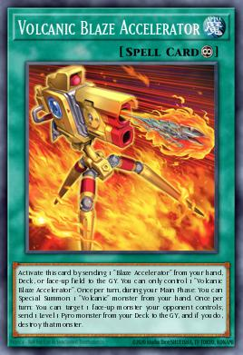 **Volcanic Blaze Accelerator — Acelerador de Llama Volcánico**

### Ejecución numerada

#### Paso 1 — Activar Volcanic Blaze Accelerator desde mano como Mágica Continua (CL1).

 **ACTIVAR** → 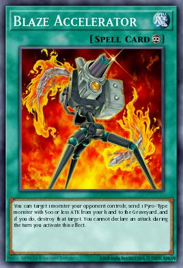 **ACTIVAR** → 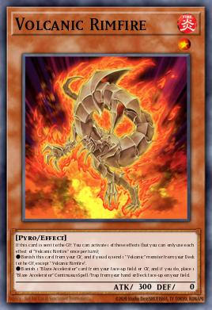 **ESTADO / CONTEXTO**

**Acción concreta:** Activar Volcanic Blaze Accelerator desde mano como Mágica Continua (CL1).
**Detalle técnico documentado:** Para activarla, enviar 1 Blaze Accelerator original desde el Deck al GY. Tras resolver sin respuesta, Volcanic Blaze Accelerator permanece boca arriba en Zona M/T. Esta acción no envía Rimfire todavía.

**Estado por zonas después del paso:**

| Zona/recurso | Estado narrativo A09 |
|---|---|
| Mano | — |
| Monstruos | — |
| Mágicas y trampas | Volcanic Blaze Accelerator #18918 (Continua boca arriba) |
| Cementerio | Blaze Accelerator original en GY |
| Destierro propio | — |
| Campo y estado rival | Monstruo rival boca arriba todavía presente como objetivo; identidad desconocida |
| Materiales Xyz/Fusión/Sincro | — |
| Normal, Extra, fase y restricciones | Normal libre; Extra sin restricción acreditada; 0 daño |

**Campo visual de este paso:**

**Monstruos propios:** sin carta propia demostrada en esta vista.
**Mágicas/Trampas/Campo:**
-  **Volcanic Blaze Accelerator (Continua boca arriba)** — zona declarada: `SPELL_TRAP`.
*Relación ilustrada de cartas presentes tras este paso, documentada en A09. La posición, materiales, otras zonas y rival se leen en la tabla de estado.*

#### Paso 2 — En Main Phase, activar su efecto de destruir (CL1) seleccionando el monstruo rival boca arriba.

 **ENVIAR** → 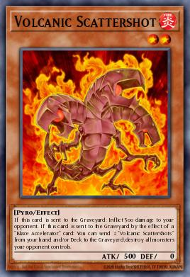 **ENVIAR**

**Acción concreta:** En Main Phase, activar su efecto de destruir (CL1) seleccionando el monstruo rival boca arriba.
**Detalle técnico documentado:** En resolución enviar Volcanic Rimfire (Piro Nivel 1) del Deck al GY y, si se envió, destruir el monstruo seleccionado. No enviar Scattershot: es Nivel 2 y no satisface «Piro Nivel 1».

**Estado por zonas después del paso:**

| Zona/recurso | Estado narrativo A09 |
|---|---|
| Mano | — |
| Monstruos | — |
| Mágicas y trampas | Volcanic Blaze Accelerator #18918 (Continua boca arriba) |
| Cementerio | Blaze Accelerator original y Rimfire en GY |
| Destierro propio | — |
| Campo y estado rival | Monstruo seleccionado destruido y enviado a su GY si la resolución fue legal |
| Materiales Xyz/Fusión/Sincro | — |
| Normal, Extra, fase y restricciones | Normal libre; Extra sin restricción acreditada; 0 daño |

**Campo visual de este paso:**

**Monstruos propios:** sin carta propia demostrada en esta vista.
**Mágicas/Trampas/Campo:**
-  **Volcanic Blaze Accelerator (Continua boca arriba)** — zona declarada: `SPELL_TRAP`.
*Relación ilustrada de cartas presentes tras este paso, documentada en A09. La posición, materiales, otras zonas y rival se leen en la tabla de estado.*

#### Paso 3 — Tras concluir la Cadena del paso 2, activar el disparo opcional de Rimfire en GY (nueva CL1), eligiendo su segunda opción.

 **ACTIVAR** →  **DESTERRAR** → 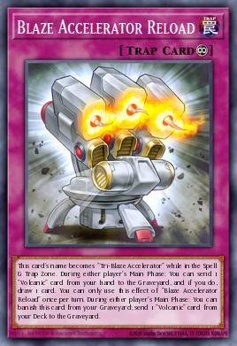 **DESTERRAR**

**Acción concreta:** Tras concluir la Cadena del paso 2, activar el disparo opcional de Rimfire en GY (nueva CL1), eligiendo su segunda opción.
**Detalle técnico documentado:** Al resolver, desterrar del GY el Blaze Accelerator original enviado en paso 1 y, al hacerlo, colocar boca arriba Blaze Accelerator Reload directamente desde Deck en Zona M/T libre. Rimfire permanece en GY; no se eligió su primera opción de desterrarse a sí mismo.

**Estado por zonas después del paso:**

| Zona/recurso | Estado narrativo A09 |
|---|---|
| Mano | — |
| Monstruos | — |
| Mágicas y trampas | Volcanic Blaze Accelerator #18918 (Continua boca arriba), Blaze Accelerator Reload #11597 (boca arriba por Rimfire) |
| Cementerio | Rimfire en GY |
| Destierro propio | Blaze Accelerator original boca arriba |
| Campo y estado rival | Monstruo seleccionado destruido; demás campo rival desconocido |
| Materiales Xyz/Fusión/Sincro | — |
| Normal, Extra, fase y restricciones | Normal libre; Extra sin restricción acreditada; no se robó carta |

**Campo visual de este paso:**

**Monstruos propios:** sin carta propia demostrada en esta vista.
**Mágicas/Trampas/Campo:**
-  **Volcanic Blaze Accelerator (Continua boca arriba)** — zona declarada: `SPELL_TRAP`.
-  **Blaze Accelerator Reload (boca arriba por Rimfire)** — zona declarada: `SPELL_TRAP`.
*Relación ilustrada de cartas presentes tras este paso, documentada en A09. La posición, materiales, otras zonas y rival se leen en la tabla de estado.*

### Campo final documentado

Esta vista procede **del último paso**, no de una lista de cartas deducida del título.

**Monstruos propios:** sin carta propia demostrada en esta vista.
**Mágicas/Trampas/Campo:**
-  **Volcanic Blaze Accelerator (Continua boca arriba)** — zona declarada: `SPELL_TRAP`.
-  **Blaze Accelerator Reload (boca arriba por Rimfire)** — zona declarada: `SPELL_TRAP`.
*Relación ilustrada de cartas presentes tras este paso, documentada en A09. La posición, materiales, otras zonas y rival se leen en la tabla de estado.*

| Zona/recurso | Estado final documentado |
|---|---|
| Mano | — |
| Monstruos | — |
| Mágicas y trampas | Volcanic Blaze Accelerator #18918 (Continua boca arriba), Blaze Accelerator Reload #11597 (boca arriba por Rimfire) |
| Cementerio | Rimfire en GY |
| Destierro propio | Blaze Accelerator original boca arriba |
| Campo y estado rival | Monstruo seleccionado destruido; demás campo rival desconocido |
| Materiales Xyz/Fusión/Sincro | — |
| Normal, Extra, fase y restricciones | Normal libre; Extra sin restricción acreditada; no se robó carta |

### Si el oponente interrumpe

- **INTERRUPCIÓN A12 — paso 2: A12 — Ash al envío desde Deck en paso P2 de BLAZE:RIMFIRE:RELOAD01**
  - Después de la activación exitosa de VBA, el usuario elige un monstruo rival boca arriba y activa su efecto de destrucción CL1. El rival con Ash Blossom disponible la descarta para encadenar CL2. CL2 niega el efecto de VBA: no se envía Rimfire, no se destruye el monstruo seleccionado y no se abre la cadena disparada de Rimfire.
  - Los recursos anteriores no se revierten: VBA permanece boca arriba (si nada más la retira), y el Blaze Accelerator original ya enviado al GY al activarla sigue allí. No hay Reload colocado. La Invocación Normal permanece libre.
  - Prueba negativa diferenciada: Ash no se usa sobre el segundo efecto de Rimfire solo porque coloca una Trampa Continua boca arriba desde el Deck; ese efecto no roba/añade a mano, no Invoca Especialmente desde Deck ni envía una carta del Deck al GY. Tampoco se revierte retroactivamente el envío de activación de VBA.,.
  - Fuentes: VBA, Rimfire, Ash.
  - Estado de rama: `Resuelto solo en el escenario que detalla A12/A13; las otras respuestas no están demostradas.`.
- **RECUPERACIÓN A13 — paso 2: A13 — Tablero residual con Ash en paso P2 de BLAZE:RIMFIRE:RELOAD01**
  - Recurso | Situación posterior a Ash CL2
  - Volcanic Blaze Accelerator | Mágica Continua boca arriba en M/T propia, con efecto de envío/destrucción negado en esa cadena; no se retira por Ash.
  - Blaze Accelerator original | En GY propio porque se envió para activar VBA, antes de la interrupción. No desterrado.
  - Volcanic Rimfire | Permanece en Deck; no se envió y no se dispara su efecto.
  - Blaze Accelerator Reload | Permanece en Deck, pues no se resolvió Rimfire.
  - Monstruo rival | Sigue boca arriba y no fue destruido por el efecto negado.
  - Normal y mano mínima | Normal libre; la única carta inicial VBA ya está en M/T. No se postulan cartas adicionales para continuar.
  - Resultado: SIN_CONTINUACION_DEMOSTRADA_CON_MANO_MINIMA, distinto de «sin respuesta»; VBA puede seguir teniendo otros efectos bajo condiciones nuevas, que requieren otra ficha. A10 y aprobación individual siguen pendientes; nada importable.
  - Estado de rama: `Resuelto solo en el escenario que detalla A12/A13; las otras respuestas no están demostradas.`.
- **RECUPERACIÓN A13 — paso sin anclaje confirmado: A13 — Rama distinta: Ash a Rocket antes de obtener VBA**
  - Campo propio: solo Rocket 1900 ATK; Normal gastada. Deck: VBA, BA original y Rimfire siguen allí; Reload también. GY propio: ninguna de las piezas del motor fue enviada por este acceso. Rival: monstruo boca arriba intacto; Ash rival en su GY.
  - Continuación con solo Rocket inicial: SIN_CONTINUACION_DEMOSTRADA para el ciclo VBA→Rimfire. Es un punto de interrupción anterior al de la ruta principal: si Ash negó la búsqueda no se puede representar el pago de activación de VBA ni la destrucción del monstruo enemigo.
  - Estado de rama: `Resuelto solo en el escenario que detalla A12/A13; las otras respuestas no están demostradas.`.

---

## BLAZE · SHELL · RESOURCE01 · `687:A09:BLAZE:SHELL:RESOURCE01`

**Propósito competitivo principal (lectura documental):** Ofensivo condicional. El objetivo solo se acredita si las acciones y el campo final detallados en esta guía lo permiten; no implica legalidad certificada ni garantiza el resultado ante respuestas adversarias.

**Categoría:** INTERACCIÓN DE RECURSO

**Propósito y resultado documental:**

Resultado demostrado: VBA boca arriba, Blaze Accelerator original en GY, una Shell en GY, otra Shell en mano, un monstruo rival destruido y 500 LP propios pagados. Normal libre, sin Reload instalado, sin Scattershot ni daño por efecto al rival. No gastar una Shell que ya no permanezca en GY al resolver. Fuentes oficiales: Shell y VBA.;.

### Mano y estado inicial

VBA. Deck: 1 Blaze Accelerator original y al menos dos Volcanic Shell. Rival: un monstruo boca arriba destruible por efecto. GY propio vacío, LP propios superiores a 500, Main Phase propia, sin respuesta rival. Normal libre.

 **Volcanic Blaze Accelerator — Acelerador de Llama Volcánico**

### Ejecución numerada

#### Paso 1 — Activar VBA desde la mano enviando Blaze Accelerator original del Deck al GY; VBA queda boca arriba.

 **ACTIVAR** →  **ENVIAR**

**Acción concreta:** Activar VBA desde la mano enviando Blaze Accelerator original del Deck al GY; VBA queda boca arriba.
**Detalle técnico documentado:** No documentado

**Estado por zonas después del paso:**

| Zona/recurso | Estado narrativo A09 |
|---|---|
| Mano | — |
| Monstruos | — |
| Mágicas y trampas | Volcanic Blaze Accelerator #18918 (Continua boca arriba) |
| Cementerio | Blaze Accelerator original en GY |
| Destierro propio | — |
| Campo y estado rival | Monstruo rival boca arriba todavía presente; objetivo para VBA |
| Materiales Xyz/Fusión/Sincro | — |
| Normal, Extra, fase y restricciones | Normal libre; LP propios sin gasto; Extra sin restricción documentada |

**Campo visual de este paso:**

**Monstruos propios:** sin carta propia demostrada en esta vista.
**Mágicas/Trampas/Campo:**
-  **Volcanic Blaze Accelerator (Continua boca arriba)** — zona declarada: `SPELL_TRAP`.
*Relación ilustrada de cartas presentes tras este paso, documentada en A09. La posición, materiales, otras zonas y rival se leen en la tabla de estado.*

#### Paso 2 — Activar el efecto de VBA sobre el monstruo rival boca arriba: al resolver enviar Volcanic Shell (Nivel 1, Piro) desde Deck al GY y destruir el monstruo seleccionado si el envío y la destrucción resuelven legalmente.

 **ACTIVAR** → 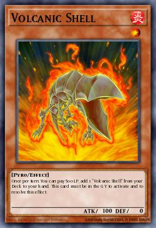 **ENVIAR** →  **ESTADO / CONTEXTO**

**Acción concreta:** Activar el efecto de VBA sobre el monstruo rival boca arriba: al resolver enviar Volcanic Shell (Nivel 1, Piro) desde Deck al GY y destruir el monstruo seleccionado si el envío y la destrucción resuelven legalmente. No se envió Rimfire, por lo que tampoco se coloca Reload.
**Detalle técnico documentado:** No se envió Rimfire, por lo que tampoco se coloca Reload.

**Estado por zonas después del paso:**

| Zona/recurso | Estado narrativo A09 |
|---|---|
| Mano | — |
| Monstruos | — |
| Mágicas y trampas | Volcanic Blaze Accelerator #18918 (Continua boca arriba) |
| Cementerio | Blaze Accelerator original y Shell primera copia en GY |
| Destierro propio | — |
| Campo y estado rival | Monstruo rival seleccionado destruido si la resolución fue legal |
| Materiales Xyz/Fusión/Sincro | — |
| Normal, Extra, fase y restricciones | Normal libre; LP propios sin gasto; Extra sin restricción documentada |

**Campo visual de este paso:**

**Monstruos propios:** sin carta propia demostrada en esta vista.
**Mágicas/Trampas/Campo:**
-  **Volcanic Blaze Accelerator (Continua boca arriba)** — zona declarada: `SPELL_TRAP`.
*Relación ilustrada de cartas presentes tras este paso, documentada en A09. La posición, materiales, otras zonas y rival se leen en la tabla de estado.*

#### Paso 3 — Con Shell en GY, activar su efecto en una cadena nueva, pagando 500 LP al activarlo, y añadir otra copia de Volcanic Shell del Deck a la mano al resolver.

 **BUSCAR / AÑADIR**

**Acción concreta:** Con Shell en GY, activar su efecto en una cadena nueva, pagando 500 LP al activarlo, y añadir otra copia de Volcanic Shell del Deck a la mano al resolver. La Shell que activó el efecto debe permanecer en GY hasta la resolución.
**Detalle técnico documentado:** La Shell que activó el efecto debe permanecer en GY hasta la resolución.

**Estado por zonas después del paso:**

| Zona/recurso | Estado narrativo A09 |
|---|---|
| Mano | Shell segunda copia en mano |
| Monstruos | — |
| Mágicas y trampas | Volcanic Blaze Accelerator #18918 (Continua boca arriba) |
| Cementerio | Blaze Accelerator original y Shell primera copia en GY |
| Destierro propio | — |
| Campo y estado rival | Monstruo seleccionado destruido; otros recursos rivales desconocidos |
| Materiales Xyz/Fusión/Sincro | — |
| Normal, Extra, fase y restricciones | Normal libre; 500 LP propios pagados al activar Shell; no hubo daño al rival |

**Campo visual de este paso:**

**Monstruos propios:** sin carta propia demostrada en esta vista.
**Mágicas/Trampas/Campo:**
-  **Volcanic Blaze Accelerator (Continua boca arriba)** — zona declarada: `SPELL_TRAP`.
*Relación ilustrada de cartas presentes tras este paso, documentada en A09. La posición, materiales, otras zonas y rival se leen en la tabla de estado.*

### Campo final documentado

Esta vista procede **del último paso**, no de una lista de cartas deducida del título.

**Monstruos propios:** sin carta propia demostrada en esta vista.
**Mágicas/Trampas/Campo:**
-  **Volcanic Blaze Accelerator (Continua boca arriba)** — zona declarada: `SPELL_TRAP`.
*Relación ilustrada de cartas presentes tras este paso, documentada en A09. La posición, materiales, otras zonas y rival se leen en la tabla de estado.*

| Zona/recurso | Estado final documentado |
|---|---|
| Mano | Shell segunda copia en mano |
| Monstruos | — |
| Mágicas y trampas | Volcanic Blaze Accelerator #18918 (Continua boca arriba) |
| Cementerio | Blaze Accelerator original y Shell primera copia en GY |
| Destierro propio | — |
| Campo y estado rival | Monstruo seleccionado destruido; otros recursos rivales desconocidos |
| Materiales Xyz/Fusión/Sincro | — |
| Normal, Extra, fase y restricciones | Normal libre; 500 LP propios pagados al activar Shell; no hubo daño al rival |

### Si el oponente interrumpe

- **INTERRUPCIÓN A12 — paso 3: A12 — Ash a la búsqueda de Shell desde el GY en paso P3 de BLAZE:SHELL:RESOURCE01**
  - Caso separado del envío VBA: VBA ya resolvió su efecto, Shell fue enviada al GY, el monstruo rival seleccionado fue destruido y Blaze Accelerator original permanece en GY. Activar Shell CL1 pagando 500 LP; el oponente descarta Ash de la mano para encadenar CL2 y negar el efecto que añadiría otra Shell del Deck a la mano.
  - Después de CL2/CL1: la Shell que activó permanece en GY, no se añadió ninguna Shell y los 500 LP ya pagados siguen descontados; VBA continúa boca arriba y el monstruo previamente destruido no reaparece. Es una ventana legal distinta de Ash sobre el envío desde Deck de VBA. Fuentes Shell y Ash..
  - Estado de rama: `Resuelto solo en el escenario que detalla A12/A13; las otras respuestas no están demostradas.`.
- **RECUPERACIÓN A13 — paso 3: A13 — Shell negada después del envío en paso P3 de BLAZE:SHELL:RESOURCE01**
  - Estado final tras Ash CL2 a Shell CL1: VBA boca arriba, Blaze Accelerator original en GY, primera Shell en GY, ninguna Shell añadida del Deck a mano, rival perdió el monstruo destruible por el efecto anterior VBA; 500 LP propios ya pagados y no reembolsables, Normal libre. Las copias restantes de Shell permanecen en Deck.
  - No confundir con Ash a VBA antes del envío: allí Shell nunca salió del Deck, no se activa ni paga su efecto y el monstruo rival permanece. Con esta mano mínima de una carta no se demuestra nueva continuación inmediata..
  - Estado de rama: `Resuelto solo en el escenario que detalla A12/A13; las otras respuestas no están demostradas.`.

---

## VBA · EJECTION · EMPEROR01 · `687:A09:VBA:EJECTION:EMPEROR01`

**Propósito competitivo principal (lectura documental):** Ofensivo. El objetivo solo se acredita si las acciones y el campo final detallados en esta guía lo permiten; no implica legalidad certificada ni garantiza el resultado ante respuestas adversarias.

**Categoría:** APERTURA

**Propósito y resultado documental:**

Endboard demostrado: Emperor en Ataque 3100 ATK, VBA boca arriba en M/T, BA original desterrado, Fire Ejection GY, 800 LP de daño infligidos por Fire Ejection, Normal libre, sin cartas en mano provenientes de las dos iniciales. Su efecto de daño futuro de 500 por Invocación Especial rival es condicional, no daño ya causado.

### Mano y estado inicial

1× Volcanic Blaze Accelerator (VBA) + 1× Fire Ejection. Deck propio: Blaze Accelerator original (1 copia) y Volcanic Emperor Nivel 8 (al menos 1 de 2 copias) disponibles. Campo/GY propios: vacíos; Main Phase propia, sin respuestas/impedimentos; Extra irrelevante. No se requiere ni se consume la Invocación Normal.

 **Volcanic Blaze Accelerator — Acelerador de Llama Volcánico**
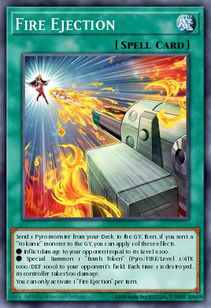 **Fire Ejection — Eyección de Fuego**

### Ejecución numerada

#### Paso 1 — Activar VBA desde mano, enviando Blaze Accelerator original del Deck al GY para su activación.

 **ACTIVAR** → 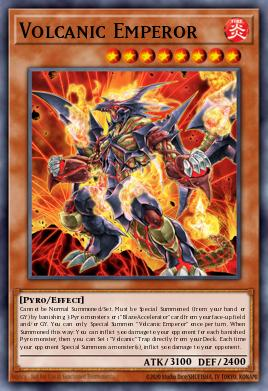 **YA EN CAMPO** →  **ENVIAR**

**Acción concreta:** Activar VBA desde mano, enviando Blaze Accelerator original del Deck al GY para su activación.
**Detalle técnico documentado:** VBA permanece boca arriba en Zona M/T. BA original permanece en GY, listo para ser utilizado por el procedimiento de Emperor. No enviar Rimfire ni Scattershot.

**Estado por zonas después del paso:**

| Zona/recurso | Estado narrativo A09 |
|---|---|
| Mano | Fire Ejection en mano |
| Monstruos | — |
| Mágicas y trampas | Volcanic Blaze Accelerator #18918 (Continua boca arriba) |
| Cementerio | Blaze Accelerator original en GY |
| Destierro propio | — |
| Campo y estado rival | Sin daño al rival todavía causado por esta ruta |
| Materiales Xyz/Fusión/Sincro | — |
| Normal, Extra, fase y restricciones | Normal libre; Extra sin restricción acreditada |

**Campo visual de este paso:**

**Monstruos propios:** sin carta propia demostrada en esta vista.
**Mágicas/Trampas/Campo:**
-  **Volcanic Blaze Accelerator (Continua boca arriba)** — zona declarada: `SPELL_TRAP`.
*Relación ilustrada de cartas presentes tras este paso, documentada en A09. La posición, materiales, otras zonas y rival se leen en la tabla de estado.*

#### Paso 2 — Activar Fire Ejection desde mano CL1.

 **ACTIVAR** →  **ENVIAR**

**Acción concreta:** Activar Fire Ejection desde mano CL1.
**Detalle técnico documentado:** Al resolver, enviar Volcanic Emperor (Piro, Nivel 8) desde Deck al GY; elegir el modo de daño de la Mágica: 8 × 100 = 800 LP de daño al rival. No Invocar Bomb Token. Fire Ejection termina en GY.

**Estado por zonas después del paso:**

| Zona/recurso | Estado narrativo A09 |
|---|---|
| Mano | — |
| Monstruos | — |
| Mágicas y trampas | Volcanic Blaze Accelerator #18918 (Continua boca arriba) |
| Cementerio | Blaze Accelerator original, Fire Ejection y Emperor en GY |
| Destierro propio | — |
| Campo y estado rival | 800 LP de daño por Fire Ejection al resolver; sin Bomb Token |
| Materiales Xyz/Fusión/Sincro | — |
| Normal, Extra, fase y restricciones | Normal libre; Extra sin restricción acreditada |

**Campo visual de este paso:**

**Monstruos propios:** sin carta propia demostrada en esta vista.
**Mágicas/Trampas/Campo:**
-  **Volcanic Blaze Accelerator (Continua boca arriba)** — zona declarada: `SPELL_TRAP`.
*Relación ilustrada de cartas presentes tras este paso, documentada en A09. La posición, materiales, otras zonas y rival se leen en la tabla de estado.*

#### Paso 3 — Aplicar el procedimiento de Invocación Especial propio de Emperor desde el GY: desterrar Blaze Accelerator original del GY.

 **ESPECIAL** →  **ESPECIAL**

**Acción concreta:** Aplicar el procedimiento de Invocación Especial propio de Emperor desde el GY: desterrar Blaze Accelerator original del GY.
**Detalle técnico documentado:** Invocar Volcanic Emperor desde GY en Ataque (ATK 3100). Solo se desterró una carta Mágica, 0 monstruos Piro. La Invocación por procedimiento no inicia Cadena.

**Estado por zonas después del paso:**

| Zona/recurso | Estado narrativo A09 |
|---|---|
| Mano | — |
| Monstruos | Volcanic Emperor #18915 (Ataque, 3100 ATK impreso) |
| Mágicas y trampas | Volcanic Blaze Accelerator #18918 (Continua boca arriba) |
| Cementerio | Fire Ejection en GY |
| Destierro propio | Blaze Accelerator original boca arriba |
| Campo y estado rival | 800 LP infligidos; daño futuro de 500 por Invocaciones rivales solo condicionado |
| Materiales Xyz/Fusión/Sincro | —; cero Piros desterrados |
| Normal, Extra, fase y restricciones | Normal libre; Extra sin restricción acreditada; no se Colocó Trampa Volcanic |

**Campo visual de este paso:**

**Monstruos propios:**
-  **Volcanic Emperor (Ataque, 3100 ATK impreso)** — zona declarada: `MONSTER`.
**Mágicas/Trampas/Campo:**
-  **Volcanic Blaze Accelerator (Continua boca arriba)** — zona declarada: `SPELL_TRAP`.
*Relación ilustrada de cartas presentes tras este paso, documentada en A09. La posición, materiales, otras zonas y rival se leen en la tabla de estado.*

### Campo final documentado

Esta vista procede **del último paso**, no de una lista de cartas deducida del título.

**Monstruos propios:**
-  **Volcanic Emperor (Ataque, 3100 ATK impreso)** — zona declarada: `MONSTER`.
**Mágicas/Trampas/Campo:**
-  **Volcanic Blaze Accelerator (Continua boca arriba)** — zona declarada: `SPELL_TRAP`.
*Relación ilustrada de cartas presentes tras este paso, documentada en A09. La posición, materiales, otras zonas y rival se leen en la tabla de estado.*

| Zona/recurso | Estado final documentado |
|---|---|
| Mano | — |
| Monstruos | Volcanic Emperor #18915 (Ataque, 3100 ATK impreso) |
| Mágicas y trampas | Volcanic Blaze Accelerator #18918 (Continua boca arriba) |
| Cementerio | Fire Ejection en GY |
| Destierro propio | Blaze Accelerator original boca arriba |
| Campo y estado rival | 800 LP infligidos; daño futuro de 500 por Invocaciones rivales solo condicionado |
| Materiales Xyz/Fusión/Sincro | —; cero Piros desterrados |
| Normal, Extra, fase y restricciones | Normal libre; Extra sin restricción acreditada; no se Colocó Trampa Volcanic |

### Si el oponente interrumpe

- **INTERRUPCIÓN A12 — paso 2: A12 — Ash a Fire Ejection en paso P2 de VBA:EJECTION:EMPEROR01**
  - Estado previo: VBA ya está boca arriba y BA original en GY por su activación. Fire Ejection CL1 pretende enviar Volcanic Emperor del Deck al GY; el rival descarta Ash CL2. CL2 niega el envío y los 800 LP de daño; Emperor permanece Deck, por lo cual no hay Emperor en GY que pueda ser Invocado por su procedimiento desde esa zona.
  - Esto es otro caso de uso de Ash sobre Fire Ejection, pero con un estado previo y un objetivo totalmente distintos del de la interacción Rimfire. No sumar como una nueva categoría de ventana de Ash: es una instancia distinta de la misma ventana legal.; fuente Emperor y Fire Ejection.
  - Estado de rama: `Resuelto solo en el escenario que detalla A12/A13; las otras respuestas no están demostradas.`.
- **RECUPERACIÓN A13 — paso 2: A13 — Fire Ejection negada en paso P2 de VBA:EJECTION:EMPEROR01**
  - VBA permanece boca arriba; BA original permanece GY; Fire Ejection acaba GY; Emperor sigue en Deck; daño infligido 0 LP; Normal libre. No se puede Invocar Emperor desde GY porque no llegó allí. Con la mano inicial mínima VBA+Fire Ejection ya consumida no se demuestra otro acceso a Emperor; un Emperor previamente presente en otra zona exigiría una ficha con otro estado inicial..
  - Estado de rama: `Resuelto solo en el escenario que detalla A12/A13; las otras respuestas no están demostradas.`.

---

## DROPLET · RELOAD · SCATTERSHOT01 · `687:A09:DROPLET:RELOAD:SCATTERSHOT01`

**Propósito competitivo principal (lectura documental):** Ofensivo condicional. El objetivo solo se acredita si las acciones y el campo final detallados en esta guía lo permiten; no implica legalidad certificada ni garantiza el resultado ante respuestas adversarias.

**Categoría:** APERTURA

**Propósito y resultado documental:**

Endboard al cerrar la secuencia: Campo propio sin monstruos ni M/T activas; Gotas y las tres Scattershot en GY, Reload desterrada boca arriba; 0 cartas robadas; mano inicial consumida; Normal sin gastar. Rival pierde 1500 LP si no hay prevención ni interrupción y sus monstruos destruibles son destruidos por Scattershot #1; no se afirma que monstruos indestructibles desaparezcan, ni daño de batalla, OTK o que se reviva un monstruo del Extra.

### Mano y estado inicial

Droplet 1× Gotas Prohibidas + Reload 1× Recarga del Acelerador de Llama (tres copias de Reload en Main; esta se empieza en la mano). Deck: Scattershot 3× Disparo Disperso Volcánico disponibles, sin copias usadas previamente. Campo propio / GY / destierro: vacíos, Normal disponible. Rival: controla al menos un monstruo de Efecto boca arriba que puede verse afectado por Droplet y destruirse por efectos; sin respuestas ni protección contra destrucción, prevención de daño, reemplazos de envío o restricciones previas. No se presuponen objetivos adicionales ni cartas de Extra.

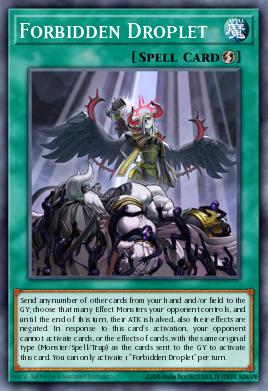 **Forbidden Droplet — Gotas Prohibidas**
 **Blaze Accelerator Reload — Recarga del Acelerador de Llama**

### Ejecución numerada

#### Paso 1 — En Main Phase propia, activar Gotas Prohibidas desde mano (Mágica Rápida).

 **ENVIAR**

**Acción concreta:** En Main Phase propia, activar Gotas Prohibidas desde mano (Mágica Rápida). Mandar Reload desde mano al GY COMO COSTE antes de formar CL1 (es la única otra carta enviada para activar Gotas); elegir exactamente 1 monstruo de Efecto boca arriba rival. Al resolver, dividir su ATK por dos y negar sus efectos hasta fin de turno. Como se envió una Trampa como coste, el rival no puede encadenar efectos de cartas de tipo original Trampa a la activación de Gotas, aunque otras respuestas legales aún deben probarse por separado. Gotas termina en GY. Reload no fue activada ni colocada; está en GY por coste.
**Detalle técnico documentado:** Mandar Reload desde mano al GY COMO COSTE antes de formar CL1 (es la única otra carta enviada para activar Gotas); elegir exactamente 1 monstruo de Efecto boca arriba rival. Al resolver, dividir su ATK por dos y negar sus efectos hasta fin de turno. Como se envió una Trampa como coste, el rival no puede encadenar efectos de cartas de tipo original Trampa a la activación de Gotas, aunque otras respuestas legales aún deben probarse por separado. Gotas termina en GY. Reload no fue activada ni colocada; está en GY por coste.

**Estado por zonas después del paso:**

| Zona/recurso | Estado narrativo A09 |
|---|---|
| Mano | ∅ |
| Monstruos | ∅ |
| Mágicas y trampas | ∅ |
| Cementerio | Gotas #15299, Reload #11597 (enviada como coste desde mano) |
| Destierro propio | ∅ |
| Campo y estado rival | Un monstruo rival de Efecto boca arriba queda con ATK a la mitad y efectos negados hasta fin de turno; identidad no fijada |
| Materiales Xyz/Fusión/Sincro | Ninguno |
| Normal, Extra, fase y restricciones | Normal libre; Extra intacto |

**Campo visual de este paso:**

**Monstruos propios:** sin carta propia demostrada en esta vista.
**Mágicas/Trampas/Campo:** sin carta propia demostrada en esta vista.
*Relación ilustrada de cartas presentes tras este paso, documentada en A09. La posición, materiales, otras zonas y rival se leen en la tabla de estado.*

#### Paso 2 — En otra cadena durante Main Phase, activar el efecto desde el GY de Reload: desterrar Reload del GY COMO COSTE.

 **DESTERRAR** →  **ENVIAR** →  **ENVIAR**

**Acción concreta:** En otra cadena durante Main Phase, activar el efecto desde el GY de Reload: desterrar Reload del GY COMO COSTE; al resolver enviar una Scattershot del Deck al GY POR EFECTO DE UNA CARTA «Blaze Accelerator», porque el nombre de Reload contiene «Blaze Accelerator». No atribuir a esta acción una activación previa de la Trampa sobre el Campo. Reload queda desterrada boca arriba.
**Detalle técnico documentado:** al resolver enviar una Scattershot del Deck al GY POR EFECTO DE UNA CARTA «Blaze Accelerator», porque el nombre de Reload contiene «Blaze Accelerator». No atribuir a esta acción una activación previa de la Trampa sobre el Campo. Reload queda desterrada boca arriba.

**Estado por zonas después del paso:**

| Zona/recurso | Estado narrativo A09 |
|---|---|
| Mano | ∅ |
| Monstruos | ∅ |
| Mágicas y trampas | ∅ |
| Cementerio | Gotas #15299, Scattershot #7083 (primera; desde Deck por efecto Reload) |
| Destierro propio | Reload #11597 (desterrada como coste, boca arriba) |
| Campo y estado rival | Monstruo rival antes negado sigue, salvo otros efectos; no hay barrido aún |
| Materiales Xyz/Fusión/Sincro | Ninguno |
| Normal, Extra, fase y restricciones | Normal libre; Extra intacto |

**Campo visual de este paso:**

**Monstruos propios:** sin carta propia demostrada en esta vista.
**Mágicas/Trampas/Campo:** sin carta propia demostrada en esta vista.
*Relación ilustrada de cartas presentes tras este paso, documentada en A09. La posición, materiales, otras zonas y rival se leen en la tabla de estado.*

#### Paso 3 — Una vez concluida la cadena anterior, Scattershot #1 fue enviada al GY y puede aplicar sus dos efectos.

 **ESTADO / CONTEXTO** →  **ENVIAR** →  **ENVIAR**

**Acción concreta:** Una vez concluida la cadena anterior, Scattershot #1 fue enviada al GY y puede aplicar sus dos efectos: el obligatorio de 500 LP de daño al rival y el condicional que, por el origen Reload, permite mandar otras 2 Scattershot desde Deck/Mano al GY COMO COSTE DE ACTIVACIÓN para destruir todos los monstruos que controle el adversario al resolver. Registrar los dos efectos de Scattershot #1 en la nueva cadena: primero el obligatorio (CL1), después el opcional (CL2), si ambos son legalmente activables. Las copias #2 y #3 se mandan al GY al activar CL2, antes de permitir una respuesta rival, no como parte de la resolución de la destrucción. El barrido no selecciona objetivos individuales; la primera Scattershot no fue enviada por Rimfire o Fire Ejection.
**Detalle técnico documentado:** el obligatorio de 500 LP de daño al rival y el condicional que, por el origen Reload, permite mandar otras 2 Scattershot desde Deck/Mano al GY COMO COSTE DE ACTIVACIÓN para destruir todos los monstruos que controle el adversario al resolver. Registrar los dos efectos de Scattershot #1 en la nueva cadena: primero el obligatorio (CL1), después el opcional (CL2), si ambos son legalmente activables. Las copias #2 y #3 se mandan al GY al activar CL2, antes de permitir una respuesta rival, no como parte de la resolución de la destrucción. El barrido no selecciona objetivos individuales; la primera Scattershot no fue enviada por Rimfire o Fire Ejection.

**Estado por zonas después del paso:**

| Zona/recurso | Estado narrativo A09 |
|---|---|
| Mano | ∅ |
| Monstruos | ∅ |
| Mágicas y trampas | ∅ |
| Cementerio | Gotas #15299, 3× Scattershot #7083 (primera por efecto, otras dos como coste) |
| Destierro propio | Reload #11597 |
| Campo y estado rival | Monstruos enemigos destruibles barridos al resolver CL2; primera Scattershot aporta 500 LP en CL1 |
| Materiales Xyz/Fusión/Sincro | Ninguno |
| Normal, Extra, fase y restricciones | Normal libre; Extra intacto |

**Campo visual de este paso:**

**Monstruos propios:** sin carta propia demostrada en esta vista.
**Mágicas/Trampas/Campo:** sin carta propia demostrada en esta vista.
*Relación ilustrada de cartas presentes tras este paso, documentada en A09. La posición, materiales, otras zonas y rival se leen en la tabla de estado.*

#### Paso 4 — Las Scattershot #2 y #3 salen del Deck al GY como coste para activar Scattershot #1, NO por el efecto de una carta «Blaze Accelerator».

 **MATERIAL / COSTE** →  **MATERIAL / COSTE**

**Acción concreta:** Las Scattershot #2 y #3 salen del Deck al GY como coste para activar Scattershot #1, NO por el efecto de una carta «Blaze Accelerator». Por tanto, cada una aplica solamente su efecto obligatorio de infligir 500 LP en una nueva cadena después de que termine la cadena de los dos efectos de Scattershot #1, sin volver a enviar otras dos copias ni intentar un segundo barrido. Daño total sin respuesta: 500 + 500 + 500 = 1500 LP. La destrucción total de monstruos enemigos solo ocurre si sus cartas son destruibles al resolver la acción de Scattershot #1.
**Detalle técnico documentado:** Por tanto, cada una aplica solamente su efecto obligatorio de infligir 500 LP en una nueva cadena después de que termine la cadena de los dos efectos de Scattershot #1, sin volver a enviar otras dos copias ni intentar un segundo barrido. Daño total sin respuesta: 500 + 500 + 500 = 1500 LP. La destrucción total de monstruos enemigos solo ocurre si sus cartas son destruibles al resolver la acción de Scattershot #1.

**Estado por zonas después del paso:**

| Zona/recurso | Estado narrativo A09 |
|---|---|
| Mano | ∅ |
| Monstruos | ∅ |
| Mágicas y trampas | ∅ |
| Cementerio | Gotas #15299, 3× Scattershot #7083 |
| Destierro propio | Reload #11597 |
| Campo y estado rival | Los dos disparos obligatorios restantes aportan 1000 LP; daño acumulado 1500 LP, solo si no hubo prevención |
| Materiales Xyz/Fusión/Sincro | Ninguno |
| Normal, Extra, fase y restricciones | Normal libre; sin Invocación de Extra |

**Campo visual de este paso:**

**Monstruos propios:** sin carta propia demostrada en esta vista.
**Mágicas/Trampas/Campo:** sin carta propia demostrada en esta vista.
*Relación ilustrada de cartas presentes tras este paso, documentada en A09. La posición, materiales, otras zonas y rival se leen en la tabla de estado.*

### Campo final documentado

Esta vista procede **del último paso**, no de una lista de cartas deducida del título.

**Monstruos propios:** sin carta propia demostrada en esta vista.
**Mágicas/Trampas/Campo:** sin carta propia demostrada en esta vista.
*Relación ilustrada de cartas presentes tras este paso, documentada en A09. La posición, materiales, otras zonas y rival se leen en la tabla de estado.*

| Zona/recurso | Estado final documentado |
|---|---|
| Mano | ∅ |
| Monstruos | ∅ |
| Mágicas y trampas | ∅ |
| Cementerio | Gotas #15299, 3× Scattershot #7083 |
| Destierro propio | Reload #11597 |
| Campo y estado rival | Los dos disparos obligatorios restantes aportan 1000 LP; daño acumulado 1500 LP, solo si no hubo prevención |
| Materiales Xyz/Fusión/Sincro | Ninguno |
| Normal, Extra, fase y restricciones | Normal libre; sin Invocación de Extra |

### Si el oponente interrumpe

No se documenta una continuación alternativa con los recursos indicados.

---

## DROPLET · RELOAD · EJECTION · EMPEROR01 · `687:A09:DROPLET:RELOAD:EJECTION:EMPEROR01`

**Propósito competitivo principal (lectura documental):** Ofensivo. El objetivo solo se acredita si las acciones y el campo final detallados en esta guía lo permiten; no implica legalidad certificada ni garantiza el resultado ante respuestas adversarias.

**Categoría:** APERTURA

**Propósito y resultado documental:**

Endboard al terminar la Main Phase: Emperor 3100 ATK en campo + Volcanic Emission colocada, ningún otro monstruo/M/T propios; Gotas y Fire Ejection en GY, Reload y las tres Scattershot desterradas, mano inicial consumida, Normal disponible. Con oponente a 8000 LP y sin otros cambios, 4200 LP restantes. El daño futuro de Emperor por Invocaciones Especiales del rival no se incluye en los 3800 LP y Emission aún no puede activarse. Los efectos de Scattershot y Emperor pueden ser negados/interrumpidos; esta es una línea condicionada sin respuesta rival, no una garantía de duelo real.

### Mano y estado inicial

Droplet Gotas Prohibidas + Reload Blaze Accelerator Reload + Fire Ejection Fire Ejection. Deck inicial: tres Scattershot Volcanic Scattershot, al menos un Emperor Volcanic Emperor y Volcanic Emission (1x) sin gastar. GY propio vacío, Campo propio vacío, cero Piro desterrados, Invocación Normal libre. Oponente: al menos un monstruo de Efecto boca arriba afectable por Droplet, sin respuestas que detengan la secuencia, sin prevención de daño ni protección contra destrucción. Main Phase propia con 8000 LP rivales como ejemplo, sin fases saltadas.

 **Forbidden Droplet — Gotas Prohibidas**
 **Blaze Accelerator Reload — Recarga del Acelerador de Llama**
 **Fire Ejection — Eyección de Fuego**

### Ejecución numerada

#### Paso 1 — Activar Gotas desde la mano mandando Reload al GY como coste; elegir el monstruo de Efecto rival boca arriba.

 **ENVIAR**

**Acción concreta:** Activar Gotas desde la mano mandando Reload al GY como coste; elegir el monstruo de Efecto rival boca arriba.
**Detalle técnico documentado:** El monstruo seleccionado queda con ATK a la mitad y efectos negados hasta fin de turno; Gotas pasa al GY. La Trampa fue enviada desde la mano, no activada.

**Estado por zonas después del paso:**

| Zona/recurso | Estado narrativo A09 |
|---|---|
| Mano | Fire Ejection #18919 |
| Monstruos | ∅ |
| Mágicas y trampas | ∅ |
| Cementerio | Gotas #15299, Reload #11597 (coste) |
| Destierro propio | ∅ |
| Campo y estado rival | Monstruo rival boca arriba elegible con efectos negados y ATK reducido |
| Materiales Xyz/Fusión/Sincro | Ninguno |
| Normal, Extra, fase y restricciones | Normal libre; Extra intacto |

**Campo visual de este paso:**

**Monstruos propios:** sin carta propia demostrada en esta vista.
**Mágicas/Trampas/Campo:** sin carta propia demostrada en esta vista.
*Relación ilustrada de cartas presentes tras este paso, documentada en A09. La posición, materiales, otras zonas y rival se leen en la tabla de estado.*

#### Paso 2 — Nueva cadena: desterrar Reload del GY como coste; enviar Scattershot #1 del Deck al GY por efecto de Reload, que es carta «Blaze Accelerator».

 **DESTERRAR** →  **ENVIAR** →  **ENVIAR**

**Acción concreta:** Nueva cadena: desterrar Reload del GY como coste; enviar Scattershot #1 del Deck al GY por efecto de Reload, que es carta «Blaze Accelerator».
**Detalle técnico documentado:** Reload desterrada; #1 en GY. Tras terminar esta cadena quedan disponibles los dos efectos disparados de #1.

**Estado por zonas después del paso:**

| Zona/recurso | Estado narrativo A09 |
|---|---|
| Mano | Fire Ejection #18919 |
| Monstruos | ∅ |
| Mágicas y trampas | ∅ |
| Cementerio | Gotas #15299, Scattershot #7083 (primera por efecto) |
| Destierro propio | Reload #11597 |
| Campo y estado rival | Monstruo rival elegible aún presente; barrido pendiente |
| Materiales Xyz/Fusión/Sincro | Ninguno |
| Normal, Extra, fase y restricciones | Normal libre; Extra intacto |

**Campo visual de este paso:**

**Monstruos propios:** sin carta propia demostrada en esta vista.
**Mágicas/Trampas/Campo:** sin carta propia demostrada en esta vista.
*Relación ilustrada de cartas presentes tras este paso, documentada en A09. La posición, materiales, otras zonas y rival se leen en la tabla de estado.*

#### Paso 3 — Cadena posterior: Scattershot #1 CL1 obligatorio 500 LP; su segundo efecto CL2 opcional si quedan dos copias: mandar #2 y #3 desde el Deck al GY como coste de CL2.

 **ESTADO / CONTEXTO**

**Acción concreta:** Cadena posterior: Scattershot #1 CL1 obligatorio 500 LP; su segundo efecto CL2 opcional si quedan dos copias: mandar #2 y #3 desde el Deck al GY como coste de CL2. Resolver CL2 destruyendo monstruos rivales que puedan ser destruidos por el efecto y después CL1 infligiendo 500 LP.
**Detalle técnico documentado:** Resolver CL2 destruyendo monstruos rivales que puedan ser destruidos por el efecto y después CL1 infligiendo 500 LP. Ambas Scattershot nuevas fueron enviadas como coste, no por efecto de un acelerador. Tras acabar esa cadena, sus disparos obligatorios de 500 LP cada uno forman la siguiente cadena y resuelven: subtotal 1500 LP; las tres Scattershot en GY. No volver a ejecutar el barrido por #2 ni #3.

**Estado por zonas después del paso:**

| Zona/recurso | Estado narrativo A09 |
|---|---|
| Mano | Fire Ejection #18919 |
| Monstruos | ∅ |
| Mágicas y trampas | ∅ |
| Cementerio | Gotas #15299, 3× Scattershot #7083 |
| Destierro propio | Reload #11597 |
| Campo y estado rival | Monstruos destruibles barridos; 1500 LP por tres disparos sin respuesta |
| Materiales Xyz/Fusión/Sincro | Ninguno |
| Normal, Extra, fase y restricciones | Normal libre; Extra intacto |

**Campo visual de este paso:**

**Monstruos propios:** sin carta propia demostrada en esta vista.
**Mágicas/Trampas/Campo:** sin carta propia demostrada en esta vista.
*Relación ilustrada de cartas presentes tras este paso, documentada en A09. La posición, materiales, otras zonas y rival se leen en la tabla de estado.*

#### Paso 4 — Activar Fire Ejection desde mano; enviar Volcanic Emperor (Piro Nivel 8) del Deck al GY y elegir la modalidad de daño.

 **ACTIVAR** →  **ENVIAR**

**Acción concreta:** Activar Fire Ejection desde mano; enviar Volcanic Emperor (Piro Nivel 8) del Deck al GY y elegir la modalidad de daño.
**Detalle técnico documentado:** Al resolver, Fire Ejection inflige 800 LP (8 × 100) y va al GY. Subtotal acumulado: 2300 LP. No se Invoca Bomb Token.

**Estado por zonas después del paso:**

| Zona/recurso | Estado narrativo A09 |
|---|---|
| Mano | ∅ |
| Monstruos | ∅ |
| Mágicas y trampas | ∅ |
| Cementerio | Gotas #15299, 3× Scattershot #7083, Fire Ejection #18919, Emperor #18915 (enviado del Deck al GY) |
| Destierro propio | Reload #11597 |
| Campo y estado rival | Daño por efecto acumulado 2300 LP si resuelve (1500 + 800) |
| Materiales Xyz/Fusión/Sincro | Ninguno |
| Normal, Extra, fase y restricciones | Normal libre; Extra intacto |

**Campo visual de este paso:**

**Monstruos propios:** sin carta propia demostrada en esta vista.
**Mágicas/Trampas/Campo:** sin carta propia demostrada en esta vista.
*Relación ilustrada de cartas presentes tras este paso, documentada en A09. La posición, materiales, otras zonas y rival se leen en la tabla de estado.*

#### Paso 5 — Invocar a Emperor del GY mediante su procedimiento sin Cadena, desterrando las tres Scattershot Piro de tu GY.

 **ESTADO / CONTEXTO** →  **ESTADO / CONTEXTO**

**Acción concreta:** Invocar a Emperor del GY mediante su procedimiento sin Cadena, desterrando las tres Scattershot Piro de tu GY.
**Detalle técnico documentado:** Emperor aparece boca arriba en Ataque (3100 ATK). Scattershot #1, #2 y #3 quedan desterradas boca arriba; ya no están en GY para otro uso. No se consume Normal.

**Estado por zonas después del paso:**

| Zona/recurso | Estado narrativo A09 |
|---|---|
| Mano | ∅ |
| Monstruos | Emperor #18915 (3100 ATK, Invocado por desterrar 3 Piros) |
| Mágicas y trampas | ∅ |
| Cementerio | Gotas #15299, Fire Ejection #18919 |
| Destierro propio | Reload #11597, 3× Scattershot #7083 (desterradas boca arriba para Emperor) |
| Campo y estado rival | Sin nuevos daños hasta resolver disparo de Emperor |
| Materiales Xyz/Fusión/Sincro | Ninguno |
| Normal, Extra, fase y restricciones | Normal libre; sin Extra usado |

**Campo visual de este paso:**

**Monstruos propios:**
-  **Emperor (3100 ATK, Invocado por desterrar 3 Piros)** — zona declarada: `MONSTER`.
**Mágicas/Trampas/Campo:** sin carta propia demostrada en esta vista.
*Relación ilustrada de cartas presentes tras este paso, documentada en A09. La posición, materiales, otras zonas y rival se leen en la tabla de estado.*

#### Paso 6 — En una nueva cadena, activar el efecto opcional de Emperor tras ser Invocado así: hay tres Piro desterrados boca arriba, requisito oficial de activación.

 **ACTIVAR** → 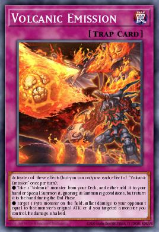 **COLOCAR**

**Acción concreta:** En una nueva cadena, activar el efecto opcional de Emperor tras ser Invocado así: hay tres Piro desterrados boca arriba, requisito oficial de activación; infligir 500 LP por cada uno (3 × 500 = 1500 LP); si el daño fue infligido con éxito, después colocar directamente del Deck Volcanic Emission en zona M/T propia disponible.
**Detalle técnico documentado:** infligir 500 LP por cada uno (3 × 500 = 1500 LP); si el daño fue infligido con éxito, después colocar directamente del Deck Volcanic Emission en zona M/T propia disponible. Al resolver sin respuesta ni prevención de daño, daño acumulado 1500 + 800 + 1500 = 3800 LP; Trampa colocada boca abajo, todavía sin activar. Si el daño de Emperor se previene, NO se atribuye Colocación. Su activación ordinaria debe esperar a una fase legal del turno siguiente.

**Estado por zonas después del paso:**

| Zona/recurso | Estado narrativo A09 |
|---|---|
| Mano | ∅ |
| Monstruos | Emperor #18915 (3100 ATK) |
| Mágicas y trampas | Emission #18920 (Colocada si se infligieron los 1500 adicionales) |
| Cementerio | Gotas #15299, Fire Ejection #18919 |
| Destierro propio | Reload #11597, 3× Scattershot #7083 |
| Campo y estado rival | Total 3800 LP de daño sin respuesta; Emission depende de que daño de Emperor sí se infligió |
| Materiales Xyz/Fusión/Sincro | Ninguno |
| Normal, Extra, fase y restricciones | Normal libre; Emission NO activable aún este turno |

**Campo visual de este paso:**

**Monstruos propios:**
-  **Emperor (3100 ATK)** — zona declarada: `MONSTER`.
**Mágicas/Trampas/Campo:**
-  **Emission (Colocada si se infligieron los 1500 adicionales)** — zona declarada: `SPELL_TRAP`.
*Relación ilustrada de cartas presentes tras este paso, documentada en A09. La posición, materiales, otras zonas y rival se leen en la tabla de estado.*

### Campo final documentado

Esta vista procede **del último paso**, no de una lista de cartas deducida del título.

**Monstruos propios:**
-  **Emperor (3100 ATK)** — zona declarada: `MONSTER`.
**Mágicas/Trampas/Campo:**
-  **Emission (Colocada si se infligieron los 1500 adicionales)** — zona declarada: `SPELL_TRAP`.
*Relación ilustrada de cartas presentes tras este paso, documentada en A09. La posición, materiales, otras zonas y rival se leen en la tabla de estado.*

| Zona/recurso | Estado final documentado |
|---|---|
| Mano | ∅ |
| Monstruos | Emperor #18915 (3100 ATK) |
| Mágicas y trampas | Emission #18920 (Colocada si se infligieron los 1500 adicionales) |
| Cementerio | Gotas #15299, Fire Ejection #18919 |
| Destierro propio | Reload #11597, 3× Scattershot #7083 |
| Campo y estado rival | Total 3800 LP de daño sin respuesta; Emission depende de que daño de Emperor sí se infligió |
| Materiales Xyz/Fusión/Sincro | Ninguno |
| Normal, Extra, fase y restricciones | Normal libre; Emission NO activable aún este turno |

### Si el oponente interrumpe

- **INTERRUPCIÓN A12 — paso 4: A12 — Ash a Fire Ejection en paso P4 de DROPLET:RELOAD:EJECTION:EMPEROR01**
  - Estado previo distinto: ya resolvieron Gotas, el envío de las tres Scattershot mediante Reload y sus 1500 LP de daño, bajo el supuesto explícito de que no hubo respuestas previas ni prevención del daño. Gotas permanece en GY; Reload está desterrada; las tres Scattershot están en GY. No existe VBA ni Blaze Accelerator original en Campo/GY por esta ruta.
  - Ventana: Fire Ejection CL1 intenta enviar Emperor desde Deck al GY y causar 800 LP. Ash rival CL2 (descartada desde mano) niega ese efecto al resolver. No se envía Emperor, no se infligen los 800 LP de Fire Ejection y tampoco se puede declarar la Invocación del jefe desde un GY al que no llegó. Los 1500 LP anteriores no se revierten; las tres Scattershot siguen en GY. Este ensayo no equivale al caso VBA:EJECTION:EMPEROR01, donde el estado previo contiene VBA y Blaze Accelerator original.
  - Resultado de la bifurcación: la línea de 3800 LP y Emission Colocada falla; no se atribuyen por ello los 1500 LP de Emperor ni la Colocación de la Trampa. El siguiente paso de recuperación exige cartas adicionales efectivamente acreditadas. Fuentes oficiales: Fire Ejection, Ash..
  - <!-- A12_AUDITORIA_RUTA_INICIO -->
  - Estado de rama: `Resuelto solo en el escenario que detalla A12/A13; las otras respuestas no están demostradas.`.
- **RECUPERACIÓN A13 — paso 4: A13 — Fire Ejection negada en paso P4 de DROPLET:RELOAD:EJECTION:EMPEROR01**
  - Zona o recurso | Estado residual comprobable después de CL2 Ash contra Fire Ejection CL1
  - Campo propio | Sin monstruos y sin M/T propia que permanezca activa; Emperor no fue Invocado.
  - Cementerio propio | Gotas, Fire Ejection y tres Scattershot; los recursos usados para el barrido previo no retornan al Deck.
  - Destierro propio | Reload, desterrada como coste al activar su efecto en GY en P2; ninguna Scattershot desterrada para Emperor.
  - Deck propio | Emperor permanece en Deck, igual que Emission; no se justifica una Trampa Volcanic Colocada.
  - LP del rival | 1500 LP de daño ya infligidos por las tres Scattershot, condicionados a que resolvieron P3 sin prevención; 0 LP adicionales de Fire Ejection y Emperor.
  - Invocación Normal | Sigue libre; la mano mínima de Gotas + Reload + Fire Ejection está consumida.
  - Decisión táctica: no ejecutar P5 (Invocar Emperor desterrando tres Piro) ni P6 (daño y Colocación) porque el jefe nunca llegó al GY. Las Scattershot en GY son recursos existentes, pero no equivalen a una continuación demostrada sin otra carta que habilite Emperor o una línea legal alternativa. SIN_CONTINUACION_DEMOSTRADA_CON_MANO_MINIMA; no inferir derrota automática ni sumar el daño interrumpido.
  - <!-- A13_AUDITORIA_RUTA_INICIO -->
  - Estado de rama: `Resuelto solo en el escenario que detalla A12/A13; las otras respuestas no están demostradas.`.

---

## BONFIRE · TROOPER · BOMB · EMISSION01 · `687:A09:BONFIRE:TROOPER:BOMB:EMISSION01`

**Propósito competitivo principal (lectura documental):** Preparación de recursos / despliegue. El objetivo solo se acredita si las acciones y el campo final detallados en esta guía lo permiten; no implica legalidad certificada ni garantiza el resultado ante respuestas adversarias.

**Categoría:** APERTURA

**Propósito y resultado documental:**

Resultado comprobable: propia Normal gastada; Trooper 1000 ATK permanece si sobrevivió; 1000 LP de efecto por Emission solo si la Ficha persistió hasta la activación, Bomb Token todavía presente tras Emission, Bonfire/Fire Ejection/Emission en GY. Si posteriormente alguien destruye Bomb Token, su controlador recibe 500 LP más por el texto de la Ficha, pero no se cuentan esos 500 LP sin una acción de destrucción documentada. La misma arquitectura con otro descarte es una variante agrupada, no otro combo.

### Mano y estado inicial

Bonfire Bonfire + cualquier otra carta descartable de mano, aquí Fire Ejection Fire Ejection solo como ejemplo de coste, sin activar su efecto. Deck: Trooper Volcanic Trooper y Emission Volcanic Emission. Zonas libres; Normal disponible; rival con espacio para una Bomb Token en su Campo. Sin interrupción rival y asumiendo expresamente que la Ficha sigue disponible al siguiente turno.

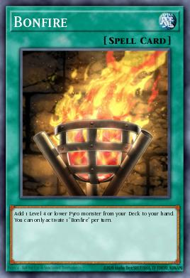 **Bonfire — Hoguera**
 **Fire Ejection — Eyección de Fuego**

### Ejecución numerada

#### Paso 1 — En tu Main Phase, activar Bonfire; al resolver añadir Volcanic Trooper (Piro Nivel 3) del Deck a la mano.

 **ACTIVAR** → 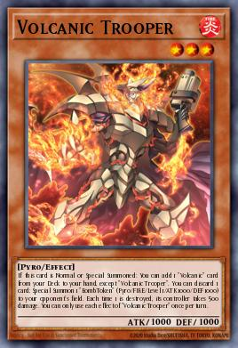 **AÑADIR A MANO**

**Acción concreta:** En tu Main Phase, activar Bonfire; al resolver añadir Volcanic Trooper (Piro Nivel 3) del Deck a la mano. Bonfire va al GY.
**Detalle técnico documentado:** Bonfire va al GY.

**Estado por zonas después del paso:**

| Zona/recurso | Estado narrativo A09 |
|---|---|
| Mano | Fire Ejection #18919 (descarte pendiente), Trooper #18916 (buscado) |
| Monstruos | ∅ |
| Mágicas y trampas | ∅ |
| Cementerio | Bonfire #19027 |
| Destierro propio | ∅ |
| Campo y estado rival | Sin respuesta; Campo aún no determinado |
| Materiales Xyz/Fusión/Sincro | Ninguno |
| Normal, Extra, fase y restricciones | Normal libre; Extra intacto |

**Campo visual de este paso:**

**Monstruos propios:** sin carta propia demostrada en esta vista.
**Mágicas/Trampas/Campo:** sin carta propia demostrada en esta vista.
*Relación ilustrada de cartas presentes tras este paso, documentada en A09. La posición, materiales, otras zonas y rival se leen en la tabla de estado.*

#### Paso 2 — Invocar Normal a Trooper en zona propia y activar su primer efecto; añadir Volcanic Emission desde Deck a mano (carta «Volcanic» distinta de Trooper).

 **AÑADIR A MANO** →  **BUSCAR / AÑADIR**

**Acción concreta:** Invocar Normal a Trooper en zona propia y activar su primer efecto; añadir Volcanic Emission desde Deck a mano (carta «Volcanic» distinta de Trooper). Normal gastada.
**Detalle técnico documentado:** Normal gastada.

**Estado por zonas después del paso:**

| Zona/recurso | Estado narrativo A09 |
|---|---|
| Mano | Fire Ejection #18919, Emission #18920 (buscada) |
| Monstruos | Trooper #18916 (Normal, 1000 ATK) |
| Mágicas y trampas | ∅ |
| Cementerio | Bonfire #19027 |
| Destierro propio | ∅ |
| Campo y estado rival | Sin cambios acreditados |
| Materiales Xyz/Fusión/Sincro | Ninguno |
| Normal, Extra, fase y restricciones | Normal gastada; Extra intacto |

**Campo visual de este paso:**

**Monstruos propios:**
-  **Trooper (Normal, 1000 ATK)** — zona declarada: `MONSTER`.
**Mágicas/Trampas/Campo:** sin carta propia demostrada en esta vista.
*Relación ilustrada de cartas presentes tras este paso, documentada en A09. La posición, materiales, otras zonas y rival se leen en la tabla de estado.*

#### Paso 3 — Activar el segundo efecto de Trooper, descartando Fire Ejection como coste; al resolver Invocar Especialmente una Bomb Token FUEGO/Piro/Nivel 1/1000 ATK/1000 DEF al Campo del adversario.

 **ACTIVAR** →  **DESCARTAR**

**Acción concreta:** Activar el segundo efecto de Trooper, descartando Fire Ejection como coste; al resolver Invocar Especialmente una Bomb Token FUEGO/Piro/Nivel 1/1000 ATK/1000 DEF al Campo del adversario. No se utilizó Fire Ejection como Mágica ni se envió Pyro alguno del Deck; la Ficha no es monstruo propio.
**Detalle técnico documentado:** No se utilizó Fire Ejection como Mágica ni se envió Pyro alguno del Deck; la Ficha no es monstruo propio.

**Estado por zonas después del paso:**

| Zona/recurso | Estado narrativo A09 |
|---|---|
| Mano | Emission #18920 |
| Monstruos | Trooper #18916 |
| Mágicas y trampas | ∅ |
| Cementerio | Bonfire #19027, Fire Ejection #18919 (descartada como coste; NO activada) |
| Destierro propio | ∅ |
| Campo y estado rival | Ficha Bomba en Campo rival, 1000 ATK original, identidad token; sin daño todavía |
| Materiales Xyz/Fusión/Sincro | Ninguno |
| Normal, Extra, fase y restricciones | Normal gastada; Extra intacto |

**Campo visual de este paso:**

**Monstruos propios:**
-  **Trooper** — zona declarada: `MONSTER`.
**Mágicas/Trampas/Campo:** sin carta propia demostrada en esta vista.
*Relación ilustrada de cartas presentes tras este paso, documentada en A09. La posición, materiales, otras zonas y rival se leen en la tabla de estado.*

#### Paso 4 — Colocar Volcanic Emission boca abajo en M/T propia.

 **COLOCAR** →  **ESTADO / CONTEXTO** →  **ESTADO / CONTEXTO**

**Acción concreta:** Colocar Volcanic Emission boca abajo en M/T propia. Fin del turno propio: Trooper propio 1000 ATK, Emission colocada, rival controla la Bomb Token; Bonfire y Fire Ejection en GY; Normal usada. Daño infligido por la línea hasta este instante: 0 LP.
**Detalle técnico documentado:** Fin del turno propio: Trooper propio 1000 ATK, Emission colocada, rival controla la Bomb Token; Bonfire y Fire Ejection en GY; Normal usada. Daño infligido por la línea hasta este instante: 0 LP.

**Estado por zonas después del paso:**

| Zona/recurso | Estado narrativo A09 |
|---|---|
| Mano | ∅ |
| Monstruos | Trooper #18916 |
| Mágicas y trampas | Emission #18920 (Colocada, no se activa el mismo turno) |
| Cementerio | Bonfire #19027, Fire Ejection #18919 |
| Destierro propio | ∅ |
| Campo y estado rival | Ficha Bomba rival permanece si no fue retirada; daño hasta ahora 0 |
| Materiales Xyz/Fusión/Sincro | Ninguno |
| Normal, Extra, fase y restricciones | Normal gastada; fin de turno propio |

**Campo visual de este paso:**

**Monstruos propios:**
-  **Trooper** — zona declarada: `MONSTER`.
**Mágicas/Trampas/Campo:**
-  **Emission (Colocada, no se activa el mismo turno)** — zona declarada: `SPELL_TRAP`.
*Relación ilustrada de cartas presentes tras este paso, documentada en A09. La posición, materiales, otras zonas y rival se leen en la tabla de estado.*

#### Paso 5 — En el siguiente turno rival, activar Volcanic Emission seleccionando su Bomb Token Piro boca arriba en Campo rival, únicamente si Emission fue Colocada en el turno previo y sigue disponible en una ventana legal.

 **ACTIVAR**

**Acción concreta:** En el siguiente turno rival, activar Volcanic Emission seleccionando su Bomb Token Piro boca arriba en Campo rival, únicamente si Emission fue Colocada en el turno previo y sigue disponible en una ventana legal. Al resolver, infligir daño igual al ATK original de la Ficha: 1000 LP. Emission va al GY; la Ficha no se destruye por esta modalidad. No reducir el daño a la mitad: el rival controla la Ficha.
**Detalle técnico documentado:** Al resolver, infligir daño igual al ATK original de la Ficha: 1000 LP. Emission va al GY; la Ficha no se destruye por esta modalidad. No reducir el daño a la mitad: el rival controla la Ficha.

**Estado por zonas después del paso:**

| Zona/recurso | Estado narrativo A09 |
|---|---|
| Mano | ∅ |
| Monstruos | Trooper #18916 (solo si sobrevivió) |
| Mágicas y trampas | ∅ |
| Cementerio | Bonfire #19027, Fire Ejection #18919, Emission #18920 (ya activada) |
| Destierro propio | ∅ |
| Campo y estado rival | Ficha Bomba rival permanece después de recibir 1000 LP por Emission; no se destruye por esa modalidad |
| Materiales Xyz/Fusión/Sincro | Ninguno |
| Normal, Extra, fase y restricciones | Turno rival; Normal gastada desde turno propio; Extra intacto |

**Campo visual de este paso:**

**Monstruos propios:**
-  **Trooper (solo si sobrevivió)** — zona declarada: `MONSTER`.
**Mágicas/Trampas/Campo:** sin carta propia demostrada en esta vista.
*Relación ilustrada de cartas presentes tras este paso, documentada en A09. La posición, materiales, otras zonas y rival se leen en la tabla de estado.*

### Campo final documentado

Esta vista procede **del último paso**, no de una lista de cartas deducida del título.

**Monstruos propios:**
-  **Trooper (solo si sobrevivió)** — zona declarada: `MONSTER`.
**Mágicas/Trampas/Campo:** sin carta propia demostrada en esta vista.
*Relación ilustrada de cartas presentes tras este paso, documentada en A09. La posición, materiales, otras zonas y rival se leen en la tabla de estado.*

| Zona/recurso | Estado final documentado |
|---|---|
| Mano | ∅ |
| Monstruos | Trooper #18916 (solo si sobrevivió) |
| Mágicas y trampas | ∅ |
| Cementerio | Bonfire #19027, Fire Ejection #18919, Emission #18920 (ya activada) |
| Destierro propio | ∅ |
| Campo y estado rival | Ficha Bomba rival permanece después de recibir 1000 LP por Emission; no se destruye por esa modalidad |
| Materiales Xyz/Fusión/Sincro | Ninguno |
| Normal, Extra, fase y restricciones | Turno rival; Normal gastada desde turno propio; Extra intacto |

### Si el oponente interrumpe

- **INTERRUPCIÓN A12 — paso 1: A12 — Ash a Bonfire en paso P1 de BONFIRE:TROOPER:BOMB:EMISSION01**
  - Si el rival tiene Ash Blossom & Joyous Spring en mano y puede usarla, responde CL2 a Bonfire CL1, descartándola como coste. Su efecto niega la búsqueda que añade una carta del Deck. Bonfire va al GY por su uso, no se obtiene Trooper mediante esa carta.
  - Fuente oficial: Ash Blossom junto con Bonfire. La disponibilidad de Ash del oponente es hipotética; no se afirma que ocurra siempre.
  - Estado:.
  - Estado de rama: `Resuelto solo en el escenario que detalla A12/A13; las otras respuestas no están demostradas.`.
- **RECUPERACIÓN A13 — paso 1: A13 — Rama de Bonfire negada en paso P1 de BONFIRE:TROOPER:BOMB:EMISSION01**
  - Interrupción: Ash a la búsqueda de Bonfire. Ya pagado/consumido: Bonfire activada y enviada a GY; Ash descartada del rival. No resuelto: no se añade Trooper.
  - Con mano mínima demostrada (solo Bonfire): SIN_CONTINUACION_DEMOSTRADA; no es legal inventar Trooper en mano ni Emission Colocada. Campo final de esta rama: sin monstruos ni Trampa generados; Invocación Normal todavía disponible, pero sin otra carta en mano probada.
  - Una mano adicional con Trooper u otro buscador exige una variante nueva y propia evidencia; no atribuirla a esta ruta de una carta.
  - Estado de rama: `Resuelto solo en el escenario que detalla A12/A13; las otras respuestas no están demostradas.`.

---

## SITUACION · GO FIRST · TROOPER ROCKET IP01 · `687:A09:SITUACION:GO_FIRST:TROOPER_ROCKET_IP01`

**Propósito competitivo principal (lectura documental):** Ofensivo condicional. El objetivo solo se acredita si las acciones y el campo final detallados en esta guía lo permiten; no implica legalidad certificada ni garantiza el resultado ante respuestas adversarias.

**Categoría:** APERTURA

**Propósito y resultado documental:**

6. Usar Trooper y Rocket, dos monstruos de efecto propios, para Invocar por Enlace I:P Masquerena; ambos van al GY. Endboard propio: Emperor 3100 + I:P, VBA boca arriba, Inferno Colocada; GY incluye Trooper/Rocket (Piros para futura Inferno) y Blaze original; Rimfire/Reload y Scattershot desterrados. Daño previo sin respuesta: 3500 LP (500+1500+1500), no OTK. En turno rival Inferno puede desterrar un Volcanic del GY, infligir 500 y negar un efecto de monstruo activado en Campo. Emperor causa otros 500 por evento posterior de Invocación Especial rival, no de antemano.

### Mano y estado inicial

Objetivo: montar campo y una negación para turno rival con mano Trooper + Rocket, Campo/GY propios vacíos, Normal disponible. Deck: VBA, Blaze Accelerator original, 1 Reload, 1 Rimfire, 1 Emperor, las 3 Scattershot, 1 Inferno. Extra: I:P. Oponente sin respuestas; no requiere monstruo rival porque se genera Ficha. Dificultad alta, ir primero.

 **Volcanic Trooper — Soldado Volcánico**
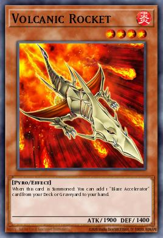 **Volcanic Rocket — Misil Volcánico**

### Ejecución numerada

#### Paso 1 — Normal Trooper; buscar VBA del Deck.

 **ESTADO / CONTEXTO** →  **AÑADIR A MANO** →  **ESTADO / CONTEXTO**

**Acción concreta:** Normal Trooper; buscar VBA del Deck. Activar VBA enviando Blaze Accelerator original desde Deck al GY. Usar el efecto de VBA para Invocar Rocket desde la mano, no gasta Normal adicional.
**Detalle técnico documentado:** Activar VBA enviando Blaze Accelerator original desde Deck al GY. Usar el efecto de VBA para Invocar Rocket desde la mano, no gasta Normal adicional.

**Estado por zonas después del paso:**

| Zona/recurso | Estado narrativo A09 |
|---|---|
| Mano | ∅ |
| Monstruos | Trooper #18916 (Normal), Rocket #7243 (Especial por VBA) |
| Mágicas y trampas | VBA #18918 (boca arriba) |
| Cementerio | Blaze Accelerator original #7086 (enviado desde Deck) |
| Destierro propio | ∅ |
| Campo y estado rival | Sin respuesta; Campo no determinado |
| Materiales Xyz/Fusión/Sincro | Ninguno |
| Normal, Extra, fase y restricciones | Normal gastada; Extra intacto |

**Campo visual de este paso:**

**Monstruos propios:**
-  **Trooper (Normal)** — zona declarada: `MONSTER`.
-  **Rocket (Especial por VBA)** — zona declarada: `MONSTER`.
**Mágicas/Trampas/Campo:**
-  **VBA (boca arriba)** — zona declarada: `SPELL_TRAP`.
*Relación ilustrada de cartas presentes tras este paso, documentada en A09. La posición, materiales, otras zonas y rival se leen en la tabla de estado.*

#### Paso 2 — Efecto de Rocket por Invocación: buscar Reload y añadir a mano.

 **ESTADO / CONTEXTO** →  **AÑADIR A MANO** →  **ESTADO / CONTEXTO**

**Acción concreta:** Efecto de Rocket por Invocación: buscar Reload y añadir a mano. Trooper descarta esa Reload como coste de su otro efecto y crea una Ficha Bomba boca arriba en el Campo rival.
**Detalle técnico documentado:** Trooper descarta esa Reload como coste de su otro efecto y crea una Ficha Bomba boca arriba en el Campo rival.

**Estado por zonas después del paso:**

| Zona/recurso | Estado narrativo A09 |
|---|---|
| Mano | ∅; Reload buscada y luego descartada como coste |
| Monstruos | Trooper #18916, Rocket #7243 |
| Mágicas y trampas | VBA #18918 |
| Cementerio | Blaze original #7086, Reload #11597 (descartada por Trooper) |
| Destierro propio | ∅ |
| Campo y estado rival | Ficha Bomba rival de 1000 ATK original en su Campo; no daña aún |
| Materiales Xyz/Fusión/Sincro | Ninguno |
| Normal, Extra, fase y restricciones | Normal gastada; Extra intacto |

**Campo visual de este paso:**

**Monstruos propios:**
-  **Trooper** — zona declarada: `MONSTER`.
-  **Rocket** — zona declarada: `MONSTER`.
**Mágicas/Trampas/Campo:**
-  **VBA** — zona declarada: `SPELL_TRAP`.
*Relación ilustrada de cartas presentes tras este paso, documentada en A09. La posición, materiales, otras zonas y rival se leen en la tabla de estado.*

#### Paso 3 — Activar efecto de VBA seleccionando la Ficha rival boca arriba; enviar Rimfire, Piro Nivel 1, desde Deck al GY y destruir la Ficha.

 **ACTIVAR** →  **DESTERRAR** →  **DESTERRAR**

**Acción concreta:** Activar efecto de VBA seleccionando la Ficha rival boca arriba; enviar Rimfire, Piro Nivel 1, desde Deck al GY y destruir la Ficha. Su controlador recibe 500 LP de daño. En nueva cadena, desterrar Rimfire del GY para enviar Emperor desde Deck al GY.
**Detalle técnico documentado:** Su controlador recibe 500 LP de daño. En nueva cadena, desterrar Rimfire del GY para enviar Emperor desde Deck al GY.

**Estado por zonas después del paso:**

| Zona/recurso | Estado narrativo A09 |
|---|---|
| Mano | ∅ |
| Monstruos | Trooper #18916, Rocket #7243 |
| Mágicas y trampas | VBA #18918 |
| Cementerio | Blaze original #7086, Reload #11597, Emperor #18915 (enviado desde Deck por Rimfire) |
| Destierro propio | Rimfire #18917 (desterrada de GY como coste) |
| Campo y estado rival | Ficha Bomba rival destruida por VBA: 500 LP de daño; no hay Ficha propia |
| Materiales Xyz/Fusión/Sincro | Ninguno |
| Normal, Extra, fase y restricciones | Normal gastada; Extra intacto |

**Campo visual de este paso:**

**Monstruos propios:**
-  **Trooper** — zona declarada: `MONSTER`.
-  **Rocket** — zona declarada: `MONSTER`.
**Mágicas/Trampas/Campo:**
-  **VBA** — zona declarada: `SPELL_TRAP`.
*Relación ilustrada de cartas presentes tras este paso, documentada en A09. La posición, materiales, otras zonas y rival se leen en la tabla de estado.*

#### Paso 4 — En Main Phase desterrar Reload desde GY y mandar Scattershot inicial (Nivel 2) desde Deck al GY.

 **DESTERRAR** →  **DESTERRAR** →  **ENVIAR**

**Acción concreta:** En Main Phase desterrar Reload desde GY y mandar Scattershot inicial (Nivel 2) desde Deck al GY; su efecto propio envía otras dos Scattershot del Deck al GY y, si se resuelve, destruye monstruos rivales y causa 1500 LP (3 × 500). No se manda Scattershot con VBA, que solo permite Piro Nivel 1.
**Detalle técnico documentado:** su efecto propio envía otras dos Scattershot del Deck al GY y, si se resuelve, destruye monstruos rivales y causa 1500 LP (3 × 500). No se manda Scattershot con VBA, que solo permite Piro Nivel 1.

**Estado por zonas después del paso:**

| Zona/recurso | Estado narrativo A09 |
|---|---|
| Mano | ∅ |
| Monstruos | Trooper #18916, Rocket #7243 |
| Mágicas y trampas | VBA #18918 |
| Cementerio | Blaze original #7086, Emperor #18915 (enviado por Rimfire), 3× Scattershot #7083 |
| Destierro propio | Rimfire #18917, Reload #11597 |
| Campo y estado rival | Barrido de monstruos rivales destruibles y 1500 LP más: subtotal 2000 LP |
| Materiales Xyz/Fusión/Sincro | Ninguno |
| Normal, Extra, fase y restricciones | Normal gastada; Extra intacto |

**Campo visual de este paso:**

**Monstruos propios:**
-  **Trooper** — zona declarada: `MONSTER`.
-  **Rocket** — zona declarada: `MONSTER`.
**Mágicas/Trampas/Campo:**
-  **VBA** — zona declarada: `SPELL_TRAP`.
*Relación ilustrada de cartas presentes tras este paso, documentada en A09. La posición, materiales, otras zonas y rival se leen en la tabla de estado.*

#### Paso 5 — Desde GY, Invocar Emperor mediante su procedimiento desterrando las tres Scattershot del GY (Piros), no el Blaze original.

 **ESTADO / CONTEXTO** →  **ESTADO / CONTEXTO** → 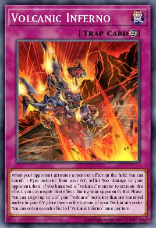 **COLOCAR**

**Acción concreta:** Desde GY, Invocar Emperor mediante su procedimiento desterrando las tres Scattershot del GY (Piros), no el Blaze original. Por esas tres Piro desterradas inflige 1500 LP adicionales y Coloca Inferno desde Deck. Las tres Scattershot están desterradas, no en el GY para otro efecto.
**Detalle técnico documentado:** Por esas tres Piro desterradas inflige 1500 LP adicionales y Coloca Inferno desde Deck. Las tres Scattershot están desterradas, no en el GY para otro efecto.

**Estado por zonas después del paso:**

| Zona/recurso | Estado narrativo A09 |
|---|---|
| Mano | ∅ |
| Monstruos | Trooper #18916, Rocket #7243, Emperor #18915 (3100 ATK) |
| Mágicas y trampas | VBA #18918, Inferno #18921 (Colocada) |
| Cementerio | Blaze original #7086 |
| Destierro propio | Rimfire #18917, Reload #11597, 3× Scattershot #7083 |
| Campo y estado rival | 1500 LP adicionales de Emperor; subtotal 3500 LP si no hay prevención |
| Materiales Xyz/Fusión/Sincro | Ninguno |
| Normal, Extra, fase y restricciones | Normal gastada; Inferno no activable todavía |

**Campo visual de este paso:**

**Monstruos propios:**
-  **Trooper** — zona declarada: `MONSTER`.
-  **Rocket** — zona declarada: `MONSTER`.
-  **Emperor (3100 ATK)** — zona declarada: `MONSTER`.
**Mágicas/Trampas/Campo:**
-  **VBA** — zona declarada: `SPELL_TRAP`.
-  **Inferno (Colocada)** — zona declarada: `SPELL_TRAP`.
*Relación ilustrada de cartas presentes tras este paso, documentada en A09. La posición, materiales, otras zonas y rival se leen en la tabla de estado.*

#### Paso 6 — Usar Trooper y Rocket, dos monstruos de efecto propios, para Invocar por Enlace I:P Masquerena; ambos van al GY.

 **ESTADO / CONTEXTO** →  **ESTADO / CONTEXTO** →  **ESTADO / CONTEXTO**

**Acción concreta:** Usar Trooper y Rocket, dos monstruos de efecto propios, para Invocar por Enlace I:P Masquerena; ambos van al GY. Endboard propio: Emperor 3100 + I:P, VBA boca arriba, Inferno Colocada; GY incluye Trooper/Rocket (Piros para futura Inferno) y Blaze original; Rimfire/Reload y Scattershot desterrados. Daño previo sin respuesta: 3500 LP (500+1500+1500), no OTK. En turno rival Inferno puede desterrar un Volcanic del GY, infligir 500 y negar un efecto de monstruo activado en Campo. Emperor causa otros 500 por evento posterior de Invocación Especial rival, no de antemano.
**Detalle técnico documentado:** Endboard propio: Emperor 3100 + I:P, VBA boca arriba, Inferno Colocada; GY incluye Trooper/Rocket (Piros para futura Inferno) y Blaze original; Rimfire/Reload y Scattershot desterrados. Daño previo sin respuesta: 3500 LP (500+1500+1500), no OTK. En turno rival Inferno puede desterrar un Volcanic del GY, infligir 500 y negar un efecto de monstruo activado en Campo. Emperor causa otros 500 por evento posterior de Invocación Especial rival, no de antemano.

**Estado por zonas después del paso:**

| Zona/recurso | Estado narrativo A09 |
|---|---|
| Mano | ∅ |
| Monstruos | Emperor #18915 (3100 ATK), I:P Masquerena #14676 (Enlace 2) |
| Mágicas y trampas | VBA #18918, Inferno #18921 (Colocada) |
| Cementerio | Blaze original #7086, Trooper #18916, Rocket #7243 |
| Destierro propio | Rimfire #18917, Reload #11597, 3× Scattershot #7083 |
| Campo y estado rival | Total 3500 LP daño por efecto sin respuesta; sin Invocación rival supuesta |
| Materiales Xyz/Fusión/Sincro | Ninguno |
| Normal, Extra, fase y restricciones | Normal gastada; I:P salió del Extra, Inferno para turno rival |

**Campo visual de este paso:**

**Monstruos propios:**
-  **Emperor (3100 ATK)** — zona declarada: `MONSTER`.
-  **I:P Masquerena (Enlace 2)** — zona declarada: `MONSTER`.
**Mágicas/Trampas/Campo:**
-  **VBA** — zona declarada: `SPELL_TRAP`.
-  **Inferno (Colocada)** — zona declarada: `SPELL_TRAP`.
*Relación ilustrada de cartas presentes tras este paso, documentada en A09. La posición, materiales, otras zonas y rival se leen en la tabla de estado.*

### Campo final documentado

Esta vista procede **del último paso**, no de una lista de cartas deducida del título.

**Monstruos propios:**
-  **Emperor (3100 ATK)** — zona declarada: `MONSTER`.
-  **I:P Masquerena (Enlace 2)** — zona declarada: `MONSTER`.
**Mágicas/Trampas/Campo:**
-  **VBA** — zona declarada: `SPELL_TRAP`.
-  **Inferno (Colocada)** — zona declarada: `SPELL_TRAP`.
*Relación ilustrada de cartas presentes tras este paso, documentada en A09. La posición, materiales, otras zonas y rival se leen en la tabla de estado.*

| Zona/recurso | Estado final documentado |
|---|---|
| Mano | ∅ |
| Monstruos | Emperor #18915 (3100 ATK), I:P Masquerena #14676 (Enlace 2) |
| Mágicas y trampas | VBA #18918, Inferno #18921 (Colocada) |
| Cementerio | Blaze original #7086, Trooper #18916, Rocket #7243 |
| Destierro propio | Rimfire #18917, Reload #11597, 3× Scattershot #7083 |
| Campo y estado rival | Total 3500 LP daño por efecto sin respuesta; sin Invocación rival supuesta |
| Materiales Xyz/Fusión/Sincro | Ninguno |
| Normal, Extra, fase y restricciones | Normal gastada; I:P salió del Extra, Inferno para turno rival |

### Si el oponente interrumpe

No se documenta una continuación alternativa con los recursos indicados.

---

## SITUACION · GO SECOND · TROOPER ROCKET PHOENIX02 · `687:A09:SITUACION:GO_SECOND:TROOPER_ROCKET_PHOENIX02`

**Propósito competitivo principal (lectura documental):** Ofensivo condicional. El objetivo solo se acredita si las acciones y el campo final detallados en esta guía lo permiten; no implica legalidad certificada ni garantiza el resultado ante respuestas adversarias.

**Categoría:** APERTURA

**Propósito y resultado documental:**

5. Emperor ya en GY destierra las 3 Scattershot para Invocarse, hace 1500 LP, y Coloca Inferno. Final: Phoenix Link-2 + Emperor 3100 + VBA boca arriba + Inferno Colocada. Trooper y Rocket GY alimentan Inferno en turno rival; Rimfire, Reload y Scattershot desterrados. 3000 LP de daño por efecto, M/T objetivo eliminada y monstruos destruidos; sin garantizar daño de batalla ni que el oponente carezca de protecciones.

### Mano y estado inicial

la misma Trooper + Rocket, pero el adversario tiene al menos un monstruo boca arriba seleccionable y una M/T seleccionable. Deck: VBA, Blaze original, Rimfire, Emperor, Reload, 3 Scattershot, Inferno. Extra: Knightmare Phoenix. Objetivo: quitar frente y retaguardia y terminar con Phoenix + Emperor + Inferno; útil ir segundo, no requiere Ficha Bomba.

 **Volcanic Trooper — Soldado Volcánico**
 **Volcanic Rocket — Misil Volcánico**

### Ejecución numerada

#### Paso 1 — Normal Trooper para buscar VBA; activar VBA enviando Blaze original al GY.

 **ESTADO / CONTEXTO** →  **AÑADIR A MANO** →  **ESTADO / CONTEXTO**

**Acción concreta:** Normal Trooper para buscar VBA; activar VBA enviando Blaze original al GY. VBA Invoca Rocket desde mano, y Rocket busca Reload (Reload se mantiene en mano).
**Detalle técnico documentado:** VBA Invoca Rocket desde mano, y Rocket busca Reload (Reload se mantiene en mano).

**Estado por zonas después del paso:**

| Zona/recurso | Estado narrativo A09 |
|---|---|
| Mano | Reload #11597 (buscada y conservada) |
| Monstruos | Trooper #18916, Rocket #7243 |
| Mágicas y trampas | VBA #18918 |
| Cementerio | Blaze original #7086 |
| Destierro propio | ∅ |
| Campo y estado rival | Monstruo boca arriba elegible y M/T seleccionable adversarias aún presentes |
| Materiales Xyz/Fusión/Sincro | Ninguno |
| Normal, Extra, fase y restricciones | Normal gastada; Extra intacto |

**Campo visual de este paso:**

**Monstruos propios:**
-  **Trooper** — zona declarada: `MONSTER`.
-  **Rocket** — zona declarada: `MONSTER`.
**Mágicas/Trampas/Campo:**
-  **VBA** — zona declarada: `SPELL_TRAP`.
*Relación ilustrada de cartas presentes tras este paso, documentada en A09. La posición, materiales, otras zonas y rival se leen en la tabla de estado.*

#### Paso 2 — VBA selecciona el monstruo rival boca arriba, envía Rimfire Nivel 1 del Deck al GY y lo destruye.

 **ESTADO / CONTEXTO** →  **DESTERRAR** →  **DESTERRAR**

**Acción concreta:** VBA selecciona el monstruo rival boca arriba, envía Rimfire Nivel 1 del Deck al GY y lo destruye. Desterrar Rimfire del GY para mandar Emperor desde Deck al GY.
**Detalle técnico documentado:** Desterrar Rimfire del GY para mandar Emperor desde Deck al GY.

**Estado por zonas después del paso:**

| Zona/recurso | Estado narrativo A09 |
|---|---|
| Mano | Reload #11597 |
| Monstruos | Trooper #18916, Rocket #7243 |
| Mágicas y trampas | VBA #18918 |
| Cementerio | Blaze original #7086, Emperor #18915 (enviado desde Deck por Rimfire) |
| Destierro propio | Rimfire #18917 |
| Campo y estado rival | Monstruo rival seleccionado fue destruido por VBA; M/T rival aún presente |
| Materiales Xyz/Fusión/Sincro | Ninguno |
| Normal, Extra, fase y restricciones | Normal gastada; Extra intacto |

**Campo visual de este paso:**

**Monstruos propios:**
-  **Trooper** — zona declarada: `MONSTER`.
-  **Rocket** — zona declarada: `MONSTER`.
**Mágicas/Trampas/Campo:**
-  **VBA** — zona declarada: `SPELL_TRAP`.
*Relación ilustrada de cartas presentes tras este paso, documentada en A09. La posición, materiales, otras zonas y rival se leen en la tabla de estado.*

#### Paso 3 — Usar Trooper + Rocket para Link-2 Knightmare Phoenix; activar su efecto descartando Reload de mano como coste y seleccionando una M/T rival para destruirla.

 **ESTADO / CONTEXTO** →  **ESTADO / CONTEXTO** → 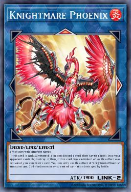 **ESTADO / CONTEXTO**

**Acción concreta:** Usar Trooper + Rocket para Link-2 Knightmare Phoenix; activar su efecto descartando Reload de mano como coste y seleccionando una M/T rival para destruirla. Si no hay blanco M/T legal no ejecutar esta variante; no se obtiene robo extra salvo condición de coenlace demostrada, que aquí no existe.
**Detalle técnico documentado:** Si no hay blanco M/T legal no ejecutar esta variante; no se obtiene robo extra salvo condición de coenlace demostrada, que aquí no existe.

**Estado por zonas después del paso:**

| Zona/recurso | Estado narrativo A09 |
|---|---|
| Mano | ∅ |
| Monstruos | Knightmare Phoenix #13600 (Enlace 2) |
| Mágicas y trampas | VBA #18918 |
| Cementerio | Blaze original #7086, Emperor #18915, Trooper #18916, Rocket #7243, Reload #11597 (descarte coste de Phoenix) |
| Destierro propio | Rimfire #18917 |
| Campo y estado rival | M/T rival elegida destruida si resolvió; no hay robo por coenlace en este estado |
| Materiales Xyz/Fusión/Sincro | Ninguno |
| Normal, Extra, fase y restricciones | Normal gastada; Phoenix salió del Extra |

**Campo visual de este paso:**

**Monstruos propios:**
-  **Knightmare Phoenix (Enlace 2)** — zona declarada: `MONSTER`.
**Mágicas/Trampas/Campo:**
-  **VBA** — zona declarada: `SPELL_TRAP`.
*Relación ilustrada de cartas presentes tras este paso, documentada en A09. La posición, materiales, otras zonas y rival se leen en la tabla de estado.*

#### Paso 4 — Desterrar Reload desde GY en Main Phase para enviar Scattershot del Deck al GY.

 **DESTERRAR** →  **DESTERRAR**

**Acción concreta:** Desterrar Reload desde GY en Main Phase para enviar Scattershot del Deck al GY. Su resolución con las otras dos Scattershot destruye monstruos rivales y hace 1500 LP de daño, si todas las piezas están disponibles.
**Detalle técnico documentado:** Su resolución con las otras dos Scattershot destruye monstruos rivales y hace 1500 LP de daño, si todas las piezas están disponibles.

**Estado por zonas después del paso:**

| Zona/recurso | Estado narrativo A09 |
|---|---|
| Mano | ∅ |
| Monstruos | Knightmare Phoenix #13600 |
| Mágicas y trampas | VBA #18918 |
| Cementerio | Blaze original #7086, Emperor #18915, Trooper #18916, Rocket #7243, 3× Scattershot #7083 |
| Destierro propio | Rimfire #18917, Reload #11597 |
| Campo y estado rival | 1500 LP daño por Scattershot y barrido de monstruos destruibles |
| Materiales Xyz/Fusión/Sincro | Ninguno |
| Normal, Extra, fase y restricciones | Normal gastada; Phoenix permanece |

**Campo visual de este paso:**

**Monstruos propios:**
-  **Knightmare Phoenix** — zona declarada: `MONSTER`.
**Mágicas/Trampas/Campo:**
-  **VBA** — zona declarada: `SPELL_TRAP`.
*Relación ilustrada de cartas presentes tras este paso, documentada en A09. La posición, materiales, otras zonas y rival se leen en la tabla de estado.*

#### Paso 5 — Emperor ya en GY destierra las 3 Scattershot para Invocarse, hace 1500 LP, y Coloca Inferno.

 **ESTADO / CONTEXTO** →  **ESTADO / CONTEXTO** →  **COLOCAR**

**Acción concreta:** Emperor ya en GY destierra las 3 Scattershot para Invocarse, hace 1500 LP, y Coloca Inferno. Final: Phoenix Link-2 + Emperor 3100 + VBA boca arriba + Inferno Colocada. Trooper y Rocket GY alimentan Inferno en turno rival; Rimfire, Reload y Scattershot desterrados. 3000 LP de daño por efecto, M/T objetivo eliminada y monstruos destruidos; sin garantizar daño de batalla ni que el oponente carezca de protecciones.
**Detalle técnico documentado:** Final: Phoenix Link-2 + Emperor 3100 + VBA boca arriba + Inferno Colocada. Trooper y Rocket GY alimentan Inferno en turno rival; Rimfire, Reload y Scattershot desterrados. 3000 LP de daño por efecto, M/T objetivo eliminada y monstruos destruidos; sin garantizar daño de batalla ni que el oponente carezca de protecciones.

**Estado por zonas después del paso:**

| Zona/recurso | Estado narrativo A09 |
|---|---|
| Mano | ∅ |
| Monstruos | Knightmare Phoenix #13600, Emperor #18915 (3100 ATK) |
| Mágicas y trampas | VBA #18918, Inferno #18921 (Colocada) |
| Cementerio | Blaze original #7086, Trooper #18916, Rocket #7243 |
| Destierro propio | Rimfire #18917, Reload #11597, 3× Scattershot #7083 |
| Campo y estado rival | Daño acumulado 3000 LP si no hubo prevención; M/T rival objetivo destruida previamente |
| Materiales Xyz/Fusión/Sincro | Ninguno |
| Normal, Extra, fase y restricciones | Normal gastada; Inferno para turno rival |

**Campo visual de este paso:**

**Monstruos propios:**
-  **Knightmare Phoenix** — zona declarada: `MONSTER`.
-  **Emperor (3100 ATK)** — zona declarada: `MONSTER`.
**Mágicas/Trampas/Campo:**
-  **VBA** — zona declarada: `SPELL_TRAP`.
-  **Inferno (Colocada)** — zona declarada: `SPELL_TRAP`.
*Relación ilustrada de cartas presentes tras este paso, documentada en A09. La posición, materiales, otras zonas y rival se leen en la tabla de estado.*

### Campo final documentado

Esta vista procede **del último paso**, no de una lista de cartas deducida del título.

**Monstruos propios:**
-  **Knightmare Phoenix** — zona declarada: `MONSTER`.
-  **Emperor (3100 ATK)** — zona declarada: `MONSTER`.
**Mágicas/Trampas/Campo:**
-  **VBA** — zona declarada: `SPELL_TRAP`.
-  **Inferno (Colocada)** — zona declarada: `SPELL_TRAP`.
*Relación ilustrada de cartas presentes tras este paso, documentada en A09. La posición, materiales, otras zonas y rival se leen en la tabla de estado.*

| Zona/recurso | Estado final documentado |
|---|---|
| Mano | ∅ |
| Monstruos | Knightmare Phoenix #13600, Emperor #18915 (3100 ATK) |
| Mágicas y trampas | VBA #18918, Inferno #18921 (Colocada) |
| Cementerio | Blaze original #7086, Trooper #18916, Rocket #7243 |
| Destierro propio | Rimfire #18917, Reload #11597, 3× Scattershot #7083 |
| Campo y estado rival | Daño acumulado 3000 LP si no hubo prevención; M/T rival objetivo destruida previamente |
| Materiales Xyz/Fusión/Sincro | Ninguno |
| Normal, Extra, fase y restricciones | Normal gastada; Inferno para turno rival |

### Si el oponente interrumpe

No se documenta una continuación alternativa con los recursos indicados.

---

## SITUACION · GO FIRST · TROOPER RELOAD ALMIRAJ03 · `687:A09:SITUACION:GO_FIRST:TROOPER_RELOAD_ALMIRAJ03`

**Propósito competitivo principal (lectura documental):** Ofensivo condicional. El objetivo solo se acredita si las acciones y el campo final detallados en esta guía lo permiten; no implica legalidad certificada ni garantiza el resultado ante respuestas adversarias.

**Categoría:** APERTURA

**Propósito y resultado documental:**

5. Convertir Trooper Invocado Normalmente, ATK 1000, en Salamangreat Almiraj Link-1. Trooper pasa al GY y permite pagar la futura Inferno. Final: Emperor + Almiraj, VBA boca arriba, Inferno Colocada; 3500 LP de daño sin respuesta, Normal gastada. Almiraj puede sacrificarse posteriormente para proteger un monstruo propio de destrucción por efecto rival según su texto; ese efecto no se ha gastado.

### Mano y estado inicial

Mano: Trooper + Reload. Deck: VBA, Blaze original, Rimfire, Emperor, tres Scattershot, Inferno. Extra: Almiraj. Campo/GY vacíos; Normal libre; sin respuesta. Objetivo: una apertura alternativa cuando Rocket no está en mano.

 **Volcanic Trooper — Soldado Volcánico**
 **Blaze Accelerator Reload — Recarga del Acelerador de Llama**

### Ejecución numerada

#### Paso 1 — Normal Trooper, buscar VBA, activar VBA enviando Blaze original al GY.

 **ESTADO / CONTEXTO** →  **AÑADIR A MANO** →  **DESCARTAR**

**Acción concreta:** Normal Trooper, buscar VBA, activar VBA enviando Blaze original al GY. Trooper descarta Reload para generar Ficha Bomba rival.
**Detalle técnico documentado:** Trooper descarta Reload para generar Ficha Bomba rival.

**Estado por zonas después del paso:**

| Zona/recurso | Estado narrativo A09 |
|---|---|
| Mano | ∅ |
| Monstruos | Trooper #18916 (Normal) |
| Mágicas y trampas | VBA #18918 (boca arriba) |
| Cementerio | Blaze original #7086, Reload #11597 (coste de Trooper) |
| Destierro propio | ∅ |
| Campo y estado rival | Ficha Bomba rival 1000 ATK en su Campo; sin daño |
| Materiales Xyz/Fusión/Sincro | Ninguno |
| Normal, Extra, fase y restricciones | Normal gastada; Extra intacto |

**Campo visual de este paso:**

**Monstruos propios:**
-  **Trooper (Normal)** — zona declarada: `MONSTER`.
**Mágicas/Trampas/Campo:**
-  **VBA (boca arriba)** — zona declarada: `SPELL_TRAP`.
*Relación ilustrada de cartas presentes tras este paso, documentada en A09. La posición, materiales, otras zonas y rival se leen en la tabla de estado.*

#### Paso 2 — VBA destruye esa Ficha enviando Rimfire Nivel 1; 500 LP.

 **ESTADO / CONTEXTO** →  **ENVIAR** →  **ESTADO / CONTEXTO**

**Acción concreta:** VBA destruye esa Ficha enviando Rimfire Nivel 1; 500 LP. Rimfire se destierra y envía Emperor del Deck al GY.
**Detalle técnico documentado:** Rimfire se destierra y envía Emperor del Deck al GY.

**Estado por zonas después del paso:**

| Zona/recurso | Estado narrativo A09 |
|---|---|
| Mano | ∅ |
| Monstruos | Trooper #18916 |
| Mágicas y trampas | VBA #18918 |
| Cementerio | Blaze original #7086, Reload #11597, Emperor #18915 (enviado desde Deck por Rimfire) |
| Destierro propio | Rimfire #18917 (desterrada de GY como coste) |
| Campo y estado rival | Ficha rival destruida por VBA; 500 LP |
| Materiales Xyz/Fusión/Sincro | Ninguno |
| Normal, Extra, fase y restricciones | Normal gastada; Extra intacto |

**Campo visual de este paso:**

**Monstruos propios:**
-  **Trooper** — zona declarada: `MONSTER`.
**Mágicas/Trampas/Campo:**
-  **VBA** — zona declarada: `SPELL_TRAP`.
*Relación ilustrada de cartas presentes tras este paso, documentada en A09. La posición, materiales, otras zonas y rival se leen en la tabla de estado.*

#### Paso 3 — Reload desterrada del GY envía Scattershot; las otras dos Scattershot van al GY, destruyen los monstruos rivales y generan 1500 LP al resolverse.

 **ESTADO / CONTEXTO** →  **ESTADO / CONTEXTO**

**Acción concreta:** Reload desterrada del GY envía Scattershot; las otras dos Scattershot van al GY, destruyen los monstruos rivales y generan 1500 LP al resolverse.
**Detalle técnico documentado:** No documentado

**Estado por zonas después del paso:**

| Zona/recurso | Estado narrativo A09 |
|---|---|
| Mano | ∅ |
| Monstruos | Trooper #18916 |
| Mágicas y trampas | VBA #18918 |
| Cementerio | Blaze original #7086, Emperor #18915, 3× Scattershot #7083 |
| Destierro propio | Rimfire #18917, Reload #11597 |
| Campo y estado rival | Barrido destructible + 1500 LP adicionales, subtotal 2000 |
| Materiales Xyz/Fusión/Sincro | Ninguno |
| Normal, Extra, fase y restricciones | Normal gastada; Extra intacto |

**Campo visual de este paso:**

**Monstruos propios:**
-  **Trooper** — zona declarada: `MONSTER`.
**Mágicas/Trampas/Campo:**
-  **VBA** — zona declarada: `SPELL_TRAP`.
*Relación ilustrada de cartas presentes tras este paso, documentada en A09. La posición, materiales, otras zonas y rival se leen en la tabla de estado.*

#### Paso 4 — Emperor destierra esas tres Scattershot del GY para Invocarse, inflige 1500 LP y Coloca Inferno.

 **ESTADO / CONTEXTO** →  **ESTADO / CONTEXTO** →  **MATERIAL / COSTE**

**Acción concreta:** Emperor destierra esas tres Scattershot del GY para Invocarse, inflige 1500 LP y Coloca Inferno. No usar como coste Blaze original si se pretende Colocar Inferno.
**Detalle técnico documentado:** No usar como coste Blaze original si se pretende Colocar Inferno.

**Estado por zonas después del paso:**

| Zona/recurso | Estado narrativo A09 |
|---|---|
| Mano | ∅ |
| Monstruos | Trooper #18916, Emperor #18915 (3100 ATK) |
| Mágicas y trampas | VBA #18918, Inferno #18921 (Colocada) |
| Cementerio | Blaze original #7086 |
| Destierro propio | Rimfire #18917, Reload #11597, 3× Scattershot #7083 (coste de Emperor) |
| Campo y estado rival | 1500 LP de Emperor, total 3500 si resuelve |
| Materiales Xyz/Fusión/Sincro | Ninguno |
| Normal, Extra, fase y restricciones | Normal gastada; Inferno esperando turno rival |

**Campo visual de este paso:**

**Monstruos propios:**
-  **Trooper** — zona declarada: `MONSTER`.
-  **Emperor (3100 ATK)** — zona declarada: `MONSTER`.
**Mágicas/Trampas/Campo:**
-  **VBA** — zona declarada: `SPELL_TRAP`.
-  **Inferno (Colocada)** — zona declarada: `SPELL_TRAP`.
*Relación ilustrada de cartas presentes tras este paso, documentada en A09. La posición, materiales, otras zonas y rival se leen en la tabla de estado.*

#### Paso 5 — Convertir Trooper Invocado Normalmente, ATK 1000, en Salamangreat Almiraj Link-1.

 **ESTADO / CONTEXTO** → 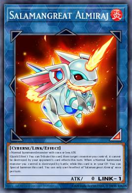 **ESTADO / CONTEXTO** →  **ESTADO / CONTEXTO**

**Acción concreta:** Convertir Trooper Invocado Normalmente, ATK 1000, en Salamangreat Almiraj Link-1. Trooper pasa al GY y permite pagar la futura Inferno. Final: Emperor + Almiraj, VBA boca arriba, Inferno Colocada; 3500 LP de daño sin respuesta, Normal gastada. Almiraj puede sacrificarse posteriormente para proteger un monstruo propio de destrucción por efecto rival según su texto; ese efecto no se ha gastado.
**Detalle técnico documentado:** Trooper pasa al GY y permite pagar la futura Inferno. Final: Emperor + Almiraj, VBA boca arriba, Inferno Colocada; 3500 LP de daño sin respuesta, Normal gastada. Almiraj puede sacrificarse posteriormente para proteger un monstruo propio de destrucción por efecto rival según su texto; ese efecto no se ha gastado.

**Estado por zonas después del paso:**

| Zona/recurso | Estado narrativo A09 |
|---|---|
| Mano | ∅ |
| Monstruos | Almiraj #14338 (Enlace 1), Emperor #18915 (3100 ATK) |
| Mágicas y trampas | VBA #18918, Inferno #18921 (Colocada) |
| Cementerio | Blaze original #7086, Trooper #18916 (material de Enlace) |
| Destierro propio | Rimfire #18917, Reload #11597, 3× Scattershot #7083 |
| Campo y estado rival | Daño acumulado 3500 sin respuesta; no hay más eventos rivales supuestos |
| Materiales Xyz/Fusión/Sincro | Ninguno |
| Normal, Extra, fase y restricciones | Normal gastada; Almiraj del Extra; protege solo si después paga su Efecto Rápido |

**Campo visual de este paso:**

**Monstruos propios:**
-  **Almiraj (Enlace 1)** — zona declarada: `MONSTER`.
-  **Emperor (3100 ATK)** — zona declarada: `MONSTER`.
**Mágicas/Trampas/Campo:**
-  **VBA** — zona declarada: `SPELL_TRAP`.
-  **Inferno (Colocada)** — zona declarada: `SPELL_TRAP`.
*Relación ilustrada de cartas presentes tras este paso, documentada en A09. La posición, materiales, otras zonas y rival se leen en la tabla de estado.*

### Campo final documentado

Esta vista procede **del último paso**, no de una lista de cartas deducida del título.

**Monstruos propios:**
-  **Almiraj (Enlace 1)** — zona declarada: `MONSTER`.
-  **Emperor (3100 ATK)** — zona declarada: `MONSTER`.
**Mágicas/Trampas/Campo:**
-  **VBA** — zona declarada: `SPELL_TRAP`.
-  **Inferno (Colocada)** — zona declarada: `SPELL_TRAP`.
*Relación ilustrada de cartas presentes tras este paso, documentada en A09. La posición, materiales, otras zonas y rival se leen en la tabla de estado.*

| Zona/recurso | Estado final documentado |
|---|---|
| Mano | ∅ |
| Monstruos | Almiraj #14338 (Enlace 1), Emperor #18915 (3100 ATK) |
| Mágicas y trampas | VBA #18918, Inferno #18921 (Colocada) |
| Cementerio | Blaze original #7086, Trooper #18916 (material de Enlace) |
| Destierro propio | Rimfire #18917, Reload #11597, 3× Scattershot #7083 |
| Campo y estado rival | Daño acumulado 3500 sin respuesta; no hay más eventos rivales supuestos |
| Materiales Xyz/Fusión/Sincro | Ninguno |
| Normal, Extra, fase y restricciones | Normal gastada; Almiraj del Extra; protege solo si después paga su Efecto Rápido |

### Si el oponente interrumpe

No se documenta una continuación alternativa con los recursos indicados.

---

## SITUACION · GO FIRST · TROOPER ROCKET GOZEN04 · `687:A09:SITUACION:GO_FIRST:TROOPER_ROCKET_GOZEN04`

**Propósito competitivo principal (lectura documental):** Preparación de recursos / despliegue. El objetivo solo se acredita si las acciones y el campo final detallados en esta guía lo permiten; no implica legalidad certificada ni garantiza el resultado ante respuestas adversarias.

**Categoría:** APERTURA

**Propósito y resultado documental:**

3. Final: Emperor FIRE + Hiita FIRE, VBA boca arriba, Inferno y Gozen Colocadas; Trooper/Rocket GY para Inferno. Durante turno rival se puede activar Gozen (Trampa Continua colocada el turno anterior); ambos monstruos propios son FIRE. Nunca afirmar un campo Emperor FIRE + I:P DARK bajo Gozen ya activa: esa combinación no cumple la restricción de Atributo.

### Mano y estado inicial

P1 | Gozen Match #7934 (única carta restante de la mano inicial de 3) | Trooper #18916, Rocket #7243, Emperor #18915 (3100 ATK) | VBA #18918, Inferno #18921 (Colocada) | Blaze original #7086 | Rimfire #18917, Reload #11597, 3× Scattershot #7083 | Ficha Bomba previa destruida; 3500 LP de daño sin respuesta | Ninguno | Normal gastada; no se hizo Enlace todavía

 **Volcanic Trooper — Soldado Volcánico**
 **Volcanic Rocket — Misil Volcánico**
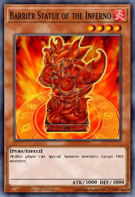 **Barrier Statue of the Inferno — Estatua-Barrera del Infierno**

### Ejecución numerada

#### Paso 1 — Completar pasos 1–5 de TROOPER_ROCKET_IP01: ficha→Rimfire→Emperor GY→Reload/Scattershot→Invocar Emperor con tres Piros desterrados, 3500 de daño y Inferno Colocada.

 **ESTADO / CONTEXTO** →  **ESTADO / CONTEXTO** →  **ESTADO / CONTEXTO**

**Acción concreta:** Completar pasos 1–5 de TROOPER_ROCKET_IP01: ficha→Rimfire→Emperor GY→Reload/Scattershot→Invocar Emperor con tres Piros desterrados, 3500 de daño y Inferno Colocada.
**Detalle técnico documentado:** No documentado

**Estado por zonas después del paso:**

| Zona/recurso | Estado narrativo A09 |
|---|---|
| Mano | Gozen Match #7934 (única carta restante de la mano inicial de 3) |
| Monstruos | Trooper #18916, Rocket #7243, Emperor #18915 (3100 ATK) |
| Mágicas y trampas | VBA #18918, Inferno #18921 (Colocada) |
| Cementerio | Blaze original #7086 |
| Destierro propio | Rimfire #18917, Reload #11597, 3× Scattershot #7083 |
| Campo y estado rival | Ficha Bomba previa destruida; 3500 LP de daño sin respuesta |
| Materiales Xyz/Fusión/Sincro | Ninguno |
| Normal, Extra, fase y restricciones | Normal gastada; no se hizo Enlace todavía |

**Campo visual de este paso:**

**Monstruos propios:**
-  **Trooper** — zona declarada: `MONSTER`.
-  **Rocket** — zona declarada: `MONSTER`.
-  **Emperor (3100 ATK)** — zona declarada: `MONSTER`.
**Mágicas/Trampas/Campo:**
-  **VBA** — zona declarada: `SPELL_TRAP`.
-  **Inferno (Colocada)** — zona declarada: `SPELL_TRAP`.
*Relación ilustrada de cartas presentes tras este paso, documentada en A09. La posición, materiales, otras zonas y rival se leen en la tabla de estado.*

#### Paso 2 — En vez de enlazar Trooper+Rocket en I:P DARK, usarlos para Hiita Link-2 FIRE, conservando Emperor FIRE.

 **ESTADO / CONTEXTO** →  **ESTADO / CONTEXTO** → 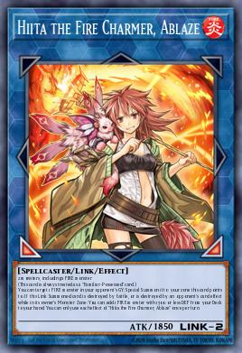 **ESTADO / CONTEXTO**

**Acción concreta:** En vez de enlazar Trooper+Rocket en I:P DARK, usarlos para Hiita Link-2 FIRE, conservando Emperor FIRE. Colocar Gozen Match desde la mano junto a Inferno.
**Detalle técnico documentado:** Colocar Gozen Match desde la mano junto a Inferno.

**Estado por zonas después del paso:**

| Zona/recurso | Estado narrativo A09 |
|---|---|
| Mano | ∅ |
| Monstruos | Emperor #18915 (FUEGO), Hiita #14133 (FUEGO, Enlace 2) |
| Mágicas y trampas | VBA #18918, Inferno #18921 (Colocada), Gozen Match #7934 (Colocada) |
| Cementerio | Blaze original #7086, Trooper #18916, Rocket #7243 |
| Destierro propio | Rimfire #18917, Reload #11597, 3× Scattershot #7083 |
| Campo y estado rival | Sin restricción de Gozen todavía; se activaría legalmente durante turno rival |
| Materiales Xyz/Fusión/Sincro | Ninguno |
| Normal, Extra, fase y restricciones | Normal gastada; Hiita del Extra, no I:P |

**Campo visual de este paso:**

**Monstruos propios:**
-  **Emperor (FUEGO)** — zona declarada: `MONSTER`.
-  **Hiita (FUEGO, Enlace 2)** — zona declarada: `MONSTER`.
**Mágicas/Trampas/Campo:**
-  **VBA** — zona declarada: `SPELL_TRAP`.
-  **Inferno (Colocada)** — zona declarada: `SPELL_TRAP`.
- 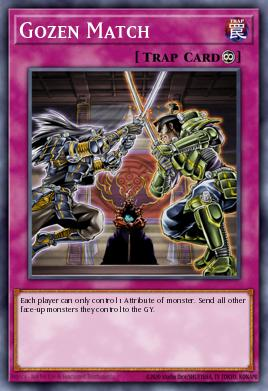 **Gozen Match (Colocada)** — zona declarada: `SPELL_TRAP`.
*Relación ilustrada de cartas presentes tras este paso, documentada en A09. La posición, materiales, otras zonas y rival se leen en la tabla de estado.*

#### Paso 3 — Final: Emperor FIRE + Hiita FIRE, VBA boca arriba, Inferno y Gozen Colocadas; Trooper/Rocket GY para Inferno.

 **ESTADO / CONTEXTO** →  **ESTADO / CONTEXTO** →  **ESTADO / CONTEXTO**

**Acción concreta:** Final: Emperor FIRE + Hiita FIRE, VBA boca arriba, Inferno y Gozen Colocadas; Trooper/Rocket GY para Inferno. Durante turno rival se puede activar Gozen (Trampa Continua colocada el turno anterior); ambos monstruos propios son FIRE. Nunca afirmar un campo Emperor FIRE + I:P DARK bajo Gozen ya activa: esa combinación no cumple la restricción de Atributo.
**Detalle técnico documentado:** Durante turno rival se puede activar Gozen (Trampa Continua colocada el turno anterior); ambos monstruos propios son FIRE. Nunca afirmar un campo Emperor FIRE + I:P DARK bajo Gozen ya activa: esa combinación no cumple la restricción de Atributo.

**Estado por zonas después del paso:**

| Zona/recurso | Estado narrativo A09 |
|---|---|
| Mano | ∅ |
| Monstruos | Emperor #18915 (FUEGO), Hiita #14133 (FUEGO) |
| Mágicas y trampas | VBA #18918, Inferno #18921 (Colocada), Gozen Match #7934 (Colocada) |
| Cementerio | Blaze original #7086, Trooper #18916, Rocket #7243 |
| Destierro propio | Rimfire #18917, Reload #11597, 3× Scattershot #7083 |
| Campo y estado rival | 3500 LP por motor sin respuesta; Gozen sin aplicar restricciones mientras siga Colocada |
| Materiales Xyz/Fusión/Sincro | Ninguno |
| Normal, Extra, fase y restricciones | Normal gastada; ambos cuerpos FUEGO, compatibles al activar Gozen |

**Campo visual de este paso:**

**Monstruos propios:**
-  **Emperor (FUEGO)** — zona declarada: `MONSTER`.
-  **Hiita (FUEGO)** — zona declarada: `MONSTER`.
**Mágicas/Trampas/Campo:**
-  **VBA** — zona declarada: `SPELL_TRAP`.
-  **Inferno (Colocada)** — zona declarada: `SPELL_TRAP`.
-  **Gozen Match (Colocada)** — zona declarada: `SPELL_TRAP`.
*Relación ilustrada de cartas presentes tras este paso, documentada en A09. La posición, materiales, otras zonas y rival se leen en la tabla de estado.*

### Campo final documentado

Esta vista procede **del último paso**, no de una lista de cartas deducida del título.

**Monstruos propios:**
-  **Emperor (FUEGO)** — zona declarada: `MONSTER`.
-  **Hiita (FUEGO)** — zona declarada: `MONSTER`.
**Mágicas/Trampas/Campo:**
-  **VBA** — zona declarada: `SPELL_TRAP`.
-  **Inferno (Colocada)** — zona declarada: `SPELL_TRAP`.
-  **Gozen Match (Colocada)** — zona declarada: `SPELL_TRAP`.
*Relación ilustrada de cartas presentes tras este paso, documentada en A09. La posición, materiales, otras zonas y rival se leen en la tabla de estado.*

| Zona/recurso | Estado final documentado |
|---|---|
| Mano | ∅ |
| Monstruos | Emperor #18915 (FUEGO), Hiita #14133 (FUEGO) |
| Mágicas y trampas | VBA #18918, Inferno #18921 (Colocada), Gozen Match #7934 (Colocada) |
| Cementerio | Blaze original #7086, Trooper #18916, Rocket #7243 |
| Destierro propio | Rimfire #18917, Reload #11597, 3× Scattershot #7083 |
| Campo y estado rival | 3500 LP por motor sin respuesta; Gozen sin aplicar restricciones mientras siga Colocada |
| Materiales Xyz/Fusión/Sincro | Ninguno |
| Normal, Extra, fase y restricciones | Normal gastada; ambos cuerpos FUEGO, compatibles al activar Gozen |

### Si el oponente interrumpe

No se documenta una continuación alternativa con los recursos indicados.

---

## SITUACION · GO FIRST · TROOPER VBA EJECTION INFERNO05 · `687:A09:SITUACION:GO_FIRST:TROOPER_VBA_EJECTION_INFERNO05`

**Propósito competitivo principal (lectura documental):** Preparación de recursos / despliegue. El objetivo solo se acredita si las acciones y el campo final detallados en esta guía lo permiten; no implica legalidad certificada ni garantiza el resultado ante respuestas adversarias.

**Categoría:** APERTURA

**Propósito y resultado documental:**

4. Invocar por Enlace Almiraj usando Trooper Normal ATK 1000, que pasa al GY. Final: Emperor + Almiraj + VBA boca arriba + Inferno Colocada; 800 LP por Ejection, Normal gastada, Trooper Piro en GY permite futura negación de Inferno. Ejection no crea cuerpo adicional.

### Mano y estado inicial

Mano: Trooper + VBA + Fire Ejection. En Deck: Blaze original, 1 Emperor, Inferno. Extra: Almiraj. Campo propio vacío; Normal disponible; sin necesidad de Scattershot ni de monstruo rival.

 **Volcanic Trooper — Soldado Volcánico**
 **Volcanic Blaze Accelerator — Acelerador de Llama Volcánico**
 **Fire Ejection — Eyección de Fuego**

### Ejecución numerada

#### Paso 1 — Normal Trooper, buscar Inferno (no VBA, porque VBA ya estaba en mano), Colocarla boca abajo.

 **ESTADO / CONTEXTO** →  **AÑADIR A MANO** →  **BUSCAR / AÑADIR**

**Acción concreta:** Normal Trooper, buscar Inferno (no VBA, porque VBA ya estaba en mano), Colocarla boca abajo. Activar VBA desde mano enviando Blaze Accelerator original del Deck al GY.
**Detalle técnico documentado:** Activar VBA desde mano enviando Blaze Accelerator original del Deck al GY.

**Estado por zonas después del paso:**

| Zona/recurso | Estado narrativo A09 |
|---|---|
| Mano | Fire Ejection #18919 |
| Monstruos | Trooper #18916 (Normal) |
| Mágicas y trampas | VBA #18918, Inferno #18921 (Colocada por Trooper) |
| Cementerio | Blaze original #7086 (enviado desde Deck para activar VBA) |
| Destierro propio | ∅ |
| Campo y estado rival | Sin respuesta; sin monstruo rival requerido |
| Materiales Xyz/Fusión/Sincro | Ninguno |
| Normal, Extra, fase y restricciones | Normal gastada; Extra intacto |

**Campo visual de este paso:**

**Monstruos propios:**
-  **Trooper (Normal)** — zona declarada: `MONSTER`.
**Mágicas/Trampas/Campo:**
-  **VBA** — zona declarada: `SPELL_TRAP`.
-  **Inferno (Colocada por Trooper)** — zona declarada: `SPELL_TRAP`.
*Relación ilustrada de cartas presentes tras este paso, documentada en A09. La posición, materiales, otras zonas y rival se leen en la tabla de estado.*

#### Paso 2 — Activar Fire Ejection, mandar Emperor Nivel 8 del Deck al GY y elegir 800 LP de daño.

 **ACTIVAR** →  **ENVIAR**

**Acción concreta:** Activar Fire Ejection, mandar Emperor Nivel 8 del Deck al GY y elegir 800 LP de daño. No generar Ficha además: ambas opciones son excluyentes.
**Detalle técnico documentado:** No generar Ficha además: ambas opciones son excluyentes.

**Estado por zonas después del paso:**

| Zona/recurso | Estado narrativo A09 |
|---|---|
| Mano | ∅ |
| Monstruos | Trooper #18916 |
| Mágicas y trampas | VBA #18918, Inferno #18921 (Colocada) |
| Cementerio | Blaze original #7086, Fire Ejection #18919, Emperor #18915 (enviado desde Deck) |
| Destierro propio | ∅ |
| Campo y estado rival | 800 LP por Ejection, sin Ficha Bomba |
| Materiales Xyz/Fusión/Sincro | Ninguno |
| Normal, Extra, fase y restricciones | Normal gastada; Extra intacto |

**Campo visual de este paso:**

**Monstruos propios:**
-  **Trooper** — zona declarada: `MONSTER`.
**Mágicas/Trampas/Campo:**
-  **VBA** — zona declarada: `SPELL_TRAP`.
-  **Inferno (Colocada)** — zona declarada: `SPELL_TRAP`.
*Relación ilustrada de cartas presentes tras este paso, documentada en A09. La posición, materiales, otras zonas y rival se leen en la tabla de estado.*

#### Paso 3 — Emperor destierra solo el Blaze Accelerator original del GY para Invocarse.

 **COLOCAR** →  **COLOCAR** →  **BUSCAR / AÑADIR**

**Acción concreta:** Emperor destierra solo el Blaze Accelerator original del GY para Invocarse. NO coloca otra Inferno por Emperor, pues no desterró Piros. La Inferno existente es la buscada y Colocada por Trooper en el paso 1.
**Detalle técnico documentado:** NO coloca otra Inferno por Emperor, pues no desterró Piros. La Inferno existente es la buscada y Colocada por Trooper en el paso 1.

**Estado por zonas después del paso:**

| Zona/recurso | Estado narrativo A09 |
|---|---|
| Mano | ∅ |
| Monstruos | Trooper #18916, Emperor #18915 (3100 ATK) |
| Mágicas y trampas | VBA #18918, Inferno #18921 (Colocada) |
| Cementerio | Fire Ejection #18919 |
| Destierro propio | Blaze original #7086 (único coste para Emperor) |
| Campo y estado rival | 800 LP acumulados; NO 1500 adicionales por Piros |
| Materiales Xyz/Fusión/Sincro | Ninguno |
| Normal, Extra, fase y restricciones | Normal gastada; ningún otro Inferno Colocado por Emperor |

**Campo visual de este paso:**

**Monstruos propios:**
-  **Trooper** — zona declarada: `MONSTER`.
-  **Emperor (3100 ATK)** — zona declarada: `MONSTER`.
**Mágicas/Trampas/Campo:**
-  **VBA** — zona declarada: `SPELL_TRAP`.
-  **Inferno (Colocada)** — zona declarada: `SPELL_TRAP`.
*Relación ilustrada de cartas presentes tras este paso, documentada en A09. La posición, materiales, otras zonas y rival se leen en la tabla de estado.*

#### Paso 4 — Invocar por Enlace Almiraj usando Trooper Normal ATK 1000, que pasa al GY.

 **ENLACE** →  **ENLACE** →  **ESTADO / CONTEXTO**

**Acción concreta:** Invocar por Enlace Almiraj usando Trooper Normal ATK 1000, que pasa al GY. Final: Emperor + Almiraj + VBA boca arriba + Inferno Colocada; 800 LP por Ejection, Normal gastada, Trooper Piro en GY permite futura negación de Inferno. Ejection no crea cuerpo adicional.
**Detalle técnico documentado:** Final: Emperor + Almiraj + VBA boca arriba + Inferno Colocada; 800 LP por Ejection, Normal gastada, Trooper Piro en GY permite futura negación de Inferno. Ejection no crea cuerpo adicional.

**Estado por zonas después del paso:**

| Zona/recurso | Estado narrativo A09 |
|---|---|
| Mano | ∅ |
| Monstruos | Almiraj #14338 (Enlace 1), Emperor #18915 |
| Mágicas y trampas | VBA #18918, Inferno #18921 (Colocada) |
| Cementerio | Fire Ejection #18919, Trooper #18916 (material de Enlace) |
| Destierro propio | Blaze original #7086 |
| Campo y estado rival | 800 LP de efecto sin respuesta |
| Materiales Xyz/Fusión/Sincro | Ninguno |
| Normal, Extra, fase y restricciones | Normal gastada; Almiraj del Extra, Volcanic en GY para Inferno futura |

**Campo visual de este paso:**

**Monstruos propios:**
-  **Almiraj (Enlace 1)** — zona declarada: `MONSTER`.
-  **Emperor** — zona declarada: `MONSTER`.
**Mágicas/Trampas/Campo:**
-  **VBA** — zona declarada: `SPELL_TRAP`.
-  **Inferno (Colocada)** — zona declarada: `SPELL_TRAP`.
*Relación ilustrada de cartas presentes tras este paso, documentada en A09. La posición, materiales, otras zonas y rival se leen en la tabla de estado.*

### Campo final documentado

Esta vista procede **del último paso**, no de una lista de cartas deducida del título.

**Monstruos propios:**
-  **Almiraj (Enlace 1)** — zona declarada: `MONSTER`.
-  **Emperor** — zona declarada: `MONSTER`.
**Mágicas/Trampas/Campo:**
-  **VBA** — zona declarada: `SPELL_TRAP`.
-  **Inferno (Colocada)** — zona declarada: `SPELL_TRAP`.
*Relación ilustrada de cartas presentes tras este paso, documentada en A09. La posición, materiales, otras zonas y rival se leen en la tabla de estado.*

| Zona/recurso | Estado final documentado |
|---|---|
| Mano | ∅ |
| Monstruos | Almiraj #14338 (Enlace 1), Emperor #18915 |
| Mágicas y trampas | VBA #18918, Inferno #18921 (Colocada) |
| Cementerio | Fire Ejection #18919, Trooper #18916 (material de Enlace) |
| Destierro propio | Blaze original #7086 |
| Campo y estado rival | 800 LP de efecto sin respuesta |
| Materiales Xyz/Fusión/Sincro | Ninguno |
| Normal, Extra, fase y restricciones | Normal gastada; Almiraj del Extra, Volcanic en GY para Inferno futura |

### Si el oponente interrumpe

No se documenta una continuación alternativa con los recursos indicados.

---

## SITUACION · OPPONENT TURN · TROOPER VBA EJECTION EMISSION06 · `687:A09:SITUACION:OPPONENT_TURN:TROOPER_VBA_EJECTION_EMISSION06`

**Propósito competitivo principal (lectura documental):** Ofensivo condicional. El objetivo solo se acredita si las acciones y el campo final detallados en esta guía lo permiten; no implica legalidad certificada ni garantiza el resultado ante respuestas adversarias.

**Categoría:** APERTURA

**Propósito y resultado documental:**

Fin del turno propio: Emperor #1 + Salamangreat Almiraj + Volcanic Blaze Accelerator boca arriba + Volcanic Emission Colocada; Emperor #2 permanece en Deck. Solo si Emission sobrevive hasta el turno rival y resuelve: Invocar Emperor #2 desde Deck temporalmente; durante ese turno hay dos Emperor y Almiraj, Emission pasa al GY y el segundo Emperor regresa a mano en End Phase. Cada Emperor presente podrá infligir 500 LP por un evento de Invocación Especial rival legal; no atribuir ese daño antes de que ocurra.

### Mano y estado inicial

Misma mano de tres cartas y estado que INFERNO05; objetivo distinto: priorizar daño por Invocaciones Especiales rivales con dos Emperors. Deck debe contener dos Emperor (ambos registrados) y Emission; Extra Almiraj. Sin Inferno en esta rama.

 **Volcanic Trooper — Soldado Volcánico**
 **Volcanic Blaze Accelerator — Acelerador de Llama Volcánico**
 **Fire Ejection — Eyección de Fuego**

### Ejecución numerada

#### Paso 1 — Normal Trooper y buscar Emission, Colocarla.

 **ESTADO / CONTEXTO** →  **AÑADIR A MANO** →  **ESTADO / CONTEXTO**

**Acción concreta:** Normal Trooper y buscar Emission, Colocarla. VBA desde mano se activa enviando Blaze original del Deck al GY.
**Detalle técnico documentado:** VBA desde mano se activa enviando Blaze original del Deck al GY.

**Estado por zonas después del paso:**

| Zona/recurso | Estado narrativo A09 |
|---|---|
| Mano | Fire Ejection #18919 |
| Monstruos | Trooper #18916 (Normal) |
| Mágicas y trampas | VBA #18918, Emission #18920 (Colocada por Trooper) |
| Cementerio | Blaze original #7086 |
| Destierro propio | ∅ |
| Campo y estado rival | Sin respuesta; aún no se produce Invocación rival |
| Materiales Xyz/Fusión/Sincro | Ninguno |
| Normal, Extra, fase y restricciones | Normal gastada; Extra intacto |

**Campo visual de este paso:**

**Monstruos propios:**
-  **Trooper (Normal)** — zona declarada: `MONSTER`.
**Mágicas/Trampas/Campo:**
-  **VBA** — zona declarada: `SPELL_TRAP`.
-  **Emission (Colocada por Trooper)** — zona declarada: `SPELL_TRAP`.
*Relación ilustrada de cartas presentes tras este paso, documentada en A09. La posición, materiales, otras zonas y rival se leen en la tabla de estado.*

#### Paso 2 — Fire Ejection manda primer Emperor del Deck al GY e inflige 800 LP.

 **ESTADO / CONTEXTO** →  **ENVIAR** →  **COLOCAR**

**Acción concreta:** Fire Ejection manda primer Emperor del Deck al GY e inflige 800 LP. Ese primer Emperor se Invoca desde GY desterrando solo Blaze original; no Coloca Inferno.
**Detalle técnico documentado:** Ese primer Emperor se Invoca desde GY desterrando solo Blaze original; no Coloca Inferno.

**Estado por zonas después del paso:**

| Zona/recurso | Estado narrativo A09 |
|---|---|
| Mano | ∅ |
| Monstruos | Trooper #18916, primer Emperor #18915 (desde GY) |
| Mágicas y trampas | VBA #18918, Emission #18920 (Colocada) |
| Cementerio | Fire Ejection #18919 |
| Destierro propio | Blaze original #7086 (coste de Emperor #1) |
| Campo y estado rival | 800 LP por Ejection; segundo Emperor continúa en Deck |
| Materiales Xyz/Fusión/Sincro | Ninguno |
| Normal, Extra, fase y restricciones | Normal gastada; Extra intacto |

**Campo visual de este paso:**

**Monstruos propios:**
-  **Trooper** — zona declarada: `MONSTER`.
-  **primer Emperor (desde GY)** — zona declarada: `MONSTER`.
**Mágicas/Trampas/Campo:**
-  **VBA** — zona declarada: `SPELL_TRAP`.
-  **Emission (Colocada)** — zona declarada: `SPELL_TRAP`.
*Relación ilustrada de cartas presentes tras este paso, documentada en A09. La posición, materiales, otras zonas y rival se leen en la tabla de estado.*

#### Paso 3 — Trooper Normal→Almiraj.

 **ESTADO / CONTEXTO** →  **ESTADO / CONTEXTO** →  **YA EN CAMPO**

**Acción concreta:** Trooper Normal→Almiraj. Endboard turno propio: Emperor #1 + Almiraj + VBA boca arriba + Emission Colocada, 800 de daño previo; Emperor #2 permanece en Deck.
**Detalle técnico documentado:** Endboard turno propio: Emperor #1 + Almiraj + VBA boca arriba + Emission Colocada, 800 de daño previo; Emperor #2 permanece en Deck.

**Estado por zonas después del paso:**

| Zona/recurso | Estado narrativo A09 |
|---|---|
| Mano | ∅ |
| Monstruos | Primer Emperor #18915, Almiraj #14338 (Link-1) |
| Mágicas y trampas | VBA #18918, Emission #18920 (Colocada) |
| Cementerio | Fire Ejection #18919, Trooper #18916 (material de Enlace) |
| Destierro propio | Blaze original #7086 |
| Campo y estado rival | Fin de turno propio, 800 LP sin respuesta |
| Materiales Xyz/Fusión/Sincro | Ninguno |
| Normal, Extra, fase y restricciones | Normal gastada en turno propio; Almiraj salió del Extra |

**Campo visual de este paso:**

**Monstruos propios:**
-  **Primer Emperor** — zona declarada: `MONSTER`.
-  **Almiraj (Link-1)** — zona declarada: `MONSTER`.
**Mágicas/Trampas/Campo:**
-  **VBA** — zona declarada: `SPELL_TRAP`.
-  **Emission (Colocada)** — zona declarada: `SPELL_TRAP`.
*Relación ilustrada de cartas presentes tras este paso, documentada en A09. La posición, materiales, otras zonas y rival se leen en la tabla de estado.*

#### Paso 4 — Durante Main Phase rival (o ventana legal de Trampa), activar la Emission colocada desde el turno anterior y elegir su primer efecto.

 **ACTIVAR** →  **ESPECIAL**

**Acción concreta:** Durante Main Phase rival (o ventana legal de Trampa), activar la Emission colocada desde el turno anterior y elegir su primer efecto: Invocar Especialmente Emperor #2 desde Deck ignorando sus condiciones, que regresará a mano en End Phase. Como no fue Invocado por su propio procedimiento, no aplica el efecto de Colocar Trampa ni el de daño al Invocarse de ese modo.
**Detalle técnico documentado:** Invocar Especialmente Emperor #2 desde Deck ignorando sus condiciones, que regresará a mano en End Phase. Como no fue Invocado por su propio procedimiento, no aplica el efecto de Colocar Trampa ni el de daño al Invocarse de ese modo.

**Estado por zonas después del paso:**

| Zona/recurso | Estado narrativo A09 |
|---|---|
| Mano | ∅ |
| Monstruos | Primer Emperor #18915, segundo Emperor #18915 (desde Deck, temporal), Almiraj #14338 |
| Mágicas y trampas | VBA #18918 |
| Cementerio | Fire Ejection #18919, Trooper #18916, Emission #18920 (activada desde Colocada) |
| Destierro propio | Blaze original #7086 |
| Campo y estado rival | Main Phase rival: Emission resuelta; no se atribuye evento de Invocación Especial enemigo anterior ni daño retroactivo |
| Materiales Xyz/Fusión/Sincro | Ninguno |
| Normal, Extra, fase y restricciones | Turno rival; segundo Emperor regresará a mano en End Phase |

**Campo visual de este paso:**

**Monstruos propios:**
-  **Primer Emperor** — zona declarada: `MONSTER`.
-  **segundo Emperor (desde Deck, temporal)** — zona declarada: `MONSTER`.
-  **Almiraj** — zona declarada: `MONSTER`.
**Mágicas/Trampas/Campo:**
-  **VBA** — zona declarada: `SPELL_TRAP`.
*Relación ilustrada de cartas presentes tras este paso, documentada en A09. La posición, materiales, otras zonas y rival se leen en la tabla de estado.*

#### Paso 5 — Campo temporal rival: dos Emperor + Almiraj + VBA, con Emission ahora en GY.

 **ESTADO / CONTEXTO** →  **ESTADO / CONTEXTO** →  **ESTADO / CONTEXTO**

**Acción concreta:** Campo temporal rival: dos Emperor + Almiraj + VBA, con Emission ahora en GY. Cada vez que el rival realmente Invoca Especialmente un grupo de monstruos, cada Emperor presente inflige 500 (potencial de 1000 LP por evento, sujeto a resolución); en End Phase el segundo Emperor vuelve a la mano. No atribuir ataques ni quemaduras antes de esos eventos.
**Detalle técnico documentado:** Cada vez que el rival realmente Invoca Especialmente un grupo de monstruos, cada Emperor presente inflige 500 (potencial de 1000 LP por evento, sujeto a resolución); en End Phase el segundo Emperor vuelve a la mano. No atribuir ataques ni quemaduras antes de esos eventos.

**Estado por zonas después del paso:**

| Zona/recurso | Estado narrativo A09 |
|---|---|
| Mano | Segundo Emperor #18915 (solo después de su devolución en End Phase rival; antes de eso continúa en Campo) |
| Monstruos | Primer Emperor #18915, Almiraj #14338 (tras End Phase; durante Main rival estaban ambas copias) |
| Mágicas y trampas | VBA #18918 |
| Cementerio | Fire Ejection #18919, Trooper #18916, Emission #18920 |
| Destierro propio | Blaze original #7086 |
| Campo y estado rival | Si rival hizo un EVENTO de Invocación Especial mientras ambos estaban: 500 LP por Emperor, potencial 1000 por evento; NO se garantiza evento |
| Materiales Xyz/Fusión/Sincro | Ninguno |
| Normal, Extra, fase y restricciones | Turno rival, segundo Emperor vuelve a mano en End Phase; Extra sin más gasto |

**Campo visual de este paso:**

**Monstruos propios:**
-  **Primer Emperor** — zona declarada: `MONSTER`.
-  **Almiraj (tras End Phase; durante Main rival estaban ambas copias)** — zona declarada: `MONSTER`.
**Mágicas/Trampas/Campo:**
-  **VBA** — zona declarada: `SPELL_TRAP`.
*Relación ilustrada de cartas presentes tras este paso, documentada en A09. La posición, materiales, otras zonas y rival se leen en la tabla de estado.*

### Campo final documentado

Esta vista procede **del último paso**, no de una lista de cartas deducida del título.

**Monstruos propios:**
-  **Primer Emperor** — zona declarada: `MONSTER`.
-  **Almiraj (tras End Phase; durante Main rival estaban ambas copias)** — zona declarada: `MONSTER`.
**Mágicas/Trampas/Campo:**
-  **VBA** — zona declarada: `SPELL_TRAP`.
*Relación ilustrada de cartas presentes tras este paso, documentada en A09. La posición, materiales, otras zonas y rival se leen en la tabla de estado.*

| Zona/recurso | Estado final documentado |
|---|---|
| Mano | Segundo Emperor #18915 (solo después de su devolución en End Phase rival; antes de eso continúa en Campo) |
| Monstruos | Primer Emperor #18915, Almiraj #14338 (tras End Phase; durante Main rival estaban ambas copias) |
| Mágicas y trampas | VBA #18918 |
| Cementerio | Fire Ejection #18919, Trooper #18916, Emission #18920 |
| Destierro propio | Blaze original #7086 |
| Campo y estado rival | Si rival hizo un EVENTO de Invocación Especial mientras ambos estaban: 500 LP por Emperor, potencial 1000 por evento; NO se garantiza evento |
| Materiales Xyz/Fusión/Sincro | Ninguno |
| Normal, Extra, fase y restricciones | Turno rival, segundo Emperor vuelve a mano en End Phase; Extra sin más gasto |

### Si el oponente interrumpe

No se documenta una continuación alternativa con los recursos indicados.

---

## SITUACION · GO FIRST · TROOPER VBA ROCKET EJECTION IP07 · `687:A09:SITUACION:GO_FIRST:TROOPER_VBA_ROCKET_EJECTION_IP07`

**Propósito competitivo principal (lectura documental):** Ofensivo condicional. El objetivo solo se acredita si las acciones y el campo final detallados en esta guía lo permiten; no implica legalidad certificada ni garantiza el resultado ante respuestas adversarias.

**Categoría:** APERTURA

**Propósito y resultado documental:**

4. Link Trooper + Rocket → I:P; ambos Piros al GY. Final: Emperor + I:P, VBA boca arriba, Inferno + Reload Colocadas; daño previo 800. En turno rival Inferno puede banish Trooper/Rocket del GY como coste para su negación y Reload tiene su uso propio. Si se niega la búsqueda de Rocket, se pierde Reload pero Inferno sigue.

### Mano y estado inicial

Mano: Trooper + VBA + Rocket + Fire Ejection. Deck: Blaze original, 1 Emperor, Inferno, Reload; Extra: I:P. Campo propio vacío, Normal libre, sin respuesta. Objetivo: conservar I:P + Emperor + Inferno y Reload Colocadas sin depender del envío de las tres Scattershot.

 **Volcanic Trooper — Soldado Volcánico**
 **Volcanic Blaze Accelerator — Acelerador de Llama Volcánico**
 **Volcanic Rocket — Misil Volcánico**
 **Fire Ejection — Eyección de Fuego**

### Ejecución numerada

#### Paso 1 — Normal Trooper; buscar Inferno del Deck y Colocarla.

 **ESTADO / CONTEXTO** →  **AÑADIR A MANO** →  **ACTIVAR**

**Acción concreta:** Normal Trooper; buscar Inferno del Deck y Colocarla. Activar VBA de la mano, enviando Blaze original desde Deck al GY.
**Detalle técnico documentado:** Activar VBA de la mano, enviando Blaze original desde Deck al GY.

**Estado por zonas después del paso:**

| Zona/recurso | Estado narrativo A09 |
|---|---|
| Mano | Rocket #7243, Fire Ejection #18919 |
| Monstruos | Trooper #18916 (Normal) |
| Mágicas y trampas | VBA #18918 (Continua), Inferno #18921 (Colocada por Trooper) |
| Cementerio | Blaze original #7086 |
| Destierro propio | ∅ |
| Campo y estado rival | Sin respuesta; Campo no determinado |
| Materiales Xyz/Fusión/Sincro | Ninguno |
| Normal, Extra, fase y restricciones | Normal gastada; Extra intacto |

**Campo visual de este paso:**

**Monstruos propios:**
-  **Trooper (Normal)** — zona declarada: `MONSTER`.
**Mágicas/Trampas/Campo:**
-  **VBA (Continua)** — zona declarada: `SPELL_TRAP`.
-  **Inferno (Colocada por Trooper)** — zona declarada: `SPELL_TRAP`.
*Relación ilustrada de cartas presentes tras este paso, documentada en A09. La posición, materiales, otras zonas y rival se leen en la tabla de estado.*

#### Paso 2 — Efecto VBA: Invocar Rocket desde mano; Rocket busca Reload, que se Coloca.

 **ESTADO / CONTEXTO** →  **ESTADO / CONTEXTO** →  **AÑADIR A MANO**

**Acción concreta:** Efecto VBA: Invocar Rocket desde mano; Rocket busca Reload, que se Coloca. Ninguna de las dos Trampas puede activarse ese mismo turno.
**Detalle técnico documentado:** Ninguna de las dos Trampas puede activarse ese mismo turno.

**Estado por zonas después del paso:**

| Zona/recurso | Estado narrativo A09 |
|---|---|
| Mano | Fire Ejection #18919 |
| Monstruos | Trooper #18916, Rocket #7243 (desde mano por VBA) |
| Mágicas y trampas | VBA #18918, Inferno #18921 (Colocada), Reload #11597 (Colocada tras búsqueda de Rocket) |
| Cementerio | Blaze original #7086 |
| Destierro propio | ∅ |
| Campo y estado rival | Sin cambios acreditados |
| Materiales Xyz/Fusión/Sincro | Ninguno |
| Normal, Extra, fase y restricciones | Normal gastada; Trampas recién Colocadas |

**Campo visual de este paso:**

**Monstruos propios:**
-  **Trooper** — zona declarada: `MONSTER`.
-  **Rocket (desde mano por VBA)** — zona declarada: `MONSTER`.
**Mágicas/Trampas/Campo:**
-  **VBA** — zona declarada: `SPELL_TRAP`.
-  **Inferno (Colocada)** — zona declarada: `SPELL_TRAP`.
-  **Reload (Colocada tras búsqueda de Rocket)** — zona declarada: `SPELL_TRAP`.
*Relación ilustrada de cartas presentes tras este paso, documentada en A09. La posición, materiales, otras zonas y rival se leen en la tabla de estado.*

#### Paso 3 — Fire Ejection envía Emperor al GY y causa 800 LP; Emperor se Invoca del GY desterrando Blaze original.

 **ESTADO / CONTEXTO** →  **ESTADO / CONTEXTO**

**Acción concreta:** Fire Ejection envía Emperor al GY y causa 800 LP; Emperor se Invoca del GY desterrando Blaze original. No coloca Trampa mediante su propio efecto porque no se desterraron Piros.
**Detalle técnico documentado:** No coloca Trampa mediante su propio efecto porque no se desterraron Piros.

**Estado por zonas después del paso:**

| Zona/recurso | Estado narrativo A09 |
|---|---|
| Mano | ∅ |
| Monstruos | Trooper #18916, Rocket #7243, Emperor #18915 (3100 ATK) |
| Mágicas y trampas | VBA #18918, Inferno #18921 (Colocada), Reload #11597 (Colocada) |
| Cementerio | Fire Ejection #18919 |
| Destierro propio | Blaze original #7086 (coste de invocación de Emperor) |
| Campo y estado rival | 800 LP por Fire Ejection; sin 1500 LP por Piros |
| Materiales Xyz/Fusión/Sincro | Ninguno |
| Normal, Extra, fase y restricciones | Normal gastada; Emperor NO coloca Trampa extra |

**Campo visual de este paso:**

**Monstruos propios:**
-  **Trooper** — zona declarada: `MONSTER`.
-  **Rocket** — zona declarada: `MONSTER`.
-  **Emperor (3100 ATK)** — zona declarada: `MONSTER`.
**Mágicas/Trampas/Campo:**
-  **VBA** — zona declarada: `SPELL_TRAP`.
-  **Inferno (Colocada)** — zona declarada: `SPELL_TRAP`.
-  **Reload (Colocada)** — zona declarada: `SPELL_TRAP`.
*Relación ilustrada de cartas presentes tras este paso, documentada en A09. La posición, materiales, otras zonas y rival se leen en la tabla de estado.*

#### Paso 4 — Link Trooper + Rocket → I:P; ambos Piros al GY.

 **ESTADO / CONTEXTO** →  **ESTADO / CONTEXTO** →  **ESTADO / CONTEXTO**

**Acción concreta:** Link Trooper + Rocket → I:P; ambos Piros al GY. Final: Emperor + I:P, VBA boca arriba, Inferno + Reload Colocadas; daño previo 800. En turno rival Inferno puede banish Trooper/Rocket del GY como coste para su negación y Reload tiene su uso propio. Si se niega la búsqueda de Rocket, se pierde Reload pero Inferno sigue.
**Detalle técnico documentado:** Final: Emperor + I:P, VBA boca arriba, Inferno + Reload Colocadas; daño previo 800. En turno rival Inferno puede banish Trooper/Rocket del GY como coste para su negación y Reload tiene su uso propio. Si se niega la búsqueda de Rocket, se pierde Reload pero Inferno sigue.

**Estado por zonas después del paso:**

| Zona/recurso | Estado narrativo A09 |
|---|---|
| Mano | ∅ |
| Monstruos | Emperor #18915 (3100 ATK), I:P Masquerena #14676 (Enlace 2) |
| Mágicas y trampas | VBA #18918, Inferno #18921 (Colocada), Reload #11597 (Colocada) |
| Cementerio | Fire Ejection #18919, Trooper #18916, Rocket #7243 (materiales de Enlace) |
| Destierro propio | Blaze original #7086 |
| Campo y estado rival | 800 LP de efecto sin respuesta; futuras negaciones dependen de activaciones en turno rival |
| Materiales Xyz/Fusión/Sincro | Ninguno |
| Normal, Extra, fase y restricciones | Normal gastada; I:P salió del Extra, ambas Trampas no activadas |

**Campo visual de este paso:**

**Monstruos propios:**
-  **Emperor (3100 ATK)** — zona declarada: `MONSTER`.
-  **I:P Masquerena (Enlace 2)** — zona declarada: `MONSTER`.
**Mágicas/Trampas/Campo:**
-  **VBA** — zona declarada: `SPELL_TRAP`.
-  **Inferno (Colocada)** — zona declarada: `SPELL_TRAP`.
-  **Reload (Colocada)** — zona declarada: `SPELL_TRAP`.
*Relación ilustrada de cartas presentes tras este paso, documentada en A09. La posición, materiales, otras zonas y rival se leen en la tabla de estado.*

### Campo final documentado

Esta vista procede **del último paso**, no de una lista de cartas deducida del título.

**Monstruos propios:**
-  **Emperor (3100 ATK)** — zona declarada: `MONSTER`.
-  **I:P Masquerena (Enlace 2)** — zona declarada: `MONSTER`.
**Mágicas/Trampas/Campo:**
-  **VBA** — zona declarada: `SPELL_TRAP`.
-  **Inferno (Colocada)** — zona declarada: `SPELL_TRAP`.
-  **Reload (Colocada)** — zona declarada: `SPELL_TRAP`.
*Relación ilustrada de cartas presentes tras este paso, documentada en A09. La posición, materiales, otras zonas y rival se leen en la tabla de estado.*

| Zona/recurso | Estado final documentado |
|---|---|
| Mano | ∅ |
| Monstruos | Emperor #18915 (3100 ATK), I:P Masquerena #14676 (Enlace 2) |
| Mágicas y trampas | VBA #18918, Inferno #18921 (Colocada), Reload #11597 (Colocada) |
| Cementerio | Fire Ejection #18919, Trooper #18916, Rocket #7243 (materiales de Enlace) |
| Destierro propio | Blaze original #7086 |
| Campo y estado rival | 800 LP de efecto sin respuesta; futuras negaciones dependen de activaciones en turno rival |
| Materiales Xyz/Fusión/Sincro | Ninguno |
| Normal, Extra, fase y restricciones | Normal gastada; I:P salió del Extra, ambas Trampas no activadas |

### Si el oponente interrumpe

No se documenta una continuación alternativa con los recursos indicados.

---
