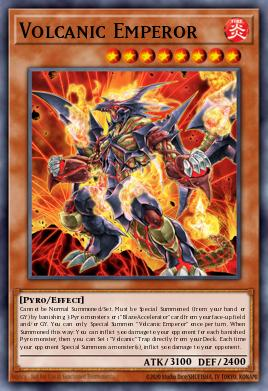

# Volcanic — I:P + Emperador → S:P en Main rival, alternativa a Unicornio

**ID A09/A10:** `687:A09:IP:EMPEROR:SP_DEFENSA16`.

**Clase:** continuación defensiva **desde campo previamente establecido**, no starter de una carta. **Objetivo:** transformar I:P Masquerena y Volcanic Emperor en S:P Little Knight durante una Main Phase rival, habilitar el destierro de una carta al ser Invocada y dejar disponible una respuesta rápida condicional posterior. **No niega activaciones.**

**Estado inicial exacto:** es **Main Phase del oponente**, controlas boca arriba `I:P Masquerena` (CID 14676, Link-2) y `Volcanic Emperor` (CID 18915, Nivel 8/3100 ATK), y tienes una zona de Enlace legal para `S:P Little Knight` (CID 19188, **Extra 3x** en la lista actual). No existe efecto activo que impida Invocar un monstruo Guerrero OSCURIDAD ni un objetivo protegido de destierro; el oponente no interrumpe la línea base. Para ilustrar la primera retirada, existe **al menos una carta rival o de cualquier Cementerio seleccionable**. No se necesita carta en mano para descartar. El campo I:P+Emperador puede proceder, **si su apertura resulta legal y conserva ambos cuerpos**, de `687:A09:SITUACION:GO_FIRST:TROOPER_ROCKET_IP01` o `687:A09:SITUACION:GO_FIRST:TROOPER_VBA_ROCKET_EJECTION_IP07`: esas aperturas históricas **no quedan validadas** por esta continuación.

## Guía visual de cinco pasos

### Paso 1 — Valorar el Emperador antes de gastarlo

 + 

Si dejas el tablero como está, conservas a **Emperador Volcánico 3100 ATK** y su daño de **500 LP por Invocación Especial del rival** conforme a sus condiciones. I:P permite una Invocación por Enlace reactiva en una Main Phase del oponente. No anuncies simultáneamente todos los finales del Extra: para la nueva línea consumirás **ambos** monstruos.

### Paso 2 — Activar I:P en Main Phase del adversario

 **EFECTO RÁPIDO** → **ENLACE DESPUÉS DE RESOLVER**

Activa el efecto rápido de I:P cuando exista una ventana legal en la Main Phase rival. Cuando resuelva, **inmediatamente después** realiza la Invocación por Enlace utilizando monstruos propios, incluido I:P. No es una acción de Battle Phase. Si el oponente impide que conserves los materiales, no declares el campo final.

### Paso 3 — Contar I:P como valor de Enlace 1 para S:P

 (**valor 1 elegido**) +  (**valor 1**) →  **LINK-2**

**S:P exige dos monstruos de efecto** y es Enlace-2. Aunque I:P es Link-2, al usarla de material puedes contarla como **un** material/valor Enlace 1; con Emperador suma 2. Los dos van al GY como materiales. Al usar I:P para este Enlace, S:P recibe protección contra **destrucción por efectos de cartas rivales**, no inmunidad frente a destierro, devolución o tributo.

### Paso 4 — Destierro al Invocar: SÍ está habilitado en esta rama

 → **SELECCIONAR 1 CARTA EN CAMPO O CUALQUIER GY**

Como **I:P es monstruo Enlace** utilizado como material, el **primer efecto** de S:P **sí puede activarse** tras su Invocación. Si hay una carta seleccionable en campo o Cementerio, puedes desterrarla. Tras activar este efecto, tus monstruos **no pueden atacar directamente ese turno**. Esta prohibición no significa que S:P niegue el efecto de la carta retirada; una activación anterior puede seguir resolviendo según su texto.

### Paso 5 — Campo final y una respuesta rápida separada

 **1600 ATK · LINK-2**

**Campo propio mínimo:** S:P (1600 ATK, protegida contra destrucción por efectos rivales mediante I:P); I:P y Emperador en GY. **Rival:** una carta desterrada si el primer efecto resolvió. **Sacrificio real:** perdiste Emperador de 3100 ATK y futuros 500 LP por Invocación Especial del rival. **Mano:** no gastas descarte adicional por este procedimiento.

**Otra interacción, no automática:** cuando el rival **active una carta o efecto**, S:P puede usar su segundo Efecto Rápido para seleccionar **dos monstruos boca arriba** en campo, incluido uno propio (por ejemplo S:P y otro rival), y desterrar ambos **hasta la End Phase**. Si no hay dos monstruos elegibles o no existe nueva activación, esa segunda respuesta no se ejecuta. No se presenta como dos destierros obligatorios en una sola cadena.

## Alternativas y puntos donde te pueden cortar

| Opción con el mismo I:P + Emperador | Recurso adicional | Resultado / coste |
|---|---|---|
| **Conservar los cuerpos** | Ninguno | Mantiene 3100 ATK y presión de 500 LP por Invocación Especial rival, además de I:P disponible. |
| **S:P (esta ruta)** | **No exige descartar** | Link-2; puede desterrar 1 carta al Invocarse por material Link; defensa temporal condicional. Pierde Emperador. |
| **Knightmare Unicorn** `687:A09:IP:EMPEROR:UNICORN14` | **1 carta descartable en mano** para activar su efecto | Link-3; si resuelve, baraja una carta objetivo al Deck. También pierde Emperador. |

- Si existe **Gozen Match** o una **Estatua-Barrera del Infierno** aplicable que impida la Invocación OSCURIDAD, no hagas S:P hasta eliminar legalmente el bloqueo. No inventes un endboard con esas restricciones y S:P simultáneos.
- Si I:P es negada o uno de los dos cuerpos sale del campo antes de la Invocación, no atribuyas automáticamente a S:P el campo final.
- Si no hay carta seleccionable para el primer efecto, S:P puede Invocarse, pero el destierro inicial no se produce.
- S:P no niega activaciones y el destierro temporal de su segundo efecto puede terminar con ambos monstruos de vuelta en End Phase.

**Clasificación:** dificultad media; consume 2 monstruos propios/1 carta de Extra y ninguna carta de mano; utilidad alta **solo** cuando la amenaza a retirar justifica sacrificar el daño recurrente. Las otras aperturas Volcanic deben cotejarse por separado.

## Fuentes oficiales

- [Konami — I:P Masquerena, CID 14676](https://www.db.yugioh-card.com/yugiohdb/card_search.action?cid=14676&ope=2&request_locale=en): Efecto Rápido en Main rival y protección cedida.
- [Konami — S:P Little Knight, CID 19188](https://www.db.yugioh-card.com/yugiohdb/card_search.action?cid=19188&ope=2&request_locale=en): requisitos, primer destierro con material Link y segundo destierro temporal.
- [Konami — Volcanic Emperor, CID 18915](https://www.db.yugioh-card.com/yugiohdb/card_search.action?cid=18915&ope=2&request_locale=en): estadísticas y daño por Invocación Especial rival.
- [Konami — Reglamento TCG, apartado Invocación Enlace](https://www.yugioh-card.com/en/downloads/rulebook/YS17_BG_EN.pdf): un monstruo Enlace puede contarse como 1 material al calcular el valor de Enlace.

**Alcance de revisión:** continuación desde dos monstruos ya presentes y sus ventanas; no prueba cómo se llega desde cada mano Volcanic y no cambia copias aprobadas.
