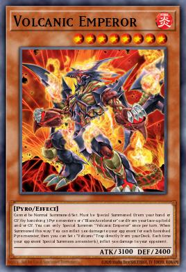
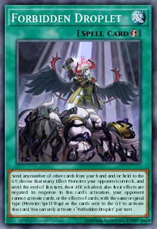
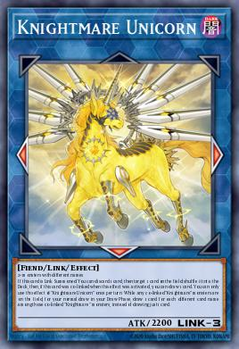

# Volcanic — I:P + Emperador → Unicornio: devolver una amenaza al Deck en turno rival

**ID nuevo:** `687:A09:IP:EMPEROR:UNICORN14`.

**Clase:** continuación situacional / decisión de tablero defensivo. **Propósito:** cambiar la presencia del Emperador Volcánico y su daño por Invocación Especial rival por una **retirada puntual que baraja una carta del campo al Deck** y un Link-3 protegido de destrucción por efectos de cartas del adversario. No niega activaciones ni realiza una destrucción.

**Estado inicial exacto de esta continuación (no una mano de una carta):** turno del rival, **Main Phase**; propios `I:P Masquerena` (CID 14676) boca arriba, `Volcanic Emperor` (CID 18915) boca arriba y **una carta descartable en mano**, por ejemplo `Forbidden Droplet / Gotas Prohibidas` (CID 15299, **Main 3x**), reservada desde el turno previo. En el Extra queda `Knightmare Unicorn` (CID 13601), sin invocar; zona de Enlace legal disponible. El rival controla una carta boca arriba o colocada que pueda seleccionarse y barajarse al Deck, y no responde ni impide Invocación/selección. **No hay Estatua-Barrera del Infierno ni Gozen Match activas**, ni otra restricción que impida la Invocación de un Link OSCURIDAD Demonio. No se usan monstruos de Side o Reserva.

**Conexión con el motor ya documentado:** el estado `Emperador + I:P` aparece como endboard de `687:A09:SITUACION:GO_FIRST:TROOPER_ROCKET_IP01` y de `687:A09:SITUACION:GO_FIRST:TROOPER_VBA_ROCKET_EJECTION_IP07`. Para esta variante se exige **conservar una carta adicional en mano**, no gastada en la apertura; si la guía anterior consumió toda la mano, no hay descarte y **no se puede prometer el efecto de Unicornio**. Las rutas de entrada siguen sujetas a su cotejo global independiente.

## Guía de 5 pasos con fotografías

### 1. Reconocer el campo que realmente tienes

 +  +  **EN MANO**

Emperador Volcánico tiene **3100 ATK** y castiga Invocaciones Especiales rivales con 500 puntos de daño por evento. I:P es **Enlace-2**. **Gotas Prohibidas** aquí es **solo la carta que vas a descartar**: no la activas ni niegas efectos con ella. Si prefieres mantener ambos monstruos o usar Gotas contra otra amenaza, no hagas la continuación.

### 2. Activar I:P en una Main Phase del oponente

 **EFECTO RÁPIDO** → **Preparar Enlace**

Durante una **Main Phase del rival**, activa el Efecto Rápido de I:P. Si resuelve sin impedimento, **inmediatamente después de esa resolución** Invoca por Enlace a un monstruo utilizando a I:P y otros materiales que controles. No es efecto para realizar la Invocación durante la Battle Phase.

### 3. Elegir el Link-3 exacto y enviar materiales al GY

 (**valor 2**) +  (**valor 1**) →  **LINK-3**

I:P y Emperador tienen **nombres distintos** y suman **3 valores de Enlace**; cumplen el requisito de Unicornio de **dos o más monstruos con nombres diferentes**. Ambos salen del Campo y se envían al GY como materiales. Ya no controlas Emperador: pierdes su presión de **3100 ATK** y los futuros 500 puntos de daño por Invocación Especial del rival. I:P usada como material confiere a Unicornio **protección frente a destrucción por efectos rivales**, no inmunidad general.

### 4. Activar el efecto de Unicornio con descarte real

 **INVOCA ENLACE** +  **DESCARTAR** → **CARTA RIVAL OBJETIVO**

En la siguiente ventana permitida tras la Invocación de Unicornio, activa su efecto opcional: **descarta Gotas de la mano como coste**, y **selecciona una carta del Campo** que pueda barajarse al Deck. Si el efecto resuelve, esa carta vuelve al Deck de su dueño. No se roba carta adicional en este escenario porque **no se presupone que Unicornio esté coenlazado** cuando se activa el efecto. No es destrucción, negación ni destierro.

### 5. Comparar el endboard y las respuestas que quedan

 **2200 ATK · ENLACE-3**

**Campo propio mínimo:** Unicornio de 2200 ATK. **GY propio:** I:P, Emperador y Gotas descartada; permanecen otras M/T que ya existieran (por ejemplo VBA o Inferno si eran parte del estado anterior y siguen allí). **Mano usada:** la carta de descarte se consumió. **Campo rival:** perdió una carta válida por haber sido barajada, si su efecto resolvió. **Efecto de I:P conservado en Unicornio:** no puede ser destruido por efectos de cartas del adversario; sí puede ser afectado por otros tipos de eliminación.

**Decisión central:** conservar I:P + Emperador si interesa daño recurrente por Invocaciones Especiales y conservar 3100 ATK; pasar a Unicornio si el rival presenta **una carta crítica cuyo retorno al Deck** vale más que esa presión y tienes descarte. No mostrar ambos tableros como resultados simultáneos.

## Fallos que deben evitarse

- **Sin carta en mano para descartar:** Unicornio puede Invocarse por Enlace, pero **no puede activar su efecto de retorno** sin pagar el descarte.
- **Rival sin carta seleccionable o una carta que no puede volver al Deck:** no anunciar retirada garantizada.
- **No tener a I:P y Emperador simultáneamente:** esta ruta es continuación; los dos materiales deben existir legalmente antes.
- **Encadenar I:P en un contexto de Battle Phase:** no; su efecto indica **Main Phase** del adversario.
- **Olvidar un bloqueo de Atributo o Invocación activo:** si una carta impide invocar a Unicornio OSCURIDAD, esta continuación no es legal; no se debe mantener simultáneamente como resultado con un bloqueo incompatible.
- **Confundir efecto de I:P con el de Unicornio:** I:P facilita la Invocación en turno rival; la carta que se baraja es seleccionada **por el efecto activado de Unicornio** tras su Invocación.
- **Decir que Unicornio niega:** no niega el efecto de la carta objetivo; barajar un monstruo al Deck puede o no impedir que se resuelva un efecto previamente activado, según el texto de ese efecto.

## Fuentes oficiales

- [Konami — I:P Masquerena, CID 14676](https://www.db.yugioh-card.com/yugiohdb/card_search.action?cid=14676&ope=2&request_locale=en): condición de Main Phase rival, Invocación Enlace y protección concedida al monstruo que la utilizó.
- [Konami — Volcanic Emperor, CID 18915](https://www.db.yugioh-card.com/yugiohdb/card_search.action?cid=18915&ope=2&request_locale=en): 3100 ATK y daño de 500 por Invocación Especial rival.
- [Konami — Knightmare Unicorn, CID 13601](https://www.db.yugioh-card.com/yugiohdb/card_search.action?cid=13601&ope=2&request_locale=en): requisitos Enlace, descarte como coste, barajar carta seleccionada y robo solo con coenlace.

**Validación acotada:** se cotejó el procedimiento de esta **continuación específica** con efectos oficiales y un estado explícito. No extiende automáticamente esa validación a los pasos previos de las dos rutas base Volcanic ni a cambios de banlist.
