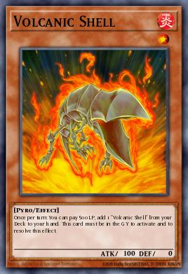
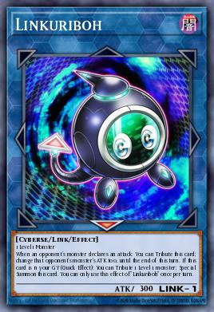

# Volcanic — Cartucho Volcánico → Enlacekuriboh: convertir un Nivel 1 en defensa

**ID nuevo:** `687:A09:SHELL:LINKURIBOH:DEFENSA15`.

**Clasificación:** interacción básica de motor + salida defensiva al Extra. **No es combo completo ni campo de negadores.** **Propósito:** sacar del campo un Nivel 1 propio para activar su recuperación desde Cementerio y conservar una respuesta de ATK ante una declaración de ataque enemiga. El efecto de Enlacekuriboh **no niega el ataque** y **no destruye** al atacante.

**Estado inicial exacto:** tu Main Phase, zona propia libre, Invocación Normal disponible; **1 × Volcanic Shell / Cartucho Volcánico** (CID 7082, **Main 3x**) en mano, al menos otra copia de Shell aún en Deck, **Linkuriboh / Enlacekuriboh** (CID 13346, **Extra 1x**) disponible. Tienes al menos 500 LP y no has usado el efecto de GY de esa Shell durante este turno. No hay bloqueos de invocación OSCURIDAD/Ciberso, ni respuestas que impidan el enlace o la búsqueda. La parte de batalla se muestra **solo si después** un monstruo oponente declara ataque mientras controlas Enlacekuriboh. Sin Side/Reserva en la mano inicial.

## Cinco pasos, con fotos y decisiones

### 1. Reconocer el recurso inicial

 **MAIN 3x · 1 EN MANO** →  **EXTRA 1x**

Shell es Piro FUEGO Nivel 1 con 100 ATK. Su valor aquí **no es el daño de batalla**: al ir al GY habilita una búsqueda que cuesta LP; como Nivel 1 permite la Invocación de Enlacekuriboh. El Enlace es OSCURIDAD/Ciberso, de modo que una restricción que impida ese Atributo o Tipo cancela esta ruta.

### 2. Invocar Normalmente a Shell

 **INVOCACIÓN NORMAL → CAMPO PROPIO**

Se consume tu Invocación Normal habitual. No confundir el texto de Shell con un efecto al ser invocado: su búsqueda solo puede activarse **mientras está en el GY**.

### 3. Invocar Enlacekuriboh con el material exacto

 **NIVEL 1, MATERIAL** →  **LINK-1 · 300 ATK**

Envía el Shell desde tu campo al GY como **material de Enlace**; no fue destruido por efecto y tampoco se descartó. Linkuriboh requiere exactamente **un monstruo de Nivel 1**, que Shell satisface. Quedas con Enlacekuriboh en campo y Shell en GY.

### 4. Convertir el Shell en recurso de mano

 **EN GY: PAGAR 500 LP** →  **OTRA COPIA A MANO**

En una ventana abierta válida, activa el efecto de Shell **desde GY**, paga **500 LP como coste** y, si sigue en GY al resolver y queda otra copia en el Deck, añade a mano **1 × Volcanic Shell**. Con 8000 LP iniciales y sin cambios, terminas con **7500 LP**. No puedes volver a activar el efecto de esa Shell en el mismo turno.

### 5. Usar la defensa cuando exista una declaración de ataque

 **ANTE ATAQUE RIVAL: SACRIFICAR** → **ATK DEL ATACANTE = 0** (hasta fin de turno)

**Durante un turno posterior o en cualquier ventana válida en la que siga en campo**, cuando un monstruo rival declara ataque, puedes Sacrificar Enlacekuriboh para cambiar el **ATK del monstruo atacante** a 0 hasta el final de ese turno. Enlacekuriboh va al GY por el Sacrificio. **No prometas que se evitó todo daño:** al desaparecer el objetivo del ataque puede producirse una repetición de ataque (*replay*) y el rival decidir cómo continuar según el estado del campo.

**Campo final al acabar tu Main Phase inicial:** Enlacekuriboh Link-1, 300 ATK; Shell original en GY, una segunda copia de Shell en mano si la búsqueda resolvió, 500 LP gastados y Normal utilizada. **Estado posible tras declarar el ataque rival y activar la defensa:** Enlacekuriboh en GY y ATK del atacante rival en 0 hasta End Phase, sujeto a las reglas de repetición de ataque. No son dos tableros simultáneos.

## Cuándo elegirla y cuándo no

- **Sí:** cuando Shell está en mano y deseas convertirla en una copia futura y un recurso Link defensivo. La siguiente Shell puede servir como munición para tus Aceleradores en una jugada posterior; no se activa un motor Blaze Accelerator por haber usado un Link.
- **No:** si tu Invocación Normal debe conservarse para Trooper/Rocket, no quedan Shell en Deck, no puedes pagar 500 LP, o una restricción FUEGO/Piro excluye al Link OSCURIDAD/Ciberso.
- **Alternativa de motor:** `687:A09:BLAZE:SHELL:RESOURCE01` coloca Shell en GY mediante Aceleradores y lo reutiliza sin gastar la Invocación Normal en este recorrido. **Elegir una ruta no significa ejecutar ambas.**
- **No prometer acceso infinito:** el efecto de Shell requiere seguir en GY tanto al activar como al resolver; la segunda copia añadida pasa a la mano, no regresa mágicamente a la zona propia del campo.
- **Recurso posterior condicionado:** si Linkuriboh ya está en tu GY y controlas un **Nivel 1 propio** que puedas Sacrificar, su otro Efecto Rápido puede revivirlo (máximo una vez por turno). **La Ficha Bomba que Trooper creó en campo rival NO es un monstruo propio** para este coste. Esta recuperación no pertenece al resultado base de los cinco pasos.

## Fuentes oficiales

- [Konami — Volcanic Shell, CID 7082](https://www.db.yugioh-card.com/yugiohdb/card_search.action?cid=7082&ope=2&request_locale=en): Nivel 1, pago de 500 LP, búsqueda en Deck y obligación de permanecer en GY para activar/resolver.
- [Konami — Linkuriboh, CID 13346](https://www.db.yugioh-card.com/yugiohdb/card_search.action?cid=13346&ope=2&request_locale=en): material Nivel 1, ATK 300, Sacrificio ante ataque y reaparición desde GY mediante Sacrificio de un Nivel 1 propio. Figura **Limitada** en TCG, pero el inventario aprobado contiene una sola copia.

**Validación acotada:** contraste de las dos cartas y del acceso mediante Shell Nivel 1 desde el Main actual. La respuesta de batalla depende de una declaración de ataque real y no es garantizada. Las restantes guías del deck siguen pendientes de revisión general.
