# Pyro

## APARTADO_01 — Perfil A01 importable 704

- **Arquetipo:** Pyro/FUEGO de Rush Duel con Skill Alchemy Blaze y Fusiones nombradas.
- **Tipo de estrategia:** Combo-Midrange de Piro/FUEGO: acceso a materiales, Fusión y presión de combate.
- **Estilo breve:** Alinea Piro/FUEGO y materiales boca arriba para Fusión; Alchemy Blaze busca recursos desde el turno 2 si se cumple el requisito de DEF. Salamandra y Arquero son salidas distintas.
- **Resumen para ficha:** Reúne Chromatographagas/Ember o Chemicalized Salamander/Ember y Fusión para llegar a Arquero o Salamandra. Alchemy Blaze ayuda desde el turno 2 con mano y Deck elegibles; cada Fusión exige materiales en el Campo y un efecto propio condicionado.
- **Cómo se juega:** Primero: desarrollar monstruos Piro/FUEGO y conservar Fusión/materiales sin prometer la Skill antes del turno 2. Segundo: si el rival controla monstruo, Hiperasistente Ember puede traer un Piro Nivel 7+ de la mano pagando su envío del Campo al Cementerio; después elegir materiales exactos para la Fusión. Medio/tardío: reusar materiales mediante Alchemy Blaze si todos los monstruos del Deck son FUEGO/Piro con DEF ≥100 y existe una carta revelable en mano. No usar materiales directamente desde la mano con la Mágica Fusión documentada.
- **Qué vigilar:** Alchemy Blaze exige turno 2+, revelar Chemicalized Salamander, Chromatographagas o Ember y que todos los monstruos del Deck sean Piro/FUEGO con DEF ≥100. Fusión usa monstruos boca arriba del Campo. Alchemicalize Salamandra destruye M/T propias y rivales y su rebaja de ATK depende de Magias realmente destruidas.

**Procedencia:** paquete estructurado de esta identidad con inventario vivo validado en solo lectura; ninguna importación de producción se atribuye a este cambio.

## APARTADO_02 — Continuidad del contenido anterior

> **Alcance editorial de todas las cartas y guías de este deck:** Las fichas son interpretaciones tácticas: costes, objetivos, ventanas y límites deben cotejarse con el texto oficial antes de acreditar una secuencia A09. Las guías explican funciones derivadas; no certifican nuevas invocaciones ni cadenas.

## IDENTIDAD BÁSICA

- `deck_id`: **704**
- Nombre registrado: **Pyro**
- Formato: **rush_duel**
- Main: **30**; Extra: **5**; Side: **0**; Reserva: **0**.

## APARTADO_01 — Análisis estratégico Pyro 704 verificable (23-11-2026)

**Identidad confirmada:** deck_id 704 · Rush Duel `rush_duel` · **Main 30** cartas (15 identidades), **Extra 5** cartas (dos identidades), Side/Reserva 0. La existencia del Extra es física en este deck, pero es opcional según las reglas generales de Rush Duel. Skill **Alchemy Blaze** separada del Main. No se considera la banlist.

### A01-T1 — Diagnóstico con fuentes y condiciones

- **Arquetipo/estilo:** Piro/FUEGO; motor Combo-Midrange de Fusión con materiales nombrados, extensores y control de M/T. No se equiparan todas las salidas de Extra a una única secuencia ni se anuncia victoria garantizada.
- **Motor principal:** `Fusión` CID 16934 (Main ×2) usa materiales **boca arriba en el Campo propio**, no de la mano. `Chromatographagas` CID 18583 (Main ×3) + `Ember the Super Assistant` CID 17963 (Main ×3) habilitan `Flame Archer the Super Graphagas` CID 19990 (Extra ×2). `Chemicalized Salamander` CID 17868 (Main ×2) + `Ember` CID 17963 habilitan `Alchemicalize Salamandra` CID 18614 (Extra ×3).
- **Skill:** `Alchemy Blaze` permite buscar dos cartas elegibles del Deck/Cementerio y después enviar una de la mano al Cementerio **a partir del turno 2** si se revela desde la mano Chemicalized Salamander, Chromatographagas o Ember the Super Assistant, y todos los monstruos del Deck son Piro/FUEGO con DEF >= 100. **Identidades de monstruos del Main acreditadas por CID:** Germalewe 17285 (DEF 400); Ember Hyper Assistant 19291 (DEF 1500); Chromatographagas 18583 (DEF 1600); Ember Super Assistant 17963 (DEF 1500); Chemicalized Salamander 17868 (DEF 1500); Flame Ruler 17926 (DEF 1600). Todas Piro/FUEGO. La comprobación de futuras versiones del inventario debe repetirse antes de ejecutar la Skill. La Skill no es una carta física Main.
- **Apoyos:** Hyper Assistant 19291 puede Invocar desde mano Piro Nivel 7+ pagando su envío desde el Campo, solo con monstruo rival existente. Secret Order 17212 extiende un Normal Nivel 7. Flame Ruler 17926 puede contar por dos Tributos para una Invocación por Sacrificio válida en Ataque; **no** equivale a dos materiales de Fusión. Burning Blaze 16171 exige dos Piros boca arriba y puede destruir una M/T rival.
- **Primero:** formar mesa y conservar Fusión/materiales; la Skill está bloqueada por turno. **Segundo:** aprovechar los materiales reales y escoger Arquero (presión) frente a Salamandra (limpieza de backrow). **Medio/tardío:** recuperar piezas con Skill bajo condiciones verificables y medir recursos del Cementerio.
- **Condiciones de victoria/riesgos:** presión o retirada de M/T con Fusión legal; manos con pieza suelta sin materiales, falta de monstruos boca arriba, efecto de Salamandra que destruye también M/T propias, Skill inválida antes de turno 2, y ventanas de efectos de Extra condicionadas. Ninguna de las rutas documentales equivale a replay certificado.
- **Fuentes:** [Konami — Fusión Rush 16934](https://www.db.yugioh-card.com/rushdb/card_search.action?cid=16934&ope=2), [Konami — Salamandra 18614](https://www.db.yugioh-card.com/rushdb/card_search.action?cid=18614&ope=2), [Konami — Arquero 19990](https://www.db.yugioh-card.com/rushdb/card_search.action?cid=19990&ope=2), [Alchemy Blaze — Duel Links Meta](https://www.duellinksmeta.com/skills/Alchemy%20Blaze). Las traducciones españolas de efectos siguen siendo paráfrasis, no una sustitución del texto oficial.

### A01-T2 — Seis campos de ficha redactados, pendientes de paridad

- **Arquetipo:** Pyro/FUEGO de Rush Duel con Skill Alchemy Blaze y Fusiones nombradas.
- **Tipo de estrategia:** Combo-Midrange de Piro/FUEGO: acceso a materiales, Fusión y presión de combate.
- **Estilo breve:** Alinea Piro/FUEGO y materiales boca arriba para Fusión; Alchemy Blaze busca recursos desde el turno 2 si se cumple el requisito de DEF. Salamandra y Arquero son salidas distintas.
- **Resumen para ficha:** Reúne Chromatographagas/Ember o Chemicalized Salamander/Ember y Fusión para llegar a Arquero o Salamandra. Alchemy Blaze ayuda desde el turno 2 con mano y Deck elegibles; cada Fusión exige materiales en el Campo y un efecto propio condicionado.
- **Cómo se juega:** Primero: desarrollar monstruos Piro/FUEGO y conservar Fusión/materiales sin prometer la Skill antes del turno 2. Segundo: si el rival controla monstruo, Hiperasistente Ember puede traer un Piro Nivel 7+ de la mano pagando su envío del Campo al Cementerio; después elegir materiales exactos para la Fusión. Medio/tardío: reusar materiales mediante Alchemy Blaze si todos los monstruos del Deck son FUEGO/Piro con DEF ≥100 y existe una carta revelable en mano. No usar materiales directamente desde la mano con la Mágica Fusión documentada.
- **Qué vigilar:** Alchemy Blaze exige turno 2+, revelar Chemicalized Salamander, Chromatographagas o Ember y que todos los monstruos del Deck sean Piro/FUEGO con DEF ≥100. Fusión usa monstruos boca arriba del Campo. Alchemicalize Salamandra destruye M/T propias y rivales y su rebaja de ATK depende de Magias realmente destruidas.

**Control de longitud:** Estilo breve 179/190; Resumen para ficha 244/250. **Estado T2 bloqueado:** no afirmar paridad documental/JSON hasta que el deck tenga `datos/stationx-deck.json` con IDs/huella nativa y se coteje `record.profile` literal.

### A01-T3 — Censo completo de identidades, usos y condiciones

| CID Rush | Carta | Sección/copias físicas | Propósito | Requisito de activación | Efecto/resolución documentado |
|---|---|---|---|---|---|
| [15204](https://www.db.yugioh-card.com/rushdb/card_search.action?cid=15204&ope=2) | ¡Atraviesa! | Main ×1 | Presión de combate/penetración | Sin requisito de activación. | Otorga daño de penetración este turno a un monstruo propio boca arriba. |
| [17285](https://www.db.yugioh-card.com/rushdb/card_search.action?cid=17285&ope=2) | Germalewe | Main ×3 | Normal Piro; cuerpo físico | No tiene efecto. | Monstruo Normal; recurso para sacrificar o emplear como material. |
| [17212](https://www.db.yugioh-card.com/rushdb/card_search.action?cid=17212&ope=2) | Orden Secreta | Main ×3 | Recuperación de Normal Nivel 7 | Sin requisito de activación. | Invoca un monstruo Normal de Nivel 7 desde mano o Cementerio; le da 700 ATK ese turno y lo protege frente a destrucción por Trampas rivales. |
| [19291](https://www.db.yugioh-card.com/rushdb/card_search.action?cid=19291&ope=2) | Hiperasistente Ember | Main ×3 | Extensión desde mano a Campo | El rival debe controlar un monstruo; enviar esta carta boca arriba propia al Cementerio. | Invoca desde la mano un Piro de Nivel 7+; si SP Assistant Archer está en el Cementerio, ese monstruo gana 800 ATK este turno. |
| [18583](https://www.db.yugioh-card.com/rushdb/card_search.action?cid=18583&ope=2) | Cromatográfagas | Main ×3 | Material nombrado de Fusión | No tiene efecto. | Monstruo Normal de Nivel 7 y material nombrado de Supergráfagas Archer. |
| [17963](https://www.db.yugioh-card.com/rushdb/card_search.action?cid=17963&ope=2) | Superasistente Ember | Main ×3 | Material nombrado de ambas Fusiones | No tiene efecto. | Monstruo Normal de Nivel 1, material nombrado de dos Fusiones del Extra. |
| [16934](https://www.db.yugioh-card.com/rushdb/card_search.action?cid=16934&ope=2) | Fusión | Main ×2 | Invocación por Fusión desde Campo | Sin requisito de activación. | Usa monstruos boca arriba del Campo propio como materiales, enviándolos al Cementerio para una Invocación por Fusión válida; no usa automáticamente materiales de la mano. |
| [16171](https://www.db.yugioh-card.com/rushdb/card_search.action?cid=16171&ope=2) | Fuego Ardiente | Main ×3 | Daño y remoción condicional de M/T | Controlar dos o más monstruos Piro boca arriba. | Inflige 300 puntos de daño; después puede destruir una Mágica/Trampa rival. |
| [17868](https://www.db.yugioh-card.com/rushdb/card_search.action?cid=17868&ope=2) | Salamandra Quimicalizada | Main ×2 | Debilitar monstruos rivales | Devolver al Deck tres monstruos Piro del propio Cementerio. | Todos los monstruos boca arriba rivales pierden 100 ATK por cada monstruo en el Cementerio rival hasta fin de turno. |
| [18646](https://www.db.yugioh-card.com/rushdb/card_search.action?cid=18646&ope=2) | Gelatina Defensiva | Main ×1 | Prevención de daño con coste | Cuando un monstruo rival de Nivel 8 o inferior declara ataque. | Envía al Cementerio la carta superior de tu Deck y evita todo el daño de batalla ese turno; si tienes 3000 LP o más, recibes además 2000 de daño de efecto. |
| [19700](https://www.db.yugioh-card.com/rushdb/card_search.action?cid=19700&ope=2) | Amparo del Protector Estelar | Main ×2 | Defensa; límite de ataques rival | En el turno rival, cuando roba o Invoca un monstruo; enviar un monstruo propio del Campo al Cementerio. | El rival solo puede declarar un ataque en ese turno. Opcionalmente permite tomar control de una Fusión Caballero Mágico rival de Nivel 9+ y ATK original 3000. |
| [16776](https://www.db.yugioh-card.com/rushdb/card_search.action?cid=16776&ope=2) | Parar la Defensa | Main ×1 | Cambiar posición del rival | Sin requisito de activación. | Cambia un monstruo rival que esté en Defensa a Ataque boca arriba. |
| [15913](https://www.db.yugioh-card.com/rushdb/card_search.action?cid=15913&ope=2) | Agujero Trampa | Main ×1 | Respuesta a Invocación Normal | Cuando el rival Invoca de Modo Normal un monstruo de al menos 1000 ATK. | Destruye ese monstruo invocado. |
| [17926](https://www.db.yugioh-card.com/rushdb/card_search.action?cid=17926&ope=2) | Gobernante de las Llamas | Main ×1 | Habilitador de doble Tributo | No necesita activación. | Esta carta boca arriba cuenta por dos Sacrificios para Invocar por Sacrificio en Ataque un monstruo de FUEGO. |
| [16372](https://www.db.yugioh-card.com/rushdb/card_search.action?cid=16372&ope=2) | Olla de la Codicia | Main ×1 | Robo | Sin requisito de activación. | Roba dos cartas. |
| [19990](https://www.db.yugioh-card.com/rushdb/card_search.action?cid=19990&ope=2) | Arquero Ígneo Supergráfagas | Extra ×2 | Fusión; ataque condicional | Fusionar Chromatographagas + SP Assistant Archer. Devolver al tope del Deck un Piro Normal de Nivel 7 del Cementerio. | Gana 2500 ATK este turno; opcionalmente reduce en 1500 ATK un monstruo rival boca arriba de Nivel 9 o inferior. |
| [18614](https://www.db.yugioh-card.com/rushdb/card_search.action?cid=18614&ope=2) | Salamandra Alquimicalizada | Extra ×3 | Fusión; limpieza de M/T de ambos jugadores | Fusionar Chemicalized Salamander + SP Assistant Archer; usar efecto en la Main Phase en que se invocó de Modo Especial. | Destruye todas las Mágicas/Trampas de ambos Campos y opcionalmente reduce 1000 ATK a los monstruos rivales por cada Mágica destruida. |

**Trazabilidad:** 17/17 identidades, 30 copias Main y 5 Extra preservadas. Rutas ya presentes en esta fuente: `704:A09:ALCHEMY:ARCHER01`, `704:A09:ALCHEMY:SALAMANDRA02` y `704:A09:V11:HYPER:CHEMICALIZED:PIERCE`; son referencias documentales condicionadas, no certificaciones de ejecución. Los vínculos `effect_id` aún no concordados se conservan como `PENDIENTE_DE_ENLACE_A05_A09`, sin crear identificadores. Verificar antes de A05/A07 los casos de coste, restricciones y ventanas de los efectos.

### A01-T4 / A01-T5 — Bloqueos con siguiente acción

- **T4:** falta fuente JSON canónica nativa del deck 704; no inventar `inventory_sha256`, `a01_profile_contract` ni campos faltantes.
- **T5:** falta probar paquete auténtico ZIP contra importación, exportación, rechazado de identidad/firma y render de Station X para este deck; el inventario y fotos existentes no se tocan.
- **A10B:** no solicitado; no convertir este estudio en operadores ejecutables ni fabricar replays.

## CONTROL_DE_TAREAS_A01_A10

**Manifest:** `station-x-a01-a10-task-manifest/1` · deck_id **704** · **T1 y T3 evidenciadas**, T2/T4/T5 pendientes por paquete y pruebas físicas. La documentación previa A02–A10 se mantiene, sin cierre retroactivo de tareas del contrato nuevo.

### A01
- [x] **A01-T1** — EVIDENCIA INDIVIDUAL EN SECCIÓN APARTADO_01: inventario, CID, efectos/condiciones, Skill y rutas.
- [ ] **A01-T2** — BLOQUEADA: perfil de seis campos redactado pero sin paridad JSON.
- [x] **A01-T3** — EVIDENCIA INDIVIDUAL EN SECCIÓN APARTADO_01: inventario, CID, efectos/condiciones, Skill y rutas.
- [ ] **A01-T4** — BLOQUEADA: no hay JSON canónico original para comparación literal y firma.
- [ ] **A01-T5** — BLOQUEADA: import/export/render físico del paquete no certificado.

### A02
- [ ] **A02-T1** — NO CERTIFICADA: conservar estudios previos sin convertirlos en evidencia de tarea actual.
- [ ] **A02-T2** — NO CERTIFICADA: conservar estudios previos sin convertirlos en evidencia de tarea actual.
- [ ] **A02-T3** — NO CERTIFICADA: conservar estudios previos sin convertirlos en evidencia de tarea actual.

### A03
- [ ] **A03-T1** — NO CERTIFICADA: conservar estudios previos sin convertirlos en evidencia de tarea actual.
- [ ] **A03-T2** — NO CERTIFICADA: conservar estudios previos sin convertirlos en evidencia de tarea actual.
- [ ] **A03-T3** — NO CERTIFICADA: conservar estudios previos sin convertirlos en evidencia de tarea actual.

### A04
- [ ] **A04-T1** — NO CERTIFICADA: conservar estudios previos sin convertirlos en evidencia de tarea actual.
- [ ] **A04-T2** — NO CERTIFICADA: conservar estudios previos sin convertirlos en evidencia de tarea actual.
- [ ] **A04-T3** — NO CERTIFICADA: conservar estudios previos sin convertirlos en evidencia de tarea actual.

### A05
- [ ] **A05-T1** — NO CERTIFICADA: conservar estudios previos sin convertirlos en evidencia de tarea actual.
- [ ] **A05-T2** — NO CERTIFICADA: conservar estudios previos sin convertirlos en evidencia de tarea actual.
- [ ] **A05-T3** — NO CERTIFICADA: conservar estudios previos sin convertirlos en evidencia de tarea actual.
- [ ] **A05-T4** — NO CERTIFICADA: conservar estudios previos sin convertirlos en evidencia de tarea actual.

### A06
- [ ] **A06-T1** — NO CERTIFICADA: conservar estudios previos sin convertirlos en evidencia de tarea actual.
- [ ] **A06-T2** — NO CERTIFICADA: conservar estudios previos sin convertirlos en evidencia de tarea actual.
- [ ] **A06-T3** — NO CERTIFICADA: conservar estudios previos sin convertirlos en evidencia de tarea actual.
- [ ] **A06-T4** — NO CERTIFICADA: conservar estudios previos sin convertirlos en evidencia de tarea actual.

### A07
- [ ] **A07-T1** — NO CERTIFICADA: conservar estudios previos sin convertirlos en evidencia de tarea actual.
- [ ] **A07-T2** — NO CERTIFICADA: conservar estudios previos sin convertirlos en evidencia de tarea actual.
- [ ] **A07-T3** — NO CERTIFICADA: conservar estudios previos sin convertirlos en evidencia de tarea actual.
- [ ] **A07-T4** — NO CERTIFICADA: conservar estudios previos sin convertirlos en evidencia de tarea actual.

### A08
- [ ] **A08-T1** — NO CERTIFICADA: conservar estudios previos sin convertirlos en evidencia de tarea actual.
- [ ] **A08-T2** — NO CERTIFICADA: conservar estudios previos sin convertirlos en evidencia de tarea actual.
- [ ] **A08-T3** — NO CERTIFICADA: conservar estudios previos sin convertirlos en evidencia de tarea actual.
- [ ] **A08-T4** — NO CERTIFICADA: conservar estudios previos sin convertirlos en evidencia de tarea actual.

### A09
- [ ] **A09-T1** — NO CERTIFICADA: conservar estudios previos sin convertirlos en evidencia de tarea actual.
- [ ] **A09-T2** — NO CERTIFICADA: conservar estudios previos sin convertirlos en evidencia de tarea actual.
- [ ] **A09-T3** — NO CERTIFICADA: conservar estudios previos sin convertirlos en evidencia de tarea actual.
- [ ] **A09-T4** — NO CERTIFICADA: conservar estudios previos sin convertirlos en evidencia de tarea actual.

### A10A
- [ ] **A10A-T1** — NO CERTIFICADA: conservar estudios previos sin convertirlos en evidencia de tarea actual.
- [ ] **A10A-T2** — NO CERTIFICADA: conservar estudios previos sin convertirlos en evidencia de tarea actual.
- [ ] **A10A-T3** — NO CERTIFICADA: conservar estudios previos sin convertirlos en evidencia de tarea actual.

### A10B (A10B opt-in no solicitado)
- [ ] **A10B-T4** — NO CERTIFICADA: conservar estudios previos sin convertirlos en evidencia de tarea actual.
- [ ] **A10B-T5** — NO CERTIFICADA: conservar estudios previos sin convertirlos en evidencia de tarea actual.
- [ ] **A10B-T6** — NO CERTIFICADA: conservar estudios previos sin convertirlos en evidencia de tarea actual.

---
## PERFIL BREVE — CONOCE TU DECK

- **Arquetipo:** Piro/FUEGO de Rush Duel con la habilidad Alchemy Blaze.
- **Tipo de estrategia:** Invocaciones por Fusión a partir de materiales nombrados.
- **Estilo de juego:** despliegue de cuerpos, preparación de materiales y presión de combate.
- **Cómo se juega:** los monstruos Piro permiten reunir los materiales que exige cada Fusión; las cartas de apoyo y Alchemy Blaze amplían las opciones solo al cumplir sus requisitos locales.
- **Cartas representativas:** Germalewe, Ember, Chemicalized Salamander y la habilidad Alchemy Blaze.
- **Qué vigilar:** materiales boca arriba, momento de Fusión y disponibilidad de la habilidad; la Skill no pertenece a la mano.

### A02 — Decisión táctica por mano y ventana (síntesis del perfil)

- Con nombres de Fusión completos, evaluar procedimiento de Fusión antes del combate; si falta uno, desarrollar cuerpos sin prometer un jefe. Aplicar Alchemy Blaze solo en su ventana y con sus condiciones cumplidas.
- **Estado de evidencia:** criterio orientativo basado en el perfil; los pasos, costes y campos finales se acreditan exclusivamente en A07–A09.

### A03 — Integridad del inventario físico por zonas

- **Conteo recibido:** 30 Main · 5 Extra · 0 Side · 0 Reserva; Skill registrada fuera de mano. No convertir Reserva en Side ni una Skill en carta de mano.
- **Control:** la lista individual y su CID/fotografía prevalecen ante cualquier ejemplo táctico; no se crean, sustituyen ni retiran cartas en esta sección.

## CARTAS: FUNCIÓN, RESTRICCIONES Y UTILIDAD

#### 01. ¡Atraviesa!

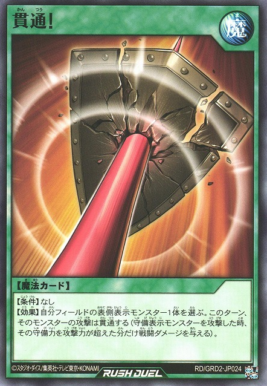

- **Zona y copias:** Main **1x**. CID Rush: **15204**.
- **Rol funcional:** Carta Mágica Normal — presión de combate / modificación de estadísticas.
- **Estado de sinergia y función:** Sinergia indirecta (soporte o recursos). Es una clasificación de juego; revisar la relación concreta en A06.
- **Papel como recurso, descarte o coste:** Coste o consumo descrito en A05: comprobar zona, objetivos y ventana; el nombre de la carta no reemplaza su texto.
- **Requisito específico:** Sin requisito de activación.
- **Efecto / resultado concreto:** Otorga daño de penetración este turno a un monstruo propio boca arriba.
- **Ir primero, segundo y juego tardío:** Primero: usarla si su efecto abre recursos o deja protección aprovechable; segundo: priorizar su resultado concreto frente a las amenazas rivales; tardío: comprobar materiales, objetivos y si aún quedan recursos en Deck o Cementerio.
- **Relación con habilidad y otras piezas:** La Skill **ALCHEMY BLAZE** necesita revelador válido y requisitos de construcción; no se activa libremente en turno 1.
- **Riesgos y dependencias:** comprobar zona, objetivos y ventana; el nombre de la carta no reemplaza su texto.
- **Confianza:** **RESUMEN_FUNCIONAL_DE_GUIA_PREVIA_CON_FUENTE_KONAMI**; pendiente cotejo adicional de traducción/ventanas según la liga. Fuente Rush oficial: https://www.db.yugioh-card.com/rushdb/card_search.action?cid=15204&ope=2
- **Contraste de fuente Rush:** CID 15204: fuente oficial Rush consultada en japonés; tipo Carta Mágica Normal; descripción funcional en español procede de la guía previa y sigue siendo interpretación editorial.
- **Aplicación concreta dentro de este deck (A06):** Otorga daño de penetración este turno a un monstruo propio boca arriba.

**USO PRÁCTICO Y SINERGIA — ¡Atraviesa!**

- **Label funcional:** Sinergia indirecta. Clasificación documental; una relación es válida solo si se satisfacen sus condiciones exactas.
- **Qué hace:** Otorga daño de penetración este turno a un monstruo propio boca arriba.
- **Cuándo tener precaución:** comprobar zona, objetivos y ventana; el nombre de la carta no reemplaza su texto.

#### 02. Germalewe

- **Zona y copias:** Main **3x**. CID Rush: **17285**.
- **Rol funcional:** Monstruo Normal — material de Fusión/Sacrificio o presencia de combate; sin efecto activado.
- **Estado de sinergia y función:** Sinergia indirecta de recursos. Es una clasificación de juego; revisar la relación concreta en A06.
- **Papel como recurso, descarte o coste:** Material o destino del Extra condicionado a los requisitos de invocación.
- **Requisito específico:** No tiene efecto.
- **Efecto / resultado concreto:** Monstruo Normal; recurso para sacrificar o emplear como material.
- **Ir primero, segundo y juego tardío:** Primero: conservarlo si es material expresamente exigido por una Fusión o Sacrificio; segundo: emplearlo como cuerpo solo tras calcular ATK y riesgo de batalla; tardío: recurso para reconstruir material desde el GY si una carta lo autoriza.
- **Relación con habilidad y otras piezas:** **ALCHEMY BLAZE**, desde turno 2 y si se cumple el predicado de Pyro/FUEGO/DEF, puede recuperar dos piezas aptas; luego obliga a enviar una carta de mano.
- **Riesgos y dependencias:** no atribuirle un efecto activado inexistente; comprobar su función como material y las cartas de soporte. verificar en campo los materiales nombrados y el momento legal de la Fusión Rush; no usar materiales de mano sin permiso textual.
- **Confianza:** **RESUMEN_FUNCIONAL_DE_GUIA_PREVIA_CON_FUENTE_KONAMI**; pendiente cotejo adicional de traducción/ventanas según la liga. Fuente Rush oficial: https://www.db.yugioh-card.com/rushdb/card_search.action?cid=17285&ope=2
- **Contraste de fuente Rush:** CID 17285: fuente oficial Rush consultada en japonés; tipo Monstruo Normal; descripción funcional en español procede de la guía previa y sigue siendo interpretación editorial.
- **Aplicación concreta dentro de este deck (A06):** Monstruo Normal; recurso para sacrificar o emplear como material. Aportación posible como material, coste o objetivo; verificar consumidor.

**USO PRÁCTICO Y SINERGIA — Germalewe**

- **Label funcional:** Sinergia indirecta. Clasificación documental; una relación es válida solo si se satisfacen sus condiciones exactas.
- **Qué hace:** Monstruo Normal; recurso para sacrificar o emplear como material.
- **Cómo aprovecharla en este deck:** Monstruo Normal; recurso para sacrificar o emplear como material. Aportación posible como material, coste o objetivo; verificar consumidor.
- **Cuándo tener precaución:** no atribuirle un efecto activado inexistente; comprobar su función como material y las cartas de soporte. verificar en campo los materiales nombrados y el momento legal de la Fusión Rush; no usar materiales de mano sin permiso textual.

#### 03. Orden Secreta

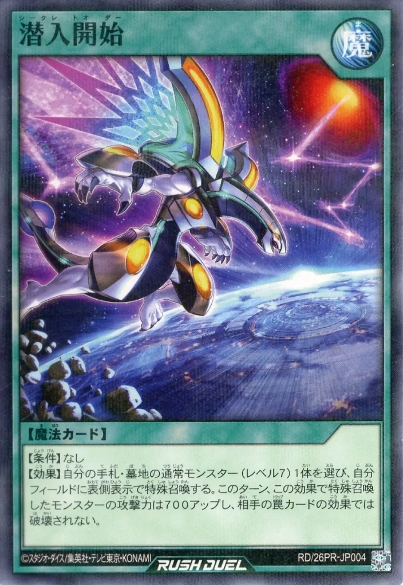

- **Zona y copias:** Main **3x**. CID Rush: **17212**.
- **Rol funcional:** Carta Mágica Normal — recurso táctico cuya condición y resultado están descritos en su ficha.
- **Estado de sinergia y función:** Sinergia directa descrita. Es una clasificación de juego; revisar la relación concreta en A06.
- **Papel como recurso, descarte o coste:** Coste o consumo descrito en A05: la condición de una Mágica/Trampa y sus blancos deben cumplirse antes de resolver. No confundir esta carta con un monstruo….
- **Requisito específico:** Sin requisito de activación.
- **Efecto / resultado concreto:** Invoca un monstruo Normal de Nivel 7 desde mano o Cementerio; le da 700 ATK ese turno y lo protege frente a destrucción por Trampas rivales.
- **Ir primero, segundo y juego tardío:** Primero: usarla si su efecto abre recursos o deja protección aprovechable; segundo: priorizar su resultado concreto frente a las amenazas rivales; tardío: comprobar materiales, objetivos y si aún quedan recursos en Deck o Cementerio.
- **Relación con habilidad y otras piezas:** **ALCHEMY BLAZE**, desde turno 2 y si se cumple el predicado de Pyro/FUEGO/DEF, puede recuperar dos piezas aptas; luego obliga a enviar una carta de mano.
- **Riesgos y dependencias:** la condición de una Mágica/Trampa y sus blancos deben cumplirse antes de resolver. No confundir esta carta con un monstruo ni usarla como material.
- **Confianza:** **RESUMEN_FUNCIONAL_DE_GUIA_PREVIA_CON_FUENTE_KONAMI**; pendiente cotejo adicional de traducción/ventanas según la liga. Fuente Rush oficial: https://www.db.yugioh-card.com/rushdb/card_search.action?cid=17212&ope=2
- **Contraste de fuente Rush:** CID 17212: fuente oficial Rush consultada en japonés; tipo Carta Mágica Normal; descripción funcional en español procede de la guía previa y sigue siendo interpretación editorial.
- **Aplicación concreta dentro de este deck (A06):** Invoca un monstruo Normal de Nivel 7 desde mano o Cementerio; le da 700 ATK ese turno y lo protege frente a destrucción por Trampas rivales.

**USO PRÁCTICO Y SINERGIA — Orden Secreta**

- **Label funcional:** Sinergia directa. Clasificación documental; una relación es válida solo si se satisfacen sus condiciones exactas.
- **Qué hace:** Invoca un monstruo Normal de Nivel 7 desde mano o Cementerio; le da 700 ATK ese turno y lo protege frente a destrucción por Trampas rivales.
- **Cuándo tener precaución:** la condición de una Mágica/Trampa y sus blancos deben cumplirse antes de resolver. No confundir esta carta con un monstruo ni usarla como material.

#### 04. Hiperasistente Ember

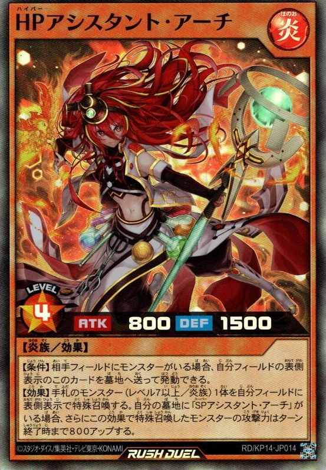

- **Zona y copias:** Main **3x**. CID Rush: **19291**.
- **Rol funcional:** Monstruo de Efecto — extensor / habilitador de material.
- **Estado de sinergia y función:** Sinergia directa descrita. Es una clasificación de juego; revisar la relación concreta en A06.
- **Papel como recurso, descarte o coste:** Coste o consumo descrito en A05: pagar/cumplir el requisito escrito antes de prometer la resolución.
- **Requisito específico:** El rival debe controlar un monstruo; enviar esta carta boca arriba propia al Cementerio.
- **Efecto / resultado concreto:** Invoca desde la mano un Piro de Nivel 7+; si SP Assistant Archer está en el Cementerio, ese monstruo gana 800 ATK este turno.
- **Ir primero, segundo y juego tardío:** Primero: preparar acceso y campo necesario sin gastar la respuesta antes de tiempo; segundo: usarla para abrir combate o retirar la amenaza que cumple su condición; tardío: evaluar si quedan objetivos reales.
- **Relación con habilidad y otras piezas:** **ALCHEMY BLAZE**, desde turno 2 y si se cumple el predicado de Pyro/FUEGO/DEF, puede recuperar dos piezas aptas; luego obliga a enviar una carta de mano.
- **Riesgos y dependencias:** pagar/cumplir el requisito escrito antes de prometer la resolución.
- **Confianza:** **RESUMEN_FUNCIONAL_DE_GUIA_PREVIA_CON_FUENTE_KONAMI**; pendiente cotejo adicional de traducción/ventanas según la liga. Fuente Rush oficial: https://www.db.yugioh-card.com/rushdb/card_search.action?cid=19291&ope=2
- **Contraste de fuente Rush:** CID 19291: fuente oficial Rush consultada en japonés; tipo Monstruo de Efecto; descripción funcional en español procede de la guía previa y sigue siendo interpretación editorial.
- **Aplicación concreta dentro de este deck (A06):** Invoca desde la mano un Piro de Nivel 7+; si SP Assistant Archer está en el Cementerio, ese monstruo gana 800 ATK este turno.

**USO PRÁCTICO Y SINERGIA — Hiperasistente Ember**

- **Label funcional:** Sinergia directa. Clasificación documental; una relación es válida solo si se satisfacen sus condiciones exactas.
- **Qué hace:** Invoca desde la mano un Piro de Nivel 7+; si SP Assistant Archer está en el Cementerio, ese monstruo gana 800 ATK este turno.
- **Cuándo tener precaución:** pagar/cumplir el requisito escrito antes de prometer la resolución.

#### 05. Cromatográfagas

- **Zona y copias:** Main **3x**. CID Rush: **18583**.
- **Rol funcional:** Monstruo Normal — material de Fusión/Sacrificio o presencia de combate; sin efecto activado.
- **Estado de sinergia y función:** Sinergia indirecta (soporte o recursos). Es una clasificación de juego; revisar la relación concreta en A06.
- **Papel como recurso, descarte o coste:** Material o destino del Extra condicionado a los requisitos de invocación.
- **Requisito específico:** No tiene efecto.
- **Efecto / resultado concreto:** Monstruo Normal de Nivel 7 y material nombrado de Supergráfagas Archer.
- **Ir primero, segundo y juego tardío:** Primero: conservarlo si es material expresamente exigido por una Fusión o Sacrificio; segundo: emplearlo como cuerpo solo tras calcular ATK y riesgo de batalla; tardío: recurso para reconstruir material desde el GY si una carta lo autoriza.
- **Relación con habilidad y otras piezas:** **ALCHEMY BLAZE**, desde turno 2 y si se cumple el predicado de Pyro/FUEGO/DEF, puede recuperar dos piezas aptas; luego obliga a enviar una carta de mano.
- **Riesgos y dependencias:** no atribuirle un efecto activado inexistente; comprobar su función como material y las cartas de soporte. verificar en campo los materiales nombrados y el momento legal de la Fusión Rush; no usar materiales de mano sin permiso textual.
- **Confianza:** **RESUMEN_FUNCIONAL_DE_GUIA_PREVIA_CON_FUENTE_KONAMI**; pendiente cotejo adicional de traducción/ventanas según la liga. Fuente Rush oficial: https://www.db.yugioh-card.com/rushdb/card_search.action?cid=18583&ope=2
- **Contraste de fuente Rush:** CID 18583: fuente oficial Rush consultada en japonés; tipo Monstruo Normal; descripción funcional en español procede de la guía previa y sigue siendo interpretación editorial.
- **Aplicación concreta dentro de este deck (A06):** Monstruo Normal de Nivel 7 y material nombrado de Supergráfagas Archer.

**USO PRÁCTICO Y SINERGIA — Cromatográfagas**

- **Label funcional:** Sinergia indirecta. Clasificación documental; una relación es válida solo si se satisfacen sus condiciones exactas.
- **Qué hace:** Monstruo Normal de Nivel 7 y material nombrado de Supergráfagas Archer.
- **Cuándo tener precaución:** no atribuirle un efecto activado inexistente; comprobar su función como material y las cartas de soporte. verificar en campo los materiales nombrados y el momento legal de la Fusión Rush; no usar materiales de mano sin permiso textual.

#### 06. Superasistente Ember

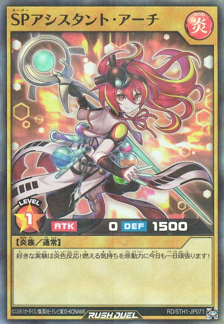

- **Zona y copias:** Main **3x**. CID Rush: **17963**.
- **Rol funcional:** Monstruo Normal — material de Fusión/Sacrificio o presencia de combate; sin efecto activado.
- **Estado de sinergia y función:** Sinergia indirecta (soporte o recursos). Es una clasificación de juego; revisar la relación concreta en A06.
- **Papel como recurso, descarte o coste:** Material o destino del Extra condicionado a los requisitos de invocación.
- **Requisito específico:** No tiene efecto.
- **Efecto / resultado concreto:** Monstruo Normal de Nivel 1, material nombrado de dos Fusiones del Extra.
- **Ir primero, segundo y juego tardío:** Primero: conservarlo si es material expresamente exigido por una Fusión o Sacrificio; segundo: emplearlo como cuerpo solo tras calcular ATK y riesgo de batalla; tardío: recurso para reconstruir material desde el GY si una carta lo autoriza.
- **Relación con habilidad y otras piezas:** **ALCHEMY BLAZE**, desde turno 2 y si se cumple el predicado de Pyro/FUEGO/DEF, puede recuperar dos piezas aptas; luego obliga a enviar una carta de mano.
- **Riesgos y dependencias:** no atribuirle un efecto activado inexistente; comprobar su función como material y las cartas de soporte. verificar en campo los materiales nombrados y el momento legal de la Fusión Rush; no usar materiales de mano sin permiso textual.
- **Confianza:** **RESUMEN_FUNCIONAL_DE_GUIA_PREVIA_CON_FUENTE_KONAMI**; pendiente cotejo adicional de traducción/ventanas según la liga. Fuente Rush oficial: https://www.db.yugioh-card.com/rushdb/card_search.action?cid=17963&ope=2
- **Contraste de fuente Rush:** CID 17963: fuente oficial Rush consultada en japonés; tipo Monstruo Normal; descripción funcional en español procede de la guía previa y sigue siendo interpretación editorial.
- **Aplicación concreta dentro de este deck (A06):** Monstruo Normal de Nivel 1, material nombrado de dos Fusiones del Extra.

**USO PRÁCTICO Y SINERGIA — Superasistente Ember**

- **Label funcional:** Sinergia indirecta. Clasificación documental; una relación es válida solo si se satisfacen sus condiciones exactas.
- **Qué hace:** Monstruo Normal de Nivel 1, material nombrado de dos Fusiones del Extra.
- **Cuándo tener precaución:** no atribuirle un efecto activado inexistente; comprobar su función como material y las cartas de soporte. verificar en campo los materiales nombrados y el momento legal de la Fusión Rush; no usar materiales de mano sin permiso textual.

#### 07. Fusión

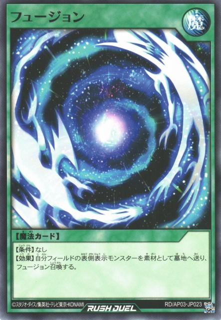

- **Zona y copias:** Main **2x**. CID Rush: **16934**.
- **Rol funcional:** Carta Mágica Normal — extensor / habilitador de material.
- **Estado de sinergia y función:** Sinergia indirecta (soporte o recursos). Es una clasificación de juego; revisar la relación concreta en A06.
- **Papel como recurso, descarte o coste:** Material o destino del Extra condicionado a los requisitos de invocación.
- **Requisito específico:** Sin requisito de activación.
- **Efecto / resultado concreto:** Usa monstruos boca arriba del Campo propio como materiales, enviándolos al Cementerio para una Invocación por Fusión válida; no usa automáticamente materiales de la mano.
- **Ir primero, segundo y juego tardío:** Primero: usarla si su efecto abre recursos o deja protección aprovechable; segundo: priorizar su resultado concreto frente a las amenazas rivales; tardío: comprobar materiales, objetivos y si aún quedan recursos en Deck o Cementerio.
- **Relación con habilidad y otras piezas:** **ALCHEMY BLAZE**, desde turno 2 y si se cumple el predicado de Pyro/FUEGO/DEF, puede recuperar dos piezas aptas; luego obliga a enviar una carta de mano.
- **Riesgos y dependencias:** verificar en campo los materiales nombrados y el momento legal de la Fusión Rush; no usar materiales de mano sin permiso textual.
- **Confianza:** **RESUMEN_FUNCIONAL_DE_GUIA_PREVIA_CON_FUENTE_KONAMI**; pendiente cotejo adicional de traducción/ventanas según la liga. Fuente Rush oficial: https://www.db.yugioh-card.com/rushdb/card_search.action?cid=16934&ope=2
- **Contraste de fuente Rush:** CID 16934: fuente oficial Rush consultada en japonés; tipo Carta Mágica Normal; descripción funcional en español procede de la guía previa y sigue siendo interpretación editorial.
- **Aplicación concreta dentro de este deck (A06):** Usa monstruos boca arriba del Campo propio como materiales, enviándolos al Cementerio para una Invocación por Fusión válida; no usa automáticamente materiales de la mano.

**USO PRÁCTICO Y SINERGIA — Fusión**

- **Label funcional:** Sinergia indirecta. Clasificación documental; una relación es válida solo si se satisfacen sus condiciones exactas.
- **Qué hace:** Usa monstruos boca arriba del Campo propio como materiales, enviándolos al Cementerio para una Invocación por Fusión válida; no usa automáticamente materiales de la mano.
- **Cuándo tener precaución:** verificar en campo los materiales nombrados y el momento legal de la Fusión Rush; no usar materiales de mano sin permiso textual.

#### 08. Fuego Ardiente

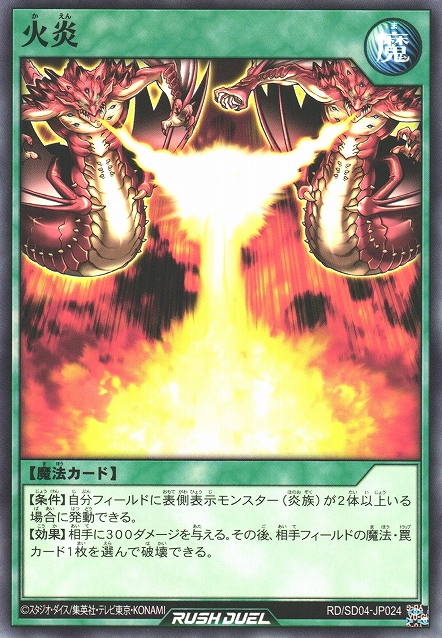

- **Zona y copias:** Main **3x**. CID Rush: **16171**.
- **Rol funcional:** Carta Mágica Normal — apoyo situacional sujeto a condición escrita.
- **Estado de sinergia y función:** Sinergia indirecta (soporte o recursos). Es una clasificación de juego; revisar la relación concreta en A06.
- **Papel como recurso, descarte o coste:** Coste o consumo descrito en A05: el resultado está sujeto a monstruos/cartas que puedan ser afectados y a respuestas del rival.
- **Requisito específico:** Controlar dos o más monstruos Piro boca arriba.
- **Efecto / resultado concreto:** Inflige 300 puntos de daño; después puede destruir una Mágica/Trampa rival.
- **Ir primero, segundo y juego tardío:** Primero: usarla si su efecto abre recursos o deja protección aprovechable; segundo: priorizar su resultado concreto frente a las amenazas rivales; tardío: comprobar materiales, objetivos y si aún quedan recursos en Deck o Cementerio.
- **Relación con habilidad y otras piezas:** La Skill **ALCHEMY BLAZE** necesita revelador válido y requisitos de construcción; no se activa libremente en turno 1.
- **Riesgos y dependencias:** el resultado está sujeto a monstruos/cartas que puedan ser afectados y a respuestas del rival.
- **Confianza:** **RESUMEN_FUNCIONAL_DE_GUIA_PREVIA_CON_FUENTE_KONAMI**; pendiente cotejo adicional de traducción/ventanas según la liga. Fuente Rush oficial: https://www.db.yugioh-card.com/rushdb/card_search.action?cid=16171&ope=2
- **Contraste de fuente Rush:** CID 16171: fuente oficial Rush consultada en japonés; tipo Carta Mágica Normal; descripción funcional en español procede de la guía previa y sigue siendo interpretación editorial.
- **Aplicación concreta dentro de este deck (A06):** Inflige 300 puntos de daño; después puede destruir una Mágica/Trampa rival.

**USO PRÁCTICO Y SINERGIA — Fuego Ardiente**

- **Label funcional:** Sinergia indirecta. Clasificación documental; una relación es válida solo si se satisfacen sus condiciones exactas.
- **Qué hace:** Inflige 300 puntos de daño; después puede destruir una Mágica/Trampa rival.
- **Cuándo tener precaución:** el resultado está sujeto a monstruos/cartas que puedan ser afectados y a respuestas del rival.

#### 09. Salamandra Quimicalizada

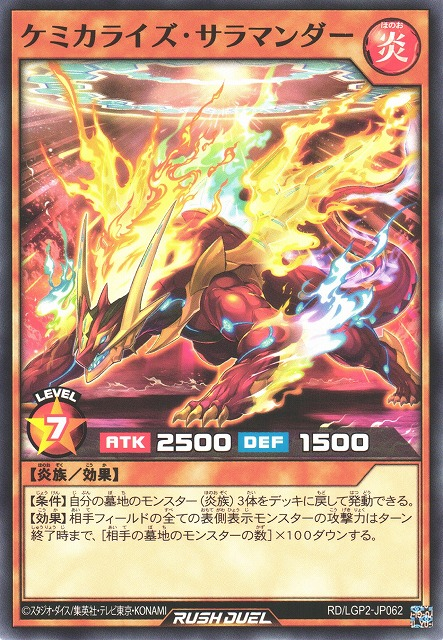

- **Zona y copias:** Main **2x**. CID Rush: **17868**.
- **Rol funcional:** Monstruo de Efecto — presión de combate / modificación de estadísticas.
- **Estado de sinergia y función:** Sinergia indirecta (soporte o recursos). Es una clasificación de juego; revisar la relación concreta en A06.
- **Papel como recurso, descarte o coste:** Coste o consumo descrito en A05: pagar/cumplir el requisito escrito antes de prometer la resolución.
- **Requisito específico:** Devolver al Deck tres monstruos Piro del propio Cementerio.
- **Efecto / resultado concreto:** Todos los monstruos boca arriba rivales pierden 100 ATK por cada monstruo en el Cementerio rival hasta fin de turno.
- **Ir primero, segundo y juego tardío:** Primero: preparar acceso y campo necesario sin gastar la respuesta antes de tiempo; segundo: usarla para abrir combate o retirar la amenaza que cumple su condición; tardío: evaluar si quedan objetivos reales.
- **Relación con habilidad y otras piezas:** **ALCHEMY BLAZE**, desde turno 2 y si se cumple el predicado de Pyro/FUEGO/DEF, puede recuperar dos piezas aptas; luego obliga a enviar una carta de mano.
- **Riesgos y dependencias:** pagar/cumplir el requisito escrito antes de prometer la resolución.
- **Confianza:** **RESUMEN_FUNCIONAL_DE_GUIA_PREVIA_CON_FUENTE_KONAMI**; pendiente cotejo adicional de traducción/ventanas según la liga. Fuente Rush oficial: https://www.db.yugioh-card.com/rushdb/card_search.action?cid=17868&ope=2
- **Contraste de fuente Rush:** CID 17868: fuente oficial Rush consultada en japonés; tipo Monstruo de Efecto; descripción funcional en español procede de la guía previa y sigue siendo interpretación editorial.
- **Aplicación concreta dentro de este deck (A06):** Todos los monstruos boca arriba rivales pierden 100 ATK por cada monstruo en el Cementerio rival hasta fin de turno.

**USO PRÁCTICO Y SINERGIA — Salamandra Quimicalizada**

- **Label funcional:** Sinergia indirecta. Clasificación documental; una relación es válida solo si se satisfacen sus condiciones exactas.
- **Qué hace:** Todos los monstruos boca arriba rivales pierden 100 ATK por cada monstruo en el Cementerio rival hasta fin de turno.
- **Cuándo tener precaución:** pagar/cumplir el requisito escrito antes de prometer la resolución.

#### 10. Gelatina Defensiva

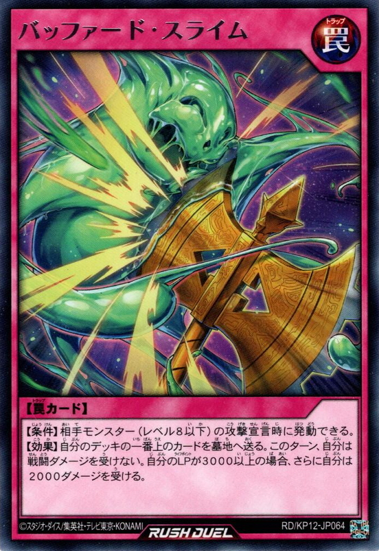

- **Zona y copias:** Main **1x**. CID Rush: **18646**.
- **Rol funcional:** Carta de Trampa Normal — defensa ante ataque y prevención de daño de batalla.
- **Estado de sinergia y función:** Sinergia directa descrita. Es una clasificación de juego; revisar la relación concreta en A06.
- **Papel como recurso, descarte o coste:** Envío mencionado en la interacción; no equivale por sí mismo a descarte desde la mano.
- **Requisito específico:** Cuando un monstruo rival de Nivel 8 o inferior declara ataque.
- **Efecto / resultado concreto:** Envía al Cementerio la carta superior de tu Deck y evita todo el daño de batalla ese turno; si tienes 3000 LP o más, recibes además 2000 de daño de efecto.
- **Ir primero, segundo y juego tardío:** Primero: construir la condición de activación; segundo: verificar que la jugada responde al estado rival actual; tardío: ahorrar el recurso si todavía no se cumple el requisito.
- **Relación con habilidad y otras piezas:** La Skill **ALCHEMY BLAZE** necesita revelador válido y requisitos de construcción; no se activa libremente en turno 1.
- **Riesgos y dependencias:** comprobar zona, objetivos y ventana; el nombre de la carta no reemplaza su texto.
- **Confianza:** **RESUMEN_FUNCIONAL_DE_GUIA_PREVIA_CON_FUENTE_KONAMI**; pendiente cotejo adicional de traducción/ventanas según la liga. Fuente Rush oficial: https://www.db.yugioh-card.com/rushdb/card_search.action?cid=18646&ope=2
- **Contraste de fuente Rush:** CID 18646, nombre japonés **バッファード・スライム** (Buffered Slime): texto oficial localizado con `request_locale=ja`, tipo Carta de Trampa Normal. La condición de ataque de monstruo rival de Nivel 8 o inferior, el envío de la carta superior del Deck, la prevención de daño de batalla del turno y el daño de efecto de 2000 si los LP propios son al menos 3000 coinciden con el resumen previo. La denominación española «Gelatina Defensiva» sigue siendo un alias del inventario; no se impone traducción oficial.
- **Aplicación concreta dentro de este deck (A06):** Envía al Cementerio la carta superior de tu Deck y evita todo el daño de batalla ese turno; si tienes 3000 LP o más, recibes además 2000 de daño de efecto.

**USO PRÁCTICO Y SINERGIA — Gelatina Defensiva**

- **Label funcional:** Sinergia directa. Clasificación documental; una relación es válida solo si se satisfacen sus condiciones exactas.
- **Qué hace:** Envía al Cementerio la carta superior de tu Deck y evita todo el daño de batalla ese turno; si tienes 3000 LP o más, recibes además 2000 de daño de efecto.
- **Cuándo tener precaución:** comprobar zona, objetivos y ventana; el nombre de la carta no reemplaza su texto.

#### 11. Amparo del Protector Estelar

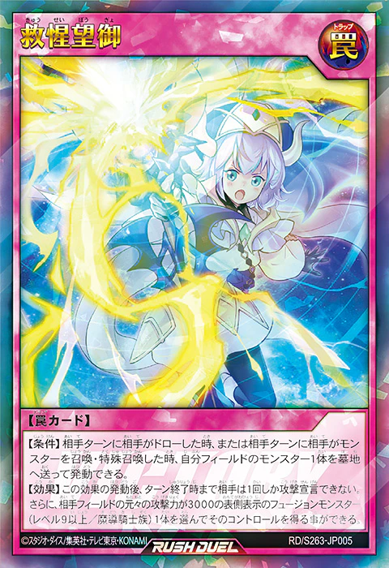

- **Zona y copias:** Main **2x**. CID Rush: **19700**.
- **Rol funcional:** Carta de Trampa Normal — presión de combate / modificación de estadísticas.
- **Estado de sinergia y función:** Sinergia indirecta (soporte o recursos). Es una clasificación de juego; revisar la relación concreta en A06.
- **Papel como recurso, descarte o coste:** Coste o consumo descrito en A05: verificar en campo los materiales nombrados y el momento legal de la Fusión Rush; no usar materiales de mano sin permiso….
- **Requisito específico:** En el turno rival, cuando roba o Invoca un monstruo; enviar un monstruo propio del Campo al Cementerio.
- **Efecto / resultado concreto:** El rival solo puede declarar un ataque en ese turno. Opcionalmente permite tomar control de una Fusión Caballero Mágico rival de Nivel 9+ y ATK original 3000.
- **Ir primero, segundo y juego tardío:** Primero: Colocar y reservar la respuesta para la ventana legal; segundo: tras side y cambio de turno, evaluar si puede activarse a tiempo; tardío: no asumir efecto si falta el objetivo o el estado de campo.
- **Relación con habilidad y otras piezas:** **ALCHEMY BLAZE**, desde turno 2 y si se cumple el predicado de Pyro/FUEGO/DEF, puede recuperar dos piezas aptas; luego obliga a enviar una carta de mano.
- **Riesgos y dependencias:** verificar en campo los materiales nombrados y el momento legal de la Fusión Rush; no usar materiales de mano sin permiso textual. pagar/cumplir el requisito escrito antes de prometer la resolución.
- **Confianza:** **RESUMEN_FUNCIONAL_DE_GUIA_PREVIA_CON_FUENTE_KONAMI**; pendiente cotejo adicional de traducción/ventanas según la liga. Fuente Rush oficial: https://www.db.yugioh-card.com/rushdb/card_search.action?cid=19700&ope=2
- **Contraste de fuente Rush:** CID 19700: fuente oficial Rush consultada en japonés; tipo Carta de Trampa Normal; descripción funcional en español procede de la guía previa y sigue siendo interpretación editorial.
- **Aplicación concreta dentro de este deck (A06):** El rival solo puede declarar un ataque en ese turno.

**USO PRÁCTICO Y SINERGIA — Amparo del Protector Estelar**

- **Label funcional:** Sinergia indirecta. Clasificación documental; una relación es válida solo si se satisfacen sus condiciones exactas.
- **Qué hace:** El rival solo puede declarar un ataque en ese turno. Opcionalmente permite tomar control de una Fusión Caballero Mágico rival de Nivel 9+ y ATK original 3000.
- **Cómo aprovecharla en este deck:** El rival solo puede declarar un ataque en ese turno.
- **Cuándo tener precaución:** verificar en campo los materiales nombrados y el momento legal de la Fusión Rush; no usar materiales de mano sin permiso textual. pagar/cumplir el requisito escrito antes de prometer la resolución.

#### 12. Parar la Defensa

- **Zona y copias:** Main **1x**. CID Rush: **16776**.
- **Rol funcional:** Carta Mágica Normal — presión de combate / modificación de estadísticas.
- **Estado de sinergia y función:** Sinergia indirecta (soporte o recursos). Es una clasificación de juego; revisar la relación concreta en A06.
- **Papel como recurso, descarte o coste:** Coste o consumo descrito en A05: comprobar zona, objetivos y ventana; el nombre de la carta no reemplaza su texto.
- **Requisito específico:** Sin requisito de activación.
- **Efecto / resultado concreto:** Cambia un monstruo rival que esté en Defensa a Ataque boca arriba.
- **Ir primero, segundo y juego tardío:** Primero: usarla si su efecto abre recursos o deja protección aprovechable; segundo: priorizar su resultado concreto frente a las amenazas rivales; tardío: comprobar materiales, objetivos y si aún quedan recursos en Deck o Cementerio.
- **Relación con habilidad y otras piezas:** La Skill **ALCHEMY BLAZE** necesita revelador válido y requisitos de construcción; no se activa libremente en turno 1.
- **Riesgos y dependencias:** comprobar zona, objetivos y ventana; el nombre de la carta no reemplaza su texto.
- **Confianza:** **RESUMEN_FUNCIONAL_DE_GUIA_PREVIA_CON_FUENTE_KONAMI**; pendiente cotejo adicional de traducción/ventanas según la liga. Fuente Rush oficial: https://www.db.yugioh-card.com/rushdb/card_search.action?cid=16776&ope=2
- **Contraste de fuente Rush:** CID 16776: fuente oficial Rush consultada en japonés; tipo Carta Mágica Normal; descripción funcional en español procede de la guía previa y sigue siendo interpretación editorial.
- **Aplicación concreta dentro de este deck (A06):** Cambia un monstruo rival que esté en Defensa a Ataque boca arriba.

**USO PRÁCTICO Y SINERGIA — Parar la Defensa**

- **Label funcional:** Sinergia indirecta. Clasificación documental; una relación es válida solo si se satisfacen sus condiciones exactas.
- **Qué hace:** Cambia un monstruo rival que esté en Defensa a Ataque boca arriba.
- **Cuándo tener precaución:** comprobar zona, objetivos y ventana; el nombre de la carta no reemplaza su texto.

#### 13. Agujero Trampa

- **Zona y copias:** Main **1x**. CID Rush: **15913**.
- **Rol funcional:** Carta de Trampa Normal — interrupción defensiva de Invocación Normal.
- **Estado de sinergia y función:** Sinergia indirecta (soporte o recursos). Es una clasificación de juego; revisar la relación concreta en A06.
- **Papel como recurso, descarte o coste:** Coste o consumo descrito en A05: el resultado está sujeto a monstruos/cartas que puedan ser afectados y a respuestas del rival.
- **Requisito específico:** Cuando el rival Invoca de Modo Normal un monstruo de al menos 1000 ATK.
- **Efecto / resultado concreto:** Destruye ese monstruo invocado.
- **Ir primero, segundo y juego tardío:** Primero: Colocar y reservar la respuesta para la ventana legal; segundo: tras side y cambio de turno, evaluar si puede activarse a tiempo; tardío: no asumir efecto si falta el objetivo o el estado de campo.
- **Relación con habilidad y otras piezas:** La Skill **ALCHEMY BLAZE** necesita revelador válido y requisitos de construcción; no se activa libremente en turno 1.
- **Riesgos y dependencias:** el resultado está sujeto a monstruos/cartas que puedan ser afectados y a respuestas del rival.
- **Confianza:** **RESUMEN_FUNCIONAL_DE_GUIA_PREVIA_CON_FUENTE_KONAMI**; pendiente cotejo adicional de traducción/ventanas según la liga. Fuente Rush oficial: https://www.db.yugioh-card.com/rushdb/card_search.action?cid=15913&ope=2
- **Contraste de fuente Rush:** CID 15913: fuente oficial Rush consultada en japonés; tipo Carta de Trampa Normal; descripción funcional en español procede de la guía previa y sigue siendo interpretación editorial.
- **Aplicación concreta dentro de este deck (A06):** Destruye ese monstruo invocado.

**USO PRÁCTICO Y SINERGIA — Agujero Trampa**

- **Label funcional:** Sinergia indirecta. Clasificación documental; una relación es válida solo si se satisfacen sus condiciones exactas.
- **Qué hace:** Destruye ese monstruo invocado.
- **Cuándo tener precaución:** el resultado está sujeto a monstruos/cartas que puedan ser afectados y a respuestas del rival.

#### 14. Gobernante de las Llamas

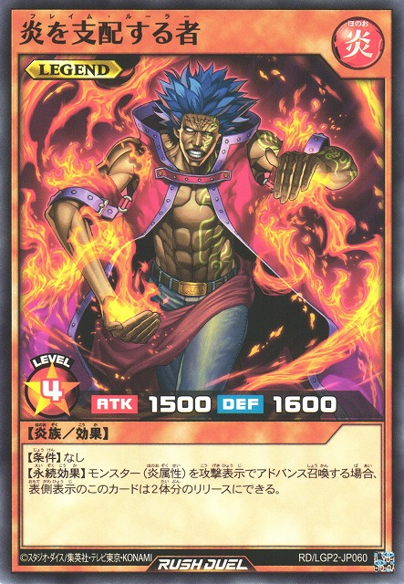

- **Zona y copias:** Main **1x**. CID Rush: **17926**.
- **Rol funcional:** Monstruo de Efecto — extensor / habilitador de material.
- **Estado de sinergia y función:** Sinergia directa descrita. Es una clasificación de juego; revisar la relación concreta en A06.
- **Papel como recurso, descarte o coste:** Coste o consumo descrito en A05: comprobar zona, objetivos y ventana; el nombre de la carta no reemplaza su texto.
- **Requisito específico:** No necesita activación.
- **Efecto / resultado concreto:** Esta carta boca arriba cuenta por dos Sacrificios para Invocar por Sacrificio en Ataque un monstruo de FUEGO.
- **Ir primero, segundo y juego tardío:** Primero: construir la condición de activación; segundo: verificar que la jugada responde al estado rival actual; tardío: ahorrar el recurso si todavía no se cumple el requisito.
- **Relación con habilidad y otras piezas:** La Skill **ALCHEMY BLAZE** necesita revelador válido y requisitos de construcción; no se activa libremente en turno 1.
- **Riesgos y dependencias:** comprobar zona, objetivos y ventana; el nombre de la carta no reemplaza su texto.
- **Confianza:** **RESUMEN_FUNCIONAL_DE_GUIA_PREVIA_CON_FUENTE_KONAMI**; pendiente cotejo adicional de traducción/ventanas según la liga. Fuente Rush oficial: https://www.db.yugioh-card.com/rushdb/card_search.action?cid=17926&ope=2
- **Contraste de fuente Rush:** CID 17926: fuente oficial Rush consultada en japonés; tipo Monstruo de Efecto; descripción funcional en español procede de la guía previa y sigue siendo interpretación editorial.
- **Aplicación concreta dentro de este deck (A06):** Esta carta boca arriba cuenta por dos Sacrificios para Invocar por Sacrificio en Ataque un monstruo de FUEGO.

**USO PRÁCTICO Y SINERGIA — Gobernante de las Llamas**

- **Label funcional:** Sinergia directa. Clasificación documental; una relación es válida solo si se satisfacen sus condiciones exactas.
- **Qué hace:** Esta carta boca arriba cuenta por dos Sacrificios para Invocar por Sacrificio en Ataque un monstruo de FUEGO.
- **Cuándo tener precaución:** comprobar zona, objetivos y ventana; el nombre de la carta no reemplaza su texto.

#### 15. Olla de la Codicia

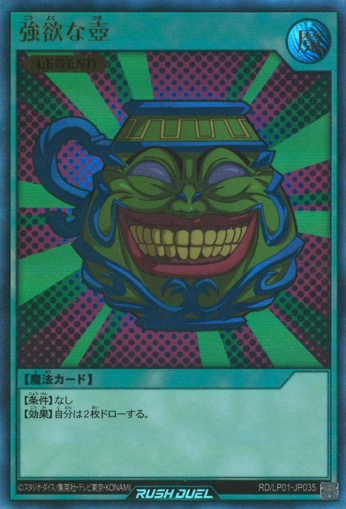

- **Zona y copias:** Main **1x**. CID Rush: **16372**.
- **Rol funcional:** Carta Mágica Normal — consistencia / reciclaje.
- **Estado de sinergia y función:** Sinergia indirecta de recursos. Es una clasificación de juego; revisar la relación concreta en A06.
- **Papel como recurso, descarte o coste:** Material o destino del Extra condicionado a los requisitos de invocación.
- **Requisito específico:** Sin requisito de activación.
- **Efecto / resultado concreto:** Roba dos cartas.
- **Ir primero, segundo y juego tardío:** Primero: usarla si su efecto abre recursos o deja protección aprovechable; segundo: priorizar su resultado concreto frente a las amenazas rivales; tardío: comprobar materiales, objetivos y si aún quedan recursos en Deck o Cementerio.
- **Relación con habilidad y otras piezas:** La Skill **ALCHEMY BLAZE** necesita revelador válido y requisitos de construcción; no se activa libremente en turno 1.
- **Riesgos y dependencias:** disponer de cartas suficientes en Deck y distinguir robo de búsqueda.
- **Confianza:** **RESUMEN_FUNCIONAL_DE_GUIA_PREVIA_CON_FUENTE_KONAMI**; pendiente cotejo adicional de traducción/ventanas según la liga. Fuente Rush oficial: https://www.db.yugioh-card.com/rushdb/card_search.action?cid=16372&ope=2
- **Contraste de fuente Rush:** CID 16372: fuente oficial Rush consultada en japonés; tipo Carta Mágica Normal; descripción funcional en español procede de la guía previa y sigue siendo interpretación editorial.
- **Aplicación concreta dentro de este deck (A06):** Roba dos cartas. Aportación posible como material, coste o objetivo; verificar consumidor.

**USO PRÁCTICO Y SINERGIA — Olla de la Codicia**

- **Label funcional:** Sinergia indirecta. Clasificación documental; una relación es válida solo si se satisfacen sus condiciones exactas.
- **Qué hace:** Roba dos cartas.
- **Cómo aprovecharla en este deck:** Roba dos cartas. Aportación posible como material, coste o objetivo; verificar consumidor.
- **Cuándo tener precaución:** disponer de cartas suficientes en Deck y distinguir robo de búsqueda.

#### 16. Arquero Ígneo Supergráfagas

- **Zona y copias:** Extra **2x**. CID Rush: **19990**.
- **Rol funcional:** Monstruo de Fusión — objetivo de Fusión con materiales expresos y efecto de cierre.
- **Estado de sinergia y función:** Destino Extra condicionado. Es una clasificación de juego; revisar la relación concreta en A06.
- **Papel como recurso, descarte o coste:** Material o destino del Extra condicionado a los requisitos de invocación.
- **Requisito específico:** Fusionar Chromatographagas + SP Assistant Archer. Devolver al tope del Deck un Piro Normal de Nivel 7 del Cementerio.
- **Efecto / resultado concreto:** Gana 2500 ATK este turno; opcionalmente reduce en 1500 ATK un monstruo rival boca arriba de Nivel 9 o inferior.
- **Ir primero, segundo y juego tardío:** Primero: preparar materiales y «Fusión» si es alcanzable; segundo: considerar el efecto de campo o daño que se produzca tras una Fusión legal; tardío: comprobar si quedan materiales nombrados en campo y Extra.
- **Relación con habilidad y otras piezas:** La Skill **ALCHEMY BLAZE** necesita revelador válido y requisitos de construcción; no se activa libremente en turno 1.
- **Riesgos y dependencias:** pagar/cumplir el requisito escrito antes de prometer la resolución.
- **Confianza:** **RESUMEN_FUNCIONAL_DE_GUIA_PREVIA_CON_FUENTE_KONAMI**; pendiente cotejo adicional de traducción/ventanas según la liga. Fuente Rush oficial: https://www.db.yugioh-card.com/rushdb/card_search.action?cid=19990&ope=2
- **Contraste de fuente Rush:** CID 19990: fuente oficial Rush consultada en japonés; tipo Monstruo de Fusión; descripción funcional en español procede de la guía previa y sigue siendo interpretación editorial.
- **Aplicación concreta dentro de este deck (A06):** Gana 2500 ATK este turno; opcionalmente reduce en 1500 ATK un monstruo rival boca arriba de Nivel 9 o inferior. A06 identifica su destino, condicionado a material/procedimiento.

**USO PRÁCTICO Y SINERGIA — Arquero Ígneo Supergráfagas**

- **Label funcional:** Referencias de ruta localizadas; conexión reglamentaria sujeta al recorrido de la guía. Clasificación documental; una relación es válida solo si se satisfacen sus condiciones exactas.
- **Qué hace:** Gana 2500 ATK este turno; opcionalmente reduce en 1500 ATK un monstruo rival boca arriba de Nivel 9 o inferior.
- **Cómo aprovecharla en este deck:** Gana 2500 ATK este turno; opcionalmente reduce en 1500 ATK un monstruo rival boca arriba de Nivel 9 o inferior. A06 identifica su destino, condicionado a material/procedimiento.
- **Cuándo tener precaución:** pagar/cumplir el requisito escrito antes de prometer la resolución.

**CÓMO LLEGAR DESDE TU DECK — RUTAS DOCUMENTADAS**

- **Abrir guía `704:A09:ALCHEMY:ARCHER01`:** entrada: Cromatográfagas (18583, monstruo Normal Piro FUEGO Nivel 7) + Orden Secreta (17212). Campo y GY propios vacíos; turno de duelo 2 o posterior; Alchemy Blaze (RD/SK01-001) no usada y disponible conforme a las reglas personalizadas de la liga. SP Assistant Archer / Superasistente Ember (17963) y Fusión (16934) todavía en Deck; Fusión 19990 en Extra; rival sin interrupción en la ruta base.. Propósito descrito: Preparación de recursos / despliegue. Consulta sus pasos, consumo y resultado; comprobar si esta carta es realmente invocada o solo mencionada.

#### 17. Salamandra Alquimicalizada

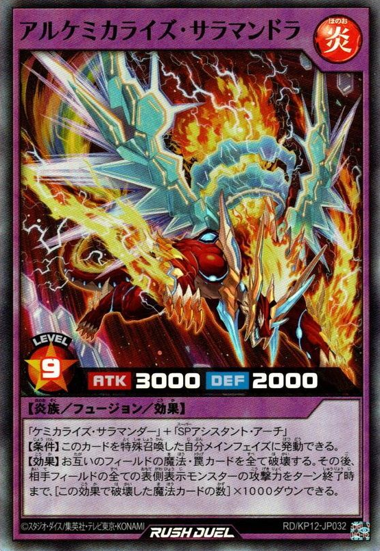

- **Zona y copias:** Extra **3x**. CID Rush: **18614**.
- **Rol funcional:** Monstruo de Fusión — objetivo de Fusión con materiales expresos y efecto de cierre.
- **Estado de sinergia y función:** Destino Extra condicionado. Es una clasificación de juego; revisar la relación concreta en A06.
- **Papel como recurso, descarte o coste:** Material o destino del Extra condicionado a los requisitos de invocación.
- **Requisito específico:** Fusionar Chemicalized Salamander + SP Assistant Archer; usar efecto en la Main Phase en que se invocó de Modo Especial.
- **Efecto / resultado concreto:** Destruye todas las Mágicas/Trampas de ambos Campos y opcionalmente reduce 1000 ATK a los monstruos rivales por cada Mágica destruida.
- **Ir primero, segundo y juego tardío:** Primero: preparar materiales y «Fusión» si es alcanzable; segundo: considerar el efecto de campo o daño que se produzca tras una Fusión legal; tardío: comprobar si quedan materiales nombrados en campo y Extra.
- **Relación con habilidad y otras piezas:** **ALCHEMY BLAZE**, desde turno 2 y si se cumple el predicado de Pyro/FUEGO/DEF, puede recuperar dos piezas aptas; luego obliga a enviar una carta de mano.
- **Riesgos y dependencias:** el resultado está sujeto a monstruos/cartas que puedan ser afectados y a respuestas del rival.
- **Confianza:** **RESUMEN_FUNCIONAL_DE_GUIA_PREVIA_CON_FUENTE_KONAMI**; pendiente cotejo adicional de traducción/ventanas según la liga. Fuente Rush oficial: https://www.db.yugioh-card.com/rushdb/card_search.action?cid=18614&ope=2
- **Contraste de fuente Rush:** CID 18614: fuente oficial Rush consultada en japonés; tipo Monstruo de Fusión; descripción funcional en español procede de la guía previa y sigue siendo interpretación editorial.
- **Aplicación concreta dentro de este deck (A06):** Destruye todas las Mágicas/Trampas de ambos Campos y opcionalmente reduce 1000 ATK a los monstruos rivales por cada Mágica destruida. A06 identifica su destino, condicionado a material/procedimiento.

**USO PRÁCTICO Y SINERGIA — Salamandra Alquimicalizada**

- **Label funcional:** Referencias de ruta localizadas; conexión reglamentaria sujeta al recorrido de la guía. Clasificación documental; una relación es válida solo si se satisfacen sus condiciones exactas.
- **Qué hace:** Destruye todas las Mágicas/Trampas de ambos Campos y opcionalmente reduce 1000 ATK a los monstruos rivales por cada Mágica destruida.
- **Cómo aprovecharla en este deck:** Destruye todas las Mágicas/Trampas de ambos Campos y opcionalmente reduce 1000 ATK a los monstruos rivales por cada Mágica destruida. A06 identifica su destino, condicionado a material/procedimiento.
- **Cuándo tener precaución:** el resultado está sujeto a monstruos/cartas que puedan ser afectados y a respuestas del rival.

**CÓMO LLEGAR DESDE TU DECK — RUTAS DOCUMENTADAS**

- **Abrir guía `704:A09:ALCHEMY:SALAMANDRA02`:** entrada: Salamandra 1× Salamandra Quimicalizada / Chemicalized Salamander, Hiperasistente 1× Hiperasistente Ember / HP Assistant Archer, Atraviesa 1× ¡Atraviesa! como descarte de Skill. Deck: Superasistente 1× Superasistente Ember / SP Assistant Archer + Fusión 1× Fusión disponibles. Extra: Salamandra Fusion 1× Salamandra Alquimicalizada disponible. Skill: ALCHEMY BLAZE sin usar, turno 2 o posterior; todas las seis identidades de monstruo del Main satisfacen Piro/FUEGO y DEF ≥ 100 según inventario. Campo/GY/destierro propios: vacíos, Normal libre, ninguna restricción precedente. Rival: controla un monstruo boca arriba; además, para cuantificar el efecto, una Mágica boca arriba destruible y ninguna otra M/T. Rival no responde en esta línea de referencia.. Propósito descrito: Ofensivo condicional. Consulta sus pasos, consumo y resultado; comprobar si esta carta es realmente invocada o solo mencionada.

## SINERGIAS Y MOTORES
## RESUMEN FUNCIONAL DE SINERGIAS — 704

**Medición descriptiva de etiquetas existentes (NO certificación):** 15/17 identidades con etiqueta directa/indirecta (88.2 %). Main: 15/15 (100.0 %); Extra: 0/2 (0.0 %). Se cuenta una identidad una sola vez; una carta autónoma puede ser útil sin sinergia de motor. Estas cifras provienen de clasificaciones documentales A05/A06: **no son el porcentaje final de sinergias verificadas**, ni una tasa estadística de victoria. Para promoverlas a métricas verificadas, se deben comprobar los pares de cartas y su operación legal.

#### A06.0 — En 30 segundos: cómo cooperan realmente estas cartas

- **Dictamen de conjunto:** Fusiones Piro Rush coherentes; los monstruos normales cumplen función de material y la Skill solo participa cuando su ventana local se abre.
- **Motor que mueve el deck:** materiales Piro/FUEGO propios y carta de Fusión convierten cuerpos boca arriba en Arquero o Salamandra Alquimicalizada, según nombres exactos.
- **Puentes reales:** ALCHEMY BLAZE habilita piezas desde turno 2 si cumple su construcción y coste; Orden Secreta y otros cuerpos apoyan el despliegue, no sustituyen materiales nombrados.
- **Sinergia indirecta:** los Normales sin texto de efecto pueden ser materiales imprescindibles; no recomendar retirarlos por no producir ventaja individual.
- **Conflicto decisivo:** materiales requeridos deben estar boca arriba en Campo; Skill no es carta robable ni jugada garantizada del primer turno. Extra y Skill deben respetar reglamento Rush local.
- **Decisión concreta:** conservar el paquete de materiales hasta verificar acceso a cada Fusión; sin alternativa concreta demostrada para cambiarlos.
- **Qué aprender después:** comparar ruta con y sin Skill y comprobar dónde están los materiales antes de activar Fusión.

#### Motor, Skill y Fusiones

1. **Materiales de Fusión nombrados.** **Cromatográfagas** (CID 18583) es un Monstruo Normal Piro de Nivel 7; **Superasistente Ember** (17963) se identifica por su CID oficial con **SP Assistant Archer**, Monstruo Normal Piro/FUEGO de Nivel 1 y DEF 1500. Esa correspondencia de alias explica que ambas Fusiones del Extra mencionen «SP Assistant Archer» en el texto japonés. No alterar su nombre guardado.
2. **Fusión del propio campo.** **Fusión** Rush (16934) usa **monstruos propios boca arriba en el Campo**, no materiales de mano por defecto. **Arquero Ígneo Supergráfagas** (19990) requiere **Cromatográfagas + Superasistente Ember/SP Assistant Archer**; para aumentar su ATK, devuelve al tope del Deck un Piro Normal de Nivel 7 desde GY. **Salamandra Alquimicalizada** (18614) requiere **Salamandra Quimicalizada** (17868) + ese mismo Asistente; su efecto puede destruir **todas** las Mágicas/Trampas de ambos campos en la Main Phase de su Invocación Especial y reducir ATK según las Mágicas destruidas.
3. **Aportación de cuerpos.** **Orden Secreta** (17212) puede Invocar del Cementerio o mano un **Normal Nivel 7**, principalmente Cromatográfagas, con aumento temporal de ATK/protección frente a Trampas. **Hiperasistente Ember** (19291), si el rival tiene monstruo, puede mandarse del Campo al GY para Invocar un Piro Nivel 7+ desde mano; no aporta por sí sola ambos materiales de Fusión. **Gobernante de las Llamas** (17926) cuenta por dos Sacrificios para Invocar por Sacrificio un FUEGO en Ataque, sin equivaler a una Invocación por Fusión.
4. **Reciclaje y presión.** **Salamandra Quimicalizada** devuelve al Deck tres Piro del GY para reducir ATK rival según monstruos en **GY rival**; esto compite con materiales/recursos del GY. **Fuego Ardiente** (16171) exige dos Piro boca arriba, inflige 300 y puede destruir una M/T rival. **¡Atraviesa!** (15204) da daño de penetración y **Parar la Defensa** (16776) cambia un rival de Defensa a Ataque; estas son opciones de combate diferentes, no una cadena garantizada de daño letal.
5. **ALCHEMY BLAZE (RD/SK01-001), motor local no robable.** Según la habilidad registrada en APARTADO_05, desde el **turno 2** se revela una de las cartas nombradas y se exige que todos los monstruos del Deck cumplan Tipo Piro, Atributo FUEGO y DEF mínima. Puede recuperar/agregar **dos** cartas permitidas desde Deck/GY, entre ellas Normales o **Fusión**, y después manda una carta de mano al GY. Su legalidad y frecuencia dependen de reglas de la liga, **no certificadas por la base oficial de cartas Rush**.
6. **Defensas.** **Gelatina Defensiva** (18646) es Trampa Normal de prevención del daño de batalla cuando ataca un monstruo Nivel 8 o menor, con posible daño de efecto propio de 2000; **Amparo del Protector Estelar** (19700) reduce ataques posibles si se activa en su ventana y paga su envío; **Agujero Trampa** (15913) exige el evento de Invocación Normal rival. Ninguna reemplaza Fusión como motor.

#### Mapa por CID para fotografías reales

| Conexión | Qué permite | Qué falta cumplir | Imagen |
|---|---|---|---|
| Orden Secreta (17212) → Cromatográfagas (18583) | Poner material Normal Nivel 7 en campo. | Carta disponible y condiciones de Orden Secreta. |   |
| Cromatográfagas (18583) + SP Assistant Archer (17963) + Fusión (16934) → Arquero (19990) | Invocar la Fusión del Extra. | **Ambos materiales boca arriba en Campo**; Fusión en mano activable. |     |
| Salamandra Quimicalizada (17868) + Archer (17963) + Fusión → Salamandra Alquimicalizada (18614) | Fusión con retirada de M/T de ambos campos. | Materiales en campo y efecto dentro de Main Phase adecuada. |    |
| Hiperasistente Ember (19291) → Piro Nivel 7+ de mano | Extender cuerpo apto para Sacrificio/Fusión. | Monstruo rival presente; Hiperasistente propio boca arriba para enviar. |  |
| Skill ALCHEMY BLAZE → Normales / Fusión | Recuperar piezas de material o la carta Fusión. | Turno 2+, revelado, condición de composición del Deck y envío final de mano. |  |

#### Recursos y advertencias

- **Skill no es carta del Main** y no se roba; no prometer acceso a los dos materiales antes del turno mínimo. La equivalencia **Superasistente Ember = SP Assistant Archer** es por **CID 17963**, comprobable en la fuente japonesa de APARTADO_05; no es una tercera carta distinta.
- El efecto de Salamandra Alquimicalizada puede destruir tus propias M/T colocadas; el del Arquero requiere un Normal Piro Nivel 7 en GY que se devuelve al **tope** del Deck. No afirmar una ganancia de ATK sin ese coste.
- **Germalewe**, Olla de la Codicia y las trampas aportan cuerpo/recursos/protección, pero no se atribuye a Germalewe el nombre de material que no aparece en las Fusiones. No hay Side ni Reserva.

#### Skill personalizada y motor — ALCHEMY BLAZE

- **Identidad y zona:** RD/SK01-001; habilidad separada de Main/Extra/Side/Reserva, no robable.
- **Requisito de la imagen:** Desde el turno 2 revela Chemicalized Salamander, Chromatographagus o Ember the Super Assistant en mano; todos los monstruos del Deck han de ser Piro/FUEGO con DEF 100 o mayor.
- **Efecto de la imagen:** Añade 2 cartas elegibles del Deck y/o GY (Normales, monstruos con 1500 DEF o Fusión) y luego envía 1 carta de mano al GY.
- **Sinergia:** Acceso a materiales normales y Fusión para las Fusiones Piro del Extra; no fusiona por sí sola.
- **Dependencias/riesgo:** La condición del turno, la carta revelada, la composición del Deck y el descarte final deben cumplirse.
- **Clasificación:** habilitador o extensión, no combo completo. Texto e imagen aportados por Miguel; no inferir límites por turno no escritos.

#### A06.1 — Arquitectura operativa de los motores (síntesis no redundante)

Las siguientes filas son **relaciones funcionales**, no secuencias certificadas ni garantía de mano inicial. La lista real y los límites están en A04/A05/A07.

| Tipo / motor | Starter o vía de acceso real | Recurso y destino | Cuello de botella |
|---|---|---|---|
| **Principal: Fusiones Piro Rush** | Cromatográfagas, Superasistente Ember, Salamandra, Fusión | Invocar Arquero o Salamandra Alquimicalizada | Materiales boca arriba propios en Campo; los nombres deben coincidir |
| **Habilitador independiente: Skill** | ALCHEMY BLAZE desde turno 2 con composición Piro/FUEGO | Acceder a dos piezas permitidas y enviar una de mano | Skill no robable; reglas locales y requisito de revelado/composición |
| **Apoyo: cuerpos/combate** | Orden Secreta, Hiperasistente y M/T de batalla | Poner materiales, abrir ataque o proteger | No sustituyen materiales nombrados ni hacen la Fusión por sí mismos |

#### A06.2 — Estado funcional y justificación de TODAS las cartas

**Cómo leerlo:** un estado de sinergia describe el papel **de juego**, no el avance de una auditoría. No hay obligación de que cada carta tenga un enlace con otra: una defensa autónoma, una herramienta de Side o un recurso de descarte justificado también tiene propósito. Las relaciones directas descritas aquí se deben contrastar con los textos oficiales antes de representarlas como una ruta legal A09.

| Carta / CID y zona | Estado funcional de sinergia | Motivo de inclusión | Relación y condición concreta | Papel como coste, descarte o material | Límite o riesgo | Decisión táctica |
|---|---|---|---|---|---|---|
| **¡Atraviesa!** (CID 15204) — Main 1x | **Sinergia indirecta (soporte o recursos)** | Carta Mágica Normal — presión de combate / modificación de estadísticas | Otorga daño de penetración este turno a un monstruo propio boca arriba | Coste o consumo descrito en A05: comprobar zona, objetivos y ventana; el nombre de la carta no reemplaza su texto | Sin requisito de activación | Conservar; verificar coste y orden |
| **Germalewe** (CID 17285) — Main 3x | **Sinergia indirecta de recursos** | Monstruo Normal — material de Fusión/Sacrificio o presencia de combate; sin efecto activado | Monstruo Normal; recurso para sacrificar o emplear como material. Aportación posible como material, coste o objetivo; verificar consumidor | Material o destino del Extra condicionado a los requisitos de invocación | No tiene efecto | Conservar si existe consumidor legal |
| **Orden Secreta** (CID 17212) — Main 3x | **Sinergia directa descrita** | Carta Mágica Normal — recurso táctico cuya condición y resultado están descritos en su ficha | Invoca un monstruo Normal de Nivel 7 desde mano o Cementerio; le da 700 ATK ese turno y lo protege frente a destrucción por Trampas rivales | Coste o consumo descrito en A05: la condición de una Mágica/Trampa y sus blancos deben cumplirse antes de resolver. No confundir esta carta con un monstruo… | Sin requisito de activación | Conservar; verificar coste y orden |
| **Hiperasistente Ember** (CID 19291) — Main 3x | **Sinergia directa descrita** | Monstruo de Efecto — extensor / habilitador de material | Invoca desde la mano un Piro de Nivel 7+; si SP Assistant Archer está en el Cementerio, ese monstruo gana 800 ATK este turno | Coste o consumo descrito en A05: pagar/cumplir el requisito escrito antes de prometer la resolución | El rival debe controlar un monstruo; enviar esta carta boca arriba propia al Cementerio | Conservar; verificar coste y orden |
| **Cromatográfagas** (CID 18583) — Main 3x | **Sinergia indirecta (soporte o recursos)** | Monstruo Normal — material de Fusión/Sacrificio o presencia de combate; sin efecto activado | Monstruo Normal de Nivel 7 y material nombrado de Supergráfagas Archer | Material o destino del Extra condicionado a los requisitos de invocación | No tiene efecto | Conservar; verificar coste y orden |
| **Superasistente Ember** (CID 17963) — Main 3x | **Sinergia indirecta (soporte o recursos)** | Monstruo Normal — material de Fusión/Sacrificio o presencia de combate; sin efecto activado | Monstruo Normal de Nivel 1, material nombrado de dos Fusiones del Extra | Material o destino del Extra condicionado a los requisitos de invocación | No tiene efecto | Conservar; verificar coste y orden |
| **Fusión** (CID 16934) — Main 2x | **Sinergia indirecta (soporte o recursos)** | Carta Mágica Normal — extensor / habilitador de material | Usa monstruos boca arriba del Campo propio como materiales, enviándolos al Cementerio para una Invocación por Fusión válida; no usa automáticamente materiales de la mano | Material o destino del Extra condicionado a los requisitos de invocación | Sin requisito de activación | Conservar; verificar coste y orden |
| **Fuego Ardiente** (CID 16171) — Main 3x | **Sinergia indirecta (soporte o recursos)** | Carta Mágica Normal — apoyo situacional sujeto a condición escrita | Inflige 300 puntos de daño; después puede destruir una Mágica/Trampa rival | Coste o consumo descrito en A05: el resultado está sujeto a monstruos/cartas que puedan ser afectados y a respuestas del rival | Controlar dos o más monstruos Piro boca arriba | Conservar; verificar coste y orden |
| **Salamandra Quimicalizada** (CID 17868) — Main 2x | **Sinergia indirecta (soporte o recursos)** | Monstruo de Efecto — presión de combate / modificación de estadísticas | Todos los monstruos boca arriba rivales pierden 100 ATK por cada monstruo en el Cementerio rival hasta fin de turno | Coste o consumo descrito en A05: pagar/cumplir el requisito escrito antes de prometer la resolución | Devolver al Deck tres monstruos Piro del propio Cementerio | Conservar; verificar coste y orden |
| **Gelatina Defensiva** (CID 18646) — Main 1x | **Sinergia directa descrita** | Carta de Trampa Normal — defensa ante ataque y prevención de daño de batalla | Envía al Cementerio la carta superior de tu Deck y evita todo el daño de batalla ese turno; si tienes 3000 LP o más, recibes además 2000 de daño de efecto | Envío mencionado en la interacción; no equivale por sí mismo a descarte desde la mano | Cuando un monstruo rival de Nivel 8 o inferior declara ataque | Conservar; verificar coste y orden |
| **Amparo del Protector Estelar** (CID 19700) — Main 2x | **Sinergia indirecta (soporte o recursos)** | Carta de Trampa Normal — presión de combate / modificación de estadísticas | El rival solo puede declarar un ataque en ese turno | Coste o consumo descrito en A05: verificar en campo los materiales nombrados y el momento legal de la Fusión Rush; no usar materiales de mano sin permiso… | En el turno rival, cuando roba o Invoca un monstruo; enviar un monstruo propio del Campo al Cementerio | Conservar; verificar coste y orden |
| **Parar la Defensa** (CID 16776) — Main 1x | **Sinergia indirecta (soporte o recursos)** | Carta Mágica Normal — presión de combate / modificación de estadísticas | Cambia un monstruo rival que esté en Defensa a Ataque boca arriba | Coste o consumo descrito en A05: comprobar zona, objetivos y ventana; el nombre de la carta no reemplaza su texto | Sin requisito de activación | Conservar; verificar coste y orden |
| **Agujero Trampa** (CID 15913) — Main 1x | **Sinergia indirecta (soporte o recursos)** | Carta de Trampa Normal — extensor / habilitador de material | Destruye ese monstruo invocado | Coste o consumo descrito en A05: el resultado está sujeto a monstruos/cartas que puedan ser afectados y a respuestas del rival | Cuando el rival Invoca de Modo Normal un monstruo de al menos 1000 ATK | Conservar; verificar coste y orden |
| **Gobernante de las Llamas** (CID 17926) — Main 1x | **Sinergia directa descrita** | Monstruo de Efecto — extensor / habilitador de material | Esta carta boca arriba cuenta por dos Sacrificios para Invocar por Sacrificio en Ataque un monstruo de FUEGO | Coste o consumo descrito en A05: comprobar zona, objetivos y ventana; el nombre de la carta no reemplaza su texto | No necesita activación | Conservar; verificar coste y orden |
| **Olla de la Codicia** (CID 16372) — Main 1x | **Sinergia indirecta de recursos** | Carta Mágica Normal — consistencia / reciclaje | Roba dos cartas. Aportación posible como material, coste o objetivo; verificar consumidor | Material o destino del Extra condicionado a los requisitos de invocación | Sin requisito de activación | Conservar si existe consumidor legal |
| **Arquero Ígneo Supergráfagas** (CID 19990) — Extra 2x | **Destino Extra condicionado** | Monstruo de Fusión — objetivo de Fusión con materiales expresos y efecto de cierre | Gana 2500 ATK este turno; opcionalmente reduce en 1500 ATK un monstruo rival boca arriba de Nivel 9 o inferior | Material o destino del Extra condicionado a los requisitos de invocación | Fusionar Chromatographagas + SP Assistant Archer. Devolver al tope del Deck un Piro Normal de Nivel 7 del Cementerio | Conservar si hay materiales legales |
| **Salamandra Alquimicalizada** (CID 18614) — Extra 3x | **Destino Extra condicionado** | Monstruo de Fusión — objetivo de Fusión con materiales expresos y efecto de cierre | Destruye todas las Mágicas/Trampas de ambos Campos y opcionalmente reduce 1000 ATK a los monstruos rivales por cada Mágica destruida | Material o destino del Extra condicionado a los requisitos de invocación | Fusionar Chemicalized Salamander + SP Assistant Archer; usar efecto en la Main Phase en que se invocó de Modo Especial | Conservar si hay materiales legales |

## INTERACCIONES Y CLASIFICACIÓN

| ID documental | Categoría provisional | Piezas | Resultado | Requisitos | Check |
|---|---|---|---|---|---|
| 704:A08:01 | INTERACCION | Orden Secreta (17212) → Cromatográfagas (18583) | Poner material Normal Nivel 7 en campo. | Carta disponible y condiciones de Orden Secreta. | `704:A09:ALCHEMY:ARCHER01`; A10 documental generada; legalidad A11–A13 pendiente |
| 704:A08:02 | RUTA | Cromatográfagas (18583) + SP Assistant Archer (17963) + Fusión (16934) → Arquero (19990) | Invocar la Fusión del Extra. | **Ambos materiales boca arriba en Campo**; Fusión en mano activable. | `704:A09:ALCHEMY:ARCHER01`; A10 documental generada; legalidad A11–A13 pendiente |
| 704:A08:03 | RUTA | Salamandra Quimicalizada (17868) + Archer (17963) + Fusión → Salamandra Alquimicalizada (18614) | Fusión con retirada de M/T de ambos campos. | Materiales en campo y efecto dentro de Main Phase adecuada. | |
| 704:A08:04 | EXTENSION | Hiperasistente Ember (19291) → Piro Nivel 7+ de mano | Extender cuerpo apto para Sacrificio/Fusión. | Monstruo rival presente; Hiperasistente propio boca arriba para enviar. | |

#### Rol registrado por cada carta

| ID A08 | Carta registrada | Zona | Clasificación funcional | Rol documentado en A05 | Check de clasificación |
|---|---|---|---|---|---|
| 704:A08:C001 | ¡Atraviesa! | Main | FUNCION_A05 (recurso jugable sujeto a condición) | Carta Mágica Normal — presión de combate / modificación de estadísticas. | |
| 704:A08:C002 | Germalewe | Main | RECURSO_MATERIAL | Monstruo Normal — material de Fusión/Sacrificio o presencia de combate; sin efecto activado. | |
| 704:A08:C003 | Orden Secreta | Main | FUNCION_A05 (recurso jugable sujeto a condición) | Carta Mágica Normal — recurso táctico cuya condición y resultado están descritos en su ficha. | |
| 704:A08:C004 | Hiperasistente Ember | Main | EXTENSOR_POTENCIAL | Monstruo de Efecto — extensor / habilitador de material. | |
| 704:A08:C005 | Cromatográfagas | Main | RECURSO_MATERIAL | Monstruo Normal — material de Fusión/Sacrificio o presencia de combate; sin efecto activado. | |
| 704:A08:C006 | Superasistente Ember | Main | RECURSO_MATERIAL | Monstruo Normal — material de Fusión/Sacrificio o presencia de combate; sin efecto activado. | |
| 704:A08:C007 | Fusión | Main | EXTENSOR_POTENCIAL | Carta Mágica Normal — extensor / habilitador de material. | |
| 704:A08:C008 | Fuego Ardiente | Main | FUNCION_A05 (recurso jugable sujeto a condición) | Carta Mágica Normal — apoyo situacional sujeto a condición escrita. | |
| 704:A08:C009 | Salamandra Quimicalizada | Main | FUNCION_A05 (recurso jugable sujeto a condición) | Monstruo de Efecto — presión de combate / modificación de estadísticas. | |
| 704:A08:C010 | Gelatina Defensiva | Main | FUNCION_A05 (recurso jugable sujeto a condición) | Carta de Trampa Normal — defensa ante ataque y prevención de daño de batalla. | |
| 704:A08:C011 | Amparo del Protector Estelar | Main | FUNCION_A05 (recurso jugable sujeto a condición) | Carta de Trampa Normal — presión de combate / modificación de estadísticas. | |
| 704:A08:C012 | Parar la Defensa | Main | FUNCION_A05 (recurso jugable sujeto a condición) | Carta Mágica Normal — presión de combate / modificación de estadísticas. | |
| 704:A08:C013 | Agujero Trampa | Main | EXTENSOR_POTENCIAL | Carta de Trampa Normal — extensor / habilitador de material. | |
| 704:A08:C014 | Gobernante de las Llamas | Main | EXTENSOR_POTENCIAL | Monstruo de Efecto — extensor / habilitador de material. | |
| 704:A08:C015 | Olla de la Codicia | Main | FUNCION_A05 (recurso jugable sujeto a condición) | Carta Mágica Normal — consistencia / reciclaje. | |
| 704:A08:C016 | Arquero Ígneo Supergráfagas | Extra | DESTINO_EXTRA (materiales/procedimiento por comprobar) | Monstruo de Fusión — objetivo de Fusión con materiales expresos y efecto de cierre. | |
| 704:A08:C017 | Salamandra Alquimicalizada | Extra | DESTINO_EXTRA (materiales/procedimiento por comprobar) | Monstruo de Fusión — objetivo de Fusión con materiales expresos y efecto de cierre. | |

## JUGADAS DOCUMENTADAS

> Requieren comprobación A11–A13 y validación de estado final. No publicar las rutas como combos certificados por tener fotografías.

#### A09 — Apertura de 2 cartas + Skill `704:A09:ALCHEMY:ARCHER01`

- **Objetivo real:** Invocar por Fusión a **SP Graphagus Archer / Arquero Ígneo Supergráfagas** (19990) y activar su aumento propio a **5500 ATK**; no se infiere OTK ni remoción sin objetivo rival válido.
- **Mano inicial mínima comprobada:** **Cromatográfagas** (18583, monstruo Normal Piro FUEGO Nivel 7) + **Orden Secreta** (17212). Campo y GY propios vacíos; turno de duelo **2 o posterior**; **Alchemy Blaze** (RD/SK01-001) no usada y disponible conforme a las reglas personalizadas de la liga. **SP Assistant Archer / Superasistente Ember** (17963) y **Fusión** (16934) todavía en Deck; Fusión 19990 en Extra; rival sin interrupción en la ruta base.
- **Validación de construcción para activar la Skill:** los 6 nombres de monstruo del Main recibido —Germalewe (17285), Hiperasistente Ember (19291), Cromatográfagas (18583), Superasistente Ember (17963), Salamandra Quimicalizada (17868) y Gobernante de las Llamas (17926)— son Piro/FUEGO y tienen **DEF 400/1500/1600/1500/1500/1600**, todos al menos 100. La Skill es una **regla local aportada por Miguel**, no una carta del Main ni una habilidad oficial de Neuron.

| Paso | Acción exacta | Estado resultante |
|---|---|---|
| 1 | Activar **ALCHEMY BLAZE**, revelando **Cromatográfagas** en mano y cumpliendo turno y construcción. Elegir del Deck **Superasistente Ember** (Normal, DEF 1500) y **Fusión** (nombre permitido). Luego **mandar Cromatográfagas de la mano al GY** como parte obligatoria del efecto de Skill. | Mano: Orden Secreta + Superasistente Ember + Fusión; GY: Cromatográfagas. La Skill queda usada en esta ruta; no se la vuelve a activar. |
| 2 | Activar **Orden Secreta** y seleccionar a **Cromatográfagas**, Normal Nivel 7, desde el GY: Invocarlo Especialmente boca arriba. | Cromatográfagas en Campo, +700 ATK en este turno y no puede ser destruido por efectos de Trampa rival mientras permanezca protegido. Orden Secreta va a GY. |
| 3 | **Invocar Normalmente** a **Superasistente Ember** (Normal Nivel 1) desde mano en otra zona. | Dos materiales nombrados boca arriba en Campo. |
| 4 | Activar **Fusión** en la Main Phase y usar **ambos monstruos boca arriba del propio Campo**, enviándolos al GY para Invocar del Extra **Arquero Ígneo Supergráfagas** (19990). | Fusión 19990 (ATK 3000) en Campo; Cromatográfagas y Superasistente en GY; la Mágica Fusión usada al GY. El +700 ATK de Orden Secreta **no se hereda** por el monstruo de Fusión. |
| 5 | Activar el efecto de **Arquero Ígneo Supergráfagas**, devolviendo al **tope del Deck** el Cromatográfagas Nivel 7/Piro Normal que volvió al GY como material. | Archer aumenta **2500 ATK**, total **5500 ATK hasta fin de turno**. Solo si el rival controla un monstruo boca arriba Nivel 9 o menor, puede además reducirle 1500 ATK hasta fin de turno. |

**Traza A09 de zonas al terminar cada paso (Rush Duel con Skill local; turno 2+ y sin respuesta):** la Skill se señala como recurso externo al Main Deck. El incremento de ATK y la posible reducción enemiga caducan al acabar el turno; no se declara ataque sin Battle Phase válida.

| Hito | Mano | Monstruos | M/T | Cementerio | Destierro propio | Estado rival | Materiales | Normal y Extra |
|---|---|---|---|---|---|---|---|---|
| P1 | Orden Secreta #17212, Superasistente Ember #17963 y Fusión #16934 | — | — | Cromatográfagas #18583 en GY por Skill | — | Ninguna modificación rival demostrada | — | Rush: Normales disponibles; Skill Alchemy Blaze local usada una vez; Archer en Extra |
| P2 | Superasistente Ember #17963 y Fusión #16934 | Cromatográfagas #18583 (Ataque, +700 ATK temporal por Orden Secreta) | — | Orden Secreta #17212 en GY | — | Ninguna modificación rival demostrada | — | Rush permite Normal posterior; Skill usada; Archer sigue en Extra |
| P3 | Fusión #16934 | Cromatográfagas #18583 (Ataque, +700 ATK temporal), Superasistente Ember #17963 (Normal, Ataque) | — | Orden Secreta en GY | — | Ninguna modificación rival demostrada | — | Rush: se realizó Normal de Superasistente sin límite TCG; Skill usada |
| P4 | — | Arquero Ígneo Supergráfagas #19990 (Ataque, 3000 ATK; no hereda +700) | — | Cromatográfagas #18583, Superasistente #17963, Orden Secreta #17212 y Fusión #16934 en GY | — | No se adjudica remoción ni daño rival | Fusión: los dos cuerpos propios enviados a GY; no quedan materiales Xyz | Skill usada; Archer salió del Extra; en Rush no se agota una Normal única |
| P5 | — | Arquero Ígneo Supergráfagas #19990 (Ataque, 5500 ATK temporal este turno) | — | Superasistente #17963, Orden Secreta #17212 y Fusión #16934 en GY; Cromatográfagas ya salió del GY | — | Solo si existe monstruo rival boca arriba con Nivel 9 o menor se puede aplicarle -1500 ATK temporal; identidad y presencia no garantizadas | Sin materiales Xyz; Cromatográfagas fue colocado en la parte superior del Deck | Skill Alchemy Blaze usada; Archer ya salió del Extra; no prometer ataque fuera de Battle Phase |

- **Resultado final demostrable:** solo Archer 19990 en Campo con **5500 ATK este turno**; Superasistente en GY, Cromatográfagas arriba del Deck, Orden Secreta y Fusión usadas en GY. No hay cartas adicionales en mano. **No** asimilar el efecto de Skill a una carta robada ni interpretar la elección de 2 cartas como azar.
- **Evidencia de cartas oficiales Rush:** [Orden Secreta](https://www.db.yugioh-card.com/rushdb/card_search.action?cid=17212&ope=2), [Cromatográfagas](https://www.db.yugioh-card.com/rushdb/card_search.action?cid=18583&ope=2), [Superasistente](https://www.db.yugioh-card.com/rushdb/card_search.action?cid=17963&ope=2), [Fusión](https://www.db.yugioh-card.com/rushdb/card_search.action?cid=16934&ope=2), [Arquero](https://www.db.yugioh-card.com/rushdb/card_search.action?cid=19990&ope=2). **Estado:**,.

#### A09 — Fusión de Salamandra, Skill y Hiperasistente `704:A09:ALCHEMY:SALAMANDRA02`

- **Objetivo:** Invocar **Salamandra Alquimicalizada / Alchemicailize Salamandra** (CID 18614, Nivel 9, ATK 3000) y activar la retirada de Mágicas/Trampas durante la Main Phase en la que fue Invocada. **Clase:** ruptura de campo condicional; **dificultad:** media; **uso:** ir segundo (el rival debe controlar un monstruo para usar Hiperasistente). **Formato:** Rush Duel personalizado; inventario del deck 704, contrato 4. La Skill es local, no carta robable ni regla Konami.
- **Mano exacta de la apertura con Skill:**  1× **Salamandra Quimicalizada / Chemicalized Salamander**,  1× **Hiperasistente Ember / HP Assistant Archer**,  1× **¡Atraviesa!** como descarte de Skill. **Deck:**  1× **Superasistente Ember / SP Assistant Archer** +  1× **Fusión** disponibles. **Extra:**  1× Salamandra Alquimicalizada disponible. **Skill:** **ALCHEMY BLAZE** sin usar, turno 2 o posterior; todas las seis identidades de monstruo del Main satisfacen Piro/FUEGO y DEF ≥ 100 según inventario. **Campo/GY/destierro propios:** vacíos, Normal libre, ninguna restricción precedente. **Rival:** controla un monstruo boca arriba; además, para cuantificar el efecto, una Mágica boca arriba destruible y ninguna otra M/T. Rival no responde en esta línea de referencia.

| Paso | Acción, coste y ventana | Resolución y estado comprobable |
|---|---|---|
| 1 | En Main Phase propia, **activar ALCHEMY BLAZE**; revelar Salamandra Quimicalizada en mano para satisfacer el requisito de Skill. Elegir **Superasistente Ember** y **Fusión** del Deck, y **mandar ¡Atraviesa! al GY** según el texto local de Skill. | Superasistente y Fusión pasan Deck→mano; Salamandra e Hiperasistente siguen en mano; ¡Atraviesa! en GY. Skill marcada usada una vez; no se le atribuye otra activación. |
| 2 | **Invocar Normalmente Hiperasistente Ember** (Nivel 4, Piro/FUEGO) desde mano. Como el rival controla un monstruo, activar su efecto en Main Phase, **enviándolo del Campo al GY como COSTE**. | Al resolver, Invocar Especialmente **Salamandra Quimicalizada** Nivel 7/Piro desde mano boca arriba. Hiperasistente GY; no se acredita aumento de 800 ATK, porque **Superasistente no estaba previamente en el GY** al resolver este efecto. |
| 3 | En Rush Duel efectuar otra **Invocación Normal** de **Superasistente Ember** (monstruo Normal Nivel 1) desde mano, sin gastar una limitación TCG inexistente. | Materiales exactos boca arriba en Campo: Salamandra Quimicalizada + Superasistente Ember. |
| 4 | Activar **Fusión** desde mano durante Main Phase; usar ambos materiales **de tu Campo** y enviarlos al GY; Invocar por Fusión **Salamandra Alquimicalizada** desde Extra. | Campo propio: Salamandra Alquimicalizada ATK 3000; GY: Hiperasistente, Quimicalizada, Superasistente, Fusión y ¡Atraviesa!; mano vacía en esta apertura. |
| 5 | En la **Main Phase en que fue Invocada especialmente** la Fusión, activar su efecto (sin coste de descarte ni objetivo seleccionado). | Destruye las **Mágicas y Trampas de ambos Campos**. En el estado rival especificado, destruye **una Mágica**, de modo que los monstruos rivales boca arriba pueden perder **1000 ATK hasta fin de turno**. Destruir Trampas no aumenta ese descuento. Sin cartas en M/T, la pérdida sería 0 y no se inventa daño. |

**Traza A09 de zonas al terminar cada paso (Rush, Skill local y escenario rival fijado):** la Mágica boca arriba del oponente es una identidad desconocida; no se dibuja una carta inventada. La pérdida de ATK se aplica al monstruo rival solo después de destruir exactamente una Mágica; nuestras M/T propias están vacías al resolver.

| Hito | Mano | Monstruos | M/T | Cementerio | Destierro propio | Estado rival | Materiales | Normal y Extra |
|---|---|---|---|---|---|---|---|---|
| P1 | Salamandra Quimicalizada #17868, Hiperasistente Ember #19291, Superasistente Ember #17963 y Fusión #16934 | — | — | ¡Atraviesa! #15204 en GY por efecto de Skill | — | Rival mantiene monstruo boca arriba de identidad variable y una Mágica boca arriba de identidad variable | — | Rush: Normales disponibles; Skill Alchemy Blaze local usada; Salamandra Fusión en Extra |
| P2 | Superasistente Ember #17963 y Fusión #16934 | Salamandra Quimicalizada #17868 (Ataque, Nivel 7) | — | ¡Atraviesa! #15204 e Hiperasistente Ember #19291 en GY (este último como coste) | — | Rival conserva su monstruo y su Mágica boca arriba; sin remoción en P2 | — | Normal de Hiperasistente realizada; Rush permite más Normales; Skill usada |
| P3 | Fusión #16934 | Salamandra Quimicalizada #17868 (Ataque), Superasistente Ember #17963 (Normal, Ataque) | — | ¡Atraviesa! e Hiperasistente en GY | — | Rival conserva su monstruo y Mágica boca arriba | — | Segunda Normal del turno Rush realizada legalmente; Skill usada; Extra intacto |
| P4 | — | Salamandra Alquimicalizada #18614 (Ataque, 3000 ATK) | — | ¡Atraviesa! #15204, Hiperasistente #19291, Salamandra Quimicalizada #17868, Superasistente #17963 y Fusión #16934 en GY | — | Monstruo rival y una Mágica boca arriba aún presentes; no se destruyeron por la Invocación | Fusión: Salamandra y Superasistente enviados a GY; no materiales Xyz | Skill usada; Salamandra Fusión salió del Extra; Rush permite Normales sucesivas |
| P5 | — | Salamandra Alquimicalizada #18614 (Ataque, 3000 ATK) | — | ¡Atraviesa!, Hiperasistente, Quimicalizada, Superasistente y Fusión en GY | — | La única Mágica rival boca arriba fue destruida y enviada a su GY; el monstruo rival permanece boca arriba con -1000 ATK temporal | Efecto de Fusión destruye M/T de ambos Campos; 1 Mágica rival y 0 propias en escenario explícito | Skill usada; Salamandra salió del Extra; no hay daño de batalla ni de efecto garantizado |

- **Endboard tras Main Phase:** Salamandra Alquimicalizada 3000 ATK boca arriba en Zona Principal; M/T de ambos Campos destruidas, incluyendo exactamente una Mágica del rival en el ejemplo; rival mantiene su monstruo con -1000 ATK temporal, salvo que otro efecto lo modifique. **GY propio:** Hiperasistente, Quimicalizada, Superasistente, Fusión, ¡Atraviesa!; **destierro:** vacío; **mano:** vacía; **Skill:** usada; **daño de batalla directo o por efecto:** 0 garantizado; **negaciones propias:** ninguna demostrada. La reducción desaparece al final del turno. Vulnerable a negar efecto de Hiperasistente/Skill o retirar cualquiera de los materiales antes de Fusión.
- **Variante agrupada sin Skill, no se suma como ruta independiente:** iniciar con **las cuatro cartas Salamandra Quimicalizada + Hiperasistente + Superasistente + Fusión en mano**, monstruo rival presente, y ejecutar pasos 2–5; puede jugarse antes del turno 2 si el adversario ya controla monstruo. Campo final equivalente, pero Skill queda sin usar y no se manda ¡Atraviesa! al GY. No cuenta como apertura de dos cartas ni como combo extra de Fusión distinto.
- **Fuentes oficiales Rush:** [Hiperasistente](https://www.db.yugioh-card.com/rushdb/card_search.action?cid=19291&ope=2), [Salamandra Quimicalizada](https://www.db.yugioh-card.com/rushdb/card_search.action?cid=17868&ope=2), [Superasistente](https://www.db.yugioh-card.com/rushdb/card_search.action?cid=17963&ope=2), [Fusión](https://www.db.yugioh-card.com/rushdb/card_search.action?cid=16934&ope=2), [Salamandra Alquimicalizada](https://www.db.yugioh-card.com/rushdb/card_search.action?cid=18614&ope=2).,.

#### A09 — Escenarios reales: elegir Arquero o Salamandra

| Momento / situación del duelo | Acciones enlazadas a A09 | Resultado exacto / elección |
|---|---|---|
| **Primero (primer turno del duelo)** | La Skill local Alchemy Blaze documentada exige **turno 2 o posterior**, así que `ALCHEMY:ARCHER01` no puede ejecutarse allí. | `NO_APLICA` a esa apertura. No simular dos materiales de Fusión regalados por Skill el primer turno. |
| **Primero pero turno 2+ del duelo** | `ALCHEMY:ARCHER01` si mano contiene Cromatográfagas + Orden Secreta y Skill intacta. | **Arquero Ígneo Supergráfagas**, ATK **5500 temporal** en tu turno con objetivo Piro Nivel 7 devuelto al Deck. Si no hay Battle Phase propia, no afirmar ataque. |
| **Segundo, rival tiene monstruo fuerte Nivel 9−** | El mismo `ALCHEMY:ARCHER01`; después del +2500 del Arquero, comprobar monstruo enemigo boca arriba **Nivel 9 o menor** antes de usar su reducción. | Arquero **5500 ATK** y un monstruo rival con **−1500 ATK** si es elegible; no aplicar reducción a un Xyz/Enlace sin Nivel o a uno con inmunidad. |
| **Segundo, rival tiene M/T peligrosas** | `ALCHEMY:SALAMANDRA02` con **Salamandra + Hiperasistente + carta de descarte** para Skill, rival controla un monstruo y una M/T. | **Salamandra Alquimicalizada ATK 3000** y eliminación de M/T de **ambos Campos**. Si se destruye una Mágica, monstruos rivales −1000 ATK hasta fin de turno. **También afecta M/T propias**. |
| **Segundo, Skill ya consumida** | La variante **sin Skill** de `ALCHEMY:SALAMANDRA02` exige realmente **cuatro cartas en mano**: Salamandra + Hiperasistente + Superasistente + Fusión y monstruo rival presente. | El mismo jefe Fusión y barrido de M/T, pero Skill sigue gastada o intacta según el caso y no hay carta extra obtenida; no llamarla 2 cartas. |
| **Durante Battle Phase** | Si Arquero sigue en Campo en el turno que elevó su ATK, declarar ataque contra objetivo legal; si Salamandra resolvió, volver a evaluar ATK rival tras la pérdida temporal. | Se calcula daño **solo** con ATK/DEF y objetivos realmente existentes; ningún OTK fijo forma parte de ambas fichas. |
| **Turno rival: combo de interrupción** | Las dos rutas consumen **Fusión Mágica Normal** y activaciones propias de Main Phase; no proporcionan una negación rápida garantizada por sí solas. | `NO_APLICA` como combo de respuesta durante turno rival con esta apertura. No usar la Skill casera fuera de su condición temporal. |
| **Recuperación si cae la Fusión inicial** | Si no está disponible Fusión o falta un material boca arriba en Campo, **detener** el procedimiento de Extra; conservar los monstruos realmente presentes. | No declarar Arquero o Salamandra simplemente por controlar un Piro; **la Fusión legal sigue siendo obligatoria**. |

**Clasificación:** **2 combos completos** con endboards diferentes, **1 variante sin Skill del segundo** (no contada de nuevo), y ocho decisiones de uso real. Estos son los resultados demostrados con las cartas registradas; no crear una lista infinita de Fusiones ausentes..

<!-- STATION_X_EJECUCION_A01_A10_20261116 -->
## EJECUCIÓN DOCUMENTAL A01–A10 Y MATRIZ CANÓNICA A06 — 16-11-2026

**Naturaleza de este corte:** comprobación automática y cruzada de fuentes ya incluidas en el paquete. **No** es replay, juicio de legalidad completo, ensayo físico, confirmación nueva del titular ni integración en producción. Los estados parciales se conservan, incluso cuando la presencia estructural es del 100 %. No se añadieron cartas, modificaron cantidades ni inventaron combos. La investigación restante es tarea de IA; no se incorporan pruebas del usuario a sus denominadores.

**Inventario base cotejado:** `704` · Pyro · Main 30 · Extra 5 · Side 0 · Reserva 0 · 17 identidades distintas.

### Estado de ejecución por apartado (contenido de este deck)

**Control individual de Pyro Rush (corte 16-11-2026):** las diez filas A01–A10 de abajo son el tablero **de este deck**, no un promedio de los trece. La cobertura documental allí expresada no acredita cierres totales: el porcentaje de **cierre de cada apartado sigue sin conciliación**, y ninguno debe etiquetarse 100 % por existir una fila. En la comprobación funcional A05 reciente se contrastaron **0/17** fichas con fuente oficial para su función principal (restan **17** sin ese contraste de la misma tanda; las 0 tampoco suponen cierre integral de A05). A06 conserva **5 relaciones condicionales** y **0 accesos Extra** sin acreditar. **Próxima ejecución local recomendada:** concluir A05 por identidad, después A06/A07 con las relaciones, materiales y fuentes de este mismo inventario; finalmente A08–A10. Solo actualizar la fila A01–A10 trabajada de este archivo y su reflejo en el registro único; no actualizar otros decks ni llevar porcentajes para los módulos 11–36.

| Apartado | Estado del corte | Resultado material comprobado | Pendiente específico para cerrar |
|---|---|---|---|
| **01** Rol y propósito | DOCUMENTADO; AUDITORÍA PARCIAL | Perfil y plan de juego anteriores conservados | Contrastar condiciones de victoria y sus cartas contra A09 y amenazas reales |
| **02** Recepción e identidad | IDENTIDAD COTEJADA; AUDITORÍA PARCIAL | Deck ID, formato y cantidades confrontadas con inventario confirmado | Corroborar datos de equipo/versión cuando no consten; no cambiar inventario |
| **03** Inventario | COINCIDE ESTRUCTURALMENTE; AUDITORÍA PARCIAL | 17/17 fichas visibles; zonas A05: Main 30/30, Extra 5/5, Side 0/0, Reserva 0/0 | Cotejar requisitos mecánicos individuales y excepciones de identidad sin revisión general de banlist |
| **04** Fuentes y fotografías | COINCIDENCIA DE ARCHIVOS; AUDITORÍA PARCIAL | 17/17 imágenes CID decodificables; 17/17 fichas con URL de fuente | Cotejar texto vigente completo y fotografía correcta en fuente oficial; existencia de archivo no equivale a identidad visual validada |
| **05** Cartas individuales | COBERTURA DOCUMENTAL 17/17; AUDITORÍA PARCIAL | 17 fichas A05 enlazadas a la matriz A06; funciones preexistentes preservadas | Verificar efecto, coste, restricción, utilidad y uso autónomo por identidad |
| **06** Sinergias y motores | MATRIZ CREADA 17/17; AUDITORÍA PARCIAL | 17 filas por identidad y copias desglosadas por zona según A05; etiquetas A06 originales sin promoción de evidencia | Confirmar relaciones causales, Extra sin acceso acreditado y enlaces A08/A09 en ambos sentidos |
| **07** Reglas | CONTRATOS EXISTENTES 17/17; AUDITORÍA PARCIAL | Identidad/CID cruzados con A05 en 17/17 identidades | Resolver ventanas, materiales, cadenas, restricciones y excepciones por efecto y formato |
| **08** Jugadas y decisiones | 7 DECISIONES DOCUMENTADAS; AUDITORÍA PARCIAL | 7 casos A08 y 0 planes Side documentales; IDs referenciados en la matriz cuando consta CID | Demostrar acción legal y resultado, y ampliar combinaciones 1/2/3/4+ sin inflar combos |
| **09** Combos y rutas | 2 EJERCICIOS DOCUMENTADOS; AUDITORÍA PARCIAL | 2 ejercicios y 10 manos registradas; fotos enlazadas solo como indicios, no como participantes certificados | Reconstruir pasos, comprobar todas las cartas/materiales y asignar participantes causales antes de declarar cualquier ruta legal |
| **10** Guías visuales | CONFORME EDITORIAL SEGÚN DECISIÓN V31; REVISIÓN TÉCNICA PARCIAL | Archivo de guía existente; se conserva diseño actual | Cotejar visualmente por paso las rutas A09 comprobadas; no confundir aceptación editorial con simulación |

### APARTADO_06 — Matriz única de trazabilidad por identidad de carta

Una fila por identidad (`deck_id:CARD:CID`), con el desglose íntegro de copias y zonas que proviene de A05; cuando el mapa A06 agrupa copias bajo una zona primaria, **prevalece este desglose**. Los IDs A08 provienen de `cartas_relevantes` y representan **vínculos documentales por comprobar**. Los IDs A09 proceden únicamente de fotografías de los ejercicios; indican **candidatas a contraste**, **no** participación causal acreditada ni combo válido. No omitir una carta si todavía carece de enlaces. Los planes Side son condicionales entre duelos; Reserva nunca se trata como disponible.

| ID / Carta | Zona y copias (A05) | Función A05 | Relación A06 | A08 documentado (sin validar) | A09 candidato por foto (sin validar) | Side / Reserva | Estado / acción siguiente |
|---|---|---|---|---|---|---|---|
| `704:CARD:15204` かんつう！ 貫通！ | Main ×1 | PRESION_LP · COMBATE | SINERGIA_DE_ENGINE_DOCUMENTADA | SIN_ENLACE_A08_CID | 704:A09:ALCHEMY:SALAMANDRA02 | Lista actual | PRECLASIFICACIÓN; comprobar acción concreta, enlace y legalidad |
| `704:CARD:17285` ジャーマレーベ ジャーマレーベ | Main ×3 | MATERIAL_SIN_EFECTO | SINERGIA_DE_ENGINE_DOCUMENTADA | SIN_ENLACE_A08_CID | SIN_ENLACE_A09_FOTO | Lista actual | PRECLASIFICACIÓN; comprobar acción concreta, enlace y legalidad; sin referencia A08/A09 por CID/foto (no implica inutilidad) |
| `704:CARD:17212` シークレットオーダー 潜入開始 | Main ×3 | EXTENSOR_CONDICIONADO · INTERACCION_DESTRUCCION · COMBATE | SINERGIA_DE_ENGINE_DOCUMENTADA | SIN_ENLACE_A08_CID | 704:A09:ALCHEMY:ARCHER01 | Lista actual | PRECLASIFICACIÓN; comprobar acción concreta, enlace y legalidad |
| `704:CARD:19291` ハイパーアシスタント・アーチ HPアシスタント・アーチ | Main ×3 | EXTENSOR_CONDICIONADO · CARGA_CEMENTERIO · COMBATE | SINERGIA_DE_ENGINE_DOCUMENTADA | A08:704:HABILIDAD_O_CONTINUIDAD; A08:704:MANO_IRREGULAR; A08:704:PRIMERO; A08:704:RECURSOS; A08:704:RESPUESTA_RIVAL; A08:704:SEGUNDO; A08:704:TURNO_TARDIO | 704:A09:ALCHEMY:SALAMANDRA02 | Lista actual | PRECLASIFICACIÓN; comprobar acción concreta, enlace y legalidad |
| `704:CARD:18583` クロマトグラファガス クロマトグラファガス | Main ×3 | MATERIAL_SIN_EFECTO | SINERGIA_DE_ENGINE_DOCUMENTADA | A08:704:HABILIDAD_O_CONTINUIDAD; A08:704:MANO_IRREGULAR; A08:704:PRIMERO; A08:704:RECURSOS; A08:704:RESPUESTA_RIVAL; A08:704:SEGUNDO; A08:704:TURNO_TARDIO | 704:A09:ALCHEMY:ARCHER01 | Lista actual | PRECLASIFICACIÓN; comprobar acción concreta, enlace y legalidad |
| `704:CARD:17963` スーパーアシスタント・アーチ SPアシスタント・アーチ | Main ×3 | MATERIAL_SIN_EFECTO | SINERGIA_DE_ENGINE_DOCUMENTADA | A08:704:HABILIDAD_O_CONTINUIDAD; A08:704:MANO_IRREGULAR; A08:704:PRIMERO; A08:704:RECURSOS; A08:704:RESPUESTA_RIVAL; A08:704:SEGUNDO; A08:704:TURNO_TARDIO | 704:A09:ALCHEMY:ARCHER01; 704:A09:ALCHEMY:SALAMANDRA02 | Lista actual | PRECLASIFICACIÓN; comprobar acción concreta, enlace y legalidad |
| `704:CARD:16934` フュージョン フュージョン | Main ×2 | CARGA_CEMENTERIO · ACCESO_FUSION | SINERGIA_DE_ENGINE_DOCUMENTADA | A08:704:HABILIDAD_O_CONTINUIDAD; A08:704:MANO_IRREGULAR; A08:704:PRIMERO; A08:704:RECURSOS; A08:704:RESPUESTA_RIVAL; A08:704:SEGUNDO; A08:704:TURNO_TARDIO | 704:A09:ALCHEMY:SALAMANDRA02 | Lista actual | PRECLASIFICACIÓN; comprobar acción concreta, enlace y legalidad |
| `704:CARD:16171` かえん 火炎 | Main ×3 | INTERACCION_DESTRUCCION · PRESION_LP | SINERGIA_DE_ENGINE_DOCUMENTADA | SIN_ENLACE_A08_CID | SIN_ENLACE_A09_FOTO | Lista actual | PRECLASIFICACIÓN; comprobar acción concreta, enlace y legalidad; sin referencia A08/A09 por CID/foto (no implica inutilidad) |
| `704:CARD:17868` ケミカライズ・サラマンダー ケミカライズ・サラマンダー | Main ×2 | COMBATE | SINERGIA_DE_ENGINE_DOCUMENTADA | A08:704:HABILIDAD_O_CONTINUIDAD; A08:704:MANO_IRREGULAR; A08:704:PRIMERO; A08:704:RECURSOS; A08:704:RESPUESTA_RIVAL; A08:704:SEGUNDO; A08:704:TURNO_TARDIO | 704:A09:ALCHEMY:SALAMANDRA02 | Lista actual | PRECLASIFICACIÓN; comprobar acción concreta, enlace y legalidad |
| `704:CARD:18646` バッファード・スライム バッファード・スライム | Main ×1 | CARGA_CEMENTERIO · PRESION_LP | CONDICIONAL_NO_VERIFICADA | SIN_ENLACE_A08_CID | SIN_ENLACE_A09_FOTO | Lista actual | PRECLASIFICACIÓN; comprobar acción concreta, enlace y legalidad; sin referencia A08/A09 por CID/foto (no implica inutilidad) |
| `704:CARD:19700` きゅうせいぼうぎょ 救惺望御 | Main ×2 | EXTENSOR_CONDICIONADO · CARGA_CEMENTERIO · RECUPERACION_MANO · ACCESO_FUSION ·… | CONDICIONAL_NO_VERIFICADA | SIN_ENLACE_A08_CID | SIN_ENLACE_A09_FOTO | Lista actual | PRECLASIFICACIÓN; comprobar acción concreta, enlace y legalidad; sin referencia A08/A09 por CID/foto (no implica inutilidad) |
| `704:CARD:16776` 『しゅび』ふうじ 『守備』封じ | Main ×1 | CONTROL_POSICIONES | CONDICIONAL_NO_VERIFICADA | SIN_ENLACE_A08_CID | SIN_ENLACE_A09_FOTO | Lista actual | PRECLASIFICACIÓN; comprobar acción concreta, enlace y legalidad; sin referencia A08/A09 por CID/foto (no implica inutilidad) |
| `704:CARD:15913` おとしあな 落とし穴 | Main ×1 | INTERACCION_DESTRUCCION · COMBATE | CONDICIONAL_NO_VERIFICADA | SIN_ENLACE_A08_CID | 704:A09:ALCHEMY:ARCHER01 | Lista actual | PRECLASIFICACIÓN; comprobar acción concreta, enlace y legalidad |
| `704:CARD:17926` フレイム・ルーラー 炎を支配する者 | Main ×1 | ACCESO_NORMAL · TRIBUTO | SINERGIA_DE_ENGINE_DOCUMENTADA | SIN_ENLACE_A08_CID | SIN_ENLACE_A09_FOTO | Lista actual | PRECLASIFICACIÓN; comprobar acción concreta, enlace y legalidad; sin referencia A08/A09 por CID/foto (no implica inutilidad) |
| `704:CARD:16372` ごうよくなつぼ 強欲な壺 | Main ×1 | RECUPERACION_MANO | CONDICIONAL_NO_VERIFICADA | SIN_ENLACE_A08_CID | SIN_ENLACE_A09_FOTO | Lista actual | PRECLASIFICACIÓN; comprobar acción concreta, enlace y legalidad; sin referencia A08/A09 por CID/foto (no implica inutilidad) |
| `704:CARD:19990` スーパーグラファガス・アーチャー SPグラファガス・アーチャー | Extra ×2 | COMBATE | SINERGIA_DE_ENGINE_DOCUMENTADA | SIN_ENLACE_A08_CID | 704:A09:ALCHEMY:ARCHER01 | Lista actual | PRECLASIFICACIÓN; comprobar acción concreta, enlace y legalidad |
| `704:CARD:18614` アルケミカライズ・サラマンドラ アルケミカライズ・サラマンドラ | Extra ×3 | EXTENSOR_CONDICIONADO · INTERACCION_DESTRUCCION · COMBATE | SINERGIA_DE_ENGINE_DOCUMENTADA | SIN_ENLACE_A08_CID | 704:A09:ALCHEMY:SALAMANDRA02 | Lista actual | PRECLASIFICACIÓN; comprobar acción concreta, enlace y legalidad |

### Balance de referencias y faltantes identificados

- Identidades analizadas como **datos de inventario**, no como legalidad: **17/17**. Main 30; Extra 5; Side 0; Reserva 0.
- Con referencia documental A08 mediante CID: **5/17** identidades. Sin referencia A08 por CID: **12**; ello no equivale a falta de utilidad.
- Con fotografía en algún ejercicio A09: **10/17** identidades. Sin tal indicio: **7**; las fotos no certifican pasos ni participación.
- Extra con acceso no acreditado según A06: **0** identidades; priorizar contraste de material, procedimiento, restricciones y usos alternativos.
- Decisiones A08 que mencionan CID fuera del inventario: **0**; fotos A09 con CID ajeno: **0**; rutas de fotografía ausentes: **0**. Los casos requieren revisión contextual antes de clasificarlos como error de juego.
- Hallazgos estructurales a tratar: **ninguno en los controles de existencia y conteo**.
- Próxima ejecución IA prioritaria: cotejar texto completo y materiales de cada enlace, cerrar condiciones A07/A09, separar rutas verdaderas de interacciones y actualizar estados individuales en el único registro global. No se autoriza modificar las listas ni publicar resultados en Station X.

<!-- ESCENARIOS_DOCUMENTALES_CONSOLIDADOS_704 -->
### Escenarios documentales y bloqueos por carta

Evidencia documental hist?rica conservada con sus identificadores y estados originales; no constituye una prueba de motor ni de mesa. Los valores mantienen sus nombres de origen para preservar condiciones, referencias y pendientes.

**Datos del conjunto:** `{"schema":"station-x-scenario-contract/1","deck_id":704,"deck":"Pyro Rush"}`

**704:COBERTURA:MAIN:17285:E05:ESCENARIO ? Germalewe**

- **id:** 704:COBERTURA:MAIN:17285:E05:ESCENARIO
- **deck id:** 704
- **deck:** Pyro Rush
- **case id:** 704:COBERTURA:MAIN:17285
- **cid:** 17285
- **card name:** Germalewe
- **zone:** main
- **quantity:** 3
- **image:** imagenes/rush/17285.png
- **reference file:** 01_INFORMACION_PARA_IMPORTAR/decks/DECK_704_PYRO/guias/DECK_704_DOSSIER_CASOS_RUSH_20261113.md
- **purpose:** Monstruo Normal — material de Fusión/Sacrificio o presencia de combate; sin efecto activado..
- **scenario:**
  - **initial condition:** No tiene efecto..
  - **action:** Invocar o utilizar como material únicamente por las reglas y cartas que lo permitan; no activar un efecto propio inexistente
  - **expected outcome:** Monstruo Normal; recurso para sacrificar o emplear como material..
  - **risk and counterexample:** no atribuirle un efecto activado inexistente; comprobar su función como material y las cartas de soporte. verificar en campo los materiales nombrados y el momento legal de la Fusión Rush; no usar materiales de mano sin permiso textual..
  - **skill gate:** **ALCHEMY BLAZE**, desde turno 2 y si se cumple el predicado de Pyro/FUEGO/DEF, puede recuperar dos piezas aptas; luego obliga a enviar una carta de mano..
  - **blocked as access:** No
- **a03:** Preservar zona y cantidad exactamente como inventario
- **a04:** Usar imagen real por CID y vincular fuente
- **a05:** Función de la carta; evaluar su uso primero/segundo según condición y resultado
- **a06:** Sinergia y conflictos: si falla «No tiene efecto..», no ejecutar resultado.
- **a07:** Comprobar reglas de formato, zonas, costes y ventanas
- **a08:** Clasificar interacción básica, inicio, extensión, combo o continuación
- **a09:** Completar secuencia desde entrada hasta resultado, probar con y sin requisito; registrar recursos
- **a10:** Imagen real por paso, materiales, flechas y tablero final; pendiente replay Codex
- **scenario kind:** RECURSO_O_MATERIAL_SIN_EFECTO
- **acceptance:**
  - **given:** No tiene efecto..
  - **when:** Se usa Germalewe como cuerpo/material, sin declarar efecto propio
  - **then:** Monstruo Normal; recurso para sacrificar o emplear como material..
  - **negative test:** no atribuirle un efecto activado inexistente; comprobar su función como material y las cartas de soporte. verificar en campo los materiales nombrados y el momento legal de la Fusión Rush; no usar materiales de mano sin permiso textual..
  - **requires card text check:** Si
  - **requires engine replay:** Si
- **validation:** DOCUMENTAL_SIN_REPLAY

**704:COBERTURA:MAIN:16171:E05:ESCENARIO ? Fuego Ardiente**

- **id:** 704:COBERTURA:MAIN:16171:E05:ESCENARIO
- **deck id:** 704
- **deck:** Pyro Rush
- **case id:** 704:COBERTURA:MAIN:16171
- **cid:** 16171
- **card name:** Fuego Ardiente
- **zone:** main
- **quantity:** 3
- **image:** imagenes/rush/16171.png
- **reference file:** 01_INFORMACION_PARA_IMPORTAR/decks/DECK_704_PYRO/guias/DECK_704_DOSSIER_CASOS_RUSH_20261113.md
- **purpose:** Carta Mágica Normal — apoyo situacional sujeto a condición escrita..
- **scenario:**
  - **initial condition:** Controlar dos o más monstruos Piro boca arriba..
  - **action:** Aplicar solo el efecto/procedimiento registrado bajo su ventana legal, identificando coste, objetivo y origen
  - **expected outcome:** Inflige 300 puntos de daño; después puede destruir una Mágica/Trampa rival..
  - **risk and counterexample:** el resultado está sujeto a monstruos/cartas que puedan ser afectados y a respuestas del rival..
  - **skill gate:** La Skill **ALCHEMY BLAZE** necesita revelador válido y requisitos de construcción; no se activa libremente en turno 1..
  - **blocked as access:** No
- **a03:** Preservar zona y cantidad exactamente como inventario
- **a04:** Usar imagen real por CID y vincular fuente
- **a05:** Función de la carta; evaluar su uso primero/segundo según condición y resultado
- **a06:** Sinergia y conflictos: si falla «Controlar dos o más monstruos Piro boca arriba..», no ejecutar resultado.
- **a07:** Comprobar reglas de formato, zonas, costes y ventanas
- **a08:** Clasificar interacción básica, inicio, extensión, combo o continuación
- **a09:** Completar secuencia desde entrada hasta resultado, probar con y sin requisito; registrar recursos
- **a10:** Imagen real por paso, materiales, flechas y tablero final; pendiente replay Codex
- **scenario kind:** EFECTO_O_USO_CONDICIONAL
- **acceptance:**
  - **given:** Controlar dos o más monstruos Piro boca arriba..
  - **when:** Se intenta la acción de Fuego Ardiente
  - **then:** Inflige 300 puntos de daño; después puede destruir una Mágica/Trampa rival..
  - **negative test:** el resultado está sujeto a monstruos/cartas que puedan ser afectados y a respuestas del rival..
  - **requires card text check:** Si
  - **requires engine replay:** Si
- **validation:** DOCUMENTAL_SIN_REPLAY

**704:COBERTURA:MAIN:18646:E05:ESCENARIO ? Gelatina Defensiva**

- **id:** 704:COBERTURA:MAIN:18646:E05:ESCENARIO
- **deck id:** 704
- **deck:** Pyro Rush
- **case id:** 704:COBERTURA:MAIN:18646
- **cid:** 18646
- **card name:** Gelatina Defensiva
- **zone:** main
- **quantity:** 1
- **image:** imagenes/rush/18646.png
- **reference file:** 01_INFORMACION_PARA_IMPORTAR/decks/DECK_704_PYRO/guias/DECK_704_DOSSIER_CASOS_RUSH_20261113.md
- **purpose:** Carta de Trampa Normal — defensa ante ataque y prevención de daño de batalla..
- **scenario:**
  - **initial condition:** Cuando un monstruo rival de Nivel 8 o inferior declara ataque..
  - **action:** Aplicar solo el efecto/procedimiento registrado bajo su ventana legal, identificando coste, objetivo y origen
  - **expected outcome:** Envía al Cementerio la carta superior de tu Deck y evita todo el daño de batalla ese turno; si tienes 3000 LP o más, recibes además 2000 de daño de efecto..
  - **risk and counterexample:** comprobar zona, objetivos y ventana; el nombre de la carta no reemplaza su texto..
  - **skill gate:** La Skill **ALCHEMY BLAZE** necesita revelador válido y requisitos de construcción; no se activa libremente en turno 1..
  - **blocked as access:** No
- **a03:** Preservar zona y cantidad exactamente como inventario
- **a04:** Usar imagen real por CID y vincular fuente
- **a05:** Función de la carta; evaluar su uso primero/segundo según condición y resultado
- **a06:** Sinergia y conflictos: si falla «Cuando un monstruo rival de Nivel 8 o inferior declara ataque..», no ejecutar resultado.
- **a07:** Comprobar reglas de formato, zonas, costes y ventanas
- **a08:** Clasificar interacción básica, inicio, extensión, combo o continuación
- **a09:** Completar secuencia desde entrada hasta resultado, probar con y sin requisito; registrar recursos
- **a10:** Imagen real por paso, materiales, flechas y tablero final; pendiente replay Codex
- **scenario kind:** EFECTO_O_USO_CONDICIONAL
- **acceptance:**
  - **given:** Cuando un monstruo rival de Nivel 8 o inferior declara ataque..
  - **when:** Se intenta la acción de Gelatina Defensiva
  - **then:** Envía al Cementerio la carta superior de tu Deck y evita todo el daño de batalla ese turno; si tienes 3000 LP o más, recibes además 2000 de daño de efecto..
  - **negative test:** comprobar zona, objetivos y ventana; el nombre de la carta no reemplaza su texto..
  - **requires card text check:** Si
  - **requires engine replay:** Si
- **validation:** DOCUMENTAL_SIN_REPLAY

**704:COBERTURA:MAIN:19700:E05:ESCENARIO ? Amparo del Protector Estelar**

- **id:** 704:COBERTURA:MAIN:19700:E05:ESCENARIO
- **deck id:** 704
- **deck:** Pyro Rush
- **case id:** 704:COBERTURA:MAIN:19700
- **cid:** 19700
- **card name:** Amparo del Protector Estelar
- **zone:** main
- **quantity:** 2
- **image:** imagenes/rush/19700.png
- **reference file:** 01_INFORMACION_PARA_IMPORTAR/decks/DECK_704_PYRO/guias/DECK_704_DOSSIER_CASOS_RUSH_20261113.md
- **purpose:** Carta de Trampa Normal — presión de combate / modificación de estadísticas..
- **scenario:**
  - **initial condition:** En el turno rival, cuando roba o Invoca un monstruo; enviar un monstruo propio del Campo al Cementerio..
  - **action:** Aplicar solo el efecto/procedimiento registrado bajo su ventana legal, identificando coste, objetivo y origen
  - **expected outcome:** El rival solo puede declarar un ataque en ese turno. Opcionalmente permite tomar control de una Fusión Caballero Mágico rival de Nivel 9+ y ATK original 3000..
  - **risk and counterexample:** verificar en campo los materiales nombrados y el momento legal de la Fusión Rush; no usar materiales de mano sin permiso textual. pagar/cumplir el requisito escrito antes de prometer la resolución..
  - **skill gate:** **ALCHEMY BLAZE**, desde turno 2 y si se cumple el predicado de Pyro/FUEGO/DEF, puede recuperar dos piezas aptas; luego obliga a enviar una carta de mano..
  - **blocked as access:** No
- **a03:** Preservar zona y cantidad exactamente como inventario
- **a04:** Usar imagen real por CID y vincular fuente
- **a05:** Función de la carta; evaluar su uso primero/segundo según condición y resultado
- **a06:** Sinergia y conflictos: si falla «En el turno rival, cuando roba o Invoca un monstruo; enviar un monstruo propio del Campo al Cementerio..», no ejecutar resultado.
- **a07:** Comprobar reglas de formato, zonas, costes y ventanas
- **a08:** Clasificar interacción básica, inicio, extensión, combo o continuación
- **a09:** Completar secuencia desde entrada hasta resultado, probar con y sin requisito; registrar recursos
- **a10:** Imagen real por paso, materiales, flechas y tablero final; pendiente replay Codex
- **scenario kind:** EFECTO_O_USO_CONDICIONAL
- **acceptance:**
  - **given:** En el turno rival, cuando roba o Invoca un monstruo; enviar un monstruo propio del Campo al Cementerio..
  - **when:** Se intenta la acción de Amparo del Protector Estelar
  - **then:** El rival solo puede declarar un ataque en ese turno. Opcionalmente permite tomar control de una Fusión Caballero Mágico rival de Nivel 9+ y ATK original 3000..
  - **negative test:** verificar en campo los materiales nombrados y el momento legal de la Fusión Rush; no usar materiales de mano sin permiso textual. pagar/cumplir el requisito escrito antes de prometer la resolución..
  - **requires card text check:** Si
  - **requires engine replay:** Si
- **validation:** DOCUMENTAL_SIN_REPLAY

**704:COBERTURA:MAIN:16776:E05:ESCENARIO ? Parar la Defensa**

- **id:** 704:COBERTURA:MAIN:16776:E05:ESCENARIO
- **deck id:** 704
- **deck:** Pyro Rush
- **case id:** 704:COBERTURA:MAIN:16776
- **cid:** 16776
- **card name:** Parar la Defensa
- **zone:** main
- **quantity:** 1
- **image:** imagenes/rush/16776.png
- **reference file:** 01_INFORMACION_PARA_IMPORTAR/decks/DECK_704_PYRO/guias/DECK_704_DOSSIER_CASOS_RUSH_20261113.md
- **purpose:** Carta Mágica Normal — presión de combate / modificación de estadísticas..
- **scenario:**
  - **initial condition:** Sin requisito de activación..
  - **action:** Aplicar solo el efecto/procedimiento registrado bajo su ventana legal, identificando coste, objetivo y origen
  - **expected outcome:** Cambia un monstruo rival que esté en Defensa a Ataque boca arriba..
  - **risk and counterexample:** comprobar zona, objetivos y ventana; el nombre de la carta no reemplaza su texto..
  - **skill gate:** La Skill **ALCHEMY BLAZE** necesita revelador válido y requisitos de construcción; no se activa libremente en turno 1..
  - **blocked as access:** No
- **a03:** Preservar zona y cantidad exactamente como inventario
- **a04:** Usar imagen real por CID y vincular fuente
- **a05:** Función de la carta; evaluar su uso primero/segundo según condición y resultado
- **a06:** Sinergia y conflictos: si falla «Sin requisito de activación..», no ejecutar resultado.
- **a07:** Comprobar reglas de formato, zonas, costes y ventanas
- **a08:** Clasificar interacción básica, inicio, extensión, combo o continuación
- **a09:** Completar secuencia desde entrada hasta resultado, probar con y sin requisito; registrar recursos
- **a10:** Imagen real por paso, materiales, flechas y tablero final; pendiente replay Codex
- **scenario kind:** EFECTO_O_USO_CONDICIONAL
- **acceptance:**
  - **given:** Sin requisito de activación..
  - **when:** Se intenta la acción de Parar la Defensa
  - **then:** Cambia un monstruo rival que esté en Defensa a Ataque boca arriba..
  - **negative test:** comprobar zona, objetivos y ventana; el nombre de la carta no reemplaza su texto..
  - **requires card text check:** Si
  - **requires engine replay:** Si
- **validation:** DOCUMENTAL_SIN_REPLAY

**704:COBERTURA:MAIN:17926:E05:ESCENARIO ? Gobernante de las Llamas**

- **id:** 704:COBERTURA:MAIN:17926:E05:ESCENARIO
- **deck id:** 704
- **deck:** Pyro Rush
- **case id:** 704:COBERTURA:MAIN:17926
- **cid:** 17926
- **card name:** Gobernante de las Llamas
- **zone:** main
- **quantity:** 1
- **image:** imagenes/rush/17926.png
- **reference file:** 01_INFORMACION_PARA_IMPORTAR/decks/DECK_704_PYRO/guias/DECK_704_DOSSIER_CASOS_RUSH_20261113.md
- **purpose:** Monstruo de Efecto — extensor / habilitador de material..
- **scenario:**
  - **initial condition:** No necesita activación..
  - **action:** Aplicar solo el efecto/procedimiento registrado bajo su ventana legal, identificando coste, objetivo y origen
  - **expected outcome:** Esta carta boca arriba cuenta por dos Sacrificios para Invocar por Sacrificio en Ataque un monstruo de FUEGO..
  - **risk and counterexample:** comprobar zona, objetivos y ventana; el nombre de la carta no reemplaza su texto..
  - **skill gate:** La Skill **ALCHEMY BLAZE** necesita revelador válido y requisitos de construcción; no se activa libremente en turno 1..
  - **blocked as access:** No
- **a03:** Preservar zona y cantidad exactamente como inventario
- **a04:** Usar imagen real por CID y vincular fuente
- **a05:** Función de la carta; evaluar su uso primero/segundo según condición y resultado
- **a06:** Sinergia y conflictos: si falla «No necesita activación..», no ejecutar resultado.
- **a07:** Comprobar reglas de formato, zonas, costes y ventanas
- **a08:** Clasificar interacción básica, inicio, extensión, combo o continuación
- **a09:** Completar secuencia desde entrada hasta resultado, probar con y sin requisito; registrar recursos
- **a10:** Imagen real por paso, materiales, flechas y tablero final; pendiente replay Codex
- **scenario kind:** EFECTO_O_USO_CONDICIONAL
- **acceptance:**
  - **given:** No necesita activación..
  - **when:** Se intenta la acción de Gobernante de las Llamas
  - **then:** Esta carta boca arriba cuenta por dos Sacrificios para Invocar por Sacrificio en Ataque un monstruo de FUEGO..
  - **negative test:** comprobar zona, objetivos y ventana; el nombre de la carta no reemplaza su texto..
  - **requires card text check:** Si
  - **requires engine replay:** Si
- **validation:** DOCUMENTAL_SIN_REPLAY

**704:COBERTURA:MAIN:16372:E05:ESCENARIO ? Olla de la Codicia**

- **id:** 704:COBERTURA:MAIN:16372:E05:ESCENARIO
- **deck id:** 704
- **deck:** Pyro Rush
- **case id:** 704:COBERTURA:MAIN:16372
- **cid:** 16372
- **card name:** Olla de la Codicia
- **zone:** main
- **quantity:** 1
- **image:** imagenes/rush/16372.png
- **reference file:** 01_INFORMACION_PARA_IMPORTAR/decks/DECK_704_PYRO/guias/DECK_704_DOSSIER_CASOS_RUSH_20261113.md
- **purpose:** Carta Mágica Normal — consistencia / reciclaje..
- **scenario:**
  - **initial condition:** Sin requisito de activación..
  - **action:** Aplicar solo el efecto/procedimiento registrado bajo su ventana legal, identificando coste, objetivo y origen
  - **expected outcome:** Roba dos cartas..
  - **risk and counterexample:** disponer de cartas suficientes en Deck y distinguir robo de búsqueda..
  - **skill gate:** La Skill **ALCHEMY BLAZE** necesita revelador válido y requisitos de construcción; no se activa libremente en turno 1..
  - **blocked as access:** No
- **a03:** Preservar zona y cantidad exactamente como inventario
- **a04:** Usar imagen real por CID y vincular fuente
- **a05:** Función de la carta; evaluar su uso primero/segundo según condición y resultado
- **a06:** Sinergia y conflictos: si falla «Sin requisito de activación..», no ejecutar resultado.
- **a07:** Comprobar reglas de formato, zonas, costes y ventanas
- **a08:** Clasificar interacción básica, inicio, extensión, combo o continuación
- **a09:** Completar secuencia desde entrada hasta resultado, probar con y sin requisito; registrar recursos
- **a10:** Imagen real por paso, materiales, flechas y tablero final; pendiente replay Codex
- **scenario kind:** EFECTO_O_USO_CONDICIONAL
- **acceptance:**
  - **given:** Sin requisito de activación..
  - **when:** Se intenta la acción de Olla de la Codicia
  - **then:** Roba dos cartas..
  - **negative test:** disponer de cartas suficientes en Deck y distinguir robo de búsqueda..
  - **requires card text check:** Si
  - **requires engine replay:** Si
- **validation:** DOCUMENTAL_SIN_REPLAY

<!-- DATOS_EDITORIALES_CONSOLIDADOS DECISIONES_MOTORES_INTERRUPCIONES_11_DECKS_V14.json 704 -->
### Evidencia documental por carta y decisiones del deck

Fuente hist?rica: `DECISIONES_MOTORES_INTERRUPCIONES_11_DECKS_V14.json`. Se preservan los campos, estados, l?mites y pendientes tal como fueron registrados; son evidencia hist?rica y no acreditan pruebas de motor o mesa.

**Metadatos de origen:** `{"schema":"STATION_X_11_DECKS_A01_A10_V14","fecha":"2026-11-14"}`

**Colecci?n:** `decks`

**Registro 7**

- **deck id:** 704
- **deck:** Pyro Rush
- **formato:** RUSH
- **motor:** Rush Pyro: Hyperassistant Ember puede enviarse del campo al GY para traer un Piro Nivel7+ desde mano SI el rival controla monstruo; Chemicized Salamandra es objetivo real.
- **ir primero:**
  - Sin monstruo rival, Hyperassistant Ember no ofrece Special Summon propio: no presentes una Salamandra gratis.
  - Guarda un jefe de la mano para Tributo si puedes reunir cuerpos Rush; el plan de Ember de turno posterior depende de supervivencia.
  - Fusión de Pyro solo con materiales efectivamente reunidos; no forzar Archer o Salamandra por título de ruta sin comprobar cartas.
- **ir segundo:**
  - Con rival controlando un monstruo y Chemicized Salamandra en mano, Ember pasa de campo a GY y trae jefe; si Superassistant está en GY, gana 800 ATK según texto.
  - Selecciona correctamente si quieres perforar defensa o evitar atacar un monstruo de ATK superior, no supongas el daño antes de declarar batalla.
  - En Rush puedes normal-summonar repetidamente monstruos pequeños; cuenta Tributaciones para Nivel7+ y zonas ocupadas.
- **respuestas interrupcion:**
  - Detalle:
    - **evento:** Campo rival se vacía
    - **respuesta:** Si el rival ya no controla monstruos en la ventana de activación, Hyperassistant no cumple condición.
  - Detalle:
    - **evento:** Jefe no en mano
    - **respuesta:** No puedes Especial desde Deck o GY por ese efecto si solo permite desde mano.
  - Detalle:
    - **evento:** Superassistant no está en GY
    - **respuesta:** El bono +800 no se aplica por estar en mano ni por “ser el arquetipo”.
- **decisiones:**
  - Detalle:
    - **decision:** ¿Invoco Ember ahora?
    - **criterio:** Si rival aún no tiene monstruo, puede ser mejor conservarlo y usar Normales pequeñas para resistir.
  - Detalle:
    - **decision:** ¿Salamandra o Fusión?
    - **criterio:** Salamandra inmediata al estar en mano y cumplir rival; Fusión pide materiales y carta Fusion, una inversión distinta.
- **practica:**
  - Detalle:
    - **id:** 704:PRACTICA:V14:1
  - Detalle:
    - **id:** 704:PRACTICA:V14:2
  - Detalle:
    - **id:** 704:PRACTICA:V14:3
- **mejora sin aplicar:**
  - La Skill Rush es propia del deck: anotar siempre condición de turno antes de usarla.
  - No convertir una tasa de ver Ember en probabilidad de lograr su Invocación Especial.
- **side y reserva:** Rush: no hay Side listado. Dar alternativas solo como cambios propuestos, no partidas de sideado.

<!-- DATOS_EDITORIALES_CONSOLIDADOS PROBABILIDADES_EXACTAS_APERTURA_11_DECKS_V14.json 704 -->
### Evidencia documental por carta y decisiones del deck

Fuente hist?rica: `PROBABILIDADES_EXACTAS_APERTURA_11_DECKS_V14.json`. Se preservan los campos, estados, l?mites y pendientes tal como fueron registrados; son evidencia hist?rica y no acreditan pruebas de motor o mesa.

**Metadatos de origen:** `{"schema":"STATION_X_PROBABILIDADES_EXACTAS_V14","fecha":"2026-11-14","modelo":"Extracción hipergeométrica sin reemplazo. TCG 5 y Rush 4 cartas iniciales; ninguna Skill, Extra, Side ni Reserva se roba."}`

**Colecci?n:** `indicadores`

**Registro 14**

- **deck id:** 704
- **deck:** Pyro Rush
- **formato:** RUSH
- **deck size:** 30
- **mano inicial:** 4
- **indicador:** Hyperassistant Ember
- **grupos cid:**
  - Detalle:
    - 19291
- **probabilidad exacta:** 0.35960591133004927
- **porcentaje:** 35.961
- **nota:** Su efecto depende de que el rival controle monstruo.
- **metodo:** hipergeometrica exacta, sin reemplazo

**Registro 15**

- **deck id:** 704
- **deck:** Pyro Rush
- **formato:** RUSH
- **deck size:** 30
- **mano inicial:** 4
- **indicador:** Hyperassistant + Chemicized Salamandra
- **grupos cid:**
  - Detalle:
    - 19291
  - Detalle:
    - 17868
- **probabilidad exacta:** 0.07407407407407407
- **porcentaje:** 7.407
- **nota:** Coincidencia de mano, no certifica que se cumpla condición rival.
- **metodo:** hipergeometrica exacta, sin reemplazo

<!-- DATOS_EDITORIALES_CONSOLIDADOS REVISION_DE_200_CARTAS_SIN_CONEXION_V26.json 704 -->
### Evidencia documental por carta y decisiones del deck

Fuente hist?rica: `REVISION_DE_200_CARTAS_SIN_CONEXION_V26.json`. Se preservan los campos, estados, l?mites y pendientes tal como fueron registrados; son evidencia hist?rica y no acreditan pruebas de motor o mesa.

**Metadatos de origen:** `{"schema":"STATION_X_A06_REEVALUACION_200_CARTAS_V26","fecha":"2026-11-15","criterio":"Lectura de texto oficial de 149 identidades distintas sobre 200 fichas; uso textual distinto de sinergia acreditada.","resumen":{"fichas_revisadas":200,"identidades_oficiales_unicas":149,"funcion_textual_detectada":200,"referencia_a_carta_del_mismo_deck":13,"registros_no_incluidos_de_los_214":14,"por_deck":{"650":24,"653":20,"656":29,"665":25,"670":33,"684":39,"687":25,"704":5}}}`

**Colecci?n:** `fichas`

**Registro 195**

- **deck id:** 704
- **cid:** 18646
- **nombre:** バッファード・スライム バッファード・スライム
- **zona:** Main
- **fuente oficial:** https://www.db.yugioh-card.com/rushdb/card_search.action?cid=18646&amp;ope=2&amp;request_locale=ja
- **texto oficial cotejado:** Si
- **caracteres texto:** 114
- **acciones identificadas:**
  - Detalle:
    - **tipo:** ENVIO_AL_CEMENTERIO
    - **justificacion:** Interviene en envío al Cementerio; distinguir coste, condición y resolución.
- **referencias a cartas del mismo deck:**
  - Sin elementos
- **diagnostico:** FUNCION_AUTONOMA_O_CONDICIONAL_SIN_ENLACE_VERIFICADO
- **proposito resumido:** ENVIO_AL_CEMENTERIO
- **sinergia documentada:** CERO_CONEXIONES_PREVIAMENTE_ACREDITADAS
- **clasificacion condicional:** UTILIDAD_AUTONOMA_O_CONDICIONAL
- **validacion:** COTEJO_TEXTO_Y_PATRONES_NO_JUICIO_ARBITRAL_EXHAUSTIVO

**Registro 196**

- **deck id:** 704
- **cid:** 19700
- **nombre:** きゅうせいぼうぎょ 救惺望御
- **zona:** Main
- **fuente oficial:** https://www.db.yugioh-card.com/rushdb/card_search.action?cid=19700&amp;ope=2
- **texto oficial cotejado:** Si
- **caracteres texto:** 192
- **acciones identificadas:**
  - Detalle:
    - **tipo:** ENVIO_AL_CEMENTERIO
    - **justificacion:** Interviene en envío al Cementerio; distinguir coste, condición y resolución.
  - Detalle:
    - **tipo:** INVOCACION_DESDE_MANO
    - **justificacion:** Puede proporcionar un cuerpo si se cumplen las condiciones.
  - Detalle:
    - **tipo:** CONTROL_DE_COMBATE
    - **justificacion:** Presión de batalla o ajuste estadístico condicionado.
  - Detalle:
    - **tipo:** ROBO
    - **justificacion:** El texto menciona robo condicionado.
  - Detalle:
    - **tipo:** SELECCION_OBJETIVO
    - **justificacion:** Selecciona objetivo o carta conforme a la cláusula; verificar legalidad.
  - Detalle:
    - **tipo:** INVOCACION_ESPECIAL_REFERIDA
    - **justificacion:** El texto menciona Invocación Especial, sin implicar automáticamente que la carta se invoque.
- **referencias a cartas del mismo deck:**
  - Sin elementos
- **diagnostico:** FUNCION_AUTONOMA_O_CONDICIONAL_SIN_ENLACE_VERIFICADO
- **proposito resumido:** ENVIO_AL_CEMENTERIO · INVOCACION_DESDE_MANO · CONTROL_DE_COMBATE
- **sinergia documentada:** CERO_CONEXIONES_PREVIAMENTE_ACREDITADAS
- **clasificacion condicional:** UTILIDAD_AUTONOMA_O_CONDICIONAL
- **validacion:** COTEJO_TEXTO_Y_PATRONES_NO_JUICIO_ARBITRAL_EXHAUSTIVO

**Registro 197**

- **deck id:** 704
- **cid:** 16776
- **nombre:** 『しゅび』ふうじ 『守備』封じ
- **zona:** Main
- **fuente oficial:** https://www.db.yugioh-card.com/rushdb/card_search.action?cid=16776&amp;ope=2
- **texto oficial cotejado:** Si
- **caracteres texto:** 44
- **acciones identificadas:**
  - Detalle:
    - **tipo:** SELECCION_OBJETIVO
    - **justificacion:** Selecciona objetivo o carta conforme a la cláusula; verificar legalidad.
  - Detalle:
    - **tipo:** CONTROL_POSICION
    - **justificacion:** Cambia posición o depende de ella.
- **referencias a cartas del mismo deck:**
  - Sin elementos
- **diagnostico:** FUNCION_AUTONOMA_O_CONDICIONAL_SIN_ENLACE_VERIFICADO
- **proposito resumido:** SELECCION_OBJETIVO · CONTROL_POSICION
- **sinergia documentada:** CERO_CONEXIONES_PREVIAMENTE_ACREDITADAS
- **clasificacion condicional:** UTILIDAD_AUTONOMA_O_CONDICIONAL
- **validacion:** COTEJO_TEXTO_Y_PATRONES_NO_JUICIO_ARBITRAL_EXHAUSTIVO

**Registro 198**

- **deck id:** 704
- **cid:** 15913
- **nombre:** おとしあな 落とし穴
- **zona:** Main
- **fuente oficial:** https://www.db.yugioh-card.com/rushdb/card_search.action?cid=15913&amp;ope=2
- **texto oficial cotejado:** Si
- **caracteres texto:** 54
- **acciones identificadas:**
  - Detalle:
    - **tipo:** CONTROL_DE_COMBATE
    - **justificacion:** Presión de batalla o ajuste estadístico condicionado.
  - Detalle:
    - **tipo:** DESTRUCCION
    - **justificacion:** El texto menciona destrucción; identificar quién se destruye y si se paga o resuelve.
- **referencias a cartas del mismo deck:**
  - Sin elementos
- **diagnostico:** FUNCION_AUTONOMA_O_CONDICIONAL_SIN_ENLACE_VERIFICADO
- **proposito resumido:** CONTROL_DE_COMBATE
- **sinergia documentada:** CERO_CONEXIONES_PREVIAMENTE_ACREDITADAS
- **clasificacion condicional:** UTILIDAD_AUTONOMA_O_CONDICIONAL
- **validacion:** COTEJO_TEXTO_Y_PATRONES_NO_JUICIO_ARBITRAL_EXHAUSTIVO

**Registro 199**

- **deck id:** 704
- **cid:** 16372
- **nombre:** ごうよくなつぼ 強欲な壺
- **zona:** Main
- **fuente oficial:** https://www.db.yugioh-card.com/rushdb/card_search.action?cid=16372&amp;ope=2
- **texto oficial cotejado:** Si
- **caracteres texto:** 22
- **acciones identificadas:**
  - Detalle:
    - **tipo:** ROBO
    - **justificacion:** El texto menciona robo condicionado.
- **referencias a cartas del mismo deck:**
  - Sin elementos
- **diagnostico:** FUNCION_AUTONOMA_O_CONDICIONAL_SIN_ENLACE_VERIFICADO
- **proposito resumido:** ROBO
- **sinergia documentada:** CERO_CONEXIONES_PREVIAMENTE_ACREDITADAS
- **clasificacion condicional:** UTILIDAD_AUTONOMA_O_CONDICIONAL
- **validacion:** COTEJO_TEXTO_Y_PATRONES_NO_JUICIO_ARBITRAL_EXHAUSTIVO

<!-- DATOS_EDITORIALES_CONSOLIDADOS SINERGIAS_A06_370_EVIDENCIA_OFICIAL_V22.json 704 -->
### Evidencia documental por carta y decisiones del deck

Fuente hist?rica: `SINERGIAS_A06_370_EVIDENCIA_OFICIAL_V22.json`. Se preservan los campos, estados, l?mites y pendientes tal como fueron registrados; son evidencia hist?rica y no acreditan pruebas de motor o mesa.

**Metadatos de origen:** `{"schema":"STATION_X_A06_370_EVALUACION_FUNCIONAL_ANCLADA_V22","fecha":"2026-11-15","total":370,"con_texto_oficial_recuperado":370,"porcentaje_cotejo_fuente":100,"relaciones_con_documento":157,"revision_editorial_anterior":162,"pendientes_editoriales":208,"nota":"100% de cartas con función anclada en texto oficial, aunque solo 162/370 recibieron cotejo editorial específico previo."}`

**Colecci?n:** `fichas`

**Registro 300**

- **modal id:** 704:CARD:15204
- **deck id:** 704
- **cid:** 15204
- **nombre:** かんつう！ 貫通！
- **zona:**
  - Detalle:
    - **zona:** Main
    - **copias:** 1
- **fuente:** https://www.db.yugioh-card.com/rushdb/card_search.action?cid=15204&amp;ope=2
- **huella texto oficial:** 3ff4e2e2
- **funcion concreta en inventario:** PRESION_LP · COMBATE
- **justificacion por texto:**
  - Detalle:
    - **clave:** DAÑO
    - **rol:** PRESION_LP
    - **alcance:** Puede modificar LP; registrar fórmula y condiciones de cálculo.
  - Detalle:
    - **clave:** MODIFICA_ATK_DEF
    - **rol:** COMBATE
    - **alcance:** El texto modifica o fija estadísticas; calcular únicamente la fórmula autorizada.
- **conexiones concretas:**
  - A06:REL:080
- **tipo conexion:** ENLACE_ESPECIFICO_DESCRITO
- **sinergia no inventada:** No
- **rol segun zona:** Carta registrada en Main; evaluar mano real, zona de campo y recursos disponibles antes de usar.
- **calidad verificacion:** COTEJO_EDITORIAL_PREVIO_Y_TEXTO_RECUPERADO
- **no certificacion:** Una carta sin sinergia directa comprobada no se marca como combo; una relación descrita no se marca como partida simulada.

**Registro 301**

- **modal id:** 704:CARD:17285
- **deck id:** 704
- **cid:** 17285
- **nombre:** ジャーマレーベ ジャーマレーベ
- **zona:**
  - Detalle:
    - **zona:** Main
    - **copias:** 3
- **fuente:** https://www.db.yugioh-card.com/rushdb/card_search.action?cid=17285&amp;ope=2
- **huella texto oficial:** d7b92735
- **funcion concreta en inventario:** MATERIAL_SIN_EFECTO
- **justificacion por texto:**
  - Detalle:
    - **clave:** MONSTRUO_NORMAL_SIN_EFECTO
    - **rol:** MATERIAL_SIN_EFECTO
    - **alcance:** Monstruo Normal sin efecto activable; cumple función de material, tributo o atacante si el estado lo permite.
- **conexiones concretas:**
  - A06:REL:064
  - A06:REL:079
- **tipo conexion:** ENLACE_ESPECIFICO_DESCRITO
- **sinergia no inventada:** No
- **rol segun zona:** Carta registrada en Main; evaluar mano real, zona de campo y recursos disponibles antes de usar.
- **calidad verificacion:** COTEJO_EDITORIAL_PREVIO_Y_TEXTO_RECUPERADO
- **no certificacion:** Una carta sin sinergia directa comprobada no se marca como combo; una relación descrita no se marca como partida simulada.

**Registro 302**

- **modal id:** 704:CARD:17212
- **deck id:** 704
- **cid:** 17212
- **nombre:** シークレットオーダー 潜入開始
- **zona:**
  - Detalle:
    - **zona:** Main
    - **copias:** 3
- **fuente:** https://www.db.yugioh-card.com/rushdb/card_search.action?cid=17212&amp;ope=2
- **huella texto oficial:** cc9cf057
- **funcion concreta en inventario:** EXTENSOR_CONDICIONADO · INTERACCION_DESTRUCCION · COMBATE
- **justificacion por texto:**
  - Detalle:
    - **clave:** INVOCACION_ESPECIAL
    - **rol:** EXTENSOR_CONDICIONADO
    - **alcance:** Invoca de manera Especial cuando se cumplen origen, zona, recursos y límites.
  - Detalle:
    - **clave:** DESTRUCCION_MENCIONADA
    - **rol:** INTERACCION_DESTRUCCION
    - **alcance:** El texto menciona destrucción, ya sea como acción, disparador o protección; leer la cláusula exacta.
  - Detalle:
    - **clave:** MODIFICA_ATK_DEF
    - **rol:** COMBATE
    - **alcance:** El texto modifica o fija estadísticas; calcular únicamente la fórmula autorizada.
- **conexiones concretas:**
  - A06:REL:072
- **tipo conexion:** ENLACE_ESPECIFICO_DESCRITO
- **sinergia no inventada:** No
- **rol segun zona:** Carta registrada en Main; evaluar mano real, zona de campo y recursos disponibles antes de usar.
- **calidad verificacion:** COTEJO_EDITORIAL_PREVIO_Y_TEXTO_RECUPERADO
- **no certificacion:** Una carta sin sinergia directa comprobada no se marca como combo; una relación descrita no se marca como partida simulada.

**Registro 303**

- **modal id:** 704:CARD:19291
- **deck id:** 704
- **cid:** 19291
- **nombre:** ハイパーアシスタント・アーチ HPアシスタント・アーチ
- **zona:**
  - Detalle:
    - **zona:** Main
    - **copias:** 3
- **fuente:** https://www.db.yugioh-card.com/rushdb/card_search.action?cid=19291&amp;ope=2
- **huella texto oficial:** 3ea53fc2
- **funcion concreta en inventario:** EXTENSOR_CONDICIONADO · CARGA_CEMENTERIO · COMBATE
- **justificacion por texto:**
  - Detalle:
    - **clave:** INVOCACION_ESPECIAL
    - **rol:** EXTENSOR_CONDICIONADO
    - **alcance:** Invoca de manera Especial cuando se cumplen origen, zona, recursos y límites.
  - Detalle:
    - **clave:** ENVIO_CEMENTERIO
    - **rol:** CARGA_CEMENTERIO
    - **alcance:** Envía recursos al Cementerio; no es sinónimo de destrucción ni sacrificio.
  - Detalle:
    - **clave:** MODIFICA_ATK_DEF
    - **rol:** COMBATE
    - **alcance:** El texto modifica o fija estadísticas; calcular únicamente la fórmula autorizada.
- **conexiones concretas:**
  - A06:REL:033
  - A06:REL:034
  - A06:REL:062
- **tipo conexion:** ENLACE_ESPECIFICO_DESCRITO
- **sinergia no inventada:** No
- **rol segun zona:** Carta registrada en Main; evaluar mano real, zona de campo y recursos disponibles antes de usar.
- **calidad verificacion:** COTEJO_EDITORIAL_PREVIO_Y_TEXTO_RECUPERADO
- **no certificacion:** Una carta sin sinergia directa comprobada no se marca como combo; una relación descrita no se marca como partida simulada.

**Registro 304**

- **modal id:** 704:CARD:18583
- **deck id:** 704
- **cid:** 18583
- **nombre:** クロマトグラファガス クロマトグラファガス
- **zona:**
  - Detalle:
    - **zona:** Main
    - **copias:** 3
- **fuente:** https://www.db.yugioh-card.com/rushdb/card_search.action?cid=18583&amp;ope=2
- **huella texto oficial:** 4d746b17
- **funcion concreta en inventario:** MATERIAL_SIN_EFECTO
- **justificacion por texto:**
  - Detalle:
    - **clave:** MONSTRUO_NORMAL_SIN_EFECTO
    - **rol:** MATERIAL_SIN_EFECTO
    - **alcance:** Monstruo Normal sin efecto activable; cumple función de material, tributo o atacante si el estado lo permite.
- **conexiones concretas:**
  - A06:REL:062
  - A06:REL:072
  - A06:REL:073
  - A06:REL:074
- **tipo conexion:** ENLACE_ESPECIFICO_DESCRITO
- **sinergia no inventada:** No
- **rol segun zona:** Carta registrada en Main; evaluar mano real, zona de campo y recursos disponibles antes de usar.
- **calidad verificacion:** COTEJO_EDITORIAL_PREVIO_Y_TEXTO_RECUPERADO
- **no certificacion:** Una carta sin sinergia directa comprobada no se marca como combo; una relación descrita no se marca como partida simulada.

**Registro 305**

- **modal id:** 704:CARD:17963
- **deck id:** 704
- **cid:** 17963
- **nombre:** スーパーアシスタント・アーチ SPアシスタント・アーチ
- **zona:**
  - Detalle:
    - **zona:** Main
    - **copias:** 3
- **fuente:** https://www.db.yugioh-card.com/rushdb/card_search.action?cid=17963&amp;ope=2
- **huella texto oficial:** bf23d43b
- **funcion concreta en inventario:** MATERIAL_SIN_EFECTO
- **justificacion por texto:**
  - Detalle:
    - **clave:** MONSTRUO_NORMAL_SIN_EFECTO
    - **rol:** MATERIAL_SIN_EFECTO
    - **alcance:** Monstruo Normal sin efecto activable; cumple función de material, tributo o atacante si el estado lo permite.
- **conexiones concretas:**
  - A06:REL:034
  - A06:REL:075
  - A06:REL:077
- **tipo conexion:** ENLACE_ESPECIFICO_DESCRITO
- **sinergia no inventada:** No
- **rol segun zona:** Carta registrada en Main; evaluar mano real, zona de campo y recursos disponibles antes de usar.
- **calidad verificacion:** COTEJO_EDITORIAL_PREVIO_Y_TEXTO_RECUPERADO
- **no certificacion:** Una carta sin sinergia directa comprobada no se marca como combo; una relación descrita no se marca como partida simulada.

**Registro 306**

- **modal id:** 704:CARD:16934
- **deck id:** 704
- **cid:** 16934
- **nombre:** フュージョン フュージョン
- **zona:**
  - Detalle:
    - **zona:** Main
    - **copias:** 2
- **fuente:** https://www.db.yugioh-card.com/rushdb/card_search.action?cid=16934&amp;ope=2
- **huella texto oficial:** 14af690f
- **funcion concreta en inventario:** CARGA_CEMENTERIO · ACCESO_FUSION
- **justificacion por texto:**
  - Detalle:
    - **clave:** ENVIO_CEMENTERIO
    - **rol:** CARGA_CEMENTERIO
    - **alcance:** Envía recursos al Cementerio; no es sinónimo de destrucción ni sacrificio.
  - Detalle:
    - **clave:** FUSION
    - **rol:** ACCESO_FUSION
    - **alcance:** Si corresponde a Invocación Fusión, verificar materiales, ubicaciones y bloqueo del Extra.
- **conexiones concretas:**
  - A06:REL:063
  - A06:REL:064
  - A06:REL:078
- **tipo conexion:** ENLACE_ESPECIFICO_DESCRITO
- **sinergia no inventada:** No
- **rol segun zona:** Carta registrada en Main; evaluar mano real, zona de campo y recursos disponibles antes de usar.
- **calidad verificacion:** COTEJO_EDITORIAL_PREVIO_Y_TEXTO_RECUPERADO
- **no certificacion:** Una carta sin sinergia directa comprobada no se marca como combo; una relación descrita no se marca como partida simulada.

**Registro 307**

- **modal id:** 704:CARD:16171
- **deck id:** 704
- **cid:** 16171
- **nombre:** かえん 火炎
- **zona:**
  - Detalle:
    - **zona:** Main
    - **copias:** 3
- **fuente:** https://www.db.yugioh-card.com/rushdb/card_search.action?cid=16171&amp;ope=2
- **huella texto oficial:** 37864ba9
- **funcion concreta en inventario:** INTERACCION_DESTRUCCION · PRESION_LP
- **justificacion por texto:**
  - Detalle:
    - **clave:** DESTRUCCION_MENCIONADA
    - **rol:** INTERACCION_DESTRUCCION
    - **alcance:** El texto menciona destrucción, ya sea como acción, disparador o protección; leer la cláusula exacta.
  - Detalle:
    - **clave:** DAÑO
    - **rol:** PRESION_LP
    - **alcance:** Puede modificar LP; registrar fórmula y condiciones de cálculo.
- **conexiones concretas:**
  - A06:REL:079
- **tipo conexion:** ENLACE_ESPECIFICO_DESCRITO
- **sinergia no inventada:** No
- **rol segun zona:** Carta registrada en Main; evaluar mano real, zona de campo y recursos disponibles antes de usar.
- **calidad verificacion:** COTEJO_EDITORIAL_PREVIO_Y_TEXTO_RECUPERADO
- **no certificacion:** Una carta sin sinergia directa comprobada no se marca como combo; una relación descrita no se marca como partida simulada.

**Registro 308**

- **modal id:** 704:CARD:17868
- **deck id:** 704
- **cid:** 17868
- **nombre:** ケミカライズ・サラマンダー ケミカライズ・サラマンダー
- **zona:**
  - Detalle:
    - **zona:** Main
    - **copias:** 2
- **fuente:** https://www.db.yugioh-card.com/rushdb/card_search.action?cid=17868&amp;ope=2
- **huella texto oficial:** c906d46b
- **funcion concreta en inventario:** COMBATE
- **justificacion por texto:**
  - Detalle:
    - **clave:** MODIFICA_ATK_DEF
    - **rol:** COMBATE
    - **alcance:** El texto modifica o fija estadísticas; calcular únicamente la fórmula autorizada.
- **conexiones concretas:**
  - A06:REL:033
  - A06:REL:076
- **tipo conexion:** ENLACE_ESPECIFICO_DESCRITO
- **sinergia no inventada:** No
- **rol segun zona:** Carta registrada en Main; evaluar mano real, zona de campo y recursos disponibles antes de usar.
- **calidad verificacion:** COTEJO_EDITORIAL_PREVIO_Y_TEXTO_RECUPERADO
- **no certificacion:** Una carta sin sinergia directa comprobada no se marca como combo; una relación descrita no se marca como partida simulada.

**Registro 309**

- **modal id:** 704:CARD:18646
- **deck id:** 704
- **cid:** 18646
- **nombre:** バッファード・スライム バッファード・スライム
- **zona:**
  - Detalle:
    - **zona:** Main
    - **copias:** 1
- **fuente:** https://www.db.yugioh-card.com/rushdb/card_search.action?cid=18646&amp;ope=2&amp;request_locale=ja
- **huella texto oficial:** 0de43117
- **funcion concreta en inventario:** CARGA_CEMENTERIO · PRESION_LP
- **justificacion por texto:**
  - Detalle:
    - **clave:** ENVIO_CEMENTERIO
    - **rol:** CARGA_CEMENTERIO
    - **alcance:** Envía recursos al Cementerio; no es sinónimo de destrucción ni sacrificio.
  - Detalle:
    - **clave:** DAÑO
    - **rol:** PRESION_LP
    - **alcance:** Puede modificar LP; registrar fórmula y condiciones de cálculo.
- **conexiones concretas:**
  - Sin elementos
- **tipo conexion:** FUNCION_AUTONOMA_SIN_ENLACE_COMPROBADO
- **sinergia no inventada:** Si
- **rol segun zona:** Carta registrada en Main; evaluar mano real, zona de campo y recursos disponibles antes de usar.
- **calidad verificacion:** COTEJO_EDITORIAL_PREVIO_Y_TEXTO_RECUPERADO
- **no certificacion:** Una carta sin sinergia directa comprobada no se marca como combo; una relación descrita no se marca como partida simulada.

**Registro 310**

- **modal id:** 704:CARD:19700
- **deck id:** 704
- **cid:** 19700
- **nombre:** きゅうせいぼうぎょ 救惺望御
- **zona:**
  - Detalle:
    - **zona:** Main
    - **copias:** 2
- **fuente:** https://www.db.yugioh-card.com/rushdb/card_search.action?cid=19700&amp;ope=2
- **huella texto oficial:** d0578e12
- **funcion concreta en inventario:** EXTENSOR_CONDICIONADO · CARGA_CEMENTERIO · RECUPERACION_MANO · ACCESO_FUSION · COMBATE · INTERACCION_CADENA
- **justificacion por texto:**
  - Detalle:
    - **clave:** INVOCACION_ESPECIAL
    - **rol:** EXTENSOR_CONDICIONADO
    - **alcance:** Invoca de manera Especial cuando se cumplen origen, zona, recursos y límites.
  - Detalle:
    - **clave:** ENVIO_CEMENTERIO
    - **rol:** CARGA_CEMENTERIO
    - **alcance:** Envía recursos al Cementerio; no es sinónimo de destrucción ni sacrificio.
  - Detalle:
    - **clave:** ROBO
    - **rol:** RECUPERACION_MANO
    - **alcance:** Roba o menciona robo; diferenciar de añadir desde Deck.
  - Detalle:
    - **clave:** FUSION
    - **rol:** ACCESO_FUSION
    - **alcance:** Si corresponde a Invocación Fusión, verificar materiales, ubicaciones y bloqueo del Extra.
  - Detalle:
    - **clave:** MODIFICA_ATK_DEF
    - **rol:** COMBATE
    - **alcance:** El texto modifica o fija estadísticas; calcular únicamente la fórmula autorizada.
  - Detalle:
    - **clave:** EFECTO_RAPIDO
    - **rol:** INTERACCION_CADENA
    - **alcance:** Puede habilitar respuesta rápida solo en la cláusula que corresponda.
- **conexiones concretas:**
  - Sin elementos
- **tipo conexion:** FUNCION_AUTONOMA_SIN_ENLACE_COMPROBADO
- **sinergia no inventada:** Si
- **rol segun zona:** Carta registrada en Main; evaluar mano real, zona de campo y recursos disponibles antes de usar.
- **calidad verificacion:** COTEJO_EDITORIAL_PREVIO_Y_TEXTO_RECUPERADO
- **no certificacion:** Una carta sin sinergia directa comprobada no se marca como combo; una relación descrita no se marca como partida simulada.

**Registro 311**

- **modal id:** 704:CARD:16776
- **deck id:** 704
- **cid:** 16776
- **nombre:** 『しゅび』ふうじ 『守備』封じ
- **zona:**
  - Detalle:
    - **zona:** Main
    - **copias:** 1
- **fuente:** https://www.db.yugioh-card.com/rushdb/card_search.action?cid=16776&amp;ope=2
- **huella texto oficial:** bf3da108
- **funcion concreta en inventario:** CONTROL_POSICIONES
- **justificacion por texto:**
  - Detalle:
    - **clave:** CAMBIO_POSICION
    - **rol:** CONTROL_POSICIONES
    - **alcance:** Cambia posición conforme a la condición sin asumir destrucción ni negación.
- **conexiones concretas:**
  - Sin elementos
- **tipo conexion:** FUNCION_AUTONOMA_SIN_ENLACE_COMPROBADO
- **sinergia no inventada:** Si
- **rol segun zona:** Carta registrada en Main; evaluar mano real, zona de campo y recursos disponibles antes de usar.
- **calidad verificacion:** COTEJO_EDITORIAL_PREVIO_Y_TEXTO_RECUPERADO
- **no certificacion:** Una carta sin sinergia directa comprobada no se marca como combo; una relación descrita no se marca como partida simulada.

**Registro 312**

- **modal id:** 704:CARD:15913
- **deck id:** 704
- **cid:** 15913
- **nombre:** おとしあな 落とし穴
- **zona:**
  - Detalle:
    - **zona:** Main
    - **copias:** 1
- **fuente:** https://www.db.yugioh-card.com/rushdb/card_search.action?cid=15913&amp;ope=2
- **huella texto oficial:** 28959c9e
- **funcion concreta en inventario:** INTERACCION_DESTRUCCION · COMBATE
- **justificacion por texto:**
  - Detalle:
    - **clave:** DESTRUCCION_MENCIONADA
    - **rol:** INTERACCION_DESTRUCCION
    - **alcance:** El texto menciona destrucción, ya sea como acción, disparador o protección; leer la cláusula exacta.
  - Detalle:
    - **clave:** MODIFICA_ATK_DEF
    - **rol:** COMBATE
    - **alcance:** El texto modifica o fija estadísticas; calcular únicamente la fórmula autorizada.
- **conexiones concretas:**
  - Sin elementos
- **tipo conexion:** FUNCION_AUTONOMA_SIN_ENLACE_COMPROBADO
- **sinergia no inventada:** Si
- **rol segun zona:** Carta registrada en Main; evaluar mano real, zona de campo y recursos disponibles antes de usar.
- **calidad verificacion:** COTEJO_EDITORIAL_PREVIO_Y_TEXTO_RECUPERADO
- **no certificacion:** Una carta sin sinergia directa comprobada no se marca como combo; una relación descrita no se marca como partida simulada.

**Registro 313**

- **modal id:** 704:CARD:17926
- **deck id:** 704
- **cid:** 17926
- **nombre:** フレイム・ルーラー 炎を支配する者
- **zona:**
  - Detalle:
    - **zona:** Main
    - **copias:** 1
- **fuente:** https://www.db.yugioh-card.com/rushdb/card_search.action?cid=17926&amp;ope=2
- **huella texto oficial:** 1c55bb32
- **funcion concreta en inventario:** ACCESO_NORMAL · TRIBUTO
- **justificacion por texto:**
  - Detalle:
    - **clave:** INVOCACION_NORMAL
    - **rol:** ACCESO_NORMAL
    - **alcance:** Interviene en una Invocación Normal; no atribuir Invocación Especial.
  - Detalle:
    - **clave:** SACRIFICIO
    - **rol:** TRIBUTO
    - **alcance:** Validar qué monstruos sirven como tributo y cómo se clasifican las invocaciones.
- **conexiones concretas:**
  - A06:REL:073
- **tipo conexion:** ENLACE_ESPECIFICO_DESCRITO
- **sinergia no inventada:** No
- **rol segun zona:** Carta registrada en Main; evaluar mano real, zona de campo y recursos disponibles antes de usar.
- **calidad verificacion:** COTEJO_EDITORIAL_PREVIO_Y_TEXTO_RECUPERADO
- **no certificacion:** Una carta sin sinergia directa comprobada no se marca como combo; una relación descrita no se marca como partida simulada.

**Registro 314**

- **modal id:** 704:CARD:16372
- **deck id:** 704
- **cid:** 16372
- **nombre:** ごうよくなつぼ 強欲な壺
- **zona:**
  - Detalle:
    - **zona:** Main
    - **copias:** 1
- **fuente:** https://www.db.yugioh-card.com/rushdb/card_search.action?cid=16372&amp;ope=2
- **huella texto oficial:** 06517b03
- **funcion concreta en inventario:** RECUPERACION_MANO
- **justificacion por texto:**
  - Detalle:
    - **clave:** ROBO
    - **rol:** RECUPERACION_MANO
    - **alcance:** Roba o menciona robo; diferenciar de añadir desde Deck.
- **conexiones concretas:**
  - Sin elementos
- **tipo conexion:** FUNCION_AUTONOMA_SIN_ENLACE_COMPROBADO
- **sinergia no inventada:** Si
- **rol segun zona:** Carta registrada en Main; evaluar mano real, zona de campo y recursos disponibles antes de usar.
- **calidad verificacion:** COTEJO_EDITORIAL_PREVIO_Y_TEXTO_RECUPERADO
- **no certificacion:** Una carta sin sinergia directa comprobada no se marca como combo; una relación descrita no se marca como partida simulada.

**Registro 315**

- **modal id:** 704:CARD:19990
- **deck id:** 704
- **cid:** 19990
- **nombre:** スーパーグラファガス・アーチャー SPグラファガス・アーチャー
- **zona:**
  - Detalle:
    - **zona:** Extra
    - **copias:** 2
- **fuente:** https://www.db.yugioh-card.com/rushdb/card_search.action?cid=19990&amp;ope=2
- **huella texto oficial:** ed3b21f9
- **funcion concreta en inventario:** COMBATE
- **justificacion por texto:**
  - Detalle:
    - **clave:** MODIFICA_ATK_DEF
    - **rol:** COMBATE
    - **alcance:** El texto modifica o fija estadísticas; calcular únicamente la fórmula autorizada.
- **conexiones concretas:**
  - A06:REL:063
  - A06:REL:074
  - A06:REL:075
  - A06:REL:080
- **tipo conexion:** ENLACE_ESPECIFICO_DESCRITO
- **sinergia no inventada:** No
- **rol segun zona:** Carta de Extra; acreditar materiales exactos y restricciones vigentes, no solo que figure en la lista.
- **calidad verificacion:** COTEJO_EDITORIAL_PREVIO_Y_TEXTO_RECUPERADO
- **no certificacion:** Una carta sin sinergia directa comprobada no se marca como combo; una relación descrita no se marca como partida simulada.

**Registro 316**

- **modal id:** 704:CARD:18614
- **deck id:** 704
- **cid:** 18614
- **nombre:** アルケミカライズ・サラマンドラ アルケミカライズ・サラマンドラ
- **zona:**
  - Detalle:
    - **zona:** Extra
    - **copias:** 3
- **fuente:** https://www.db.yugioh-card.com/rushdb/card_search.action?cid=18614&amp;ope=2
- **huella texto oficial:** 6c80f06d
- **funcion concreta en inventario:** EXTENSOR_CONDICIONADO · INTERACCION_DESTRUCCION · COMBATE
- **justificacion por texto:**
  - Detalle:
    - **clave:** INVOCACION_ESPECIAL
    - **rol:** EXTENSOR_CONDICIONADO
    - **alcance:** Invoca de manera Especial cuando se cumplen origen, zona, recursos y límites.
  - Detalle:
    - **clave:** DESTRUCCION_MENCIONADA
    - **rol:** INTERACCION_DESTRUCCION
    - **alcance:** El texto menciona destrucción, ya sea como acción, disparador o protección; leer la cláusula exacta.
  - Detalle:
    - **clave:** MODIFICA_ATK_DEF
    - **rol:** COMBATE
    - **alcance:** El texto modifica o fija estadísticas; calcular únicamente la fórmula autorizada.
- **conexiones concretas:**
  - A06:REL:076
  - A06:REL:077
  - A06:REL:078
- **tipo conexion:** ENLACE_ESPECIFICO_DESCRITO
- **sinergia no inventada:** No
- **rol segun zona:** Carta de Extra; acreditar materiales exactos y restricciones vigentes, no solo que figure en la lista.
- **calidad verificacion:** COTEJO_EDITORIAL_PREVIO_Y_TEXTO_RECUPERADO
- **no certificacion:** Una carta sin sinergia directa comprobada no se marca como combo; una relación descrita no se marca como partida simulada.

<!-- INTEGRADO_FICHAS_V19_704 -->
### Fichas de cartas y sinergias documentadas

Contenido editorial previo incorporado a esta ficha; conserva las condiciones y pendientes indicados y no acredita pruebas f?sicas ni de motor.

> # Pyro Rush — A05 y A06 V19
>
> A05 17/17 con campos completos: 17 cotejadas editorialmente, 0 estructurales desde texto oficial. A06 17/17 clasificadas, 14 relaciones específicas descritas.
>
> ## Fichas A05 — evidencia y uso
>
> ### ¡Atraviesa! — 15204 / REVISADA_EDITORIALMENTE
>
> - **Qué hace:** Mágica que elige un monstruo propio boca arriba y concede daño de penetración este turno cuando ataca uno en Defensa.
> - **Cuándo:** Mágica Normal en la Main propia con monstruo propio boca arriba.
> - **Costes y recursos:** No descarta ni reduce LP.
> - **Restricciones:** No cambia posiciones ni concede un segundo ataque.
> - **Ir primero:** Dar penetración al atacante de mayor ATK cuando ya se dispone de campo.
> - **Ir segundo:** Castigar un defensor, sin confundir penetración con daño directo.
> - **Riesgos/interrupciones:** Si no hay atacante válido el efecto no convierte una posición en ataque.
> - **Propósito:** Herramienta de daño sin función de búsqueda.
> - **Fuente:** https://www.db.yugioh-card.com/rushdb/card_search.action?cid=15204&ope=2
>
> ### Germalewe — 17285 / REVISADA_EDITORIALMENTE
>
> - **Qué hace:** Germalewe es monstruo NORMAL de FUEGO, Pyro, Nivel4, ATK1500/DEF400. No tiene efectos activables ni Quick; aporta cuerpo y material legal según la Fusión concreta.
> - **Cuándo:** Invocación Normal Rush y uso como material cuando Fusión lo mencione o permita.
> - **Costes y recursos:** Ningún coste por efecto propio; debe estar boca arriba en campo para Fusion ordinaria.
> - **Restricciones:** No atribuir a la carta búsquedas, burn ni bonus innatos.
> - **Ir primero:** Usar como cuerpo Nivel4 sin gastar dos Tributos en un turno de preparación.
> - **Ir segundo:** Aportar cuerpo al campo con Invocaciones Normales múltiples Rush.
> - **Riesgos/interrupciones:** Si lo retiran del campo ya no está para Fusión básica.
> - **Propósito:** Base Normal Pyro verificable para planes de campo.
> - **Fuente:** https://www.db.yugioh-card.com/rushdb/card_search.action?cid=17285&ope=2
>
> ### Orden Secreta — 17212 / REVISADA_EDITORIALMENTE
>
> - **Qué hace:** Orden Secreta Invoca desde mano o GY un monstruo NORMAL Nivel7; durante el turno le concede +700 ATK y protección contra destrucción por Trampas rivales.
> - **Cuándo:** Mágica Normal propia; requiere Normal Nivel7 en mano o GY.
> - **Costes y recursos:** No descarta; necesita zona libre para Invocación.
> - **Restricciones:** No revive Nivel8 ni monstruos de Efecto; protege solo contra destrucción por efecto de Trampa.
> - **Ir primero:** Invocar Cromatográfagas para preparar la Fusión con SP Assistant Arch.
> - **Ir segundo:** Construir atacante 3200 ATK para superar campo enemigo ese turno.
> - **Riesgos/interrupciones:** Una remoción que no destruye o un cambio de control no se detiene con esta protección.
> - **Propósito:** Extensión fuerte para Normal Nivel7, no acceso universal a cualquier jefe.
> - **Fuente:** https://www.db.yugioh-card.com/rushdb/card_search.action?cid=17212&ope=2
>
> ### Hiperasistente Ember — 19291 / REVISADA_EDITORIALMENTE
>
> - **Qué hace:** Si rival controla al menos un monstruo, envía este monstruo boca arriba propio al GY e Invoca Pyro Nivel7+ de mano; si Superassistant Arch está en GY le da +800 ATK este turno.
> - **Cuándo:** Efecto de monstruo en fase propia cuando el oponente tenga cuerpo.
> - **Costes y recursos:** Enviar esta carta boca arriba propia al GY como coste de activación.
> - **Restricciones:** Jefe debe ser Pyro Nivel7+ EN MANO, no Deck/Extra; no confundir con Tribute Summon.
> - **Ir primero:** Conservar jefe en mano para aprovechar Assistant si vas segundo.
> - **Ir segundo:** Útil para desarrollar jefe contra campo rival; no afirmar que limpia el campo por sí solo.
> - **Riesgos/interrupciones:** Si el rival retira su único monstruo antes de activar, ya no se cumple condición.
> - **Propósito:** Monstruo de Efecto — extensor / habilitador de material. Invoca desde la mano un Piro de Nivel 7+; si SP Assistant Archer está en el Cementerio, ese monstruo gana 800 ATK este turno. **ALCHEMY BLAZE**, desde turno 2 y si se cumple el predicado de Pyro/FUEGO/DEF, puede recuperar dos piezas aptas; luego obliga a enviar una carta de mano.
> - **Fuente:** https://www.db.yugioh-card.com/rushdb/card_search.action?cid=19291&ope=2
>
> ### Cromatográfagas — 18583 / REVISADA_EDITORIALMENTE
>
> - **Qué hace:** Chromatographagus es monstruo NORMAL Pyro FUEGO Nivel7 ATK2500/DEF1600. No trae mágicas, no descarta y carece de efecto propio.
> - **Cuándo:** Invocación por Tributo válida o por efecto que lo permita.
> - **Costes y recursos:** En Rush Nivel7 requiere dos Tributos salvo efecto que indique otra Invocación.
> - **Restricciones:** Sin efectos activados; no confundirlo con su Fusión de Extra.
> - **Ir primero:** Reservarlo en mano para salida con HP Assistant si rival controla monstruo y cumple la condición.
> - **Ir segundo:** Atacante Nivel7 con recursos de Tributo o Invocación por efecto reales.
> - **Riesgos/interrupciones:** Sin requisitos para Tributo o HP Assistant no entra gratis al campo.
> - **Propósito:** Jefe Normal Nivel7 susceptible a soporte Pyro.
> - **Fuente:** https://www.db.yugioh-card.com/rushdb/card_search.action?cid=18583&ope=2
>
> ### Superasistente Ember — 17963 / REVISADA_EDITORIALMENTE
>
> - **Qué hace:** Es monstruo Normal; no tiene efecto activable. Su presencia en GY permite que el efecto de HP Assistant Arch conceda +800 ATK al Pyro Invocado.
> - **Cuándo:** No activa efecto propio, tampoco en Cementerio.
> - **Costes y recursos:** Debe haberse enviado al GY por jugada válida; no es coste del efecto de +800.
> - **Restricciones:** El +800 pertenece exclusivamente al efecto de HP Assistant, no a SP Assistant.
> - **Ir primero:** Si está en mano, decidir cómo enviarlo a GY antes de necesitar el bono.
> - **Ir segundo:** Aporta material de Invocación/ATK; no inventar negaciones ni búsqueda.
> - **Riesgos/interrupciones:** No puede ser negado un efecto inexistente de un monstruo Normal.
> - **Propósito:** Monstruo Normal — material de Fusión/Sacrificio o presencia de combate; sin efecto activado. Monstruo Normal de Nivel 1, material nombrado de dos Fusiones del Extra. **ALCHEMY BLAZE**, desde turno 2 y si se cumple el predicado de Pyro/FUEGO/DEF, puede recuperar dos piezas aptas; luego obliga a enviar una carta de mano.
> - **Fuente:** https://www.db.yugioh-card.com/rushdb/card_search.action?cid=17963&ope=2
>
> ### Fusión — 16934 / REVISADA_EDITORIALMENTE
>
> - **Qué hace:** Fusión (Rush) envía desde tu propio campo monstruos BOCA ARRIBA que cumplan los materiales del monstruo de Fusión de Extra y realiza la Invocación Fusión.
> - **Cuándo:** Mágica ordinaria en Main Phase propia, con materiales válidos en campo.
> - **Costes y recursos:** Enviar materiales propios boca arriba al GY al resolver.
> - **Restricciones:** No Fusiona desde mano, Deck o Cementerio; verificar los nombres y materiales del Extra.
> - **Ir primero:** Planificar las múltiples Normales de Rush para reunir material exacto antes de usarla.
> - **Ir segundo:** Solo cumple si los materiales sobreviven hasta la resolución.
> - **Riesgos/interrupciones:** Quitar un material antes de resolver puede impedir Fusion; no inventar sustituciones.
> - **Propósito:** Habilitador de Fusion condicionado por disponibilidad de campo.
> - **Fuente:** https://www.db.yugioh-card.com/rushdb/card_search.action?cid=16934&ope=2
>
> ### Fuego Ardiente — 16171 / REVISADA_EDITORIALMENTE
>
> - **Qué hace:** Fuego Ardiente requiere controlar dos Pyro boca arriba; inflige 300 de daño y después puede destruir una Mágica/Trampa rival.
> - **Cuándo:** Mágica Normal Main propia con dos Pyro visibles.
> - **Costes y recursos:** Sin descarte; necesita los dos Pyro como condición, no se sacrifican.
> - **Restricciones:** No destruye monstruos y la destrucción posterior de M/T es opcional.
> - **Ir primero:** Dejar dos Pyro en campo antes de gastarla como control adicional.
> - **Ir segundo:** Retirar una defensa de M/T y aplicar daño leve.
> - **Riesgos/interrupciones:** Si un Pyro desaparece antes de la activación ya no se cumple la condición.
> - **Propósito:** Control de backrow ligado a presencia de Pyro.
> - **Fuente:** https://www.db.yugioh-card.com/rushdb/card_search.action?cid=16171&ope=2
>
> ### Salamandra Quimicalizada — 17868 / REVISADA_EDITORIALMENTE
>
> - **Qué hace:** Devuelve al Deck tres Pyro del GY como coste; reduce ATK de TODOS los monstruos rivales boca arriba por 100×cantidad de monstruos en GY del rival hasta final turno.
> - **Cuándo:** Efecto de monstruo propio con 3 Pyro en GY.
> - **Costes y recursos:** Regresar EXACTAMENTE 3 monstruos Pyro desde GY al Deck para activar.
> - **Restricciones:** Si rival no tiene monstruos en GY, rebaja cero aunque hayas pagado 3; no modifica monstruos boca abajo.
> - **Ir primero:** Guardar combustible Pyro y esperar momento con GY rival poblado.
> - **Ir segundo:** Potenciar fase de batalla frente a amenazas boca arriba sin inmunidad a reducción.
> - **Riesgos/interrupciones:** No inventar destrucción/negación; únicamente modifica ATK.
> - **Propósito:** Monstruo de Efecto — presión de combate / modificación de estadísticas. Todos los monstruos boca arriba rivales pierden 100 ATK por cada monstruo en el Cementerio rival hasta fin de turno. **ALCHEMY BLAZE**, desde turno 2 y si se cumple el predicado de Pyro/FUEGO/DEF, puede recuperar dos piezas aptas; luego obliga a enviar una carta de mano.
> - **Fuente:** https://www.db.yugioh-card.com/rushdb/card_search.action?cid=17868&ope=2
>
> ### Gelatina Defensiva — 18646 / REVISADA_EDITORIALMENTE
>
> - **Qué hace:** Gelatina Defensiva se activa cuando un monstruo rival de Nivel8 o menor declara ataque; envía la carta superior del propio Deck al GY y previene todo daño de batalla ese turno. Si tenías al menos 3000 LP, recibes adicionalmente 2000 de daño por efecto.
> - **Cuándo:** Trampa en declaración de ataque rival Nivel≤8.
> - **Costes y recursos:** Molienda de una carta al resolver; el daño de 2000 es consecuencia condicional.
> - **Restricciones:** No niega ataque ni protege de daño por efectos; no responde a ataque de Nivel9 o superior.
> - **Ir primero:** Colocarla para sobrevivir una Battle Phase rival si se puede asumir el daño propio.
> - **Ir segundo:** Evitar daño de batalla puntual sin atribuir remoción al oponente.
> - **Riesgos/interrupciones:** La defensa puede dejarte sin LP por su propio efecto; revisar vida antes de activarla.
> - **Propósito:** Defensa con coste en vida claramente adverso.
> - **Fuente:** https://www.db.yugioh-card.com/rushdb/card_search.action?cid=18646&ope=2&request_locale=ja
>
> ### Amparo del Protector Estelar — 19700 / REVISADA_EDITORIALMENTE
>
> - **Qué hace:** Amparo del Protector Estelar: en turno rival, si el rival roba o Invoca monstruo, envía un monstruo propio al GY y limita al rival a una declaración de ataque el resto del turno; opcionalmente puede tomar control de una Fusión rival específica Nivel9+ Spellcaster-Knight de ATK original3000.
> - **Cuándo:** Trampa solo ante los eventos enumerados durante turno contrario.
> - **Costes y recursos:** Enviar un monstruo propio al Cementerio al activarla.
> - **Restricciones:** La toma de control exige exactamente el tipo, Nivel y ATK original indicados; no roba cualquier Fusión.
> - **Ir primero:** Reservar cuerpo prescindible para asegurar prevención de ataques.
> - **Ir segundo:** Su utilidad ordinaria es restringir ataques; no prometer robo del monstruo salvo objetivo exacto.
> - **Riesgos/interrupciones:** Un rival que no realiza los eventos válidos no abre su ventana de activación.
> - **Propósito:** Control defensivo de ataque con un caso excepcional de robo de Fusión.
> - **Fuente:** https://www.db.yugioh-card.com/rushdb/card_search.action?cid=19700&ope=2
>
> ### Parar la Defensa — 16776 / REVISADA_EDITORIALMENTE
>
> - **Qué hace:** Parar la Defensa selecciona un monstruo rival en Defensa y lo cambia a Ataque boca arriba.
> - **Cuándo:** Mágica Normal propia con un monstruo enemigo en Defensa.
> - **Costes y recursos:** No requiere descarte ni Tributo.
> - **Restricciones:** No niega ni destruye; solo cambia posición de un objetivo válido.
> - **Ir primero:** Preparar una secuencia de batalla después de disponer de atacante.
> - **Ir segundo:** Exponer monstruo de DEF alta/ATK menor para que reciba más daño en batalla.
> - **Riesgos/interrupciones:** No sirve si rival solo controla monstruos en Ataque.
> - **Propósito:** Herramienta de cambio de posición para Battle Phase.
> - **Fuente:** https://www.db.yugioh-card.com/rushdb/card_search.action?cid=16776&ope=2
>
> ### Agujero Trampa — 15913 / REVISADA_EDITORIALMENTE
>
> - **Qué hace:** Agujero Trampa destruye al monstruo cuyo oponente realizó una Invocación Normal, siempre que tenga al menos 1000 ATK.
> - **Cuándo:** Trampa en respuesta a esa Invocación Normal.
> - **Costes y recursos:** Sin descarte ni reducción de LP.
> - **Restricciones:** No responde a Invocación Especial ni a una Invocación Normal con ATK inferior a 1000.
> - **Ir primero:** Colocarla como una interrupción sobre Normal rival.
> - **Ir segundo:** Cortar el starter del rival solo si entra por Invocación Normal con ATK suficiente.
> - **Riesgos/interrupciones:** Si el rival Invoca Especial primero, no puede activarse por ese evento.
> - **Propósito:** Trampa de remoción selectiva en ventana de Invocación Normal.
> - **Fuente:** https://www.db.yugioh-card.com/rushdb/card_search.action?cid=15913&ope=2
>
> ### Gobernante de las Llamas — 17926 / REVISADA_EDITORIALMENTE
>
> - **Qué hace:** Gobernante de las Llamas es Pyro FUEGO Nivel4; cuenta como dos Tributos cuando se usa boca arriba para Invocar por Tributo un monstruo FUEGO en Ataque.
> - **Cuándo:** Efecto continuo durante una Invocación por Tributo válida.
> - **Costes y recursos:** Consumir físicamente a este monstruo como Tributo doble, no como generador de cuerpos.
> - **Restricciones:** No sirve para jefes de Atributo distinto ni cuando está boca abajo; no es Skill.
> - **Ir primero:** Con una Normal en turno Rush, facilitar un Nivel7+ FUEGO sin reunir dos cuerpos.
> - **Ir segundo:** Ayudar a colocar Salamandra/Chromatographagus según su condición propia.
> - **Riesgos/interrupciones:** Si lo retiran o ponen boca abajo, ya no cuenta doble.
> - **Propósito:** Tributo doble para jefes FUEGO.
> - **Fuente:** https://www.db.yugioh-card.com/rushdb/card_search.action?cid=17926&ope=2
>
> ### Olla de la Codicia — 16372 / REVISADA_EDITORIALMENTE
>
> - **Qué hace:** Olla de la Codicia (Rush) roba dos cartas sin condiciones adicionales.
> - **Cuándo:** Mágica Normal Main propia.
> - **Costes y recursos:** No descarta ni devuelve cartas.
> - **Restricciones:** Robo aleatorio: no selecciona piezas.
> - **Ir primero:** Usarla antes de decidir qué Normal o Fusión falta, para ampliar opciones.
> - **Ir segundo:** Encontrar respuesta o recurso pero sin garantizar la carta concreta.
> - **Riesgos/interrupciones:** Puede producir cartas sin utilidad inmediata; no es tutor.
> - **Propósito:** Consistencia por robo, sin sinergia exclusiva.
> - **Fuente:** https://www.db.yugioh-card.com/rushdb/card_search.action?cid=16372&ope=2
>
> ### Arquero Ígneo Supergráfagas — 19990 / REVISADA_EDITORIALMENTE
>
> - **Qué hace:** Arquero Ígneo Supergráfagas es Fusión Nivel9 de Cromatográfagas + SP Assistant Arch. Devuelve un Normal Pyro Nivel7 del GY a la cima del Deck como condición, gana 2500 ATK este turno y puede reducir en 1500 el ATK de un monstruo rival boca arriba Nivel≤9.
> - **Cuándo:** Ignición de Fusión después de invocarla correctamente y con Normal Pyro Nivel7 en GY.
> - **Costes y recursos:** Reciclar ese Normal desde GY a cima de Deck.
> - **Restricciones:** Solo se Fusiona con dos materiales nombrados; no debilita monstruos sin Nivel.
> - **Ir primero:** Conseguir ambos materiales boca arriba y Fusión antes de intentar jefe.
> - **Ir segundo:** Amenaza potencial de 5500 ATK con reducción puntual sobre defensor de Nivel válido.
> - **Riesgos/interrupciones:** Si no hay Normal Pyro Nivel7 en GY no activa bonificación; si falta SP Assistant no Fusiona.
> - **Propósito:** Finalizador Fusión con recuperación de material a la próxima carta.
> - **Fuente:** https://www.db.yugioh-card.com/rushdb/card_search.action?cid=19990&ope=2
>
> ### Salamandra Alquimicalizada — 18614 / REVISADA_EDITORIALMENTE
>
> - **Qué hace:** Salamandra Alquimicalizada es Fusión de Chemicized Salamandra + SP Assistant Arch. El turno en que fue Invocada Especial puede destruir todas las M/T de ambos campos; después reduce el ATK de monstruos rivales boca arriba en 1000 por cada Mágica destruida.
> - **Cuándo:** Efecto durante Main propia tras su Invocación Especial en ese turno.
> - **Costes y recursos:** No hay descarte, pero destruye también M/T propias.
> - **Restricciones:** La disminución cuenta solo MÁGICAS destruidas por esa resolución, no Trampas; no se activa en otro turno.
> - **Ir primero:** Elegir momento cuando las M/T propias son prescindibles.
> - **Ir segundo:** Romper defensas y reducir múltiples amenazas antes de batalla.
> - **Riesgos/interrupciones:** Con ninguna Mágica destruida, no se produce la bajada de ATK; proteger recursos propios previamente.
> - **Propósito:** Limpieza bilateral de backrow y debilitamiento condicional.
> - **Fuente:** https://www.db.yugioh-card.com/rushdb/card_search.action?cid=18614&ope=2
>
> ## A06 — clasificación por identidad
>
> - **¡Atraviesa! (15204):** RELACIONES_ESPECIFICAS_DOCUMENTADAS. 1 conexión(es) entre cartas; 0 Skill(s). Cada condición se evalúa por separado.
> - **Germalewe (17285):** RELACIONES_ESPECIFICAS_DOCUMENTADAS. 2 conexión(es) entre cartas; 0 Skill(s). Cada condición se evalúa por separado.
> - **Orden Secreta (17212):** RELACIONES_ESPECIFICAS_DOCUMENTADAS. 1 conexión(es) entre cartas; 0 Skill(s). Cada condición se evalúa por separado.
> - **Hiperasistente Ember (19291):** RELACIONES_ESPECIFICAS_DOCUMENTADAS. 3 conexión(es) entre cartas; 0 Skill(s). Cada condición se evalúa por separado.
> - **Cromatográfagas (18583):** RELACIONES_ESPECIFICAS_DOCUMENTADAS. 4 conexión(es) entre cartas; 1 Skill(s). Cada condición se evalúa por separado.
> - **Superasistente Ember (17963):** RELACIONES_ESPECIFICAS_DOCUMENTADAS. 3 conexión(es) entre cartas; 1 Skill(s). Cada condición se evalúa por separado.
> - **Fusión (16934):** RELACIONES_ESPECIFICAS_DOCUMENTADAS. 3 conexión(es) entre cartas; 0 Skill(s). Cada condición se evalúa por separado.
> - **Fuego Ardiente (16171):** RELACIONES_ESPECIFICAS_DOCUMENTADAS. 1 conexión(es) entre cartas; 0 Skill(s). Cada condición se evalúa por separado.
> - **Salamandra Quimicalizada (17868):** RELACIONES_ESPECIFICAS_DOCUMENTADAS. 2 conexión(es) entre cartas; 1 Skill(s). Cada condición se evalúa por separado.
> - **Gelatina Defensiva (18646):** FUNCION_AUTONOMA_COTEJADA. Función propia identificada sin relación directa nueva demostrada.
> - **Amparo del Protector Estelar (19700):** FUNCION_AUTONOMA_COTEJADA. Función propia identificada sin relación directa nueva demostrada.
> - **Parar la Defensa (16776):** FUNCION_AUTONOMA_COTEJADA. Función propia identificada sin relación directa nueva demostrada.
> - **Agujero Trampa (15913):** FUNCION_AUTONOMA_COTEJADA. Función propia identificada sin relación directa nueva demostrada.
> - **Gobernante de las Llamas (17926):** RELACIONES_ESPECIFICAS_DOCUMENTADAS. 1 conexión(es) entre cartas; 0 Skill(s). Cada condición se evalúa por separado.
> - **Olla de la Codicia (16372):** FUNCION_AUTONOMA_COTEJADA. Función propia identificada sin relación directa nueva demostrada.
> - **Arquero Ígneo Supergráfagas (19990):** RELACIONES_ESPECIFICAS_DOCUMENTADAS. 4 conexión(es) entre cartas; 0 Skill(s). Cada condición se evalúa por separado.
> - **Salamandra Alquimicalizada (18614):** RELACIONES_ESPECIFICAS_DOCUMENTADAS. 3 conexión(es) entre cartas; 0 Skill(s). Cada condición se evalúa por separado.
>
> ## A06 — relaciones explícitas con condiciones
>
> - **DIRECTA:** Hiperasistente Ember → Salamandra Quimicalizada: HP Assistant Ember requiere monstruo rival; envía Ember propia del campo al GY como coste para Invocar Pyro Nivel7+ desde mano, p.ej. Chemicized Salamandra.
> - **INDIRECTA:** Superasistente Ember → Hiperasistente Ember: Superassistant Ember en GY activa bono de 800 ATK al jefe Invocado por HP Assistant; Superassistant no tiene efecto propio.
> - **CONDICIONADA:** Hiperasistente Ember → Cromatográfagas: HP Assistant Ember puede Invocar Chromatographagus Nivel7 Pyro de la mano solo si rival controla monstruo y HP Assistant cumple su propio coste.
> - **CONDICIONADA:** Fusión → Arquero Ígneo Supergráfagas: Fusion normal Rush solo usa materiales del campo boca arriba; para fusionar al arquero de Extra deben estar los materiales que nombra.
> - **INDIRECTA:** Germalewe → Fusión: Germalewe es Pyro NORMAL Nivel4; no tiene efecto ni garantía de material Fusion salvo que el monstruo Extra lo admita expresamente.
> - **DIRECTA:** Orden Secreta → Cromatográfagas: Orden Secreta Invoca a Cromatográfagas por ser Normal Nivel7 desde mano/GY; otorga +700 ATK este turno.
> - **CONDICIONADA:** Gobernante de las Llamas → Cromatográfagas: Gobernante de las Llamas boca arriba cuenta como dos Tributos para Invocar por Tributo al FUEGO Nivel7 Cromatográfagas en Ataque.
> - **MATERIAL_EXACTO:** Cromatográfagas → Arquero Ígneo Supergráfagas: Cromatográfagas es material nombrado de Arquero Ígneo Supergráfagas junto a SP Assistant Arch; requiere Fusion válida desde campo.
> - **MATERIAL_EXACTO:** Superasistente Ember → Arquero Ígneo Supergráfagas: SP Assistant Arch es el segundo material nombrado del Arquero; no sustituir con Germalewe.
> - **MATERIAL_EXACTO:** Salamandra Quimicalizada → Salamandra Alquimicalizada: Chemicized Salamandra es material nombrado de Salamandra Alquimicalizada junto a SP Assistant Arch.
> - **MATERIAL_EXACTO:** Superasistente Ember → Salamandra Alquimicalizada: SP Assistant Arch completa los materiales de Salamandra Alquimicalizada junto a Chemicized Salamandra.
> - **CONDICIONADA:** Fusión → Salamandra Alquimicalizada: Fusión puede formar Salamandra Alquimicalizada solo con Chemicized Salamandra + SP Assistant Arch en campo boca arriba.
> - **CONDICIONADA:** Fuego Ardiente → Germalewe: Fuego Ardiente requiere al menos dos monstruos Pyro boca arriba; Germalewe contribuye uno, nunca cumple solo los dos.
> - **INDIRECTA:** ¡Atraviesa! → Arquero Ígneo Supergráfagas: Pierce Through puede conceder penetración al Arquero ya Invocado; no lo Invoca ni cambia sus requisitos de Fusion.
> - **Skill externa ALCHEMY BLAZE:** Desde turno 2 y cumpliendo requisitos de construcción, revela un jefe permitido, añade dos objetivos válidos desde Deck/GY y después envía una carta de mano al GY; no Fusiona.
>
> _Las fichas estructuradas automáticamente requieren cotejo semántico para certificar rulings. No se alteran inventarios ni se consideran listas._

<!-- INTEGRADO_ESCENARIOS_A03_A10_704 -->
### Escenarios y bloqueos documentados

Contenido editorial previo incorporado a esta ficha; conserva las condiciones y pendientes indicados y no acredita pruebas f?sicas ni de motor.

> # Pyro Rush — escenarios individuales y decisiones A03–A10
>
> Casos procesados: **7 de 7**. No se ha ejecutado el motor; las siguientes pruebas son contratos documentales derivados de las fichas existentes.
>
> | CID | Carta | Requisito o escenario | Resultado documentado | Contraejemplo o riesgo |
> |---:|---|---|---|---|
> | 17285 | Germalewe | No tiene efecto.. | Monstruo Normal; recurso para sacrificar o emplear como material.. | no atribuirle un efecto activado inexistente; comprobar su función como material y las cartas de soporte. verificar en campo los materiales nombrados y el momento legal de la Fusió |
> | 16171 | Fuego Ardiente | Controlar dos o más monstruos Piro boca arriba.. | Inflige 300 puntos de daño; después puede destruir una Mágica/Trampa rival.. | el resultado está sujeto a monstruos/cartas que puedan ser afectados y a respuestas del rival.. |
> | 18646 | Gelatina Defensiva | Cuando un monstruo rival de Nivel 8 o inferior declara ataque.. | Envía al Cementerio la carta superior de tu Deck y evita todo el daño de batalla ese turno; si tienes 3000 LP o más, recibes además 2000 de daño de efecto.. | comprobar zona, objetivos y ventana; el nombre de la carta no reemplaza su texto.. |
> | 19700 | Amparo del Protector Estelar | En el turno rival, cuando roba o Invoca un monstruo; enviar un monstruo propio del Campo al Cementerio.. | El rival solo puede declarar un ataque en ese turno. Opcionalmente permite tomar control de una Fusión Caballero Mágico rival de Nivel 9+ y ATK original 3000.. | verificar en campo los materiales nombrados y el momento legal de la Fusión Rush; no usar materiales de mano sin permiso textual. pagar/cumplir el requisito escrito antes de promet |
> | 16776 | Parar la Defensa | Sin requisito de activación.. | Cambia un monstruo rival que esté en Defensa a Ataque boca arriba.. | comprobar zona, objetivos y ventana; el nombre de la carta no reemplaza su texto.. |
> | 17926 | Gobernante de las Llamas | No necesita activación.. | Esta carta boca arriba cuenta por dos Sacrificios para Invocar por Sacrificio en Ataque un monstruo de FUEGO.. | comprobar zona, objetivos y ventana; el nombre de la carta no reemplaza su texto.. |
> | 16372 | Olla de la Codicia | Sin requisito de activación.. | Roba dos cartas.. | disponer de cartas suficientes en Deck y distinguir robo de búsqueda.. |
>
> ## Instrucciones de decisión y práctica
>
> 1. **A03/A04:** mantener inventario por zonas, CID e imagen auténtica; no insertar cartas por inferencia.
> 2. **A05/A06:** función de cada carta, costes, sinergias, conflictos, uso primero/segundo y decisión ante rival.
> 3. **A07:** comprobar formato, materiales, zonas, ventanas y Skills; no transportar cadenas TCG a Rush.
> 4. **A08:** distinguir interacción básica, starter, extensión, combo completo y continuación.
> 5. **A09:** probar una versión con requisito cumplido y otra sin cumplirlo; exigir mano, pasos, recursos y campo final.
> 6. **A10:** fotografía por paso y tablero final; no poner marca de validación hasta cotejar texto y probar replay.
>
> Skill: **ALCHEMY BLAZE**, desde turno 2 y si se cumple el predicado de Pyro/FUEGO/DEF, puede recuperar dos piezas aptas; luego obliga a enviar una carta de mano..

### Gu?as visuales hist?ricas por ruta

Estas infograf?as son apoyo documental; sus posiciones y legalidad no est?n certificadas.

| Ruta | Gu?a |
|---|---|
| `704:A09:ALCHEMY:ARCHER01` | [Alchemy Blaze: reunir materiales de Fusión Arquero](imagenes/infografias/704_A09_ALCHEMY_ARCHER01.webp) |
| `704:A09:ALCHEMY:SALAMANDRA02` | [Alchemy Blaze: reunir materiales de Salamandra](imagenes/infografias/704_A09_ALCHEMY_SALAMANDRA02.webp) |

### Manos reproducibles para entrenamiento

Estas manos son ejemplos documentales; no certifican jugadas, objetivos ni resoluci?n.

- **Mano 1:** Fusión (CID 16934), Hiperasistente Ember (CID 19291), Superasistente Ember (CID 17963), Fuego Ardiente (CID 16171). Hyperassistant Ember: presente; Hyperassistant + Chemicized Salamandra: no presente. MANO DE PRUEBA: tener los iniciadores no certifica objetivos, Extra, restricciones ni resolución frente al rival.
- **Mano 2:** Orden Secreta (CID 17212), Cromatográfagas (CID 18583), Fusión (CID 16934), Fuego Ardiente (CID 16171). Hyperassistant Ember: no presente; Hyperassistant + Chemicized Salamandra: no presente. MANO DE PRUEBA: tener los iniciadores no certifica objetivos, Extra, restricciones ni resolución frente al rival.
- **Mano 3:** Parar la Defensa (CID 16776), Fuego Ardiente (CID 16171), Hiperasistente Ember (CID 19291), Superasistente Ember (CID 17963). Hyperassistant Ember: presente; Hyperassistant + Chemicized Salamandra: no presente. MANO DE PRUEBA: tener los iniciadores no certifica objetivos, Extra, restricciones ni resolución frente al rival.
- **Mano 4:** Salamandra Quimicalizada (CID 17868), Superasistente Ember (CID 17963), Superasistente Ember (CID 17963), Hiperasistente Ember (CID 19291). Hyperassistant Ember: presente; Hyperassistant + Chemicized Salamandra: presente. MANO DE PRUEBA: tener los iniciadores no certifica objetivos, Extra, restricciones ni resolución frente al rival.
- **Mano 5:** Agujero Trampa (CID 15913), Fuego Ardiente (CID 16171), Cromatográfagas (CID 18583), ¡Atraviesa! (CID 15204). Hyperassistant Ember: no presente; Hyperassistant + Chemicized Salamandra: no presente. MANO DE PRUEBA: tener los iniciadores no certifica objetivos, Extra, restricciones ni resolución frente al rival.
- **Mano 6:** Orden Secreta (CID 17212), Hiperasistente Ember (CID 19291), Fusión (CID 16934), Agujero Trampa (CID 15913). Hyperassistant Ember: presente; Hyperassistant + Chemicized Salamandra: no presente. MANO DE PRUEBA: tener los iniciadores no certifica objetivos, Extra, restricciones ni resolución frente al rival.
- **Mano 7:** Amparo del Protector Estelar (CID 19700), Gelatina Defensiva (CID 18646), Cromatográfagas (CID 18583), Fuego Ardiente (CID 16171). Hyperassistant Ember: no presente; Hyperassistant + Chemicized Salamandra: no presente. MANO DE PRUEBA: tener los iniciadores no certifica objetivos, Extra, restricciones ni resolución frente al rival.
- **Mano 8:** Superasistente Ember (CID 17963), Superasistente Ember (CID 17963), Olla de la Codicia (CID 16372), Germalewe (CID 17285). Hyperassistant Ember: no presente; Hyperassistant + Chemicized Salamandra: no presente. MANO DE PRUEBA: tener los iniciadores no certifica objetivos, Extra, restricciones ni resolución frente al rival.
- **Mano 9:** Salamandra Quimicalizada (CID 17868), Orden Secreta (CID 17212), Superasistente Ember (CID 17963), Gobernante de las Llamas (CID 17926). Hyperassistant Ember: no presente; Hyperassistant + Chemicized Salamandra: no presente. MANO DE PRUEBA: tener los iniciadores no certifica objetivos, Extra, restricciones ni resolución frente al rival.
- **Mano 10:** Parar la Defensa (CID 16776), Fusión (CID 16934), Hiperasistente Ember (CID 19291), Fuego Ardiente (CID 16171). Hyperassistant Ember: presente; Hyperassistant + Chemicized Salamandra: no presente. MANO DE PRUEBA: tener los iniciadores no certifica objetivos, Extra, restricciones ni resolución frente al rival.

### Desafios de pr?ctica

Son ejercicios documentales; sus condiciones y respuestas requieren comprobaci?n en juego.

- **704:PRACTICA:V14:1 ? Ember primero:** Empiezas con Ember y Chemicized, rival sin monstruos. ¿Invocas especialmente al jefe? **Respuesta documentada:** No por Ember; falta monstruo del oponente. (DECISION_REAL_NO_PREDICCION).
- **704:PRACTICA:V14:2 ? Bono ATK:** Superassistant está en mano, no GY. ¿Recibe +800 el jefe de Ember? **Respuesta documentada:** No; exige Superassistant en GY. (DECISION_REAL_NO_PREDICCION).
- **704:PRACTICA:V14:3 ? Normal Rush:** Tienes dos monstruos Nivel4 en mano. ¿Solo puedes Normal uno? **Respuesta documentada:** No: Rush permite varias Normales por turno, sujetas a zonas y tributos. (DECISION_REAL_NO_PREDICCION).

### Planes de Side por situaci?n

Son propuestas no aplicadas; no cambian el inventario y requieren validaci?n.

- **Defensor boca abajo o en Defensa con DEF baja:** Jugar segundo con Hyperassistant+Salamander+Pierce de Main. Entradas propuestas: sin propuesta. Salidas propuestas: sin propuesta. Sin Side actual; no hay cambios de cartas que aprobar para esta línea. Comprobar monstruo rival para activar Hyperassistant. Enviarlo de campo a GY e Invocar Salamander desde mano; no aplicar +800 sin SP Assistant Archer GY. Seleccionar Salamander con Pierce y calcular daño por ATK menos DEF del monstruo atacado. Si no se cambia: Usar ruta 704:A09:V11:HYPER:CHEMICALIZED:PIERCE. Estado: SIN_SIDE_ACTUAL.
- **Campo rival vacío o primer turno:** No hay monstruo rival que habilite Hyperassistant. Entradas propuestas: sin propuesta. Salidas propuestas: sin propuesta. No inventar substitutos ni Side Rush. No activar Hyperassistant: su condición falla. Guardar Salamander para Tribute Summon legal o preparar Alchemy Blaze para las Fusiones cargadas. Registrar si quedan realmente materiales de la Fusion seleccionada y zonas necesarias. Si no se cambia: Plan de preparación Fusión, no el de perforación. Estado: SIN_SIDE_ACTUAL.

### Ejercicios, decisiones y resultados documentales

Material hist?rico para estudio: no acredita reglas, replays ni posiciones espaciales. Se conservan sus estados y condiciones.

**Alchemy Blaze: reunir materiales de Fusión Arquero** ? `704:A09:ALCHEMY:ARCHER01:PRACTICA_V06`, `704:A09:ALCHEMY:ARCHER01`
- Route type: RUTA
- Purpose: Preparación de recursos / despliegue
- Challenge: initial state: Cromatográfagas (18583, monstruo Normal Piro FUEGO Nivel 7) + Orden Secreta (17212). Campo y GY propios vacíos; turno de duelo 2 o posterior; Alchemy Blaze (RD/SK01-001) no usada y disponible conforme a las reglas personalizadas de la liga. SP Assistant Archer / Superasistente Ember (17963) y Fusión (16934) todavía en Deck; Fusión 19990 en Extra; rival sin interrupción en la ruta base.; question: ¿Cómo alcanzas «Preparación de recursos / despliegue» sin saltar pasos?; first action: Activar ALCHEMY BLAZE, revelando Cromatográfagas en mano y cumpliendo turno y construcción.; last action: Activar el efecto de Arquero Ígneo Supergráfagas, devolviendo al tope del Deck el Cromatográfagas Nivel 7/Piro Normal que volvió al GY como material.; expected final: Resultado final demostrable: solo Archer 19990 en Campo con 5500 ATK este turno; Superasistente en GY, Cromatográfagas arriba del Deck, Orden Secreta y Fusión usadas en GY. No hay cartas adicionales en mano. No asimilar el efecto de Skill a una carta robada ni interpretar la elección de 2 cartas como azar.
- Check before play: ¿Skill ALCHEMY BLAZE es utilizable en turno y estado de construcción exigidos?; Rush: Skill externa; no simular CL1/CL2 TCG; ¿Se cumplieron costes, objetivos, fases y límites de uso una vez por turno?; ¿Hay cartas reales en cada zona indicada?
- Branches: id: BASE; scenario: Sin respuesta rival; expected: Secuencia documentada a comprobar; jamás marcar replay como aprobado por el texto; id: NEGACION_INICIO; scenario: Skill bloqueada o materiales de Fusión ausentes; expected: Evaluar estado real en el punto de la respuesta; no saltar al campo final predefinido; id: FALTA_RECURSO; scenario: Se pierde el material, objetivo o carta clave antes de resolver; expected: Mostrar fallo de requisito y recurso consumido; proponer continuación únicamente si otra ruta acreditada lo permite
- Teaching: a08: Distinguir la ruta completa de sus interacciones y extensiones individuales; a09: Exigir pasos, costes, ventanas, materiales, resultado y rama rival; a10: Mostrar imágenes auténticas y campo final, sin fingir zonas espaciales no verificadas
- Images: ../imagenes/rush/18583.png; ../imagenes/rush/17963.png; ../imagenes/rush/17212.png; ../imagenes/rush/15913.png; ../imagenes/rush/19990.png
- Validation: card text checked all: No; engine replayed: No; spatial endboard ready: No
- Codex integration: Agrupar práctica bajo ruta existente y preservar identificador; no duplicar A09 ni adjudicar una victoria por completar el ejercicio

**Alchemy Blaze: reunir materiales de Salamandra** ? `704:A09:ALCHEMY:SALAMANDRA02:PRACTICA_V06`, `704:A09:ALCHEMY:SALAMANDRA02`
- Route type: RUTA
- Purpose: Ofensivo condicional
- Challenge: initial state: Salamandra 1× Salamandra Quimicalizada / Chemicalized Salamander, Hiperasistente 1× Hiperasistente Ember / HP Assistant Archer, Atraviesa 1× ¡Atraviesa! como descarte de Skill. Deck: Superasistente 1× Superasistente Ember / SP Assistant Archer + Fusión 1× Fusión disponibles. Extra: Salamandra Fusion 1× Salamandra Alquimicalizada disponible. Skill: ALCHEMY BLAZE sin usar, turno 2 o posterior; todas las seis identidades de monstruo del Main satisfacen Piro/FUEGO y DEF ≥ 100 según inventario. Campo/GY/destierro propios: vacíos, Normal libre, ninguna restricción precedente. Rival: controla un monstruo boca arriba; además, para cuantificar el efecto, una Mágica boca arriba destruible y ninguna otra M/T. Rival no responde en esta línea de referencia.; question: ¿Cómo alcanzas «Ofensivo condicional» sin saltar pasos?; first action: En Main Phase propia, activar ALCHEMY BLAZE; revelar Salamandra Quimicalizada en mano para satisfacer el requisito de Skill.; last action: En la Main Phase en que fue Invocada especialmente la Fusión, activar su efecto (sin coste de descarte ni objetivo seleccionado).; expected final: Endboard tras Main Phase: Salamandra Alquimicalizada 3000 ATK boca arriba en Zona Principal; M/T de ambos Campos destruidas, incluyendo exactamente una Mágica del rival en el ejemplo; rival mantiene su monstruo con -1000 ATK temporal, salvo que otro efecto lo modifique. GY propio: Hiperasistente, Quimicalizada, Superasistente, Fusión, ¡Atraviesa!; destierro: vacío; mano: vacía; Skill: usada; daño de batalla directo o por efecto: 0 garantizado; negaciones propias: ninguna demostrada. La reducción desaparece al final del turno. Vulnerable a negar efecto de Hiperasistente/Skill o retirar cualquiera de los materiales antes de Fusión.
- Check before play: ¿Skill ALCHEMY BLAZE es utilizable en turno y estado de construcción exigidos?; Rush: Skill externa; no simular CL1/CL2 TCG; ¿Se cumplieron costes, objetivos, fases y límites de uso una vez por turno?; ¿Hay cartas reales en cada zona indicada?
- Branches: id: BASE; scenario: Sin respuesta rival; expected: Secuencia documentada a comprobar; jamás marcar replay como aprobado por el texto; id: NEGACION_INICIO; scenario: Skill bloqueada o materiales de Fusión ausentes; expected: Evaluar estado real en el punto de la respuesta; no saltar al campo final predefinido; id: FALTA_RECURSO; scenario: Se pierde el material, objetivo o carta clave antes de resolver; expected: Mostrar fallo de requisito y recurso consumido; proponer continuación únicamente si otra ruta acreditada lo permite
- Teaching: a08: Distinguir la ruta completa de sus interacciones y extensiones individuales; a09: Exigir pasos, costes, ventanas, materiales, resultado y rama rival; a10: Mostrar imágenes auténticas y campo final, sin fingir zonas espaciales no verificadas
- Images: ../imagenes/rush/17868.png; ../imagenes/rush/17963.png; ../imagenes/rush/19291.png; ../imagenes/rush/18614.png; ../imagenes/rush/15204.png; ../imagenes/rush/16934.png
- Validation: card text checked all: No; engine replayed: No; spatial endboard ready: No
- Codex integration: Agrupar práctica bajo ruta existente y preservar identificador; no duplicar A09 ni adjudicar una victoria por completar el ejercicio

**PRIMERO** ? `A08:704:PRIMERO`
- Formato: RUSH
- Estado inicial que debe confirmarse: Rival controla cero monstruos
- Cartas relevantes: cid: 19291; nombre: ハイパーアシスタント・アーチ HPアシスタント・アーチ; cid: 18583; nombre: クロマトグラファガス クロマトグラファガス; cid: 17963; nombre: スーパーアシスタント・アーチ SPアシスタント・アーチ; cid: 17868; nombre: ケミカライズ・サラマンダー ケミカライズ・サラマンダー; cid: 16934; nombre: フュージョン フュージョン
- Linea preferida condicionada: Preparar recursos para Fusión sin pretender que HP Assistant cumple condición rival.
- Riesgo y respuesta: Skill Pyro se evalúa por sus requisitos propios.
- Alternativa: Si faltan costes, materiales, objetivos o condiciones, conservar recursos y elegir una línea disponible de la lista original; no ejecutar la línea imposible.
- Informacion obligatoria: mano real; turno y fase; campo propio; campo rival; cementerios; recursos en Deck/Extra; acción y resultado
- Indicador para prueba: Anotar interrupciones recibidas, recursos restantes, campo final y capacidad de recuperación; comparar contra alternativa con mismo estado inicial.
- No asumir: Una recomendación estratégica documentada requiere cotejo contra cartas oficiales y partidas para considerarse probada.
- Estado: DECISION_SITUACIONAL_DOCUMENTADA_SIN_PARTIDA

**SEGUNDO** ? `A08:704:SEGUNDO`
- Formato: RUSH
- Estado inicial que debe confirmarse: Rival controla defensor apto y tienes Pierce
- Cartas relevantes: cid: 19291; nombre: ハイパーアシスタント・アーチ HPアシスタント・アーチ; cid: 18583; nombre: クロマトグラファガス クロマトグラファガス; cid: 17963; nombre: スーパーアシスタント・アーチ SPアシスタント・アーチ; cid: 17868; nombre: ケミカライズ・サラマンダー ケミカライズ・サラマンダー; cid: 16934; nombre: フュージョン フュージョン
- Linea preferida condicionada: Elegir Salamandra/Pierce si el cálculo permite daño, antes de gastar piezas de Fusión.
- Riesgo y respuesta: Contra DEF alta la perforación puede no producir daño.
- Alternativa: Si faltan costes, materiales, objetivos o condiciones, conservar recursos y elegir una línea disponible de la lista original; no ejecutar la línea imposible.
- Informacion obligatoria: mano real; turno y fase; campo propio; campo rival; cementerios; recursos en Deck/Extra; acción y resultado
- Indicador para prueba: Anotar interrupciones recibidas, recursos restantes, campo final y capacidad de recuperación; comparar contra alternativa con mismo estado inicial.
- No asumir: Una recomendación estratégica documentada requiere cotejo contra cartas oficiales y partidas para considerarse probada.
- Estado: DECISION_SITUACIONAL_DOCUMENTADA_SIN_PARTIDA

**RESPUESTA_RIVAL** ? `A08:704:RESPUESTA_RIVAL`
- Formato: RUSH
- Estado inicial que debe confirmarse: HP Assistant y objetivo de mano
- Cartas relevantes: cid: 19291; nombre: ハイパーアシスタント・アーチ HPアシスタント・アーチ; cid: 18583; nombre: クロマトグラファガス クロマトグラファガス; cid: 17963; nombre: スーパーアシスタント・アーチ SPアシスタント・アーチ; cid: 17868; nombre: ケミカライズ・サラマンダー ケミカライズ・サラマンダー; cid: 16934; nombre: フュージョン フュージョン
- Linea preferida condicionada: Verificar objetivo autorizado, enviar HP Assistant según coste y aplicar la Invocación.
- Riesgo y respuesta: No declarar búsqueda ni Fusión que no figuran.
- Alternativa: Si faltan costes, materiales, objetivos o condiciones, conservar recursos y elegir una línea disponible de la lista original; no ejecutar la línea imposible.
- Informacion obligatoria: mano real; turno y fase; campo propio; campo rival; cementerios; recursos en Deck/Extra; acción y resultado
- Indicador para prueba: Anotar interrupciones recibidas, recursos restantes, campo final y capacidad de recuperación; comparar contra alternativa con mismo estado inicial.
- No asumir: Una recomendación estratégica documentada requiere cotejo contra cartas oficiales y partidas para considerarse probada.
- Estado: DECISION_SITUACIONAL_DOCUMENTADA_SIN_PARTIDA

**RECURSOS** ? `A08:704:RECURSOS`
- Formato: RUSH
- Estado inicial que debe confirmarse: Tres Pyro en GY para reducción de Salamandra
- Cartas relevantes: cid: 19291; nombre: ハイパーアシスタント・アーチ HPアシスタント・アーチ; cid: 18583; nombre: クロマトグラファガス クロマトグラファガス; cid: 17963; nombre: スーパーアシスタント・アーチ SPアシスタント・アーチ; cid: 17868; nombre: ケミカライズ・サラマンダー ケミカライズ・サラマンダー; cid: 16934; nombre: フュージョン フュージョン
- Linea preferida condicionada: Contar exactamente tres y aplicar solo la reducción habilitada.
- Riesgo y respuesta: No activar con dos Pyro.
- Alternativa: Si faltan costes, materiales, objetivos o condiciones, conservar recursos y elegir una línea disponible de la lista original; no ejecutar la línea imposible.
- Informacion obligatoria: mano real; turno y fase; campo propio; campo rival; cementerios; recursos en Deck/Extra; acción y resultado
- Indicador para prueba: Anotar interrupciones recibidas, recursos restantes, campo final y capacidad de recuperación; comparar contra alternativa con mismo estado inicial.
- No asumir: Una recomendación estratégica documentada requiere cotejo contra cartas oficiales y partidas para considerarse probada.
- Estado: DECISION_SITUACIONAL_DOCUMENTADA_SIN_PARTIDA

**MANO_IRREGULAR** ? `A08:704:MANO_IRREGULAR`
- Formato: RUSH
- Estado inicial que debe confirmarse: Fusion y materiales en Campo
- Cartas relevantes: cid: 19291; nombre: ハイパーアシスタント・アーチ HPアシスタント・アーチ; cid: 18583; nombre: クロマトグラファガス クロマトグラファガス; cid: 17963; nombre: スーパーアシスタント・アーチ SPアシスタント・アーチ; cid: 17868; nombre: ケミカライズ・サラマンダー ケミカライズ・サラマンダー; cid: 16934; nombre: フュージョン フュージョン
- Linea preferida condicionada: Confirmar que los materiales Rush son exactos y están disponibles.
- Riesgo y respuesta: No inventar Extra Deck opcional.
- Alternativa: Si faltan costes, materiales, objetivos o condiciones, conservar recursos y elegir una línea disponible de la lista original; no ejecutar la línea imposible.
- Informacion obligatoria: mano real; turno y fase; campo propio; campo rival; cementerios; recursos en Deck/Extra; acción y resultado
- Indicador para prueba: Anotar interrupciones recibidas, recursos restantes, campo final y capacidad de recuperación; comparar contra alternativa con mismo estado inicial.
- No asumir: Una recomendación estratégica documentada requiere cotejo contra cartas oficiales y partidas para considerarse probada.
- Estado: DECISION_SITUACIONAL_DOCUMENTADA_SIN_PARTIDA

**HABILIDAD_O_CONTINUIDAD** ? `A08:704:HABILIDAD_O_CONTINUIDAD`
- Formato: RUSH
- Estado inicial que debe confirmarse: Skill Alchemy Blaze
- Cartas relevantes: cid: 19291; nombre: ハイパーアシスタント・アーチ HPアシスタント・アーチ; cid: 18583; nombre: クロマトグラファガス クロマトグラファガス; cid: 17963; nombre: スーパーアシスタント・アーチ SPアシスタント・アーチ; cid: 17868; nombre: ケミカライズ・サラマンダー ケミカライズ・サラマンダー; cid: 16934; nombre: フュージョン フュージョン
- Linea preferida condicionada: Validar turno y condiciones de construcción; tratar Skill fuera del Main.
- Riesgo y respuesta: No usar Skill como si fuera una carta robada.
- Alternativa: Si faltan costes, materiales, objetivos o condiciones, conservar recursos y elegir una línea disponible de la lista original; no ejecutar la línea imposible.
- Informacion obligatoria: mano real; turno y fase; campo propio; campo rival; cementerios; recursos en Deck/Extra; acción y resultado
- Indicador para prueba: Anotar interrupciones recibidas, recursos restantes, campo final y capacidad de recuperación; comparar contra alternativa con mismo estado inicial.
- No asumir: Una recomendación estratégica documentada requiere cotejo contra cartas oficiales y partidas para considerarse probada.
- Estado: DECISION_SITUACIONAL_DOCUMENTADA_SIN_PARTIDA

**TURNO_TARDIO** ? `A08:704:TURNO_TARDIO`
- Formato: RUSH
- Estado inicial que debe confirmarse: Fin de partida con mano reducida
- Cartas relevantes: cid: 19291; nombre: ハイパーアシスタント・アーチ HPアシスタント・アーチ; cid: 18583; nombre: クロマトグラファガス クロマトグラファガス; cid: 17963; nombre: スーパーアシスタント・アーチ SPアシスタント・アーチ; cid: 17868; nombre: ケミカライズ・サラマンダー ケミカライズ・サラマンダー; cid: 16934; nombre: フュージョン フュージョン
- Linea preferida condicionada: Comparar daño por perforación con cuerpo de Fusión posible.
- Riesgo y respuesta: No sacrificar recursos adicionales para un ataque que no supera defensa.
- Alternativa: Si faltan costes, materiales, objetivos o condiciones, conservar recursos y elegir una línea disponible de la lista original; no ejecutar la línea imposible.
- Informacion obligatoria: mano real; turno y fase; campo propio; campo rival; cementerios; recursos en Deck/Extra; acción y resultado
- Indicador para prueba: Anotar interrupciones recibidas, recursos restantes, campo final y capacidad de recuperación; comparar contra alternativa con mismo estado inicial.
- No asumir: Una recomendación estratégica documentada requiere cotejo contra cartas oficiales y partidas para considerarse probada.
- Estado: DECISION_SITUACIONAL_DOCUMENTADA_SIN_PARTIDA

**Alchemy Blaze: reunir materiales de Fusión Arquero** ? `704:A09:ALCHEMY:ARCHER01`
- Purpose: Preparación de recursos / despliegue
- Format: rush
- Final state text: Resultado final demostrable: solo Archer 19990 en Campo con 5500 ATK este turno; Superasistente en GY, Cromatográfagas arriba del Deck, Orden Secreta y Fusión usadas en GY. No hay cartas adicionales en mano. No asimilar el efecto de Skill a una carta robada ni interpretar la elección de 2 cartas como azar.
- Last action: Activar el efecto de Arquero Ígneo Supergráfagas, devolviendo al tope del Deck el Cromatográfagas Nivel 7/Piro Normal que volvió al GY como material.
- Last detail: Arquero Ígneo Supergráfagas ACTIVAR → Cromatográfagas ACTIVAR Activar el efecto de Arquero Ígneo Supergráfagas, devolviendo al tope del Deck el Cromatográfagas Nivel 7/Piro Normal que volvió al GY como material. *Recurso / restricción:* Archer aumenta 2500 ATK, total 5500 ATK hasta fin de turno. Solo si el rival controla un monstruo boca arriba Nivel 9 o menor, puede además reducirle 1500 ATK hasta fin de turno.
- Image assets: name: Cromatográfagas; image: ../imagenes/rush/18583.png; name: Superasistente Ember; image: ../imagenes/rush/17963.png; name: Orden Secreta; image: ../imagenes/rush/17212.png; name: Agujero Trampa; image: ../imagenes/rush/15913.png; name: Arquero Ígneo Supergráfagas; image: ../imagenes/rush/19990.png
- Spatial layout: Sin dato documentado
- Spatial layout status: REQUIRES_NATIVE_CODEX_FIELD_REPLAY
- Artwork policy: Imágenes auténticas del catálogo; la presencia de una carta en pasos NO significa que permanezca en campo final
- Source status: DOCUMENTAL_NOT_CERTIFIED
- Codex acceptance: Mostrar texto y recursos; convertir a posiciones espaciales únicamente tras replay o evidencia exacta de zonas; no poner todas las cartas mencionadas como cuerpos finales.

**Alchemy Blaze: reunir materiales de Salamandra** ? `704:A09:ALCHEMY:SALAMANDRA02`
- Purpose: Ofensivo condicional
- Format: rush
- Final state text: Endboard tras Main Phase: Salamandra Alquimicalizada 3000 ATK boca arriba en Zona Principal; M/T de ambos Campos destruidas, incluyendo exactamente una Mágica del rival en el ejemplo; rival mantiene su monstruo con -1000 ATK temporal, salvo que otro efecto lo modifique. GY propio: Hiperasistente, Quimicalizada, Superasistente, Fusión, ¡Atraviesa!; destierro: vacío; mano: vacía; Skill: usada; daño de batalla directo o por efecto: 0 garantizado; negaciones propias: ninguna demostrada. La reducción desaparece al final del turno. Vulnerable a negar efecto de Hiperasistente/Skill o retirar cualquiera de los materiales antes de Fusión.
- Last action: En la Main Phase en que fue Invocada especialmente la Fusión, activar su efecto (sin coste de descarte ni objetivo seleccionado).
- Last detail: Fusión ESTADO / CONTEXTO En la Main Phase en que fue Invocada especialmente la Fusión, activar su efecto (sin coste de descarte ni objetivo seleccionado). *Recurso / restricción:* Destruye las Mágicas y Trampas de ambos Campos. En el estado rival especificado, destruye una Mágica, de modo que los monstruos rivales boca arriba pueden perder 1000 ATK hasta fin de turno. Destruir Trampas no aumenta ese descuento. Sin cartas en M/T, la pérdida sería 0 y no se inventa daño.
- Image assets: name: Salamandra Quimicalizada; image: ../imagenes/rush/17868.png; name: Superasistente Ember; image: ../imagenes/rush/17963.png; name: Hiperasistente Ember; image: ../imagenes/rush/19291.png; name: Salamandra Alquimicalizada; image: ../imagenes/rush/18614.png; name: ¡Atraviesa!; image: ../imagenes/rush/15204.png; name: Fusión; image: ../imagenes/rush/16934.png
- Spatial layout: Sin dato documentado
- Spatial layout status: REQUIRES_NATIVE_CODEX_FIELD_REPLAY
- Artwork policy: Imágenes auténticas del catálogo; la presencia de una carta en pasos NO significa que permanezca en campo final
- Source status: DOCUMENTAL_NOT_CERTIFIED
- Codex acceptance: Mostrar texto y recursos; convertir a posiciones espaciales únicamente tras replay o evidencia exacta de zonas; no poner todas las cartas mencionadas como cuerpos finales.
