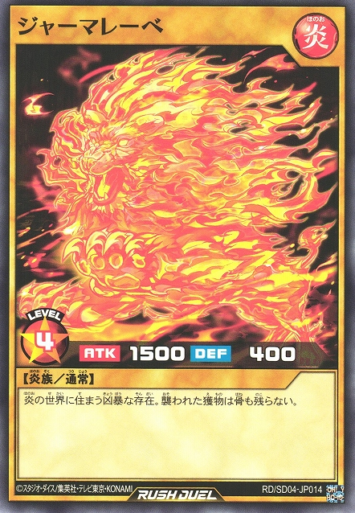
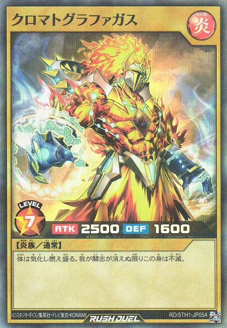
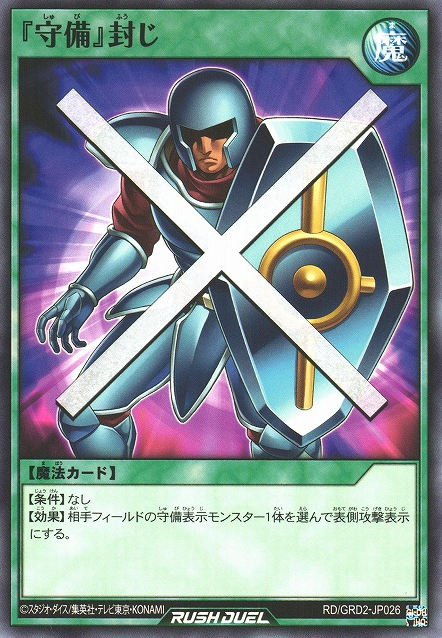
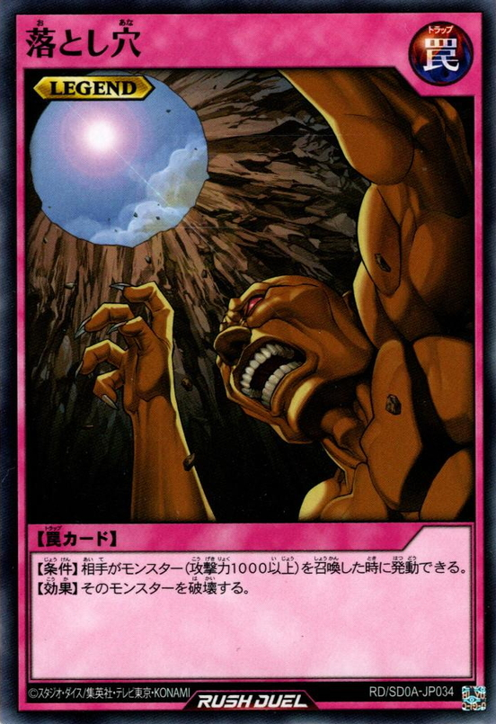
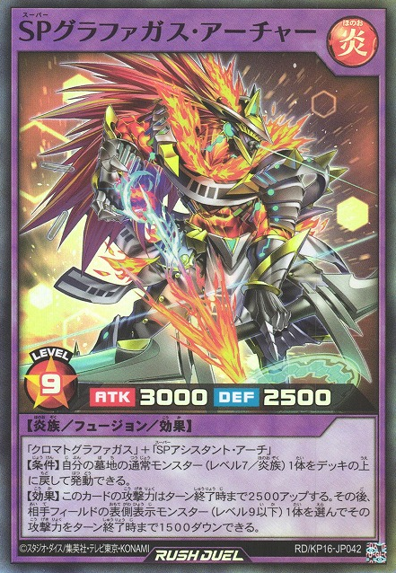
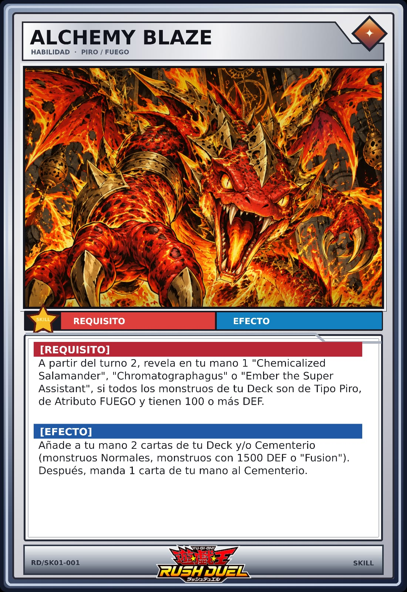

# Pyro

## IDENTIDAD BÁSICA

- `deck_id`: **704**
- Nombre registrado: **Pyro**
- Formato: **rush_duel**
- Main: **30**; Extra: **5**; Side: **0**; Reserva: **0**.

## PERFIL BREVE — CONOCE TU DECK

- **Arquetipo:** Piro/FUEGO de Rush Duel con la habilidad Alchemy Blaze.
- **Tipo de estrategia:** Invocaciones por Fusión a partir de materiales nombrados.
- **Estilo de juego:** despliegue de cuerpos, preparación de materiales y presión de combate.
- **Cómo se juega:** los monstruos Piro permiten reunir los materiales que exige cada Fusión; las cartas de apoyo y Alchemy Blaze amplían las opciones solo al cumplir sus requisitos locales.
- **Cartas representativas:** Germalewe, Ember, Chemicalized Salamander y la habilidad Alchemy Blaze.
- **Qué vigilar:** materiales boca arriba, momento de Fusión y disponibilidad de la habilidad; la Skill no pertenece a la mano.

## CARTAS: FUNCIÓN, RESTRICCIONES Y UTILIDAD

#### 01. ¡Atraviesa!

- **Zona y copias:** Main **1x**. CID Rush: **15204**.
- **Rol funcional:** Carta Mágica Normal — presión de combate / modificación de estadísticas.
- **Estado de sinergia y función:** Sinergia indirecta (soporte o recursos). Es una clasificación de juego; revisar la relación concreta en A06.
- **Papel como recurso, descarte o coste:** Coste o consumo descrito en A05: comprobar zona, objetivos y ventana; el nombre de la carta no reemplaza su texto.
- **Requisito específico:** Sin requisito de activación.
- **Efecto / resultado concreto:** Otorga daño de penetración este turno a un monstruo propio boca arriba.
- **Ir primero, segundo y juego tardío:** Primero: usarla si su efecto abre recursos o deja protección aprovechable; segundo: priorizar su resultado concreto frente a las amenazas rivales; tardío: comprobar materiales, objetivos y si aún quedan recursos en Deck o Cementerio.
- **Relación con habilidad y otras piezas:** La Skill **ALCHEMY BLAZE** necesita revelador válido y requisitos de construcción; no se activa libremente en turno 1.
- **Riesgos y dependencias:** comprobar zona, objetivos y ventana; el nombre de la carta no reemplaza su texto.
- **Confianza:** **RESUMEN_FUNCIONAL_DE_GUIA_PREVIA_CON_FUENTE_KONAMI**; pendiente cotejo adicional de traducción/ventanas según la liga. Fuente Rush oficial: https://www.db.yugioh-card.com/rushdb/card_search.action?cid=15204&ope=2
- **Contraste de fuente Rush:** CID 15204: fuente oficial Rush consultada en japonés; tipo Carta Mágica Normal; descripción funcional en español procede de la guía previa y sigue siendo interpretación editorial.
- **Aplicación concreta dentro de este deck (A06):** Otorga daño de penetración este turno a un monstruo propio boca arriba.
- **Alcance de esta ficha:** interpretación táctica editorial. Los costes, objetivos, ventanas y límites exactos se deben cotejar con el texto oficial antes de considerarlos verificados en una secuencia A09.

**USO PRÁCTICO Y SINERGIA — ¡Atraviesa!**

- **Label funcional:** Sinergia indirecta. Clasificación documental; una relación es válida solo si se satisfacen sus condiciones exactas.
- **Qué hace:** Otorga daño de penetración este turno a un monstruo propio boca arriba.
- **Cómo aprovecharla en este deck:** Otorga daño de penetración este turno a un monstruo propio boca arriba.
- **Uso y consumo de recursos:** Coste o consumo descrito en A05: comprobar zona, objetivos y ventana; el nombre de la carta no reemplaza su texto.
- **Cuándo tener precaución:** comprobar zona, objetivos y ventana; el nombre de la carta no reemplaza su texto.
- **Alcance de la guía:** explicación de función y aplicación derivada de la ficha existente. No certifica una nueva secuencia de invocación o cadena.

#### 02. Germalewe

- **Zona y copias:** Main **3x**. CID Rush: **17285**.
- **Rol funcional:** Monstruo Normal — material de Fusión/Sacrificio o presencia de combate; sin efecto activado.
- **Estado de sinergia y función:** Sinergia indirecta de recursos. Es una clasificación de juego; revisar la relación concreta en A06.
- **Papel como recurso, descarte o coste:** Material o destino del Extra condicionado a los requisitos de invocación.
- **Requisito específico:** No tiene efecto.
- **Efecto / resultado concreto:** Monstruo Normal; recurso para sacrificar o emplear como material.
- **Ir primero, segundo y juego tardío:** Primero: conservarlo si es material expresamente exigido por una Fusión o Sacrificio; segundo: emplearlo como cuerpo solo tras calcular ATK y riesgo de batalla; tardío: recurso para reconstruir material desde el GY si una carta lo autoriza.
- **Relación con habilidad y otras piezas:** **ALCHEMY BLAZE**, desde turno 2 y si se cumple el predicado de Pyro/FUEGO/DEF, puede recuperar dos piezas aptas; luego obliga a enviar una carta de mano.
- **Riesgos y dependencias:** no atribuirle un efecto activado inexistente; comprobar su función como material y las cartas de soporte. verificar en campo los materiales nombrados y el momento legal de la Fusión Rush; no usar materiales de mano sin permiso textual.
- **Confianza:** **RESUMEN_FUNCIONAL_DE_GUIA_PREVIA_CON_FUENTE_KONAMI**; pendiente cotejo adicional de traducción/ventanas según la liga. Fuente Rush oficial: https://www.db.yugioh-card.com/rushdb/card_search.action?cid=17285&ope=2
- **Contraste de fuente Rush:** CID 17285: fuente oficial Rush consultada en japonés; tipo Monstruo Normal; descripción funcional en español procede de la guía previa y sigue siendo interpretación editorial.
- **Aplicación concreta dentro de este deck (A06):** Monstruo Normal; recurso para sacrificar o emplear como material. Aportación posible como material, coste o objetivo; verificar consumidor.
- **Alcance de esta ficha:** interpretación táctica editorial. Los costes, objetivos, ventanas y límites exactos se deben cotejar con el texto oficial antes de considerarlos verificados en una secuencia A09.

**USO PRÁCTICO Y SINERGIA — Germalewe**

- **Label funcional:** Sinergia indirecta. Clasificación documental; una relación es válida solo si se satisfacen sus condiciones exactas.
- **Qué hace:** Monstruo Normal; recurso para sacrificar o emplear como material.
- **Cómo aprovecharla en este deck:** Monstruo Normal; recurso para sacrificar o emplear como material. Aportación posible como material, coste o objetivo; verificar consumidor.
- **Uso y consumo de recursos:** Material o destino del Extra condicionado a los requisitos de invocación.
- **Cuándo tener precaución:** no atribuirle un efecto activado inexistente; comprobar su función como material y las cartas de soporte. verificar en campo los materiales nombrados y el momento legal de la Fusión Rush; no usar materiales de mano sin permiso textual.
- **Alcance de la guía:** explicación de función y aplicación derivada de la ficha existente. No certifica una nueva secuencia de invocación o cadena.

#### 03. Orden Secreta

- **Zona y copias:** Main **3x**. CID Rush: **17212**.
- **Rol funcional:** Carta Mágica Normal — recurso táctico cuya condición y resultado están descritos en su ficha.
- **Estado de sinergia y función:** Sinergia directa descrita. Es una clasificación de juego; revisar la relación concreta en A06.
- **Papel como recurso, descarte o coste:** Coste o consumo descrito en A05: la condición de una Mágica/Trampa y sus blancos deben cumplirse antes de resolver. No confundir esta carta con un monstruo….
- **Requisito específico:** Sin requisito de activación.
- **Efecto / resultado concreto:** Invoca un monstruo Normal de Nivel 7 desde mano o Cementerio; le da 700 ATK ese turno y lo protege frente a destrucción por Trampas rivales.
- **Ir primero, segundo y juego tardío:** Primero: usarla si su efecto abre recursos o deja protección aprovechable; segundo: priorizar su resultado concreto frente a las amenazas rivales; tardío: comprobar materiales, objetivos y si aún quedan recursos en Deck o Cementerio.
- **Relación con habilidad y otras piezas:** **ALCHEMY BLAZE**, desde turno 2 y si se cumple el predicado de Pyro/FUEGO/DEF, puede recuperar dos piezas aptas; luego obliga a enviar una carta de mano.
- **Riesgos y dependencias:** la condición de una Mágica/Trampa y sus blancos deben cumplirse antes de resolver. No confundir esta carta con un monstruo ni usarla como material.
- **Confianza:** **RESUMEN_FUNCIONAL_DE_GUIA_PREVIA_CON_FUENTE_KONAMI**; pendiente cotejo adicional de traducción/ventanas según la liga. Fuente Rush oficial: https://www.db.yugioh-card.com/rushdb/card_search.action?cid=17212&ope=2
- **Contraste de fuente Rush:** CID 17212: fuente oficial Rush consultada en japonés; tipo Carta Mágica Normal; descripción funcional en español procede de la guía previa y sigue siendo interpretación editorial.
- **Aplicación concreta dentro de este deck (A06):** Invoca un monstruo Normal de Nivel 7 desde mano o Cementerio; le da 700 ATK ese turno y lo protege frente a destrucción por Trampas rivales.
- **Alcance de esta ficha:** interpretación táctica editorial. Los costes, objetivos, ventanas y límites exactos se deben cotejar con el texto oficial antes de considerarlos verificados en una secuencia A09.

**USO PRÁCTICO Y SINERGIA — Orden Secreta**

- **Label funcional:** Sinergia directa. Clasificación documental; una relación es válida solo si se satisfacen sus condiciones exactas.
- **Qué hace:** Invoca un monstruo Normal de Nivel 7 desde mano o Cementerio; le da 700 ATK ese turno y lo protege frente a destrucción por Trampas rivales.
- **Cómo aprovecharla en este deck:** Invoca un monstruo Normal de Nivel 7 desde mano o Cementerio; le da 700 ATK ese turno y lo protege frente a destrucción por Trampas rivales.
- **Uso y consumo de recursos:** Coste o consumo descrito en A05: la condición de una Mágica/Trampa y sus blancos deben cumplirse antes de resolver. No confundir esta carta con un monstruo….
- **Cuándo tener precaución:** la condición de una Mágica/Trampa y sus blancos deben cumplirse antes de resolver. No confundir esta carta con un monstruo ni usarla como material.
- **Alcance de la guía:** explicación de función y aplicación derivada de la ficha existente. No certifica una nueva secuencia de invocación o cadena.

#### 04. Hiperasistente Ember

- **Zona y copias:** Main **3x**. CID Rush: **19291**.
- **Rol funcional:** Monstruo de Efecto — extensor / habilitador de material.
- **Estado de sinergia y función:** Sinergia directa descrita. Es una clasificación de juego; revisar la relación concreta en A06.
- **Papel como recurso, descarte o coste:** Coste o consumo descrito en A05: pagar/cumplir el requisito escrito antes de prometer la resolución.
- **Requisito específico:** El rival debe controlar un monstruo; enviar esta carta boca arriba propia al Cementerio.
- **Efecto / resultado concreto:** Invoca desde la mano un Piro de Nivel 7+; si SP Assistant Archer está en el Cementerio, ese monstruo gana 800 ATK este turno.
- **Ir primero, segundo y juego tardío:** Primero: preparar acceso y campo necesario sin gastar la respuesta antes de tiempo; segundo: usarla para abrir combate o retirar la amenaza que cumple su condición; tardío: evaluar si quedan objetivos reales.
- **Relación con habilidad y otras piezas:** **ALCHEMY BLAZE**, desde turno 2 y si se cumple el predicado de Pyro/FUEGO/DEF, puede recuperar dos piezas aptas; luego obliga a enviar una carta de mano.
- **Riesgos y dependencias:** pagar/cumplir el requisito escrito antes de prometer la resolución.
- **Confianza:** **RESUMEN_FUNCIONAL_DE_GUIA_PREVIA_CON_FUENTE_KONAMI**; pendiente cotejo adicional de traducción/ventanas según la liga. Fuente Rush oficial: https://www.db.yugioh-card.com/rushdb/card_search.action?cid=19291&ope=2
- **Contraste de fuente Rush:** CID 19291: fuente oficial Rush consultada en japonés; tipo Monstruo de Efecto; descripción funcional en español procede de la guía previa y sigue siendo interpretación editorial.
- **Aplicación concreta dentro de este deck (A06):** Invoca desde la mano un Piro de Nivel 7+; si SP Assistant Archer está en el Cementerio, ese monstruo gana 800 ATK este turno.
- **Alcance de esta ficha:** interpretación táctica editorial. Los costes, objetivos, ventanas y límites exactos se deben cotejar con el texto oficial antes de considerarlos verificados en una secuencia A09.

**USO PRÁCTICO Y SINERGIA — Hiperasistente Ember**

- **Label funcional:** Sinergia directa. Clasificación documental; una relación es válida solo si se satisfacen sus condiciones exactas.
- **Qué hace:** Invoca desde la mano un Piro de Nivel 7+; si SP Assistant Archer está en el Cementerio, ese monstruo gana 800 ATK este turno.
- **Cómo aprovecharla en este deck:** Invoca desde la mano un Piro de Nivel 7+; si SP Assistant Archer está en el Cementerio, ese monstruo gana 800 ATK este turno.
- **Uso y consumo de recursos:** Coste o consumo descrito en A05: pagar/cumplir el requisito escrito antes de prometer la resolución.
- **Cuándo tener precaución:** pagar/cumplir el requisito escrito antes de prometer la resolución.
- **Alcance de la guía:** explicación de función y aplicación derivada de la ficha existente. No certifica una nueva secuencia de invocación o cadena.

#### 05. Cromatográfagas

- **Zona y copias:** Main **3x**. CID Rush: **18583**.
- **Rol funcional:** Monstruo Normal — material de Fusión/Sacrificio o presencia de combate; sin efecto activado.
- **Estado de sinergia y función:** Sinergia indirecta (soporte o recursos). Es una clasificación de juego; revisar la relación concreta en A06.
- **Papel como recurso, descarte o coste:** Material o destino del Extra condicionado a los requisitos de invocación.
- **Requisito específico:** No tiene efecto.
- **Efecto / resultado concreto:** Monstruo Normal de Nivel 7 y material nombrado de Supergráfagas Archer.
- **Ir primero, segundo y juego tardío:** Primero: conservarlo si es material expresamente exigido por una Fusión o Sacrificio; segundo: emplearlo como cuerpo solo tras calcular ATK y riesgo de batalla; tardío: recurso para reconstruir material desde el GY si una carta lo autoriza.
- **Relación con habilidad y otras piezas:** **ALCHEMY BLAZE**, desde turno 2 y si se cumple el predicado de Pyro/FUEGO/DEF, puede recuperar dos piezas aptas; luego obliga a enviar una carta de mano.
- **Riesgos y dependencias:** no atribuirle un efecto activado inexistente; comprobar su función como material y las cartas de soporte. verificar en campo los materiales nombrados y el momento legal de la Fusión Rush; no usar materiales de mano sin permiso textual.
- **Confianza:** **RESUMEN_FUNCIONAL_DE_GUIA_PREVIA_CON_FUENTE_KONAMI**; pendiente cotejo adicional de traducción/ventanas según la liga. Fuente Rush oficial: https://www.db.yugioh-card.com/rushdb/card_search.action?cid=18583&ope=2
- **Contraste de fuente Rush:** CID 18583: fuente oficial Rush consultada en japonés; tipo Monstruo Normal; descripción funcional en español procede de la guía previa y sigue siendo interpretación editorial.
- **Aplicación concreta dentro de este deck (A06):** Monstruo Normal de Nivel 7 y material nombrado de Supergráfagas Archer.
- **Alcance de esta ficha:** interpretación táctica editorial. Los costes, objetivos, ventanas y límites exactos se deben cotejar con el texto oficial antes de considerarlos verificados en una secuencia A09.

**USO PRÁCTICO Y SINERGIA — Cromatográfagas**

- **Label funcional:** Sinergia indirecta. Clasificación documental; una relación es válida solo si se satisfacen sus condiciones exactas.
- **Qué hace:** Monstruo Normal de Nivel 7 y material nombrado de Supergráfagas Archer.
- **Cómo aprovecharla en este deck:** Monstruo Normal de Nivel 7 y material nombrado de Supergráfagas Archer.
- **Uso y consumo de recursos:** Material o destino del Extra condicionado a los requisitos de invocación.
- **Cuándo tener precaución:** no atribuirle un efecto activado inexistente; comprobar su función como material y las cartas de soporte. verificar en campo los materiales nombrados y el momento legal de la Fusión Rush; no usar materiales de mano sin permiso textual.
- **Alcance de la guía:** explicación de función y aplicación derivada de la ficha existente. No certifica una nueva secuencia de invocación o cadena.

#### 06. Superasistente Ember

- **Zona y copias:** Main **3x**. CID Rush: **17963**.
- **Rol funcional:** Monstruo Normal — material de Fusión/Sacrificio o presencia de combate; sin efecto activado.
- **Estado de sinergia y función:** Sinergia indirecta (soporte o recursos). Es una clasificación de juego; revisar la relación concreta en A06.
- **Papel como recurso, descarte o coste:** Material o destino del Extra condicionado a los requisitos de invocación.
- **Requisito específico:** No tiene efecto.
- **Efecto / resultado concreto:** Monstruo Normal de Nivel 1, material nombrado de dos Fusiones del Extra.
- **Ir primero, segundo y juego tardío:** Primero: conservarlo si es material expresamente exigido por una Fusión o Sacrificio; segundo: emplearlo como cuerpo solo tras calcular ATK y riesgo de batalla; tardío: recurso para reconstruir material desde el GY si una carta lo autoriza.
- **Relación con habilidad y otras piezas:** **ALCHEMY BLAZE**, desde turno 2 y si se cumple el predicado de Pyro/FUEGO/DEF, puede recuperar dos piezas aptas; luego obliga a enviar una carta de mano.
- **Riesgos y dependencias:** no atribuirle un efecto activado inexistente; comprobar su función como material y las cartas de soporte. verificar en campo los materiales nombrados y el momento legal de la Fusión Rush; no usar materiales de mano sin permiso textual.
- **Confianza:** **RESUMEN_FUNCIONAL_DE_GUIA_PREVIA_CON_FUENTE_KONAMI**; pendiente cotejo adicional de traducción/ventanas según la liga. Fuente Rush oficial: https://www.db.yugioh-card.com/rushdb/card_search.action?cid=17963&ope=2
- **Contraste de fuente Rush:** CID 17963: fuente oficial Rush consultada en japonés; tipo Monstruo Normal; descripción funcional en español procede de la guía previa y sigue siendo interpretación editorial.
- **Aplicación concreta dentro de este deck (A06):** Monstruo Normal de Nivel 1, material nombrado de dos Fusiones del Extra.
- **Alcance de esta ficha:** interpretación táctica editorial. Los costes, objetivos, ventanas y límites exactos se deben cotejar con el texto oficial antes de considerarlos verificados en una secuencia A09.

**USO PRÁCTICO Y SINERGIA — Superasistente Ember**

- **Label funcional:** Sinergia indirecta. Clasificación documental; una relación es válida solo si se satisfacen sus condiciones exactas.
- **Qué hace:** Monstruo Normal de Nivel 1, material nombrado de dos Fusiones del Extra.
- **Cómo aprovecharla en este deck:** Monstruo Normal de Nivel 1, material nombrado de dos Fusiones del Extra.
- **Uso y consumo de recursos:** Material o destino del Extra condicionado a los requisitos de invocación.
- **Cuándo tener precaución:** no atribuirle un efecto activado inexistente; comprobar su función como material y las cartas de soporte. verificar en campo los materiales nombrados y el momento legal de la Fusión Rush; no usar materiales de mano sin permiso textual.
- **Alcance de la guía:** explicación de función y aplicación derivada de la ficha existente. No certifica una nueva secuencia de invocación o cadena.

#### 07. Fusión

- **Zona y copias:** Main **2x**. CID Rush: **16934**.
- **Rol funcional:** Carta Mágica Normal — extensor / habilitador de material.
- **Estado de sinergia y función:** Sinergia indirecta (soporte o recursos). Es una clasificación de juego; revisar la relación concreta en A06.
- **Papel como recurso, descarte o coste:** Material o destino del Extra condicionado a los requisitos de invocación.
- **Requisito específico:** Sin requisito de activación.
- **Efecto / resultado concreto:** Usa monstruos boca arriba del Campo propio como materiales, enviándolos al Cementerio para una Invocación por Fusión válida; no usa automáticamente materiales de la mano.
- **Ir primero, segundo y juego tardío:** Primero: usarla si su efecto abre recursos o deja protección aprovechable; segundo: priorizar su resultado concreto frente a las amenazas rivales; tardío: comprobar materiales, objetivos y si aún quedan recursos en Deck o Cementerio.
- **Relación con habilidad y otras piezas:** **ALCHEMY BLAZE**, desde turno 2 y si se cumple el predicado de Pyro/FUEGO/DEF, puede recuperar dos piezas aptas; luego obliga a enviar una carta de mano.
- **Riesgos y dependencias:** verificar en campo los materiales nombrados y el momento legal de la Fusión Rush; no usar materiales de mano sin permiso textual.
- **Confianza:** **RESUMEN_FUNCIONAL_DE_GUIA_PREVIA_CON_FUENTE_KONAMI**; pendiente cotejo adicional de traducción/ventanas según la liga. Fuente Rush oficial: https://www.db.yugioh-card.com/rushdb/card_search.action?cid=16934&ope=2
- **Contraste de fuente Rush:** CID 16934: fuente oficial Rush consultada en japonés; tipo Carta Mágica Normal; descripción funcional en español procede de la guía previa y sigue siendo interpretación editorial.
- **Aplicación concreta dentro de este deck (A06):** Usa monstruos boca arriba del Campo propio como materiales, enviándolos al Cementerio para una Invocación por Fusión válida; no usa automáticamente materiales de la mano.
- **Alcance de esta ficha:** interpretación táctica editorial. Los costes, objetivos, ventanas y límites exactos se deben cotejar con el texto oficial antes de considerarlos verificados en una secuencia A09.

**USO PRÁCTICO Y SINERGIA — Fusión**

- **Label funcional:** Sinergia indirecta. Clasificación documental; una relación es válida solo si se satisfacen sus condiciones exactas.
- **Qué hace:** Usa monstruos boca arriba del Campo propio como materiales, enviándolos al Cementerio para una Invocación por Fusión válida; no usa automáticamente materiales de la mano.
- **Cómo aprovecharla en este deck:** Usa monstruos boca arriba del Campo propio como materiales, enviándolos al Cementerio para una Invocación por Fusión válida; no usa automáticamente materiales de la mano.
- **Uso y consumo de recursos:** Material o destino del Extra condicionado a los requisitos de invocación.
- **Cuándo tener precaución:** verificar en campo los materiales nombrados y el momento legal de la Fusión Rush; no usar materiales de mano sin permiso textual.
- **Alcance de la guía:** explicación de función y aplicación derivada de la ficha existente. No certifica una nueva secuencia de invocación o cadena.

#### 08. Fuego Ardiente

- **Zona y copias:** Main **3x**. CID Rush: **16171**.
- **Rol funcional:** Carta Mágica Normal — apoyo situacional sujeto a condición escrita.
- **Estado de sinergia y función:** Sinergia indirecta (soporte o recursos). Es una clasificación de juego; revisar la relación concreta en A06.
- **Papel como recurso, descarte o coste:** Coste o consumo descrito en A05: el resultado está sujeto a monstruos/cartas que puedan ser afectados y a respuestas del rival.
- **Requisito específico:** Controlar dos o más monstruos Piro boca arriba.
- **Efecto / resultado concreto:** Inflige 300 puntos de daño; después puede destruir una Mágica/Trampa rival.
- **Ir primero, segundo y juego tardío:** Primero: usarla si su efecto abre recursos o deja protección aprovechable; segundo: priorizar su resultado concreto frente a las amenazas rivales; tardío: comprobar materiales, objetivos y si aún quedan recursos en Deck o Cementerio.
- **Relación con habilidad y otras piezas:** La Skill **ALCHEMY BLAZE** necesita revelador válido y requisitos de construcción; no se activa libremente en turno 1.
- **Riesgos y dependencias:** el resultado está sujeto a monstruos/cartas que puedan ser afectados y a respuestas del rival.
- **Confianza:** **RESUMEN_FUNCIONAL_DE_GUIA_PREVIA_CON_FUENTE_KONAMI**; pendiente cotejo adicional de traducción/ventanas según la liga. Fuente Rush oficial: https://www.db.yugioh-card.com/rushdb/card_search.action?cid=16171&ope=2
- **Contraste de fuente Rush:** CID 16171: fuente oficial Rush consultada en japonés; tipo Carta Mágica Normal; descripción funcional en español procede de la guía previa y sigue siendo interpretación editorial.
- **Aplicación concreta dentro de este deck (A06):** Inflige 300 puntos de daño; después puede destruir una Mágica/Trampa rival.
- **Alcance de esta ficha:** interpretación táctica editorial. Los costes, objetivos, ventanas y límites exactos se deben cotejar con el texto oficial antes de considerarlos verificados en una secuencia A09.

**USO PRÁCTICO Y SINERGIA — Fuego Ardiente**

- **Label funcional:** Sinergia indirecta. Clasificación documental; una relación es válida solo si se satisfacen sus condiciones exactas.
- **Qué hace:** Inflige 300 puntos de daño; después puede destruir una Mágica/Trampa rival.
- **Cómo aprovecharla en este deck:** Inflige 300 puntos de daño; después puede destruir una Mágica/Trampa rival.
- **Uso y consumo de recursos:** Coste o consumo descrito en A05: el resultado está sujeto a monstruos/cartas que puedan ser afectados y a respuestas del rival.
- **Cuándo tener precaución:** el resultado está sujeto a monstruos/cartas que puedan ser afectados y a respuestas del rival.
- **Alcance de la guía:** explicación de función y aplicación derivada de la ficha existente. No certifica una nueva secuencia de invocación o cadena.

#### 09. Salamandra Quimicalizada

- **Zona y copias:** Main **2x**. CID Rush: **17868**.
- **Rol funcional:** Monstruo de Efecto — presión de combate / modificación de estadísticas.
- **Estado de sinergia y función:** Sinergia indirecta (soporte o recursos). Es una clasificación de juego; revisar la relación concreta en A06.
- **Papel como recurso, descarte o coste:** Coste o consumo descrito en A05: pagar/cumplir el requisito escrito antes de prometer la resolución.
- **Requisito específico:** Devolver al Deck tres monstruos Piro del propio Cementerio.
- **Efecto / resultado concreto:** Todos los monstruos boca arriba rivales pierden 100 ATK por cada monstruo en el Cementerio rival hasta fin de turno.
- **Ir primero, segundo y juego tardío:** Primero: preparar acceso y campo necesario sin gastar la respuesta antes de tiempo; segundo: usarla para abrir combate o retirar la amenaza que cumple su condición; tardío: evaluar si quedan objetivos reales.
- **Relación con habilidad y otras piezas:** **ALCHEMY BLAZE**, desde turno 2 y si se cumple el predicado de Pyro/FUEGO/DEF, puede recuperar dos piezas aptas; luego obliga a enviar una carta de mano.
- **Riesgos y dependencias:** pagar/cumplir el requisito escrito antes de prometer la resolución.
- **Confianza:** **RESUMEN_FUNCIONAL_DE_GUIA_PREVIA_CON_FUENTE_KONAMI**; pendiente cotejo adicional de traducción/ventanas según la liga. Fuente Rush oficial: https://www.db.yugioh-card.com/rushdb/card_search.action?cid=17868&ope=2
- **Contraste de fuente Rush:** CID 17868: fuente oficial Rush consultada en japonés; tipo Monstruo de Efecto; descripción funcional en español procede de la guía previa y sigue siendo interpretación editorial.
- **Aplicación concreta dentro de este deck (A06):** Todos los monstruos boca arriba rivales pierden 100 ATK por cada monstruo en el Cementerio rival hasta fin de turno.
- **Alcance de esta ficha:** interpretación táctica editorial. Los costes, objetivos, ventanas y límites exactos se deben cotejar con el texto oficial antes de considerarlos verificados en una secuencia A09.

**USO PRÁCTICO Y SINERGIA — Salamandra Quimicalizada**

- **Label funcional:** Sinergia indirecta. Clasificación documental; una relación es válida solo si se satisfacen sus condiciones exactas.
- **Qué hace:** Todos los monstruos boca arriba rivales pierden 100 ATK por cada monstruo en el Cementerio rival hasta fin de turno.
- **Cómo aprovecharla en este deck:** Todos los monstruos boca arriba rivales pierden 100 ATK por cada monstruo en el Cementerio rival hasta fin de turno.
- **Uso y consumo de recursos:** Coste o consumo descrito en A05: pagar/cumplir el requisito escrito antes de prometer la resolución.
- **Cuándo tener precaución:** pagar/cumplir el requisito escrito antes de prometer la resolución.
- **Alcance de la guía:** explicación de función y aplicación derivada de la ficha existente. No certifica una nueva secuencia de invocación o cadena.

#### 10. Gelatina Defensiva

- **Zona y copias:** Main **1x**. CID Rush: **18646**.
- **Rol funcional:** Carta de Trampa Normal — defensa ante ataque y prevención de daño de batalla.
- **Estado de sinergia y función:** Sinergia directa descrita. Es una clasificación de juego; revisar la relación concreta en A06.
- **Papel como recurso, descarte o coste:** Envío mencionado en la interacción; no equivale por sí mismo a descarte desde la mano.
- **Requisito específico:** Cuando un monstruo rival de Nivel 8 o inferior declara ataque.
- **Efecto / resultado concreto:** Envía al Cementerio la carta superior de tu Deck y evita todo el daño de batalla ese turno; si tienes 3000 LP o más, recibes además 2000 de daño de efecto.
- **Ir primero, segundo y juego tardío:** Primero: construir la condición de activación; segundo: verificar que la jugada responde al estado rival actual; tardío: ahorrar el recurso si todavía no se cumple el requisito.
- **Relación con habilidad y otras piezas:** La Skill **ALCHEMY BLAZE** necesita revelador válido y requisitos de construcción; no se activa libremente en turno 1.
- **Riesgos y dependencias:** comprobar zona, objetivos y ventana; el nombre de la carta no reemplaza su texto.
- **Confianza:** **RESUMEN_FUNCIONAL_DE_GUIA_PREVIA_CON_FUENTE_KONAMI**; pendiente cotejo adicional de traducción/ventanas según la liga. Fuente Rush oficial: https://www.db.yugioh-card.com/rushdb/card_search.action?cid=18646&ope=2
- **Contraste de fuente Rush:** CID 18646, nombre japonés **バッファード・スライム** (Buffered Slime): texto oficial localizado con `request_locale=ja`, tipo Carta de Trampa Normal. La condición de ataque de monstruo rival de Nivel 8 o inferior, el envío de la carta superior del Deck, la prevención de daño de batalla del turno y el daño de efecto de 2000 si los LP propios son al menos 3000 coinciden con el resumen previo. La denominación española «Gelatina Defensiva» sigue siendo un alias del inventario; no se impone traducción oficial.
- **Aplicación concreta dentro de este deck (A06):** Envía al Cementerio la carta superior de tu Deck y evita todo el daño de batalla ese turno; si tienes 3000 LP o más, recibes además 2000 de daño de efecto.
- **Alcance de esta ficha:** interpretación táctica editorial. Los costes, objetivos, ventanas y límites exactos se deben cotejar con el texto oficial antes de considerarlos verificados en una secuencia A09.

**USO PRÁCTICO Y SINERGIA — Gelatina Defensiva**

- **Label funcional:** Sinergia directa. Clasificación documental; una relación es válida solo si se satisfacen sus condiciones exactas.
- **Qué hace:** Envía al Cementerio la carta superior de tu Deck y evita todo el daño de batalla ese turno; si tienes 3000 LP o más, recibes además 2000 de daño de efecto.
- **Cómo aprovecharla en este deck:** Envía al Cementerio la carta superior de tu Deck y evita todo el daño de batalla ese turno; si tienes 3000 LP o más, recibes además 2000 de daño de efecto.
- **Uso y consumo de recursos:** Envío mencionado en la interacción; no equivale por sí mismo a descarte desde la mano.
- **Cuándo tener precaución:** comprobar zona, objetivos y ventana; el nombre de la carta no reemplaza su texto.
- **Alcance de la guía:** explicación de función y aplicación derivada de la ficha existente. No certifica una nueva secuencia de invocación o cadena.

#### 11. Amparo del Protector Estelar

- **Zona y copias:** Main **2x**. CID Rush: **19700**.
- **Rol funcional:** Carta de Trampa Normal — presión de combate / modificación de estadísticas.
- **Estado de sinergia y función:** Sinergia indirecta (soporte o recursos). Es una clasificación de juego; revisar la relación concreta en A06.
- **Papel como recurso, descarte o coste:** Coste o consumo descrito en A05: verificar en campo los materiales nombrados y el momento legal de la Fusión Rush; no usar materiales de mano sin permiso….
- **Requisito específico:** En el turno rival, cuando roba o Invoca un monstruo; enviar un monstruo propio del Campo al Cementerio.
- **Efecto / resultado concreto:** El rival solo puede declarar un ataque en ese turno. Opcionalmente permite tomar control de una Fusión Caballero Mágico rival de Nivel 9+ y ATK original 3000.
- **Ir primero, segundo y juego tardío:** Primero: Colocar y reservar la respuesta para la ventana legal; segundo: tras side y cambio de turno, evaluar si puede activarse a tiempo; tardío: no asumir efecto si falta el objetivo o el estado de campo.
- **Relación con habilidad y otras piezas:** **ALCHEMY BLAZE**, desde turno 2 y si se cumple el predicado de Pyro/FUEGO/DEF, puede recuperar dos piezas aptas; luego obliga a enviar una carta de mano.
- **Riesgos y dependencias:** verificar en campo los materiales nombrados y el momento legal de la Fusión Rush; no usar materiales de mano sin permiso textual. pagar/cumplir el requisito escrito antes de prometer la resolución.
- **Confianza:** **RESUMEN_FUNCIONAL_DE_GUIA_PREVIA_CON_FUENTE_KONAMI**; pendiente cotejo adicional de traducción/ventanas según la liga. Fuente Rush oficial: https://www.db.yugioh-card.com/rushdb/card_search.action?cid=19700&ope=2
- **Contraste de fuente Rush:** CID 19700: fuente oficial Rush consultada en japonés; tipo Carta de Trampa Normal; descripción funcional en español procede de la guía previa y sigue siendo interpretación editorial.
- **Aplicación concreta dentro de este deck (A06):** El rival solo puede declarar un ataque en ese turno.
- **Alcance de esta ficha:** interpretación táctica editorial. Los costes, objetivos, ventanas y límites exactos se deben cotejar con el texto oficial antes de considerarlos verificados en una secuencia A09.

**USO PRÁCTICO Y SINERGIA — Amparo del Protector Estelar**

- **Label funcional:** Sinergia indirecta. Clasificación documental; una relación es válida solo si se satisfacen sus condiciones exactas.
- **Qué hace:** El rival solo puede declarar un ataque en ese turno. Opcionalmente permite tomar control de una Fusión Caballero Mágico rival de Nivel 9+ y ATK original 3000.
- **Cómo aprovecharla en este deck:** El rival solo puede declarar un ataque en ese turno.
- **Uso y consumo de recursos:** Coste o consumo descrito en A05: verificar en campo los materiales nombrados y el momento legal de la Fusión Rush; no usar materiales de mano sin permiso….
- **Cuándo tener precaución:** verificar en campo los materiales nombrados y el momento legal de la Fusión Rush; no usar materiales de mano sin permiso textual. pagar/cumplir el requisito escrito antes de prometer la resolución.
- **Alcance de la guía:** explicación de función y aplicación derivada de la ficha existente. No certifica una nueva secuencia de invocación o cadena.

#### 12. Parar la Defensa

- **Zona y copias:** Main **1x**. CID Rush: **16776**.
- **Rol funcional:** Carta Mágica Normal — presión de combate / modificación de estadísticas.
- **Estado de sinergia y función:** Sinergia indirecta (soporte o recursos). Es una clasificación de juego; revisar la relación concreta en A06.
- **Papel como recurso, descarte o coste:** Coste o consumo descrito en A05: comprobar zona, objetivos y ventana; el nombre de la carta no reemplaza su texto.
- **Requisito específico:** Sin requisito de activación.
- **Efecto / resultado concreto:** Cambia un monstruo rival que esté en Defensa a Ataque boca arriba.
- **Ir primero, segundo y juego tardío:** Primero: usarla si su efecto abre recursos o deja protección aprovechable; segundo: priorizar su resultado concreto frente a las amenazas rivales; tardío: comprobar materiales, objetivos y si aún quedan recursos en Deck o Cementerio.
- **Relación con habilidad y otras piezas:** La Skill **ALCHEMY BLAZE** necesita revelador válido y requisitos de construcción; no se activa libremente en turno 1.
- **Riesgos y dependencias:** comprobar zona, objetivos y ventana; el nombre de la carta no reemplaza su texto.
- **Confianza:** **RESUMEN_FUNCIONAL_DE_GUIA_PREVIA_CON_FUENTE_KONAMI**; pendiente cotejo adicional de traducción/ventanas según la liga. Fuente Rush oficial: https://www.db.yugioh-card.com/rushdb/card_search.action?cid=16776&ope=2
- **Contraste de fuente Rush:** CID 16776: fuente oficial Rush consultada en japonés; tipo Carta Mágica Normal; descripción funcional en español procede de la guía previa y sigue siendo interpretación editorial.
- **Aplicación concreta dentro de este deck (A06):** Cambia un monstruo rival que esté en Defensa a Ataque boca arriba.
- **Alcance de esta ficha:** interpretación táctica editorial. Los costes, objetivos, ventanas y límites exactos se deben cotejar con el texto oficial antes de considerarlos verificados en una secuencia A09.

**USO PRÁCTICO Y SINERGIA — Parar la Defensa**

- **Label funcional:** Sinergia indirecta. Clasificación documental; una relación es válida solo si se satisfacen sus condiciones exactas.
- **Qué hace:** Cambia un monstruo rival que esté en Defensa a Ataque boca arriba.
- **Cómo aprovecharla en este deck:** Cambia un monstruo rival que esté en Defensa a Ataque boca arriba.
- **Uso y consumo de recursos:** Coste o consumo descrito en A05: comprobar zona, objetivos y ventana; el nombre de la carta no reemplaza su texto.
- **Cuándo tener precaución:** comprobar zona, objetivos y ventana; el nombre de la carta no reemplaza su texto.
- **Alcance de la guía:** explicación de función y aplicación derivada de la ficha existente. No certifica una nueva secuencia de invocación o cadena.

#### 13. Agujero Trampa

- **Zona y copias:** Main **1x**. CID Rush: **15913**.
- **Rol funcional:** Carta de Trampa Normal — interrupción defensiva de Invocación Normal.
- **Estado de sinergia y función:** Sinergia indirecta (soporte o recursos). Es una clasificación de juego; revisar la relación concreta en A06.
- **Papel como recurso, descarte o coste:** Coste o consumo descrito en A05: el resultado está sujeto a monstruos/cartas que puedan ser afectados y a respuestas del rival.
- **Requisito específico:** Cuando el rival Invoca de Modo Normal un monstruo de al menos 1000 ATK.
- **Efecto / resultado concreto:** Destruye ese monstruo invocado.
- **Ir primero, segundo y juego tardío:** Primero: Colocar y reservar la respuesta para la ventana legal; segundo: tras side y cambio de turno, evaluar si puede activarse a tiempo; tardío: no asumir efecto si falta el objetivo o el estado de campo.
- **Relación con habilidad y otras piezas:** La Skill **ALCHEMY BLAZE** necesita revelador válido y requisitos de construcción; no se activa libremente en turno 1.
- **Riesgos y dependencias:** el resultado está sujeto a monstruos/cartas que puedan ser afectados y a respuestas del rival.
- **Confianza:** **RESUMEN_FUNCIONAL_DE_GUIA_PREVIA_CON_FUENTE_KONAMI**; pendiente cotejo adicional de traducción/ventanas según la liga. Fuente Rush oficial: https://www.db.yugioh-card.com/rushdb/card_search.action?cid=15913&ope=2
- **Contraste de fuente Rush:** CID 15913: fuente oficial Rush consultada en japonés; tipo Carta de Trampa Normal; descripción funcional en español procede de la guía previa y sigue siendo interpretación editorial.
- **Aplicación concreta dentro de este deck (A06):** Destruye ese monstruo invocado.
- **Alcance de esta ficha:** interpretación táctica editorial. Los costes, objetivos, ventanas y límites exactos se deben cotejar con el texto oficial antes de considerarlos verificados en una secuencia A09.

**USO PRÁCTICO Y SINERGIA — Agujero Trampa**

- **Label funcional:** Sinergia indirecta. Clasificación documental; una relación es válida solo si se satisfacen sus condiciones exactas.
- **Qué hace:** Destruye ese monstruo invocado.
- **Cómo aprovecharla en este deck:** Destruye ese monstruo invocado.
- **Uso y consumo de recursos:** Coste o consumo descrito en A05: el resultado está sujeto a monstruos/cartas que puedan ser afectados y a respuestas del rival.
- **Cuándo tener precaución:** el resultado está sujeto a monstruos/cartas que puedan ser afectados y a respuestas del rival.
- **Alcance de la guía:** explicación de función y aplicación derivada de la ficha existente. No certifica una nueva secuencia de invocación o cadena.

#### 14. Gobernante de las Llamas

- **Zona y copias:** Main **1x**. CID Rush: **17926**.
- **Rol funcional:** Monstruo de Efecto — extensor / habilitador de material.
- **Estado de sinergia y función:** Sinergia directa descrita. Es una clasificación de juego; revisar la relación concreta en A06.
- **Papel como recurso, descarte o coste:** Coste o consumo descrito en A05: comprobar zona, objetivos y ventana; el nombre de la carta no reemplaza su texto.
- **Requisito específico:** No necesita activación.
- **Efecto / resultado concreto:** Esta carta boca arriba cuenta por dos Sacrificios para Invocar por Sacrificio en Ataque un monstruo de FUEGO.
- **Ir primero, segundo y juego tardío:** Primero: construir la condición de activación; segundo: verificar que la jugada responde al estado rival actual; tardío: ahorrar el recurso si todavía no se cumple el requisito.
- **Relación con habilidad y otras piezas:** La Skill **ALCHEMY BLAZE** necesita revelador válido y requisitos de construcción; no se activa libremente en turno 1.
- **Riesgos y dependencias:** comprobar zona, objetivos y ventana; el nombre de la carta no reemplaza su texto.
- **Confianza:** **RESUMEN_FUNCIONAL_DE_GUIA_PREVIA_CON_FUENTE_KONAMI**; pendiente cotejo adicional de traducción/ventanas según la liga. Fuente Rush oficial: https://www.db.yugioh-card.com/rushdb/card_search.action?cid=17926&ope=2
- **Contraste de fuente Rush:** CID 17926: fuente oficial Rush consultada en japonés; tipo Monstruo de Efecto; descripción funcional en español procede de la guía previa y sigue siendo interpretación editorial.
- **Aplicación concreta dentro de este deck (A06):** Esta carta boca arriba cuenta por dos Sacrificios para Invocar por Sacrificio en Ataque un monstruo de FUEGO.
- **Alcance de esta ficha:** interpretación táctica editorial. Los costes, objetivos, ventanas y límites exactos se deben cotejar con el texto oficial antes de considerarlos verificados en una secuencia A09.

**USO PRÁCTICO Y SINERGIA — Gobernante de las Llamas**

- **Label funcional:** Sinergia directa. Clasificación documental; una relación es válida solo si se satisfacen sus condiciones exactas.
- **Qué hace:** Esta carta boca arriba cuenta por dos Sacrificios para Invocar por Sacrificio en Ataque un monstruo de FUEGO.
- **Cómo aprovecharla en este deck:** Esta carta boca arriba cuenta por dos Sacrificios para Invocar por Sacrificio en Ataque un monstruo de FUEGO.
- **Uso y consumo de recursos:** Coste o consumo descrito en A05: comprobar zona, objetivos y ventana; el nombre de la carta no reemplaza su texto.
- **Cuándo tener precaución:** comprobar zona, objetivos y ventana; el nombre de la carta no reemplaza su texto.
- **Alcance de la guía:** explicación de función y aplicación derivada de la ficha existente. No certifica una nueva secuencia de invocación o cadena.

#### 15. Olla de la Codicia

- **Zona y copias:** Main **1x**. CID Rush: **16372**.
- **Rol funcional:** Carta Mágica Normal — consistencia / reciclaje.
- **Estado de sinergia y función:** Sinergia indirecta de recursos. Es una clasificación de juego; revisar la relación concreta en A06.
- **Papel como recurso, descarte o coste:** Material o destino del Extra condicionado a los requisitos de invocación.
- **Requisito específico:** Sin requisito de activación.
- **Efecto / resultado concreto:** Roba dos cartas.
- **Ir primero, segundo y juego tardío:** Primero: usarla si su efecto abre recursos o deja protección aprovechable; segundo: priorizar su resultado concreto frente a las amenazas rivales; tardío: comprobar materiales, objetivos y si aún quedan recursos en Deck o Cementerio.
- **Relación con habilidad y otras piezas:** La Skill **ALCHEMY BLAZE** necesita revelador válido y requisitos de construcción; no se activa libremente en turno 1.
- **Riesgos y dependencias:** disponer de cartas suficientes en Deck y distinguir robo de búsqueda.
- **Confianza:** **RESUMEN_FUNCIONAL_DE_GUIA_PREVIA_CON_FUENTE_KONAMI**; pendiente cotejo adicional de traducción/ventanas según la liga. Fuente Rush oficial: https://www.db.yugioh-card.com/rushdb/card_search.action?cid=16372&ope=2
- **Contraste de fuente Rush:** CID 16372: fuente oficial Rush consultada en japonés; tipo Carta Mágica Normal; descripción funcional en español procede de la guía previa y sigue siendo interpretación editorial.
- **Aplicación concreta dentro de este deck (A06):** Roba dos cartas. Aportación posible como material, coste o objetivo; verificar consumidor.
- **Alcance de esta ficha:** interpretación táctica editorial. Los costes, objetivos, ventanas y límites exactos se deben cotejar con el texto oficial antes de considerarlos verificados en una secuencia A09.

**USO PRÁCTICO Y SINERGIA — Olla de la Codicia**

- **Label funcional:** Sinergia indirecta. Clasificación documental; una relación es válida solo si se satisfacen sus condiciones exactas.
- **Qué hace:** Roba dos cartas.
- **Cómo aprovecharla en este deck:** Roba dos cartas. Aportación posible como material, coste o objetivo; verificar consumidor.
- **Uso y consumo de recursos:** Material o destino del Extra condicionado a los requisitos de invocación.
- **Cuándo tener precaución:** disponer de cartas suficientes en Deck y distinguir robo de búsqueda.
- **Alcance de la guía:** explicación de función y aplicación derivada de la ficha existente. No certifica una nueva secuencia de invocación o cadena.

#### 16. Arquero Ígneo Supergráfagas

- **Zona y copias:** Extra **2x**. CID Rush: **19990**.
- **Rol funcional:** Monstruo de Fusión — objetivo de Fusión con materiales expresos y efecto de cierre.
- **Estado de sinergia y función:** Destino Extra condicionado. Es una clasificación de juego; revisar la relación concreta en A06.
- **Papel como recurso, descarte o coste:** Material o destino del Extra condicionado a los requisitos de invocación.
- **Requisito específico:** Fusionar Chromatographagas + SP Assistant Archer. Devolver al tope del Deck un Piro Normal de Nivel 7 del Cementerio.
- **Efecto / resultado concreto:** Gana 2500 ATK este turno; opcionalmente reduce en 1500 ATK un monstruo rival boca arriba de Nivel 9 o inferior.
- **Ir primero, segundo y juego tardío:** Primero: preparar materiales y «Fusión» si es alcanzable; segundo: considerar el efecto de campo o daño que se produzca tras una Fusión legal; tardío: comprobar si quedan materiales nombrados en campo y Extra.
- **Relación con habilidad y otras piezas:** La Skill **ALCHEMY BLAZE** necesita revelador válido y requisitos de construcción; no se activa libremente en turno 1.
- **Riesgos y dependencias:** pagar/cumplir el requisito escrito antes de prometer la resolución.
- **Confianza:** **RESUMEN_FUNCIONAL_DE_GUIA_PREVIA_CON_FUENTE_KONAMI**; pendiente cotejo adicional de traducción/ventanas según la liga. Fuente Rush oficial: https://www.db.yugioh-card.com/rushdb/card_search.action?cid=19990&ope=2
- **Contraste de fuente Rush:** CID 19990: fuente oficial Rush consultada en japonés; tipo Monstruo de Fusión; descripción funcional en español procede de la guía previa y sigue siendo interpretación editorial.
- **Aplicación concreta dentro de este deck (A06):** Gana 2500 ATK este turno; opcionalmente reduce en 1500 ATK un monstruo rival boca arriba de Nivel 9 o inferior. A06 identifica su destino, condicionado a material/procedimiento.
- **Alcance de esta ficha:** interpretación táctica editorial. Los costes, objetivos, ventanas y límites exactos se deben cotejar con el texto oficial antes de considerarlos verificados en una secuencia A09.

**USO PRÁCTICO Y SINERGIA — Arquero Ígneo Supergráfagas**

- **Label funcional:** Referencias de ruta localizadas; conexión reglamentaria sujeta al recorrido de la guía. Clasificación documental; una relación es válida solo si se satisfacen sus condiciones exactas.
- **Qué hace:** Gana 2500 ATK este turno; opcionalmente reduce en 1500 ATK un monstruo rival boca arriba de Nivel 9 o inferior.
- **Cómo aprovecharla en este deck:** Gana 2500 ATK este turno; opcionalmente reduce en 1500 ATK un monstruo rival boca arriba de Nivel 9 o inferior. A06 identifica su destino, condicionado a material/procedimiento.
- **Uso y consumo de recursos:** Material o destino del Extra condicionado a los requisitos de invocación.
- **Cuándo tener precaución:** pagar/cumplir el requisito escrito antes de prometer la resolución.
- **Alcance de la guía:** explicación de función y aplicación derivada de la ficha existente. No certifica una nueva secuencia de invocación o cadena.

**CÓMO LLEGAR DESDE TU DECK — RUTAS DOCUMENTADAS**

- **Abrir guía `704:A09:ALCHEMY:ARCHER01`:** entrada: Cromatográfagas (18583, monstruo Normal Piro FUEGO Nivel 7) + Orden Secreta (17212). Campo y GY propios vacíos; turno de duelo 2 o posterior; Alchemy Blaze (RD/SK01-001) no usada y disponible conforme a las reglas personalizadas de la liga. SP Assistant Archer / Superasistente Ember (17963) y Fusión (16934) todavía en Deck; Fusión 19990 en Extra; rival sin interrupción en la ruta base.. Propósito descrito: Preparación de recursos / despliegue. Consulta sus pasos, consumo y resultado; comprobar si esta carta es realmente invocada o solo mencionada.

#### 17. Salamandra Alquimicalizada

- **Zona y copias:** Extra **3x**. CID Rush: **18614**.
- **Rol funcional:** Monstruo de Fusión — objetivo de Fusión con materiales expresos y efecto de cierre.
- **Estado de sinergia y función:** Destino Extra condicionado. Es una clasificación de juego; revisar la relación concreta en A06.
- **Papel como recurso, descarte o coste:** Material o destino del Extra condicionado a los requisitos de invocación.
- **Requisito específico:** Fusionar Chemicalized Salamander + SP Assistant Archer; usar efecto en la Main Phase en que se invocó de Modo Especial.
- **Efecto / resultado concreto:** Destruye todas las Mágicas/Trampas de ambos Campos y opcionalmente reduce 1000 ATK a los monstruos rivales por cada Mágica destruida.
- **Ir primero, segundo y juego tardío:** Primero: preparar materiales y «Fusión» si es alcanzable; segundo: considerar el efecto de campo o daño que se produzca tras una Fusión legal; tardío: comprobar si quedan materiales nombrados en campo y Extra.
- **Relación con habilidad y otras piezas:** **ALCHEMY BLAZE**, desde turno 2 y si se cumple el predicado de Pyro/FUEGO/DEF, puede recuperar dos piezas aptas; luego obliga a enviar una carta de mano.
- **Riesgos y dependencias:** el resultado está sujeto a monstruos/cartas que puedan ser afectados y a respuestas del rival.
- **Confianza:** **RESUMEN_FUNCIONAL_DE_GUIA_PREVIA_CON_FUENTE_KONAMI**; pendiente cotejo adicional de traducción/ventanas según la liga. Fuente Rush oficial: https://www.db.yugioh-card.com/rushdb/card_search.action?cid=18614&ope=2
- **Contraste de fuente Rush:** CID 18614: fuente oficial Rush consultada en japonés; tipo Monstruo de Fusión; descripción funcional en español procede de la guía previa y sigue siendo interpretación editorial.
- **Aplicación concreta dentro de este deck (A06):** Destruye todas las Mágicas/Trampas de ambos Campos y opcionalmente reduce 1000 ATK a los monstruos rivales por cada Mágica destruida. A06 identifica su destino, condicionado a material/procedimiento.
- **Alcance de esta ficha:** interpretación táctica editorial. Los costes, objetivos, ventanas y límites exactos se deben cotejar con el texto oficial antes de considerarlos verificados en una secuencia A09.

**USO PRÁCTICO Y SINERGIA — Salamandra Alquimicalizada**

- **Label funcional:** Referencias de ruta localizadas; conexión reglamentaria sujeta al recorrido de la guía. Clasificación documental; una relación es válida solo si se satisfacen sus condiciones exactas.
- **Qué hace:** Destruye todas las Mágicas/Trampas de ambos Campos y opcionalmente reduce 1000 ATK a los monstruos rivales por cada Mágica destruida.
- **Cómo aprovecharla en este deck:** Destruye todas las Mágicas/Trampas de ambos Campos y opcionalmente reduce 1000 ATK a los monstruos rivales por cada Mágica destruida. A06 identifica su destino, condicionado a material/procedimiento.
- **Uso y consumo de recursos:** Material o destino del Extra condicionado a los requisitos de invocación.
- **Cuándo tener precaución:** el resultado está sujeto a monstruos/cartas que puedan ser afectados y a respuestas del rival.
- **Alcance de la guía:** explicación de función y aplicación derivada de la ficha existente. No certifica una nueva secuencia de invocación o cadena.

**CÓMO LLEGAR DESDE TU DECK — RUTAS DOCUMENTADAS**

- **Abrir guía `704:A09:ALCHEMY:SALAMANDRA02`:** entrada: Salamandra 1× Salamandra Quimicalizada / Chemicalized Salamander, Hiperasistente 1× Hiperasistente Ember / HP Assistant Archer, Atraviesa 1× ¡Atraviesa! como descarte de Skill. Deck: Superasistente 1× Superasistente Ember / SP Assistant Archer + Fusión 1× Fusión disponibles. Extra: Salamandra Fusion 1× Salamandra Alquimicalizada disponible. Skill: ALCHEMY BLAZE sin usar, turno 2 o posterior; todas las seis identidades de monstruo del Main satisfacen Piro/FUEGO y DEF ≥ 100 según inventario. Campo/GY/destierro propios: vacíos, Normal libre, ninguna restricción precedente. Rival: controla un monstruo boca arriba; además, para cuantificar el efecto, una Mágica boca arriba destruible y ninguna otra M/T. Rival no responde en esta línea de referencia.. Propósito descrito: Ofensivo condicional. Consulta sus pasos, consumo y resultado; comprobar si esta carta es realmente invocada o solo mencionada.

## SINERGIAS Y MOTORES
## RESUMEN FUNCIONAL DE SINERGIAS — 704

**Medición descriptiva de etiquetas existentes (NO certificación):** 15/17 identidades con etiqueta directa/indirecta (88.2 %). Main: 15/15 (100.0 %); Extra: 0/2 (0.0 %). Se cuenta una identidad una sola vez; una carta autónoma puede ser útil sin sinergia de motor. Estas cifras provienen de clasificaciones documentales A05/A06: **no son el porcentaje final de sinergias verificadas**, ni una tasa estadística de victoria. Para promoverlas a métricas verificadas, se deben comprobar los pares de cartas y su operación legal.

#### A06.0 — En 30 segundos: cómo cooperan realmente estas cartas

- **Dictamen de conjunto:** Fusiones Piro Rush coherentes; los monstruos normales cumplen función de material y la Skill solo participa cuando su ventana local se abre.
- **Motor que mueve el deck:** materiales Piro/FUEGO propios y carta de Fusión convierten cuerpos boca arriba en Arquero o Salamandra Alquimicalizada, según nombres exactos.
- **Puentes reales:** ALCHEMY BLAZE habilita piezas desde turno 2 si cumple su construcción y coste; Orden Secreta y otros cuerpos apoyan el despliegue, no sustituyen materiales nombrados.
- **Sinergia indirecta:** los Normales sin texto de efecto pueden ser materiales imprescindibles; no recomendar retirarlos por no producir ventaja individual.
- **Conflicto decisivo:** materiales requeridos deben estar boca arriba en Campo; Skill no es carta robable ni jugada garantizada del primer turno. Extra y Skill deben respetar reglamento Rush local.
- **Decisión concreta:** conservar el paquete de materiales hasta verificar acceso a cada Fusión; sin alternativa concreta demostrada para cambiarlos.
- **Qué aprender después:** comparar ruta con y sin Skill y comprobar dónde están los materiales antes de activar Fusión.

#### Motor, Skill y Fusiones

1. **Materiales de Fusión nombrados.** **Cromatográfagas** (CID 18583) es un Monstruo Normal Piro de Nivel 7; **Superasistente Ember** (17963) se identifica por su CID oficial con **SP Assistant Archer**, Monstruo Normal Piro/FUEGO de Nivel 1 y DEF 1500. Esa correspondencia de alias explica que ambas Fusiones del Extra mencionen «SP Assistant Archer» en el texto japonés. No alterar su nombre guardado.
2. **Fusión del propio campo.** **Fusión** Rush (16934) usa **monstruos propios boca arriba en el Campo**, no materiales de mano por defecto. **Arquero Ígneo Supergráfagas** (19990) requiere **Cromatográfagas + Superasistente Ember/SP Assistant Archer**; para aumentar su ATK, devuelve al tope del Deck un Piro Normal de Nivel 7 desde GY. **Salamandra Alquimicalizada** (18614) requiere **Salamandra Quimicalizada** (17868) + ese mismo Asistente; su efecto puede destruir **todas** las Mágicas/Trampas de ambos campos en la Main Phase de su Invocación Especial y reducir ATK según las Mágicas destruidas.
3. **Aportación de cuerpos.** **Orden Secreta** (17212) puede Invocar del Cementerio o mano un **Normal Nivel 7**, principalmente Cromatográfagas, con aumento temporal de ATK/protección frente a Trampas. **Hiperasistente Ember** (19291), si el rival tiene monstruo, puede mandarse del Campo al GY para Invocar un Piro Nivel 7+ desde mano; no aporta por sí sola ambos materiales de Fusión. **Gobernante de las Llamas** (17926) cuenta por dos Sacrificios para Invocar por Sacrificio un FUEGO en Ataque, sin equivaler a una Invocación por Fusión.
4. **Reciclaje y presión.** **Salamandra Quimicalizada** devuelve al Deck tres Piro del GY para reducir ATK rival según monstruos en **GY rival**; esto compite con materiales/recursos del GY. **Fuego Ardiente** (16171) exige dos Piro boca arriba, inflige 300 y puede destruir una M/T rival. **¡Atraviesa!** (15204) da daño de penetración y **Parar la Defensa** (16776) cambia un rival de Defensa a Ataque; estas son opciones de combate diferentes, no una cadena garantizada de daño letal.
5. **ALCHEMY BLAZE (RD/SK01-001), motor local no robable.** Según la habilidad registrada en APARTADO_05, desde el **turno 2** se revela una de las cartas nombradas y se exige que todos los monstruos del Deck cumplan Tipo Piro, Atributo FUEGO y DEF mínima. Puede recuperar/agregar **dos** cartas permitidas desde Deck/GY, entre ellas Normales o **Fusión**, y después manda una carta de mano al GY. Su legalidad y frecuencia dependen de reglas de la liga, **no certificadas por la base oficial de cartas Rush**.
6. **Defensas.** **Gelatina Defensiva** (18646) es Trampa Normal de prevención del daño de batalla cuando ataca un monstruo Nivel 8 o menor, con posible daño de efecto propio de 2000; **Amparo del Protector Estelar** (19700) reduce ataques posibles si se activa en su ventana y paga su envío; **Agujero Trampa** (15913) exige el evento de Invocación Normal rival. Ninguna reemplaza Fusión como motor.

#### Mapa por CID para fotografías reales

| Conexión | Qué permite | Qué falta cumplir | Imagen |
|---|---|---|---|
| Orden Secreta (17212) → Cromatográfagas (18583) | Poner material Normal Nivel 7 en campo. | Carta disponible y condiciones de Orden Secreta. |   |
| Cromatográfagas (18583) + SP Assistant Archer (17963) + Fusión (16934) → Arquero (19990) | Invocar la Fusión del Extra. | **Ambos materiales boca arriba en Campo**; Fusión en mano activable. |     |
| Salamandra Quimicalizada (17868) + Archer (17963) + Fusión → Salamandra Alquimicalizada (18614) | Fusión con retirada de M/T de ambos campos. | Materiales en campo y efecto dentro de Main Phase adecuada. |    |
| Hiperasistente Ember (19291) → Piro Nivel 7+ de mano | Extender cuerpo apto para Sacrificio/Fusión. | Monstruo rival presente; Hiperasistente propio boca arriba para enviar. |  |
| Skill ALCHEMY BLAZE → Normales / Fusión | Recuperar piezas de material o la carta Fusión. | Turno 2+, revelado, condición de composición del Deck y envío final de mano. |  |

#### Recursos y advertencias

- **Skill no es carta del Main** y no se roba; no prometer acceso a los dos materiales antes del turno mínimo. La equivalencia **Superasistente Ember = SP Assistant Archer** es por **CID 17963**, comprobable en la fuente japonesa de APARTADO_05; no es una tercera carta distinta.
- El efecto de Salamandra Alquimicalizada puede destruir tus propias M/T colocadas; el del Arquero requiere un Normal Piro Nivel 7 en GY que se devuelve al **tope** del Deck. No afirmar una ganancia de ATK sin ese coste.
- **Germalewe**, Olla de la Codicia y las trampas aportan cuerpo/recursos/protección, pero no se atribuye a Germalewe el nombre de material que no aparece en las Fusiones. No hay Side ni Reserva.

#### Skill personalizada y motor — ALCHEMY BLAZE

- **Identidad y zona:** RD/SK01-001; habilidad separada de Main/Extra/Side/Reserva, no robable.
- **Requisito de la imagen:** Desde el turno 2 revela Chemicalized Salamander, Chromatographagus o Ember the Super Assistant en mano; todos los monstruos del Deck han de ser Piro/FUEGO con DEF 100 o mayor.
- **Efecto de la imagen:** Añade 2 cartas elegibles del Deck y/o GY (Normales, monstruos con 1500 DEF o Fusión) y luego envía 1 carta de mano al GY.
- **Sinergia:** Acceso a materiales normales y Fusión para las Fusiones Piro del Extra; no fusiona por sí sola.
- **Dependencias/riesgo:** La condición del turno, la carta revelada, la composición del Deck y el descarte final deben cumplirse.
- **Clasificación:** habilitador o extensión, no combo completo. Texto e imagen aportados por Miguel; no inferir límites por turno no escritos.

#### A06.1 — Arquitectura operativa de los motores (síntesis no redundante)

Las siguientes filas son **relaciones funcionales**, no secuencias certificadas ni garantía de mano inicial. La lista real y los límites están en A04/A05/A07.

| Tipo / motor | Starter o vía de acceso real | Recurso y destino | Cuello de botella |
|---|---|---|---|
| **Principal: Fusiones Piro Rush** | Cromatográfagas, Superasistente Ember, Salamandra, Fusión | Invocar Arquero o Salamandra Alquimicalizada | Materiales boca arriba propios en Campo; los nombres deben coincidir |
| **Habilitador independiente: Skill** | ALCHEMY BLAZE desde turno 2 con composición Piro/FUEGO | Acceder a dos piezas permitidas y enviar una de mano | Skill no robable; reglas locales y requisito de revelado/composición |
| **Apoyo: cuerpos/combate** | Orden Secreta, Hiperasistente y M/T de batalla | Poner materiales, abrir ataque o proteger | No sustituyen materiales nombrados ni hacen la Fusión por sí mismos |

#### A06.2 — Estado funcional y justificación de TODAS las cartas

**Cómo leerlo:** un estado de sinergia describe el papel **de juego**, no el avance de una auditoría. No hay obligación de que cada carta tenga un enlace con otra: una defensa autónoma, una herramienta de Side o un recurso de descarte justificado también tiene propósito. Las relaciones directas descritas aquí se deben contrastar con los textos oficiales antes de representarlas como una ruta legal A09.

| Carta / CID y zona | Estado funcional de sinergia | Motivo de inclusión | Relación y condición concreta | Papel como coste, descarte o material | Límite o riesgo | Decisión táctica |
|---|---|---|---|---|---|---|
| **¡Atraviesa!** (CID 15204) — Main 1x | **Sinergia indirecta (soporte o recursos)** | Carta Mágica Normal — presión de combate / modificación de estadísticas | Otorga daño de penetración este turno a un monstruo propio boca arriba | Coste o consumo descrito en A05: comprobar zona, objetivos y ventana; el nombre de la carta no reemplaza su texto | Sin requisito de activación | Conservar; verificar coste y orden |
| **Germalewe** (CID 17285) — Main 3x | **Sinergia indirecta de recursos** | Monstruo Normal — material de Fusión/Sacrificio o presencia de combate; sin efecto activado | Monstruo Normal; recurso para sacrificar o emplear como material. Aportación posible como material, coste o objetivo; verificar consumidor | Material o destino del Extra condicionado a los requisitos de invocación | No tiene efecto | Conservar si existe consumidor legal |
| **Orden Secreta** (CID 17212) — Main 3x | **Sinergia directa descrita** | Carta Mágica Normal — recurso táctico cuya condición y resultado están descritos en su ficha | Invoca un monstruo Normal de Nivel 7 desde mano o Cementerio; le da 700 ATK ese turno y lo protege frente a destrucción por Trampas rivales | Coste o consumo descrito en A05: la condición de una Mágica/Trampa y sus blancos deben cumplirse antes de resolver. No confundir esta carta con un monstruo… | Sin requisito de activación | Conservar; verificar coste y orden |
| **Hiperasistente Ember** (CID 19291) — Main 3x | **Sinergia directa descrita** | Monstruo de Efecto — extensor / habilitador de material | Invoca desde la mano un Piro de Nivel 7+; si SP Assistant Archer está en el Cementerio, ese monstruo gana 800 ATK este turno | Coste o consumo descrito en A05: pagar/cumplir el requisito escrito antes de prometer la resolución | El rival debe controlar un monstruo; enviar esta carta boca arriba propia al Cementerio | Conservar; verificar coste y orden |
| **Cromatográfagas** (CID 18583) — Main 3x | **Sinergia indirecta (soporte o recursos)** | Monstruo Normal — material de Fusión/Sacrificio o presencia de combate; sin efecto activado | Monstruo Normal de Nivel 7 y material nombrado de Supergráfagas Archer | Material o destino del Extra condicionado a los requisitos de invocación | No tiene efecto | Conservar; verificar coste y orden |
| **Superasistente Ember** (CID 17963) — Main 3x | **Sinergia indirecta (soporte o recursos)** | Monstruo Normal — material de Fusión/Sacrificio o presencia de combate; sin efecto activado | Monstruo Normal de Nivel 1, material nombrado de dos Fusiones del Extra | Material o destino del Extra condicionado a los requisitos de invocación | No tiene efecto | Conservar; verificar coste y orden |
| **Fusión** (CID 16934) — Main 2x | **Sinergia indirecta (soporte o recursos)** | Carta Mágica Normal — extensor / habilitador de material | Usa monstruos boca arriba del Campo propio como materiales, enviándolos al Cementerio para una Invocación por Fusión válida; no usa automáticamente materiales de la mano | Material o destino del Extra condicionado a los requisitos de invocación | Sin requisito de activación | Conservar; verificar coste y orden |
| **Fuego Ardiente** (CID 16171) — Main 3x | **Sinergia indirecta (soporte o recursos)** | Carta Mágica Normal — apoyo situacional sujeto a condición escrita | Inflige 300 puntos de daño; después puede destruir una Mágica/Trampa rival | Coste o consumo descrito en A05: el resultado está sujeto a monstruos/cartas que puedan ser afectados y a respuestas del rival | Controlar dos o más monstruos Piro boca arriba | Conservar; verificar coste y orden |
| **Salamandra Quimicalizada** (CID 17868) — Main 2x | **Sinergia indirecta (soporte o recursos)** | Monstruo de Efecto — presión de combate / modificación de estadísticas | Todos los monstruos boca arriba rivales pierden 100 ATK por cada monstruo en el Cementerio rival hasta fin de turno | Coste o consumo descrito en A05: pagar/cumplir el requisito escrito antes de prometer la resolución | Devolver al Deck tres monstruos Piro del propio Cementerio | Conservar; verificar coste y orden |
| **Gelatina Defensiva** (CID 18646) — Main 1x | **Sinergia directa descrita** | Carta de Trampa Normal — defensa ante ataque y prevención de daño de batalla | Envía al Cementerio la carta superior de tu Deck y evita todo el daño de batalla ese turno; si tienes 3000 LP o más, recibes además 2000 de daño de efecto | Envío mencionado en la interacción; no equivale por sí mismo a descarte desde la mano | Cuando un monstruo rival de Nivel 8 o inferior declara ataque | Conservar; verificar coste y orden |
| **Amparo del Protector Estelar** (CID 19700) — Main 2x | **Sinergia indirecta (soporte o recursos)** | Carta de Trampa Normal — presión de combate / modificación de estadísticas | El rival solo puede declarar un ataque en ese turno | Coste o consumo descrito en A05: verificar en campo los materiales nombrados y el momento legal de la Fusión Rush; no usar materiales de mano sin permiso… | En el turno rival, cuando roba o Invoca un monstruo; enviar un monstruo propio del Campo al Cementerio | Conservar; verificar coste y orden |
| **Parar la Defensa** (CID 16776) — Main 1x | **Sinergia indirecta (soporte o recursos)** | Carta Mágica Normal — presión de combate / modificación de estadísticas | Cambia un monstruo rival que esté en Defensa a Ataque boca arriba | Coste o consumo descrito en A05: comprobar zona, objetivos y ventana; el nombre de la carta no reemplaza su texto | Sin requisito de activación | Conservar; verificar coste y orden |
| **Agujero Trampa** (CID 15913) — Main 1x | **Sinergia indirecta (soporte o recursos)** | Carta de Trampa Normal — extensor / habilitador de material | Destruye ese monstruo invocado | Coste o consumo descrito en A05: el resultado está sujeto a monstruos/cartas que puedan ser afectados y a respuestas del rival | Cuando el rival Invoca de Modo Normal un monstruo de al menos 1000 ATK | Conservar; verificar coste y orden |
| **Gobernante de las Llamas** (CID 17926) — Main 1x | **Sinergia directa descrita** | Monstruo de Efecto — extensor / habilitador de material | Esta carta boca arriba cuenta por dos Sacrificios para Invocar por Sacrificio en Ataque un monstruo de FUEGO | Coste o consumo descrito en A05: comprobar zona, objetivos y ventana; el nombre de la carta no reemplaza su texto | No necesita activación | Conservar; verificar coste y orden |
| **Olla de la Codicia** (CID 16372) — Main 1x | **Sinergia indirecta de recursos** | Carta Mágica Normal — consistencia / reciclaje | Roba dos cartas. Aportación posible como material, coste o objetivo; verificar consumidor | Material o destino del Extra condicionado a los requisitos de invocación | Sin requisito de activación | Conservar si existe consumidor legal |
| **Arquero Ígneo Supergráfagas** (CID 19990) — Extra 2x | **Destino Extra condicionado** | Monstruo de Fusión — objetivo de Fusión con materiales expresos y efecto de cierre | Gana 2500 ATK este turno; opcionalmente reduce en 1500 ATK un monstruo rival boca arriba de Nivel 9 o inferior | Material o destino del Extra condicionado a los requisitos de invocación | Fusionar Chromatographagas + SP Assistant Archer. Devolver al tope del Deck un Piro Normal de Nivel 7 del Cementerio | Conservar si hay materiales legales |
| **Salamandra Alquimicalizada** (CID 18614) — Extra 3x | **Destino Extra condicionado** | Monstruo de Fusión — objetivo de Fusión con materiales expresos y efecto de cierre | Destruye todas las Mágicas/Trampas de ambos Campos y opcionalmente reduce 1000 ATK a los monstruos rivales por cada Mágica destruida | Material o destino del Extra condicionado a los requisitos de invocación | Fusionar Chemicalized Salamander + SP Assistant Archer; usar efecto en la Main Phase en que se invocó de Modo Especial | Conservar si hay materiales legales |

## INTERACCIONES Y CLASIFICACIÓN

| ID documental | Categoría provisional | Piezas | Resultado | Requisitos | Check |
|---|---|---|---|---|---|
| 704:A08:01 | INTERACCION | Orden Secreta (17212) → Cromatográfagas (18583) | Poner material Normal Nivel 7 en campo. | Carta disponible y condiciones de Orden Secreta. | `704:A09:ALCHEMY:ARCHER01`; A10 documental generada; legalidad A11–A13 pendiente |
| 704:A08:02 | RUTA | Cromatográfagas (18583) + SP Assistant Archer (17963) + Fusión (16934) → Arquero (19990) | Invocar la Fusión del Extra. | **Ambos materiales boca arriba en Campo**; Fusión en mano activable. | `704:A09:ALCHEMY:ARCHER01`; A10 documental generada; legalidad A11–A13 pendiente |
| 704:A08:03 | RUTA | Salamandra Quimicalizada (17868) + Archer (17963) + Fusión → Salamandra Alquimicalizada (18614) | Fusión con retirada de M/T de ambos campos. | Materiales en campo y efecto dentro de Main Phase adecuada. | |
| 704:A08:04 | EXTENSION | Hiperasistente Ember (19291) → Piro Nivel 7+ de mano | Extender cuerpo apto para Sacrificio/Fusión. | Monstruo rival presente; Hiperasistente propio boca arriba para enviar. | |

#### Rol registrado por cada carta

| ID A08 | Carta registrada | Zona | Clasificación funcional | Rol documentado en A05 | Check de clasificación |
|---|---|---|---|---|---|
| 704:A08:C001 | ¡Atraviesa! | Main | FUNCION_A05 (recurso jugable sujeto a condición) | Carta Mágica Normal — presión de combate / modificación de estadísticas. | |
| 704:A08:C002 | Germalewe | Main | RECURSO_MATERIAL | Monstruo Normal — material de Fusión/Sacrificio o presencia de combate; sin efecto activado. | |
| 704:A08:C003 | Orden Secreta | Main | FUNCION_A05 (recurso jugable sujeto a condición) | Carta Mágica Normal — recurso táctico cuya condición y resultado están descritos en su ficha. | |
| 704:A08:C004 | Hiperasistente Ember | Main | EXTENSOR_POTENCIAL | Monstruo de Efecto — extensor / habilitador de material. | |
| 704:A08:C005 | Cromatográfagas | Main | RECURSO_MATERIAL | Monstruo Normal — material de Fusión/Sacrificio o presencia de combate; sin efecto activado. | |
| 704:A08:C006 | Superasistente Ember | Main | RECURSO_MATERIAL | Monstruo Normal — material de Fusión/Sacrificio o presencia de combate; sin efecto activado. | |
| 704:A08:C007 | Fusión | Main | EXTENSOR_POTENCIAL | Carta Mágica Normal — extensor / habilitador de material. | |
| 704:A08:C008 | Fuego Ardiente | Main | FUNCION_A05 (recurso jugable sujeto a condición) | Carta Mágica Normal — apoyo situacional sujeto a condición escrita. | |
| 704:A08:C009 | Salamandra Quimicalizada | Main | FUNCION_A05 (recurso jugable sujeto a condición) | Monstruo de Efecto — presión de combate / modificación de estadísticas. | |
| 704:A08:C010 | Gelatina Defensiva | Main | FUNCION_A05 (recurso jugable sujeto a condición) | Carta de Trampa Normal — defensa ante ataque y prevención de daño de batalla. | |
| 704:A08:C011 | Amparo del Protector Estelar | Main | FUNCION_A05 (recurso jugable sujeto a condición) | Carta de Trampa Normal — presión de combate / modificación de estadísticas. | |
| 704:A08:C012 | Parar la Defensa | Main | FUNCION_A05 (recurso jugable sujeto a condición) | Carta Mágica Normal — presión de combate / modificación de estadísticas. | |
| 704:A08:C013 | Agujero Trampa | Main | EXTENSOR_POTENCIAL | Carta de Trampa Normal — extensor / habilitador de material. | |
| 704:A08:C014 | Gobernante de las Llamas | Main | EXTENSOR_POTENCIAL | Monstruo de Efecto — extensor / habilitador de material. | |
| 704:A08:C015 | Olla de la Codicia | Main | FUNCION_A05 (recurso jugable sujeto a condición) | Carta Mágica Normal — consistencia / reciclaje. | |
| 704:A08:C016 | Arquero Ígneo Supergráfagas | Extra | DESTINO_EXTRA (materiales/procedimiento por comprobar) | Monstruo de Fusión — objetivo de Fusión con materiales expresos y efecto de cierre. | |
| 704:A08:C017 | Salamandra Alquimicalizada | Extra | DESTINO_EXTRA (materiales/procedimiento por comprobar) | Monstruo de Fusión — objetivo de Fusión con materiales expresos y efecto de cierre. | |

## JUGADAS DOCUMENTADAS

> Requieren comprobación A11–A13 y validación de estado final. No publicar las rutas como combos certificados por tener fotografías.

#### A09 — Apertura de 2 cartas + Skill `704:A09:ALCHEMY:ARCHER01`

- **Objetivo real:** Invocar por Fusión a **SP Graphagus Archer / Arquero Ígneo Supergráfagas** (19990) y activar su aumento propio a **5500 ATK**; no se infiere OTK ni remoción sin objetivo rival válido.
- **Mano inicial mínima comprobada:** **Cromatográfagas** (18583, monstruo Normal Piro FUEGO Nivel 7) + **Orden Secreta** (17212). Campo y GY propios vacíos; turno de duelo **2 o posterior**; **Alchemy Blaze** (RD/SK01-001) no usada y disponible conforme a las reglas personalizadas de la liga. **SP Assistant Archer / Superasistente Ember** (17963) y **Fusión** (16934) todavía en Deck; Fusión 19990 en Extra; rival sin interrupción en la ruta base.
- **Validación de construcción para activar la Skill:** los 6 nombres de monstruo del Main recibido —Germalewe (17285), Hiperasistente Ember (19291), Cromatográfagas (18583), Superasistente Ember (17963), Salamandra Quimicalizada (17868) y Gobernante de las Llamas (17926)— son Piro/FUEGO y tienen **DEF 400/1500/1600/1500/1500/1600**, todos al menos 100. La Skill es una **regla local aportada por Miguel**, no una carta del Main ni una habilidad oficial de Neuron.

| Paso | Acción exacta | Estado resultante |
|---|---|---|
| 1 | Activar **ALCHEMY BLAZE**, revelando **Cromatográfagas** en mano y cumpliendo turno y construcción. Elegir del Deck **Superasistente Ember** (Normal, DEF 1500) y **Fusión** (nombre permitido). Luego **mandar Cromatográfagas de la mano al GY** como parte obligatoria del efecto de Skill. | Mano: Orden Secreta + Superasistente Ember + Fusión; GY: Cromatográfagas. La Skill queda usada en esta ruta; no se la vuelve a activar. |
| 2 | Activar **Orden Secreta** y seleccionar a **Cromatográfagas**, Normal Nivel 7, desde el GY: Invocarlo Especialmente boca arriba. | Cromatográfagas en Campo, +700 ATK en este turno y no puede ser destruido por efectos de Trampa rival mientras permanezca protegido. Orden Secreta va a GY. |
| 3 | **Invocar Normalmente** a **Superasistente Ember** (Normal Nivel 1) desde mano en otra zona. | Dos materiales nombrados boca arriba en Campo. |
| 4 | Activar **Fusión** en la Main Phase y usar **ambos monstruos boca arriba del propio Campo**, enviándolos al GY para Invocar del Extra **Arquero Ígneo Supergráfagas** (19990). | Fusión 19990 (ATK 3000) en Campo; Cromatográfagas y Superasistente en GY; la Mágica Fusión usada al GY. El +700 ATK de Orden Secreta **no se hereda** por el monstruo de Fusión. |
| 5 | Activar el efecto de **Arquero Ígneo Supergráfagas**, devolviendo al **tope del Deck** el Cromatográfagas Nivel 7/Piro Normal que volvió al GY como material. | Archer aumenta **2500 ATK**, total **5500 ATK hasta fin de turno**. Solo si el rival controla un monstruo boca arriba Nivel 9 o menor, puede además reducirle 1500 ATK hasta fin de turno. |

**Traza A09 de zonas al terminar cada paso (Rush Duel con Skill local; turno 2+ y sin respuesta):** la Skill se señala como recurso externo al Main Deck. El incremento de ATK y la posible reducción enemiga caducan al acabar el turno; no se declara ataque sin Battle Phase válida.

| Hito | Mano | Monstruos | M/T | Cementerio | Destierro propio | Estado rival | Materiales | Normal y Extra |
|---|---|---|---|---|---|---|---|---|
| P1 | Orden Secreta #17212, Superasistente Ember #17963 y Fusión #16934 | — | — | Cromatográfagas #18583 en GY por Skill | — | Ninguna modificación rival demostrada | — | Rush: Normales disponibles; Skill Alchemy Blaze local usada una vez; Archer en Extra |
| P2 | Superasistente Ember #17963 y Fusión #16934 | Cromatográfagas #18583 (Ataque, +700 ATK temporal por Orden Secreta) | — | Orden Secreta #17212 en GY | — | Ninguna modificación rival demostrada | — | Rush permite Normal posterior; Skill usada; Archer sigue en Extra |
| P3 | Fusión #16934 | Cromatográfagas #18583 (Ataque, +700 ATK temporal), Superasistente Ember #17963 (Normal, Ataque) | — | Orden Secreta en GY | — | Ninguna modificación rival demostrada | — | Rush: se realizó Normal de Superasistente sin límite TCG; Skill usada |
| P4 | — | Arquero Ígneo Supergráfagas #19990 (Ataque, 3000 ATK; no hereda +700) | — | Cromatográfagas #18583, Superasistente #17963, Orden Secreta #17212 y Fusión #16934 en GY | — | No se adjudica remoción ni daño rival | Fusión: los dos cuerpos propios enviados a GY; no quedan materiales Xyz | Skill usada; Archer salió del Extra; en Rush no se agota una Normal única |
| P5 | — | Arquero Ígneo Supergráfagas #19990 (Ataque, 5500 ATK temporal este turno) | — | Superasistente #17963, Orden Secreta #17212 y Fusión #16934 en GY; Cromatográfagas ya salió del GY | — | Solo si existe monstruo rival boca arriba con Nivel 9 o menor se puede aplicarle -1500 ATK temporal; identidad y presencia no garantizadas | Sin materiales Xyz; Cromatográfagas fue colocado en la parte superior del Deck | Skill Alchemy Blaze usada; Archer ya salió del Extra; no prometer ataque fuera de Battle Phase |

- **Resultado final demostrable:** solo Archer 19990 en Campo con **5500 ATK este turno**; Superasistente en GY, Cromatográfagas arriba del Deck, Orden Secreta y Fusión usadas en GY. No hay cartas adicionales en mano. **No** asimilar el efecto de Skill a una carta robada ni interpretar la elección de 2 cartas como azar.
- **Evidencia de cartas oficiales Rush:** [Orden Secreta](https://www.db.yugioh-card.com/rushdb/card_search.action?cid=17212&ope=2), [Cromatográfagas](https://www.db.yugioh-card.com/rushdb/card_search.action?cid=18583&ope=2), [Superasistente](https://www.db.yugioh-card.com/rushdb/card_search.action?cid=17963&ope=2), [Fusión](https://www.db.yugioh-card.com/rushdb/card_search.action?cid=16934&ope=2), [Arquero](https://www.db.yugioh-card.com/rushdb/card_search.action?cid=19990&ope=2). **Estado:**,.

#### A09 — Fusión de Salamandra, Skill y Hiperasistente `704:A09:ALCHEMY:SALAMANDRA02`

- **Objetivo:** Invocar **Salamandra Alquimicalizada / Alchemicailize Salamandra** (CID 18614, Nivel 9, ATK 3000) y activar la retirada de Mágicas/Trampas durante la Main Phase en la que fue Invocada. **Clase:** ruptura de campo condicional; **dificultad:** media; **uso:** ir segundo (el rival debe controlar un monstruo para usar Hiperasistente). **Formato:** Rush Duel personalizado; inventario del deck 704, contrato 4. La Skill es local, no carta robable ni regla Konami.
- **Mano exacta de la apertura con Skill:**  1× **Salamandra Quimicalizada / Chemicalized Salamander**,  1× **Hiperasistente Ember / HP Assistant Archer**,  1× **¡Atraviesa!** como descarte de Skill. **Deck:**  1× **Superasistente Ember / SP Assistant Archer** +  1× **Fusión** disponibles. **Extra:**  1× Salamandra Alquimicalizada disponible. **Skill:** **ALCHEMY BLAZE** sin usar, turno 2 o posterior; todas las seis identidades de monstruo del Main satisfacen Piro/FUEGO y DEF ≥ 100 según inventario. **Campo/GY/destierro propios:** vacíos, Normal libre, ninguna restricción precedente. **Rival:** controla un monstruo boca arriba; además, para cuantificar el efecto, una Mágica boca arriba destruible y ninguna otra M/T. Rival no responde en esta línea de referencia.

| Paso | Acción, coste y ventana | Resolución y estado comprobable |
|---|---|---|
| 1 | En Main Phase propia, **activar ALCHEMY BLAZE**; revelar Salamandra Quimicalizada en mano para satisfacer el requisito de Skill. Elegir **Superasistente Ember** y **Fusión** del Deck, y **mandar ¡Atraviesa! al GY** según el texto local de Skill. | Superasistente y Fusión pasan Deck→mano; Salamandra e Hiperasistente siguen en mano; ¡Atraviesa! en GY. Skill marcada usada una vez; no se le atribuye otra activación. |
| 2 | **Invocar Normalmente Hiperasistente Ember** (Nivel 4, Piro/FUEGO) desde mano. Como el rival controla un monstruo, activar su efecto en Main Phase, **enviándolo del Campo al GY como COSTE**. | Al resolver, Invocar Especialmente **Salamandra Quimicalizada** Nivel 7/Piro desde mano boca arriba. Hiperasistente GY; no se acredita aumento de 800 ATK, porque **Superasistente no estaba previamente en el GY** al resolver este efecto. |
| 3 | En Rush Duel efectuar otra **Invocación Normal** de **Superasistente Ember** (monstruo Normal Nivel 1) desde mano, sin gastar una limitación TCG inexistente. | Materiales exactos boca arriba en Campo: Salamandra Quimicalizada + Superasistente Ember. |
| 4 | Activar **Fusión** desde mano durante Main Phase; usar ambos materiales **de tu Campo** y enviarlos al GY; Invocar por Fusión **Salamandra Alquimicalizada** desde Extra. | Campo propio: Salamandra Alquimicalizada ATK 3000; GY: Hiperasistente, Quimicalizada, Superasistente, Fusión y ¡Atraviesa!; mano vacía en esta apertura. |
| 5 | En la **Main Phase en que fue Invocada especialmente** la Fusión, activar su efecto (sin coste de descarte ni objetivo seleccionado). | Destruye las **Mágicas y Trampas de ambos Campos**. En el estado rival especificado, destruye **una Mágica**, de modo que los monstruos rivales boca arriba pueden perder **1000 ATK hasta fin de turno**. Destruir Trampas no aumenta ese descuento. Sin cartas en M/T, la pérdida sería 0 y no se inventa daño. |

**Traza A09 de zonas al terminar cada paso (Rush, Skill local y escenario rival fijado):** la Mágica boca arriba del oponente es una identidad desconocida; no se dibuja una carta inventada. La pérdida de ATK se aplica al monstruo rival solo después de destruir exactamente una Mágica; nuestras M/T propias están vacías al resolver.

| Hito | Mano | Monstruos | M/T | Cementerio | Destierro propio | Estado rival | Materiales | Normal y Extra |
|---|---|---|---|---|---|---|---|---|
| P1 | Salamandra Quimicalizada #17868, Hiperasistente Ember #19291, Superasistente Ember #17963 y Fusión #16934 | — | — | ¡Atraviesa! #15204 en GY por efecto de Skill | — | Rival mantiene monstruo boca arriba de identidad variable y una Mágica boca arriba de identidad variable | — | Rush: Normales disponibles; Skill Alchemy Blaze local usada; Salamandra Fusión en Extra |
| P2 | Superasistente Ember #17963 y Fusión #16934 | Salamandra Quimicalizada #17868 (Ataque, Nivel 7) | — | ¡Atraviesa! #15204 e Hiperasistente Ember #19291 en GY (este último como coste) | — | Rival conserva su monstruo y su Mágica boca arriba; sin remoción en P2 | — | Normal de Hiperasistente realizada; Rush permite más Normales; Skill usada |
| P3 | Fusión #16934 | Salamandra Quimicalizada #17868 (Ataque), Superasistente Ember #17963 (Normal, Ataque) | — | ¡Atraviesa! e Hiperasistente en GY | — | Rival conserva su monstruo y Mágica boca arriba | — | Segunda Normal del turno Rush realizada legalmente; Skill usada; Extra intacto |
| P4 | — | Salamandra Alquimicalizada #18614 (Ataque, 3000 ATK) | — | ¡Atraviesa! #15204, Hiperasistente #19291, Salamandra Quimicalizada #17868, Superasistente #17963 y Fusión #16934 en GY | — | Monstruo rival y una Mágica boca arriba aún presentes; no se destruyeron por la Invocación | Fusión: Salamandra y Superasistente enviados a GY; no materiales Xyz | Skill usada; Salamandra Fusión salió del Extra; Rush permite Normales sucesivas |
| P5 | — | Salamandra Alquimicalizada #18614 (Ataque, 3000 ATK) | — | ¡Atraviesa!, Hiperasistente, Quimicalizada, Superasistente y Fusión en GY | — | La única Mágica rival boca arriba fue destruida y enviada a su GY; el monstruo rival permanece boca arriba con -1000 ATK temporal | Efecto de Fusión destruye M/T de ambos Campos; 1 Mágica rival y 0 propias en escenario explícito | Skill usada; Salamandra salió del Extra; no hay daño de batalla ni de efecto garantizado |

- **Endboard tras Main Phase:** Salamandra Alquimicalizada 3000 ATK boca arriba en Zona Principal; M/T de ambos Campos destruidas, incluyendo exactamente una Mágica del rival en el ejemplo; rival mantiene su monstruo con -1000 ATK temporal, salvo que otro efecto lo modifique. **GY propio:** Hiperasistente, Quimicalizada, Superasistente, Fusión, ¡Atraviesa!; **destierro:** vacío; **mano:** vacía; **Skill:** usada; **daño de batalla directo o por efecto:** 0 garantizado; **negaciones propias:** ninguna demostrada. La reducción desaparece al final del turno. Vulnerable a negar efecto de Hiperasistente/Skill o retirar cualquiera de los materiales antes de Fusión.
- **Variante agrupada sin Skill, no se suma como ruta independiente:** iniciar con **las cuatro cartas Salamandra Quimicalizada + Hiperasistente + Superasistente + Fusión en mano**, monstruo rival presente, y ejecutar pasos 2–5; puede jugarse antes del turno 2 si el adversario ya controla monstruo. Campo final equivalente, pero Skill queda sin usar y no se manda ¡Atraviesa! al GY. No cuenta como apertura de dos cartas ni como combo extra de Fusión distinto.
- **Fuentes oficiales Rush:** [Hiperasistente](https://www.db.yugioh-card.com/rushdb/card_search.action?cid=19291&ope=2), [Salamandra Quimicalizada](https://www.db.yugioh-card.com/rushdb/card_search.action?cid=17868&ope=2), [Superasistente](https://www.db.yugioh-card.com/rushdb/card_search.action?cid=17963&ope=2), [Fusión](https://www.db.yugioh-card.com/rushdb/card_search.action?cid=16934&ope=2), [Salamandra Alquimicalizada](https://www.db.yugioh-card.com/rushdb/card_search.action?cid=18614&ope=2).,.

#### A09 — Escenarios reales: elegir Arquero o Salamandra

| Momento / situación del duelo | Acciones enlazadas a A09 | Resultado exacto / elección |
|---|---|---|
| **Primero (primer turno del duelo)** | La Skill local Alchemy Blaze documentada exige **turno 2 o posterior**, así que `ALCHEMY:ARCHER01` no puede ejecutarse allí. | `NO_APLICA` a esa apertura. No simular dos materiales de Fusión regalados por Skill el primer turno. |
| **Primero pero turno 2+ del duelo** | `ALCHEMY:ARCHER01` si mano contiene Cromatográfagas + Orden Secreta y Skill intacta. | **Arquero Ígneo Supergráfagas**, ATK **5500 temporal** en tu turno con objetivo Piro Nivel 7 devuelto al Deck. Si no hay Battle Phase propia, no afirmar ataque. |
| **Segundo, rival tiene monstruo fuerte Nivel 9−** | El mismo `ALCHEMY:ARCHER01`; después del +2500 del Arquero, comprobar monstruo enemigo boca arriba **Nivel 9 o menor** antes de usar su reducción. | Arquero **5500 ATK** y un monstruo rival con **−1500 ATK** si es elegible; no aplicar reducción a un Xyz/Enlace sin Nivel o a uno con inmunidad. |
| **Segundo, rival tiene M/T peligrosas** | `ALCHEMY:SALAMANDRA02` con **Salamandra + Hiperasistente + carta de descarte** para Skill, rival controla un monstruo y una M/T. | **Salamandra Alquimicalizada ATK 3000** y eliminación de M/T de **ambos Campos**. Si se destruye una Mágica, monstruos rivales −1000 ATK hasta fin de turno. **También afecta M/T propias**. |
| **Segundo, Skill ya consumida** | La variante **sin Skill** de `ALCHEMY:SALAMANDRA02` exige realmente **cuatro cartas en mano**: Salamandra + Hiperasistente + Superasistente + Fusión y monstruo rival presente. | El mismo jefe Fusión y barrido de M/T, pero Skill sigue gastada o intacta según el caso y no hay carta extra obtenida; no llamarla 2 cartas. |
| **Durante Battle Phase** | Si Arquero sigue en Campo en el turno que elevó su ATK, declarar ataque contra objetivo legal; si Salamandra resolvió, volver a evaluar ATK rival tras la pérdida temporal. | Se calcula daño **solo** con ATK/DEF y objetivos realmente existentes; ningún OTK fijo forma parte de ambas fichas. |
| **Turno rival: combo de interrupción** | Las dos rutas consumen **Fusión Mágica Normal** y activaciones propias de Main Phase; no proporcionan una negación rápida garantizada por sí solas. | `NO_APLICA` como combo de respuesta durante turno rival con esta apertura. No usar la Skill casera fuera de su condición temporal. |
| **Recuperación si cae la Fusión inicial** | Si no está disponible Fusión o falta un material boca arriba en Campo, **detener** el procedimiento de Extra; conservar los monstruos realmente presentes. | No declarar Arquero o Salamandra simplemente por controlar un Piro; **la Fusión legal sigue siendo obligatoria**. |

**Clasificación:** **2 combos completos** con endboards diferentes, **1 variante sin Skill del segundo** (no contada de nuevo), y ocho decisiones de uso real. Estos son los resultados demostrados con las cartas registradas; no crear una lista infinita de Fusiones ausentes..

<!-- STATION_X_EJECUCION_A01_A10_20261116 -->
## EJECUCIÓN DOCUMENTAL A01–A10 Y MATRIZ CANÓNICA A06 — 16-11-2026

**Naturaleza de este corte:** comprobación automática y cruzada de fuentes ya incluidas en el paquete. **No** es replay, juicio de legalidad completo, ensayo físico, confirmación nueva del titular ni integración en producción. Los estados parciales se conservan, incluso cuando la presencia estructural es del 100 %. No se añadieron cartas, modificaron cantidades ni inventaron combos. La investigación restante es tarea de IA; no se incorporan pruebas del usuario a sus denominadores.

**Inventario base cotejado:** `704` · Pyro · Main 30 · Extra 5 · Side 0 · Reserva 0 · 17 identidades distintas.

### Estado de ejecución por apartado (contenido de este deck)

**Control individual de Pyro Rush (corte 16-11-2026):** las diez filas A01–A10 de abajo son el tablero **de este deck**, no un promedio de los trece. La cobertura documental allí expresada no acredita cierres totales: el porcentaje de **cierre de cada apartado sigue sin conciliación**, y ninguno debe etiquetarse 100 % por existir una fila. En la comprobación funcional A05 reciente se contrastaron **0/17** fichas con fuente oficial para su función principal (restan **17** sin ese contraste de la misma tanda; las 0 tampoco suponen cierre integral de A05). A06 conserva **5 relaciones condicionales** y **0 accesos Extra** sin acreditar. **Próxima ejecución local recomendada:** concluir A05 por identidad, después A06/A07 con las relaciones, materiales y fuentes de este mismo inventario; finalmente A08–A10. Solo actualizar la fila A01–A10 trabajada de este archivo y su reflejo en el registro único; no actualizar otros decks ni llevar porcentajes para los módulos 11–36.

| Apartado | Estado del corte | Resultado material comprobado | Pendiente específico para cerrar |
|---|---|---|---|
| **01** Rol y propósito | DOCUMENTADO; AUDITORÍA PARCIAL | Perfil y plan de juego anteriores conservados | Contrastar condiciones de victoria y sus cartas contra A09 y amenazas reales |
| **02** Recepción e identidad | IDENTIDAD COTEJADA; AUDITORÍA PARCIAL | Deck ID, formato y cantidades confrontadas con inventario confirmado | Corroborar datos de equipo/versión cuando no consten; no cambiar inventario |
| **03** Inventario | COINCIDE ESTRUCTURALMENTE; AUDITORÍA PARCIAL | 17/17 fichas visibles; zonas A05: Main 30/30, Extra 5/5, Side 0/0, Reserva 0/0 | Cotejar requisitos mecánicos individuales y excepciones de identidad sin revisión general de banlist |
| **04** Fuentes y fotografías | COINCIDENCIA DE ARCHIVOS; AUDITORÍA PARCIAL | 17/17 imágenes CID decodificables; 17/17 fichas con URL de fuente | Cotejar texto vigente completo y fotografía correcta en fuente oficial; existencia de archivo no equivale a identidad visual validada |
| **05** Cartas individuales | COBERTURA DOCUMENTAL 17/17; AUDITORÍA PARCIAL | 17 fichas A05 enlazadas a la matriz A06; funciones preexistentes preservadas | Verificar efecto, coste, restricción, utilidad y uso autónomo por identidad |
| **06** Sinergias y motores | MATRIZ CREADA 17/17; AUDITORÍA PARCIAL | 17 filas por identidad y copias desglosadas por zona según A05; etiquetas A06 originales sin promoción de evidencia | Confirmar relaciones causales, Extra sin acceso acreditado y enlaces A08/A09 en ambos sentidos |
| **07** Reglas | CONTRATOS EXISTENTES 17/17; AUDITORÍA PARCIAL | Identidad/CID cruzados con A05 en 17/17 identidades | Resolver ventanas, materiales, cadenas, restricciones y excepciones por efecto y formato |
| **08** Jugadas y decisiones | 7 DECISIONES DOCUMENTADAS; AUDITORÍA PARCIAL | 7 casos A08 y 0 planes Side documentales; IDs referenciados en la matriz cuando consta CID | Demostrar acción legal y resultado, y ampliar combinaciones 1/2/3/4+ sin inflar combos |
| **09** Combos y rutas | 2 EJERCICIOS DOCUMENTADOS; AUDITORÍA PARCIAL | 2 ejercicios y 10 manos registradas; fotos enlazadas solo como indicios, no como participantes certificados | Reconstruir pasos, comprobar todas las cartas/materiales y asignar participantes causales antes de declarar cualquier ruta legal |
| **10** Guías visuales | CONFORME EDITORIAL SEGÚN DECISIÓN V31; REVISIÓN TÉCNICA PARCIAL | Archivo de guía existente; se conserva diseño actual | Cotejar visualmente por paso las rutas A09 comprobadas; no confundir aceptación editorial con simulación |

### APARTADO_06 — Matriz única de trazabilidad por identidad de carta

Una fila por identidad (`deck_id:CARD:CID`), con el desglose íntegro de copias y zonas que proviene de A05; cuando el mapa A06 agrupa copias bajo una zona primaria, **prevalece este desglose**. Los IDs A08 provienen de `cartas_relevantes` y representan **vínculos documentales por comprobar**. Los IDs A09 proceden únicamente de fotografías de los ejercicios; indican **candidatas a contraste**, **no** participación causal acreditada ni combo válido. No omitir una carta si todavía carece de enlaces. Los planes Side son condicionales entre duelos; Reserva nunca se trata como disponible.

| ID / Carta | Zona y copias (A05) | Función A05 | Relación A06 | A08 documentado (sin validar) | A09 candidato por foto (sin validar) | Side / Reserva | Estado / acción siguiente |
|---|---|---|---|---|---|---|---|
| `704:CARD:15204` かんつう！ 貫通！ | Main ×1 | PRESION_LP · COMBATE | SINERGIA_DE_ENGINE_DOCUMENTADA | SIN_ENLACE_A08_CID | 704:A09:ALCHEMY:SALAMANDRA02 | Lista actual | PRECLASIFICACIÓN; comprobar acción concreta, enlace y legalidad |
| `704:CARD:17285` ジャーマレーベ ジャーマレーベ | Main ×3 | MATERIAL_SIN_EFECTO | SINERGIA_DE_ENGINE_DOCUMENTADA | SIN_ENLACE_A08_CID | SIN_ENLACE_A09_FOTO | Lista actual | PRECLASIFICACIÓN; comprobar acción concreta, enlace y legalidad; sin referencia A08/A09 por CID/foto (no implica inutilidad) |
| `704:CARD:17212` シークレットオーダー 潜入開始 | Main ×3 | EXTENSOR_CONDICIONADO · INTERACCION_DESTRUCCION · COMBATE | SINERGIA_DE_ENGINE_DOCUMENTADA | SIN_ENLACE_A08_CID | 704:A09:ALCHEMY:ARCHER01 | Lista actual | PRECLASIFICACIÓN; comprobar acción concreta, enlace y legalidad |
| `704:CARD:19291` ハイパーアシスタント・アーチ HPアシスタント・アーチ | Main ×3 | EXTENSOR_CONDICIONADO · CARGA_CEMENTERIO · COMBATE | SINERGIA_DE_ENGINE_DOCUMENTADA | A08:704:HABILIDAD_O_CONTINUIDAD; A08:704:MANO_IRREGULAR; A08:704:PRIMERO; A08:704:RECURSOS; A08:704:RESPUESTA_RIVAL; A08:704:SEGUNDO; A08:704:TURNO_TARDIO | 704:A09:ALCHEMY:SALAMANDRA02 | Lista actual | PRECLASIFICACIÓN; comprobar acción concreta, enlace y legalidad |
| `704:CARD:18583` クロマトグラファガス クロマトグラファガス | Main ×3 | MATERIAL_SIN_EFECTO | SINERGIA_DE_ENGINE_DOCUMENTADA | A08:704:HABILIDAD_O_CONTINUIDAD; A08:704:MANO_IRREGULAR; A08:704:PRIMERO; A08:704:RECURSOS; A08:704:RESPUESTA_RIVAL; A08:704:SEGUNDO; A08:704:TURNO_TARDIO | 704:A09:ALCHEMY:ARCHER01 | Lista actual | PRECLASIFICACIÓN; comprobar acción concreta, enlace y legalidad |
| `704:CARD:17963` スーパーアシスタント・アーチ SPアシスタント・アーチ | Main ×3 | MATERIAL_SIN_EFECTO | SINERGIA_DE_ENGINE_DOCUMENTADA | A08:704:HABILIDAD_O_CONTINUIDAD; A08:704:MANO_IRREGULAR; A08:704:PRIMERO; A08:704:RECURSOS; A08:704:RESPUESTA_RIVAL; A08:704:SEGUNDO; A08:704:TURNO_TARDIO | 704:A09:ALCHEMY:ARCHER01; 704:A09:ALCHEMY:SALAMANDRA02 | Lista actual | PRECLASIFICACIÓN; comprobar acción concreta, enlace y legalidad |
| `704:CARD:16934` フュージョン フュージョン | Main ×2 | CARGA_CEMENTERIO · ACCESO_FUSION | SINERGIA_DE_ENGINE_DOCUMENTADA | A08:704:HABILIDAD_O_CONTINUIDAD; A08:704:MANO_IRREGULAR; A08:704:PRIMERO; A08:704:RECURSOS; A08:704:RESPUESTA_RIVAL; A08:704:SEGUNDO; A08:704:TURNO_TARDIO | 704:A09:ALCHEMY:SALAMANDRA02 | Lista actual | PRECLASIFICACIÓN; comprobar acción concreta, enlace y legalidad |
| `704:CARD:16171` かえん 火炎 | Main ×3 | INTERACCION_DESTRUCCION · PRESION_LP | SINERGIA_DE_ENGINE_DOCUMENTADA | SIN_ENLACE_A08_CID | SIN_ENLACE_A09_FOTO | Lista actual | PRECLASIFICACIÓN; comprobar acción concreta, enlace y legalidad; sin referencia A08/A09 por CID/foto (no implica inutilidad) |
| `704:CARD:17868` ケミカライズ・サラマンダー ケミカライズ・サラマンダー | Main ×2 | COMBATE | SINERGIA_DE_ENGINE_DOCUMENTADA | A08:704:HABILIDAD_O_CONTINUIDAD; A08:704:MANO_IRREGULAR; A08:704:PRIMERO; A08:704:RECURSOS; A08:704:RESPUESTA_RIVAL; A08:704:SEGUNDO; A08:704:TURNO_TARDIO | 704:A09:ALCHEMY:SALAMANDRA02 | Lista actual | PRECLASIFICACIÓN; comprobar acción concreta, enlace y legalidad |
| `704:CARD:18646` バッファード・スライム バッファード・スライム | Main ×1 | CARGA_CEMENTERIO · PRESION_LP | CONDICIONAL_NO_VERIFICADA | SIN_ENLACE_A08_CID | SIN_ENLACE_A09_FOTO | Lista actual | PRECLASIFICACIÓN; comprobar acción concreta, enlace y legalidad; sin referencia A08/A09 por CID/foto (no implica inutilidad) |
| `704:CARD:19700` きゅうせいぼうぎょ 救惺望御 | Main ×2 | EXTENSOR_CONDICIONADO · CARGA_CEMENTERIO · RECUPERACION_MANO · ACCESO_FUSION ·… | CONDICIONAL_NO_VERIFICADA | SIN_ENLACE_A08_CID | SIN_ENLACE_A09_FOTO | Lista actual | PRECLASIFICACIÓN; comprobar acción concreta, enlace y legalidad; sin referencia A08/A09 por CID/foto (no implica inutilidad) |
| `704:CARD:16776` 『しゅび』ふうじ 『守備』封じ | Main ×1 | CONTROL_POSICIONES | CONDICIONAL_NO_VERIFICADA | SIN_ENLACE_A08_CID | SIN_ENLACE_A09_FOTO | Lista actual | PRECLASIFICACIÓN; comprobar acción concreta, enlace y legalidad; sin referencia A08/A09 por CID/foto (no implica inutilidad) |
| `704:CARD:15913` おとしあな 落とし穴 | Main ×1 | INTERACCION_DESTRUCCION · COMBATE | CONDICIONAL_NO_VERIFICADA | SIN_ENLACE_A08_CID | 704:A09:ALCHEMY:ARCHER01 | Lista actual | PRECLASIFICACIÓN; comprobar acción concreta, enlace y legalidad |
| `704:CARD:17926` フレイム・ルーラー 炎を支配する者 | Main ×1 | ACCESO_NORMAL · TRIBUTO | SINERGIA_DE_ENGINE_DOCUMENTADA | SIN_ENLACE_A08_CID | SIN_ENLACE_A09_FOTO | Lista actual | PRECLASIFICACIÓN; comprobar acción concreta, enlace y legalidad; sin referencia A08/A09 por CID/foto (no implica inutilidad) |
| `704:CARD:16372` ごうよくなつぼ 強欲な壺 | Main ×1 | RECUPERACION_MANO | CONDICIONAL_NO_VERIFICADA | SIN_ENLACE_A08_CID | SIN_ENLACE_A09_FOTO | Lista actual | PRECLASIFICACIÓN; comprobar acción concreta, enlace y legalidad; sin referencia A08/A09 por CID/foto (no implica inutilidad) |
| `704:CARD:19990` スーパーグラファガス・アーチャー SPグラファガス・アーチャー | Extra ×2 | COMBATE | SINERGIA_DE_ENGINE_DOCUMENTADA | SIN_ENLACE_A08_CID | 704:A09:ALCHEMY:ARCHER01 | Lista actual | PRECLASIFICACIÓN; comprobar acción concreta, enlace y legalidad |
| `704:CARD:18614` アルケミカライズ・サラマンドラ アルケミカライズ・サラマンドラ | Extra ×3 | EXTENSOR_CONDICIONADO · INTERACCION_DESTRUCCION · COMBATE | SINERGIA_DE_ENGINE_DOCUMENTADA | SIN_ENLACE_A08_CID | 704:A09:ALCHEMY:SALAMANDRA02 | Lista actual | PRECLASIFICACIÓN; comprobar acción concreta, enlace y legalidad |

### Balance de referencias y faltantes identificados

- Identidades analizadas como **datos de inventario**, no como legalidad: **17/17**. Main 30; Extra 5; Side 0; Reserva 0.
- Con referencia documental A08 mediante CID: **5/17** identidades. Sin referencia A08 por CID: **12**; ello no equivale a falta de utilidad.
- Con fotografía en algún ejercicio A09: **10/17** identidades. Sin tal indicio: **7**; las fotos no certifican pasos ni participación.
- Extra con acceso no acreditado según A06: **0** identidades; priorizar contraste de material, procedimiento, restricciones y usos alternativos.
- Decisiones A08 que mencionan CID fuera del inventario: **0**; fotos A09 con CID ajeno: **0**; rutas de fotografía ausentes: **0**. Los casos requieren revisión contextual antes de clasificarlos como error de juego.
- Hallazgos estructurales a tratar: **ninguno en los controles de existencia y conteo**.
- Próxima ejecución IA prioritaria: cotejar texto completo y materiales de cada enlace, cerrar condiciones A07/A09, separar rutas verdaderas de interacciones y actualizar estados individuales en el único registro global. No se autoriza modificar las listas ni publicar resultados en Station X.
