# A10 — Guías visuales documentales · Pyro

> Guía documental: utilizar únicamente secuencias con condiciones y restricciones comprobadas.

- Deck ID: `704`. Formato declarado: `RUSH`.
- Rutas visualizadas en esta entrega: **2**.
- Los pasos, movimientos y zonas se cotejan con la ficha A09; no asumir respuestas no descritas.
- Un estado desconocido se conserva como no documentado: nunca se inventa.

## ALCHEMY · ARCHER01 · `704:A09:ALCHEMY:ARCHER01`

**Propósito competitivo principal (lectura documental):** Preparación de recursos / despliegue. El objetivo solo se acredita si las acciones y el campo final detallados en esta guía lo permiten; no implica legalidad certificada ni garantiza el resultado ante respuestas adversarias.

**Categoría:** APERTURA

**Propósito y resultado documental:**

Resultado final demostrable: solo Archer 19990 en Campo con 5500 ATK este turno; Superasistente en GY, Cromatográfagas arriba del Deck, Orden Secreta y Fusión usadas en GY. No hay cartas adicionales en mano. No asimilar el efecto de Skill a una carta robada ni interpretar la elección de 2 cartas como azar.

### Mano y estado inicial

Cromatográfagas (18583, monstruo Normal Piro FUEGO Nivel 7) + Orden Secreta (17212). Campo y GY propios vacíos; turno de duelo 2 o posterior; Alchemy Blaze (RD/SK01-001) no usada y disponible conforme a las reglas personalizadas de la liga. SP Assistant Archer / Superasistente Ember (17963) y Fusión (16934) todavía en Deck; Fusión 19990 en Extra; rival sin interrupción en la ruta base.

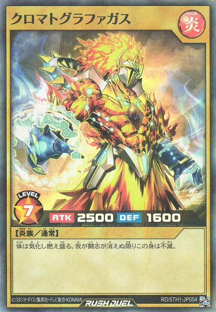 **Cromatográfagas**
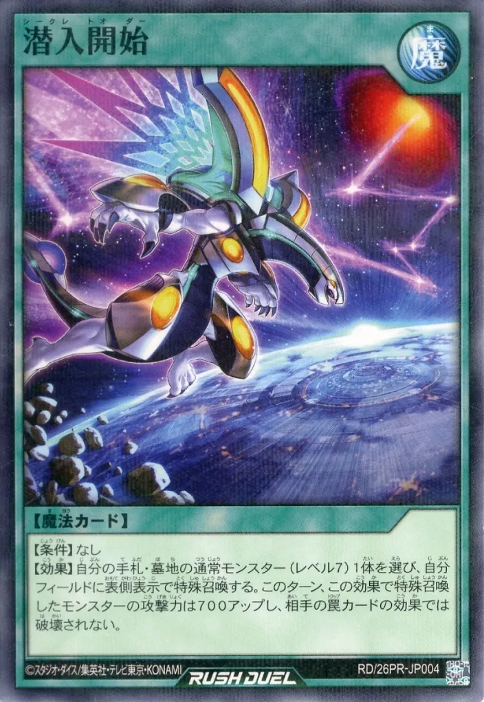 **Orden Secreta**

### Ejecución numerada

#### Paso 1 — Activar ALCHEMY BLAZE, revelando Cromatográfagas en mano y cumpliendo turno y construcción.

 **REVELAR** → 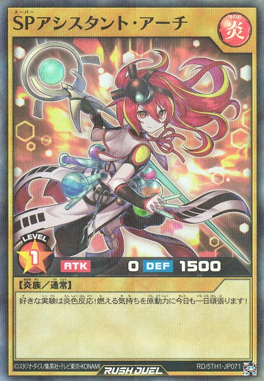 **ESTADO / CONTEXTO** → 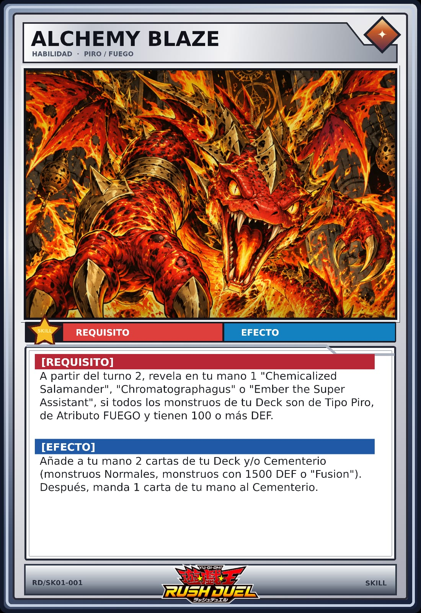 **REFERENCIA A09**

**Acción concreta:** Activar ALCHEMY BLAZE, revelando Cromatográfagas en mano y cumpliendo turno y construcción. Elegir del Deck Superasistente Ember (Normal, DEF 1500) y Fusión (nombre permitido). Luego mandar Cromatográfagas de la mano al GY como parte obligatoria del efecto de Skill.
**Detalle técnico documentado:** Elegir del Deck Superasistente Ember (Normal, DEF 1500) y Fusión (nombre permitido). Luego mandar Cromatográfagas de la mano al GY como parte obligatoria del efecto de Skill. Mano: Orden Secreta + Superasistente Ember + Fusión; GY: Cromatográfagas. La Skill queda usada en esta ruta; no se la vuelve a activar.

**Estado por zonas después del paso:**

| Zona/recurso | Estado narrativo A09 |
|---|---|
| Mano | Orden Secreta #17212, Superasistente Ember #17963 y Fusión #16934 |
| Monstruos | — |
| Mágicas y trampas | — |
| Cementerio | Cromatográfagas #18583 en GY por Skill |
| Destierro propio | — |
| Campo y estado rival | Ninguna modificación rival demostrada |
| Materiales Xyz/Fusión/Sincro | — |
| Normal, Extra, fase y restricciones | Rush: Normales disponibles; Skill Alchemy Blaze local usada una vez; Archer en Extra |

**Campo visual de este paso:**

**Monstruos propios:** sin carta propia demostrada en esta vista.
**Mágicas/Trampas/Campo:** sin carta propia demostrada en esta vista.
*Relación ilustrada de cartas presentes tras este paso, documentada en A09. La posición, materiales, otras zonas y rival se leen en la tabla de estado.*

#### Paso 2 — Activar Orden Secreta y seleccionar a Cromatográfagas, Normal Nivel 7, desde el GY: Invocarlo Especialmente boca arriba.

 **ACTIVAR** →  **OBJETIVO** → 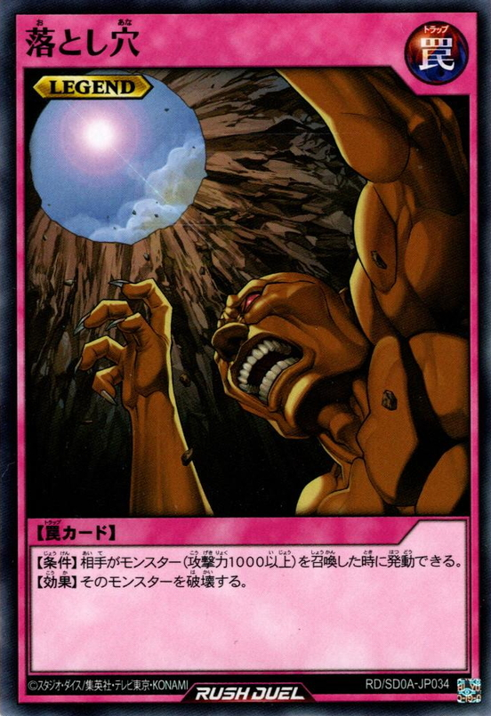 **YA EN CAMPO**

**Acción concreta:** Activar Orden Secreta y seleccionar a Cromatográfagas, Normal Nivel 7, desde el GY: Invocarlo Especialmente boca arriba.
**Detalle técnico documentado:** Cromatográfagas en Campo, +700 ATK en este turno y no puede ser destruido por efectos de Trampa rival mientras permanezca protegido. Orden Secreta va a GY.

**Estado por zonas después del paso:**

| Zona/recurso | Estado narrativo A09 |
|---|---|
| Mano | Superasistente Ember #17963 y Fusión #16934 |
| Monstruos | Cromatográfagas #18583 (Ataque, +700 ATK temporal por Orden Secreta) |
| Mágicas y trampas | — |
| Cementerio | Orden Secreta #17212 en GY |
| Destierro propio | — |
| Campo y estado rival | Ninguna modificación rival demostrada |
| Materiales Xyz/Fusión/Sincro | — |
| Normal, Extra, fase y restricciones | Rush permite Normal posterior; Skill usada; Archer sigue en Extra |

**Campo visual de este paso:**

**Monstruos propios:**
-  **Cromatográfagas (Ataque, +700 ATK temporal por Orden Secreta)** — zona declarada: `MONSTER`.
**Mágicas/Trampas/Campo:** sin carta propia demostrada en esta vista.
*Relación ilustrada de cartas presentes tras este paso, documentada en A09. La posición, materiales, otras zonas y rival se leen en la tabla de estado.*

#### Paso 3 — Invocar Normalmente a Superasistente Ember (Normal Nivel 1) desde mano en otra zona.

 **NORMAL**

**Acción concreta:** Invocar Normalmente a Superasistente Ember (Normal Nivel 1) desde mano en otra zona.
**Detalle técnico documentado:** Dos materiales nombrados boca arriba en Campo.

**Estado por zonas después del paso:**

| Zona/recurso | Estado narrativo A09 |
|---|---|
| Mano | Fusión #16934 |
| Monstruos | Cromatográfagas #18583 (Ataque, +700 ATK temporal), Superasistente Ember #17963 (Normal, Ataque) |
| Mágicas y trampas | — |
| Cementerio | Orden Secreta en GY |
| Destierro propio | — |
| Campo y estado rival | Ninguna modificación rival demostrada |
| Materiales Xyz/Fusión/Sincro | — |
| Normal, Extra, fase y restricciones | Rush: se realizó Normal de Superasistente sin límite TCG; Skill usada |

**Campo visual de este paso:**

**Monstruos propios:**
-  **Cromatográfagas (Ataque, +700 ATK temporal)** — zona declarada: `MONSTER`.
-  **Superasistente Ember (Normal, Ataque)** — zona declarada: `MONSTER`.
**Mágicas/Trampas/Campo:** sin carta propia demostrada en esta vista.
*Relación ilustrada de cartas presentes tras este paso, documentada en A09. La posición, materiales, otras zonas y rival se leen en la tabla de estado.*

#### Paso 4 — Activar Fusión en la Main Phase y usar ambos monstruos boca arriba del propio Campo, enviándolos al GY para Invocar del Extra Arquero Ígneo Supergráfagas (19990).

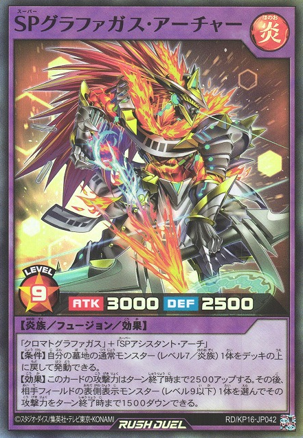 **ESTADO / CONTEXTO** →  **ESTADO / CONTEXTO** →  **ESTADO / CONTEXTO**

**Acción concreta:** Activar Fusión en la Main Phase y usar ambos monstruos boca arriba del propio Campo, enviándolos al GY para Invocar del Extra Arquero Ígneo Supergráfagas (19990).
**Detalle técnico documentado:** Fusión 19990 (ATK 3000) en Campo; Cromatográfagas y Superasistente en GY; la Mágica Fusión usada al GY. El +700 ATK de Orden Secreta no se hereda por el monstruo de Fusión.

**Estado por zonas después del paso:**

| Zona/recurso | Estado narrativo A09 |
|---|---|
| Mano | — |
| Monstruos | Arquero Ígneo Supergráfagas #19990 (Ataque, 3000 ATK; no hereda +700) |
| Mágicas y trampas | — |
| Cementerio | Cromatográfagas #18583, Superasistente #17963, Orden Secreta #17212 y Fusión #16934 en GY |
| Destierro propio | — |
| Campo y estado rival | No se adjudica remoción ni daño rival |
| Materiales Xyz/Fusión/Sincro | Fusión: los dos cuerpos propios enviados a GY; no quedan materiales Xyz |
| Normal, Extra, fase y restricciones | Skill usada; Archer salió del Extra; en Rush no se agota una Normal única |

**Campo visual de este paso:**

**Monstruos propios:**
-  **Arquero Ígneo Supergráfagas (Ataque, 3000 ATK; no hereda +700)** — zona declarada: `MONSTER`.
**Mágicas/Trampas/Campo:** sin carta propia demostrada en esta vista.
*Relación ilustrada de cartas presentes tras este paso, documentada en A09. La posición, materiales, otras zonas y rival se leen en la tabla de estado.*

#### Paso 5 — Activar el efecto de Arquero Ígneo Supergráfagas, devolviendo al tope del Deck el Cromatográfagas Nivel 7/Piro Normal que volvió al GY como material.

 **ACTIVAR** →  **ACTIVAR**

**Acción concreta:** Activar el efecto de Arquero Ígneo Supergráfagas, devolviendo al tope del Deck el Cromatográfagas Nivel 7/Piro Normal que volvió al GY como material.
**Detalle técnico documentado:** Archer aumenta 2500 ATK, total 5500 ATK hasta fin de turno. Solo si el rival controla un monstruo boca arriba Nivel 9 o menor, puede además reducirle 1500 ATK hasta fin de turno.

**Estado por zonas después del paso:**

| Zona/recurso | Estado narrativo A09 |
|---|---|
| Mano | — |
| Monstruos | Arquero Ígneo Supergráfagas #19990 (Ataque, 5500 ATK temporal este turno) |
| Mágicas y trampas | — |
| Cementerio | Superasistente #17963, Orden Secreta #17212 y Fusión #16934 en GY; Cromatográfagas ya salió del GY |
| Destierro propio | — |
| Campo y estado rival | Solo si existe monstruo rival boca arriba con Nivel 9 o menor se puede aplicarle -1500 ATK temporal; identidad y presencia no garantizadas |
| Materiales Xyz/Fusión/Sincro | Sin materiales Xyz; Cromatográfagas fue colocado en la parte superior del Deck |
| Normal, Extra, fase y restricciones | Skill Alchemy Blaze usada; Archer ya salió del Extra; no prometer ataque fuera de Battle Phase |

**Campo visual de este paso:**

**Monstruos propios:**
-  **Arquero Ígneo Supergráfagas (Ataque, 5500 ATK temporal este turno)** — zona declarada: `MONSTER`.
**Mágicas/Trampas/Campo:** sin carta propia demostrada en esta vista.
*Relación ilustrada de cartas presentes tras este paso, documentada en A09. La posición, materiales, otras zonas y rival se leen en la tabla de estado.*

### Campo final documentado

Esta vista procede **del último paso**, no de una lista de cartas deducida del título.

**Monstruos propios:**
-  **Arquero Ígneo Supergráfagas (Ataque, 5500 ATK temporal este turno)** — zona declarada: `MONSTER`.
**Mágicas/Trampas/Campo:** sin carta propia demostrada en esta vista.
*Relación ilustrada de cartas presentes tras este paso, documentada en A09. La posición, materiales, otras zonas y rival se leen en la tabla de estado.*

| Zona/recurso | Estado final documentado |
|---|---|
| Mano | — |
| Monstruos | Arquero Ígneo Supergráfagas #19990 (Ataque, 5500 ATK temporal este turno) |
| Mágicas y trampas | — |
| Cementerio | Superasistente #17963, Orden Secreta #17212 y Fusión #16934 en GY; Cromatográfagas ya salió del GY |
| Destierro propio | — |
| Campo y estado rival | Solo si existe monstruo rival boca arriba con Nivel 9 o menor se puede aplicarle -1500 ATK temporal; identidad y presencia no garantizadas |
| Materiales Xyz/Fusión/Sincro | Sin materiales Xyz; Cromatográfagas fue colocado en la parte superior del Deck |
| Normal, Extra, fase y restricciones | Skill Alchemy Blaze usada; Archer ya salió del Extra; no prometer ataque fuera de Battle Phase |

### Si el oponente interrumpe

- **INTERRUPCIÓN A12 — paso sin anclaje confirmado: A12 — Prueba negativa de Agujero Trampa (Rush)**
  - Agujero Trampa (15913) del rival, previamente Colocada, solo responde a un monstruo de 1000 o más ATK Invocado Normalmente. No puede activarse ante la Invocación Especial de Cromatográfagas por Orden Secreta, ni ante la Normal de Superasistente Ember (0 ATK).
  - Incluso si otro efecto permitiera una activación posterior de una Trampa, la protección de Orden Secreta solo preservaría al Cromatográfagas convocado por ella, no al futuro Archer. No afirmar protección permanente del monstruo Fusionado.
  - Fuente: Agujero Trampa Rush, Orden Secreta.; ninguna interrupción real acreditada para este caso, 0 casos legales de A12, no sumar a las 6 anteriores.
  - <!-- A12_AUDITORIA_RUTA_INICIO -->
  - Estado de rama: `Resuelto solo en el escenario que detalla A12/A13; las otras respuestas no están demostradas.`.
- **RECUPERACIÓN A13 — paso sin anclaje confirmado: A13 — Desvío por envío de carta equivocada con Skill**
  - Con la misma mano inicial mínima (Cromatográfagas + Orden Secreta), si la Skill añade Superasistente Ember y Fusión pero envía Orden Secreta al GY en vez de Cromatográfagas, quedan en mano Cromatográfagas (Nivel 7), Superasistente y Fusión.
  - Superasistente se puede Invocar Normalmente, pero un solo Nivel 1 no proporciona los dos Sacrificios necesarios para Invocar Normalmente a Cromatográfagas Nivel 7. Con Orden Secreta ya en GY, no hay modo de poner ambos materiales boca arriba en Campo con esa mano mínima. No declarar Archer.
  - SIN_CONTINUACION_DEMOSTRADA hasta Archer en esta rama. Corrección táctica: elegir como carta enviada el Cromatográfagas revelado y usar Orden Secreta para recuperarlo..
  - <!-- A13_AUDITORIA_RUTA_INICIO -->
  - Estado de rama: `Resuelto solo en el escenario que detalla A12/A13; las otras respuestas no están demostradas.`.

---

## ALCHEMY · SALAMANDRA02 · `704:A09:ALCHEMY:SALAMANDRA02`

**Propósito competitivo principal (lectura documental):** Ofensivo condicional. El objetivo solo se acredita si las acciones y el campo final detallados en esta guía lo permiten; no implica legalidad certificada ni garantiza el resultado ante respuestas adversarias.

**Categoría:** APERTURA

**Propósito y resultado documental:**

Endboard tras Main Phase: Salamandra Alquimicalizada 3000 ATK boca arriba en Zona Principal; M/T de ambos Campos destruidas, incluyendo exactamente una Mágica del rival en el ejemplo; rival mantiene su monstruo con -1000 ATK temporal, salvo que otro efecto lo modifique. GY propio: Hiperasistente, Quimicalizada, Superasistente, Fusión, ¡Atraviesa!; destierro: vacío; mano: vacía; Skill: usada; daño de batalla directo o por efecto: 0 garantizado; negaciones propias: ninguna demostrada. La reducción desaparece al final del turno. Vulnerable a negar efecto de Hiperasistente/Skill o retirar cualquiera de los materiales antes de Fusión.

### Mano y estado inicial

Salamandra 1× Salamandra Quimicalizada / Chemicalized Salamander, Hiperasistente 1× Hiperasistente Ember / HP Assistant Archer, Atraviesa 1× ¡Atraviesa! como descarte de Skill. Deck: Superasistente 1× Superasistente Ember / SP Assistant Archer + Fusión 1× Fusión disponibles. Extra: Salamandra Fusion 1× Salamandra Alquimicalizada disponible. Skill: ALCHEMY BLAZE sin usar, turno 2 o posterior; todas las seis identidades de monstruo del Main satisfacen Piro/FUEGO y DEF ≥ 100 según inventario. Campo/GY/destierro propios: vacíos, Normal libre, ninguna restricción precedente. Rival: controla un monstruo boca arriba; además, para cuantificar el efecto, una Mágica boca arriba destruible y ninguna otra M/T. Rival no responde en esta línea de referencia.

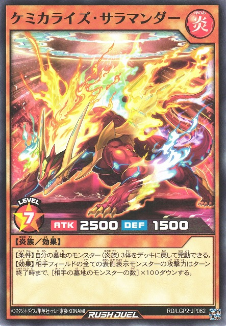 **Salamandra Quimicalizada**
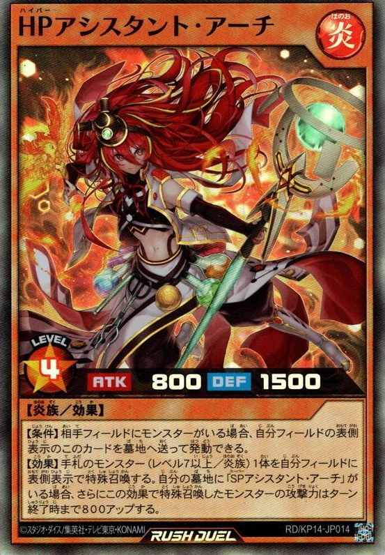 **Hiperasistente Ember**
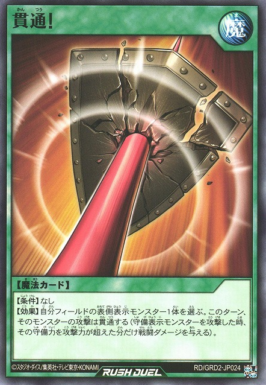 **¡Atraviesa!**

### Ejecución numerada

#### Paso 1 — En Main Phase propia, activar ALCHEMY BLAZE; revelar Salamandra Quimicalizada en mano para satisfacer el requisito de Skill.

 **REVELAR** →  **ESTADO / CONTEXTO** →  **REFERENCIA A09**

**Acción concreta:** En Main Phase propia, activar ALCHEMY BLAZE; revelar Salamandra Quimicalizada en mano para satisfacer el requisito de Skill. Elegir Superasistente Ember y Fusión del Deck, y mandar ¡Atraviesa! al GY según el texto local de Skill.
**Detalle técnico documentado:** Elegir Superasistente Ember y Fusión del Deck, y mandar ¡Atraviesa! al GY según el texto local de Skill. Superasistente y Fusión pasan Deck→mano; Salamandra e Hiperasistente siguen en mano; ¡Atraviesa! en GY. Skill marcada usada una vez; no se le atribuye otra activación.

**Estado por zonas después del paso:**

| Zona/recurso | Estado narrativo A09 |
|---|---|
| Mano | Salamandra Quimicalizada #17868, Hiperasistente Ember #19291, Superasistente Ember #17963 y Fusión #16934 |
| Monstruos | — |
| Mágicas y trampas | — |
| Cementerio | ¡Atraviesa! #15204 en GY por efecto de Skill |
| Destierro propio | — |
| Campo y estado rival | Rival mantiene monstruo boca arriba de identidad variable y una Mágica boca arriba de identidad variable |
| Materiales Xyz/Fusión/Sincro | — |
| Normal, Extra, fase y restricciones | Rush: Normales disponibles; Skill Alchemy Blaze local usada; Salamandra Fusión en Extra |

**Campo visual de este paso:**

**Monstruos propios:** sin carta propia demostrada en esta vista.
**Mágicas/Trampas/Campo:** sin carta propia demostrada en esta vista.
*Relación ilustrada de cartas presentes tras este paso, documentada en A09. La posición, materiales, otras zonas y rival se leen en la tabla de estado.*

#### Paso 2 — Invocar Normalmente Hiperasistente Ember (Nivel 4, Piro/FUEGO) desde mano. Como el rival controla un monstruo, activar su efecto en Main Phase, enviándolo del Campo al GY como COSTE.

 **NORMAL** →  **ESPECIAL**

**Acción concreta:** Invocar Normalmente Hiperasistente Ember (Nivel 4, Piro/FUEGO) desde mano. Como el rival controla un monstruo, activar su efecto en Main Phase, enviándolo del Campo al GY como COSTE.
**Detalle técnico documentado:** Al resolver, Invocar Especialmente Salamandra Quimicalizada Nivel 7/Piro desde mano boca arriba. Hiperasistente GY; no se acredita aumento de 800 ATK, porque Superasistente no estaba previamente en el GY al resolver este efecto.

**Estado por zonas después del paso:**

| Zona/recurso | Estado narrativo A09 |
|---|---|
| Mano | Superasistente Ember #17963 y Fusión #16934 |
| Monstruos | Salamandra Quimicalizada #17868 (Ataque, Nivel 7) |
| Mágicas y trampas | — |
| Cementerio | ¡Atraviesa! #15204 e Hiperasistente Ember #19291 en GY (este último como coste) |
| Destierro propio | — |
| Campo y estado rival | Rival conserva su monstruo y su Mágica boca arriba; sin remoción en P2 |
| Materiales Xyz/Fusión/Sincro | — |
| Normal, Extra, fase y restricciones | Normal de Hiperasistente realizada; Rush permite más Normales; Skill usada |

**Campo visual de este paso:**

**Monstruos propios:**
-  **Salamandra Quimicalizada (Ataque, Nivel 7)** — zona declarada: `MONSTER`.
**Mágicas/Trampas/Campo:** sin carta propia demostrada en esta vista.
*Relación ilustrada de cartas presentes tras este paso, documentada en A09. La posición, materiales, otras zonas y rival se leen en la tabla de estado.*

#### Paso 3 — En Rush Duel efectuar otra Invocación Normal de Superasistente Ember (monstruo Normal Nivel 1) desde mano, sin gastar una limitación TCG inexistente.

 **NORMAL** →  **YA EN CAMPO**

**Acción concreta:** En Rush Duel efectuar otra Invocación Normal de Superasistente Ember (monstruo Normal Nivel 1) desde mano, sin gastar una limitación TCG inexistente.
**Detalle técnico documentado:** Materiales exactos boca arriba en Campo: Salamandra Quimicalizada + Superasistente Ember.

**Estado por zonas después del paso:**

| Zona/recurso | Estado narrativo A09 |
|---|---|
| Mano | Fusión #16934 |
| Monstruos | Salamandra Quimicalizada #17868 (Ataque), Superasistente Ember #17963 (Normal, Ataque) |
| Mágicas y trampas | — |
| Cementerio | ¡Atraviesa! e Hiperasistente en GY |
| Destierro propio | — |
| Campo y estado rival | Rival conserva su monstruo y Mágica boca arriba |
| Materiales Xyz/Fusión/Sincro | — |
| Normal, Extra, fase y restricciones | Segunda Normal del turno Rush realizada legalmente; Skill usada; Extra intacto |

**Campo visual de este paso:**

**Monstruos propios:**
-  **Salamandra Quimicalizada (Ataque)** — zona declarada: `MONSTER`.
-  **Superasistente Ember (Normal, Ataque)** — zona declarada: `MONSTER`.
**Mágicas/Trampas/Campo:** sin carta propia demostrada en esta vista.
*Relación ilustrada de cartas presentes tras este paso, documentada en A09. La posición, materiales, otras zonas y rival se leen en la tabla de estado.*

#### Paso 4 — Activar Fusión desde mano durante Main Phase; usar ambos materiales de tu Campo y enviarlos al GY; Invocar por Fusión Salamandra Alquimicalizada desde Extra.

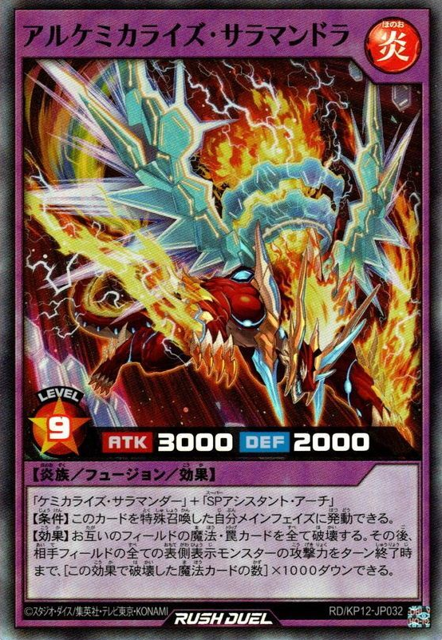 **FUSIÓN** →  **ESTADO / CONTEXTO** →  **ESTADO / CONTEXTO**

**Acción concreta:** Activar Fusión desde mano durante Main Phase; usar ambos materiales de tu Campo y enviarlos al GY; Invocar por Fusión Salamandra Alquimicalizada desde Extra.
**Detalle técnico documentado:** Campo propio: Salamandra Alquimicalizada ATK 3000; GY: Hiperasistente, Quimicalizada, Superasistente, Fusión y ¡Atraviesa!; mano vacía en esta apertura.

**Estado por zonas después del paso:**

| Zona/recurso | Estado narrativo A09 |
|---|---|
| Mano | — |
| Monstruos | Salamandra Alquimicalizada #18614 (Ataque, 3000 ATK) |
| Mágicas y trampas | — |
| Cementerio | ¡Atraviesa! #15204, Hiperasistente #19291, Salamandra Quimicalizada #17868, Superasistente #17963 y Fusión #16934 en GY |
| Destierro propio | — |
| Campo y estado rival | Monstruo rival y una Mágica boca arriba aún presentes; no se destruyeron por la Invocación |
| Materiales Xyz/Fusión/Sincro | Fusión: Salamandra y Superasistente enviados a GY; no materiales Xyz |
| Normal, Extra, fase y restricciones | Skill usada; Salamandra Fusión salió del Extra; Rush permite Normales sucesivas |

**Campo visual de este paso:**

**Monstruos propios:**
-  **Salamandra Alquimicalizada (Ataque, 3000 ATK)** — zona declarada: `MONSTER`.
**Mágicas/Trampas/Campo:** sin carta propia demostrada en esta vista.
*Relación ilustrada de cartas presentes tras este paso, documentada en A09. La posición, materiales, otras zonas y rival se leen en la tabla de estado.*

#### Paso 5 — En la Main Phase en que fue Invocada especialmente la Fusión, activar su efecto (sin coste de descarte ni objetivo seleccionado).

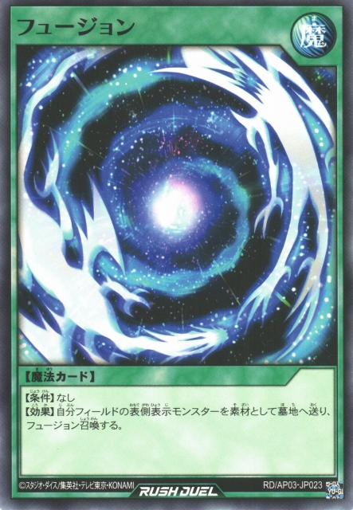 **ESTADO / CONTEXTO**

**Acción concreta:** En la Main Phase en que fue Invocada especialmente la Fusión, activar su efecto (sin coste de descarte ni objetivo seleccionado).
**Detalle técnico documentado:** Destruye las Mágicas y Trampas de ambos Campos. En el estado rival especificado, destruye una Mágica, de modo que los monstruos rivales boca arriba pueden perder 1000 ATK hasta fin de turno. Destruir Trampas no aumenta ese descuento. Sin cartas en M/T, la pérdida sería 0 y no se inventa daño.

**Estado por zonas después del paso:**

| Zona/recurso | Estado narrativo A09 |
|---|---|
| Mano | — |
| Monstruos | Salamandra Alquimicalizada #18614 (Ataque, 3000 ATK) |
| Mágicas y trampas | — |
| Cementerio | ¡Atraviesa!, Hiperasistente, Quimicalizada, Superasistente y Fusión en GY |
| Destierro propio | — |
| Campo y estado rival | La única Mágica rival boca arriba fue destruida y enviada a su GY; el monstruo rival permanece boca arriba con -1000 ATK temporal |
| Materiales Xyz/Fusión/Sincro | Efecto de Fusión destruye M/T de ambos Campos; 1 Mágica rival y 0 propias en escenario explícito |
| Normal, Extra, fase y restricciones | Skill usada; Salamandra salió del Extra; no hay daño de batalla ni de efecto garantizado |

**Campo visual de este paso:**

**Monstruos propios:**
-  **Salamandra Alquimicalizada (Ataque, 3000 ATK)** — zona declarada: `MONSTER`.
**Mágicas/Trampas/Campo:** sin carta propia demostrada en esta vista.
*Relación ilustrada de cartas presentes tras este paso, documentada en A09. La posición, materiales, otras zonas y rival se leen en la tabla de estado.*

### Campo final documentado

Esta vista procede **del último paso**, no de una lista de cartas deducida del título.

**Monstruos propios:**
-  **Salamandra Alquimicalizada (Ataque, 3000 ATK)** — zona declarada: `MONSTER`.
**Mágicas/Trampas/Campo:** sin carta propia demostrada en esta vista.
*Relación ilustrada de cartas presentes tras este paso, documentada en A09. La posición, materiales, otras zonas y rival se leen en la tabla de estado.*

| Zona/recurso | Estado final documentado |
|---|---|
| Mano | — |
| Monstruos | Salamandra Alquimicalizada #18614 (Ataque, 3000 ATK) |
| Mágicas y trampas | — |
| Cementerio | ¡Atraviesa!, Hiperasistente, Quimicalizada, Superasistente y Fusión en GY |
| Destierro propio | — |
| Campo y estado rival | La única Mágica rival boca arriba fue destruida y enviada a su GY; el monstruo rival permanece boca arriba con -1000 ATK temporal |
| Materiales Xyz/Fusión/Sincro | Efecto de Fusión destruye M/T de ambos Campos; 1 Mágica rival y 0 propias en escenario explícito |
| Normal, Extra, fase y restricciones | Skill usada; Salamandra salió del Extra; no hay daño de batalla ni de efecto garantizado |

### Si el oponente interrumpe

- **INTERRUPCIÓN A12 — paso sin anclaje confirmado: A12 — Prueba negativa de Agujero Trampa (Rush)**
  - Agujero Trampa (15913) del rival, previamente Colocada, solo responde a un monstruo de 1000 o más ATK Invocado Normalmente. No puede activarse ante la Invocación Especial de Cromatográfagas por Orden Secreta, ni ante la Normal de Superasistente Ember (0 ATK).
  - Incluso si otro efecto permitiera una activación posterior de una Trampa, la protección de Orden Secreta solo preservaría al Cromatográfagas convocado por ella, no al futuro Archer. No afirmar protección permanente del monstruo Fusionado.
  - Fuente: Agujero Trampa Rush, Orden Secreta.; ninguna interrupción real acreditada para este caso, 0 casos legales de A12, no sumar a las 6 anteriores.
  - <!-- A12_AUDITORIA_RUTA_INICIO -->
  - Estado de rama: `Resuelto solo en el escenario que detalla A12/A13; las otras respuestas no están demostradas.`.
- **RECUPERACIÓN A13 — paso sin anclaje confirmado: A13 — Desvío por envío de carta equivocada con Skill**
  - Con la misma mano inicial mínima (Cromatográfagas + Orden Secreta), si la Skill añade Superasistente Ember y Fusión pero envía Orden Secreta al GY en vez de Cromatográfagas, quedan en mano Cromatográfagas (Nivel 7), Superasistente y Fusión.
  - Superasistente se puede Invocar Normalmente, pero un solo Nivel 1 no proporciona los dos Sacrificios necesarios para Invocar Normalmente a Cromatográfagas Nivel 7. Con Orden Secreta ya en GY, no hay modo de poner ambos materiales boca arriba en Campo con esa mano mínima. No declarar Archer.
  - SIN_CONTINUACION_DEMOSTRADA hasta Archer en esta rama. Corrección táctica: elegir como carta enviada el Cromatográfagas revelado y usar Orden Secreta para recuperarlo..
  - <!-- A13_AUDITORIA_RUTA_INICIO -->
  - Estado de rama: `Resuelto solo en el escenario que detalla A12/A13; las otras respuestas no están demostradas.`.

---
