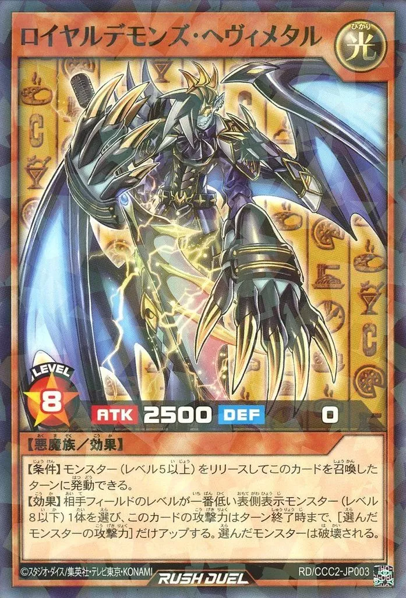
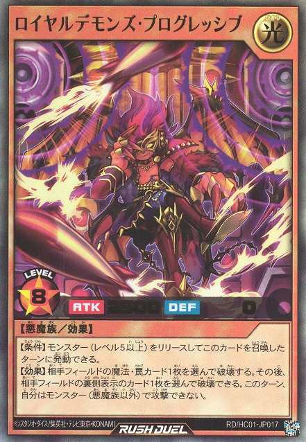
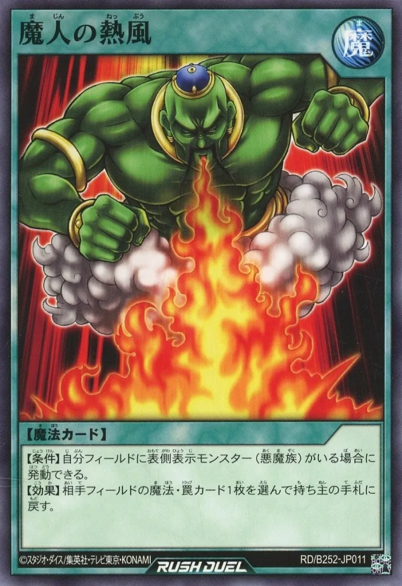
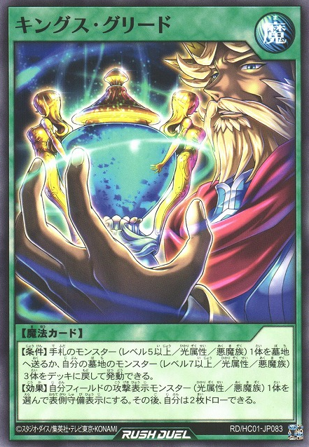
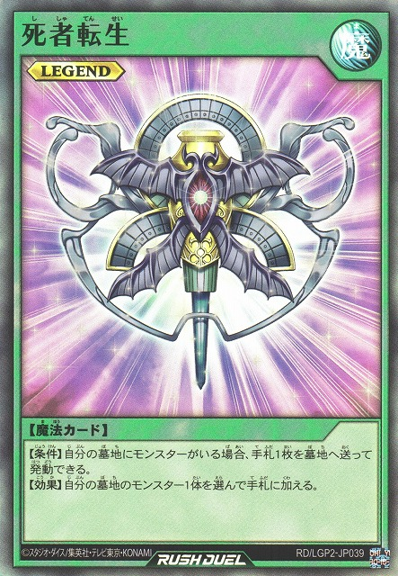

# Royal

## APARTADO_01 — Perfil A01 importable 705

- **Arquetipo:** Royal Rebel's (Rush Duel; habilidad Hard Rock Overture).
- **Tipo de estrategia:** Combo-Midrange de Demonios/LUZ con Sacrificios de Nivel alto y control de mesa.
- **Estilo breve:** Rush Duel de Demonios/LUZ: prepara Sacrificios para Heavy Metal, Doom Metal y Progrock; la habilidad coloca cuerpos, pero no sustituye una Invocación por Sacrificio.
- **Resumen para ficha:** Despliega jefes Royal Rebel's con Sacrificios válidos: Heavy Metal elimina monstruos, Progrock responde a Magias/Trampas y Doom Metal limpia mesa si recibió los dos tributos adecuados. La habilidad recupera presencia, no los disparos de Tributo.
- **Cómo se juega:** Primero: conservar materiales y preparar monstruos de Nivel alto; usar Hard Rock Overture solo con la condición de Demonios/LUZ y un Nivel 7/8 en mano. Segundo: elegir Heavy Metal contra monstruos, Progrock contra Magias/Trampas y Doom Metal únicamente cuando puedan tributarse DOS Demonios de Nivel 7 o más. Medio/tardío: aprovechar Phaser y recuperación del Cementerio sin prometer que una Invocación Especial cumpla los requisitos de una Invocación por Sacrificio.
- **Qué vigilar:** El efecto de Heavy Metal o Progrock exige haberlos Invocado por Sacrificio usando al menos un Nivel 5+; Doom Metal exige dos Demonios de Nivel 7+ sacrificados. Colocar desde Skill no equivale a Invocar por Sacrificio. No hay Extra Deck cargado; no añadir invocaciones de Extra.

**Procedencia:** paquete estructurado de esta identidad con inventario vivo validado en solo lectura; ninguna importación de producción se atribuye a este cambio.

## APARTADO_02 — Continuidad del contenido anterior

> **Alcance editorial de todas las cartas y guías de este deck:** Las fichas son interpretaciones tácticas: costes, objetivos, ventanas y límites deben cotejarse con el texto oficial antes de acreditar una secuencia A09. Las guías explican funciones derivadas; no certifican nuevas invocaciones ni cadenas.

## IDENTIDAD BÁSICA

- `deck_id`: **705**
- Nombre registrado: **Royal**
- Formato: **rush_duel**
- Main: **30**; Extra: **0**; Side: **0**; Reserva: **0**.

## APARTADO_01 — Informe A01 vigente y trazable (23-11-2026)

**Deck:** Royal · **deck_id:** 705 · **formato:** `rush_duel` · **inventario nativo comprobado:** Main 30; Extra 0; Side 0; Reserva 0. **Identidades del Main:** 16. La ausencia de Extra es válida en Rush Duel; no fabricar cartas para completar zonas. **Banlist:** fuera de alcance por instrucción del propietario.

### A01-T1 — Diagnóstico estratégico comprobado

- **Arquetipo:** Royal Rebel's con soporte de Demonios/LUZ y la Skill `Hard Rock Overture` (Skill separada del Main).
- **Clasificación:** Combo-Midrange con interacción de control/remoción. El plan de victoria depende de preparar Sacrificios legales y después retirar defensas: no es una OTK garantizada ni un combo automático de la habilidad.
- **Motor principal:** jefes de Nivel 8 (Heavy Metal CID 15441, Doom Metal CID 16331, Progrock CID 19761) que requieren Invocación por Sacrificio con materiales específicos para activar sus efectos. Heavy Metal responde a monstruos; Progrock a M/T; Doom Metal a monstruos rivales boca arriba cuando recibió dos Demonios de Nivel 7+ como Tributos.
- **Soporte:** Phaser CID 16330 permite traer del Cementerio un Demonio de Nivel alto en Defensa cuando ya se controla un Demonio propio de Nivel 7+. Kheiron CID 16344 añade perforación condicionada. La Skill `Hard Rock Overture` envía un Nivel 7/8 desde la mano y puede colocar hasta dos monstruos Nivel 7/8 de mano/Cementerio en Defensa, siempre que **todos los monstruos del Deck/Extra sean Demonios/LUZ**. El cuerpo colocado **no** equivale a Invocación por Sacrificio. A partir del segundo turno la Skill contempla recuperación adicional según su texto. La identidad de la Skill no debe mezclarse con una carta Main.
- **Recursos físicos:** monstruos Nivel 7/8 en mano y Cementerio; niveles y tipo real de los Tributos; cartas para pagar Canjear/Reencarnado; M/T rivales; ventanas de los efectos de los jefes. Debe comprobarse el requisito global Demonio/LUZ de la Skill antes de activarla.
- **Ir primero:** desarrollar recursos sin consumir jefes innecesariamente; reconocer que colocar uno por Skill no activa el disparo de Sacrificio. **Ir segundo:** seleccionar el jefe cuyo efecto responde al campo real; confirmar que se tributó material correcto. **Juego medio/tardío:** reciclar materiales y administrar la mano sin inventar movimientos del Extra.
- **Condiciones de victoria y riesgos:** presión y control de mesa tras remoción válida; alto consumo de monstruos de Nivel alto, efectos de jefes inutilizados si se colocaron por Skill o se invocaron con Tributos incorrectos, dependencia de recursos de Cementerio y de que haya objetivos adecuados. Sin Extra Deck.

**Fuentes del diagnóstico:** [Konami Heavy Metal (15441)](https://www.db.yugioh-card.com/rushdb/card_search.action?cid=15441&ope=2), [Konami Doom Metal (16331)](https://www.db.yugioh-card.com/rushdb/card_search.action?cid=16331&ope=2), [Konami Progrock (19761)](https://www.db.yugioh-card.com/rushdb/card_search.action?cid=19761&ope=2), [Konami Phaser (16330)](https://www.db.yugioh-card.com/rushdb/card_search.action?cid=16330&ope=2), [Hard Rock Overture — texto de Skill en Duel Links Meta](https://www.duellinksmeta.com/skills/Hard%20Rock%20Overture). Para los textos japoneses, las formulaciones en español son paráfrasis editoriales y no traducciones oficiales.

### A01-T2 — Seis campos propuestos para record.profile (documentales, no publicados)

- **Arquetipo:** Royal Rebel's (Rush Duel; habilidad Hard Rock Overture).
- **Tipo de estrategia:** Combo-Midrange de Demonios/LUZ con Sacrificios de Nivel alto y control de mesa.
- **Estilo breve:** Rush Duel de Demonios/LUZ: prepara Sacrificios para Heavy Metal, Doom Metal y Progrock; la habilidad coloca cuerpos, pero no sustituye una Invocación por Sacrificio.
- **Resumen para ficha:** Despliega jefes Royal Rebel's con Sacrificios válidos: Heavy Metal elimina monstruos, Progrock responde a Magias/Trampas y Doom Metal limpia mesa si recibió los dos tributos adecuados. La habilidad recupera presencia, no los disparos de Tributo.
- **Cómo se juega:** Primero: conservar materiales y preparar monstruos de Nivel alto; usar Hard Rock Overture solo con la condición de Demonios/LUZ y un Nivel 7/8 en mano. Segundo: elegir Heavy Metal contra monstruos, Progrock contra Magias/Trampas y Doom Metal únicamente cuando puedan tributarse DOS Demonios de Nivel 7 o más. Medio/tardío: aprovechar Phaser y recuperación del Cementerio sin prometer que una Invocación Especial cumpla los requisitos de una Invocación por Sacrificio.
- **Qué vigilar:** El efecto de Heavy Metal o Progrock exige haberlos Invocado por Sacrificio usando al menos un Nivel 5+; Doom Metal exige dos Demonios de Nivel 7+ sacrificados. Colocar desde Skill no equivale a Invocar por Sacrificio. No hay Extra Deck cargado; no añadir invocaciones de Extra.

**Longitudes comprobadas:** Estilo breve 165/190; Resumen para ficha 245/250. **Estado:** redacción documental disponible; **T2 no se cierra** hasta certificar paridad exacta con `datos/stationx-deck.json` real, actualmente inexistente para este deck. No fabricar `record.profile`, `a01_profile_contract`, `inventory_sha256` ni `imported_at`.

### A01-T3 — Matriz de propósitos, CIDs, condiciones y riesgos

| CID Rush | Carta / zona y copias | Propósito | Condición real | Riesgo / no suposición | Referencia |
|---|---|---|---|---|---|
| 16344 | Kheiron (3x Main) | Perforación | El rival tiene un monstruo; enviar la carta superior del Deck al Cementerio; elegir Demonio propio boca arriba de Nivel 5+ | No concede destrucción por sí solo. | [Konami Rush CID 16344](https://www.db.yugioh-card.com/rushdb/card_search.action?cid=16344&ope=2) |
| 16330 | Phaser (3x Main) | Recuperación y material | Demonio propio de Nivel 7+ boca arriba; enviar Phaser boca arriba del Campo al Cementerio; revivir Demonio de Nivel 7+ en Defensa | El revivido no fue Invocado por Sacrificio. | [Konami Rush CID 16330](https://www.db.yugioh-card.com/rushdb/card_search.action?cid=16330&ope=2) |
| 16331 | Doom Metal (2x Main) | Remoción masiva/daño | Invocación por Sacrificio con dos Demonios de Nivel 7+; destruir monstruos rivales boca arriba, después daño por suma de Niveles originales ×100 | La Skill no acredita los dos Sacrificios. | [Konami Rush CID 16331](https://www.db.yugioh-card.com/rushdb/card_search.action?cid=16331&ope=2) |
| 15441 | Heavy Metal (2x Main) | Remoción de monstruo y ATK | Invocado por Sacrificio usando al menos un Nivel 5+; seleccionar monstruo rival boca arriba de Nivel 8 o menor con nivel más bajo; destruir y ganar ATK temporalmente | No seleccionar uno con Nivel más alto por conveniencia. | [Konami Rush CID 15441](https://www.db.yugioh-card.com/rushdb/card_search.action?cid=15441&ope=2) |
| 19761 | Progrock (2x Main) | Remoción de Magias/Trampas | Invocado por Sacrificio usando al menos un Nivel 5+; destruir M/T rival y opcionalmente carta boca abajo | Solo Demonios pueden atacar ese turno. | [Konami Rush CID 19761](https://www.db.yugioh-card.com/rushdb/card_search.action?cid=19761&ope=2) |
| 17721 | Canjear (2x Main) | Flujo de cartas | Enviar de mano un monstruo de Nivel 8 al Cementerio como requisito y robar dos | No prometer robo si no hay Nivel 8 en mano. | [Konami Rush CID 17721](https://www.db.yugioh-card.com/rushdb/card_search.action?cid=17721&ope=2) |
| 16305 | Monstruo Reencarnado (1x Main) | Recuperación | Enviar una carta de mano al Cementerio y disponer de monstruo en Cementerio | No confundir con Invocación Especial ni con su versión TCG. | [Konami Rush CID 16305](https://www.db.yugioh-card.com/rushdb/card_search.action?cid=16305&ope=2) |

**Trazabilidad cruzada:** no atribuir `effect_id`, `motor_id` ni `route_id` que no hayan sido conciliados contra el contrato estructurado nativo: `PENDIENTE_DE_ENLACE_A05_A09`. La próxima verificación debe enlazar los IDs ya existentes del deck (si los hay) sin cambiarlos. La Skill se registra como recurso aparte de Main/Extra/Side/Reserva, no como copia física.

### A01-T4 / A01-T5 — Bloqueos verificables

- **T4 — PENDIENTE:** faltan JSON estructurado nativo de 705, cotejo literal de los seis campos y firma de inventario real; no se asigna `a01_profile_contract`.
- **T5 — PENDIENTE:** sin paquete JSON acreditado no hay evidencia de importación, exportación, render en móvil/escritorio o escenarios de rechazo de Station X para 705. Las pruebas sintéticas de otros decks no acreditan T5.
- **Integridad:** este estudio conserva la lista original de 16 identidades y 30 copias Main sin editar cantidades, nombres, CIDs, Skill, Side/Reserva ni Extra.
- **Evidencia histórica:** la guía y rutas previas pueden mantenerse accesibles; este avance A01 no certifica sus efectos, fotografías, tableros finales ni la calculadora A10B.

## CONTROL_DE_TAREAS_A01_A10

**Manifiesto:** `station-x-a01-a10-task-manifest/1` · **alcance exclusivo:** deck 705 · **A01 verificado:** T1 y T3 · **resto:** pendiente sin atribuir certificaciones retroactivas. A10B no fue solicitado.

### A01 (obligatorio)
- [x] **A01-T1** — VERIFICADO EN FUENTE (inventario 30 Main/16 identidades, CID, requisitos, efectos, referencias y riesgos, sección A01 de este documento)
- [ ] **A01-T2** — BLOQUEADO: seis campos redactados y límites correctos; falta su correspondencia literal con JSON canónico del deck
- [x] **A01-T3** — VERIFICADO EN FUENTE (inventario 30 Main/16 identidades, CID, requisitos, efectos, referencias y riesgos, sección A01 de este documento)
- [ ] **A01-T4** — BLOQUEADO: no existe JSON canónico `datos/stationx-deck.json` acreditado para 705; no emitir contrato certificado
- [ ] **A01-T5** — BLOQUEADO: sin paquete nativo validado ni importación/exportación real en Station X

### A02 (obligatorio)
- [ ] **A02-T1** — NO CERTIFICADO BAJO EL MANIFIESTO ACTUAL; conservar análisis histórico existente y verificar evidencias antes de cerrar
- [ ] **A02-T2** — NO CERTIFICADO BAJO EL MANIFIESTO ACTUAL; conservar análisis histórico existente y verificar evidencias antes de cerrar
- [ ] **A02-T3** — NO CERTIFICADO BAJO EL MANIFIESTO ACTUAL; conservar análisis histórico existente y verificar evidencias antes de cerrar

### A03 (obligatorio)
- [ ] **A03-T1** — NO CERTIFICADO BAJO EL MANIFIESTO ACTUAL; conservar análisis histórico existente y verificar evidencias antes de cerrar
- [ ] **A03-T2** — NO CERTIFICADO BAJO EL MANIFIESTO ACTUAL; conservar análisis histórico existente y verificar evidencias antes de cerrar
- [ ] **A03-T3** — NO CERTIFICADO BAJO EL MANIFIESTO ACTUAL; conservar análisis histórico existente y verificar evidencias antes de cerrar

### A04 (obligatorio)
- [ ] **A04-T1** — NO CERTIFICADO BAJO EL MANIFIESTO ACTUAL; conservar análisis histórico existente y verificar evidencias antes de cerrar
- [ ] **A04-T2** — NO CERTIFICADO BAJO EL MANIFIESTO ACTUAL; conservar análisis histórico existente y verificar evidencias antes de cerrar
- [ ] **A04-T3** — NO CERTIFICADO BAJO EL MANIFIESTO ACTUAL; conservar análisis histórico existente y verificar evidencias antes de cerrar

### A05 (obligatorio)
- [ ] **A05-T1** — NO CERTIFICADO BAJO EL MANIFIESTO ACTUAL; conservar análisis histórico existente y verificar evidencias antes de cerrar
- [ ] **A05-T2** — NO CERTIFICADO BAJO EL MANIFIESTO ACTUAL; conservar análisis histórico existente y verificar evidencias antes de cerrar
- [ ] **A05-T3** — NO CERTIFICADO BAJO EL MANIFIESTO ACTUAL; conservar análisis histórico existente y verificar evidencias antes de cerrar
- [ ] **A05-T4** — NO CERTIFICADO BAJO EL MANIFIESTO ACTUAL; conservar análisis histórico existente y verificar evidencias antes de cerrar

### A06 (obligatorio)
- [ ] **A06-T1** — NO CERTIFICADO BAJO EL MANIFIESTO ACTUAL; conservar análisis histórico existente y verificar evidencias antes de cerrar
- [ ] **A06-T2** — NO CERTIFICADO BAJO EL MANIFIESTO ACTUAL; conservar análisis histórico existente y verificar evidencias antes de cerrar
- [ ] **A06-T3** — NO CERTIFICADO BAJO EL MANIFIESTO ACTUAL; conservar análisis histórico existente y verificar evidencias antes de cerrar
- [ ] **A06-T4** — NO CERTIFICADO BAJO EL MANIFIESTO ACTUAL; conservar análisis histórico existente y verificar evidencias antes de cerrar

### A07 (obligatorio)
- [ ] **A07-T1** — NO CERTIFICADO BAJO EL MANIFIESTO ACTUAL; conservar análisis histórico existente y verificar evidencias antes de cerrar
- [ ] **A07-T2** — NO CERTIFICADO BAJO EL MANIFIESTO ACTUAL; conservar análisis histórico existente y verificar evidencias antes de cerrar
- [ ] **A07-T3** — NO CERTIFICADO BAJO EL MANIFIESTO ACTUAL; conservar análisis histórico existente y verificar evidencias antes de cerrar
- [ ] **A07-T4** — NO CERTIFICADO BAJO EL MANIFIESTO ACTUAL; conservar análisis histórico existente y verificar evidencias antes de cerrar

### A08 (obligatorio)
- [ ] **A08-T1** — NO CERTIFICADO BAJO EL MANIFIESTO ACTUAL; conservar análisis histórico existente y verificar evidencias antes de cerrar
- [ ] **A08-T2** — NO CERTIFICADO BAJO EL MANIFIESTO ACTUAL; conservar análisis histórico existente y verificar evidencias antes de cerrar
- [ ] **A08-T3** — NO CERTIFICADO BAJO EL MANIFIESTO ACTUAL; conservar análisis histórico existente y verificar evidencias antes de cerrar
- [ ] **A08-T4** — NO CERTIFICADO BAJO EL MANIFIESTO ACTUAL; conservar análisis histórico existente y verificar evidencias antes de cerrar

### A09 (obligatorio)
- [ ] **A09-T1** — NO CERTIFICADO BAJO EL MANIFIESTO ACTUAL; conservar análisis histórico existente y verificar evidencias antes de cerrar
- [ ] **A09-T2** — NO CERTIFICADO BAJO EL MANIFIESTO ACTUAL; conservar análisis histórico existente y verificar evidencias antes de cerrar
- [ ] **A09-T3** — NO CERTIFICADO BAJO EL MANIFIESTO ACTUAL; conservar análisis histórico existente y verificar evidencias antes de cerrar
- [ ] **A09-T4** — NO CERTIFICADO BAJO EL MANIFIESTO ACTUAL; conservar análisis histórico existente y verificar evidencias antes de cerrar

### A10A (obligatorio)
- [ ] **A10A-T1** — NO CERTIFICADO BAJO EL MANIFIESTO ACTUAL; conservar análisis histórico existente y verificar evidencias antes de cerrar
- [ ] **A10A-T2** — NO CERTIFICADO BAJO EL MANIFIESTO ACTUAL; conservar análisis histórico existente y verificar evidencias antes de cerrar
- [ ] **A10A-T3** — NO CERTIFICADO BAJO EL MANIFIESTO ACTUAL; conservar análisis histórico existente y verificar evidencias antes de cerrar

### A10B (opcional; no solicitado)
- [ ] **A10B-T4** — NO CERTIFICADO BAJO EL MANIFIESTO ACTUAL; conservar análisis histórico existente y verificar evidencias antes de cerrar
- [ ] **A10B-T5** — NO CERTIFICADO BAJO EL MANIFIESTO ACTUAL; conservar análisis histórico existente y verificar evidencias antes de cerrar
- [ ] **A10B-T6** — NO CERTIFICADO BAJO EL MANIFIESTO ACTUAL; conservar análisis histórico existente y verificar evidencias antes de cerrar

---

## PERFIL BREVE — CONOCE TU DECK

- **Arquetipo:** Royal Rebel de Rush Duel, con habilidad Hard Rock Overture.
- **Tipo de estrategia:** Sacrificios e Invocación de jefes que presionan el campo rival.
- **Estilo de juego:** combate y retirada selectiva según el jefe disponible.
- **Cómo se juega:** los cuerpos de apoyo preparan Sacrificios para monstruos Royal Rebel como Heavy Metal o Progrock. La habilidad y la recuperación de recursos aportan opciones bajo sus condiciones propias.
- **Cartas representativas:** Heavy Metal, Progrock, Phaser y Hard Rock Overture.
- **Qué vigilar:** Nivel exigido por efectos de apoyo, materiales sacrificados y monstruos puestos en Defensa. Este inventario no posee Extra Deck.

### A02 — Decisión táctica por mano y ventana (síntesis del perfil)

- Si hay cuerpos para Sacrificio y jefe adecuado, comparar el efecto de Heavy Metal con la presión de Progrock; si faltan Sacrificios, conservar el jefe y desarrollar mesa. No planear una ruta de Extra inexistente.
- **Estado de evidencia:** criterio orientativo basado en el perfil; los pasos, costes y campos finales se acreditan exclusivamente en A07–A09.

### A03 — Integridad del inventario físico por zonas

- **Conteo recibido:** 30 Main · 0 Extra · 0 Side · 0 Reserva; Skill registrada fuera de mano. No convertir Reserva en Side ni una Skill en carta de mano.
- **Control:** la lista individual y su CID/fotografía prevalecen ante cualquier ejemplo táctico; no se crean, sustituyen ni retiran cartas en esta sección.

## CARTAS: FUNCIÓN, RESTRICCIONES Y UTILIDAD

#### 01. Kheiron el Caballero Estelar

- **Zona y copias:** Main **3x**. CID Rush: **16344**.
- **Rol funcional:** Monstruo de Efecto — presión de combate / modificación de estadísticas.
- **Estado de sinergia y función:** Sinergia indirecta (soporte o recursos). Es una clasificación de juego; revisar la relación concreta en A06.
- **Papel como recurso, descarte o coste:** Coste o consumo descrito en A05: pagar/cumplir el requisito escrito antes de prometer la resolución.
- **Requisito específico:** Si el rival controla un monstruo, enviar la carta superior del Deck al Cementerio.
- **Efecto / resultado concreto:** Elegir un Demonio de Nivel 5 o superior boca arriba propio; sus ataques infligen daño de penetración este turno.
- **Ir primero, segundo y juego tardío:** Primero: preparar acceso y campo necesario sin gastar la respuesta antes de tiempo; segundo: usarla para abrir combate o retirar la amenaza que cumple su condición; tardío: evaluar si quedan objetivos reales.
- **Relación con habilidad y otras piezas:** **HARD ROCK OVERTURE** puede colocar Nivel 7/8 en Defensa, pero colocar por Skill no cuenta como Invocación por Sacrificio de los jefes Royal Rebel's.
- **Riesgos y dependencias:** pagar/cumplir el requisito escrito antes de prometer la resolución.
- **Confianza:** **RESUMEN_FUNCIONAL_DE_GUIA_PREVIA_CON_FUENTE_KONAMI**; pendiente cotejo adicional de traducción/ventanas según la liga. Fuente Rush oficial: https://www.db.yugioh-card.com/rushdb/card_search.action?cid=16344&ope=2
- **Contraste de fuente Rush:** CID 16344: fuente oficial Rush consultada en japonés; tipo Monstruo de Efecto; descripción funcional en español procede de la guía previa y sigue siendo interpretación editorial.
- **Aplicación concreta dentro de este deck (A06):** Elegir un Demonio de Nivel 5 o superior boca arriba propio; sus ataques infligen daño de penetración este turno.

**USO PRÁCTICO Y SINERGIA — Kheiron el Caballero Estelar**

- **Label funcional:** Sinergia indirecta. Clasificación documental; una relación es válida solo si se satisfacen sus condiciones exactas.
- **Qué hace:** Elegir un Demonio de Nivel 5 o superior boca arriba propio; sus ataques infligen daño de penetración este turno.
- **Cuándo tener precaución:** pagar/cumplir el requisito escrito antes de prometer la resolución.

#### 02. Phaser del Rebelde Real

- **Zona y copias:** Main **3x**. CID Rush: **16330**.
- **Rol funcional:** Monstruo de Efecto — extensor / habilitador de material.
- **Estado de sinergia y función:** Sinergia directa descrita. Es una clasificación de juego; revisar la relación concreta en A06.
- **Papel como recurso, descarte o coste:** Coste o consumo descrito en A05: pagar/cumplir el requisito escrito antes de prometer la resolución.
- **Requisito específico:** Controlar un Demonio de Nivel 7+ boca arriba y enviar este Phaser boca arriba del Campo al Cementerio.
- **Efecto / resultado concreto:** Invocar de Modo Especial en Defensa boca arriba un Demonio de Nivel 7+ del Cementerio.
- **Ir primero, segundo y juego tardío:** Primero: construir la condición de activación; segundo: verificar que la jugada responde al estado rival actual; tardío: ahorrar el recurso si todavía no se cumple el requisito.
- **Relación con habilidad y otras piezas:** **HARD ROCK OVERTURE** puede colocar Nivel 7/8 en Defensa, pero colocar por Skill no cuenta como Invocación por Sacrificio de los jefes Royal Rebel's.
- **Riesgos y dependencias:** pagar/cumplir el requisito escrito antes de prometer la resolución.
- **Confianza:** **RESUMEN_FUNCIONAL_DE_GUIA_PREVIA_CON_FUENTE_KONAMI**; pendiente cotejo adicional de traducción/ventanas según la liga. Fuente Rush oficial: https://www.db.yugioh-card.com/rushdb/card_search.action?cid=16330&ope=2
- **Contraste de fuente Rush:** CID 16330: fuente oficial Rush consultada en japonés; tipo Monstruo de Efecto; descripción funcional en español procede de la guía previa y sigue siendo interpretación editorial.
- **Aplicación concreta dentro de este deck (A06):** Invocar de Modo Especial en Defensa boca arriba un Demonio de Nivel 7+ del Cementerio.

**USO PRÁCTICO Y SINERGIA — Phaser del Rebelde Real**

- **Label funcional:** Sinergia directa. Clasificación documental; una relación es válida solo si se satisfacen sus condiciones exactas.
- **Qué hace:** Invocar de Modo Especial en Defensa boca arriba un Demonio de Nivel 7+ del Cementerio.
- **Cuándo tener precaución:** pagar/cumplir el requisito escrito antes de prometer la resolución.

#### 03. Impasse Ignoto

- **Zona y copias:** Main **3x**. CID Rush: **19760**.
- **Rol funcional:** Monstruo de Efecto — presión de combate / modificación de estadísticas.
- **Estado de sinergia y función:** Sinergia indirecta (soporte o recursos). Es una clasificación de juego; revisar la relación concreta en A06.
- **Papel como recurso, descarte o coste:** Coste o consumo descrito en A05: comprobar zona, objetivos y ventana; el nombre de la carta no reemplaza su texto.
- **Requisito específico:** Mostrar al rival otro Demonio de la mano para Invocar esta carta de Modo Especial desde la mano.
- **Efecto / resultado concreto:** Mientras permanezca boca arriba, aumenta en 300 el ATK de todos tus Demonios boca arriba, incluido él mismo.
- **Ir primero, segundo y juego tardío:** Primero: preparar acceso y campo necesario sin gastar la respuesta antes de tiempo; segundo: usarla para abrir combate o retirar la amenaza que cumple su condición; tardío: evaluar si quedan objetivos reales.
- **Relación con habilidad y otras piezas:** La Skill **HARD ROCK OVERTURE** exige Demonios/LUZ y un Nivel 7/8 en mano para enviar al GY; no se roba.
- **Riesgos y dependencias:** comprobar zona, objetivos y ventana; el nombre de la carta no reemplaza su texto.
- **Confianza:** **RESUMEN_FUNCIONAL_DE_GUIA_PREVIA_CON_FUENTE_KONAMI**; pendiente cotejo adicional de traducción/ventanas según la liga. Fuente Rush oficial: https://www.db.yugioh-card.com/rushdb/card_search.action?cid=19760&ope=2
- **Contraste de fuente Rush:** CID 19760: fuente oficial Rush consultada en japonés; tipo Monstruo de Efecto; descripción funcional en español procede de la guía previa y sigue siendo interpretación editorial.
- **Aplicación concreta dentro de este deck (A06):** Mientras permanezca boca arriba, aumenta en 300 el ATK de todos tus Demonios boca arriba, incluido él mismo.

**USO PRÁCTICO Y SINERGIA — Impasse Ignoto**

- **Label funcional:** Sinergia indirecta. Clasificación documental; una relación es válida solo si se satisfacen sus condiciones exactas.
- **Qué hace:** Mientras permanezca boca arriba, aumenta en 300 el ATK de todos tus Demonios boca arriba, incluido él mismo.
- **Cuándo tener precaución:** comprobar zona, objetivos y ventana; el nombre de la carta no reemplaza su texto.

#### 04. Metal Maldito del Rebelde Real

- **Zona y copias:** Main **2x**. CID Rush: **16331**.
- **Rol funcional:** Monstruo de Efecto — removal / apertura de campo.
- **Estado de sinergia y función:** Sinergia indirecta (soporte o recursos). Es una clasificación de juego; revisar la relación concreta en A06.
- **Papel como recurso, descarte o coste:** Coste o consumo descrito en A05: el resultado está sujeto a monstruos/cartas que puedan ser afectados y a respuestas del rival. la Skill que pone monstruos….
- **Requisito específico:** Haber Invocado esta carta por Sacrificio durante este turno usando DOS Demonios de Nivel 7+.
- **Efecto / resultado concreto:** Destruye todos los monstruos boca arriba rivales; después inflige 100 LP por la suma de sus Niveles originales.
- **Ir primero, segundo y juego tardío:** Primero: preparar acceso y campo necesario sin gastar la respuesta antes de tiempo; segundo: usarla para abrir combate o retirar la amenaza que cumple su condición; tardío: evaluar si quedan objetivos reales.
- **Relación con habilidad y otras piezas:** **HARD ROCK OVERTURE** puede colocar Nivel 7/8 en Defensa, pero colocar por Skill no cuenta como Invocación por Sacrificio de los jefes Royal Rebel's.
- **Riesgos y dependencias:** el resultado está sujeto a monstruos/cartas que puedan ser afectados y a respuestas del rival. la Skill que pone monstruos en Defensa NO equivale a Invocación por Sacrificio; sus efectos de tributo requieren el procedimiento específico.
- **Confianza:** **RESUMEN_FUNCIONAL_DE_GUIA_PREVIA_CON_FUENTE_KONAMI**; pendiente cotejo adicional de traducción/ventanas según la liga. Fuente Rush oficial: https://www.db.yugioh-card.com/rushdb/card_search.action?cid=16331&ope=2
- **Contraste de fuente Rush:** CID 16331: fuente oficial Rush consultada en japonés; tipo Monstruo de Efecto; descripción funcional en español procede de la guía previa y sigue siendo interpretación editorial.
- **Aplicación concreta dentro de este deck (A06):** Destruye todos los monstruos boca arriba rivales; después inflige 100 LP por la suma de sus Niveles originales.

**USO PRÁCTICO Y SINERGIA — Metal Maldito del Rebelde Real**

- **Label funcional:** Sinergia indirecta. Clasificación documental; una relación es válida solo si se satisfacen sus condiciones exactas.
- **Qué hace:** Destruye todos los monstruos boca arriba rivales; después inflige 100 LP por la suma de sus Niveles originales.
- **Cuándo tener precaución:** el resultado está sujeto a monstruos/cartas que puedan ser afectados y a respuestas del rival. la Skill que pone monstruos en Defensa NO equivale a Invocación por Sacrificio; sus efectos de tributo requieren el procedimiento específico.

#### 05. Heavy Metal del Rebelde Real

- **Zona y copias:** Main **2x**. CID Rush: **15441**.
- **Rol funcional:** Monstruo de Efecto — removal / apertura de campo.
- **Estado de sinergia y función:** Sinergia indirecta (soporte o recursos). Es una clasificación de juego; revisar la relación concreta en A06.
- **Papel como recurso, descarte o coste:** Coste o consumo descrito en A05: el resultado está sujeto a monstruos/cartas que puedan ser afectados y a respuestas del rival. la Skill que pone monstruos….
- **Requisito específico:** Haber Invocado esta carta por Sacrificio este turno usando al menos un monstruo de Nivel 5+.
- **Efecto / resultado concreto:** Entre los monstruos boca arriba rivales de Nivel 8 o menor, elegir uno del Nivel más bajo; gana su ATK hasta fin del turno y lo destruye.
- **Ir primero, segundo y juego tardío:** Primero: preparar acceso y campo necesario sin gastar la respuesta antes de tiempo; segundo: usarla para abrir combate o retirar la amenaza que cumple su condición; tardío: evaluar si quedan objetivos reales.
- **Relación con habilidad y otras piezas:** **HARD ROCK OVERTURE** puede colocar Nivel 7/8 en Defensa, pero colocar por Skill no cuenta como Invocación por Sacrificio de los jefes Royal Rebel's.
- **Riesgos y dependencias:** el resultado está sujeto a monstruos/cartas que puedan ser afectados y a respuestas del rival. la Skill que pone monstruos en Defensa NO equivale a Invocación por Sacrificio; sus efectos de tributo requieren el procedimiento específico.
- **Confianza:** **RESUMEN_FUNCIONAL_DE_GUIA_PREVIA_CON_FUENTE_KONAMI**; pendiente cotejo adicional de traducción/ventanas según la liga. Fuente Rush oficial: https://www.db.yugioh-card.com/rushdb/card_search.action?cid=15441&ope=2
- **Contraste de fuente Rush:** CID 15441: fuente oficial Rush consultada en japonés; tipo Monstruo de Efecto; descripción funcional en español procede de la guía previa y sigue siendo interpretación editorial.
- **Aplicación concreta dentro de este deck (A06):** Entre los monstruos boca arriba rivales de Nivel 8 o menor, elegir uno del Nivel más bajo; gana su ATK hasta fin del turno y lo destruye.

**USO PRÁCTICO Y SINERGIA — Heavy Metal del Rebelde Real**

- **Label funcional:** Sinergia indirecta. Clasificación documental; una relación es válida solo si se satisfacen sus condiciones exactas.
- **Qué hace:** Entre los monstruos boca arriba rivales de Nivel 8 o menor, elegir uno del Nivel más bajo; gana su ATK hasta fin del turno y lo destruye.
- **Cuándo tener precaución:** el resultado está sujeto a monstruos/cartas que puedan ser afectados y a respuestas del rival. la Skill que pone monstruos en Defensa NO equivale a Invocación por Sacrificio; sus efectos de tributo requieren el procedimiento específico.

#### 06. Progrock del Rebelde Real

- **Zona y copias:** Main **2x**. CID Rush: **19761**.
- **Rol funcional:** Monstruo de Efecto — removal / apertura de campo.
- **Estado de sinergia y función:** Sinergia indirecta (soporte o recursos). Es una clasificación de juego; revisar la relación concreta en A06.
- **Papel como recurso, descarte o coste:** Coste o consumo descrito en A05: el resultado está sujeto a monstruos/cartas que puedan ser afectados y a respuestas del rival. la Skill que pone monstruos….
- **Requisito específico:** Haber Invocado esta carta por Sacrificio este turno usando al menos un monstruo de Nivel 5+.
- **Efecto / resultado concreto:** Destruye una Mágica/Trampa rival; después puede destruir otra carta boca abajo rival. Este turno solo pueden atacar tus Demonios.
- **Ir primero, segundo y juego tardío:** Primero: preparar acceso y campo necesario sin gastar la respuesta antes de tiempo; segundo: usarla para abrir combate o retirar la amenaza que cumple su condición; tardío: evaluar si quedan objetivos reales.
- **Relación con habilidad y otras piezas:** **HARD ROCK OVERTURE** puede colocar Nivel 7/8 en Defensa, pero colocar por Skill no cuenta como Invocación por Sacrificio de los jefes Royal Rebel's.
- **Riesgos y dependencias:** el resultado está sujeto a monstruos/cartas que puedan ser afectados y a respuestas del rival. la Skill que pone monstruos en Defensa NO equivale a Invocación por Sacrificio; sus efectos de tributo requieren el procedimiento específico.
- **Confianza:** **RESUMEN_FUNCIONAL_DE_GUIA_PREVIA_CON_FUENTE_KONAMI**; pendiente cotejo adicional de traducción/ventanas según la liga. Fuente Rush oficial: https://www.db.yugioh-card.com/rushdb/card_search.action?cid=19761&ope=2
- **Contraste de fuente Rush:** CID 19761: fuente oficial Rush consultada en japonés; tipo Monstruo de Efecto; descripción funcional en español procede de la guía previa y sigue siendo interpretación editorial.
- **Aplicación concreta dentro de este deck (A06):** Destruye una Mágica/Trampa rival; después puede destruir otra carta boca abajo rival.

**USO PRÁCTICO Y SINERGIA — Progrock del Rebelde Real**

- **Label funcional:** Sinergia indirecta. Clasificación documental; una relación es válida solo si se satisfacen sus condiciones exactas.
- **Qué hace:** Destruye una Mágica/Trampa rival; después puede destruir otra carta boca abajo rival. Este turno solo pueden atacar tus Demonios.
- **Cómo aprovecharla en este deck:** Destruye una Mágica/Trampa rival; después puede destruir otra carta boca abajo rival.
- **Cuándo tener precaución:** el resultado está sujeto a monstruos/cartas que puedan ser afectados y a respuestas del rival. la Skill que pone monstruos en Defensa NO equivale a Invocación por Sacrificio; sus efectos de tributo requieren el procedimiento específico.

#### 07. Descendiente de Titanes

- **Zona y copias:** Main **2x**. CID Rush: **16135**.
- **Rol funcional:** Monstruo Normal — material de Fusión/Sacrificio o presencia de combate; sin efecto activado.
- **Estado de sinergia y función:** Sinergia indirecta (soporte o recursos). Es una clasificación de juego; revisar la relación concreta en A06.
- **Papel como recurso, descarte o coste:** Coste o consumo descrito en A05: no atribuirle un efecto activado inexistente; comprobar su función como material y las cartas de soporte.
- **Requisito específico:** No tiene activación de efecto de monstruo.
- **Efecto / resultado concreto:** Monstruo Normal sin efecto.
- **Ir primero, segundo y juego tardío:** Primero: conservarlo si es material expresamente exigido por una Fusión o Sacrificio; segundo: emplearlo como cuerpo solo tras calcular ATK y riesgo de batalla; tardío: recurso para reconstruir material desde el GY si una carta lo autoriza.
- **Relación con habilidad y otras piezas:** La Skill **HARD ROCK OVERTURE** exige Demonios/LUZ y un Nivel 7/8 en mano para enviar al GY; no se roba.
- **Riesgos y dependencias:** no atribuirle un efecto activado inexistente; comprobar su función como material y las cartas de soporte.
- **Confianza:** **RESUMEN_FUNCIONAL_DE_GUIA_PREVIA_CON_FUENTE_KONAMI**; pendiente cotejo adicional de traducción/ventanas según la liga. Fuente Rush oficial: https://www.db.yugioh-card.com/rushdb/card_search.action?cid=16135&ope=2
- **Contraste de fuente Rush:** CID 16135: fuente oficial Rush consultada en japonés; tipo Monstruo Normal; descripción funcional en español procede de la guía previa y sigue siendo interpretación editorial.
- **Aplicación concreta dentro de este deck (A06):** Monstruo Normal sin efecto.

**USO PRÁCTICO Y SINERGIA — Descendiente de Titanes**

- **Label funcional:** Sinergia indirecta. Clasificación documental; una relación es válida solo si se satisfacen sus condiciones exactas.
- **Qué hace:** Monstruo Normal sin efecto.
- **Cuándo tener precaución:** no atribuirle un efecto activado inexistente; comprobar su función como material y las cartas de soporte.

#### 08. Canjear

- **Zona y copias:** Main **2x**. CID Rush: **17721**.
- **Rol funcional:** Carta Mágica Normal — consistencia / reciclaje.
- **Estado de sinergia y función:** Sinergia indirecta (soporte o recursos). Es una clasificación de juego; revisar la relación concreta en A06.
- **Papel como recurso, descarte o coste:** Coste o consumo descrito en A05: pagar/cumplir el requisito escrito antes de prometer la resolución. disponer de cartas suficientes en Deck y distinguir robo….
- **Requisito específico:** Enviar al Cementerio un monstruo de Nivel 8 de la mano.
- **Efecto / resultado concreto:** Roba dos cartas.
- **Ir primero, segundo y juego tardío:** Primero: usarla si su efecto abre recursos o deja protección aprovechable; segundo: priorizar su resultado concreto frente a las amenazas rivales; tardío: comprobar materiales, objetivos y si aún quedan recursos en Deck o Cementerio.
- **Relación con habilidad y otras piezas:** La Skill **HARD ROCK OVERTURE** exige Demonios/LUZ y un Nivel 7/8 en mano para enviar al GY; no se roba.
- **Riesgos y dependencias:** pagar/cumplir el requisito escrito antes de prometer la resolución. disponer de cartas suficientes en Deck y distinguir robo de búsqueda.
- **Confianza:** **RESUMEN_FUNCIONAL_DE_GUIA_PREVIA_CON_FUENTE_KONAMI**; pendiente cotejo adicional de traducción/ventanas según la liga. Fuente Rush oficial: https://www.db.yugioh-card.com/rushdb/card_search.action?cid=17721&ope=2
- **Contraste de fuente Rush:** CID 17721: fuente oficial Rush consultada en japonés; tipo Carta Mágica Normal; descripción funcional en español procede de la guía previa y sigue siendo interpretación editorial.
- **Aplicación concreta dentro de este deck (A06):** Roba dos cartas.

**USO PRÁCTICO Y SINERGIA — Canjear**

- **Label funcional:** Sinergia indirecta. Clasificación documental; una relación es válida solo si se satisfacen sus condiciones exactas.
- **Qué hace:** Roba dos cartas.
- **Cuándo tener precaución:** pagar/cumplir el requisito escrito antes de prometer la resolución. disponer de cartas suficientes en Deck y distinguir robo de búsqueda.

#### 09. Aliento de Fuego del Genio

- **Zona y copias:** Main **2x**. CID Rush: **15673**.
- **Rol funcional:** Carta Mágica Normal — apoyo situacional sujeto a condición escrita.
- **Estado de sinergia y función:** Sinergia indirecta (soporte o recursos). Es una clasificación de juego; revisar la relación concreta en A06.
- **Papel como recurso, descarte o coste:** Coste o consumo descrito en A05: comprobar zona, objetivos y ventana; el nombre de la carta no reemplaza su texto.
- **Requisito específico:** Controlar un Demonio boca arriba.
- **Efecto / resultado concreto:** Devuelve a la mano del dueño una Mágica o Trampa del rival.
- **Ir primero, segundo y juego tardío:** Primero: usarla si su efecto abre recursos o deja protección aprovechable; segundo: priorizar su resultado concreto frente a las amenazas rivales; tardío: comprobar materiales, objetivos y si aún quedan recursos en Deck o Cementerio.
- **Relación con habilidad y otras piezas:** La Skill **HARD ROCK OVERTURE** exige Demonios/LUZ y un Nivel 7/8 en mano para enviar al GY; no se roba.
- **Riesgos y dependencias:** comprobar zona, objetivos y ventana; el nombre de la carta no reemplaza su texto.
- **Confianza:** **RESUMEN_FUNCIONAL_DE_GUIA_PREVIA_CON_FUENTE_KONAMI**; pendiente cotejo adicional de traducción/ventanas según la liga. Fuente Rush oficial: https://www.db.yugioh-card.com/rushdb/card_search.action?cid=15673&ope=2
- **Contraste de fuente Rush:** CID 15673: fuente oficial Rush consultada en japonés; tipo Carta Mágica Normal; descripción funcional en español procede de la guía previa y sigue siendo interpretación editorial.
- **Aplicación concreta dentro de este deck (A06):** Devuelve a la mano del dueño una Mágica o Trampa del rival.

**USO PRÁCTICO Y SINERGIA — Aliento de Fuego del Genio**

- **Label funcional:** Sinergia indirecta. Clasificación documental; una relación es válida solo si se satisfacen sus condiciones exactas.
- **Qué hace:** Devuelve a la mano del dueño una Mágica o Trampa del rival.
- **Cuándo tener precaución:** comprobar zona, objetivos y ventana; el nombre de la carta no reemplaza su texto.

#### 10. Restauración de Cartas

- **Zona y copias:** Main **2x**. CID Rush: **17543**.
- **Rol funcional:** Carta de Trampa Normal — consistencia / reciclaje.
- **Estado de sinergia y función:** Sinergia directa descrita. Es una clasificación de juego; revisar la relación concreta en A06.
- **Papel como recurso, descarte o coste:** Coste o consumo descrito en A05: disponer de cartas suficientes en Deck y distinguir robo de búsqueda.
- **Requisito específico:** Cuando un monstruo rival declara ataque.
- **Efecto / resultado concreto:** Roba hasta tener cinco cartas en mano, revela toda la mano y recupera 200 LP por cada monstruo revelado.
- **Ir primero, segundo y juego tardío:** Primero: Colocar y reservar la respuesta para la ventana legal; segundo: tras side y cambio de turno, evaluar si puede activarse a tiempo; tardío: no asumir efecto si falta el objetivo o el estado de campo.
- **Relación con habilidad y otras piezas:** La Skill **HARD ROCK OVERTURE** exige Demonios/LUZ y un Nivel 7/8 en mano para enviar al GY; no se roba.
- **Riesgos y dependencias:** disponer de cartas suficientes en Deck y distinguir robo de búsqueda.
- **Confianza:** **RESUMEN_FUNCIONAL_DE_GUIA_PREVIA_CON_FUENTE_KONAMI**; pendiente cotejo adicional de traducción/ventanas según la liga. Fuente Rush oficial: https://www.db.yugioh-card.com/rushdb/card_search.action?cid=17543&ope=2
- **Contraste de fuente Rush:** CID 17543: fuente oficial Rush consultada en japonés; tipo Carta de Trampa Normal; descripción funcional en español procede de la guía previa y sigue siendo interpretación editorial.
- **Aplicación concreta dentro de este deck (A06):** Roba hasta tener cinco cartas en mano, revela toda la mano y recupera 200 LP por cada monstruo revelado.

**USO PRÁCTICO Y SINERGIA — Restauración de Cartas**

- **Label funcional:** Sinergia directa. Clasificación documental; una relación es válida solo si se satisfacen sus condiciones exactas.
- **Qué hace:** Roba hasta tener cinco cartas en mano, revela toda la mano y recupera 200 LP por cada monstruo revelado.
- **Cuándo tener precaución:** disponer de cartas suficientes en Deck y distinguir robo de búsqueda.

#### 11. Maldición de la Luz Ascendente

- **Zona y copias:** Main **2x**. CID Rush: **21007**.
- **Rol funcional:** Carta Mágica Normal — consistencia / reciclaje.
- **Estado de sinergia y función:** Sinergia indirecta (soporte o recursos). Es una clasificación de juego; revisar la relación concreta en A06.
- **Papel como recurso, descarte o coste:** Coste o consumo descrito en A05: disponer de cartas suficientes en Deck y distinguir robo de búsqueda.
- **Requisito específico:** El rival debe tener una o ninguna carta en mano.
- **Efecto / resultado concreto:** Cambia un monstruo rival a Ataque boca arriba o Defensa boca abajo. Si el rival activó una Trampa ese turno o es el primer turno del jugador segundo, ambos roban dos.
- **Ir primero, segundo y juego tardío:** Primero: usarla si su efecto abre recursos o deja protección aprovechable; segundo: priorizar su resultado concreto frente a las amenazas rivales; tardío: comprobar materiales, objetivos y si aún quedan recursos en Deck o Cementerio.
- **Relación con habilidad y otras piezas:** La Skill **HARD ROCK OVERTURE** exige Demonios/LUZ y un Nivel 7/8 en mano para enviar al GY; no se roba.
- **Riesgos y dependencias:** disponer de cartas suficientes en Deck y distinguir robo de búsqueda.
- **Confianza:** **RESUMEN_FUNCIONAL_DE_GUIA_PREVIA_CON_FUENTE_KONAMI**; pendiente cotejo adicional de traducción/ventanas según la liga. Fuente Rush oficial: https://www.db.yugioh-card.com/rushdb/card_search.action?cid=21007&ope=2
- **Contraste de fuente Rush:** CID 21007: fuente oficial Rush consultada en japonés; tipo Carta Mágica Normal; descripción funcional en español procede de la guía previa y sigue siendo interpretación editorial.
- **Aplicación concreta dentro de este deck (A06):** Cambia un monstruo rival a Ataque boca arriba o Defensa boca abajo.

**USO PRÁCTICO Y SINERGIA — Maldición de la Luz Ascendente**

- **Label funcional:** Sinergia indirecta. Clasificación documental; una relación es válida solo si se satisfacen sus condiciones exactas.
- **Qué hace:** Cambia un monstruo rival a Ataque boca arriba o Defensa boca abajo. Si el rival activó una Trampa ese turno o es el primer turno del jugador segundo, ambos roban dos.
- **Cómo aprovecharla en este deck:** Cambia un monstruo rival a Ataque boca arriba o Defensa boca abajo.
- **Cuándo tener precaución:** disponer de cartas suficientes en Deck y distinguir robo de búsqueda.

#### 12. Gelatina Defensiva

- **Zona y copias:** Main **1x**. CID Rush: **18646**.
- **Rol funcional:** Carta de Trampa Normal — defensa ante ataque y prevención de daño de batalla.
- **Estado de sinergia y función:** Sinergia directa descrita. Es una clasificación de juego; revisar la relación concreta en A06.
- **Papel como recurso, descarte o coste:** Envío mencionado en la interacción; no equivale por sí mismo a descarte desde la mano.
- **Requisito específico:** Cuando un monstruo rival de Nivel 8 o inferior declara ataque.
- **Efecto / resultado concreto:** Envía al Cementerio la carta superior de tu Deck y evita todo el daño de batalla ese turno; si tienes 3000 LP o más, recibes además 2000 de daño de efecto.
- **Ir primero, segundo y juego tardío:** Primero: construir la condición de activación; segundo: verificar que la jugada responde al estado rival actual; tardío: ahorrar el recurso si todavía no se cumple el requisito.
- **Relación con habilidad y otras piezas:** La Skill **HARD ROCK OVERTURE** exige Demonios/LUZ y un Nivel 7/8 en mano para enviar al GY; no se roba.
- **Riesgos y dependencias:** comprobar zona, objetivos y ventana; el nombre de la carta no reemplaza su texto.
- **Confianza:** **RESUMEN_FUNCIONAL_DE_GUIA_PREVIA_CON_FUENTE_KONAMI**; pendiente cotejo adicional de traducción/ventanas según la liga. Fuente Rush oficial: https://www.db.yugioh-card.com/rushdb/card_search.action?cid=18646&ope=2
- **Contraste de fuente Rush:** CID 18646, nombre japonés **バッファード・スライム** (Buffered Slime): texto oficial localizado con `request_locale=ja`, tipo Carta de Trampa Normal. La condición de ataque de monstruo rival de Nivel 8 o inferior, el envío de la carta superior del Deck, la prevención de daño de batalla del turno y el daño de efecto de 2000 si los LP propios son al menos 3000 coinciden con el resumen previo. La denominación española «Gelatina Defensiva» sigue siendo un alias del inventario; no se impone traducción oficial.
- **Aplicación concreta dentro de este deck (A06):** Envía al Cementerio la carta superior de tu Deck y evita todo el daño de batalla ese turno; si tienes 3000 LP o más, recibes además 2000 de daño de efecto.

**USO PRÁCTICO Y SINERGIA — Gelatina Defensiva**

- **Label funcional:** Sinergia directa. Clasificación documental; una relación es válida solo si se satisfacen sus condiciones exactas.
- **Qué hace:** Envía al Cementerio la carta superior de tu Deck y evita todo el daño de batalla ese turno; si tienes 3000 LP o más, recibes además 2000 de daño de efecto.
- **Cuándo tener precaución:** comprobar zona, objetivos y ventana; el nombre de la carta no reemplaza su texto.

#### 13. Avaricia del Rey

- **Zona y copias:** Main **1x**. CID Rush: **19799**.
- **Rol funcional:** Carta Mágica Normal — consistencia / reciclaje.
- **Estado de sinergia y función:** Sinergia indirecta (soporte o recursos). Es una clasificación de juego; revisar la relación concreta en A06.
- **Papel como recurso, descarte o coste:** Coste o consumo descrito en A05: pagar/cumplir el requisito escrito antes de prometer la resolución. disponer de cartas suficientes en Deck y distinguir robo….
- **Requisito específico:** Enviar de la mano un Demonio LUZ de Nivel 5+ al Cementerio, o devolver del Cementerio al Deck tres Demonios LUZ de Nivel 7+.
- **Efecto / resultado concreto:** Cambia a Defensa boca arriba un Demonio LUZ propio que esté en Ataque y, si se desea, roba dos cartas.
- **Ir primero, segundo y juego tardío:** Primero: usarla si su efecto abre recursos o deja protección aprovechable; segundo: priorizar su resultado concreto frente a las amenazas rivales; tardío: comprobar materiales, objetivos y si aún quedan recursos en Deck o Cementerio.
- **Relación con habilidad y otras piezas:** La Skill **HARD ROCK OVERTURE** exige Demonios/LUZ y un Nivel 7/8 en mano para enviar al GY; no se roba.
- **Riesgos y dependencias:** pagar/cumplir el requisito escrito antes de prometer la resolución. disponer de cartas suficientes en Deck y distinguir robo de búsqueda.
- **Confianza:** **RESUMEN_FUNCIONAL_DE_GUIA_PREVIA_CON_FUENTE_KONAMI**; pendiente cotejo adicional de traducción/ventanas según la liga. Fuente Rush oficial: https://www.db.yugioh-card.com/rushdb/card_search.action?cid=19799&ope=2
- **Contraste de fuente Rush:** CID 19799: fuente oficial Rush consultada en japonés; tipo Carta Mágica Normal; descripción funcional en español procede de la guía previa y sigue siendo interpretación editorial.
- **Aplicación concreta dentro de este deck (A06):** Cambia a Defensa boca arriba un Demonio LUZ propio que esté en Ataque y, si se desea, roba dos cartas.

**USO PRÁCTICO Y SINERGIA — Avaricia del Rey**

- **Label funcional:** Sinergia indirecta. Clasificación documental; una relación es válida solo si se satisfacen sus condiciones exactas.
- **Qué hace:** Cambia a Defensa boca arriba un Demonio LUZ propio que esté en Ataque y, si se desea, roba dos cartas.
- **Cuándo tener precaución:** pagar/cumplir el requisito escrito antes de prometer la resolución. disponer de cartas suficientes en Deck y distinguir robo de búsqueda.

#### 14. Agujero Trampa

- **Zona y copias:** Main **1x**. CID Rush: **15913**.
- **Rol funcional:** Carta de Trampa Normal — interrupción defensiva de Invocación Normal.
- **Estado de sinergia y función:** Sinergia indirecta (soporte o recursos). Es una clasificación de juego; revisar la relación concreta en A06.
- **Papel como recurso, descarte o coste:** Coste o consumo descrito en A05: el resultado está sujeto a monstruos/cartas que puedan ser afectados y a respuestas del rival.
- **Requisito específico:** Cuando el rival Invoca de Modo Normal un monstruo de al menos 1000 ATK.
- **Efecto / resultado concreto:** Destruye ese monstruo invocado.
- **Ir primero, segundo y juego tardío:** Primero: Colocar y reservar la respuesta para la ventana legal; segundo: tras side y cambio de turno, evaluar si puede activarse a tiempo; tardío: no asumir efecto si falta el objetivo o el estado de campo.
- **Relación con habilidad y otras piezas:** La Skill **HARD ROCK OVERTURE** exige Demonios/LUZ y un Nivel 7/8 en mano para enviar al GY; no se roba.
- **Riesgos y dependencias:** el resultado está sujeto a monstruos/cartas que puedan ser afectados y a respuestas del rival.
- **Confianza:** **RESUMEN_FUNCIONAL_DE_GUIA_PREVIA_CON_FUENTE_KONAMI**; pendiente cotejo adicional de traducción/ventanas según la liga. Fuente Rush oficial: https://www.db.yugioh-card.com/rushdb/card_search.action?cid=15913&ope=2
- **Contraste de fuente Rush:** CID 15913: fuente oficial Rush consultada en japonés; tipo Carta de Trampa Normal; descripción funcional en español procede de la guía previa y sigue siendo interpretación editorial.
- **Aplicación concreta dentro de este deck (A06):** Destruye ese monstruo invocado.

**USO PRÁCTICO Y SINERGIA — Agujero Trampa**

- **Label funcional:** Sinergia indirecta. Clasificación documental; una relación es válida solo si se satisfacen sus condiciones exactas.
- **Qué hace:** Destruye ese monstruo invocado.
- **Cuándo tener precaución:** el resultado está sujeto a monstruos/cartas que puedan ser afectados y a respuestas del rival.

#### 15. Esplendor del Rey

- **Zona y copias:** Main **1x**. CID Rush: **15674**.
- **Rol funcional:** Carta de Trampa Normal — apoyo situacional sujeto a condición escrita.
- **Estado de sinergia y función:** Sinergia indirecta (soporte o recursos). Es una clasificación de juego; revisar la relación concreta en A06.
- **Papel como recurso, descarte o coste:** Coste o consumo descrito en A05: pagar/cumplir el requisito escrito antes de prometer la resolución.
- **Requisito específico:** Ante declaración de ataque rival, devolver al Deck un Demonio Normal de Nivel 1 del propio Cementerio.
- **Efecto / resultado concreto:** Niega el ataque declarado.
- **Ir primero, segundo y juego tardío:** Primero: Colocar y reservar la respuesta para la ventana legal; segundo: tras side y cambio de turno, evaluar si puede activarse a tiempo; tardío: no asumir efecto si falta el objetivo o el estado de campo.
- **Relación con habilidad y otras piezas:** La Skill **HARD ROCK OVERTURE** exige Demonios/LUZ y un Nivel 7/8 en mano para enviar al GY; no se roba.
- **Riesgos y dependencias:** pagar/cumplir el requisito escrito antes de prometer la resolución.
- **Confianza:** **RESUMEN_FUNCIONAL_DE_GUIA_PREVIA_CON_FUENTE_KONAMI**; pendiente cotejo adicional de traducción/ventanas según la liga. Fuente Rush oficial: https://www.db.yugioh-card.com/rushdb/card_search.action?cid=15674&ope=2
- **Contraste de fuente Rush:** CID 15674: fuente oficial Rush consultada en japonés; tipo Carta de Trampa Normal; descripción funcional en español procede de la guía previa y sigue siendo interpretación editorial.
- **Aplicación concreta dentro de este deck (A06):** Niega el ataque declarado.

**USO PRÁCTICO Y SINERGIA — Esplendor del Rey**

- **Label funcional:** Sinergia indirecta. Clasificación documental; una relación es válida solo si se satisfacen sus condiciones exactas.
- **Qué hace:** Niega el ataque declarado.
- **Cuándo tener precaución:** pagar/cumplir el requisito escrito antes de prometer la resolución.

#### 16. Monstruo Reencarnado

- **Zona y copias:** Main **1x**. CID Rush: **16305**.
- **Rol funcional:** Carta Mágica Normal — consistencia / reciclaje.
- **Estado de sinergia y función:** Sinergia directa descrita. Es una clasificación de juego; revisar la relación concreta en A06.
- **Papel como recurso, descarte o coste:** Coste o consumo descrito en A05: pagar/cumplir el requisito escrito antes de prometer la resolución.
- **Requisito específico:** Tener un monstruo en el Cementerio y enviar una carta de la mano al Cementerio.
- **Efecto / resultado concreto:** Recupera a la mano un monstruo del Cementerio; es la versión Rush, no un efecto idéntico por defecto al TCG.
- **Ir primero, segundo y juego tardío:** Primero: usarla si su efecto abre recursos o deja protección aprovechable; segundo: priorizar su resultado concreto frente a las amenazas rivales; tardío: comprobar materiales, objetivos y si aún quedan recursos en Deck o Cementerio.
- **Relación con habilidad y otras piezas:** La Skill **HARD ROCK OVERTURE** exige Demonios/LUZ y un Nivel 7/8 en mano para enviar al GY; no se roba.
- **Riesgos y dependencias:** pagar/cumplir el requisito escrito antes de prometer la resolución.
- **Confianza:** **RESUMEN_FUNCIONAL_DE_GUIA_PREVIA_CON_FUENTE_KONAMI**; pendiente cotejo adicional de traducción/ventanas según la liga. Fuente Rush oficial: https://www.db.yugioh-card.com/rushdb/card_search.action?cid=16305&ope=2
- **Contraste de fuente Rush:** CID 16305: fuente oficial Rush consultada en japonés; tipo Carta Mágica Normal; descripción funcional en español procede de la guía previa y sigue siendo interpretación editorial.
- **Aplicación concreta dentro de este deck (A06):** Recupera a la mano un monstruo del Cementerio; es la versión Rush, no un efecto idéntico por defecto al TCG.

**USO PRÁCTICO Y SINERGIA — Monstruo Reencarnado**

- **Label funcional:** Sinergia directa. Clasificación documental; una relación es válida solo si se satisfacen sus condiciones exactas.
- **Qué hace:** Recupera a la mano un monstruo del Cementerio; es la versión Rush, no un efecto idéntico por defecto al TCG.
- **Cuándo tener precaución:** pagar/cumplir el requisito escrito antes de prometer la resolución.

## SINERGIAS Y MOTORES
## RESUMEN FUNCIONAL DE SINERGIAS — 705

**Medición descriptiva de etiquetas existentes (NO certificación):** 16/16 identidades con etiqueta directa/indirecta (100.0 %). Main: 16/16 (100.0 %); Extra: sin identidades. Se cuenta una identidad una sola vez; una carta autónoma puede ser útil sin sinergia de motor. Estas cifras provienen de clasificaciones documentales A05/A06: **no son el porcentaje final de sinergias verificadas**, ni una tasa estadística de victoria. Para promoverlas a métricas verificadas, se deben comprobar los pares de cartas y su operación legal.

#### A06.0 — En 30 segundos: cómo cooperan realmente estas cartas

- **Dictamen de conjunto:** plan de Sacrificios Rush coherente; los jefes comparten cuerpos, pero sus efectos y requisitos NO son equivalentes.
- **Motor que mueve el deck:** Demonios Nivel 7/8 y cuerpos de apoyo se convierten en Sacrificios para jefes Royal Rebel; la retirada de monstruos o M/T depende del jefe elegido.
- **Puentes reales:** HARD ROCK OVERTURE puede colocar cuerpos en Defensa desde turno 2 bajo requisitos locales; Canjear y Monstruo Reencarnado preparan mano/GY.
- **Sinergia indirecta:** un Demonio alto enviado al GY puede ser recurso posterior; Canjear necesita exactamente Nivel 8, no cualquier jefe alto.
- **Conflicto decisivo:** el procedimiento de colocación por Skill no equivale a Invocación ni permite atacar inmediatamente; cada Sacrificio consume cuerpos que dejan de estar disponibles.
- **Decisión concreta:** seleccionar jefe por objetivos reales en campo, no por ATK solamente; no recomendar cartas Extra porque el Extra confirmado de esta lista está vacío.
- **Qué aprender después:** comparar Death Doom, Heavy Metal y Progrock según monstruo/M/T rival y Sacrificios disponibles.

#### Motores y relaciones

1. **Motor principal Demonio de Nivel 7/8 por Sacrificio.** **Phaser del Rebelde Real** (CID 16330), si controlas Demonio Nivel 7+ boca arriba, se envía del Campo al GY para Invocar desde el GY otro Demonio Nivel 7+ en Defensa. **Impasse Ignoto** (19760) puede Invocarse desde mano revelando otro Demonio y da +300 ATK a Demonios propios. **Descendiente de Titanes** (16135) es Normal: cuerpo para Sacrificio, pero sin efecto activado que genere materiales adicionales.
2. **Finalizadores con costes diferentes.** **Heavy Metal del Rebelde Real** (15441) necesita haber sido Invocado por Sacrificio ese turno usando al menos un monstruo Nivel 5+; elige y destruye entre monstruos boca arriba del rival de Nivel 8 o menor al del Nivel más bajo y gana su ATK. **Progrock del Rebelde Real** (19761) exige Sacrificio con Nivel 5+ para destruir M/T y posiblemente carta rival boca abajo, pero restringe los ataques a Demonios. **Metal Maldito del Rebelde Real** (16331) exige **dos Demonios Nivel 7+ como Sacrificios para esa Invocación** y entonces destruye monstruos rivales boca arriba, con daño adicional por Niveles. No son tres salidas con el mismo coste.
3. **Descartar y reciclar piezas altas.** **Canjear** (17721) manda un monstruo **Nivel 8** de la mano al GY para robar dos; puede alimentar recursos recuperables por Phaser o Skill, pero no sirve para cualquier Demonio Nivel 7. **Monstruo Reencarnado** (16305) envía una carta de mano para recuperar un monstruo del GY. **Avaricia del Rey** (19799) exige un coste particular de Demonios LUZ altos de mano/GY y puede cambiar a Defensa un Demonio LUZ propio antes de robar; no es «Olla de la Codicia» libre.
4. **HARD ROCK OVERTURE (RD/SK01-004).** Habilidad local no robable: envía un Nivel 7/8 de mano al GY y exige composición completa Demonio/LUZ en Deck/Extra. Coloca **hasta dos** Demonios Nivel 7/8 de mano/GY boca arriba en **Defensa**, y desde turno 2 puede recuperar otro de GY. Mientras esos cuerpos permanezcan boca arriba sus posiciones solo cambian por efectos; no presentarlos directamente como atacantes en posición de Defensa. Sí pueden considerarse **material de Sacrificio** si otra regla no lo impide; el uso concreto y frecuencia de Skill requieren aprobación local.
5. **Presión de combate y respuesta.** **Kheiron el Caballero Estelar** (16344) puede dar penetración a un Demonio propio Nivel 5+ tras enviar la carta superior del Deck al GY si el rival tiene monstruo. **Aliento de Fuego del Genio** (15673) devuelve una M/T rival a mano si controlas Demonio. **Esplendor del Rey** (15674) niega ataque devolviendo al Deck Demonio Normal Nivel 1 de tu GY; no hay que dar por disponible ese coste sin carta concreta.
6. **Control de mano y defensas.** **Restauración de Cartas** (17543) repone mano en respuesta a ataque, revelándola. **Gelatina Defensiva** (18646) previene daño de batalla bajo un ataque permitido, pero puede ocasionar 2000 de daño de efecto propio; **Agujero Trampa** (15913) destruye en su ventana de Invocación Normal. **Maldición de la Luz Ascendente** (21007) afecta posición del rival con condición de mano rival y puede permitir robo a ambos, no siempre ventaja unilateral.

#### Mapa de relaciones con fuente fotográfica pendiente

| Conexión por CID | Resultado | Requisito | Imagen |
|---|---|---|---|
| Canjear (17721) → Demonio Nivel 8 en GY → Phaser (16330) | Cambiar pieza alta por robo y posible recuperación posterior. | Canjear requiere **Nivel 8**; Phaser necesita Nivel 7+ propio en Campo. |   |
| HARD ROCK OVERTURE → dos Demonios Nivel 7/8 en Defensa | Aporta cuerpos para posibles Sacrificios. | Carta de mano que se envía, composición Demonio/LUZ y condiciones locales. |  |
| Dos Demonios Nivel 7+ → Metal Maldito (16331) | Posible retirada masiva de monstruos boca arriba. | Invocación por Sacrificio de Metal Maldito **ese turno** usando ambos cuerpos altos. |  |
| Un monstruo Nivel 5+ tributado → Heavy Metal (15441) / Progrock (19761) | Retirada de monstruo o M/T según el jefe. | Cada jefe debe ser Invocado por Sacrificio cumpliendo el texto propio. |   |
| Kheiron (16344) → Demonio Nivel 5+ | Penetración de combate. | Rival controla monstruo, envío superior de Deck, objetivo propio apropiado. |  |

#### Conflictos y disponibilidad

- **Extra vacío:** 0 cartas; este deck no puede abrir un motor de Fusión/Sincronía/Xyz/Enlace del Extra actual. No usar «Fusión» o jefes de otros decks como ejemplo operativo.
- **Skill vs ataques:** los monstruos de HARD ROCK OVERTURE llegan en Defensa y no cambian normalmente su posición mientras permanezcan boca arriba; preparar Sacrificios antes de afirmar ataque directo. La restricción de un ataque directo por monstruos altos debe revisarse conforme a la redacción local.
- **Recursos competidos:** Canjear, Avaricia y Skill consumen Demonios de mano/GY que otros efectos querrían revivir; ninguna recuperación permite reutilizar la carta simultáneamente en dos zonas.

#### Skill personalizada y motor — HARD ROCK OVERTURE

- **Identidad y zona:** RD/SK01-004; habilidad separada de Main/Extra/Side/Reserva, no robable.
- **Requisito de la imagen:** Envía un monstruo de Nivel 7 u 8 de mano al GY; todos los monstruos de Deck y Extra deben ser Demonio/LUZ.
- **Efecto de la imagen:** Coloca hasta 2 monstruos de Nivel 7 u 8 de mano/GY en Defensa boca arriba. Desde turno 2 puede recuperar 1 Nivel 7 u 8 del GY. Esas posiciones no cambian salvo por efecto; los monstruos de Nivel original 7+ solo pueden atacar directamente una vez ese turno.
- **Sinergia:** Genera cuerpos altos para la economía de Sacrificios Royal y recupera recursos de GY.
- **Dependencias/riesgo:** Los cuerpos llegan en Defensa, no atacan inmediatamente; comprobar coste y objetivos.
- **Clasificación:** habilitador o extensión, no combo completo. Texto e imagen aportados por Miguel; no inferir límites por turno no escritos.

#### A06.1 — Arquitectura operativa de los motores (síntesis no redundante)

Las siguientes filas son **relaciones funcionales**, no secuencias certificadas ni garantía de mano inicial. La lista real y los límites están en A04/A05/A07.

| Tipo / motor | Starter o vía de acceso real | Recurso y destino | Cuello de botella |
|---|---|---|---|
| **Principal: Royal Rebel Sacrificio** | Demonios Nivel 7/8, cuerpos de Sacrificio, jefes Royal Rebel | Retirada de monstruos o M/T por jefes | Cada jefe exige número/nivel exactos de sacrificios y condición propia |
| **Habilitador: Skill** | HARD ROCK OVERTURE y Demonios LUZ altos | Colocar cuerpos en Defensa como posibles Sacrificios | Composición local, coste de mano y bloqueo de posición |
| **Apoyo: descarte/recursión** | Canjear, Phaser, Monstruo Reencarnado | Intercambiar nivel 8 de mano por robo/GY y recuperar | No tratar Nivel 7 como 8 ni reutilizar un mismo recurso consumido |

#### A06.2 — Estado funcional y justificación de TODAS las cartas

**Cómo leerlo:** un estado de sinergia describe el papel **de juego**, no el avance de una auditoría. No hay obligación de que cada carta tenga un enlace con otra: una defensa autónoma, una herramienta de Side o un recurso de descarte justificado también tiene propósito. Las relaciones directas descritas aquí se deben contrastar con los textos oficiales antes de representarlas como una ruta legal A09.

| Carta / CID y zona | Estado funcional de sinergia | Motivo de inclusión | Relación y condición concreta | Papel como coste, descarte o material | Límite o riesgo | Decisión táctica |
|---|---|---|---|---|---|---|
| **Kheiron el Caballero Estelar** (CID 16344) — Main 3x | **Sinergia indirecta (soporte o recursos)** | Monstruo de Efecto — presión de combate / modificación de estadísticas | Elegir un Demonio de Nivel 5 o superior boca arriba propio; sus ataques infligen daño de penetración este turno | Coste o consumo descrito en A05: pagar/cumplir el requisito escrito antes de prometer la resolución | Si el rival controla un monstruo, enviar la carta superior del Deck al Cementerio | Conservar; verificar coste y orden |
| **Phaser del Rebelde Real** (CID 16330) — Main 3x | **Sinergia directa descrita** | Monstruo de Efecto — extensor / habilitador de material | Invocar de Modo Especial en Defensa boca arriba un Demonio de Nivel 7+ del Cementerio | Coste o consumo descrito en A05: pagar/cumplir el requisito escrito antes de prometer la resolución | Controlar un Demonio de Nivel 7+ boca arriba y enviar este Phaser boca arriba del Campo al Cementerio | Conservar; verificar coste y orden |
| **Impasse Ignoto** (CID 19760) — Main 3x | **Sinergia indirecta (soporte o recursos)** | Monstruo de Efecto — presión de combate / modificación de estadísticas | Mientras permanezca boca arriba, aumenta en 300 el ATK de todos tus Demonios boca arriba, incluido él mismo | Coste o consumo descrito en A05: comprobar zona, objetivos y ventana; el nombre de la carta no reemplaza su texto | Mostrar al rival otro Demonio de la mano para Invocar esta carta de Modo Especial desde la mano | Conservar; verificar coste y orden |
| **Metal Maldito del Rebelde Real** (CID 16331) — Main 2x | **Sinergia indirecta (soporte o recursos)** | Monstruo de Efecto — removal / apertura de campo | Destruye todos los monstruos boca arriba rivales; después inflige 100 LP por la suma de sus Niveles originales | Coste o consumo descrito en A05: el resultado está sujeto a monstruos/cartas que puedan ser afectados y a respuestas del rival. la Skill que pone monstruos… | Haber Invocado esta carta por Sacrificio durante este turno usando DOS Demonios de Nivel 7+ | Conservar; verificar coste y orden |
| **Heavy Metal del Rebelde Real** (CID 15441) — Main 2x | **Sinergia indirecta (soporte o recursos)** | Monstruo de Efecto — removal / apertura de campo | Entre los monstruos boca arriba rivales de Nivel 8 o menor, elegir uno del Nivel más bajo; gana su ATK hasta fin del turno y lo destruye | Coste o consumo descrito en A05: el resultado está sujeto a monstruos/cartas que puedan ser afectados y a respuestas del rival. la Skill que pone monstruos… | Haber Invocado esta carta por Sacrificio este turno usando al menos un monstruo de Nivel 5+ | Conservar; verificar coste y orden |
| **Progrock del Rebelde Real** (CID 19761) — Main 2x | **Sinergia indirecta (soporte o recursos)** | Monstruo de Efecto — removal / apertura de campo | Destruye una Mágica/Trampa rival; después puede destruir otra carta boca abajo rival | Coste o consumo descrito en A05: el resultado está sujeto a monstruos/cartas que puedan ser afectados y a respuestas del rival. la Skill que pone monstruos… | Haber Invocado esta carta por Sacrificio este turno usando al menos un monstruo de Nivel 5+ | Conservar; verificar coste y orden |
| **Descendiente de Titanes** (CID 16135) — Main 2x | **Sinergia indirecta (soporte o recursos)** | Monstruo Normal — material de Fusión/Sacrificio o presencia de combate; sin efecto activado | Monstruo Normal sin efecto | Coste o consumo descrito en A05: no atribuirle un efecto activado inexistente; comprobar su función como material y las cartas de soporte | No tiene activación de efecto de monstruo | Conservar; verificar coste y orden |
| **Canjear** (CID 17721) — Main 2x | **Sinergia indirecta (soporte o recursos)** | Carta Mágica Normal — consistencia / reciclaje | Roba dos cartas | Coste o consumo descrito en A05: pagar/cumplir el requisito escrito antes de prometer la resolución. disponer de cartas suficientes en Deck y distinguir robo… | Enviar al Cementerio un monstruo de Nivel 8 de la mano | Conservar; verificar coste y orden |
| **Aliento de Fuego del Genio** (CID 15673) — Main 2x | **Sinergia indirecta (soporte o recursos)** | Carta Mágica Normal — apoyo situacional sujeto a condición escrita | Devuelve a la mano del dueño una Mágica o Trampa del rival | Coste o consumo descrito en A05: comprobar zona, objetivos y ventana; el nombre de la carta no reemplaza su texto | Controlar un Demonio boca arriba | Conservar; verificar coste y orden |
| **Restauración de Cartas** (CID 17543) — Main 2x | **Sinergia directa descrita** | Carta de Trampa Normal — consistencia / reciclaje | Roba hasta tener cinco cartas en mano, revela toda la mano y recupera 200 LP por cada monstruo revelado | Coste o consumo descrito en A05: disponer de cartas suficientes en Deck y distinguir robo de búsqueda | Cuando un monstruo rival declara ataque | Conservar; verificar coste y orden |
| **Maldición de la Luz Ascendente** (CID 21007) — Main 2x | **Sinergia indirecta (soporte o recursos)** | Carta Mágica Normal — consistencia / reciclaje | Cambia un monstruo rival a Ataque boca arriba o Defensa boca abajo | Coste o consumo descrito en A05: disponer de cartas suficientes en Deck y distinguir robo de búsqueda | El rival debe tener una o ninguna carta en mano | Conservar; verificar coste y orden |
| **Gelatina Defensiva** (CID 18646) — Main 1x | **Sinergia directa descrita** | Carta de Trampa Normal — defensa ante ataque y prevención de daño de batalla | Envía al Cementerio la carta superior de tu Deck y evita todo el daño de batalla ese turno; si tienes 3000 LP o más, recibes además 2000 de daño de efecto | Envío mencionado en la interacción; no equivale por sí mismo a descarte desde la mano | Cuando un monstruo rival de Nivel 8 o inferior declara ataque | Conservar; verificar coste y orden |
| **Avaricia del Rey** (CID 19799) — Main 1x | **Sinergia indirecta (soporte o recursos)** | Carta Mágica Normal — consistencia / reciclaje | Cambia a Defensa boca arriba un Demonio LUZ propio que esté en Ataque y, si se desea, roba dos cartas | Coste o consumo descrito en A05: pagar/cumplir el requisito escrito antes de prometer la resolución. disponer de cartas suficientes en Deck y distinguir robo… | Enviar de la mano un Demonio LUZ de Nivel 5+ al Cementerio, o devolver del Cementerio al Deck tres Demonios LUZ de Nivel 7+ | Conservar; verificar coste y orden |
| **Agujero Trampa** (CID 15913) — Main 1x | **Sinergia indirecta (soporte o recursos)** | Carta de Trampa Normal — extensor / habilitador de material | Destruye ese monstruo invocado | Coste o consumo descrito en A05: el resultado está sujeto a monstruos/cartas que puedan ser afectados y a respuestas del rival | Cuando el rival Invoca de Modo Normal un monstruo de al menos 1000 ATK | Conservar; verificar coste y orden |
| **Esplendor del Rey** (CID 15674) — Main 1x | **Sinergia indirecta (soporte o recursos)** | Carta de Trampa Normal — apoyo situacional sujeto a condición escrita | Niega el ataque declarado | Coste o consumo descrito en A05: pagar/cumplir el requisito escrito antes de prometer la resolución | Ante declaración de ataque rival, devolver al Deck un Demonio Normal de Nivel 1 del propio Cementerio | Conservar; verificar coste y orden |
| **Monstruo Reencarnado** (CID 16305) — Main 1x | **Sinergia directa descrita** | Carta Mágica Normal — consistencia / reciclaje | Recupera a la mano un monstruo del Cementerio; es la versión Rush, no un efecto idéntico por defecto al TCG | Coste o consumo descrito en A05: pagar/cumplir el requisito escrito antes de prometer la resolución | Tener un monstruo en el Cementerio y enviar una carta de la mano al Cementerio | Conservar; verificar coste y orden |

## INTERACCIONES Y CLASIFICACIÓN

| ID documental | Categoría provisional | Piezas | Resultado | Requisitos | Check |
|---|---|---|---|---|---|
| 705:A08:01 | INTERACCION | Canjear (17721) → Demonio Nivel 8 en GY → Phaser (16330) | Cambiar pieza alta por robo y posible recuperación posterior. | Canjear requiere **Nivel 8**; Phaser necesita Nivel 7+ propio en Campo. | |
| 705:A08:02 | RUTA | Dos Demonios Nivel 7+ → Metal Maldito (16331) | Posible retirada masiva de monstruos boca arriba. | Invocación por Sacrificio de Metal Maldito **ese turno** usando ambos cuerpos altos. | `705:A09:OVERTURE:DEATHDOOM01`; A10 documental generada; legalidad A11–A13 pendiente |
| 705:A08:03 | RUTA | Un monstruo Nivel 5+ tributado → Heavy Metal (15441) / Progrock (19761) | Retirada de monstruo o M/T según el jefe. | Cada jefe debe ser Invocado por Sacrificio cumpliendo el texto propio. | |
| 705:A08:04 | INTERACCION | Kheiron (16344) → Demonio Nivel 5+ | Penetración de combate. | Rival controla monstruo, envío superior de Deck, objetivo propio apropiado. | |

#### Rol registrado por cada carta

| ID A08 | Carta registrada | Zona | Clasificación funcional | Rol documentado en A05 | Check de clasificación |
|---|---|---|---|---|---|
| 705:A08:C001 | Kheiron el Caballero Estelar | Main | FUNCION_A05 (recurso jugable sujeto a condición) | Monstruo de Efecto — presión de combate / modificación de estadísticas. | |
| 705:A08:C002 | Phaser del Rebelde Real | Main | EXTENSOR_POTENCIAL | Monstruo de Efecto — extensor / habilitador de material. | |
| 705:A08:C003 | Impasse Ignoto | Main | FUNCION_A05 (recurso jugable sujeto a condición) | Monstruo de Efecto — presión de combate / modificación de estadísticas. | |
| 705:A08:C004 | Metal Maldito del Rebelde Real | Main | FUNCION_A05 (recurso jugable sujeto a condición) | Monstruo de Efecto — removal / apertura de campo. | |
| 705:A08:C005 | Heavy Metal del Rebelde Real | Main | FUNCION_A05 (recurso jugable sujeto a condición) | Monstruo de Efecto — removal / apertura de campo. | |
| 705:A08:C006 | Progrock del Rebelde Real | Main | FUNCION_A05 (recurso jugable sujeto a condición) | Monstruo de Efecto — removal / apertura de campo. | |
| 705:A08:C007 | Descendiente de Titanes | Main | RECURSO_MATERIAL | Monstruo Normal — material de Fusión/Sacrificio o presencia de combate; sin efecto activado. | |
| 705:A08:C008 | Canjear | Main | FUNCION_A05 (recurso jugable sujeto a condición) | Carta Mágica Normal — consistencia / reciclaje. | |
| 705:A08:C009 | Aliento de Fuego del Genio | Main | FUNCION_A05 (recurso jugable sujeto a condición) | Carta Mágica Normal — apoyo situacional sujeto a condición escrita. | |
| 705:A08:C010 | Restauración de Cartas | Main | FUNCION_A05 (recurso jugable sujeto a condición) | Carta de Trampa Normal — consistencia / reciclaje. | |
| 705:A08:C011 | Maldición de la Luz Ascendente | Main | FUNCION_A05 (recurso jugable sujeto a condición) | Carta Mágica Normal — consistencia / reciclaje. | |
| 705:A08:C012 | Gelatina Defensiva | Main | FUNCION_A05 (recurso jugable sujeto a condición) | Carta de Trampa Normal — defensa ante ataque y prevención de daño de batalla. | |
| 705:A08:C013 | Avaricia del Rey | Main | FUNCION_A05 (recurso jugable sujeto a condición) | Carta Mágica Normal — consistencia / reciclaje. | |
| 705:A08:C014 | Agujero Trampa | Main | EXTENSOR_POTENCIAL | Carta de Trampa Normal — extensor / habilitador de material. | |
| 705:A08:C015 | Esplendor del Rey | Main | FUNCION_A05 (recurso jugable sujeto a condición) | Carta de Trampa Normal — apoyo situacional sujeto a condición escrita. | |
| 705:A08:C016 | Monstruo Reencarnado | Main | FUNCION_A05 (recurso jugable sujeto a condición) | Carta Mágica Normal — consistencia / reciclaje. | |

## JUGADAS DOCUMENTADAS

> Requieren comprobación A11–A13 y validación de estado final. No publicar las rutas como combos certificados por tener fotografías.

#### A09 — Hard Rock Overture → Death Doom `705:A09:OVERTURE:DEATHDOOM01`

- **Mano inicial mínima:** **Royal Rebel's Death Doom / Metal Maldito del Rebelde Real** (16331, Demonio LUZ Nivel 8); **Royal Rebel's Heavy Metal** (15441, Demonio LUZ Nivel 8) y **Royal Rebel's Progrock/Progressive** (19761, Demonio LUZ Nivel 8). Campo/GY propios vacíos, propia Main Phase en turno de duelo **2 o posterior**. Skill casera **HARD ROCK OVERTURE** disponible fuera del Main. Rival controla **1 monstruo boca arriba Nivel 4** sin protección ni respuestas en la secuencia base.
- **Requisito global de la Skill:** los 7 nombres de monstruo registrados en el Main son **Demonio/LUZ** según Neuron: Kheiron 16344, Phaser 16330, Impasse Ignoto 19760, Death Doom 16331, Heavy Metal 15441, Progrock 19761 y Descendiente de Titanes 16135. El **Extra registrado está vacío**. Esto satisface la restricción de construcción de la Skill aportada; su habilitación como regla competitiva depende de la liga.

| Paso | Acción | Estado comprobable |
|---|---|---|
| 1 | Activar **HARD ROCK OVERTURE**: mandar **Death Doom** Nivel 8 desde la mano al GY como requisito. | Mano Heavy Metal + Progrock; GY Death Doom. |
| 2 | Aplicar la Skill para **colocar** a Heavy Metal y Progrock desde la mano al Campo en **Defensa boca arriba** (efecto de Skill, no Invocación por Sacrificio). | Dos Demonios Nivel 8 en Campo; mano vacía; Death Doom en GY. No cambiar sus posiciones manualmente. |
| 3 | Por ser turno 2 o posterior, aplicar la recuperación opcional de Skill para **añadir Death Doom del GY a la mano**. | Mano Death Doom; dos cuerpos de Nivel 8 en Defensa. |
| 4 | Invocar **Normalmente por Sacrificio** a **Death Doom** desde mano, Sacrificando **los dos monstruos Nivel 8 Demonio** del Campo. | Death Doom Nivel 8 ATK 2500 en Ataque; Heavy Metal y Progrock en GY. Tributar no equivale a cambiarles posición de batalla. |
| 5 | Activar el efecto de **Death Doom** en este turno, pues fue Invocado por Sacrificio **usando dos Demonios Nivel 7+**. | Destruye **todos los monstruos rivales boca arriba**. Con el único monstruo rival de **Nivel 4** del supuesto, inflige **400 de daño** (suma de niveles originales destruidos × 100). |

**Traza A09 de zonas al terminar cada paso (Rush con Skill local; turno 2+):** la colocación de dos monstruos por HARD ROCK OVERTURE y la posterior Invocación por Sacrificio son operaciones distintas. La Skill externa se registra usada y el Extra vacío no genera monstruos.

| Hito | Mano | Monstruos | M/T | Cementerio | Destierro propio | Estado rival | Materiales | Normal y Extra |
|---|---|---|---|---|---|---|---|---|
| P1 | Heavy Metal #15441 y Progrock #19761 | — | — | Death Doom #16331 en GY por Skill | — | Monstruo rival boca arriba Nivel 4, identidad no definida; intacto | — | Skill HARD ROCK OVERTURE local usada; Rush permite posteriores Normales; Extra vacío |
| P2 | — | Heavy Metal #15441 (Defensa boca arriba), Progrock #19761 (Defensa boca arriba) | — | Death Doom #16331 en GY | — | Rival conserva monstruo Nivel 4 boca arriba | No son materiales Xyz; cuerpos colocados por Skill | Skill usada; Invocación por Sacrificio todavía no realizada; Extra vacío |
| P3 | Death Doom #16331 recuperado | Heavy Metal #15441 (Defensa boca arriba), Progrock #19761 (Defensa boca arriba) | — | — | — | Rival conserva monstruo Nivel 4 boca arriba | No hay materiales acoplados | Skill usada y recuperación ejecutada; aún se puede Invocar por Sacrificio; Extra vacío |
| P4 | — | Death Doom #16331 (Ataque, 2500 ATK; Invocado por Sacrificio) | — | Heavy Metal #15441 y Progrock #19761 en GY | — | Monstruo rival Nivel 4 boca arriba sigue en Campo | Dos Demonios Nivel 8 tributados desde Campo; no quedan independientes ni acoplados | Rush: Invocación por Sacrificio realizada; Skill usada; Extra vacío |
| P5 | — | Death Doom #16331 (Ataque, 2500 ATK) | — | Heavy Metal y Progrock en GY | — | Monstruo rival Nivel 4 destruido y enviado a su GY; recibió 400 LP de daño por efecto bajo apertura fija | Tributos ya en GY, sin materiales Xyz | Skill usada; Extra vacío; restricción local de ataque directo de Nivel original 7+ vigente este turno |

- **Campo final:** Death Doom ATK 2500 propio; monstruo rival Nivel 4 destruido en GY; Heavy Metal y Progrock en GY, mano inicial vacía. No hay segundo jefe ni Extra invocado. La Skill restringe a los monstruos cuyo **Nivel original es 7+** a atacar directamente solo una vez durante este turno; no atribuir ataques adicionales.
- **Textos oficiales Rush:** [Death Doom](https://www.db.yugioh-card.com/rushdb/card_search.action?cid=16331&ope=2), [Heavy Metal](https://www.db.yugioh-card.com/rushdb/card_search.action?cid=15441&ope=2), [Progrock](https://www.db.yugioh-card.com/rushdb/card_search.action?cid=19761&ope=2). Texto de **HARD ROCK OVERTURE**: carta Skill personalizada suministrada por Miguel.;.

#### A09 — Dos salidas alternativas `705:A09:OVERTURE:HEAVY01` y `705:A09:OVERTURE:PROGROCK01`

- **Mano inicial común, tres cartas:** 1× **Heavy Metal** (CID 15441), 1× **Progrock/Progressive** (CID 19761), 1× **Death Doom** (CID 16331), todos Demonio/LUZ Nivel 8 del Main. Propia Main Phase en **turno 2 o posterior**, campo y GY propios vacíos, Skill `HARD ROCK OVERTURE` disponible; sin respuestas del rival en el caso base. **Estas dos salidas son excluyentes**, no se invocan simultáneamente con esas tres cartas.
- **Pasos 1–3 comunes:** (1) usar la Skill para **enviar al GY el jefe que se quiere Invocar por Sacrificio** (Heavy o Progrock); (2) colocar los **otros dos** desde la mano en Defensa boca arriba por la Skill, sin cambiar su posición manualmente; (3) usar la recuperación de la Skill en turno 2+ para **devolver a mano ese jefe**. El campo tiene dos monstruos Nivel 8 en Defensa; la mano tiene el jefe recuperado.
- **Paso 4 común:** Sacrificar ambos monstruos de Nivel 8 del campo para **Invocar Normalmente por Sacrificio** al jefe recuperado en Ataque (2500 ATK). Se cumple el requisito oficial de **haber utilizado como Sacrificio al menos un monstruo Nivel 5+**.

| Salida | Estado rival definido en apertura | Paso 5 y efecto legal | Estado final sin interrupción |
|---|---|---|---|
| `HEAVY01` | Exactamente 1 monstruo rival **boca arriba Nivel 4, ATK 1600**, sin protección. | Heavy Metal elige al monstruo de **Nivel más bajo** entre los boca arriba Nivel 8 o menos; gana 1600 ATK **hasta fin de turno** y lo destruye. | Heavy Metal propio **4100 ATK temporal**, monstruo rival destruido; Progrock + Death Doom en GY, Skill usada, mano vacía. |
| `PROGROCK01` | Una M/T rival **Colocada** y un monstruo rival **boca abajo**; sin protección. | Progrock destruye primero la M/T elegida; **después** puede destruir la carta boca abajo restante (el monstruo). Este turno no pueden atacar monstruos propios que no sean Demonio. | Progrock propio **2500 ATK**, ambas cartas rivales en sus destinos después de la destrucción; Heavy Metal + Death Doom en GY, Skill usada, mano vacía. |

**Traza A09 de zonas al terminar cada paso de `705:A09:OVERTURE:HEAVY01` (ruta excluyente sin respuesta):** el rival conserva su monstruo boca arriba Nivel 4 de 1600 ATK hasta el paso 5. Heavy Metal aumenta su ATK solo después de activar y resolver su efecto.

| Hito | Mano | Monstruos | M/T | Cementerio | Destierro propio | Estado rival | Materiales | Normal y Extra |
|---|---|---|---|---|---|---|---|---|
| P1 | Progrock #19761 y Death Doom #16331 | — | — | Heavy Metal #15441 en GY por Skill | — | Monstruo rival Nivel 4 boca arriba de 1600 ATK sigue intacto | — | Skill HARD ROCK OVERTURE local usada; Rush conserva posibilidad de Normal; Extra vacío |
| P2 | — | Progrock #19761 (Defensa boca arriba), Death Doom #16331 (Defensa boca arriba) | — | Heavy Metal en GY | — | Rival conserva monstruo Nivel 4 boca arriba de 1600 ATK | Cuerpos propios colocados por Skill, sin materiales Xyz | Skill usada; no se ha tributado; Extra vacío |
| P3 | Heavy Metal #15441 recuperado | Progrock #19761 (Defensa boca arriba), Death Doom #16331 (Defensa boca arriba) | — | — | — | Monstruo rival de 1600 ATK continúa boca arriba | — | Skill usada; Invocación por Sacrificio todavía posible; Extra vacío |
| P4 | — | Heavy Metal #15441 (Ataque, 2500 ATK por Sacrificio) | — | Progrock #19761 y Death Doom #16331 en GY | — | Monstruo rival boca arriba Nivel 4 con 1600 ATK aún presente | Dos Demonios Nivel 8 tributados, no materiales Xyz | Rush: jefe Invocado por Sacrificio; Skill usada; Extra vacío |
| P5 | — | Heavy Metal #15441 (Ataque, 4100 ATK temporal hasta fin de turno) | — | Progrock y Death Doom en GY | — | Monstruo rival de Nivel 4 y 1600 ATK destruido por efecto; no hubo batalla ni daño garantizado | Sacrificios anteriores en GY; sin Xyz | Skill usada; solo un ataque directo para Nivel original 7+ por restricción local este turno; Extra vacío |

**Traza A09 de zonas al terminar cada paso de `705:A09:OVERTURE:PROGROCK01` (alternativa excluyente):** el adversario comienza con una M/T colocada y un monstruo boca abajo, ambos de identidad variable. El segundo blanco se comprueba después de destruir el primero.

| Hito | Mano | Monstruos | M/T | Cementerio | Destierro propio | Estado rival | Materiales | Normal y Extra |
|---|---|---|---|---|---|---|---|---|
| P1 | Heavy Metal #15441 y Death Doom #16331 | — | — | Progrock #19761 en GY por Skill | — | Rival mantiene M/T colocada y monstruo boca abajo de identidades desconocidas | — | Skill HARD ROCK OVERTURE local usada; Rush permite Normal posterior; Extra vacío |
| P2 | — | Heavy Metal #15441 (Defensa boca arriba), Death Doom #16331 (Defensa boca arriba) | — | Progrock en GY | — | M/T rival colocada y monstruo rival boca abajo siguen presentes | Dos cuerpos propios por Skill, no Xyz | Skill usada; sin Sacrificio todavía; Extra vacío |
| P3 | Progrock #19761 recuperado | Heavy Metal #15441 (Defensa boca arriba), Death Doom #16331 (Defensa boca arriba) | — | — | — | Siguen una M/T colocada y un monstruo rival boca abajo | — | Skill usada; se puede Invocar por Sacrificio; Extra vacío |
| P4 | — | Progrock #19761 (Ataque, 2500 ATK tras Sacrificio) | — | Heavy Metal #15441 y Death Doom #16331 en GY | — | Una M/T colocada y monstruo boca abajo todavía presentes | Dos Nivel 8 sacrificados; no materiales Xyz | Rush: jefe Invocado por Sacrificio; Skill usada; Extra vacío |
| P5 | — | Progrock #19761 (Ataque, 2500 ATK) | — | Heavy Metal y Death Doom en GY | — | M/T rival colocada destruida; monstruo boca abajo destruido si continuó siendo un blanco elegible, sin identidades inventadas | No hay materiales Xyz; las cartas rivales destruidas van a sus destinos según reglas y efectos aplicables | Skill usada; tras efecto solo Demonios propios pueden atacar este turno; Extra vacío |

- **Reglas importantes:** no confundir colocar dos cuerpos por la Skill con la Invocación por Sacrificio del jefe; no activar el efecto del jefe **antes** de su Invocación Normal. `HEAVY01` requiere un objetivo boca arriba elegible; `PROGROCK01` requiere **una M/T enemiga real** y su segundo blanco debe permanecer boca abajo. Los 1600 ATK ganados por Heavy expiran ese turno. La limitación de ataques directos de la Skill sigue aplicando; ninguna rama acredita OTK ni posibilidad de otro jefe.
- **Fuentes:** [Heavy Metal oficial](https://www.db.yugioh-card.com/rushdb/card_search.action?cid=15441&ope=2), [Progrock oficial](https://www.db.yugioh-card.com/rushdb/card_search.action?cid=19761&ope=2), [Skill fotografiada](imagenes/skills/705_HARD_ROCK_OVERTURE.jpeg).;.

#### A09 — `705:A09:OVERTURE:KHEIRON01` (penetración comprobable)

- **Apertura de tres cartas:** Kheiron el Caballero Estelar (CID 16344, Demonio/LUZ Nivel 7 ATK 2300), Heavy Metal (15441, Nivel 8) y Progrock (19761, Nivel 8) en mano; campo/GY propios vacíos; Skill disponible, Main Phase **del turno 2 o posterior** y al menos una carta en el Deck. Rival con **un monstruo en Defensa boca arriba** de DEF 500, sin protección ni respuesta a la secuencia y al ataque.
1. Por la Skill, **enviar Kheiron de mano al GY**; colocar Heavy Metal + Progrock **en Defensa boca arriba** en el campo.
2. Recuperar Kheiron del GY a la mano usando la opción de la Skill habilitada desde turno 2.
3. Sacrificar los dos Nivel 8 para **Invocar Normalmente por Sacrificio Kheiron en Ataque**; Heavy y Progrock van al GY.
4. Activar el efecto de Kheiron porque el adversario controla un monstruo; enviar la carta superior del Deck al GY como requisito y **elegir a Kheiron mismo**, Demonio boca arriba Nivel 7, para otorgarle **penetración de batalla este turno**.
5. **Battle Phase**, si no hay efectos adicionales: Kheiron ataca al monstruo en Defensa de **500 DEF**; la diferencia **2300 − 500 = 1800 LP** es daño penetrante al oponente. El monstruo enemigo queda destruido por batalla bajo los supuestos. No inferir otros ataques.

**Traza A09 de zonas al terminar cada paso de `705:A09:OVERTURE:KHEIRON01` (Rush, batalla condicionada):** el recurso enviado desde la parte superior del Deck en P4 tiene identidad desconocida; en P5 el daño de penetración depende de que la Battle Phase ocurra de manera legal.

| Hito | Mano | Monstruos | M/T | Cementerio | Destierro propio | Estado rival | Materiales | Normal y Extra |
|---|---|---|---|---|---|---|---|---|
| P1 | — | Heavy Metal #15441 (Defensa boca arriba), Progrock #19761 (Defensa boca arriba) | — | Kheiron #16344 en GY por Skill | — | Rival controla monstruo en Defensa boca arriba de DEF 500 | Dos cuerpos colocados por Skill; sin Xyz | Skill HARD ROCK OVERTURE local usada; Rush permite Invocación por Sacrificio; Extra vacío |
| P2 | Kheiron #16344 recuperado | Heavy Metal #15441 (Defensa boca arriba), Progrock #19761 (Defensa boca arriba) | — | — | — | Rival mantiene monstruo DEF 500 en Defensa | — | Skill usada; jefe todavía no Invocado; Extra vacío |
| P3 | — | Kheiron #16344 (Ataque, 2300 ATK tras Sacrificio) | — | Heavy Metal #15441 y Progrock #19761 en GY | — | Rival mantiene monstruo en Defensa boca arriba DEF 500 | Dos cuerpos tributados, no materiales Xyz | Rush: Invocación por Sacrificio realizada; Skill usada; Extra vacío |
| P4 | — | Kheiron #16344 (Ataque, 2300 ATK, con penetración temporal) | — | Heavy Metal, Progrock y una carta superior del Deck de identidad desconocida en GY | — | Rival todavía controla monstruo en Defensa de DEF 500; no hubo ataque | Sin materiales Xyz; Kheiron recibió penetración por efecto | Skill usada; la Battle Phase aún no comenzó; Extra vacío |
| P5 | — | Kheiron #16344 (Ataque, 2300 ATK) | — | Heavy Metal, Progrock y carta superior desconocida en GY | — | Monstruo rival DEF 500 destruido por batalla y enviado al destino legal; rival perdió 1800 LP solo si el ataque y la penetración ocurrieron | Sin materiales Xyz | Skill usada; daño de batalla condicionado a Battle Phase legal; Extra vacío |

- **Resultado:** propio Kheiron 2300 ATK en campo, con penetración solo durante el turno; Heavy y Progrock en GY, más la carta superior del Deck de identidad desconocida; mano de tres cartas vacía; rival sin su monstruo DEF 500 y con 1800 LP menos **si se llegó legalmente a batalla**. No equivale a victoria garantizada. [Kheiron oficial](https://www.db.yugioh-card.com/rushdb/card_search.action?cid=16344&ope=2).;.

#### A09 — Interacción `705:A09:TRADEIN:PHASER01` (tablero ya iniciado)

- **Estado inicial explícito que NO es mano vacía/campo vacío:** en campo propio hay **Death Doom** (16331, Demonio Nivel 8) boca arriba desde una preparación **anterior**. En mano: **Canjear** (17721), **Heavy Metal** (15441, Nivel 8) y **Phaser** (16330, Nivel 1). GY propio vacío, tres zonas libres o al menos otra libre tras Phaser, dos o más cartas en Deck. Mano robada posteriormente de identidad desconocida.
1. Activar **Canjear**, enviando **Heavy Metal Nivel 8** desde mano al GY como requisito; **robar dos cartas** sin asignarles nombres. Canjear va al GY.
2. Invocar Normalmente **Phaser** (Nivel 1 ATK 100) en un espacio libre. En campo permanecen Death Doom Nivel 8 y Phaser.
3. Activar Phaser: como se controla un Demonio Nivel 7+ boca arriba (Death Doom), **enviar Phaser desde el campo al GY** y **elegir Heavy Metal en el GY**, Invocándolo Especialmente **en Defensa boca arriba**.
- **Resultado:** Death Doom (campo, posición de apertura conservada) + Heavy Metal (Defensa boca arriba, no Invocado por Sacrificio); GY Canjear + Phaser; mano = las **2 cartas robadas desconocidas**. **No** activar efecto de Heavy Metal: no fue Invocado por Sacrificio. Esta ruta es **interacción/extensión condicionada a campo previo**, no contar como nuevo combo autónomo desde campo vacío. [Canjear](https://www.db.yugioh-card.com/rushdb/card_search.action?cid=17721&ope=2), [Phaser](https://www.db.yugioh-card.com/rushdb/card_search.action?cid=16330&ope=2).;.

#### A09 — Guía de jugadas contra el tipo de Campo adversario

| Amenaza o momento | Elección de jefe a través de la Skill | Endboard y efecto real |
|---|---|---|
| **Primero: sin Campo rival** | Preparar una opción de Sacrificio con **Hard Rock Overture** solo si se cumplen turno 2+ y su composición; en caso contrario no ejecutar `OVERTURE:*`. | Ninguna de las cuatro rutas **garantiza destrucción rival ni Battle Phase** si el rival no presenta blancos. No declarar victoria por el mero ATK 2500. |
| **Segundo: varios monstruos boca arriba** | `OVERTURE:DEATHDOOM01`: mandar Death Doom al GY por Skill, poner Heavy + Progrock en Defensa y recuperar Death Doom; Sacrificar ambos. | **Death Doom 2500 ATK** y barrido de monstruos enemigos **boca arriba**; daño de efecto calculado con los Niveles de los destruidos (×100), nunca un valor fijo cuando cambian. |
| **Segundo: un monstruo fuerte, Nivel 8−** | `OVERTURE:HEAVY01` con Heavy elegido como jefe, dos Demonios Nivel alto como Sacrificios. | **Heavy Metal 2500 + ATK del monstruo Nivel menor elegible**, lo destruye al resolver; en el escenario descrito **4100 ATK**, bono solo de ese turno. |
| **Segundo: una M/T y una carta boca abajo** | `OVERTURE:PROGROCK01`, no Death Doom. | **Progrock 2500 ATK**; destruye una M/T objetivo y luego, si se cumple el efecto, la carta boca abajo. Otros monstruos propios que no sean Demonio **no podrán atacar** ese turno. |
| **Combate: adversario usa posición Defensa** | `OVERTURE:KHEIRON01` con un monstruo rival DEF menor. | **Kheiron 2300 ATK con penetración**; contra DEF 500 y ataque legal, **1800 de daño**, no un OTK garantizado. |
| **Recuperación con un jefe Nivel 7+ que sobrevivió** | `TRADEIN:PHASER01`: Campo propio debe **ya** contener Death Doom; mano Canjear + Heavy + Phaser. | Tras Canjear y Phaser: **Death Doom + Heavy Metal en Defensa**, dos robos desconocidos. Heavy **no** activa efecto de Sacrificio, porque fue Invocado Especialmente. Interacción condicionada, no quinta apertura de Skill. |
| **Turno rival: interrupción** | Ninguna de las fichas demuestra negación de activación o una Trampa real preparada para el turno adversario. | `NO_APLICA` como interrupción garantizada de estas aperturas; evitar activar Skill de Main propia durante el turno rival. |
| **Skill ya usada o turno 1** | La Skill no vuelve a generar dos monstruos por arte de magia; si no hay materiales de Sacrificio en Campo, ninguna ruta `OVERTURE` funciona como está escrita. | Mantener jugada simple con las cartas realmente presentes; **no acreditar Campo de jefe por esos cuatro combos**. |

**Conteo responsable:** 4 rutas de jefe diferenciadas por amenaza, **1 continuación de recuperación condicionada**, sin contar interacciones como aperturas..

<!-- STATION_X_EJECUCION_A01_A10_20261116 -->
## EJECUCIÓN DOCUMENTAL A01–A10 Y MATRIZ CANÓNICA A06 — 16-11-2026

**Naturaleza de este corte:** comprobación automática y cruzada de fuentes ya incluidas en el paquete. **No** es replay, juicio de legalidad completo, ensayo físico, confirmación nueva del titular ni integración en producción. Los estados parciales se conservan, incluso cuando la presencia estructural es del 100 %. No se añadieron cartas, modificaron cantidades ni inventaron combos. La investigación restante es tarea de IA; no se incorporan pruebas del usuario a sus denominadores.

**Inventario base cotejado:** `705` · Royal · Main 30 · Extra 0 · Side 0 · Reserva 0 · 16 identidades distintas.

### Estado de ejecución por apartado (contenido de este deck)

**Control individual de Royal Rebel Rush (corte 16-11-2026):** las diez filas A01–A10 de abajo son el tablero **de este deck**, no un promedio de los trece. La cobertura documental allí expresada no acredita cierres totales: el porcentaje de **cierre de cada apartado sigue sin conciliación**, y ninguno debe etiquetarse 100 % por existir una fila. En la comprobación funcional A05 reciente se contrastaron **0/16** fichas con fuente oficial para su función principal (restan **16** sin ese contraste de la misma tanda; las 0 tampoco suponen cierre integral de A05). A06 conserva **3 relaciones condicionales** y **0 accesos Extra** sin acreditar. **Próxima ejecución local recomendada:** concluir A05 por identidad, después A06/A07 con las relaciones, materiales y fuentes de este mismo inventario; finalmente A08–A10. Solo actualizar la fila A01–A10 trabajada de este archivo y su reflejo en el registro único; no actualizar otros decks ni llevar porcentajes para los módulos 11–36.

| Apartado | Estado del corte | Resultado material comprobado | Pendiente específico para cerrar |
|---|---|---|---|
| **01** Rol y propósito | DOCUMENTADO; AUDITORÍA PARCIAL | Perfil y plan de juego anteriores conservados | Contrastar condiciones de victoria y sus cartas contra A09 y amenazas reales |
| **02** Recepción e identidad | IDENTIDAD COTEJADA; AUDITORÍA PARCIAL | Deck ID, formato y cantidades confrontadas con inventario confirmado | Corroborar datos de equipo/versión cuando no consten; no cambiar inventario |
| **03** Inventario | COINCIDE ESTRUCTURALMENTE; AUDITORÍA PARCIAL | 16/16 fichas visibles; zonas A05: Main 30/30, Extra 0/0, Side 0/0, Reserva 0/0 | Cotejar requisitos mecánicos individuales y excepciones de identidad sin revisión general de banlist |
| **04** Fuentes y fotografías | COINCIDENCIA DE ARCHIVOS; AUDITORÍA PARCIAL | 16/16 imágenes CID decodificables; 16/16 fichas con URL de fuente | Cotejar texto vigente completo y fotografía correcta en fuente oficial; existencia de archivo no equivale a identidad visual validada |
| **05** Cartas individuales | COBERTURA DOCUMENTAL 16/16; AUDITORÍA PARCIAL | 16 fichas A05 enlazadas a la matriz A06; funciones preexistentes preservadas | Verificar efecto, coste, restricción, utilidad y uso autónomo por identidad |
| **06** Sinergias y motores | MATRIZ CREADA 16/16; AUDITORÍA PARCIAL | 16 filas por identidad y copias desglosadas por zona según A05; etiquetas A06 originales sin promoción de evidencia | Confirmar relaciones causales, Extra sin acceso acreditado y enlaces A08/A09 en ambos sentidos |
| **07** Reglas | CONTRATOS EXISTENTES 16/16; AUDITORÍA PARCIAL | Identidad/CID cruzados con A05 en 16/16 identidades | Resolver ventanas, materiales, cadenas, restricciones y excepciones por efecto y formato |
| **08** Jugadas y decisiones | 7 DECISIONES DOCUMENTADAS; AUDITORÍA PARCIAL | 7 casos A08 y 0 planes Side documentales; IDs referenciados en la matriz cuando consta CID | Demostrar acción legal y resultado, y ampliar combinaciones 1/2/3/4+ sin inflar combos |
| **09** Combos y rutas | 4 EJERCICIOS DOCUMENTADOS; AUDITORÍA PARCIAL | 4 ejercicios y 10 manos registradas; fotos enlazadas solo como indicios, no como participantes certificados | Reconstruir pasos, comprobar todas las cartas/materiales y asignar participantes causales antes de declarar cualquier ruta legal |
| **10** Guías visuales | CONFORME EDITORIAL SEGÚN DECISIÓN V31; REVISIÓN TÉCNICA PARCIAL | Archivo de guía existente; se conserva diseño actual | Cotejar visualmente por paso las rutas A09 comprobadas; no confundir aceptación editorial con simulación |

### APARTADO_06 — Matriz única de trazabilidad por identidad de carta

Una fila por identidad (`deck_id:CARD:CID`), con el desglose íntegro de copias y zonas que proviene de A05; cuando el mapa A06 agrupa copias bajo una zona primaria, **prevalece este desglose**. Los IDs A08 provienen de `cartas_relevantes` y representan **vínculos documentales por comprobar**. Los IDs A09 proceden únicamente de fotografías de los ejercicios; indican **candidatas a contraste**, **no** participación causal acreditada ni combo válido. No omitir una carta si todavía carece de enlaces. Los planes Side son condicionales entre duelos; Reserva nunca se trata como disponible.

| ID / Carta | Zona y copias (A05) | Función A05 | Relación A06 | A08 documentado (sin validar) | A09 candidato por foto (sin validar) | Side / Reserva | Estado / acción siguiente |
|---|---|---|---|---|---|---|---|
| `705:CARD:16344` せいせんきケーロン 星戦騎ケーロン | Main ×3 | CARGA_CEMENTERIO · PRESION_LP · COMBATE | SINERGIA_DE_ENGINE_DOCUMENTADA | A08:705:HABILIDAD_O_CONTINUIDAD; A08:705:MANO_IRREGULAR; A08:705:PRIMERO; A08:705:RECURSOS; A08:705:RESPUESTA_RIVAL; A08:705:SEGUNDO; A08:705:TURNO_TARDIO | 705:A09:OVERTURE:KHEIRON01 | Lista actual | PRECLASIFICACIÓN; comprobar acción concreta, enlace y legalidad |
| `705:CARD:16330` ロイヤルデモンズ・フェイザー ロイヤルデモンズ・フェイザー | Main ×3 | EXTENSOR_CONDICIONADO · CARGA_CEMENTERIO | SINERGIA_DE_ENGINE_DOCUMENTADA | A08:705:HABILIDAD_O_CONTINUIDAD; A08:705:MANO_IRREGULAR; A08:705:PRIMERO; A08:705:RECURSOS; A08:705:RESPUESTA_RIVAL; A08:705:SEGUNDO; A08:705:TURNO_TARDIO | SIN_ENLACE_A09_FOTO | Lista actual | PRECLASIFICACIÓN; comprobar acción concreta, enlace y legalidad |
| `705:CARD:19760` むぼうのカルドサック 無貌のカルドサック | Main ×3 | EXTENSOR_CONDICIONADO · COMBATE | SINERGIA_DE_ENGINE_DOCUMENTADA | SIN_ENLACE_A08_CID | SIN_ENLACE_A09_FOTO | Lista actual | PRECLASIFICACIÓN; comprobar acción concreta, enlace y legalidad; sin referencia A08/A09 por CID/foto (no implica inutilidad) |
| `705:CARD:16331` ロイヤルデモンズ・デスドゥーム ロイヤルデモンズ・デスドゥーム | Main ×2 | INTERACCION_DESTRUCCION · TRIBUTO · PRESION_LP | SINERGIA_DE_ENGINE_DOCUMENTADA | A08:705:HABILIDAD_O_CONTINUIDAD; A08:705:MANO_IRREGULAR; A08:705:PRIMERO; A08:705:RECURSOS; A08:705:RESPUESTA_RIVAL; A08:705:SEGUNDO; A08:705:TURNO_TARDIO | 705:A09:OVERTURE:DEATHDOOM01; 705:A09:OVERTURE:HEAVY01; 705:A09:OVERTURE:PROGROCK01 | Lista actual | PRECLASIFICACIÓN; comprobar acción concreta, enlace y legalidad |
| `705:CARD:15441` ロイヤルデモンズ・ヘヴィメタル ロイヤルデモンズ・ヘヴィメタル | Main ×2 | INTERACCION_DESTRUCCION · TRIBUTO · COMBATE | SINERGIA_DE_ENGINE_DOCUMENTADA | A08:705:HABILIDAD_O_CONTINUIDAD; A08:705:MANO_IRREGULAR; A08:705:PRIMERO; A08:705:RECURSOS; A08:705:RESPUESTA_RIVAL; A08:705:SEGUNDO; A08:705:TURNO_TARDIO | 705:A09:OVERTURE:DEATHDOOM01; 705:A09:OVERTURE:HEAVY01; 705:A09:OVERTURE:KHEIRON01; 705:A09:OVERTURE:PROGROCK01 | Lista actual | PRECLASIFICACIÓN; comprobar acción concreta, enlace y legalidad |
| `705:CARD:19761` ロイヤルデモンズ・プログレッシブ ロイヤルデモンズ・プログレッシブ | Main ×2 | INTERACCION_DESTRUCCION · TRIBUTO | SINERGIA_DE_ENGINE_DOCUMENTADA | A08:705:HABILIDAD_O_CONTINUIDAD; A08:705:MANO_IRREGULAR; A08:705:PRIMERO; A08:705:RECURSOS; A08:705:RESPUESTA_RIVAL; A08:705:SEGUNDO; A08:705:TURNO_TARDIO | 705:A09:OVERTURE:DEATHDOOM01; 705:A09:OVERTURE:HEAVY01; 705:A09:OVERTURE:KHEIRON01; 705:A09:OVERTURE:PROGROCK01 | Lista actual | PRECLASIFICACIÓN; comprobar acción concreta, enlace y legalidad |
| `705:CARD:16135` ティタンのまつえい ティタンの末裔 | Main ×2 | MATERIAL_SIN_EFECTO | SINERGIA_DE_ENGINE_DOCUMENTADA | SIN_ENLACE_A08_CID | SIN_ENLACE_A09_FOTO | Lista actual | PRECLASIFICACIÓN; comprobar acción concreta, enlace y legalidad; sin referencia A08/A09 por CID/foto (no implica inutilidad) |
| `705:CARD:17721` トレード・イン トレード・イン | Main ×2 | CARGA_CEMENTERIO · RECUPERACION_MANO | SINERGIA_DE_ENGINE_DOCUMENTADA | SIN_ENLACE_A08_CID | SIN_ENLACE_A09_FOTO | Lista actual | PRECLASIFICACIÓN; comprobar acción concreta, enlace y legalidad; sin referencia A08/A09 por CID/foto (no implica inutilidad) |
| `705:CARD:15673` まじんのねっぷう 魔人の熱風 | Main ×2 | REMOCION_POR_RETORNO | SINERGIA_DE_ENGINE_DOCUMENTADA | SIN_ENLACE_A08_CID | SIN_ENLACE_A09_FOTO | Lista actual | PRECLASIFICACIÓN; comprobar acción concreta, enlace y legalidad; sin referencia A08/A09 por CID/foto (no implica inutilidad) |
| `705:CARD:17543` てふだぞうさつ 手札増刷 | Main ×2 | RECUPERACION_MANO | CONDICIONAL_NO_VERIFICADA | SIN_ENLACE_A08_CID | SIN_ENLACE_A09_FOTO | Lista actual | PRECLASIFICACIÓN; comprobar acción concreta, enlace y legalidad; sin referencia A08/A09 por CID/foto (no implica inutilidad) |
| `705:CARD:21007` こうこうのじゅばく 昂光の呪縛 | Main ×2 | RECUPERACION_MANO | SINERGIA_DE_ENGINE_DOCUMENTADA | SIN_ENLACE_A08_CID | SIN_ENLACE_A09_FOTO | Lista actual | PRECLASIFICACIÓN; comprobar acción concreta, enlace y legalidad; sin referencia A08/A09 por CID/foto (no implica inutilidad) |
| `705:CARD:18646` バッファード・スライム バッファード・スライム | Main ×1 | CARGA_CEMENTERIO · PRESION_LP | CONDICIONAL_NO_VERIFICADA | SIN_ENLACE_A08_CID | SIN_ENLACE_A09_FOTO | Lista actual | PRECLASIFICACIÓN; comprobar acción concreta, enlace y legalidad; sin referencia A08/A09 por CID/foto (no implica inutilidad) |
| `705:CARD:19799` キングス・グリード キングス・グリード | Main ×1 | CARGA_CEMENTERIO · RECUPERACION_MANO | SINERGIA_DE_ENGINE_DOCUMENTADA | SIN_ENLACE_A08_CID | SIN_ENLACE_A09_FOTO | Lista actual | PRECLASIFICACIÓN; comprobar acción concreta, enlace y legalidad; sin referencia A08/A09 por CID/foto (no implica inutilidad) |
| `705:CARD:15913` おとしあな 落とし穴 | Main ×1 | INTERACCION_DESTRUCCION · COMBATE | CONDICIONAL_NO_VERIFICADA | SIN_ENLACE_A08_CID | SIN_ENLACE_A09_FOTO | Lista actual | PRECLASIFICACIÓN; comprobar acción concreta, enlace y legalidad; sin referencia A08/A09 por CID/foto (no implica inutilidad) |
| `705:CARD:15674` キングス・ディグニティ キングス・ディグニティ | Main ×1 | RESPUESTA_NEGACION | SINERGIA_DE_ENGINE_DOCUMENTADA | SIN_ENLACE_A08_CID | SIN_ENLACE_A09_FOTO | Lista actual | PRECLASIFICACIÓN; comprobar acción concreta, enlace y legalidad; sin referencia A08/A09 por CID/foto (no implica inutilidad) |
| `705:CARD:16305` ししゃてんせい 死者転生 | Main ×1 | CARGA_CEMENTERIO | SINERGIA_DE_ENGINE_DOCUMENTADA | SIN_ENLACE_A08_CID | SIN_ENLACE_A09_FOTO | Lista actual | PRECLASIFICACIÓN; comprobar acción concreta, enlace y legalidad; sin referencia A08/A09 por CID/foto (no implica inutilidad) |

### Balance de referencias y faltantes identificados

- Identidades analizadas como **datos de inventario**, no como legalidad: **16/16**. Main 30; Extra 0; Side 0; Reserva 0.
- Con referencia documental A08 mediante CID: **5/16** identidades. Sin referencia A08 por CID: **11**; ello no equivale a falta de utilidad.
- Con fotografía en algún ejercicio A09: **4/16** identidades. Sin tal indicio: **12**; las fotos no certifican pasos ni participación.
- Extra con acceso no acreditado según A06: **0** identidades; priorizar contraste de material, procedimiento, restricciones y usos alternativos.
- Decisiones A08 que mencionan CID fuera del inventario: **0**; fotos A09 con CID ajeno: **0**; rutas de fotografía ausentes: **0**. Los casos requieren revisión contextual antes de clasificarlos como error de juego.
- Hallazgos estructurales a tratar: **ninguno en los controles de existencia y conteo**.
- Próxima ejecución IA prioritaria: cotejar texto completo y materiales de cada enlace, cerrar condiciones A07/A09, separar rutas verdaderas de interacciones y actualizar estados individuales en el único registro global. No se autoriza modificar las listas ni publicar resultados en Station X.

<!-- ESCENARIOS_DOCUMENTALES_CONSOLIDADOS_705 -->
### Escenarios documentales y bloqueos por carta

Evidencia documental hist?rica conservada con sus identificadores y estados originales; no constituye una prueba de motor ni de mesa. Los valores mantienen sus nombres de origen para preservar condiciones, referencias y pendientes.

**Datos del conjunto:** `{"schema":"station-x-scenario-contract/1","deck_id":705,"deck":"Royal Rush"}`

**705:COBERTURA:MAIN:16330:E05:ESCENARIO ? Phaser del Rebelde Real**

- **id:** 705:COBERTURA:MAIN:16330:E05:ESCENARIO
- **deck id:** 705
- **deck:** Royal Rush
- **case id:** 705:COBERTURA:MAIN:16330
- **cid:** 16330
- **card name:** Phaser del Rebelde Real
- **zone:** main
- **quantity:** 3
- **image:** imagenes/rush/16330.png
- **reference file:** 01_INFORMACION_PARA_IMPORTAR/decks/DECK_705_ROYAL/guias/DECK_705_DOSSIER_CASOS_RUSH_20261113.md
- **purpose:** Monstruo de Efecto — extensor / habilitador de material..
- **scenario:**
  - **initial condition:** Controlar un Demonio de Nivel 7+ boca arriba y enviar este Phaser boca arriba del Campo al Cementerio..
  - **action:** Aplicar solo el efecto/procedimiento registrado bajo su ventana legal, identificando coste, objetivo y origen
  - **expected outcome:** Invocar de Modo Especial en Defensa boca arriba un Demonio de Nivel 7+ del Cementerio..
  - **risk and counterexample:** pagar/cumplir el requisito escrito antes de prometer la resolución..
  - **skill gate:** **HARD ROCK OVERTURE** puede colocar Nivel 7/8 en Defensa, pero colocar por Skill no cuenta como Invocación por Sacrificio de los jefes Royal Rebel's..
  - **blocked as access:** No
- **a03:** Preservar zona y cantidad exactamente como inventario
- **a04:** Usar imagen real por CID y vincular fuente
- **a05:** Función de la carta; evaluar su uso primero/segundo según condición y resultado
- **a06:** Sinergia y conflictos: si falla «Controlar un Demonio de Nivel 7+ boca arriba y enviar este Phaser boca arriba del Campo al Cementerio..», no ejecutar resultado.
- **a07:** Comprobar reglas de formato, zonas, costes y ventanas
- **a08:** Clasificar interacción básica, inicio, extensión, combo o continuación
- **a09:** Completar secuencia desde entrada hasta resultado, probar con y sin requisito; registrar recursos
- **a10:** Imagen real por paso, materiales, flechas y tablero final; pendiente replay Codex
- **scenario kind:** EFECTO_O_USO_CONDICIONAL
- **acceptance:**
  - **given:** Controlar un Demonio de Nivel 7+ boca arriba y enviar este Phaser boca arriba del Campo al Cementerio..
  - **when:** Se intenta la acción de Phaser del Rebelde Real
  - **then:** Invocar de Modo Especial en Defensa boca arriba un Demonio de Nivel 7+ del Cementerio..
  - **negative test:** pagar/cumplir el requisito escrito antes de prometer la resolución..
  - **requires card text check:** Si
  - **requires engine replay:** Si
- **validation:** DOCUMENTAL_SIN_REPLAY

**705:COBERTURA:MAIN:19760:E05:ESCENARIO ? Impasse Ignoto**

- **id:** 705:COBERTURA:MAIN:19760:E05:ESCENARIO
- **deck id:** 705
- **deck:** Royal Rush
- **case id:** 705:COBERTURA:MAIN:19760
- **cid:** 19760
- **card name:** Impasse Ignoto
- **zone:** main
- **quantity:** 3
- **image:** imagenes/rush/19760.png
- **reference file:** 01_INFORMACION_PARA_IMPORTAR/decks/DECK_705_ROYAL/guias/DECK_705_DOSSIER_CASOS_RUSH_20261113.md
- **purpose:** Monstruo de Efecto — presión de combate / modificación de estadísticas..
- **scenario:**
  - **initial condition:** Mostrar al rival otro Demonio de la mano para Invocar esta carta de Modo Especial desde la mano..
  - **action:** Aplicar solo el efecto/procedimiento registrado bajo su ventana legal, identificando coste, objetivo y origen
  - **expected outcome:** Mientras permanezca boca arriba, aumenta en 300 el ATK de todos tus Demonios boca arriba, incluido él mismo..
  - **risk and counterexample:** comprobar zona, objetivos y ventana; el nombre de la carta no reemplaza su texto..
  - **skill gate:** La Skill **HARD ROCK OVERTURE** exige Demonios/LUZ y un Nivel 7/8 en mano para enviar al GY; no se roba..
  - **blocked as access:** No
- **a03:** Preservar zona y cantidad exactamente como inventario
- **a04:** Usar imagen real por CID y vincular fuente
- **a05:** Función de la carta; evaluar su uso primero/segundo según condición y resultado
- **a06:** Sinergia y conflictos: si falla «Mostrar al rival otro Demonio de la mano para Invocar esta carta de Modo Especial desde la mano..», no ejecutar resultado.
- **a07:** Comprobar reglas de formato, zonas, costes y ventanas
- **a08:** Clasificar interacción básica, inicio, extensión, combo o continuación
- **a09:** Completar secuencia desde entrada hasta resultado, probar con y sin requisito; registrar recursos
- **a10:** Imagen real por paso, materiales, flechas y tablero final; pendiente replay Codex
- **scenario kind:** EFECTO_O_USO_CONDICIONAL
- **acceptance:**
  - **given:** Mostrar al rival otro Demonio de la mano para Invocar esta carta de Modo Especial desde la mano..
  - **when:** Se intenta la acción de Impasse Ignoto
  - **then:** Mientras permanezca boca arriba, aumenta en 300 el ATK de todos tus Demonios boca arriba, incluido él mismo..
  - **negative test:** comprobar zona, objetivos y ventana; el nombre de la carta no reemplaza su texto..
  - **requires card text check:** Si
  - **requires engine replay:** Si
- **validation:** DOCUMENTAL_SIN_REPLAY

**705:COBERTURA:MAIN:16135:E05:ESCENARIO ? Descendiente de Titanes**

- **id:** 705:COBERTURA:MAIN:16135:E05:ESCENARIO
- **deck id:** 705
- **deck:** Royal Rush
- **case id:** 705:COBERTURA:MAIN:16135
- **cid:** 16135
- **card name:** Descendiente de Titanes
- **zone:** main
- **quantity:** 2
- **image:** imagenes/rush/16135.png
- **reference file:** 01_INFORMACION_PARA_IMPORTAR/decks/DECK_705_ROYAL/guias/DECK_705_DOSSIER_CASOS_RUSH_20261113.md
- **purpose:** Monstruo Normal — material de Fusión/Sacrificio o presencia de combate; sin efecto activado..
- **scenario:**
  - **initial condition:** No tiene activación de efecto de monstruo..
  - **action:** Invocar o utilizar como material únicamente por las reglas y cartas que lo permitan; no activar un efecto propio inexistente
  - **expected outcome:** Monstruo Normal sin efecto..
  - **risk and counterexample:** no atribuirle un efecto activado inexistente; comprobar su función como material y las cartas de soporte..
  - **skill gate:** La Skill **HARD ROCK OVERTURE** exige Demonios/LUZ y un Nivel 7/8 en mano para enviar al GY; no se roba..
  - **blocked as access:** No
- **a03:** Preservar zona y cantidad exactamente como inventario
- **a04:** Usar imagen real por CID y vincular fuente
- **a05:** Función de la carta; evaluar su uso primero/segundo según condición y resultado
- **a06:** Sinergia y conflictos: si falla «No tiene activación de efecto de monstruo..», no ejecutar resultado.
- **a07:** Comprobar reglas de formato, zonas, costes y ventanas
- **a08:** Clasificar interacción básica, inicio, extensión, combo o continuación
- **a09:** Completar secuencia desde entrada hasta resultado, probar con y sin requisito; registrar recursos
- **a10:** Imagen real por paso, materiales, flechas y tablero final; pendiente replay Codex
- **scenario kind:** RECURSO_O_MATERIAL_SIN_EFECTO
- **acceptance:**
  - **given:** No tiene activación de efecto de monstruo..
  - **when:** Se usa Descendiente de Titanes como cuerpo/material, sin declarar efecto propio
  - **then:** Monstruo Normal sin efecto..
  - **negative test:** no atribuirle un efecto activado inexistente; comprobar su función como material y las cartas de soporte..
  - **requires card text check:** Si
  - **requires engine replay:** Si
- **validation:** DOCUMENTAL_SIN_REPLAY

**705:COBERTURA:MAIN:17721:E05:ESCENARIO ? Canjear**

- **id:** 705:COBERTURA:MAIN:17721:E05:ESCENARIO
- **deck id:** 705
- **deck:** Royal Rush
- **case id:** 705:COBERTURA:MAIN:17721
- **cid:** 17721
- **card name:** Canjear
- **zone:** main
- **quantity:** 2
- **image:** imagenes/rush/17721.png
- **reference file:** 01_INFORMACION_PARA_IMPORTAR/decks/DECK_705_ROYAL/guias/DECK_705_DOSSIER_CASOS_RUSH_20261113.md
- **purpose:** Carta Mágica Normal — consistencia / reciclaje..
- **scenario:**
  - **initial condition:** Enviar al Cementerio un monstruo de Nivel 8 de la mano..
  - **action:** Aplicar solo el efecto/procedimiento registrado bajo su ventana legal, identificando coste, objetivo y origen
  - **expected outcome:** Roba dos cartas..
  - **risk and counterexample:** pagar/cumplir el requisito escrito antes de prometer la resolución. disponer de cartas suficientes en Deck y distinguir robo de búsqueda..
  - **skill gate:** La Skill **HARD ROCK OVERTURE** exige Demonios/LUZ y un Nivel 7/8 en mano para enviar al GY; no se roba..
  - **blocked as access:** No
- **a03:** Preservar zona y cantidad exactamente como inventario
- **a04:** Usar imagen real por CID y vincular fuente
- **a05:** Función de la carta; evaluar su uso primero/segundo según condición y resultado
- **a06:** Sinergia y conflictos: si falla «Enviar al Cementerio un monstruo de Nivel 8 de la mano..», no ejecutar resultado.
- **a07:** Comprobar reglas de formato, zonas, costes y ventanas
- **a08:** Clasificar interacción básica, inicio, extensión, combo o continuación
- **a09:** Completar secuencia desde entrada hasta resultado, probar con y sin requisito; registrar recursos
- **a10:** Imagen real por paso, materiales, flechas y tablero final; pendiente replay Codex
- **scenario kind:** EFECTO_O_USO_CONDICIONAL
- **acceptance:**
  - **given:** Enviar al Cementerio un monstruo de Nivel 8 de la mano..
  - **when:** Se intenta la acción de Canjear
  - **then:** Roba dos cartas..
  - **negative test:** pagar/cumplir el requisito escrito antes de prometer la resolución. disponer de cartas suficientes en Deck y distinguir robo de búsqueda..
  - **requires card text check:** Si
  - **requires engine replay:** Si
- **validation:** DOCUMENTAL_SIN_REPLAY

**705:COBERTURA:MAIN:15673:E05:ESCENARIO ? Aliento de Fuego del Genio**

- **id:** 705:COBERTURA:MAIN:15673:E05:ESCENARIO
- **deck id:** 705
- **deck:** Royal Rush
- **case id:** 705:COBERTURA:MAIN:15673
- **cid:** 15673
- **card name:** Aliento de Fuego del Genio
- **zone:** main
- **quantity:** 2
- **image:** imagenes/rush/15673.png
- **reference file:** 01_INFORMACION_PARA_IMPORTAR/decks/DECK_705_ROYAL/guias/DECK_705_DOSSIER_CASOS_RUSH_20261113.md
- **purpose:** Carta Mágica Normal — apoyo situacional sujeto a condición escrita..
- **scenario:**
  - **initial condition:** Controlar un Demonio boca arriba..
  - **action:** Aplicar solo el efecto/procedimiento registrado bajo su ventana legal, identificando coste, objetivo y origen
  - **expected outcome:** Devuelve a la mano del dueño una Mágica o Trampa del rival..
  - **risk and counterexample:** comprobar zona, objetivos y ventana; el nombre de la carta no reemplaza su texto..
  - **skill gate:** La Skill **HARD ROCK OVERTURE** exige Demonios/LUZ y un Nivel 7/8 en mano para enviar al GY; no se roba..
  - **blocked as access:** No
- **a03:** Preservar zona y cantidad exactamente como inventario
- **a04:** Usar imagen real por CID y vincular fuente
- **a05:** Función de la carta; evaluar su uso primero/segundo según condición y resultado
- **a06:** Sinergia y conflictos: si falla «Controlar un Demonio boca arriba..», no ejecutar resultado.
- **a07:** Comprobar reglas de formato, zonas, costes y ventanas
- **a08:** Clasificar interacción básica, inicio, extensión, combo o continuación
- **a09:** Completar secuencia desde entrada hasta resultado, probar con y sin requisito; registrar recursos
- **a10:** Imagen real por paso, materiales, flechas y tablero final; pendiente replay Codex
- **scenario kind:** EFECTO_O_USO_CONDICIONAL
- **acceptance:**
  - **given:** Controlar un Demonio boca arriba..
  - **when:** Se intenta la acción de Aliento de Fuego del Genio
  - **then:** Devuelve a la mano del dueño una Mágica o Trampa del rival..
  - **negative test:** comprobar zona, objetivos y ventana; el nombre de la carta no reemplaza su texto..
  - **requires card text check:** Si
  - **requires engine replay:** Si
- **validation:** DOCUMENTAL_SIN_REPLAY

**705:COBERTURA:MAIN:17543:E05:ESCENARIO ? Restauración de Cartas**

- **id:** 705:COBERTURA:MAIN:17543:E05:ESCENARIO
- **deck id:** 705
- **deck:** Royal Rush
- **case id:** 705:COBERTURA:MAIN:17543
- **cid:** 17543
- **card name:** Restauración de Cartas
- **zone:** main
- **quantity:** 2
- **image:** imagenes/rush/17543.png
- **reference file:** 01_INFORMACION_PARA_IMPORTAR/decks/DECK_705_ROYAL/guias/DECK_705_DOSSIER_CASOS_RUSH_20261113.md
- **purpose:** Carta de Trampa Normal — consistencia / reciclaje..
- **scenario:**
  - **initial condition:** Cuando un monstruo rival declara ataque..
  - **action:** Aplicar solo el efecto/procedimiento registrado bajo su ventana legal, identificando coste, objetivo y origen
  - **expected outcome:** Roba hasta tener cinco cartas en mano, revela toda la mano y recupera 200 LP por cada monstruo revelado..
  - **risk and counterexample:** disponer de cartas suficientes en Deck y distinguir robo de búsqueda..
  - **skill gate:** La Skill **HARD ROCK OVERTURE** exige Demonios/LUZ y un Nivel 7/8 en mano para enviar al GY; no se roba..
  - **blocked as access:** No
- **a03:** Preservar zona y cantidad exactamente como inventario
- **a04:** Usar imagen real por CID y vincular fuente
- **a05:** Función de la carta; evaluar su uso primero/segundo según condición y resultado
- **a06:** Sinergia y conflictos: si falla «Cuando un monstruo rival declara ataque..», no ejecutar resultado.
- **a07:** Comprobar reglas de formato, zonas, costes y ventanas
- **a08:** Clasificar interacción básica, inicio, extensión, combo o continuación
- **a09:** Completar secuencia desde entrada hasta resultado, probar con y sin requisito; registrar recursos
- **a10:** Imagen real por paso, materiales, flechas y tablero final; pendiente replay Codex
- **scenario kind:** EFECTO_O_USO_CONDICIONAL
- **acceptance:**
  - **given:** Cuando un monstruo rival declara ataque..
  - **when:** Se intenta la acción de Restauración de Cartas
  - **then:** Roba hasta tener cinco cartas en mano, revela toda la mano y recupera 200 LP por cada monstruo revelado..
  - **negative test:** disponer de cartas suficientes en Deck y distinguir robo de búsqueda..
  - **requires card text check:** Si
  - **requires engine replay:** Si
- **validation:** DOCUMENTAL_SIN_REPLAY

**705:COBERTURA:MAIN:21007:E05:ESCENARIO ? Maldición de la Luz Ascendente**

- **id:** 705:COBERTURA:MAIN:21007:E05:ESCENARIO
- **deck id:** 705
- **deck:** Royal Rush
- **case id:** 705:COBERTURA:MAIN:21007
- **cid:** 21007
- **card name:** Maldición de la Luz Ascendente
- **zone:** main
- **quantity:** 2
- **image:** imagenes/rush/21007.png
- **reference file:** 01_INFORMACION_PARA_IMPORTAR/decks/DECK_705_ROYAL/guias/DECK_705_DOSSIER_CASOS_RUSH_20261113.md
- **purpose:** Carta Mágica Normal — consistencia / reciclaje..
- **scenario:**
  - **initial condition:** El rival debe tener una o ninguna carta en mano..
  - **action:** Aplicar solo el efecto/procedimiento registrado bajo su ventana legal, identificando coste, objetivo y origen
  - **expected outcome:** Cambia un monstruo rival a Ataque boca arriba o Defensa boca abajo. Si el rival activó una Trampa ese turno o es el primer turno del jugador segundo, ambos roban dos..
  - **risk and counterexample:** disponer de cartas suficientes en Deck y distinguir robo de búsqueda..
  - **skill gate:** La Skill **HARD ROCK OVERTURE** exige Demonios/LUZ y un Nivel 7/8 en mano para enviar al GY; no se roba..
  - **blocked as access:** No
- **a03:** Preservar zona y cantidad exactamente como inventario
- **a04:** Usar imagen real por CID y vincular fuente
- **a05:** Función de la carta; evaluar su uso primero/segundo según condición y resultado
- **a06:** Sinergia y conflictos: si falla «El rival debe tener una o ninguna carta en mano..», no ejecutar resultado.
- **a07:** Comprobar reglas de formato, zonas, costes y ventanas
- **a08:** Clasificar interacción básica, inicio, extensión, combo o continuación
- **a09:** Completar secuencia desde entrada hasta resultado, probar con y sin requisito; registrar recursos
- **a10:** Imagen real por paso, materiales, flechas y tablero final; pendiente replay Codex
- **scenario kind:** EFECTO_O_USO_CONDICIONAL
- **acceptance:**
  - **given:** El rival debe tener una o ninguna carta en mano..
  - **when:** Se intenta la acción de Maldición de la Luz Ascendente
  - **then:** Cambia un monstruo rival a Ataque boca arriba o Defensa boca abajo. Si el rival activó una Trampa ese turno o es el primer turno del jugador segundo, ambos roban dos..
  - **negative test:** disponer de cartas suficientes en Deck y distinguir robo de búsqueda..
  - **requires card text check:** Si
  - **requires engine replay:** Si
- **validation:** DOCUMENTAL_SIN_REPLAY

**705:COBERTURA:MAIN:18646:E05:ESCENARIO ? Gelatina Defensiva**

- **id:** 705:COBERTURA:MAIN:18646:E05:ESCENARIO
- **deck id:** 705
- **deck:** Royal Rush
- **case id:** 705:COBERTURA:MAIN:18646
- **cid:** 18646
- **card name:** Gelatina Defensiva
- **zone:** main
- **quantity:** 1
- **image:** imagenes/rush/18646.png
- **reference file:** 01_INFORMACION_PARA_IMPORTAR/decks/DECK_705_ROYAL/guias/DECK_705_DOSSIER_CASOS_RUSH_20261113.md
- **purpose:** Carta de Trampa Normal — defensa ante ataque y prevención de daño de batalla..
- **scenario:**
  - **initial condition:** Cuando un monstruo rival de Nivel 8 o inferior declara ataque..
  - **action:** Aplicar solo el efecto/procedimiento registrado bajo su ventana legal, identificando coste, objetivo y origen
  - **expected outcome:** Envía al Cementerio la carta superior de tu Deck y evita todo el daño de batalla ese turno; si tienes 3000 LP o más, recibes además 2000 de daño de efecto..
  - **risk and counterexample:** comprobar zona, objetivos y ventana; el nombre de la carta no reemplaza su texto..
  - **skill gate:** La Skill **HARD ROCK OVERTURE** exige Demonios/LUZ y un Nivel 7/8 en mano para enviar al GY; no se roba..
  - **blocked as access:** No
- **a03:** Preservar zona y cantidad exactamente como inventario
- **a04:** Usar imagen real por CID y vincular fuente
- **a05:** Función de la carta; evaluar su uso primero/segundo según condición y resultado
- **a06:** Sinergia y conflictos: si falla «Cuando un monstruo rival de Nivel 8 o inferior declara ataque..», no ejecutar resultado.
- **a07:** Comprobar reglas de formato, zonas, costes y ventanas
- **a08:** Clasificar interacción básica, inicio, extensión, combo o continuación
- **a09:** Completar secuencia desde entrada hasta resultado, probar con y sin requisito; registrar recursos
- **a10:** Imagen real por paso, materiales, flechas y tablero final; pendiente replay Codex
- **scenario kind:** EFECTO_O_USO_CONDICIONAL
- **acceptance:**
  - **given:** Cuando un monstruo rival de Nivel 8 o inferior declara ataque..
  - **when:** Se intenta la acción de Gelatina Defensiva
  - **then:** Envía al Cementerio la carta superior de tu Deck y evita todo el daño de batalla ese turno; si tienes 3000 LP o más, recibes además 2000 de daño de efecto..
  - **negative test:** comprobar zona, objetivos y ventana; el nombre de la carta no reemplaza su texto..
  - **requires card text check:** Si
  - **requires engine replay:** Si
- **validation:** DOCUMENTAL_SIN_REPLAY

**705:COBERTURA:MAIN:19799:E05:ESCENARIO ? Avaricia del Rey**

- **id:** 705:COBERTURA:MAIN:19799:E05:ESCENARIO
- **deck id:** 705
- **deck:** Royal Rush
- **case id:** 705:COBERTURA:MAIN:19799
- **cid:** 19799
- **card name:** Avaricia del Rey
- **zone:** main
- **quantity:** 1
- **image:** imagenes/rush/19799.png
- **reference file:** 01_INFORMACION_PARA_IMPORTAR/decks/DECK_705_ROYAL/guias/DECK_705_DOSSIER_CASOS_RUSH_20261113.md
- **purpose:** Carta Mágica Normal — consistencia / reciclaje..
- **scenario:**
  - **initial condition:** Enviar de la mano un Demonio LUZ de Nivel 5+ al Cementerio, o devolver del Cementerio al Deck tres Demonios LUZ de Nivel 7+..
  - **action:** Aplicar solo el efecto/procedimiento registrado bajo su ventana legal, identificando coste, objetivo y origen
  - **expected outcome:** Cambia a Defensa boca arriba un Demonio LUZ propio que esté en Ataque y, si se desea, roba dos cartas..
  - **risk and counterexample:** pagar/cumplir el requisito escrito antes de prometer la resolución. disponer de cartas suficientes en Deck y distinguir robo de búsqueda..
  - **skill gate:** La Skill **HARD ROCK OVERTURE** exige Demonios/LUZ y un Nivel 7/8 en mano para enviar al GY; no se roba..
  - **blocked as access:** No
- **a03:** Preservar zona y cantidad exactamente como inventario
- **a04:** Usar imagen real por CID y vincular fuente
- **a05:** Función de la carta; evaluar su uso primero/segundo según condición y resultado
- **a06:** Sinergia y conflictos: si falla «Enviar de la mano un Demonio LUZ de Nivel 5+ al Cementerio, o devolver del Cementerio al Deck tres Demonios LUZ de Nivel 7+..», no ejecutar resultado.
- **a07:** Comprobar reglas de formato, zonas, costes y ventanas
- **a08:** Clasificar interacción básica, inicio, extensión, combo o continuación
- **a09:** Completar secuencia desde entrada hasta resultado, probar con y sin requisito; registrar recursos
- **a10:** Imagen real por paso, materiales, flechas y tablero final; pendiente replay Codex
- **scenario kind:** EFECTO_O_USO_CONDICIONAL
- **acceptance:**
  - **given:** Enviar de la mano un Demonio LUZ de Nivel 5+ al Cementerio, o devolver del Cementerio al Deck tres Demonios LUZ de Nivel 7+..
  - **when:** Se intenta la acción de Avaricia del Rey
  - **then:** Cambia a Defensa boca arriba un Demonio LUZ propio que esté en Ataque y, si se desea, roba dos cartas..
  - **negative test:** pagar/cumplir el requisito escrito antes de prometer la resolución. disponer de cartas suficientes en Deck y distinguir robo de búsqueda..
  - **requires card text check:** Si
  - **requires engine replay:** Si
- **validation:** DOCUMENTAL_SIN_REPLAY

**705:COBERTURA:MAIN:15913:E05:ESCENARIO ? Agujero Trampa**

- **id:** 705:COBERTURA:MAIN:15913:E05:ESCENARIO
- **deck id:** 705
- **deck:** Royal Rush
- **case id:** 705:COBERTURA:MAIN:15913
- **cid:** 15913
- **card name:** Agujero Trampa
- **zone:** main
- **quantity:** 1
- **image:** imagenes/rush/15913.png
- **reference file:** 01_INFORMACION_PARA_IMPORTAR/decks/DECK_705_ROYAL/guias/DECK_705_DOSSIER_CASOS_RUSH_20261113.md
- **purpose:** Carta de Trampa Normal — interrupción defensiva de Invocación Normal..
- **scenario:**
  - **initial condition:** Cuando el rival Invoca de Modo Normal un monstruo de al menos 1000 ATK..
  - **action:** Aplicar solo el efecto/procedimiento registrado bajo su ventana legal, identificando coste, objetivo y origen
  - **expected outcome:** Destruye ese monstruo invocado..
  - **risk and counterexample:** el resultado está sujeto a monstruos/cartas que puedan ser afectados y a respuestas del rival..
  - **skill gate:** La Skill **HARD ROCK OVERTURE** exige Demonios/LUZ y un Nivel 7/8 en mano para enviar al GY; no se roba..
  - **blocked as access:** No
- **a03:** Preservar zona y cantidad exactamente como inventario
- **a04:** Usar imagen real por CID y vincular fuente
- **a05:** Función de la carta; evaluar su uso primero/segundo según condición y resultado
- **a06:** Sinergia y conflictos: si falla «Cuando el rival Invoca de Modo Normal un monstruo de al menos 1000 ATK..», no ejecutar resultado.
- **a07:** Comprobar reglas de formato, zonas, costes y ventanas
- **a08:** Clasificar interacción básica, inicio, extensión, combo o continuación
- **a09:** Completar secuencia desde entrada hasta resultado, probar con y sin requisito; registrar recursos
- **a10:** Imagen real por paso, materiales, flechas y tablero final; pendiente replay Codex
- **scenario kind:** EFECTO_O_USO_CONDICIONAL
- **acceptance:**
  - **given:** Cuando el rival Invoca de Modo Normal un monstruo de al menos 1000 ATK..
  - **when:** Se intenta la acción de Agujero Trampa
  - **then:** Destruye ese monstruo invocado..
  - **negative test:** el resultado está sujeto a monstruos/cartas que puedan ser afectados y a respuestas del rival..
  - **requires card text check:** Si
  - **requires engine replay:** Si
- **validation:** DOCUMENTAL_SIN_REPLAY

**705:COBERTURA:MAIN:15674:E05:ESCENARIO ? Esplendor del Rey**

- **id:** 705:COBERTURA:MAIN:15674:E05:ESCENARIO
- **deck id:** 705
- **deck:** Royal Rush
- **case id:** 705:COBERTURA:MAIN:15674
- **cid:** 15674
- **card name:** Esplendor del Rey
- **zone:** main
- **quantity:** 1
- **image:** imagenes/rush/15674.png
- **reference file:** 01_INFORMACION_PARA_IMPORTAR/decks/DECK_705_ROYAL/guias/DECK_705_DOSSIER_CASOS_RUSH_20261113.md
- **purpose:** Carta de Trampa Normal — apoyo situacional sujeto a condición escrita..
- **scenario:**
  - **initial condition:** Ante declaración de ataque rival, devolver al Deck un Demonio Normal de Nivel 1 del propio Cementerio..
  - **action:** Aplicar solo el efecto/procedimiento registrado bajo su ventana legal, identificando coste, objetivo y origen
  - **expected outcome:** Niega el ataque declarado..
  - **risk and counterexample:** pagar/cumplir el requisito escrito antes de prometer la resolución..
  - **skill gate:** La Skill **HARD ROCK OVERTURE** exige Demonios/LUZ y un Nivel 7/8 en mano para enviar al GY; no se roba..
  - **blocked as access:** No
- **a03:** Preservar zona y cantidad exactamente como inventario
- **a04:** Usar imagen real por CID y vincular fuente
- **a05:** Función de la carta; evaluar su uso primero/segundo según condición y resultado
- **a06:** Sinergia y conflictos: si falla «Ante declaración de ataque rival, devolver al Deck un Demonio Normal de Nivel 1 del propio Cementerio..», no ejecutar resultado.
- **a07:** Comprobar reglas de formato, zonas, costes y ventanas
- **a08:** Clasificar interacción básica, inicio, extensión, combo o continuación
- **a09:** Completar secuencia desde entrada hasta resultado, probar con y sin requisito; registrar recursos
- **a10:** Imagen real por paso, materiales, flechas y tablero final; pendiente replay Codex
- **scenario kind:** EFECTO_O_USO_CONDICIONAL
- **acceptance:**
  - **given:** Ante declaración de ataque rival, devolver al Deck un Demonio Normal de Nivel 1 del propio Cementerio..
  - **when:** Se intenta la acción de Esplendor del Rey
  - **then:** Niega el ataque declarado..
  - **negative test:** pagar/cumplir el requisito escrito antes de prometer la resolución..
  - **requires card text check:** Si
  - **requires engine replay:** Si
- **validation:** DOCUMENTAL_SIN_REPLAY

**705:COBERTURA:MAIN:16305:E05:ESCENARIO ? Monstruo Reencarnado**

- **id:** 705:COBERTURA:MAIN:16305:E05:ESCENARIO
- **deck id:** 705
- **deck:** Royal Rush
- **case id:** 705:COBERTURA:MAIN:16305
- **cid:** 16305
- **card name:** Monstruo Reencarnado
- **zone:** main
- **quantity:** 1
- **image:** imagenes/rush/16305.png
- **reference file:** 01_INFORMACION_PARA_IMPORTAR/decks/DECK_705_ROYAL/guias/DECK_705_DOSSIER_CASOS_RUSH_20261113.md
- **purpose:** Carta Mágica Normal — consistencia / reciclaje..
- **scenario:**
  - **initial condition:** Tener un monstruo en el Cementerio y enviar una carta de la mano al Cementerio..
  - **action:** Aplicar solo el efecto/procedimiento registrado bajo su ventana legal, identificando coste, objetivo y origen
  - **expected outcome:** Recupera a la mano un monstruo del Cementerio; es la versión Rush, no un efecto idéntico por defecto al TCG..
  - **risk and counterexample:** pagar/cumplir el requisito escrito antes de prometer la resolución..
  - **skill gate:** La Skill **HARD ROCK OVERTURE** exige Demonios/LUZ y un Nivel 7/8 en mano para enviar al GY; no se roba..
  - **blocked as access:** No
- **a03:** Preservar zona y cantidad exactamente como inventario
- **a04:** Usar imagen real por CID y vincular fuente
- **a05:** Función de la carta; evaluar su uso primero/segundo según condición y resultado
- **a06:** Sinergia y conflictos: si falla «Tener un monstruo en el Cementerio y enviar una carta de la mano al Cementerio..», no ejecutar resultado.
- **a07:** Comprobar reglas de formato, zonas, costes y ventanas
- **a08:** Clasificar interacción básica, inicio, extensión, combo o continuación
- **a09:** Completar secuencia desde entrada hasta resultado, probar con y sin requisito; registrar recursos
- **a10:** Imagen real por paso, materiales, flechas y tablero final; pendiente replay Codex
- **scenario kind:** EFECTO_O_USO_CONDICIONAL
- **acceptance:**
  - **given:** Tener un monstruo en el Cementerio y enviar una carta de la mano al Cementerio..
  - **when:** Se intenta la acción de Monstruo Reencarnado
  - **then:** Recupera a la mano un monstruo del Cementerio; es la versión Rush, no un efecto idéntico por defecto al TCG..
  - **negative test:** pagar/cumplir el requisito escrito antes de prometer la resolución..
  - **requires card text check:** Si
  - **requires engine replay:** Si
- **validation:** DOCUMENTAL_SIN_REPLAY

<!-- DATOS_EDITORIALES_CONSOLIDADOS A06_14_CARTAS_RUSH_REVISADAS_V27.json 705 -->
### Evidencia documental por carta y decisiones del deck

Fuente hist?rica: `A06_14_CARTAS_RUSH_REVISADAS_V27.json`. Se preservan los campos, estados, l?mites y pendientes tal como fueron registrados; son evidencia hist?rica y no acreditan pruebas de motor o mesa.

**Metadatos de origen:** `{"schema":"STATION_X_14_RUSH_V27","fecha":"2026-11-15","total":14}`

**Colecci?n:** `fichas`

**Registro 0**

- **deck id:** 705
- **deck:** Royal Rebel Rush
- **cid:** 17543
- **nombre:** てふだぞうさつ 手札増刷
- **zona:** Main
- **proposito:** ROBO_CONDICIONAL
- **explicacion:** Trampa en declaración de ataque rival; roba hasta tener cinco cartas en mano y puede recuperar LP según monstruos revelados.
- **clase:** AUTONOMA_CONDICIONAL
- **fuente:** https://www.db.yugioh-card.com/rushdb/card_search.action?cid=17543&amp;ope=2
- **sinergia demostrada:** NO_ACREDITADA_COMO_COMBO
- **prueba presencial:** NO_REALIZADA
- **validacion:** ANALISIS_DE_ESCRITORIO_ESPECIFICO

**Registro 1**

- **deck id:** 705
- **deck:** Royal Rebel Rush
- **cid:** 18646
- **nombre:** バッファード・スライム バッファード・スライム
- **zona:** Main
- **proposito:** DEFENSA_Y_RECURSO_CEMENTERIO
- **explicacion:** Ante ataque de monstruo rival de Nivel 8 o menos, envía la carta superior del Deck al Cementerio y previene daño de batalla de ese turno; puede implicar pérdida de LP adicional.
- **clase:** AUTONOMA_CONDICIONAL
- **fuente:** https://www.db.yugioh-card.com/rushdb/card_search.action?cid=18646&amp;ope=2&amp;request_locale=ja
- **sinergia demostrada:** NO_ACREDITADA_COMO_COMBO
- **prueba presencial:** NO_REALIZADA
- **validacion:** ANALISIS_DE_ESCRITORIO_ESPECIFICO

**Registro 2**

- **deck id:** 705
- **deck:** Royal Rebel Rush
- **cid:** 15913
- **nombre:** おとしあな 落とし穴
- **zona:** Main
- **proposito:** DESTRUCCION_EN_RESPUESTA
- **explicacion:** Trampa al Invocar Normalmente monstruo rival de ATK 1000 o más; destruye ese monstruo si la activación y resolución son legales.
- **clase:** INTERRUPCION_AUTONOMA
- **fuente:** https://www.db.yugioh-card.com/rushdb/card_search.action?cid=15913&amp;ope=2
- **sinergia demostrada:** NO_ACREDITADA_COMO_COMBO
- **prueba presencial:** NO_REALIZADA
- **validacion:** ANALISIS_DE_ESCRITORIO_ESPECIFICO

<!-- DATOS_EDITORIALES_CONSOLIDADOS DECISIONES_MOTORES_INTERRUPCIONES_11_DECKS_V14.json 705 -->
### Evidencia documental por carta y decisiones del deck

Fuente hist?rica: `DECISIONES_MOTORES_INTERRUPCIONES_11_DECKS_V14.json`. Se preservan los campos, estados, l?mites y pendientes tal como fueron registrados; son evidencia hist?rica y no acreditan pruebas de motor o mesa.

**Metadatos de origen:** `{"schema":"STATION_X_11_DECKS_A01_A10_V14","fecha":"2026-11-14"}`

**Colecci?n:** `decks`

**Registro 8**

- **deck id:** 705
- **deck:** Royal Rebel Rush
- **formato:** RUSH
- **motor:** Royal Rebel Fiend y la Skill Hard Rock Overture: Phaser revive Nivel7+ Fiend desde GY si controlas otro Fiend Nivel7+; revivir NO es Invocación por Tributo.
- **ir primero:**
  - Revisa la condición de la Skill por turno: Overture no se aplica indiscriminadamente en tu primer turno.
  - Busca establecer un Fiend Nivel7+ propio sin asumir que el Boss recién revivido cumple efectos “si fue Invocado por Tributo”.
  - Evita tirar todas las copias de bosses al GY sin plan real de Phaser/recuperación.
- **ir segundo:**
  - Si controlas un jefe Nivel7+ y hay otro en GY, Phaser puede enviar a sí mismo y traer el segundo en Defensa, preparando materiales para Tributo posterior.
  - No declares efecto potente de Deathdoom/Heavy Metal si el texto requiere Invocación por Tributo y llegó Especial por Phaser.
  - Frente a un campo de defensa, decide si usar Skill para romper posición o preservar cuerpos para Tributos.
- **respuestas interrupcion:**
  - Detalle:
    - **evento:** Jefe removido antes de Phaser
    - **respuesta:** Si ya no controlas Fiend Nivel7+ al activar, Phaser pierde condición.
  - Detalle:
    - **evento:** Objetivo removido del GY
    - **respuesta:** No declares revivir al jefe si sale del GY antes de la resolución.
  - Detalle:
    - **evento:** Skill fuera de ventana
    - **respuesta:** Hard Rock Overture no es un efecto reusable de carta Main; verifica turno y estado.
- **decisiones:**
  - Detalle:
    - **decision:** ¿Revivir jefe o tributar?
    - **criterio:** Phaser revive en Defensa y no es Tribute Summon; si necesitas efecto al tributar, usa una Invocación por Tributo real.
  - Detalle:
    - **decision:** ¿Cuándo usar Skill?
    - **criterio:** Conoce primero qué monstros quedan en campo y en GY y si se cumple turno habilitado; no actives por reflejo.
- **practica:**
  - Detalle:
    - **id:** 705:PRACTICA:V14:1
  - Detalle:
    - **id:** 705:PRACTICA:V14:2
  - Detalle:
    - **id:** 705:PRACTICA:V14:3
- **mejora sin aplicar:**
  - Destacar en las guías una alerta para todos los bosses: “invocado por Tributo” ≠ “por Phaser”.
  - No mostrar probabilidades de Phaser+Boss como endboard garantizado: requieren dos zonas de estado diferentes.
- **side y reserva:** Rush sin Side; cualquier reemplazo en Main es propuesta pendiente de permiso.

<!-- DATOS_EDITORIALES_CONSOLIDADOS PROBABILIDADES_EXACTAS_APERTURA_11_DECKS_V14.json 705 -->
### Evidencia documental por carta y decisiones del deck

Fuente hist?rica: `PROBABILIDADES_EXACTAS_APERTURA_11_DECKS_V14.json`. Se preservan los campos, estados, l?mites y pendientes tal como fueron registrados; son evidencia hist?rica y no acreditan pruebas de motor o mesa.

**Metadatos de origen:** `{"schema":"STATION_X_PROBABILIDADES_EXACTAS_V14","fecha":"2026-11-14","modelo":"Extracción hipergeométrica sin reemplazo. TCG 5 y Rush 4 cartas iniciales; ninguna Skill, Extra, Side ni Reserva se roba."}`

**Colecci?n:** `indicadores`

**Registro 16**

- **deck id:** 705
- **deck:** Royal Rebel Rush
- **formato:** RUSH
- **deck size:** 30
- **mano inicial:** 4
- **indicador:** Royal Rebel Phaser
- **grupos cid:**
  - Detalle:
    - 16330
- **probabilidad exacta:** 0.35960591133004927
- **porcentaje:** 35.961
- **nota:** Revive del GY sólo si ya controlas Fiend Nivel7+.
- **metodo:** hipergeometrica exacta, sin reemplazo

**Registro 17**

- **deck id:** 705
- **deck:** Royal Rebel Rush
- **formato:** RUSH
- **deck size:** 30
- **mano inicial:** 4
- **indicador:** Phaser + algún jefe Fiend7+
- **grupos cid:**
  - Detalle:
    - 16330
  - Detalle:
    - 16344
    - 15441
    - 19761
- **probabilidad exacta:** 0.21328224776500637
- **porcentaje:** 21.328
- **nota:** El jefe debe llegar al campo y el otro al GY; no es invocación por tributo.
- **metodo:** hipergeometrica exacta, sin reemplazo

<!-- DATOS_EDITORIALES_CONSOLIDADOS SINERGIAS_A06_370_EVIDENCIA_OFICIAL_V22.json 705 -->
### Evidencia documental por carta y decisiones del deck

Fuente hist?rica: `SINERGIAS_A06_370_EVIDENCIA_OFICIAL_V22.json`. Se preservan los campos, estados, l?mites y pendientes tal como fueron registrados; son evidencia hist?rica y no acreditan pruebas de motor o mesa.

**Metadatos de origen:** `{"schema":"STATION_X_A06_370_EVALUACION_FUNCIONAL_ANCLADA_V22","fecha":"2026-11-15","total":370,"con_texto_oficial_recuperado":370,"porcentaje_cotejo_fuente":100,"relaciones_con_documento":157,"revision_editorial_anterior":162,"pendientes_editoriales":208,"nota":"100% de cartas con función anclada en texto oficial, aunque solo 162/370 recibieron cotejo editorial específico previo."}`

**Colecci?n:** `fichas`

**Registro 317**

- **modal id:** 705:CARD:16344
- **deck id:** 705
- **cid:** 16344
- **nombre:** せいせんきケーロン 星戦騎ケーロン
- **zona:**
  - Detalle:
    - **zona:** Main
    - **copias:** 3
- **fuente:** https://www.db.yugioh-card.com/rushdb/card_search.action?cid=16344&amp;ope=2
- **huella texto oficial:** 043a158b
- **funcion concreta en inventario:** CARGA_CEMENTERIO · PRESION_LP · COMBATE
- **justificacion por texto:**
  - Detalle:
    - **clave:** ENVIO_CEMENTERIO
    - **rol:** CARGA_CEMENTERIO
    - **alcance:** Envía recursos al Cementerio; no es sinónimo de destrucción ni sacrificio.
  - Detalle:
    - **clave:** DAÑO
    - **rol:** PRESION_LP
    - **alcance:** Puede modificar LP; registrar fórmula y condiciones de cálculo.
  - Detalle:
    - **clave:** MODIFICA_ATK_DEF
    - **rol:** COMBATE
    - **alcance:** El texto modifica o fija estadísticas; calcular únicamente la fórmula autorizada.
- **conexiones concretas:**
  - A06:REL:082
  - A06:REL:083
  - A06:REL:084
  - A06:REL:085
  - A06:REL:087
- **tipo conexion:** ENLACE_ESPECIFICO_DESCRITO
- **sinergia no inventada:** No
- **rol segun zona:** Carta registrada en Main; evaluar mano real, zona de campo y recursos disponibles antes de usar.
- **calidad verificacion:** COTEJO_EDITORIAL_PREVIO_Y_TEXTO_RECUPERADO
- **no certificacion:** Una carta sin sinergia directa comprobada no se marca como combo; una relación descrita no se marca como partida simulada.

**Registro 318**

- **modal id:** 705:CARD:16330
- **deck id:** 705
- **cid:** 16330
- **nombre:** ロイヤルデモンズ・フェイザー ロイヤルデモンズ・フェイザー
- **zona:**
  - Detalle:
    - **zona:** Main
    - **copias:** 3
- **fuente:** https://www.db.yugioh-card.com/rushdb/card_search.action?cid=16330&amp;ope=2
- **huella texto oficial:** e10a7443
- **funcion concreta en inventario:** EXTENSOR_CONDICIONADO · CARGA_CEMENTERIO
- **justificacion por texto:**
  - Detalle:
    - **clave:** INVOCACION_ESPECIAL
    - **rol:** EXTENSOR_CONDICIONADO
    - **alcance:** Invoca de manera Especial cuando se cumplen origen, zona, recursos y límites.
  - Detalle:
    - **clave:** ENVIO_CEMENTERIO
    - **rol:** CARGA_CEMENTERIO
    - **alcance:** Envía recursos al Cementerio; no es sinónimo de destrucción ni sacrificio.
- **conexiones concretas:**
  - A06:REL:035
  - A06:REL:036
  - A06:REL:067
- **tipo conexion:** ENLACE_ESPECIFICO_DESCRITO
- **sinergia no inventada:** No
- **rol segun zona:** Carta registrada en Main; evaluar mano real, zona de campo y recursos disponibles antes de usar.
- **calidad verificacion:** COTEJO_EDITORIAL_PREVIO_Y_TEXTO_RECUPERADO
- **no certificacion:** Una carta sin sinergia directa comprobada no se marca como combo; una relación descrita no se marca como partida simulada.

**Registro 319**

- **modal id:** 705:CARD:19760
- **deck id:** 705
- **cid:** 19760
- **nombre:** むぼうのカルドサック 無貌のカルドサック
- **zona:**
  - Detalle:
    - **zona:** Main
    - **copias:** 3
- **fuente:** https://www.db.yugioh-card.com/rushdb/card_search.action?cid=19760&amp;ope=2
- **huella texto oficial:** d1acade8
- **funcion concreta en inventario:** EXTENSOR_CONDICIONADO · COMBATE
- **justificacion por texto:**
  - Detalle:
    - **clave:** INVOCACION_ESPECIAL
    - **rol:** EXTENSOR_CONDICIONADO
    - **alcance:** Invoca de manera Especial cuando se cumplen origen, zona, recursos y límites.
  - Detalle:
    - **clave:** MODIFICA_ATK_DEF
    - **rol:** COMBATE
    - **alcance:** El texto modifica o fija estadísticas; calcular únicamente la fórmula autorizada.
- **conexiones concretas:**
  - A06:REL:066
  - A06:REL:085
  - A06:REL:086
- **tipo conexion:** ENLACE_ESPECIFICO_DESCRITO
- **sinergia no inventada:** No
- **rol segun zona:** Carta registrada en Main; evaluar mano real, zona de campo y recursos disponibles antes de usar.
- **calidad verificacion:** COTEJO_EDITORIAL_PREVIO_Y_TEXTO_RECUPERADO
- **no certificacion:** Una carta sin sinergia directa comprobada no se marca como combo; una relación descrita no se marca como partida simulada.

**Registro 320**

- **modal id:** 705:CARD:16331
- **deck id:** 705
- **cid:** 16331
- **nombre:** ロイヤルデモンズ・デスドゥーム ロイヤルデモンズ・デスドゥーム
- **zona:**
  - Detalle:
    - **zona:** Main
    - **copias:** 2
- **fuente:** https://www.db.yugioh-card.com/rushdb/card_search.action?cid=16331&amp;ope=2
- **huella texto oficial:** fe5adb36
- **funcion concreta en inventario:** INTERACCION_DESTRUCCION · TRIBUTO · PRESION_LP
- **justificacion por texto:**
  - Detalle:
    - **clave:** DESTRUCCION_MENCIONADA
    - **rol:** INTERACCION_DESTRUCCION
    - **alcance:** El texto menciona destrucción, ya sea como acción, disparador o protección; leer la cláusula exacta.
  - Detalle:
    - **clave:** SACRIFICIO
    - **rol:** TRIBUTO
    - **alcance:** Validar qué monstruos sirven como tributo y cómo se clasifican las invocaciones.
  - Detalle:
    - **clave:** DAÑO
    - **rol:** PRESION_LP
    - **alcance:** Puede modificar LP; registrar fórmula y condiciones de cálculo.
- **conexiones concretas:**
  - A06:REL:065
  - A06:REL:066
  - A06:REL:067
  - A06:REL:088
- **tipo conexion:** ENLACE_ESPECIFICO_DESCRITO
- **sinergia no inventada:** No
- **rol segun zona:** Carta registrada en Main; evaluar mano real, zona de campo y recursos disponibles antes de usar.
- **calidad verificacion:** COTEJO_EDITORIAL_PREVIO_Y_TEXTO_RECUPERADO
- **no certificacion:** Una carta sin sinergia directa comprobada no se marca como combo; una relación descrita no se marca como partida simulada.

**Registro 321**

- **modal id:** 705:CARD:15441
- **deck id:** 705
- **cid:** 15441
- **nombre:** ロイヤルデモンズ・ヘヴィメタル ロイヤルデモンズ・ヘヴィメタル
- **zona:**
  - Detalle:
    - **zona:** Main
    - **copias:** 2
- **fuente:** https://www.db.yugioh-card.com/rushdb/card_search.action?cid=15441&amp;ope=2
- **huella texto oficial:** a4cc07cd
- **funcion concreta en inventario:** INTERACCION_DESTRUCCION · TRIBUTO · COMBATE
- **justificacion por texto:**
  - Detalle:
    - **clave:** DESTRUCCION_MENCIONADA
    - **rol:** INTERACCION_DESTRUCCION
    - **alcance:** El texto menciona destrucción, ya sea como acción, disparador o protección; leer la cláusula exacta.
  - Detalle:
    - **clave:** SACRIFICIO
    - **rol:** TRIBUTO
    - **alcance:** Validar qué monstruos sirven como tributo y cómo se clasifican las invocaciones.
  - Detalle:
    - **clave:** MODIFICA_ATK_DEF
    - **rol:** COMBATE
    - **alcance:** El texto modifica o fija estadísticas; calcular únicamente la fórmula autorizada.
- **conexiones concretas:**
  - A06:REL:035
  - A06:REL:082
  - A06:REL:089
- **tipo conexion:** ENLACE_ESPECIFICO_DESCRITO
- **sinergia no inventada:** No
- **rol segun zona:** Carta registrada en Main; evaluar mano real, zona de campo y recursos disponibles antes de usar.
- **calidad verificacion:** COTEJO_EDITORIAL_PREVIO_Y_TEXTO_RECUPERADO
- **no certificacion:** Una carta sin sinergia directa comprobada no se marca como combo; una relación descrita no se marca como partida simulada.

**Registro 322**

- **modal id:** 705:CARD:19761
- **deck id:** 705
- **cid:** 19761
- **nombre:** ロイヤルデモンズ・プログレッシブ ロイヤルデモンズ・プログレッシブ
- **zona:**
  - Detalle:
    - **zona:** Main
    - **copias:** 2
- **fuente:** https://www.db.yugioh-card.com/rushdb/card_search.action?cid=19761&amp;ope=2
- **huella texto oficial:** 396fde4f
- **funcion concreta en inventario:** INTERACCION_DESTRUCCION · TRIBUTO
- **justificacion por texto:**
  - Detalle:
    - **clave:** DESTRUCCION_MENCIONADA
    - **rol:** INTERACCION_DESTRUCCION
    - **alcance:** El texto menciona destrucción, ya sea como acción, disparador o protección; leer la cláusula exacta.
  - Detalle:
    - **clave:** SACRIFICIO
    - **rol:** TRIBUTO
    - **alcance:** Validar qué monstruos sirven como tributo y cómo se clasifican las invocaciones.
- **conexiones concretas:**
  - A06:REL:036
  - A06:REL:083
- **tipo conexion:** ENLACE_ESPECIFICO_DESCRITO
- **sinergia no inventada:** No
- **rol segun zona:** Carta registrada en Main; evaluar mano real, zona de campo y recursos disponibles antes de usar.
- **calidad verificacion:** COTEJO_EDITORIAL_PREVIO_Y_TEXTO_RECUPERADO
- **no certificacion:** Una carta sin sinergia directa comprobada no se marca como combo; una relación descrita no se marca como partida simulada.

**Registro 323**

- **modal id:** 705:CARD:16135
- **deck id:** 705
- **cid:** 16135
- **nombre:** ティタンのまつえい ティタンの末裔
- **zona:**
  - Detalle:
    - **zona:** Main
    - **copias:** 2
- **fuente:** https://www.db.yugioh-card.com/rushdb/card_search.action?cid=16135&amp;ope=2
- **huella texto oficial:** e6e68db1
- **funcion concreta en inventario:** MATERIAL_SIN_EFECTO
- **justificacion por texto:**
  - Detalle:
    - **clave:** MONSTRUO_NORMAL_SIN_EFECTO
    - **rol:** MATERIAL_SIN_EFECTO
    - **alcance:** Monstruo Normal sin efecto activable; cumple función de material, tributo o atacante si el estado lo permite.
- **conexiones concretas:**
  - A06:REL:081
- **tipo conexion:** ENLACE_ESPECIFICO_DESCRITO
- **sinergia no inventada:** No
- **rol segun zona:** Carta registrada en Main; evaluar mano real, zona de campo y recursos disponibles antes de usar.
- **calidad verificacion:** COTEJO_EDITORIAL_PREVIO_Y_TEXTO_RECUPERADO
- **no certificacion:** Una carta sin sinergia directa comprobada no se marca como combo; una relación descrita no se marca como partida simulada.

**Registro 324**

- **modal id:** 705:CARD:17721
- **deck id:** 705
- **cid:** 17721
- **nombre:** トレード・イン トレード・イン
- **zona:**
  - Detalle:
    - **zona:** Main
    - **copias:** 2
- **fuente:** https://www.db.yugioh-card.com/rushdb/card_search.action?cid=17721&amp;ope=2
- **huella texto oficial:** aca61129
- **funcion concreta en inventario:** CARGA_CEMENTERIO · RECUPERACION_MANO
- **justificacion por texto:**
  - Detalle:
    - **clave:** ENVIO_CEMENTERIO
    - **rol:** CARGA_CEMENTERIO
    - **alcance:** Envía recursos al Cementerio; no es sinónimo de destrucción ni sacrificio.
  - Detalle:
    - **clave:** ROBO
    - **rol:** RECUPERACION_MANO
    - **alcance:** Roba o menciona robo; diferenciar de añadir desde Deck.
- **conexiones concretas:**
  - A06:REL:065
- **tipo conexion:** ENLACE_ESPECIFICO_DESCRITO
- **sinergia no inventada:** No
- **rol segun zona:** Carta registrada en Main; evaluar mano real, zona de campo y recursos disponibles antes de usar.
- **calidad verificacion:** COTEJO_EDITORIAL_PREVIO_Y_TEXTO_RECUPERADO
- **no certificacion:** Una carta sin sinergia directa comprobada no se marca como combo; una relación descrita no se marca como partida simulada.

**Registro 325**

- **modal id:** 705:CARD:15673
- **deck id:** 705
- **cid:** 15673
- **nombre:** まじんのねっぷう 魔人の熱風
- **zona:**
  - Detalle:
    - **zona:** Main
    - **copias:** 2
- **fuente:** https://www.db.yugioh-card.com/rushdb/card_search.action?cid=15673&amp;ope=2
- **huella texto oficial:** c21a62fb
- **funcion concreta en inventario:** REMOCION_POR_RETORNO
- **justificacion por texto:**
  - Detalle:
    - **clave:** RETORNO_A_MANO
    - **rol:** REMOCION_POR_RETORNO
    - **alcance:** Devuelve a mano solo el objetivo autorizado; no equivale a destruir.
- **conexiones concretas:**
  - A06:REL:084
- **tipo conexion:** ENLACE_ESPECIFICO_DESCRITO
- **sinergia no inventada:** No
- **rol segun zona:** Carta registrada en Main; evaluar mano real, zona de campo y recursos disponibles antes de usar.
- **calidad verificacion:** COTEJO_EDITORIAL_PREVIO_Y_TEXTO_RECUPERADO
- **no certificacion:** Una carta sin sinergia directa comprobada no se marca como combo; una relación descrita no se marca como partida simulada.

**Registro 326**

- **modal id:** 705:CARD:17543
- **deck id:** 705
- **cid:** 17543
- **nombre:** てふだぞうさつ 手札増刷
- **zona:**
  - Detalle:
    - **zona:** Main
    - **copias:** 2
- **fuente:** https://www.db.yugioh-card.com/rushdb/card_search.action?cid=17543&amp;ope=2
- **huella texto oficial:** 6583d981
- **funcion concreta en inventario:** RECUPERACION_MANO
- **justificacion por texto:**
  - Detalle:
    - **clave:** ROBO
    - **rol:** RECUPERACION_MANO
    - **alcance:** Roba o menciona robo; diferenciar de añadir desde Deck.
- **conexiones concretas:**
  - Sin elementos
- **tipo conexion:** FUNCION_AUTONOMA_SIN_ENLACE_COMPROBADO
- **sinergia no inventada:** Si
- **rol segun zona:** Carta registrada en Main; evaluar mano real, zona de campo y recursos disponibles antes de usar.
- **calidad verificacion:** COTEJO_EDITORIAL_PREVIO_Y_TEXTO_RECUPERADO
- **no certificacion:** Una carta sin sinergia directa comprobada no se marca como combo; una relación descrita no se marca como partida simulada.

**Registro 327**

- **modal id:** 705:CARD:21007
- **deck id:** 705
- **cid:** 21007
- **nombre:** こうこうのじゅばく 昂光の呪縛
- **zona:**
  - Detalle:
    - **zona:** Main
    - **copias:** 2
- **fuente:** https://www.db.yugioh-card.com/rushdb/card_search.action?cid=21007&amp;ope=2
- **huella texto oficial:** 32af0535
- **funcion concreta en inventario:** RECUPERACION_MANO
- **justificacion por texto:**
  - Detalle:
    - **clave:** ROBO
    - **rol:** RECUPERACION_MANO
    - **alcance:** Roba o menciona robo; diferenciar de añadir desde Deck.
- **conexiones concretas:**
  - A06:REL:089
- **tipo conexion:** ENLACE_ESPECIFICO_DESCRITO
- **sinergia no inventada:** No
- **rol segun zona:** Carta registrada en Main; evaluar mano real, zona de campo y recursos disponibles antes de usar.
- **calidad verificacion:** COTEJO_EDITORIAL_PREVIO_Y_TEXTO_RECUPERADO
- **no certificacion:** Una carta sin sinergia directa comprobada no se marca como combo; una relación descrita no se marca como partida simulada.

**Registro 328**

- **modal id:** 705:CARD:18646
- **deck id:** 705
- **cid:** 18646
- **nombre:** バッファード・スライム バッファード・スライム
- **zona:**
  - Detalle:
    - **zona:** Main
    - **copias:** 1
- **fuente:** https://www.db.yugioh-card.com/rushdb/card_search.action?cid=18646&amp;ope=2&amp;request_locale=ja
- **huella texto oficial:** 0de43117
- **funcion concreta en inventario:** CARGA_CEMENTERIO · PRESION_LP
- **justificacion por texto:**
  - Detalle:
    - **clave:** ENVIO_CEMENTERIO
    - **rol:** CARGA_CEMENTERIO
    - **alcance:** Envía recursos al Cementerio; no es sinónimo de destrucción ni sacrificio.
  - Detalle:
    - **clave:** DAÑO
    - **rol:** PRESION_LP
    - **alcance:** Puede modificar LP; registrar fórmula y condiciones de cálculo.
- **conexiones concretas:**
  - Sin elementos
- **tipo conexion:** FUNCION_AUTONOMA_SIN_ENLACE_COMPROBADO
- **sinergia no inventada:** Si
- **rol segun zona:** Carta registrada en Main; evaluar mano real, zona de campo y recursos disponibles antes de usar.
- **calidad verificacion:** COTEJO_EDITORIAL_PREVIO_Y_TEXTO_RECUPERADO
- **no certificacion:** Una carta sin sinergia directa comprobada no se marca como combo; una relación descrita no se marca como partida simulada.

**Registro 329**

- **modal id:** 705:CARD:19799
- **deck id:** 705
- **cid:** 19799
- **nombre:** キングス・グリード キングス・グリード
- **zona:**
  - Detalle:
    - **zona:** Main
    - **copias:** 1
- **fuente:** https://www.db.yugioh-card.com/rushdb/card_search.action?cid=19799&amp;ope=2
- **huella texto oficial:** 41803961
- **funcion concreta en inventario:** CARGA_CEMENTERIO · RECUPERACION_MANO
- **justificacion por texto:**
  - Detalle:
    - **clave:** ENVIO_CEMENTERIO
    - **rol:** CARGA_CEMENTERIO
    - **alcance:** Envía recursos al Cementerio; no es sinónimo de destrucción ni sacrificio.
  - Detalle:
    - **clave:** ROBO
    - **rol:** RECUPERACION_MANO
    - **alcance:** Roba o menciona robo; diferenciar de añadir desde Deck.
- **conexiones concretas:**
  - A06:REL:086
  - A06:REL:087
- **tipo conexion:** ENLACE_ESPECIFICO_DESCRITO
- **sinergia no inventada:** No
- **rol segun zona:** Carta registrada en Main; evaluar mano real, zona de campo y recursos disponibles antes de usar.
- **calidad verificacion:** COTEJO_EDITORIAL_PREVIO_Y_TEXTO_RECUPERADO
- **no certificacion:** Una carta sin sinergia directa comprobada no se marca como combo; una relación descrita no se marca como partida simulada.

**Registro 330**

- **modal id:** 705:CARD:15913
- **deck id:** 705
- **cid:** 15913
- **nombre:** おとしあな 落とし穴
- **zona:**
  - Detalle:
    - **zona:** Main
    - **copias:** 1
- **fuente:** https://www.db.yugioh-card.com/rushdb/card_search.action?cid=15913&amp;ope=2
- **huella texto oficial:** 28959c9e
- **funcion concreta en inventario:** INTERACCION_DESTRUCCION · COMBATE
- **justificacion por texto:**
  - Detalle:
    - **clave:** DESTRUCCION_MENCIONADA
    - **rol:** INTERACCION_DESTRUCCION
    - **alcance:** El texto menciona destrucción, ya sea como acción, disparador o protección; leer la cláusula exacta.
  - Detalle:
    - **clave:** MODIFICA_ATK_DEF
    - **rol:** COMBATE
    - **alcance:** El texto modifica o fija estadísticas; calcular únicamente la fórmula autorizada.
- **conexiones concretas:**
  - Sin elementos
- **tipo conexion:** FUNCION_AUTONOMA_SIN_ENLACE_COMPROBADO
- **sinergia no inventada:** Si
- **rol segun zona:** Carta registrada en Main; evaluar mano real, zona de campo y recursos disponibles antes de usar.
- **calidad verificacion:** COTEJO_EDITORIAL_PREVIO_Y_TEXTO_RECUPERADO
- **no certificacion:** Una carta sin sinergia directa comprobada no se marca como combo; una relación descrita no se marca como partida simulada.

**Registro 331**

- **modal id:** 705:CARD:15674
- **deck id:** 705
- **cid:** 15674
- **nombre:** キングス・ディグニティ キングス・ディグニティ
- **zona:**
  - Detalle:
    - **zona:** Main
    - **copias:** 1
- **fuente:** https://www.db.yugioh-card.com/rushdb/card_search.action?cid=15674&amp;ope=2
- **huella texto oficial:** b3f4dee7
- **funcion concreta en inventario:** RESPUESTA_NEGACION
- **justificacion por texto:**
  - Detalle:
    - **clave:** NEGACION
    - **rol:** RESPUESTA_NEGACION
    - **alcance:** La negación afecta solamente lo que se nombra y requiere la ventana legal.
- **conexiones concretas:**
  - A06:REL:081
- **tipo conexion:** ENLACE_ESPECIFICO_DESCRITO
- **sinergia no inventada:** No
- **rol segun zona:** Carta registrada en Main; evaluar mano real, zona de campo y recursos disponibles antes de usar.
- **calidad verificacion:** COTEJO_EDITORIAL_PREVIO_Y_TEXTO_RECUPERADO
- **no certificacion:** Una carta sin sinergia directa comprobada no se marca como combo; una relación descrita no se marca como partida simulada.

**Registro 332**

- **modal id:** 705:CARD:16305
- **deck id:** 705
- **cid:** 16305
- **nombre:** ししゃてんせい 死者転生
- **zona:**
  - Detalle:
    - **zona:** Main
    - **copias:** 1
- **fuente:** https://www.db.yugioh-card.com/rushdb/card_search.action?cid=16305&amp;ope=2
- **huella texto oficial:** 72689ecc
- **funcion concreta en inventario:** CARGA_CEMENTERIO
- **justificacion por texto:**
  - Detalle:
    - **clave:** ENVIO_CEMENTERIO
    - **rol:** CARGA_CEMENTERIO
    - **alcance:** Envía recursos al Cementerio; no es sinónimo de destrucción ni sacrificio.
- **conexiones concretas:**
  - A06:REL:088
- **tipo conexion:** ENLACE_ESPECIFICO_DESCRITO
- **sinergia no inventada:** No
- **rol segun zona:** Carta registrada en Main; evaluar mano real, zona de campo y recursos disponibles antes de usar.
- **calidad verificacion:** COTEJO_EDITORIAL_PREVIO_Y_TEXTO_RECUPERADO
- **no certificacion:** Una carta sin sinergia directa comprobada no se marca como combo; una relación descrita no se marca como partida simulada.

<!-- INTEGRADO_FICHAS_V19_705 -->
### Fichas de cartas y sinergias documentadas

Contenido editorial previo incorporado a esta ficha; conserva las condiciones y pendientes indicados y no acredita pruebas f?sicas ni de motor.

> # Royal Rebel Rush — A05 y A06 V19
>
> A05 16/16 con campos completos: 16 cotejadas editorialmente, 0 estructurales desde texto oficial. A06 16/16 clasificadas, 14 relaciones específicas descritas.
>
> ## Fichas A05 — evidencia y uso
>
> ### Kheiron el Caballero Estelar — 16344 / REVISADA_EDITORIALMENTE
>
> - **Qué hace:** Kheiron Nivel7 Demonio: si el rival tiene un monstruo, manda la carta superior del propio Deck al GY y concede penetración este turno a un Demonio propio boca arriba Nivel5+.
> - **Cuándo:** Ignición propia con al menos un monstruo rival y Demonio Nivel≥5 propio.
> - **Costes y recursos:** Enviar superior del Deck al GY para activar.
> - **Restricciones:** No da penetración a Nivel4 ni funciona con campo rival vacío.
> - **Ir primero:** Elegir atacante Royal Rebel grande tras preparar Tributos.
> - **Ir segundo:** Castigar Defensa rival mientras el propio jefe sigue en campo.
> - **Riesgos/interrupciones:** Si el oponente elimina al único jefe antes de activar, no hay beneficiario válido.
> - **Propósito:** Soporte ofensivo condicionado para Demonios grandes.
> - **Fuente:** https://www.db.yugioh-card.com/rushdb/card_search.action?cid=16344&ope=2
>
> ### Phaser del Rebelde Real — 16330 / REVISADA_EDITORIALMENTE
>
> - **Qué hace:** Si controlas Demonio Nivel7+, manda a Phaser propio boca arriba al GY para revivir Demonio Nivel7+ del GY en Defensa boca arriba.
> - **Cuándo:** Efecto propio con otro jefe Demonio Nivel7+ visible en campo.
> - **Costes y recursos:** Enviar Phaser boca arriba propio al GY para activar.
> - **Restricciones:** El monstruo renacido NO fue Invocado por Tributo; por ello no dispara efectos condicionados a Sacrificar Nivel5+.
> - **Ir primero:** Después de revivir, usar el cuerpo como material/recurso sin atribuirle efecto al ser Tributado.
> - **Ir segundo:** Rescatar un atacante en Defensa; no alegar automáticamente limpieza.
> - **Riesgos/interrupciones:** Si retiran el único Demonio Nivel7+ antes de activar, no hay condición.
> - **Propósito:** Monstruo de Efecto — extensor / habilitador de material. Invocar de Modo Especial en Defensa boca arriba un Demonio de Nivel 7+ del Cementerio. **HARD ROCK OVERTURE** puede colocar Nivel 7/8 en Defensa, pero colocar por Skill no cuenta como Invocación por Sacrificio de los jefes Royal Rebel's.
> - **Fuente:** https://www.db.yugioh-card.com/rushdb/card_search.action?cid=16330&ope=2
>
> ### Impasse Ignoto — 19760 / REVISADA_EDITORIALMENTE
>
> - **Qué hace:** Impasse Ignoto (Cardosack) puede Invocarse Especial desde mano mostrando OTRO monstruo Demonio en mano. Da permanentemente +300 ATK a tus Demonios boca arriba mientras permanezca aplicando su efecto continuo.
> - **Cuándo:** Procedimiento de Invocación especial desde mano; aumento continuo.
> - **Costes y recursos:** Revelar al adversario otro Demonio distinto de Cardosack en la mano.
> - **Restricciones:** No busca ni revive Demonios; no se Invoca sin segunda pieza revelable.
> - **Ir primero:** Aporta cuerpo Nivel6 para futuros Tributos y potencia ataque del campo Demonio.
> - **Ir segundo:** Ayuda a montar dos cuerpos para jefe, no satisface por sí mismo dos Tributos Nivel7+.
> - **Riesgos/interrupciones:** Si falta otro Demonio en mano no hay Invocación por ese procedimiento.
> - **Propósito:** Extensor accesible de Tributos intermedios y refuerzo de ATK.
> - **Fuente:** https://www.db.yugioh-card.com/rushdb/card_search.action?cid=19760&ope=2
>
> ### Metal Maldito del Rebelde Real — 16331 / REVISADA_EDITORIALMENTE
>
> - **Qué hace:** Royal Rebel Death Doom (Metal Maldito) es Demonio Nivel8. Únicamente en el turno en que fue Invocado por Tributo usando DOS monstruos Demonio de Nivel7 o mayor puede destruir todos los monstruos rivales boca arriba y causar 100 de daño por cada Nivel original total destruido.
> - **Cuándo:** Efecto en Main propia tras la Invocación por Tributo exacta.
> - **Costes y recursos:** La Invocación requiere sacrificar dos Demonios Nivel7+ (no dos niveles bajos).
> - **Restricciones:** Reviviéndolo por Phaser NO se cumple el requisito de Tributo del efecto.
> - **Ir primero:** Conservar dos jefes altos como Tributos solo si el daño/remoción justifica el enorme coste.
> - **Ir segundo:** Limpieza global de monstruos boca arriba rivales si se logró el coste real.
> - **Riesgos/interrupciones:** Remover los Demonios Nivel7+ disponibles impide habilitar la línea.
> - **Propósito:** Finalizador costoso anti-monstruos, no limpieza gratuita.
> - **Fuente:** https://www.db.yugioh-card.com/rushdb/card_search.action?cid=16331&ope=2
>
> ### Heavy Metal del Rebelde Real — 15441 / REVISADA_EDITORIALMENTE
>
> - **Qué hace:** Solo el turno en que fue Invocado por Tributo usando monstruo Nivel5+, puede escoger un monstruo rival boca arriba de Nivel8 o menos con el menor Nivel, sumar su ATK al propio y destruirlo.
> - **Cuándo:** Efecto en turno de Tribute Summon correcta.
> - **Costes y recursos:** Requiere material de Tributo Nivel5+; no basta invocar por efecto de Phaser.
> - **Restricciones:** La elección se limita al Nivel más bajo entre rivales boca arriba elegibles; no a cualquier jefe.
> - **Ir primero:** Conservar monstruo Nivel5+ propio para sacrificio y eliminación al ir primero/segundo.
> - **Ir segundo:** Contra campo rival, identificar el de menor Nivel antes de declarar la destrucción.
> - **Riesgos/interrupciones:** Negación del efecto no revierte el Tributo ya pagado para Invocar.
> - **Propósito:** Monstruo de Efecto — removal / apertura de campo. Entre los monstruos boca arriba rivales de Nivel 8 o menor, elegir uno del Nivel más bajo; gana su ATK hasta fin del turno y lo destruye. **HARD ROCK OVERTURE** puede colocar Nivel 7/8 en Defensa, pero colocar por Skill no cuenta como Invocación por Sacrificio de los jefes Royal Rebel's.
> - **Fuente:** https://www.db.yugioh-card.com/rushdb/card_search.action?cid=15441&ope=2
>
> ### Progrock del Rebelde Real — 19761 / REVISADA_EDITORIALMENTE
>
> - **Qué hace:** Tribute Summon usando Nivel5+ habilita destruir una M/T rival, luego opcionalmente una carta rival boca abajo; después solo Demonios pueden atacar ese turno.
> - **Cuándo:** Efecto durante turno de Invocación por Tributo adecuada.
> - **Costes y recursos:** Sacrificar Nivel5+ al invocar es requisito, distinto de coste al activar.
> - **Restricciones:** Ese turno no puede atacar con monstruos que no sean Demonios.
> - **Ir primero:** Contra defensas traseras, reservar el Tributo correcto para desmontar Spell/Trap.
> - **Ir segundo:** No activar Progrock revivido por Phaser esperando ese efecto.
> - **Riesgos/interrupciones:** Si no hay M/T rival, verificar objetivo antes de declarar limpieza; daño del turno sujeto a restricción.
> - **Propósito:** Monstruo de Efecto — removal / apertura de campo. Destruye una Mágica/Trampa rival; después puede destruir otra carta boca abajo rival. **HARD ROCK OVERTURE** puede colocar Nivel 7/8 en Defensa, pero colocar por Skill no cuenta como Invocación por Sacrificio de los jefes Royal Rebel's.
> - **Fuente:** https://www.db.yugioh-card.com/rushdb/card_search.action?cid=19761&ope=2
>
> ### Descendiente de Titanes — 16135 / REVISADA_EDITORIALMENTE
>
> - **Qué hace:** Descendiente de Titanes es monstruo NORMAL Demonio LUZ Nivel1 ATK1000/DEF0, sin efectos propios. Puede ser material de Tributo y coste de la Trampa Esplendor del Rey desde el GY.
> - **Cuándo:** Invocación Normal Rush o uso como recurso cuando otra carta lo exige.
> - **Costes y recursos:** No activa coste propio; como recurso puede ir al GY y luego volver al Deck por Trampa.
> - **Restricciones:** No tiene Quick ni búsqueda ni sustituye un Demonio Nivel7+ exigido como Tributo.
> - **Ir primero:** Tener un cuerpo de bajo nivel para primeras Invocaciones/Tributos.
> - **Ir segundo:** En GY habilita la condición específica de King’s Dignity.
> - **Riesgos/interrupciones:** Si no hay una copia en GY, King’s Dignity no puede pagar su coste.
> - **Propósito:** Recurso Normal de Nivel1 que conecta la defensa por Trampa.
> - **Fuente:** https://www.db.yugioh-card.com/rushdb/card_search.action?cid=16135&ope=2
>
> ### Canjear — 17721 / REVISADA_EDITORIALMENTE
>
> - **Qué hace:** Canjear (Rush Trade-In): envía un monstruo de Nivel8 desde la mano al Cementerio y roba exactamente dos cartas.
> - **Cuándo:** Mágica ordinaria en Main propia con Nivel8 en mano.
> - **Costes y recursos:** Mandar Nivel8 de mano al GY como condición de activación.
> - **Restricciones:** No envía monstruos Nivel7; requiere Nivel8 en mano.
> - **Ir primero:** Cambiar un jefe Nivel8 sobrante por acceso a dos cartas.
> - **Ir segundo:** Enviar un Demonio Nivel8 puede preparar recursos en GY si hay recuperación.
> - **Riesgos/interrupciones:** Sin Nivel8 en mano no puede jugarse; no contar robos garantizados.
> - **Propósito:** Motor de filtrado de mano con descarte condicionado.
> - **Fuente:** https://www.db.yugioh-card.com/rushdb/card_search.action?cid=17721&ope=2
>
> ### Aliento de Fuego del Genio — 15673 / REVISADA_EDITORIALMENTE
>
> - **Qué hace:** Aliento de Fuego del Genio requiere controlar al menos un Demonio boca arriba; devuelve a mano una Mágica/Trampa rival elegida.
> - **Cuándo:** Mágica Normal propia con Demonio propio boca arriba.
> - **Costes y recursos:** No descarta ni Tributa al Demonio.
> - **Restricciones:** La devolución no destruye ni niega; no afecta monstruos.
> - **Ir primero:** Conservar un Demonio antes de gastar esta mágica.
> - **Ir segundo:** Retirar temporalmente defensa de M/T para permitir ataque del jefe.
> - **Riesgos/interrupciones:** La carta rival puede ser reactivada más tarde si legal; no confundir con eliminación permanente.
> - **Propósito:** Herramienta de retorno de M/T por presencia Demonio.
> - **Fuente:** https://www.db.yugioh-card.com/rushdb/card_search.action?cid=15673&ope=2
>
> ### Restauración de Cartas — 17543 / REVISADA_EDITORIALMENTE
>
> - **Qué hace:** Restauración de Cartas se activa al ataque de monstruo rival: robas hasta tener cinco cartas en mano, revelas toda tu mano y ganas 200 LP por cada monstruo mostrado.
> - **Cuándo:** Trampa en declaración de cualquier ataque de monstruo enemigo.
> - **Costes y recursos:** No descarta; revelar mano forma parte de resolución.
> - **Restricciones:** No detiene el ataque ni garantiza ganar LP si las cartas mostradas son M/T.
> - **Ir primero:** Colocarla con poca mano para recuperar recursos al recibir ataque.
> - **Ir segundo:** Reponer cartas después de haber gastado Tributos, aceptando revelar información.
> - **Riesgos/interrupciones:** Si ya tienes cinco cartas, el robo es nulo pero puede proceder la revelación y ganancia según texto.
> - **Propósito:** Reabastecimiento reactivo de mano en Battle Phase.
> - **Fuente:** https://www.db.yugioh-card.com/rushdb/card_search.action?cid=17543&ope=2
>
> ### Maldición de la Luz Ascendente — 21007 / REVISADA_EDITORIALMENTE
>
> - **Qué hace:** Maldición de la Luz Ascendente requiere que el rival tenga máximo una carta en mano; cambia un monstruo rival a Ataque boca arriba o Defensa boca abajo. Si el rival activó Trampa ese turno o es el primer turno de quien juega segundo, ambos jugadores roban dos cartas adicionales.
> - **Cuándo:** Mágica Normal propia condicionada por tamaño de mano rival.
> - **Costes y recursos:** No descarta ni destruye objetivo.
> - **Restricciones:** Puede beneficiar al rival con dos robos; el robo conjunto tiene disparador adicional.
> - **Ir primero:** No activar prematuramente si el rival conserva más de una carta.
> - **Ir segundo:** Voltear una amenaza o exponer su ATK según posición; considerar ventaja de rival al robar.
> - **Riesgos/interrupciones:** El rival se beneficia del robo en el caso extra; no equivale a negación.
> - **Propósito:** Cambio de posición con posibilidad de recarga bilateral.
> - **Fuente:** https://www.db.yugioh-card.com/rushdb/card_search.action?cid=21007&ope=2
>
> ### Gelatina Defensiva — 18646 / REVISADA_EDITORIALMENTE
>
> - **Qué hace:** Gelatina Defensiva: ante ataque de monstruo rival Nivel≤8 envía carta superior del Deck propio al GY y evita daño de batalla ese turno; con 3000+ LP recibes 2000 de daño por efecto.
> - **Cuándo:** Trampa en declaración de ataque de Nivel≤8.
> - **Costes y recursos:** Molienda por efecto y posible daño propio de 2000.
> - **Restricciones:** No niega ataques ni protege del daño de efectos; Nivel9+ está fuera.
> - **Ir primero:** Colocarla para sobrevivir un golpe, midiendo vida disponible.
> - **Ir segundo:** Recortar daño de batalla mientras se prepara siguiente turno de Tributos.
> - **Riesgos/interrupciones:** Con 3000 LP exactos te hace perder 2000 al resolver; calcular supervivencia.
> - **Propósito:** Mitigación defensiva con consecuencia de LP.
> - **Fuente:** https://www.db.yugioh-card.com/rushdb/card_search.action?cid=18646&ope=2&request_locale=ja
>
> ### Avaricia del Rey — 19799 / REVISADA_EDITORIALMENTE
>
> - **Qué hace:** Avaricia del Rey: manda desde mano un Demonio LUZ Nivel5+ al GY O devuelve tres Demonios LUZ Nivel7+ del GY al Deck; cambia un Demonio LUZ propio en Ataque a Defensa y después puede robar dos.
> - **Cuándo:** Mágica Normal propia con uno de dos pagos y Demonio LUZ propio en Ataque.
> - **Costes y recursos:** Enviar 1 alto de mano o devolver 3 altos LUZ desde GY según la opción.
> - **Restricciones:** No funciona con cualquier Demonio de atributo distinto ni hace robar si falta objetivo de cambio.
> - **Ir primero:** Preparar valor de mano con cuerpo Demonio LUZ y material para coste.
> - **Ir segundo:** Convertir jefe a Defensa para robar dos y sostener el siguiente turno.
> - **Riesgos/interrupciones:** El cambio de posición sacrifica presión de ataque actual; comparar objetivo.
> - **Propósito:** Filtrado con coste de alto recurso y postura defensiva.
> - **Fuente:** https://www.db.yugioh-card.com/rushdb/card_search.action?cid=19799&ope=2
>
> ### Agujero Trampa — 15913 / REVISADA_EDITORIALMENTE
>
> - **Qué hace:** Agujero Trampa destruye el monstruo rival recién Invocado NORMAL con ATK original/actual al menos 1000, de acuerdo con su condición de Invocación.
> - **Cuándo:** Trampa únicamente en ventana de Invocación Normal rival.
> - **Costes y recursos:** Sin descarte.
> - **Restricciones:** No responde a una Invocación Especial, aunque el monstruo tenga 3000 ATK.
> - **Ir primero:** Colocarla como respuesta al primer starter Normal relevante.
> - **Ir segundo:** Eliminar un Demonio rival normal antes de que se convierta en Tributo.
> - **Riesgos/interrupciones:** No esperar a que pase la ventana de Invocación para declarar la Trampa.
> - **Propósito:** Interrupción genérica en Invocación Normal.
> - **Fuente:** https://www.db.yugioh-card.com/rushdb/card_search.action?cid=15913&ope=2
>
> ### Esplendor del Rey — 15674 / REVISADA_EDITORIALMENTE
>
> - **Qué hace:** Esplendor del Rey: al declarar ataque rival, devuelve del propio GY al Deck un monstruo NORMAL Demonio Nivel1 y niega ese ataque.
> - **Cuándo:** Trampa al declarar ataque adversario, con Normal Demonio Nivel1 en GY.
> - **Costes y recursos:** Devolver a Deck un Normal Nivel1 Demonio desde GY.
> - **Restricciones:** No niega efectos ni destruye monstruo atacante; sin Level1 Normal en GY no se activa.
> - **Ir primero:** Usar Descendiente de Titanes como recurso de GY antes del turno rival.
> - **Ir segundo:** Detener exactamente un ataque clave y reciclar el Nivel1.
> - **Riesgos/interrupciones:** Si el GY se vacía, la Trampa pierde su coste.
> - **Propósito:** Negación de ataque ligada a monstruo Normal Level1.
> - **Fuente:** https://www.db.yugioh-card.com/rushdb/card_search.action?cid=15674&ope=2
>
> ### Monstruo Reencarnado — 16305 / REVISADA_EDITORIALMENTE
>
> - **Qué hace:** Monstruo Reencarnado (Rush): con al menos un monstruo en propio GY, manda una carta de mano al GY y recupera a mano un monstruo del propio GY.
> - **Cuándo:** Mágica Normal Main, GY con objetivo.
> - **Costes y recursos:** Enviar 1 carta de mano al GY para activar.
> - **Restricciones:** Recupera a mano, no Invoca al campo; seleccionar objetivo elegible.
> - **Ir primero:** Recuperar jefe Demonio para poder Invocarlo por Tributo correctamente después.
> - **Ir segundo:** No atribuir el efecto de Tribute Summon a una Invocación Especial; esta carta solo recobra.
> - **Riesgos/interrupciones:** El descarte puede agotar la mano y no produce cuerpo inmediato.
> - **Propósito:** Reciclaje de jefe/Tributo para turno posterior.
> - **Fuente:** https://www.db.yugioh-card.com/rushdb/card_search.action?cid=16305&ope=2
>
> ## A06 — clasificación por identidad
>
> - **Kheiron el Caballero Estelar (16344):** RELACIONES_ESPECIFICAS_DOCUMENTADAS. 5 conexión(es) entre cartas; 0 Skill(s). Cada condición se evalúa por separado.
> - **Phaser del Rebelde Real (16330):** RELACIONES_ESPECIFICAS_DOCUMENTADAS. 3 conexión(es) entre cartas; 0 Skill(s). Cada condición se evalúa por separado.
> - **Impasse Ignoto (19760):** RELACIONES_ESPECIFICAS_DOCUMENTADAS. 3 conexión(es) entre cartas; 0 Skill(s). Cada condición se evalúa por separado.
> - **Metal Maldito del Rebelde Real (16331):** RELACIONES_ESPECIFICAS_DOCUMENTADAS. 4 conexión(es) entre cartas; 1 Skill(s). Cada condición se evalúa por separado.
> - **Heavy Metal del Rebelde Real (15441):** RELACIONES_ESPECIFICAS_DOCUMENTADAS. 3 conexión(es) entre cartas; 1 Skill(s). Cada condición se evalúa por separado.
> - **Progrock del Rebelde Real (19761):** RELACIONES_ESPECIFICAS_DOCUMENTADAS. 2 conexión(es) entre cartas; 1 Skill(s). Cada condición se evalúa por separado.
> - **Descendiente de Titanes (16135):** RELACIONES_ESPECIFICAS_DOCUMENTADAS. 1 conexión(es) entre cartas; 0 Skill(s). Cada condición se evalúa por separado.
> - **Canjear (17721):** RELACIONES_ESPECIFICAS_DOCUMENTADAS. 1 conexión(es) entre cartas; 0 Skill(s). Cada condición se evalúa por separado.
> - **Aliento de Fuego del Genio (15673):** RELACIONES_ESPECIFICAS_DOCUMENTADAS. 1 conexión(es) entre cartas; 0 Skill(s). Cada condición se evalúa por separado.
> - **Restauración de Cartas (17543):** FUNCION_AUTONOMA_COTEJADA. Función propia identificada sin relación directa nueva demostrada.
> - **Maldición de la Luz Ascendente (21007):** RELACIONES_ESPECIFICAS_DOCUMENTADAS. 1 conexión(es) entre cartas; 0 Skill(s). Cada condición se evalúa por separado.
> - **Gelatina Defensiva (18646):** FUNCION_AUTONOMA_COTEJADA. Función propia identificada sin relación directa nueva demostrada.
> - **Avaricia del Rey (19799):** RELACIONES_ESPECIFICAS_DOCUMENTADAS. 2 conexión(es) entre cartas; 0 Skill(s). Cada condición se evalúa por separado.
> - **Agujero Trampa (15913):** FUNCION_AUTONOMA_COTEJADA. Función propia identificada sin relación directa nueva demostrada.
> - **Esplendor del Rey (15674):** RELACIONES_ESPECIFICAS_DOCUMENTADAS. 1 conexión(es) entre cartas; 0 Skill(s). Cada condición se evalúa por separado.
> - **Monstruo Reencarnado (16305):** RELACIONES_ESPECIFICAS_DOCUMENTADAS. 1 conexión(es) entre cartas; 0 Skill(s). Cada condición se evalúa por separado.
>
> ## A06 — relaciones explícitas con condiciones
>
> - **DIRECTA:** Phaser del Rebelde Real → Heavy Metal del Rebelde Real: Phaser revive jefe Fiend Nivel7+ del GY en Defensa si controlas Fiend Nivel7+; no produce Invocación por Tributo de Heavy Metal.
> - **DIRECTA:** Phaser del Rebelde Real → Progrock del Rebelde Real: Phaser puede revivir Progrock desde GY en Defensa cuando ya tienes jefe; su efecto al ser Invocado por Tributo NO se aplica en este caso.
> - **CONDICIONADA:** Canjear → Metal Maldito del Rebelde Real: Canjear puede enviar Death Doom Nivel8 desde mano al GY para robar dos; ello NO habilita el efecto de Invocación por Tributo de Death Doom.
> - **CONFLICTO_REQUISITOS:** Impasse Ignoto → Metal Maldito del Rebelde Real: Cardosack Nivel6 aporta cuerpo de Tributo, pero no sustituye ninguno de los DOS Demonios Nivel7+ requeridos para Death Doom.
> - **CONFLICTO_REQUISITOS:** Phaser del Rebelde Real → Metal Maldito del Rebelde Real: Phaser puede recuperar Death Doom desde GY pero esa Invocación Especial no cumple la condición de destrucción por Tributo con dos altos.
> - **COSTE_MATERIAL:** Descendiente de Titanes → Esplendor del Rey: Descendiente de Titanes es Normal Nivel1 Demonio; desde GY sirve como coste de Esplendor del Rey para negar un ataque.
> - **CONDICIONADA:** Kheiron el Caballero Estelar → Heavy Metal del Rebelde Real: Kheiron da penetración a Heavy Metal porque es Demonio Nivel≥5, si rival controla monstruo y se paga molienda.
> - **CONDICIONADA:** Kheiron el Caballero Estelar → Progrock del Rebelde Real: Kheiron da penetración a Progrock por ser Demonio Nivel≥5, aunque Progrock aún requiere Invocación por Tributo alta para su propio efecto.
> - **CONDICIONADA:** Aliento de Fuego del Genio → Kheiron el Caballero Estelar: Aliento de Fuego del Genio puede devolver M/T rival porque Kheiron boca arriba cumple control de Demonio.
> - **INDIRECTA:** Impasse Ignoto → Kheiron el Caballero Estelar: Cardosack se Invoca mostrando otro Demonio en mano y aporta Tributo a Invocación Nivel7 de Kheiron; no cuenta como dos Demonios Nivel7+.
> - **COSTE_MATERIAL:** Impasse Ignoto → Avaricia del Rey: Cardosack es Demonio LUZ Nivel6 y puede enviarse de mano como modalidad de coste de Avaricia del Rey.
> - **COSTE_MATERIAL:** Kheiron el Caballero Estelar → Avaricia del Rey: Kheiron es Demonio LUZ Nivel7; puede ser coste de mano o uno de tres reciclados del GY de Avaricia del Rey.
> - **INDIRECTA:** Monstruo Reencarnado → Metal Maldito del Rebelde Real: Monstruo Reencarnado devuelve Death Doom del GY a mano; para su destrucción debe Invocarse por Tributo usando dos Demonios Nivel7+, no basta recuperarlo.
> - **INDIRECTA:** Maldición de la Luz Ascendente → Heavy Metal del Rebelde Real: Maldición de la Luz Ascendente cambia posición rival y puede preparar ataque de Heavy Metal, pero no activa la destrucción de este ni sustituye su Tributo.
> - **Skill externa HARD ROCK OVERTURE:** Puede Invocar Demonios altos en Defensa desde mano/GY bajo coste y condiciones; NO dispara los efectos que exigen Invocación por Tributo de Death Doom, Heavy Metal o Progrock.
>
> _Las fichas estructuradas automáticamente requieren cotejo semántico para certificar rulings. No se alteran inventarios ni se consideran listas._

<!-- INTEGRADO_ESCENARIOS_A03_A10_705 -->
### Escenarios y bloqueos documentados

Contenido editorial previo incorporado a esta ficha; conserva las condiciones y pendientes indicados y no acredita pruebas f?sicas ni de motor.

> # Royal Rush — escenarios individuales y decisiones A03–A10
>
> Casos procesados: **12 de 12**. No se ha ejecutado el motor; las siguientes pruebas son contratos documentales derivados de las fichas existentes.
>
> | CID | Carta | Requisito o escenario | Resultado documentado | Contraejemplo o riesgo |
> |---:|---|---|---|---|
> | 16330 | Phaser del Rebelde Real | Controlar un Demonio de Nivel 7+ boca arriba y enviar este Phaser boca arriba del Campo al Cementerio.. | Invocar de Modo Especial en Defensa boca arriba un Demonio de Nivel 7+ del Cementerio.. | pagar/cumplir el requisito escrito antes de prometer la resolución.. |
> | 19760 | Impasse Ignoto | Mostrar al rival otro Demonio de la mano para Invocar esta carta de Modo Especial desde la mano.. | Mientras permanezca boca arriba, aumenta en 300 el ATK de todos tus Demonios boca arriba, incluido él mismo.. | comprobar zona, objetivos y ventana; el nombre de la carta no reemplaza su texto.. |
> | 16135 | Descendiente de Titanes | No tiene activación de efecto de monstruo.. | Monstruo Normal sin efecto.. | no atribuirle un efecto activado inexistente; comprobar su función como material y las cartas de soporte.. |
> | 17721 | Canjear | Enviar al Cementerio un monstruo de Nivel 8 de la mano.. | Roba dos cartas.. | pagar/cumplir el requisito escrito antes de prometer la resolución. disponer de cartas suficientes en Deck y distinguir robo de búsqueda.. |
> | 15673 | Aliento de Fuego del Genio | Controlar un Demonio boca arriba.. | Devuelve a la mano del dueño una Mágica o Trampa del rival.. | comprobar zona, objetivos y ventana; el nombre de la carta no reemplaza su texto.. |
> | 17543 | Restauración de Cartas | Cuando un monstruo rival declara ataque.. | Roba hasta tener cinco cartas en mano, revela toda la mano y recupera 200 LP por cada monstruo revelado.. | disponer de cartas suficientes en Deck y distinguir robo de búsqueda.. |
> | 21007 | Maldición de la Luz Ascendente | El rival debe tener una o ninguna carta en mano.. | Cambia un monstruo rival a Ataque boca arriba o Defensa boca abajo. Si el rival activó una Trampa ese turno o es el primer turno del jugador segundo, ambos roban dos.. | disponer de cartas suficientes en Deck y distinguir robo de búsqueda.. |
> | 18646 | Gelatina Defensiva | Cuando un monstruo rival de Nivel 8 o inferior declara ataque.. | Envía al Cementerio la carta superior de tu Deck y evita todo el daño de batalla ese turno; si tienes 3000 LP o más, recibes además 2000 de daño de efecto.. | comprobar zona, objetivos y ventana; el nombre de la carta no reemplaza su texto.. |
> | 19799 | Avaricia del Rey | Enviar de la mano un Demonio LUZ de Nivel 5+ al Cementerio, o devolver del Cementerio al Deck tres Demonios LUZ de Nivel 7+.. | Cambia a Defensa boca arriba un Demonio LUZ propio que esté en Ataque y, si se desea, roba dos cartas.. | pagar/cumplir el requisito escrito antes de prometer la resolución. disponer de cartas suficientes en Deck y distinguir robo de búsqueda.. |
> | 15913 | Agujero Trampa | Cuando el rival Invoca de Modo Normal un monstruo de al menos 1000 ATK.. | Destruye ese monstruo invocado.. | el resultado está sujeto a monstruos/cartas que puedan ser afectados y a respuestas del rival.. |
> | 15674 | Esplendor del Rey | Ante declaración de ataque rival, devolver al Deck un Demonio Normal de Nivel 1 del propio Cementerio.. | Niega el ataque declarado.. | pagar/cumplir el requisito escrito antes de prometer la resolución.. |
> | 16305 | Monstruo Reencarnado | Tener un monstruo en el Cementerio y enviar una carta de la mano al Cementerio.. | Recupera a la mano un monstruo del Cementerio; es la versión Rush, no un efecto idéntico por defecto al TCG.. | pagar/cumplir el requisito escrito antes de prometer la resolución.. |
>
> ## Instrucciones de decisión y práctica
>
> 1. **A03/A04:** mantener inventario por zonas, CID e imagen auténtica; no insertar cartas por inferencia.
> 2. **A05/A06:** función de cada carta, costes, sinergias, conflictos, uso primero/segundo y decisión ante rival.
> 3. **A07:** comprobar formato, materiales, zonas, ventanas y Skills; no transportar cadenas TCG a Rush.
> 4. **A08:** distinguir interacción básica, starter, extensión, combo completo y continuación.
> 5. **A09:** probar una versión con requisito cumplido y otra sin cumplirlo; exigir mano, pasos, recursos y campo final.
> 6. **A10:** fotografía por paso y tablero final; no poner marca de validación hasta cotejar texto y probar replay.
>
> Skill: **HARD ROCK OVERTURE** puede colocar Nivel 7/8 en Defensa, pero colocar por Skill no cuenta como Invocación por Sacrificio de los jefes Royal Rebel's..

### Gu?as visuales hist?ricas por ruta

Estas infograf?as son apoyo documental; sus posiciones y legalidad no est?n certificadas.

| Ruta | Gu?a |
|---|---|
| `705:A09:OVERTURE:DEATHDOOM01` | [Hard Rock Overture: preparar Death Doom](imagenes/infografias/705_A09_OVERTURE_DEATHDOOM01.webp) |
| `705:A09:OVERTURE:HEAVY01` | [Hard Rock Overture: preparar Heavy Metal](imagenes/infografias/705_A09_OVERTURE_HEAVY01.webp) |
| `705:A09:OVERTURE:PROGROCK01` | [Hard Rock Overture: preparar Progrock](imagenes/infografias/705_A09_OVERTURE_PROGROCK01.webp) |
| `705:A09:OVERTURE:KHEIRON01` | [Hard Rock Overture: preparar Kheiron](imagenes/infografias/705_A09_OVERTURE_KHEIRON01.webp) |

### Manos reproducibles para entrenamiento

Estas manos son ejemplos documentales; no certifican jugadas, objetivos ni resoluci?n.

- **Mano 1:** Canjear (CID 17721), Impasse Ignoto (CID 19760), Esplendor del Rey (CID 15674), Aliento de Fuego del Genio (CID 15673). Royal Rebel Phaser: no presente; Phaser + algún jefe Fiend7+: no presente. MANO DE PRUEBA: tener los iniciadores no certifica objetivos, Extra, restricciones ni resolución frente al rival.
- **Mano 2:** Restauración de Cartas (CID 17543), Impasse Ignoto (CID 19760), Restauración de Cartas (CID 17543), Kheiron el Caballero Estelar (CID 16344). Royal Rebel Phaser: no presente; Phaser + algún jefe Fiend7+: no presente. MANO DE PRUEBA: tener los iniciadores no certifica objetivos, Extra, restricciones ni resolución frente al rival.
- **Mano 3:** Canjear (CID 17721), Kheiron el Caballero Estelar (CID 16344), Aliento de Fuego del Genio (CID 15673), Impasse Ignoto (CID 19760). Royal Rebel Phaser: no presente; Phaser + algún jefe Fiend7+: no presente. MANO DE PRUEBA: tener los iniciadores no certifica objetivos, Extra, restricciones ni resolución frente al rival.
- **Mano 4:** Progrock del Rebelde Real (CID 19761), Descendiente de Titanes (CID 16135), Kheiron el Caballero Estelar (CID 16344), Agujero Trampa (CID 15913). Royal Rebel Phaser: no presente; Phaser + algún jefe Fiend7+: no presente. MANO DE PRUEBA: tener los iniciadores no certifica objetivos, Extra, restricciones ni resolución frente al rival.
- **Mano 5:** Gelatina Defensiva (CID 18646), Heavy Metal del Rebelde Real (CID 15441), Heavy Metal del Rebelde Real (CID 15441), Phaser del Rebelde Real (CID 16330). Royal Rebel Phaser: presente; Phaser + algún jefe Fiend7+: presente. MANO DE PRUEBA: tener los iniciadores no certifica objetivos, Extra, restricciones ni resolución frente al rival.
- **Mano 6:** Restauración de Cartas (CID 17543), Aliento de Fuego del Genio (CID 15673), Maldición de la Luz Ascendente (CID 21007), Metal Maldito del Rebelde Real (CID 16331). Royal Rebel Phaser: no presente; Phaser + algún jefe Fiend7+: no presente. MANO DE PRUEBA: tener los iniciadores no certifica objetivos, Extra, restricciones ni resolución frente al rival.
- **Mano 7:** Maldición de la Luz Ascendente (CID 21007), Canjear (CID 17721), Kheiron el Caballero Estelar (CID 16344), Kheiron el Caballero Estelar (CID 16344). Royal Rebel Phaser: no presente; Phaser + algún jefe Fiend7+: no presente. MANO DE PRUEBA: tener los iniciadores no certifica objetivos, Extra, restricciones ni resolución frente al rival.
- **Mano 8:** Restauración de Cartas (CID 17543), Maldición de la Luz Ascendente (CID 21007), Monstruo Reencarnado (CID 16305), Aliento de Fuego del Genio (CID 15673). Royal Rebel Phaser: no presente; Phaser + algún jefe Fiend7+: no presente. MANO DE PRUEBA: tener los iniciadores no certifica objetivos, Extra, restricciones ni resolución frente al rival.
- **Mano 9:** Restauración de Cartas (CID 17543), Aliento de Fuego del Genio (CID 15673), Impasse Ignoto (CID 19760), Maldición de la Luz Ascendente (CID 21007). Royal Rebel Phaser: no presente; Phaser + algún jefe Fiend7+: no presente. MANO DE PRUEBA: tener los iniciadores no certifica objetivos, Extra, restricciones ni resolución frente al rival.
- **Mano 10:** Phaser del Rebelde Real (CID 16330), Maldición de la Luz Ascendente (CID 21007), Kheiron el Caballero Estelar (CID 16344), Avaricia del Rey (CID 19799). Royal Rebel Phaser: presente; Phaser + algún jefe Fiend7+: presente. MANO DE PRUEBA: tener los iniciadores no certifica objetivos, Extra, restricciones ni resolución frente al rival.

### Desafios de pr?ctica

Son ejercicios documentales; sus condiciones y respuestas requieren comprobaci?n en juego.

- **705:PRACTICA:V14:1 ? Phaser sin condición:** Tienes Phaser en mesa y Deathdoom en GY, pero ningún Fiend Nivel7+ controlado. ¿Puedes usarlo? **Respuesta documentada:** No: falta jefe propio boca arriba. (DECISION_REAL_NO_PREDICCION).
- **705:PRACTICA:V14:2 ? Revive en Defensa:** Phaser trae Heavy Metal del GY. ¿Se activa un efecto que diga “si fue Invocado por Tributo”? **Respuesta documentada:** No: es Invocación Especial. (DECISION_REAL_NO_PREDICCION).
- **705:PRACTICA:V14:3 ? Skill en turno1:** Quieres usar Overture desde el primer turno. ¿Se puede? **Respuesta documentada:** Verifica su requisito de turno; no des por cumplida una condición de turno2. (DECISION_REAL_NO_PREDICCION).

### Planes de Side por situaci?n

Son propuestas no aplicadas; no cambian el inventario y requieren validaci?n.

- **Campo con dos o más monstruos boca arriba:** Heavy Metal propio en campo, segunda copia en GY y Phaser+Deathdoom en mano. Entradas propuestas: sin propuesta. Salidas propuestas: sin propuesta. Sin Side documentado; cambio táctico por recursos propios. Phaser manda su cuerpo GY, revive segundo Heavy en Defensa. Tributar AMBOS Heavy Nivel8/Demonio a Deathdoom. Destruir sólo monstruos boca arriba y calcular suma de Niveles originales×100; daño de batalla aparte. Si no se cambia: Usar ruta 705:A09:V11:PHASER:REVIVE:DEATHDOOM. Estado: SIN_SIDE_ACTUAL.
- **Defensas boca abajo o rival sin monstruos:** Deathdoom tiene muy pocos objetivos válidos. Entradas propuestas: sin propuesta. Salidas propuestas: sin propuesta. No sacrificar dos jefes en barrido sin objetivos. Conservar Phaser como recurso de reanimación futura. Si dispones de Kheiron, reunir dos tributos legales y atacar defensores con perforación tras activar su efecto. No declarar efecto de Kheiron sin enemigo en campo ni dejar de enviar la superior del Deck como condición. Si no se cambia: Conservar jefes y elegir presión de batalla apropiada. Estado: SIN_SIDE_ACTUAL.

### Ejercicios, decisiones y resultados documentales

Material hist?rico para estudio: no acredita reglas, replays ni posiciones espaciales. Se conservan sus estados y condiciones.

**Hard Rock Overture: preparar Death Doom** ? `705:A09:OVERTURE:DEATHDOOM01:PRACTICA_V06`, `705:A09:OVERTURE:DEATHDOOM01`
- Route type: RUTA
- Purpose: Ofensivo
- Challenge: initial state: Royal Rebel's Death Doom / Metal Maldito del Rebelde Real (16331, Demonio LUZ Nivel 8); Royal Rebel's Heavy Metal (15441, Demonio LUZ Nivel 8) y Royal Rebel's Progrock/Progressive (19761, Demonio LUZ Nivel 8). Campo/GY propios vacíos, propia Main Phase en turno de duelo 2 o posterior. Skill casera HARD ROCK OVERTURE disponible fuera del Main. Rival controla 1 monstruo boca arriba Nivel 4 sin protección ni respuestas en la secuencia base.; question: ¿Cómo alcanzas «Ofensivo» sin saltar pasos?; first action: Activar HARD ROCK OVERTURE: mandar Death Doom Nivel 8 desde la mano al GY como requisito.; last action: Activar el efecto de Death Doom en este turno, pues fue Invocado por Sacrificio usando dos Demonios Nivel 7+.; expected final: Campo final: Death Doom ATK 2500 propio; monstruo rival Nivel 4 destruido en GY; Heavy Metal y Progrock en GY, mano inicial vacía. No hay segundo jefe ni Extra invocado. La Skill restringe a los monstruos cuyo Nivel original es 7+ a atacar directamente solo una vez durante este turno; no atribuir ataques adicionales.
- Check before play: ¿HARD ROCK OVERTURE cumple turno/condición y hay Demonio para el plan?; Colocar por Skill no equivale a Invocación por Sacrificio; ¿Se cumplieron costes, objetivos, fases y límites de uso una vez por turno?; ¿Hay cartas reales en cada zona indicada?
- Branches: id: BASE; scenario: Sin respuesta rival; expected: Secuencia documentada a comprobar; jamás marcar replay como aprobado por el texto; id: NEGACION_INICIO; scenario: Skill no aplicable o Sacrificios insuficientes; expected: Evaluar estado real en el punto de la respuesta; no saltar al campo final predefinido; id: FALTA_RECURSO; scenario: Se pierde el material, objetivo o carta clave antes de resolver; expected: Mostrar fallo de requisito y recurso consumido; proponer continuación únicamente si otra ruta acreditada lo permite
- Teaching: a08: Distinguir la ruta completa de sus interacciones y extensiones individuales; a09: Exigir pasos, costes, ventanas, materiales, resultado y rama rival; a10: Mostrar imágenes auténticas y campo final, sin fingir zonas espaciales no verificadas
- Images: ../imagenes/rush/16331.png; ../imagenes/rush/15441.png; ../imagenes/rush/19761.png
- Validation: card text checked all: No; engine replayed: No; spatial endboard ready: No
- Codex integration: Agrupar práctica bajo ruta existente y preservar identificador; no duplicar A09 ni adjudicar una victoria por completar el ejercicio

**Hard Rock Overture: preparar Heavy Metal** ? `705:A09:OVERTURE:HEAVY01:PRACTICA_V06`, `705:A09:OVERTURE:HEAVY01`
- Route type: RUTA
- Purpose: Ofensivo
- Challenge: initial state: 1× Heavy Metal (CID 15441), 1× Progrock/Progressive (CID 19761), 1× Death Doom (CID 16331), todos Demonio/LUZ Nivel 8 del Main. Propia Main Phase en turno 2 o posterior, campo y GY propios vacíos, Skill HARD ROCK OVERTURE disponible; sin respuestas del rival en el caso base. Estas dos salidas son excluyentes, no se invocan simultáneamente con esas tres cartas.; question: ¿Cómo alcanzas «Ofensivo» sin saltar pasos?; first action: Activar HARD ROCK OVERTURE en Main Phase del turno 2 o posterior: enviar Heavy Metal desde mano al GY según la Skill local.; last action: Si el rival controla el monstruo Nivel 4 de 1600 ATK definido en A09, Heavy Metal lo destruye y gana 1600 ATK hasta fin de turno, quedando en 4100 ATK.; expected final: HEAVY01 | Exactamente 1 monstruo rival boca arriba Nivel 4, ATK 1600, sin protección. | Heavy Metal elige al monstruo de Nivel más bajo entre los boca arriba Nivel 8 o menos; gana 1600 ATK hasta fin de turno y lo destruye. | Heavy Metal propio 4100 ATK temporal, monstruo rival destruido; Progrock + Death Doom en GY, Skill usada, mano vacía.
- Check before play: ¿HARD ROCK OVERTURE cumple turno/condición y hay Demonio para el plan?; Colocar por Skill no equivale a Invocación por Sacrificio; ¿Se cumplieron costes, objetivos, fases y límites de uso una vez por turno?; ¿Hay cartas reales en cada zona indicada?
- Branches: id: BASE; scenario: Sin respuesta rival; expected: Secuencia documentada a comprobar; jamás marcar replay como aprobado por el texto; id: NEGACION_INICIO; scenario: Skill no aplicable o Sacrificios insuficientes; expected: Evaluar estado real en el punto de la respuesta; no saltar al campo final predefinido; id: FALTA_RECURSO; scenario: Se pierde el material, objetivo o carta clave antes de resolver; expected: Mostrar fallo de requisito y recurso consumido; proponer continuación únicamente si otra ruta acreditada lo permite
- Teaching: a08: Distinguir la ruta completa de sus interacciones y extensiones individuales; a09: Exigir pasos, costes, ventanas, materiales, resultado y rama rival; a10: Mostrar imágenes auténticas y campo final, sin fingir zonas espaciales no verificadas
- Images: ../imagenes/rush/15441.png; ../imagenes/rush/19761.png; ../imagenes/rush/16331.png
- Validation: card text checked all: No; engine replayed: No; spatial endboard ready: No
- Codex integration: Agrupar práctica bajo ruta existente y preservar identificador; no duplicar A09 ni adjudicar una victoria por completar el ejercicio

**Hard Rock Overture: preparar Progrock** ? `705:A09:OVERTURE:PROGROCK01:PRACTICA_V06`, `705:A09:OVERTURE:PROGROCK01`
- Route type: RUTA
- Purpose: Ofensivo
- Challenge: initial state: 1× Heavy Metal (CID 15441), 1× Progrock/Progressive (CID 19761), 1× Death Doom (CID 16331), todos Demonio/LUZ Nivel 8 del Main. Propia Main Phase en turno 2 o posterior, campo y GY propios vacíos, Skill HARD ROCK OVERTURE disponible; sin respuestas del rival en el caso base. Estas dos salidas son excluyentes, no se invocan simultáneamente con esas tres cartas.; question: ¿Cómo alcanzas «Ofensivo» sin saltar pasos?; first action: Activar HARD ROCK OVERTURE en Main Phase del turno 2 o posterior: enviar Progrock desde mano al GY según la Skill local.; last action: Si rival controla la M/T y una carta boca abajo definidas en A09, Progrock destruye la M/T y puede destruir después la otra carta boca abajo.; expected final: PROGROCK01 | Una M/T rival Colocada y un monstruo rival boca abajo; sin protección. | Progrock destruye primero la M/T elegida; después puede destruir la carta boca abajo restante (el monstruo). Este turno no pueden atacar monstruos propios que no sean Demonio. | Progrock propio 2500 ATK, ambas cartas rivales en sus destinos después de la destrucción; Heavy Metal + Death Doom en GY, Skill usada, mano vacía.
- Check before play: ¿HARD ROCK OVERTURE cumple turno/condición y hay Demonio para el plan?; Colocar por Skill no equivale a Invocación por Sacrificio; ¿Se cumplieron costes, objetivos, fases y límites de uso una vez por turno?; ¿Hay cartas reales en cada zona indicada?
- Branches: id: BASE; scenario: Sin respuesta rival; expected: Secuencia documentada a comprobar; jamás marcar replay como aprobado por el texto; id: NEGACION_INICIO; scenario: Skill no aplicable o Sacrificios insuficientes; expected: Evaluar estado real en el punto de la respuesta; no saltar al campo final predefinido; id: FALTA_RECURSO; scenario: Se pierde el material, objetivo o carta clave antes de resolver; expected: Mostrar fallo de requisito y recurso consumido; proponer continuación únicamente si otra ruta acreditada lo permite
- Teaching: a08: Distinguir la ruta completa de sus interacciones y extensiones individuales; a09: Exigir pasos, costes, ventanas, materiales, resultado y rama rival; a10: Mostrar imágenes auténticas y campo final, sin fingir zonas espaciales no verificadas
- Images: ../imagenes/rush/19761.png; ../imagenes/rush/15441.png; ../imagenes/rush/16331.png
- Validation: card text checked all: No; engine replayed: No; spatial endboard ready: No
- Codex integration: Agrupar práctica bajo ruta existente y preservar identificador; no duplicar A09 ni adjudicar una victoria por completar el ejercicio

**Hard Rock Overture: preparar Kheiron** ? `705:A09:OVERTURE:KHEIRON01:PRACTICA_V06`, `705:A09:OVERTURE:KHEIRON01`
- Route type: RUTA
- Purpose: Preparación de recursos / despliegue
- Challenge: initial state: Kheiron el Caballero Estelar (CID 16344, Demonio/LUZ Nivel 7 ATK 2300), Heavy Metal (15441, Nivel 8) y Progrock (19761, Nivel 8) en mano; campo/GY propios vacíos; Skill disponible, Main Phase del turno 2 o posterior y al menos una carta en el Deck. Rival con un monstruo en Defensa boca arriba de DEF 500, sin protección ni respuesta a la secuencia y al ataque.; question: ¿Cómo alcanzas «Preparación de recursos / despliegue» sin saltar pasos?; first action: Por la Skill, enviar Kheiron de mano al GY; colocar Heavy Metal + Progrock en Defensa boca arriba en el campo.; last action: Battle Phase, si no hay efectos adicionales: Kheiron ataca al monstruo en Defensa de 500 DEF; la diferencia 2300 − 500 = 1800 LP es daño penetrante al oponente.; expected final: Resultado: propio Kheiron 2300 ATK en campo, con penetración solo durante el turno; Heavy y Progrock en GY, más la carta superior del Deck de identidad desconocida; mano de tres cartas vacía; rival sin su monstruo DEF 500 y con 1800 LP menos si se llegó legalmente a batalla. No equivale a victoria garantizada. Kheiron oficial.;.
- Check before play: ¿HARD ROCK OVERTURE cumple turno/condición y hay Demonio para el plan?; Colocar por Skill no equivale a Invocación por Sacrificio; ¿Se cumplieron costes, objetivos, fases y límites de uso una vez por turno?; ¿Hay cartas reales en cada zona indicada?
- Branches: id: BASE; scenario: Sin respuesta rival; expected: Secuencia documentada a comprobar; jamás marcar replay como aprobado por el texto; id: NEGACION_INICIO; scenario: Skill no aplicable o Sacrificios insuficientes; expected: Evaluar estado real en el punto de la respuesta; no saltar al campo final predefinido; id: FALTA_RECURSO; scenario: Se pierde el material, objetivo o carta clave antes de resolver; expected: Mostrar fallo de requisito y recurso consumido; proponer continuación únicamente si otra ruta acreditada lo permite
- Teaching: a08: Distinguir la ruta completa de sus interacciones y extensiones individuales; a09: Exigir pasos, costes, ventanas, materiales, resultado y rama rival; a10: Mostrar imágenes auténticas y campo final, sin fingir zonas espaciales no verificadas
- Images: ../imagenes/rush/16344.png; ../imagenes/rush/15441.png; ../imagenes/rush/19761.png
- Validation: card text checked all: No; engine replayed: No; spatial endboard ready: No
- Codex integration: Agrupar práctica bajo ruta existente y preservar identificador; no duplicar A09 ni adjudicar una victoria por completar el ejercicio

**PRIMERO** ? `A08:705:PRIMERO`
- Formato: RUSH
- Estado inicial que debe confirmarse: Rival sin monstruos boca arriba
- Cartas relevantes: cid: 16330; nombre: ロイヤルデモンズ・フェイザー ロイヤルデモンズ・フェイザー; cid: 15441; nombre: ロイヤルデモンズ・ヘヴィメタル ロイヤルデモンズ・ヘヴィメタル; cid: 16331; nombre: ロイヤルデモンズ・デスドゥーム ロイヤルデモンズ・デスドゥーム; cid: 19761; nombre: ロイヤルデモンズ・プログレッシブ ロイヤルデモンズ・プログレッシブ; cid: 16344; nombre: せいせんきケーロン 星戦騎ケーロン
- Linea preferida condicionada: No sacrificar innecesariamente dos jefes para Death Doom; conservar recursos.
- Riesgo y respuesta: Daño de efecto requiere destrucción real según su texto.
- Alternativa: Si faltan costes, materiales, objetivos o condiciones, conservar recursos y elegir una línea disponible de la lista original; no ejecutar la línea imposible.
- Informacion obligatoria: mano real; turno y fase; campo propio; campo rival; cementerios; recursos en Deck/Extra; acción y resultado
- Indicador para prueba: Anotar interrupciones recibidas, recursos restantes, campo final y capacidad de recuperación; comparar contra alternativa con mismo estado inicial.
- No asumir: Una recomendación estratégica documentada requiere cotejo contra cartas oficiales y partidas para considerarse probada.
- Estado: DECISION_SITUACIONAL_DOCUMENTADA_SIN_PARTIDA

**SEGUNDO** ? `A08:705:SEGUNDO`
- Formato: RUSH
- Estado inicial que debe confirmarse: Rival presenta varios monstruos boca arriba
- Cartas relevantes: cid: 16330; nombre: ロイヤルデモンズ・フェイザー ロイヤルデモンズ・フェイザー; cid: 15441; nombre: ロイヤルデモンズ・ヘヴィメタル ロイヤルデモンズ・ヘヴィメタル; cid: 16331; nombre: ロイヤルデモンズ・デスドゥーム ロイヤルデモンズ・デスドゥーム; cid: 19761; nombre: ロイヤルデモンズ・プログレッシブ ロイヤルデモンズ・プログレッシブ; cid: 16344; nombre: せいせんきケーロン 星戦騎ケーロン
- Linea preferida condicionada: Usar Phaser con jefe preexistente para reanimar tributo y habilitar Death Doom.
- Riesgo y respuesta: No confundir reanimación con Invocación por Sacrificio.
- Alternativa: Si faltan costes, materiales, objetivos o condiciones, conservar recursos y elegir una línea disponible de la lista original; no ejecutar la línea imposible.
- Informacion obligatoria: mano real; turno y fase; campo propio; campo rival; cementerios; recursos en Deck/Extra; acción y resultado
- Indicador para prueba: Anotar interrupciones recibidas, recursos restantes, campo final y capacidad de recuperación; comparar contra alternativa con mismo estado inicial.
- No asumir: Una recomendación estratégica documentada requiere cotejo contra cartas oficiales y partidas para considerarse probada.
- Estado: DECISION_SITUACIONAL_DOCUMENTADA_SIN_PARTIDA

**RESPUESTA_RIVAL** ? `A08:705:RESPUESTA_RIVAL`
- Formato: RUSH
- Estado inicial que debe confirmarse: Rival remueve el único Fiend Nivel7+
- Cartas relevantes: cid: 16330; nombre: ロイヤルデモンズ・フェイザー ロイヤルデモンズ・フェイザー; cid: 15441; nombre: ロイヤルデモンズ・ヘヴィメタル ロイヤルデモンズ・ヘヴィメタル; cid: 16331; nombre: ロイヤルデモンズ・デスドゥーム ロイヤルデモンズ・デスドゥーム; cid: 19761; nombre: ロイヤルデモンズ・プログレッシブ ロイヤルデモンズ・プログレッシブ; cid: 16344; nombre: せいせんきケーロン 星戦騎ケーロン
- Linea preferida condicionada: Si Phaser pierde condición, pasar a tributos ordinarios viables.
- Riesgo y respuesta: No invocar desde GY sin condición.
- Alternativa: Si faltan costes, materiales, objetivos o condiciones, conservar recursos y elegir una línea disponible de la lista original; no ejecutar la línea imposible.
- Informacion obligatoria: mano real; turno y fase; campo propio; campo rival; cementerios; recursos en Deck/Extra; acción y resultado
- Indicador para prueba: Anotar interrupciones recibidas, recursos restantes, campo final y capacidad de recuperación; comparar contra alternativa con mismo estado inicial.
- No asumir: Una recomendación estratégica documentada requiere cotejo contra cartas oficiales y partidas para considerarse probada.
- Estado: DECISION_SITUACIONAL_DOCUMENTADA_SIN_PARTIDA

**RECURSOS** ? `A08:705:RECURSOS`
- Formato: RUSH
- Estado inicial que debe confirmarse: Heavy Metal como recurso de Tributo
- Cartas relevantes: cid: 16330; nombre: ロイヤルデモンズ・フェイザー ロイヤルデモンズ・フェイザー; cid: 15441; nombre: ロイヤルデモンズ・ヘヴィメタル ロイヤルデモンズ・ヘヴィメタル; cid: 16331; nombre: ロイヤルデモンズ・デスドゥーム ロイヤルデモンズ・デスドゥーム; cid: 19761; nombre: ロイヤルデモンズ・プログレッシブ ロイヤルデモンズ・プログレッシブ; cid: 16344; nombre: せいせんきケーロン 星戦騎ケーロン
- Linea preferida condicionada: Verificar dos tributos para Death Doom; comparar Progressive según mesa.
- Riesgo y respuesta: No contar monstruos que no cumplen Nivel.
- Alternativa: Si faltan costes, materiales, objetivos o condiciones, conservar recursos y elegir una línea disponible de la lista original; no ejecutar la línea imposible.
- Informacion obligatoria: mano real; turno y fase; campo propio; campo rival; cementerios; recursos en Deck/Extra; acción y resultado
- Indicador para prueba: Anotar interrupciones recibidas, recursos restantes, campo final y capacidad de recuperación; comparar contra alternativa con mismo estado inicial.
- No asumir: Una recomendación estratégica documentada requiere cotejo contra cartas oficiales y partidas para considerarse probada.
- Estado: DECISION_SITUACIONAL_DOCUMENTADA_SIN_PARTIDA

**MANO_IRREGULAR** ? `A08:705:MANO_IRREGULAR`
- Formato: RUSH
- Estado inicial que debe confirmarse: Oponente con defensores boca abajo
- Cartas relevantes: cid: 16330; nombre: ロイヤルデモンズ・フェイザー ロイヤルデモンズ・フェイザー; cid: 15441; nombre: ロイヤルデモンズ・ヘヴィメタル ロイヤルデモンズ・ヘヴィメタル; cid: 16331; nombre: ロイヤルデモンズ・デスドゥーム ロイヤルデモンズ・デスドゥーム; cid: 19761; nombre: ロイヤルデモンズ・プログレッシブ ロイヤルデモンズ・プログレッシブ; cid: 16344; nombre: せいせんきケーロン 星戦騎ケーロン
- Linea preferida condicionada: Valorar Kheiron/perforación por encima del barrido que exige boca arriba.
- Riesgo y respuesta: No asignar daño a un monstruo no destruido.
- Alternativa: Si faltan costes, materiales, objetivos o condiciones, conservar recursos y elegir una línea disponible de la lista original; no ejecutar la línea imposible.
- Informacion obligatoria: mano real; turno y fase; campo propio; campo rival; cementerios; recursos en Deck/Extra; acción y resultado
- Indicador para prueba: Anotar interrupciones recibidas, recursos restantes, campo final y capacidad de recuperación; comparar contra alternativa con mismo estado inicial.
- No asumir: Una recomendación estratégica documentada requiere cotejo contra cartas oficiales y partidas para considerarse probada.
- Estado: DECISION_SITUACIONAL_DOCUMENTADA_SIN_PARTIDA

**HABILIDAD_O_CONTINUIDAD** ? `A08:705:HABILIDAD_O_CONTINUIDAD`
- Formato: RUSH
- Estado inicial que debe confirmarse: Skill Hard Rock Overture
- Cartas relevantes: cid: 16330; nombre: ロイヤルデモンズ・フェイザー ロイヤルデモンズ・フェイザー; cid: 15441; nombre: ロイヤルデモンズ・ヘヴィメタル ロイヤルデモンズ・ヘヴィメタル; cid: 16331; nombre: ロイヤルデモンズ・デスドゥーム ロイヤルデモンズ・デスドゥーム; cid: 19761; nombre: ロイヤルデモンズ・プログレッシブ ロイヤルデモンズ・プログレッシブ; cid: 16344; nombre: せいせんきケーロン 星戦騎ケーロン
- Linea preferida condicionada: Separar Invocación de Skill de la Normal/Tributo y comprobar sus propias condiciones.
- Riesgo y respuesta: Deck sin Extra: no inventar Fusión o Xyz.
- Alternativa: Si faltan costes, materiales, objetivos o condiciones, conservar recursos y elegir una línea disponible de la lista original; no ejecutar la línea imposible.
- Informacion obligatoria: mano real; turno y fase; campo propio; campo rival; cementerios; recursos en Deck/Extra; acción y resultado
- Indicador para prueba: Anotar interrupciones recibidas, recursos restantes, campo final y capacidad de recuperación; comparar contra alternativa con mismo estado inicial.
- No asumir: Una recomendación estratégica documentada requiere cotejo contra cartas oficiales y partidas para considerarse probada.
- Estado: DECISION_SITUACIONAL_DOCUMENTADA_SIN_PARTIDA

**TURNO_TARDIO** ? `A08:705:TURNO_TARDIO`
- Formato: RUSH
- Estado inicial que debe confirmarse: Turno tardío con jefes en GY
- Cartas relevantes: cid: 16330; nombre: ロイヤルデモンズ・フェイザー ロイヤルデモンズ・フェイザー; cid: 15441; nombre: ロイヤルデモンズ・ヘヴィメタル ロイヤルデモンズ・ヘヴィメタル; cid: 16331; nombre: ロイヤルデモンズ・デスドゥーム ロイヤルデモンズ・デスドゥーム; cid: 19761; nombre: ロイヤルデモンズ・プログレッシブ ロイヤルデモンズ・プログレッシブ; cid: 16344; nombre: せいせんきケーロン 星戦騎ケーロン
- Linea preferida condicionada: Verificar Phaser y presencia de Fiend de alto Nivel antes de revivir.
- Riesgo y respuesta: No declarar reanimación irrestricta.
- Alternativa: Si faltan costes, materiales, objetivos o condiciones, conservar recursos y elegir una línea disponible de la lista original; no ejecutar la línea imposible.
- Informacion obligatoria: mano real; turno y fase; campo propio; campo rival; cementerios; recursos en Deck/Extra; acción y resultado
- Indicador para prueba: Anotar interrupciones recibidas, recursos restantes, campo final y capacidad de recuperación; comparar contra alternativa con mismo estado inicial.
- No asumir: Una recomendación estratégica documentada requiere cotejo contra cartas oficiales y partidas para considerarse probada.
- Estado: DECISION_SITUACIONAL_DOCUMENTADA_SIN_PARTIDA

**Hard Rock Overture: preparar Death Doom** ? `705:A09:OVERTURE:DEATHDOOM01`
- Purpose: Ofensivo
- Format: rush
- Final state text: Campo final: Death Doom ATK 2500 propio; monstruo rival Nivel 4 destruido en GY; Heavy Metal y Progrock en GY, mano inicial vacía. No hay segundo jefe ni Extra invocado. La Skill restringe a los monstruos cuyo Nivel original es 7+ a atacar directamente solo una vez durante este turno; no atribuir ataques adicionales.
- Last action: Activar el efecto de Death Doom en este turno, pues fue Invocado por Sacrificio usando dos Demonios Nivel 7+.
- Last detail: Metal Maldito del Rebelde Real ACTIVAR Activar el efecto de Death Doom en este turno, pues fue Invocado por Sacrificio usando dos Demonios Nivel 7+. *Recurso / restricción:* Destruye todos los monstruos rivales boca arriba. Con el único monstruo rival de Nivel 4 del supuesto, inflige 400 de daño (suma de niveles originales destruidos × 100).
- Image assets: name: Metal Maldito del Rebelde Real; image: ../imagenes/rush/16331.png; name: Heavy Metal del Rebelde Real; image: ../imagenes/rush/15441.png; name: Progrock del Rebelde Real; image: ../imagenes/rush/19761.png
- Spatial layout: Sin dato documentado
- Spatial layout status: REQUIRES_NATIVE_CODEX_FIELD_REPLAY
- Artwork policy: Imágenes auténticas del catálogo; la presencia de una carta en pasos NO significa que permanezca en campo final
- Source status: DOCUMENTAL_NOT_CERTIFIED
- Codex acceptance: Mostrar texto y recursos; convertir a posiciones espaciales únicamente tras replay o evidencia exacta de zonas; no poner todas las cartas mencionadas como cuerpos finales.

**Hard Rock Overture: preparar Heavy Metal** ? `705:A09:OVERTURE:HEAVY01`
- Purpose: Ofensivo
- Format: rush
- Final state text: HEAVY01 | Exactamente 1 monstruo rival boca arriba Nivel 4, ATK 1600, sin protección. | Heavy Metal elige al monstruo de Nivel más bajo entre los boca arriba Nivel 8 o menos; gana 1600 ATK hasta fin de turno y lo destruye. | Heavy Metal propio 4100 ATK temporal, monstruo rival destruido; Progrock + Death Doom en GY, Skill usada, mano vacía.
- Last action: Si el rival controla el monstruo Nivel 4 de 1600 ATK definido en A09, Heavy Metal lo destruye y gana 1600 ATK hasta fin de turno, quedando en 4100 ATK.
- Last detail: Heavy Metal del Rebelde Real ESTADO / CONTEXTO Si el rival controla el monstruo Nivel 4 de 1600 ATK definido en A09, Heavy Metal lo destruye y gana 1600 ATK hasta fin de turno, quedando en 4100 ATK.
- Image assets: name: Heavy Metal del Rebelde Real; image: ../imagenes/rush/15441.png; name: Progrock del Rebelde Real; image: ../imagenes/rush/19761.png; name: Metal Maldito del Rebelde Real; image: ../imagenes/rush/16331.png
- Spatial layout: Sin dato documentado
- Spatial layout status: REQUIRES_NATIVE_CODEX_FIELD_REPLAY
- Artwork policy: Imágenes auténticas del catálogo; la presencia de una carta en pasos NO significa que permanezca en campo final
- Source status: DOCUMENTAL_NOT_CERTIFIED
- Codex acceptance: Mostrar texto y recursos; convertir a posiciones espaciales únicamente tras replay o evidencia exacta de zonas; no poner todas las cartas mencionadas como cuerpos finales.

**Hard Rock Overture: preparar Progrock** ? `705:A09:OVERTURE:PROGROCK01`
- Purpose: Ofensivo
- Format: rush
- Final state text: PROGROCK01 | Una M/T rival Colocada y un monstruo rival boca abajo; sin protección. | Progrock destruye primero la M/T elegida; después puede destruir la carta boca abajo restante (el monstruo). Este turno no pueden atacar monstruos propios que no sean Demonio. | Progrock propio 2500 ATK, ambas cartas rivales en sus destinos después de la destrucción; Heavy Metal + Death Doom en GY, Skill usada, mano vacía.
- Last action: Si rival controla la M/T y una carta boca abajo definidas en A09, Progrock destruye la M/T y puede destruir después la otra carta boca abajo.
- Last detail: Progrock del Rebelde Real ESTADO / CONTEXTO Si rival controla la M/T y una carta boca abajo definidas en A09, Progrock destruye la M/T y puede destruir después la otra carta boca abajo. No inferir blancos inexistentes. *Recurso / restricción:* No inferir blancos inexistentes.
- Image assets: name: Progrock del Rebelde Real; image: ../imagenes/rush/19761.png; name: Heavy Metal del Rebelde Real; image: ../imagenes/rush/15441.png; name: Metal Maldito del Rebelde Real; image: ../imagenes/rush/16331.png
- Spatial layout: Sin dato documentado
- Spatial layout status: REQUIRES_NATIVE_CODEX_FIELD_REPLAY
- Artwork policy: Imágenes auténticas del catálogo; la presencia de una carta en pasos NO significa que permanezca en campo final
- Source status: DOCUMENTAL_NOT_CERTIFIED
- Codex acceptance: Mostrar texto y recursos; convertir a posiciones espaciales únicamente tras replay o evidencia exacta de zonas; no poner todas las cartas mencionadas como cuerpos finales.

**Hard Rock Overture: preparar Kheiron** ? `705:A09:OVERTURE:KHEIRON01`
- Purpose: Preparación de recursos / despliegue
- Format: rush
- Final state text: Resultado: propio Kheiron 2300 ATK en campo, con penetración solo durante el turno; Heavy y Progrock en GY, más la carta superior del Deck de identidad desconocida; mano de tres cartas vacía; rival sin su monstruo DEF 500 y con 1800 LP menos si se llegó legalmente a batalla. No equivale a victoria garantizada. Kheiron oficial.;.
- Last action: Battle Phase, si no hay efectos adicionales: Kheiron ataca al monstruo en Defensa de 500 DEF; la diferencia 2300 − 500 = 1800 LP es daño penetrante al oponente.
- Last detail: Kheiron el Caballero Estelar YA EN CAMPO Battle Phase, si no hay efectos adicionales: Kheiron ataca al monstruo en Defensa de 500 DEF; la diferencia 2300 − 500 = 1800 LP es daño penetrante al oponente. El monstruo enemigo queda destruido por batalla bajo los supuestos. No inferir otros ataques. *Recurso / restricción:* El monstruo enemigo queda destruido por batalla bajo los supuestos. No inferir otros ataques.
- Image assets: name: Kheiron el Caballero Estelar; image: ../imagenes/rush/16344.png; name: Heavy Metal del Rebelde Real; image: ../imagenes/rush/15441.png; name: Progrock del Rebelde Real; image: ../imagenes/rush/19761.png
- Spatial layout: Sin dato documentado
- Spatial layout status: REQUIRES_NATIVE_CODEX_FIELD_REPLAY
- Artwork policy: Imágenes auténticas del catálogo; la presencia de una carta en pasos NO significa que permanezca en campo final
- Source status: DOCUMENTAL_NOT_CERTIFIED
- Codex acceptance: Mostrar texto y recursos; convertir a posiciones espaciales únicamente tras replay o evidencia exacta de zonas; no poner todas las cartas mencionadas como cuerpos finales.
