# Royal

> **Alcance editorial de todas las cartas y guías de este deck:** Las fichas son interpretaciones tácticas: costes, objetivos, ventanas y límites deben cotejarse con el texto oficial antes de acreditar una secuencia A09. Las guías explican funciones derivadas; no certifican nuevas invocaciones ni cadenas.

## IDENTIDAD BÁSICA

- `deck_id`: **705**
- Nombre registrado: **Royal**
- Formato: **rush_duel**
- Main: **30**; Extra: **0**; Side: **0**; Reserva: **0**.

## PERFIL BREVE — CONOCE TU DECK

- **Arquetipo:** Royal Rebel de Rush Duel, con habilidad Hard Rock Overture.
- **Tipo de estrategia:** Sacrificios e Invocación de jefes que presionan el campo rival.
- **Estilo de juego:** combate y retirada selectiva según el jefe disponible.
- **Cómo se juega:** los cuerpos de apoyo preparan Sacrificios para monstruos Royal Rebel como Heavy Metal o Progrock. La habilidad y la recuperación de recursos aportan opciones bajo sus condiciones propias.
- **Cartas representativas:** Heavy Metal, Progrock, Phaser y Hard Rock Overture.
- **Qué vigilar:** Nivel exigido por efectos de apoyo, materiales sacrificados y monstruos puestos en Defensa. Este inventario no posee Extra Deck.

### A02 — Decisión táctica por mano y ventana (síntesis del perfil)

- Si hay cuerpos para Sacrificio y jefe adecuado, comparar el efecto de Heavy Metal con la presión de Progrock; si faltan Sacrificios, conservar el jefe y desarrollar mesa. No planear una ruta de Extra inexistente.
- **Estado de evidencia:** criterio orientativo basado en el perfil; los pasos, costes y campos finales se acreditan exclusivamente en A07–A09.

### A03 — Integridad del inventario físico por zonas

- **Conteo recibido:** 30 Main · 0 Extra · 0 Side · 0 Reserva; Skill registrada fuera de mano. No convertir Reserva en Side ni una Skill en carta de mano.
- **Control:** la lista individual y su CID/fotografía prevalecen ante cualquier ejemplo táctico; no se crean, sustituyen ni retiran cartas en esta sección.

## CARTAS: FUNCIÓN, RESTRICCIONES Y UTILIDAD

#### 01. Kheiron el Caballero Estelar

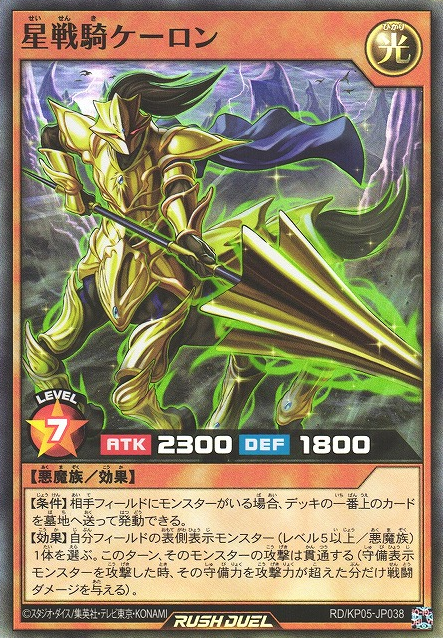

- **Zona y copias:** Main **3x**. CID Rush: **16344**.
- **Rol funcional:** Monstruo de Efecto — presión de combate / modificación de estadísticas.
- **Estado de sinergia y función:** Sinergia indirecta (soporte o recursos). Es una clasificación de juego; revisar la relación concreta en A06.
- **Papel como recurso, descarte o coste:** Coste o consumo descrito en A05: pagar/cumplir el requisito escrito antes de prometer la resolución.
- **Requisito específico:** Si el rival controla un monstruo, enviar la carta superior del Deck al Cementerio.
- **Efecto / resultado concreto:** Elegir un Demonio de Nivel 5 o superior boca arriba propio; sus ataques infligen daño de penetración este turno.
- **Ir primero, segundo y juego tardío:** Primero: preparar acceso y campo necesario sin gastar la respuesta antes de tiempo; segundo: usarla para abrir combate o retirar la amenaza que cumple su condición; tardío: evaluar si quedan objetivos reales.
- **Relación con habilidad y otras piezas:** **HARD ROCK OVERTURE** puede colocar Nivel 7/8 en Defensa, pero colocar por Skill no cuenta como Invocación por Sacrificio de los jefes Royal Rebel's.
- **Riesgos y dependencias:** pagar/cumplir el requisito escrito antes de prometer la resolución.
- **Confianza:** **RESUMEN_FUNCIONAL_DE_GUIA_PREVIA_CON_FUENTE_KONAMI**; pendiente cotejo adicional de traducción/ventanas según la liga. Fuente Rush oficial: https://www.db.yugioh-card.com/rushdb/card_search.action?cid=16344&ope=2
- **Contraste de fuente Rush:** CID 16344: fuente oficial Rush consultada en japonés; tipo Monstruo de Efecto; descripción funcional en español procede de la guía previa y sigue siendo interpretación editorial.
- **Aplicación concreta dentro de este deck (A06):** Elegir un Demonio de Nivel 5 o superior boca arriba propio; sus ataques infligen daño de penetración este turno.

**USO PRÁCTICO Y SINERGIA — Kheiron el Caballero Estelar**

- **Label funcional:** Sinergia indirecta. Clasificación documental; una relación es válida solo si se satisfacen sus condiciones exactas.
- **Qué hace:** Elegir un Demonio de Nivel 5 o superior boca arriba propio; sus ataques infligen daño de penetración este turno.
- **Cuándo tener precaución:** pagar/cumplir el requisito escrito antes de prometer la resolución.

#### 02. Phaser del Rebelde Real

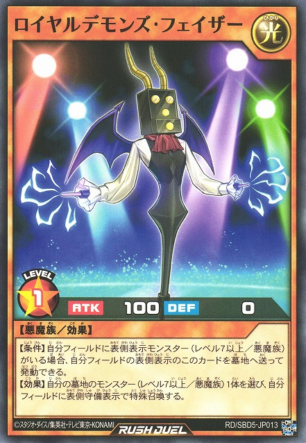

- **Zona y copias:** Main **3x**. CID Rush: **16330**.
- **Rol funcional:** Monstruo de Efecto — extensor / habilitador de material.
- **Estado de sinergia y función:** Sinergia directa descrita. Es una clasificación de juego; revisar la relación concreta en A06.
- **Papel como recurso, descarte o coste:** Coste o consumo descrito en A05: pagar/cumplir el requisito escrito antes de prometer la resolución.
- **Requisito específico:** Controlar un Demonio de Nivel 7+ boca arriba y enviar este Phaser boca arriba del Campo al Cementerio.
- **Efecto / resultado concreto:** Invocar de Modo Especial en Defensa boca arriba un Demonio de Nivel 7+ del Cementerio.
- **Ir primero, segundo y juego tardío:** Primero: construir la condición de activación; segundo: verificar que la jugada responde al estado rival actual; tardío: ahorrar el recurso si todavía no se cumple el requisito.
- **Relación con habilidad y otras piezas:** **HARD ROCK OVERTURE** puede colocar Nivel 7/8 en Defensa, pero colocar por Skill no cuenta como Invocación por Sacrificio de los jefes Royal Rebel's.
- **Riesgos y dependencias:** pagar/cumplir el requisito escrito antes de prometer la resolución.
- **Confianza:** **RESUMEN_FUNCIONAL_DE_GUIA_PREVIA_CON_FUENTE_KONAMI**; pendiente cotejo adicional de traducción/ventanas según la liga. Fuente Rush oficial: https://www.db.yugioh-card.com/rushdb/card_search.action?cid=16330&ope=2
- **Contraste de fuente Rush:** CID 16330: fuente oficial Rush consultada en japonés; tipo Monstruo de Efecto; descripción funcional en español procede de la guía previa y sigue siendo interpretación editorial.
- **Aplicación concreta dentro de este deck (A06):** Invocar de Modo Especial en Defensa boca arriba un Demonio de Nivel 7+ del Cementerio.

**USO PRÁCTICO Y SINERGIA — Phaser del Rebelde Real**

- **Label funcional:** Sinergia directa. Clasificación documental; una relación es válida solo si se satisfacen sus condiciones exactas.
- **Qué hace:** Invocar de Modo Especial en Defensa boca arriba un Demonio de Nivel 7+ del Cementerio.
- **Cuándo tener precaución:** pagar/cumplir el requisito escrito antes de prometer la resolución.

#### 03. Impasse Ignoto

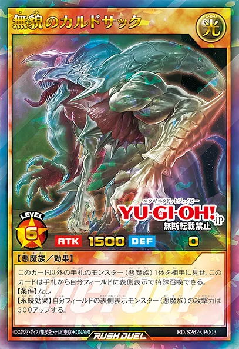

- **Zona y copias:** Main **3x**. CID Rush: **19760**.
- **Rol funcional:** Monstruo de Efecto — presión de combate / modificación de estadísticas.
- **Estado de sinergia y función:** Sinergia indirecta (soporte o recursos). Es una clasificación de juego; revisar la relación concreta en A06.
- **Papel como recurso, descarte o coste:** Coste o consumo descrito en A05: comprobar zona, objetivos y ventana; el nombre de la carta no reemplaza su texto.
- **Requisito específico:** Mostrar al rival otro Demonio de la mano para Invocar esta carta de Modo Especial desde la mano.
- **Efecto / resultado concreto:** Mientras permanezca boca arriba, aumenta en 300 el ATK de todos tus Demonios boca arriba, incluido él mismo.
- **Ir primero, segundo y juego tardío:** Primero: preparar acceso y campo necesario sin gastar la respuesta antes de tiempo; segundo: usarla para abrir combate o retirar la amenaza que cumple su condición; tardío: evaluar si quedan objetivos reales.
- **Relación con habilidad y otras piezas:** La Skill **HARD ROCK OVERTURE** exige Demonios/LUZ y un Nivel 7/8 en mano para enviar al GY; no se roba.
- **Riesgos y dependencias:** comprobar zona, objetivos y ventana; el nombre de la carta no reemplaza su texto.
- **Confianza:** **RESUMEN_FUNCIONAL_DE_GUIA_PREVIA_CON_FUENTE_KONAMI**; pendiente cotejo adicional de traducción/ventanas según la liga. Fuente Rush oficial: https://www.db.yugioh-card.com/rushdb/card_search.action?cid=19760&ope=2
- **Contraste de fuente Rush:** CID 19760: fuente oficial Rush consultada en japonés; tipo Monstruo de Efecto; descripción funcional en español procede de la guía previa y sigue siendo interpretación editorial.
- **Aplicación concreta dentro de este deck (A06):** Mientras permanezca boca arriba, aumenta en 300 el ATK de todos tus Demonios boca arriba, incluido él mismo.

**USO PRÁCTICO Y SINERGIA — Impasse Ignoto**

- **Label funcional:** Sinergia indirecta. Clasificación documental; una relación es válida solo si se satisfacen sus condiciones exactas.
- **Qué hace:** Mientras permanezca boca arriba, aumenta en 300 el ATK de todos tus Demonios boca arriba, incluido él mismo.
- **Cuándo tener precaución:** comprobar zona, objetivos y ventana; el nombre de la carta no reemplaza su texto.

#### 04. Metal Maldito del Rebelde Real

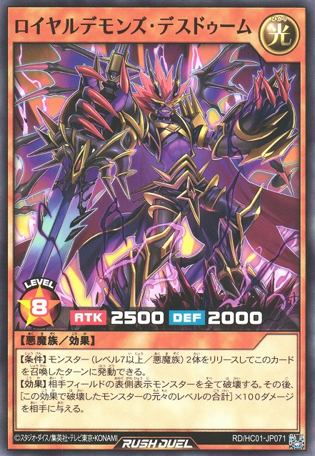

- **Zona y copias:** Main **2x**. CID Rush: **16331**.
- **Rol funcional:** Monstruo de Efecto — removal / apertura de campo.
- **Estado de sinergia y función:** Sinergia indirecta (soporte o recursos). Es una clasificación de juego; revisar la relación concreta en A06.
- **Papel como recurso, descarte o coste:** Coste o consumo descrito en A05: el resultado está sujeto a monstruos/cartas que puedan ser afectados y a respuestas del rival. la Skill que pone monstruos….
- **Requisito específico:** Haber Invocado esta carta por Sacrificio durante este turno usando DOS Demonios de Nivel 7+.
- **Efecto / resultado concreto:** Destruye todos los monstruos boca arriba rivales; después inflige 100 LP por la suma de sus Niveles originales.
- **Ir primero, segundo y juego tardío:** Primero: preparar acceso y campo necesario sin gastar la respuesta antes de tiempo; segundo: usarla para abrir combate o retirar la amenaza que cumple su condición; tardío: evaluar si quedan objetivos reales.
- **Relación con habilidad y otras piezas:** **HARD ROCK OVERTURE** puede colocar Nivel 7/8 en Defensa, pero colocar por Skill no cuenta como Invocación por Sacrificio de los jefes Royal Rebel's.
- **Riesgos y dependencias:** el resultado está sujeto a monstruos/cartas que puedan ser afectados y a respuestas del rival. la Skill que pone monstruos en Defensa NO equivale a Invocación por Sacrificio; sus efectos de tributo requieren el procedimiento específico.
- **Confianza:** **RESUMEN_FUNCIONAL_DE_GUIA_PREVIA_CON_FUENTE_KONAMI**; pendiente cotejo adicional de traducción/ventanas según la liga. Fuente Rush oficial: https://www.db.yugioh-card.com/rushdb/card_search.action?cid=16331&ope=2
- **Contraste de fuente Rush:** CID 16331: fuente oficial Rush consultada en japonés; tipo Monstruo de Efecto; descripción funcional en español procede de la guía previa y sigue siendo interpretación editorial.
- **Aplicación concreta dentro de este deck (A06):** Destruye todos los monstruos boca arriba rivales; después inflige 100 LP por la suma de sus Niveles originales.

**USO PRÁCTICO Y SINERGIA — Metal Maldito del Rebelde Real**

- **Label funcional:** Sinergia indirecta. Clasificación documental; una relación es válida solo si se satisfacen sus condiciones exactas.
- **Qué hace:** Destruye todos los monstruos boca arriba rivales; después inflige 100 LP por la suma de sus Niveles originales.
- **Cuándo tener precaución:** el resultado está sujeto a monstruos/cartas que puedan ser afectados y a respuestas del rival. la Skill que pone monstruos en Defensa NO equivale a Invocación por Sacrificio; sus efectos de tributo requieren el procedimiento específico.

#### 05. Heavy Metal del Rebelde Real

- **Zona y copias:** Main **2x**. CID Rush: **15441**.
- **Rol funcional:** Monstruo de Efecto — removal / apertura de campo.
- **Estado de sinergia y función:** Sinergia indirecta (soporte o recursos). Es una clasificación de juego; revisar la relación concreta en A06.
- **Papel como recurso, descarte o coste:** Coste o consumo descrito en A05: el resultado está sujeto a monstruos/cartas que puedan ser afectados y a respuestas del rival. la Skill que pone monstruos….
- **Requisito específico:** Haber Invocado esta carta por Sacrificio este turno usando al menos un monstruo de Nivel 5+.
- **Efecto / resultado concreto:** Entre los monstruos boca arriba rivales de Nivel 8 o menor, elegir uno del Nivel más bajo; gana su ATK hasta fin del turno y lo destruye.
- **Ir primero, segundo y juego tardío:** Primero: preparar acceso y campo necesario sin gastar la respuesta antes de tiempo; segundo: usarla para abrir combate o retirar la amenaza que cumple su condición; tardío: evaluar si quedan objetivos reales.
- **Relación con habilidad y otras piezas:** **HARD ROCK OVERTURE** puede colocar Nivel 7/8 en Defensa, pero colocar por Skill no cuenta como Invocación por Sacrificio de los jefes Royal Rebel's.
- **Riesgos y dependencias:** el resultado está sujeto a monstruos/cartas que puedan ser afectados y a respuestas del rival. la Skill que pone monstruos en Defensa NO equivale a Invocación por Sacrificio; sus efectos de tributo requieren el procedimiento específico.
- **Confianza:** **RESUMEN_FUNCIONAL_DE_GUIA_PREVIA_CON_FUENTE_KONAMI**; pendiente cotejo adicional de traducción/ventanas según la liga. Fuente Rush oficial: https://www.db.yugioh-card.com/rushdb/card_search.action?cid=15441&ope=2
- **Contraste de fuente Rush:** CID 15441: fuente oficial Rush consultada en japonés; tipo Monstruo de Efecto; descripción funcional en español procede de la guía previa y sigue siendo interpretación editorial.
- **Aplicación concreta dentro de este deck (A06):** Entre los monstruos boca arriba rivales de Nivel 8 o menor, elegir uno del Nivel más bajo; gana su ATK hasta fin del turno y lo destruye.

**USO PRÁCTICO Y SINERGIA — Heavy Metal del Rebelde Real**

- **Label funcional:** Sinergia indirecta. Clasificación documental; una relación es válida solo si se satisfacen sus condiciones exactas.
- **Qué hace:** Entre los monstruos boca arriba rivales de Nivel 8 o menor, elegir uno del Nivel más bajo; gana su ATK hasta fin del turno y lo destruye.
- **Cuándo tener precaución:** el resultado está sujeto a monstruos/cartas que puedan ser afectados y a respuestas del rival. la Skill que pone monstruos en Defensa NO equivale a Invocación por Sacrificio; sus efectos de tributo requieren el procedimiento específico.

#### 06. Progrock del Rebelde Real

- **Zona y copias:** Main **2x**. CID Rush: **19761**.
- **Rol funcional:** Monstruo de Efecto — removal / apertura de campo.
- **Estado de sinergia y función:** Sinergia indirecta (soporte o recursos). Es una clasificación de juego; revisar la relación concreta en A06.
- **Papel como recurso, descarte o coste:** Coste o consumo descrito en A05: el resultado está sujeto a monstruos/cartas que puedan ser afectados y a respuestas del rival. la Skill que pone monstruos….
- **Requisito específico:** Haber Invocado esta carta por Sacrificio este turno usando al menos un monstruo de Nivel 5+.
- **Efecto / resultado concreto:** Destruye una Mágica/Trampa rival; después puede destruir otra carta boca abajo rival. Este turno solo pueden atacar tus Demonios.
- **Ir primero, segundo y juego tardío:** Primero: preparar acceso y campo necesario sin gastar la respuesta antes de tiempo; segundo: usarla para abrir combate o retirar la amenaza que cumple su condición; tardío: evaluar si quedan objetivos reales.
- **Relación con habilidad y otras piezas:** **HARD ROCK OVERTURE** puede colocar Nivel 7/8 en Defensa, pero colocar por Skill no cuenta como Invocación por Sacrificio de los jefes Royal Rebel's.
- **Riesgos y dependencias:** el resultado está sujeto a monstruos/cartas que puedan ser afectados y a respuestas del rival. la Skill que pone monstruos en Defensa NO equivale a Invocación por Sacrificio; sus efectos de tributo requieren el procedimiento específico.
- **Confianza:** **RESUMEN_FUNCIONAL_DE_GUIA_PREVIA_CON_FUENTE_KONAMI**; pendiente cotejo adicional de traducción/ventanas según la liga. Fuente Rush oficial: https://www.db.yugioh-card.com/rushdb/card_search.action?cid=19761&ope=2
- **Contraste de fuente Rush:** CID 19761: fuente oficial Rush consultada en japonés; tipo Monstruo de Efecto; descripción funcional en español procede de la guía previa y sigue siendo interpretación editorial.
- **Aplicación concreta dentro de este deck (A06):** Destruye una Mágica/Trampa rival; después puede destruir otra carta boca abajo rival.

**USO PRÁCTICO Y SINERGIA — Progrock del Rebelde Real**

- **Label funcional:** Sinergia indirecta. Clasificación documental; una relación es válida solo si se satisfacen sus condiciones exactas.
- **Qué hace:** Destruye una Mágica/Trampa rival; después puede destruir otra carta boca abajo rival. Este turno solo pueden atacar tus Demonios.
- **Cómo aprovecharla en este deck:** Destruye una Mágica/Trampa rival; después puede destruir otra carta boca abajo rival.
- **Cuándo tener precaución:** el resultado está sujeto a monstruos/cartas que puedan ser afectados y a respuestas del rival. la Skill que pone monstruos en Defensa NO equivale a Invocación por Sacrificio; sus efectos de tributo requieren el procedimiento específico.

#### 07. Descendiente de Titanes

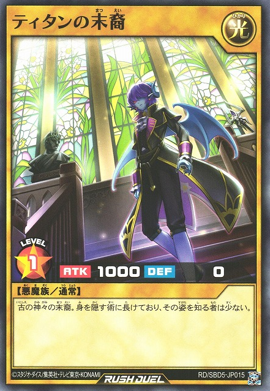

- **Zona y copias:** Main **2x**. CID Rush: **16135**.
- **Rol funcional:** Monstruo Normal — material de Fusión/Sacrificio o presencia de combate; sin efecto activado.
- **Estado de sinergia y función:** Sinergia indirecta (soporte o recursos). Es una clasificación de juego; revisar la relación concreta en A06.
- **Papel como recurso, descarte o coste:** Coste o consumo descrito en A05: no atribuirle un efecto activado inexistente; comprobar su función como material y las cartas de soporte.
- **Requisito específico:** No tiene activación de efecto de monstruo.
- **Efecto / resultado concreto:** Monstruo Normal sin efecto.
- **Ir primero, segundo y juego tardío:** Primero: conservarlo si es material expresamente exigido por una Fusión o Sacrificio; segundo: emplearlo como cuerpo solo tras calcular ATK y riesgo de batalla; tardío: recurso para reconstruir material desde el GY si una carta lo autoriza.
- **Relación con habilidad y otras piezas:** La Skill **HARD ROCK OVERTURE** exige Demonios/LUZ y un Nivel 7/8 en mano para enviar al GY; no se roba.
- **Riesgos y dependencias:** no atribuirle un efecto activado inexistente; comprobar su función como material y las cartas de soporte.
- **Confianza:** **RESUMEN_FUNCIONAL_DE_GUIA_PREVIA_CON_FUENTE_KONAMI**; pendiente cotejo adicional de traducción/ventanas según la liga. Fuente Rush oficial: https://www.db.yugioh-card.com/rushdb/card_search.action?cid=16135&ope=2
- **Contraste de fuente Rush:** CID 16135: fuente oficial Rush consultada en japonés; tipo Monstruo Normal; descripción funcional en español procede de la guía previa y sigue siendo interpretación editorial.
- **Aplicación concreta dentro de este deck (A06):** Monstruo Normal sin efecto.

**USO PRÁCTICO Y SINERGIA — Descendiente de Titanes**

- **Label funcional:** Sinergia indirecta. Clasificación documental; una relación es válida solo si se satisfacen sus condiciones exactas.
- **Qué hace:** Monstruo Normal sin efecto.
- **Cuándo tener precaución:** no atribuirle un efecto activado inexistente; comprobar su función como material y las cartas de soporte.

#### 08. Canjear

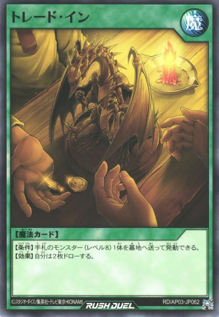

- **Zona y copias:** Main **2x**. CID Rush: **17721**.
- **Rol funcional:** Carta Mágica Normal — consistencia / reciclaje.
- **Estado de sinergia y función:** Sinergia indirecta (soporte o recursos). Es una clasificación de juego; revisar la relación concreta en A06.
- **Papel como recurso, descarte o coste:** Coste o consumo descrito en A05: pagar/cumplir el requisito escrito antes de prometer la resolución. disponer de cartas suficientes en Deck y distinguir robo….
- **Requisito específico:** Enviar al Cementerio un monstruo de Nivel 8 de la mano.
- **Efecto / resultado concreto:** Roba dos cartas.
- **Ir primero, segundo y juego tardío:** Primero: usarla si su efecto abre recursos o deja protección aprovechable; segundo: priorizar su resultado concreto frente a las amenazas rivales; tardío: comprobar materiales, objetivos y si aún quedan recursos en Deck o Cementerio.
- **Relación con habilidad y otras piezas:** La Skill **HARD ROCK OVERTURE** exige Demonios/LUZ y un Nivel 7/8 en mano para enviar al GY; no se roba.
- **Riesgos y dependencias:** pagar/cumplir el requisito escrito antes de prometer la resolución. disponer de cartas suficientes en Deck y distinguir robo de búsqueda.
- **Confianza:** **RESUMEN_FUNCIONAL_DE_GUIA_PREVIA_CON_FUENTE_KONAMI**; pendiente cotejo adicional de traducción/ventanas según la liga. Fuente Rush oficial: https://www.db.yugioh-card.com/rushdb/card_search.action?cid=17721&ope=2
- **Contraste de fuente Rush:** CID 17721: fuente oficial Rush consultada en japonés; tipo Carta Mágica Normal; descripción funcional en español procede de la guía previa y sigue siendo interpretación editorial.
- **Aplicación concreta dentro de este deck (A06):** Roba dos cartas.

**USO PRÁCTICO Y SINERGIA — Canjear**

- **Label funcional:** Sinergia indirecta. Clasificación documental; una relación es válida solo si se satisfacen sus condiciones exactas.
- **Qué hace:** Roba dos cartas.
- **Cuándo tener precaución:** pagar/cumplir el requisito escrito antes de prometer la resolución. disponer de cartas suficientes en Deck y distinguir robo de búsqueda.

#### 09. Aliento de Fuego del Genio

- **Zona y copias:** Main **2x**. CID Rush: **15673**.
- **Rol funcional:** Carta Mágica Normal — apoyo situacional sujeto a condición escrita.
- **Estado de sinergia y función:** Sinergia indirecta (soporte o recursos). Es una clasificación de juego; revisar la relación concreta en A06.
- **Papel como recurso, descarte o coste:** Coste o consumo descrito en A05: comprobar zona, objetivos y ventana; el nombre de la carta no reemplaza su texto.
- **Requisito específico:** Controlar un Demonio boca arriba.
- **Efecto / resultado concreto:** Devuelve a la mano del dueño una Mágica o Trampa del rival.
- **Ir primero, segundo y juego tardío:** Primero: usarla si su efecto abre recursos o deja protección aprovechable; segundo: priorizar su resultado concreto frente a las amenazas rivales; tardío: comprobar materiales, objetivos y si aún quedan recursos en Deck o Cementerio.
- **Relación con habilidad y otras piezas:** La Skill **HARD ROCK OVERTURE** exige Demonios/LUZ y un Nivel 7/8 en mano para enviar al GY; no se roba.
- **Riesgos y dependencias:** comprobar zona, objetivos y ventana; el nombre de la carta no reemplaza su texto.
- **Confianza:** **RESUMEN_FUNCIONAL_DE_GUIA_PREVIA_CON_FUENTE_KONAMI**; pendiente cotejo adicional de traducción/ventanas según la liga. Fuente Rush oficial: https://www.db.yugioh-card.com/rushdb/card_search.action?cid=15673&ope=2
- **Contraste de fuente Rush:** CID 15673: fuente oficial Rush consultada en japonés; tipo Carta Mágica Normal; descripción funcional en español procede de la guía previa y sigue siendo interpretación editorial.
- **Aplicación concreta dentro de este deck (A06):** Devuelve a la mano del dueño una Mágica o Trampa del rival.

**USO PRÁCTICO Y SINERGIA — Aliento de Fuego del Genio**

- **Label funcional:** Sinergia indirecta. Clasificación documental; una relación es válida solo si se satisfacen sus condiciones exactas.
- **Qué hace:** Devuelve a la mano del dueño una Mágica o Trampa del rival.
- **Cuándo tener precaución:** comprobar zona, objetivos y ventana; el nombre de la carta no reemplaza su texto.

#### 10. Restauración de Cartas

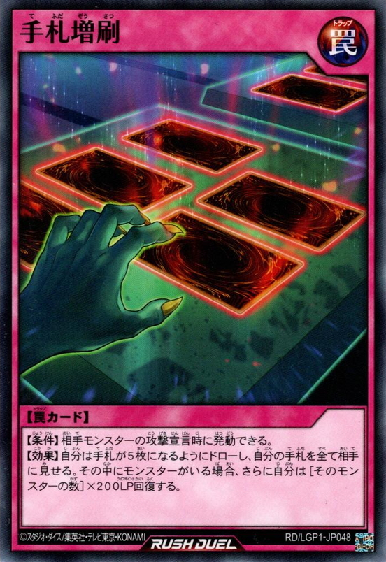

- **Zona y copias:** Main **2x**. CID Rush: **17543**.
- **Rol funcional:** Carta de Trampa Normal — consistencia / reciclaje.
- **Estado de sinergia y función:** Sinergia directa descrita. Es una clasificación de juego; revisar la relación concreta en A06.
- **Papel como recurso, descarte o coste:** Coste o consumo descrito en A05: disponer de cartas suficientes en Deck y distinguir robo de búsqueda.
- **Requisito específico:** Cuando un monstruo rival declara ataque.
- **Efecto / resultado concreto:** Roba hasta tener cinco cartas en mano, revela toda la mano y recupera 200 LP por cada monstruo revelado.
- **Ir primero, segundo y juego tardío:** Primero: Colocar y reservar la respuesta para la ventana legal; segundo: tras side y cambio de turno, evaluar si puede activarse a tiempo; tardío: no asumir efecto si falta el objetivo o el estado de campo.
- **Relación con habilidad y otras piezas:** La Skill **HARD ROCK OVERTURE** exige Demonios/LUZ y un Nivel 7/8 en mano para enviar al GY; no se roba.
- **Riesgos y dependencias:** disponer de cartas suficientes en Deck y distinguir robo de búsqueda.
- **Confianza:** **RESUMEN_FUNCIONAL_DE_GUIA_PREVIA_CON_FUENTE_KONAMI**; pendiente cotejo adicional de traducción/ventanas según la liga. Fuente Rush oficial: https://www.db.yugioh-card.com/rushdb/card_search.action?cid=17543&ope=2
- **Contraste de fuente Rush:** CID 17543: fuente oficial Rush consultada en japonés; tipo Carta de Trampa Normal; descripción funcional en español procede de la guía previa y sigue siendo interpretación editorial.
- **Aplicación concreta dentro de este deck (A06):** Roba hasta tener cinco cartas en mano, revela toda la mano y recupera 200 LP por cada monstruo revelado.

**USO PRÁCTICO Y SINERGIA — Restauración de Cartas**

- **Label funcional:** Sinergia directa. Clasificación documental; una relación es válida solo si se satisfacen sus condiciones exactas.
- **Qué hace:** Roba hasta tener cinco cartas en mano, revela toda la mano y recupera 200 LP por cada monstruo revelado.
- **Cuándo tener precaución:** disponer de cartas suficientes en Deck y distinguir robo de búsqueda.

#### 11. Maldición de la Luz Ascendente

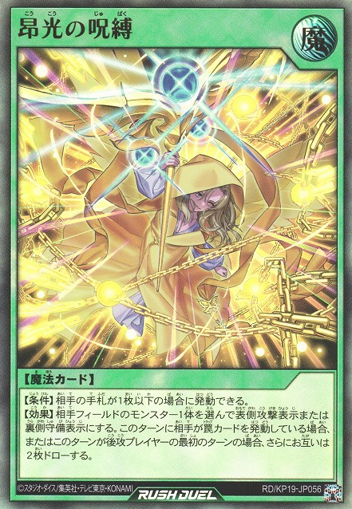

- **Zona y copias:** Main **2x**. CID Rush: **21007**.
- **Rol funcional:** Carta Mágica Normal — consistencia / reciclaje.
- **Estado de sinergia y función:** Sinergia indirecta (soporte o recursos). Es una clasificación de juego; revisar la relación concreta en A06.
- **Papel como recurso, descarte o coste:** Coste o consumo descrito en A05: disponer de cartas suficientes en Deck y distinguir robo de búsqueda.
- **Requisito específico:** El rival debe tener una o ninguna carta en mano.
- **Efecto / resultado concreto:** Cambia un monstruo rival a Ataque boca arriba o Defensa boca abajo. Si el rival activó una Trampa ese turno o es el primer turno del jugador segundo, ambos roban dos.
- **Ir primero, segundo y juego tardío:** Primero: usarla si su efecto abre recursos o deja protección aprovechable; segundo: priorizar su resultado concreto frente a las amenazas rivales; tardío: comprobar materiales, objetivos y si aún quedan recursos en Deck o Cementerio.
- **Relación con habilidad y otras piezas:** La Skill **HARD ROCK OVERTURE** exige Demonios/LUZ y un Nivel 7/8 en mano para enviar al GY; no se roba.
- **Riesgos y dependencias:** disponer de cartas suficientes en Deck y distinguir robo de búsqueda.
- **Confianza:** **RESUMEN_FUNCIONAL_DE_GUIA_PREVIA_CON_FUENTE_KONAMI**; pendiente cotejo adicional de traducción/ventanas según la liga. Fuente Rush oficial: https://www.db.yugioh-card.com/rushdb/card_search.action?cid=21007&ope=2
- **Contraste de fuente Rush:** CID 21007: fuente oficial Rush consultada en japonés; tipo Carta Mágica Normal; descripción funcional en español procede de la guía previa y sigue siendo interpretación editorial.
- **Aplicación concreta dentro de este deck (A06):** Cambia un monstruo rival a Ataque boca arriba o Defensa boca abajo.

**USO PRÁCTICO Y SINERGIA — Maldición de la Luz Ascendente**

- **Label funcional:** Sinergia indirecta. Clasificación documental; una relación es válida solo si se satisfacen sus condiciones exactas.
- **Qué hace:** Cambia un monstruo rival a Ataque boca arriba o Defensa boca abajo. Si el rival activó una Trampa ese turno o es el primer turno del jugador segundo, ambos roban dos.
- **Cómo aprovecharla en este deck:** Cambia un monstruo rival a Ataque boca arriba o Defensa boca abajo.
- **Cuándo tener precaución:** disponer de cartas suficientes en Deck y distinguir robo de búsqueda.

#### 12. Gelatina Defensiva

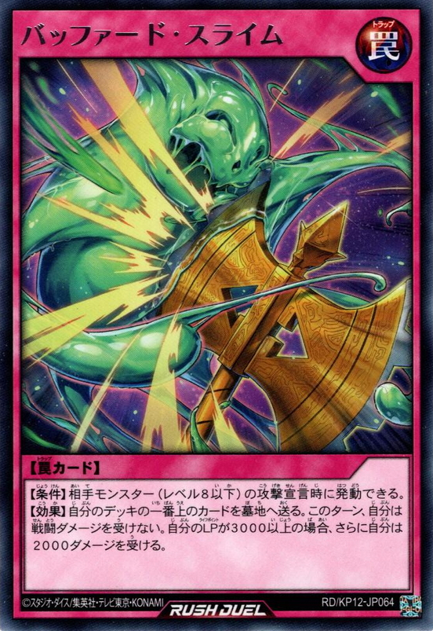

- **Zona y copias:** Main **1x**. CID Rush: **18646**.
- **Rol funcional:** Carta de Trampa Normal — defensa ante ataque y prevención de daño de batalla.
- **Estado de sinergia y función:** Sinergia directa descrita. Es una clasificación de juego; revisar la relación concreta en A06.
- **Papel como recurso, descarte o coste:** Envío mencionado en la interacción; no equivale por sí mismo a descarte desde la mano.
- **Requisito específico:** Cuando un monstruo rival de Nivel 8 o inferior declara ataque.
- **Efecto / resultado concreto:** Envía al Cementerio la carta superior de tu Deck y evita todo el daño de batalla ese turno; si tienes 3000 LP o más, recibes además 2000 de daño de efecto.
- **Ir primero, segundo y juego tardío:** Primero: construir la condición de activación; segundo: verificar que la jugada responde al estado rival actual; tardío: ahorrar el recurso si todavía no se cumple el requisito.
- **Relación con habilidad y otras piezas:** La Skill **HARD ROCK OVERTURE** exige Demonios/LUZ y un Nivel 7/8 en mano para enviar al GY; no se roba.
- **Riesgos y dependencias:** comprobar zona, objetivos y ventana; el nombre de la carta no reemplaza su texto.
- **Confianza:** **RESUMEN_FUNCIONAL_DE_GUIA_PREVIA_CON_FUENTE_KONAMI**; pendiente cotejo adicional de traducción/ventanas según la liga. Fuente Rush oficial: https://www.db.yugioh-card.com/rushdb/card_search.action?cid=18646&ope=2
- **Contraste de fuente Rush:** CID 18646, nombre japonés **バッファード・スライム** (Buffered Slime): texto oficial localizado con `request_locale=ja`, tipo Carta de Trampa Normal. La condición de ataque de monstruo rival de Nivel 8 o inferior, el envío de la carta superior del Deck, la prevención de daño de batalla del turno y el daño de efecto de 2000 si los LP propios son al menos 3000 coinciden con el resumen previo. La denominación española «Gelatina Defensiva» sigue siendo un alias del inventario; no se impone traducción oficial.
- **Aplicación concreta dentro de este deck (A06):** Envía al Cementerio la carta superior de tu Deck y evita todo el daño de batalla ese turno; si tienes 3000 LP o más, recibes además 2000 de daño de efecto.

**USO PRÁCTICO Y SINERGIA — Gelatina Defensiva**

- **Label funcional:** Sinergia directa. Clasificación documental; una relación es válida solo si se satisfacen sus condiciones exactas.
- **Qué hace:** Envía al Cementerio la carta superior de tu Deck y evita todo el daño de batalla ese turno; si tienes 3000 LP o más, recibes además 2000 de daño de efecto.
- **Cuándo tener precaución:** comprobar zona, objetivos y ventana; el nombre de la carta no reemplaza su texto.

#### 13. Avaricia del Rey

- **Zona y copias:** Main **1x**. CID Rush: **19799**.
- **Rol funcional:** Carta Mágica Normal — consistencia / reciclaje.
- **Estado de sinergia y función:** Sinergia indirecta (soporte o recursos). Es una clasificación de juego; revisar la relación concreta en A06.
- **Papel como recurso, descarte o coste:** Coste o consumo descrito en A05: pagar/cumplir el requisito escrito antes de prometer la resolución. disponer de cartas suficientes en Deck y distinguir robo….
- **Requisito específico:** Enviar de la mano un Demonio LUZ de Nivel 5+ al Cementerio, o devolver del Cementerio al Deck tres Demonios LUZ de Nivel 7+.
- **Efecto / resultado concreto:** Cambia a Defensa boca arriba un Demonio LUZ propio que esté en Ataque y, si se desea, roba dos cartas.
- **Ir primero, segundo y juego tardío:** Primero: usarla si su efecto abre recursos o deja protección aprovechable; segundo: priorizar su resultado concreto frente a las amenazas rivales; tardío: comprobar materiales, objetivos y si aún quedan recursos en Deck o Cementerio.
- **Relación con habilidad y otras piezas:** La Skill **HARD ROCK OVERTURE** exige Demonios/LUZ y un Nivel 7/8 en mano para enviar al GY; no se roba.
- **Riesgos y dependencias:** pagar/cumplir el requisito escrito antes de prometer la resolución. disponer de cartas suficientes en Deck y distinguir robo de búsqueda.
- **Confianza:** **RESUMEN_FUNCIONAL_DE_GUIA_PREVIA_CON_FUENTE_KONAMI**; pendiente cotejo adicional de traducción/ventanas según la liga. Fuente Rush oficial: https://www.db.yugioh-card.com/rushdb/card_search.action?cid=19799&ope=2
- **Contraste de fuente Rush:** CID 19799: fuente oficial Rush consultada en japonés; tipo Carta Mágica Normal; descripción funcional en español procede de la guía previa y sigue siendo interpretación editorial.
- **Aplicación concreta dentro de este deck (A06):** Cambia a Defensa boca arriba un Demonio LUZ propio que esté en Ataque y, si se desea, roba dos cartas.

**USO PRÁCTICO Y SINERGIA — Avaricia del Rey**

- **Label funcional:** Sinergia indirecta. Clasificación documental; una relación es válida solo si se satisfacen sus condiciones exactas.
- **Qué hace:** Cambia a Defensa boca arriba un Demonio LUZ propio que esté en Ataque y, si se desea, roba dos cartas.
- **Cuándo tener precaución:** pagar/cumplir el requisito escrito antes de prometer la resolución. disponer de cartas suficientes en Deck y distinguir robo de búsqueda.

#### 14. Agujero Trampa

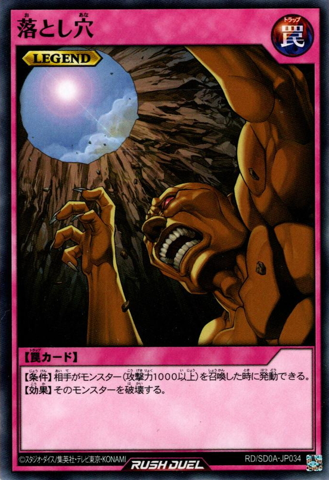

- **Zona y copias:** Main **1x**. CID Rush: **15913**.
- **Rol funcional:** Carta de Trampa Normal — interrupción defensiva de Invocación Normal.
- **Estado de sinergia y función:** Sinergia indirecta (soporte o recursos). Es una clasificación de juego; revisar la relación concreta en A06.
- **Papel como recurso, descarte o coste:** Coste o consumo descrito en A05: el resultado está sujeto a monstruos/cartas que puedan ser afectados y a respuestas del rival.
- **Requisito específico:** Cuando el rival Invoca de Modo Normal un monstruo de al menos 1000 ATK.
- **Efecto / resultado concreto:** Destruye ese monstruo invocado.
- **Ir primero, segundo y juego tardío:** Primero: Colocar y reservar la respuesta para la ventana legal; segundo: tras side y cambio de turno, evaluar si puede activarse a tiempo; tardío: no asumir efecto si falta el objetivo o el estado de campo.
- **Relación con habilidad y otras piezas:** La Skill **HARD ROCK OVERTURE** exige Demonios/LUZ y un Nivel 7/8 en mano para enviar al GY; no se roba.
- **Riesgos y dependencias:** el resultado está sujeto a monstruos/cartas que puedan ser afectados y a respuestas del rival.
- **Confianza:** **RESUMEN_FUNCIONAL_DE_GUIA_PREVIA_CON_FUENTE_KONAMI**; pendiente cotejo adicional de traducción/ventanas según la liga. Fuente Rush oficial: https://www.db.yugioh-card.com/rushdb/card_search.action?cid=15913&ope=2
- **Contraste de fuente Rush:** CID 15913: fuente oficial Rush consultada en japonés; tipo Carta de Trampa Normal; descripción funcional en español procede de la guía previa y sigue siendo interpretación editorial.
- **Aplicación concreta dentro de este deck (A06):** Destruye ese monstruo invocado.

**USO PRÁCTICO Y SINERGIA — Agujero Trampa**

- **Label funcional:** Sinergia indirecta. Clasificación documental; una relación es válida solo si se satisfacen sus condiciones exactas.
- **Qué hace:** Destruye ese monstruo invocado.
- **Cuándo tener precaución:** el resultado está sujeto a monstruos/cartas que puedan ser afectados y a respuestas del rival.

#### 15. Esplendor del Rey

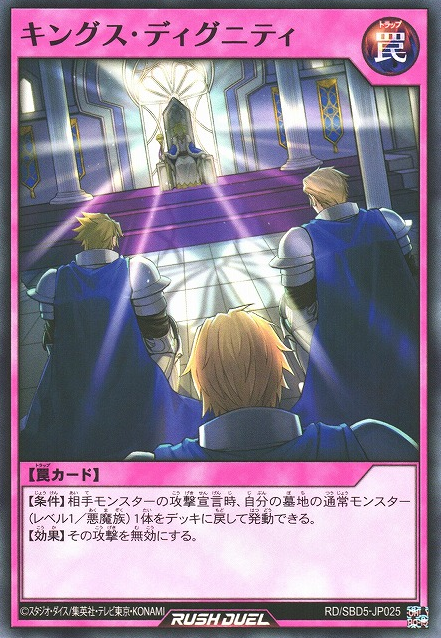

- **Zona y copias:** Main **1x**. CID Rush: **15674**.
- **Rol funcional:** Carta de Trampa Normal — apoyo situacional sujeto a condición escrita.
- **Estado de sinergia y función:** Sinergia indirecta (soporte o recursos). Es una clasificación de juego; revisar la relación concreta en A06.
- **Papel como recurso, descarte o coste:** Coste o consumo descrito en A05: pagar/cumplir el requisito escrito antes de prometer la resolución.
- **Requisito específico:** Ante declaración de ataque rival, devolver al Deck un Demonio Normal de Nivel 1 del propio Cementerio.
- **Efecto / resultado concreto:** Niega el ataque declarado.
- **Ir primero, segundo y juego tardío:** Primero: Colocar y reservar la respuesta para la ventana legal; segundo: tras side y cambio de turno, evaluar si puede activarse a tiempo; tardío: no asumir efecto si falta el objetivo o el estado de campo.
- **Relación con habilidad y otras piezas:** La Skill **HARD ROCK OVERTURE** exige Demonios/LUZ y un Nivel 7/8 en mano para enviar al GY; no se roba.
- **Riesgos y dependencias:** pagar/cumplir el requisito escrito antes de prometer la resolución.
- **Confianza:** **RESUMEN_FUNCIONAL_DE_GUIA_PREVIA_CON_FUENTE_KONAMI**; pendiente cotejo adicional de traducción/ventanas según la liga. Fuente Rush oficial: https://www.db.yugioh-card.com/rushdb/card_search.action?cid=15674&ope=2
- **Contraste de fuente Rush:** CID 15674: fuente oficial Rush consultada en japonés; tipo Carta de Trampa Normal; descripción funcional en español procede de la guía previa y sigue siendo interpretación editorial.
- **Aplicación concreta dentro de este deck (A06):** Niega el ataque declarado.

**USO PRÁCTICO Y SINERGIA — Esplendor del Rey**

- **Label funcional:** Sinergia indirecta. Clasificación documental; una relación es válida solo si se satisfacen sus condiciones exactas.
- **Qué hace:** Niega el ataque declarado.
- **Cuándo tener precaución:** pagar/cumplir el requisito escrito antes de prometer la resolución.

#### 16. Monstruo Reencarnado

- **Zona y copias:** Main **1x**. CID Rush: **16305**.
- **Rol funcional:** Carta Mágica Normal — consistencia / reciclaje.
- **Estado de sinergia y función:** Sinergia directa descrita. Es una clasificación de juego; revisar la relación concreta en A06.
- **Papel como recurso, descarte o coste:** Coste o consumo descrito en A05: pagar/cumplir el requisito escrito antes de prometer la resolución.
- **Requisito específico:** Tener un monstruo en el Cementerio y enviar una carta de la mano al Cementerio.
- **Efecto / resultado concreto:** Recupera a la mano un monstruo del Cementerio; es la versión Rush, no un efecto idéntico por defecto al TCG.
- **Ir primero, segundo y juego tardío:** Primero: usarla si su efecto abre recursos o deja protección aprovechable; segundo: priorizar su resultado concreto frente a las amenazas rivales; tardío: comprobar materiales, objetivos y si aún quedan recursos en Deck o Cementerio.
- **Relación con habilidad y otras piezas:** La Skill **HARD ROCK OVERTURE** exige Demonios/LUZ y un Nivel 7/8 en mano para enviar al GY; no se roba.
- **Riesgos y dependencias:** pagar/cumplir el requisito escrito antes de prometer la resolución.
- **Confianza:** **RESUMEN_FUNCIONAL_DE_GUIA_PREVIA_CON_FUENTE_KONAMI**; pendiente cotejo adicional de traducción/ventanas según la liga. Fuente Rush oficial: https://www.db.yugioh-card.com/rushdb/card_search.action?cid=16305&ope=2
- **Contraste de fuente Rush:** CID 16305: fuente oficial Rush consultada en japonés; tipo Carta Mágica Normal; descripción funcional en español procede de la guía previa y sigue siendo interpretación editorial.
- **Aplicación concreta dentro de este deck (A06):** Recupera a la mano un monstruo del Cementerio; es la versión Rush, no un efecto idéntico por defecto al TCG.

**USO PRÁCTICO Y SINERGIA — Monstruo Reencarnado**

- **Label funcional:** Sinergia directa. Clasificación documental; una relación es válida solo si se satisfacen sus condiciones exactas.
- **Qué hace:** Recupera a la mano un monstruo del Cementerio; es la versión Rush, no un efecto idéntico por defecto al TCG.
- **Cuándo tener precaución:** pagar/cumplir el requisito escrito antes de prometer la resolución.

## SINERGIAS Y MOTORES
## RESUMEN FUNCIONAL DE SINERGIAS — 705

**Medición descriptiva de etiquetas existentes (NO certificación):** 16/16 identidades con etiqueta directa/indirecta (100.0 %). Main: 16/16 (100.0 %); Extra: sin identidades. Se cuenta una identidad una sola vez; una carta autónoma puede ser útil sin sinergia de motor. Estas cifras provienen de clasificaciones documentales A05/A06: **no son el porcentaje final de sinergias verificadas**, ni una tasa estadística de victoria. Para promoverlas a métricas verificadas, se deben comprobar los pares de cartas y su operación legal.

#### A06.0 — En 30 segundos: cómo cooperan realmente estas cartas

- **Dictamen de conjunto:** plan de Sacrificios Rush coherente; los jefes comparten cuerpos, pero sus efectos y requisitos NO son equivalentes.
- **Motor que mueve el deck:** Demonios Nivel 7/8 y cuerpos de apoyo se convierten en Sacrificios para jefes Royal Rebel; la retirada de monstruos o M/T depende del jefe elegido.
- **Puentes reales:** HARD ROCK OVERTURE puede colocar cuerpos en Defensa desde turno 2 bajo requisitos locales; Canjear y Monstruo Reencarnado preparan mano/GY.
- **Sinergia indirecta:** un Demonio alto enviado al GY puede ser recurso posterior; Canjear necesita exactamente Nivel 8, no cualquier jefe alto.
- **Conflicto decisivo:** el procedimiento de colocación por Skill no equivale a Invocación ni permite atacar inmediatamente; cada Sacrificio consume cuerpos que dejan de estar disponibles.
- **Decisión concreta:** seleccionar jefe por objetivos reales en campo, no por ATK solamente; no recomendar cartas Extra porque el Extra confirmado de esta lista está vacío.
- **Qué aprender después:** comparar Death Doom, Heavy Metal y Progrock según monstruo/M/T rival y Sacrificios disponibles.

#### Motores y relaciones

1. **Motor principal Demonio de Nivel 7/8 por Sacrificio.** **Phaser del Rebelde Real** (CID 16330), si controlas Demonio Nivel 7+ boca arriba, se envía del Campo al GY para Invocar desde el GY otro Demonio Nivel 7+ en Defensa. **Impasse Ignoto** (19760) puede Invocarse desde mano revelando otro Demonio y da +300 ATK a Demonios propios. **Descendiente de Titanes** (16135) es Normal: cuerpo para Sacrificio, pero sin efecto activado que genere materiales adicionales.
2. **Finalizadores con costes diferentes.** **Heavy Metal del Rebelde Real** (15441) necesita haber sido Invocado por Sacrificio ese turno usando al menos un monstruo Nivel 5+; elige y destruye entre monstruos boca arriba del rival de Nivel 8 o menor al del Nivel más bajo y gana su ATK. **Progrock del Rebelde Real** (19761) exige Sacrificio con Nivel 5+ para destruir M/T y posiblemente carta rival boca abajo, pero restringe los ataques a Demonios. **Metal Maldito del Rebelde Real** (16331) exige **dos Demonios Nivel 7+ como Sacrificios para esa Invocación** y entonces destruye monstruos rivales boca arriba, con daño adicional por Niveles. No son tres salidas con el mismo coste.
3. **Descartar y reciclar piezas altas.** **Canjear** (17721) manda un monstruo **Nivel 8** de la mano al GY para robar dos; puede alimentar recursos recuperables por Phaser o Skill, pero no sirve para cualquier Demonio Nivel 7. **Monstruo Reencarnado** (16305) envía una carta de mano para recuperar un monstruo del GY. **Avaricia del Rey** (19799) exige un coste particular de Demonios LUZ altos de mano/GY y puede cambiar a Defensa un Demonio LUZ propio antes de robar; no es «Olla de la Codicia» libre.
4. **HARD ROCK OVERTURE (RD/SK01-004).** Habilidad local no robable: envía un Nivel 7/8 de mano al GY y exige composición completa Demonio/LUZ en Deck/Extra. Coloca **hasta dos** Demonios Nivel 7/8 de mano/GY boca arriba en **Defensa**, y desde turno 2 puede recuperar otro de GY. Mientras esos cuerpos permanezcan boca arriba sus posiciones solo cambian por efectos; no presentarlos directamente como atacantes en posición de Defensa. Sí pueden considerarse **material de Sacrificio** si otra regla no lo impide; el uso concreto y frecuencia de Skill requieren aprobación local.
5. **Presión de combate y respuesta.** **Kheiron el Caballero Estelar** (16344) puede dar penetración a un Demonio propio Nivel 5+ tras enviar la carta superior del Deck al GY si el rival tiene monstruo. **Aliento de Fuego del Genio** (15673) devuelve una M/T rival a mano si controlas Demonio. **Esplendor del Rey** (15674) niega ataque devolviendo al Deck Demonio Normal Nivel 1 de tu GY; no hay que dar por disponible ese coste sin carta concreta.
6. **Control de mano y defensas.** **Restauración de Cartas** (17543) repone mano en respuesta a ataque, revelándola. **Gelatina Defensiva** (18646) previene daño de batalla bajo un ataque permitido, pero puede ocasionar 2000 de daño de efecto propio; **Agujero Trampa** (15913) destruye en su ventana de Invocación Normal. **Maldición de la Luz Ascendente** (21007) afecta posición del rival con condición de mano rival y puede permitir robo a ambos, no siempre ventaja unilateral.

#### Mapa de relaciones con fuente fotográfica pendiente

| Conexión por CID | Resultado | Requisito | Imagen |
|---|---|---|---|
| Canjear (17721) → Demonio Nivel 8 en GY → Phaser (16330) | Cambiar pieza alta por robo y posible recuperación posterior. | Canjear requiere **Nivel 8**; Phaser necesita Nivel 7+ propio en Campo. |   |
| HARD ROCK OVERTURE → dos Demonios Nivel 7/8 en Defensa | Aporta cuerpos para posibles Sacrificios. | Carta de mano que se envía, composición Demonio/LUZ y condiciones locales. | 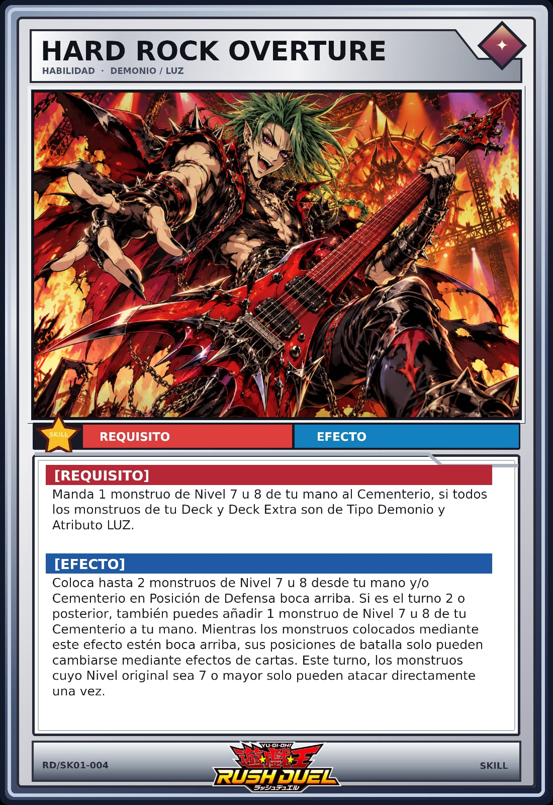 |
| Dos Demonios Nivel 7+ → Metal Maldito (16331) | Posible retirada masiva de monstruos boca arriba. | Invocación por Sacrificio de Metal Maldito **ese turno** usando ambos cuerpos altos. |  |
| Un monstruo Nivel 5+ tributado → Heavy Metal (15441) / Progrock (19761) | Retirada de monstruo o M/T según el jefe. | Cada jefe debe ser Invocado por Sacrificio cumpliendo el texto propio. |   |
| Kheiron (16344) → Demonio Nivel 5+ | Penetración de combate. | Rival controla monstruo, envío superior de Deck, objetivo propio apropiado. |  |

#### Conflictos y disponibilidad

- **Extra vacío:** 0 cartas; este deck no puede abrir un motor de Fusión/Sincronía/Xyz/Enlace del Extra actual. No usar «Fusión» o jefes de otros decks como ejemplo operativo.
- **Skill vs ataques:** los monstruos de HARD ROCK OVERTURE llegan en Defensa y no cambian normalmente su posición mientras permanezcan boca arriba; preparar Sacrificios antes de afirmar ataque directo. La restricción de un ataque directo por monstruos altos debe revisarse conforme a la redacción local.
- **Recursos competidos:** Canjear, Avaricia y Skill consumen Demonios de mano/GY que otros efectos querrían revivir; ninguna recuperación permite reutilizar la carta simultáneamente en dos zonas.

#### Skill personalizada y motor — HARD ROCK OVERTURE

- **Identidad y zona:** RD/SK01-004; habilidad separada de Main/Extra/Side/Reserva, no robable.
- **Requisito de la imagen:** Envía un monstruo de Nivel 7 u 8 de mano al GY; todos los monstruos de Deck y Extra deben ser Demonio/LUZ.
- **Efecto de la imagen:** Coloca hasta 2 monstruos de Nivel 7 u 8 de mano/GY en Defensa boca arriba. Desde turno 2 puede recuperar 1 Nivel 7 u 8 del GY. Esas posiciones no cambian salvo por efecto; los monstruos de Nivel original 7+ solo pueden atacar directamente una vez ese turno.
- **Sinergia:** Genera cuerpos altos para la economía de Sacrificios Royal y recupera recursos de GY.
- **Dependencias/riesgo:** Los cuerpos llegan en Defensa, no atacan inmediatamente; comprobar coste y objetivos.
- **Clasificación:** habilitador o extensión, no combo completo. Texto e imagen aportados por Miguel; no inferir límites por turno no escritos.

#### A06.1 — Arquitectura operativa de los motores (síntesis no redundante)

Las siguientes filas son **relaciones funcionales**, no secuencias certificadas ni garantía de mano inicial. La lista real y los límites están en A04/A05/A07.

| Tipo / motor | Starter o vía de acceso real | Recurso y destino | Cuello de botella |
|---|---|---|---|
| **Principal: Royal Rebel Sacrificio** | Demonios Nivel 7/8, cuerpos de Sacrificio, jefes Royal Rebel | Retirada de monstruos o M/T por jefes | Cada jefe exige número/nivel exactos de sacrificios y condición propia |
| **Habilitador: Skill** | HARD ROCK OVERTURE y Demonios LUZ altos | Colocar cuerpos en Defensa como posibles Sacrificios | Composición local, coste de mano y bloqueo de posición |
| **Apoyo: descarte/recursión** | Canjear, Phaser, Monstruo Reencarnado | Intercambiar nivel 8 de mano por robo/GY y recuperar | No tratar Nivel 7 como 8 ni reutilizar un mismo recurso consumido |

#### A06.2 — Estado funcional y justificación de TODAS las cartas

**Cómo leerlo:** un estado de sinergia describe el papel **de juego**, no el avance de una auditoría. No hay obligación de que cada carta tenga un enlace con otra: una defensa autónoma, una herramienta de Side o un recurso de descarte justificado también tiene propósito. Las relaciones directas descritas aquí se deben contrastar con los textos oficiales antes de representarlas como una ruta legal A09.

| Carta / CID y zona | Estado funcional de sinergia | Motivo de inclusión | Relación y condición concreta | Papel como coste, descarte o material | Límite o riesgo | Decisión táctica |
|---|---|---|---|---|---|---|
| **Kheiron el Caballero Estelar** (CID 16344) — Main 3x | **Sinergia indirecta (soporte o recursos)** | Monstruo de Efecto — presión de combate / modificación de estadísticas | Elegir un Demonio de Nivel 5 o superior boca arriba propio; sus ataques infligen daño de penetración este turno | Coste o consumo descrito en A05: pagar/cumplir el requisito escrito antes de prometer la resolución | Si el rival controla un monstruo, enviar la carta superior del Deck al Cementerio | Conservar; verificar coste y orden |
| **Phaser del Rebelde Real** (CID 16330) — Main 3x | **Sinergia directa descrita** | Monstruo de Efecto — extensor / habilitador de material | Invocar de Modo Especial en Defensa boca arriba un Demonio de Nivel 7+ del Cementerio | Coste o consumo descrito en A05: pagar/cumplir el requisito escrito antes de prometer la resolución | Controlar un Demonio de Nivel 7+ boca arriba y enviar este Phaser boca arriba del Campo al Cementerio | Conservar; verificar coste y orden |
| **Impasse Ignoto** (CID 19760) — Main 3x | **Sinergia indirecta (soporte o recursos)** | Monstruo de Efecto — presión de combate / modificación de estadísticas | Mientras permanezca boca arriba, aumenta en 300 el ATK de todos tus Demonios boca arriba, incluido él mismo | Coste o consumo descrito en A05: comprobar zona, objetivos y ventana; el nombre de la carta no reemplaza su texto | Mostrar al rival otro Demonio de la mano para Invocar esta carta de Modo Especial desde la mano | Conservar; verificar coste y orden |
| **Metal Maldito del Rebelde Real** (CID 16331) — Main 2x | **Sinergia indirecta (soporte o recursos)** | Monstruo de Efecto — removal / apertura de campo | Destruye todos los monstruos boca arriba rivales; después inflige 100 LP por la suma de sus Niveles originales | Coste o consumo descrito en A05: el resultado está sujeto a monstruos/cartas que puedan ser afectados y a respuestas del rival. la Skill que pone monstruos… | Haber Invocado esta carta por Sacrificio durante este turno usando DOS Demonios de Nivel 7+ | Conservar; verificar coste y orden |
| **Heavy Metal del Rebelde Real** (CID 15441) — Main 2x | **Sinergia indirecta (soporte o recursos)** | Monstruo de Efecto — removal / apertura de campo | Entre los monstruos boca arriba rivales de Nivel 8 o menor, elegir uno del Nivel más bajo; gana su ATK hasta fin del turno y lo destruye | Coste o consumo descrito en A05: el resultado está sujeto a monstruos/cartas que puedan ser afectados y a respuestas del rival. la Skill que pone monstruos… | Haber Invocado esta carta por Sacrificio este turno usando al menos un monstruo de Nivel 5+ | Conservar; verificar coste y orden |
| **Progrock del Rebelde Real** (CID 19761) — Main 2x | **Sinergia indirecta (soporte o recursos)** | Monstruo de Efecto — removal / apertura de campo | Destruye una Mágica/Trampa rival; después puede destruir otra carta boca abajo rival | Coste o consumo descrito en A05: el resultado está sujeto a monstruos/cartas que puedan ser afectados y a respuestas del rival. la Skill que pone monstruos… | Haber Invocado esta carta por Sacrificio este turno usando al menos un monstruo de Nivel 5+ | Conservar; verificar coste y orden |
| **Descendiente de Titanes** (CID 16135) — Main 2x | **Sinergia indirecta (soporte o recursos)** | Monstruo Normal — material de Fusión/Sacrificio o presencia de combate; sin efecto activado | Monstruo Normal sin efecto | Coste o consumo descrito en A05: no atribuirle un efecto activado inexistente; comprobar su función como material y las cartas de soporte | No tiene activación de efecto de monstruo | Conservar; verificar coste y orden |
| **Canjear** (CID 17721) — Main 2x | **Sinergia indirecta (soporte o recursos)** | Carta Mágica Normal — consistencia / reciclaje | Roba dos cartas | Coste o consumo descrito en A05: pagar/cumplir el requisito escrito antes de prometer la resolución. disponer de cartas suficientes en Deck y distinguir robo… | Enviar al Cementerio un monstruo de Nivel 8 de la mano | Conservar; verificar coste y orden |
| **Aliento de Fuego del Genio** (CID 15673) — Main 2x | **Sinergia indirecta (soporte o recursos)** | Carta Mágica Normal — apoyo situacional sujeto a condición escrita | Devuelve a la mano del dueño una Mágica o Trampa del rival | Coste o consumo descrito en A05: comprobar zona, objetivos y ventana; el nombre de la carta no reemplaza su texto | Controlar un Demonio boca arriba | Conservar; verificar coste y orden |
| **Restauración de Cartas** (CID 17543) — Main 2x | **Sinergia directa descrita** | Carta de Trampa Normal — consistencia / reciclaje | Roba hasta tener cinco cartas en mano, revela toda la mano y recupera 200 LP por cada monstruo revelado | Coste o consumo descrito en A05: disponer de cartas suficientes en Deck y distinguir robo de búsqueda | Cuando un monstruo rival declara ataque | Conservar; verificar coste y orden |
| **Maldición de la Luz Ascendente** (CID 21007) — Main 2x | **Sinergia indirecta (soporte o recursos)** | Carta Mágica Normal — consistencia / reciclaje | Cambia un monstruo rival a Ataque boca arriba o Defensa boca abajo | Coste o consumo descrito en A05: disponer de cartas suficientes en Deck y distinguir robo de búsqueda | El rival debe tener una o ninguna carta en mano | Conservar; verificar coste y orden |
| **Gelatina Defensiva** (CID 18646) — Main 1x | **Sinergia directa descrita** | Carta de Trampa Normal — defensa ante ataque y prevención de daño de batalla | Envía al Cementerio la carta superior de tu Deck y evita todo el daño de batalla ese turno; si tienes 3000 LP o más, recibes además 2000 de daño de efecto | Envío mencionado en la interacción; no equivale por sí mismo a descarte desde la mano | Cuando un monstruo rival de Nivel 8 o inferior declara ataque | Conservar; verificar coste y orden |
| **Avaricia del Rey** (CID 19799) — Main 1x | **Sinergia indirecta (soporte o recursos)** | Carta Mágica Normal — consistencia / reciclaje | Cambia a Defensa boca arriba un Demonio LUZ propio que esté en Ataque y, si se desea, roba dos cartas | Coste o consumo descrito en A05: pagar/cumplir el requisito escrito antes de prometer la resolución. disponer de cartas suficientes en Deck y distinguir robo… | Enviar de la mano un Demonio LUZ de Nivel 5+ al Cementerio, o devolver del Cementerio al Deck tres Demonios LUZ de Nivel 7+ | Conservar; verificar coste y orden |
| **Agujero Trampa** (CID 15913) — Main 1x | **Sinergia indirecta (soporte o recursos)** | Carta de Trampa Normal — extensor / habilitador de material | Destruye ese monstruo invocado | Coste o consumo descrito en A05: el resultado está sujeto a monstruos/cartas que puedan ser afectados y a respuestas del rival | Cuando el rival Invoca de Modo Normal un monstruo de al menos 1000 ATK | Conservar; verificar coste y orden |
| **Esplendor del Rey** (CID 15674) — Main 1x | **Sinergia indirecta (soporte o recursos)** | Carta de Trampa Normal — apoyo situacional sujeto a condición escrita | Niega el ataque declarado | Coste o consumo descrito en A05: pagar/cumplir el requisito escrito antes de prometer la resolución | Ante declaración de ataque rival, devolver al Deck un Demonio Normal de Nivel 1 del propio Cementerio | Conservar; verificar coste y orden |
| **Monstruo Reencarnado** (CID 16305) — Main 1x | **Sinergia directa descrita** | Carta Mágica Normal — consistencia / reciclaje | Recupera a la mano un monstruo del Cementerio; es la versión Rush, no un efecto idéntico por defecto al TCG | Coste o consumo descrito en A05: pagar/cumplir el requisito escrito antes de prometer la resolución | Tener un monstruo en el Cementerio y enviar una carta de la mano al Cementerio | Conservar; verificar coste y orden |

## INTERACCIONES Y CLASIFICACIÓN

| ID documental | Categoría provisional | Piezas | Resultado | Requisitos | Check |
|---|---|---|---|---|---|
| 705:A08:01 | INTERACCION | Canjear (17721) → Demonio Nivel 8 en GY → Phaser (16330) | Cambiar pieza alta por robo y posible recuperación posterior. | Canjear requiere **Nivel 8**; Phaser necesita Nivel 7+ propio en Campo. | |
| 705:A08:02 | RUTA | Dos Demonios Nivel 7+ → Metal Maldito (16331) | Posible retirada masiva de monstruos boca arriba. | Invocación por Sacrificio de Metal Maldito **ese turno** usando ambos cuerpos altos. | `705:A09:OVERTURE:DEATHDOOM01`; A10 documental generada; legalidad A11–A13 pendiente |
| 705:A08:03 | RUTA | Un monstruo Nivel 5+ tributado → Heavy Metal (15441) / Progrock (19761) | Retirada de monstruo o M/T según el jefe. | Cada jefe debe ser Invocado por Sacrificio cumpliendo el texto propio. | |
| 705:A08:04 | INTERACCION | Kheiron (16344) → Demonio Nivel 5+ | Penetración de combate. | Rival controla monstruo, envío superior de Deck, objetivo propio apropiado. | |

#### Rol registrado por cada carta

| ID A08 | Carta registrada | Zona | Clasificación funcional | Rol documentado en A05 | Check de clasificación |
|---|---|---|---|---|---|
| 705:A08:C001 | Kheiron el Caballero Estelar | Main | FUNCION_A05 (recurso jugable sujeto a condición) | Monstruo de Efecto — presión de combate / modificación de estadísticas. | |
| 705:A08:C002 | Phaser del Rebelde Real | Main | EXTENSOR_POTENCIAL | Monstruo de Efecto — extensor / habilitador de material. | |
| 705:A08:C003 | Impasse Ignoto | Main | FUNCION_A05 (recurso jugable sujeto a condición) | Monstruo de Efecto — presión de combate / modificación de estadísticas. | |
| 705:A08:C004 | Metal Maldito del Rebelde Real | Main | FUNCION_A05 (recurso jugable sujeto a condición) | Monstruo de Efecto — removal / apertura de campo. | |
| 705:A08:C005 | Heavy Metal del Rebelde Real | Main | FUNCION_A05 (recurso jugable sujeto a condición) | Monstruo de Efecto — removal / apertura de campo. | |
| 705:A08:C006 | Progrock del Rebelde Real | Main | FUNCION_A05 (recurso jugable sujeto a condición) | Monstruo de Efecto — removal / apertura de campo. | |
| 705:A08:C007 | Descendiente de Titanes | Main | RECURSO_MATERIAL | Monstruo Normal — material de Fusión/Sacrificio o presencia de combate; sin efecto activado. | |
| 705:A08:C008 | Canjear | Main | FUNCION_A05 (recurso jugable sujeto a condición) | Carta Mágica Normal — consistencia / reciclaje. | |
| 705:A08:C009 | Aliento de Fuego del Genio | Main | FUNCION_A05 (recurso jugable sujeto a condición) | Carta Mágica Normal — apoyo situacional sujeto a condición escrita. | |
| 705:A08:C010 | Restauración de Cartas | Main | FUNCION_A05 (recurso jugable sujeto a condición) | Carta de Trampa Normal — consistencia / reciclaje. | |
| 705:A08:C011 | Maldición de la Luz Ascendente | Main | FUNCION_A05 (recurso jugable sujeto a condición) | Carta Mágica Normal — consistencia / reciclaje. | |
| 705:A08:C012 | Gelatina Defensiva | Main | FUNCION_A05 (recurso jugable sujeto a condición) | Carta de Trampa Normal — defensa ante ataque y prevención de daño de batalla. | |
| 705:A08:C013 | Avaricia del Rey | Main | FUNCION_A05 (recurso jugable sujeto a condición) | Carta Mágica Normal — consistencia / reciclaje. | |
| 705:A08:C014 | Agujero Trampa | Main | EXTENSOR_POTENCIAL | Carta de Trampa Normal — extensor / habilitador de material. | |
| 705:A08:C015 | Esplendor del Rey | Main | FUNCION_A05 (recurso jugable sujeto a condición) | Carta de Trampa Normal — apoyo situacional sujeto a condición escrita. | |
| 705:A08:C016 | Monstruo Reencarnado | Main | FUNCION_A05 (recurso jugable sujeto a condición) | Carta Mágica Normal — consistencia / reciclaje. | |

## JUGADAS DOCUMENTADAS

> Requieren comprobación A11–A13 y validación de estado final. No publicar las rutas como combos certificados por tener fotografías.

#### A09 — Hard Rock Overture → Death Doom `705:A09:OVERTURE:DEATHDOOM01`

- **Mano inicial mínima:** **Royal Rebel's Death Doom / Metal Maldito del Rebelde Real** (16331, Demonio LUZ Nivel 8); **Royal Rebel's Heavy Metal** (15441, Demonio LUZ Nivel 8) y **Royal Rebel's Progrock/Progressive** (19761, Demonio LUZ Nivel 8). Campo/GY propios vacíos, propia Main Phase en turno de duelo **2 o posterior**. Skill casera **HARD ROCK OVERTURE** disponible fuera del Main. Rival controla **1 monstruo boca arriba Nivel 4** sin protección ni respuestas en la secuencia base.
- **Requisito global de la Skill:** los 7 nombres de monstruo registrados en el Main son **Demonio/LUZ** según Neuron: Kheiron 16344, Phaser 16330, Impasse Ignoto 19760, Death Doom 16331, Heavy Metal 15441, Progrock 19761 y Descendiente de Titanes 16135. El **Extra registrado está vacío**. Esto satisface la restricción de construcción de la Skill aportada; su habilitación como regla competitiva depende de la liga.

| Paso | Acción | Estado comprobable |
|---|---|---|
| 1 | Activar **HARD ROCK OVERTURE**: mandar **Death Doom** Nivel 8 desde la mano al GY como requisito. | Mano Heavy Metal + Progrock; GY Death Doom. |
| 2 | Aplicar la Skill para **colocar** a Heavy Metal y Progrock desde la mano al Campo en **Defensa boca arriba** (efecto de Skill, no Invocación por Sacrificio). | Dos Demonios Nivel 8 en Campo; mano vacía; Death Doom en GY. No cambiar sus posiciones manualmente. |
| 3 | Por ser turno 2 o posterior, aplicar la recuperación opcional de Skill para **añadir Death Doom del GY a la mano**. | Mano Death Doom; dos cuerpos de Nivel 8 en Defensa. |
| 4 | Invocar **Normalmente por Sacrificio** a **Death Doom** desde mano, Sacrificando **los dos monstruos Nivel 8 Demonio** del Campo. | Death Doom Nivel 8 ATK 2500 en Ataque; Heavy Metal y Progrock en GY. Tributar no equivale a cambiarles posición de batalla. |
| 5 | Activar el efecto de **Death Doom** en este turno, pues fue Invocado por Sacrificio **usando dos Demonios Nivel 7+**. | Destruye **todos los monstruos rivales boca arriba**. Con el único monstruo rival de **Nivel 4** del supuesto, inflige **400 de daño** (suma de niveles originales destruidos × 100). |

**Traza A09 de zonas al terminar cada paso (Rush con Skill local; turno 2+):** la colocación de dos monstruos por HARD ROCK OVERTURE y la posterior Invocación por Sacrificio son operaciones distintas. La Skill externa se registra usada y el Extra vacío no genera monstruos.

| Hito | Mano | Monstruos | M/T | Cementerio | Destierro propio | Estado rival | Materiales | Normal y Extra |
|---|---|---|---|---|---|---|---|---|
| P1 | Heavy Metal #15441 y Progrock #19761 | — | — | Death Doom #16331 en GY por Skill | — | Monstruo rival boca arriba Nivel 4, identidad no definida; intacto | — | Skill HARD ROCK OVERTURE local usada; Rush permite posteriores Normales; Extra vacío |
| P2 | — | Heavy Metal #15441 (Defensa boca arriba), Progrock #19761 (Defensa boca arriba) | — | Death Doom #16331 en GY | — | Rival conserva monstruo Nivel 4 boca arriba | No son materiales Xyz; cuerpos colocados por Skill | Skill usada; Invocación por Sacrificio todavía no realizada; Extra vacío |
| P3 | Death Doom #16331 recuperado | Heavy Metal #15441 (Defensa boca arriba), Progrock #19761 (Defensa boca arriba) | — | — | — | Rival conserva monstruo Nivel 4 boca arriba | No hay materiales acoplados | Skill usada y recuperación ejecutada; aún se puede Invocar por Sacrificio; Extra vacío |
| P4 | — | Death Doom #16331 (Ataque, 2500 ATK; Invocado por Sacrificio) | — | Heavy Metal #15441 y Progrock #19761 en GY | — | Monstruo rival Nivel 4 boca arriba sigue en Campo | Dos Demonios Nivel 8 tributados desde Campo; no quedan independientes ni acoplados | Rush: Invocación por Sacrificio realizada; Skill usada; Extra vacío |
| P5 | — | Death Doom #16331 (Ataque, 2500 ATK) | — | Heavy Metal y Progrock en GY | — | Monstruo rival Nivel 4 destruido y enviado a su GY; recibió 400 LP de daño por efecto bajo apertura fija | Tributos ya en GY, sin materiales Xyz | Skill usada; Extra vacío; restricción local de ataque directo de Nivel original 7+ vigente este turno |

- **Campo final:** Death Doom ATK 2500 propio; monstruo rival Nivel 4 destruido en GY; Heavy Metal y Progrock en GY, mano inicial vacía. No hay segundo jefe ni Extra invocado. La Skill restringe a los monstruos cuyo **Nivel original es 7+** a atacar directamente solo una vez durante este turno; no atribuir ataques adicionales.
- **Textos oficiales Rush:** [Death Doom](https://www.db.yugioh-card.com/rushdb/card_search.action?cid=16331&ope=2), [Heavy Metal](https://www.db.yugioh-card.com/rushdb/card_search.action?cid=15441&ope=2), [Progrock](https://www.db.yugioh-card.com/rushdb/card_search.action?cid=19761&ope=2). Texto de **HARD ROCK OVERTURE**: carta Skill personalizada suministrada por Miguel.;.

#### A09 — Dos salidas alternativas `705:A09:OVERTURE:HEAVY01` y `705:A09:OVERTURE:PROGROCK01`

- **Mano inicial común, tres cartas:** 1× **Heavy Metal** (CID 15441), 1× **Progrock/Progressive** (CID 19761), 1× **Death Doom** (CID 16331), todos Demonio/LUZ Nivel 8 del Main. Propia Main Phase en **turno 2 o posterior**, campo y GY propios vacíos, Skill `HARD ROCK OVERTURE` disponible; sin respuestas del rival en el caso base. **Estas dos salidas son excluyentes**, no se invocan simultáneamente con esas tres cartas.
- **Pasos 1–3 comunes:** (1) usar la Skill para **enviar al GY el jefe que se quiere Invocar por Sacrificio** (Heavy o Progrock); (2) colocar los **otros dos** desde la mano en Defensa boca arriba por la Skill, sin cambiar su posición manualmente; (3) usar la recuperación de la Skill en turno 2+ para **devolver a mano ese jefe**. El campo tiene dos monstruos Nivel 8 en Defensa; la mano tiene el jefe recuperado.
- **Paso 4 común:** Sacrificar ambos monstruos de Nivel 8 del campo para **Invocar Normalmente por Sacrificio** al jefe recuperado en Ataque (2500 ATK). Se cumple el requisito oficial de **haber utilizado como Sacrificio al menos un monstruo Nivel 5+**.

| Salida | Estado rival definido en apertura | Paso 5 y efecto legal | Estado final sin interrupción |
|---|---|---|---|
| `HEAVY01` | Exactamente 1 monstruo rival **boca arriba Nivel 4, ATK 1600**, sin protección. | Heavy Metal elige al monstruo de **Nivel más bajo** entre los boca arriba Nivel 8 o menos; gana 1600 ATK **hasta fin de turno** y lo destruye. | Heavy Metal propio **4100 ATK temporal**, monstruo rival destruido; Progrock + Death Doom en GY, Skill usada, mano vacía. |
| `PROGROCK01` | Una M/T rival **Colocada** y un monstruo rival **boca abajo**; sin protección. | Progrock destruye primero la M/T elegida; **después** puede destruir la carta boca abajo restante (el monstruo). Este turno no pueden atacar monstruos propios que no sean Demonio. | Progrock propio **2500 ATK**, ambas cartas rivales en sus destinos después de la destrucción; Heavy Metal + Death Doom en GY, Skill usada, mano vacía. |

**Traza A09 de zonas al terminar cada paso de `705:A09:OVERTURE:HEAVY01` (ruta excluyente sin respuesta):** el rival conserva su monstruo boca arriba Nivel 4 de 1600 ATK hasta el paso 5. Heavy Metal aumenta su ATK solo después de activar y resolver su efecto.

| Hito | Mano | Monstruos | M/T | Cementerio | Destierro propio | Estado rival | Materiales | Normal y Extra |
|---|---|---|---|---|---|---|---|---|
| P1 | Progrock #19761 y Death Doom #16331 | — | — | Heavy Metal #15441 en GY por Skill | — | Monstruo rival Nivel 4 boca arriba de 1600 ATK sigue intacto | — | Skill HARD ROCK OVERTURE local usada; Rush conserva posibilidad de Normal; Extra vacío |
| P2 | — | Progrock #19761 (Defensa boca arriba), Death Doom #16331 (Defensa boca arriba) | — | Heavy Metal en GY | — | Rival conserva monstruo Nivel 4 boca arriba de 1600 ATK | Cuerpos propios colocados por Skill, sin materiales Xyz | Skill usada; no se ha tributado; Extra vacío |
| P3 | Heavy Metal #15441 recuperado | Progrock #19761 (Defensa boca arriba), Death Doom #16331 (Defensa boca arriba) | — | — | — | Monstruo rival de 1600 ATK continúa boca arriba | — | Skill usada; Invocación por Sacrificio todavía posible; Extra vacío |
| P4 | — | Heavy Metal #15441 (Ataque, 2500 ATK por Sacrificio) | — | Progrock #19761 y Death Doom #16331 en GY | — | Monstruo rival boca arriba Nivel 4 con 1600 ATK aún presente | Dos Demonios Nivel 8 tributados, no materiales Xyz | Rush: jefe Invocado por Sacrificio; Skill usada; Extra vacío |
| P5 | — | Heavy Metal #15441 (Ataque, 4100 ATK temporal hasta fin de turno) | — | Progrock y Death Doom en GY | — | Monstruo rival de Nivel 4 y 1600 ATK destruido por efecto; no hubo batalla ni daño garantizado | Sacrificios anteriores en GY; sin Xyz | Skill usada; solo un ataque directo para Nivel original 7+ por restricción local este turno; Extra vacío |

**Traza A09 de zonas al terminar cada paso de `705:A09:OVERTURE:PROGROCK01` (alternativa excluyente):** el adversario comienza con una M/T colocada y un monstruo boca abajo, ambos de identidad variable. El segundo blanco se comprueba después de destruir el primero.

| Hito | Mano | Monstruos | M/T | Cementerio | Destierro propio | Estado rival | Materiales | Normal y Extra |
|---|---|---|---|---|---|---|---|---|
| P1 | Heavy Metal #15441 y Death Doom #16331 | — | — | Progrock #19761 en GY por Skill | — | Rival mantiene M/T colocada y monstruo boca abajo de identidades desconocidas | — | Skill HARD ROCK OVERTURE local usada; Rush permite Normal posterior; Extra vacío |
| P2 | — | Heavy Metal #15441 (Defensa boca arriba), Death Doom #16331 (Defensa boca arriba) | — | Progrock en GY | — | M/T rival colocada y monstruo rival boca abajo siguen presentes | Dos cuerpos propios por Skill, no Xyz | Skill usada; sin Sacrificio todavía; Extra vacío |
| P3 | Progrock #19761 recuperado | Heavy Metal #15441 (Defensa boca arriba), Death Doom #16331 (Defensa boca arriba) | — | — | — | Siguen una M/T colocada y un monstruo rival boca abajo | — | Skill usada; se puede Invocar por Sacrificio; Extra vacío |
| P4 | — | Progrock #19761 (Ataque, 2500 ATK tras Sacrificio) | — | Heavy Metal #15441 y Death Doom #16331 en GY | — | Una M/T colocada y monstruo boca abajo todavía presentes | Dos Nivel 8 sacrificados; no materiales Xyz | Rush: jefe Invocado por Sacrificio; Skill usada; Extra vacío |
| P5 | — | Progrock #19761 (Ataque, 2500 ATK) | — | Heavy Metal y Death Doom en GY | — | M/T rival colocada destruida; monstruo boca abajo destruido si continuó siendo un blanco elegible, sin identidades inventadas | No hay materiales Xyz; las cartas rivales destruidas van a sus destinos según reglas y efectos aplicables | Skill usada; tras efecto solo Demonios propios pueden atacar este turno; Extra vacío |

- **Reglas importantes:** no confundir colocar dos cuerpos por la Skill con la Invocación por Sacrificio del jefe; no activar el efecto del jefe **antes** de su Invocación Normal. `HEAVY01` requiere un objetivo boca arriba elegible; `PROGROCK01` requiere **una M/T enemiga real** y su segundo blanco debe permanecer boca abajo. Los 1600 ATK ganados por Heavy expiran ese turno. La limitación de ataques directos de la Skill sigue aplicando; ninguna rama acredita OTK ni posibilidad de otro jefe.
- **Fuentes:** [Heavy Metal oficial](https://www.db.yugioh-card.com/rushdb/card_search.action?cid=15441&ope=2), [Progrock oficial](https://www.db.yugioh-card.com/rushdb/card_search.action?cid=19761&ope=2), [Skill fotografiada](imagenes/skills/705_HARD_ROCK_OVERTURE.jpeg).;.

#### A09 — `705:A09:OVERTURE:KHEIRON01` (penetración comprobable)

- **Apertura de tres cartas:** Kheiron el Caballero Estelar (CID 16344, Demonio/LUZ Nivel 7 ATK 2300), Heavy Metal (15441, Nivel 8) y Progrock (19761, Nivel 8) en mano; campo/GY propios vacíos; Skill disponible, Main Phase **del turno 2 o posterior** y al menos una carta en el Deck. Rival con **un monstruo en Defensa boca arriba** de DEF 500, sin protección ni respuesta a la secuencia y al ataque.
1. Por la Skill, **enviar Kheiron de mano al GY**; colocar Heavy Metal + Progrock **en Defensa boca arriba** en el campo.
2. Recuperar Kheiron del GY a la mano usando la opción de la Skill habilitada desde turno 2.
3. Sacrificar los dos Nivel 8 para **Invocar Normalmente por Sacrificio Kheiron en Ataque**; Heavy y Progrock van al GY.
4. Activar el efecto de Kheiron porque el adversario controla un monstruo; enviar la carta superior del Deck al GY como requisito y **elegir a Kheiron mismo**, Demonio boca arriba Nivel 7, para otorgarle **penetración de batalla este turno**.
5. **Battle Phase**, si no hay efectos adicionales: Kheiron ataca al monstruo en Defensa de **500 DEF**; la diferencia **2300 − 500 = 1800 LP** es daño penetrante al oponente. El monstruo enemigo queda destruido por batalla bajo los supuestos. No inferir otros ataques.

**Traza A09 de zonas al terminar cada paso de `705:A09:OVERTURE:KHEIRON01` (Rush, batalla condicionada):** el recurso enviado desde la parte superior del Deck en P4 tiene identidad desconocida; en P5 el daño de penetración depende de que la Battle Phase ocurra de manera legal.

| Hito | Mano | Monstruos | M/T | Cementerio | Destierro propio | Estado rival | Materiales | Normal y Extra |
|---|---|---|---|---|---|---|---|---|
| P1 | — | Heavy Metal #15441 (Defensa boca arriba), Progrock #19761 (Defensa boca arriba) | — | Kheiron #16344 en GY por Skill | — | Rival controla monstruo en Defensa boca arriba de DEF 500 | Dos cuerpos colocados por Skill; sin Xyz | Skill HARD ROCK OVERTURE local usada; Rush permite Invocación por Sacrificio; Extra vacío |
| P2 | Kheiron #16344 recuperado | Heavy Metal #15441 (Defensa boca arriba), Progrock #19761 (Defensa boca arriba) | — | — | — | Rival mantiene monstruo DEF 500 en Defensa | — | Skill usada; jefe todavía no Invocado; Extra vacío |
| P3 | — | Kheiron #16344 (Ataque, 2300 ATK tras Sacrificio) | — | Heavy Metal #15441 y Progrock #19761 en GY | — | Rival mantiene monstruo en Defensa boca arriba DEF 500 | Dos cuerpos tributados, no materiales Xyz | Rush: Invocación por Sacrificio realizada; Skill usada; Extra vacío |
| P4 | — | Kheiron #16344 (Ataque, 2300 ATK, con penetración temporal) | — | Heavy Metal, Progrock y una carta superior del Deck de identidad desconocida en GY | — | Rival todavía controla monstruo en Defensa de DEF 500; no hubo ataque | Sin materiales Xyz; Kheiron recibió penetración por efecto | Skill usada; la Battle Phase aún no comenzó; Extra vacío |
| P5 | — | Kheiron #16344 (Ataque, 2300 ATK) | — | Heavy Metal, Progrock y carta superior desconocida en GY | — | Monstruo rival DEF 500 destruido por batalla y enviado al destino legal; rival perdió 1800 LP solo si el ataque y la penetración ocurrieron | Sin materiales Xyz | Skill usada; daño de batalla condicionado a Battle Phase legal; Extra vacío |

- **Resultado:** propio Kheiron 2300 ATK en campo, con penetración solo durante el turno; Heavy y Progrock en GY, más la carta superior del Deck de identidad desconocida; mano de tres cartas vacía; rival sin su monstruo DEF 500 y con 1800 LP menos **si se llegó legalmente a batalla**. No equivale a victoria garantizada. [Kheiron oficial](https://www.db.yugioh-card.com/rushdb/card_search.action?cid=16344&ope=2).;.

#### A09 — Interacción `705:A09:TRADEIN:PHASER01` (tablero ya iniciado)

- **Estado inicial explícito que NO es mano vacía/campo vacío:** en campo propio hay **Death Doom** (16331, Demonio Nivel 8) boca arriba desde una preparación **anterior**. En mano: **Canjear** (17721), **Heavy Metal** (15441, Nivel 8) y **Phaser** (16330, Nivel 1). GY propio vacío, tres zonas libres o al menos otra libre tras Phaser, dos o más cartas en Deck. Mano robada posteriormente de identidad desconocida.
1. Activar **Canjear**, enviando **Heavy Metal Nivel 8** desde mano al GY como requisito; **robar dos cartas** sin asignarles nombres. Canjear va al GY.
2. Invocar Normalmente **Phaser** (Nivel 1 ATK 100) en un espacio libre. En campo permanecen Death Doom Nivel 8 y Phaser.
3. Activar Phaser: como se controla un Demonio Nivel 7+ boca arriba (Death Doom), **enviar Phaser desde el campo al GY** y **elegir Heavy Metal en el GY**, Invocándolo Especialmente **en Defensa boca arriba**.
- **Resultado:** Death Doom (campo, posición de apertura conservada) + Heavy Metal (Defensa boca arriba, no Invocado por Sacrificio); GY Canjear + Phaser; mano = las **2 cartas robadas desconocidas**. **No** activar efecto de Heavy Metal: no fue Invocado por Sacrificio. Esta ruta es **interacción/extensión condicionada a campo previo**, no contar como nuevo combo autónomo desde campo vacío. [Canjear](https://www.db.yugioh-card.com/rushdb/card_search.action?cid=17721&ope=2), [Phaser](https://www.db.yugioh-card.com/rushdb/card_search.action?cid=16330&ope=2).;.

#### A09 — Guía de jugadas contra el tipo de Campo adversario

| Amenaza o momento | Elección de jefe a través de la Skill | Endboard y efecto real |
|---|---|---|
| **Primero: sin Campo rival** | Preparar una opción de Sacrificio con **Hard Rock Overture** solo si se cumplen turno 2+ y su composición; en caso contrario no ejecutar `OVERTURE:*`. | Ninguna de las cuatro rutas **garantiza destrucción rival ni Battle Phase** si el rival no presenta blancos. No declarar victoria por el mero ATK 2500. |
| **Segundo: varios monstruos boca arriba** | `OVERTURE:DEATHDOOM01`: mandar Death Doom al GY por Skill, poner Heavy + Progrock en Defensa y recuperar Death Doom; Sacrificar ambos. | **Death Doom 2500 ATK** y barrido de monstruos enemigos **boca arriba**; daño de efecto calculado con los Niveles de los destruidos (×100), nunca un valor fijo cuando cambian. |
| **Segundo: un monstruo fuerte, Nivel 8−** | `OVERTURE:HEAVY01` con Heavy elegido como jefe, dos Demonios Nivel alto como Sacrificios. | **Heavy Metal 2500 + ATK del monstruo Nivel menor elegible**, lo destruye al resolver; en el escenario descrito **4100 ATK**, bono solo de ese turno. |
| **Segundo: una M/T y una carta boca abajo** | `OVERTURE:PROGROCK01`, no Death Doom. | **Progrock 2500 ATK**; destruye una M/T objetivo y luego, si se cumple el efecto, la carta boca abajo. Otros monstruos propios que no sean Demonio **no podrán atacar** ese turno. |
| **Combate: adversario usa posición Defensa** | `OVERTURE:KHEIRON01` con un monstruo rival DEF menor. | **Kheiron 2300 ATK con penetración**; contra DEF 500 y ataque legal, **1800 de daño**, no un OTK garantizado. |
| **Recuperación con un jefe Nivel 7+ que sobrevivió** | `TRADEIN:PHASER01`: Campo propio debe **ya** contener Death Doom; mano Canjear + Heavy + Phaser. | Tras Canjear y Phaser: **Death Doom + Heavy Metal en Defensa**, dos robos desconocidos. Heavy **no** activa efecto de Sacrificio, porque fue Invocado Especialmente. Interacción condicionada, no quinta apertura de Skill. |
| **Turno rival: interrupción** | Ninguna de las fichas demuestra negación de activación o una Trampa real preparada para el turno adversario. | `NO_APLICA` como interrupción garantizada de estas aperturas; evitar activar Skill de Main propia durante el turno rival. |
| **Skill ya usada o turno 1** | La Skill no vuelve a generar dos monstruos por arte de magia; si no hay materiales de Sacrificio en Campo, ninguna ruta `OVERTURE` funciona como está escrita. | Mantener jugada simple con las cartas realmente presentes; **no acreditar Campo de jefe por esos cuatro combos**. |

**Conteo responsable:** 4 rutas de jefe diferenciadas por amenaza, **1 continuación de recuperación condicionada**, sin contar interacciones como aperturas..

<!-- STATION_X_EJECUCION_A01_A10_20261116 -->
## EJECUCIÓN DOCUMENTAL A01–A10 Y MATRIZ CANÓNICA A06 — 16-11-2026

**Naturaleza de este corte:** comprobación automática y cruzada de fuentes ya incluidas en el paquete. **No** es replay, juicio de legalidad completo, ensayo físico, confirmación nueva del titular ni integración en producción. Los estados parciales se conservan, incluso cuando la presencia estructural es del 100 %. No se añadieron cartas, modificaron cantidades ni inventaron combos. La investigación restante es tarea de IA; no se incorporan pruebas del usuario a sus denominadores.

**Inventario base cotejado:** `705` · Royal · Main 30 · Extra 0 · Side 0 · Reserva 0 · 16 identidades distintas.

### Estado de ejecución por apartado (contenido de este deck)

**Control individual de Royal Rebel Rush (corte 16-11-2026):** las diez filas A01–A10 de abajo son el tablero **de este deck**, no un promedio de los trece. La cobertura documental allí expresada no acredita cierres totales: el porcentaje de **cierre de cada apartado sigue sin conciliación**, y ninguno debe etiquetarse 100 % por existir una fila. En la comprobación funcional A05 reciente se contrastaron **0/16** fichas con fuente oficial para su función principal (restan **16** sin ese contraste de la misma tanda; las 0 tampoco suponen cierre integral de A05). A06 conserva **3 relaciones condicionales** y **0 accesos Extra** sin acreditar. **Próxima ejecución local recomendada:** concluir A05 por identidad, después A06/A07 con las relaciones, materiales y fuentes de este mismo inventario; finalmente A08–A10. Solo actualizar la fila A01–A10 trabajada de este archivo y su reflejo en el registro único; no actualizar otros decks ni llevar porcentajes para los módulos 11–36.

| Apartado | Estado del corte | Resultado material comprobado | Pendiente específico para cerrar |
|---|---|---|---|
| **01** Rol y propósito | DOCUMENTADO; AUDITORÍA PARCIAL | Perfil y plan de juego anteriores conservados | Contrastar condiciones de victoria y sus cartas contra A09 y amenazas reales |
| **02** Recepción e identidad | IDENTIDAD COTEJADA; AUDITORÍA PARCIAL | Deck ID, formato y cantidades confrontadas con inventario confirmado | Corroborar datos de equipo/versión cuando no consten; no cambiar inventario |
| **03** Inventario | COINCIDE ESTRUCTURALMENTE; AUDITORÍA PARCIAL | 16/16 fichas visibles; zonas A05: Main 30/30, Extra 0/0, Side 0/0, Reserva 0/0 | Cotejar requisitos mecánicos individuales y excepciones de identidad sin revisión general de banlist |
| **04** Fuentes y fotografías | COINCIDENCIA DE ARCHIVOS; AUDITORÍA PARCIAL | 16/16 imágenes CID decodificables; 16/16 fichas con URL de fuente | Cotejar texto vigente completo y fotografía correcta en fuente oficial; existencia de archivo no equivale a identidad visual validada |
| **05** Cartas individuales | COBERTURA DOCUMENTAL 16/16; AUDITORÍA PARCIAL | 16 fichas A05 enlazadas a la matriz A06; funciones preexistentes preservadas | Verificar efecto, coste, restricción, utilidad y uso autónomo por identidad |
| **06** Sinergias y motores | MATRIZ CREADA 16/16; AUDITORÍA PARCIAL | 16 filas por identidad y copias desglosadas por zona según A05; etiquetas A06 originales sin promoción de evidencia | Confirmar relaciones causales, Extra sin acceso acreditado y enlaces A08/A09 en ambos sentidos |
| **07** Reglas | CONTRATOS EXISTENTES 16/16; AUDITORÍA PARCIAL | Identidad/CID cruzados con A05 en 16/16 identidades | Resolver ventanas, materiales, cadenas, restricciones y excepciones por efecto y formato |
| **08** Jugadas y decisiones | 7 DECISIONES DOCUMENTADAS; AUDITORÍA PARCIAL | 7 casos A08 y 0 planes Side documentales; IDs referenciados en la matriz cuando consta CID | Demostrar acción legal y resultado, y ampliar combinaciones 1/2/3/4+ sin inflar combos |
| **09** Combos y rutas | 4 EJERCICIOS DOCUMENTADOS; AUDITORÍA PARCIAL | 4 ejercicios y 10 manos registradas; fotos enlazadas solo como indicios, no como participantes certificados | Reconstruir pasos, comprobar todas las cartas/materiales y asignar participantes causales antes de declarar cualquier ruta legal |
| **10** Guías visuales | CONFORME EDITORIAL SEGÚN DECISIÓN V31; REVISIÓN TÉCNICA PARCIAL | Archivo de guía existente; se conserva diseño actual | Cotejar visualmente por paso las rutas A09 comprobadas; no confundir aceptación editorial con simulación |

### APARTADO_06 — Matriz única de trazabilidad por identidad de carta

Una fila por identidad (`deck_id:CARD:CID`), con el desglose íntegro de copias y zonas que proviene de A05; cuando el mapa A06 agrupa copias bajo una zona primaria, **prevalece este desglose**. Los IDs A08 provienen de `cartas_relevantes` y representan **vínculos documentales por comprobar**. Los IDs A09 proceden únicamente de fotografías de los ejercicios; indican **candidatas a contraste**, **no** participación causal acreditada ni combo válido. No omitir una carta si todavía carece de enlaces. Los planes Side son condicionales entre duelos; Reserva nunca se trata como disponible.

| ID / Carta | Zona y copias (A05) | Función A05 | Relación A06 | A08 documentado (sin validar) | A09 candidato por foto (sin validar) | Side / Reserva | Estado / acción siguiente |
|---|---|---|---|---|---|---|---|
| `705:CARD:16344` せいせんきケーロン 星戦騎ケーロン | Main ×3 | CARGA_CEMENTERIO · PRESION_LP · COMBATE | SINERGIA_DE_ENGINE_DOCUMENTADA | A08:705:HABILIDAD_O_CONTINUIDAD; A08:705:MANO_IRREGULAR; A08:705:PRIMERO; A08:705:RECURSOS; A08:705:RESPUESTA_RIVAL; A08:705:SEGUNDO; A08:705:TURNO_TARDIO | 705:A09:OVERTURE:KHEIRON01 | Lista actual | PRECLASIFICACIÓN; comprobar acción concreta, enlace y legalidad |
| `705:CARD:16330` ロイヤルデモンズ・フェイザー ロイヤルデモンズ・フェイザー | Main ×3 | EXTENSOR_CONDICIONADO · CARGA_CEMENTERIO | SINERGIA_DE_ENGINE_DOCUMENTADA | A08:705:HABILIDAD_O_CONTINUIDAD; A08:705:MANO_IRREGULAR; A08:705:PRIMERO; A08:705:RECURSOS; A08:705:RESPUESTA_RIVAL; A08:705:SEGUNDO; A08:705:TURNO_TARDIO | SIN_ENLACE_A09_FOTO | Lista actual | PRECLASIFICACIÓN; comprobar acción concreta, enlace y legalidad |
| `705:CARD:19760` むぼうのカルドサック 無貌のカルドサック | Main ×3 | EXTENSOR_CONDICIONADO · COMBATE | SINERGIA_DE_ENGINE_DOCUMENTADA | SIN_ENLACE_A08_CID | SIN_ENLACE_A09_FOTO | Lista actual | PRECLASIFICACIÓN; comprobar acción concreta, enlace y legalidad; sin referencia A08/A09 por CID/foto (no implica inutilidad) |
| `705:CARD:16331` ロイヤルデモンズ・デスドゥーム ロイヤルデモンズ・デスドゥーム | Main ×2 | INTERACCION_DESTRUCCION · TRIBUTO · PRESION_LP | SINERGIA_DE_ENGINE_DOCUMENTADA | A08:705:HABILIDAD_O_CONTINUIDAD; A08:705:MANO_IRREGULAR; A08:705:PRIMERO; A08:705:RECURSOS; A08:705:RESPUESTA_RIVAL; A08:705:SEGUNDO; A08:705:TURNO_TARDIO | 705:A09:OVERTURE:DEATHDOOM01; 705:A09:OVERTURE:HEAVY01; 705:A09:OVERTURE:PROGROCK01 | Lista actual | PRECLASIFICACIÓN; comprobar acción concreta, enlace y legalidad |
| `705:CARD:15441` ロイヤルデモンズ・ヘヴィメタル ロイヤルデモンズ・ヘヴィメタル | Main ×2 | INTERACCION_DESTRUCCION · TRIBUTO · COMBATE | SINERGIA_DE_ENGINE_DOCUMENTADA | A08:705:HABILIDAD_O_CONTINUIDAD; A08:705:MANO_IRREGULAR; A08:705:PRIMERO; A08:705:RECURSOS; A08:705:RESPUESTA_RIVAL; A08:705:SEGUNDO; A08:705:TURNO_TARDIO | 705:A09:OVERTURE:DEATHDOOM01; 705:A09:OVERTURE:HEAVY01; 705:A09:OVERTURE:KHEIRON01; 705:A09:OVERTURE:PROGROCK01 | Lista actual | PRECLASIFICACIÓN; comprobar acción concreta, enlace y legalidad |
| `705:CARD:19761` ロイヤルデモンズ・プログレッシブ ロイヤルデモンズ・プログレッシブ | Main ×2 | INTERACCION_DESTRUCCION · TRIBUTO | SINERGIA_DE_ENGINE_DOCUMENTADA | A08:705:HABILIDAD_O_CONTINUIDAD; A08:705:MANO_IRREGULAR; A08:705:PRIMERO; A08:705:RECURSOS; A08:705:RESPUESTA_RIVAL; A08:705:SEGUNDO; A08:705:TURNO_TARDIO | 705:A09:OVERTURE:DEATHDOOM01; 705:A09:OVERTURE:HEAVY01; 705:A09:OVERTURE:KHEIRON01; 705:A09:OVERTURE:PROGROCK01 | Lista actual | PRECLASIFICACIÓN; comprobar acción concreta, enlace y legalidad |
| `705:CARD:16135` ティタンのまつえい ティタンの末裔 | Main ×2 | MATERIAL_SIN_EFECTO | SINERGIA_DE_ENGINE_DOCUMENTADA | SIN_ENLACE_A08_CID | SIN_ENLACE_A09_FOTO | Lista actual | PRECLASIFICACIÓN; comprobar acción concreta, enlace y legalidad; sin referencia A08/A09 por CID/foto (no implica inutilidad) |
| `705:CARD:17721` トレード・イン トレード・イン | Main ×2 | CARGA_CEMENTERIO · RECUPERACION_MANO | SINERGIA_DE_ENGINE_DOCUMENTADA | SIN_ENLACE_A08_CID | SIN_ENLACE_A09_FOTO | Lista actual | PRECLASIFICACIÓN; comprobar acción concreta, enlace y legalidad; sin referencia A08/A09 por CID/foto (no implica inutilidad) |
| `705:CARD:15673` まじんのねっぷう 魔人の熱風 | Main ×2 | REMOCION_POR_RETORNO | SINERGIA_DE_ENGINE_DOCUMENTADA | SIN_ENLACE_A08_CID | SIN_ENLACE_A09_FOTO | Lista actual | PRECLASIFICACIÓN; comprobar acción concreta, enlace y legalidad; sin referencia A08/A09 por CID/foto (no implica inutilidad) |
| `705:CARD:17543` てふだぞうさつ 手札増刷 | Main ×2 | RECUPERACION_MANO | CONDICIONAL_NO_VERIFICADA | SIN_ENLACE_A08_CID | SIN_ENLACE_A09_FOTO | Lista actual | PRECLASIFICACIÓN; comprobar acción concreta, enlace y legalidad; sin referencia A08/A09 por CID/foto (no implica inutilidad) |
| `705:CARD:21007` こうこうのじゅばく 昂光の呪縛 | Main ×2 | RECUPERACION_MANO | SINERGIA_DE_ENGINE_DOCUMENTADA | SIN_ENLACE_A08_CID | SIN_ENLACE_A09_FOTO | Lista actual | PRECLASIFICACIÓN; comprobar acción concreta, enlace y legalidad; sin referencia A08/A09 por CID/foto (no implica inutilidad) |
| `705:CARD:18646` バッファード・スライム バッファード・スライム | Main ×1 | CARGA_CEMENTERIO · PRESION_LP | CONDICIONAL_NO_VERIFICADA | SIN_ENLACE_A08_CID | SIN_ENLACE_A09_FOTO | Lista actual | PRECLASIFICACIÓN; comprobar acción concreta, enlace y legalidad; sin referencia A08/A09 por CID/foto (no implica inutilidad) |
| `705:CARD:19799` キングス・グリード キングス・グリード | Main ×1 | CARGA_CEMENTERIO · RECUPERACION_MANO | SINERGIA_DE_ENGINE_DOCUMENTADA | SIN_ENLACE_A08_CID | SIN_ENLACE_A09_FOTO | Lista actual | PRECLASIFICACIÓN; comprobar acción concreta, enlace y legalidad; sin referencia A08/A09 por CID/foto (no implica inutilidad) |
| `705:CARD:15913` おとしあな 落とし穴 | Main ×1 | INTERACCION_DESTRUCCION · COMBATE | CONDICIONAL_NO_VERIFICADA | SIN_ENLACE_A08_CID | SIN_ENLACE_A09_FOTO | Lista actual | PRECLASIFICACIÓN; comprobar acción concreta, enlace y legalidad; sin referencia A08/A09 por CID/foto (no implica inutilidad) |
| `705:CARD:15674` キングス・ディグニティ キングス・ディグニティ | Main ×1 | RESPUESTA_NEGACION | SINERGIA_DE_ENGINE_DOCUMENTADA | SIN_ENLACE_A08_CID | SIN_ENLACE_A09_FOTO | Lista actual | PRECLASIFICACIÓN; comprobar acción concreta, enlace y legalidad; sin referencia A08/A09 por CID/foto (no implica inutilidad) |
| `705:CARD:16305` ししゃてんせい 死者転生 | Main ×1 | CARGA_CEMENTERIO | SINERGIA_DE_ENGINE_DOCUMENTADA | SIN_ENLACE_A08_CID | SIN_ENLACE_A09_FOTO | Lista actual | PRECLASIFICACIÓN; comprobar acción concreta, enlace y legalidad; sin referencia A08/A09 por CID/foto (no implica inutilidad) |

### Balance de referencias y faltantes identificados

- Identidades analizadas como **datos de inventario**, no como legalidad: **16/16**. Main 30; Extra 0; Side 0; Reserva 0.
- Con referencia documental A08 mediante CID: **5/16** identidades. Sin referencia A08 por CID: **11**; ello no equivale a falta de utilidad.
- Con fotografía en algún ejercicio A09: **4/16** identidades. Sin tal indicio: **12**; las fotos no certifican pasos ni participación.
- Extra con acceso no acreditado según A06: **0** identidades; priorizar contraste de material, procedimiento, restricciones y usos alternativos.
- Decisiones A08 que mencionan CID fuera del inventario: **0**; fotos A09 con CID ajeno: **0**; rutas de fotografía ausentes: **0**. Los casos requieren revisión contextual antes de clasificarlos como error de juego.
- Hallazgos estructurales a tratar: **ninguno en los controles de existencia y conteo**.
- Próxima ejecución IA prioritaria: cotejar texto completo y materiales de cada enlace, cerrar condiciones A07/A09, separar rutas verdaderas de interacciones y actualizar estados individuales en el único registro global. No se autoriza modificar las listas ni publicar resultados en Station X.
