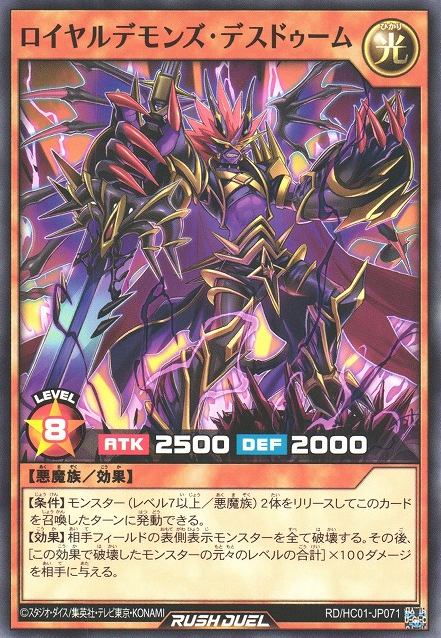
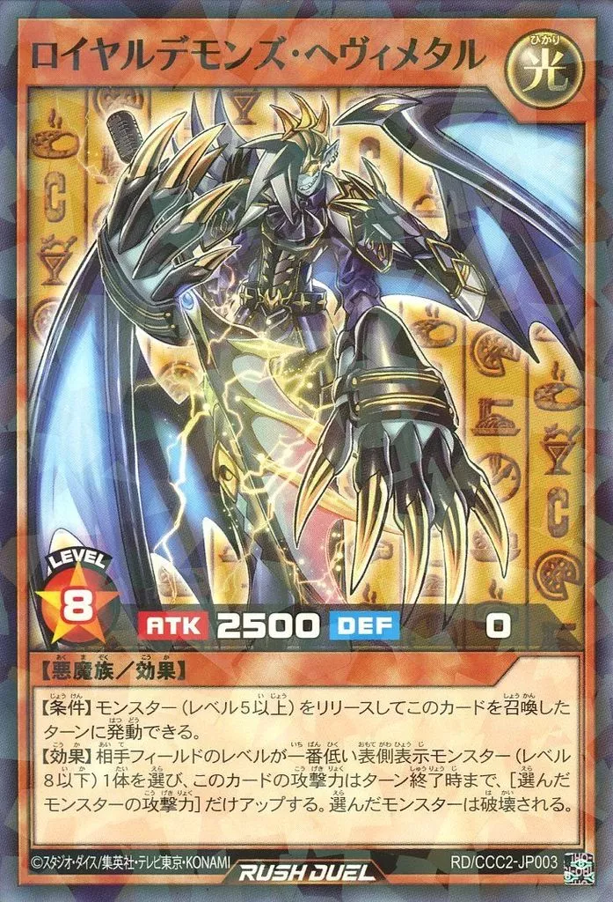
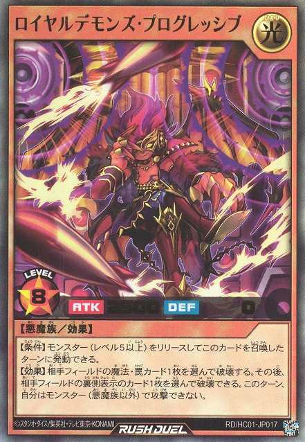
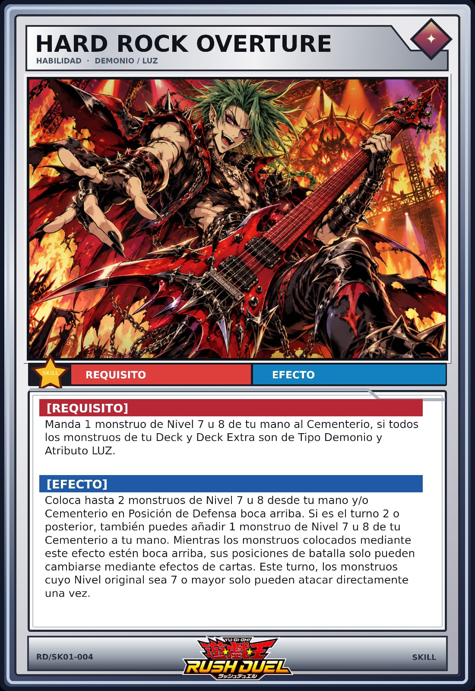
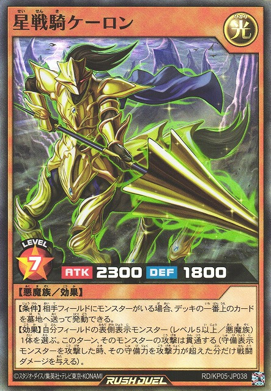

# A10 — Guías visuales documentales · Royal

> Guía documental: utilizar únicamente secuencias con condiciones y restricciones comprobadas.

- Deck ID: `705`. Formato declarado: `RUSH`.
- Rutas visualizadas en esta entrega: **4**.
- Los pasos, movimientos y zonas se cotejan con la ficha A09; no asumir respuestas no descritas.
- Un estado desconocido se conserva como no documentado: nunca se inventa.

## OVERTURE · DEATHDOOM01 · `705:A09:OVERTURE:DEATHDOOM01`

**Propósito competitivo principal (lectura documental):** Ofensivo. El objetivo solo se acredita si las acciones y el campo final detallados en esta guía lo permiten; no implica legalidad certificada ni garantiza el resultado ante respuestas adversarias.

**Categoría:** APERTURA

**Propósito y resultado documental:**

Campo final: Death Doom ATK 2500 propio; monstruo rival Nivel 4 destruido en GY; Heavy Metal y Progrock en GY, mano inicial vacía. No hay segundo jefe ni Extra invocado. La Skill restringe a los monstruos cuyo Nivel original es 7+ a atacar directamente solo una vez durante este turno; no atribuir ataques adicionales.

### Mano y estado inicial

Royal Rebel's Death Doom / Metal Maldito del Rebelde Real (16331, Demonio LUZ Nivel 8); Royal Rebel's Heavy Metal (15441, Demonio LUZ Nivel 8) y Royal Rebel's Progrock/Progressive (19761, Demonio LUZ Nivel 8). Campo/GY propios vacíos, propia Main Phase en turno de duelo 2 o posterior. Skill casera HARD ROCK OVERTURE disponible fuera del Main. Rival controla 1 monstruo boca arriba Nivel 4 sin protección ni respuestas en la secuencia base.

 **Metal Maldito del Rebelde Real**
 **Heavy Metal del Rebelde Real**
 **Progrock del Rebelde Real**

### Ejecución numerada

#### Paso 1 — Activar HARD ROCK OVERTURE: mandar Death Doom Nivel 8 desde la mano al GY como requisito.

 **ENVIAR** →  **ESTADO / CONTEXTO** →  **ESTADO / CONTEXTO**

**Acción concreta:** Activar HARD ROCK OVERTURE: mandar Death Doom Nivel 8 desde la mano al GY como requisito.
**Detalle técnico documentado:** Mano Heavy Metal + Progrock; GY Death Doom.

**Estado por zonas después del paso:**

| Zona/recurso | Estado narrativo A09 |
|---|---|
| Mano | Heavy Metal #15441 y Progrock #19761 |
| Monstruos | — |
| Mágicas y trampas | — |
| Cementerio | Death Doom #16331 en GY por Skill |
| Destierro propio | — |
| Campo y estado rival | Monstruo rival boca arriba Nivel 4, identidad no definida; intacto |
| Materiales Xyz/Fusión/Sincro | — |
| Normal, Extra, fase y restricciones | Skill HARD ROCK OVERTURE local usada; Rush permite posteriores Normales; Extra vacío |

**Campo visual de este paso:**

**Monstruos propios:** sin carta propia demostrada en esta vista.
**Mágicas/Trampas/Campo:** sin carta propia demostrada en esta vista.
*Relación ilustrada de cartas presentes tras este paso, documentada en A09. La posición, materiales, otras zonas y rival se leen en la tabla de estado.*

#### Paso 2 — Aplicar la Skill para colocar a Heavy Metal y Progrock desde la mano al Campo en Defensa boca arriba (efecto de Skill, no Invocación por Sacrificio).

 **COLOCAR** →  **COLOCAR** →  **ESTADO / CONTEXTO**

**Acción concreta:** Aplicar la Skill para colocar a Heavy Metal y Progrock desde la mano al Campo en Defensa boca arriba (efecto de Skill, no Invocación por Sacrificio).
**Detalle técnico documentado:** Dos Demonios Nivel 8 en Campo; mano vacía; Death Doom en GY. No cambiar sus posiciones manualmente.

**Estado por zonas después del paso:**

| Zona/recurso | Estado narrativo A09 |
|---|---|
| Mano | — |
| Monstruos | Heavy Metal #15441 (Defensa boca arriba), Progrock #19761 (Defensa boca arriba) |
| Mágicas y trampas | — |
| Cementerio | Death Doom #16331 en GY |
| Destierro propio | — |
| Campo y estado rival | Rival conserva monstruo Nivel 4 boca arriba |
| Materiales Xyz/Fusión/Sincro | No son materiales Xyz; cuerpos colocados por Skill |
| Normal, Extra, fase y restricciones | Skill usada; Invocación por Sacrificio todavía no realizada; Extra vacío |

**Campo visual de este paso:**

**Monstruos propios:**
-  **Heavy Metal (Defensa boca arriba)** — zona declarada: `MONSTER`.
-  **Progrock (Defensa boca arriba)** — zona declarada: `MONSTER`.
**Mágicas/Trampas/Campo:** sin carta propia demostrada en esta vista.
*Relación ilustrada de cartas presentes tras este paso, documentada en A09. La posición, materiales, otras zonas y rival se leen en la tabla de estado.*

#### Paso 3 — Por ser turno 2 o posterior, aplicar la recuperación opcional de Skill para añadir Death Doom del GY a la mano.

 **AÑADIR A MANO**

**Acción concreta:** Por ser turno 2 o posterior, aplicar la recuperación opcional de Skill para añadir Death Doom del GY a la mano.
**Detalle técnico documentado:** Mano Death Doom; dos cuerpos de Nivel 8 en Defensa.

**Estado por zonas después del paso:**

| Zona/recurso | Estado narrativo A09 |
|---|---|
| Mano | Death Doom #16331 recuperado |
| Monstruos | Heavy Metal #15441 (Defensa boca arriba), Progrock #19761 (Defensa boca arriba) |
| Mágicas y trampas | — |
| Cementerio | — |
| Destierro propio | — |
| Campo y estado rival | Rival conserva monstruo Nivel 4 boca arriba |
| Materiales Xyz/Fusión/Sincro | No hay materiales acoplados |
| Normal, Extra, fase y restricciones | Skill usada y recuperación ejecutada; aún se puede Invocar por Sacrificio; Extra vacío |

**Campo visual de este paso:**

**Monstruos propios:**
-  **Heavy Metal (Defensa boca arriba)** — zona declarada: `MONSTER`.
-  **Progrock (Defensa boca arriba)** — zona declarada: `MONSTER`.
**Mágicas/Trampas/Campo:** sin carta propia demostrada en esta vista.
*Relación ilustrada de cartas presentes tras este paso, documentada en A09. La posición, materiales, otras zonas y rival se leen en la tabla de estado.*

#### Paso 4 — Invocar Normalmente por Sacrificio a Death Doom desde mano, Sacrificando los dos monstruos Nivel 8 Demonio del Campo.

 **NORMAL** →  **ESTADO / CONTEXTO** →  **ESTADO / CONTEXTO**

**Acción concreta:** Invocar Normalmente por Sacrificio a Death Doom desde mano, Sacrificando los dos monstruos Nivel 8 Demonio del Campo.
**Detalle técnico documentado:** Death Doom Nivel 8 ATK 2500 en Ataque; Heavy Metal y Progrock en GY. Tributar no equivale a cambiarles posición de batalla.

**Estado por zonas después del paso:**

| Zona/recurso | Estado narrativo A09 |
|---|---|
| Mano | — |
| Monstruos | Death Doom #16331 (Ataque, 2500 ATK; Invocado por Sacrificio) |
| Mágicas y trampas | — |
| Cementerio | Heavy Metal #15441 y Progrock #19761 en GY |
| Destierro propio | — |
| Campo y estado rival | Monstruo rival Nivel 4 boca arriba sigue en Campo |
| Materiales Xyz/Fusión/Sincro | Dos Demonios Nivel 8 tributados desde Campo; no quedan independientes ni acoplados |
| Normal, Extra, fase y restricciones | Rush: Invocación por Sacrificio realizada; Skill usada; Extra vacío |

**Campo visual de este paso:**

**Monstruos propios:**
-  **Death Doom (Ataque, 2500 ATK; Invocado por Sacrificio)** — zona declarada: `MONSTER`.
**Mágicas/Trampas/Campo:** sin carta propia demostrada en esta vista.
*Relación ilustrada de cartas presentes tras este paso, documentada en A09. La posición, materiales, otras zonas y rival se leen en la tabla de estado.*

#### Paso 5 — Activar el efecto de Death Doom en este turno, pues fue Invocado por Sacrificio usando dos Demonios Nivel 7+.

 **ACTIVAR**

**Acción concreta:** Activar el efecto de Death Doom en este turno, pues fue Invocado por Sacrificio usando dos Demonios Nivel 7+.
**Detalle técnico documentado:** Destruye todos los monstruos rivales boca arriba. Con el único monstruo rival de Nivel 4 del supuesto, inflige 400 de daño (suma de niveles originales destruidos × 100).

**Estado por zonas después del paso:**

| Zona/recurso | Estado narrativo A09 |
|---|---|
| Mano | — |
| Monstruos | Death Doom #16331 (Ataque, 2500 ATK) |
| Mágicas y trampas | — |
| Cementerio | Heavy Metal y Progrock en GY |
| Destierro propio | — |
| Campo y estado rival | Monstruo rival Nivel 4 destruido y enviado a su GY; recibió 400 LP de daño por efecto bajo apertura fija |
| Materiales Xyz/Fusión/Sincro | Tributos ya en GY, sin materiales Xyz |
| Normal, Extra, fase y restricciones | Skill usada; Extra vacío; restricción local de ataque directo de Nivel original 7+ vigente este turno |

**Campo visual de este paso:**

**Monstruos propios:**
-  **Death Doom (Ataque, 2500 ATK)** — zona declarada: `MONSTER`.
**Mágicas/Trampas/Campo:** sin carta propia demostrada en esta vista.
*Relación ilustrada de cartas presentes tras este paso, documentada en A09. La posición, materiales, otras zonas y rival se leen en la tabla de estado.*

### Campo final documentado

Esta vista procede **del último paso**, no de una lista de cartas deducida del título.

**Monstruos propios:**
-  **Death Doom (Ataque, 2500 ATK)** — zona declarada: `MONSTER`.
**Mágicas/Trampas/Campo:** sin carta propia demostrada en esta vista.
*Relación ilustrada de cartas presentes tras este paso, documentada en A09. La posición, materiales, otras zonas y rival se leen en la tabla de estado.*

| Zona/recurso | Estado final documentado |
|---|---|
| Mano | — |
| Monstruos | Death Doom #16331 (Ataque, 2500 ATK) |
| Mágicas y trampas | — |
| Cementerio | Heavy Metal y Progrock en GY |
| Destierro propio | — |
| Campo y estado rival | Monstruo rival Nivel 4 destruido y enviado a su GY; recibió 400 LP de daño por efecto bajo apertura fija |
| Materiales Xyz/Fusión/Sincro | Tributos ya en GY, sin materiales Xyz |
| Normal, Extra, fase y restricciones | Skill usada; Extra vacío; restricción local de ataque directo de Nivel original 7+ vigente este turno |

### Si el oponente interrumpe

- **INTERRUPCIÓN A12 — paso 4: A12 — Agujero Trampa sobre Death Doom en el paso 4**
  - Rama distinta de la ruta sin rival: el oponente conserva 1 Agujero Trampa (Rush CID 15913) Colocada desde antes del turno y la activa al Invocarse Normalmente Death Doom con ATK 2500 en el paso 4. La Trampa destruye al monstruo invocado en la ventana Rush correspondiente, antes de que pueda activar su efecto en la Main Phase.
  - El jefe va al GY; no ocurrió destrucción masiva ni daño de 400 por su efecto. Los Sacrificios Heavy Metal y Progrock ya permanecen en el GY. La Skill no protege al jefe: su restricción de posiciones se aplicaba a los dos monstruos colocados, no al nuevo Death Doom.
  - Agujero Trampa Rush y Death Doom..
  - Estado de rama: `Resuelto solo en el escenario que detalla A12/A13; las otras respuestas no están demostradas.`.

---

## OVERTURE · HEAVY01 · `705:A09:OVERTURE:HEAVY01`

**Propósito competitivo principal (lectura documental):** Ofensivo. El objetivo solo se acredita si las acciones y el campo final detallados en esta guía lo permiten; no implica legalidad certificada ni garantiza el resultado ante respuestas adversarias.

**Categoría:** APERTURA

**Propósito y resultado documental:**

HEAVY01 | Exactamente 1 monstruo rival boca arriba Nivel 4, ATK 1600, sin protección. | Heavy Metal elige al monstruo de Nivel más bajo entre los boca arriba Nivel 8 o menos; gana 1600 ATK hasta fin de turno y lo destruye. | Heavy Metal propio 4100 ATK temporal, monstruo rival destruido; Progrock + Death Doom en GY, Skill usada, mano vacía.

### Mano y estado inicial

1× Heavy Metal (CID 15441), 1× Progrock/Progressive (CID 19761), 1× Death Doom (CID 16331), todos Demonio/LUZ Nivel 8 del Main. Propia Main Phase en turno 2 o posterior, campo y GY propios vacíos, Skill HARD ROCK OVERTURE disponible; sin respuestas del rival en el caso base. Estas dos salidas son excluyentes, no se invocan simultáneamente con esas tres cartas.

 **Heavy Metal del Rebelde Real**
 **Progrock del Rebelde Real**
 **Metal Maldito del Rebelde Real**

### Ejecución numerada

#### Paso 1 — Activar HARD ROCK OVERTURE en Main Phase del turno 2 o posterior: enviar Heavy Metal desde mano al GY según la Skill local.

 **ENVIAR** →  **REFERENCIA A09**

**Acción concreta:** Activar HARD ROCK OVERTURE en Main Phase del turno 2 o posterior: enviar Heavy Metal desde mano al GY según la Skill local.
**Detalle técnico documentado:** No documentado

**Estado por zonas después del paso:**

| Zona/recurso | Estado narrativo A09 |
|---|---|
| Mano | Progrock #19761 y Death Doom #16331 |
| Monstruos | — |
| Mágicas y trampas | — |
| Cementerio | Heavy Metal #15441 en GY por Skill |
| Destierro propio | — |
| Campo y estado rival | Monstruo rival Nivel 4 boca arriba de 1600 ATK sigue intacto |
| Materiales Xyz/Fusión/Sincro | — |
| Normal, Extra, fase y restricciones | Skill HARD ROCK OVERTURE local usada; Rush conserva posibilidad de Normal; Extra vacío |

**Campo visual de este paso:**

**Monstruos propios:** sin carta propia demostrada en esta vista.
**Mágicas/Trampas/Campo:** sin carta propia demostrada en esta vista.
*Relación ilustrada de cartas presentes tras este paso, documentada en A09. La posición, materiales, otras zonas y rival se leen en la tabla de estado.*

#### Paso 2 — Aplicar la Skill para poner Progrock y Death Doom boca arriba en Defensa desde la mano al Campo.

 **YA EN CAMPO** →  **YA EN CAMPO**

**Acción concreta:** Aplicar la Skill para poner Progrock y Death Doom boca arriba en Defensa desde la mano al Campo. Es Colocación por Skill, no Invocación Normal.
**Detalle técnico documentado:** Es Colocación por Skill, no Invocación Normal.

**Estado por zonas después del paso:**

| Zona/recurso | Estado narrativo A09 |
|---|---|
| Mano | — |
| Monstruos | Progrock #19761 (Defensa boca arriba), Death Doom #16331 (Defensa boca arriba) |
| Mágicas y trampas | — |
| Cementerio | Heavy Metal en GY |
| Destierro propio | — |
| Campo y estado rival | Rival conserva monstruo Nivel 4 boca arriba de 1600 ATK |
| Materiales Xyz/Fusión/Sincro | Cuerpos propios colocados por Skill, sin materiales Xyz |
| Normal, Extra, fase y restricciones | Skill usada; no se ha tributado; Extra vacío |

**Campo visual de este paso:**

**Monstruos propios:**
-  **Progrock (Defensa boca arriba)** — zona declarada: `MONSTER`.
-  **Death Doom (Defensa boca arriba)** — zona declarada: `MONSTER`.
**Mágicas/Trampas/Campo:** sin carta propia demostrada en esta vista.
*Relación ilustrada de cartas presentes tras este paso, documentada en A09. La posición, materiales, otras zonas y rival se leen en la tabla de estado.*

#### Paso 3 — Activar la recuperación de la Skill para devolver Heavy Metal del GY a la mano, cumpliendo turno 2+ y límites de uso.

 **ACTIVAR**

**Acción concreta:** Activar la recuperación de la Skill para devolver Heavy Metal del GY a la mano, cumpliendo turno 2+ y límites de uso.
**Detalle técnico documentado:** No documentado

**Estado por zonas después del paso:**

| Zona/recurso | Estado narrativo A09 |
|---|---|
| Mano | Heavy Metal #15441 recuperado |
| Monstruos | Progrock #19761 (Defensa boca arriba), Death Doom #16331 (Defensa boca arriba) |
| Mágicas y trampas | — |
| Cementerio | — |
| Destierro propio | — |
| Campo y estado rival | Monstruo rival de 1600 ATK continúa boca arriba |
| Materiales Xyz/Fusión/Sincro | — |
| Normal, Extra, fase y restricciones | Skill usada; Invocación por Sacrificio todavía posible; Extra vacío |

**Campo visual de este paso:**

**Monstruos propios:**
-  **Progrock (Defensa boca arriba)** — zona declarada: `MONSTER`.
-  **Death Doom (Defensa boca arriba)** — zona declarada: `MONSTER`.
**Mágicas/Trampas/Campo:** sin carta propia demostrada en esta vista.
*Relación ilustrada de cartas presentes tras este paso, documentada en A09. La posición, materiales, otras zonas y rival se leen en la tabla de estado.*

#### Paso 4 — Sacrificar los dos Demonios de Nivel 8 que permanecen en Campo e Invocar por Sacrificio a Heavy Metal desde la mano en Ataque.

 **SACRIFICIO**

**Acción concreta:** Sacrificar los dos Demonios de Nivel 8 que permanecen en Campo e Invocar por Sacrificio a Heavy Metal desde la mano en Ataque.
**Detalle técnico documentado:** No documentado

**Estado por zonas después del paso:**

| Zona/recurso | Estado narrativo A09 |
|---|---|
| Mano | — |
| Monstruos | Heavy Metal #15441 (Ataque, 2500 ATK por Sacrificio) |
| Mágicas y trampas | — |
| Cementerio | Progrock #19761 y Death Doom #16331 en GY |
| Destierro propio | — |
| Campo y estado rival | Monstruo rival boca arriba Nivel 4 con 1600 ATK aún presente |
| Materiales Xyz/Fusión/Sincro | Dos Demonios Nivel 8 tributados, no materiales Xyz |
| Normal, Extra, fase y restricciones | Rush: jefe Invocado por Sacrificio; Skill usada; Extra vacío |

**Campo visual de este paso:**

**Monstruos propios:**
-  **Heavy Metal (Ataque, 2500 ATK por Sacrificio)** — zona declarada: `MONSTER`.
**Mágicas/Trampas/Campo:** sin carta propia demostrada en esta vista.
*Relación ilustrada de cartas presentes tras este paso, documentada en A09. La posición, materiales, otras zonas y rival se leen en la tabla de estado.*

#### Paso 5 — Si el rival controla el monstruo Nivel 4 de 1600 ATK definido en A09, Heavy Metal lo destruye y gana 1600 ATK hasta fin de turno, quedando en 4100 ATK.

 **ESTADO / CONTEXTO**

**Acción concreta:** Si el rival controla el monstruo Nivel 4 de 1600 ATK definido en A09, Heavy Metal lo destruye y gana 1600 ATK hasta fin de turno, quedando en 4100 ATK.
**Detalle técnico documentado:** No documentado

**Estado por zonas después del paso:**

| Zona/recurso | Estado narrativo A09 |
|---|---|
| Mano | — |
| Monstruos | Heavy Metal #15441 (Ataque, 4100 ATK temporal hasta fin de turno) |
| Mágicas y trampas | — |
| Cementerio | Progrock y Death Doom en GY |
| Destierro propio | — |
| Campo y estado rival | Monstruo rival de Nivel 4 y 1600 ATK destruido por efecto; no hubo batalla ni daño garantizado |
| Materiales Xyz/Fusión/Sincro | Sacrificios anteriores en GY; sin Xyz |
| Normal, Extra, fase y restricciones | Skill usada; solo un ataque directo para Nivel original 7+ por restricción local este turno; Extra vacío |

**Campo visual de este paso:**

**Monstruos propios:**
-  **Heavy Metal (Ataque, 4100 ATK temporal hasta fin de turno)** — zona declarada: `MONSTER`.
**Mágicas/Trampas/Campo:** sin carta propia demostrada en esta vista.
*Relación ilustrada de cartas presentes tras este paso, documentada en A09. La posición, materiales, otras zonas y rival se leen en la tabla de estado.*

### Campo final documentado

Esta vista procede **del último paso**, no de una lista de cartas deducida del título.

**Monstruos propios:**
-  **Heavy Metal (Ataque, 4100 ATK temporal hasta fin de turno)** — zona declarada: `MONSTER`.
**Mágicas/Trampas/Campo:** sin carta propia demostrada en esta vista.
*Relación ilustrada de cartas presentes tras este paso, documentada en A09. La posición, materiales, otras zonas y rival se leen en la tabla de estado.*

| Zona/recurso | Estado final documentado |
|---|---|
| Mano | — |
| Monstruos | Heavy Metal #15441 (Ataque, 4100 ATK temporal hasta fin de turno) |
| Mágicas y trampas | — |
| Cementerio | Progrock y Death Doom en GY |
| Destierro propio | — |
| Campo y estado rival | Monstruo rival de Nivel 4 y 1600 ATK destruido por efecto; no hubo batalla ni daño garantizado |
| Materiales Xyz/Fusión/Sincro | Sacrificios anteriores en GY; sin Xyz |
| Normal, Extra, fase y restricciones | Skill usada; solo un ataque directo para Nivel original 7+ por restricción local este turno; Extra vacío |

### Si el oponente interrumpe

- **INTERRUPCIÓN A12 — paso 4: A12 — Agujero Trampa ante Heavy Metal / Progrock en el paso 4**
  - Rama HEAVY01: el oponente mantiene Agujero Trampa Rush (15913) Colocada desde un turno previo. Al Invocarse Normalmente Heavy Metal de 2500 ATK en el paso 4, activa Agujero Trampa y lo destruye antes de que Heavy active su efecto. El monstruo rival original Nivel 4 / 1600 ATK permanece; no existe aumento a 4100 ATK. Death Doom, Progrock y Heavy están en GY; mano vacía.
  - Rama PROGROCK01: ocurre lo mismo ante la Invocación Normal de Progrock de 2500 ATK. El jefe es destruido antes de su efecto; la M/T y el monstruo boca abajo rivales permanecen; Heavy, Death Doom y Progrock quedan en GY; mano vacía.
  - La Trampa no puede activarse por la colocación en Defensa de los dos materiales por Skill: no es una Invocación Normal.; no implican dos tipos de respuesta distintos.
  - Estado de rama: `Resuelto solo en el escenario que detalla A12/A13; las otras respuestas no están demostradas.`.
- **RECUPERACIÓN A13 — paso sin anclaje confirmado: A13 — Elección del jefe y fallo por Agujero Trampa**
  - Variante de elección con idéntica mano: la Skill devuelve a la mano solo el jefe enviado en el paso 1, por lo que HEAVY01, PROGROCK01 y DEATHDOOM01 son tres desenlaces mutuamente excluyentes. Heavy castiga monstruo boca arriba de menor Nivel; Progrock retira M/T y después otra carta boca abajo; Death Doom destruye monstruos boca arriba al satisfacer los dos Sacrificios altos.
  - Ante Agujero Trampa: en las rutas Heavy y Progrock el rival conserva sus blancos, porque la Trampa destruye el jefe antes de la activación de su efecto. Con la mano mínima de tres cartas, todos los monstruos utilizados acaban en GY y el campo propio queda vacío. No atribuir resurrección ni cambio de objetivo sin recurso adicional.; recuperación ofensiva no demostrada.
  - Estado de rama: `Resuelto solo en el escenario que detalla A12/A13; las otras respuestas no están demostradas.`.

---

## OVERTURE · PROGROCK01 · `705:A09:OVERTURE:PROGROCK01`

**Propósito competitivo principal (lectura documental):** Ofensivo. El objetivo solo se acredita si las acciones y el campo final detallados en esta guía lo permiten; no implica legalidad certificada ni garantiza el resultado ante respuestas adversarias.

**Categoría:** APERTURA

**Propósito y resultado documental:**

PROGROCK01 | Una M/T rival Colocada y un monstruo rival boca abajo; sin protección. | Progrock destruye primero la M/T elegida; después puede destruir la carta boca abajo restante (el monstruo). Este turno no pueden atacar monstruos propios que no sean Demonio. | Progrock propio 2500 ATK, ambas cartas rivales en sus destinos después de la destrucción; Heavy Metal + Death Doom en GY, Skill usada, mano vacía.

### Mano y estado inicial

1× Heavy Metal (CID 15441), 1× Progrock/Progressive (CID 19761), 1× Death Doom (CID 16331), todos Demonio/LUZ Nivel 8 del Main. Propia Main Phase en turno 2 o posterior, campo y GY propios vacíos, Skill HARD ROCK OVERTURE disponible; sin respuestas del rival en el caso base. Estas dos salidas son excluyentes, no se invocan simultáneamente con esas tres cartas.

 **Heavy Metal del Rebelde Real**
 **Progrock del Rebelde Real**
 **Metal Maldito del Rebelde Real**

### Ejecución numerada

#### Paso 1 — Activar HARD ROCK OVERTURE en Main Phase del turno 2 o posterior: enviar Progrock desde mano al GY según la Skill local.

 **ENVIAR** →  **REFERENCIA A09**

**Acción concreta:** Activar HARD ROCK OVERTURE en Main Phase del turno 2 o posterior: enviar Progrock desde mano al GY según la Skill local.
**Detalle técnico documentado:** No documentado

**Estado por zonas después del paso:**

| Zona/recurso | Estado narrativo A09 |
|---|---|
| Mano | Heavy Metal #15441 y Death Doom #16331 |
| Monstruos | — |
| Mágicas y trampas | — |
| Cementerio | Progrock #19761 en GY por Skill |
| Destierro propio | — |
| Campo y estado rival | Rival mantiene M/T colocada y monstruo boca abajo de identidades desconocidas |
| Materiales Xyz/Fusión/Sincro | — |
| Normal, Extra, fase y restricciones | Skill HARD ROCK OVERTURE local usada; Rush permite Normal posterior; Extra vacío |

**Campo visual de este paso:**

**Monstruos propios:** sin carta propia demostrada en esta vista.
**Mágicas/Trampas/Campo:** sin carta propia demostrada en esta vista.
*Relación ilustrada de cartas presentes tras este paso, documentada en A09. La posición, materiales, otras zonas y rival se leen en la tabla de estado.*

#### Paso 2 — Aplicar la Skill para poner Heavy Metal y Death Doom boca arriba en Defensa desde la mano al Campo.

 **YA EN CAMPO** →  **YA EN CAMPO**

**Acción concreta:** Aplicar la Skill para poner Heavy Metal y Death Doom boca arriba en Defensa desde la mano al Campo. Es Colocación por Skill, no Invocación Normal.
**Detalle técnico documentado:** Es Colocación por Skill, no Invocación Normal.

**Estado por zonas después del paso:**

| Zona/recurso | Estado narrativo A09 |
|---|---|
| Mano | — |
| Monstruos | Heavy Metal #15441 (Defensa boca arriba), Death Doom #16331 (Defensa boca arriba) |
| Mágicas y trampas | — |
| Cementerio | Progrock en GY |
| Destierro propio | — |
| Campo y estado rival | M/T rival colocada y monstruo rival boca abajo siguen presentes |
| Materiales Xyz/Fusión/Sincro | Dos cuerpos propios por Skill, no Xyz |
| Normal, Extra, fase y restricciones | Skill usada; sin Sacrificio todavía; Extra vacío |

**Campo visual de este paso:**

**Monstruos propios:**
-  **Heavy Metal (Defensa boca arriba)** — zona declarada: `MONSTER`.
-  **Death Doom (Defensa boca arriba)** — zona declarada: `MONSTER`.
**Mágicas/Trampas/Campo:** sin carta propia demostrada en esta vista.
*Relación ilustrada de cartas presentes tras este paso, documentada en A09. La posición, materiales, otras zonas y rival se leen en la tabla de estado.*

#### Paso 3 — Activar la recuperación de la Skill para devolver Progrock del GY a la mano, cumpliendo turno 2+ y límites de uso.

 **ACTIVAR**

**Acción concreta:** Activar la recuperación de la Skill para devolver Progrock del GY a la mano, cumpliendo turno 2+ y límites de uso.
**Detalle técnico documentado:** No documentado

**Estado por zonas después del paso:**

| Zona/recurso | Estado narrativo A09 |
|---|---|
| Mano | Progrock #19761 recuperado |
| Monstruos | Heavy Metal #15441 (Defensa boca arriba), Death Doom #16331 (Defensa boca arriba) |
| Mágicas y trampas | — |
| Cementerio | — |
| Destierro propio | — |
| Campo y estado rival | Siguen una M/T colocada y un monstruo rival boca abajo |
| Materiales Xyz/Fusión/Sincro | — |
| Normal, Extra, fase y restricciones | Skill usada; se puede Invocar por Sacrificio; Extra vacío |

**Campo visual de este paso:**

**Monstruos propios:**
-  **Heavy Metal (Defensa boca arriba)** — zona declarada: `MONSTER`.
-  **Death Doom (Defensa boca arriba)** — zona declarada: `MONSTER`.
**Mágicas/Trampas/Campo:** sin carta propia demostrada en esta vista.
*Relación ilustrada de cartas presentes tras este paso, documentada en A09. La posición, materiales, otras zonas y rival se leen en la tabla de estado.*

#### Paso 4 — Sacrificar los dos Demonios de Nivel 8 que permanecen en Campo e Invocar por Sacrificio a Progrock desde la mano en Ataque.

 **SACRIFICIO**

**Acción concreta:** Sacrificar los dos Demonios de Nivel 8 que permanecen en Campo e Invocar por Sacrificio a Progrock desde la mano en Ataque.
**Detalle técnico documentado:** No documentado

**Estado por zonas después del paso:**

| Zona/recurso | Estado narrativo A09 |
|---|---|
| Mano | — |
| Monstruos | Progrock #19761 (Ataque, 2500 ATK tras Sacrificio) |
| Mágicas y trampas | — |
| Cementerio | Heavy Metal #15441 y Death Doom #16331 en GY |
| Destierro propio | — |
| Campo y estado rival | Una M/T colocada y monstruo boca abajo todavía presentes |
| Materiales Xyz/Fusión/Sincro | Dos Nivel 8 sacrificados; no materiales Xyz |
| Normal, Extra, fase y restricciones | Rush: jefe Invocado por Sacrificio; Skill usada; Extra vacío |

**Campo visual de este paso:**

**Monstruos propios:**
-  **Progrock (Ataque, 2500 ATK tras Sacrificio)** — zona declarada: `MONSTER`.
**Mágicas/Trampas/Campo:** sin carta propia demostrada en esta vista.
*Relación ilustrada de cartas presentes tras este paso, documentada en A09. La posición, materiales, otras zonas y rival se leen en la tabla de estado.*

#### Paso 5 — Si rival controla la M/T y una carta boca abajo definidas en A09, Progrock destruye la M/T y puede destruir después la otra carta boca abajo.

 **ESTADO / CONTEXTO**

**Acción concreta:** Si rival controla la M/T y una carta boca abajo definidas en A09, Progrock destruye la M/T y puede destruir después la otra carta boca abajo. No inferir blancos inexistentes.
**Detalle técnico documentado:** No inferir blancos inexistentes.

**Estado por zonas después del paso:**

| Zona/recurso | Estado narrativo A09 |
|---|---|
| Mano | — |
| Monstruos | Progrock #19761 (Ataque, 2500 ATK) |
| Mágicas y trampas | — |
| Cementerio | Heavy Metal y Death Doom en GY |
| Destierro propio | — |
| Campo y estado rival | M/T rival colocada destruida; monstruo boca abajo destruido si continuó siendo un blanco elegible, sin identidades inventadas |
| Materiales Xyz/Fusión/Sincro | No hay materiales Xyz; las cartas rivales destruidas van a sus destinos según reglas y efectos aplicables |
| Normal, Extra, fase y restricciones | Skill usada; tras efecto solo Demonios propios pueden atacar este turno; Extra vacío |

**Campo visual de este paso:**

**Monstruos propios:**
-  **Progrock (Ataque, 2500 ATK)** — zona declarada: `MONSTER`.
**Mágicas/Trampas/Campo:** sin carta propia demostrada en esta vista.
*Relación ilustrada de cartas presentes tras este paso, documentada en A09. La posición, materiales, otras zonas y rival se leen en la tabla de estado.*

### Campo final documentado

Esta vista procede **del último paso**, no de una lista de cartas deducida del título.

**Monstruos propios:**
-  **Progrock (Ataque, 2500 ATK)** — zona declarada: `MONSTER`.
**Mágicas/Trampas/Campo:** sin carta propia demostrada en esta vista.
*Relación ilustrada de cartas presentes tras este paso, documentada en A09. La posición, materiales, otras zonas y rival se leen en la tabla de estado.*

| Zona/recurso | Estado final documentado |
|---|---|
| Mano | — |
| Monstruos | Progrock #19761 (Ataque, 2500 ATK) |
| Mágicas y trampas | — |
| Cementerio | Heavy Metal y Death Doom en GY |
| Destierro propio | — |
| Campo y estado rival | M/T rival colocada destruida; monstruo boca abajo destruido si continuó siendo un blanco elegible, sin identidades inventadas |
| Materiales Xyz/Fusión/Sincro | No hay materiales Xyz; las cartas rivales destruidas van a sus destinos según reglas y efectos aplicables |
| Normal, Extra, fase y restricciones | Skill usada; tras efecto solo Demonios propios pueden atacar este turno; Extra vacío |

### Si el oponente interrumpe

- **INTERRUPCIÓN A12 — paso 4: A12 — Agujero Trampa ante Heavy Metal / Progrock en el paso 4**
  - Rama HEAVY01: el oponente mantiene Agujero Trampa Rush (15913) Colocada desde un turno previo. Al Invocarse Normalmente Heavy Metal de 2500 ATK en el paso 4, activa Agujero Trampa y lo destruye antes de que Heavy active su efecto. El monstruo rival original Nivel 4 / 1600 ATK permanece; no existe aumento a 4100 ATK. Death Doom, Progrock y Heavy están en GY; mano vacía.
  - Rama PROGROCK01: ocurre lo mismo ante la Invocación Normal de Progrock de 2500 ATK. El jefe es destruido antes de su efecto; la M/T y el monstruo boca abajo rivales permanecen; Heavy, Death Doom y Progrock quedan en GY; mano vacía.
  - La Trampa no puede activarse por la colocación en Defensa de los dos materiales por Skill: no es una Invocación Normal.; no implican dos tipos de respuesta distintos.
  - Estado de rama: `Resuelto solo en el escenario que detalla A12/A13; las otras respuestas no están demostradas.`.
- **RECUPERACIÓN A13 — paso sin anclaje confirmado: A13 — Elección del jefe y fallo por Agujero Trampa**
  - Variante de elección con idéntica mano: la Skill devuelve a la mano solo el jefe enviado en el paso 1, por lo que HEAVY01, PROGROCK01 y DEATHDOOM01 son tres desenlaces mutuamente excluyentes. Heavy castiga monstruo boca arriba de menor Nivel; Progrock retira M/T y después otra carta boca abajo; Death Doom destruye monstruos boca arriba al satisfacer los dos Sacrificios altos.
  - Ante Agujero Trampa: en las rutas Heavy y Progrock el rival conserva sus blancos, porque la Trampa destruye el jefe antes de la activación de su efecto. Con la mano mínima de tres cartas, todos los monstruos utilizados acaban en GY y el campo propio queda vacío. No atribuir resurrección ni cambio de objetivo sin recurso adicional.; recuperación ofensiva no demostrada.
  - Estado de rama: `Resuelto solo en el escenario que detalla A12/A13; las otras respuestas no están demostradas.`.

---

## OVERTURE · KHEIRON01 · `705:A09:OVERTURE:KHEIRON01`

**Propósito competitivo principal (lectura documental):** Preparación de recursos / despliegue. El objetivo solo se acredita si las acciones y el campo final detallados en esta guía lo permiten; no implica legalidad certificada ni garantiza el resultado ante respuestas adversarias.

**Categoría:** APERTURA

**Propósito y resultado documental:**

Resultado: propio Kheiron 2300 ATK en campo, con penetración solo durante el turno; Heavy y Progrock en GY, más la carta superior del Deck de identidad desconocida; mano de tres cartas vacía; rival sin su monstruo DEF 500 y con 1800 LP menos si se llegó legalmente a batalla. No equivale a victoria garantizada. Kheiron oficial.;.

### Mano y estado inicial

Kheiron el Caballero Estelar (CID 16344, Demonio/LUZ Nivel 7 ATK 2300), Heavy Metal (15441, Nivel 8) y Progrock (19761, Nivel 8) en mano; campo/GY propios vacíos; Skill disponible, Main Phase del turno 2 o posterior y al menos una carta en el Deck. Rival con un monstruo en Defensa boca arriba de DEF 500, sin protección ni respuesta a la secuencia y al ataque.

 **Kheiron el Caballero Estelar**
 **Heavy Metal del Rebelde Real**
 **Progrock del Rebelde Real**

### Ejecución numerada

#### Paso 1 — Por la Skill, enviar Kheiron de mano al GY; colocar Heavy Metal + Progrock en Defensa boca arriba en el campo.

 **ENVIAR** →  **COLOCAR** →  **COLOCAR**

**Acción concreta:** Por la Skill, enviar Kheiron de mano al GY; colocar Heavy Metal + Progrock en Defensa boca arriba en el campo.
**Detalle técnico documentado:** No documentado

**Estado por zonas después del paso:**

| Zona/recurso | Estado narrativo A09 |
|---|---|
| Mano | — |
| Monstruos | Heavy Metal #15441 (Defensa boca arriba), Progrock #19761 (Defensa boca arriba) |
| Mágicas y trampas | — |
| Cementerio | Kheiron #16344 en GY por Skill |
| Destierro propio | — |
| Campo y estado rival | Rival controla monstruo en Defensa boca arriba de DEF 500 |
| Materiales Xyz/Fusión/Sincro | Dos cuerpos colocados por Skill; sin Xyz |
| Normal, Extra, fase y restricciones | Skill HARD ROCK OVERTURE local usada; Rush permite Invocación por Sacrificio; Extra vacío |

**Campo visual de este paso:**

**Monstruos propios:**
-  **Heavy Metal (Defensa boca arriba)** — zona declarada: `MONSTER`.
-  **Progrock (Defensa boca arriba)** — zona declarada: `MONSTER`.
**Mágicas/Trampas/Campo:** sin carta propia demostrada en esta vista.
*Relación ilustrada de cartas presentes tras este paso, documentada en A09. La posición, materiales, otras zonas y rival se leen en la tabla de estado.*

#### Paso 2 — Recuperar Kheiron del GY a la mano usando la opción de la Skill habilitada desde turno 2.

 **RECUPERAR**

**Acción concreta:** Recuperar Kheiron del GY a la mano usando la opción de la Skill habilitada desde turno 2.
**Detalle técnico documentado:** No documentado

**Estado por zonas después del paso:**

| Zona/recurso | Estado narrativo A09 |
|---|---|
| Mano | Kheiron #16344 recuperado |
| Monstruos | Heavy Metal #15441 (Defensa boca arriba), Progrock #19761 (Defensa boca arriba) |
| Mágicas y trampas | — |
| Cementerio | — |
| Destierro propio | — |
| Campo y estado rival | Rival mantiene monstruo DEF 500 en Defensa |
| Materiales Xyz/Fusión/Sincro | — |
| Normal, Extra, fase y restricciones | Skill usada; jefe todavía no Invocado; Extra vacío |

**Campo visual de este paso:**

**Monstruos propios:**
-  **Heavy Metal (Defensa boca arriba)** — zona declarada: `MONSTER`.
-  **Progrock (Defensa boca arriba)** — zona declarada: `MONSTER`.
**Mágicas/Trampas/Campo:** sin carta propia demostrada en esta vista.
*Relación ilustrada de cartas presentes tras este paso, documentada en A09. La posición, materiales, otras zonas y rival se leen en la tabla de estado.*

#### Paso 3 — Sacrificar los dos Nivel 8 para Invocar Normalmente por Sacrificio Kheiron en Ataque; Heavy y Progrock van al GY.

 **SACRIFICIO** →  **ESTADO / CONTEXTO**

**Acción concreta:** Sacrificar los dos Nivel 8 para Invocar Normalmente por Sacrificio Kheiron en Ataque; Heavy y Progrock van al GY.
**Detalle técnico documentado:** No documentado

**Estado por zonas después del paso:**

| Zona/recurso | Estado narrativo A09 |
|---|---|
| Mano | — |
| Monstruos | Kheiron #16344 (Ataque, 2300 ATK tras Sacrificio) |
| Mágicas y trampas | — |
| Cementerio | Heavy Metal #15441 y Progrock #19761 en GY |
| Destierro propio | — |
| Campo y estado rival | Rival mantiene monstruo en Defensa boca arriba DEF 500 |
| Materiales Xyz/Fusión/Sincro | Dos cuerpos tributados, no materiales Xyz |
| Normal, Extra, fase y restricciones | Rush: Invocación por Sacrificio realizada; Skill usada; Extra vacío |

**Campo visual de este paso:**

**Monstruos propios:**
-  **Kheiron (Ataque, 2300 ATK tras Sacrificio)** — zona declarada: `MONSTER`.
**Mágicas/Trampas/Campo:** sin carta propia demostrada en esta vista.
*Relación ilustrada de cartas presentes tras este paso, documentada en A09. La posición, materiales, otras zonas y rival se leen en la tabla de estado.*

#### Paso 4 — Activar el efecto de Kheiron porque el adversario controla un monstruo.

 **ACTIVAR**

**Acción concreta:** Activar el efecto de Kheiron porque el adversario controla un monstruo; enviar la carta superior del Deck al GY como requisito y elegir a Kheiron mismo, Demonio boca arriba Nivel 7, para otorgarle penetración de batalla este turno.
**Detalle técnico documentado:** enviar la carta superior del Deck al GY como requisito y elegir a Kheiron mismo, Demonio boca arriba Nivel 7, para otorgarle penetración de batalla este turno.

**Estado por zonas después del paso:**

| Zona/recurso | Estado narrativo A09 |
|---|---|
| Mano | — |
| Monstruos | Kheiron #16344 (Ataque, 2300 ATK, con penetración temporal) |
| Mágicas y trampas | — |
| Cementerio | Heavy Metal, Progrock y una carta superior del Deck de identidad desconocida en GY |
| Destierro propio | — |
| Campo y estado rival | Rival todavía controla monstruo en Defensa de DEF 500; no hubo ataque |
| Materiales Xyz/Fusión/Sincro | Sin materiales Xyz; Kheiron recibió penetración por efecto |
| Normal, Extra, fase y restricciones | Skill usada; la Battle Phase aún no comenzó; Extra vacío |

**Campo visual de este paso:**

**Monstruos propios:**
-  **Kheiron (Ataque, 2300 ATK, con penetración temporal)** — zona declarada: `MONSTER`.
**Mágicas/Trampas/Campo:** sin carta propia demostrada en esta vista.
*Relación ilustrada de cartas presentes tras este paso, documentada en A09. La posición, materiales, otras zonas y rival se leen en la tabla de estado.*

#### Paso 5 — Battle Phase, si no hay efectos adicionales: Kheiron ataca al monstruo en Defensa de 500 DEF; la diferencia 2300 − 500 = 1800 LP es daño penetrante al oponente.

 **YA EN CAMPO**

**Acción concreta:** Battle Phase, si no hay efectos adicionales: Kheiron ataca al monstruo en Defensa de 500 DEF; la diferencia 2300 − 500 = 1800 LP es daño penetrante al oponente. El monstruo enemigo queda destruido por batalla bajo los supuestos. No inferir otros ataques.
**Detalle técnico documentado:** El monstruo enemigo queda destruido por batalla bajo los supuestos. No inferir otros ataques.

**Estado por zonas después del paso:**

| Zona/recurso | Estado narrativo A09 |
|---|---|
| Mano | — |
| Monstruos | Kheiron #16344 (Ataque, 2300 ATK) |
| Mágicas y trampas | — |
| Cementerio | Heavy Metal, Progrock y carta superior desconocida en GY |
| Destierro propio | — |
| Campo y estado rival | Monstruo rival DEF 500 destruido por batalla y enviado al destino legal; rival perdió 1800 LP solo si el ataque y la penetración ocurrieron |
| Materiales Xyz/Fusión/Sincro | Sin materiales Xyz |
| Normal, Extra, fase y restricciones | Skill usada; daño de batalla condicionado a Battle Phase legal; Extra vacío |

**Campo visual de este paso:**

**Monstruos propios:**
-  **Kheiron (Ataque, 2300 ATK)** — zona declarada: `MONSTER`.
**Mágicas/Trampas/Campo:** sin carta propia demostrada en esta vista.
*Relación ilustrada de cartas presentes tras este paso, documentada en A09. La posición, materiales, otras zonas y rival se leen en la tabla de estado.*

### Campo final documentado

Esta vista procede **del último paso**, no de una lista de cartas deducida del título.

**Monstruos propios:**
-  **Kheiron (Ataque, 2300 ATK)** — zona declarada: `MONSTER`.
**Mágicas/Trampas/Campo:** sin carta propia demostrada en esta vista.
*Relación ilustrada de cartas presentes tras este paso, documentada en A09. La posición, materiales, otras zonas y rival se leen en la tabla de estado.*

| Zona/recurso | Estado final documentado |
|---|---|
| Mano | — |
| Monstruos | Kheiron #16344 (Ataque, 2300 ATK) |
| Mágicas y trampas | — |
| Cementerio | Heavy Metal, Progrock y carta superior desconocida en GY |
| Destierro propio | — |
| Campo y estado rival | Monstruo rival DEF 500 destruido por batalla y enviado al destino legal; rival perdió 1800 LP solo si el ataque y la penetración ocurrieron |
| Materiales Xyz/Fusión/Sincro | Sin materiales Xyz |
| Normal, Extra, fase y restricciones | Skill usada; daño de batalla condicionado a Battle Phase legal; Extra vacío |

### Si el oponente interrumpe

- **INTERRUPCIÓN A12 — paso 3: A12 — Agujero Trampa contra Kheiron en el paso 3; prueba negativa contra Phaser**
  - Si el rival tiene Agujero Trampa Rush previamente Colocada y responde a la Invocación Normal por Sacrificio de Kheiron (2300 ATK) en KHEIRON01, lo destruye antes de que pueda enviar carta superior del Deck para activar su efecto. No hay penetración ni daño de 1800 LP; Heavy, Progrock y Kheiron quedan en GY; mano vacía.
  - En TRADEIN:PHASER01, el Phaser Invocado Normalmente tiene 100 ATK. No satisface el umbral de 1000 ATK para Agujero Trampa. Su posterior envío al GY y la Invocación Especial de Heavy tampoco constituyen el evento que activa esa Trampa. Son pruebas negativas, no interrupciones legales..
  - <!-- A12_AUDITORIA_RUTA_INICIO -->
  - Estado de rama: `Resuelto solo en el escenario que detalla A12/A13; las otras respuestas no están demostradas.`.

---
