# Hero

## APARTADO_01 — Perfil A01 importable 706

- **Arquetipo:** HÉROE Elemental / HERO RUSH RISING
- **Tipo de estrategia:** Fusión ofensiva y reciclaje en Rush Duel
- **Estilo breve:** Reúne Héroes Normales con Fusión para Wingman; Voltic recicla nombres del Cementerio hacia una segunda Fusión y Shining Flare convierte Guerreros en ATK.
- **Resumen para ficha:** Avian, Burstinatrix y Sparkman habilitan distintas Fusiones. Voltic y la Skill local permiten una segunda salida; Shining Flare y Heliosfera aportan ataque o retirada.
- **Cómo se juega:** Primero: Wingman con dos materiales. Invoca normalmente Avian y Burstinatrix boca arriba usando las reglas Rush. Activa Fusión con esos dos materiales; elige Llama Wingman o Estallido Wingman, no ambos. Si eliges Estallido Wingman, su efecto permite enviar la carta superior al Cementerio para dar +1000 ATK a un Guerrero propio boca arriba hasta el final del siguiente turno rival y, cuando proceda, destruir una Magia/Trampa rival. Un Wingman de 2100 ATK base; Estallido puede aumentar la fuerza de un Guerrero propio según su efecto. Segundo: Voltic y una segunda Fusión. Invoca los tres Normales y fusiona Sparkman con Avian para Voltic Wingman. Usa HERO RUSH RISING bajo sus reglas locales: envía Burstinatrix del Campo al Cementerio, elige Voltic para que pierda 600 ATK/DEF hasta fin de turno y recupera Fusión desde Cementerio conforme a la opción de la Skill. Usa el efecto de Voltic para devolver Avian + Burstinatrix de Cementerio al Deck si eliges Llama o Estallido, o esos dos + Sparkman si eliges Heliosfera; son destinos alternativos. Voltic de 1400 ATK temporal y una segunda Fusión elegida; Heliosfera puede robar y destruir solo si su condición se cumple. Juego medio: administrar el Cementerio de Voltic. Recuenta los nombres de Cementerio antes de aplicar el efecto de Voltic. Si necesitas dos materiales, elige Llama o Estallido conforme al Campo rival. Para Heliosfera, devuelve Sparkman, Avian y Burstinatrix al Deck. Si quedan al menos diez cartas en Deck en el momento exigido, puedes robar; solo si sale un monstruo podrá aplicarse la destrucción indicada. Una segunda Fusión y reciclaje de los materiales usados, sin sumar otros destinos a la misma activación. Juego tardío: Shining Flare con dos Fusiones. Invoca los tres Héroes Normales y usa la primera Fusión para Llama Wingman. Usa la segunda Fusión con Llama Wingman y Sparkman que permanecen boca arriba. En el ejemplo con Avian, Burstinatrix, Sparkman y Llama Wingman en Cementerio, Shining Flare suma 4 × 300 ATK a sus 2500 base; si cambia el número de Guerreros, recalcula el ATK. Shining Flare de 3700 ATK en el ejemplo con cuatro Guerreros en Cementerio, sin daño por la mera Invocación.
- **Qué vigilar:** Fusión usa materiales boca arriba, Voltic usa su procedimiento de Cementerio; la Skill reduce 600 ATK/DEF y los destinos de segunda Fusión son alternativas.

**Procedencia:** paquete estructurado de esta identidad con inventario vivo validado en solo lectura; ninguna importación de producción se atribuye a este cambio.

<!-- A01_PLAYER_STRATEGY_V2_START -->
### Plan práctico de juego

#### Primero: Wingman con dos materiales

**Objetivo:** Preparar una Fusión estable y escoger el Wingman cuyo efecto sirva en la posición actual.

**Situación:** Avian, Burstinatrix y Fusión en mano; dos zonas libres y ambos destinos en Extra.

**Cartas:** Héroe Elemental Avian, Héroe Elemental Burstinatrix, Fusión, Héroe Elemental de la Llama Wingman, Héroe Elemental del Estallido Wingman

1. Invoca normalmente Avian y Burstinatrix boca arriba usando las reglas Rush.
2. Activa Fusión con esos dos materiales; elige Llama Wingman o Estallido Wingman, no ambos.
3. Si eliges Estallido Wingman, su efecto permite enviar la carta superior al Cementerio para dar +1000 ATK a un Guerrero propio boca arriba hasta el final del siguiente turno rival y, cuando proceda, destruir una Magia/Trampa rival.

**Resultado esperado:** Un Wingman de 2100 ATK base; Estallido puede aumentar la fuerza de un Guerrero propio según su efecto.

**Recursos que conservar:** Los materiales o una segunda Fusión para un turno posterior.

**Alternativa:** Si no puedes reunir los dos nombres, conserva Fusión y prepara una defensa en vez de anunciar el jefe.

#### Segundo: Voltic y una segunda Fusión

**Objetivo:** Construir dos amenazas escogiendo un segundo destino según el Campo rival.

**Situación:** Sparkman, Avian, Burstinatrix y Fusión en mano; tres zonas libres; Skill local HERO RUSH RISING habilitada.

**Cartas:** Héroe Elemental Sparkman, Héroe Elemental Avian, Héroe Elemental Burstinatrix, Fusión, Héroe Elemental Voltic Wingman, Héroe Elemental del Estallido Wingman, Héroe Elemental Heliosfera

1. Invoca los tres Normales y fusiona Sparkman con Avian para Voltic Wingman.
2. Usa HERO RUSH RISING bajo sus reglas locales: envía Burstinatrix del Campo al Cementerio, elige Voltic para que pierda 600 ATK/DEF hasta fin de turno y recupera Fusión desde Cementerio conforme a la opción de la Skill.
3. Usa el efecto de Voltic para devolver Avian + Burstinatrix de Cementerio al Deck si eliges Llama o Estallido, o esos dos + Sparkman si eliges Heliosfera; son destinos alternativos.

**Resultado esperado:** Voltic de 1400 ATK temporal y una segunda Fusión elegida; Heliosfera puede robar y destruir solo si su condición se cumple.

**Recursos que conservar:** La Fusión recuperada y los nombres reciclados en Deck.

**Alternativa:** Si la Skill no está disponible, realiza solo la Fusión cuyos materiales tengas en Campo.

#### Juego medio: administrar el Cementerio de Voltic

**Objetivo:** Seleccionar el segundo destino sin perder los nombres necesarios para próximas Fusiones.

**Situación:** Voltic en Campo y los Héroes Normales necesarios en Cementerio por la apertura anterior.

**Cartas:** Héroe Elemental Voltic Wingman, Héroe Elemental Sparkman, Héroe Elemental Avian, Héroe Elemental Burstinatrix, Héroe Elemental de la Llama Wingman, Héroe Elemental del Estallido Wingman, Héroe Elemental Heliosfera

1. Recuenta los nombres de Cementerio antes de aplicar el efecto de Voltic.
2. Si necesitas dos materiales, elige Llama o Estallido conforme al Campo rival.
3. Para Heliosfera, devuelve Sparkman, Avian y Burstinatrix al Deck. Si quedan al menos diez cartas en Deck en el momento exigido, puedes robar; solo si sale un monstruo podrá aplicarse la destrucción indicada.

**Resultado esperado:** Una segunda Fusión y reciclaje de los materiales usados, sin sumar otros destinos a la misma activación.

**Recursos que conservar:** La Fusión de mano y los nombres que siguen disponibles después de reciclar.

**Alternativa:** Si no hay tres nombres para Heliosfera, considera el Wingman de dos materiales que sí puedas reunir.

#### Juego tardío: Shining Flare con dos Fusiones

**Objetivo:** Convertir Flame Wingman y Sparkman en un jefe de presión con ATK dependiente del Cementerio.

**Situación:** Avian, Burstinatrix, Sparkman y dos Fusiones disponibles; destinos Llama y Shining Flare en Extra.

**Cartas:** Héroe Elemental Avian, Héroe Elemental Burstinatrix, Héroe Elemental Sparkman, Fusión, Héroe Elemental de la Llama Wingman, Héroe Elemental Shining Flare Wingman

1. Invoca los tres Héroes Normales y usa la primera Fusión para Llama Wingman.
2. Usa la segunda Fusión con Llama Wingman y Sparkman que permanecen boca arriba.
3. En el ejemplo con Avian, Burstinatrix, Sparkman y Llama Wingman en Cementerio, Shining Flare suma 4 × 300 ATK a sus 2500 base; si cambia el número de Guerreros, recalcula el ATK.

**Resultado esperado:** Shining Flare de 3700 ATK en el ejemplo con cuatro Guerreros en Cementerio, sin daño por la mera Invocación.

**Recursos que conservar:** Una segunda Fusión antes de gastar la primera si pretendes completar esta línea.

**Alternativa:** Si solo tienes una Fusión, conserva el Wingman obtenido y Sparkman si sigue en Campo.

#### Mano débil: dos Héroes antes de la tercera pieza

**Objetivo:** Construir un Wingman simple sin exigir la mano de cuatro cartas de Voltic.

**Situación:** Avian y Burstinatrix con Fusión, o una mano a la que todavía le falta uno de estos nombres.

**Cartas:** Héroe Elemental Avian, Héroe Elemental Burstinatrix, Fusión, Héroe Elemental de la Llama Wingman, Héroe Elemental del Estallido Wingman, Agujero Trampa

1. Con la pareja completa, usa la Fusión simple de Llama o Estallido.
2. Si solo tienes un material, conserva Fusión para cuando puedas colocar ambos nombres.
3. Prepara una defensa disponible si la mano no reúne una pareja válida.

**Resultado esperado:** Un Wingman legal o recursos conservados; no se supone una segunda Fusión.

**Recursos que conservar:** Fusión y el nombre que falte para la pareja de materiales.

**Alternativa:** Si después reúnes los tres Normales, valora Heliosfera con sus requisitos.

#### Interrupción: no fusionar desde zonas equivocadas

**Objetivo:** Evitar perder la Magia o declarar una Fusión cuando un material fue retirado.

**Situación:** Un Héroe deja el Campo antes de Fusión o la Skill no puede recuperar la Magia.

**Cartas:** Héroe Elemental Avian, Héroe Elemental Sparkman, Héroe Elemental Burstinatrix, Fusión, Héroe Elemental Voltic Wingman

1. Comprueba qué Héroes siguen boca arriba antes de activar Fusión.
2. Si Voltic ya está en Campo, verifica los nombres que realmente están en Cementerio para su efecto específico.
3. Si no se completa la recuperación de Fusión por Skill, no la cuentes de nuevo en mano.

**Resultado esperado:** Solo el jefe que haya sido Invocado legalmente; el resto queda condicionado a los recursos sobrevivientes.

**Recursos que conservar:** Un material y Fusión que todavía no se hayan gastado.

**Alternativa:** Si no puedes reconstruir la pareja, conserva Voltic o el Wingman existente y defiende el siguiente turno.

#### Ganar: daño de batalla o retirada de apoyo

**Objetivo:** Elegir la Fusión que permita superar la defensa rival y calcular el daño real.

**Situación:** Puedes acceder a Llama, Estallido, Shining Flare o Heliosfera con sus materiales; LP rivales conocidos.

**Cartas:** Héroe Elemental de la Llama Wingman, Héroe Elemental del Estallido Wingman, Héroe Elemental Shining Flare Wingman, Héroe Elemental Heliosfera

1. Llama y Shining Flare solo aportan el daño correspondiente cuando destruyen un monstruo en batalla y se cumple su efecto.
2. Estallido puede mejorar el ATK de un Guerrero y retirar una Magia o Trampa si existe un objetivo.
3. Con Heliosfera, no cuentes la destrucción hasta comprobar que la carta robada es monstruo y el efecto resuelve.

**Resultado esperado:** Presión por batalla o retirada condicionada; el duelo termina solo si el daño efectivo alcanza los LP rivales.

**Recursos que conservar:** Una Fusión o material para reconstruir si no puedes cerrar.

**Alternativa:** Si el rival conserva una defensa que impide el ataque, elige Estallido o Heliosfera cuando sus efectos sean utilizables.

#### Errores: Skill y destinos de Fusión excluyentes

**Objetivo:** Mantener las zonas correctas y no prometer varias Fusiones desde los mismos materiales.

**Situación:** Vas a usar Fusión, Voltic Wingman o HERO RUSH RISING.

**Cartas:** Fusión, Héroe Elemental Voltic Wingman, Héroe Elemental de la Llama Wingman, Héroe Elemental del Estallido Wingman, Héroe Elemental Heliosfera, Héroe Elemental Shining Flare Wingman

1. La Magia Fusión usa los monstruos boca arriba del Campo; el efecto de Voltic tiene su propio procedimiento de Cementerio.
2. La Skill es externa a la mano y tiene requisitos; la reducción de 600 no es un aumento de ATK.
3. Las variantes Llama, Estallido y Heliosfera de Voltic son alternativas, no tres jefes simultáneos.

**Resultado esperado:** Materiales, ATK y número de Fusiones acordes con los efectos realmente resueltos.

**Recursos que conservar:** Los nombres exactos de material y la Magia cuando la ruta exige dos copias.

**Alternativa:** Si no está habilitada la Skill local, usa la Fusión simple o doble que puedas reunir sin ella.

<!-- A01_PLAYER_STRATEGY_V2_END -->

## APARTADO_02 — Continuidad del contenido anterior

> **Alcance editorial de todas las cartas y guías de este deck:** Las fichas son interpretaciones tácticas: costes, objetivos, ventanas y límites deben cotejarse con el texto oficial antes de acreditar una secuencia A09. Las guías explican funciones derivadas; no certifican nuevas invocaciones ni cadenas.

## IDENTIDAD BÁSICA

- `deck_id`: **706**
- Nombre registrado: **Hero**
- Formato: **rush_duel**
- Main: **30**; Extra: **8**; Side: **0**; Reserva: **0**.

## APARTADO_01 — Evidencia actual HERO 706 (23-11-2026)

**Deck/identidad verificada:** 706 · formato Rush Duel · **30 Main (12 identidades) + 8 Extra (5 identidades)** · Side 0 y Reserva 0 · Skill `Hero Rush Rising` separada de las cartas físicas. Extra opcional en el formato, pero este deck sí tiene 8 copias cargadas. No se analiza la banlist.

### A01-T1 — Arquetipo, motores, plan por fase y riesgos verificados

- **Arquetipo / estilo:** Elemental HERO, Combo-Midrange de Fusión con materiales nombrados y recuperación. **Motor principal:** Avian CID 20460 (3), Sparkman 20457 (3), Burstinatrix 20459 (3), Fusión 16934 (2); la Fusión Rush documentada necesita cuerpos **boca arriba en Campo**.
- **Motores secundarios:** Rising HERO Argent/Argen CID 20461 (3) revela una Fusión Guerrero Nivel 6/7, excava cuatro cartas y puede añadir hasta dos Normales **que realmente fueron revelados y aparecen como materiales nombrados**; Inicio Reinicio CID 16929 (3) recupera un Normal y puede recuperar Fusión; Descenso de Héroe 20665 (3) recupera hasta dos objetivos con suma de Niveles máximo 7; Circulación Elemental 20465 (3) paga material nombrado antes de robar.
- **Extra real:** Voltic Wingman CID 21316 (2) requiere Sparkman+Avian; Burst Wingman CID 20454 (2) y Flame Wingman CID 20453 (1) exigen Avian+Burstinatrix; Heliosphere CID 21501 (1) usa Sparkman+Avian+Burstinatrix y exige al menos diez cartas en Deck para su efecto; Shining Flare Wingman CID 20610 (2) usa Flame Wingman+Sparkman. No asumir que todas esas ramas se resuelven en una misma mano.
- **Skill Hero Rush Rising:** requisito de construcción: todos los monstruos con ATK 1600+ del Deck deben ser Guerreros/LUZ y todos los del Extra, Guerreros. En esta lista Sparkman es el Normal de ATK 1600; los demás monstruos Main del censo (Avian, Burstinatrix y Argen) quedan por debajo; el Extra está integrado por cinco Fusiones Guerrero. **Para activarla** hay que enviar una carta del Campo propio al Cementerio; reduce 600 ATK/DEF de un monstruo boca arriba y permite añadir `Fusión` desde Deck/Cementerio a la mano. No Invoca ningún HERO automáticamente.
- **Ir primero:** preparar materiales, evitar pagos que desarmen el Campo, conservar el acceso a Fusión. **Ir segundo:** elegir línea de Wingman que resuelva ante el rival, pagando los requisitos de Skill/Argen cuando correspondan. **Medio/tardío:** recuperar Normales, usar efectos de continuidad de Extra solo en su ventana y evitar gastar los tres nombres necesarios para Heliosphere.
- **Condición de victoria:** ventaja de campo con Fusiones HERO y daño después de efectos que realmente resuelvan, sin prometer daño letal. **Riesgos:** 3 nombres concretos requeridos, excavación de Argen no garantizada, Skill con coste físico de Campo, ventanas de Voltic y Heliosphere y restricciones de atacantes tras Descenso de Héroe.
- **Fuentes contrastables:** [Konami Rush CID 20461 (Argen)](https://www.db.yugioh-card.com/rushdb/card_search.action?cid=20461&ope=2), [Konami Rush CID 21501 (Heliosphere)](https://www.db.yugioh-card.com/rushdb/card_search.action?cid=21501&ope=2), [Skill Hero Rush Rising](https://www.duellinksmeta.com/skills/Hero%20Rush%20Rising). Textos españoles de nombres/efectos son resúmenes editoriales, no sustituyen cartas físicas ni texto original.

### A01-T2 — Perfil textual de seis campos, pendiente paquete estructurado

- **Arquetipo:** Elemental HERO de Rush Duel (Skill Hero Rush Rising).
- **Tipo de estrategia:** Combo-Midrange basado en Fusiones de Guerreros con materiales nombrados.
- **Estilo breve:** Reúne Avian, Sparkman y Burstinatrix con Argen, Descenso de Héroe y Fusión; el Extra decide el remate. Hero Rush Rising puede recuperar Fusión pagando una carta del Campo.
- **Resumen para ficha:** Construye Fusiones HERO desde materiales reales en Campo. Argen excava para encontrar Normales nombrados; Hero Rush Rising puede recuperar Fusión, pero no invoca por sí sola. Voltic Wingman y Shining Flare exigen materiales y ventanas verificables.
- **Cómo se juega:** Primero: asegurar el acceso a Avian, Sparkman y Burstinatrix, reciclar Normales por Inicio Reinicio y no anunciar Fusiones sin el Campo preparado. Segundo: usar Argen para excavar cuatro cartas y sumar hasta dos Normales si efectivamente aparecen; elegir Wingman, Heliosphere o Voltic solo cuando se disponga del procedimiento y materiales nombrados. Juego medio/tardío: Hero Rush Rising puede enviar una carta propia de Campo al Cementerio, bajar 600 ATK/DEF a un monstruo boca arriba y recuperar Fusión de Deck/Cementerio cuando se cumpla su requisito de construcción.
- **Qué vigilar:** Fusión Rush usa materiales boca arriba del Campo. Hero Rush Rising exige que los monstruos con 1600+ ATK del Deck construido sean Guerreros/LUZ y todos los del Extra sean Guerreros. Argen excava, no busca automáticamente; Heliosphere exige diez cartas en Deck para robar. Ninguna Skill sustituye el procedimiento de Fusión.

**Extensiones:** Estilo breve 171/190; Resumen para ficha 248/250. Aunque hay seis cadenas listas, **no declarar A01-T2 completa** sin acreditar equivalencia literal con `record.profile` JSON y fuentes.

### A01-T3 — Propósitos, CIDs, zonas, cantidades y requisitos de todas las cartas

| CID Rush | Carta | Zona/cantidad | Propósito | Condición para activar o resolver | Resultado documentado |
|---|---|---|---|---|---|
| [20460](https://www.db.yugioh-card.com/rushdb/card_search.action?cid=20460&ope=2) | Héroe Elemental Avian | Main ×3 | Material Normal nombrado Avian | No tiene efecto. | Monstruo Normal; material nombrado para las Fusiones Wingman y Heliosfera. |
| [20457](https://www.db.yugioh-card.com/rushdb/card_search.action?cid=20457&ope=2) | Héroe Elemental Sparkman | Main ×3 | Material Normal nombrado Sparkman | No tiene efecto. | Monstruo Normal de 1600 ATK; se emplea como material nombrado de Voltic Wingman, Heliosfera y Shining Flare Wingman. |
| [20459](https://www.db.yugioh-card.com/rushdb/card_search.action?cid=20459&ope=2) | Héroe Elemental Burstinatrix | Main ×3 | Material Normal nombrado Burstinatrix | No tiene efecto. | Monstruo Normal; material nombrado de Burst Wingman, Flame Wingman y Heliosfera. |
| [20461](https://www.db.yugioh-card.com/rushdb/card_search.action?cid=20461&ope=2) | Héroe Ascendente de Argen | Main ×3 | Excavar cuatro y recuperar Normales revelados | Revelar un monstruo Fusión Guerrero de Nivel 6 o 7 del Extra Deck. | Revelar las cuatro cartas superiores del Deck; añadir hasta dos monstruos Normales nombrados como material de esa Fusión y colocar las restantes en el fondo del Deck en el orden elegido. |
| [16929](https://www.db.yugioh-card.com/rushdb/card_search.action?cid=16929&ope=2) | Inicio Reinicio | Main ×3 | Reponer Normal desde Cementerio | Colocar una carta de la mano al fondo del Deck. | Invoca un monstruo Normal de Nivel 5 o menor del Cementerio y opcionalmente recupera una Fusión de ese Cementerio. |
| [20665](https://www.db.yugioh-card.com/rushdb/card_search.action?cid=20665&ope=2) | Descenso de Héroe | Main ×3 | Revivir Normales/Neo-Espaciales con límite de niveles | Sin requisito de activación. | Invoca desde el Cementerio, en Defensa boca arriba, hasta dos objetivos permitidos (Neo-Espaciales específicos o Guerreros Normales) cuyos Niveles sumen como máximo siete. Ese turno solo pueden atacar tus Guerreros. |
| [20151](https://www.db.yugioh-card.com/rushdb/card_search.action?cid=20151&ope=2) | Brillo Sombrío | Main ×3 | Defensa ante invocación rival | Cuando el rival Invoca un monstruo en su turno; enviar una carta de la mano al Cementerio. | Pone hasta dos monstruos de Efecto boca arriba de cualquier Campo boca abajo en Defensa; si incluyó un monstruo rival con ATK original de al menos 2600, recupera 1500 LP. |
| [20465](https://www.db.yugioh-card.com/rushdb/card_search.action?cid=20465&ope=2) | Circulación Elemental | Main ×3 | Robo y selección condicionada de material | Revelar una Fusión Guerrero de Nivel 6 o 7 del Extra y enviar de la mano un Guerrero cuyo nombre sea material de esa Fusión. | Roba tres, luego manda una carta de la mano al Cementerio. Durante el resto del turno impide activar efectos de monstruos que no sean Guerreros. |
| [16358](https://www.db.yugioh-card.com/rushdb/card_search.action?cid=16358&ope=2) | Estrategia Mágica Aviar | Main ×2 | Romper M/T bajo presencia de Guerreros | Controlar en conjunto dos o más Guerreros y/o Bestias Aladas boca arriba. | Destruye una Mágica/Trampa rival; luego puedes devolver al tope del Deck un Guerrero o Bestia Alada de Nivel 8 o menor del Cementerio. |
| [16934](https://www.db.yugioh-card.com/rushdb/card_search.action?cid=16934&ope=2) | Fusión | Main ×2 | Fusión con materiales de Campo | Sin requisito de activación. | Usa monstruos boca arriba del Campo propio como materiales, enviándolos al Cementerio para una Invocación por Fusión válida; no usa automáticamente materiales de la mano. |
| [15913](https://www.db.yugioh-card.com/rushdb/card_search.action?cid=15913&ope=2) | Agujero Trampa | Main ×1 | Trampa ante Invocación | Cuando el rival Invoca de Modo Normal un monstruo de al menos 1000 ATK. | Destruye ese monstruo invocado. |
| [16372](https://www.db.yugioh-card.com/rushdb/card_search.action?cid=16372&ope=2) | Olla de la Codicia | Main ×1 | Robo | Sin requisito de activación. | Roba dos cartas. |
| [21316](https://www.db.yugioh-card.com/rushdb/card_search.action?cid=21316&ope=2) | Héroe Elemental Voltic Wingman | Extra ×2 | Fusión y transición a Fusión adicional | Solo Invocación por Fusión; materiales Sparkman + Avian. Efecto en Main Phase propia en que fue Invocado de Modo Especial. | Devuelve al Deck monstruos del Cementerio empleados como materiales y realiza una Fusión de un monstruo Guerrero Nivel 6 a 8 que solo se pueda Invocar por Fusión. |
| [20454](https://www.db.yugioh-card.com/rushdb/card_search.action?cid=20454&ope=2) | Héroe Elemental del Estallido Wingman | Extra ×2 | Fusión + bono de ATK + M/T | Solo Invocación por Fusión; materiales Avian + Burstinatrix. Enviar la primera carta del Deck al Cementerio. | Aumenta 1000 ATK de un Guerrero propio boca arriba hasta el final del siguiente turno rival; después puede destruir una Mágica/Trampa rival. |
| [20453](https://www.db.yugioh-card.com/rushdb/card_search.action?cid=20453&ope=2) | Héroe Elemental de la Llama Wingman | Extra ×1 | Fusión con daño de efecto al destruir en batalla | Solo Invocación por Fusión; materiales Avian + Burstinatrix. Efecto continuo sin requisito activado. | Si destruye en batalla un monstruo y lo manda al Cementerio, inflige daño igual al ATK original de ese monstruo. |
| [21501](https://www.db.yugioh-card.com/rushdb/card_search.action?cid=21501&ope=2) | Héroe Elemental Heliosfera | Extra ×1 | Fusión triple y robo revelado condicional | Solo Invocación por Fusión; materiales Sparkman + Avian + Burstinatrix. Tener al menos diez cartas en el Deck. | Robar y revelar una carta; si resulta ser monstruo, además puede destruir una carta del Campo rival. |
| [20610](https://www.db.yugioh-card.com/rushdb/card_search.action?cid=20610&ope=2) | Héroe Elemental Shining Flare Wingman | Extra ×2 | Fusión de Flame Wingman+Sparkman con daño de batalla | Solo Invocación por Fusión; materiales Flame Wingman + Sparkman; efecto continuo. | Gana 300 ATK por cada Guerrero en tu Cementerio; al destruir en batalla y enviar al Cementerio un monstruo, inflige daño igual a su ATK original. |

**Relaciones documentales existentes:** `706:A09:VOLTIC:SECOND01A`, `706:A09:AVIAN:BURST01A`, `706:A09:SHINING:DOUBLE01`, `706:A09:V11:TRIPLE_NORMAL:HELIOSPHERE`. Verificar la conexión causal de cada paso antes de A09/A10A; los `effect_id` no conciliados quedan `PENDIENTE_DE_ENLACE_A05_A09`. Los nombres y cantidades de cartas nunca se cambian.

### A01-T4 / A01-T5 — Controles que faltan

- **T4 pendiente:** no atribuir `a01_profile_contract` sin JSON real exportado de este mismo deck, inventario ligado y paridad exacta Markdown/JSON.
- **T5 pendiente:** falta evidencia de importación, exportación, render móvil/escritorio y pruebas de rechazo/preservación de datos con el paquete 706. No se ha ejecutado importación ni motor A10B.
- **No alterar el legado:** la documentación A05–A10 y rutas existentes continúan disponibles con sus estados previos, sin certificación retroactiva.

## CONTROL_DE_TAREAS_A01_A10

**Manifiesto oficial:** `station-x-a01-a10-task-manifest/1` · **solo 706** · **A01-T1/T3 verificadas** · T2/T4/T5 abiertas por paridad y pruebas reales · A10B no autorizado.

### A01
- [x] **A01-T1** — TAREA ACREDITADA por el informe A01, fuentes CID e inventario real.
- [ ] **A01-T2** — BLOQUEADA: seis campos textuales listos; falta record.profile JSON.
- [x] **A01-T3** — TAREA ACREDITADA por el informe A01, fuentes CID e inventario real.
- [ ] **A01-T4** — BLOQUEADA: sin paridad literal MD/JSON ni contrato importable real.
- [ ] **A01-T5** — BLOQUEADA: sin evidencia de importación/exportación/render/rechazo para el deck 706.

### A02
- [ ] **A02-T1** — NO CERTIFICADA bajo la matriz nueva, conservar material histórico.
- [ ] **A02-T2** — NO CERTIFICADA bajo la matriz nueva, conservar material histórico.
- [ ] **A02-T3** — NO CERTIFICADA bajo la matriz nueva, conservar material histórico.

### A03
- [ ] **A03-T1** — NO CERTIFICADA bajo la matriz nueva, conservar material histórico.
- [ ] **A03-T2** — NO CERTIFICADA bajo la matriz nueva, conservar material histórico.
- [ ] **A03-T3** — NO CERTIFICADA bajo la matriz nueva, conservar material histórico.

### A04
- [ ] **A04-T1** — NO CERTIFICADA bajo la matriz nueva, conservar material histórico.
- [ ] **A04-T2** — NO CERTIFICADA bajo la matriz nueva, conservar material histórico.
- [ ] **A04-T3** — NO CERTIFICADA bajo la matriz nueva, conservar material histórico.

### A05
- [ ] **A05-T1** — NO CERTIFICADA bajo la matriz nueva, conservar material histórico.
- [ ] **A05-T2** — NO CERTIFICADA bajo la matriz nueva, conservar material histórico.
- [ ] **A05-T3** — NO CERTIFICADA bajo la matriz nueva, conservar material histórico.
- [ ] **A05-T4** — NO CERTIFICADA bajo la matriz nueva, conservar material histórico.

### A06
- [ ] **A06-T1** — NO CERTIFICADA bajo la matriz nueva, conservar material histórico.
- [ ] **A06-T2** — NO CERTIFICADA bajo la matriz nueva, conservar material histórico.
- [ ] **A06-T3** — NO CERTIFICADA bajo la matriz nueva, conservar material histórico.
- [ ] **A06-T4** — NO CERTIFICADA bajo la matriz nueva, conservar material histórico.

### A07
- [ ] **A07-T1** — NO CERTIFICADA bajo la matriz nueva, conservar material histórico.
- [ ] **A07-T2** — NO CERTIFICADA bajo la matriz nueva, conservar material histórico.
- [ ] **A07-T3** — NO CERTIFICADA bajo la matriz nueva, conservar material histórico.
- [ ] **A07-T4** — NO CERTIFICADA bajo la matriz nueva, conservar material histórico.

### A08
- [ ] **A08-T1** — NO CERTIFICADA bajo la matriz nueva, conservar material histórico.
- [ ] **A08-T2** — NO CERTIFICADA bajo la matriz nueva, conservar material histórico.
- [ ] **A08-T3** — NO CERTIFICADA bajo la matriz nueva, conservar material histórico.
- [ ] **A08-T4** — NO CERTIFICADA bajo la matriz nueva, conservar material histórico.

### A09
- [ ] **A09-T1** — NO CERTIFICADA bajo la matriz nueva, conservar material histórico.
- [ ] **A09-T2** — NO CERTIFICADA bajo la matriz nueva, conservar material histórico.
- [ ] **A09-T3** — NO CERTIFICADA bajo la matriz nueva, conservar material histórico.
- [ ] **A09-T4** — NO CERTIFICADA bajo la matriz nueva, conservar material histórico.

### A10A
- [ ] **A10A-T1** — NO CERTIFICADA bajo la matriz nueva, conservar material histórico.
- [ ] **A10A-T2** — NO CERTIFICADA bajo la matriz nueva, conservar material histórico.
- [ ] **A10A-T3** — NO CERTIFICADA bajo la matriz nueva, conservar material histórico.

### A10B (opt-in, no solicitado)
- [ ] **A10B-T4** — NO CERTIFICADA bajo la matriz nueva, conservar material histórico.
- [ ] **A10B-T5** — NO CERTIFICADA bajo la matriz nueva, conservar material histórico.
- [ ] **A10B-T6** — NO CERTIFICADA bajo la matriz nueva, conservar material histórico.

---
## PERFIL BREVE — CONOCE TU DECK

- **Arquetipo:** HERO de Rush Duel, con habilidad Hero Rush Rising.
- **Tipo de estrategia:** Fusión de monstruos con materiales nombrados.
- **Estilo de juego:** preparación de materiales, Fusiones sucesivas y presión de combate.
- **Cómo se juega:** Avian, Sparkman y Burstinatrix funcionan como piezas de Fusión; Argen y otras cartas de apoyo ayudan a acceder o recuperar recursos. Cada monstruo Fusión exige sus materiales y el procedimiento correcto.
- **Cartas representativas:** Avian, Sparkman, Burstinatrix, Flame Wingman y Hero Rush Rising.
- **Qué vigilar:** no tratar un monstruo Normal sin efecto como inútil: puede ser material indispensable. La habilidad no sustituye automáticamente a Fusión.

### A02 — Decisión táctica por mano y ventana (síntesis del perfil)

- Con Avian, Sparkman o Burstinatrix, escoger la Fusión solo si están sus materiales exactos y un procedimiento válido; si falta una pieza, priorizar acceso y protección de recursos. Verificar la ventana de Hero Rush Rising.
- **Estado de evidencia:** criterio orientativo basado en el perfil; los pasos, costes y campos finales se acreditan exclusivamente en A07–A09.

### A03 — Integridad del inventario físico por zonas

#### A03 — Revisión secuencial 24-11-2026 (evidencia privada)

**Estado de esta nueva ejecución: PARCIAL — cotejo documental satisfactorio; cierre físico/oficial pendiente**. No sustituye evidencias ni aprobaciones históricas. [Station X V40 706](https://github.com/senior23enginer-coder/platform-yugioh-md/blob/base/torneos_yugioh/assets/editorial/20261117-folder-delivery-v40/706.json), GPT `7bd257a47655d332c931f9cf944f8cf099ee2ba7`, Markdown anterior blob `64aa9a6d8af2233040920601caa3cc945d929988`.

- **A03-T1:** 17 filas, 17 CID, 38 copias, Main/Extra/Side/Reserva 30/8/0/0, 1 Skill(s): HERO RUSH RISING. Cotejo ID/CID/nombre/zona/cantidad y slots: PASS. Sin consulta BD viva ni inspección física; no se acredita nuevo cierre físico.
- **A03-T2:** 17/17 referencias oficiales con CID coherente; 17/17 fichas con huella histórica V22. Nombre documental e IDs cotejados con V40; pendiente cotejo oficial/mecánico independiente donde falte evidencia y fuente local de Skill.
- **A03-T3:** inventario congelado por referencia al commit (sin hash vivo inventado); 9 rutas, 35 pasos, 0 IDs de efecto A05 distintos identificados por patrón en Markdown (0/17 CID representados). Conteo documental, no censo oficial exhaustivo. Sin CID repartidos en varias filas. No se cuentan reglas/variantes como efectos; falta denominador oficial contrastado.

| card_id | CID | Nombre documental | Zona | Copias | Fuente registrada |
|---:|---:|---|---|---:|---|
| 412 | 20460 | Héroe Elemental Avian | main | 3 | https://www.db.yugioh-card.com/rushdb/card_search.action?cid=20460&ope=2 |
| 413 | 20457 | Héroe Elemental Sparkman | main | 3 | https://www.db.yugioh-card.com/rushdb/card_search.action?cid=20457&ope=2 |
| 414 | 20459 | Héroe Elemental Burstinatrix | main | 3 | https://www.db.yugioh-card.com/rushdb/card_search.action?cid=20459&ope=2 |
| 415 | 20461 | Héroe Ascendente de Argen | main | 3 | https://www.db.yugioh-card.com/rushdb/card_search.action?cid=20461&ope=2 |
| 416 | 16929 | Inicio Reinicio | main | 3 | https://www.db.yugioh-card.com/rushdb/card_search.action?cid=16929&ope=2 |
| 417 | 20665 | Descenso de Héroe | main | 3 | https://www.db.yugioh-card.com/rushdb/card_search.action?cid=20665&ope=2 |
| 418 | 20151 | Brillo Sombrío | main | 3 | https://www.db.yugioh-card.com/rushdb/card_search.action?cid=20151&ope=2 |
| 419 | 20465 | Circulación Elemental | main | 3 | https://www.db.yugioh-card.com/rushdb/card_search.action?cid=20465&ope=2 |
| 420 | 16358 | Estrategia Mágica Aviar | main | 2 | https://www.db.yugioh-card.com/rushdb/card_search.action?cid=16358&ope=2 |
| 421 | 16934 | Fusión | main | 2 | https://www.db.yugioh-card.com/rushdb/card_search.action?cid=16934&ope=2 |
| 422 | 15913 | Agujero Trampa | main | 1 | https://www.db.yugioh-card.com/rushdb/card_search.action?cid=15913&ope=2 |
| 423 | 16372 | Olla de la Codicia | main | 1 | https://www.db.yugioh-card.com/rushdb/card_search.action?cid=16372&ope=2 |
| 424 | 21316 | Héroe Elemental Voltic Wingman | extra | 2 | https://www.db.yugioh-card.com/rushdb/card_search.action?cid=21316&ope=2 |
| 425 | 20454 | Héroe Elemental del Estallido Wingman | extra | 2 | https://www.db.yugioh-card.com/rushdb/card_search.action?cid=20454&ope=2 |
| 426 | 20453 | Héroe Elemental de la Llama Wingman | extra | 1 | https://www.db.yugioh-card.com/rushdb/card_search.action?cid=20453&ope=2 |
| 427 | 21501 | Héroe Elemental Heliosfera | extra | 1 | https://www.db.yugioh-card.com/rushdb/card_search.action?cid=21501&ope=2 |
| 428 | 20610 | Héroe Elemental Shining Flare Wingman | extra | 2 | https://www.db.yugioh-card.com/rushdb/card_search.action?cid=20610&ope=2 |

Sin banlist, cambios de cartas, Skills, rutas, importación ni ejecución de A04–A10. Siguiente acción A03: completar fuentes oficiales, evidencia física/nativa actual y denominadores. Checks históricos no representan esta nueva revisión.

- **Conteo recibido:** 30 Main · 8 Extra · 0 Side · 0 Reserva; Skill registrada fuera de mano. No convertir Reserva en Side ni una Skill en carta de mano.
- **Control:** la lista individual y su CID/fotografía prevalecen ante cualquier ejemplo táctico; no se crean, sustituyen ni retiran cartas en esta sección.

## CARTAS: FUNCIÓN, RESTRICCIONES Y UTILIDAD

#### 01. Héroe Elemental Avian

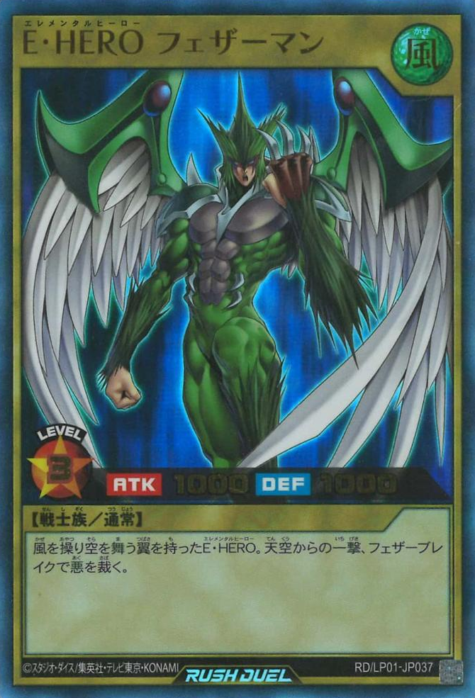

- **Zona y copias:** Main **3x**. CID Rush: **20460**.
- **Rol funcional:** Monstruo Normal — material de Fusión/Sacrificio o presencia de combate; sin efecto activado.
- **Estado de sinergia y función:** Sinergia indirecta (soporte o recursos). Es una clasificación de juego; revisar la relación concreta en A06.
- **Papel como recurso, descarte o coste:** Material o destino del Extra condicionado a los requisitos de invocación.
- **Requisito específico:** No tiene efecto.
- **Efecto / resultado concreto:** Monstruo Normal; material nombrado para las Fusiones Wingman y Heliosfera.
- **Ir primero, segundo y juego tardío:** Primero: conservarlo si es material expresamente exigido por una Fusión o Sacrificio; segundo: emplearlo como cuerpo solo tras calcular ATK y riesgo de batalla; tardío: recurso para reconstruir material desde el GY si una carta lo autoriza.
- **Relación con habilidad y otras piezas:** La Skill local **HERO RUSH RISING** puede recuperar «Fusión» y debilitar un monstruo, pero exige sus condiciones globales Guerrero/LUZ y no se roba del Main.
- **Riesgos y dependencias:** no atribuirle un efecto activado inexistente; comprobar su función como material y las cartas de soporte. verificar en campo los materiales nombrados y el momento legal de la Fusión Rush; no usar materiales de mano sin permiso textual.
- **Confianza:** **RESUMEN_FUNCIONAL_DE_GUIA_PREVIA_CON_FUENTE_KONAMI**; pendiente cotejo adicional de traducción/ventanas según la liga. Fuente Rush oficial: https://www.db.yugioh-card.com/rushdb/card_search.action?cid=20460&ope=2
- **Contraste de fuente Rush:** CID 20460: fuente oficial Rush consultada en japonés; tipo Monstruo Normal; descripción funcional en español procede de la guía previa y sigue siendo interpretación editorial.
- **Aplicación concreta dentro de este deck (A06):** Monstruo Normal; material nombrado para las Fusiones Wingman y Heliosfera.

**USO PRÁCTICO Y SINERGIA — Héroe Elemental Avian**

- **Label funcional:** Sinergia indirecta. Clasificación documental; una relación es válida solo si se satisfacen sus condiciones exactas.
- **Qué hace:** Monstruo Normal; material nombrado para las Fusiones Wingman y Heliosfera.
- **Cuándo tener precaución:** no atribuirle un efecto activado inexistente; comprobar su función como material y las cartas de soporte. verificar en campo los materiales nombrados y el momento legal de la Fusión Rush; no usar materiales de mano sin permiso textual.

#### 02. Héroe Elemental Sparkman

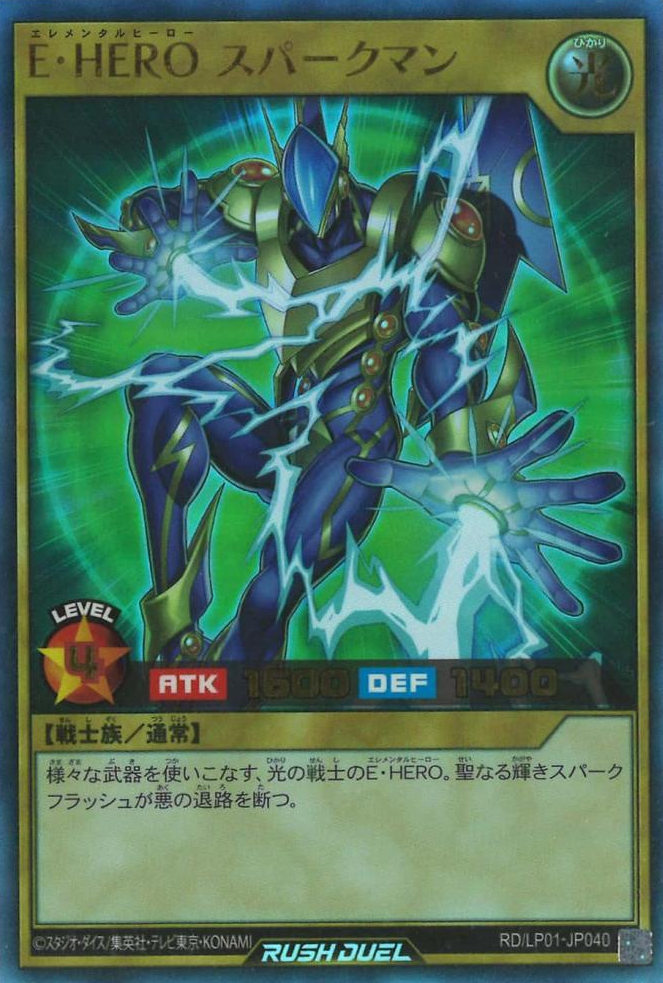

- **Zona y copias:** Main **3x**. CID Rush: **20457**.
- **Rol funcional:** Monstruo Normal — material de Fusión/Sacrificio o presencia de combate; sin efecto activado.
- **Estado de sinergia y función:** Sinergia indirecta (soporte o recursos). Es una clasificación de juego; revisar la relación concreta en A06.
- **Papel como recurso, descarte o coste:** Material o destino del Extra condicionado a los requisitos de invocación.
- **Requisito específico:** No tiene efecto.
- **Efecto / resultado concreto:** Monstruo Normal de 1600 ATK; se emplea como material nombrado de Voltic Wingman, Heliosfera y Shining Flare Wingman.
- **Ir primero, segundo y juego tardío:** Primero: conservarlo si es material expresamente exigido por una Fusión o Sacrificio; segundo: emplearlo como cuerpo solo tras calcular ATK y riesgo de batalla; tardío: recurso para reconstruir material desde el GY si una carta lo autoriza.
- **Relación con habilidad y otras piezas:** La Skill local **HERO RUSH RISING** puede recuperar «Fusión» y debilitar un monstruo, pero exige sus condiciones globales Guerrero/LUZ y no se roba del Main.
- **Riesgos y dependencias:** no atribuirle un efecto activado inexistente; comprobar su función como material y las cartas de soporte. verificar en campo los materiales nombrados y el momento legal de la Fusión Rush; no usar materiales de mano sin permiso textual.
- **Confianza:** **RESUMEN_FUNCIONAL_DE_GUIA_PREVIA_CON_FUENTE_KONAMI**; pendiente cotejo adicional de traducción/ventanas según la liga. Fuente Rush oficial: https://www.db.yugioh-card.com/rushdb/card_search.action?cid=20457&ope=2
- **Contraste de fuente Rush:** CID 20457: fuente oficial Rush consultada en japonés; tipo Monstruo Normal; descripción funcional en español procede de la guía previa y sigue siendo interpretación editorial.
- **Aplicación concreta dentro de este deck (A06):** Monstruo Normal de 1600 ATK; se emplea como material nombrado de Voltic Wingman, Heliosfera y Shining Flare Wingman.

**USO PRÁCTICO Y SINERGIA — Héroe Elemental Sparkman**

- **Label funcional:** Sinergia indirecta. Clasificación documental; una relación es válida solo si se satisfacen sus condiciones exactas.
- **Qué hace:** Monstruo Normal de 1600 ATK; se emplea como material nombrado de Voltic Wingman, Heliosfera y Shining Flare Wingman.
- **Cuándo tener precaución:** no atribuirle un efecto activado inexistente; comprobar su función como material y las cartas de soporte. verificar en campo los materiales nombrados y el momento legal de la Fusión Rush; no usar materiales de mano sin permiso textual.

#### 03. Héroe Elemental Burstinatrix

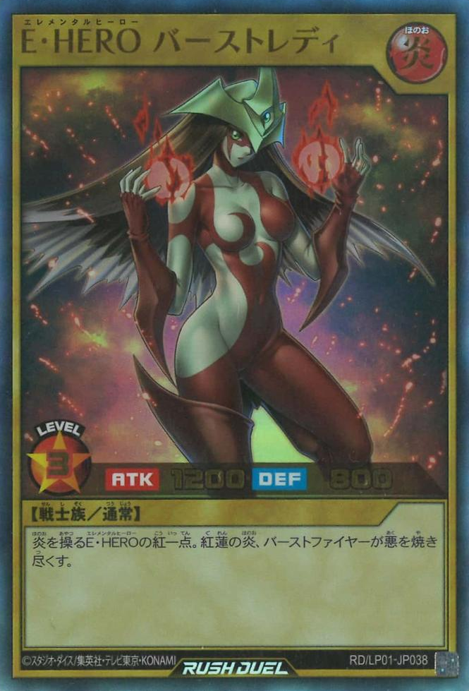

- **Zona y copias:** Main **3x**. CID Rush: **20459**.
- **Rol funcional:** Monstruo Normal — material de Fusión/Sacrificio o presencia de combate; sin efecto activado.
- **Estado de sinergia y función:** Sinergia indirecta (soporte o recursos). Es una clasificación de juego; revisar la relación concreta en A06.
- **Papel como recurso, descarte o coste:** Material o destino del Extra condicionado a los requisitos de invocación.
- **Requisito específico:** No tiene efecto.
- **Efecto / resultado concreto:** Monstruo Normal; material nombrado de Burst Wingman, Flame Wingman y Heliosfera.
- **Ir primero, segundo y juego tardío:** Primero: conservarlo si es material expresamente exigido por una Fusión o Sacrificio; segundo: emplearlo como cuerpo solo tras calcular ATK y riesgo de batalla; tardío: recurso para reconstruir material desde el GY si una carta lo autoriza.
- **Relación con habilidad y otras piezas:** La Skill local **HERO RUSH RISING** puede recuperar «Fusión» y debilitar un monstruo, pero exige sus condiciones globales Guerrero/LUZ y no se roba del Main.
- **Riesgos y dependencias:** no atribuirle un efecto activado inexistente; comprobar su función como material y las cartas de soporte. verificar en campo los materiales nombrados y el momento legal de la Fusión Rush; no usar materiales de mano sin permiso textual.
- **Confianza:** **RESUMEN_FUNCIONAL_DE_GUIA_PREVIA_CON_FUENTE_KONAMI**; pendiente cotejo adicional de traducción/ventanas según la liga. Fuente Rush oficial: https://www.db.yugioh-card.com/rushdb/card_search.action?cid=20459&ope=2
- **Contraste de fuente Rush:** CID 20459: fuente oficial Rush consultada en japonés; tipo Monstruo Normal; descripción funcional en español procede de la guía previa y sigue siendo interpretación editorial.
- **Aplicación concreta dentro de este deck (A06):** Monstruo Normal; material nombrado de Burst Wingman, Flame Wingman y Heliosfera.

**USO PRÁCTICO Y SINERGIA — Héroe Elemental Burstinatrix**

- **Label funcional:** Sinergia indirecta. Clasificación documental; una relación es válida solo si se satisfacen sus condiciones exactas.
- **Qué hace:** Monstruo Normal; material nombrado de Burst Wingman, Flame Wingman y Heliosfera.
- **Cuándo tener precaución:** no atribuirle un efecto activado inexistente; comprobar su función como material y las cartas de soporte. verificar en campo los materiales nombrados y el momento legal de la Fusión Rush; no usar materiales de mano sin permiso textual.

#### 04. Héroe Ascendente de Argen

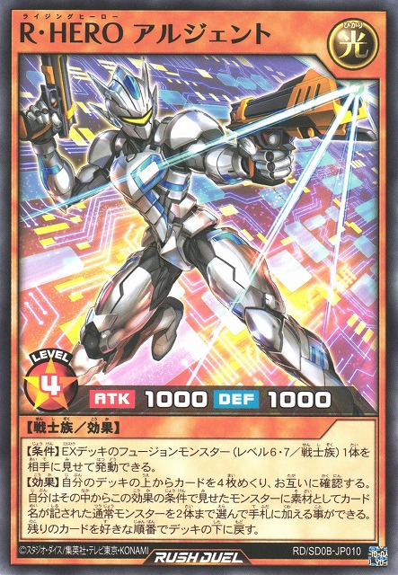

- **Zona y copias:** Main **3x**. CID Rush: **20461**.
- **Rol funcional:** Monstruo de Efecto — consistencia / reciclaje.
- **Estado de sinergia y función:** Sinergia directa descrita. Es una clasificación de juego; revisar la relación concreta en A06.
- **Papel como recurso, descarte o coste:** Material o destino del Extra condicionado a los requisitos de invocación.
- **Requisito específico:** Revelar un monstruo Fusión Guerrero de Nivel 6 o 7 del Extra Deck.
- **Efecto / resultado concreto:** Revelar las cuatro cartas superiores del Deck; añadir hasta dos monstruos Normales nombrados como material de esa Fusión y colocar las restantes en el fondo del Deck en el orden elegido.
- **Ir primero, segundo y juego tardío:** Primero: priorizar consistencia sin comprometer piezas de Fusión; segundo: buscar la carta que falta para superar el campo rival; tardío: solo aporta ventaja si queda un objetivo y su coste puede pagarse.
- **Relación con habilidad y otras piezas:** La Skill local **HERO RUSH RISING** puede recuperar «Fusión» y debilitar un monstruo, pero exige sus condiciones globales Guerrero/LUZ y no se roba del Main.
- **Riesgos y dependencias:** verificar en campo los materiales nombrados y el momento legal de la Fusión Rush; no usar materiales de mano sin permiso textual. pagar/cumplir el requisito escrito antes de prometer la resolución.
- **Confianza:** **RESUMEN_FUNCIONAL_DE_GUIA_PREVIA_CON_FUENTE_KONAMI**; pendiente cotejo adicional de traducción/ventanas según la liga. Fuente Rush oficial: https://www.db.yugioh-card.com/rushdb/card_search.action?cid=20461&ope=2
- **Contraste de fuente Rush:** CID 20461: fuente oficial Rush consultada en japonés; tipo Monstruo de Efecto; descripción funcional en español procede de la guía previa y sigue siendo interpretación editorial.
- **Aplicación concreta dentro de este deck (A06):** Revelar las cuatro cartas superiores del Deck; añadir hasta dos monstruos Normales nombrados como material de esa Fusión y colocar las restantes en el fondo del Deck en el orden elegido.

**USO PRÁCTICO Y SINERGIA — Héroe Ascendente de Argen**

- **Label funcional:** Sinergia directa. Clasificación documental; una relación es válida solo si se satisfacen sus condiciones exactas.
- **Qué hace:** Revelar las cuatro cartas superiores del Deck; añadir hasta dos monstruos Normales nombrados como material de esa Fusión y colocar las restantes en el fondo del Deck en el orden elegido.
- **Cuándo tener precaución:** verificar en campo los materiales nombrados y el momento legal de la Fusión Rush; no usar materiales de mano sin permiso textual. pagar/cumplir el requisito escrito antes de prometer la resolución.

#### 05. Inicio Reinicio

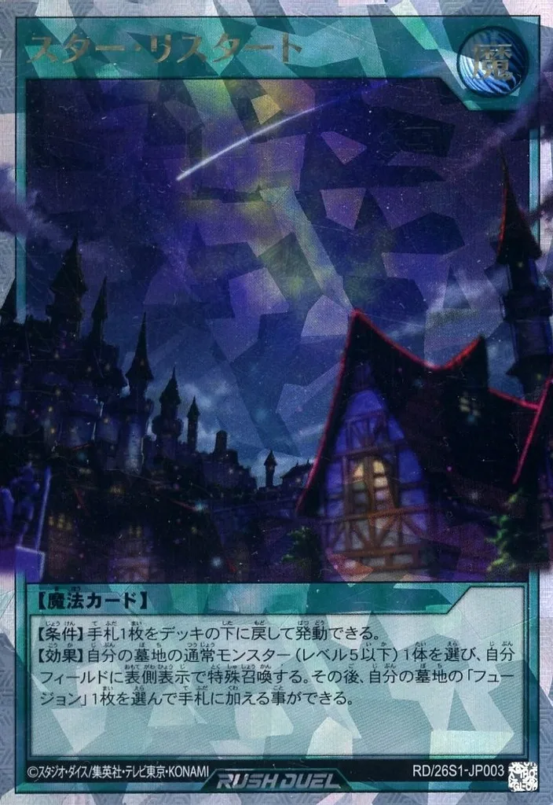

- **Zona y copias:** Main **3x**. CID Rush: **16929**.
- **Rol funcional:** Carta Mágica Normal — recurso táctico cuya condición y resultado están descritos en su ficha.
- **Estado de sinergia y función:** Sinergia directa descrita. Es una clasificación de juego; revisar la relación concreta en A06.
- **Papel como recurso, descarte o coste:** Coste o consumo descrito en A05: la condición de una Mágica/Trampa y sus blancos deben cumplirse antes de resolver. No confundir esta carta con un monstruo….
- **Requisito específico:** Colocar una carta de la mano al fondo del Deck.
- **Efecto / resultado concreto:** Invoca un monstruo Normal de Nivel 5 o menor del Cementerio y opcionalmente recupera una Fusión de ese Cementerio.
- **Ir primero, segundo y juego tardío:** Primero: usarla si su efecto abre recursos o deja protección aprovechable; segundo: priorizar su resultado concreto frente a las amenazas rivales; tardío: comprobar materiales, objetivos y si aún quedan recursos en Deck o Cementerio.
- **Relación con habilidad y otras piezas:** La Skill local **HERO RUSH RISING** puede recuperar «Fusión» y debilitar un monstruo, pero exige sus condiciones globales Guerrero/LUZ y no se roba del Main.
- **Riesgos y dependencias:** la condición de una Mágica/Trampa y sus blancos deben cumplirse antes de resolver. No confundir esta carta con un monstruo ni usarla como material.
- **Confianza:** **RESUMEN_FUNCIONAL_DE_GUIA_PREVIA_CON_FUENTE_KONAMI**; pendiente cotejo adicional de traducción/ventanas según la liga. Fuente Rush oficial: https://www.db.yugioh-card.com/rushdb/card_search.action?cid=16929&ope=2
- **Contraste de fuente Rush:** CID 16929: fuente oficial Rush consultada en japonés; tipo Carta Mágica Normal; descripción funcional en español procede de la guía previa y sigue siendo interpretación editorial.
- **Aplicación concreta dentro de este deck (A06):** Invoca un monstruo Normal de Nivel 5 o menor del Cementerio y opcionalmente recupera una Fusión de ese Cementerio.

**USO PRÁCTICO Y SINERGIA — Inicio Reinicio**

- **Label funcional:** Sinergia directa. Clasificación documental; una relación es válida solo si se satisfacen sus condiciones exactas.
- **Qué hace:** Invoca un monstruo Normal de Nivel 5 o menor del Cementerio y opcionalmente recupera una Fusión de ese Cementerio.
- **Cuándo tener precaución:** la condición de una Mágica/Trampa y sus blancos deben cumplirse antes de resolver. No confundir esta carta con un monstruo ni usarla como material.

#### 06. Descenso de Héroe

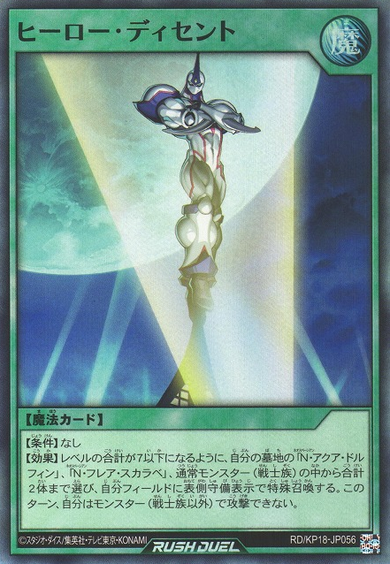

- **Zona y copias:** Main **3x**. CID Rush: **20665**.
- **Rol funcional:** Carta Mágica Normal — extensor / habilitador de material.
- **Estado de sinergia y función:** Sinergia directa descrita. Es una clasificación de juego; revisar la relación concreta en A06.
- **Papel como recurso, descarte o coste:** Coste o consumo descrito en A05: comprobar zona, objetivos y ventana; el nombre de la carta no reemplaza su texto.
- **Requisito específico:** Sin requisito de activación.
- **Efecto / resultado concreto:** Invoca desde el Cementerio, en Defensa boca arriba, hasta dos objetivos permitidos (Neo-Espaciales específicos o Guerreros Normales) cuyos Niveles sumen como máximo siete. Ese turno solo pueden atacar tus Guerreros.
- **Ir primero, segundo y juego tardío:** Primero: usarla si su efecto abre recursos o deja protección aprovechable; segundo: priorizar su resultado concreto frente a las amenazas rivales; tardío: comprobar materiales, objetivos y si aún quedan recursos en Deck o Cementerio.
- **Relación con habilidad y otras piezas:** Considerar la Skill **HERO RUSH RISING** como recurso separado: enviar una carta propia del campo no es coste gratuito.
- **Riesgos y dependencias:** comprobar zona, objetivos y ventana; el nombre de la carta no reemplaza su texto.
- **Confianza:** **RESUMEN_FUNCIONAL_DE_GUIA_PREVIA_CON_FUENTE_KONAMI**; pendiente cotejo adicional de traducción/ventanas según la liga. Fuente Rush oficial: https://www.db.yugioh-card.com/rushdb/card_search.action?cid=20665&ope=2
- **Contraste de fuente Rush:** CID 20665: fuente oficial Rush consultada en japonés; tipo Carta Mágica Normal; descripción funcional en español procede de la guía previa y sigue siendo interpretación editorial.
- **Aplicación concreta dentro de este deck (A06):** Invoca desde el Cementerio, en Defensa boca arriba, hasta dos objetivos permitidos (Neo-Espaciales específicos o Guerreros Normales) cuyos Niveles sumen como máximo siete.

**USO PRÁCTICO Y SINERGIA — Descenso de Héroe**

- **Label funcional:** Sinergia directa. Clasificación documental; una relación es válida solo si se satisfacen sus condiciones exactas.
- **Qué hace:** Invoca desde el Cementerio, en Defensa boca arriba, hasta dos objetivos permitidos (Neo-Espaciales específicos o Guerreros Normales) cuyos Niveles sumen como máximo siete. Ese turno solo pueden atacar tus Guerreros.
- **Cómo aprovecharla en este deck:** Invoca desde el Cementerio, en Defensa boca arriba, hasta dos objetivos permitidos (Neo-Espaciales específicos o Guerreros Normales) cuyos Niveles sumen como máximo siete.
- **Cuándo tener precaución:** comprobar zona, objetivos y ventana; el nombre de la carta no reemplaza su texto.

#### 07. Brillo Sombrío

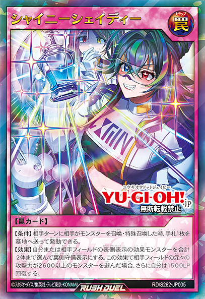

- **Zona y copias:** Main **3x**. CID Rush: **20151**.
- **Rol funcional:** Carta de Trampa Normal — consistencia / reciclaje.
- **Estado de sinergia y función:** Sinergia directa descrita. Es una clasificación de juego; revisar la relación concreta en A06.
- **Papel como recurso, descarte o coste:** Coste o consumo descrito en A05: pagar/cumplir el requisito escrito antes de prometer la resolución.
- **Requisito específico:** Cuando el rival Invoca un monstruo en su turno; enviar una carta de la mano al Cementerio.
- **Efecto / resultado concreto:** Pone hasta dos monstruos de Efecto boca arriba de cualquier Campo boca abajo en Defensa; si incluyó un monstruo rival con ATK original de al menos 2600, recupera 1500 LP.
- **Ir primero, segundo y juego tardío:** Primero: Colocar y reservar la respuesta para la ventana legal; segundo: tras side y cambio de turno, evaluar si puede activarse a tiempo; tardío: no asumir efecto si falta el objetivo o el estado de campo.
- **Relación con habilidad y otras piezas:** Considerar la Skill **HERO RUSH RISING** como recurso separado: enviar una carta propia del campo no es coste gratuito.
- **Riesgos y dependencias:** pagar/cumplir el requisito escrito antes de prometer la resolución.
- **Confianza:** **RESUMEN_FUNCIONAL_DE_GUIA_PREVIA_CON_FUENTE_KONAMI**; pendiente cotejo adicional de traducción/ventanas según la liga. Fuente Rush oficial: https://www.db.yugioh-card.com/rushdb/card_search.action?cid=20151&ope=2
- **Contraste de fuente Rush:** CID 20151: fuente oficial Rush consultada en japonés; tipo Carta de Trampa Normal; descripción funcional en español procede de la guía previa y sigue siendo interpretación editorial.
- **Aplicación concreta dentro de este deck (A06):** Pone hasta dos monstruos de Efecto boca arriba de cualquier Campo boca abajo en Defensa; si incluyó un monstruo rival con ATK original de al menos 2600, recupera 1500 LP.

**USO PRÁCTICO Y SINERGIA — Brillo Sombrío**

- **Label funcional:** Sinergia directa. Clasificación documental; una relación es válida solo si se satisfacen sus condiciones exactas.
- **Qué hace:** Pone hasta dos monstruos de Efecto boca arriba de cualquier Campo boca abajo en Defensa; si incluyó un monstruo rival con ATK original de al menos 2600, recupera 1500 LP.
- **Cuándo tener precaución:** pagar/cumplir el requisito escrito antes de prometer la resolución.

#### 08. Circulación Elemental

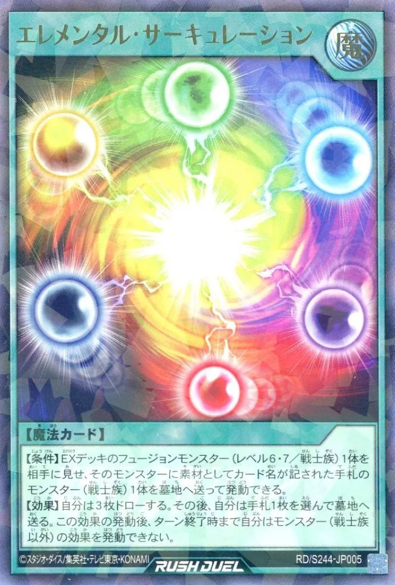

- **Zona y copias:** Main **3x**. CID Rush: **20465**.
- **Rol funcional:** Carta Mágica Normal — consistencia / reciclaje.
- **Estado de sinergia y función:** Sinergia indirecta (soporte o recursos). Es una clasificación de juego; revisar la relación concreta en A06.
- **Papel como recurso, descarte o coste:** Coste o consumo descrito en A05: pagar/cumplir el requisito escrito antes de prometer la resolución. disponer de cartas suficientes en Deck y distinguir robo….
- **Requisito específico:** Revelar una Fusión Guerrero de Nivel 6 o 7 del Extra y enviar de la mano un Guerrero cuyo nombre sea material de esa Fusión.
- **Efecto / resultado concreto:** Roba tres, luego manda una carta de la mano al Cementerio. Durante el resto del turno impide activar efectos de monstruos que no sean Guerreros.
- **Ir primero, segundo y juego tardío:** Primero: usarla si su efecto abre recursos o deja protección aprovechable; segundo: priorizar su resultado concreto frente a las amenazas rivales; tardío: comprobar materiales, objetivos y si aún quedan recursos en Deck o Cementerio.
- **Relación con habilidad y otras piezas:** Considerar la Skill **HERO RUSH RISING** como recurso separado: enviar una carta propia del campo no es coste gratuito.
- **Riesgos y dependencias:** pagar/cumplir el requisito escrito antes de prometer la resolución. disponer de cartas suficientes en Deck y distinguir robo de búsqueda.
- **Confianza:** **RESUMEN_FUNCIONAL_DE_GUIA_PREVIA_CON_FUENTE_KONAMI**; pendiente cotejo adicional de traducción/ventanas según la liga. Fuente Rush oficial: https://www.db.yugioh-card.com/rushdb/card_search.action?cid=20465&ope=2
- **Contraste de fuente Rush:** CID 20465: fuente oficial Rush consultada en japonés; tipo Carta Mágica Normal; descripción funcional en español procede de la guía previa y sigue siendo interpretación editorial.
- **Aplicación concreta dentro de este deck (A06):** Roba tres, luego manda una carta de la mano al Cementerio.

**USO PRÁCTICO Y SINERGIA — Circulación Elemental**

- **Label funcional:** Sinergia indirecta. Clasificación documental; una relación es válida solo si se satisfacen sus condiciones exactas.
- **Qué hace:** Roba tres, luego manda una carta de la mano al Cementerio. Durante el resto del turno impide activar efectos de monstruos que no sean Guerreros.
- **Cómo aprovecharla en este deck:** Roba tres, luego manda una carta de la mano al Cementerio.
- **Cuándo tener precaución:** pagar/cumplir el requisito escrito antes de prometer la resolución. disponer de cartas suficientes en Deck y distinguir robo de búsqueda.

#### 09. Estrategia Mágica Aviar

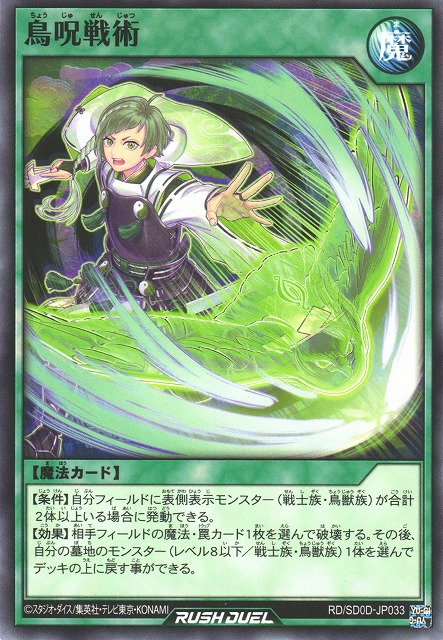

- **Zona y copias:** Main **2x**. CID Rush: **16358**.
- **Rol funcional:** Carta Mágica Normal — removal / apertura de campo.
- **Estado de sinergia y función:** Sinergia indirecta (soporte o recursos). Es una clasificación de juego; revisar la relación concreta en A06.
- **Papel como recurso, descarte o coste:** Coste o consumo descrito en A05: el resultado está sujeto a monstruos/cartas que puedan ser afectados y a respuestas del rival.
- **Requisito específico:** Controlar en conjunto dos o más Guerreros y/o Bestias Aladas boca arriba.
- **Efecto / resultado concreto:** Destruye una Mágica/Trampa rival; luego puedes devolver al tope del Deck un Guerrero o Bestia Alada de Nivel 8 o menor del Cementerio.
- **Ir primero, segundo y juego tardío:** Primero: usarla si su efecto abre recursos o deja protección aprovechable; segundo: priorizar su resultado concreto frente a las amenazas rivales; tardío: comprobar materiales, objetivos y si aún quedan recursos en Deck o Cementerio.
- **Relación con habilidad y otras piezas:** Considerar la Skill **HERO RUSH RISING** como recurso separado: enviar una carta propia del campo no es coste gratuito.
- **Riesgos y dependencias:** el resultado está sujeto a monstruos/cartas que puedan ser afectados y a respuestas del rival.
- **Confianza:** **RESUMEN_FUNCIONAL_DE_GUIA_PREVIA_CON_FUENTE_KONAMI**; pendiente cotejo adicional de traducción/ventanas según la liga. Fuente Rush oficial: https://www.db.yugioh-card.com/rushdb/card_search.action?cid=16358&ope=2
- **Contraste de fuente Rush:** CID 16358: fuente oficial Rush consultada en japonés; tipo Carta Mágica Normal; descripción funcional en español procede de la guía previa y sigue siendo interpretación editorial.
- **Aplicación concreta dentro de este deck (A06):** Destruye una Mágica/Trampa rival; luego puedes devolver al tope del Deck un Guerrero o Bestia Alada de Nivel 8 o menor del Cementerio.

**USO PRÁCTICO Y SINERGIA — Estrategia Mágica Aviar**

- **Label funcional:** Sinergia indirecta. Clasificación documental; una relación es válida solo si se satisfacen sus condiciones exactas.
- **Qué hace:** Destruye una Mágica/Trampa rival; luego puedes devolver al tope del Deck un Guerrero o Bestia Alada de Nivel 8 o menor del Cementerio.
- **Cuándo tener precaución:** el resultado está sujeto a monstruos/cartas que puedan ser afectados y a respuestas del rival.

#### 10. Fusión

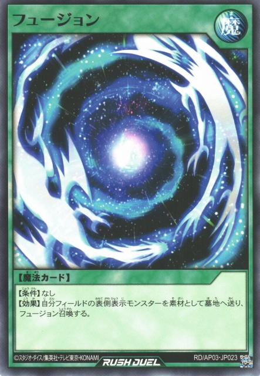

- **Zona y copias:** Main **2x**. CID Rush: **16934**.
- **Rol funcional:** Carta Mágica Normal — extensor / habilitador de material.
- **Estado de sinergia y función:** Sinergia indirecta (soporte o recursos). Es una clasificación de juego; revisar la relación concreta en A06.
- **Papel como recurso, descarte o coste:** Material o destino del Extra condicionado a los requisitos de invocación.
- **Requisito específico:** Sin requisito de activación.
- **Efecto / resultado concreto:** Usa monstruos boca arriba del Campo propio como materiales, enviándolos al Cementerio para una Invocación por Fusión válida; no usa automáticamente materiales de la mano.
- **Ir primero, segundo y juego tardío:** Primero: usarla si su efecto abre recursos o deja protección aprovechable; segundo: priorizar su resultado concreto frente a las amenazas rivales; tardío: comprobar materiales, objetivos y si aún quedan recursos en Deck o Cementerio.
- **Relación con habilidad y otras piezas:** La Skill local **HERO RUSH RISING** puede recuperar «Fusión» y debilitar un monstruo, pero exige sus condiciones globales Guerrero/LUZ y no se roba del Main.
- **Riesgos y dependencias:** verificar en campo los materiales nombrados y el momento legal de la Fusión Rush; no usar materiales de mano sin permiso textual.
- **Confianza:** **RESUMEN_FUNCIONAL_DE_GUIA_PREVIA_CON_FUENTE_KONAMI**; pendiente cotejo adicional de traducción/ventanas según la liga. Fuente Rush oficial: https://www.db.yugioh-card.com/rushdb/card_search.action?cid=16934&ope=2
- **Contraste de fuente Rush:** CID 16934: fuente oficial Rush consultada en japonés; tipo Carta Mágica Normal; descripción funcional en español procede de la guía previa y sigue siendo interpretación editorial.
- **Aplicación concreta dentro de este deck (A06):** Usa monstruos boca arriba del Campo propio como materiales, enviándolos al Cementerio para una Invocación por Fusión válida; no usa automáticamente materiales de la mano.

**USO PRÁCTICO Y SINERGIA — Fusión**

- **Label funcional:** Sinergia indirecta. Clasificación documental; una relación es válida solo si se satisfacen sus condiciones exactas.
- **Qué hace:** Usa monstruos boca arriba del Campo propio como materiales, enviándolos al Cementerio para una Invocación por Fusión válida; no usa automáticamente materiales de la mano.
- **Cuándo tener precaución:** verificar en campo los materiales nombrados y el momento legal de la Fusión Rush; no usar materiales de mano sin permiso textual.

#### 11. Agujero Trampa

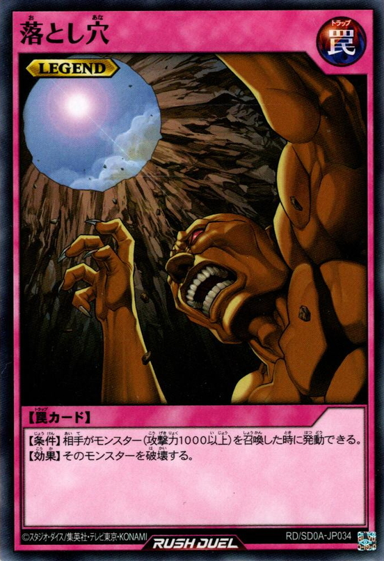

- **Zona y copias:** Main **1x**. CID Rush: **15913**.
- **Rol funcional:** Carta de Trampa Normal — interrupción defensiva de Invocación Normal.
- **Estado de sinergia y función:** Sinergia indirecta (soporte o recursos). Es una clasificación de juego; revisar la relación concreta en A06.
- **Papel como recurso, descarte o coste:** Coste o consumo descrito en A05: el resultado está sujeto a monstruos/cartas que puedan ser afectados y a respuestas del rival.
- **Requisito específico:** Cuando el rival Invoca de Modo Normal un monstruo de al menos 1000 ATK.
- **Efecto / resultado concreto:** Destruye ese monstruo invocado.
- **Ir primero, segundo y juego tardío:** Primero: Colocar y reservar la respuesta para la ventana legal; segundo: tras side y cambio de turno, evaluar si puede activarse a tiempo; tardío: no asumir efecto si falta el objetivo o el estado de campo.
- **Relación con habilidad y otras piezas:** Considerar la Skill **HERO RUSH RISING** como recurso separado: enviar una carta propia del campo no es coste gratuito.
- **Riesgos y dependencias:** el resultado está sujeto a monstruos/cartas que puedan ser afectados y a respuestas del rival.
- **Confianza:** **RESUMEN_FUNCIONAL_DE_GUIA_PREVIA_CON_FUENTE_KONAMI**; pendiente cotejo adicional de traducción/ventanas según la liga. Fuente Rush oficial: https://www.db.yugioh-card.com/rushdb/card_search.action?cid=15913&ope=2
- **Contraste de fuente Rush:** CID 15913: fuente oficial Rush consultada en japonés; tipo Carta de Trampa Normal; descripción funcional en español procede de la guía previa y sigue siendo interpretación editorial.
- **Aplicación concreta dentro de este deck (A06):** Destruye ese monstruo invocado.

**USO PRÁCTICO Y SINERGIA — Agujero Trampa**

- **Label funcional:** Sinergia indirecta. Clasificación documental; una relación es válida solo si se satisfacen sus condiciones exactas.
- **Qué hace:** Destruye ese monstruo invocado.
- **Cuándo tener precaución:** el resultado está sujeto a monstruos/cartas que puedan ser afectados y a respuestas del rival.

#### 12. Olla de la Codicia

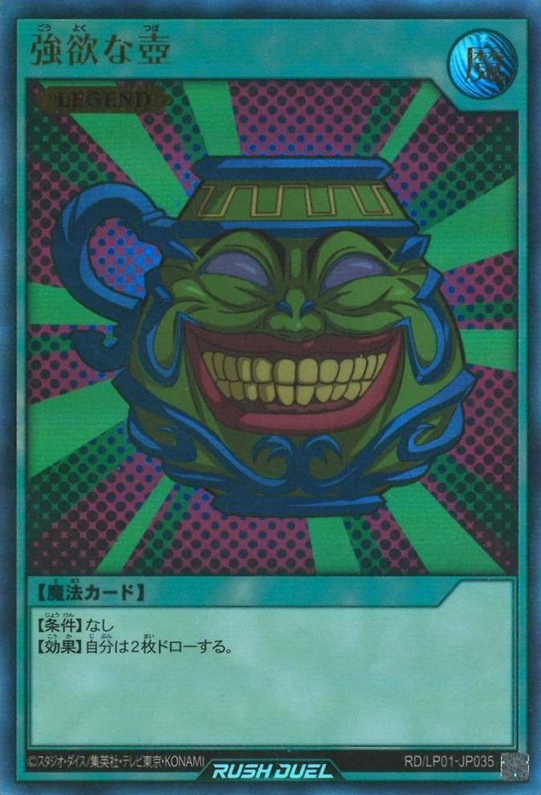

- **Zona y copias:** Main **1x**. CID Rush: **16372**.
- **Rol funcional:** Carta Mágica Normal — consistencia / reciclaje.
- **Estado de sinergia y función:** Sinergia indirecta de recursos. Es una clasificación de juego; revisar la relación concreta en A06.
- **Papel como recurso, descarte o coste:** Material o destino del Extra condicionado a los requisitos de invocación.
- **Requisito específico:** Sin requisito de activación.
- **Efecto / resultado concreto:** Roba dos cartas.
- **Ir primero, segundo y juego tardío:** Primero: usarla si su efecto abre recursos o deja protección aprovechable; segundo: priorizar su resultado concreto frente a las amenazas rivales; tardío: comprobar materiales, objetivos y si aún quedan recursos en Deck o Cementerio.
- **Relación con habilidad y otras piezas:** Considerar la Skill **HERO RUSH RISING** como recurso separado: enviar una carta propia del campo no es coste gratuito.
- **Riesgos y dependencias:** disponer de cartas suficientes en Deck y distinguir robo de búsqueda.
- **Confianza:** **RESUMEN_FUNCIONAL_DE_GUIA_PREVIA_CON_FUENTE_KONAMI**; pendiente cotejo adicional de traducción/ventanas según la liga. Fuente Rush oficial: https://www.db.yugioh-card.com/rushdb/card_search.action?cid=16372&ope=2
- **Contraste de fuente Rush:** CID 16372: fuente oficial Rush consultada en japonés; tipo Carta Mágica Normal; descripción funcional en español procede de la guía previa y sigue siendo interpretación editorial.
- **Aplicación concreta dentro de este deck (A06):** Roba dos cartas. Aportación posible como material, coste o objetivo; verificar consumidor.

**USO PRÁCTICO Y SINERGIA — Olla de la Codicia**

- **Label funcional:** Sinergia indirecta. Clasificación documental; una relación es válida solo si se satisfacen sus condiciones exactas.
- **Qué hace:** Roba dos cartas.
- **Cómo aprovecharla en este deck:** Roba dos cartas. Aportación posible como material, coste o objetivo; verificar consumidor.
- **Cuándo tener precaución:** disponer de cartas suficientes en Deck y distinguir robo de búsqueda.

#### 13. Héroe Elemental Voltic Wingman

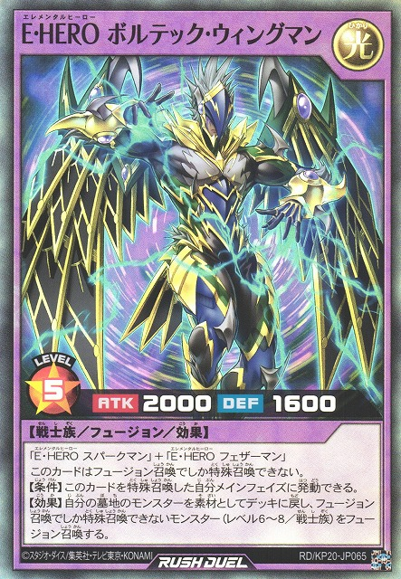

- **Zona y copias:** Extra **2x**. CID Rush: **21316**.
- **Rol funcional:** Monstruo de Fusión — objetivo de Fusión con materiales expresos y efecto de cierre.
- **Estado de sinergia y función:** Destino Extra condicionado. Es una clasificación de juego; revisar la relación concreta en A06.
- **Papel como recurso, descarte o coste:** Material o destino del Extra condicionado a los requisitos de invocación.
- **Requisito específico:** Solo Invocación por Fusión; materiales Sparkman + Avian. Efecto en Main Phase propia en que fue Invocado de Modo Especial.
- **Efecto / resultado concreto:** Devuelve al Deck monstruos del Cementerio empleados como materiales y realiza una Fusión de un monstruo Guerrero Nivel 6 a 8 que solo se pueda Invocar por Fusión.
- **Ir primero, segundo y juego tardío:** Primero: preparar materiales y «Fusión» si es alcanzable; segundo: considerar el efecto de campo o daño que se produzca tras una Fusión legal; tardío: comprobar si quedan materiales nombrados en campo y Extra.
- **Relación con habilidad y otras piezas:** La Skill local **HERO RUSH RISING** puede recuperar «Fusión» y debilitar un monstruo, pero exige sus condiciones globales Guerrero/LUZ y no se roba del Main.
- **Riesgos y dependencias:** verificar en campo los materiales nombrados y el momento legal de la Fusión Rush; no usar materiales de mano sin permiso textual.
- **Confianza:** **RESUMEN_FUNCIONAL_DE_GUIA_PREVIA_CON_FUENTE_KONAMI**; pendiente cotejo adicional de traducción/ventanas según la liga. Fuente Rush oficial: https://www.db.yugioh-card.com/rushdb/card_search.action?cid=21316&ope=2
- **Contraste de fuente Rush:** CID 21316: fuente oficial Rush consultada en japonés; tipo Monstruo de Fusión; descripción funcional en español procede de la guía previa y sigue siendo interpretación editorial.
- **Aplicación concreta dentro de este deck (A06):** Devuelve al Deck monstruos del Cementerio empleados como materiales y realiza una Fusión de un monstruo Guerrero Nivel 6 a 8 que solo se pueda Invocar por Fusión. A06 identifica su destino, condicionado a material/procedimiento.

**USO PRÁCTICO Y SINERGIA — Héroe Elemental Voltic Wingman**

- **Label funcional:** Referencias de ruta localizadas; conexión reglamentaria sujeta al recorrido de la guía. Clasificación documental; una relación es válida solo si se satisfacen sus condiciones exactas.
- **Qué hace:** Devuelve al Deck monstruos del Cementerio empleados como materiales y realiza una Fusión de un monstruo Guerrero Nivel 6 a 8 que solo se pueda Invocar por Fusión.
- **Cómo aprovecharla en este deck:** Devuelve al Deck monstruos del Cementerio empleados como materiales y realiza una Fusión de un monstruo Guerrero Nivel 6 a 8 que solo se pueda Invocar por Fusión. A06 identifica su destino, condicionado a material/procedimiento.
- **Cuándo tener precaución:** verificar en campo los materiales nombrados y el momento legal de la Fusión Rush; no usar materiales de mano sin permiso textual.

**CÓMO LLEGAR DESDE TU DECK — RUTAS DOCUMENTADAS**

- **Abrir guía `706:A09:VOLTIC:SECOND01A`:** entrada: 1× E·HERO Sparkman (20457, Nivel 4, 1600 ATK), 1× E·HERO Avian (20460, Nivel 3, 1000 ATK), 1× E·HERO Burstinatrix (20459, Nivel 3, 1200 ATK), 1× Mágica Fusión (16934). Campo propio vacío, Main Phase propia, al menos tres zonas libres, ninguna respuesta adversaria en esta rama. Extra con Voltic Wingman (21316), Flame Wingman (20453), Burst Wingman (20454), Heliosfera (21501). Skill casera HERO RUSH RISING (RD/SK01-003) aprobada localmente y sin uso previo relevante.. Propósito descrito: Preparación de recursos / despliegue. Consulta sus pasos, consumo y resultado; comprobar si esta carta es realmente invocada o solo mencionada.
- **Abrir guía `706:A09:VOLTIC:SECOND01B`:** entrada: 1× E·HERO Sparkman (20457, Nivel 4, 1600 ATK), 1× E·HERO Avian (20460, Nivel 3, 1000 ATK), 1× E·HERO Burstinatrix (20459, Nivel 3, 1200 ATK), 1× Mágica Fusión (16934). Campo propio vacío, Main Phase propia, al menos tres zonas libres, ninguna respuesta adversaria en esta rama. Extra con Voltic Wingman (21316), Flame Wingman (20453), Burst Wingman (20454), Heliosfera (21501). Skill casera HERO RUSH RISING (RD/SK01-003) aprobada localmente y sin uso previo relevante.. Propósito descrito: Preparación de recursos / despliegue. Consulta sus pasos, consumo y resultado; comprobar si esta carta es realmente invocada o solo mencionada.
- **Abrir guía `706:A09:VOLTIC:SECOND01C`:** entrada: 1× E·HERO Sparkman (20457, Nivel 4, 1600 ATK), 1× E·HERO Avian (20460, Nivel 3, 1000 ATK), 1× E·HERO Burstinatrix (20459, Nivel 3, 1200 ATK), 1× Mágica Fusión (16934). Campo propio vacío, Main Phase propia, al menos tres zonas libres, ninguna respuesta adversaria en esta rama. Extra con Voltic Wingman (21316), Flame Wingman (20453), Burst Wingman (20454), Heliosfera (21501). Skill casera HERO RUSH RISING (RD/SK01-003) aprobada localmente y sin uso previo relevante.. Propósito descrito: Preparación de recursos / despliegue. Consulta sus pasos, consumo y resultado; comprobar si esta carta es realmente invocada o solo mencionada.

#### 14. Héroe Elemental del Estallido Wingman

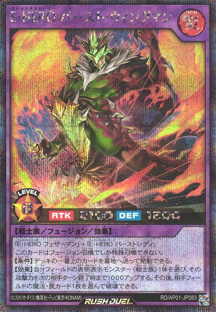

- **Zona y copias:** Extra **2x**. CID Rush: **20454**.
- **Rol funcional:** Monstruo de Fusión — objetivo de Fusión con materiales expresos y efecto de cierre.
- **Estado de sinergia y función:** Destino Extra condicionado. Es una clasificación de juego; revisar la relación concreta en A06.
- **Papel como recurso, descarte o coste:** Material o destino del Extra condicionado a los requisitos de invocación.
- **Requisito específico:** Solo Invocación por Fusión; materiales Avian + Burstinatrix. Enviar la primera carta del Deck al Cementerio.
- **Efecto / resultado concreto:** Aumenta 1000 ATK de un Guerrero propio boca arriba hasta el final del siguiente turno rival; después puede destruir una Mágica/Trampa rival.
- **Ir primero, segundo y juego tardío:** Primero: preparar materiales y «Fusión» si es alcanzable; segundo: considerar el efecto de campo o daño que se produzca tras una Fusión legal; tardío: comprobar si quedan materiales nombrados en campo y Extra.
- **Relación con habilidad y otras piezas:** La Skill local **HERO RUSH RISING** puede recuperar «Fusión» y debilitar un monstruo, pero exige sus condiciones globales Guerrero/LUZ y no se roba del Main.
- **Riesgos y dependencias:** pagar/cumplir el requisito escrito antes de prometer la resolución. el resultado está sujeto a monstruos/cartas que puedan ser afectados y a respuestas del rival.
- **Confianza:** **RESUMEN_FUNCIONAL_DE_GUIA_PREVIA_CON_FUENTE_KONAMI**; pendiente cotejo adicional de traducción/ventanas según la liga. Fuente Rush oficial: https://www.db.yugioh-card.com/rushdb/card_search.action?cid=20454&ope=2
- **Contraste de fuente Rush:** CID 20454: fuente oficial Rush consultada en japonés; tipo Monstruo de Fusión; descripción funcional en español procede de la guía previa y sigue siendo interpretación editorial.
- **Aplicación concreta dentro de este deck (A06):** Aumenta 1000 ATK de un Guerrero propio boca arriba hasta el final del siguiente turno rival; después puede destruir una Mágica/Trampa rival. A06 identifica su destino, condicionado a material/procedimiento.

**USO PRÁCTICO Y SINERGIA — Héroe Elemental del Estallido Wingman**

- **Label funcional:** Referencias de ruta localizadas; conexión reglamentaria sujeta al recorrido de la guía. Clasificación documental; una relación es válida solo si se satisfacen sus condiciones exactas.
- **Qué hace:** Aumenta 1000 ATK de un Guerrero propio boca arriba hasta el final del siguiente turno rival; después puede destruir una Mágica/Trampa rival.
- **Cómo aprovecharla en este deck:** Aumenta 1000 ATK de un Guerrero propio boca arriba hasta el final del siguiente turno rival; después puede destruir una Mágica/Trampa rival. A06 identifica su destino, condicionado a material/procedimiento.
- **Cuándo tener precaución:** pagar/cumplir el requisito escrito antes de prometer la resolución. el resultado está sujeto a monstruos/cartas que puedan ser afectados y a respuestas del rival.

**CÓMO LLEGAR DESDE TU DECK — RUTAS DOCUMENTADAS**

- **Abrir guía `706:A09:AVIAN:BURST01B`:** entrada: 1× E·HERO Avian (20460), 1× E·HERO Burstinatrix (20459), 1× Mágica Normal Fusión (16934). Campo propio vacío, Main Phase propia, dos zonas libres; Extra contiene 1× Flame Wingman (20453) y 1× Burst Wingman (20454). Rivales sin respuestas en esta rama. Ninguna carta se pone en mano por la Skill.. Propósito descrito: Preparación de recursos / despliegue. Consulta sus pasos, consumo y resultado; comprobar si esta carta es realmente invocada o solo mencionada.
- **Abrir guía `706:A09:VOLTIC:SECOND01B`:** entrada: 1× E·HERO Sparkman (20457, Nivel 4, 1600 ATK), 1× E·HERO Avian (20460, Nivel 3, 1000 ATK), 1× E·HERO Burstinatrix (20459, Nivel 3, 1200 ATK), 1× Mágica Fusión (16934). Campo propio vacío, Main Phase propia, al menos tres zonas libres, ninguna respuesta adversaria en esta rama. Extra con Voltic Wingman (21316), Flame Wingman (20453), Burst Wingman (20454), Heliosfera (21501). Skill casera HERO RUSH RISING (RD/SK01-003) aprobada localmente y sin uso previo relevante.. Propósito descrito: Preparación de recursos / despliegue. Consulta sus pasos, consumo y resultado; comprobar si esta carta es realmente invocada o solo mencionada.

#### 15. Héroe Elemental de la Llama Wingman

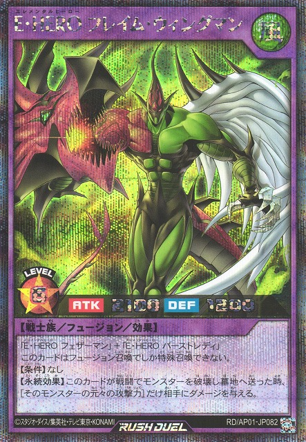

- **Zona y copias:** Extra **1x**. CID Rush: **20453**.
- **Rol funcional:** Monstruo de Fusión — objetivo de Fusión con materiales expresos y efecto de cierre.
- **Estado de sinergia y función:** Destino Extra condicionado. Es una clasificación de juego; revisar la relación concreta en A06.
- **Papel como recurso, descarte o coste:** Material o destino del Extra condicionado a los requisitos de invocación.
- **Requisito específico:** Solo Invocación por Fusión; materiales Avian + Burstinatrix. Efecto continuo sin requisito activado.
- **Efecto / resultado concreto:** Si destruye en batalla un monstruo y lo manda al Cementerio, inflige daño igual al ATK original de ese monstruo.
- **Ir primero, segundo y juego tardío:** Primero: preparar materiales y «Fusión» si es alcanzable; segundo: considerar el efecto de campo o daño que se produzca tras una Fusión legal; tardío: comprobar si quedan materiales nombrados en campo y Extra.
- **Relación con habilidad y otras piezas:** La Skill local **HERO RUSH RISING** puede recuperar «Fusión» y debilitar un monstruo, pero exige sus condiciones globales Guerrero/LUZ y no se roba del Main.
- **Riesgos y dependencias:** el resultado está sujeto a monstruos/cartas que puedan ser afectados y a respuestas del rival.
- **Confianza:** **RESUMEN_FUNCIONAL_DE_GUIA_PREVIA_CON_FUENTE_KONAMI**; pendiente cotejo adicional de traducción/ventanas según la liga. Fuente Rush oficial: https://www.db.yugioh-card.com/rushdb/card_search.action?cid=20453&ope=2
- **Contraste de fuente Rush:** CID 20453: fuente oficial Rush consultada en japonés; tipo Monstruo de Fusión; descripción funcional en español procede de la guía previa y sigue siendo interpretación editorial.
- **Aplicación concreta dentro de este deck (A06):** Si destruye en batalla un monstruo y lo manda al Cementerio, inflige daño igual al ATK original de ese monstruo. A06 identifica su destino, condicionado a material/procedimiento.

**USO PRÁCTICO Y SINERGIA — Héroe Elemental de la Llama Wingman**

- **Label funcional:** Referencias de ruta localizadas; conexión reglamentaria sujeta al recorrido de la guía. Clasificación documental; una relación es válida solo si se satisfacen sus condiciones exactas.
- **Qué hace:** Si destruye en batalla un monstruo y lo manda al Cementerio, inflige daño igual al ATK original de ese monstruo.
- **Cómo aprovecharla en este deck:** Si destruye en batalla un monstruo y lo manda al Cementerio, inflige daño igual al ATK original de ese monstruo. A06 identifica su destino, condicionado a material/procedimiento.
- **Cuándo tener precaución:** el resultado está sujeto a monstruos/cartas que puedan ser afectados y a respuestas del rival.

**CÓMO LLEGAR DESDE TU DECK — RUTAS DOCUMENTADAS**

- **Abrir guía `706:A09:AVIAN:BURST01A`:** entrada: 1× E·HERO Avian (20460), 1× E·HERO Burstinatrix (20459), 1× Mágica Normal Fusión (16934). Campo propio vacío, Main Phase propia, dos zonas libres; Extra contiene 1× Flame Wingman (20453) y 1× Burst Wingman (20454). Rivales sin respuestas en esta rama. Ninguna carta se pone en mano por la Skill.. Propósito descrito: Ofensivo condicional. Consulta sus pasos, consumo y resultado; comprobar si esta carta es realmente invocada o solo mencionada.
- **Abrir guía `706:A09:VOLTIC:SECOND01A`:** entrada: 1× E·HERO Sparkman (20457, Nivel 4, 1600 ATK), 1× E·HERO Avian (20460, Nivel 3, 1000 ATK), 1× E·HERO Burstinatrix (20459, Nivel 3, 1200 ATK), 1× Mágica Fusión (16934). Campo propio vacío, Main Phase propia, al menos tres zonas libres, ninguna respuesta adversaria en esta rama. Extra con Voltic Wingman (21316), Flame Wingman (20453), Burst Wingman (20454), Heliosfera (21501). Skill casera HERO RUSH RISING (RD/SK01-003) aprobada localmente y sin uso previo relevante.. Propósito descrito: Preparación de recursos / despliegue. Consulta sus pasos, consumo y resultado; comprobar si esta carta es realmente invocada o solo mencionada.
- **Abrir guía `706:A09:SHINING:DOUBLE01`:** entrada: 1× Avian (20460), 1× Burstinatrix (20459), 1× Sparkman (20457), 2× Fusión (16934). Las dos copias de Fusión existen en el Main registrado. Campo y GY propios vacíos; Extra con Flame Wingman (20453) y Shining Flare Wingman (20610). Sin respuesta rival; Skill HERO RUSH RISING no utilizada.. Propósito descrito: Ofensivo condicional. Consulta sus pasos, consumo y resultado; comprobar si esta carta es realmente invocada o solo mencionada.

#### 16. Héroe Elemental Heliosfera

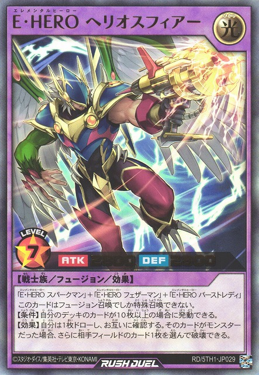

- **Zona y copias:** Extra **1x**. CID Rush: **21501**.
- **Rol funcional:** Monstruo de Fusión — objetivo de Fusión con materiales expresos y efecto de cierre.
- **Estado de sinergia y función:** Destino Extra condicionado. Es una clasificación de juego; revisar la relación concreta en A06.
- **Papel como recurso, descarte o coste:** Material o destino del Extra condicionado a los requisitos de invocación.
- **Requisito específico:** Solo Invocación por Fusión; materiales Sparkman + Avian + Burstinatrix. Tener al menos diez cartas en el Deck.
- **Efecto / resultado concreto:** Robar y revelar una carta; si resulta ser monstruo, además puede destruir una carta del Campo rival.
- **Ir primero, segundo y juego tardío:** Primero: preparar materiales y «Fusión» si es alcanzable; segundo: considerar el efecto de campo o daño que se produzca tras una Fusión legal; tardío: comprobar si quedan materiales nombrados en campo y Extra.
- **Relación con habilidad y otras piezas:** La Skill local **HERO RUSH RISING** puede recuperar «Fusión» y debilitar un monstruo, pero exige sus condiciones globales Guerrero/LUZ y no se roba del Main.
- **Riesgos y dependencias:** el resultado está sujeto a monstruos/cartas que puedan ser afectados y a respuestas del rival. disponer de cartas suficientes en Deck y distinguir robo de búsqueda.
- **Confianza:** **RESUMEN_FUNCIONAL_DE_GUIA_PREVIA_CON_FUENTE_KONAMI**; pendiente cotejo adicional de traducción/ventanas según la liga. Fuente Rush oficial: https://www.db.yugioh-card.com/rushdb/card_search.action?cid=21501&ope=2
- **Contraste de fuente Rush:** CID 21501: fuente oficial Rush consultada en japonés; tipo Monstruo de Fusión; descripción funcional en español procede de la guía previa y sigue siendo interpretación editorial.
- **Aplicación concreta dentro de este deck (A06):** Robar y revelar una carta; si resulta ser monstruo, además puede destruir una carta del Campo rival. A06 identifica su destino, condicionado a material/procedimiento.

**USO PRÁCTICO Y SINERGIA — Héroe Elemental Heliosfera**

- **Label funcional:** Referencias de ruta localizadas; conexión reglamentaria sujeta al recorrido de la guía. Clasificación documental; una relación es válida solo si se satisfacen sus condiciones exactas.
- **Qué hace:** Robar y revelar una carta; si resulta ser monstruo, además puede destruir una carta del Campo rival.
- **Cómo aprovecharla en este deck:** Robar y revelar una carta; si resulta ser monstruo, además puede destruir una carta del Campo rival. A06 identifica su destino, condicionado a material/procedimiento.
- **Cuándo tener precaución:** el resultado está sujeto a monstruos/cartas que puedan ser afectados y a respuestas del rival. disponer de cartas suficientes en Deck y distinguir robo de búsqueda.

**CÓMO LLEGAR DESDE TU DECK — RUTAS DOCUMENTADAS**

- **Abrir guía `706:A09:VOLTIC:SECOND01C`:** entrada: 1× E·HERO Sparkman (20457, Nivel 4, 1600 ATK), 1× E·HERO Avian (20460, Nivel 3, 1000 ATK), 1× E·HERO Burstinatrix (20459, Nivel 3, 1200 ATK), 1× Mágica Fusión (16934). Campo propio vacío, Main Phase propia, al menos tres zonas libres, ninguna respuesta adversaria en esta rama. Extra con Voltic Wingman (21316), Flame Wingman (20453), Burst Wingman (20454), Heliosfera (21501). Skill casera HERO RUSH RISING (RD/SK01-003) aprobada localmente y sin uso previo relevante.. Propósito descrito: Preparación de recursos / despliegue. Consulta sus pasos, consumo y resultado; comprobar si esta carta es realmente invocada o solo mencionada.

#### 17. Héroe Elemental Shining Flare Wingman

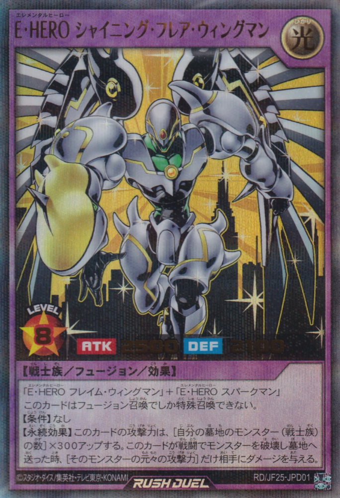

- **Zona y copias:** Extra **2x**. CID Rush: **20610**.
- **Rol funcional:** Monstruo de Fusión — objetivo de Fusión con materiales expresos y efecto de cierre.
- **Estado de sinergia y función:** Destino Extra condicionado. Es una clasificación de juego; revisar la relación concreta en A06.
- **Papel como recurso, descarte o coste:** Envío mencionado en la interacción; no equivale por sí mismo a descarte desde la mano.
- **Requisito específico:** Solo Invocación por Fusión; materiales Flame Wingman + Sparkman; efecto continuo.
- **Efecto / resultado concreto:** Gana 300 ATK por cada Guerrero en tu Cementerio; al destruir en batalla y enviar al Cementerio un monstruo, inflige daño igual a su ATK original.
- **Ir primero, segundo y juego tardío:** Primero: preparar materiales y «Fusión» si es alcanzable; segundo: considerar el efecto de campo o daño que se produzca tras una Fusión legal; tardío: comprobar si quedan materiales nombrados en campo y Extra.
- **Relación con habilidad y otras piezas:** La Skill local **HERO RUSH RISING** puede recuperar «Fusión» y debilitar un monstruo, pero exige sus condiciones globales Guerrero/LUZ y no se roba del Main.
- **Riesgos y dependencias:** el resultado está sujeto a monstruos/cartas que puedan ser afectados y a respuestas del rival.
- **Confianza:** **RESUMEN_FUNCIONAL_DE_GUIA_PREVIA_CON_FUENTE_KONAMI**; pendiente cotejo adicional de traducción/ventanas según la liga. Fuente Rush oficial: https://www.db.yugioh-card.com/rushdb/card_search.action?cid=20610&ope=2
- **Contraste de fuente Rush:** CID 20610: fuente oficial Rush consultada en japonés; tipo Monstruo de Fusión; descripción funcional en español procede de la guía previa y sigue siendo interpretación editorial.
- **Aplicación concreta dentro de este deck (A06):** Gana 300 ATK por cada Guerrero en tu Cementerio; al destruir en batalla y enviar al Cementerio un monstruo, inflige daño igual a su ATK original. A06 identifica su destino, condicionado a material/procedimiento.

**USO PRÁCTICO Y SINERGIA — Héroe Elemental Shining Flare Wingman**

- **Label funcional:** Referencias de ruta localizadas; conexión reglamentaria sujeta al recorrido de la guía. Clasificación documental; una relación es válida solo si se satisfacen sus condiciones exactas.
- **Qué hace:** Gana 300 ATK por cada Guerrero en tu Cementerio; al destruir en batalla y enviar al Cementerio un monstruo, inflige daño igual a su ATK original.
- **Cómo aprovecharla en este deck:** Gana 300 ATK por cada Guerrero en tu Cementerio; al destruir en batalla y enviar al Cementerio un monstruo, inflige daño igual a su ATK original. A06 identifica su destino, condicionado a material/procedimiento.
- **Cuándo tener precaución:** el resultado está sujeto a monstruos/cartas que puedan ser afectados y a respuestas del rival.

**CÓMO LLEGAR DESDE TU DECK — RUTAS DOCUMENTADAS**

- **Abrir guía `706:A09:SHINING:DOUBLE01`:** entrada: 1× Avian (20460), 1× Burstinatrix (20459), 1× Sparkman (20457), 2× Fusión (16934). Las dos copias de Fusión existen en el Main registrado. Campo y GY propios vacíos; Extra con Flame Wingman (20453) y Shining Flare Wingman (20610). Sin respuesta rival; Skill HERO RUSH RISING no utilizada.. Propósito descrito: Ofensivo condicional. Consulta sus pasos, consumo y resultado; comprobar si esta carta es realmente invocada o solo mencionada.

## SINERGIAS Y MOTORES
## RESUMEN FUNCIONAL DE SINERGIAS — 706

**Medición descriptiva de etiquetas existentes (NO certificación):** 12/17 identidades con etiqueta directa/indirecta (70.6 %). Main: 12/12 (100.0 %); Extra: 0/5 (0.0 %). Se cuenta una identidad una sola vez; una carta autónoma puede ser útil sin sinergia de motor. Estas cifras provienen de clasificaciones documentales A05/A06: **no son el porcentaje final de sinergias verificadas**, ni una tasa estadística de victoria. Para promoverlas a métricas verificadas, se deben comprobar los pares de cartas y su operación legal.

#### A06.0 — En 30 segundos: cómo cooperan realmente estas cartas

- **Dictamen de conjunto:** Fusion HERO Rush funcional, condicionado a materiales nombrados y recuperación; el núcleo depende de Normales que deben estar disponibles en Campo.
- **Motor que mueve el deck:** Avian, Sparkman y Burstinatrix aportan materiales nombrados para Wingman, Voltic y otras Fusiones según texto, carta Fusión y objetivo correcto.
- **Puentes reales:** Argen, Inicio Reinicio, Descenso y Circulación Elemental mejoran acceso o reciclaje; la Skill HERO RUSH RISING recupera Fusión y afecta un objetivo cuando cumple sus requisitos.
- **Sinergia indirecta:** conservar Normales por ser materiales, aunque no tengan efecto; un extensor que busca no garantiza reunir simultáneamente la pareja de Fusión.
- **Conflicto decisivo:** Shining Flare Wingman requiere al propio Flame Wingman según su texto; Argen excava y no promete búsqueda garantizada; Descenso impone límites de nivel/ataque.
- **Decisión concreta:** revisar copias de Normales y su recuperación antes de sustituirlos; no atribuir Fusiones extra a una sola carta de búsqueda.
- **Qué aprender después:** elegir qué Fusión puede construirse con la mano/campo actuales y luego seguir los pasos exactos.

#### Motores de Guerreros Normales y Fusión

1. **Tres materiales principales.** **Héroe Elemental Avian** (CID 20460), **Sparkman** (20457) y **Burstinatrix** (20459) son **Normales** del Main. Sus nombres se requieren literalmente en el Extra: **Voltic Wingman** (21316) necesita Sparkman + Avian; **Estallido Wingman** (20454) y **Llama Wingman** (20453) necesitan Avian + Burstinatrix; **Heliosfera** (21501) necesita los tres. **Shining Flare Wingman** (20610) exige **Llama Wingman + Sparkman**, no tres Normales directos.
2. **Selección y recuperación de materiales.** **Héroe Ascendente de Argen** (20461) revela una Fusión Guerrero de Nivel 6 o 7 del Extra y examina las cuatro cartas superiores; puede añadir hasta **dos Normales nombrados como materiales** de esa Fusión **si aparecen**. No es búsqueda segura desde todo el Deck. **Inicio Reinicio** (16929) coloca una carta de mano al fondo del Deck para revivir un Normal de Nivel 5 o menor del GY y puede recuperar **Fusión** del GY.
3. **Extensión del Cementerio.** **Descenso de Héroe** (20665) recupera en Defensa boca arriba hasta dos monstruos Normales Guerrero válidos del GY con **suma de Niveles máximo 7** y restringe ataques a Guerreros. Sirve para reunir materiales, pero no hace una Fusión por sí misma. **Fusión** Rush (16934) envía materiales **boca arriba desde Campo propio**, de modo que los monstruos recuperados deben estar efectivamente disponibles antes de activarla.
4. **Consistencia y coste de mano.** **Circulación Elemental** (20465) revela una Fusión Guerrero Nivel 6/7, envía de la mano un Guerrero nombrado material de ella, roba tres y manda una carta de mano al GY. Por el resto del turno bloquea la activación de efectos de monstruos **no Guerrero**, que puede afectar apoyos de otros Tipos. No equivale a Invocar el monstruo descartado ni garantiza robar «Fusión».
5. **Extra por etapas, no un solo objetivo.** **Llama Wingman** gana daño tras destruir en batalla y enviar monstruo al GY; **Estallido Wingman** potencia Guerrero y puede destruir M/T si paga su envío de carta superior; **Voltic Wingman** puede, durante su turno de Invocación, devolver materiales del GY al Deck y realizar otra Fusión Guerrero permitida con materiales legales. **Shining Flare Wingman** necesita tener **Llama Wingman** como material original nombrado y más Sparkman; no se salta ese requisito por el efecto de Voltic.
6. **HERO RUSH RISING (RD/SK01-003).** Habilidad local, no robable: envía una carta **de tu Campo** al GY, requiere composición específica del Deck (monstruos con 1600+ ATK Guerrero/LUZ y Extra Guerrero), reduce 600 ATK/DEF a un monstruo boca arriba y **puede añadir Fusión** desde Deck/GY. El coste de campo compite con cuerpos que se necesitan para Fusión; deben verificarse las reglas locales y el estado de campo antes de contar ese acceso.
7. **Apoyo y defensa.** **Estrategia Mágica Aviar** (16358) exige dos o más Guerreros/Bestias Aladas boca arriba en conjunto, destruye M/T rival y puede devolver recurso adecuado del GY al tope del Deck. **Brillo Sombrío** (20151) actúa ante una Invocación rival enviando carta de mano al GY y cambiando hasta dos monstruos de efecto a Defensa boca abajo; **Agujero Trampa** (15913) responde a Invocación Normal específica.

#### Mapa de materiales y enlaces con imágenes pendientes

| Referencias por CID | Ruta de sinergia | Requisito verificable | Visual |
|---|---|---|---|
| Argen (20461) → Avian (20460) / Sparkman (20457) / Burstinatrix (20459) | Excavar cuatro cartas para encontrar hasta dos Normales nombrados. | Revelar Fusión Guerrero Nivel 6 o 7 apropiada; resultado no garantizado. |     |
| Inicio Reinicio (16929) / Descenso de Héroe (20665) → Normales al Campo | Recuperar materiales del Cementerio. | Normal Nivel ≤5 o dos Guerreros con suma ≤7; destino Defensa donde corresponda. |   |
| Avian + Burstinatrix + Fusión (16934) → Llama (20453) / Estallido (20454) | Elegir una de dos Fusiones con mismos materiales. | Ambas cartas boca arriba en tu Campo y Fusión activable. |    |
| Sparkman + Avian + Fusión → Voltic (21316) | Fusión con potencial extensión desde GY. | Materiales en Campo y condiciones de su efecto de continuación. |  |
| Llama Wingman (20453) + Sparkman (20457) → Shining Flare (20610) | Segunda Fusión de materiales nombrados. | Obtener efectivamente Llama Wingman como material y usar Fusión válida. |    |
| Skill HERO RUSH RISING → Fusión | Acceso a carta de Fusión y ajuste de combate. | Composición aprobada y envío real de carta propia en Campo. | 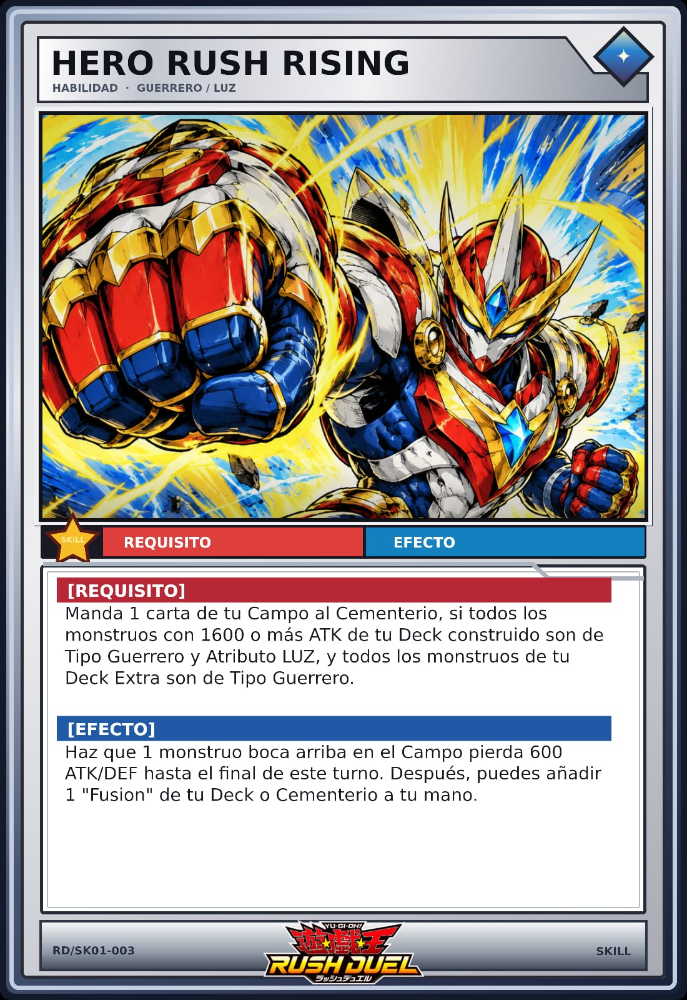 |

#### Conflictos, recursos y alcance

- **Mismos Normales, destinos distintos:** Avian/Burstinatrix producen dos Wingman; Sparkman sirve en Voltic, Heliosfera y Shining Flare. Si los materiales fueron enviados al GY, una siguiente Fusión necesita recuperarlos legalmente.
- **Heliosfera** exige los tres Normales y al menos diez cartas restantes del Deck para su efecto; el robo/revelado no equivale a destrucción asegurada.
- **Bloqueos de Tipo:** Circulación Elemental impide activar efectos de monstruos no Guerrero por el resto del turno; Descenso de Héroe solo deja atacar a Guerreros. Comprobar si cada pieza invocada cumple antes de usarla.
- **Sin Side/Reserva:** no se inventan materiales externos ni nuevas cartas para conseguir Shining Flare.

#### Skill personalizada y motor — HERO RUSH RISING

- **Identidad y zona:** RD/SK01-003; habilidad separada de Main/Extra/Side/Reserva, no robable.
- **Requisito de la imagen:** Envía 1 carta del campo propio al GY; todos los monstruos de 1600+ ATK del Deck deben ser Guerrero/LUZ y todos los del Extra Guerrero.
- **Efecto de la imagen:** Un monstruo boca arriba pierde 600 ATK/DEF hasta final del turno; después puede añadirse 1 Fusión del Deck/GY.
- **Sinergia:** Habilita acceso a Fusión con Avian, Sparkman y Burstinatrix disponibles en campo; la rebaja de estadísticas es apoyo de combate.
- **Dependencias/riesgo:** Enviar la carta de campo consume un recurso que podría ser material de Fusión.
- **Clasificación:** habilitador o extensión, no combo completo. Texto e imagen aportados por Miguel; no inferir límites por turno no escritos.

#### A06.1 — Arquitectura operativa de los motores (síntesis no redundante)

Las siguientes filas son **relaciones funcionales**, no secuencias certificadas ni garantía de mano inicial. La lista real y los límites están en A04/A05/A07.

| Tipo / motor | Starter o vía de acceso real | Recurso y destino | Cuello de botella |
|---|---|---|---|
| **Principal: HERO Rush Fusión** | Avian, Sparkman, Burstinatrix y Fusión | Wingman/Voltic/Heliosfera con materiales nombrados | Normales boca arriba en Campo y objetivo correcto; Shining Flare pide Llama Wingman |
| **Submotor: recuperación/consistencia** | Argen, Inicio Reinicio, Descenso, Circulación Elemental | Encontrar o recuperar Normales para la Fusión | Argen excava, no garantiza búsqueda; Descenso limita niveles y ataques |
| **Habilitador: Skill** | HERO RUSH RISING | Recuperar Fusión y debilitar un objetivo | Consume carta propia de Campo y composición de Deck; reglamento local |

#### A06.2 — Estado funcional y justificación de TODAS las cartas

**Cómo leerlo:** un estado de sinergia describe el papel **de juego**, no el avance de una auditoría. No hay obligación de que cada carta tenga un enlace con otra: una defensa autónoma, una herramienta de Side o un recurso de descarte justificado también tiene propósito. Las relaciones directas descritas aquí se deben contrastar con los textos oficiales antes de representarlas como una ruta legal A09.

| Carta / CID y zona | Estado funcional de sinergia | Motivo de inclusión | Relación y condición concreta | Papel como coste, descarte o material | Límite o riesgo | Decisión táctica |
|---|---|---|---|---|---|---|
| **Héroe Elemental Avian** (CID 20460) — Main 3x | **Sinergia indirecta (soporte o recursos)** | Monstruo Normal — material de Fusión/Sacrificio o presencia de combate; sin efecto activado | Monstruo Normal; material nombrado para las Fusiones Wingman y Heliosfera | Material o destino del Extra condicionado a los requisitos de invocación | No tiene efecto | Conservar; verificar coste y orden |
| **Héroe Elemental Sparkman** (CID 20457) — Main 3x | **Sinergia indirecta (soporte o recursos)** | Monstruo Normal — material de Fusión/Sacrificio o presencia de combate; sin efecto activado | Monstruo Normal de 1600 ATK; se emplea como material nombrado de Voltic Wingman, Heliosfera y Shining Flare Wingman | Material o destino del Extra condicionado a los requisitos de invocación | No tiene efecto | Conservar; verificar coste y orden |
| **Héroe Elemental Burstinatrix** (CID 20459) — Main 3x | **Sinergia indirecta (soporte o recursos)** | Monstruo Normal — material de Fusión/Sacrificio o presencia de combate; sin efecto activado | Monstruo Normal; material nombrado de Burst Wingman, Flame Wingman y Heliosfera | Material o destino del Extra condicionado a los requisitos de invocación | No tiene efecto | Conservar; verificar coste y orden |
| **Héroe Ascendente de Argen** (CID 20461) — Main 3x | **Sinergia directa descrita** | Monstruo de Efecto — consistencia / reciclaje | Revelar las cuatro cartas superiores del Deck; añadir hasta dos monstruos Normales nombrados como material de esa Fusión y colocar las restantes en el fondo del Deck en el orden elegido | Material o destino del Extra condicionado a los requisitos de invocación | Revelar un monstruo Fusión Guerrero de Nivel 6 o 7 del Extra Deck | Conservar; verificar coste y orden |
| **Inicio Reinicio** (CID 16929) — Main 3x | **Sinergia directa descrita** | Carta Mágica Normal — recurso táctico cuya condición y resultado están descritos en su ficha | Invoca un monstruo Normal de Nivel 5 o menor del Cementerio y opcionalmente recupera una Fusión de ese Cementerio | Coste o consumo descrito en A05: la condición de una Mágica/Trampa y sus blancos deben cumplirse antes de resolver. No confundir esta carta con un monstruo… | Colocar una carta de la mano al fondo del Deck | Conservar; verificar coste y orden |
| **Descenso de Héroe** (CID 20665) — Main 3x | **Sinergia directa descrita** | Carta Mágica Normal — extensor / habilitador de material | Invoca desde el Cementerio, en Defensa boca arriba, hasta dos objetivos permitidos (Neo-Espaciales específicos o Guerreros Normales) cuyos Niveles sumen como máximo siete | Coste o consumo descrito en A05: comprobar zona, objetivos y ventana; el nombre de la carta no reemplaza su texto | Sin requisito de activación | Conservar; verificar coste y orden |
| **Brillo Sombrío** (CID 20151) — Main 3x | **Sinergia directa descrita** | Carta de Trampa Normal — consistencia / reciclaje | Pone hasta dos monstruos de Efecto boca arriba de cualquier Campo boca abajo en Defensa; si incluyó un monstruo rival con ATK original de al menos 2600, recupera 1500 LP | Coste o consumo descrito en A05: pagar/cumplir el requisito escrito antes de prometer la resolución | Cuando el rival Invoca un monstruo en su turno; enviar una carta de la mano al Cementerio | Conservar; verificar coste y orden |
| **Circulación Elemental** (CID 20465) — Main 3x | **Sinergia indirecta (soporte o recursos)** | Carta Mágica Normal — consistencia / reciclaje | Roba tres, luego manda una carta de la mano al Cementerio | Coste o consumo descrito en A05: pagar/cumplir el requisito escrito antes de prometer la resolución. disponer de cartas suficientes en Deck y distinguir robo… | Revelar una Fusión Guerrero de Nivel 6 o 7 del Extra y enviar de la mano un Guerrero cuyo nombre sea material de esa Fusión | Conservar; verificar coste y orden |
| **Estrategia Mágica Aviar** (CID 16358) — Main 2x | **Sinergia indirecta (soporte o recursos)** | Carta Mágica Normal — removal / apertura de campo | Destruye una Mágica/Trampa rival; luego puedes devolver al tope del Deck un Guerrero o Bestia Alada de Nivel 8 o menor del Cementerio | Coste o consumo descrito en A05: el resultado está sujeto a monstruos/cartas que puedan ser afectados y a respuestas del rival | Controlar en conjunto dos o más Guerreros y/o Bestias Aladas boca arriba | Conservar; verificar coste y orden |
| **Fusión** (CID 16934) — Main 2x | **Sinergia indirecta (soporte o recursos)** | Carta Mágica Normal — extensor / habilitador de material | Usa monstruos boca arriba del Campo propio como materiales, enviándolos al Cementerio para una Invocación por Fusión válida; no usa automáticamente materiales de la mano | Material o destino del Extra condicionado a los requisitos de invocación | Sin requisito de activación | Conservar; verificar coste y orden |
| **Agujero Trampa** (CID 15913) — Main 1x | **Sinergia indirecta (soporte o recursos)** | Carta de Trampa Normal — extensor / habilitador de material | Destruye ese monstruo invocado | Coste o consumo descrito en A05: el resultado está sujeto a monstruos/cartas que puedan ser afectados y a respuestas del rival | Cuando el rival Invoca de Modo Normal un monstruo de al menos 1000 ATK | Conservar; verificar coste y orden |
| **Olla de la Codicia** (CID 16372) — Main 1x | **Sinergia indirecta de recursos** | Carta Mágica Normal — consistencia / reciclaje | Roba dos cartas. Aportación posible como material, coste o objetivo; verificar consumidor | Material o destino del Extra condicionado a los requisitos de invocación | Sin requisito de activación | Conservar si existe consumidor legal |
| **Héroe Elemental Voltic Wingman** (CID 21316) — Extra 2x | **Destino Extra condicionado** | Monstruo de Fusión — objetivo de Fusión con materiales expresos y efecto de cierre | Devuelve al Deck monstruos del Cementerio empleados como materiales y realiza una Fusión de un monstruo Guerrero Nivel 6 a 8 que solo se pueda Invocar por Fusión | Material o destino del Extra condicionado a los requisitos de invocación | Solo Invocación por Fusión; materiales Sparkman + Avian. Efecto en Main Phase propia en que fue Invocado de Modo Especial | Conservar si hay materiales legales |
| **Héroe Elemental del Estallido Wingman** (CID 20454) — Extra 2x | **Destino Extra condicionado** | Monstruo de Fusión — objetivo de Fusión con materiales expresos y efecto de cierre | Aumenta 1000 ATK de un Guerrero propio boca arriba hasta el final del siguiente turno rival; después puede destruir una Mágica/Trampa rival | Material o destino del Extra condicionado a los requisitos de invocación | Solo Invocación por Fusión; materiales Avian + Burstinatrix. Enviar la primera carta del Deck al Cementerio | Conservar si hay materiales legales |
| **Héroe Elemental de la Llama Wingman** (CID 20453) — Extra 1x | **Destino Extra condicionado** | Monstruo de Fusión — objetivo de Fusión con materiales expresos y efecto de cierre | Si destruye en batalla un monstruo y lo manda al Cementerio, inflige daño igual al ATK original de ese monstruo | Material o destino del Extra condicionado a los requisitos de invocación | Solo Invocación por Fusión; materiales Avian + Burstinatrix. Efecto continuo sin requisito activado | Conservar si hay materiales legales |
| **Héroe Elemental Heliosfera** (CID 21501) — Extra 1x | **Destino Extra condicionado** | Monstruo de Fusión — objetivo de Fusión con materiales expresos y efecto de cierre | Robar y revelar una carta; si resulta ser monstruo, además puede destruir una carta del Campo rival | Material o destino del Extra condicionado a los requisitos de invocación | Solo Invocación por Fusión; materiales Sparkman + Avian + Burstinatrix. Tener al menos diez cartas en el Deck | Conservar si hay materiales legales |
| **Héroe Elemental Shining Flare Wingman** (CID 20610) — Extra 2x | **Destino Extra condicionado** | Monstruo de Fusión — objetivo de Fusión con materiales expresos y efecto de cierre | Gana 300 ATK por cada Guerrero en tu Cementerio; al destruir en batalla y enviar al Cementerio un monstruo, inflige daño igual a su ATK original | Envío mencionado en la interacción; no equivale por sí mismo a descarte desde la mano | Solo Invocación por Fusión; materiales Flame Wingman + Sparkman; efecto continuo | Conservar si hay materiales legales |

## INTERACCIONES Y CLASIFICACIÓN

| ID documental | Categoría provisional | Piezas | Resultado | Requisitos | Check |
|---|---|---|---|---|---|
| 706:A08:01 | STARTER | Argen (20461) → Avian (20460) / Sparkman (20457) / Burstinatrix (20459) | Excavar cuatro cartas para encontrar hasta dos Normales nombrados. | Revelar Fusión Guerrero Nivel 6 o 7 apropiada; resultado no garantizado. | |
| 706:A08:02 | EXTENSION | Inicio Reinicio (16929) / Descenso de Héroe (20665) → Normales al Campo | Recuperar materiales del Cementerio. | Normal Nivel ≤5 o dos Guerreros con suma ≤7; destino Defensa donde corresponda. | |
| 706:A08:03 | RUTA | Avian + Burstinatrix + Fusión (16934) → Llama (20453) / Estallido (20454) | Elegir una de dos Fusiones con mismos materiales. | Ambas cartas boca arriba en tu Campo y Fusión activable. |; guía A10 documental generada; legalidad A11–A13 pendiente (`706:A09:AVIAN:BURST01A/B`). |
| 706:A08:04 | RUTA | Sparkman + Avian + Fusión → Voltic (21316) | Fusión con potencial extensión desde GY. | Materiales en Campo y condiciones de su efecto de continuación. | |
| 706:A08:05 | RUTA | Llama Wingman (20453) + Sparkman (20457) → Shining Flare (20610) | Segunda Fusión de materiales nombrados. | Obtener efectivamente Llama Wingman como material y usar Fusión válida. | |

#### Rol registrado por cada carta

| ID A08 | Carta registrada | Zona | Clasificación funcional | Rol documentado en A05 | Check de clasificación |
|---|---|---|---|---|---|
| 706:A08:C001 | Héroe Elemental Avian | Main | RECURSO_MATERIAL | Monstruo Normal — material de Fusión/Sacrificio o presencia de combate; sin efecto activado. | |
| 706:A08:C002 | Héroe Elemental Sparkman | Main | RECURSO_MATERIAL | Monstruo Normal — material de Fusión/Sacrificio o presencia de combate; sin efecto activado. | |
| 706:A08:C003 | Héroe Elemental Burstinatrix | Main | RECURSO_MATERIAL | Monstruo Normal — material de Fusión/Sacrificio o presencia de combate; sin efecto activado. | |
| 706:A08:C004 | Héroe Ascendente de Argen | Main | FUNCION_A05 (recurso jugable sujeto a condición) | Monstruo de Efecto — consistencia / reciclaje. | |
| 706:A08:C005 | Inicio Reinicio | Main | FUNCION_A05 (recurso jugable sujeto a condición) | Carta Mágica Normal — recurso táctico cuya condición y resultado están descritos en su ficha. | |
| 706:A08:C006 | Descenso de Héroe | Main | EXTENSOR_POTENCIAL | Carta Mágica Normal — extensor / habilitador de material. | |
| 706:A08:C007 | Brillo Sombrío | Main | FUNCION_A05 (recurso jugable sujeto a condición) | Carta de Trampa Normal — consistencia / reciclaje. | |
| 706:A08:C008 | Circulación Elemental | Main | FUNCION_A05 (recurso jugable sujeto a condición) | Carta Mágica Normal — consistencia / reciclaje. | |
| 706:A08:C009 | Estrategia Mágica Aviar | Main | FUNCION_A05 (recurso jugable sujeto a condición) | Carta Mágica Normal — removal / apertura de campo. | |
| 706:A08:C010 | Fusión | Main | EXTENSOR_POTENCIAL | Carta Mágica Normal — extensor / habilitador de material. | |
| 706:A08:C011 | Agujero Trampa | Main | EXTENSOR_POTENCIAL | Carta de Trampa Normal — extensor / habilitador de material. | |
| 706:A08:C012 | Olla de la Codicia | Main | FUNCION_A05 (recurso jugable sujeto a condición) | Carta Mágica Normal — consistencia / reciclaje. | |
| 706:A08:C013 | Héroe Elemental Voltic Wingman | Extra | DESTINO_EXTRA (materiales/procedimiento por comprobar) | Monstruo de Fusión — objetivo de Fusión con materiales expresos y efecto de cierre. | |
| 706:A08:C014 | Héroe Elemental del Estallido Wingman | Extra | DESTINO_EXTRA (materiales/procedimiento por comprobar) | Monstruo de Fusión — objetivo de Fusión con materiales expresos y efecto de cierre. | |
| 706:A08:C015 | Héroe Elemental de la Llama Wingman | Extra | DESTINO_EXTRA (materiales/procedimiento por comprobar) | Monstruo de Fusión — objetivo de Fusión con materiales expresos y efecto de cierre. | |
| 706:A08:C016 | Héroe Elemental Heliosfera | Extra | DESTINO_EXTRA (materiales/procedimiento por comprobar) | Monstruo de Fusión — objetivo de Fusión con materiales expresos y efecto de cierre. | |
| 706:A08:C017 | Héroe Elemental Shining Flare Wingman | Extra | DESTINO_EXTRA (materiales/procedimiento por comprobar) | Monstruo de Fusión — objetivo de Fusión con materiales expresos y efecto de cierre. | |

## JUGADAS DOCUMENTADAS

> Requieren comprobación A11–A13 y validación de estado final. No publicar las rutas como combos certificados por tener fotografías.

#### A09 — Dos rutas alternativas `706:A09:AVIAN:BURST01A/B`

- **Mano inicial mínima:** 1× **E·HERO Avian** (20460), 1× **E·HERO Burstinatrix** (20459), 1× Mágica Normal **Fusión** (16934). Campo propio vacío, Main Phase propia, dos zonas libres; Extra contiene 1× **Flame Wingman** (20453) y 1× **Burst Wingman** (20454). Rivales sin respuestas en esta rama. Ninguna carta se pone en mano por la Skill.
- **Paso 1:** Invocar Normalmente a Avian (Guerrero Nivel 3, 1000 ATK) boca arriba. **Rush permite múltiples Invocaciones Normales por turno**; no aplicar la limitación TCG de una Normal.
- **Paso 2:** Invocar Normalmente a Burstinatrix (Guerrero Nivel 3, 1200 ATK) boca arriba en otra zona.
- **Paso 3:** activar **Fusión**. Su efecto envía **los dos monstruos boca arriba desde tu Campo al Cementerio como materiales** y permite Invocar por Fusión desde Extra **uno** de los dos siguientes, que nombran exactamente a Avian + Burstinatrix:

| Rama | Monstruo del Extra | Resultado exacto y límite |
|---|---|---|
| `01A` | **E·HERO Flame Wingman** (20453), Nivel 6, ATK 2100 | En Campo; si destruye un monstruo en batalla y lo manda al GY, su efecto continuo inflige daño igual al ATK original de ese monstruo. No ocurre daño automáticamente al Invocar. |
| `01B` | **E·HERO Burst Wingman** (20454), Nivel 6, ATK 2100 | En Campo; puede enviar la carta superior del Deck al GY para activar su efecto, dar +1000 ATK a un Guerrero propio boca arriba hasta el final del siguiente turno rival y opcionalmente destruir 1 Mágica/Trampa rival. No se promete destrucción si el rival carece de M/T. |

**Traza A09 de zonas al terminar cada paso de `706:A09:AVIAN:BURST01A` (salida Flame Wingman):** esta variante termina en Flame; la carta Burst Wingman permanece en Extra. Ningún efecto de daño por batalla se adjudica al Invocarlo.

| Hito | Mano | Monstruos | M/T | Cementerio | Destierro propio | Estado rival | Materiales | Normal y Extra |
|---|---|---|---|---|---|---|---|---|
| P1 | Burstinatrix #20459 y Fusión #16934 | E·HERO Avian #20460 (Ataque, 1000 ATK) | — | — | — | Rival sin respuestas; monstruos adversarios no determinados por esta apertura | — | Rush: primera Normal realizada, otras permitidas; Skill HERO RUSH RISING no usada; Flame y Burst en Extra |
| P2 | Fusión #16934 | Avian #20460 (Ataque), Burstinatrix #20459 (Ataque, 1200 ATK) | — | — | — | Ninguna interacción rival demostrada | Dos monstruos independientes; aún no son materiales acoplados | Rush: dos Normales realizadas; Skill intacta; dos Fusiones disponibles en Extra |
| P3 | — | E·HERO Flame Wingman #20453 (Ataque, 2100 ATK) | — | Avian #20460, Burstinatrix #20459 y Fusión #16934 en GY | — | No se destruyó monstruo rival por batalla, daño por efecto = 0 acreditado | Fusión: Avian y Burstinatrix enviados a GY; no Xyz | Rush: Skill no usada; Flame salió del Extra y Burst sigue disponible |

**Traza A09 de zonas al terminar cada paso de `706:A09:AVIAN:BURST01B` (salida Burst Wingman):** no se activa automáticamente el efecto opcional de Burst ni se presupone M/T rival para destruir.

| Hito | Mano | Monstruos | M/T | Cementerio | Destierro propio | Estado rival | Materiales | Normal y Extra |
|---|---|---|---|---|---|---|---|---|
| P1 | Burstinatrix #20459 y Fusión #16934 | E·HERO Avian #20460 (Ataque, 1000 ATK) | — | — | — | Rival sin respuestas; Campo adversario no definido | — | Rush: primera Normal realizada, otras permitidas; Skill no usada |
| P2 | Fusión #16934 | Avian #20460 (Ataque), Burstinatrix #20459 (Ataque, 1200 ATK) | — | — | — | Sin respuesta ni destrucción rival demostrada | Dos cuerpos propios independientes antes de Fusionar | Rush: dos Normales realizadas; Skill intacta |
| P3 | — | E·HERO Burst Wingman #20454 (Ataque, 2100 ATK, sin +1000 aplicado) | — | Avian #20460, Burstinatrix #20459 y Fusión #16934 en GY | — | No se consumió carta superior del Deck ni se destruyó M/T rival en esta línea | Fusión: Avian y Burstinatrix enviados al GY; no materiales Xyz | Rush: Skill no usada; Burst salió del Extra y Flame sigue disponible |

- **Campo final elegido:** solo **una** de esas dos Fusiones. Avian y Burstinatrix en GY, Fusión activada al GY, mano mínima agotada. La otra Fusión permanece en Extra. Sin OTK, más cuerpos ni negaciones supuestos.
- **Skill HERO RUSH RISING:** disponible como mecanismo local independiente; **NO se activa** en esta apertura. Su coste de enviar una carta propia del Campo al GY podría quitar un material indispensable. No contarla como una cuarta carta inicial.
- **Fuentes primarias Rush Neuron:** [Fusión](https://www.db.yugioh-card.com/rushdb/card_search.action?cid=16934&ope=2), [Avian](https://www.db.yugioh-card.com/rushdb/card_search.action?cid=20460&ope=2), [Burstinatrix](https://www.db.yugioh-card.com/rushdb/card_search.action?cid=20459&ope=2), [Flame Wingman](https://www.db.yugioh-card.com/rushdb/card_search.action?cid=20453&ope=2), [Burst Wingman](https://www.db.yugioh-card.com/rushdb/card_search.action?cid=20454&ope=2). **Estado:**; A10 y pruebas adicionales pendientes.

#### A09 — Tres destinos contrastados `706:A09:VOLTIC:SECOND01A/B/C` (Voltic + Hero Rush Rising)

- **Objetivo:** realizar una primera Fusión de **Voltic Wingman**, mandar el tercer HERO al GY con la Skill y usar el **efecto del propio Voltic** para ejecutar una segunda Fusión **exclusivamente con monstruos del GY** devueltos al Deck. Los destinos A, B y C son **mutuamente excluyentes** con esta mano; **no** son tres Fusiones simultáneas.
- **Mano inicial exacta:** 1× **E·HERO Sparkman** (20457, Nivel 4, 1600 ATK), 1× **E·HERO Avian** (20460, Nivel 3, 1000 ATK), 1× **E·HERO Burstinatrix** (20459, Nivel 3, 1200 ATK), 1× Mágica **Fusión** (16934). Campo propio vacío, Main Phase propia, al menos tres zonas libres, ninguna respuesta adversaria en esta rama. Extra con **Voltic Wingman** (21316), **Flame Wingman** (20453), **Burst Wingman** (20454), **Heliosfera** (21501). Skill casera **HERO RUSH RISING** (RD/SK01-003) aprobada localmente y sin uso previo relevante.
- **Restricción de Skill comprobada:** en el Main registrado, el único monstruo con **1600 o más ATK** es **Sparkman**, **Guerrero/LUZ**; Avian (1000), Burstinatrix (1200) y Rising HERO Argen (1000) están por debajo. Todas las Fusiones del Extra son Guerreros. Skill **fuera de la mano**, no es una carta robada. No modificar listas ni copias.

1. **Invocar Normalmente Sparkman**, **Avian** y **Burstinatrix** en **Ataque boca arriba**, ocupando tres zonas. En Rush son posibles múltiples Normales en el mismo turno.
2. Activar **Fusión** (Mágica Normal) usando **Sparkman + Avian boca arriba en Campo**; mandar esos dos materiales al GY y Fusionar **Voltic Wingman** (Nivel 5, 2000 ATK). Burstinatrix **permanece en Campo**. La Mágica Fusión queda en GY.
3. Activar la **Skill HERO RUSH RISING**: enviar **Burstinatrix desde el Campo al GY** como requisito. El GY contiene ahora **Sparkman + Avian + Burstinatrix + Fusión**.
4. Elegir **Voltic Wingman** como monstruo boca arriba para que pierda **600 ATK/DEF hasta el final de este turno**: 2000→**1400 ATK**, 1600→**1000 DEF**. Después, usar la opción de la Skill para **añadir desde el GY la Mágica Fusión a la mano**. No se ha supuesto un monstruo rival disponible para debilitar.
5. Activar el efecto de **Voltic Wingman en la Main Phase en que fue Invocado Especialmente**. Ese efecto permite una Fusión de un Guerrero de Nivel **6 a 8** que solo pueda ser Invocado por Fusión, **devolviendo materiales desde el GY al Deck**. Elegir **una sola** de estas salidas:

| Rama | Materiales devueltos desde GY al Deck | Segunda Fusión legal | Campo final propio y recurso restante |
|---|---|---|---|
| `01A` | **Avian + Burstinatrix** | **Flame Wingman** (20453, Nivel 6, 2100 ATK) | **Voltic 1400 ATK** (debuff temporal) + **Flame 2100 ATK**; **Sparkman permanece en GY**; **Fusión en mano**. Flame no quema por el mero hecho de ser Invocado. |
| `01B` | **Avian + Burstinatrix** | **Burst Wingman** (20454, Nivel 6, 2100 ATK) | **Voltic 1400 ATK + Burst 2100 ATK**; **Sparkman permanece en GY**; **Fusión en mano**. Opcional: enviar la carta superior del Deck al GY para dar **+1000 ATK a un Guerrero propio** (si se elige Burst: **3100 ATK** hasta final del próximo turno rival) y poder destruir una M/T rival si existe. |
| `01C` | **Sparkman + Avian + Burstinatrix** | **Heliosfera** (21501, Nivel 7, 2800 ATK) | **Voltic 1400 ATK + Heliosfera 2800 ATK**; **los tres Normales vuelven al Deck**; **Fusión en mano**. Como el Deck tiene al menos 10 cartas, Heliosfera puede **robar 1** y, solo si lo robado es monstruo, **puede** destruir una carta rival. No presumir el tipo de carta robada. |

**Traza A09 de zonas al terminar cada paso de `706:A09:VOLTIC:SECOND01A` (segunda Fusión Flame):** solo en P5 salen del GY los dos materiales Avian y Burstinatrix; Sparkman permanece como recurso real en GY.

| Hito | Mano | Monstruos | M/T | Cementerio | Destierro propio | Estado rival | Materiales | Normal y Extra |
|---|---|---|---|---|---|---|---|---|
| P1 | Fusión #16934 | Sparkman #20457 (Ataque), Avian #20460 (Ataque), Burstinatrix #20459 (Ataque) | — | — | — | Campo rival no determinado; sin respuestas | Tres monstruos independientes, todavía sin Fusionar | Rush: tres Normales realizadas; Skill HERO RUSH RISING intacta; Voltic y Flame en Extra |
| P2 | — | Voltic Wingman #21316 (Ataque, 2000 ATK), Burstinatrix #20459 (Ataque) | — | Sparkman #20457, Avian #20460 y Fusión #16934 en GY | — | Sin efectos adversarios acreditados | Primera Fusión: Sparkman y Avian al GY; Burstinatrix sigue en Campo | Skill intacta; Voltic usado del Extra; Flame disponible |
| P3 | — | Voltic Wingman #21316 (Ataque, 2000 ATK) | — | Sparkman, Avian, Burstinatrix #20459 y Fusión en GY | — | Sin cambios rivales probados | Burstinatrix enviada como requisito de Skill, no como material de segunda Fusión todavía | Skill HERO RUSH RISING usada; Flame en Extra |
| P4 | Fusión #16934 recuperada | Voltic Wingman #21316 (Ataque, 1400 ATK temporal) | — | Sparkman #20457, Avian #20460 y Burstinatrix #20459 en GY | — | No se ha seleccionado ni reducido monstruo rival | Voltic pierde 600 ATK/DEF por Skill hasta fin de turno; aún no segunda Fusión | Skill usada; Fusión de GY a mano; Flame disponible en Extra |
| P5 | Fusión #16934 | Voltic Wingman #21316 (Ataque, 1400 ATK temporal), Flame Wingman #20453 (Ataque, 2100 ATK) | — | Sparkman #20457 en GY | — | Flame no ha destruido por batalla un monstruo; daño por efecto no acreditado | Segunda Fusión por Voltic: Avian y Burstinatrix regresaron del GY al Deck; no Xyz | Skill usada; Voltic y Flame salieron del Extra; Fusión permanece en mano |

**Traza A09 de zonas al terminar cada paso de `706:A09:VOLTIC:SECOND01B` (segunda Fusión Burst):** el efecto opcional posterior de Burst Wingman no se cuenta como resuelto en esta ruta; si se usa, exige una nueva decisión y registrar el envío desde Deck.

| Hito | Mano | Monstruos | M/T | Cementerio | Destierro propio | Estado rival | Materiales | Normal y Extra |
|---|---|---|---|---|---|---|---|---|
| P1 | Fusión #16934 | Sparkman #20457 (Ataque), Avian #20460 (Ataque), Burstinatrix #20459 (Ataque) | — | — | — | Campo rival no especificado; sin respuestas | Tres monstruos independientes para posibles Fusiones | Rush: tres Normales; Skill intacta; Voltic y Burst disponibles en Extra |
| P2 | — | Voltic Wingman #21316 (Ataque, 2000 ATK), Burstinatrix #20459 (Ataque) | — | Sparkman #20457, Avian #20460 y Fusión #16934 en GY | — | Sin daños o destrucciones atribuidos | Primera Fusión: Sparkman y Avian enviados a GY | Skill intacta; Voltic usado del Extra |
| P3 | — | Voltic Wingman #21316 (Ataque, 2000 ATK) | — | Sparkman, Avian, Burstinatrix #20459 y Fusión en GY | — | Sin cambios rivales probados | Burstinatrix enviada desde Campo como requisito de Skill | Skill usada; Burst sigue disponible en Extra |
| P4 | Fusión #16934 recuperada | Voltic Wingman #21316 (Ataque, 1400 ATK temporal) | — | Sparkman #20457, Avian #20460 y Burstinatrix #20459 en GY | — | No se concedió ATK a objetivo rival ni propio distinto | Voltic pierde 600 ATK/DEF temporal; segunda Fusión pendiente | Skill usada; Fusión recuperada a mano; Burst en Extra |
| P5 | Fusión #16934 | Voltic Wingman #21316 (Ataque, 1400 ATK temporal), Burst Wingman #20454 (Ataque, 2100 ATK, +1000 opcional NO utilizado) | — | Sparkman #20457 en GY | — | No se envió la carta superior del Deck ni se destruyó M/T adversaria | Avian y Burstinatrix retornados del GY al Deck por la segunda Fusión de Voltic | Skill usada; Voltic y Burst salieron del Extra; Fusión en mano |

**Traza A09 de zonas al terminar cada paso de `706:A09:VOLTIC:SECOND01C` (segunda Fusión Heliosfera):** no se inventa una carta robada ni destrucción adversaria. El robo de Heliosfera es una activación opcional posterior a la Invocación.

| Hito | Mano | Monstruos | M/T | Cementerio | Destierro propio | Estado rival | Materiales | Normal y Extra |
|---|---|---|---|---|---|---|---|---|
| P1 | Fusión #16934 | Sparkman #20457 (Ataque), Avian #20460 (Ataque), Burstinatrix #20459 (Ataque) | — | — | — | Campo rival no determinado; sin respuestas | Tres cuerpos propios independientes antes de Fusión | Rush: tres Normales; Skill intacta; Voltic y Heliosfera en Extra |
| P2 | — | Voltic Wingman #21316 (Ataque, 2000 ATK), Burstinatrix #20459 (Ataque) | — | Sparkman #20457, Avian #20460 y Fusión #16934 en GY | — | Sin cambios rivales probados | Primera Fusión utilizó Sparkman y Avian | Skill intacta; Voltic salió del Extra |
| P3 | — | Voltic Wingman #21316 (Ataque, 2000 ATK) | — | Sparkman, Avian, Burstinatrix #20459 y Fusión en GY | — | Sin cambios rivales probados | Burstinatrix enviada por Skill desde Campo a GY | Skill usada; Heliosfera en Extra |
| P4 | Fusión #16934 recuperada | Voltic Wingman #21316 (Ataque, 1400 ATK temporal) | — | Sparkman #20457, Avian #20460 y Burstinatrix #20459 en GY | — | No se activó efecto contra rival | Voltic pierde 600 ATK/DEF hasta fin de turno | Skill usada; Fusión recuperada; Heliosfera en Extra |
| P5 | Fusión #16934 | Voltic Wingman #21316 (Ataque, 1400 ATK temporal), Heliosfera #21501 (Ataque, 2800 ATK) | — | — (los tres Normales ya regresaron al Deck) | — | Ninguna carta rival destruida; robo opcional de Heliosfera todavía no activado | Segunda Fusión devolvió Sparkman, Avian y Burstinatrix desde GY al Deck | Skill usada; Voltic y Heliosfera salieron del Extra; Fusión sigue en mano |

- **Límites:** la opción `01B` **no incluye** el +1000 por defecto: exige activación y envío adicional del Deck. La opción `01C` **no garantiza** destruir carta rival; su robo es aleatorio. **Shining Flare Wingman no es una cuarta salida** de este GY, porque requiere **Flame Wingman + Sparkman**, y Flame no está entre los materiales disponibles en GY en el paso 5. El ATK de Voltic vuelve a **2000 al terminar el turno**. La Mágica Fusión recuperada sigue en mano y **no se consume** para el efecto propio de Voltic.
- **Fuentes primarias:** [Voltic Wingman](https://www.db.yugioh-card.com/rushdb/card_search.action?cid=21316&ope=2), [Fusión](https://www.db.yugioh-card.com/rushdb/card_search.action?cid=16934&ope=2), [Flame Wingman](https://www.db.yugioh-card.com/rushdb/card_search.action?cid=20453&ope=2), [Burst Wingman](https://www.db.yugioh-card.com/rushdb/card_search.action?cid=20454&ope=2), [Heliosfera](https://www.db.yugioh-card.com/rushdb/card_search.action?cid=21501&ope=2), [Sparkman](https://www.db.yugioh-card.com/rushdb/card_search.action?cid=20457&ope=2), [Avian](https://www.db.yugioh-card.com/rushdb/card_search.action?cid=20460&ope=2), [Burstinatrix](https://www.db.yugioh-card.com/rushdb/card_search.action?cid=20459&ope=2), [Skill personalizada](imagenes/skills/706_HERO_RUSH_RISING.jpeg)., guías con tableros sincronizados pendientes.

#### A09 — Doble Fusión contrastada `706:A09:SHINING:DOUBLE01` (Shining Flare 3700 ATK)

- **Objetivo:** llegar desde una mano **de cinco cartas** a **E·HERO Shining Flare Wingman** mediante sus materiales expresos, sin suponer monstruos del GY de turnos anteriores.
- **Mano inicial exacta:** 1× Avian (20460), 1× Burstinatrix (20459), 1× Sparkman (20457), **2× Fusión** (16934). Las dos copias de Fusión existen en el Main registrado. Campo y GY propios vacíos; Extra con Flame Wingman (20453) y Shining Flare Wingman (20610). Sin respuesta rival; Skill HERO RUSH RISING **no utilizada**.

1. **Invocar Normalmente** Avian, Burstinatrix y Sparkman **boca arriba en Campo**. Rush permite las tres Normales este turno.
2. Activar la **primera Fusión** y enviar **Avian + Burstinatrix del Campo al GY**, Invocando por Fusión **Flame Wingman** (Nivel 6, ATK 2100). **Sparkman permanece en Campo.** La primera Mágica Fusión también va al GY.
3. Activar la **segunda Fusión**; utilizar **Flame Wingman + Sparkman** (ambos ahora boca arriba en el Campo), enviarlos al GY e Invocando por Fusión **Shining Flare Wingman** (Nivel 8, ATK base 2500).
4. Contar los **Guerreros en tu GY**: Avian + Burstinatrix + Sparkman + Flame Wingman = **4** Guerreros. Efecto continuo de Shining Flare: **4×300 = 1200 ATK adicionales**; 2500+1200 = **3700 ATK** con ese GY exacto. Si en otra situación hay más/menos Guerreros en GY, recalcular; no fijar 3700 para todas las partidas.

**Traza A09 de zonas al terminar cada paso de `706:A09:SHINING:DOUBLE01` (dos Fusiones reales, sin Skill):** en P2 Flame es un cuerpo de Campo; desde P3 pasa al GY como material de la segunda Fusión y no permanece como segundo jefe independiente.

| Hito | Mano | Monstruos | M/T | Cementerio | Destierro propio | Estado rival | Materiales | Normal y Extra |
|---|---|---|---|---|---|---|---|---|
| P1 | Fusión #16934 (2 copias distintas) | Avian #20460 (Ataque), Burstinatrix #20459 (Ataque), Sparkman #20457 (Ataque) | — | — | — | Rival no determinado; sin respuesta ni batalla | Tres Normales propios independientes | Rush: tres Normales realizadas; Skill HERO RUSH RISING no usada; Flame y Shining en Extra |
| P2 | Fusión #16934 (1 copia aún en mano) | Flame Wingman #20453 (Ataque, 2100 ATK), Sparkman #20457 (Ataque) | — | Avian #20460, Burstinatrix #20459 y primera Fusión #16934 en GY | — | No hubo destrucción por batalla ni daño de Flame | Primera Fusión envió Avian y Burstinatrix del Campo al GY | Rush: Skill intacta; Flame usado del Extra; Shining aún disponible |
| P3 | — | Shining Flare Wingman #20610 (Ataque, ATK base 2500 + 4 Guerreros en GY) | — | Avian #20460, Burstinatrix #20459, Sparkman #20457, Flame Wingman #20453 y dos Fusiones #16934 en GY | — | Sin daño ni monstruo destruido por batalla | Segunda Fusión: Flame y Sparkman enviados de Campo a GY; no son Xyz | Rush: Skill no usada; Shining salió del Extra; Flame ya no está en Campo |
| P4 | — | Shining Flare Wingman #20610 (Ataque, 3700 ATK actual por 4 Guerreros en GY) | — | Avian #20460, Burstinatrix #20459, Sparkman #20457, Flame Wingman #20453 y dos Fusiones #16934 en GY | — | No se produjo daño por batalla o efecto; rival sin cambios probados | Fusión ya completa, sin materiales Xyz; 4 Guerreros en GY aportan 1200 ATK | Rush: Skill intacta; no existe segundo Flame Wingman independiente |

**Campo final:** solo Shining Flare Wingman, **3700 ATK** bajo el estado inicial especificado; Avian, Burstinatrix, Sparkman, Flame Wingman y dos Mágicas Fusión en GY, mano inicial consumida. La Skill no se activa y no hay una segunda Fusion en Campo. Su daño por destruir un monstruo en batalla **no se aplica al Invocarlo**., tablero fotográfico compuesto pendiente.

**Fuentes primarias:** [Shining Flare Wingman](https://www.db.yugioh-card.com/rushdb/card_search.action?cid=20610&ope=2), [Flame Wingman](https://www.db.yugioh-card.com/rushdb/card_search.action?cid=20453&ope=2), [Fusión](https://www.db.yugioh-card.com/rushdb/card_search.action?cid=16934&ope=2).

#### A09 — Elegir el tipo de Fusión según turno, blanco y posibilidad de extensión

| Situación | Ruta y decisión válida | Campo y utilidad, sin promesas falsas |
|---|---|---|
| **Primero: dejar un jefe de batalla** | `AVIAN:BURST01A` con Avian + Burstinatrix + Fusión en mano; escoger **Flame Wingman**. | **Flame 2100 ATK** en Campo, cuyo daño por efecto requiere **destruir un monstruo en batalla y mandarlo al GY**; en turno 1 sin Battle Phase no quema automáticamente. |
| **Primero: preferir refuerzo que llega al turno rival** | Misma mano, pero `AVIAN:BURST01B` y efecto de **Burst Wingman**: enviar tope de Deck al GY, dar **+1000 ATK** a un Guerrero propio (p. ej. Burst) y destruir M/T solo si existe. | **Burst 3100 ATK temporal hasta fin del siguiente turno rival** si el efecto se activó y resolvió; el envío del Deck no permite elegir la carta. |
| **Primero: dos Fusiones en Campo** | `VOLTIC:SECOND01A`: Sparkman + Avian + Burstinatrix + Fusión, Skill HERO RUSH RISING disponible. | **Voltic 1400 temporal + Flame 2100**; Fusión recuperada en mano, Sparkman en GY. Otros materiales regresaron al Deck para segunda Fusión. |
| **Segundo: retirar una M/T** | `VOLTIC:SECOND01B` y luego el efecto de **Burst Wingman** si hay una M/T rival legal. | **Voltic + Burst**; Burst puede recibir +1000 y destruir M/T al cumplir coste/objetivo. No atribuir al rival destrucción sin M/T. |
| **Segundo: mayor ATK y posible robo** | `VOLTIC:SECOND01C` eligiendo **Heliosfera** como segunda Fusión. | **Voltic 1400 + Heliosfera 2800** y **Fusión en mano**; Heliosfera puede robar 1, pero la destrucción rival posterior depende de que la carta robada sea monstruo. |
| **Segundo: jefe de 3700 con dos Mágicas Fusión** | `SHINING:DOUBLE01`: Avian + Burstinatrix + Sparkman + **2 Fusión**, no la variante Voltic. | **Shining Flare Wingman 3700 ATK** si los cuatro Guerreros citados quedaron en GY; una Fusión final en Campo, no Flame y Shining simultáneamente. |
| **Durante Battle Phase, daño por efecto** | Con Flame o Shining verdaderamente presentes, atacar un monstruo destruible en batalla y verificar que fue enviado al GY para disparar los efectos correspondientes. | Solo entonces evaluar **daño de efecto según ATK original** del monstruo que realmente fue destruido; los cuerpos en Defensa, protección o sustitución de destrucción cambian el resultado. |
| **Durante Battle Phase, sin daño asegurado** | Con Voltic+Heliosfera o Voltic+Burst, no sumar automáticamente daño extra por números de ATK. | El **debuff de 600 por Skill sobre Voltic** expira al final del turno; recomputar los ATK y los ataques realmente permitidos. |
| **Turno rival, proteger Campo** | Un Burst que recibió +1000 el turno propio puede conservar esa bonificación hasta fin del turno rival siguiente, **si sobrevive**. | Es **presencia defensiva por estadística**, **no negación rápida**; las rutas no crean automáticamente una Trampa de respuesta. |
| **Recuperación cuando el rival corta la Skill** | Si no fue enviada Burstinatrix al GY para Skill, `VOLTIC:SECOND01A/B/C` no tiene por qué contar con tres materiales exactos en GY; no realizar segunda Fusión. | Conservar únicamente Voltic si ya fue Invocado con Sparkman+Avian, y revisar si otra Fusión está realmente en mano. |

**Cómputo:** las seis variantes A09 publicadas corresponden a **seis resultados de Fusión distinguibles**, con decisiones de combate y defensa asociadas; ninguna de las filas añade una séptima Fusión imaginaria..

<!-- STATION_X_EJECUCION_A01_A10_20261116 -->
## EJECUCIÓN DOCUMENTAL A01–A10 Y MATRIZ CANÓNICA A06 — 16-11-2026

**Naturaleza de este corte:** comprobación automática y cruzada de fuentes ya incluidas en el paquete. **No** es replay, juicio de legalidad completo, ensayo físico, confirmación nueva del titular ni integración en producción. Los estados parciales se conservan, incluso cuando la presencia estructural es del 100 %. No se añadieron cartas, modificaron cantidades ni inventaron combos. La investigación restante es tarea de IA; no se incorporan pruebas del usuario a sus denominadores.

**Inventario base cotejado:** `706` · Hero · Main 30 · Extra 8 · Side 0 · Reserva 0 · 17 identidades distintas.

### Estado de ejecución por apartado (contenido de este deck)

**Control individual de HERO Rush (corte 16-11-2026):** las diez filas A01–A10 de abajo son el tablero **de este deck**, no un promedio de los trece. La cobertura documental allí expresada no acredita cierres totales: el porcentaje de **cierre de cada apartado sigue sin conciliación**, y ninguno debe etiquetarse 100 % por existir una fila. En la comprobación funcional A05 reciente se contrastaron **0/17** fichas con fuente oficial para su función principal (restan **17** sin ese contraste de la misma tanda; las 0 tampoco suponen cierre integral de A05). A06 conserva **4 relaciones condicionales** y **0 accesos Extra** sin acreditar. **Próxima ejecución local recomendada:** concluir A05 por identidad, después A06/A07 con las relaciones, materiales y fuentes de este mismo inventario; finalmente A08–A10. Solo actualizar la fila A01–A10 trabajada de este archivo y su reflejo en el registro único; no actualizar otros decks ni llevar porcentajes para los módulos 11–36.

| Apartado | Estado del corte | Resultado material comprobado | Pendiente específico para cerrar |
|---|---|---|---|
| **01** Rol y propósito | DOCUMENTADO; AUDITORÍA PARCIAL | Perfil y plan de juego anteriores conservados | Contrastar condiciones de victoria y sus cartas contra A09 y amenazas reales |
| **02** Recepción e identidad | IDENTIDAD COTEJADA; AUDITORÍA PARCIAL | Deck ID, formato y cantidades confrontadas con inventario confirmado | Corroborar datos de equipo/versión cuando no consten; no cambiar inventario |
| **03** Inventario | COINCIDE ESTRUCTURALMENTE; AUDITORÍA PARCIAL | 17/17 fichas visibles; zonas A05: Main 30/30, Extra 8/8, Side 0/0, Reserva 0/0 | Cotejar requisitos mecánicos individuales y excepciones de identidad sin revisión general de banlist |
| **04** Fuentes y fotografías | COINCIDENCIA DE ARCHIVOS; AUDITORÍA PARCIAL | 17/17 imágenes CID decodificables; 17/17 fichas con URL de fuente | Cotejar texto vigente completo y fotografía correcta en fuente oficial; existencia de archivo no equivale a identidad visual validada |
| **05** Cartas individuales | COBERTURA DOCUMENTAL 17/17; AUDITORÍA PARCIAL | 17 fichas A05 enlazadas a la matriz A06; funciones preexistentes preservadas | Verificar efecto, coste, restricción, utilidad y uso autónomo por identidad |
| **06** Sinergias y motores | MATRIZ CREADA 17/17; AUDITORÍA PARCIAL | 17 filas por identidad y copias desglosadas por zona según A05; etiquetas A06 originales sin promoción de evidencia | Confirmar relaciones causales, Extra sin acceso acreditado y enlaces A08/A09 en ambos sentidos |
| **07** Reglas | CONTRATOS EXISTENTES 17/17; AUDITORÍA PARCIAL | Identidad/CID cruzados con A05 en 17/17 identidades | Resolver ventanas, materiales, cadenas, restricciones y excepciones por efecto y formato |
| **08** Jugadas y decisiones | 7 DECISIONES DOCUMENTADAS; AUDITORÍA PARCIAL | 7 casos A08 y 0 planes Side documentales; IDs referenciados en la matriz cuando consta CID | Demostrar acción legal y resultado, y ampliar combinaciones 1/2/3/4+ sin inflar combos |
| **09** Combos y rutas | 6 EJERCICIOS DOCUMENTADOS; AUDITORÍA PARCIAL | 6 ejercicios y 10 manos registradas; fotos enlazadas solo como indicios, no como participantes certificados | Reconstruir pasos, comprobar todas las cartas/materiales y asignar participantes causales antes de declarar cualquier ruta legal |
| **10** Guías visuales | CONFORME EDITORIAL SEGÚN DECISIÓN V31; REVISIÓN TÉCNICA PARCIAL | Archivo de guía existente; se conserva diseño actual | Cotejar visualmente por paso las rutas A09 comprobadas; no confundir aceptación editorial con simulación |

### APARTADO_06 — Matriz única de trazabilidad por identidad de carta

Una fila por identidad (`deck_id:CARD:CID`), con el desglose íntegro de copias y zonas que proviene de A05; cuando el mapa A06 agrupa copias bajo una zona primaria, **prevalece este desglose**. Los IDs A08 provienen de `cartas_relevantes` y representan **vínculos documentales por comprobar**. Los IDs A09 proceden únicamente de fotografías de los ejercicios; indican **candidatas a contraste**, **no** participación causal acreditada ni combo válido. No omitir una carta si todavía carece de enlaces. Los planes Side son condicionales entre duelos; Reserva nunca se trata como disponible.

| ID / Carta | Zona y copias (A05) | Función A05 | Relación A06 | A08 documentado (sin validar) | A09 candidato por foto (sin validar) | Side / Reserva | Estado / acción siguiente |
|---|---|---|---|---|---|---|---|
| `706:CARD:20460` エレメンタルヒーロー　フェザーマン E・HERO フェザーマン | Main ×3 | MATERIAL_SIN_EFECTO | SINERGIA_DE_ENGINE_DOCUMENTADA | A08:706:HABILIDAD_O_CONTINUIDAD; A08:706:MANO_IRREGULAR; A08:706:PRIMERO; A08:706:RECURSOS; A08:706:RESPUESTA_RIVAL; A08:706:SEGUNDO; A08:706:TURNO_TARDIO | 706:A09:AVIAN:BURST01A; 706:A09:AVIAN:BURST01B; 706:A09:SHINING:DOUBLE01; 706:A09:VOLTIC:SECOND01A; 706:A09:VOLTIC:SECOND01B; 706:A09:VOLTIC:SECOND01C | Lista actual | PRECLASIFICACIÓN; comprobar acción concreta, enlace y legalidad |
| `706:CARD:20457` エレメンタルヒーロー　スパークマン E・HERO スパークマン | Main ×3 | MATERIAL_SIN_EFECTO | SINERGIA_DE_ENGINE_DOCUMENTADA | A08:706:HABILIDAD_O_CONTINUIDAD; A08:706:MANO_IRREGULAR; A08:706:PRIMERO; A08:706:RECURSOS; A08:706:RESPUESTA_RIVAL; A08:706:SEGUNDO; A08:706:TURNO_TARDIO | 706:A09:SHINING:DOUBLE01; 706:A09:VOLTIC:SECOND01A; 706:A09:VOLTIC:SECOND01B; 706:A09:VOLTIC:SECOND01C | Lista actual | PRECLASIFICACIÓN; comprobar acción concreta, enlace y legalidad |
| `706:CARD:20459` エレメンタルヒーロー　バーストレディ E・HERO バーストレディ | Main ×3 | MATERIAL_SIN_EFECTO | SINERGIA_DE_ENGINE_DOCUMENTADA | A08:706:HABILIDAD_O_CONTINUIDAD; A08:706:MANO_IRREGULAR; A08:706:PRIMERO; A08:706:RECURSOS; A08:706:RESPUESTA_RIVAL; A08:706:SEGUNDO; A08:706:TURNO_TARDIO | 706:A09:AVIAN:BURST01A; 706:A09:AVIAN:BURST01B; 706:A09:SHINING:DOUBLE01; 706:A09:VOLTIC:SECOND01A; 706:A09:VOLTIC:SECOND01B; 706:A09:VOLTIC:SECOND01C | Lista actual | PRECLASIFICACIÓN; comprobar acción concreta, enlace y legalidad |
| `706:CARD:20461` ライジングヒーロー　アルジェント R・HERO アルジェント | Main ×3 | CONSISTENCIA · ACCESO_FUSION | SINERGIA_DE_ENGINE_DOCUMENTADA | A08:706:HABILIDAD_O_CONTINUIDAD; A08:706:MANO_IRREGULAR; A08:706:PRIMERO; A08:706:RECURSOS; A08:706:RESPUESTA_RIVAL; A08:706:SEGUNDO; A08:706:TURNO_TARDIO | SIN_ENLACE_A09_FOTO | Lista actual | PRECLASIFICACIÓN; comprobar acción concreta, enlace y legalidad |
| `706:CARD:16929` スター・リスタート スター・リスタート | Main ×3 | EXTENSOR_CONDICIONADO · ACCESO_FUSION | SINERGIA_DE_ENGINE_DOCUMENTADA | SIN_ENLACE_A08_CID | SIN_ENLACE_A09_FOTO | Lista actual | PRECLASIFICACIÓN; comprobar acción concreta, enlace y legalidad; sin referencia A08/A09 por CID/foto (no implica inutilidad) |
| `706:CARD:20665` ヒーロー・ディセント ヒーロー・ディセント | Main ×3 | EXTENSOR_CONDICIONADO | SINERGIA_DE_ENGINE_DOCUMENTADA | SIN_ENLACE_A08_CID | SIN_ENLACE_A09_FOTO | Lista actual | PRECLASIFICACIÓN; comprobar acción concreta, enlace y legalidad; sin referencia A08/A09 por CID/foto (no implica inutilidad) |
| `706:CARD:20151` シャイニーシェイディー シャイニーシェイディー | Main ×3 | EXTENSOR_CONDICIONADO · CARGA_CEMENTERIO · COMBATE · INTERACCION_CADENA | CONDICIONAL_NO_VERIFICADA | SIN_ENLACE_A08_CID | SIN_ENLACE_A09_FOTO | Lista actual | PRECLASIFICACIÓN; comprobar acción concreta, enlace y legalidad; sin referencia A08/A09 por CID/foto (no implica inutilidad) |
| `706:CARD:20465` エレメンタル・サーキュレーション エレメンタル・サーキュレーション | Main ×3 | CARGA_CEMENTERIO · RECUPERACION_MANO · ACCESO_FUSION | SINERGIA_DE_ENGINE_DOCUMENTADA | SIN_ENLACE_A08_CID | SIN_ENLACE_A09_FOTO | Lista actual | PRECLASIFICACIÓN; comprobar acción concreta, enlace y legalidad; sin referencia A08/A09 por CID/foto (no implica inutilidad) |
| `706:CARD:16358` ちょうじゅせんじゅつ 鳥呪戦術 | Main ×2 | INTERACCION_DESTRUCCION | SINERGIA_DE_ENGINE_DOCUMENTADA | SIN_ENLACE_A08_CID | SIN_ENLACE_A09_FOTO | Lista actual | PRECLASIFICACIÓN; comprobar acción concreta, enlace y legalidad; sin referencia A08/A09 por CID/foto (no implica inutilidad) |
| `706:CARD:16934` フュージョン フュージョン | Main ×2 | CARGA_CEMENTERIO · ACCESO_FUSION | SINERGIA_DE_ENGINE_DOCUMENTADA | A08:706:HABILIDAD_O_CONTINUIDAD; A08:706:MANO_IRREGULAR; A08:706:PRIMERO; A08:706:RECURSOS; A08:706:RESPUESTA_RIVAL; A08:706:SEGUNDO; A08:706:TURNO_TARDIO | 706:A09:AVIAN:BURST01A; 706:A09:AVIAN:BURST01B; 706:A09:SHINING:DOUBLE01; 706:A09:VOLTIC:SECOND01A; 706:A09:VOLTIC:SECOND01B; 706:A09:VOLTIC:SECOND01C | Lista actual | PRECLASIFICACIÓN; comprobar acción concreta, enlace y legalidad |
| `706:CARD:15913` おとしあな 落とし穴 | Main ×1 | INTERACCION_DESTRUCCION · COMBATE | CONDICIONAL_NO_VERIFICADA | SIN_ENLACE_A08_CID | SIN_ENLACE_A09_FOTO | Lista actual | PRECLASIFICACIÓN; comprobar acción concreta, enlace y legalidad; sin referencia A08/A09 por CID/foto (no implica inutilidad) |
| `706:CARD:16372` ごうよくなつぼ 強欲な壺 | Main ×1 | RECUPERACION_MANO | CONDICIONAL_NO_VERIFICADA | SIN_ENLACE_A08_CID | SIN_ENLACE_A09_FOTO | Lista actual | PRECLASIFICACIÓN; comprobar acción concreta, enlace y legalidad; sin referencia A08/A09 por CID/foto (no implica inutilidad) |
| `706:CARD:21316` エレメンタルヒーロー　ボルテック・ウィングマン E・HERO ボルテック・ウィング… | Extra ×2 | EXTENSOR_CONDICIONADO · ACCESO_FUSION | SINERGIA_DE_ENGINE_DOCUMENTADA | SIN_ENLACE_A08_CID | SIN_ENLACE_A09_FOTO | Lista actual | PRECLASIFICACIÓN; comprobar acción concreta, enlace y legalidad; sin referencia A08/A09 por CID/foto (no implica inutilidad) |
| `706:CARD:20454` エレメンタルヒーロー　バースト・ウィングマン E・HERO バースト・ウィングマン | Extra ×2 | EXTENSOR_CONDICIONADO · CARGA_CEMENTERIO · INTERACCION_DESTRUCCION · ACCESO_FUS… | SINERGIA_DE_ENGINE_DOCUMENTADA | SIN_ENLACE_A08_CID | SIN_ENLACE_A09_FOTO | Lista actual | PRECLASIFICACIÓN; comprobar acción concreta, enlace y legalidad; sin referencia A08/A09 por CID/foto (no implica inutilidad) |
| `706:CARD:20453` エレメンタルヒーロー　フレイム・ウィングマン E・HERO フレイム・ウィングマン | Extra ×1 | EXTENSOR_CONDICIONADO · CARGA_CEMENTERIO · INTERACCION_DESTRUCCION · ACCESO_FUS… | SINERGIA_DE_ENGINE_DOCUMENTADA | SIN_ENLACE_A08_CID | SIN_ENLACE_A09_FOTO | Lista actual | PRECLASIFICACIÓN; comprobar acción concreta, enlace y legalidad; sin referencia A08/A09 por CID/foto (no implica inutilidad) |
| `706:CARD:21501` エレメンタルヒーロー　ヘリオスフィアー E・HERO ヘリオスフィアー | Extra ×1 | EXTENSOR_CONDICIONADO · INTERACCION_DESTRUCCION · RECUPERACION_MANO · ACCESO_FU… | CONDICIONAL_NO_VERIFICADA | SIN_ENLACE_A08_CID | SIN_ENLACE_A09_FOTO | Lista actual | PRECLASIFICACIÓN; comprobar acción concreta, enlace y legalidad; sin referencia A08/A09 por CID/foto (no implica inutilidad) |
| `706:CARD:20610` エレメンタルヒーロー　シャイニング・フレア・ウィングマン E・HERO シャイニン… | Extra ×2 | EXTENSOR_CONDICIONADO · CARGA_CEMENTERIO · INTERACCION_DESTRUCCION · ACCESO_FUS… | SINERGIA_DE_ENGINE_DOCUMENTADA | SIN_ENLACE_A08_CID | SIN_ENLACE_A09_FOTO | Lista actual | PRECLASIFICACIÓN; comprobar acción concreta, enlace y legalidad; sin referencia A08/A09 por CID/foto (no implica inutilidad) |

### Balance de referencias y faltantes identificados

- Identidades analizadas como **datos de inventario**, no como legalidad: **17/17**. Main 30; Extra 8; Side 0; Reserva 0.
- Con referencia documental A08 mediante CID: **5/17** identidades. Sin referencia A08 por CID: **12**; ello no equivale a falta de utilidad.
- Con fotografía en algún ejercicio A09: **4/17** identidades. Sin tal indicio: **13**; las fotos no certifican pasos ni participación.
- Extra con acceso no acreditado según A06: **0** identidades; priorizar contraste de material, procedimiento, restricciones y usos alternativos.
- Decisiones A08 que mencionan CID fuera del inventario: **0**; fotos A09 con CID ajeno: **0**; rutas de fotografía ausentes: **0**. Los casos requieren revisión contextual antes de clasificarlos como error de juego.
- Hallazgos estructurales a tratar: **ninguno en los controles de existencia y conteo**.
- Próxima ejecución IA prioritaria: cotejar texto completo y materiales de cada enlace, cerrar condiciones A07/A09, separar rutas verdaderas de interacciones y actualizar estados individuales en el único registro global. No se autoriza modificar las listas ni publicar resultados en Station X.

<!-- ESCENARIOS_DOCUMENTALES_CONSOLIDADOS_706 -->
### Escenarios documentales y bloqueos por carta

Evidencia documental hist?rica conservada con sus identificadores y estados originales; no constituye una prueba de motor ni de mesa. Los valores mantienen sus nombres de origen para preservar condiciones, referencias y pendientes.

**Datos del conjunto:** `{"schema":"station-x-scenario-contract/1","deck_id":706,"deck":"Hero Rush"}`

**706:COBERTURA:MAIN:20461:E05:ESCENARIO ? Héroe Ascendente de Argen**

- **id:** 706:COBERTURA:MAIN:20461:E05:ESCENARIO
- **deck id:** 706
- **deck:** Hero Rush
- **case id:** 706:COBERTURA:MAIN:20461
- **cid:** 20461
- **card name:** Héroe Ascendente de Argen
- **zone:** main
- **quantity:** 3
- **image:** imagenes/rush/20461.png
- **reference file:** 01_INFORMACION_PARA_IMPORTAR/decks/DECK_706_HERO/guias/DECK_706_DOSSIER_CASOS_RUSH_20261113.md
- **purpose:** Monstruo de Efecto — consistencia / reciclaje..
- **scenario:**
  - **initial condition:** Revelar un monstruo Fusión Guerrero de Nivel 6 o 7 del Extra Deck..
  - **action:** Aplicar solo el efecto/procedimiento registrado bajo su ventana legal, identificando coste, objetivo y origen
  - **expected outcome:** Revelar las cuatro cartas superiores del Deck; añadir hasta dos monstruos Normales nombrados como material de esa Fusión y colocar las restantes en el fondo del Deck en el orden elegido..
  - **risk and counterexample:** verificar en campo los materiales nombrados y el momento legal de la Fusión Rush; no usar materiales de mano sin permiso textual. pagar/cumplir el requisito escrito antes de prometer la resolución..
  - **skill gate:** La Skill local **HERO RUSH RISING** puede recuperar «Fusión» y debilitar un monstruo, pero exige sus condiciones globales Guerrero/LUZ y no se roba del Main..
  - **blocked as access:** No
- **a03:** Preservar zona y cantidad exactamente como inventario
- **a04:** Usar imagen real por CID y vincular fuente
- **a05:** Función de la carta; evaluar su uso primero/segundo según condición y resultado
- **a06:** Sinergia y conflictos: si falla «Revelar un monstruo Fusión Guerrero de Nivel 6 o 7 del Extra Deck..», no ejecutar resultado.
- **a07:** Comprobar reglas de formato, zonas, costes y ventanas
- **a08:** Clasificar interacción básica, inicio, extensión, combo o continuación
- **a09:** Completar secuencia desde entrada hasta resultado, probar con y sin requisito; registrar recursos
- **a10:** Imagen real por paso, materiales, flechas y tablero final; pendiente replay Codex
- **scenario kind:** EFECTO_O_USO_CONDICIONAL
- **acceptance:**
  - **given:** Revelar un monstruo Fusión Guerrero de Nivel 6 o 7 del Extra Deck..
  - **when:** Se intenta la acción de Héroe Ascendente de Argen
  - **then:** Revelar las cuatro cartas superiores del Deck; añadir hasta dos monstruos Normales nombrados como material de esa Fusión y colocar las restantes en el fondo del Deck en el orden elegido..
  - **negative test:** verificar en campo los materiales nombrados y el momento legal de la Fusión Rush; no usar materiales de mano sin permiso textual. pagar/cumplir el requisito escrito antes de prometer la resolución..
  - **requires card text check:** Si
  - **requires engine replay:** Si
- **validation:** DOCUMENTAL_SIN_REPLAY

**706:COBERTURA:MAIN:16929:E05:ESCENARIO ? Inicio Reinicio**

- **id:** 706:COBERTURA:MAIN:16929:E05:ESCENARIO
- **deck id:** 706
- **deck:** Hero Rush
- **case id:** 706:COBERTURA:MAIN:16929
- **cid:** 16929
- **card name:** Inicio Reinicio
- **zone:** main
- **quantity:** 3
- **image:** imagenes/rush/16929.png
- **reference file:** 01_INFORMACION_PARA_IMPORTAR/decks/DECK_706_HERO/guias/DECK_706_DOSSIER_CASOS_RUSH_20261113.md
- **purpose:** Carta Mágica Normal — recurso táctico cuya condición y resultado están descritos en su ficha..
- **scenario:**
  - **initial condition:** Colocar una carta de la mano al fondo del Deck..
  - **action:** Aplicar solo el efecto/procedimiento registrado bajo su ventana legal, identificando coste, objetivo y origen
  - **expected outcome:** Invoca un monstruo Normal de Nivel 5 o menor del Cementerio y opcionalmente recupera una Fusión de ese Cementerio..
  - **risk and counterexample:** la condición de una Mágica/Trampa y sus blancos deben cumplirse antes de resolver. No confundir esta carta con un monstruo ni usarla como material..
  - **skill gate:** La Skill local **HERO RUSH RISING** puede recuperar «Fusión» y debilitar un monstruo, pero exige sus condiciones globales Guerrero/LUZ y no se roba del Main..
  - **blocked as access:** No
- **a03:** Preservar zona y cantidad exactamente como inventario
- **a04:** Usar imagen real por CID y vincular fuente
- **a05:** Función de la carta; evaluar su uso primero/segundo según condición y resultado
- **a06:** Sinergia y conflictos: si falla «Colocar una carta de la mano al fondo del Deck..», no ejecutar resultado.
- **a07:** Comprobar reglas de formato, zonas, costes y ventanas
- **a08:** Clasificar interacción básica, inicio, extensión, combo o continuación
- **a09:** Completar secuencia desde entrada hasta resultado, probar con y sin requisito; registrar recursos
- **a10:** Imagen real por paso, materiales, flechas y tablero final; pendiente replay Codex
- **scenario kind:** EFECTO_O_USO_CONDICIONAL
- **acceptance:**
  - **given:** Colocar una carta de la mano al fondo del Deck..
  - **when:** Se intenta la acción de Inicio Reinicio
  - **then:** Invoca un monstruo Normal de Nivel 5 o menor del Cementerio y opcionalmente recupera una Fusión de ese Cementerio..
  - **negative test:** la condición de una Mágica/Trampa y sus blancos deben cumplirse antes de resolver. No confundir esta carta con un monstruo ni usarla como material..
  - **requires card text check:** Si
  - **requires engine replay:** Si
- **validation:** DOCUMENTAL_SIN_REPLAY

**706:COBERTURA:MAIN:20665:E05:ESCENARIO ? Descenso de Héroe**

- **id:** 706:COBERTURA:MAIN:20665:E05:ESCENARIO
- **deck id:** 706
- **deck:** Hero Rush
- **case id:** 706:COBERTURA:MAIN:20665
- **cid:** 20665
- **card name:** Descenso de Héroe
- **zone:** main
- **quantity:** 3
- **image:** imagenes/rush/20665.png
- **reference file:** 01_INFORMACION_PARA_IMPORTAR/decks/DECK_706_HERO/guias/DECK_706_DOSSIER_CASOS_RUSH_20261113.md
- **purpose:** Carta Mágica Normal — extensor / habilitador de material..
- **scenario:**
  - **initial condition:** Sin requisito de activación..
  - **action:** Aplicar solo el efecto/procedimiento registrado bajo su ventana legal, identificando coste, objetivo y origen
  - **expected outcome:** Invoca desde el Cementerio, en Defensa boca arriba, hasta dos objetivos permitidos (Neo-Espaciales específicos o Guerreros Normales) cuyos Niveles sumen como máximo siete. Ese turno solo pueden atacar tus Guerreros..
  - **risk and counterexample:** comprobar zona, objetivos y ventana; el nombre de la carta no reemplaza su texto..
  - **skill gate:** Considerar la Skill **HERO RUSH RISING** como recurso separado: enviar una carta propia del campo no es coste gratuito..
  - **blocked as access:** No
- **a03:** Preservar zona y cantidad exactamente como inventario
- **a04:** Usar imagen real por CID y vincular fuente
- **a05:** Función de la carta; evaluar su uso primero/segundo según condición y resultado
- **a06:** Sinergia y conflictos: si falla «Sin requisito de activación..», no ejecutar resultado.
- **a07:** Comprobar reglas de formato, zonas, costes y ventanas
- **a08:** Clasificar interacción básica, inicio, extensión, combo o continuación
- **a09:** Completar secuencia desde entrada hasta resultado, probar con y sin requisito; registrar recursos
- **a10:** Imagen real por paso, materiales, flechas y tablero final; pendiente replay Codex
- **scenario kind:** EFECTO_O_USO_CONDICIONAL
- **acceptance:**
  - **given:** Sin requisito de activación..
  - **when:** Se intenta la acción de Descenso de Héroe
  - **then:** Invoca desde el Cementerio, en Defensa boca arriba, hasta dos objetivos permitidos (Neo-Espaciales específicos o Guerreros Normales) cuyos Niveles sumen como máximo siete. Ese turno solo pueden atacar tus Guerreros..
  - **negative test:** comprobar zona, objetivos y ventana; el nombre de la carta no reemplaza su texto..
  - **requires card text check:** Si
  - **requires engine replay:** Si
- **validation:** DOCUMENTAL_SIN_REPLAY

**706:COBERTURA:MAIN:20151:E05:ESCENARIO ? Brillo Sombrío**

- **id:** 706:COBERTURA:MAIN:20151:E05:ESCENARIO
- **deck id:** 706
- **deck:** Hero Rush
- **case id:** 706:COBERTURA:MAIN:20151
- **cid:** 20151
- **card name:** Brillo Sombrío
- **zone:** main
- **quantity:** 3
- **image:** imagenes/rush/20151.png
- **reference file:** 01_INFORMACION_PARA_IMPORTAR/decks/DECK_706_HERO/guias/DECK_706_DOSSIER_CASOS_RUSH_20261113.md
- **purpose:** Carta de Trampa Normal — consistencia / reciclaje..
- **scenario:**
  - **initial condition:** Cuando el rival Invoca un monstruo en su turno; enviar una carta de la mano al Cementerio..
  - **action:** Aplicar solo el efecto/procedimiento registrado bajo su ventana legal, identificando coste, objetivo y origen
  - **expected outcome:** Pone hasta dos monstruos de Efecto boca arriba de cualquier Campo boca abajo en Defensa; si incluyó un monstruo rival con ATK original de al menos 2600, recupera 1500 LP..
  - **risk and counterexample:** pagar/cumplir el requisito escrito antes de prometer la resolución..
  - **skill gate:** Considerar la Skill **HERO RUSH RISING** como recurso separado: enviar una carta propia del campo no es coste gratuito..
  - **blocked as access:** No
- **a03:** Preservar zona y cantidad exactamente como inventario
- **a04:** Usar imagen real por CID y vincular fuente
- **a05:** Función de la carta; evaluar su uso primero/segundo según condición y resultado
- **a06:** Sinergia y conflictos: si falla «Cuando el rival Invoca un monstruo en su turno; enviar una carta de la mano al Cementerio..», no ejecutar resultado.
- **a07:** Comprobar reglas de formato, zonas, costes y ventanas
- **a08:** Clasificar interacción básica, inicio, extensión, combo o continuación
- **a09:** Completar secuencia desde entrada hasta resultado, probar con y sin requisito; registrar recursos
- **a10:** Imagen real por paso, materiales, flechas y tablero final; pendiente replay Codex
- **scenario kind:** EFECTO_O_USO_CONDICIONAL
- **acceptance:**
  - **given:** Cuando el rival Invoca un monstruo en su turno; enviar una carta de la mano al Cementerio..
  - **when:** Se intenta la acción de Brillo Sombrío
  - **then:** Pone hasta dos monstruos de Efecto boca arriba de cualquier Campo boca abajo en Defensa; si incluyó un monstruo rival con ATK original de al menos 2600, recupera 1500 LP..
  - **negative test:** pagar/cumplir el requisito escrito antes de prometer la resolución..
  - **requires card text check:** Si
  - **requires engine replay:** Si
- **validation:** DOCUMENTAL_SIN_REPLAY

**706:COBERTURA:MAIN:20465:E05:ESCENARIO ? Circulación Elemental**

- **id:** 706:COBERTURA:MAIN:20465:E05:ESCENARIO
- **deck id:** 706
- **deck:** Hero Rush
- **case id:** 706:COBERTURA:MAIN:20465
- **cid:** 20465
- **card name:** Circulación Elemental
- **zone:** main
- **quantity:** 3
- **image:** imagenes/rush/20465.png
- **reference file:** 01_INFORMACION_PARA_IMPORTAR/decks/DECK_706_HERO/guias/DECK_706_DOSSIER_CASOS_RUSH_20261113.md
- **purpose:** Carta Mágica Normal — consistencia / reciclaje..
- **scenario:**
  - **initial condition:** Revelar una Fusión Guerrero de Nivel 6 o 7 del Extra y enviar de la mano un Guerrero cuyo nombre sea material de esa Fusión..
  - **action:** Aplicar solo el efecto/procedimiento registrado bajo su ventana legal, identificando coste, objetivo y origen
  - **expected outcome:** Roba tres, luego manda una carta de la mano al Cementerio. Durante el resto del turno impide activar efectos de monstruos que no sean Guerreros..
  - **risk and counterexample:** pagar/cumplir el requisito escrito antes de prometer la resolución. disponer de cartas suficientes en Deck y distinguir robo de búsqueda..
  - **skill gate:** Considerar la Skill **HERO RUSH RISING** como recurso separado: enviar una carta propia del campo no es coste gratuito..
  - **blocked as access:** No
- **a03:** Preservar zona y cantidad exactamente como inventario
- **a04:** Usar imagen real por CID y vincular fuente
- **a05:** Función de la carta; evaluar su uso primero/segundo según condición y resultado
- **a06:** Sinergia y conflictos: si falla «Revelar una Fusión Guerrero de Nivel 6 o 7 del Extra y enviar de la mano un Guerrero cuyo nombre sea material de esa Fusión..», no ejecutar resultado.
- **a07:** Comprobar reglas de formato, zonas, costes y ventanas
- **a08:** Clasificar interacción básica, inicio, extensión, combo o continuación
- **a09:** Completar secuencia desde entrada hasta resultado, probar con y sin requisito; registrar recursos
- **a10:** Imagen real por paso, materiales, flechas y tablero final; pendiente replay Codex
- **scenario kind:** EFECTO_O_USO_CONDICIONAL
- **acceptance:**
  - **given:** Revelar una Fusión Guerrero de Nivel 6 o 7 del Extra y enviar de la mano un Guerrero cuyo nombre sea material de esa Fusión..
  - **when:** Se intenta la acción de Circulación Elemental
  - **then:** Roba tres, luego manda una carta de la mano al Cementerio. Durante el resto del turno impide activar efectos de monstruos que no sean Guerreros..
  - **negative test:** pagar/cumplir el requisito escrito antes de prometer la resolución. disponer de cartas suficientes en Deck y distinguir robo de búsqueda..
  - **requires card text check:** Si
  - **requires engine replay:** Si
- **validation:** DOCUMENTAL_SIN_REPLAY

**706:COBERTURA:MAIN:16358:E05:ESCENARIO ? Estrategia Mágica Aviar**

- **id:** 706:COBERTURA:MAIN:16358:E05:ESCENARIO
- **deck id:** 706
- **deck:** Hero Rush
- **case id:** 706:COBERTURA:MAIN:16358
- **cid:** 16358
- **card name:** Estrategia Mágica Aviar
- **zone:** main
- **quantity:** 2
- **image:** imagenes/rush/16358.png
- **reference file:** 01_INFORMACION_PARA_IMPORTAR/decks/DECK_706_HERO/guias/DECK_706_DOSSIER_CASOS_RUSH_20261113.md
- **purpose:** Carta Mágica Normal — removal / apertura de campo..
- **scenario:**
  - **initial condition:** Controlar en conjunto dos o más Guerreros y/o Bestias Aladas boca arriba..
  - **action:** Aplicar solo el efecto/procedimiento registrado bajo su ventana legal, identificando coste, objetivo y origen
  - **expected outcome:** Destruye una Mágica/Trampa rival; luego puedes devolver al tope del Deck un Guerrero o Bestia Alada de Nivel 8 o menor del Cementerio..
  - **risk and counterexample:** el resultado está sujeto a monstruos/cartas que puedan ser afectados y a respuestas del rival..
  - **skill gate:** Considerar la Skill **HERO RUSH RISING** como recurso separado: enviar una carta propia del campo no es coste gratuito..
  - **blocked as access:** No
- **a03:** Preservar zona y cantidad exactamente como inventario
- **a04:** Usar imagen real por CID y vincular fuente
- **a05:** Función de la carta; evaluar su uso primero/segundo según condición y resultado
- **a06:** Sinergia y conflictos: si falla «Controlar en conjunto dos o más Guerreros y/o Bestias Aladas boca arriba..», no ejecutar resultado.
- **a07:** Comprobar reglas de formato, zonas, costes y ventanas
- **a08:** Clasificar interacción básica, inicio, extensión, combo o continuación
- **a09:** Completar secuencia desde entrada hasta resultado, probar con y sin requisito; registrar recursos
- **a10:** Imagen real por paso, materiales, flechas y tablero final; pendiente replay Codex
- **scenario kind:** EFECTO_O_USO_CONDICIONAL
- **acceptance:**
  - **given:** Controlar en conjunto dos o más Guerreros y/o Bestias Aladas boca arriba..
  - **when:** Se intenta la acción de Estrategia Mágica Aviar
  - **then:** Destruye una Mágica/Trampa rival; luego puedes devolver al tope del Deck un Guerrero o Bestia Alada de Nivel 8 o menor del Cementerio..
  - **negative test:** el resultado está sujeto a monstruos/cartas que puedan ser afectados y a respuestas del rival..
  - **requires card text check:** Si
  - **requires engine replay:** Si
- **validation:** DOCUMENTAL_SIN_REPLAY

**706:COBERTURA:MAIN:15913:E05:ESCENARIO ? Agujero Trampa**

- **id:** 706:COBERTURA:MAIN:15913:E05:ESCENARIO
- **deck id:** 706
- **deck:** Hero Rush
- **case id:** 706:COBERTURA:MAIN:15913
- **cid:** 15913
- **card name:** Agujero Trampa
- **zone:** main
- **quantity:** 1
- **image:** imagenes/rush/15913.png
- **reference file:** 01_INFORMACION_PARA_IMPORTAR/decks/DECK_706_HERO/guias/DECK_706_DOSSIER_CASOS_RUSH_20261113.md
- **purpose:** Carta de Trampa Normal — interrupción defensiva de Invocación Normal..
- **scenario:**
  - **initial condition:** Cuando el rival Invoca de Modo Normal un monstruo de al menos 1000 ATK..
  - **action:** Aplicar solo el efecto/procedimiento registrado bajo su ventana legal, identificando coste, objetivo y origen
  - **expected outcome:** Destruye ese monstruo invocado..
  - **risk and counterexample:** el resultado está sujeto a monstruos/cartas que puedan ser afectados y a respuestas del rival..
  - **skill gate:** Considerar la Skill **HERO RUSH RISING** como recurso separado: enviar una carta propia del campo no es coste gratuito..
  - **blocked as access:** No
- **a03:** Preservar zona y cantidad exactamente como inventario
- **a04:** Usar imagen real por CID y vincular fuente
- **a05:** Función de la carta; evaluar su uso primero/segundo según condición y resultado
- **a06:** Sinergia y conflictos: si falla «Cuando el rival Invoca de Modo Normal un monstruo de al menos 1000 ATK..», no ejecutar resultado.
- **a07:** Comprobar reglas de formato, zonas, costes y ventanas
- **a08:** Clasificar interacción básica, inicio, extensión, combo o continuación
- **a09:** Completar secuencia desde entrada hasta resultado, probar con y sin requisito; registrar recursos
- **a10:** Imagen real por paso, materiales, flechas y tablero final; pendiente replay Codex
- **scenario kind:** EFECTO_O_USO_CONDICIONAL
- **acceptance:**
  - **given:** Cuando el rival Invoca de Modo Normal un monstruo de al menos 1000 ATK..
  - **when:** Se intenta la acción de Agujero Trampa
  - **then:** Destruye ese monstruo invocado..
  - **negative test:** el resultado está sujeto a monstruos/cartas que puedan ser afectados y a respuestas del rival..
  - **requires card text check:** Si
  - **requires engine replay:** Si
- **validation:** DOCUMENTAL_SIN_REPLAY

**706:COBERTURA:MAIN:16372:E05:ESCENARIO ? Olla de la Codicia**

- **id:** 706:COBERTURA:MAIN:16372:E05:ESCENARIO
- **deck id:** 706
- **deck:** Hero Rush
- **case id:** 706:COBERTURA:MAIN:16372
- **cid:** 16372
- **card name:** Olla de la Codicia
- **zone:** main
- **quantity:** 1
- **image:** imagenes/rush/16372.png
- **reference file:** 01_INFORMACION_PARA_IMPORTAR/decks/DECK_706_HERO/guias/DECK_706_DOSSIER_CASOS_RUSH_20261113.md
- **purpose:** Carta Mágica Normal — consistencia / reciclaje..
- **scenario:**
  - **initial condition:** Sin requisito de activación..
  - **action:** Aplicar solo el efecto/procedimiento registrado bajo su ventana legal, identificando coste, objetivo y origen
  - **expected outcome:** Roba dos cartas..
  - **risk and counterexample:** disponer de cartas suficientes en Deck y distinguir robo de búsqueda..
  - **skill gate:** Considerar la Skill **HERO RUSH RISING** como recurso separado: enviar una carta propia del campo no es coste gratuito..
  - **blocked as access:** No
- **a03:** Preservar zona y cantidad exactamente como inventario
- **a04:** Usar imagen real por CID y vincular fuente
- **a05:** Función de la carta; evaluar su uso primero/segundo según condición y resultado
- **a06:** Sinergia y conflictos: si falla «Sin requisito de activación..», no ejecutar resultado.
- **a07:** Comprobar reglas de formato, zonas, costes y ventanas
- **a08:** Clasificar interacción básica, inicio, extensión, combo o continuación
- **a09:** Completar secuencia desde entrada hasta resultado, probar con y sin requisito; registrar recursos
- **a10:** Imagen real por paso, materiales, flechas y tablero final; pendiente replay Codex
- **scenario kind:** EFECTO_O_USO_CONDICIONAL
- **acceptance:**
  - **given:** Sin requisito de activación..
  - **when:** Se intenta la acción de Olla de la Codicia
  - **then:** Roba dos cartas..
  - **negative test:** disponer de cartas suficientes en Deck y distinguir robo de búsqueda..
  - **requires card text check:** Si
  - **requires engine replay:** Si
- **validation:** DOCUMENTAL_SIN_REPLAY

<!-- DATOS_EDITORIALES_CONSOLIDADOS A06_14_CARTAS_RUSH_REVISADAS_V27.json 706 -->
### Evidencia documental por carta y decisiones del deck

Fuente hist?rica: `A06_14_CARTAS_RUSH_REVISADAS_V27.json`. Se preservan los campos, estados, l?mites y pendientes tal como fueron registrados; son evidencia hist?rica y no acreditan pruebas de motor o mesa.

**Metadatos de origen:** `{"schema":"STATION_X_14_RUSH_V27","fecha":"2026-11-15","total":14}`

**Colecci?n:** `fichas`

**Registro 3**

- **deck id:** 706
- **deck:** HERO Rush
- **cid:** 20151
- **nombre:** シャイニーシェイディー シャイニーシェイディー
- **zona:** Main
- **proposito:** DESCARTE_Y_CONTROL_POSICION
- **explicacion:** En turno rival tras invocación, enviar una carta de mano al Cementerio como requisito; cambia hasta dos monstruos de efecto boca arriba a Defensa boca abajo.
- **clase:** INTERRUPCION_CON_COSTE
- **fuente:** https://www.db.yugioh-card.com/rushdb/card_search.action?cid=20151&amp;ope=2
- **sinergia demostrada:** NO_ACREDITADA_COMO_COMBO
- **prueba presencial:** NO_REALIZADA
- **validacion:** ANALISIS_DE_ESCRITORIO_ESPECIFICO

**Registro 4**

- **deck id:** 706
- **deck:** HERO Rush
- **cid:** 15913
- **nombre:** おとしあな 落とし穴
- **zona:** Main
- **proposito:** DESTRUCCION_EN_RESPUESTA
- **explicacion:** Trampa al Invocar Normalmente monstruo rival de ATK 1000 o más; destruye ese monstruo si la activación y resolución son legales.
- **clase:** INTERRUPCION_AUTONOMA
- **fuente:** https://www.db.yugioh-card.com/rushdb/card_search.action?cid=15913&amp;ope=2
- **sinergia demostrada:** NO_ACREDITADA_COMO_COMBO
- **prueba presencial:** NO_REALIZADA
- **validacion:** ANALISIS_DE_ESCRITORIO_ESPECIFICO

**Registro 5**

- **deck id:** 706
- **deck:** HERO Rush
- **cid:** 16372
- **nombre:** ごうよくなつぼ 強欲な壺
- **zona:** Main
- **proposito:** ROBO_DIRECTO
- **explicacion:** Mágica Rush que roba dos cartas sin condición adicional en el texto; útil para consistencia.
- **clase:** UTILIDAD_AUTONOMA
- **fuente:** https://www.db.yugioh-card.com/rushdb/card_search.action?cid=16372&amp;ope=2
- **sinergia demostrada:** NO_ACREDITADA_COMO_COMBO
- **prueba presencial:** NO_REALIZADA
- **validacion:** ANALISIS_DE_ESCRITORIO_ESPECIFICO

**Registro 6**

- **deck id:** 706
- **deck:** HERO Rush
- **cid:** 21501
- **nombre:** エレメンタルヒーロー　ヘリオスフィアー E・HERO ヘリオスフィアー
- **zona:** Extra
- **proposito:** FUSION_TRES_MATERIALES
- **explicacion:** Heliosphere requiere Sparkman, Avian y Burstinatrix, los tres inventariados en HERO Rush. Fusión y cuerpos aún necesitan estar disponibles; su efecto roba y puede destruir si roba monstruo.
- **clase:** ACCESO_EXTRA_CONDICIONAL
- **fuente:** https://www.db.yugioh-card.com/rushdb/card_search.action?cid=21501&amp;ope=2
- **sinergia demostrada:** MATERIALES_PRESENTES_PERO_ESTADO_INICIAL_PENDIENTE
- **prueba presencial:** NO_REALIZADA
- **validacion:** ANALISIS_DE_ESCRITORIO_ESPECIFICO

<!-- DATOS_EDITORIALES_CONSOLIDADOS DECISIONES_MOTORES_INTERRUPCIONES_11_DECKS_V14.json 706 -->
### Evidencia documental por carta y decisiones del deck

Fuente hist?rica: `DECISIONES_MOTORES_INTERRUPCIONES_11_DECKS_V14.json`. Se preservan los campos, estados, l?mites y pendientes tal como fueron registrados; son evidencia hist?rica y no acreditan pruebas de motor o mesa.

**Metadatos de origen:** `{"schema":"STATION_X_11_DECKS_A01_A10_V14","fecha":"2026-11-14"}`

**Colecci?n:** `decks`

**Registro 9**

- **deck id:** 706
- **deck:** HERO Rush
- **formato:** RUSH
- **motor:** Rising HERO Argento excava cuatro; puede incorporar normales nombrados por Fusión Warrior Lv6/7 mostrada. Avian+Burstinatrix y Fusion hacen Flame Wingman.
- **ir primero:**
  - Con Argento+Fusion pero sin materiales, revela Flame Wingman y excavación real: solo completa la Fusión si obtiene los normales faltantes.
  - Si robaste Avian y Burstinatrix juntos, la Fusión directa V16 es determinista con Fusion sin necesidad de arriesgar excavación.
  - En el turno siguiente usa regla Rush de robar hasta cinco; no tratar 4 cartas de apertura como si fueran 5.
- **ir segundo:**
  - Usa Flame Wingman sobre monstruo al que pueda destruir en batalla y enviar al GY; el daño de su efecto no se inflige solo por invocarlo.
  - Si aparece otro Fusión disponible con materiales distintos, Argento debe revelar aquel cuyos normales concretos quieres buscar.
  - No usar una Skill que requiera un estado de LP/turno si falta condición; anótalo antes de Fusión.
- **respuestas interrupcion:**
  - Detalle:
    - **evento:** Excavas sin materiales
    - **respuesta:** No añades nada; los cuatro restantes van al fondo y Fusion queda en mano.
  - Detalle:
    - **evento:** Solo aparece Avian
    - **respuesta:** Puedes sumar uno y aún necesitas Burstinatrix por otra vía; no inventar el segundo.
  - Detalle:
    - **evento:** Fusión sin monstruos boca arriba
    - **respuesta:** Fusion normal Rush requiere materiales apropiados en campo para las variantes documentadas.
- **decisiones:**
  - Detalle:
    - **decision:** ¿Argento o Fusion directa?
    - **criterio:** Si ya tienes materiales en mano, fusiona sin exponerte a excavación; si falta alguno, Argento es una búsqueda condicionada, no garantizada.
  - Detalle:
    - **decision:** ¿Qué Fusion mostrar?
    - **criterio:** Solo uno Nivel6/7 Guerrero y que nombre materiales normales que sí estén en tu Main; no mostrar objetivo arbitrario.
- **practica:**
  - Detalle:
    - **id:** 706:PRACTICA:V14:1
  - Detalle:
    - **id:** 706:PRACTICA:V14:2
  - Detalle:
    - **id:** 706:PRACTICA:V14:3
- **mejora sin aplicar:**
  - Incluir en previsualización la lista REAL de 4 cartas excavadas y contar solo las nombradas.
  - Separar la Skill de los requisitos del Fusión, sin asumir que la Skill regala materiales.
- **side y reserva:** Rush no tiene Side inventariado; recomendaciones de consistencia (más búsquedas de normales) son ideas sin cambiar las cantidades.

<!-- DATOS_EDITORIALES_CONSOLIDADOS PROBABILIDADES_EXACTAS_APERTURA_11_DECKS_V14.json 706 -->
### Evidencia documental por carta y decisiones del deck

Fuente hist?rica: `PROBABILIDADES_EXACTAS_APERTURA_11_DECKS_V14.json`. Se preservan los campos, estados, l?mites y pendientes tal como fueron registrados; son evidencia hist?rica y no acreditan pruebas de motor o mesa.

**Metadatos de origen:** `{"schema":"STATION_X_PROBABILIDADES_EXACTAS_V14","fecha":"2026-11-14","modelo":"Extracción hipergeométrica sin reemplazo. TCG 5 y Rush 4 cartas iniciales; ninguna Skill, Extra, Side ni Reserva se roba."}`

**Colecci?n:** `indicadores`

**Registro 18**

- **deck id:** 706
- **deck:** HERO Rush
- **formato:** RUSH
- **deck size:** 30
- **mano inicial:** 4
- **indicador:** Rising HERO Argento
- **grupos cid:**
  - Detalle:
    - 20461
- **probabilidad exacta:** 0.35960591133004927
- **porcentaje:** 35.961
- **nota:** Revela Extra nivel6/7 Warrior Fusion y excava las siguientes cuatro.
- **metodo:** hipergeometrica exacta, sin reemplazo

**Registro 19**

- **deck id:** 706
- **deck:** HERO Rush
- **formato:** RUSH
- **deck size:** 30
- **mano inicial:** 4
- **indicador:** Fusion + Avian + Burstinatrix
- **grupos cid:**
  - Detalle:
    - 16934
  - Detalle:
    - 20460
  - Detalle:
    - 20459
- **probabilidad exacta:** 0.016091954022988506
- **porcentaje:** 1.609
- **nota:** Los 3 en mano sí habilitan la Fusión base; cartas en Extra confirmadas.
- **metodo:** hipergeometrica exacta, sin reemplazo

<!-- DATOS_EDITORIALES_CONSOLIDADOS SINERGIAS_A06_370_EVIDENCIA_OFICIAL_V22.json 706 -->
### Evidencia documental por carta y decisiones del deck

Fuente hist?rica: `SINERGIAS_A06_370_EVIDENCIA_OFICIAL_V22.json`. Se preservan los campos, estados, l?mites y pendientes tal como fueron registrados; son evidencia hist?rica y no acreditan pruebas de motor o mesa.

**Metadatos de origen:** `{"schema":"STATION_X_A06_370_EVALUACION_FUNCIONAL_ANCLADA_V22","fecha":"2026-11-15","total":370,"con_texto_oficial_recuperado":370,"porcentaje_cotejo_fuente":100,"relaciones_con_documento":157,"revision_editorial_anterior":162,"pendientes_editoriales":208,"nota":"100% de cartas con función anclada en texto oficial, aunque solo 162/370 recibieron cotejo editorial específico previo."}`

**Colecci?n:** `fichas`

**Registro 333**

- **modal id:** 706:CARD:20460
- **deck id:** 706
- **cid:** 20460
- **nombre:** エレメンタルヒーロー　フェザーマン E・HERO フェザーマン
- **zona:**
  - Detalle:
    - **zona:** Main
    - **copias:** 3
- **fuente:** https://www.db.yugioh-card.com/rushdb/card_search.action?cid=20460&amp;ope=2
- **huella texto oficial:** e74e18ee
- **funcion concreta en inventario:** MATERIAL_SIN_EFECTO
- **justificacion por texto:**
  - Detalle:
    - **clave:** MONSTRUO_NORMAL_SIN_EFECTO
    - **rol:** MATERIAL_SIN_EFECTO
    - **alcance:** Monstruo Normal sin efecto activable; cumple función de material, tributo o atacante si el estado lo permite.
- **conexiones concretas:**
  - A06:REL:037
  - A06:REL:090
  - A06:REL:094
  - A06:REL:096
- **tipo conexion:** ENLACE_ESPECIFICO_DESCRITO
- **sinergia no inventada:** No
- **rol segun zona:** Carta registrada en Main; evaluar mano real, zona de campo y recursos disponibles antes de usar.
- **calidad verificacion:** COTEJO_EDITORIAL_PREVIO_Y_TEXTO_RECUPERADO
- **no certificacion:** Una carta sin sinergia directa comprobada no se marca como combo; una relación descrita no se marca como partida simulada.

**Registro 334**

- **modal id:** 706:CARD:20457
- **deck id:** 706
- **cid:** 20457
- **nombre:** エレメンタルヒーロー　スパークマン E・HERO スパークマン
- **zona:**
  - Detalle:
    - **zona:** Main
    - **copias:** 3
- **fuente:** https://www.db.yugioh-card.com/rushdb/card_search.action?cid=20457&amp;ope=2
- **huella texto oficial:** 8359f5e3
- **funcion concreta en inventario:** MATERIAL_SIN_EFECTO
- **justificacion por texto:**
  - Detalle:
    - **clave:** MONSTRUO_NORMAL_SIN_EFECTO
    - **rol:** MATERIAL_SIN_EFECTO
    - **alcance:** Monstruo Normal sin efecto activable; cumple función de material, tributo o atacante si el estado lo permite.
- **conexiones concretas:**
  - A06:REL:068
  - A06:REL:069
  - A06:REL:091
  - A06:REL:095
  - A06:REL:098
- **tipo conexion:** ENLACE_ESPECIFICO_DESCRITO
- **sinergia no inventada:** No
- **rol segun zona:** Carta registrada en Main; evaluar mano real, zona de campo y recursos disponibles antes de usar.
- **calidad verificacion:** COTEJO_EDITORIAL_PREVIO_Y_TEXTO_RECUPERADO
- **no certificacion:** Una carta sin sinergia directa comprobada no se marca como combo; una relación descrita no se marca como partida simulada.

**Registro 335**

- **modal id:** 706:CARD:20459
- **deck id:** 706
- **cid:** 20459
- **nombre:** エレメンタルヒーロー　バーストレディ E・HERO バーストレディ
- **zona:**
  - Detalle:
    - **zona:** Main
    - **copias:** 3
- **fuente:** https://www.db.yugioh-card.com/rushdb/card_search.action?cid=20459&amp;ope=2
- **huella texto oficial:** aef0aa10
- **funcion concreta en inventario:** MATERIAL_SIN_EFECTO
- **justificacion por texto:**
  - Detalle:
    - **clave:** MONSTRUO_NORMAL_SIN_EFECTO
    - **rol:** MATERIAL_SIN_EFECTO
    - **alcance:** Monstruo Normal sin efecto activable; cumple función de material, tributo o atacante si el estado lo permite.
- **conexiones concretas:**
  - A06:REL:038
  - A06:REL:092
- **tipo conexion:** ENLACE_ESPECIFICO_DESCRITO
- **sinergia no inventada:** No
- **rol segun zona:** Carta registrada en Main; evaluar mano real, zona de campo y recursos disponibles antes de usar.
- **calidad verificacion:** COTEJO_EDITORIAL_PREVIO_Y_TEXTO_RECUPERADO
- **no certificacion:** Una carta sin sinergia directa comprobada no se marca como combo; una relación descrita no se marca como partida simulada.

**Registro 336**

- **modal id:** 706:CARD:20461
- **deck id:** 706
- **cid:** 20461
- **nombre:** ライジングヒーロー　アルジェント R・HERO アルジェント
- **zona:**
  - Detalle:
    - **zona:** Main
    - **copias:** 3
- **fuente:** https://www.db.yugioh-card.com/rushdb/card_search.action?cid=20461&amp;ope=2
- **huella texto oficial:** 102ecc38
- **funcion concreta en inventario:** CONSISTENCIA · ACCESO_FUSION
- **justificacion por texto:**
  - Detalle:
    - **clave:** BUSQUEDA_DECK
    - **rol:** CONSISTENCIA
    - **alcance:** Accede a una carta desde el Deck en la forma autorizada, y se puede interrumpir.
  - Detalle:
    - **clave:** FUSION
    - **rol:** ACCESO_FUSION
    - **alcance:** Si corresponde a Invocación Fusión, verificar materiales, ubicaciones y bloqueo del Extra.
- **conexiones concretas:**
  - A06:REL:037
  - A06:REL:038
- **tipo conexion:** ENLACE_ESPECIFICO_DESCRITO
- **sinergia no inventada:** No
- **rol segun zona:** Carta registrada en Main; evaluar mano real, zona de campo y recursos disponibles antes de usar.
- **calidad verificacion:** COTEJO_EDITORIAL_PREVIO_Y_TEXTO_RECUPERADO
- **no certificacion:** Una carta sin sinergia directa comprobada no se marca como combo; una relación descrita no se marca como partida simulada.

**Registro 337**

- **modal id:** 706:CARD:16929
- **deck id:** 706
- **cid:** 16929
- **nombre:** スター・リスタート スター・リスタート
- **zona:**
  - Detalle:
    - **zona:** Main
    - **copias:** 3
- **fuente:** https://www.db.yugioh-card.com/rushdb/card_search.action?cid=16929&amp;ope=2
- **huella texto oficial:** c44fce05
- **funcion concreta en inventario:** EXTENSOR_CONDICIONADO · ACCESO_FUSION
- **justificacion por texto:**
  - Detalle:
    - **clave:** INVOCACION_ESPECIAL
    - **rol:** EXTENSOR_CONDICIONADO
    - **alcance:** Invoca de manera Especial cuando se cumplen origen, zona, recursos y límites.
  - Detalle:
    - **clave:** FUSION
    - **rol:** ACCESO_FUSION
    - **alcance:** Si corresponde a Invocación Fusión, verificar materiales, ubicaciones y bloqueo del Extra.
- **conexiones concretas:**
  - A06:REL:090
  - A06:REL:091
  - A06:REL:092
  - A06:REL:093
- **tipo conexion:** ENLACE_ESPECIFICO_DESCRITO
- **sinergia no inventada:** No
- **rol segun zona:** Carta registrada en Main; evaluar mano real, zona de campo y recursos disponibles antes de usar.
- **calidad verificacion:** COTEJO_EDITORIAL_PREVIO_Y_TEXTO_RECUPERADO
- **no certificacion:** Una carta sin sinergia directa comprobada no se marca como combo; una relación descrita no se marca como partida simulada.

**Registro 338**

- **modal id:** 706:CARD:20665
- **deck id:** 706
- **cid:** 20665
- **nombre:** ヒーロー・ディセント ヒーロー・ディセント
- **zona:**
  - Detalle:
    - **zona:** Main
    - **copias:** 3
- **fuente:** https://www.db.yugioh-card.com/rushdb/card_search.action?cid=20665&amp;ope=2
- **huella texto oficial:** 27282bbf
- **funcion concreta en inventario:** EXTENSOR_CONDICIONADO
- **justificacion por texto:**
  - Detalle:
    - **clave:** INVOCACION_ESPECIAL
    - **rol:** EXTENSOR_CONDICIONADO
    - **alcance:** Invoca de manera Especial cuando se cumplen origen, zona, recursos y límites.
- **conexiones concretas:**
  - A06:REL:068
- **tipo conexion:** ENLACE_ESPECIFICO_DESCRITO
- **sinergia no inventada:** No
- **rol segun zona:** Carta registrada en Main; evaluar mano real, zona de campo y recursos disponibles antes de usar.
- **calidad verificacion:** COTEJO_EDITORIAL_PREVIO_Y_TEXTO_RECUPERADO
- **no certificacion:** Una carta sin sinergia directa comprobada no se marca como combo; una relación descrita no se marca como partida simulada.

**Registro 339**

- **modal id:** 706:CARD:20151
- **deck id:** 706
- **cid:** 20151
- **nombre:** シャイニーシェイディー シャイニーシェイディー
- **zona:**
  - Detalle:
    - **zona:** Main
    - **copias:** 3
- **fuente:** https://www.db.yugioh-card.com/rushdb/card_search.action?cid=20151&amp;ope=2
- **huella texto oficial:** d27ae064
- **funcion concreta en inventario:** EXTENSOR_CONDICIONADO · CARGA_CEMENTERIO · COMBATE · INTERACCION_CADENA
- **justificacion por texto:**
  - Detalle:
    - **clave:** INVOCACION_ESPECIAL
    - **rol:** EXTENSOR_CONDICIONADO
    - **alcance:** Invoca de manera Especial cuando se cumplen origen, zona, recursos y límites.
  - Detalle:
    - **clave:** ENVIO_CEMENTERIO
    - **rol:** CARGA_CEMENTERIO
    - **alcance:** Envía recursos al Cementerio; no es sinónimo de destrucción ni sacrificio.
  - Detalle:
    - **clave:** MODIFICA_ATK_DEF
    - **rol:** COMBATE
    - **alcance:** El texto modifica o fija estadísticas; calcular únicamente la fórmula autorizada.
  - Detalle:
    - **clave:** EFECTO_RAPIDO
    - **rol:** INTERACCION_CADENA
    - **alcance:** Puede habilitar respuesta rápida solo en la cláusula que corresponda.
- **conexiones concretas:**
  - Sin elementos
- **tipo conexion:** FUNCION_AUTONOMA_SIN_ENLACE_COMPROBADO
- **sinergia no inventada:** Si
- **rol segun zona:** Carta registrada en Main; evaluar mano real, zona de campo y recursos disponibles antes de usar.
- **calidad verificacion:** COTEJO_EDITORIAL_PREVIO_Y_TEXTO_RECUPERADO
- **no certificacion:** Una carta sin sinergia directa comprobada no se marca como combo; una relación descrita no se marca como partida simulada.

**Registro 340**

- **modal id:** 706:CARD:20465
- **deck id:** 706
- **cid:** 20465
- **nombre:** エレメンタル・サーキュレーション エレメンタル・サーキュレーション
- **zona:**
  - Detalle:
    - **zona:** Main
    - **copias:** 3
- **fuente:** https://www.db.yugioh-card.com/rushdb/card_search.action?cid=20465&amp;ope=2
- **huella texto oficial:** bf590810
- **funcion concreta en inventario:** CARGA_CEMENTERIO · RECUPERACION_MANO · ACCESO_FUSION
- **justificacion por texto:**
  - Detalle:
    - **clave:** ENVIO_CEMENTERIO
    - **rol:** CARGA_CEMENTERIO
    - **alcance:** Envía recursos al Cementerio; no es sinónimo de destrucción ni sacrificio.
  - Detalle:
    - **clave:** ROBO
    - **rol:** RECUPERACION_MANO
    - **alcance:** Roba o menciona robo; diferenciar de añadir desde Deck.
  - Detalle:
    - **clave:** FUSION
    - **rol:** ACCESO_FUSION
    - **alcance:** Si corresponde a Invocación Fusión, verificar materiales, ubicaciones y bloqueo del Extra.
- **conexiones concretas:**
  - A06:REL:094
  - A06:REL:095
- **tipo conexion:** ENLACE_ESPECIFICO_DESCRITO
- **sinergia no inventada:** No
- **rol segun zona:** Carta registrada en Main; evaluar mano real, zona de campo y recursos disponibles antes de usar.
- **calidad verificacion:** COTEJO_EDITORIAL_PREVIO_Y_TEXTO_RECUPERADO
- **no certificacion:** Una carta sin sinergia directa comprobada no se marca como combo; una relación descrita no se marca como partida simulada.

**Registro 341**

- **modal id:** 706:CARD:16358
- **deck id:** 706
- **cid:** 16358
- **nombre:** ちょうじゅせんじゅつ 鳥呪戦術
- **zona:**
  - Detalle:
    - **zona:** Main
    - **copias:** 2
- **fuente:** https://www.db.yugioh-card.com/rushdb/card_search.action?cid=16358&amp;ope=2
- **huella texto oficial:** a581d428
- **funcion concreta en inventario:** INTERACCION_DESTRUCCION
- **justificacion por texto:**
  - Detalle:
    - **clave:** DESTRUCCION_MENCIONADA
    - **rol:** INTERACCION_DESTRUCCION
    - **alcance:** El texto menciona destrucción, ya sea como acción, disparador o protección; leer la cláusula exacta.
- **conexiones concretas:**
  - A06:REL:096
- **tipo conexion:** ENLACE_ESPECIFICO_DESCRITO
- **sinergia no inventada:** No
- **rol segun zona:** Carta registrada en Main; evaluar mano real, zona de campo y recursos disponibles antes de usar.
- **calidad verificacion:** COTEJO_EDITORIAL_PREVIO_Y_TEXTO_RECUPERADO
- **no certificacion:** Una carta sin sinergia directa comprobada no se marca como combo; una relación descrita no se marca como partida simulada.

**Registro 342**

- **modal id:** 706:CARD:16934
- **deck id:** 706
- **cid:** 16934
- **nombre:** フュージョン フュージョン
- **zona:**
  - Detalle:
    - **zona:** Main
    - **copias:** 2
- **fuente:** https://www.db.yugioh-card.com/rushdb/card_search.action?cid=16934&amp;ope=2
- **huella texto oficial:** 14af690f
- **funcion concreta en inventario:** CARGA_CEMENTERIO · ACCESO_FUSION
- **justificacion por texto:**
  - Detalle:
    - **clave:** ENVIO_CEMENTERIO
    - **rol:** CARGA_CEMENTERIO
    - **alcance:** Envía recursos al Cementerio; no es sinónimo de destrucción ni sacrificio.
  - Detalle:
    - **clave:** FUSION
    - **rol:** ACCESO_FUSION
    - **alcance:** Si corresponde a Invocación Fusión, verificar materiales, ubicaciones y bloqueo del Extra.
- **conexiones concretas:**
  - A06:REL:039
  - A06:REL:093
- **tipo conexion:** ENLACE_ESPECIFICO_DESCRITO
- **sinergia no inventada:** No
- **rol segun zona:** Carta registrada en Main; evaluar mano real, zona de campo y recursos disponibles antes de usar.
- **calidad verificacion:** COTEJO_EDITORIAL_PREVIO_Y_TEXTO_RECUPERADO
- **no certificacion:** Una carta sin sinergia directa comprobada no se marca como combo; una relación descrita no se marca como partida simulada.

**Registro 343**

- **modal id:** 706:CARD:15913
- **deck id:** 706
- **cid:** 15913
- **nombre:** おとしあな 落とし穴
- **zona:**
  - Detalle:
    - **zona:** Main
    - **copias:** 1
- **fuente:** https://www.db.yugioh-card.com/rushdb/card_search.action?cid=15913&amp;ope=2
- **huella texto oficial:** 28959c9e
- **funcion concreta en inventario:** INTERACCION_DESTRUCCION · COMBATE
- **justificacion por texto:**
  - Detalle:
    - **clave:** DESTRUCCION_MENCIONADA
    - **rol:** INTERACCION_DESTRUCCION
    - **alcance:** El texto menciona destrucción, ya sea como acción, disparador o protección; leer la cláusula exacta.
  - Detalle:
    - **clave:** MODIFICA_ATK_DEF
    - **rol:** COMBATE
    - **alcance:** El texto modifica o fija estadísticas; calcular únicamente la fórmula autorizada.
- **conexiones concretas:**
  - Sin elementos
- **tipo conexion:** FUNCION_AUTONOMA_SIN_ENLACE_COMPROBADO
- **sinergia no inventada:** Si
- **rol segun zona:** Carta registrada en Main; evaluar mano real, zona de campo y recursos disponibles antes de usar.
- **calidad verificacion:** COTEJO_EDITORIAL_PREVIO_Y_TEXTO_RECUPERADO
- **no certificacion:** Una carta sin sinergia directa comprobada no se marca como combo; una relación descrita no se marca como partida simulada.

**Registro 344**

- **modal id:** 706:CARD:16372
- **deck id:** 706
- **cid:** 16372
- **nombre:** ごうよくなつぼ 強欲な壺
- **zona:**
  - Detalle:
    - **zona:** Main
    - **copias:** 1
- **fuente:** https://www.db.yugioh-card.com/rushdb/card_search.action?cid=16372&amp;ope=2
- **huella texto oficial:** 06517b03
- **funcion concreta en inventario:** RECUPERACION_MANO
- **justificacion por texto:**
  - Detalle:
    - **clave:** ROBO
    - **rol:** RECUPERACION_MANO
    - **alcance:** Roba o menciona robo; diferenciar de añadir desde Deck.
- **conexiones concretas:**
  - Sin elementos
- **tipo conexion:** FUNCION_AUTONOMA_SIN_ENLACE_COMPROBADO
- **sinergia no inventada:** Si
- **rol segun zona:** Carta registrada en Main; evaluar mano real, zona de campo y recursos disponibles antes de usar.
- **calidad verificacion:** COTEJO_EDITORIAL_PREVIO_Y_TEXTO_RECUPERADO
- **no certificacion:** Una carta sin sinergia directa comprobada no se marca como combo; una relación descrita no se marca como partida simulada.

**Registro 345**

- **modal id:** 706:CARD:21316
- **deck id:** 706
- **cid:** 21316
- **nombre:** エレメンタルヒーロー　ボルテック・ウィングマン E・HERO ボルテック・ウィングマン
- **zona:**
  - Detalle:
    - **zona:** Extra
    - **copias:** 2
- **fuente:** https://www.db.yugioh-card.com/rushdb/card_search.action?cid=21316&amp;ope=2
- **huella texto oficial:** bf98ee5d
- **funcion concreta en inventario:** EXTENSOR_CONDICIONADO · ACCESO_FUSION
- **justificacion por texto:**
  - Detalle:
    - **clave:** INVOCACION_ESPECIAL
    - **rol:** EXTENSOR_CONDICIONADO
    - **alcance:** Invoca de manera Especial cuando se cumplen origen, zona, recursos y límites.
  - Detalle:
    - **clave:** FUSION
    - **rol:** ACCESO_FUSION
    - **alcance:** Si corresponde a Invocación Fusión, verificar materiales, ubicaciones y bloqueo del Extra.
- **conexiones concretas:**
  - A06:REL:069
  - A06:REL:099
  - A06:REL:100
- **tipo conexion:** ENLACE_ESPECIFICO_DESCRITO
- **sinergia no inventada:** No
- **rol segun zona:** Carta de Extra; acreditar materiales exactos y restricciones vigentes, no solo que figure en la lista.
- **calidad verificacion:** COTEJO_EDITORIAL_PREVIO_Y_TEXTO_RECUPERADO
- **no certificacion:** Una carta sin sinergia directa comprobada no se marca como combo; una relación descrita no se marca como partida simulada.

**Registro 346**

- **modal id:** 706:CARD:20454
- **deck id:** 706
- **cid:** 20454
- **nombre:** エレメンタルヒーロー　バースト・ウィングマン E・HERO バースト・ウィングマン
- **zona:**
  - Detalle:
    - **zona:** Extra
    - **copias:** 2
- **fuente:** https://www.db.yugioh-card.com/rushdb/card_search.action?cid=20454&amp;ope=2
- **huella texto oficial:** f2939a3d
- **funcion concreta en inventario:** EXTENSOR_CONDICIONADO · CARGA_CEMENTERIO · INTERACCION_DESTRUCCION · ACCESO_FUSION · COMBATE · INTERACCION_CADENA
- **justificacion por texto:**
  - Detalle:
    - **clave:** INVOCACION_ESPECIAL
    - **rol:** EXTENSOR_CONDICIONADO
    - **alcance:** Invoca de manera Especial cuando se cumplen origen, zona, recursos y límites.
  - Detalle:
    - **clave:** ENVIO_CEMENTERIO
    - **rol:** CARGA_CEMENTERIO
    - **alcance:** Envía recursos al Cementerio; no es sinónimo de destrucción ni sacrificio.
  - Detalle:
    - **clave:** DESTRUCCION_MENCIONADA
    - **rol:** INTERACCION_DESTRUCCION
    - **alcance:** El texto menciona destrucción, ya sea como acción, disparador o protección; leer la cláusula exacta.
  - Detalle:
    - **clave:** FUSION
    - **rol:** ACCESO_FUSION
    - **alcance:** Si corresponde a Invocación Fusión, verificar materiales, ubicaciones y bloqueo del Extra.
  - Detalle:
    - **clave:** MODIFICA_ATK_DEF
    - **rol:** COMBATE
    - **alcance:** El texto modifica o fija estadísticas; calcular únicamente la fórmula autorizada.
  - Detalle:
    - **clave:** EFECTO_RAPIDO
    - **rol:** INTERACCION_CADENA
    - **alcance:** Puede habilitar respuesta rápida solo en la cláusula que corresponda.
- **conexiones concretas:**
  - A06:REL:101
- **tipo conexion:** ENLACE_ESPECIFICO_DESCRITO
- **sinergia no inventada:** No
- **rol segun zona:** Carta de Extra; acreditar materiales exactos y restricciones vigentes, no solo que figure en la lista.
- **calidad verificacion:** COTEJO_EDITORIAL_PREVIO_Y_TEXTO_RECUPERADO
- **no certificacion:** Una carta sin sinergia directa comprobada no se marca como combo; una relación descrita no se marca como partida simulada.

**Registro 347**

- **modal id:** 706:CARD:20453
- **deck id:** 706
- **cid:** 20453
- **nombre:** エレメンタルヒーロー　フレイム・ウィングマン E・HERO フレイム・ウィングマン
- **zona:**
  - Detalle:
    - **zona:** Extra
    - **copias:** 1
- **fuente:** https://www.db.yugioh-card.com/rushdb/card_search.action?cid=20453&amp;ope=2
- **huella texto oficial:** 14125b9c
- **funcion concreta en inventario:** EXTENSOR_CONDICIONADO · CARGA_CEMENTERIO · INTERACCION_DESTRUCCION · ACCESO_FUSION · PRESION_LP · COMBATE
- **justificacion por texto:**
  - Detalle:
    - **clave:** INVOCACION_ESPECIAL
    - **rol:** EXTENSOR_CONDICIONADO
    - **alcance:** Invoca de manera Especial cuando se cumplen origen, zona, recursos y límites.
  - Detalle:
    - **clave:** ENVIO_CEMENTERIO
    - **rol:** CARGA_CEMENTERIO
    - **alcance:** Envía recursos al Cementerio; no es sinónimo de destrucción ni sacrificio.
  - Detalle:
    - **clave:** DESTRUCCION_MENCIONADA
    - **rol:** INTERACCION_DESTRUCCION
    - **alcance:** El texto menciona destrucción, ya sea como acción, disparador o protección; leer la cláusula exacta.
  - Detalle:
    - **clave:** FUSION
    - **rol:** ACCESO_FUSION
    - **alcance:** Si corresponde a Invocación Fusión, verificar materiales, ubicaciones y bloqueo del Extra.
  - Detalle:
    - **clave:** DAÑO
    - **rol:** PRESION_LP
    - **alcance:** Puede modificar LP; registrar fórmula y condiciones de cálculo.
  - Detalle:
    - **clave:** MODIFICA_ATK_DEF
    - **rol:** COMBATE
    - **alcance:** El texto modifica o fija estadísticas; calcular únicamente la fórmula autorizada.
- **conexiones concretas:**
  - A06:REL:039
  - A06:REL:097
  - A06:REL:099
  - A06:REL:101
- **tipo conexion:** ENLACE_ESPECIFICO_DESCRITO
- **sinergia no inventada:** No
- **rol segun zona:** Carta de Extra; acreditar materiales exactos y restricciones vigentes, no solo que figure en la lista.
- **calidad verificacion:** COTEJO_EDITORIAL_PREVIO_Y_TEXTO_RECUPERADO
- **no certificacion:** Una carta sin sinergia directa comprobada no se marca como combo; una relación descrita no se marca como partida simulada.

**Registro 348**

- **modal id:** 706:CARD:21501
- **deck id:** 706
- **cid:** 21501
- **nombre:** エレメンタルヒーロー　ヘリオスフィアー E・HERO ヘリオスフィアー
- **zona:**
  - Detalle:
    - **zona:** Extra
    - **copias:** 1
- **fuente:** https://www.db.yugioh-card.com/rushdb/card_search.action?cid=21501&amp;ope=2
- **huella texto oficial:** dd4e161f
- **funcion concreta en inventario:** EXTENSOR_CONDICIONADO · INTERACCION_DESTRUCCION · RECUPERACION_MANO · ACCESO_FUSION
- **justificacion por texto:**
  - Detalle:
    - **clave:** INVOCACION_ESPECIAL
    - **rol:** EXTENSOR_CONDICIONADO
    - **alcance:** Invoca de manera Especial cuando se cumplen origen, zona, recursos y límites.
  - Detalle:
    - **clave:** DESTRUCCION_MENCIONADA
    - **rol:** INTERACCION_DESTRUCCION
    - **alcance:** El texto menciona destrucción, ya sea como acción, disparador o protección; leer la cláusula exacta.
  - Detalle:
    - **clave:** ROBO
    - **rol:** RECUPERACION_MANO
    - **alcance:** Roba o menciona robo; diferenciar de añadir desde Deck.
  - Detalle:
    - **clave:** FUSION
    - **rol:** ACCESO_FUSION
    - **alcance:** Si corresponde a Invocación Fusión, verificar materiales, ubicaciones y bloqueo del Extra.
- **conexiones concretas:**
  - Sin elementos
- **tipo conexion:** FUNCION_AUTONOMA_SIN_ENLACE_COMPROBADO
- **sinergia no inventada:** Si
- **rol segun zona:** Carta de Extra; acreditar materiales exactos y restricciones vigentes, no solo que figure en la lista.
- **calidad verificacion:** COTEJO_EDITORIAL_PREVIO_Y_TEXTO_RECUPERADO
- **no certificacion:** Una carta sin sinergia directa comprobada no se marca como combo; una relación descrita no se marca como partida simulada.

**Registro 349**

- **modal id:** 706:CARD:20610
- **deck id:** 706
- **cid:** 20610
- **nombre:** エレメンタルヒーロー　シャイニング・フレア・ウィングマン E・HERO シャイニング・フレア・ウィングマン
- **zona:**
  - Detalle:
    - **zona:** Extra
    - **copias:** 2
- **fuente:** https://www.db.yugioh-card.com/rushdb/card_search.action?cid=20610&amp;ope=2
- **huella texto oficial:** 19b9bbca
- **funcion concreta en inventario:** EXTENSOR_CONDICIONADO · CARGA_CEMENTERIO · INTERACCION_DESTRUCCION · ACCESO_FUSION · PRESION_LP · COMBATE
- **justificacion por texto:**
  - Detalle:
    - **clave:** INVOCACION_ESPECIAL
    - **rol:** EXTENSOR_CONDICIONADO
    - **alcance:** Invoca de manera Especial cuando se cumplen origen, zona, recursos y límites.
  - Detalle:
    - **clave:** ENVIO_CEMENTERIO
    - **rol:** CARGA_CEMENTERIO
    - **alcance:** Envía recursos al Cementerio; no es sinónimo de destrucción ni sacrificio.
  - Detalle:
    - **clave:** DESTRUCCION_MENCIONADA
    - **rol:** INTERACCION_DESTRUCCION
    - **alcance:** El texto menciona destrucción, ya sea como acción, disparador o protección; leer la cláusula exacta.
  - Detalle:
    - **clave:** FUSION
    - **rol:** ACCESO_FUSION
    - **alcance:** Si corresponde a Invocación Fusión, verificar materiales, ubicaciones y bloqueo del Extra.
  - Detalle:
    - **clave:** DAÑO
    - **rol:** PRESION_LP
    - **alcance:** Puede modificar LP; registrar fórmula y condiciones de cálculo.
  - Detalle:
    - **clave:** MODIFICA_ATK_DEF
    - **rol:** COMBATE
    - **alcance:** El texto modifica o fija estadísticas; calcular únicamente la fórmula autorizada.
- **conexiones concretas:**
  - A06:REL:097
  - A06:REL:098
  - A06:REL:100
- **tipo conexion:** ENLACE_ESPECIFICO_DESCRITO
- **sinergia no inventada:** No
- **rol segun zona:** Carta de Extra; acreditar materiales exactos y restricciones vigentes, no solo que figure en la lista.
- **calidad verificacion:** COTEJO_EDITORIAL_PREVIO_Y_TEXTO_RECUPERADO
- **no certificacion:** Una carta sin sinergia directa comprobada no se marca como combo; una relación descrita no se marca como partida simulada.

<!-- INTEGRADO_FICHAS_V19_706 -->
### Fichas de cartas y sinergias documentadas

Contenido editorial previo incorporado a esta ficha; conserva las condiciones y pendientes indicados y no acredita pruebas f?sicas ni de motor.

> # HERO Rush — A05 y A06 V19
>
> A05 17/17 con campos completos: 17 cotejadas editorialmente, 0 estructurales desde texto oficial. A06 17/17 clasificadas, 17 relaciones específicas descritas.
>
> ## Fichas A05 — evidencia y uso
>
> ### Héroe Elemental Avian — 20460 / REVISADA_EDITORIALMENTE
>
> - **Qué hace:** Es monstruo Normal. Se usa como material de Flame Wingman y puede ser recuperado por excavación de Argento si está entre primeras 4.
> - **Cuándo:** No tiene efecto propio; material de Fusion desde campo según Fusion Spell.
> - **Costes y recursos:** Se envía como material al resolver Fusion válida.
> - **Restricciones:** Requiere Burstinatrix y Spell Fusion en esta línea; no puede fusionar desde mano con la Spell Fusion Rush básica.
> - **Ir primero:** Mantenerlo en campo cuando se reúna Burstinatrix.
> - **Ir segundo:** Si no accedes al otro material, prioriza cuerpo defensivo en vez de prometer jefe.
> - **Riesgos/interrupciones:** Retirada antes de Fusion rompe material.
> - **Propósito:** Monstruo Normal — material de Fusión/Sacrificio o presencia de combate; sin efecto activado. Monstruo Normal; material nombrado para las Fusiones Wingman y Heliosfera. La Skill local **HERO RUSH RISING** puede recuperar «Fusión» y debilitar un monstruo, pero exige sus condiciones globales Guerrero/LUZ y no se roba del Main.
> - **Fuente:** https://www.db.yugioh-card.com/rushdb/card_search.action?cid=20460&ope=2
>
> ### Héroe Elemental Sparkman — 20457 / REVISADA_EDITORIALMENTE
>
> - **Qué hace:** Sparkman es monstruo NORMAL Guerrero LUZ Nivel4 ATK1600/DEF1400; no activa efectos. Es material nombrado en fusiones HERO concretas del Extra, incluido Voltic Wingman.
> - **Cuándo:** Invocación Normal; material Fusión desde campo boca arriba.
> - **Costes y recursos:** Sin coste activable propio; debe estar disponible como material en campo.
> - **Restricciones:** No puede convertirse en efecto Quick o buscador; Fusion básica no lo extrae desde mano.
> - **Ir primero:** Junto a Avian y Fusion, prepara Voltic Wingman si es un material válido.
> - **Ir segundo:** Puede servir como material posterior en Shining Flare si el otro material existe.
> - **Riesgos/interrupciones:** Retirarlo antes de Fusion corta la línea que lo nombra.
> - **Propósito:** Material Normal Guerrero requerido por fusiones HERO.
> - **Fuente:** https://www.db.yugioh-card.com/rushdb/card_search.action?cid=20457&ope=2
>
> ### Héroe Elemental Burstinatrix — 20459 / REVISADA_EDITORIALMENTE
>
> - **Qué hace:** Es monstruo Normal. Junto a Avian, en campo, habilita Fusion a Flame Wingman si dispones de la mágica.
> - **Cuándo:** No tiene efecto propio; material visible del campo.
> - **Costes y recursos:** Se envía al GY junto con Avian mediante Fusion Spell válida.
> - **Restricciones:** Fusion básica Rush exige materiales de campo boca arriba, no mano.
> - **Ir primero:** Mantenerla junto a Avian hasta asegurar Fusion.
> - **Ir segundo:** No convertir su ATK propio en daño de Flame Wingman si faltan piezas.
> - **Riesgos/interrupciones:** Si oponente quita Burstinatrix, hay que recuperarla antes de intentar Fusion.
> - **Propósito:** Monstruo Normal — material de Fusión/Sacrificio o presencia de combate; sin efecto activado. Monstruo Normal; material nombrado de Burst Wingman, Flame Wingman y Heliosfera. La Skill local **HERO RUSH RISING** puede recuperar «Fusión» y debilitar un monstruo, pero exige sus condiciones globales Guerrero/LUZ y no se roba del Main.
> - **Fuente:** https://www.db.yugioh-card.com/rushdb/card_search.action?cid=20459&ope=2
>
> ### Héroe Ascendente de Argen — 20461 / REVISADA_EDITORIALMENTE
>
> - **Qué hace:** Revela al rival Fusión Guerrero Nivel6/7 del Extra; muestra las 4 primeras cartas del Deck y puede tomar hasta 2 monstruos Normales cuyo nombre sea material de aquella Fusión; resto vuelve al fondo.
> - **Cuándo:** Efecto de monstruo propio cuando existe Fusión compatible en Extra.
> - **Costes y recursos:** Revelar una Fusión exacta en Extra; no consume ni envía cartas como coste adicional.
> - **Restricciones:** No busca libremente del Deck ni asegura resultado; solo cartas reveladas entre esas cuatro.
> - **Ir primero:** Si falta Avian/Burstinatrix, escoger Fusión que las mencione y medir aleatoriedad.
> - **Ir segundo:** No afirmar acceso seguro a los dos materiales; registrar fallo de excavación.
> - **Riesgos/interrupciones:** Si se niega la excavación, la Fusión revelada sigue en Extra y no se adquirieron materiales.
> - **Propósito:** Monstruo de Efecto — consistencia / reciclaje. Revelar las cuatro cartas superiores del Deck; añadir hasta dos monstruos Normales nombrados como material de esa Fusión y colocar las restantes en el fondo del Deck en el orden elegido. La Skill local **HERO RUSH RISING** puede recuperar «Fusión» y debilitar un monstruo, pero exige sus condiciones globales Guerrero/LUZ y no se roba del Main.
> - **Fuente:** https://www.db.yugioh-card.com/rushdb/card_search.action?cid=20461&ope=2
>
> ### Inicio Reinicio — 16929 / REVISADA_EDITORIALMENTE
>
> - **Qué hace:** Inicio Reinicio devuelve una carta de la mano al fondo del Deck y revive un monstruo NORMAL Nivel5 o menor del propio GY. Después permite recuperar una Fusión (la carta Mágica) del GY a la mano.
> - **Cuándo:** Mágica Normal Main con carta en mano y Normal de Nivel≤5 en GY.
> - **Costes y recursos:** Devolver una carta propia de mano al fondo del Deck al activar.
> - **Restricciones:** La recuperación de Fusión es opcional; no trae monstruos de efecto ni materiales desde Deck.
> - **Ir primero:** Revivir Avian, Sparkman o Burstinatrix para ensamblar Fusión boca arriba.
> - **Ir segundo:** Reponer Fusión gastada mientras se recupera un material.
> - **Riesgos/interrupciones:** Sin Normal en GY no se inicia la línea; devolver carta de mano reduce opciones.
> - **Propósito:** Recuperación combinada de material y Spell Fusión.
> - **Fuente:** https://www.db.yugioh-card.com/rushdb/card_search.action?cid=16929&ope=2
>
> ### Descenso de Héroe — 20665 / REVISADA_EDITORIALMENTE
>
> - **Qué hace:** Descenso de Héroe (Rush) Invoca de GY hasta dos monstruos en Defensa boca arriba elegidos entre Aqua Dolphin, Flare Scarab y Guerreros Normales, con suma de Niveles no superior a 7. Durante ese turno solo tus Guerreros pueden declarar ataques.
> - **Cuándo:** Mágica ordinaria Main, tras poblar el GY de objetivos de tipo válido.
> - **Costes y recursos:** No descarta; selecciona hasta dos monstruos admisibles del GY.
> - **Restricciones:** Límite de suma de Niveles 7; cuerpos retornan en Defensa; no ataques con no-Guerreros ese turno.
> - **Ir primero:** Recuperar Avian y Burstinatrix si ambos disponibles y Niveles suman el límite.
> - **Ir segundo:** Usar cuerpos revividos como materiales de Fusion normal si están boca arriba.
> - **Riesgos/interrupciones:** Sin Guerreros Normales y otras opciones válidas en GY no genera los cuerpos previstos.
> - **Propósito:** Recursión material que convierte cementerio en una Fusion posterior.
> - **Fuente:** https://www.db.yugioh-card.com/rushdb/card_search.action?cid=20665&ope=2
>
> ### Brillo Sombrío — 20151 / REVISADA_EDITORIALMENTE
>
> - **Qué hace:** Brillo Sombrío: cuando el rival Invoca Normal/Especial en su turno, manda 1 carta de mano al GY; voltea hasta dos monstruos de efecto boca arriba de cualquier campo a Defensa boca abajo. Si entre los volteados hay uno rival de ATK original≥2600, recupera 1500 LP.
> - **Cuándo:** Trampa en respuesta a Invocación rival durante su turno.
> - **Costes y recursos:** Enviar una carta de mano al GY para activar.
> - **Restricciones:** No afecta monstruos Normales y no destruye; selecciona hasta dos de Efecto boca arriba.
> - **Ir primero:** Colocar defensa para cortar motores rivales dependientes de estar boca arriba.
> - **Ir segundo:** Cambiar postura del jefe rival; preservar material Normal propio no queda afectado.
> - **Riesgos/interrupciones:** No llamar negación al cambio de posición; el rival puede tener recursos en GY.
> - **Propósito:** Interrupción de posición con ganancia condicional de LP.
> - **Fuente:** https://www.db.yugioh-card.com/rushdb/card_search.action?cid=20151&ope=2
>
> ### Circulación Elemental — 20465 / REVISADA_EDITORIALMENTE
>
> - **Qué hace:** Circulación Elemental revela Fusión Guerrero de Nivel6/7 del Extra y envía de la mano un Guerrero nombrado como material; roba tres cartas, después envía una de mano al GY. Tras activar, no puede activar efectos de monstruos no Guerrero el resto del turno.
> - **Cuándo:** Mágica Normal propia; debe haber Fusion Guerrero elegible en Extra y material Guerrero nombrado en mano.
> - **Costes y recursos:** Revelar Fusión exacta y enviar material Guerrero de mano al GY para activar.
> - **Restricciones:** El envío adicional de una carta ocurre después del robo, como efecto; bloqueo de efectos no Guerrero.
> - **Ir primero:** Convertir material redundante en tres robos netos condicionados y habilitar GY para Inicio Reinicio.
> - **Ir segundo:** El robo puede encontrar Fusión, pero la pieza enviada deja de estar en campo/mano.
> - **Riesgos/interrupciones:** No revelar Fusión que no nombre el Guerrero enviado; vigilar bloqueo de efectos no Guerrero.
> - **Propósito:** Filtrado y preparación de Cementerio con restricción por Tipo.
> - **Fuente:** https://www.db.yugioh-card.com/rushdb/card_search.action?cid=20465&ope=2
>
> ### Estrategia Mágica Aviar — 16358 / REVISADA_EDITORIALMENTE
>
> - **Qué hace:** Estrategia Mágica Aviar exige controlar dos cuerpos propios boca arriba entre Guerreros y Bestias Aladas; destruye una M/T rival y opcionalmente devuelve a la cima del Deck propio un Guerrero/Bestia Alada Nivel≤8 del propio GY.
> - **Cuándo:** Mágica Normal propia con dos cuerpos de Tipo elegible y M/T rival seleccionable.
> - **Costes y recursos:** No descarta; requiere dos monstruos válidos visibles para activar.
> - **Restricciones:** El reciclaje va a cima del Deck, no a mano; no destruye monstruos.
> - **Ir primero:** Mantener al menos dos HERO Guerreros antes de utilizar la limpieza.
> - **Ir segundo:** Eliminar trampa/mágica para resolver Fusión o atacar.
> - **Riesgos/interrupciones:** Sin segundo cuerpo válido no existe la activación.
> - **Propósito:** Control de M/T y reciclaje en el próximo robo.
> - **Fuente:** https://www.db.yugioh-card.com/rushdb/card_search.action?cid=16358&ope=2
>
> ### Fusión — 16934 / REVISADA_EDITORIALMENTE
>
> - **Qué hace:** Fusión (Rush) envía materiales boca arriba de tu campo propio al GY y Fusiona un monstruo Extra cuyos materiales exactos puedas reunir.
> - **Cuándo:** Main propia con objetivo de Extra y materiales presentes boca arriba.
> - **Costes y recursos:** Enviar materiales del campo al Cementerio al resolver.
> - **Restricciones:** No usa materiales de mano ni GY; las variantes HERO requieren nombres precisos.
> - **Ir primero:** Reunir Avian + Burstinatrix para Flame Wingman o Sparkman + Avian para Voltic, según Extra.
> - **Ir segundo:** No suponer Shining Flare sin haber generado Flame Wingman.
> - **Riesgos/interrupciones:** Si te quitan uno de los materiales antes de resolver, Fusion deja de ser una salida garantizada.
> - **Propósito:** Mágica central para las rutas de Fusión HERO Rush.
> - **Fuente:** https://www.db.yugioh-card.com/rushdb/card_search.action?cid=16934&ope=2
>
> ### Agujero Trampa — 15913 / REVISADA_EDITORIALMENTE
>
> - **Qué hace:** Agujero Trampa Rush destruye un monstruo rival de ATK≥1000 exactamente cuando fue Invocado de modo Normal.
> - **Cuándo:** Trampa de respuesta a Invocación Normal adversaria.
> - **Costes y recursos:** No descarta.
> - **Restricciones:** No funciona frente a una Invocación Especial ni a un ATK menor de 1000.
> - **Ir primero:** Interrumpir la Normal rival en su ventana.
> - **Ir segundo:** Proteger futuros HERO de un cuerpo atacante invocado Normal.
> - **Riesgos/interrupciones:** Activar demasiado tarde pierde la ventana.
> - **Propósito:** Defensa genérica sin motor HERO propio.
> - **Fuente:** https://www.db.yugioh-card.com/rushdb/card_search.action?cid=15913&ope=2
>
> ### Olla de la Codicia — 16372 / REVISADA_EDITORIALMENTE
>
> - **Qué hace:** Olla de la Codicia Rush roba dos cartas sin requisito especial.
> - **Cuándo:** Mágica Normal Main propia.
> - **Costes y recursos:** Sin coste.
> - **Restricciones:** Robo no garantiza material específico ni busca desde Deck.
> - **Ir primero:** Ampliar opciones antes de elegir Fusión exacta.
> - **Ir segundo:** Encontrar material o defensa; sin prometer combinación concreta.
> - **Riesgos/interrupciones:** Dos cartas aleatorias pueden no resolver falta del material nombrado.
> - **Propósito:** Robo genérico para acelerar reunión de piezas.
> - **Fuente:** https://www.db.yugioh-card.com/rushdb/card_search.action?cid=16372&ope=2
>
> ### Héroe Elemental Voltic Wingman — 21316 / REVISADA_EDITORIALMENTE
>
> - **Qué hace:** Héroe Elemental Voltic Wingman es Fusión Guerrero Nivel5 de Sparkman + Avian y solo se Invoca por Fusión. Durante la Main del turno de su Invocación Especial, usa monstruos de tu propio GY como materiales, devolviéndolos al Deck, para otra Fusión Guerrero de Nivel6–8 que deba Invocarse por Fusión.
> - **Cuándo:** Ignición Main del turno en que Voltic fue Invocado Especial.
> - **Costes y recursos:** Devolver al Deck los materiales exactos desde GY en resolución de la siguiente Fusión.
> - **Restricciones:** No Fusiona cualquier monstruo ni fuera del Nivel6–8 Guerrero; Voltic requiere primero Sparkman y Avian.
> - **Ir primero:** Hacer Voltic antes de gastar los materiales de GY para un segundo destino.
> - **Ir segundo:** Extender a Flame Wingman o Shining Flare solo si sus nombres/materiales existen.
> - **Riesgos/interrupciones:** Destierro del material GY corta la segunda Fusión; materiales no se improvisan.
> - **Propósito:** Puente de Fusion desde Cementerio después de Fusión inicial.
> - **Fuente:** https://www.db.yugioh-card.com/rushdb/card_search.action?cid=21316&ope=2
>
> ### Héroe Elemental del Estallido Wingman — 20454 / REVISADA_EDITORIALMENTE
>
> - **Qué hace:** Héroe Elemental del Estallido Wingman es Fusión de Avian + Burstinatrix. En propia Main envía una carta superior del Deck al GY para otorgar +1000 ATK hasta final del siguiente turno rival a un Guerrero propio boca arriba, y luego puede destruir una M/T rival.
> - **Cuándo:** Ignición del Fusión bajo estado correcto.
> - **Costes y recursos:** Enviar superior del propio Deck al GY para activar.
> - **Restricciones:** La mejora es a un Guerrero propio, no necesariamente a sí mismo; M/T a destruir opcional.
> - **Ir primero:** Elegir al Guerrero que conservarás frente al turno rival.
> - **Ir segundo:** Aumentar ataque y romper una defensa de backrow antes de Battle Phase.
> - **Riesgos/interrupciones:** Sin Guerreros boca arriba elegibles no hay objetivo de aumento; no es nuke universal.
> - **Propósito:** Versión de Flame Wingman orientada a mejora y eliminación M/T.
> - **Fuente:** https://www.db.yugioh-card.com/rushdb/card_search.action?cid=20454&ope=2
>
> ### Héroe Elemental de la Llama Wingman — 20453 / REVISADA_EDITORIALMENTE
>
> - **Qué hace:** Héroe Elemental de la Llama Wingman es Fusión de Avian + Burstinatrix, solo Invocable por Fusión. Su efecto continuo causa al rival daño igual al ATK original de un monstruo que destruye en batalla Y envía al GY.
> - **Cuándo:** Se aplica tras batalla válida que destruye y envía monstruo rival al GY.
> - **Costes y recursos:** Requiere materiales Avian+Burstinatrix y Fusión; no activa pagando descarte.
> - **Restricciones:** No inflige daño si el monstruo destruido no llega al GY o no fue destruido en batalla.
> - **Ir primero:** Prepararlo como etapa para Shining Flare cuando Sparkman esté disponible.
> - **Ir segundo:** Atacar monstruo vulnerable para sumar daño por efecto.
> - **Riesgos/interrupciones:** Destierro en lugar de GY puede impedir el daño; no duplicar si no se envía.
> - **Propósito:** Jefe Fusión de daño por combate.
> - **Fuente:** https://www.db.yugioh-card.com/rushdb/card_search.action?cid=20453&ope=2
>
> ### Héroe Elemental Heliosfera — 21501 / REVISADA_EDITORIALMENTE
>
> - **Qué hace:** Fusión Rush de Sparkman + Avian/Featherman + Burstinatrix. Si quedan diez o más cartas en tu Deck, roba una y muéstrala: solamente si es monstruo puedes destruir una carta rival.
> - **Cuándo:** La carta mostrada es aleatoria; no garantizar destrucción si sale Mágica o Trampa. Solo se puede Invocar especialmente mediante Fusión.
> - **Costes y recursos:** Revisar coste exacto en el texto oficial.
> - **Restricciones:** Solo Invocación por Fusión; materiales Sparkman + Avian + Burstinatrix. Tener al menos diez cartas en el Deck.
> - **Ir primero:** Primero: preparar materiales y «Fusión» si es alcanzable; segundo: considerar el efecto de campo o daño que se produzca tras una Fusión legal; tardío: comprobar si quedan materiales nombrados en campo y Extra.
> - **Ir segundo:** Evaluar respuesta rival y condiciones de activación.
> - **Riesgos/interrupciones:** Evaluar negación, retirada de objetivo y bloqueo de recursos.
> - **Propósito:** Monstruo de Fusión — objetivo de Fusión con materiales expresos y efecto de cierre. Robar y revelar una carta; si resulta ser monstruo, además puede destruir una carta del Campo rival. A06 identifica su destino, condicionado a material/procedimiento. La Skill local **HERO RUSH RISING** puede recuperar «Fusión» y debilitar un monstruo, pero exige sus condiciones globales Guerrero/LUZ y no se roba del Main.
> - **Fuente:** https://www.db.yugioh-card.com/rushdb/card_search.action?cid=21501&ope=2
>
> ### Héroe Elemental Shining Flare Wingman — 20610 / REVISADA_EDITORIALMENTE
>
> - **Qué hace:** Héroe Elemental Shining Flare Wingman exige Flame Wingman + Sparkman por Fusión. Tiene ATK base2500, gana +300 por cada Guerrero en propio GY e inflige daño igual al ATK original del monstruo que destruya en batalla y envíe al GY.
> - **Cuándo:** Efecto continuo de ATK y disparo de batalla tras envío a GY.
> - **Costes y recursos:** Materiales nombrados: Flame Wingman (Fusión previa) + Sparkman.
> - **Restricciones:** No sustituye automáticamente por Avian+Burstinatrix+Sparkman; no alcanza el Extra con Fusion simple sin los dos materiales precisos.
> - **Ir primero:** Conservar Sparkman cuando la primera Fusion ya esté lista.
> - **Ir segundo:** Finalizador de gran ATK y daño adicional por batalla.
> - **Riesgos/interrupciones:** Sin Flame Wingman en campo/material válido no invocar; retirar el GY reduce bono.
> - **Propósito:** Segundo escalón de Fusión HERO de final de ruta.
> - **Fuente:** https://www.db.yugioh-card.com/rushdb/card_search.action?cid=20610&ope=2
>
> ## A06 — clasificación por identidad
>
> - **Héroe Elemental Avian (20460):** RELACIONES_ESPECIFICAS_DOCUMENTADAS. 4 conexión(es) entre cartas; 0 Skill(s). Cada condición se evalúa por separado.
> - **Héroe Elemental Sparkman (20457):** RELACIONES_ESPECIFICAS_DOCUMENTADAS. 5 conexión(es) entre cartas; 1 Skill(s). Cada condición se evalúa por separado.
> - **Héroe Elemental Burstinatrix (20459):** RELACIONES_ESPECIFICAS_DOCUMENTADAS. 2 conexión(es) entre cartas; 0 Skill(s). Cada condición se evalúa por separado.
> - **Héroe Ascendente de Argen (20461):** RELACIONES_ESPECIFICAS_DOCUMENTADAS. 2 conexión(es) entre cartas; 0 Skill(s). Cada condición se evalúa por separado.
> - **Inicio Reinicio (16929):** RELACIONES_ESPECIFICAS_DOCUMENTADAS. 4 conexión(es) entre cartas; 0 Skill(s). Cada condición se evalúa por separado.
> - **Descenso de Héroe (20665):** RELACIONES_ESPECIFICAS_DOCUMENTADAS. 1 conexión(es) entre cartas; 0 Skill(s). Cada condición se evalúa por separado.
> - **Brillo Sombrío (20151):** FUNCION_AUTONOMA_COTEJADA. Función propia identificada sin relación directa nueva demostrada.
> - **Circulación Elemental (20465):** RELACIONES_ESPECIFICAS_DOCUMENTADAS. 2 conexión(es) entre cartas; 0 Skill(s). Cada condición se evalúa por separado.
> - **Estrategia Mágica Aviar (16358):** RELACIONES_ESPECIFICAS_DOCUMENTADAS. 1 conexión(es) entre cartas; 0 Skill(s). Cada condición se evalúa por separado.
> - **Fusión (16934):** RELACIONES_ESPECIFICAS_DOCUMENTADAS. 2 conexión(es) entre cartas; 1 Skill(s). Cada condición se evalúa por separado.
> - **Agujero Trampa (15913):** FUNCION_AUTONOMA_COTEJADA. Función propia identificada sin relación directa nueva demostrada.
> - **Olla de la Codicia (16372):** FUNCION_AUTONOMA_COTEJADA. Función propia identificada sin relación directa nueva demostrada.
> - **Héroe Elemental Voltic Wingman (21316):** RELACIONES_ESPECIFICAS_DOCUMENTADAS. 3 conexión(es) entre cartas; 0 Skill(s). Cada condición se evalúa por separado.
> - **Héroe Elemental del Estallido Wingman (20454):** RELACIONES_ESPECIFICAS_DOCUMENTADAS. 1 conexión(es) entre cartas; 0 Skill(s). Cada condición se evalúa por separado.
> - **Héroe Elemental de la Llama Wingman (20453):** RELACIONES_ESPECIFICAS_DOCUMENTADAS. 4 conexión(es) entre cartas; 1 Skill(s). Cada condición se evalúa por separado.
> - **Héroe Elemental Heliosfera (21501):** FUNCION_AUTONOMA_COTEJADA. Función propia identificada sin relación directa nueva demostrada.
> - **Héroe Elemental Shining Flare Wingman (20610):** RELACIONES_ESPECIFICAS_DOCUMENTADAS. 3 conexión(es) entre cartas; 0 Skill(s). Cada condición se evalúa por separado.
>
> ## A06 — relaciones explícitas con condiciones
>
> - **CONDICIONADA:** Héroe Ascendente de Argen → Héroe Elemental Avian: Argento permite añadir Avian entre top4 si se reveló Fusión Guerrero Nivel6/7 que lo nombra; no busca cualquier carta del Deck.
> - **CONDICIONADA:** Héroe Ascendente de Argen → Héroe Elemental Burstinatrix: Argento puede añadir Burstinatrix únicamente si aparece entre top4 y figura en Fusion mostrada.
> - **CONDICIONADA:** Fusión → Héroe Elemental de la Llama Wingman: Fusion usa materiales HERO nombrados boca arriba en campo para Flame Wingman; requieren Avian y Burstinatrix.
> - **DIRECTA:** Descenso de Héroe → Héroe Elemental Sparkman: Hero Descent puede revivir Sparkman Normal Guerrero desde GY en Defensa si suma Niveles ≤7 y hay zona libre.
> - **CONDICIONADA:** Héroe Elemental Sparkman → Héroe Elemental Voltic Wingman: Sparkman es material nombrado de ciertas Fusiones HERO; confirmar compañero exacto y Fusion con ambos cuerpos boca arriba.
> - **DIRECTA:** Inicio Reinicio → Héroe Elemental Avian: Inicio Reinicio revive Avian Normal Nivel4 desde GY, preparando material de Flame Wingman o Voltic.
> - **DIRECTA:** Inicio Reinicio → Héroe Elemental Sparkman: Inicio Reinicio revive Sparkman Normal Nivel4 desde GY para material Fusion.
> - **DIRECTA:** Inicio Reinicio → Héroe Elemental Burstinatrix: Inicio Reinicio revive Burstinatrix Normal Nivel3 desde GY para material Fusion.
> - **DIRECTA:** Inicio Reinicio → Fusión: Tras revivir un Normal, Inicio Reinicio puede recuperar la Mágica Fusión desde GY; no Fusiona automáticamente.
> - **COSTE_MATERIAL:** Circulación Elemental → Héroe Elemental Avian: Circulación Elemental puede enviar Avian de mano al GY solo revelando Fusión Guerrero Nivel6/7 que lo nombre.
> - **COSTE_MATERIAL:** Circulación Elemental → Héroe Elemental Sparkman: Circulación Elemental puede enviar Sparkman como coste si la Fusión Guerrero mostrada lo menciona.
> - **CONDICIONADA:** Estrategia Mágica Aviar → Héroe Elemental Avian: Estrategia Mágica Aviar admite Avian como uno de dos Guerreros/Bestias Aladas en campo; requiere un segundo cuerpo.
> - **MATERIAL_EXACTO:** Héroe Elemental de la Llama Wingman → Héroe Elemental Shining Flare Wingman: Shining Flare requiere Flame Wingman + Sparkman. Flame Wingman debe existir por Fusión previa o estar disponible como material permitido.
> - **MATERIAL_EXACTO:** Héroe Elemental Sparkman → Héroe Elemental Shining Flare Wingman: Sparkman es el segundo material de Shining Flare; no basta con Avian+Burstinatrix por sí solos.
> - **CONDICIONADA:** Héroe Elemental Voltic Wingman → Héroe Elemental de la Llama Wingman: Voltic puede efectuar Fusión desde propio GY a un Guerrero Nivel6–8 con materiales exactos, como Avian+Burstinatrix para Flame Wingman.
> - **CONDICIONADA:** Héroe Elemental Voltic Wingman → Héroe Elemental Shining Flare Wingman: Voltic puede efectuar Fusión desde GY a Shining Flare solo cuando Flame Wingman y Sparkman ya están en GY como materiales legales.
> - **CONFLICTO_NOMBRE:** Héroe Elemental del Estallido Wingman → Héroe Elemental de la Llama Wingman: Burst Wingman y Flame Wingman comparten Avian+Burstinatrix como materiales, pero NO son la misma carta ni Burst sustituye al material Flame requerido por Shining Flare.
> - **Skill externa HERO RUSH RISING:** Envía carta propia del campo al GY y puede recuperar Fusión de Deck/GY; consumir un material propio puede impedir la Fusión inmediata.
>
> _Las fichas estructuradas automáticamente requieren cotejo semántico para certificar rulings. No se alteran inventarios ni se consideran listas._

<!-- INTEGRADO_ESCENARIOS_A03_A10_706 -->
### Escenarios y bloqueos documentados

Contenido editorial previo incorporado a esta ficha; conserva las condiciones y pendientes indicados y no acredita pruebas f?sicas ni de motor.

> # Hero Rush — escenarios individuales y decisiones A03–A10
>
> Casos procesados: **8 de 8**. No se ha ejecutado el motor; las siguientes pruebas son contratos documentales derivados de las fichas existentes.
>
> | CID | Carta | Requisito o escenario | Resultado documentado | Contraejemplo o riesgo |
> |---:|---|---|---|---|
> | 20461 | Héroe Ascendente de Argen | Revelar un monstruo Fusión Guerrero de Nivel 6 o 7 del Extra Deck.. | Revelar las cuatro cartas superiores del Deck; añadir hasta dos monstruos Normales nombrados como material de esa Fusión y colocar las restantes en el fondo del Deck en el orden el | verificar en campo los materiales nombrados y el momento legal de la Fusión Rush; no usar materiales de mano sin permiso textual. pagar/cumplir el requisito escrito antes de promet |
> | 16929 | Inicio Reinicio | Colocar una carta de la mano al fondo del Deck.. | Invoca un monstruo Normal de Nivel 5 o menor del Cementerio y opcionalmente recupera una Fusión de ese Cementerio.. | la condición de una Mágica/Trampa y sus blancos deben cumplirse antes de resolver. No confundir esta carta con un monstruo ni usarla como material.. |
> | 20665 | Descenso de Héroe | Sin requisito de activación.. | Invoca desde el Cementerio, en Defensa boca arriba, hasta dos objetivos permitidos (Neo-Espaciales específicos o Guerreros Normales) cuyos Niveles sumen como máximo siete. Ese turn | comprobar zona, objetivos y ventana; el nombre de la carta no reemplaza su texto.. |
> | 20151 | Brillo Sombrío | Cuando el rival Invoca un monstruo en su turno; enviar una carta de la mano al Cementerio.. | Pone hasta dos monstruos de Efecto boca arriba de cualquier Campo boca abajo en Defensa; si incluyó un monstruo rival con ATK original de al menos 2600, recupera 1500 LP.. | pagar/cumplir el requisito escrito antes de prometer la resolución.. |
> | 20465 | Circulación Elemental | Revelar una Fusión Guerrero de Nivel 6 o 7 del Extra y enviar de la mano un Guerrero cuyo nombre sea material de esa Fusión.. | Roba tres, luego manda una carta de la mano al Cementerio. Durante el resto del turno impide activar efectos de monstruos que no sean Guerreros.. | pagar/cumplir el requisito escrito antes de prometer la resolución. disponer de cartas suficientes en Deck y distinguir robo de búsqueda.. |
> | 16358 | Estrategia Mágica Aviar | Controlar en conjunto dos o más Guerreros y/o Bestias Aladas boca arriba.. | Destruye una Mágica/Trampa rival; luego puedes devolver al tope del Deck un Guerrero o Bestia Alada de Nivel 8 o menor del Cementerio.. | el resultado está sujeto a monstruos/cartas que puedan ser afectados y a respuestas del rival.. |
> | 15913 | Agujero Trampa | Cuando el rival Invoca de Modo Normal un monstruo de al menos 1000 ATK.. | Destruye ese monstruo invocado.. | el resultado está sujeto a monstruos/cartas que puedan ser afectados y a respuestas del rival.. |
> | 16372 | Olla de la Codicia | Sin requisito de activación.. | Roba dos cartas.. | disponer de cartas suficientes en Deck y distinguir robo de búsqueda.. |
>
> ## Instrucciones de decisión y práctica
>
> 1. **A03/A04:** mantener inventario por zonas, CID e imagen auténtica; no insertar cartas por inferencia.
> 2. **A05/A06:** función de cada carta, costes, sinergias, conflictos, uso primero/segundo y decisión ante rival.
> 3. **A07:** comprobar formato, materiales, zonas, ventanas y Skills; no transportar cadenas TCG a Rush.
> 4. **A08:** distinguir interacción básica, starter, extensión, combo completo y continuación.
> 5. **A09:** probar una versión con requisito cumplido y otra sin cumplirlo; exigir mano, pasos, recursos y campo final.
> 6. **A10:** fotografía por paso y tablero final; no poner marca de validación hasta cotejar texto y probar replay.
>
> Skill: La Skill local **HERO RUSH RISING** puede recuperar «Fusión» y debilitar un monstruo, pero exige sus condiciones globales Guerrero/LUZ y no se roba del Main..

### Gu?as visuales hist?ricas por ruta

Estas infograf?as son apoyo documental; sus posiciones y legalidad no est?n certificadas.

| Ruta | Gu?a |
|---|---|
| `706:A09:AVIAN:BURST01A` | [Avian + Burstinatrix: primera Fusión HERO](imagenes/infografias/706_A09_AVIAN_BURST01A.webp) |
| `706:A09:AVIAN:BURST01B` | [Variante de la misma Fusión HERO inicial](imagenes/infografias/706_A09_AVIAN_BURST01B.webp) |
| `706:A09:VOLTIC:SECOND01A` | [Voltic Wingman: primera variante con Skill Rush](imagenes/infografias/706_A09_VOLTIC_SECOND01A.webp) |
| `706:A09:VOLTIC:SECOND01B` | [Voltic Wingman: segunda variante con Skill Rush](imagenes/infografias/706_A09_VOLTIC_SECOND01B.webp) |
| `706:A09:VOLTIC:SECOND01C` | [Voltic Wingman: tercera variante con Skill Rush](imagenes/infografias/706_A09_VOLTIC_SECOND01C.webp) |
| `706:A09:SHINING:DOUBLE01` | [Flame Wingman → Shining Flare: doble Fusión](imagenes/infografias/706_A09_SHINING_DOUBLE01.webp) |

### Manos reproducibles para entrenamiento

Estas manos son ejemplos documentales; no certifican jugadas, objetivos ni resoluci?n.

- **Mano 1:** Descenso de Héroe (CID 20665), Circulación Elemental (CID 20465), Fusión (CID 16934), Descenso de Héroe (CID 20665). Rising HERO Argento: no presente; Fusion + Avian + Burstinatrix: no presente. MANO DE PRUEBA: tener los iniciadores no certifica objetivos, Extra, restricciones ni resolución frente al rival.
- **Mano 2:** Brillo Sombrío (CID 20151), Héroe Elemental Burstinatrix (CID 20459), Inicio Reinicio (CID 16929), Brillo Sombrío (CID 20151). Rising HERO Argento: no presente; Fusion + Avian + Burstinatrix: no presente. MANO DE PRUEBA: tener los iniciadores no certifica objetivos, Extra, restricciones ni resolución frente al rival.
- **Mano 3:** Héroe Elemental Avian (CID 20460), Agujero Trampa (CID 15913), Brillo Sombrío (CID 20151), Héroe Elemental Sparkman (CID 20457). Rising HERO Argento: no presente; Fusion + Avian + Burstinatrix: no presente. MANO DE PRUEBA: tener los iniciadores no certifica objetivos, Extra, restricciones ni resolución frente al rival.
- **Mano 4:** Héroe Ascendente de Argen (CID 20461), Héroe Elemental Avian (CID 20460), Héroe Elemental Sparkman (CID 20457), Fusión (CID 16934). Rising HERO Argento: presente; Fusion + Avian + Burstinatrix: no presente. MANO DE PRUEBA: tener los iniciadores no certifica objetivos, Extra, restricciones ni resolución frente al rival.
- **Mano 5:** Fusión (CID 16934), Brillo Sombrío (CID 20151), Descenso de Héroe (CID 20665), Héroe Elemental Avian (CID 20460). Rising HERO Argento: no presente; Fusion + Avian + Burstinatrix: no presente. MANO DE PRUEBA: tener los iniciadores no certifica objetivos, Extra, restricciones ni resolución frente al rival.
- **Mano 6:** Estrategia Mágica Aviar (CID 16358), Descenso de Héroe (CID 20665), Fusión (CID 16934), Héroe Elemental Avian (CID 20460). Rising HERO Argento: no presente; Fusion + Avian + Burstinatrix: no presente. MANO DE PRUEBA: tener los iniciadores no certifica objetivos, Extra, restricciones ni resolución frente al rival.
- **Mano 7:** Descenso de Héroe (CID 20665), Olla de la Codicia (CID 16372), Brillo Sombrío (CID 20151), Héroe Elemental Sparkman (CID 20457). Rising HERO Argento: no presente; Fusion + Avian + Burstinatrix: no presente. MANO DE PRUEBA: tener los iniciadores no certifica objetivos, Extra, restricciones ni resolución frente al rival.
- **Mano 8:** Inicio Reinicio (CID 16929), Fusión (CID 16934), Olla de la Codicia (CID 16372), Circulación Elemental (CID 20465). Rising HERO Argento: no presente; Fusion + Avian + Burstinatrix: no presente. MANO DE PRUEBA: tener los iniciadores no certifica objetivos, Extra, restricciones ni resolución frente al rival.
- **Mano 9:** Héroe Elemental Burstinatrix (CID 20459), Héroe Ascendente de Argen (CID 20461), Inicio Reinicio (CID 16929), Agujero Trampa (CID 15913). Rising HERO Argento: presente; Fusion + Avian + Burstinatrix: no presente. MANO DE PRUEBA: tener los iniciadores no certifica objetivos, Extra, restricciones ni resolución frente al rival.
- **Mano 10:** Fusión (CID 16934), Brillo Sombrío (CID 20151), Descenso de Héroe (CID 20665), Héroe Elemental Avian (CID 20460). Rising HERO Argento: no presente; Fusion + Avian + Burstinatrix: no presente. MANO DE PRUEBA: tener los iniciadores no certifica objetivos, Extra, restricciones ni resolución frente al rival.

### Desafios de pr?ctica

Son ejercicios documentales; sus condiciones y respuestas requieren comprobaci?n en juego.

- **706:PRACTICA:V14:1 ? Top4 falla:** Argento excava cuatro cartas sin Avian ni Burstinatrix. ¿Añades ambas del Deck? **Respuesta documentada:** No: cero cartas añadidas por ese efecto, se ponen las excavadas en fondo. (DECISION_REAL_NO_PREDICCION).
- **706:PRACTICA:V14:2 ? Solo Avian:** Argento encuentra Avian, Fusion está en mano, Burstinatrix no. ¿Puedes fusionar Wingman? **Respuesta documentada:** No todavía. Necesitas Burstinatrix en tu campo también. (DECISION_REAL_NO_PREDICCION).
- **706:PRACTICA:V14:3 ? Daño Flame Wingman:** Wingman se invoca con éxito pero aún no ha combatido. ¿Cuánto daño de su efecto infliges? **Respuesta documentada:** Cero; depende de destruir en batalla y mandar el monstruo al GY. (DECISION_REAL_NO_PREDICCION).

### Planes de Side por situaci?n

Son propuestas no aplicadas; no cambian el inventario y requieren validaci?n.

- **Una carta rival decisiva con posible retirada por efecto:** Tienes Sparkman, Avian, Burstinatrix, Fusion; Deck≥10. Entradas propuestas: sin propuesta. Salidas propuestas: sin propuesta. Sin Side Rush; escoger qué Fusión puede resolverse. Normal Summon tres monstruos en las tres zonas. Fusion con los 3 NOMBRES exactos para Heliosphere. Robar y revelar 1: si es monstruo, puedes destruir 1 carta rival; si es M/T no se destruye. Si no se cambia: Ruta 706:A09:V11:TRIPLE_NORMAL:HELIOSPHERE. Estado: SIN_SIDE_ACTUAL.
- **Backrow que puede romper tercer material:** Sólo Avian+Burstinatrix y Fusion disponibles. Entradas propuestas: sin propuesta. Salidas propuestas: sin propuesta. Menos materiales disponibles favorecen la Fusión de dos en vez de inventar Sparkman. Usar Flame Wingman de dos materiales si se cumplen ambos nombres y posiciones. No elegir Heliosphere porque exige Sparkman adicional. Registrar carta rival que interrumpió la Fusión para entrenar ventana correcta en próxima mano. Si no se cambia: Seguir ruta previa de Flame Wingman; nuevo acceso Heliosphere no es universal. Estado: SIN_SIDE_ACTUAL.

### Ejercicios, decisiones y resultados documentales

Material hist?rico para estudio: no acredita reglas, replays ni posiciones espaciales. Se conservan sus estados y condiciones.

**Avian + Burstinatrix: primera Fusión HERO** ? `706:A09:AVIAN:BURST01A:PRACTICA_V06`, `706:A09:AVIAN:BURST01A`
- Route type: RUTA
- Purpose: Ofensivo condicional
- Challenge: initial state: 1× E·HERO Avian (20460), 1× E·HERO Burstinatrix (20459), 1× Mágica Normal Fusión (16934). Campo propio vacío, Main Phase propia, dos zonas libres; Extra contiene 1× Flame Wingman (20453) y 1× Burst Wingman (20454). Rivales sin respuestas en esta rama. Ninguna carta se pone en mano por la Skill.; question: ¿Cómo alcanzas «Ofensivo condicional» sin saltar pasos?; first action: Invocar Normalmente a Avian (Guerrero Nivel 3, 1000 ATK) boca arriba.; last action: activar Fusión.; expected final: 01A | E·HERO Flame Wingman (20453), Nivel 6, ATK 2100 | En Campo; si destruye un monstruo en batalla y lo manda al GY, su efecto continuo inflige daño igual al ATK original de ese monstruo. No ocurre daño automáticamente al Invocar.
- Check before play: ¿HERO RUSH RISING cumple Guerrero/LUZ y materiales nombrados?; Rush permite varias Normales pero no material de mano sin permiso textual; ¿Se cumplieron costes, objetivos, fases y límites de uso una vez por turno?; ¿Hay cartas reales en cada zona indicada?
- Branches: id: BASE; scenario: Sin respuesta rival; expected: Secuencia documentada a comprobar; jamás marcar replay como aprobado por el texto; id: NEGACION_INICIO; scenario: Material Fusión ausente o Skill no aplicable; expected: Evaluar estado real en el punto de la respuesta; no saltar al campo final predefinido; id: FALTA_RECURSO; scenario: Se pierde el material, objetivo o carta clave antes de resolver; expected: Mostrar fallo de requisito y recurso consumido; proponer continuación únicamente si otra ruta acreditada lo permite
- Teaching: a08: Distinguir la ruta completa de sus interacciones y extensiones individuales; a09: Exigir pasos, costes, ventanas, materiales, resultado y rama rival; a10: Mostrar imágenes auténticas y campo final, sin fingir zonas espaciales no verificadas
- Images: ../imagenes/rush/20460.png; ../imagenes/rush/20459.png; ../imagenes/rush/16934.png
- Validation: card text checked all: No; engine replayed: No; spatial endboard ready: No
- Codex integration: Agrupar práctica bajo ruta existente y preservar identificador; no duplicar A09 ni adjudicar una victoria por completar el ejercicio

**Variante de la misma Fusión HERO inicial** ? `706:A09:AVIAN:BURST01B:PRACTICA_V06`, `706:A09:AVIAN:BURST01B`
- Route type: RUTA
- Purpose: Preparación de recursos / despliegue
- Challenge: initial state: 1× E·HERO Avian (20460), 1× E·HERO Burstinatrix (20459), 1× Mágica Normal Fusión (16934). Campo propio vacío, Main Phase propia, dos zonas libres; Extra contiene 1× Flame Wingman (20453) y 1× Burst Wingman (20454). Rivales sin respuestas en esta rama. Ninguna carta se pone en mano por la Skill.; question: ¿Cómo alcanzas «Preparación de recursos / despliegue» sin saltar pasos?; first action: Invocar Normalmente a Avian (Guerrero Nivel 3, 1000 ATK) boca arriba.; last action: activar Fusión.; expected final: 01B | E·HERO Burst Wingman (20454), Nivel 6, ATK 2100 | En Campo; puede enviar la carta superior del Deck al GY para activar su efecto, dar +1000 ATK a un Guerrero propio boca arriba hasta el final del siguiente turno rival y opcionalmente destruir 1 Mágica/Trampa rival. No se promete destrucción si el rival carece de M/T.
- Check before play: ¿HERO RUSH RISING cumple Guerrero/LUZ y materiales nombrados?; Rush permite varias Normales pero no material de mano sin permiso textual; ¿Se cumplieron costes, objetivos, fases y límites de uso una vez por turno?; ¿Hay cartas reales en cada zona indicada?
- Branches: id: BASE; scenario: Sin respuesta rival; expected: Secuencia documentada a comprobar; jamás marcar replay como aprobado por el texto; id: NEGACION_INICIO; scenario: Material Fusión ausente o Skill no aplicable; expected: Evaluar estado real en el punto de la respuesta; no saltar al campo final predefinido; id: FALTA_RECURSO; scenario: Se pierde el material, objetivo o carta clave antes de resolver; expected: Mostrar fallo de requisito y recurso consumido; proponer continuación únicamente si otra ruta acreditada lo permite
- Teaching: a08: Distinguir la ruta completa de sus interacciones y extensiones individuales; a09: Exigir pasos, costes, ventanas, materiales, resultado y rama rival; a10: Mostrar imágenes auténticas y campo final, sin fingir zonas espaciales no verificadas
- Images: ../imagenes/rush/20460.png; ../imagenes/rush/20459.png; ../imagenes/rush/16934.png
- Validation: card text checked all: No; engine replayed: No; spatial endboard ready: No
- Codex integration: Agrupar práctica bajo ruta existente y preservar identificador; no duplicar A09 ni adjudicar una victoria por completar el ejercicio

**Voltic Wingman: primera variante con Skill Rush** ? `706:A09:VOLTIC:SECOND01A:PRACTICA_V06`, `706:A09:VOLTIC:SECOND01A`
- Route type: RUTA
- Purpose: Preparación de recursos / despliegue
- Challenge: initial state: 1× E·HERO Sparkman (20457, Nivel 4, 1600 ATK), 1× E·HERO Avian (20460, Nivel 3, 1000 ATK), 1× E·HERO Burstinatrix (20459, Nivel 3, 1200 ATK), 1× Mágica Fusión (16934). Campo propio vacío, Main Phase propia, al menos tres zonas libres, ninguna respuesta adversaria en esta rama. Extra con Voltic Wingman (21316), Flame Wingman (20453), Burst Wingman (20454), Heliosfera (21501). Skill casera HERO RUSH RISING (RD/SK01-003) aprobada localmente y sin uso previo relevante.; question: ¿Cómo alcanzas «Preparación de recursos / despliegue» sin saltar pasos?; first action: Invocar Normalmente Sparkman, Avian y Burstinatrix en Ataque boca arriba, ocupando tres zonas.; last action: Activar el efecto de Voltic Wingman en la Main Phase en que fue Invocado Especialmente.; expected final: 01A | Avian + Burstinatrix | Flame Wingman (20453, Nivel 6, 2100 ATK) | Voltic 1400 ATK (debuff temporal) + Flame 2100 ATK; Sparkman permanece en GY; Fusión en mano. Flame no quema por el mero hecho de ser Invocado.
- Check before play: ¿HERO RUSH RISING cumple Guerrero/LUZ y materiales nombrados?; Rush permite varias Normales pero no material de mano sin permiso textual; ¿Se cumplieron costes, objetivos, fases y límites de uso una vez por turno?; ¿Hay cartas reales en cada zona indicada?
- Branches: id: BASE; scenario: Sin respuesta rival; expected: Secuencia documentada a comprobar; jamás marcar replay como aprobado por el texto; id: NEGACION_INICIO; scenario: Material Fusión ausente o Skill no aplicable; expected: Evaluar estado real en el punto de la respuesta; no saltar al campo final predefinido; id: FALTA_RECURSO; scenario: Se pierde el material, objetivo o carta clave antes de resolver; expected: Mostrar fallo de requisito y recurso consumido; proponer continuación únicamente si otra ruta acreditada lo permite
- Teaching: a08: Distinguir la ruta completa de sus interacciones y extensiones individuales; a09: Exigir pasos, costes, ventanas, materiales, resultado y rama rival; a10: Mostrar imágenes auténticas y campo final, sin fingir zonas espaciales no verificadas
- Images: ../imagenes/rush/20457.png; ../imagenes/rush/20460.png; ../imagenes/rush/20459.png; ../imagenes/rush/16934.png
- Validation: card text checked all: No; engine replayed: No; spatial endboard ready: No
- Codex integration: Agrupar práctica bajo ruta existente y preservar identificador; no duplicar A09 ni adjudicar una victoria por completar el ejercicio

**Voltic Wingman: segunda variante con Skill Rush** ? `706:A09:VOLTIC:SECOND01B:PRACTICA_V06`, `706:A09:VOLTIC:SECOND01B`
- Route type: RUTA
- Purpose: Preparación de recursos / despliegue
- Challenge: initial state: 1× E·HERO Sparkman (20457, Nivel 4, 1600 ATK), 1× E·HERO Avian (20460, Nivel 3, 1000 ATK), 1× E·HERO Burstinatrix (20459, Nivel 3, 1200 ATK), 1× Mágica Fusión (16934). Campo propio vacío, Main Phase propia, al menos tres zonas libres, ninguna respuesta adversaria en esta rama. Extra con Voltic Wingman (21316), Flame Wingman (20453), Burst Wingman (20454), Heliosfera (21501). Skill casera HERO RUSH RISING (RD/SK01-003) aprobada localmente y sin uso previo relevante.; question: ¿Cómo alcanzas «Preparación de recursos / despliegue» sin saltar pasos?; first action: Invocar Normalmente Sparkman, Avian y Burstinatrix en Ataque boca arriba, ocupando tres zonas.; last action: Activar el efecto de Voltic Wingman en la Main Phase en que fue Invocado Especialmente.; expected final: 01B | Avian + Burstinatrix | Burst Wingman (20454, Nivel 6, 2100 ATK) | Voltic 1400 ATK + Burst 2100 ATK; Sparkman permanece en GY; Fusión en mano. Opcional: enviar la carta superior del Deck al GY para dar +1000 ATK a un Guerrero propio (si se elige Burst: 3100 ATK hasta final del próximo turno rival) y poder destruir una M/T rival si existe.
- Check before play: ¿HERO RUSH RISING cumple Guerrero/LUZ y materiales nombrados?; Rush permite varias Normales pero no material de mano sin permiso textual; ¿Se cumplieron costes, objetivos, fases y límites de uso una vez por turno?; ¿Hay cartas reales en cada zona indicada?
- Branches: id: BASE; scenario: Sin respuesta rival; expected: Secuencia documentada a comprobar; jamás marcar replay como aprobado por el texto; id: NEGACION_INICIO; scenario: Material Fusión ausente o Skill no aplicable; expected: Evaluar estado real en el punto de la respuesta; no saltar al campo final predefinido; id: FALTA_RECURSO; scenario: Se pierde el material, objetivo o carta clave antes de resolver; expected: Mostrar fallo de requisito y recurso consumido; proponer continuación únicamente si otra ruta acreditada lo permite
- Teaching: a08: Distinguir la ruta completa de sus interacciones y extensiones individuales; a09: Exigir pasos, costes, ventanas, materiales, resultado y rama rival; a10: Mostrar imágenes auténticas y campo final, sin fingir zonas espaciales no verificadas
- Images: ../imagenes/rush/20457.png; ../imagenes/rush/20460.png; ../imagenes/rush/20459.png; ../imagenes/rush/16934.png
- Validation: card text checked all: No; engine replayed: No; spatial endboard ready: No
- Codex integration: Agrupar práctica bajo ruta existente y preservar identificador; no duplicar A09 ni adjudicar una victoria por completar el ejercicio

**Voltic Wingman: tercera variante con Skill Rush** ? `706:A09:VOLTIC:SECOND01C:PRACTICA_V06`, `706:A09:VOLTIC:SECOND01C`
- Route type: RUTA
- Purpose: Preparación de recursos / despliegue
- Challenge: initial state: 1× E·HERO Sparkman (20457, Nivel 4, 1600 ATK), 1× E·HERO Avian (20460, Nivel 3, 1000 ATK), 1× E·HERO Burstinatrix (20459, Nivel 3, 1200 ATK), 1× Mágica Fusión (16934). Campo propio vacío, Main Phase propia, al menos tres zonas libres, ninguna respuesta adversaria en esta rama. Extra con Voltic Wingman (21316), Flame Wingman (20453), Burst Wingman (20454), Heliosfera (21501). Skill casera HERO RUSH RISING (RD/SK01-003) aprobada localmente y sin uso previo relevante.; question: ¿Cómo alcanzas «Preparación de recursos / despliegue» sin saltar pasos?; first action: Invocar Normalmente Sparkman, Avian y Burstinatrix en Ataque boca arriba, ocupando tres zonas.; last action: Activar el efecto de Voltic Wingman en la Main Phase en que fue Invocado Especialmente.; expected final: 01C | Sparkman + Avian + Burstinatrix | Heliosfera (21501, Nivel 7, 2800 ATK) | Voltic 1400 ATK + Heliosfera 2800 ATK; los tres Normales vuelven al Deck; Fusión en mano. Como el Deck tiene al menos 10 cartas, Heliosfera puede robar 1 y, solo si lo robado es monstruo, puede destruir una carta rival. No presumir el tipo de carta robada.
- Check before play: ¿HERO RUSH RISING cumple Guerrero/LUZ y materiales nombrados?; Rush permite varias Normales pero no material de mano sin permiso textual; ¿Se cumplieron costes, objetivos, fases y límites de uso una vez por turno?; ¿Hay cartas reales en cada zona indicada?
- Branches: id: BASE; scenario: Sin respuesta rival; expected: Secuencia documentada a comprobar; jamás marcar replay como aprobado por el texto; id: NEGACION_INICIO; scenario: Material Fusión ausente o Skill no aplicable; expected: Evaluar estado real en el punto de la respuesta; no saltar al campo final predefinido; id: FALTA_RECURSO; scenario: Se pierde el material, objetivo o carta clave antes de resolver; expected: Mostrar fallo de requisito y recurso consumido; proponer continuación únicamente si otra ruta acreditada lo permite
- Teaching: a08: Distinguir la ruta completa de sus interacciones y extensiones individuales; a09: Exigir pasos, costes, ventanas, materiales, resultado y rama rival; a10: Mostrar imágenes auténticas y campo final, sin fingir zonas espaciales no verificadas
- Images: ../imagenes/rush/20457.png; ../imagenes/rush/20460.png; ../imagenes/rush/20459.png; ../imagenes/rush/16934.png
- Validation: card text checked all: No; engine replayed: No; spatial endboard ready: No
- Codex integration: Agrupar práctica bajo ruta existente y preservar identificador; no duplicar A09 ni adjudicar una victoria por completar el ejercicio

**Flame Wingman → Shining Flare: doble Fusión** ? `706:A09:SHINING:DOUBLE01:PRACTICA_V06`, `706:A09:SHINING:DOUBLE01`
- Route type: RUTA
- Purpose: Ofensivo condicional
- Challenge: initial state: 1× Avian (20460), 1× Burstinatrix (20459), 1× Sparkman (20457), 2× Fusión (16934). Las dos copias de Fusión existen en el Main registrado. Campo y GY propios vacíos; Extra con Flame Wingman (20453) y Shining Flare Wingman (20610). Sin respuesta rival; Skill HERO RUSH RISING no utilizada.; question: ¿Cómo alcanzas «Ofensivo condicional» sin saltar pasos?; first action: Invocar Normalmente Avian, Burstinatrix y Sparkman boca arriba en Campo.; last action: Contar los Guerreros en tu GY: Avian + Burstinatrix + Sparkman + Flame Wingman = 4 Guerreros.; expected final: Campo final: solo Shining Flare Wingman, 3700 ATK bajo el estado inicial especificado; Avian, Burstinatrix, Sparkman, Flame Wingman y dos Mágicas Fusión en GY, mano inicial consumida. La Skill no se activa y no hay una segunda Fusion en Campo. Su daño por destruir un monstruo en batalla no se aplica al Invocarlo., tablero fotográfico compuesto pendiente.
- Check before play: ¿HERO RUSH RISING cumple Guerrero/LUZ y materiales nombrados?; Rush permite varias Normales pero no material de mano sin permiso textual; ¿Se cumplieron costes, objetivos, fases y límites de uso una vez por turno?; ¿Hay cartas reales en cada zona indicada?
- Branches: id: BASE; scenario: Sin respuesta rival; expected: Secuencia documentada a comprobar; jamás marcar replay como aprobado por el texto; id: NEGACION_INICIO; scenario: Material Fusión ausente o Skill no aplicable; expected: Evaluar estado real en el punto de la respuesta; no saltar al campo final predefinido; id: FALTA_RECURSO; scenario: Se pierde el material, objetivo o carta clave antes de resolver; expected: Mostrar fallo de requisito y recurso consumido; proponer continuación únicamente si otra ruta acreditada lo permite
- Teaching: a08: Distinguir la ruta completa de sus interacciones y extensiones individuales; a09: Exigir pasos, costes, ventanas, materiales, resultado y rama rival; a10: Mostrar imágenes auténticas y campo final, sin fingir zonas espaciales no verificadas
- Images: ../imagenes/rush/20460.png; ../imagenes/rush/20459.png; ../imagenes/rush/20457.png; ../imagenes/rush/16934.png
- Validation: card text checked all: No; engine replayed: No; spatial endboard ready: No
- Codex integration: Agrupar práctica bajo ruta existente y preservar identificador; no duplicar A09 ni adjudicar una victoria por completar el ejercicio

**PRIMERO** ? `A08:706:PRIMERO`
- Formato: RUSH
- Estado inicial que debe confirmarse: Argento y posibilidad de Fusion
- Cartas relevantes: cid: 20461; nombre: ライジングヒーロー アルジェント R・HERO アルジェント; cid: 20460; nombre: エレメンタルヒーロー フェザーマン E・HERO フェザーマン; cid: 20459; nombre: エレメンタルヒーロー バーストレディ E・HERO バーストレディ; cid: 20457; nombre: エレメンタルヒーロー スパークマン E・HERO スパークマン; cid: 16934; nombre: フュージョン フュージョン
- Linea preferida condicionada: Revelar objetivo Fusion válido y comprobar top4 antes de tomar material.
- Riesgo y respuesta: No elegir Avian si no aparece entre top4.
- Alternativa: Si faltan costes, materiales, objetivos o condiciones, conservar recursos y elegir una línea disponible de la lista original; no ejecutar la línea imposible.
- Informacion obligatoria: mano real; turno y fase; campo propio; campo rival; cementerios; recursos en Deck/Extra; acción y resultado
- Indicador para prueba: Anotar interrupciones recibidas, recursos restantes, campo final y capacidad de recuperación; comparar contra alternativa con mismo estado inicial.
- No asumir: Una recomendación estratégica documentada requiere cotejo contra cartas oficiales y partidas para considerarse probada.
- Estado: DECISION_SITUACIONAL_DOCUMENTADA_SIN_PARTIDA

**SEGUNDO** ? `A08:706:SEGUNDO`
- Formato: RUSH
- Estado inicial que debe confirmarse: Tres HERO Normales disponibles
- Cartas relevantes: cid: 20461; nombre: ライジングヒーロー アルジェント R・HERO アルジェント; cid: 20460; nombre: エレメンタルヒーロー フェザーマン E・HERO フェザーマン; cid: 20459; nombre: エレメンタルヒーロー バーストレディ E・HERO バーストレディ; cid: 20457; nombre: エレメンタルヒーロー スパークマン E・HERO スパークマン; cid: 16934; nombre: フュージョン フュージョン
- Linea preferida condicionada: Valorar Heliosphere frente a Fusión de dos materiales según recursos y objetivo.
- Riesgo y respuesta: No asumir destrucción si el robo es M/T.
- Alternativa: Si faltan costes, materiales, objetivos o condiciones, conservar recursos y elegir una línea disponible de la lista original; no ejecutar la línea imposible.
- Informacion obligatoria: mano real; turno y fase; campo propio; campo rival; cementerios; recursos en Deck/Extra; acción y resultado
- Indicador para prueba: Anotar interrupciones recibidas, recursos restantes, campo final y capacidad de recuperación; comparar contra alternativa con mismo estado inicial.
- No asumir: Una recomendación estratégica documentada requiere cotejo contra cartas oficiales y partidas para considerarse probada.
- Estado: DECISION_SITUACIONAL_DOCUMENTADA_SIN_PARTIDA

**RESPUESTA_RIVAL** ? `A08:706:RESPUESTA_RIVAL`
- Formato: RUSH
- Estado inicial que debe confirmarse: Rival retira uno de los Normales
- Cartas relevantes: cid: 20461; nombre: ライジングヒーロー アルジェント R・HERO アルジェント; cid: 20460; nombre: エレメンタルヒーロー フェザーマン E・HERO フェザーマン; cid: 20459; nombre: エレメンタルヒーロー バーストレディ E・HERO バーストレディ; cid: 20457; nombre: エレメンタルヒーロー スパークマン E・HERO スパークマン; cid: 16934; nombre: フュージョン フュージョン
- Linea preferida condicionada: Recalcular materiales y buscar alternativa de dos nombres.
- Riesgo y respuesta: No completar la Fusión con material ausente.
- Alternativa: Si faltan costes, materiales, objetivos o condiciones, conservar recursos y elegir una línea disponible de la lista original; no ejecutar la línea imposible.
- Informacion obligatoria: mano real; turno y fase; campo propio; campo rival; cementerios; recursos en Deck/Extra; acción y resultado
- Indicador para prueba: Anotar interrupciones recibidas, recursos restantes, campo final y capacidad de recuperación; comparar contra alternativa con mismo estado inicial.
- No asumir: Una recomendación estratégica documentada requiere cotejo contra cartas oficiales y partidas para considerarse probada.
- Estado: DECISION_SITUACIONAL_DOCUMENTADA_SIN_PARTIDA

**RECURSOS** ? `A08:706:RECURSOS`
- Formato: RUSH
- Estado inicial que debe confirmarse: Shining/Shady disponible
- Cartas relevantes: cid: 20461; nombre: ライジングヒーロー アルジェント R・HERO アルジェント; cid: 20460; nombre: エレメンタルヒーロー フェザーマン E・HERO フェザーマン; cid: 20459; nombre: エレメンタルヒーロー バーストレディ E・HERO バーストレディ; cid: 20457; nombre: エレメンタルヒーロー スパークマン E・HERO スパークマン; cid: 16934; nombre: フュージョン フュージョン
- Linea preferida condicionada: Evaluar protección de recurso con ventana correcta antes de Fusion.
- Riesgo y respuesta: No dar por negada cualquier trampa sin texto.
- Alternativa: Si faltan costes, materiales, objetivos o condiciones, conservar recursos y elegir una línea disponible de la lista original; no ejecutar la línea imposible.
- Informacion obligatoria: mano real; turno y fase; campo propio; campo rival; cementerios; recursos en Deck/Extra; acción y resultado
- Indicador para prueba: Anotar interrupciones recibidas, recursos restantes, campo final y capacidad de recuperación; comparar contra alternativa con mismo estado inicial.
- No asumir: Una recomendación estratégica documentada requiere cotejo contra cartas oficiales y partidas para considerarse probada.
- Estado: DECISION_SITUACIONAL_DOCUMENTADA_SIN_PARTIDA

**MANO_IRREGULAR** ? `A08:706:MANO_IRREGULAR`
- Formato: RUSH
- Estado inicial que debe confirmarse: Se quiere Flame Wingman
- Cartas relevantes: cid: 20461; nombre: ライジングヒーロー アルジェント R・HERO アルジェント; cid: 20460; nombre: エレメンタルヒーロー フェザーマン E・HERO フェザーマン; cid: 20459; nombre: エレメンタルヒーロー バーストレディ E・HERO バーストレディ; cid: 20457; nombre: エレメンタルヒーロー スパークマン E・HERO スパークマン; cid: 16934; nombre: フュージョン フュージョン
- Linea preferida condicionada: Exigir Avian + Burstinatrix boca arriba y carta Fusion adecuada.
- Riesgo y respuesta: No formar con Sparkman por semejanza de nombre.
- Alternativa: Si faltan costes, materiales, objetivos o condiciones, conservar recursos y elegir una línea disponible de la lista original; no ejecutar la línea imposible.
- Informacion obligatoria: mano real; turno y fase; campo propio; campo rival; cementerios; recursos en Deck/Extra; acción y resultado
- Indicador para prueba: Anotar interrupciones recibidas, recursos restantes, campo final y capacidad de recuperación; comparar contra alternativa con mismo estado inicial.
- No asumir: Una recomendación estratégica documentada requiere cotejo contra cartas oficiales y partidas para considerarse probada.
- Estado: DECISION_SITUACIONAL_DOCUMENTADA_SIN_PARTIDA

**HABILIDAD_O_CONTINUIDAD** ? `A08:706:HABILIDAD_O_CONTINUIDAD`
- Formato: RUSH
- Estado inicial que debe confirmarse: Skill Hero Rush Rising
- Cartas relevantes: cid: 20461; nombre: ライジングヒーロー アルジェント R・HERO アルジェント; cid: 20460; nombre: エレメンタルヒーロー フェザーマン E・HERO フェザーマン; cid: 20459; nombre: エレメンタルヒーロー バーストレディ E・HERO バーストレディ; cid: 20457; nombre: エレメンタルヒーロー スパークマン E・HERO スパークマン; cid: 16934; nombre: フュージョン フュージョン
- Linea preferida condicionada: Comprobar requisitos de Skill y conservarla externa al Main.
- Riesgo y respuesta: No consumir Skill sin condición.
- Alternativa: Si faltan costes, materiales, objetivos o condiciones, conservar recursos y elegir una línea disponible de la lista original; no ejecutar la línea imposible.
- Informacion obligatoria: mano real; turno y fase; campo propio; campo rival; cementerios; recursos en Deck/Extra; acción y resultado
- Indicador para prueba: Anotar interrupciones recibidas, recursos restantes, campo final y capacidad de recuperación; comparar contra alternativa con mismo estado inicial.
- No asumir: Una recomendación estratégica documentada requiere cotejo contra cartas oficiales y partidas para considerarse probada.
- Estado: DECISION_SITUACIONAL_DOCUMENTADA_SIN_PARTIDA

**TURNO_TARDIO** ? `A08:706:TURNO_TARDIO`
- Formato: RUSH
- Estado inicial que debe confirmarse: Turno posterior con mano corta
- Cartas relevantes: cid: 20461; nombre: ライジングヒーロー アルジェント R・HERO アルジェント; cid: 20460; nombre: エレメンタルヒーロー フェザーマン E・HERO フェザーマン; cid: 20459; nombre: エレメンタルヒーロー バーストレディ E・HERO バーストレディ; cid: 20457; nombre: エレメンタルヒーロー スパークマン E・HERO スパークマン; cid: 16934; nombre: フュージョン フュージョン
- Linea preferida condicionada: Evaluar recuperación de Normales y uso eficiente de Fusion.
- Riesgo y respuesta: Evitar comprometer tres cuerpos para resultado no demostrado.
- Alternativa: Si faltan costes, materiales, objetivos o condiciones, conservar recursos y elegir una línea disponible de la lista original; no ejecutar la línea imposible.
- Informacion obligatoria: mano real; turno y fase; campo propio; campo rival; cementerios; recursos en Deck/Extra; acción y resultado
- Indicador para prueba: Anotar interrupciones recibidas, recursos restantes, campo final y capacidad de recuperación; comparar contra alternativa con mismo estado inicial.
- No asumir: Una recomendación estratégica documentada requiere cotejo contra cartas oficiales y partidas para considerarse probada.
- Estado: DECISION_SITUACIONAL_DOCUMENTADA_SIN_PARTIDA

**Avian + Burstinatrix: primera Fusión HERO** ? `706:A09:AVIAN:BURST01A`
- Purpose: Ofensivo condicional
- Format: rush
- Final state text: 01A | E·HERO Flame Wingman (20453), Nivel 6, ATK 2100 | En Campo; si destruye un monstruo en batalla y lo manda al GY, su efecto continuo inflige daño igual al ATK original de ese monstruo. No ocurre daño automáticamente al Invocar.
- Last action: activar Fusión.
- Last detail: Fusión MATERIAL XYZ → Héroe Elemental Avian FUSIÓN → Héroe Elemental Burstinatrix FUSIÓN activar Fusión. Su efecto envía los dos monstruos boca arriba desde tu Campo al Cementerio como materiales y permite Invocar por Fusión desde Extra uno de los dos siguientes, que nombran exactamente a Avian + Burstinatrix: *Recurso / restricción:* Su efecto envía los dos monstruos boca arriba desde tu Campo al Cementerio como materiales y permite Invocar por Fusión desde Extra uno de los dos siguientes, que nombran exactamente a Avian + Burstinatrix:
- Image assets: name: Héroe Elemental Avian; image: ../imagenes/rush/20460.png; name: Héroe Elemental Burstinatrix; image: ../imagenes/rush/20459.png; name: Fusión; image: ../imagenes/rush/16934.png
- Spatial layout: Sin dato documentado
- Spatial layout status: REQUIRES_NATIVE_CODEX_FIELD_REPLAY
- Artwork policy: Imágenes auténticas del catálogo; la presencia de una carta en pasos NO significa que permanezca en campo final
- Source status: DOCUMENTAL_NOT_CERTIFIED
- Codex acceptance: Mostrar texto y recursos; convertir a posiciones espaciales únicamente tras replay o evidencia exacta de zonas; no poner todas las cartas mencionadas como cuerpos finales.

**Variante de la misma Fusión HERO inicial** ? `706:A09:AVIAN:BURST01B`
- Purpose: Preparación de recursos / despliegue
- Format: rush
- Final state text: 01B | E·HERO Burst Wingman (20454), Nivel 6, ATK 2100 | En Campo; puede enviar la carta superior del Deck al GY para activar su efecto, dar +1000 ATK a un Guerrero propio boca arriba hasta el final del siguiente turno rival y opcionalmente destruir 1 Mágica/Trampa rival. No se promete destrucción si el rival carece de M/T.
- Last action: activar Fusión.
- Last detail: Fusión MATERIAL XYZ → Héroe Elemental Avian FUSIÓN → Héroe Elemental Burstinatrix FUSIÓN activar Fusión. Su efecto envía los dos monstruos boca arriba desde tu Campo al Cementerio como materiales y permite Invocar por Fusión desde Extra uno de los dos siguientes, que nombran exactamente a Avian + Burstinatrix: *Recurso / restricción:* Su efecto envía los dos monstruos boca arriba desde tu Campo al Cementerio como materiales y permite Invocar por Fusión desde Extra uno de los dos siguientes, que nombran exactamente a Avian + Burstinatrix:
- Image assets: name: Héroe Elemental Avian; image: ../imagenes/rush/20460.png; name: Héroe Elemental Burstinatrix; image: ../imagenes/rush/20459.png; name: Fusión; image: ../imagenes/rush/16934.png
- Spatial layout: Sin dato documentado
- Spatial layout status: REQUIRES_NATIVE_CODEX_FIELD_REPLAY
- Artwork policy: Imágenes auténticas del catálogo; la presencia de una carta en pasos NO significa que permanezca en campo final
- Source status: DOCUMENTAL_NOT_CERTIFIED
- Codex acceptance: Mostrar texto y recursos; convertir a posiciones espaciales únicamente tras replay o evidencia exacta de zonas; no poner todas las cartas mencionadas como cuerpos finales.

**Voltic Wingman: primera variante con Skill Rush** ? `706:A09:VOLTIC:SECOND01A`
- Purpose: Preparación de recursos / despliegue
- Format: rush
- Final state text: 01A | Avian + Burstinatrix | Flame Wingman (20453, Nivel 6, 2100 ATK) | Voltic 1400 ATK (debuff temporal) + Flame 2100 ATK; Sparkman permanece en GY; Fusión en mano. Flame no quema por el mero hecho de ser Invocado.
- Last action: Activar el efecto de Voltic Wingman en la Main Phase en que fue Invocado Especialmente.
- Last detail: Fusión ESTADO / CONTEXTO Activar el efecto de Voltic Wingman en la Main Phase en que fue Invocado Especialmente. Ese efecto permite una Fusión de un Guerrero de Nivel 6 a 8 que solo pueda ser Invocado por Fusión, devolviendo materiales desde el GY al Deck. Elegir una sola de estas salidas: *Recurso / restricción:* Ese efecto permite una Fusión de un Guerrero de Nivel 6 a 8 que solo pueda ser Invocado por Fusión, devolviendo materiales desde el GY al Deck. Elegir una sola de estas salidas:
- Image assets: name: Héroe Elemental Sparkman; image: ../imagenes/rush/20457.png; name: Héroe Elemental Avian; image: ../imagenes/rush/20460.png; name: Héroe Elemental Burstinatrix; image: ../imagenes/rush/20459.png; name: Fusión; image: ../imagenes/rush/16934.png
- Spatial layout: Sin dato documentado
- Spatial layout status: REQUIRES_NATIVE_CODEX_FIELD_REPLAY
- Artwork policy: Imágenes auténticas del catálogo; la presencia de una carta en pasos NO significa que permanezca en campo final
- Source status: DOCUMENTAL_NOT_CERTIFIED
- Codex acceptance: Mostrar texto y recursos; convertir a posiciones espaciales únicamente tras replay o evidencia exacta de zonas; no poner todas las cartas mencionadas como cuerpos finales.

**Voltic Wingman: segunda variante con Skill Rush** ? `706:A09:VOLTIC:SECOND01B`
- Purpose: Preparación de recursos / despliegue
- Format: rush
- Final state text: 01B | Avian + Burstinatrix | Burst Wingman (20454, Nivel 6, 2100 ATK) | Voltic 1400 ATK + Burst 2100 ATK; Sparkman permanece en GY; Fusión en mano. Opcional: enviar la carta superior del Deck al GY para dar +1000 ATK a un Guerrero propio (si se elige Burst: 3100 ATK hasta final del próximo turno rival) y poder destruir una M/T rival si existe.
- Last action: Activar el efecto de Voltic Wingman en la Main Phase en que fue Invocado Especialmente.
- Last detail: Fusión ESTADO / CONTEXTO Activar el efecto de Voltic Wingman en la Main Phase en que fue Invocado Especialmente. Ese efecto permite una Fusión de un Guerrero de Nivel 6 a 8 que solo pueda ser Invocado por Fusión, devolviendo materiales desde el GY al Deck. Elegir una sola de estas salidas: *Recurso / restricción:* Ese efecto permite una Fusión de un Guerrero de Nivel 6 a 8 que solo pueda ser Invocado por Fusión, devolviendo materiales desde el GY al Deck. Elegir una sola de estas salidas:
- Image assets: name: Héroe Elemental Sparkman; image: ../imagenes/rush/20457.png; name: Héroe Elemental Avian; image: ../imagenes/rush/20460.png; name: Héroe Elemental Burstinatrix; image: ../imagenes/rush/20459.png; name: Fusión; image: ../imagenes/rush/16934.png
- Spatial layout: Sin dato documentado
- Spatial layout status: REQUIRES_NATIVE_CODEX_FIELD_REPLAY
- Artwork policy: Imágenes auténticas del catálogo; la presencia de una carta en pasos NO significa que permanezca en campo final
- Source status: DOCUMENTAL_NOT_CERTIFIED
- Codex acceptance: Mostrar texto y recursos; convertir a posiciones espaciales únicamente tras replay o evidencia exacta de zonas; no poner todas las cartas mencionadas como cuerpos finales.

**Voltic Wingman: tercera variante con Skill Rush** ? `706:A09:VOLTIC:SECOND01C`
- Purpose: Preparación de recursos / despliegue
- Format: rush
- Final state text: 01C | Sparkman + Avian + Burstinatrix | Heliosfera (21501, Nivel 7, 2800 ATK) | Voltic 1400 ATK + Heliosfera 2800 ATK; los tres Normales vuelven al Deck; Fusión en mano. Como el Deck tiene al menos 10 cartas, Heliosfera puede robar 1 y, solo si lo robado es monstruo, puede destruir una carta rival. No presumir el tipo de carta robada.
- Last action: Activar el efecto de Voltic Wingman en la Main Phase en que fue Invocado Especialmente.
- Last detail: Fusión ESTADO / CONTEXTO Activar el efecto de Voltic Wingman en la Main Phase en que fue Invocado Especialmente. Ese efecto permite una Fusión de un Guerrero de Nivel 6 a 8 que solo pueda ser Invocado por Fusión, devolviendo materiales desde el GY al Deck. Elegir una sola de estas salidas: *Recurso / restricción:* Ese efecto permite una Fusión de un Guerrero de Nivel 6 a 8 que solo pueda ser Invocado por Fusión, devolviendo materiales desde el GY al Deck. Elegir una sola de estas salidas:
- Image assets: name: Héroe Elemental Sparkman; image: ../imagenes/rush/20457.png; name: Héroe Elemental Avian; image: ../imagenes/rush/20460.png; name: Héroe Elemental Burstinatrix; image: ../imagenes/rush/20459.png; name: Fusión; image: ../imagenes/rush/16934.png
- Spatial layout: Sin dato documentado
- Spatial layout status: REQUIRES_NATIVE_CODEX_FIELD_REPLAY
- Artwork policy: Imágenes auténticas del catálogo; la presencia de una carta en pasos NO significa que permanezca en campo final
- Source status: DOCUMENTAL_NOT_CERTIFIED
- Codex acceptance: Mostrar texto y recursos; convertir a posiciones espaciales únicamente tras replay o evidencia exacta de zonas; no poner todas las cartas mencionadas como cuerpos finales.

**Flame Wingman → Shining Flare: doble Fusión** ? `706:A09:SHINING:DOUBLE01`
- Purpose: Ofensivo condicional
- Format: rush
- Final state text: Campo final: solo Shining Flare Wingman, 3700 ATK bajo el estado inicial especificado; Avian, Burstinatrix, Sparkman, Flame Wingman y dos Mágicas Fusión en GY, mano inicial consumida. La Skill no se activa y no hay una segunda Fusion en Campo. Su daño por destruir un monstruo en batalla no se aplica al Invocarlo., tablero fotográfico compuesto pendiente.
- Last action: Contar los Guerreros en tu GY: Avian + Burstinatrix + Sparkman + Flame Wingman = 4 Guerreros.
- Last detail: Héroe Elemental Avian ESTADO / CONTEXTO → Héroe Elemental Burstinatrix ESTADO / CONTEXTO → Héroe Elemental Sparkman ESTADO / CONTEXTO Contar los Guerreros en tu GY: Avian + Burstinatrix + Sparkman + Flame Wingman = 4 Guerreros. Efecto continuo de Shining Flare: 4×300 = 1200 ATK adicionales; 2500+1200 = 3700 ATK con ese GY exacto. Si en otra situación hay más/menos Guerreros en GY, recalcular; no fijar 3700 para todas las partidas. *Recurso / restricción:* Efecto continuo de Shining Flare: 4×300 = 1200 ATK adicionales; 2500+1200 = 3700 ATK con ese GY exacto. Si en otra situación hay más/menos Guerreros en GY, recalcular; no fijar 3700 para todas las partidas.
- Image assets: name: Héroe Elemental Avian; image: ../imagenes/rush/20460.png; name: Héroe Elemental Burstinatrix; image: ../imagenes/rush/20459.png; name: Héroe Elemental Sparkman; image: ../imagenes/rush/20457.png; name: Fusión; image: ../imagenes/rush/16934.png
- Spatial layout: Sin dato documentado
- Spatial layout status: REQUIRES_NATIVE_CODEX_FIELD_REPLAY
- Artwork policy: Imágenes auténticas del catálogo; la presencia de una carta en pasos NO significa que permanezca en campo final
- Source status: DOCUMENTAL_NOT_CERTIFIED
- Codex acceptance: Mostrar texto y recursos; convertir a posiciones espaciales únicamente tras replay o evidencia exacta de zonas; no poner todas las cartas mencionadas como cuerpos finales.
