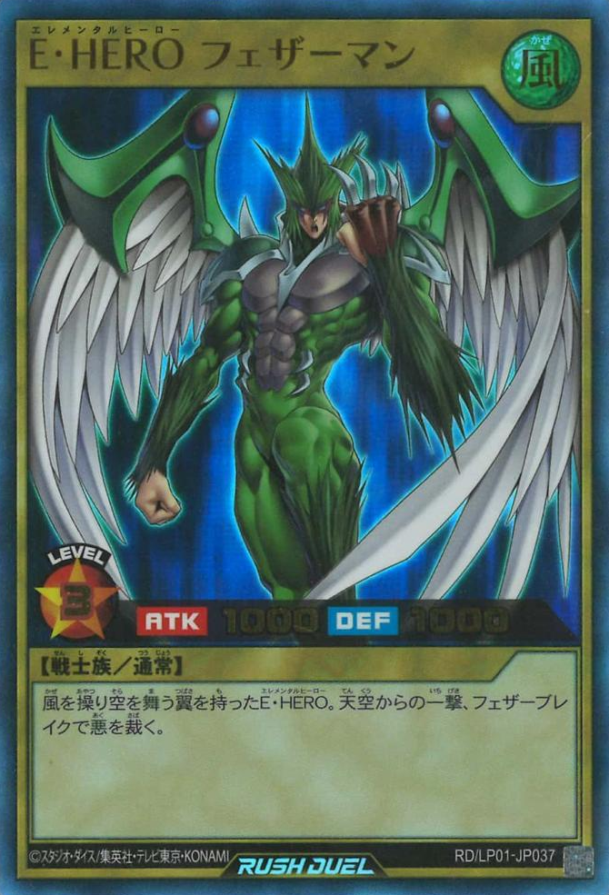
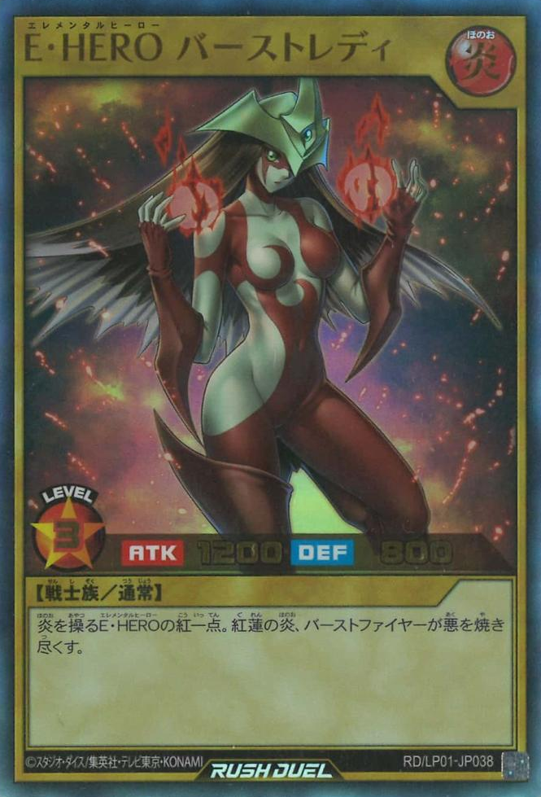
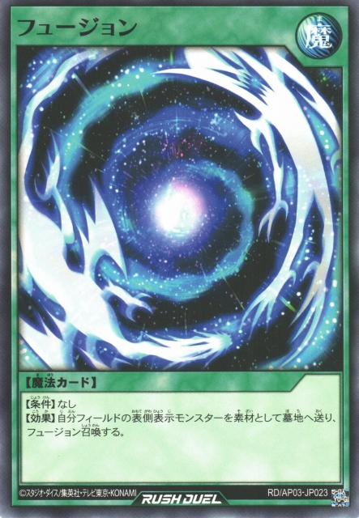
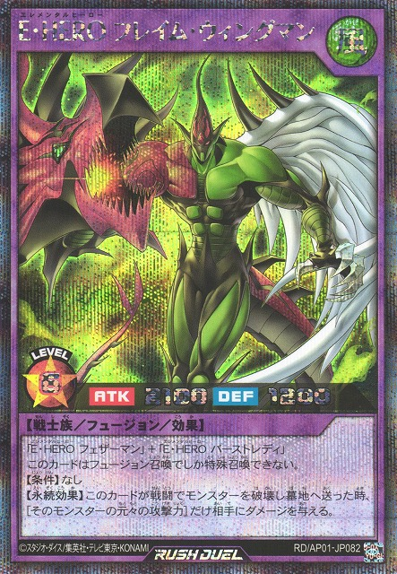
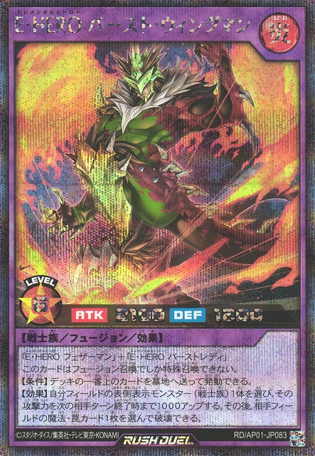
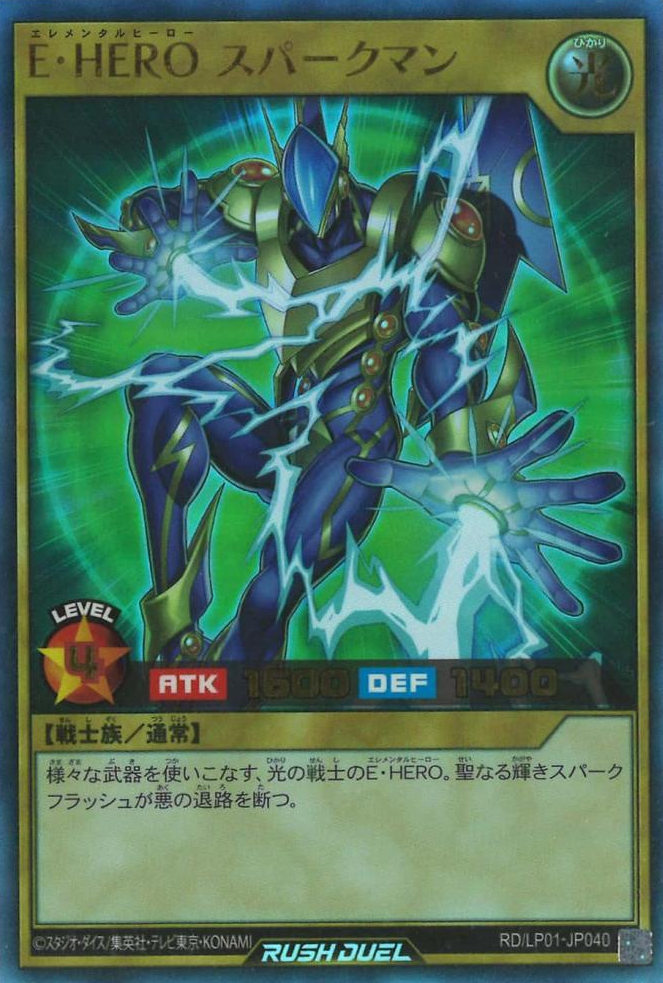
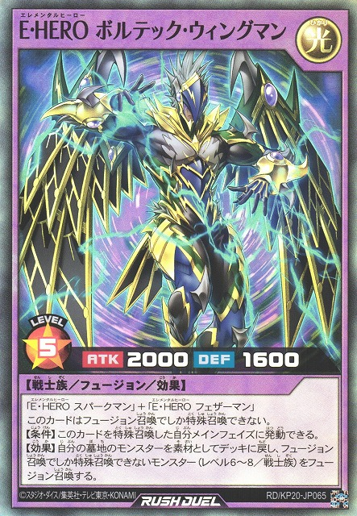
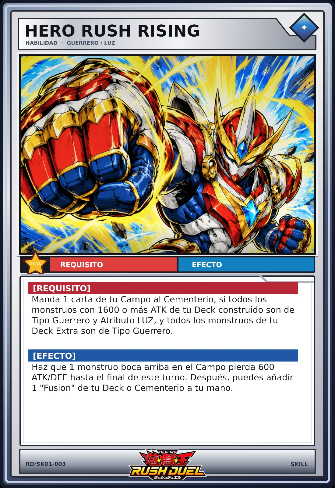
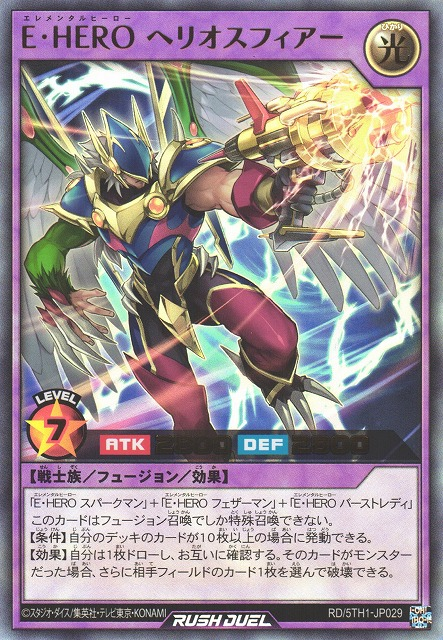
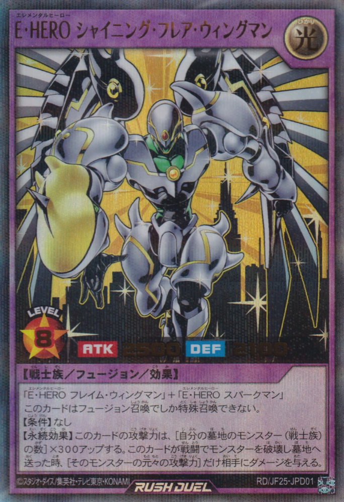

# A10 — Guías visuales documentales · Hero

> Guía documental: utilizar únicamente secuencias con condiciones y restricciones comprobadas.

- Deck ID: `706`. Formato declarado: `RUSH`.
- Rutas visualizadas en esta entrega: **6**.
- Los pasos, movimientos y zonas se cotejan con la ficha A09; no asumir respuestas no descritas.
- Un estado desconocido se conserva como no documentado: nunca se inventa.

## AVIAN · BURST01A · `706:A09:AVIAN:BURST01A`

**Propósito competitivo principal (lectura documental):** Ofensivo condicional. El objetivo solo se acredita si las acciones y el campo final detallados en esta guía lo permiten; no implica legalidad certificada ni garantiza el resultado ante respuestas adversarias.

**Categoría:** APERTURA

**Propósito y resultado documental:**

01A | E·HERO Flame Wingman (20453), Nivel 6, ATK 2100 | En Campo; si destruye un monstruo en batalla y lo manda al GY, su efecto continuo inflige daño igual al ATK original de ese monstruo. No ocurre daño automáticamente al Invocar.

### Mano y estado inicial

1× E·HERO Avian (20460), 1× E·HERO Burstinatrix (20459), 1× Mágica Normal Fusión (16934). Campo propio vacío, Main Phase propia, dos zonas libres; Extra contiene 1× Flame Wingman (20453) y 1× Burst Wingman (20454). Rivales sin respuestas en esta rama. Ninguna carta se pone en mano por la Skill.

 **Héroe Elemental Avian**
 **Héroe Elemental Burstinatrix**
 **Fusión**

### Ejecución numerada

#### Paso 1 — Invocar Normalmente a Avian (Guerrero Nivel 3, 1000 ATK) boca arriba.

 **NORMAL**

**Acción concreta:** Invocar Normalmente a Avian (Guerrero Nivel 3, 1000 ATK) boca arriba. Rush permite múltiples Invocaciones Normales por turno; no aplicar la limitación TCG de una Normal.
**Detalle técnico documentado:** Rush permite múltiples Invocaciones Normales por turno; no aplicar la limitación TCG de una Normal.

**Estado por zonas después del paso:**

| Zona/recurso | Estado narrativo A09 |
|---|---|
| Mano | Burstinatrix #20459 y Fusión #16934 |
| Monstruos | E·HERO Avian #20460 (Ataque, 1000 ATK) |
| Mágicas y trampas | — |
| Cementerio | — |
| Destierro propio | — |
| Campo y estado rival | Rival sin respuestas; monstruos adversarios no determinados por esta apertura |
| Materiales Xyz/Fusión/Sincro | — |
| Normal, Extra, fase y restricciones | Rush: primera Normal realizada, otras permitidas; Skill HERO RUSH RISING no usada; Flame y Burst en Extra |

**Campo visual de este paso:**

**Monstruos propios:**
-  **E·HERO Avian (Ataque, 1000 ATK)** — zona declarada: `MONSTER`.
**Mágicas/Trampas/Campo:** sin carta propia demostrada en esta vista.
*Relación ilustrada de cartas presentes tras este paso, documentada en A09. La posición, materiales, otras zonas y rival se leen en la tabla de estado.*

#### Paso 2 — Invocar Normalmente a Burstinatrix (Guerrero Nivel 3, 1200 ATK) boca arriba en otra zona.

 **NORMAL**

**Acción concreta:** Invocar Normalmente a Burstinatrix (Guerrero Nivel 3, 1200 ATK) boca arriba en otra zona.
**Detalle técnico documentado:** No documentado

**Estado por zonas después del paso:**

| Zona/recurso | Estado narrativo A09 |
|---|---|
| Mano | Fusión #16934 |
| Monstruos | Avian #20460 (Ataque), Burstinatrix #20459 (Ataque, 1200 ATK) |
| Mágicas y trampas | — |
| Cementerio | — |
| Destierro propio | — |
| Campo y estado rival | Ninguna interacción rival demostrada |
| Materiales Xyz/Fusión/Sincro | Dos monstruos independientes; aún no son materiales acoplados |
| Normal, Extra, fase y restricciones | Rush: dos Normales realizadas; Skill intacta; dos Fusiones disponibles en Extra |

**Campo visual de este paso:**

**Monstruos propios:**
-  **Avian (Ataque)** — zona declarada: `MONSTER`.
-  **Burstinatrix (Ataque, 1200 ATK)** — zona declarada: `MONSTER`.
**Mágicas/Trampas/Campo:** sin carta propia demostrada en esta vista.
*Relación ilustrada de cartas presentes tras este paso, documentada en A09. La posición, materiales, otras zonas y rival se leen en la tabla de estado.*

#### Paso 3 — activar Fusión.

 **MATERIAL XYZ** →  **FUSIÓN** →  **FUSIÓN**

**Acción concreta:** activar Fusión. Su efecto envía los dos monstruos boca arriba desde tu Campo al Cementerio como materiales y permite Invocar por Fusión desde Extra uno de los dos siguientes, que nombran exactamente a Avian + Burstinatrix:
**Detalle técnico documentado:** Su efecto envía los dos monstruos boca arriba desde tu Campo al Cementerio como materiales y permite Invocar por Fusión desde Extra uno de los dos siguientes, que nombran exactamente a Avian + Burstinatrix:

**Estado por zonas después del paso:**

| Zona/recurso | Estado narrativo A09 |
|---|---|
| Mano | — |
| Monstruos | E·HERO Flame Wingman #20453 (Ataque, 2100 ATK) |
| Mágicas y trampas | — |
| Cementerio | Avian #20460, Burstinatrix #20459 y Fusión #16934 en GY |
| Destierro propio | — |
| Campo y estado rival | No se destruyó monstruo rival por batalla, daño por efecto = 0 acreditado |
| Materiales Xyz/Fusión/Sincro | Fusión: Avian y Burstinatrix enviados a GY; no Xyz |
| Normal, Extra, fase y restricciones | Rush: Skill no usada; Flame salió del Extra y Burst sigue disponible |

**Campo visual de este paso:**

**Monstruos propios:**
-  **E·HERO Flame Wingman (Ataque, 2100 ATK)** — zona declarada: `MONSTER`.
**Mágicas/Trampas/Campo:** sin carta propia demostrada en esta vista.
*Relación ilustrada de cartas presentes tras este paso, documentada en A09. La posición, materiales, otras zonas y rival se leen en la tabla de estado.*

### Campo final documentado

Esta vista procede **del último paso**, no de una lista de cartas deducida del título.

**Monstruos propios:**
-  **E·HERO Flame Wingman (Ataque, 2100 ATK)** — zona declarada: `MONSTER`.
**Mágicas/Trampas/Campo:** sin carta propia demostrada en esta vista.
*Relación ilustrada de cartas presentes tras este paso, documentada en A09. La posición, materiales, otras zonas y rival se leen en la tabla de estado.*

| Zona/recurso | Estado final documentado |
|---|---|
| Mano | — |
| Monstruos | E·HERO Flame Wingman #20453 (Ataque, 2100 ATK) |
| Mágicas y trampas | — |
| Cementerio | Avian #20460, Burstinatrix #20459 y Fusión #16934 en GY |
| Destierro propio | — |
| Campo y estado rival | No se destruyó monstruo rival por batalla, daño por efecto = 0 acreditado |
| Materiales Xyz/Fusión/Sincro | Fusión: Avian y Burstinatrix enviados a GY; no Xyz |
| Normal, Extra, fase y restricciones | Rush: Skill no usada; Flame salió del Extra y Burst sigue disponible |

### Si el oponente interrumpe

- **INTERRUPCIÓN A12 — paso 1: A12 — Agujero Trampa contra el primer material en el paso 1**
  - Supuesto adversario adicional: el rival tiene Agujero Trampa (15913), versión Rush Duel, ya Colocada desde el turno anterior, y decide usarla al Invocar Normalmente a Avian (1000 ATK) en el paso 1. Su condición permite responder a una Invocación Normal de un monstruo con ATK 1000 o más; destruye a ese monstruo.
  - Consecuencia inmediata: Avian va al GY; Burstinatrix y Fusión permanecen en mano. No hay dos materiales propios boca arriba para completar cualquiera de las dos Fusiones con esta mano. El rival gastó su Trampa.
  - Atención a la ventana: es una activación de Trampa Rush después de la Invocación, no un encadenamiento tipo CL2 al efecto de una Mágica. Fuente: Agujero Trampa Rush. Estado.
  - Estado de rama: `Resuelto solo en el escenario que detalla A12/A13; las otras respuestas no están demostradas.`.
- **RECUPERACIÓN A13 — paso 1: A13 — Rama sin fusión por Agujero Trampa tras el paso 1**
  - Si el rival destruyó a Avian con Agujero Trampa en el paso 1, Burstinatrix continúa en mano y se puede Invocar Normalmente durante este turno por la mecánica Rush; sin Avian de reemplazo en mano/campo, no hay material completo para Flame ni Burst Wingman.
  - No activar Fusión como si aceptara a Avian desde el GY; necesitaría un efecto de recuperación adicional y una nueva precondición. La Skill HERO RUSH RISING puede buscar Fusión bajo sus condiciones locales, pero no recupera a Avian por sí sola.
  - Estado final demostrable: Burstinatrix sola en Campo si se decide Invocarla, Fusión en mano, Avian y Trampa rival en GY; SIN_CONTINUACION_DEMOSTRADA hacia la Fusión con las tres cartas originales..
  - Estado de rama: `Resuelto solo en el escenario que detalla A12/A13; las otras respuestas no están demostradas.`.

---

## AVIAN · BURST01B · `706:A09:AVIAN:BURST01B`

**Propósito competitivo principal (lectura documental):** Preparación de recursos / despliegue. El objetivo solo se acredita si las acciones y el campo final detallados en esta guía lo permiten; no implica legalidad certificada ni garantiza el resultado ante respuestas adversarias.

**Categoría:** APERTURA

**Propósito y resultado documental:**

01B | E·HERO Burst Wingman (20454), Nivel 6, ATK 2100 | En Campo; puede enviar la carta superior del Deck al GY para activar su efecto, dar +1000 ATK a un Guerrero propio boca arriba hasta el final del siguiente turno rival y opcionalmente destruir 1 Mágica/Trampa rival. No se promete destrucción si el rival carece de M/T.

### Mano y estado inicial

1× E·HERO Avian (20460), 1× E·HERO Burstinatrix (20459), 1× Mágica Normal Fusión (16934). Campo propio vacío, Main Phase propia, dos zonas libres; Extra contiene 1× Flame Wingman (20453) y 1× Burst Wingman (20454). Rivales sin respuestas en esta rama. Ninguna carta se pone en mano por la Skill.

 **Héroe Elemental Avian**
 **Héroe Elemental Burstinatrix**
 **Fusión**

### Ejecución numerada

#### Paso 1 — Invocar Normalmente a Avian (Guerrero Nivel 3, 1000 ATK) boca arriba.

 **NORMAL**

**Acción concreta:** Invocar Normalmente a Avian (Guerrero Nivel 3, 1000 ATK) boca arriba. Rush permite múltiples Invocaciones Normales por turno; no aplicar la limitación TCG de una Normal.
**Detalle técnico documentado:** Rush permite múltiples Invocaciones Normales por turno; no aplicar la limitación TCG de una Normal.

**Estado por zonas después del paso:**

| Zona/recurso | Estado narrativo A09 |
|---|---|
| Mano | Burstinatrix #20459 y Fusión #16934 |
| Monstruos | E·HERO Avian #20460 (Ataque, 1000 ATK) |
| Mágicas y trampas | — |
| Cementerio | — |
| Destierro propio | — |
| Campo y estado rival | Rival sin respuestas; Campo adversario no definido |
| Materiales Xyz/Fusión/Sincro | — |
| Normal, Extra, fase y restricciones | Rush: primera Normal realizada, otras permitidas; Skill no usada |

**Campo visual de este paso:**

**Monstruos propios:**
-  **E·HERO Avian (Ataque, 1000 ATK)** — zona declarada: `MONSTER`.
**Mágicas/Trampas/Campo:** sin carta propia demostrada en esta vista.
*Relación ilustrada de cartas presentes tras este paso, documentada en A09. La posición, materiales, otras zonas y rival se leen en la tabla de estado.*

#### Paso 2 — Invocar Normalmente a Burstinatrix (Guerrero Nivel 3, 1200 ATK) boca arriba en otra zona.

 **NORMAL**

**Acción concreta:** Invocar Normalmente a Burstinatrix (Guerrero Nivel 3, 1200 ATK) boca arriba en otra zona.
**Detalle técnico documentado:** No documentado

**Estado por zonas después del paso:**

| Zona/recurso | Estado narrativo A09 |
|---|---|
| Mano | Fusión #16934 |
| Monstruos | Avian #20460 (Ataque), Burstinatrix #20459 (Ataque, 1200 ATK) |
| Mágicas y trampas | — |
| Cementerio | — |
| Destierro propio | — |
| Campo y estado rival | Sin respuesta ni destrucción rival demostrada |
| Materiales Xyz/Fusión/Sincro | Dos cuerpos propios independientes antes de Fusionar |
| Normal, Extra, fase y restricciones | Rush: dos Normales realizadas; Skill intacta |

**Campo visual de este paso:**

**Monstruos propios:**
-  **Avian (Ataque)** — zona declarada: `MONSTER`.
-  **Burstinatrix (Ataque, 1200 ATK)** — zona declarada: `MONSTER`.
**Mágicas/Trampas/Campo:** sin carta propia demostrada en esta vista.
*Relación ilustrada de cartas presentes tras este paso, documentada en A09. La posición, materiales, otras zonas y rival se leen en la tabla de estado.*

#### Paso 3 — activar Fusión.

 **MATERIAL XYZ** →  **FUSIÓN** →  **FUSIÓN**

**Acción concreta:** activar Fusión. Su efecto envía los dos monstruos boca arriba desde tu Campo al Cementerio como materiales y permite Invocar por Fusión desde Extra uno de los dos siguientes, que nombran exactamente a Avian + Burstinatrix:
**Detalle técnico documentado:** Su efecto envía los dos monstruos boca arriba desde tu Campo al Cementerio como materiales y permite Invocar por Fusión desde Extra uno de los dos siguientes, que nombran exactamente a Avian + Burstinatrix:

**Estado por zonas después del paso:**

| Zona/recurso | Estado narrativo A09 |
|---|---|
| Mano | — |
| Monstruos | E·HERO Burst Wingman #20454 (Ataque, 2100 ATK, sin +1000 aplicado) |
| Mágicas y trampas | — |
| Cementerio | Avian #20460, Burstinatrix #20459 y Fusión #16934 en GY |
| Destierro propio | — |
| Campo y estado rival | No se consumió carta superior del Deck ni se destruyó M/T rival en esta línea |
| Materiales Xyz/Fusión/Sincro | Fusión: Avian y Burstinatrix enviados al GY; no materiales Xyz |
| Normal, Extra, fase y restricciones | Rush: Skill no usada; Burst salió del Extra y Flame sigue disponible |

**Campo visual de este paso:**

**Monstruos propios:**
-  **E·HERO Burst Wingman (Ataque, 2100 ATK, sin +1000 aplicado)** — zona declarada: `MONSTER`.
**Mágicas/Trampas/Campo:** sin carta propia demostrada en esta vista.
*Relación ilustrada de cartas presentes tras este paso, documentada en A09. La posición, materiales, otras zonas y rival se leen en la tabla de estado.*

### Campo final documentado

Esta vista procede **del último paso**, no de una lista de cartas deducida del título.

**Monstruos propios:**
-  **E·HERO Burst Wingman (Ataque, 2100 ATK, sin +1000 aplicado)** — zona declarada: `MONSTER`.
**Mágicas/Trampas/Campo:** sin carta propia demostrada en esta vista.
*Relación ilustrada de cartas presentes tras este paso, documentada en A09. La posición, materiales, otras zonas y rival se leen en la tabla de estado.*

| Zona/recurso | Estado final documentado |
|---|---|
| Mano | — |
| Monstruos | E·HERO Burst Wingman #20454 (Ataque, 2100 ATK, sin +1000 aplicado) |
| Mágicas y trampas | — |
| Cementerio | Avian #20460, Burstinatrix #20459 y Fusión #16934 en GY |
| Destierro propio | — |
| Campo y estado rival | No se consumió carta superior del Deck ni se destruyó M/T rival en esta línea |
| Materiales Xyz/Fusión/Sincro | Fusión: Avian y Burstinatrix enviados al GY; no materiales Xyz |
| Normal, Extra, fase y restricciones | Rush: Skill no usada; Burst salió del Extra y Flame sigue disponible |

### Si el oponente interrumpe

- **INTERRUPCIÓN A12 — paso 1: A12 — Agujero Trampa contra el primer material en el paso 1**
  - Supuesto adversario adicional: el rival tiene Agujero Trampa (15913), versión Rush Duel, ya Colocada desde el turno anterior, y decide usarla al Invocar Normalmente a Avian (1000 ATK) en el paso 1. Su condición permite responder a una Invocación Normal de un monstruo con ATK 1000 o más; destruye a ese monstruo.
  - Consecuencia inmediata: Avian va al GY; Burstinatrix y Fusión permanecen en mano. No hay dos materiales propios boca arriba para completar cualquiera de las dos Fusiones con esta mano. El rival gastó su Trampa.
  - Atención a la ventana: es una activación de Trampa Rush después de la Invocación, no un encadenamiento tipo CL2 al efecto de una Mágica. Fuente: Agujero Trampa Rush. Estado.
  - Estado de rama: `Resuelto solo en el escenario que detalla A12/A13; las otras respuestas no están demostradas.`.
- **RECUPERACIÓN A13 — paso 1: A13 — Rama sin fusión por Agujero Trampa tras el paso 1**
  - Si el rival destruyó a Avian con Agujero Trampa en el paso 1, Burstinatrix continúa en mano y se puede Invocar Normalmente durante este turno por la mecánica Rush; sin Avian de reemplazo en mano/campo, no hay material completo para Flame ni Burst Wingman.
  - No activar Fusión como si aceptara a Avian desde el GY; necesitaría un efecto de recuperación adicional y una nueva precondición. La Skill HERO RUSH RISING puede buscar Fusión bajo sus condiciones locales, pero no recupera a Avian por sí sola.
  - Estado final demostrable: Burstinatrix sola en Campo si se decide Invocarla, Fusión en mano, Avian y Trampa rival en GY; SIN_CONTINUACION_DEMOSTRADA hacia la Fusión con las tres cartas originales..
  - Estado de rama: `Resuelto solo en el escenario que detalla A12/A13; las otras respuestas no están demostradas.`.

---

## VOLTIC · SECOND01A · `706:A09:VOLTIC:SECOND01A`

**Propósito competitivo principal (lectura documental):** Preparación de recursos / despliegue. El objetivo solo se acredita si las acciones y el campo final detallados en esta guía lo permiten; no implica legalidad certificada ni garantiza el resultado ante respuestas adversarias.

**Categoría:** APERTURA

**Propósito y resultado documental:**

01A | Avian + Burstinatrix | Flame Wingman (20453, Nivel 6, 2100 ATK) | Voltic 1400 ATK (debuff temporal) + Flame 2100 ATK; Sparkman permanece en GY; Fusión en mano. Flame no quema por el mero hecho de ser Invocado.

### Mano y estado inicial

1× E·HERO Sparkman (20457, Nivel 4, 1600 ATK), 1× E·HERO Avian (20460, Nivel 3, 1000 ATK), 1× E·HERO Burstinatrix (20459, Nivel 3, 1200 ATK), 1× Mágica Fusión (16934). Campo propio vacío, Main Phase propia, al menos tres zonas libres, ninguna respuesta adversaria en esta rama. Extra con Voltic Wingman (21316), Flame Wingman (20453), Burst Wingman (20454), Heliosfera (21501). Skill casera HERO RUSH RISING (RD/SK01-003) aprobada localmente y sin uso previo relevante.

 **Héroe Elemental Sparkman**
 **Héroe Elemental Avian**
 **Héroe Elemental Burstinatrix**
 **Fusión**

### Ejecución numerada

#### Paso 1 — Invocar Normalmente Sparkman, Avian y Burstinatrix en Ataque boca arriba, ocupando tres zonas.

 **NORMAL** →  **NORMAL** →  **NORMAL**

**Acción concreta:** Invocar Normalmente Sparkman, Avian y Burstinatrix en Ataque boca arriba, ocupando tres zonas. En Rush son posibles múltiples Normales en el mismo turno.
**Detalle técnico documentado:** En Rush son posibles múltiples Normales en el mismo turno.

**Estado por zonas después del paso:**

| Zona/recurso | Estado narrativo A09 |
|---|---|
| Mano | Fusión #16934 |
| Monstruos | Sparkman #20457 (Ataque), Avian #20460 (Ataque), Burstinatrix #20459 (Ataque) |
| Mágicas y trampas | — |
| Cementerio | — |
| Destierro propio | — |
| Campo y estado rival | Campo rival no determinado; sin respuestas |
| Materiales Xyz/Fusión/Sincro | Tres monstruos independientes, todavía sin Fusionar |
| Normal, Extra, fase y restricciones | Rush: tres Normales realizadas; Skill HERO RUSH RISING intacta; Voltic y Flame en Extra |

**Campo visual de este paso:**

**Monstruos propios:**
-  **Sparkman (Ataque)** — zona declarada: `MONSTER`.
-  **Avian (Ataque)** — zona declarada: `MONSTER`.
-  **Burstinatrix (Ataque)** — zona declarada: `MONSTER`.
**Mágicas/Trampas/Campo:** sin carta propia demostrada en esta vista.
*Relación ilustrada de cartas presentes tras este paso, documentada en A09. La posición, materiales, otras zonas y rival se leen en la tabla de estado.*

#### Paso 2 — Activar Fusión (Mágica Normal) usando Sparkman + Avian boca arriba en Campo; mandar esos dos materiales al GY y Fusionar Voltic Wingman (Nivel 5, 2000 ATK).

 **ACTIVAR** →  **ACTIVAR** →  **YA EN CAMPO**

**Acción concreta:** Activar Fusión (Mágica Normal) usando Sparkman + Avian boca arriba en Campo; mandar esos dos materiales al GY y Fusionar Voltic Wingman (Nivel 5, 2000 ATK). Burstinatrix permanece en Campo. La Mágica Fusión queda en GY.
**Detalle técnico documentado:** Burstinatrix permanece en Campo. La Mágica Fusión queda en GY.

**Estado por zonas después del paso:**

| Zona/recurso | Estado narrativo A09 |
|---|---|
| Mano | — |
| Monstruos | Voltic Wingman #21316 (Ataque, 2000 ATK), Burstinatrix #20459 (Ataque) |
| Mágicas y trampas | — |
| Cementerio | Sparkman #20457, Avian #20460 y Fusión #16934 en GY |
| Destierro propio | — |
| Campo y estado rival | Sin efectos adversarios acreditados |
| Materiales Xyz/Fusión/Sincro | Primera Fusión: Sparkman y Avian al GY; Burstinatrix sigue en Campo |
| Normal, Extra, fase y restricciones | Skill intacta; Voltic usado del Extra; Flame disponible |

**Campo visual de este paso:**

**Monstruos propios:**
-  **Voltic Wingman (Ataque, 2000 ATK)** — zona declarada: `MONSTER`.
-  **Burstinatrix (Ataque)** — zona declarada: `MONSTER`.
**Mágicas/Trampas/Campo:** sin carta propia demostrada en esta vista.
*Relación ilustrada de cartas presentes tras este paso, documentada en A09. La posición, materiales, otras zonas y rival se leen en la tabla de estado.*

#### Paso 3 — Activar la Skill HERO RUSH RISING: enviar Burstinatrix desde el Campo al GY como requisito.

 **ENVIAR** →  **ESTADO / CONTEXTO** →  **REFERENCIA A09**

**Acción concreta:** Activar la Skill HERO RUSH RISING: enviar Burstinatrix desde el Campo al GY como requisito. El GY contiene ahora Sparkman + Avian + Burstinatrix + Fusión.
**Detalle técnico documentado:** El GY contiene ahora Sparkman + Avian + Burstinatrix + Fusión.

**Estado por zonas después del paso:**

| Zona/recurso | Estado narrativo A09 |
|---|---|
| Mano | — |
| Monstruos | Voltic Wingman #21316 (Ataque, 2000 ATK) |
| Mágicas y trampas | — |
| Cementerio | Sparkman, Avian, Burstinatrix #20459 y Fusión en GY |
| Destierro propio | — |
| Campo y estado rival | Sin cambios rivales probados |
| Materiales Xyz/Fusión/Sincro | Burstinatrix enviada como requisito de Skill, no como material de segunda Fusión todavía |
| Normal, Extra, fase y restricciones | Skill HERO RUSH RISING usada; Flame en Extra |

**Campo visual de este paso:**

**Monstruos propios:**
-  **Voltic Wingman (Ataque, 2000 ATK)** — zona declarada: `MONSTER`.
**Mágicas/Trampas/Campo:** sin carta propia demostrada en esta vista.
*Relación ilustrada de cartas presentes tras este paso, documentada en A09. La posición, materiales, otras zonas y rival se leen en la tabla de estado.*

#### Paso 4 — Elegir Voltic Wingman como monstruo boca arriba para que pierda 600 ATK/DEF hasta el final de este turno: 2000→1400 ATK, 1600→1000 DEF.

 **BUSCAR / AÑADIR**

**Acción concreta:** Elegir Voltic Wingman como monstruo boca arriba para que pierda 600 ATK/DEF hasta el final de este turno: 2000→1400 ATK, 1600→1000 DEF. Después, usar la opción de la Skill para añadir desde el GY la Mágica Fusión a la mano. No se ha supuesto un monstruo rival disponible para debilitar.
**Detalle técnico documentado:** Después, usar la opción de la Skill para añadir desde el GY la Mágica Fusión a la mano. No se ha supuesto un monstruo rival disponible para debilitar.

**Estado por zonas después del paso:**

| Zona/recurso | Estado narrativo A09 |
|---|---|
| Mano | Fusión #16934 recuperada |
| Monstruos | Voltic Wingman #21316 (Ataque, 1400 ATK temporal) |
| Mágicas y trampas | — |
| Cementerio | Sparkman #20457, Avian #20460 y Burstinatrix #20459 en GY |
| Destierro propio | — |
| Campo y estado rival | No se ha seleccionado ni reducido monstruo rival |
| Materiales Xyz/Fusión/Sincro | Voltic pierde 600 ATK/DEF por Skill hasta fin de turno; aún no segunda Fusión |
| Normal, Extra, fase y restricciones | Skill usada; Fusión de GY a mano; Flame disponible en Extra |

**Campo visual de este paso:**

**Monstruos propios:**
-  **Voltic Wingman (Ataque, 1400 ATK temporal)** — zona declarada: `MONSTER`.
**Mágicas/Trampas/Campo:** sin carta propia demostrada en esta vista.
*Relación ilustrada de cartas presentes tras este paso, documentada en A09. La posición, materiales, otras zonas y rival se leen en la tabla de estado.*

#### Paso 5 — Activar el efecto de Voltic Wingman en la Main Phase en que fue Invocado Especialmente.

 **ESTADO / CONTEXTO**

**Acción concreta:** Activar el efecto de Voltic Wingman en la Main Phase en que fue Invocado Especialmente. Ese efecto permite una Fusión de un Guerrero de Nivel 6 a 8 que solo pueda ser Invocado por Fusión, devolviendo materiales desde el GY al Deck. Elegir una sola de estas salidas:
**Detalle técnico documentado:** Ese efecto permite una Fusión de un Guerrero de Nivel 6 a 8 que solo pueda ser Invocado por Fusión, devolviendo materiales desde el GY al Deck. Elegir una sola de estas salidas:

**Estado por zonas después del paso:**

| Zona/recurso | Estado narrativo A09 |
|---|---|
| Mano | Fusión #16934 |
| Monstruos | Voltic Wingman #21316 (Ataque, 1400 ATK temporal), Flame Wingman #20453 (Ataque, 2100 ATK) |
| Mágicas y trampas | — |
| Cementerio | Sparkman #20457 en GY |
| Destierro propio | — |
| Campo y estado rival | Flame no ha destruido por batalla un monstruo; daño por efecto no acreditado |
| Materiales Xyz/Fusión/Sincro | Segunda Fusión por Voltic: Avian y Burstinatrix regresaron del GY al Deck; no Xyz |
| Normal, Extra, fase y restricciones | Skill usada; Voltic y Flame salieron del Extra; Fusión permanece en mano |

**Campo visual de este paso:**

**Monstruos propios:**
-  **Voltic Wingman (Ataque, 1400 ATK temporal)** — zona declarada: `MONSTER`.
-  **Flame Wingman (Ataque, 2100 ATK)** — zona declarada: `MONSTER`.
**Mágicas/Trampas/Campo:** sin carta propia demostrada en esta vista.
*Relación ilustrada de cartas presentes tras este paso, documentada en A09. La posición, materiales, otras zonas y rival se leen en la tabla de estado.*

### Campo final documentado

Esta vista procede **del último paso**, no de una lista de cartas deducida del título.

**Monstruos propios:**
-  **Voltic Wingman (Ataque, 1400 ATK temporal)** — zona declarada: `MONSTER`.
-  **Flame Wingman (Ataque, 2100 ATK)** — zona declarada: `MONSTER`.
**Mágicas/Trampas/Campo:** sin carta propia demostrada en esta vista.
*Relación ilustrada de cartas presentes tras este paso, documentada en A09. La posición, materiales, otras zonas y rival se leen en la tabla de estado.*

| Zona/recurso | Estado final documentado |
|---|---|
| Mano | Fusión #16934 |
| Monstruos | Voltic Wingman #21316 (Ataque, 1400 ATK temporal), Flame Wingman #20453 (Ataque, 2100 ATK) |
| Mágicas y trampas | — |
| Cementerio | Sparkman #20457 en GY |
| Destierro propio | — |
| Campo y estado rival | Flame no ha destruido por batalla un monstruo; daño por efecto no acreditado |
| Materiales Xyz/Fusión/Sincro | Segunda Fusión por Voltic: Avian y Burstinatrix regresaron del GY al Deck; no Xyz |
| Normal, Extra, fase y restricciones | Skill usada; Voltic y Flame salieron del Extra; Fusión permanece en mano |

### Si el oponente interrumpe

- **INTERRUPCIÓN A12 — paso 1: A12 — Interrupción adicional en VOLTIC:SECOND01A/B/C: Agujero Trampa sobre Sparkman en el paso 1**
  - Condición rival: Agujero Trampa Rush (15913) del oponente está Colocada desde antes de esta Main Phase. Se empieza la ruta de cuatro cartas Invocando Normalmente Sparkman primero (1600 ATK). El adversario activa su Trampa al ocurrir esa Invocación Normal y destruye a Sparkman.
  - Tras resolver: Sparkman está en el GY, Avian + Burstinatrix + Fusión continúan en la mano; aún no hay Voltic ni se ha usado la Skill. El rival gastó Agujero Trampa. La vía Voltic queda interrumpida porque Fusión (16934) no puede emplear Sparkman directamente desde el GY y la mano de cuatro cartas no contiene un reemplazo.
  - Importante: la interrupción no termina el turno ni impide toda Fusión: se ensaya la recuperación exacta en A13. Fuente: Sparkman, Agujero Trampa Rush..
  - Estado de rama: `Resuelto solo en el escenario que detalla A12/A13; las otras respuestas no están demostradas.`.
- **RECUPERACIÓN A13 — paso 1: A13 — Recuperación real tras Agujero Trampa sobre Sparkman en el paso 1**
  - 1. Punto de quiebre: Sparkman (1600 ATK) fue Normalmente Invocado primero y destruido por Agujero Trampa; queda en GY. Avian + Burstinatrix + Fusión siguen en mano. No hay Voltic ni posibilidad de usar al Sparkman del GY para esa Fusión ordinaria.
  - 2. Cambio de línea legal: Invocar Normalmente a Avian (1000 ATK) y Burstinatrix (1200 ATK), ambos boca arriba. Rush permite más Normales en el mismo turno. Agujero Trampa rival ya está gastada en esta rama.
  - 3. Fusión alternativa: activar la Mágica Fusión usando Avian + Burstinatrix del Campo y elegir Flame Wingman (2100 ATK) o Burst Wingman (2100 ATK), cuyos materiales son esos dos Normales. Solo uno.
  - 4. Estado final: una Fusión Nivel 6 propia en Campo; Sparkman, Avian, Burstinatrix y Fusión en GY; mano inicial agotada; Skill HERO RUSH RISING no usada. En la rama de Burst, su efecto de +1000 exige el envío de la carta superior del Deck, con una potencial M/T enemiga como objetivo; no se activa automáticamente.
  - Resultado de resiliencia: Agujero Trampa sí corta la ruta Voltic, pero no niega la salida Flame/Burst porque las otras tres cartas ya estaban en mano y cumplen materiales. La bifurcación se sustenta en la mano inicial real; no añade recursos inventados.; guía visual final A10 todavía pendiente.
  - Estado de rama: `Resuelto solo en el escenario que detalla A12/A13; las otras respuestas no están demostradas.`.

---

## VOLTIC · SECOND01B · `706:A09:VOLTIC:SECOND01B`

**Propósito competitivo principal (lectura documental):** Preparación de recursos / despliegue. El objetivo solo se acredita si las acciones y el campo final detallados en esta guía lo permiten; no implica legalidad certificada ni garantiza el resultado ante respuestas adversarias.

**Categoría:** APERTURA

**Propósito y resultado documental:**

01B | Avian + Burstinatrix | Burst Wingman (20454, Nivel 6, 2100 ATK) | Voltic 1400 ATK + Burst 2100 ATK; Sparkman permanece en GY; Fusión en mano. Opcional: enviar la carta superior del Deck al GY para dar +1000 ATK a un Guerrero propio (si se elige Burst: 3100 ATK hasta final del próximo turno rival) y poder destruir una M/T rival si existe.

### Mano y estado inicial

1× E·HERO Sparkman (20457, Nivel 4, 1600 ATK), 1× E·HERO Avian (20460, Nivel 3, 1000 ATK), 1× E·HERO Burstinatrix (20459, Nivel 3, 1200 ATK), 1× Mágica Fusión (16934). Campo propio vacío, Main Phase propia, al menos tres zonas libres, ninguna respuesta adversaria en esta rama. Extra con Voltic Wingman (21316), Flame Wingman (20453), Burst Wingman (20454), Heliosfera (21501). Skill casera HERO RUSH RISING (RD/SK01-003) aprobada localmente y sin uso previo relevante.

 **Héroe Elemental Sparkman**
 **Héroe Elemental Avian**
 **Héroe Elemental Burstinatrix**
 **Fusión**

### Ejecución numerada

#### Paso 1 — Invocar Normalmente Sparkman, Avian y Burstinatrix en Ataque boca arriba, ocupando tres zonas.

 **NORMAL** →  **NORMAL** →  **NORMAL**

**Acción concreta:** Invocar Normalmente Sparkman, Avian y Burstinatrix en Ataque boca arriba, ocupando tres zonas. En Rush son posibles múltiples Normales en el mismo turno.
**Detalle técnico documentado:** En Rush son posibles múltiples Normales en el mismo turno.

**Estado por zonas después del paso:**

| Zona/recurso | Estado narrativo A09 |
|---|---|
| Mano | Fusión #16934 |
| Monstruos | Sparkman #20457 (Ataque), Avian #20460 (Ataque), Burstinatrix #20459 (Ataque) |
| Mágicas y trampas | — |
| Cementerio | — |
| Destierro propio | — |
| Campo y estado rival | Campo rival no especificado; sin respuestas |
| Materiales Xyz/Fusión/Sincro | Tres monstruos independientes para posibles Fusiones |
| Normal, Extra, fase y restricciones | Rush: tres Normales; Skill intacta; Voltic y Burst disponibles en Extra |

**Campo visual de este paso:**

**Monstruos propios:**
-  **Sparkman (Ataque)** — zona declarada: `MONSTER`.
-  **Avian (Ataque)** — zona declarada: `MONSTER`.
-  **Burstinatrix (Ataque)** — zona declarada: `MONSTER`.
**Mágicas/Trampas/Campo:** sin carta propia demostrada en esta vista.
*Relación ilustrada de cartas presentes tras este paso, documentada en A09. La posición, materiales, otras zonas y rival se leen en la tabla de estado.*

#### Paso 2 — Activar Fusión (Mágica Normal) usando Sparkman + Avian boca arriba en Campo; mandar esos dos materiales al GY y Fusionar Voltic Wingman (Nivel 5, 2000 ATK).

 **ACTIVAR** →  **ACTIVAR** →  **YA EN CAMPO**

**Acción concreta:** Activar Fusión (Mágica Normal) usando Sparkman + Avian boca arriba en Campo; mandar esos dos materiales al GY y Fusionar Voltic Wingman (Nivel 5, 2000 ATK). Burstinatrix permanece en Campo. La Mágica Fusión queda en GY.
**Detalle técnico documentado:** Burstinatrix permanece en Campo. La Mágica Fusión queda en GY.

**Estado por zonas después del paso:**

| Zona/recurso | Estado narrativo A09 |
|---|---|
| Mano | — |
| Monstruos | Voltic Wingman #21316 (Ataque, 2000 ATK), Burstinatrix #20459 (Ataque) |
| Mágicas y trampas | — |
| Cementerio | Sparkman #20457, Avian #20460 y Fusión #16934 en GY |
| Destierro propio | — |
| Campo y estado rival | Sin daños o destrucciones atribuidos |
| Materiales Xyz/Fusión/Sincro | Primera Fusión: Sparkman y Avian enviados a GY |
| Normal, Extra, fase y restricciones | Skill intacta; Voltic usado del Extra |

**Campo visual de este paso:**

**Monstruos propios:**
-  **Voltic Wingman (Ataque, 2000 ATK)** — zona declarada: `MONSTER`.
-  **Burstinatrix (Ataque)** — zona declarada: `MONSTER`.
**Mágicas/Trampas/Campo:** sin carta propia demostrada en esta vista.
*Relación ilustrada de cartas presentes tras este paso, documentada en A09. La posición, materiales, otras zonas y rival se leen en la tabla de estado.*

#### Paso 3 — Activar la Skill HERO RUSH RISING: enviar Burstinatrix desde el Campo al GY como requisito.

 **ENVIAR** →  **ESTADO / CONTEXTO** →  **REFERENCIA A09**

**Acción concreta:** Activar la Skill HERO RUSH RISING: enviar Burstinatrix desde el Campo al GY como requisito. El GY contiene ahora Sparkman + Avian + Burstinatrix + Fusión.
**Detalle técnico documentado:** El GY contiene ahora Sparkman + Avian + Burstinatrix + Fusión.

**Estado por zonas después del paso:**

| Zona/recurso | Estado narrativo A09 |
|---|---|
| Mano | — |
| Monstruos | Voltic Wingman #21316 (Ataque, 2000 ATK) |
| Mágicas y trampas | — |
| Cementerio | Sparkman, Avian, Burstinatrix #20459 y Fusión en GY |
| Destierro propio | — |
| Campo y estado rival | Sin cambios rivales probados |
| Materiales Xyz/Fusión/Sincro | Burstinatrix enviada desde Campo como requisito de Skill |
| Normal, Extra, fase y restricciones | Skill usada; Burst sigue disponible en Extra |

**Campo visual de este paso:**

**Monstruos propios:**
-  **Voltic Wingman (Ataque, 2000 ATK)** — zona declarada: `MONSTER`.
**Mágicas/Trampas/Campo:** sin carta propia demostrada en esta vista.
*Relación ilustrada de cartas presentes tras este paso, documentada en A09. La posición, materiales, otras zonas y rival se leen en la tabla de estado.*

#### Paso 4 — Elegir Voltic Wingman como monstruo boca arriba para que pierda 600 ATK/DEF hasta el final de este turno: 2000→1400 ATK, 1600→1000 DEF.

 **BUSCAR / AÑADIR**

**Acción concreta:** Elegir Voltic Wingman como monstruo boca arriba para que pierda 600 ATK/DEF hasta el final de este turno: 2000→1400 ATK, 1600→1000 DEF. Después, usar la opción de la Skill para añadir desde el GY la Mágica Fusión a la mano. No se ha supuesto un monstruo rival disponible para debilitar.
**Detalle técnico documentado:** Después, usar la opción de la Skill para añadir desde el GY la Mágica Fusión a la mano. No se ha supuesto un monstruo rival disponible para debilitar.

**Estado por zonas después del paso:**

| Zona/recurso | Estado narrativo A09 |
|---|---|
| Mano | Fusión #16934 recuperada |
| Monstruos | Voltic Wingman #21316 (Ataque, 1400 ATK temporal) |
| Mágicas y trampas | — |
| Cementerio | Sparkman #20457, Avian #20460 y Burstinatrix #20459 en GY |
| Destierro propio | — |
| Campo y estado rival | No se concedió ATK a objetivo rival ni propio distinto |
| Materiales Xyz/Fusión/Sincro | Voltic pierde 600 ATK/DEF temporal; segunda Fusión pendiente |
| Normal, Extra, fase y restricciones | Skill usada; Fusión recuperada a mano; Burst en Extra |

**Campo visual de este paso:**

**Monstruos propios:**
-  **Voltic Wingman (Ataque, 1400 ATK temporal)** — zona declarada: `MONSTER`.
**Mágicas/Trampas/Campo:** sin carta propia demostrada en esta vista.
*Relación ilustrada de cartas presentes tras este paso, documentada en A09. La posición, materiales, otras zonas y rival se leen en la tabla de estado.*

#### Paso 5 — Activar el efecto de Voltic Wingman en la Main Phase en que fue Invocado Especialmente.

 **ESTADO / CONTEXTO**

**Acción concreta:** Activar el efecto de Voltic Wingman en la Main Phase en que fue Invocado Especialmente. Ese efecto permite una Fusión de un Guerrero de Nivel 6 a 8 que solo pueda ser Invocado por Fusión, devolviendo materiales desde el GY al Deck. Elegir una sola de estas salidas:
**Detalle técnico documentado:** Ese efecto permite una Fusión de un Guerrero de Nivel 6 a 8 que solo pueda ser Invocado por Fusión, devolviendo materiales desde el GY al Deck. Elegir una sola de estas salidas:

**Estado por zonas después del paso:**

| Zona/recurso | Estado narrativo A09 |
|---|---|
| Mano | Fusión #16934 |
| Monstruos | Voltic Wingman #21316 (Ataque, 1400 ATK temporal), Burst Wingman #20454 (Ataque, 2100 ATK, +1000 opcional NO utilizado) |
| Mágicas y trampas | — |
| Cementerio | Sparkman #20457 en GY |
| Destierro propio | — |
| Campo y estado rival | No se envió la carta superior del Deck ni se destruyó M/T adversaria |
| Materiales Xyz/Fusión/Sincro | Avian y Burstinatrix retornados del GY al Deck por la segunda Fusión de Voltic |
| Normal, Extra, fase y restricciones | Skill usada; Voltic y Burst salieron del Extra; Fusión en mano |

**Campo visual de este paso:**

**Monstruos propios:**
-  **Voltic Wingman (Ataque, 1400 ATK temporal)** — zona declarada: `MONSTER`.
-  **Burst Wingman (Ataque, 2100 ATK, +1000 opcional NO utilizado)** — zona declarada: `MONSTER`.
**Mágicas/Trampas/Campo:** sin carta propia demostrada en esta vista.
*Relación ilustrada de cartas presentes tras este paso, documentada en A09. La posición, materiales, otras zonas y rival se leen en la tabla de estado.*

### Campo final documentado

Esta vista procede **del último paso**, no de una lista de cartas deducida del título.

**Monstruos propios:**
-  **Voltic Wingman (Ataque, 1400 ATK temporal)** — zona declarada: `MONSTER`.
-  **Burst Wingman (Ataque, 2100 ATK, +1000 opcional NO utilizado)** — zona declarada: `MONSTER`.
**Mágicas/Trampas/Campo:** sin carta propia demostrada en esta vista.
*Relación ilustrada de cartas presentes tras este paso, documentada en A09. La posición, materiales, otras zonas y rival se leen en la tabla de estado.*

| Zona/recurso | Estado final documentado |
|---|---|
| Mano | Fusión #16934 |
| Monstruos | Voltic Wingman #21316 (Ataque, 1400 ATK temporal), Burst Wingman #20454 (Ataque, 2100 ATK, +1000 opcional NO utilizado) |
| Mágicas y trampas | — |
| Cementerio | Sparkman #20457 en GY |
| Destierro propio | — |
| Campo y estado rival | No se envió la carta superior del Deck ni se destruyó M/T adversaria |
| Materiales Xyz/Fusión/Sincro | Avian y Burstinatrix retornados del GY al Deck por la segunda Fusión de Voltic |
| Normal, Extra, fase y restricciones | Skill usada; Voltic y Burst salieron del Extra; Fusión en mano |

### Si el oponente interrumpe

- **INTERRUPCIÓN A12 — paso 1: A12 — Interrupción adicional en VOLTIC:SECOND01A/B/C: Agujero Trampa sobre Sparkman en el paso 1**
  - Condición rival: Agujero Trampa Rush (15913) del oponente está Colocada desde antes de esta Main Phase. Se empieza la ruta de cuatro cartas Invocando Normalmente Sparkman primero (1600 ATK). El adversario activa su Trampa al ocurrir esa Invocación Normal y destruye a Sparkman.
  - Tras resolver: Sparkman está en el GY, Avian + Burstinatrix + Fusión continúan en la mano; aún no hay Voltic ni se ha usado la Skill. El rival gastó Agujero Trampa. La vía Voltic queda interrumpida porque Fusión (16934) no puede emplear Sparkman directamente desde el GY y la mano de cuatro cartas no contiene un reemplazo.
  - Importante: la interrupción no termina el turno ni impide toda Fusión: se ensaya la recuperación exacta en A13. Fuente: Sparkman, Agujero Trampa Rush..
  - Estado de rama: `Resuelto solo en el escenario que detalla A12/A13; las otras respuestas no están demostradas.`.
- **RECUPERACIÓN A13 — paso 1: A13 — Recuperación real tras Agujero Trampa sobre Sparkman en el paso 1**
  - 1. Punto de quiebre: Sparkman (1600 ATK) fue Normalmente Invocado primero y destruido por Agujero Trampa; queda en GY. Avian + Burstinatrix + Fusión siguen en mano. No hay Voltic ni posibilidad de usar al Sparkman del GY para esa Fusión ordinaria.
  - 2. Cambio de línea legal: Invocar Normalmente a Avian (1000 ATK) y Burstinatrix (1200 ATK), ambos boca arriba. Rush permite más Normales en el mismo turno. Agujero Trampa rival ya está gastada en esta rama.
  - 3. Fusión alternativa: activar la Mágica Fusión usando Avian + Burstinatrix del Campo y elegir Flame Wingman (2100 ATK) o Burst Wingman (2100 ATK), cuyos materiales son esos dos Normales. Solo uno.
  - 4. Estado final: una Fusión Nivel 6 propia en Campo; Sparkman, Avian, Burstinatrix y Fusión en GY; mano inicial agotada; Skill HERO RUSH RISING no usada. En la rama de Burst, su efecto de +1000 exige el envío de la carta superior del Deck, con una potencial M/T enemiga como objetivo; no se activa automáticamente.
  - Resultado de resiliencia: Agujero Trampa sí corta la ruta Voltic, pero no niega la salida Flame/Burst porque las otras tres cartas ya estaban en mano y cumplen materiales. La bifurcación se sustenta en la mano inicial real; no añade recursos inventados.; guía visual final A10 todavía pendiente.
  - Estado de rama: `Resuelto solo en el escenario que detalla A12/A13; las otras respuestas no están demostradas.`.

---

## VOLTIC · SECOND01C · `706:A09:VOLTIC:SECOND01C`

**Propósito competitivo principal (lectura documental):** Preparación de recursos / despliegue. El objetivo solo se acredita si las acciones y el campo final detallados en esta guía lo permiten; no implica legalidad certificada ni garantiza el resultado ante respuestas adversarias.

**Categoría:** APERTURA

**Propósito y resultado documental:**

01C | Sparkman + Avian + Burstinatrix | Heliosfera (21501, Nivel 7, 2800 ATK) | Voltic 1400 ATK + Heliosfera 2800 ATK; los tres Normales vuelven al Deck; Fusión en mano. Como el Deck tiene al menos 10 cartas, Heliosfera puede robar 1 y, solo si lo robado es monstruo, puede destruir una carta rival. No presumir el tipo de carta robada.

### Mano y estado inicial

1× E·HERO Sparkman (20457, Nivel 4, 1600 ATK), 1× E·HERO Avian (20460, Nivel 3, 1000 ATK), 1× E·HERO Burstinatrix (20459, Nivel 3, 1200 ATK), 1× Mágica Fusión (16934). Campo propio vacío, Main Phase propia, al menos tres zonas libres, ninguna respuesta adversaria en esta rama. Extra con Voltic Wingman (21316), Flame Wingman (20453), Burst Wingman (20454), Heliosfera (21501). Skill casera HERO RUSH RISING (RD/SK01-003) aprobada localmente y sin uso previo relevante.

 **Héroe Elemental Sparkman**
 **Héroe Elemental Avian**
 **Héroe Elemental Burstinatrix**
 **Fusión**

### Ejecución numerada

#### Paso 1 — Invocar Normalmente Sparkman, Avian y Burstinatrix en Ataque boca arriba, ocupando tres zonas.

 **NORMAL** →  **NORMAL** →  **NORMAL**

**Acción concreta:** Invocar Normalmente Sparkman, Avian y Burstinatrix en Ataque boca arriba, ocupando tres zonas. En Rush son posibles múltiples Normales en el mismo turno.
**Detalle técnico documentado:** En Rush son posibles múltiples Normales en el mismo turno.

**Estado por zonas después del paso:**

| Zona/recurso | Estado narrativo A09 |
|---|---|
| Mano | Fusión #16934 |
| Monstruos | Sparkman #20457 (Ataque), Avian #20460 (Ataque), Burstinatrix #20459 (Ataque) |
| Mágicas y trampas | — |
| Cementerio | — |
| Destierro propio | — |
| Campo y estado rival | Campo rival no determinado; sin respuestas |
| Materiales Xyz/Fusión/Sincro | Tres cuerpos propios independientes antes de Fusión |
| Normal, Extra, fase y restricciones | Rush: tres Normales; Skill intacta; Voltic y Heliosfera en Extra |

**Campo visual de este paso:**

**Monstruos propios:**
-  **Sparkman (Ataque)** — zona declarada: `MONSTER`.
-  **Avian (Ataque)** — zona declarada: `MONSTER`.
-  **Burstinatrix (Ataque)** — zona declarada: `MONSTER`.
**Mágicas/Trampas/Campo:** sin carta propia demostrada en esta vista.
*Relación ilustrada de cartas presentes tras este paso, documentada en A09. La posición, materiales, otras zonas y rival se leen en la tabla de estado.*

#### Paso 2 — Activar Fusión (Mágica Normal) usando Sparkman + Avian boca arriba en Campo; mandar esos dos materiales al GY y Fusionar Voltic Wingman (Nivel 5, 2000 ATK).

 **ACTIVAR** →  **ACTIVAR** →  **YA EN CAMPO**

**Acción concreta:** Activar Fusión (Mágica Normal) usando Sparkman + Avian boca arriba en Campo; mandar esos dos materiales al GY y Fusionar Voltic Wingman (Nivel 5, 2000 ATK). Burstinatrix permanece en Campo. La Mágica Fusión queda en GY.
**Detalle técnico documentado:** Burstinatrix permanece en Campo. La Mágica Fusión queda en GY.

**Estado por zonas después del paso:**

| Zona/recurso | Estado narrativo A09 |
|---|---|
| Mano | — |
| Monstruos | Voltic Wingman #21316 (Ataque, 2000 ATK), Burstinatrix #20459 (Ataque) |
| Mágicas y trampas | — |
| Cementerio | Sparkman #20457, Avian #20460 y Fusión #16934 en GY |
| Destierro propio | — |
| Campo y estado rival | Sin cambios rivales probados |
| Materiales Xyz/Fusión/Sincro | Primera Fusión utilizó Sparkman y Avian |
| Normal, Extra, fase y restricciones | Skill intacta; Voltic salió del Extra |

**Campo visual de este paso:**

**Monstruos propios:**
-  **Voltic Wingman (Ataque, 2000 ATK)** — zona declarada: `MONSTER`.
-  **Burstinatrix (Ataque)** — zona declarada: `MONSTER`.
**Mágicas/Trampas/Campo:** sin carta propia demostrada en esta vista.
*Relación ilustrada de cartas presentes tras este paso, documentada en A09. La posición, materiales, otras zonas y rival se leen en la tabla de estado.*

#### Paso 3 — Activar la Skill HERO RUSH RISING: enviar Burstinatrix desde el Campo al GY como requisito.

 **ENVIAR** →  **ESTADO / CONTEXTO** →  **REFERENCIA A09**

**Acción concreta:** Activar la Skill HERO RUSH RISING: enviar Burstinatrix desde el Campo al GY como requisito. El GY contiene ahora Sparkman + Avian + Burstinatrix + Fusión.
**Detalle técnico documentado:** El GY contiene ahora Sparkman + Avian + Burstinatrix + Fusión.

**Estado por zonas después del paso:**

| Zona/recurso | Estado narrativo A09 |
|---|---|
| Mano | — |
| Monstruos | Voltic Wingman #21316 (Ataque, 2000 ATK) |
| Mágicas y trampas | — |
| Cementerio | Sparkman, Avian, Burstinatrix #20459 y Fusión en GY |
| Destierro propio | — |
| Campo y estado rival | Sin cambios rivales probados |
| Materiales Xyz/Fusión/Sincro | Burstinatrix enviada por Skill desde Campo a GY |
| Normal, Extra, fase y restricciones | Skill usada; Heliosfera en Extra |

**Campo visual de este paso:**

**Monstruos propios:**
-  **Voltic Wingman (Ataque, 2000 ATK)** — zona declarada: `MONSTER`.
**Mágicas/Trampas/Campo:** sin carta propia demostrada en esta vista.
*Relación ilustrada de cartas presentes tras este paso, documentada en A09. La posición, materiales, otras zonas y rival se leen en la tabla de estado.*

#### Paso 4 — Elegir Voltic Wingman como monstruo boca arriba para que pierda 600 ATK/DEF hasta el final de este turno: 2000→1400 ATK, 1600→1000 DEF.

 **BUSCAR / AÑADIR**

**Acción concreta:** Elegir Voltic Wingman como monstruo boca arriba para que pierda 600 ATK/DEF hasta el final de este turno: 2000→1400 ATK, 1600→1000 DEF. Después, usar la opción de la Skill para añadir desde el GY la Mágica Fusión a la mano. No se ha supuesto un monstruo rival disponible para debilitar.
**Detalle técnico documentado:** Después, usar la opción de la Skill para añadir desde el GY la Mágica Fusión a la mano. No se ha supuesto un monstruo rival disponible para debilitar.

**Estado por zonas después del paso:**

| Zona/recurso | Estado narrativo A09 |
|---|---|
| Mano | Fusión #16934 recuperada |
| Monstruos | Voltic Wingman #21316 (Ataque, 1400 ATK temporal) |
| Mágicas y trampas | — |
| Cementerio | Sparkman #20457, Avian #20460 y Burstinatrix #20459 en GY |
| Destierro propio | — |
| Campo y estado rival | No se activó efecto contra rival |
| Materiales Xyz/Fusión/Sincro | Voltic pierde 600 ATK/DEF hasta fin de turno |
| Normal, Extra, fase y restricciones | Skill usada; Fusión recuperada; Heliosfera en Extra |

**Campo visual de este paso:**

**Monstruos propios:**
-  **Voltic Wingman (Ataque, 1400 ATK temporal)** — zona declarada: `MONSTER`.
**Mágicas/Trampas/Campo:** sin carta propia demostrada en esta vista.
*Relación ilustrada de cartas presentes tras este paso, documentada en A09. La posición, materiales, otras zonas y rival se leen en la tabla de estado.*

#### Paso 5 — Activar el efecto de Voltic Wingman en la Main Phase en que fue Invocado Especialmente.

 **ESTADO / CONTEXTO**

**Acción concreta:** Activar el efecto de Voltic Wingman en la Main Phase en que fue Invocado Especialmente. Ese efecto permite una Fusión de un Guerrero de Nivel 6 a 8 que solo pueda ser Invocado por Fusión, devolviendo materiales desde el GY al Deck. Elegir una sola de estas salidas:
**Detalle técnico documentado:** Ese efecto permite una Fusión de un Guerrero de Nivel 6 a 8 que solo pueda ser Invocado por Fusión, devolviendo materiales desde el GY al Deck. Elegir una sola de estas salidas:

**Estado por zonas después del paso:**

| Zona/recurso | Estado narrativo A09 |
|---|---|
| Mano | Fusión #16934 |
| Monstruos | Voltic Wingman #21316 (Ataque, 1400 ATK temporal), Heliosfera #21501 (Ataque, 2800 ATK) |
| Mágicas y trampas | — |
| Cementerio | — (los tres Normales ya regresaron al Deck) |
| Destierro propio | — |
| Campo y estado rival | Ninguna carta rival destruida; robo opcional de Heliosfera todavía no activado |
| Materiales Xyz/Fusión/Sincro | Segunda Fusión devolvió Sparkman, Avian y Burstinatrix desde GY al Deck |
| Normal, Extra, fase y restricciones | Skill usada; Voltic y Heliosfera salieron del Extra; Fusión sigue en mano |

**Campo visual de este paso:**

**Monstruos propios:**
-  **Voltic Wingman (Ataque, 1400 ATK temporal)** — zona declarada: `MONSTER`.
-  **Heliosfera (Ataque, 2800 ATK)** — zona declarada: `MONSTER`.
**Mágicas/Trampas/Campo:** sin carta propia demostrada en esta vista.
*Relación ilustrada de cartas presentes tras este paso, documentada en A09. La posición, materiales, otras zonas y rival se leen en la tabla de estado.*

### Campo final documentado

Esta vista procede **del último paso**, no de una lista de cartas deducida del título.

**Monstruos propios:**
-  **Voltic Wingman (Ataque, 1400 ATK temporal)** — zona declarada: `MONSTER`.
-  **Heliosfera (Ataque, 2800 ATK)** — zona declarada: `MONSTER`.
**Mágicas/Trampas/Campo:** sin carta propia demostrada en esta vista.
*Relación ilustrada de cartas presentes tras este paso, documentada en A09. La posición, materiales, otras zonas y rival se leen en la tabla de estado.*

| Zona/recurso | Estado final documentado |
|---|---|
| Mano | Fusión #16934 |
| Monstruos | Voltic Wingman #21316 (Ataque, 1400 ATK temporal), Heliosfera #21501 (Ataque, 2800 ATK) |
| Mágicas y trampas | — |
| Cementerio | — (los tres Normales ya regresaron al Deck) |
| Destierro propio | — |
| Campo y estado rival | Ninguna carta rival destruida; robo opcional de Heliosfera todavía no activado |
| Materiales Xyz/Fusión/Sincro | Segunda Fusión devolvió Sparkman, Avian y Burstinatrix desde GY al Deck |
| Normal, Extra, fase y restricciones | Skill usada; Voltic y Heliosfera salieron del Extra; Fusión sigue en mano |

### Si el oponente interrumpe

- **INTERRUPCIÓN A12 — paso 1: A12 — Interrupción adicional en VOLTIC:SECOND01A/B/C: Agujero Trampa sobre Sparkman en el paso 1**
  - Condición rival: Agujero Trampa Rush (15913) del oponente está Colocada desde antes de esta Main Phase. Se empieza la ruta de cuatro cartas Invocando Normalmente Sparkman primero (1600 ATK). El adversario activa su Trampa al ocurrir esa Invocación Normal y destruye a Sparkman.
  - Tras resolver: Sparkman está en el GY, Avian + Burstinatrix + Fusión continúan en la mano; aún no hay Voltic ni se ha usado la Skill. El rival gastó Agujero Trampa. La vía Voltic queda interrumpida porque Fusión (16934) no puede emplear Sparkman directamente desde el GY y la mano de cuatro cartas no contiene un reemplazo.
  - Importante: la interrupción no termina el turno ni impide toda Fusión: se ensaya la recuperación exacta en A13. Fuente: Sparkman, Agujero Trampa Rush..
  - Estado de rama: `Resuelto solo en el escenario que detalla A12/A13; las otras respuestas no están demostradas.`.
- **RECUPERACIÓN A13 — paso 1: A13 — Recuperación real tras Agujero Trampa sobre Sparkman en el paso 1**
  - 1. Punto de quiebre: Sparkman (1600 ATK) fue Normalmente Invocado primero y destruido por Agujero Trampa; queda en GY. Avian + Burstinatrix + Fusión siguen en mano. No hay Voltic ni posibilidad de usar al Sparkman del GY para esa Fusión ordinaria.
  - 2. Cambio de línea legal: Invocar Normalmente a Avian (1000 ATK) y Burstinatrix (1200 ATK), ambos boca arriba. Rush permite más Normales en el mismo turno. Agujero Trampa rival ya está gastada en esta rama.
  - 3. Fusión alternativa: activar la Mágica Fusión usando Avian + Burstinatrix del Campo y elegir Flame Wingman (2100 ATK) o Burst Wingman (2100 ATK), cuyos materiales son esos dos Normales. Solo uno.
  - 4. Estado final: una Fusión Nivel 6 propia en Campo; Sparkman, Avian, Burstinatrix y Fusión en GY; mano inicial agotada; Skill HERO RUSH RISING no usada. En la rama de Burst, su efecto de +1000 exige el envío de la carta superior del Deck, con una potencial M/T enemiga como objetivo; no se activa automáticamente.
  - Resultado de resiliencia: Agujero Trampa sí corta la ruta Voltic, pero no niega la salida Flame/Burst porque las otras tres cartas ya estaban en mano y cumplen materiales. La bifurcación se sustenta en la mano inicial real; no añade recursos inventados.; guía visual final A10 todavía pendiente.
  - Estado de rama: `Resuelto solo en el escenario que detalla A12/A13; las otras respuestas no están demostradas.`.

---

## SHINING · DOUBLE01 · `706:A09:SHINING:DOUBLE01`

**Propósito competitivo principal (lectura documental):** Ofensivo condicional. El objetivo solo se acredita si las acciones y el campo final detallados en esta guía lo permiten; no implica legalidad certificada ni garantiza el resultado ante respuestas adversarias.

**Categoría:** APERTURA

**Propósito y resultado documental:**

Campo final: solo Shining Flare Wingman, 3700 ATK bajo el estado inicial especificado; Avian, Burstinatrix, Sparkman, Flame Wingman y dos Mágicas Fusión en GY, mano inicial consumida. La Skill no se activa y no hay una segunda Fusion en Campo. Su daño por destruir un monstruo en batalla no se aplica al Invocarlo., tablero fotográfico compuesto pendiente.

### Mano y estado inicial

1× Avian (20460), 1× Burstinatrix (20459), 1× Sparkman (20457), 2× Fusión (16934). Las dos copias de Fusión existen en el Main registrado. Campo y GY propios vacíos; Extra con Flame Wingman (20453) y Shining Flare Wingman (20610). Sin respuesta rival; Skill HERO RUSH RISING no utilizada.

 **Héroe Elemental Avian**
 **Héroe Elemental Burstinatrix**
 **Héroe Elemental Sparkman**
 **Fusión**
 **Fusión**

### Ejecución numerada

#### Paso 1 — Invocar Normalmente Avian, Burstinatrix y Sparkman boca arriba en Campo.

 **NORMAL** →  **NORMAL** →  **NORMAL**

**Acción concreta:** Invocar Normalmente Avian, Burstinatrix y Sparkman boca arriba en Campo. Rush permite las tres Normales este turno.
**Detalle técnico documentado:** Rush permite las tres Normales este turno.

**Estado por zonas después del paso:**

| Zona/recurso | Estado narrativo A09 |
|---|---|
| Mano | Fusión #16934 (2 copias distintas) |
| Monstruos | Avian #20460 (Ataque), Burstinatrix #20459 (Ataque), Sparkman #20457 (Ataque) |
| Mágicas y trampas | — |
| Cementerio | — |
| Destierro propio | — |
| Campo y estado rival | Rival no determinado; sin respuesta ni batalla |
| Materiales Xyz/Fusión/Sincro | Tres Normales propios independientes |
| Normal, Extra, fase y restricciones | Rush: tres Normales realizadas; Skill HERO RUSH RISING no usada; Flame y Shining en Extra |

**Campo visual de este paso:**

**Monstruos propios:**
-  **Avian (Ataque)** — zona declarada: `MONSTER`.
-  **Burstinatrix (Ataque)** — zona declarada: `MONSTER`.
-  **Sparkman (Ataque)** — zona declarada: `MONSTER`.
**Mágicas/Trampas/Campo:** sin carta propia demostrada en esta vista.
*Relación ilustrada de cartas presentes tras este paso, documentada en A09. La posición, materiales, otras zonas y rival se leen en la tabla de estado.*

#### Paso 2 — Activar la primera Fusión y enviar Avian + Burstinatrix del Campo al GY, Invocando por Fusión Flame Wingman (Nivel 6, ATK 2100).

 **ENVIAR** →  **ENVIAR** →  **YA EN CAMPO**

**Acción concreta:** Activar la primera Fusión y enviar Avian + Burstinatrix del Campo al GY, Invocando por Fusión Flame Wingman (Nivel 6, ATK 2100). Sparkman permanece en Campo. La primera Mágica Fusión también va al GY.
**Detalle técnico documentado:** Sparkman permanece en Campo. La primera Mágica Fusión también va al GY.

**Estado por zonas después del paso:**

| Zona/recurso | Estado narrativo A09 |
|---|---|
| Mano | Fusión #16934 (1 copia aún en mano) |
| Monstruos | Flame Wingman #20453 (Ataque, 2100 ATK), Sparkman #20457 (Ataque) |
| Mágicas y trampas | — |
| Cementerio | Avian #20460, Burstinatrix #20459 y primera Fusión #16934 en GY |
| Destierro propio | — |
| Campo y estado rival | No hubo destrucción por batalla ni daño de Flame |
| Materiales Xyz/Fusión/Sincro | Primera Fusión envió Avian y Burstinatrix del Campo al GY |
| Normal, Extra, fase y restricciones | Rush: Skill intacta; Flame usado del Extra; Shining aún disponible |

**Campo visual de este paso:**

**Monstruos propios:**
-  **Flame Wingman (Ataque, 2100 ATK)** — zona declarada: `MONSTER`.
-  **Sparkman (Ataque)** — zona declarada: `MONSTER`.
**Mágicas/Trampas/Campo:** sin carta propia demostrada en esta vista.
*Relación ilustrada de cartas presentes tras este paso, documentada en A09. La posición, materiales, otras zonas y rival se leen en la tabla de estado.*

#### Paso 3 — Activar la segunda Fusión; utilizar Flame Wingman + Sparkman (ambos ahora boca arriba en el Campo), enviarlos al GY e Invocando por Fusión Shining Flare Wingman (Nivel 8, ATK base 2500).

 **ACTIVAR** →  **ESTADO / CONTEXTO**

**Acción concreta:** Activar la segunda Fusión; utilizar Flame Wingman + Sparkman (ambos ahora boca arriba en el Campo), enviarlos al GY e Invocando por Fusión Shining Flare Wingman (Nivel 8, ATK base 2500).
**Detalle técnico documentado:** No documentado

**Estado por zonas después del paso:**

| Zona/recurso | Estado narrativo A09 |
|---|---|
| Mano | — |
| Monstruos | Shining Flare Wingman #20610 (Ataque, ATK base 2500 + 4 Guerreros en GY) |
| Mágicas y trampas | — |
| Cementerio | Avian #20460, Burstinatrix #20459, Sparkman #20457, Flame Wingman #20453 y dos Fusiones #16934 en GY |
| Destierro propio | — |
| Campo y estado rival | Sin daño ni monstruo destruido por batalla |
| Materiales Xyz/Fusión/Sincro | Segunda Fusión: Flame y Sparkman enviados de Campo a GY; no son Xyz |
| Normal, Extra, fase y restricciones | Rush: Skill no usada; Shining salió del Extra; Flame ya no está en Campo |

**Campo visual de este paso:**

**Monstruos propios:**
-  **Shining Flare Wingman (Ataque, ATK base 2500 + 4 Guerreros en GY)** — zona declarada: `MONSTER`.
**Mágicas/Trampas/Campo:** sin carta propia demostrada en esta vista.
*Relación ilustrada de cartas presentes tras este paso, documentada en A09. La posición, materiales, otras zonas y rival se leen en la tabla de estado.*

#### Paso 4 — Contar los Guerreros en tu GY: Avian + Burstinatrix + Sparkman + Flame Wingman = 4 Guerreros.

 **ESTADO / CONTEXTO** →  **ESTADO / CONTEXTO** →  **ESTADO / CONTEXTO**

**Acción concreta:** Contar los Guerreros en tu GY: Avian + Burstinatrix + Sparkman + Flame Wingman = 4 Guerreros. Efecto continuo de Shining Flare: 4×300 = 1200 ATK adicionales; 2500+1200 = 3700 ATK con ese GY exacto. Si en otra situación hay más/menos Guerreros en GY, recalcular; no fijar 3700 para todas las partidas.
**Detalle técnico documentado:** Efecto continuo de Shining Flare: 4×300 = 1200 ATK adicionales; 2500+1200 = 3700 ATK con ese GY exacto. Si en otra situación hay más/menos Guerreros en GY, recalcular; no fijar 3700 para todas las partidas.

**Estado por zonas después del paso:**

| Zona/recurso | Estado narrativo A09 |
|---|---|
| Mano | — |
| Monstruos | Shining Flare Wingman #20610 (Ataque, 3700 ATK actual por 4 Guerreros en GY) |
| Mágicas y trampas | — |
| Cementerio | Avian #20460, Burstinatrix #20459, Sparkman #20457, Flame Wingman #20453 y dos Fusiones #16934 en GY |
| Destierro propio | — |
| Campo y estado rival | No se produjo daño por batalla o efecto; rival sin cambios probados |
| Materiales Xyz/Fusión/Sincro | Fusión ya completa, sin materiales Xyz; 4 Guerreros en GY aportan 1200 ATK |
| Normal, Extra, fase y restricciones | Rush: Skill intacta; no existe segundo Flame Wingman independiente |

**Campo visual de este paso:**

**Monstruos propios:**
-  **Shining Flare Wingman (Ataque, 3700 ATK actual por 4 Guerreros en GY)** — zona declarada: `MONSTER`.
**Mágicas/Trampas/Campo:** sin carta propia demostrada en esta vista.
*Relación ilustrada de cartas presentes tras este paso, documentada en A09. La posición, materiales, otras zonas y rival se leen en la tabla de estado.*

### Campo final documentado

Esta vista procede **del último paso**, no de una lista de cartas deducida del título.

**Monstruos propios:**
-  **Shining Flare Wingman (Ataque, 3700 ATK actual por 4 Guerreros en GY)** — zona declarada: `MONSTER`.
**Mágicas/Trampas/Campo:** sin carta propia demostrada en esta vista.
*Relación ilustrada de cartas presentes tras este paso, documentada en A09. La posición, materiales, otras zonas y rival se leen en la tabla de estado.*

| Zona/recurso | Estado final documentado |
|---|---|
| Mano | — |
| Monstruos | Shining Flare Wingman #20610 (Ataque, 3700 ATK actual por 4 Guerreros en GY) |
| Mágicas y trampas | — |
| Cementerio | Avian #20460, Burstinatrix #20459, Sparkman #20457, Flame Wingman #20453 y dos Fusiones #16934 en GY |
| Destierro propio | — |
| Campo y estado rival | No se produjo daño por batalla o efecto; rival sin cambios probados |
| Materiales Xyz/Fusión/Sincro | Fusión ya completa, sin materiales Xyz; 4 Guerreros en GY aportan 1200 ATK |
| Normal, Extra, fase y restricciones | Rush: Skill intacta; no existe segundo Flame Wingman independiente |

### Si el oponente interrumpe

- **INTERRUPCIÓN A12 — paso sin anclaje confirmado: A12 — Control de ventana antes de la doble Fusión Shining Flare**
  - En SHINING:DOUBLE01 todos los tres primeros Monstruos se Invocan Normalmente con ATK 1000, 1200 y 1600: cualquiera supera o alcanza el umbral de Agujero Trampa Rush. Si el rival ya la había Colocado y decide destruir Sparkman antes de que resuelva la primera Fusión, la línea a Shining Flare deja de disponer de Sparkman boca arriba para la segunda Fusión.
  - No sumar este ensayo como una cuarta familia independiente de interrupción: es la misma Trampa y ventana ya contrastada, aplicada a una mano de cinco cartas. La rama restante se documenta en A13..
  - <!-- A12_AUDITORIA_RUTA_INICIO -->
  - Estado de rama: `Resuelto solo en el escenario que detalla A12/A13; las otras respuestas no están demostradas.`.
- **RECUPERACIÓN A13 — paso sin anclaje confirmado: A13 — Desvíos de SHINING:DOUBLE01 sin inventar la segunda Fusión**
  - Una sola Fusión en mano (Avian + Burstinatrix + Sparkman + Fusión): se puede crear Flame Wingman y conservar Sparkman boca arriba, pero no se puede crear Shining Flare con la misma secuencia sin una segunda Mágica Fusión disponible; contar solo una como si pudiera activarse dos veces es incorrecto.
  - Intento de usar la Skill para recuperar Fusión sin cuerpo extra: después de la primera Fusión solo quedan Flame Wingman y Sparkman propios en Campo. El requisito de HERO RUSH RISING es enviar una carta del propio Campo al GY; enviar cualquiera de los dos destruye la pareja de materiales que requiere Shining Flare. Con las cuatro cartas iniciales no se demuestra la misma salida mediante la Skill. Se necesita otro objeto válido en Campo y una situación adicional explícita, no supuesto gratuito.
  - Agujero Trampa destruye Sparkman antes de Fusionar: con Avian, Burstinatrix y dos Fusión aún en mano, se puede producir Flame Wingman o Burst Wingman con la primera Fusión; la segunda queda en mano y no basta por sí misma para llegar a Shining Flare. El Sparkman destruido en GY no sirve como material para una Fusión ordinaria desde Campo.
  - ATK solo bajo el GY documentado: si los cuatro Guerreros están en GY, Shining tiene 3700; si una carta regresa alguno al Deck u otro efecto altera el GY, se recalcula inmediatamente..
  - <!-- A13_AUDITORIA_RUTA_INICIO -->
  - Estado de rama: `Resuelto solo en el escenario que detalla A12/A13; las otras respuestas no están demostradas.`.

---
