# Dark Magician

## APARTADO_01 — Perfil A01 importable 707

- **Arquetipo:** Mago Oscuro / Lanzadores de Conjuros
- **Tipo de estrategia:** Control de campo por nombre y Sacrificio en Rush Duel
- **Estilo breve:** Invoca Mago Oscuro o cambia el nombre del Hechicero Eliminador para habilitar Mil Cuchillos y Ataque Mágico Oscuro; Sabio permite recuperar el nombre.
- **Resumen para ficha:** Orden Secreta y Piedra desarrollan Mago Oscuro; Sabio e Illusion of Execution preparan su recuperación. El Hechicero habilita las Magias de retirada con su nombre temporal.
- **Cómo se juega:** Primero: preparar el nombre de Mago Oscuro. Con Orden Secreta y Mago Oscuro Normal de Nivel 7 en mano, activa la Magia para Invocarlo Especialmente; gana 700 ATK y protección contra destrucción por Trampas rivales durante ese turno. Con Piedra de los Magos Oscuros, Mago Oscuro y Chica Maga Oscura en mano, activa Piedra para Invocar ambos en dos zonas libres. No se aplican Sacrificios. Guarda Mil Cuchillos y Ataque Mágico Oscuro si no hay una amenaza elegible. Ambas exigen controlar un monstruo que tenga el nombre Mago Oscuro. Mago Oscuro disponible para las Magias de nombre o ambos Magos con Piedra; no se activa Illusion of Execution antes del turno 2. Segundo: retirar monstruos o Magias y Trampas. Activa Orden Secreta para Invocar Mago Oscuro y comprueba el aumento de 700 ATK de ese turno. Si necesitas eliminar un monstruo elegible, usa Mil Cuchillos con Mago Oscuro boca arriba. Si necesitas limpiar Magias y Trampas rivales, utiliza Ataque Mágico Oscuro en lugar de presumir la otra Magia. Mago Oscuro de 3200 ATK temporal y la retirada que haya resuelto; la Normal permanece disponible. Juego medio: Sabio e Illusion of Execution. Desde turno 2, con la Skill local Illusion of Execution habilitada y sin usar, revela Chica Maga Oscura y excava tres cartas. Puedes añadir una Magia excavada; las demás van al Cementerio. Si Mago Oscuro no fue enviado por la excavación, aplica la opción de enviarlo desde Deck al Cementerio. Invoca Sabio, envía Chica Maga Oscura según su efecto, roba una carta desconocida e Invoca Mago Oscuro desde Cementerio. Mago Oscuro y Sabio en Campo; la Magia excavada y el robo dependen de las cartas reales. Juego tardío: usar el nombre temporal del Hechicero. Invoca normalmente Sabio y Lily sin gastar sus efectos opcionales. Sacrifica Sabio y Lily para la Invocación Normal por Sacrificio de Hechicero Eliminador de Nivel 7 (2500 ATK). Activa su efecto enviando la carta superior del Deck al Cementerio como requisito; su nombre pasa a Mago Oscuro hasta fin de turno. Una vez tenga el nombre temporal Mago Oscuro, utiliza la Magia de retirada que corresponda al Campo rival. Hechicero de 2500 ATK, tratado como Mago Oscuro hasta final del turno, y la retirada elegida si resuelve.
- **Qué vigilar:** Las Magias exigen el nombre Mago Oscuro. La Skill local requiere turno 2+; el Hechicero cambia de nombre solo ese turno. Gaia carece de materiales accesibles.

**Procedencia:** paquete estructurado de esta identidad con inventario vivo validado en solo lectura; ninguna importación de producción se atribuye a este cambio.

<!-- A01_PLAYER_STRATEGY_V2_START -->
### Plan práctico de juego

#### Primero: preparar el nombre de Mago Oscuro

**Objetivo:** Establecer presión con el monstruo correcto sin activar la Skill antes del turno permitido.

**Situación:** Mago Oscuro y Orden Secreta disponibles, o Piedra con Mago Oscuro y Chica Maga Oscura en mano.

**Cartas:** Mago Oscuro, Orden Secreta, Piedra de los Magos Oscuros, Chica Maga Oscura, Mil Cuchillos, Ataque Mágico Oscuro, Hechicero Eliminador Oscuro

1. Con Orden Secreta y Mago Oscuro Normal de Nivel 7 en mano, activa la Magia para Invocarlo Especialmente; gana 700 ATK y protección contra destrucción por Trampas rivales durante ese turno.
2. Con Piedra de los Magos Oscuros, Mago Oscuro y Chica Maga Oscura en mano, activa Piedra para Invocar ambos en dos zonas libres. No se aplican Sacrificios.
3. Guarda Mil Cuchillos y Ataque Mágico Oscuro si no hay una amenaza elegible. Ambas exigen controlar un monstruo que tenga el nombre Mago Oscuro.

**Resultado esperado:** Mago Oscuro disponible para las Magias de nombre o ambos Magos con Piedra; no se activa Illusion of Execution antes del turno 2.

**Recursos que conservar:** La Skill para una ocasión posterior y las Magias de retirada.

**Alternativa:** Si Mago Oscuro no está accesible, prepara cuerpos para Hechicero Eliminador o reserva la defensa disponible.

#### Segundo: retirar monstruos o Magias y Trampas

**Objetivo:** Seleccionar la Magia de limpieza según el obstáculo real del adversario.

**Situación:** Mago Oscuro y Orden Secreta en mano; Mil Cuchillos o Ataque Mágico Oscuro según el objetivo.

**Cartas:** Mago Oscuro, Orden Secreta, Mil Cuchillos, Ataque Mágico Oscuro

1. Activa Orden Secreta para Invocar Mago Oscuro y comprueba el aumento de 700 ATK de ese turno.
2. Si necesitas eliminar un monstruo elegible, usa Mil Cuchillos con Mago Oscuro boca arriba.
3. Si necesitas limpiar Magias y Trampas rivales, utiliza Ataque Mágico Oscuro en lugar de presumir la otra Magia.

**Resultado esperado:** Mago Oscuro de 3200 ATK temporal y la retirada que haya resuelto; la Normal permanece disponible.

**Recursos que conservar:** Una Magia de retirada para otro turno si no es necesaria ahora.

**Alternativa:** Si falta Mago Oscuro, considera la línea de Hechicero Eliminador con dos materiales.

#### Juego medio: Sabio e Illusion of Execution

**Objetivo:** Recuperar acceso a Mago Oscuro desde Cementerio sin inventar las cartas excavadas.

**Situación:** Turno 2+, Skill local sin usar, Chica Maga Oscura y Sabio en mano, Mago Oscuro en Deck y al menos tres cartas para excavar.

**Cartas:** Chica Maga Oscura, Mago Oscuro Sabio, Mago Oscuro, Mil Cuchillos, Ataque Mágico Oscuro

1. Desde turno 2, con la Skill local Illusion of Execution habilitada y sin usar, revela Chica Maga Oscura y excava tres cartas. Puedes añadir una Magia excavada; las demás van al Cementerio.
2. Si Mago Oscuro no fue enviado por la excavación, aplica la opción de enviarlo desde Deck al Cementerio.
3. Invoca Sabio, envía Chica Maga Oscura según su efecto, roba una carta desconocida e Invoca Mago Oscuro desde Cementerio.

**Resultado esperado:** Mago Oscuro y Sabio en Campo; la Magia excavada y el robo dependen de las cartas reales.

**Recursos que conservar:** La Magia de retirada adecuada que permanezca en mano.

**Alternativa:** Si ya usaste la Skill o no cumples su construcción local, considera Orden Secreta o el jefe de Sacrificio.

#### Juego tardío: usar el nombre temporal del Hechicero

**Objetivo:** Sustituir el acceso al único Mago Oscuro LEGEND cuando no esté disponible.

**Situación:** Sabio, Lily Aniquiladora, Hechicero Eliminador y la Magia de retirada apropiada en mano.

**Cartas:** Mago Oscuro Sabio, Lily Aniquiladora, Hechicero Eliminador Oscuro, Mil Cuchillos, Ataque Mágico Oscuro

1. Invoca normalmente Sabio y Lily sin gastar sus efectos opcionales.
2. Sacrifica Sabio y Lily para la Invocación Normal por Sacrificio de Hechicero Eliminador de Nivel 7 (2500 ATK). Activa su efecto enviando la carta superior del Deck al Cementerio como requisito; su nombre pasa a Mago Oscuro hasta fin de turno.
3. Una vez tenga el nombre temporal Mago Oscuro, utiliza la Magia de retirada que corresponda al Campo rival.

**Resultado esperado:** Hechicero de 2500 ATK, tratado como Mago Oscuro hasta final del turno, y la retirada elegida si resuelve.

**Recursos que conservar:** Una forma de acceso futuro al nombre correcto cuando termine el cambio de nombre.

**Alternativa:** Si no puedes cambiar el nombre, conserva la Magia y utiliza el Hechicero como atacante.

#### Mano débil: conservar la pareja correcta

**Objetivo:** No gastar las Magias de nombre antes de disponer de su habilitador.

**Situación:** Tienes Mil Cuchillos o Ataque Mágico Oscuro, pero no controlas Mago Oscuro ni al Hechicero con nombre cambiado.

**Cartas:** Mil Cuchillos, Ataque Mágico Oscuro, Mago Oscuro, Hechicero Eliminador Oscuro, Piedra de los Magos Oscuros, Mago Oscuro Sabio

1. Comprueba si Orden Secreta o Piedra pueden poner un Mago Oscuro real en Campo con la mano actual.
2. Si tienes Sabio y los requisitos de Skill, reserva la carta de Nivel alto para la recuperación documentada.
3. Si ninguna vía existe, conserva la Magia de retirada y prepara los Lanzadores de Conjuros disponibles.

**Resultado esperado:** Un acceso legal al nombre correcto si se reúnen las piezas; en caso contrario una defensa de recursos.

**Recursos que conservar:** Mil Cuchillos o Ataque Mágico Oscuro hasta que el nombre esté disponible.

**Alternativa:** Si falta una pieza del acceso, no atribuyas un Mago Oscuro al resultado de una excavación desconocida.

#### Interrupción: verificar el nombre tras la respuesta

**Objetivo:** Evitar activar una Magia de nombre después de perder su condición de activación.

**Situación:** Orden Secreta fue negada o el rival retiró el objetivo de Mil Cuchillos.

**Cartas:** Orden Secreta, Mago Oscuro, Mil Cuchillos, Mago Oscuro Sabio, Hechicero Eliminador Oscuro

1. Si Orden Secreta no Invocó Mago Oscuro, no declares Mil Cuchillos desde esa mano mínima.
2. Si Sabio ya dejó a Mago Oscuro en Campo, comprueba si el nombre sigue disponible antes de activar otra Magia.
3. Si el objetivo de Mil Cuchillos deja de ser válido, no lo cuentes como destruido; conserva los cuerpos que realmente sobrevivan.

**Resultado esperado:** Una retirada solo si la Magia resuelve con su estado real; la posición propia depende de la interrupción.

**Recursos que conservar:** La Normal y un acceso al nombre que no se hayan gastado.

**Alternativa:** Si ya no controlas el nombre requerido, recurre al Hechicero con materiales reales o espera otro turno.

#### Ganar: limpiar antes de atacar con los Magos

**Objetivo:** Convertir las Magias de nombre en ataques reales con los monstruos que permanezcan en Campo.

**Situación:** Puedes usar Orden Secreta o Piedra; rival con defensas identificadas y LP conocidos.

**Cartas:** Mago Oscuro, Chica Maga Oscura, Orden Secreta, Piedra de los Magos Oscuros, Mil Cuchillos, Ataque Mágico Oscuro

1. Si Piedra permite los dos Magos, establece ambos cuerpos sin contar una bonificación inexistente de Chica Maga.
2. Elige Mil Cuchillos para el monstruo que bloquea el ataque o Ataque Mágico Oscuro para las Magias y Trampas.
3. Con Orden Secreta, Mago Oscuro tiene 3200 ATK ese turno. Con Piedra, Mago Oscuro tiene 2500 y Chica Maga 2000 ATK en el ejemplo de Cementerio vacío; calcula los cambios reales y el daño.

**Resultado esperado:** Presión de Mago Oscuro y, cuando procede, Chica Maga Oscura; victoria solo con daño efectivo suficiente.

**Recursos que conservar:** Un acceso al nombre y una Magia de retirada si la partida continúa.

**Alternativa:** Si el daño no alcanza, mantén el monstruo que habilita la siguiente Magia.

#### Errores: nombre, Skill y Extra sin acceso

**Objetivo:** No tratar el cambio temporal de nombre como permanente ni inventar rutas a Gaia.

**Situación:** Vas a usar Illusion of Execution, Hechicero Eliminador, Orden Secreta o una Fusión del Extra.

**Cartas:** Mago Oscuro, Hechicero Eliminador Oscuro, Mil Cuchillos, Ataque Mágico Oscuro, Gaia el Campeón Dragón Rápido, Gaia el Campeón Dragón, Gaia, el Conquistador de Campeones

1. La Skill local requiere turno 2+, construcción y revelación válidas; no asegura que aparezca una Magia al excavar.
2. El Hechicero recupera su nombre impreso al final del turno; no habilita automáticamente Mil Cuchillos al turno siguiente.
3. Los materiales de las Fusiones Gaia no tienen una ruta demostrada con el Main registrado; no las declares disponibles por estar en Extra.

**Resultado esperado:** Acceso al nombre y Magias de retirada conforme a su requisito real, sin atribuir una Fusión no demostrada.

**Recursos que conservar:** La única copia de Mago Oscuro y los recursos que permiten su acceso.

**Alternativa:** Si la Skill no puede utilizarse, emplea Orden Secreta, Piedra o el Hechicero según tu mano.

<!-- A01_PLAYER_STRATEGY_V2_END -->

## APARTADO_02 — Continuidad del contenido anterior

> **Alcance editorial de todas las cartas y guías de este deck:** Las fichas son interpretaciones tácticas: costes, objetivos, ventanas y límites deben cotejarse con el texto oficial antes de acreditar una secuencia A09. Las guías explican funciones derivadas; no certifican nuevas invocaciones ni cadenas.

## IDENTIDAD BÁSICA

- `deck_id`: **707**
- Nombre registrado: **Dark Magician**
- Formato: **rush_duel**
- Main: **30**; Extra: **7**; Side: **0**; Reserva: **0**.

## APARTADO_01 — Diagnóstico A01 Dark Magician 707 (23-11-2026)

**Identidad e inventario confirmado:** deck_id 707 · `rush_duel` · **Main 30 / 17 identidades**, **Extra 7 / 3 identidades**, Side 0, Reserva 0. Skill `Illusion of Execution` fuera de las cartas físicas. Banlist fuera de alcance.

### A01-T1 — Arquetipo, motores, juego por fases y riesgos

- **Estilo:** Control-Midrange de Lanzadores de Conjuros OSCURIDAD. **Motor principal:** Mago Oscuro (CID 15410, Main ×1), Hechicero Eliminador Oscuro (CID 19773, Main ×3), Mil Cuchillos (15450, ×2) y Ataque Mágico Oscuro (15451, ×2). Las dos Magias requieren controlar efectivamente un **Mago Oscuro boca arriba**; el Hechicero solo cumple el nombre en la ventana en que su efecto haya resuelto legalmente.
- **Motor secundario:** Mago Oscuro Sabio (19597) puede robar y reanimar a DM del Cementerio pagando el envío desde mano; Piedra de los Magos Oscuros (19598) pone cuerpos válidos desde mano/GY; Chica Maga Oscura (16371) presiona según nombres en Cementerio; Ráfaga de Resonancia Oscura (17209) refuerza un Lanzador OSCURIDAD condicional.
- **Skill `Illusion of Execution`:** **desde turno 2**, una vez por Duelo y revelando en mano un monstruo de Nivel 5+. Todos los monstruos Main deben ser Lanzadores de Conjuros, y los de Nivel 5+ solo Mago Oscuro, Chica Maga Oscura o Hechicero Eliminador Oscuro. Excava **tres** cartas y permite añadir **una Mágica solo si fue revelada**, enviando el resto al GY; después puede enviar un Mago Oscuro desde el Deck al GY. No proporciona materiales de Fusión Gaia.
- **Extra y acceso real:** 3× Gaia el Campeón Dragón Rápido (CID 19995), 3× Gaia el Campeón Dragón (18298) y 1× Gaia, el Conquistador de Campeones (19323). **No figuran Gaia el Caballero Feroz ni Maldición de Dragón en las 17 identidades Main**, y la Skill no los crea. Las siete copias Extra quedan etiquetadas **`EXTRA_SIN_ACCESO_DEMOSTRADO`**; no ofrecer Invocaciones ni combos imaginarios con esos monstruos.
- **Primero:** preparar nombre Mago Oscuro, recursos y protección. **Segundo:** elegir Mil Cuchillos para monstruo o Ataque Mágico Oscuro para backrow si el requisito nominal está vigente. **Juego medio/tardío:** usar recuperación Spellcaster, contar cartas excavadas por Skill y no declarar búsquedas garantizadas.
- **Condición de victoria:** control del Campo, intercambios favorables y presión de monstruos Spellcaster; **riesgos:** Magias que se atascan sin Mago Oscuro, ventana/requisito de Skill, enviar el único DM al GY sin acceso posterior y Extra sin Invocación demostrada.
- **Fuentes:** [Konami Rush 15410](https://www.db.yugioh-card.com/rushdb/card_search.action?cid=15410&ope=2), [Konami Rush 19773](https://www.db.yugioh-card.com/rushdb/card_search.action?cid=19773&ope=2), [Konami Rush 15451](https://www.db.yugioh-card.com/rushdb/card_search.action?cid=15451&ope=2), [Duel Links Meta — Illusion of Execution](https://www.duellinksmeta.com/skills/Illusion%20of%20Execution), [Gaia the Dragon Champion: materiales](https://www.duellinksmeta.com/cards/rush/Gaia%20the%20Dragon%20Champion). Español = paráfrasis editorial, no texto Konami traducido oficial.

### A01-T2 — Perfil de seis campos redactado, aún sin certificado JSON

- **Arquetipo:** Dark Magician de Rush Duel (Skill Illusion of Execution).
- **Tipo de estrategia:** Control-Midrange de Lanzadores de Conjuros/OSCURIDAD.
- **Estilo breve:** Controla con Mago Oscuro, Magias que exigen su nombre y la Skill desde turno 2. Las siete cartas Extra Gaia carecen de materiales acreditados en Main.
- **Resumen para ficha:** Mago Oscuro y Hechicero Eliminador Oscuro habilitan Mil Cuchillos y Ataque Mágico Oscuro bajo condiciones. Illusion of Execution excava cartas desde turno 2, sin garantizar una Mágica. El Extra Gaia no tiene acceso demostrado.
- **Cómo se juega:** Primero: preparar Mago Oscuro o un medio legítimo de acceder a él y conservar Magias condicionadas. Segundo: con Hechicero Eliminador Oscuro y su efecto resuelto, usar el nombre Mago Oscuro temporal para habilitar Mil Cuchillos o Ataque Mágico Oscuro. Medio/tardío: la Skill puede activarse una vez por Duelo desde el turno 2, excavando tres cartas sin garantizar Mágica; recuperar recursos con Mago Oscuro Sabio o Piedra de los Magos cuando existan objetivos legales.
- **Qué vigilar:** Illusion of Execution exige un monstruo de Nivel 5+ revelable y un Main de Lanzadores; los de Nivel 5+ deben ser Mago Oscuro, Chica Maga Oscura o Hechicero Eliminador Oscuro. Se usa desde turno 2 y una vez por Duelo. Las Fusiones Gaia requieren materiales que no figuran en el Main; no inventar jugadas del Extra.

**Longitudes:** Estilo breve 150/190; Resumen para ficha 226/250. T2 no se cierra hasta acreditar igualdad literal con `record.profile` del paquete estructurado real.

### A01-T3 — Matriz integral de fuentes, propósitos y condiciones

| CID Rush | Identidad | Zona/copias | Propósito | Requisito de efecto | Resultado y limitaciones |
|---|---|---|---|---|---|
| [15451](https://www.db.yugioh-card.com/rushdb/card_search.action?cid=15451&ope=2) | Ataque Mágico Oscuro | Main ×2 | Retirar M/T con nombre Mago Oscuro activo | Controlar un Mago Oscuro boca arriba. | Destruye todas las cartas Mágicas y Trampas del campo rival. |
| [16772](https://www.db.yugioh-card.com/rushdb/card_search.action?cid=16772&ope=2) | Distribuidor Maravilloso | Main ×1 | Flujo de mano con LP y descarte | Tener hasta tres monstruos en el Cementerio y pagar 300 LP. | Enviar tres cartas de la mano al Cementerio y robar tres cartas. |
| [18685](https://www.db.yugioh-card.com/rushdb/card_search.action?cid=18685&ope=2) | Maga Legendaria | Main ×2 | Excavar y recuperar Normal LEGEND | No tiene requisito de activación. | Revelar las tres cartas superiores; puede enviar un monstruo revelado al Cementerio y recuperar un monstruo Normal LEGEND del Cementerio. |
| [19597](https://www.db.yugioh-card.com/rushdb/card_search.action?cid=19597&ope=2) | Mago Oscuro Sabio | Main ×1 | Robo y posible reanimación DM | Enviar desde la mano al Cementerio un Lanzador de Conjuros/OSCURIDAD. | Roba una carta; después puede Invocar de Modo Especial un Mago Oscuro del Cementerio. |
| [19329](https://www.db.yugioh-card.com/rushdb/card_search.action?cid=19329&ope=2) | Grito de Monstruo | Main ×2 | Robo/recuperación condicionada | Enviar de la mano un monstruo al Cementerio. | Roba una carta; después puede Invocar del Cementerio un monstruo sin efecto que tenga ATK 2000 o DEF 2100. |
| [19773](https://www.db.yugioh-card.com/rushdb/card_search.action?cid=19773&ope=2) | Hechicero Eliminador Oscuro | Main ×3 | Nombre temporal DM y remoción condicionada | Enviar la primera carta de tu Deck al Cementerio. | Se llama Mago Oscuro ese turno; puede devolver diez Mágicas del Cementerio al Deck para destruir un monstruo rival boca arriba de Nivel 8 o inferior. |
| [17209](https://www.db.yugioh-card.com/rushdb/card_search.action?cid=17209&ope=2) | Ráfaga de Resonancia Oscura | Main ×3 | Bono de ATK | Sin requisito de activación. | Otorga 1000 ATK por el turno a un Lanzador de Conjuros OSCURIDAD propio de Nivel 6+; otorga otros 1000 si controlas Mago Oscuro o Chica Maga Oscura. |
| [20151](https://www.db.yugioh-card.com/rushdb/card_search.action?cid=20151&ope=2) | Brillo Sombrío | Main ×2 | Interrupción defensiva | Cuando el rival Invoca un monstruo en su turno; enviar una carta de la mano al Cementerio. | Pone hasta dos monstruos de Efecto boca arriba de cualquier Campo boca abajo en Defensa; si incluyó un monstruo rival con ATK original de al menos 2600, recupera 1500 LP. |
| [19598](https://www.db.yugioh-card.com/rushdb/card_search.action?cid=19598&ope=2) | Piedra de los Magos Oscuros | Main ×3 | Acceso a cuerpos Spellcaster | Sin requisito de activación. | Invoca desde la mano y/o Cementerio hasta un Lanzador de Conjuros OSCURIDAD con 2500 ATK y hasta otro con 2000 ATK, boca arriba. |
| [15410](https://www.db.yugioh-card.com/rushdb/card_search.action?cid=15410&ope=2) | Mago Oscuro | Main ×1 | Habilitador Normal LEGEND | No tiene efecto. | Monstruo Normal LEGEND. |
| [20305](https://www.db.yugioh-card.com/rushdb/card_search.action?cid=20305&ope=2) | Lily Aniquiladora | Main ×1 | Tributo doble condicional | Haber sido Invocada de Modo Normal este turno. | Envía la primera carta del Deck al Cementerio; si era Lanzador de Conjuros, esta carta cuenta por dos Sacrificios para un Lanzador de Conjuros/OSCURIDAD en Ataque este turno. |
| [16371](https://www.db.yugioh-card.com/rushdb/card_search.action?cid=16371&ope=2) | Chica Maga Oscura | Main ×3 | Presión con apoyo de DM | No necesita activación. | Gana 500 ATK por cada Mago Oscuro en ambos Cementerios. |
| [15450](https://www.db.yugioh-card.com/rushdb/card_search.action?cid=15450&ope=2) | Mil Cuchillos | Main ×2 | Retirar monstruo rival con DM | Controlar un Mago Oscuro boca arriba. | Destruye un monstruo del Campo rival. |
| [19341](https://www.db.yugioh-card.com/rushdb/card_search.action?cid=19341&ope=2) | ¡Equitación Lindasesina! | Main ×1 | Respuesta a Invocación | Cuando el rival Invoca boca arriba un monstruo de Efecto. | Invoca del Cementerio en Ataque propio un monstruo cuyo ATK no supere el del recién invocado; después puede reducir en 1800 ATK hasta dos monstruos rivales boca arriba ese turno. |
| [17212](https://www.db.yugioh-card.com/rushdb/card_search.action?cid=17212&ope=2) | Orden Secreta | Main ×1 | Recuperar Normal de Nivel 7 | Sin requisito de activación. | Invoca un monstruo Normal de Nivel 7 desde mano o Cementerio; le da 700 ATK ese turno y lo protege frente a destrucción por Trampas rivales. |
| [16372](https://www.db.yugioh-card.com/rushdb/card_search.action?cid=16372&ope=2) | Olla de la Codicia | Main ×1 | Robo | Sin requisito de activación. | Roba dos cartas. |
| [21007](https://www.db.yugioh-card.com/rushdb/card_search.action?cid=21007&ope=2) | Maldición de la Luz Ascendente | Main ×1 | Cambio de posición y robo | El rival debe tener una o ninguna carta en mano. | Cambia un monstruo rival a Ataque boca arriba o Defensa boca abajo. Si el rival activó una Trampa ese turno o es el primer turno del jugador segundo, ambos roban dos. |
| [19995](https://www.db.yugioh-card.com/rushdb/card_search.action?cid=19995&ope=2) | Gaia el Campeón Dragón Rápido | Extra ×3 | Extra sin materiales presentes | Fusionar un Guerrero con DEF 2100 y Maldición de Dragón; para el efecto, enviar la carta superior del Deck al Cementerio. | Inflige daño de penetración este turno y, si la mano está vacía, puede robar una carta. |
| [18298](https://www.db.yugioh-card.com/rushdb/card_search.action?cid=18298&ope=2) | Gaia el Campeón Dragón | Extra ×3 | Extra sin materiales presentes | Materiales nombrados: Gaia el Caballero Feroz y Maldición de Dragón. | Monstruo Fusión sin efecto activado. |
| [19323](https://www.db.yugioh-card.com/rushdb/card_search.action?cid=19323&ope=2) | Gaia, el Conquistador de Campeones | Extra ×1 | Extra sin materiales presentes | Fusionar Gaia el Caballero Feroz y Maldición de Dragón; el turno que fue Invocado de Modo Especial, devolver al Deck un monstruo del Cementerio que no sea Caballero Mágico. | Elegir entre atacar directamente este turno o destruir una Mágica/Trampa rival. |

**Enlaces existentes para cotejo:** `707:A09:ILLUSION:SAGE01`, `707:A09:EXECUTOR:KNIVES01` y `707:A09:EXECUTOR:DARKMAGIC01`. Son rutas documentales, no ejecución certificada. Sin efecto `effect_id` conciliado: `PENDIENTE_DE_ENLACE_A05_A09`. Para las tres familias Gaia del Extra se documenta `SIN_JUGADA_ACREDITADA`, no una ruta nueva.

### A01-T4 / T5 — Puertas que siguen abiertas

- **T4:** falta `datos/stationx-deck.json` auténtico, firma de inventario y comparación literal Markdown/JSON; no emitir `a01_profile_contract` sin prueba.
- **T5:** falta importación real, exportación y presentación móvil/escritorio de este paquete, además de casos de rechazo por identidad; no afirmar despliegue ni cobertura de calculadora.
- **Protección:** mantener 30 Main y 7 Extra, IDs, Skills, fotos y documentos previos sin inferencias; banlist y A10B fuera de alcance.

## CONTROL_DE_TAREAS_A01_A10

**Manifiesto:** `station-x-a01-a10-task-manifest/1` · deck 707 · T1/T3 completas con evidencia, T2/T4/T5 abiertas, A10B no solicitado.

### A01
- [x] **A01-T1** — VERIFICADA: inventario/identidad, fuentes, condiciones y riesgos en A01.
- [ ] **A01-T2** — BLOQUEADA: perfil documental sin record.profile JSON confirmado.
- [x] **A01-T3** — VERIFICADA: inventario/identidad, fuentes, condiciones y riesgos en A01.
- [ ] **A01-T4** — BLOQUEADA: falta paridad Markdown/JSON y contrato firmado.
- [ ] **A01-T5** — BLOQUEADA: sin prueba de import/export/render/rechazo del deck 707.

### A02
- [ ] **A02-T1** — NO CERTIFICADA por el manifiesto actual; conservar estudios históricos.
- [ ] **A02-T2** — NO CERTIFICADA por el manifiesto actual; conservar estudios históricos.
- [ ] **A02-T3** — NO CERTIFICADA por el manifiesto actual; conservar estudios históricos.

### A03
- [ ] **A03-T1** — NO CERTIFICADA por el manifiesto actual; conservar estudios históricos.
- [ ] **A03-T2** — NO CERTIFICADA por el manifiesto actual; conservar estudios históricos.
- [ ] **A03-T3** — NO CERTIFICADA por el manifiesto actual; conservar estudios históricos.

### A04
- [ ] **A04-T1** — NO CERTIFICADA por el manifiesto actual; conservar estudios históricos.
- [ ] **A04-T2** — NO CERTIFICADA por el manifiesto actual; conservar estudios históricos.
- [ ] **A04-T3** — NO CERTIFICADA por el manifiesto actual; conservar estudios históricos.

### A05
- [ ] **A05-T1** — NO CERTIFICADA por el manifiesto actual; conservar estudios históricos.
- [ ] **A05-T2** — NO CERTIFICADA por el manifiesto actual; conservar estudios históricos.
- [ ] **A05-T3** — NO CERTIFICADA por el manifiesto actual; conservar estudios históricos.
- [ ] **A05-T4** — NO CERTIFICADA por el manifiesto actual; conservar estudios históricos.

### A06
- [ ] **A06-T1** — NO CERTIFICADA por el manifiesto actual; conservar estudios históricos.
- [ ] **A06-T2** — NO CERTIFICADA por el manifiesto actual; conservar estudios históricos.
- [ ] **A06-T3** — NO CERTIFICADA por el manifiesto actual; conservar estudios históricos.
- [ ] **A06-T4** — NO CERTIFICADA por el manifiesto actual; conservar estudios históricos.

### A07
- [ ] **A07-T1** — NO CERTIFICADA por el manifiesto actual; conservar estudios históricos.
- [ ] **A07-T2** — NO CERTIFICADA por el manifiesto actual; conservar estudios históricos.
- [ ] **A07-T3** — NO CERTIFICADA por el manifiesto actual; conservar estudios históricos.
- [ ] **A07-T4** — NO CERTIFICADA por el manifiesto actual; conservar estudios históricos.

### A08
- [ ] **A08-T1** — NO CERTIFICADA por el manifiesto actual; conservar estudios históricos.
- [ ] **A08-T2** — NO CERTIFICADA por el manifiesto actual; conservar estudios históricos.
- [ ] **A08-T3** — NO CERTIFICADA por el manifiesto actual; conservar estudios históricos.
- [ ] **A08-T4** — NO CERTIFICADA por el manifiesto actual; conservar estudios históricos.

### A09
- [ ] **A09-T1** — NO CERTIFICADA por el manifiesto actual; conservar estudios históricos.
- [ ] **A09-T2** — NO CERTIFICADA por el manifiesto actual; conservar estudios históricos.
- [ ] **A09-T3** — NO CERTIFICADA por el manifiesto actual; conservar estudios históricos.
- [ ] **A09-T4** — NO CERTIFICADA por el manifiesto actual; conservar estudios históricos.

### A10A
- [ ] **A10A-T1** — NO CERTIFICADA por el manifiesto actual; conservar estudios históricos.
- [ ] **A10A-T2** — NO CERTIFICADA por el manifiesto actual; conservar estudios históricos.
- [ ] **A10A-T3** — NO CERTIFICADA por el manifiesto actual; conservar estudios históricos.

### A10B (A10B opcional no solicitado)
- [ ] **A10B-T4** — NO CERTIFICADA por el manifiesto actual; conservar estudios históricos.
- [ ] **A10B-T5** — NO CERTIFICADA por el manifiesto actual; conservar estudios históricos.
- [ ] **A10B-T6** — NO CERTIFICADA por el manifiesto actual; conservar estudios históricos.

---
## PERFIL BREVE — CONOCE TU DECK

- **Arquetipo:** Dark Magician de Rush Duel, con habilidad Illusion of Execution.
- **Tipo de estrategia:** apoyo de Mágicas, acceso al nombre Mago Oscuro y Fusiones condicionadas.
- **Estilo de juego:** control por herramientas Mágicas y desarrollo de monstruos Lanzadores de Conjuros.
- **Cómo se juega:** Mago Oscuro habilita cartas de apoyo como Mil Cuchillos y Ataque Mágico Oscuro cuando se cumplen sus condiciones; la Skill y las Fusiones registradas deben tratarse según sus textos y materiales exactos.
- **Cartas representativas:** Dark Magician, Dark Eradicator Warlock, Thousand Knives, Dark Magic Attack e Illusion of Execution.
- **Qué vigilar:** nombre temporal, turno habilitado de la Skill y acceso real a los materiales de Fusión.

### A02 — Decisión táctica por mano y ventana (síntesis del perfil)

- Con Mago Oscuro disponible, considerar Mágicas condicionadas a su nombre; sin él, no anunciar su activación válida. Antes de una Fusión, verificar que los materiales reales o sustitutos permitidos estén disponibles y que la Skill cumpla su ventana.
- **Estado de evidencia:** criterio orientativo basado en el perfil; los pasos, costes y campos finales se acreditan exclusivamente en A07–A09.

### A03 — Integridad del inventario físico por zonas

#### A03 — Revisión secuencial 24-11-2026 (evidencia privada)

**Estado de esta nueva ejecución: PARCIAL — cotejo documental satisfactorio; cierre físico/oficial pendiente**. No sustituye evidencias ni aprobaciones históricas. [Station X V40 707](https://github.com/senior23enginer-coder/platform-yugioh-md/blob/base/torneos_yugioh/assets/editorial/20261117-folder-delivery-v40/707.json), GPT `7bd257a47655d332c931f9cf944f8cf099ee2ba7`, Markdown anterior blob `b2bd1fe04297f84081bc0a739f7e9a1b66e79b56`.

- **A03-T1:** 20 filas, 20 CID, 37 copias, Main/Extra/Side/Reserva 30/7/0/0, 1 Skill(s): ILLUSION OF EXECUTION. Cotejo ID/CID/nombre/zona/cantidad y slots: PASS. Sin consulta BD viva ni inspección física; no se acredita nuevo cierre físico.
- **A03-T2:** 20/20 referencias oficiales con CID coherente; 20/20 fichas con huella histórica V22. Nombre documental e IDs cotejados con V40; pendiente cotejo oficial/mecánico independiente donde falte evidencia y fuente local de Skill.
- **A03-T3:** inventario congelado por referencia al commit (sin hash vivo inventado); 9 rutas, 35 pasos, 0 IDs de efecto A05 distintos identificados por patrón en Markdown (0/20 CID representados). Conteo documental, no censo oficial exhaustivo. Sin CID repartidos en varias filas. No se cuentan reglas/variantes como efectos; falta denominador oficial contrastado.

**Actualización verificable de producción — 24-11-2026 (A03, solo lectura):** [GitHub Actions 45261058715, reejecución](https://github.com/senior23enginer-coder/gpt-yugioh-promps-platform/actions/runs/45261058715), artefacto `14973327314`, SHA-256 ZIP `3270bfd9e97674fc99e6dd1a3472021ecf419d546cc68eaa93731ccbeb43eff5`. Se comparó el snapshot nativo del 23-11 (artefacto `14859883893`) con la nueva extracción: 20/20 filas coinciden por ID, nombre, zona, cantidad, CID y ygoprodeck_id. Coincidencia con V40: 20/20 filas por ID/CID/zona/cantidad; huella FNV-1a64 `8c1aea1b5384f02b` (no es inventory_sha256 de Station X). CID nativo completo. Zonas 30/7/0/0; 20 identidades, 9 rutas, 35 pasos. A03-T1: cotejo digital nativo de cartas completado; no hubo inspección física presencial. Skill histórica ILLUSION OF EXECUTION preservada; el snapshot de producción no incluye Skills, por lo que falta confirmación nativa de la Skill. A03-T2: falta revalidación oficial/mecánica independiente. A03-T3: denominadores de inventario y rutas fijados; censo exhaustivo de efectos oficiales aún por certificar. Revisión integral abierta; no se altera el checklist histórico ni el inventario.

| card_id | CID | Nombre documental | Zona | Copias | Fuente registrada |
|---:|---:|---|---|---:|---|
| 446 | 15451 | Ataque Mágico Oscuro | main | 2 | https://www.db.yugioh-card.com/rushdb/card_search.action?cid=15451&ope=2 |
| 447 | 16772 | Distribuidor Maravilloso | main | 1 | https://www.db.yugioh-card.com/rushdb/card_search.action?cid=16772&ope=2 |
| 448 | 18685 | Maga Legendaria | main | 2 | https://www.db.yugioh-card.com/rushdb/card_search.action?cid=18685&ope=2 |
| 449 | 19597 | Mago Oscuro Sabio | main | 1 | https://www.db.yugioh-card.com/rushdb/card_search.action?cid=19597&ope=2 |
| 450 | 19329 | Grito de Monstruo | main | 2 | https://www.db.yugioh-card.com/rushdb/card_search.action?cid=19329&ope=2 |
| 451 | 19773 | Hechicero Eliminador Oscuro | main | 3 | https://www.db.yugioh-card.com/rushdb/card_search.action?cid=19773&ope=2 |
| 452 | 17209 | Ráfaga de Resonancia Oscura | main | 3 | https://www.db.yugioh-card.com/rushdb/card_search.action?cid=17209&ope=2 |
| 453 | 20151 | Brillo Sombrío | main | 2 | https://www.db.yugioh-card.com/rushdb/card_search.action?cid=20151&ope=2 |
| 454 | 19598 | Piedra de los Magos Oscuros | main | 3 | https://www.db.yugioh-card.com/rushdb/card_search.action?cid=19598&ope=2 |
| 455 | 15410 | Mago Oscuro | main | 1 | https://www.db.yugioh-card.com/rushdb/card_search.action?cid=15410&ope=2 |
| 456 | 20305 | Lily Aniquiladora | main | 1 | https://www.db.yugioh-card.com/rushdb/card_search.action?cid=20305&ope=2 |
| 457 | 16371 | Chica Maga Oscura | main | 3 | https://www.db.yugioh-card.com/rushdb/card_search.action?cid=16371&ope=2 |
| 458 | 15450 | Mil Cuchillos | main | 2 | https://www.db.yugioh-card.com/rushdb/card_search.action?cid=15450&ope=2 |
| 459 | 19341 | ¡Equitación Lindasesina! | main | 1 | https://www.db.yugioh-card.com/rushdb/card_search.action?cid=19341&ope=2 |
| 460 | 17212 | Orden Secreta | main | 1 | https://www.db.yugioh-card.com/rushdb/card_search.action?cid=17212&ope=2 |
| 461 | 16372 | Olla de la Codicia | main | 1 | https://www.db.yugioh-card.com/rushdb/card_search.action?cid=16372&ope=2 |
| 462 | 21007 | Maldición de la Luz Ascendente | main | 1 | https://www.db.yugioh-card.com/rushdb/card_search.action?cid=21007&ope=2 |
| 463 | 19995 | Gaia el Campeón Dragón Rápido | extra | 3 | https://www.db.yugioh-card.com/rushdb/card_search.action?cid=19995&ope=2 |
| 464 | 18298 | Gaia el Campeón Dragón | extra | 3 | https://www.db.yugioh-card.com/rushdb/card_search.action?cid=18298&ope=2 |
| 465 | 19323 | Gaia, el Conquistador de Campeones | extra | 1 | https://www.db.yugioh-card.com/rushdb/card_search.action?cid=19323&ope=2 |

Sin banlist, cambios de cartas, Skills, rutas, importación ni ejecución de A04–A10. Siguiente acción A03: completar fuentes oficiales, evidencia física/nativa actual y denominadores. Checks históricos no representan esta nueva revisión.

- **Conteo recibido:** 30 Main · 7 Extra · 0 Side · 0 Reserva; Skill registrada fuera de mano. No convertir Reserva en Side ni una Skill en carta de mano.
- **Control:** la lista individual y su CID/fotografía prevalecen ante cualquier ejemplo táctico; no se crean, sustituyen ni retiran cartas en esta sección.

## CARTAS: FUNCIÓN, RESTRICCIONES Y UTILIDAD

#### 01. Ataque Mágico Oscuro

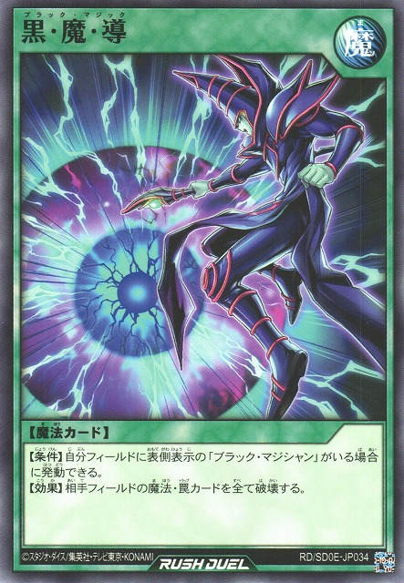

- **Zona y copias:** Main **2x**. CID Rush: **15451**.
- **Rol funcional:** Carta Mágica Normal — removal / apertura de campo.
- **Estado de sinergia y función:** Sinergia indirecta (soporte o recursos). Es una clasificación de juego; revisar la relación concreta en A06.
- **Papel como recurso, descarte o coste:** Coste o consumo descrito en A05: el resultado está sujeto a monstruos/cartas que puedan ser afectados y a respuestas del rival.
- **Requisito específico:** Controlar un Mago Oscuro boca arriba.
- **Efecto / resultado concreto:** Destruye todas las cartas Mágicas y Trampas del campo rival.
- **Ir primero, segundo y juego tardío:** Primero: usarla si su efecto abre recursos o deja protección aprovechable; segundo: priorizar su resultado concreto frente a las amenazas rivales; tardío: comprobar materiales, objetivos y si aún quedan recursos en Deck o Cementerio.
- **Relación con habilidad y otras piezas:** La Skill **ILLUSION OF EXECUTION** se aplica desde turno 2, una vez por duelo, después de comprobar sus restricciones de construcción.
- **Riesgos y dependencias:** el resultado está sujeto a monstruos/cartas que puedan ser afectados y a respuestas del rival.
- **Confianza:** **RESUMEN_FUNCIONAL_DE_GUIA_PREVIA_CON_FUENTE_KONAMI**; pendiente cotejo adicional de traducción/ventanas según la liga. Fuente Rush oficial: https://www.db.yugioh-card.com/rushdb/card_search.action?cid=15451&ope=2
- **Contraste de fuente Rush:** CID 15451: fuente oficial Rush consultada en japonés; tipo Carta Mágica Normal; descripción funcional en español procede de la guía previa y sigue siendo interpretación editorial.
- **Aplicación concreta dentro de este deck (A06):** Destruye todas las cartas Mágicas y Trampas del campo rival.

**USO PRÁCTICO Y SINERGIA — Ataque Mágico Oscuro**

- **Label funcional:** Sinergia indirecta. Clasificación documental; una relación es válida solo si se satisfacen sus condiciones exactas.
- **Qué hace:** Destruye todas las cartas Mágicas y Trampas del campo rival.
- **Cuándo tener precaución:** el resultado está sujeto a monstruos/cartas que puedan ser afectados y a respuestas del rival.

#### 02. Distribuidor Maravilloso

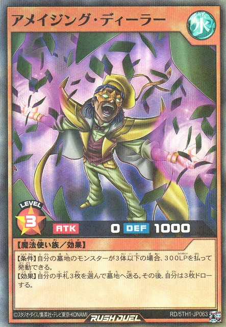

- **Zona y copias:** Main **1x**. CID Rush: **16772**.
- **Rol funcional:** Monstruo de Efecto — consistencia / reciclaje.
- **Estado de sinergia y función:** Sinergia directa descrita. Es una clasificación de juego; revisar la relación concreta en A06.
- **Papel como recurso, descarte o coste:** Envío mencionado en la interacción; no equivale por sí mismo a descarte desde la mano.
- **Requisito específico:** Tener hasta tres monstruos en el Cementerio y pagar 300 LP.
- **Efecto / resultado concreto:** Enviar tres cartas de la mano al Cementerio y robar tres cartas.
- **Ir primero, segundo y juego tardío:** Primero: priorizar consistencia sin comprometer piezas de Fusión; segundo: buscar la carta que falta para superar el campo rival; tardío: solo aporta ventaja si queda un objetivo y su coste puede pagarse.
- **Relación con habilidad y otras piezas:** **ILLUSION OF EXECUTION** permite enviar «Mago Oscuro» desde Deck al GY bajo sus condiciones; puede alimentar recuperación, pero la Skill solo se usa una vez por duelo.
- **Riesgos y dependencias:** pagar/cumplir el requisito escrito antes de prometer la resolución. disponer de cartas suficientes en Deck y distinguir robo de búsqueda.
- **Confianza:** **RESUMEN_FUNCIONAL_DE_GUIA_PREVIA_CON_FUENTE_KONAMI**; pendiente cotejo adicional de traducción/ventanas según la liga. Fuente Rush oficial: https://www.db.yugioh-card.com/rushdb/card_search.action?cid=16772&ope=2
- **Contraste de fuente Rush:** CID 16772: fuente oficial Rush consultada en japonés; tipo Monstruo de Efecto; descripción funcional en español procede de la guía previa y sigue siendo interpretación editorial.
- **Aplicación concreta dentro de este deck (A06):** Enviar tres cartas de la mano al Cementerio y robar tres cartas.

**USO PRÁCTICO Y SINERGIA — Distribuidor Maravilloso**

- **Label funcional:** Sinergia directa. Clasificación documental; una relación es válida solo si se satisfacen sus condiciones exactas.
- **Qué hace:** Enviar tres cartas de la mano al Cementerio y robar tres cartas.
- **Cuándo tener precaución:** pagar/cumplir el requisito escrito antes de prometer la resolución. disponer de cartas suficientes en Deck y distinguir robo de búsqueda.

#### 03. Maga Legendaria

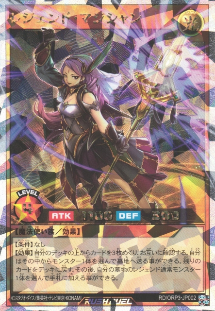

- **Zona y copias:** Main **2x**. CID Rush: **18685**.
- **Rol funcional:** Monstruo de Efecto — monstruo de apoyo/material o recurso de Sacrificio.
- **Estado de sinergia y función:** Sinergia directa descrita. Es una clasificación de juego; revisar la relación concreta en A06.
- **Papel como recurso, descarte o coste:** Envío mencionado en la interacción; no equivale por sí mismo a descarte desde la mano.
- **Requisito específico:** No tiene requisito de activación.
- **Efecto / resultado concreto:** Revelar las tres cartas superiores; puede enviar un monstruo revelado al Cementerio y recuperar un monstruo Normal LEGEND del Cementerio.
- **Ir primero, segundo y juego tardío:** Primero: conservarlo si es material expresamente exigido por una Fusión o Sacrificio; segundo: emplearlo como cuerpo solo tras calcular ATK y riesgo de batalla; tardío: recurso para reconstruir material desde el GY si una carta lo autoriza.
- **Relación con habilidad y otras piezas:** **ILLUSION OF EXECUTION** permite enviar «Mago Oscuro» desde Deck al GY bajo sus condiciones; puede alimentar recuperación, pero la Skill solo se usa una vez por duelo.
- **Riesgos y dependencias:** no atribuirle un efecto activado inexistente; comprobar su función como material y las cartas de soporte.
- **Confianza:** **RESUMEN_FUNCIONAL_DE_GUIA_PREVIA_CON_FUENTE_KONAMI**; pendiente cotejo adicional de traducción/ventanas según la liga. Fuente Rush oficial: https://www.db.yugioh-card.com/rushdb/card_search.action?cid=18685&ope=2
- **Contraste de fuente Rush:** CID 18685: fuente oficial Rush consultada en japonés; tipo Monstruo de Efecto; descripción funcional en español procede de la guía previa y sigue siendo interpretación editorial.
- **Aplicación concreta dentro de este deck (A06):** Revelar las tres cartas superiores; puede enviar un monstruo revelado al Cementerio y recuperar un monstruo Normal LEGEND del Cementerio.

**USO PRÁCTICO Y SINERGIA — Maga Legendaria**

- **Label funcional:** Sinergia directa. Clasificación documental; una relación es válida solo si se satisfacen sus condiciones exactas.
- **Qué hace:** Revelar las tres cartas superiores; puede enviar un monstruo revelado al Cementerio y recuperar un monstruo Normal LEGEND del Cementerio.
- **Cuándo tener precaución:** no atribuirle un efecto activado inexistente; comprobar su función como material y las cartas de soporte.

#### 04. Mago Oscuro Sabio

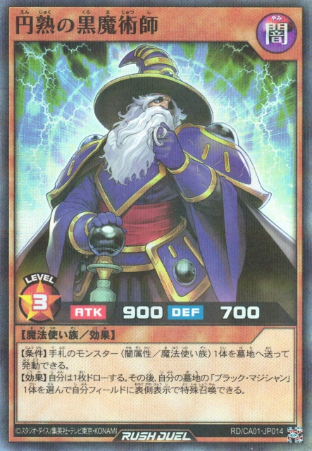

- **Zona y copias:** Main **1x**. CID Rush: **19597**.
- **Rol funcional:** Monstruo de Efecto — extensión de campo y recuperación de recursos.
- **Estado de sinergia y función:** Sinergia directa descrita. Es una clasificación de juego; revisar la relación concreta en A06.
- **Papel como recurso, descarte o coste:** Coste o consumo descrito en A05: pagar/cumplir el requisito escrito antes de prometer la resolución. disponer de cartas suficientes en Deck y distinguir robo….
- **Requisito específico:** Enviar desde la mano al Cementerio un Lanzador de Conjuros/OSCURIDAD.
- **Efecto / resultado concreto:** Roba una carta; después puede Invocar de Modo Especial un Mago Oscuro del Cementerio.
- **Ir primero, segundo y juego tardío:** Primero: priorizar consistencia sin comprometer piezas de Fusión; segundo: buscar la carta que falta para superar el campo rival; tardío: solo aporta ventaja si queda un objetivo y su coste puede pagarse.
- **Relación con habilidad y otras piezas:** **ILLUSION OF EXECUTION** permite enviar «Mago Oscuro» desde Deck al GY bajo sus condiciones; puede alimentar recuperación, pero la Skill solo se usa una vez por duelo.
- **Riesgos y dependencias:** pagar/cumplir el requisito escrito antes de prometer la resolución. disponer de cartas suficientes en Deck y distinguir robo de búsqueda.
- **Confianza:** **RESUMEN_FUNCIONAL_DE_GUIA_PREVIA_CON_FUENTE_KONAMI**; pendiente cotejo adicional de traducción/ventanas según la liga. Fuente Rush oficial: https://www.db.yugioh-card.com/rushdb/card_search.action?cid=19597&ope=2
- **Contraste de fuente Rush:** CID 19597: fuente oficial Rush consultada en japonés; tipo Monstruo de Efecto; descripción funcional en español procede de la guía previa y sigue siendo interpretación editorial.
- **Aplicación concreta dentro de este deck (A06):** Roba una carta; después puede Invocar de Modo Especial un Mago Oscuro del Cementerio.

**USO PRÁCTICO Y SINERGIA — Mago Oscuro Sabio**

- **Label funcional:** Sinergia directa. Clasificación documental; una relación es válida solo si se satisfacen sus condiciones exactas.
- **Qué hace:** Roba una carta; después puede Invocar de Modo Especial un Mago Oscuro del Cementerio.
- **Cuándo tener precaución:** pagar/cumplir el requisito escrito antes de prometer la resolución. disponer de cartas suficientes en Deck y distinguir robo de búsqueda.

#### 05. Grito de Monstruo

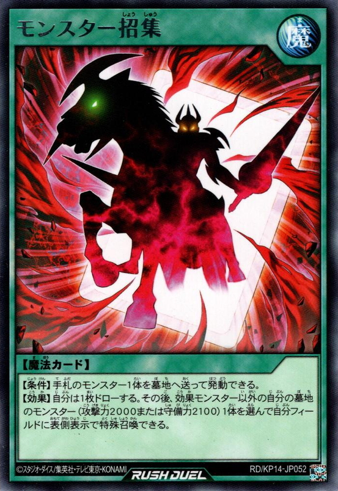

- **Zona y copias:** Main **2x**. CID Rush: **19329**.
- **Rol funcional:** Carta Mágica Normal — extensión de campo y recuperación de recursos.
- **Estado de sinergia y función:** Sinergia directa descrita. Es una clasificación de juego; revisar la relación concreta en A06.
- **Papel como recurso, descarte o coste:** Coste o consumo descrito en A05: pagar/cumplir el requisito escrito antes de prometer la resolución. disponer de cartas suficientes en Deck y distinguir robo….
- **Requisito específico:** Enviar de la mano un monstruo al Cementerio.
- **Efecto / resultado concreto:** Roba una carta; después puede Invocar del Cementerio un monstruo sin efecto que tenga ATK 2000 o DEF 2100.
- **Ir primero, segundo y juego tardío:** Primero: usarla si su efecto abre recursos o deja protección aprovechable; segundo: priorizar su resultado concreto frente a las amenazas rivales; tardío: comprobar materiales, objetivos y si aún quedan recursos en Deck o Cementerio.
- **Relación con habilidad y otras piezas:** **ILLUSION OF EXECUTION** permite enviar «Mago Oscuro» desde Deck al GY bajo sus condiciones; puede alimentar recuperación, pero la Skill solo se usa una vez por duelo.
- **Riesgos y dependencias:** pagar/cumplir el requisito escrito antes de prometer la resolución. disponer de cartas suficientes en Deck y distinguir robo de búsqueda.
- **Confianza:** **RESUMEN_FUNCIONAL_DE_GUIA_PREVIA_CON_FUENTE_KONAMI**; pendiente cotejo adicional de traducción/ventanas según la liga. Fuente Rush oficial: https://www.db.yugioh-card.com/rushdb/card_search.action?cid=19329&ope=2
- **Contraste de fuente Rush:** CID 19329: fuente oficial Rush consultada en japonés; tipo Carta Mágica Normal; descripción funcional en español procede de la guía previa y sigue siendo interpretación editorial.
- **Aplicación concreta dentro de este deck (A06):** Roba una carta; después puede Invocar del Cementerio un monstruo sin efecto que tenga ATK 2000 o DEF 2100.

**USO PRÁCTICO Y SINERGIA — Grito de Monstruo**

- **Label funcional:** Sinergia directa. Clasificación documental; una relación es válida solo si se satisfacen sus condiciones exactas.
- **Qué hace:** Roba una carta; después puede Invocar del Cementerio un monstruo sin efecto que tenga ATK 2000 o DEF 2100.
- **Cuándo tener precaución:** pagar/cumplir el requisito escrito antes de prometer la resolución. disponer de cartas suficientes en Deck y distinguir robo de búsqueda.

#### 06. Hechicero Eliminador Oscuro

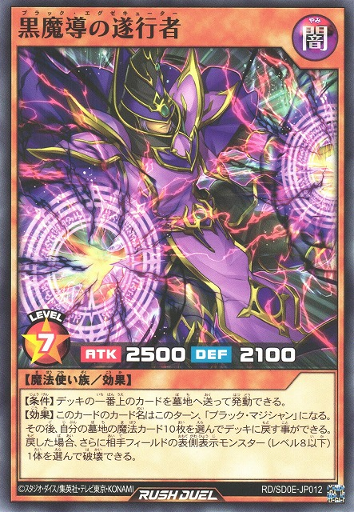

- **Zona y copias:** Main **3x**. CID Rush: **19773**.
- **Rol funcional:** Monstruo de Efecto — apoyo situacional sujeto a condición escrita.
- **Estado de sinergia y función:** Sinergia indirecta (soporte o recursos). Es una clasificación de juego; revisar la relación concreta en A06.
- **Papel como recurso, descarte o coste:** Coste o consumo descrito en A05: pagar/cumplir el requisito escrito antes de prometer la resolución. el resultado está sujeto a monstruos/cartas que puedan….
- **Requisito específico:** Enviar la primera carta de tu Deck al Cementerio.
- **Efecto / resultado concreto:** Se llama Mago Oscuro ese turno; puede devolver diez Mágicas del Cementerio al Deck para destruir un monstruo rival boca arriba de Nivel 8 o inferior.
- **Ir primero, segundo y juego tardío:** Primero: construir la condición de activación; segundo: verificar que la jugada responde al estado rival actual; tardío: ahorrar el recurso si todavía no se cumple el requisito.
- **Relación con habilidad y otras piezas:** **ILLUSION OF EXECUTION** permite enviar «Mago Oscuro» desde Deck al GY bajo sus condiciones; puede alimentar recuperación, pero la Skill solo se usa una vez por duelo.
- **Riesgos y dependencias:** pagar/cumplir el requisito escrito antes de prometer la resolución. el resultado está sujeto a monstruos/cartas que puedan ser afectados y a respuestas del rival.
- **Confianza:** **RESUMEN_FUNCIONAL_DE_GUIA_PREVIA_CON_FUENTE_KONAMI**; pendiente cotejo adicional de traducción/ventanas según la liga. Fuente Rush oficial: https://www.db.yugioh-card.com/rushdb/card_search.action?cid=19773&ope=2
- **Contraste de fuente Rush:** CID 19773: fuente oficial Rush consultada en japonés; tipo Monstruo de Efecto; descripción funcional en español procede de la guía previa y sigue siendo interpretación editorial.
- **Aplicación concreta dentro de este deck (A06):** Se llama Mago Oscuro ese turno; puede devolver diez Mágicas del Cementerio al Deck para destruir un monstruo rival boca arriba de Nivel 8 o inferior.

**USO PRÁCTICO Y SINERGIA — Hechicero Eliminador Oscuro**

- **Label funcional:** Sinergia indirecta. Clasificación documental; una relación es válida solo si se satisfacen sus condiciones exactas.
- **Qué hace:** Se llama Mago Oscuro ese turno; puede devolver diez Mágicas del Cementerio al Deck para destruir un monstruo rival boca arriba de Nivel 8 o inferior.
- **Cuándo tener precaución:** pagar/cumplir el requisito escrito antes de prometer la resolución. el resultado está sujeto a monstruos/cartas que puedan ser afectados y a respuestas del rival.

#### 07. Ráfaga de Resonancia Oscura

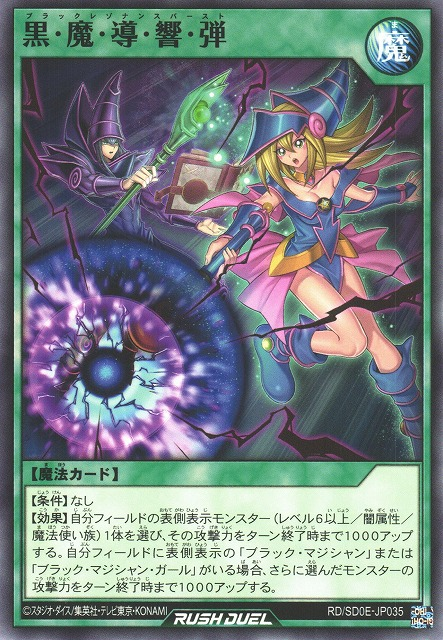

- **Zona y copias:** Main **3x**. CID Rush: **17209**.
- **Rol funcional:** Carta Mágica Normal — presión de combate / modificación de estadísticas.
- **Estado de sinergia y función:** Sinergia indirecta (soporte o recursos). Es una clasificación de juego; revisar la relación concreta en A06.
- **Papel como recurso, descarte o coste:** Coste o consumo descrito en A05: comprobar zona, objetivos y ventana; el nombre de la carta no reemplaza su texto.
- **Requisito específico:** Sin requisito de activación.
- **Efecto / resultado concreto:** Otorga 1000 ATK por el turno a un Lanzador de Conjuros OSCURIDAD propio de Nivel 6+; otorga otros 1000 si controlas Mago Oscuro o Chica Maga Oscura.
- **Ir primero, segundo y juego tardío:** Primero: usarla si su efecto abre recursos o deja protección aprovechable; segundo: priorizar su resultado concreto frente a las amenazas rivales; tardío: comprobar materiales, objetivos y si aún quedan recursos en Deck o Cementerio.
- **Relación con habilidad y otras piezas:** **ILLUSION OF EXECUTION** permite enviar «Mago Oscuro» desde Deck al GY bajo sus condiciones; puede alimentar recuperación, pero la Skill solo se usa una vez por duelo.
- **Riesgos y dependencias:** comprobar zona, objetivos y ventana; el nombre de la carta no reemplaza su texto.
- **Confianza:** **RESUMEN_FUNCIONAL_DE_GUIA_PREVIA_CON_FUENTE_KONAMI**; pendiente cotejo adicional de traducción/ventanas según la liga. Fuente Rush oficial: https://www.db.yugioh-card.com/rushdb/card_search.action?cid=17209&ope=2
- **Contraste de fuente Rush:** CID 17209: fuente oficial Rush consultada en japonés; tipo Carta Mágica Normal; descripción funcional en español procede de la guía previa y sigue siendo interpretación editorial.
- **Aplicación concreta dentro de este deck (A06):** Otorga 1000 ATK por el turno a un Lanzador de Conjuros OSCURIDAD propio de Nivel 6+; otorga otros 1000 si controlas Mago Oscuro o Chica Maga Oscura.

**USO PRÁCTICO Y SINERGIA — Ráfaga de Resonancia Oscura**

- **Label funcional:** Sinergia indirecta. Clasificación documental; una relación es válida solo si se satisfacen sus condiciones exactas.
- **Qué hace:** Otorga 1000 ATK por el turno a un Lanzador de Conjuros OSCURIDAD propio de Nivel 6+; otorga otros 1000 si controlas Mago Oscuro o Chica Maga Oscura.
- **Cuándo tener precaución:** comprobar zona, objetivos y ventana; el nombre de la carta no reemplaza su texto.

#### 08. Brillo Sombrío

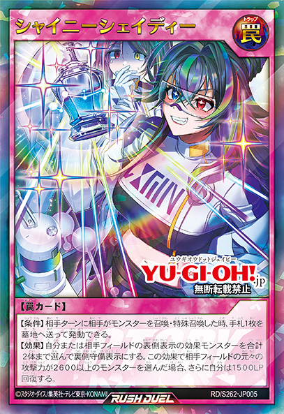

- **Zona y copias:** Main **2x**. CID Rush: **20151**.
- **Rol funcional:** Carta de Trampa Normal — consistencia / reciclaje.
- **Estado de sinergia y función:** Sinergia directa descrita. Es una clasificación de juego; revisar la relación concreta en A06.
- **Papel como recurso, descarte o coste:** Coste o consumo descrito en A05: pagar/cumplir el requisito escrito antes de prometer la resolución.
- **Requisito específico:** Cuando el rival Invoca un monstruo en su turno; enviar una carta de la mano al Cementerio.
- **Efecto / resultado concreto:** Pone hasta dos monstruos de Efecto boca arriba de cualquier Campo boca abajo en Defensa; si incluyó un monstruo rival con ATK original de al menos 2600, recupera 1500 LP.
- **Ir primero, segundo y juego tardío:** Primero: Colocar y reservar la respuesta para la ventana legal; segundo: tras side y cambio de turno, evaluar si puede activarse a tiempo; tardío: no asumir efecto si falta el objetivo o el estado de campo.
- **Relación con habilidad y otras piezas:** **ILLUSION OF EXECUTION** permite enviar «Mago Oscuro» desde Deck al GY bajo sus condiciones; puede alimentar recuperación, pero la Skill solo se usa una vez por duelo.
- **Riesgos y dependencias:** pagar/cumplir el requisito escrito antes de prometer la resolución.
- **Confianza:** **RESUMEN_FUNCIONAL_DE_GUIA_PREVIA_CON_FUENTE_KONAMI**; pendiente cotejo adicional de traducción/ventanas según la liga. Fuente Rush oficial: https://www.db.yugioh-card.com/rushdb/card_search.action?cid=20151&ope=2
- **Contraste de fuente Rush:** CID 20151: fuente oficial Rush consultada en japonés; tipo Carta de Trampa Normal; descripción funcional en español procede de la guía previa y sigue siendo interpretación editorial.
- **Aplicación concreta dentro de este deck (A06):** Pone hasta dos monstruos de Efecto boca arriba de cualquier Campo boca abajo en Defensa; si incluyó un monstruo rival con ATK original de al menos 2600, recupera 1500 LP.

**USO PRÁCTICO Y SINERGIA — Brillo Sombrío**

- **Label funcional:** Sinergia directa. Clasificación documental; una relación es válida solo si se satisfacen sus condiciones exactas.
- **Qué hace:** Pone hasta dos monstruos de Efecto boca arriba de cualquier Campo boca abajo en Defensa; si incluyó un monstruo rival con ATK original de al menos 2600, recupera 1500 LP.
- **Cuándo tener precaución:** pagar/cumplir el requisito escrito antes de prometer la resolución.

#### 09. Piedra de los Magos Oscuros

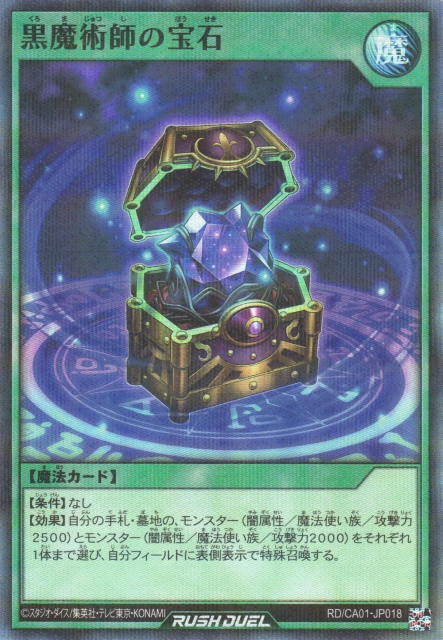

- **Zona y copias:** Main **3x**. CID Rush: **19598**.
- **Rol funcional:** Carta Mágica Normal — extensor / habilitador de material.
- **Estado de sinergia y función:** Sinergia directa descrita. Es una clasificación de juego; revisar la relación concreta en A06.
- **Papel como recurso, descarte o coste:** Coste o consumo descrito en A05: comprobar zona, objetivos y ventana; el nombre de la carta no reemplaza su texto.
- **Requisito específico:** Sin requisito de activación.
- **Efecto / resultado concreto:** Invoca desde la mano y/o Cementerio hasta un Lanzador de Conjuros OSCURIDAD con 2500 ATK y hasta otro con 2000 ATK, boca arriba.
- **Ir primero, segundo y juego tardío:** Primero: usarla si su efecto abre recursos o deja protección aprovechable; segundo: priorizar su resultado concreto frente a las amenazas rivales; tardío: comprobar materiales, objetivos y si aún quedan recursos en Deck o Cementerio.
- **Relación con habilidad y otras piezas:** **ILLUSION OF EXECUTION** permite enviar «Mago Oscuro» desde Deck al GY bajo sus condiciones; puede alimentar recuperación, pero la Skill solo se usa una vez por duelo.
- **Riesgos y dependencias:** comprobar zona, objetivos y ventana; el nombre de la carta no reemplaza su texto.
- **Confianza:** **RESUMEN_FUNCIONAL_DE_GUIA_PREVIA_CON_FUENTE_KONAMI**; pendiente cotejo adicional de traducción/ventanas según la liga. Fuente Rush oficial: https://www.db.yugioh-card.com/rushdb/card_search.action?cid=19598&ope=2
- **Contraste de fuente Rush:** CID 19598: fuente oficial Rush consultada en japonés; tipo Carta Mágica Normal; descripción funcional en español procede de la guía previa y sigue siendo interpretación editorial.
- **Aplicación concreta dentro de este deck (A06):** Invoca desde la mano y/o Cementerio hasta un Lanzador de Conjuros OSCURIDAD con 2500 ATK y hasta otro con 2000 ATK, boca arriba.

**USO PRÁCTICO Y SINERGIA — Piedra de los Magos Oscuros**

- **Label funcional:** Sinergia directa. Clasificación documental; una relación es válida solo si se satisfacen sus condiciones exactas.
- **Qué hace:** Invoca desde la mano y/o Cementerio hasta un Lanzador de Conjuros OSCURIDAD con 2500 ATK y hasta otro con 2000 ATK, boca arriba.
- **Cuándo tener precaución:** comprobar zona, objetivos y ventana; el nombre de la carta no reemplaza su texto.

#### 10. Mago Oscuro

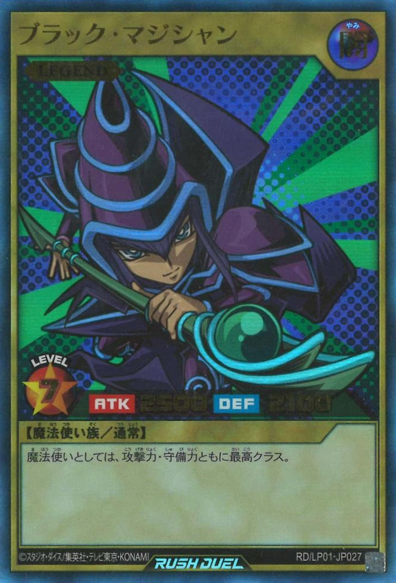

- **Zona y copias:** Main **1x**. CID Rush: **15410**.
- **Rol funcional:** Monstruo Normal — material de Fusión/Sacrificio o presencia de combate; sin efecto activado.
- **Estado de sinergia y función:** Sinergia indirecta (soporte o recursos). Es una clasificación de juego; revisar la relación concreta en A06.
- **Papel como recurso, descarte o coste:** Coste o consumo descrito en A05: no atribuirle un efecto activado inexistente; comprobar su función como material y las cartas de soporte.
- **Requisito específico:** No tiene efecto.
- **Efecto / resultado concreto:** Monstruo Normal LEGEND.
- **Ir primero, segundo y juego tardío:** Primero: conservarlo si es material expresamente exigido por una Fusión o Sacrificio; segundo: emplearlo como cuerpo solo tras calcular ATK y riesgo de batalla; tardío: recurso para reconstruir material desde el GY si una carta lo autoriza.
- **Relación con habilidad y otras piezas:** **ILLUSION OF EXECUTION** permite enviar «Mago Oscuro» desde Deck al GY bajo sus condiciones; puede alimentar recuperación, pero la Skill solo se usa una vez por duelo.
- **Riesgos y dependencias:** no atribuirle un efecto activado inexistente; comprobar su función como material y las cartas de soporte.
- **Confianza:** **RESUMEN_FUNCIONAL_DE_GUIA_PREVIA_CON_FUENTE_KONAMI**; pendiente cotejo adicional de traducción/ventanas según la liga. Fuente Rush oficial: https://www.db.yugioh-card.com/rushdb/card_search.action?cid=15410&ope=2
- **Contraste de fuente Rush:** CID 15410: fuente oficial Rush consultada en japonés; tipo Monstruo Normal; descripción funcional en español procede de la guía previa y sigue siendo interpretación editorial.
- **Aplicación concreta dentro de este deck (A06):** Monstruo Normal LEGEND.

**USO PRÁCTICO Y SINERGIA — Mago Oscuro**

- **Label funcional:** Sinergia indirecta. Clasificación documental; una relación es válida solo si se satisfacen sus condiciones exactas.
- **Qué hace:** Monstruo Normal LEGEND.
- **Cuándo tener precaución:** no atribuirle un efecto activado inexistente; comprobar su función como material y las cartas de soporte.

#### 11. Lily Aniquiladora

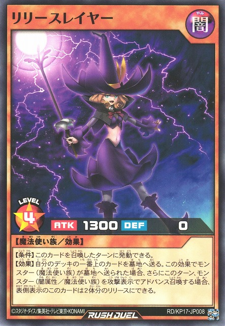

- **Zona y copias:** Main **1x**. CID Rush: **20305**.
- **Rol funcional:** Monstruo de Efecto — apoyo situacional sujeto a condición escrita.
- **Estado de sinergia y función:** Sinergia directa descrita. Es una clasificación de juego; revisar la relación concreta en A06.
- **Papel como recurso, descarte o coste:** Envío mencionado en la interacción; no equivale por sí mismo a descarte desde la mano.
- **Requisito específico:** Haber sido Invocada de Modo Normal este turno.
- **Efecto / resultado concreto:** Envía la primera carta del Deck al Cementerio; si era Lanzador de Conjuros, esta carta cuenta por dos Sacrificios para un Lanzador de Conjuros/OSCURIDAD en Ataque este turno.
- **Ir primero, segundo y juego tardío:** Primero: construir la condición de activación; segundo: verificar que la jugada responde al estado rival actual; tardío: ahorrar el recurso si todavía no se cumple el requisito.
- **Relación con habilidad y otras piezas:** **ILLUSION OF EXECUTION** permite enviar «Mago Oscuro» desde Deck al GY bajo sus condiciones; puede alimentar recuperación, pero la Skill solo se usa una vez por duelo.
- **Riesgos y dependencias:** comprobar zona, objetivos y ventana; el nombre de la carta no reemplaza su texto.
- **Confianza:** **RESUMEN_FUNCIONAL_DE_GUIA_PREVIA_CON_FUENTE_KONAMI**; pendiente cotejo adicional de traducción/ventanas según la liga. Fuente Rush oficial: https://www.db.yugioh-card.com/rushdb/card_search.action?cid=20305&ope=2
- **Contraste de fuente Rush:** CID 20305: fuente oficial Rush consultada en japonés; tipo Monstruo de Efecto; descripción funcional en español procede de la guía previa y sigue siendo interpretación editorial.
- **Aplicación concreta dentro de este deck (A06):** Envía la primera carta del Deck al Cementerio; si era Lanzador de Conjuros, esta carta cuenta por dos Sacrificios para un Lanzador de Conjuros/OSCURIDAD en Ataque este turno.

**USO PRÁCTICO Y SINERGIA — Lily Aniquiladora**

- **Label funcional:** Sinergia directa. Clasificación documental; una relación es válida solo si se satisfacen sus condiciones exactas.
- **Qué hace:** Envía la primera carta del Deck al Cementerio; si era Lanzador de Conjuros, esta carta cuenta por dos Sacrificios para un Lanzador de Conjuros/OSCURIDAD en Ataque este turno.
- **Cuándo tener precaución:** comprobar zona, objetivos y ventana; el nombre de la carta no reemplaza su texto.

#### 12. Chica Maga Oscura

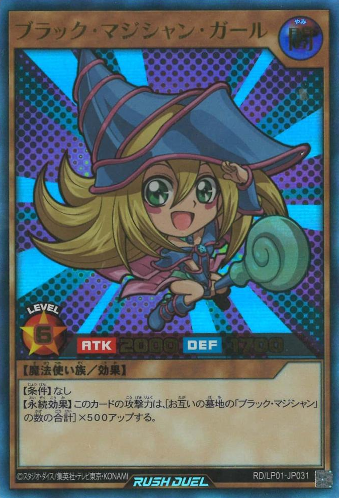

- **Zona y copias:** Main **3x**. CID Rush: **16371**.
- **Rol funcional:** Monstruo de Efecto — presión de combate / modificación de estadísticas.
- **Estado de sinergia y función:** Sinergia indirecta (soporte o recursos). Es una clasificación de juego; revisar la relación concreta en A06.
- **Papel como recurso, descarte o coste:** Coste o consumo descrito en A05: comprobar zona, objetivos y ventana; el nombre de la carta no reemplaza su texto.
- **Requisito específico:** No necesita activación.
- **Efecto / resultado concreto:** Gana 500 ATK por cada Mago Oscuro en ambos Cementerios.
- **Ir primero, segundo y juego tardío:** Primero: preparar acceso y campo necesario sin gastar la respuesta antes de tiempo; segundo: usarla para abrir combate o retirar la amenaza que cumple su condición; tardío: evaluar si quedan objetivos reales.
- **Relación con habilidad y otras piezas:** **ILLUSION OF EXECUTION** permite enviar «Mago Oscuro» desde Deck al GY bajo sus condiciones; puede alimentar recuperación, pero la Skill solo se usa una vez por duelo.
- **Riesgos y dependencias:** comprobar zona, objetivos y ventana; el nombre de la carta no reemplaza su texto.
- **Confianza:** **RESUMEN_FUNCIONAL_DE_GUIA_PREVIA_CON_FUENTE_KONAMI**; pendiente cotejo adicional de traducción/ventanas según la liga. Fuente Rush oficial: https://www.db.yugioh-card.com/rushdb/card_search.action?cid=16371&ope=2
- **Contraste de fuente Rush:** CID 16371: fuente oficial Rush consultada en japonés; tipo Monstruo de Efecto; descripción funcional en español procede de la guía previa y sigue siendo interpretación editorial.
- **Aplicación concreta dentro de este deck (A06):** Gana 500 ATK por cada Mago Oscuro en ambos Cementerios.

**USO PRÁCTICO Y SINERGIA — Chica Maga Oscura**

- **Label funcional:** Sinergia indirecta. Clasificación documental; una relación es válida solo si se satisfacen sus condiciones exactas.
- **Qué hace:** Gana 500 ATK por cada Mago Oscuro en ambos Cementerios.
- **Cuándo tener precaución:** comprobar zona, objetivos y ventana; el nombre de la carta no reemplaza su texto.

#### 13. Mil Cuchillos

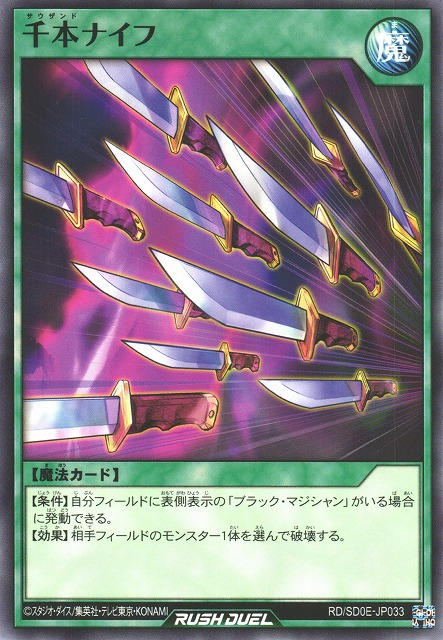

- **Zona y copias:** Main **2x**. CID Rush: **15450**.
- **Rol funcional:** Carta Mágica Normal — removal / apertura de campo.
- **Estado de sinergia y función:** Sinergia indirecta (soporte o recursos). Es una clasificación de juego; revisar la relación concreta en A06.
- **Papel como recurso, descarte o coste:** Coste o consumo descrito en A05: el resultado está sujeto a monstruos/cartas que puedan ser afectados y a respuestas del rival.
- **Requisito específico:** Controlar un Mago Oscuro boca arriba.
- **Efecto / resultado concreto:** Destruye un monstruo del Campo rival.
- **Ir primero, segundo y juego tardío:** Primero: usarla si su efecto abre recursos o deja protección aprovechable; segundo: priorizar su resultado concreto frente a las amenazas rivales; tardío: comprobar materiales, objetivos y si aún quedan recursos en Deck o Cementerio.
- **Relación con habilidad y otras piezas:** La Skill **ILLUSION OF EXECUTION** se aplica desde turno 2, una vez por duelo, después de comprobar sus restricciones de construcción.
- **Riesgos y dependencias:** el resultado está sujeto a monstruos/cartas que puedan ser afectados y a respuestas del rival.
- **Confianza:** **RESUMEN_FUNCIONAL_DE_GUIA_PREVIA_CON_FUENTE_KONAMI**; pendiente cotejo adicional de traducción/ventanas según la liga. Fuente Rush oficial: https://www.db.yugioh-card.com/rushdb/card_search.action?cid=15450&ope=2
- **Contraste de fuente Rush:** CID 15450: fuente oficial Rush consultada en japonés; tipo Carta Mágica Normal; descripción funcional en español procede de la guía previa y sigue siendo interpretación editorial.
- **Aplicación concreta dentro de este deck (A06):** Destruye un monstruo del Campo rival.

**USO PRÁCTICO Y SINERGIA — Mil Cuchillos**

- **Label funcional:** Sinergia indirecta. Clasificación documental; una relación es válida solo si se satisfacen sus condiciones exactas.
- **Qué hace:** Destruye un monstruo del Campo rival.
- **Cuándo tener precaución:** el resultado está sujeto a monstruos/cartas que puedan ser afectados y a respuestas del rival.

#### 14. ¡Equitación Lindasesina!

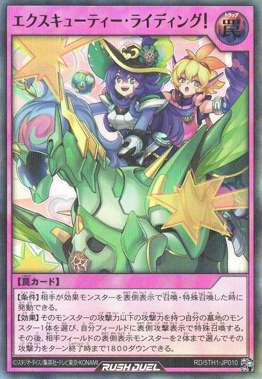

- **Zona y copias:** Main **1x**. CID Rush: **19341**.
- **Rol funcional:** Carta de Trampa Normal — extensor / habilitador de material.
- **Estado de sinergia y función:** Sinergia directa descrita. Es una clasificación de juego; revisar la relación concreta en A06.
- **Papel como recurso, descarte o coste:** Coste o consumo descrito en A05: comprobar zona, objetivos y ventana; el nombre de la carta no reemplaza su texto.
- **Requisito específico:** Cuando el rival Invoca boca arriba un monstruo de Efecto.
- **Efecto / resultado concreto:** Invoca del Cementerio en Ataque propio un monstruo cuyo ATK no supere el del recién invocado; después puede reducir en 1800 ATK hasta dos monstruos rivales boca arriba ese turno.
- **Ir primero, segundo y juego tardío:** Primero: Colocar y reservar la respuesta para la ventana legal; segundo: tras side y cambio de turno, evaluar si puede activarse a tiempo; tardío: no asumir efecto si falta el objetivo o el estado de campo.
- **Relación con habilidad y otras piezas:** **ILLUSION OF EXECUTION** permite enviar «Mago Oscuro» desde Deck al GY bajo sus condiciones; puede alimentar recuperación, pero la Skill solo se usa una vez por duelo.
- **Riesgos y dependencias:** comprobar zona, objetivos y ventana; el nombre de la carta no reemplaza su texto.
- **Confianza:** **RESUMEN_FUNCIONAL_DE_GUIA_PREVIA_CON_FUENTE_KONAMI**; pendiente cotejo adicional de traducción/ventanas según la liga. Fuente Rush oficial: https://www.db.yugioh-card.com/rushdb/card_search.action?cid=19341&ope=2
- **Contraste de fuente Rush:** CID 19341: fuente oficial Rush consultada en japonés; tipo Carta de Trampa Normal; descripción funcional en español procede de la guía previa y sigue siendo interpretación editorial.
- **Aplicación concreta dentro de este deck (A06):** Invoca del Cementerio en Ataque propio un monstruo cuyo ATK no supere el del recién invocado; después puede reducir en 1800 ATK hasta dos monstruos rivales boca arriba ese turno.

**USO PRÁCTICO Y SINERGIA — ¡Equitación Lindasesina!**

- **Label funcional:** Sinergia directa. Clasificación documental; una relación es válida solo si se satisfacen sus condiciones exactas.
- **Qué hace:** Invoca del Cementerio en Ataque propio un monstruo cuyo ATK no supere el del recién invocado; después puede reducir en 1800 ATK hasta dos monstruos rivales boca arriba ese turno.
- **Cuándo tener precaución:** comprobar zona, objetivos y ventana; el nombre de la carta no reemplaza su texto.

#### 15. Orden Secreta

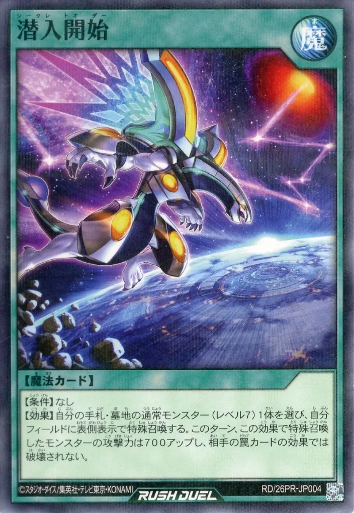

- **Zona y copias:** Main **1x**. CID Rush: **17212**.
- **Rol funcional:** Carta Mágica Normal — recurso táctico cuya condición y resultado están descritos en su ficha.
- **Estado de sinergia y función:** Sinergia directa descrita. Es una clasificación de juego; revisar la relación concreta en A06.
- **Papel como recurso, descarte o coste:** Coste o consumo descrito en A05: la condición de una Mágica/Trampa y sus blancos deben cumplirse antes de resolver. No confundir esta carta con un monstruo….
- **Requisito específico:** Sin requisito de activación.
- **Efecto / resultado concreto:** Invoca un monstruo Normal de Nivel 7 desde mano o Cementerio; le da 700 ATK ese turno y lo protege frente a destrucción por Trampas rivales.
- **Ir primero, segundo y juego tardío:** Primero: usarla si su efecto abre recursos o deja protección aprovechable; segundo: priorizar su resultado concreto frente a las amenazas rivales; tardío: comprobar materiales, objetivos y si aún quedan recursos en Deck o Cementerio.
- **Relación con habilidad y otras piezas:** **ILLUSION OF EXECUTION** permite enviar «Mago Oscuro» desde Deck al GY bajo sus condiciones; puede alimentar recuperación, pero la Skill solo se usa una vez por duelo.
- **Riesgos y dependencias:** la condición de una Mágica/Trampa y sus blancos deben cumplirse antes de resolver. No confundir esta carta con un monstruo ni usarla como material.
- **Confianza:** **RESUMEN_FUNCIONAL_DE_GUIA_PREVIA_CON_FUENTE_KONAMI**; pendiente cotejo adicional de traducción/ventanas según la liga. Fuente Rush oficial: https://www.db.yugioh-card.com/rushdb/card_search.action?cid=17212&ope=2
- **Contraste de fuente Rush:** CID 17212: fuente oficial Rush consultada en japonés; tipo Carta Mágica Normal; descripción funcional en español procede de la guía previa y sigue siendo interpretación editorial.
- **Aplicación concreta dentro de este deck (A06):** Invoca un monstruo Normal de Nivel 7 desde mano o Cementerio; le da 700 ATK ese turno y lo protege frente a destrucción por Trampas rivales.

**USO PRÁCTICO Y SINERGIA — Orden Secreta**

- **Label funcional:** Sinergia directa. Clasificación documental; una relación es válida solo si se satisfacen sus condiciones exactas.
- **Qué hace:** Invoca un monstruo Normal de Nivel 7 desde mano o Cementerio; le da 700 ATK ese turno y lo protege frente a destrucción por Trampas rivales.
- **Cuándo tener precaución:** la condición de una Mágica/Trampa y sus blancos deben cumplirse antes de resolver. No confundir esta carta con un monstruo ni usarla como material.

#### 16. Olla de la Codicia

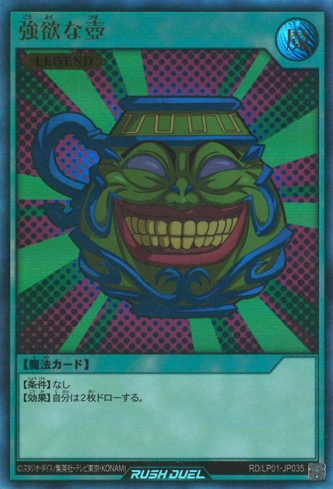

- **Zona y copias:** Main **1x**. CID Rush: **16372**.
- **Rol funcional:** Carta Mágica Normal — consistencia / reciclaje.
- **Estado de sinergia y función:** Sinergia indirecta de recursos. Es una clasificación de juego; revisar la relación concreta en A06.
- **Papel como recurso, descarte o coste:** Material o destino del Extra condicionado a los requisitos de invocación.
- **Requisito específico:** Sin requisito de activación.
- **Efecto / resultado concreto:** Roba dos cartas.
- **Ir primero, segundo y juego tardío:** Primero: usarla si su efecto abre recursos o deja protección aprovechable; segundo: priorizar su resultado concreto frente a las amenazas rivales; tardío: comprobar materiales, objetivos y si aún quedan recursos en Deck o Cementerio.
- **Relación con habilidad y otras piezas:** La Skill **ILLUSION OF EXECUTION** se aplica desde turno 2, una vez por duelo, después de comprobar sus restricciones de construcción.
- **Riesgos y dependencias:** disponer de cartas suficientes en Deck y distinguir robo de búsqueda.
- **Confianza:** **RESUMEN_FUNCIONAL_DE_GUIA_PREVIA_CON_FUENTE_KONAMI**; pendiente cotejo adicional de traducción/ventanas según la liga. Fuente Rush oficial: https://www.db.yugioh-card.com/rushdb/card_search.action?cid=16372&ope=2
- **Contraste de fuente Rush:** CID 16372: fuente oficial Rush consultada en japonés; tipo Carta Mágica Normal; descripción funcional en español procede de la guía previa y sigue siendo interpretación editorial.
- **Aplicación concreta dentro de este deck (A06):** Roba dos cartas. Aportación posible como material, coste o objetivo; verificar consumidor.

**USO PRÁCTICO Y SINERGIA — Olla de la Codicia**

- **Label funcional:** Sinergia indirecta. Clasificación documental; una relación es válida solo si se satisfacen sus condiciones exactas.
- **Qué hace:** Roba dos cartas.
- **Cómo aprovecharla en este deck:** Roba dos cartas. Aportación posible como material, coste o objetivo; verificar consumidor.
- **Cuándo tener precaución:** disponer de cartas suficientes en Deck y distinguir robo de búsqueda.

#### 17. Maldición de la Luz Ascendente

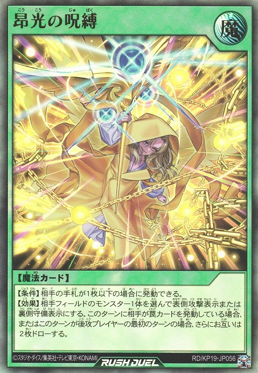

- **Zona y copias:** Main **1x**. CID Rush: **21007**.
- **Rol funcional:** Carta Mágica Normal — consistencia / reciclaje.
- **Estado de sinergia y función:** Sinergia indirecta (soporte o recursos). Es una clasificación de juego; revisar la relación concreta en A06.
- **Papel como recurso, descarte o coste:** Coste o consumo descrito en A05: disponer de cartas suficientes en Deck y distinguir robo de búsqueda.
- **Requisito específico:** El rival debe tener una o ninguna carta en mano.
- **Efecto / resultado concreto:** Cambia un monstruo rival a Ataque boca arriba o Defensa boca abajo. Si el rival activó una Trampa ese turno o es el primer turno del jugador segundo, ambos roban dos.
- **Ir primero, segundo y juego tardío:** Primero: usarla si su efecto abre recursos o deja protección aprovechable; segundo: priorizar su resultado concreto frente a las amenazas rivales; tardío: comprobar materiales, objetivos y si aún quedan recursos en Deck o Cementerio.
- **Relación con habilidad y otras piezas:** La Skill **ILLUSION OF EXECUTION** se aplica desde turno 2, una vez por duelo, después de comprobar sus restricciones de construcción.
- **Riesgos y dependencias:** disponer de cartas suficientes en Deck y distinguir robo de búsqueda.
- **Confianza:** **RESUMEN_FUNCIONAL_DE_GUIA_PREVIA_CON_FUENTE_KONAMI**; pendiente cotejo adicional de traducción/ventanas según la liga. Fuente Rush oficial: https://www.db.yugioh-card.com/rushdb/card_search.action?cid=21007&ope=2
- **Contraste de fuente Rush:** CID 21007: fuente oficial Rush consultada en japonés; tipo Carta Mágica Normal; descripción funcional en español procede de la guía previa y sigue siendo interpretación editorial.
- **Aplicación concreta dentro de este deck (A06):** Cambia un monstruo rival a Ataque boca arriba o Defensa boca abajo.

**USO PRÁCTICO Y SINERGIA — Maldición de la Luz Ascendente**

- **Label funcional:** Sinergia indirecta. Clasificación documental; una relación es válida solo si se satisfacen sus condiciones exactas.
- **Qué hace:** Cambia un monstruo rival a Ataque boca arriba o Defensa boca abajo. Si el rival activó una Trampa ese turno o es el primer turno del jugador segundo, ambos roban dos.
- **Cómo aprovecharla en este deck:** Cambia un monstruo rival a Ataque boca arriba o Defensa boca abajo.
- **Cuándo tener precaución:** disponer de cartas suficientes en Deck y distinguir robo de búsqueda.

#### 18. Gaia el Campeón Dragón Rápido

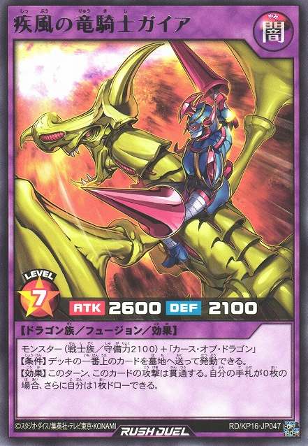

- **Zona y copias:** Extra **3x**. CID Rush: **19995**.
- **Rol funcional:** Monstruo de Fusión — objetivo de Fusión con materiales expresos y efecto de cierre.
- **Estado de sinergia y función:** Sin acceso demostrado con el inventario. Es una clasificación de juego; revisar la relación concreta en A06.
- **Papel como recurso, descarte o coste:** Coste o consumo descrito en A05: pagar/cumplir el requisito escrito antes de prometer la resolución. disponer de cartas suficientes en Deck y distinguir robo….
- **Requisito específico:** Fusionar un Guerrero con DEF 2100 y Maldición de Dragón; para el efecto, enviar la carta superior del Deck al Cementerio.
- **Efecto / resultado concreto:** Inflige daño de penetración este turno y, si la mano está vacía, puede robar una carta.
- **Ir primero, segundo y juego tardío:** Primero: preparar materiales y «Fusión» si es alcanzable; segundo: considerar el efecto de campo o daño que se produzca tras una Fusión legal; tardío: comprobar si quedan materiales nombrados en campo y Extra.
- **Relación con habilidad y otras piezas:** La Skill **ILLUSION OF EXECUTION** se aplica desde turno 2, una vez por duelo, después de comprobar sus restricciones de construcción.
- **Riesgos y dependencias:** pagar/cumplir el requisito escrito antes de prometer la resolución. disponer de cartas suficientes en Deck y distinguir robo de búsqueda. las tres Fusiones Gaia del Extra mencionan materiales que no aparecen completos en el Main fotografiado; NO asumir Invocación ejecutable.
- **Confianza:** **RESUMEN_FUNCIONAL_DE_GUIA_PREVIA_CON_FUENTE_KONAMI**; pendiente cotejo adicional de traducción/ventanas según la liga. Fuente Rush oficial: https://www.db.yugioh-card.com/rushdb/card_search.action?cid=19995&ope=2
- **Contraste de fuente Rush:** CID 19995: fuente oficial Rush consultada en japonés; tipo Monstruo de Fusión; descripción funcional en español procede de la guía previa y sigue siendo interpretación editorial.
- **Aplicación concreta dentro de este deck (A06):** Extra Gaia sin Maldición de Dragón ni Fusión en Main: no hay ruta de acceso demostrada.

**USO PRÁCTICO Y SINERGIA — Gaia el Campeón Dragón Rápido**

- **Label funcional:** **SIN ACCESO CON EL MAIN ACTUAL**: falta Curse of Dragon, material obligatorio; **probar quitar sus 3 copias** si el dueño aprueba.
- **Qué hace:** Inflige daño de penetración este turno y, si la mano está vacía, puede robar una carta.
- **Cómo aprovecharla en este deck:** Extra Gaia sin Maldición de Dragón ni Fusión en Main: no hay ruta de acceso demostrada.
- **Cuándo tener precaución:** pagar/cumplir el requisito escrito antes de prometer la resolución. disponer de cartas suficientes en Deck y distinguir robo de búsqueda. las tres Fusiones Gaia del Extra mencionan materiales que no aparecen completos en el Main fotografiado; NO asumir Invocación ejecutable.

**CÓMO LLEGAR DESDE TU DECK — SIN RUTA DEMOSTRADA**

- La biblioteca actual no contiene una ruta identificada para esta carta del Extra. No se debe exhibir una descripción genérica como sustituto de mano inicial, materiales y pasos. Para completarla, contrastar requisitos oficiales y recursos del Main; si no es alcanzable, explicar el impedimento exacto.

#### 19. Gaia el Campeón Dragón

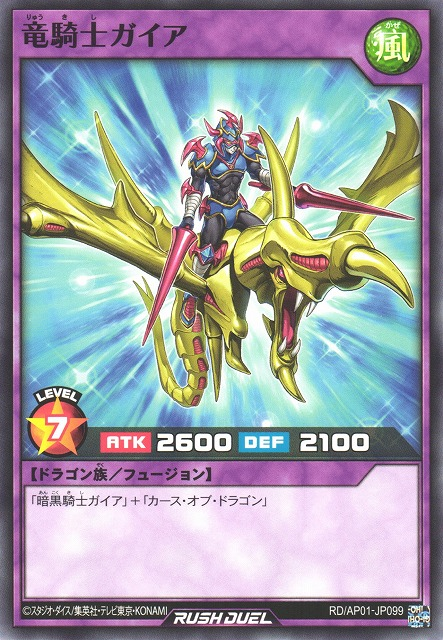

- **Zona y copias:** Extra **3x**. CID Rush: **18298**.
- **Rol funcional:** Monstruo de Fusión — objetivo de Fusión con materiales expresos y efecto de cierre.
- **Estado de sinergia y función:** Sin acceso demostrado con el inventario. Es una clasificación de juego; revisar la relación concreta en A06.
- **Papel como recurso, descarte o coste:** Coste o consumo descrito en A05: no atribuirle un efecto activado inexistente; comprobar su función como material y las cartas de soporte. verificar en campo….
- **Requisito específico:** Materiales nombrados: Gaia el Caballero Feroz y Maldición de Dragón.
- **Efecto / resultado concreto:** Monstruo Fusión sin efecto activado.
- **Ir primero, segundo y juego tardío:** Primero: preparar materiales y «Fusión» si es alcanzable; segundo: considerar el efecto de campo o daño que se produzca tras una Fusión legal; tardío: comprobar si quedan materiales nombrados en campo y Extra.
- **Relación con habilidad y otras piezas:** La Skill **ILLUSION OF EXECUTION** se aplica desde turno 2, una vez por duelo, después de comprobar sus restricciones de construcción.
- **Riesgos y dependencias:** no atribuirle un efecto activado inexistente; comprobar su función como material y las cartas de soporte. verificar en campo los materiales nombrados y el momento legal de la Fusión Rush; no usar materiales de mano sin permiso textual. las tres Fusiones Gaia del Extra mencionan materiales que no aparecen completos en el Main fotografiado; NO asumir Invocación ejecutable.
- **Confianza:** **RESUMEN_FUNCIONAL_DE_GUIA_PREVIA_CON_FUENTE_KONAMI**; pendiente cotejo adicional de traducción/ventanas según la liga. Fuente Rush oficial: https://www.db.yugioh-card.com/rushdb/card_search.action?cid=18298&ope=2
- **Contraste de fuente Rush:** CID 18298: fuente oficial Rush consultada en japonés; tipo Monstruo de Fusión; descripción funcional en español procede de la guía previa y sigue siendo interpretación editorial.
- **Aplicación concreta dentro de este deck (A06):** Extra Gaia sin Maldición de Dragón ni Fusión en Main: no hay ruta de acceso demostrada.

**USO PRÁCTICO Y SINERGIA — Gaia el Campeón Dragón**

- **Label funcional:** **SIN ACCESO CON EL MAIN ACTUAL**: faltan Gaia the Fierce Knight y Curse of Dragon; **probar quitar sus 3 copias** si el dueño aprueba.
- **Qué hace:** Monstruo Fusión sin efecto activado.
- **Cómo aprovecharla en este deck:** Extra Gaia sin Maldición de Dragón ni Fusión en Main: no hay ruta de acceso demostrada.
- **Cuándo tener precaución:** no atribuirle un efecto activado inexistente; comprobar su función como material y las cartas de soporte. verificar en campo los materiales nombrados y el momento legal de la Fusión Rush; no usar materiales de mano sin permiso textual. las tres Fusiones Gaia del Extra mencionan materiales que no aparecen completos en el Main fotografiado; NO asumir Invocación ejecutable.

**CÓMO LLEGAR DESDE TU DECK — SIN RUTA DEMOSTRADA**

- La biblioteca actual no contiene una ruta identificada para esta carta del Extra. No se debe exhibir una descripción genérica como sustituto de mano inicial, materiales y pasos. Para completarla, contrastar requisitos oficiales y recursos del Main; si no es alcanzable, explicar el impedimento exacto.

#### 20. Gaia, el Conquistador de Campeones

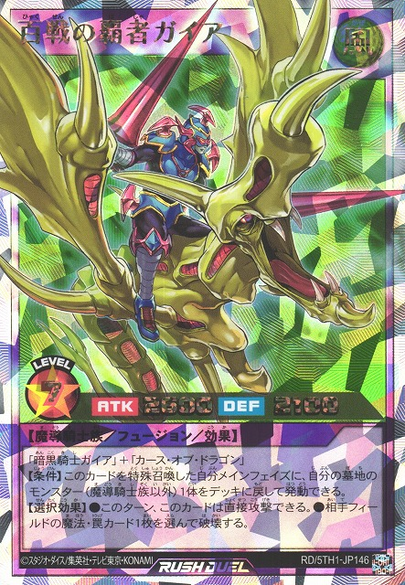

- **Zona y copias:** Extra **1x**. CID Rush: **19323**.
- **Rol funcional:** Monstruo de Fusión — objetivo de Fusión con materiales expresos y efecto de cierre.
- **Estado de sinergia y función:** Sin acceso demostrado con el inventario. Es una clasificación de juego; revisar la relación concreta en A06.
- **Papel como recurso, descarte o coste:** Coste o consumo descrito en A05: pagar/cumplir el requisito escrito antes de prometer la resolución. el resultado está sujeto a monstruos/cartas que puedan….
- **Requisito específico:** Fusionar Gaia el Caballero Feroz y Maldición de Dragón; el turno que fue Invocado de Modo Especial, devolver al Deck un monstruo del Cementerio que no sea Caballero Mágico.
- **Efecto / resultado concreto:** Elegir entre atacar directamente este turno o destruir una Mágica/Trampa rival.
- **Ir primero, segundo y juego tardío:** Primero: preparar materiales y «Fusión» si es alcanzable; segundo: considerar el efecto de campo o daño que se produzca tras una Fusión legal; tardío: comprobar si quedan materiales nombrados en campo y Extra.
- **Relación con habilidad y otras piezas:** La Skill **ILLUSION OF EXECUTION** se aplica desde turno 2, una vez por duelo, después de comprobar sus restricciones de construcción.
- **Riesgos y dependencias:** pagar/cumplir el requisito escrito antes de prometer la resolución. el resultado está sujeto a monstruos/cartas que puedan ser afectados y a respuestas del rival. las tres Fusiones Gaia del Extra mencionan materiales que no aparecen completos en el Main fotografiado; NO asumir Invocación ejecutable.
- **Confianza:** **RESUMEN_FUNCIONAL_DE_GUIA_PREVIA_CON_FUENTE_KONAMI**; pendiente cotejo adicional de traducción/ventanas según la liga. Fuente Rush oficial: https://www.db.yugioh-card.com/rushdb/card_search.action?cid=19323&ope=2
- **Contraste de fuente Rush:** CID 19323: fuente oficial Rush consultada en japonés; tipo Monstruo de Fusión; descripción funcional en español procede de la guía previa y sigue siendo interpretación editorial.
- **Aplicación concreta dentro de este deck (A06):** Extra Gaia sin Maldición de Dragón ni Fusión en Main: no hay ruta de acceso demostrada.

**USO PRÁCTICO Y SINERGIA — Gaia, el Conquistador de Campeones**

- **Label funcional:** **SIN ACCESO CON EL MAIN ACTUAL**: faltan Gaia the Fierce Knight y Curse of Dragon; **probar quitar su única copia** si el dueño aprueba.
- **Qué hace:** Elegir entre atacar directamente este turno o destruir una Mágica/Trampa rival.
- **Cómo aprovecharla en este deck:** Extra Gaia sin Maldición de Dragón ni Fusión en Main: no hay ruta de acceso demostrada.
- **Cuándo tener precaución:** pagar/cumplir el requisito escrito antes de prometer la resolución. el resultado está sujeto a monstruos/cartas que puedan ser afectados y a respuestas del rival. las tres Fusiones Gaia del Extra mencionan materiales que no aparecen completos en el Main fotografiado; NO asumir Invocación ejecutable.

**CÓMO LLEGAR DESDE TU DECK — SIN RUTA DEMOSTRADA**

- La biblioteca actual no contiene una ruta identificada para esta carta del Extra. No se debe exhibir una descripción genérica como sustituto de mano inicial, materiales y pasos. Para completarla, contrastar requisitos oficiales y recursos del Main; si no es alcanzable, explicar el impedimento exacto.

## SINERGIAS Y MOTORES
## RESUMEN FUNCIONAL DE SINERGIAS — 707

**Medición descriptiva de etiquetas existentes (NO certificación):** 17/20 identidades con etiqueta directa/indirecta (85.0 %). Main: 17/17 (100.0 %); Extra: 0/3 (0.0 %). Se cuenta una identidad una sola vez; una carta autónoma puede ser útil sin sinergia de motor. Estas cifras provienen de clasificaciones documentales A05/A06: **no son el porcentaje final de sinergias verificadas**, ni una tasa estadística de victoria. Para promoverlas a métricas verificadas, se deben comprobar los pares de cartas y su operación legal.

#### A06.0 — En 30 segundos: cómo cooperan realmente estas cartas

- **Dictamen de conjunto:** Mago Oscuro Rush y sus Mágicas nombradas cooperan; el Extra Gaia registrado es actualmente incompatible por ausencia de acceso demostrado.
- **Motor que mueve el deck:** Mago Oscuro, Piedra, Orden Secreta, Sabio y Skill crean disponibilidad real o nombre válido de Mago Oscuro para habilitar Mágicas específicas.
- **Puentes reales:** Mil Cuchillos y Ataque Mágico Oscuro ofrecen retiradas distintas cuando el nombre de Mago Oscuro realmente está activo; Chica Maga Oscura aporta presión dependiente del estado.
- **Sinergia indirecta:** una carta enviada al GY puede servir como objetivo de recuperación, pero su mera presencia no activa por sí sola los efectos que requieren ese nombre en campo.
- **Conflicto decisivo:** la Skill local opera desde turno 2 y bajo límite por duelo; el nombre temporal solo existe tras resolver su efecto. Gaia, Gaia Campeón Dragón y Gaia Conquistador no cuentan como destinos jugables sin materiales/procedimiento.
- **Decisión concreta:** aclarar si siete ranuras del Extra Gaia son históricas o se desea modificar la construcción; no borrar ni agregar cartas sin autorización.
- **Qué aprender después:** elegir Cuchillos si el objetivo es monstruo o Ataque Mágico Oscuro si son M/T, nunca atribuir ambos finales a una mano que posee solo uno.

#### Motor principal de acceso a Mago Oscuro

1. **Piezas de identidad.** **Mago Oscuro** (CID 15410) es Monstruo Normal LEGEND del Main; **Chica Maga Oscura** (16371) gana ATK por cada Mago Oscuro en cualquier Cementerio. **Hechicero Eliminador Oscuro** (19773), al cumplir su propio envío de carta superior del Deck, se trata como «Mago Oscuro» **solo ese turno** y puede ejercer retirada de monstruo con coste adicional de Mágicas en GY. No confundir identidad temporal con copia adicional de la carta LEGEND.
2. **Acceso desde mano y GY.** **Piedra de los Magos Oscuros** (19598) puede Invocar desde mano/GY hasta un Lanzador OSCURIDAD con **2500 ATK** y otro con **2000 ATK**, de modo que Mago Oscuro y Chica Maga Oscura son candidatos por sus estadísticas, si cumplen los límites de la carta. **Orden Secreta** (17212) revive/Invoca un **Normal Nivel 7** como Mago Oscuro. **Grito de Monstruo** (19329) envía monstruo de mano, roba y puede traer del GY monstruo **sin efecto** con ATK 2000 o DEF 2100; Mago Oscuro cumple el criterio por su DEF, pero se necesita tenerlo efectivamente en GY.
3. **Recuperación con Mago Oscuro Sabio.** **Mago Oscuro Sabio** (19597) manda Lanzador OSCURIDAD de mano al GY para robar y, si procede, Invocar **Mago Oscuro desde GY**. **Maga Legendaria** (18685) excava tres y puede recuperar un Normal LEGEND desde GY; si la carta elegida no existe allí, no se presume recuperar. **Lily Aniquiladora** (20305) puede contar por dos Sacrificios para Lanzador OSCURIDAD si su envío superior cumple la condición de Tipo.
4. **Remoción condicionada al nombre.** **Ataque Mágico Oscuro** (15451) destruye las M/T rivales y **Mil Cuchillos** (15450) destruye un monstruo rival **solo mientras se controla un «Mago Oscuro» boca arriba**. El nombre temporal de Hechicero Eliminador Oscuro puede satisfacer la condición si el efecto ya resolvió; no activar la Mágica antes de establecer el nombre. **Ráfaga de Resonancia Oscura** (17209) aumenta el ATK de Lanzador OSCURIDAD de Nivel 6+ y aumenta más si hay Mago Oscuro/Chica Maga Oscura según el texto.
5. **Relleno y Skill.** **ILLUSION OF EXECUTION (RD/SK01-002)** (registrada también como Illusion of Executor en el contexto de liga) desde turno 2 revela un monstruo Nivel 5+ y exige composición de Lanzadores con nombres altos restringidos; excava tres, puede añadir una Mágica y enviar las demás al GY, y luego puede enviar un Mago Oscuro desde Deck al GY. **Una vez por duelo** según texto local; no es carta robable ni se certifica su aplicación sin reglamento aprobado. **Distribuidor Maravilloso** (16772) y **Maldición de la Luz Ascendente** (21007) aportan intercambio/robo bajo sus costes y condiciones, no acceso incondicional a Mago Oscuro.
6. **Defensas.** **Brillo Sombrío** (20151) responde a Invocación rival cambiando monstruos de efecto a Defensa boca abajo tras enviar de mano; **¡Equitación Lindasesina!** (19341) puede recuperar del GY un monstruo adecuado ante Invocación rival y bajar ATK enemigo. Son Trampas con ventana real, no recursos disponibles instantáneamente desde el Deck.

#### Bloqueo crítico del Extra Deck actual

El Extra contiene **Gaia el Campeón Dragón Rápido** (CID 19995, 3x), **Gaia el Campeón Dragón** (18298, 3x) y **Gaia, el Conquistador de Campeones** (19323, 1x). Sus materiales nombrados involucran **Gaia el Caballero Feroz o un Guerrero con DEF 2100**, y **Maldición de Dragón**, y requieren un procedimiento de Fusión cuando corresponda. **No figura «Maldición de Dragón» ni una carta «Fusión» en las 30 cartas del Main cargado.** Por tanto, con el inventario actual **no hay ruta de Fusión demostrada para esos siete Extra**. La similitud «Mago Oscuro» ≠ «Gaia» no autoriza sustituir materiales. No se cambiará la lista sin confirmación de Miguel.

#### Mapa de relaciones para fotografía auténtica

| Relación por CID | Resultado | Requisito / límite | Visual |
|---|---|---|---|
| Skill ILLUSION OF EXECUTION → Mago Oscuro (15410) en GY | Preparar recuperación y buscar Mágica entre tres excavadas. | Desde turno 2, una vez por duelo, requisito de composición y revelado. | 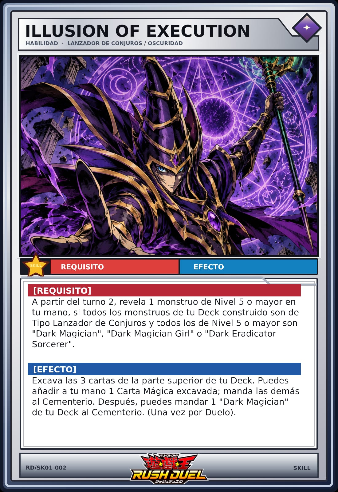  |
| Piedra (19598) → Mago Oscuro (15410) + Chica Maga Oscura (16371) | Recuperar hasta dos cuerpos con ATK original indicado. | Objetivos realmente disponibles en mano/GY y efectos propios. |    |
| Mago Oscuro Sabio (19597) / Orden Secreta (17212) → Mago Oscuro | Reanimación por dos vías distintas. | Descarte Lanzador OSCURIDAD o Normal Nivel 7 disponible. |   |
| Hechicero Eliminador (19773) → Ataque Mágico Oscuro (15451) / Mil Cuchillos (15450) | Habilitar Mágicas que exigen «Mago Oscuro» boca arriba. | Primero resolver el efecto de identidad temporal; duración solo ese turno. |    |
| Gaia Rápido (19995) / Gaia (18298) / Gaia Conquistador (19323) | **Sin relación operativa actualmente demostrada**. | Faltan material «Maldición de Dragón» y método «Fusión» registrado. |    |

#### Conflictos, redundancias y cierre editorial

- Las distintas vías de traer **Mago Oscuro** no crean copias nuevas ni garantizan que siga en GY; Piedra, Orden Secreta, Sabio y Grito compiten por ese recurso. Chica Maga Oscura necesita a Mago Oscuro **en GY** para su aumento; sacar esa misma carta del GY puede cambiar el ATK.
- El motor de remoción **Ataque Mágico Oscuro / Mil Cuchillos** exige nombre y Campo, mientras que **Ráfaga** exige Tipo/Atributo/Nivel; no funcionan automáticamente con cualquier Lanzador.
- Las siete cartas Gaia del Extra se mantienen catalogadas pero **bloqueadas** con la lista recibida: ninguna guía debe inventar Maldición de Dragón, Fusión o materiales de otro deck.

#### Skill personalizada y motor — ILLUSION OF EXECUTION

- **Identidad y zona:** RD/SK01-002; habilidad separada de Main/Extra/Side/Reserva, no robable.
- **Requisito de la imagen:** Desde turno 2 revela un monstruo Nivel 5+ en mano; todos los monstruos del Deck son Lanzadores de Conjuros y los Nivel 5+ son Dark Magician, Dark Magician Girl o Dark Eradicator Sorcerer.
- **Efecto de la imagen:** Excava 3 cartas; puede añadir 1 Mágica excavada y manda las demás al GY; después puede enviar 1 Dark Magician del Deck al GY. Una vez por Duelo.
- **Sinergia:** Acceso condicional a Mágicas y preparación del GY para recuperación de Dark Magician.
- **Dependencias/riesgo:** No garantiza excavar una Mágica y no resuelve la ausencia de materiales Gaia del Extra.
- **Clasificación:** habilitador o extensión, no combo completo. Texto e imagen aportados por Miguel; no inferir límites por turno no escritos.

#### A06.1 — Arquitectura operativa de los motores (síntesis no redundante)

Las siguientes filas son **relaciones funcionales**, no secuencias certificadas ni garantía de mano inicial. La lista real y los límites están en A04/A05/A07.

| Tipo / motor | Starter o vía de acceso real | Recurso y destino | Cuello de botella |
|---|---|---|---|
| **Principal: Dark Magician Rush** | Mago Oscuro, Piedra, Orden Secreta, Sabio y Skill | Depositar/recuperar Mago Oscuro y habilitar magias nombradas | Skill desde turno 2 y una vez por duelo; presencia real de objetivo en GY |
| **Apoyo: presión y defensa** | Ataque Mágico Oscuro, Mil Cuchillos, Chica Maga Oscura, Trampas | Retirada/ataques solo con nombre y estado válidos | Un nombre temporal solo sirve tras resolver su efecto |
| **Extra registrado sin acceso** | Gaia Rápido, Gaia Campeón Dragón y Gaia Conquistador | No hay salida demostrable del Extra actual | Faltan Fusión y Maldición de Dragón: incompatibilidad operativa, no motor |

#### A06.2 — Estado funcional y justificación de TODAS las cartas

**Cómo leerlo:** un estado de sinergia describe el papel **de juego**, no el avance de una auditoría. No hay obligación de que cada carta tenga un enlace con otra: una defensa autónoma, una herramienta de Side o un recurso de descarte justificado también tiene propósito. Las relaciones directas descritas aquí se deben contrastar con los textos oficiales antes de representarlas como una ruta legal A09.

| Carta / CID y zona | Estado funcional de sinergia | Motivo de inclusión | Relación y condición concreta | Papel como coste, descarte o material | Límite o riesgo | Decisión táctica |
|---|---|---|---|---|---|---|
| **Ataque Mágico Oscuro** (CID 15451) — Main 2x | **Sinergia indirecta (soporte o recursos)** | Carta Mágica Normal — removal / apertura de campo | Destruye todas las cartas Mágicas y Trampas del campo rival | Coste o consumo descrito en A05: el resultado está sujeto a monstruos/cartas que puedan ser afectados y a respuestas del rival | Controlar un Mago Oscuro boca arriba | Conservar; verificar coste y orden |
| **Distribuidor Maravilloso** (CID 16772) — Main 1x | **Sinergia directa descrita** | Monstruo de Efecto — consistencia / reciclaje | Enviar tres cartas de la mano al Cementerio y robar tres cartas | Envío mencionado en la interacción; no equivale por sí mismo a descarte desde la mano | Tener hasta tres monstruos en el Cementerio y pagar 300 LP | Conservar; verificar coste y orden |
| **Maga Legendaria** (CID 18685) — Main 2x | **Sinergia directa descrita** | Monstruo de Efecto — monstruo de apoyo/material o recurso de Sacrificio | Revelar las tres cartas superiores; puede enviar un monstruo revelado al Cementerio y recuperar un monstruo Normal LEGEND del Cementerio | Envío mencionado en la interacción; no equivale por sí mismo a descarte desde la mano | No tiene requisito de activación | Conservar; verificar coste y orden |
| **Mago Oscuro Sabio** (CID 19597) — Main 1x | **Sinergia directa descrita** | Monstruo de Efecto — extensión de campo y recuperación de recursos | Roba una carta; después puede Invocar de Modo Especial un Mago Oscuro del Cementerio | Coste o consumo descrito en A05: pagar/cumplir el requisito escrito antes de prometer la resolución. disponer de cartas suficientes en Deck y distinguir robo… | Enviar desde la mano al Cementerio un Lanzador de Conjuros/OSCURIDAD | Conservar; verificar coste y orden |
| **Grito de Monstruo** (CID 19329) — Main 2x | **Sinergia directa descrita** | Carta Mágica Normal — extensión de campo y recuperación de recursos | Roba una carta; después puede Invocar del Cementerio un monstruo sin efecto que tenga ATK 2000 o DEF 2100 | Coste o consumo descrito en A05: pagar/cumplir el requisito escrito antes de prometer la resolución. disponer de cartas suficientes en Deck y distinguir robo… | Enviar de la mano un monstruo al Cementerio | Conservar; verificar coste y orden |
| **Hechicero Eliminador Oscuro** (CID 19773) — Main 3x | **Sinergia indirecta (soporte o recursos)** | Monstruo de Efecto — apoyo situacional sujeto a condición escrita | Se llama Mago Oscuro ese turno; puede devolver diez Mágicas del Cementerio al Deck para destruir un monstruo rival boca arriba de Nivel 8 o inferior | Coste o consumo descrito en A05: pagar/cumplir el requisito escrito antes de prometer la resolución. el resultado está sujeto a monstruos/cartas que puedan… | Enviar la primera carta de tu Deck al Cementerio | Conservar; verificar coste y orden |
| **Ráfaga de Resonancia Oscura** (CID 17209) — Main 3x | **Sinergia indirecta (soporte o recursos)** | Carta Mágica Normal — presión de combate / modificación de estadísticas | Otorga 1000 ATK por el turno a un Lanzador de Conjuros OSCURIDAD propio de Nivel 6+; otorga otros 1000 si controlas Mago Oscuro o Chica Maga Oscura | Coste o consumo descrito en A05: comprobar zona, objetivos y ventana; el nombre de la carta no reemplaza su texto | Sin requisito de activación | Conservar; verificar coste y orden |
| **Brillo Sombrío** (CID 20151) — Main 2x | **Sinergia directa descrita** | Carta de Trampa Normal — consistencia / reciclaje | Pone hasta dos monstruos de Efecto boca arriba de cualquier Campo boca abajo en Defensa; si incluyó un monstruo rival con ATK original de al menos 2600, recupera 1500 LP | Coste o consumo descrito en A05: pagar/cumplir el requisito escrito antes de prometer la resolución | Cuando el rival Invoca un monstruo en su turno; enviar una carta de la mano al Cementerio | Conservar; verificar coste y orden |
| **Piedra de los Magos Oscuros** (CID 19598) — Main 3x | **Sinergia directa descrita** | Carta Mágica Normal — extensor / habilitador de material | Invoca desde la mano y/o Cementerio hasta un Lanzador de Conjuros OSCURIDAD con 2500 ATK y hasta otro con 2000 ATK, boca arriba | Coste o consumo descrito en A05: comprobar zona, objetivos y ventana; el nombre de la carta no reemplaza su texto | Sin requisito de activación | Conservar; verificar coste y orden |
| **Mago Oscuro** (CID 15410) — Main 1x | **Sinergia indirecta (soporte o recursos)** | Monstruo Normal — material de Fusión/Sacrificio o presencia de combate; sin efecto activado | Monstruo Normal LEGEND | Coste o consumo descrito en A05: no atribuirle un efecto activado inexistente; comprobar su función como material y las cartas de soporte | No tiene efecto | Conservar; verificar coste y orden |
| **Lily Aniquiladora** (CID 20305) — Main 1x | **Sinergia directa descrita** | Monstruo de Efecto — apoyo situacional sujeto a condición escrita | Envía la primera carta del Deck al Cementerio; si era Lanzador de Conjuros, esta carta cuenta por dos Sacrificios para un Lanzador de Conjuros/OSCURIDAD en Ataque este turno | Envío mencionado en la interacción; no equivale por sí mismo a descarte desde la mano | Haber sido Invocada de Modo Normal este turno | Conservar; verificar coste y orden |
| **Chica Maga Oscura** (CID 16371) — Main 3x | **Sinergia indirecta (soporte o recursos)** | Monstruo de Efecto — presión de combate / modificación de estadísticas | Gana 500 ATK por cada Mago Oscuro en ambos Cementerios | Coste o consumo descrito en A05: comprobar zona, objetivos y ventana; el nombre de la carta no reemplaza su texto | No necesita activación | Conservar; verificar coste y orden |
| **Mil Cuchillos** (CID 15450) — Main 2x | **Sinergia indirecta (soporte o recursos)** | Carta Mágica Normal — removal / apertura de campo | Destruye un monstruo del Campo rival | Coste o consumo descrito en A05: el resultado está sujeto a monstruos/cartas que puedan ser afectados y a respuestas del rival | Controlar un Mago Oscuro boca arriba | Conservar; verificar coste y orden |
| **¡Equitación Lindasesina!** (CID 19341) — Main 1x | **Sinergia directa descrita** | Carta de Trampa Normal — extensor / habilitador de material | Invoca del Cementerio en Ataque propio un monstruo cuyo ATK no supere el del recién invocado; después puede reducir en 1800 ATK hasta dos monstruos rivales boca arriba ese turno | Coste o consumo descrito en A05: comprobar zona, objetivos y ventana; el nombre de la carta no reemplaza su texto | Cuando el rival Invoca boca arriba un monstruo de Efecto | Conservar; verificar coste y orden |
| **Orden Secreta** (CID 17212) — Main 1x | **Sinergia directa descrita** | Carta Mágica Normal — recurso táctico cuya condición y resultado están descritos en su ficha | Invoca un monstruo Normal de Nivel 7 desde mano o Cementerio; le da 700 ATK ese turno y lo protege frente a destrucción por Trampas rivales | Coste o consumo descrito en A05: la condición de una Mágica/Trampa y sus blancos deben cumplirse antes de resolver. No confundir esta carta con un monstruo… | Sin requisito de activación | Conservar; verificar coste y orden |
| **Olla de la Codicia** (CID 16372) — Main 1x | **Sinergia indirecta de recursos** | Carta Mágica Normal — consistencia / reciclaje | Roba dos cartas. Aportación posible como material, coste o objetivo; verificar consumidor | Material o destino del Extra condicionado a los requisitos de invocación | Sin requisito de activación | Conservar si existe consumidor legal |
| **Maldición de la Luz Ascendente** (CID 21007) — Main 1x | **Sinergia indirecta (soporte o recursos)** | Carta Mágica Normal — consistencia / reciclaje | Cambia un monstruo rival a Ataque boca arriba o Defensa boca abajo | Coste o consumo descrito en A05: disponer de cartas suficientes en Deck y distinguir robo de búsqueda | El rival debe tener una o ninguna carta en mano | Conservar; verificar coste y orden |
| **Gaia el Campeón Dragón Rápido** (CID 19995) — Extra 3x | **Sin acceso demostrado con el inventario** | Monstruo de Fusión — objetivo de Fusión con materiales expresos y efecto de cierre | Extra Gaia sin Maldición de Dragón ni Fusión en Main: no hay ruta de acceso demostrada | Coste o consumo descrito en A05: pagar/cumplir el requisito escrito antes de prometer la resolución. disponer de cartas suficientes en Deck y distinguir robo… | Fusionar un Guerrero con DEF 2100 y Maldición de Dragón; para el efecto, enviar la carta superior del Deck al Cementerio | Revisar zona/acceso; sustitución por validar |
| **Gaia el Campeón Dragón** (CID 18298) — Extra 3x | **Sin acceso demostrado con el inventario** | Monstruo de Fusión — objetivo de Fusión con materiales expresos y efecto de cierre | Extra Gaia sin Maldición de Dragón ni Fusión en Main: no hay ruta de acceso demostrada | Coste o consumo descrito en A05: no atribuirle un efecto activado inexistente; comprobar su función como material y las cartas de soporte. verificar en campo… | Materiales nombrados: Gaia el Caballero Feroz y Maldición de Dragón | Revisar zona/acceso; sustitución por validar |
| **Gaia, el Conquistador de Campeones** (CID 19323) — Extra 1x | **Sin acceso demostrado con el inventario** | Monstruo de Fusión — objetivo de Fusión con materiales expresos y efecto de cierre | Extra Gaia sin Maldición de Dragón ni Fusión en Main: no hay ruta de acceso demostrada | Coste o consumo descrito en A05: pagar/cumplir el requisito escrito antes de prometer la resolución. el resultado está sujeto a monstruos/cartas que puedan… | Fusionar Gaia el Caballero Feroz y Maldición de Dragón; el turno que fue Invocado de Modo Especial, devolver al Deck un monstruo del Cementerio… | Revisar zona/acceso; sustitución por validar |

## INTERACCIONES Y CLASIFICACIÓN

| ID documental | Categoría provisional | Piezas | Resultado | Requisitos | Check |
|---|---|---|---|---|---|
| 707:A08:01 | INTERACCION | Skill ILLUSION OF EXECUTION → Mago Oscuro (15410) en GY | Preparar recuperación y buscar Mágica entre tres excavadas. | Desde turno 2, una vez por duelo, requisito de composición y revelado. | |
| 707:A08:02 | EXTENSION | Piedra (19598) → Mago Oscuro (15410) + Chica Maga Oscura (16371) | Recuperar hasta dos cuerpos con ATK original indicado. | Objetivos realmente disponibles en mano/GY y efectos propios. | |
| 707:A08:03 | EXTENSION | Mago Oscuro Sabio (19597) / Orden Secreta (17212) → Mago Oscuro | Reanimación por dos vías distintas. | Descarte Lanzador OSCURIDAD o Normal Nivel 7 disponible. | |
| 707:A08:04 | PLAN | Hechicero Eliminador (19773) → Ataque Mágico Oscuro (15451) / Mil Cuchillos (15450) | Habilitar Mágicas que exigen «Mago Oscuro» boca arriba. | Primero resolver el efecto de identidad temporal; duración solo ese turno. | |
| 707:A08:05 | NO_EJECUTABLE | Gaia Rápido (19995) / Gaia (18298) / Gaia Conquistador (19323) | **Sin relación operativa actualmente demostrada**. | Faltan material «Maldición de Dragón» y método «Fusión» registrado. | (no importable como jugada) |

#### Rol registrado por cada carta

| ID A08 | Carta registrada | Zona | Clasificación funcional | Rol documentado en A05 | Check de clasificación |
|---|---|---|---|---|---|
| 707:A08:C001 | Ataque Mágico Oscuro | Main | FUNCION_A05 (recurso jugable sujeto a condición) | Carta Mágica Normal — removal / apertura de campo. | |
| 707:A08:C002 | Distribuidor Maravilloso | Main | FUNCION_A05 (recurso jugable sujeto a condición) | Monstruo de Efecto — consistencia / reciclaje. | |
| 707:A08:C003 | Maga Legendaria | Main | RECURSO_MATERIAL | Monstruo de Efecto — monstruo de apoyo/material o recurso de Sacrificio. | |
| 707:A08:C004 | Mago Oscuro Sabio | Main | EXTENSOR_POTENCIAL | Monstruo de Efecto — extensión de campo y recuperación de recursos. | |
| 707:A08:C005 | Grito de Monstruo | Main | EXTENSOR_POTENCIAL | Carta Mágica Normal — extensión de campo y recuperación de recursos. | |
| 707:A08:C006 | Hechicero Eliminador Oscuro | Main | FUNCION_A05 (recurso jugable sujeto a condición) | Monstruo de Efecto — apoyo situacional sujeto a condición escrita. | |
| 707:A08:C007 | Ráfaga de Resonancia Oscura | Main | FUNCION_A05 (recurso jugable sujeto a condición) | Carta Mágica Normal — presión de combate / modificación de estadísticas. | |
| 707:A08:C008 | Brillo Sombrío | Main | FUNCION_A05 (recurso jugable sujeto a condición) | Carta de Trampa Normal — consistencia / reciclaje. | |
| 707:A08:C009 | Piedra de los Magos Oscuros | Main | EXTENSOR_POTENCIAL | Carta Mágica Normal — extensor / habilitador de material. | |
| 707:A08:C010 | Mago Oscuro | Main | RECURSO_MATERIAL | Monstruo Normal — material de Fusión/Sacrificio o presencia de combate; sin efecto activado. | |
| 707:A08:C011 | Lily Aniquiladora | Main | FUNCION_A05 (recurso jugable sujeto a condición) | Monstruo de Efecto — apoyo situacional sujeto a condición escrita. | |
| 707:A08:C012 | Chica Maga Oscura | Main | FUNCION_A05 (recurso jugable sujeto a condición) | Monstruo de Efecto — presión de combate / modificación de estadísticas. | |
| 707:A08:C013 | Mil Cuchillos | Main | FUNCION_A05 (recurso jugable sujeto a condición) | Carta Mágica Normal — removal / apertura de campo. | |
| 707:A08:C014 | ¡Equitación Lindasesina! | Main | EXTENSOR_POTENCIAL | Carta de Trampa Normal — extensor / habilitador de material. | |
| 707:A08:C015 | Orden Secreta | Main | FUNCION_A05 (recurso jugable sujeto a condición) | Carta Mágica Normal — recurso táctico cuya condición y resultado están descritos en su ficha. | |
| 707:A08:C016 | Olla de la Codicia | Main | FUNCION_A05 (recurso jugable sujeto a condición) | Carta Mágica Normal — consistencia / reciclaje. | |
| 707:A08:C017 | Maldición de la Luz Ascendente | Main | FUNCION_A05 (recurso jugable sujeto a condición) | Carta Mágica Normal — consistencia / reciclaje. | |
| 707:A08:C018 | Gaia el Campeón Dragón Rápido | Extra | DESTINO_EXTRA (materiales/procedimiento por comprobar) | Monstruo de Fusión — objetivo de Fusión con materiales expresos y efecto de cierre. | |
| 707:A08:C019 | Gaia el Campeón Dragón | Extra | DESTINO_EXTRA (materiales/procedimiento por comprobar) | Monstruo de Fusión — objetivo de Fusión con materiales expresos y efecto de cierre. | |
| 707:A08:C020 | Gaia, el Conquistador de Campeones | Extra | DESTINO_EXTRA (materiales/procedimiento por comprobar) | Monstruo de Fusión — objetivo de Fusión con materiales expresos y efecto de cierre. | |

## JUGADAS DOCUMENTADAS

> Requieren comprobación A11–A13 y validación de estado final. No publicar las rutas como combos certificados por tener fotografías.

#### A09 — Ruta contrastada `707:A09:ILLUSION:SAGE01` (Skill + recuperación + barrido M/T)

- **Objetivo verificable:** dejar **Mago Oscuro** (2500 ATK) y **Mago Oscuro Sabio** (900 ATK) boca arriba y destruir las Mágicas/Trampas del adversario mediante **Ataque Mágico Oscuro**. No prometer victoria, daño ni cartas excavadas concretas.
- **Mano inicial de este caso:** 1× **Chica Maga Oscura** (CID 16371), 1× **Mago Oscuro Sabio** (CID 19597), 1× **Ataque Mágico Oscuro** (CID 15451). **Mago Oscuro** (CID 15410, 1 copia LEGEND) está inicialmente **en el Deck**, no en mano ni GY; la Skill es externa a la mano. Campo propio vacío; rival con al menos una M/T; Deck con 3 o más cartas por excavar; turno **2 o posterior**. Skill no usada previamente. Sin interferencia del rival en la ruta base.
- **Compatibilidad de construcción:** los monstruos Main registrados son Lanzadores de Conjuros y sus Nivel 5+ son Mago Oscuro, Chica Maga Oscura o **Dark Eradicator Sorcerer (CID 19773, «Hechicero Eliminador Oscuro»)**. El CID 19773 figura en la base oficial japonesa bajo *Black Executor / 黒魔導の遂行者*, y *Dark Eradicator Sorcerer* es la localización inglesa de ese mismo CID; **no** son dos monstruos diferentes. El texto de la Skill personalizada es el de la foto aportada; su adopción sigue supeditada al reglamento local.

1. **Revelar Chica Maga Oscura de la mano** para cumplir el requisito de **ILLUSION OF EXECUTION**, a partir del turno 2.
2. **Excavar exactamente 3 cartas del Deck**. Si hay una Mágica entre ellas, se puede añadir **una** a la mano; las otras excavadas van al GY. Si no aparece Mágica, las tres van al GY. **No elegir ni inventar sus identidades.**
3. **Preparar Mago Oscuro en el Cementerio:** si fue una de las tres excavadas, se envía al GY en el paso anterior (es Monstruo Normal y no puede ser la Mágica añadida). Si no estaba en esas tres, sigue en el Deck y la Skill puede enviar esa **única copia** al GY. Ambas ramas concluyen con **Mago Oscuro en GY**. Skill consumida una vez por duelo.
4. **Invocar Normalmente Mago Oscuro Sabio** (Nivel 3, 900 ATK). Se conserva Chica Maga Oscura en mano hasta el coste del siguiente paso.
5. Activar el efecto de **Mago Oscuro Sabio**: **enviar Chica Maga Oscura** (Lanzador de Conjuros/OSCURIDAD) desde la mano al GY como requisito; **robar 1 carta** y después **Invocar Especialmente Mago Oscuro** desde el GY boca arriba. El robo no necesita revelar una carta específica para que la recuperación sea legal.
6. Ya con **Mago Oscuro boca arriba** en tu campo, activar **Ataque Mágico Oscuro** desde la mano y **destruir todas las M/T del rival**. La carta Mágica usada va al GY tras resolver.

**Traza A09 de zonas al terminar cada paso (Skill local con excavación aleatoria):** ninguna carta excavada o robada recibe un nombre inventado. El número de Mágicas añadidas por la excavación es 0 o 1 según contenido real; el único Mago Oscuro LEGEND acaba en GY al completar P3.

| Hito | Mano | Monstruos | M/T | Cementerio | Destierro propio | Estado rival | Materiales | Normal y Extra |
|---|---|---|---|---|---|---|---|---|
| P1 | Chica Maga Oscura #16371 (revelada), Mago Oscuro Sabio #19597 y Ataque Mágico Oscuro #15451 | — | — | — | — | Rival conserva al menos una M/T de identidad desconocida | — | Skill ILLUSION OF EXECUTION activada, todavía procesando; Rush permite Normales posteriores; Extra sin uso |
| P2 | Chica Maga Oscura #16371, Mago Oscuro Sabio #19597, Ataque Mágico Oscuro #15451 y 0 o 1 Mágica excavada de identidad desconocida | — | — | Entre 2 y 3 cartas excavadas de identidad variable; Mago Oscuro podría estar entre ellas | — | Sin cambios rivales demostrados | — | Skill local en resolución, no se repite; Normal todavía libre |
| P3 | Chica Maga Oscura #16371, Mago Oscuro Sabio #19597, Ataque Mágico Oscuro #15451 y posible Mágica excavada desconocida | — | — | Mago Oscuro LEGEND #15410 en GY, más restantes de excavación de identidad variable | — | Rival mantiene al menos una M/T; ninguna destruida | — | Skill local usada una vez; Mago Oscuro llegó a GY por excavación o envío permitido; Normal posible |
| P4 | Chica Maga Oscura #16371, Ataque Mágico Oscuro #15451 y posible Mágica excavada desconocida | Mago Oscuro Sabio #19597 (Ataque, 900 ATK) | — | Mago Oscuro #15410 y otras excavadas en GY | — | Rival conserva M/T | — | Rush: Normal de Sabio realizada; Skill gastada; Extra sin usar |
| P5 | Ataque Mágico Oscuro #15451, 1 carta robada de identidad desconocida y 0 o 1 Mágica excavada desconocida | Mago Oscuro Sabio #19597 (Ataque, 900 ATK), Mago Oscuro #15410 (Ataque, 2500 ATK) | — | Chica Maga Oscura #16371 y cartas excavadas restantes de identidad variable en GY | — | M/T rival todavía presente; no se destruye en P5 | — | Rush: recuperación de Mago Oscuro desde GY por Sabio; Skill usada; Extra sin usar |
| P6 | 1 carta robada desconocida y 0 o 1 Mágica excavada desconocida | Mago Oscuro Sabio #19597 (Ataque, 900 ATK), Mago Oscuro #15410 (Ataque, 2500 ATK) | — | Chica Maga Oscura #16371, Ataque Mágico Oscuro #15451 y otras excavadas desconocidas en GY | — | Todas las M/T rivales presentes al resolver fueron destruidas; monstruos rivales no definidos | — | Rush: Skill usada; no se gastó Extra ni se aseguró ningún ataque |

**Estado final exacto de la rama base:** campo propio = Mago Oscuro (ATK 2500) + Mago Oscuro Sabio (ATK 900), ambos boca arriba; campo M/T del oponente = vacío tras la destrucción (si no hubo respuesta); **Chica Maga Oscura en GY**, **Ataque Mágico Oscuro en GY**, Skill ya utilizada. Mano propia = **1 carta robada** en paso 5 + **0 o 1 Mágica** seleccionada en paso 2, de identidad no determinada. El contenido de las otras cartas excavadas en GY es variable; no asignar probabilidades ni suponer que se excavó una carta útil. **Clasificación:**, publicación A09/A10 todavía no certificada.

**Fuentes primarias:** [Skill personalizada fotografiada](imagenes/skills/707_ILLUSION_OF_EXECUTION.jpeg), [Mago Oscuro](https://www.db.yugioh-card.com/rushdb/card_search.action?cid=15410&ope=2), [Chica Maga Oscura](https://www.db.yugioh-card.com/rushdb/card_search.action?cid=16371&ope=2), [Mago Oscuro Sabio](https://www.db.yugioh-card.com/rushdb/card_search.action?cid=19597&ope=2), [Ataque Mágico Oscuro](https://www.db.yugioh-card.com/rushdb/card_search.action?cid=15451&ope=2), [CID 19773](https://www.db.yugioh-card.com/rushdb/card_search.action?cid=19773&ope=2).

#### A09 — Ruta contrastada `707:A09:SECRETORDER:DM01` (Invocación inmediata de Mago Oscuro)

- **Objetivo:** Invocar Mago Oscuro **sin Sacrificios** desde la mano y despejar las M/T rivales en el mismo turno. Es **una ruta independiente** de `ILLUSION:SAGE01`; no se suman dos habilidades ni se duplica la copia LEGEND.
- **Mano inicial:** 1× **Mago Oscuro** (CID 15410, Nivel 7 Normal), 1× **Orden Secreta** (CID 17212), 1× **Ataque Mágico Oscuro** (CID 15451). Campo propio vacío; rival con una o más M/T. Turno propio cualquiera; sin Skill ni efectos previos. No hay restricción de estar en turno 2 para esta ruta.

1. Activar **Orden Secreta** desde la mano, eligiendo **Mago Oscuro** (Monstruo Normal Nivel 7) en la mano. Invocarlo **Especialmente boca arriba** en el Campo. No realizar una Invocación por Sacrificio.
2. **Mago Oscuro gana 700 ATK temporalmente**: 2500 + 700 = **3200 ATK** hasta el final del turno; tampoco puede ser destruido por efectos de Trampa del oponente **este turno**. No prolongar ese bono/protección al turno siguiente.
3. Con **Mago Oscuro boca arriba**, activar **Ataque Mágico Oscuro** y destruir **todas** las cartas Mágicas/Trampa del rival. Ambas Mágicas utilizadas quedan en GY al terminar sus resoluciones.

**Traza A09 de zonas al terminar cada paso (sin Skill):** la bonificación de Orden Secreta comienza con la Invocación; P2 hace explícito el valor, no representa una segunda activación.

| Hito | Mano | Monstruos | M/T | Cementerio | Destierro propio | Estado rival | Materiales | Normal y Extra |
|---|---|---|---|---|---|---|---|---|
| P1 | Ataque Mágico Oscuro #15451 | Mago Oscuro #15410 (Ataque, 3200 ATK temporal tras Orden Secreta) | — | Orden Secreta #17212 en GY | — | Rival conserva una o más M/T de identidad desconocida | — | Rush: Normal no usada; Skill intacta; Extra sin uso |
| P2 | Ataque Mágico Oscuro #15451 | Mago Oscuro #15410 (Ataque, 3200 ATK temporal; protección frente a destrucción por Trampas rivales este turno) | — | Orden Secreta en GY | — | M/T rivales sin cambios | — | No es una nueva Invocación ni coste adicional; Normal libre; Skill intacta |
| P3 | — | Mago Oscuro #15410 (Ataque, 3200 ATK este turno) | — | Orden Secreta #17212 y Ataque Mágico Oscuro #15451 en GY | — | Todas las M/T rivales destruidas al resolver; monstruos rivales no definidos | — | Normal libre; Skill intacta; bonus de Orden Secreta termina al cerrar el turno |

**Estado final sin interrupciones:** Mago Oscuro boca arriba en Campo con **3200 ATK este turno**; rival sin M/T; Orden Secreta y Ataque Mágico Oscuro en GY; Skill intacta, Invocación Normal del turno **no gastada**. Fuera del turno de Invocación, el ATK vuelve a **2500** y termina la protección específica de Orden Secreta. No inferir daño de batalla ni OTK., faltan tableros gráficos A10 y cobertura de adversario A12.

**Fuentes:** [Orden Secreta](https://www.db.yugioh-card.com/rushdb/card_search.action?cid=17212&ope=2), [Mago Oscuro](https://www.db.yugioh-card.com/rushdb/card_search.action?cid=15410&ope=2), [Ataque Mágico Oscuro](https://www.db.yugioh-card.com/rushdb/card_search.action?cid=15451&ope=2).

#### A09 — `707:A09:JEWEL:PAIR01` (Piedra: dos Invocaciones Especiales sin Sacrificios)

- **Mano inicial y objetivo:** **Piedra de los Magos Oscuros** (CID 19598), **Mago Oscuro** (15410, OSCURIDAD/Lanzador ATK 2500) y **Chica Maga Oscura** (16371, OSCURIDAD/Lanzador ATK 2000), cada uno registrado en el Main. Mano = esas tres cartas; campo/GY propios vacíos; dos zonas de monstruo libres; turno propio Main Phase. Sin Skill ni cartas adversarias relevantes para la ruta base.

1. Activar **Piedra de los Magos Oscuros**, Mágica Normal sin requisito de activación y que se resuelve desde la mano. Elegir desde la **mano** a Mago Oscuro (2500 ATK original) y Chica Maga Oscura (2000 ATK original), **hasta una copia de cada categoría**.
2. **Invocar Especialmente ambos monstruos en Ataque boca arriba** en zonas disponibles. La Mágica termina en el GY tras resolver. No gastar Invocación Normal ni ofrecer Sacrificios.
3. **Estado final:** campo propio = Mago Oscuro boca arriba 2500 ATK + Chica Maga Oscura boca arriba 2000 ATK; mano de la apertura vacía; Piedra en GY; Skill intacta. No afirmar que Chica Maga gana ATK por estar Mago Oscuro **en campo**, porque su bonificación habitual exige verificar el estado del GY; tampoco presumir daño de batalla.

- **Variantes textuales, no secuencias adicionales contadas:** Piedra también permite elegir **hasta una** de esas categorías desde mano **o** Cementerio; puede traer solo una si solo una existe o si no hay segunda zona. Esa rama necesitará documentar los estados de GY y las zonas antes de declararse otra apertura. **Fuente:** [Piedra, CID 19598](https://www.db.yugioh-card.com/rushdb/card_search.action?cid=19598&ope=2).;.

#### A09 — `707:A09:EXECUTOR:KNIVES01` / `707:A09:EXECUTOR:DARKMAGIC01` (nombre temporal)

- **Manos alternativas de cuatro cartas:** (1) **Mago Oscuro Sabio** (CID 19597, Nivel 3 ATK 900), (2) **Lily Aniquiladora** (CID 20305, Nivel 4 ATK 1300), (3) **Hechicero Eliminador Oscuro / Black Executor** (CID 19773, Nivel 7 ATK 2500), (4) **Mil Cuchillos** (15450) *o* **Ataque Mágico Oscuro** (15451). Todos están en Main; **Mago Oscuro LEGEND no es requisito**. Campo y GY propios vacíos, al menos una carta en el Deck para el coste del Hechicero; oponente con 1 monstruo objetivo (versión Mil Cuchillos) o una M/T (versión Ataque Mágico). Turno propio Main Phase, sin respuestas en la ruta base.

1. **Invocar Normalmente Mago Oscuro Sabio y Lily Aniquiladora** en Ataque usando las reglas de Invocaciones Normales de Rush Duel. **No activar** sus efectos opcionales; por tanto, no enviar cartas adicionales ni robar por hipótesis.
2. **Sacrificar los dos Nivel 3/4** para Invocar Normalmente por Sacrificio a **Hechicero Eliminador Oscuro** (Nivel 7) en Ataque, 2500 ATK. Ambos materiales quedan en GY.
3. Activar el efecto del Hechicero **en esa Main Phase**, enviando la carta superior del Deck al GY como requisito. Su **nombre pasa a ser «Mago Oscuro» únicamente hasta el final del turno**. No aplicar el efecto adicional de devolver **10 Mágicas** del GY, porque esa condición no está demostrada en esta apertura.
4. **Salida `KNIVES01`:** activar **Mil Cuchillos**, ahora que se controla un «Mago Oscuro» boca arriba, y destruir **un monstruo rival elegido** (incluso boca abajo, si no existe otra prohibición aplicable). **Salida `DARKMAGIC01`:** activar **Ataque Mágico Oscuro** en la misma condición y destruir **todas las M/T rivales**. **Son versiones excluyentes**, no asumir que la mano contiene ambas Mágicas.
5. **Estado final de cualquiera de las dos:** propio = Hechicero Eliminador en Ataque **2500 ATK, con nombre temporal «Mago Oscuro» este turno**; GY = Mago Oscuro Sabio + Lily + Mágica usada + carta superior enviada de identidad desconocida; mano inicial vacía. El oponente pierde los blancos definidos de cada versión; **en el siguiente turno** el Hechicero recupera su **nombre impreso** y no habilita automáticamente estas Mágicas.

**Traza A09 de zonas al terminar cada paso de `707:A09:EXECUTOR:KNIVES01` (monstruo rival como objetivo):** la identificación temporal como Mago Oscuro solo dura el turno; ninguna M/T rival se destruye por esta salida.

| Hito | Mano | Monstruos | M/T | Cementerio | Destierro propio | Estado rival | Materiales | Normal y Extra |
|---|---|---|---|---|---|---|---|---|
| P1 | Hechicero Eliminador Oscuro #19773 y Mil Cuchillos #15450 | Mago Oscuro Sabio #19597 (Ataque, 900 ATK), Lily Aniquiladora #20305 (Ataque, 1300 ATK) | — | — | — | Un monstruo rival elegible de identidad desconocida sigue en Campo | Dos cuerpos propios independientes | Rush: dos Normales realizadas; Skill no usada; Extra sin uso |
| P2 | Mil Cuchillos #15450 | Hechicero Eliminador Oscuro #19773 (Ataque, 2500 ATK) | — | Mago Oscuro Sabio #19597 y Lily #20305 en GY (Sacrificios) | — | Monstruo rival todavía presente | Dos monstruos propios tributados; no materiales Xyz | Rush: jefe Invocado por Sacrificio; Skill intacta; Extra sin uso |
| P3 | Mil Cuchillos #15450 | Hechicero Eliminador Oscuro #19773 (Ataque, 2500 ATK; nombre temporal Mago Oscuro) | — | Sabio, Lily y 1 carta superior del Deck de identidad desconocida en GY | — | Monstruo rival seleccionable sin cambios | No hay materiales Xyz; cambio de nombre por efecto temporal | Skill no usada; Extra sin uso; nombre cambia al terminar el turno |
| P4 | — | Hechicero Eliminador Oscuro #19773 (Ataque, 2500 ATK; nombre Mago Oscuro este turno) | — | Sabio, Lily, carta superior desconocida y Mil Cuchillos #15450 en GY | — | Un monstruo rival elegible destruido por Mil Cuchillos; M/T rivales no afectadas por esta línea | — | Skill intacta; Extra sin uso; requisito de nombre satisfecho solo este turno |
| P5 | — | Hechicero Eliminador Oscuro #19773 (Ataque, 2500 ATK; nombre Mago Oscuro solo este turno) | — | Sabio #19597, Lily #20305, Mil Cuchillos #15450 y carta superior desconocida en GY | — | El objetivo monstruo rival se perdió; sin barrido de M/T atribuido | Sin materiales acoplados | Rush: Skill intacta; Extra sin uso; se recupera nombre impreso al concluir turno |

**Traza A09 de zonas al terminar cada paso de `707:A09:EXECUTOR:DARKMAGIC01` (M/T rivales como objetivo):** se usa Ataque Mágico Oscuro en lugar de Mil Cuchillos; la salida no retira monstruos por efecto.

| Hito | Mano | Monstruos | M/T | Cementerio | Destierro propio | Estado rival | Materiales | Normal y Extra |
|---|---|---|---|---|---|---|---|---|
| P1 | Hechicero Eliminador Oscuro #19773 y Ataque Mágico Oscuro #15451 | Mago Oscuro Sabio #19597 (Ataque, 900 ATK), Lily Aniquiladora #20305 (Ataque, 1300 ATK) | — | — | — | Una o más M/T rivales de identidad no especificada siguen presentes | Dos cuerpos independientes | Rush: dos Normales; Skill no usada; Extra sin uso |
| P2 | Ataque Mágico Oscuro #15451 | Hechicero Eliminador Oscuro #19773 (Ataque, 2500 ATK) | — | Sabio #19597 y Lily #20305 en GY (Sacrificios) | — | M/T rivales aún presentes | Dos monstruos tributados; no Xyz | Rush: jefe Invocado por Sacrificio; Skill intacta |
| P3 | Ataque Mágico Oscuro #15451 | Hechicero Eliminador Oscuro #19773 (Ataque, 2500 ATK; nombre temporal Mago Oscuro) | — | Sabio, Lily y carta superior desconocida del Deck en GY | — | M/T rivales aún presentes y sin destruir | Sin materiales Xyz | Skill intacta; Extra sin uso; nombre temporal válido este turno |
| P4 | — | Hechicero Eliminador Oscuro #19773 (Ataque, 2500 ATK; nombre Mago Oscuro este turno) | — | Sabio, Lily, carta superior desconocida y Ataque Mágico Oscuro #15451 en GY | — | Todas las M/T rivales destruidas por la Mágica; ningún monstruo rival destruido por esta línea | — | Skill intacta; Extra sin uso; nombre temporal vigente |
| P5 | — | Hechicero Eliminador Oscuro #19773 (Ataque, 2500 ATK; nombre Mago Oscuro este turno) | — | Sabio #19597, Lily #20305, Ataque Mágico Oscuro #15451 y carta superior desconocida en GY | — | M/T rivales destruidas; monstruos rivales no afectados por esta salida | Sin materiales Xyz | Rush: Skill intacta; Extra sin uso; nombre vuelve al impreso al terminar turno |

- **Fuentes oficiales:** [Hechicero CID 19773](https://www.db.yugioh-card.com/rushdb/card_search.action?cid=19773&ope=2), [Mago Sabio CID 19597](https://www.db.yugioh-card.com/rushdb/card_search.action?cid=19597&ope=2), [Lily CID 20305](https://www.db.yugioh-card.com/rushdb/card_search.action?cid=20305&ope=2), [Mil Cuchillos](https://www.db.yugioh-card.com/rushdb/card_search.action?cid=15450&ope=2), [Ataque Mágico](https://www.db.yugioh-card.com/rushdb/card_search.action?cid=15451&ope=2).;.

#### A09 — Tres alternativas completas para retirar monstruos o conservar dos cuerpos

**`707:A09:ILLUSION:SAGE:KNIVES02` — turno 2+, Skill + Mago Sabio + eliminar monstruo**

- **Apertura:** exactamente **Chica Maga Oscura + Mago Oscuro Sabio + Mil Cuchillos** en mano; Mago Oscuro LEGEND en Deck, Skill `ILLUSION OF EXECUTION` sin usar, Main Phase del **turno 2 o posterior**, Deck al menos 3 cartas, rival con **monstruo seleccionable**; Campo/GY propios vacíos. Sin respuestas. Es un destino diferente de `ILLUSION:SAGE01` que rompe M/T.
1. Activar la Skill, **revelar Chica Maga Oscura**, excavar tres cartas; añadir una Mágica excavada solo si existe y elegir hacerlo. Poner las otras en GY sin inventar identidad; si Mago Oscuro no fue excavado, enviarlo del Deck al GY como permite la Skill. Resultado necesario: **Mago Oscuro en GY**, Skill gastada.
2. Normal **Mago Oscuro Sabio**; enviar **Chica Maga Oscura desde la mano al GY** para su efecto, **robar 1** carta de identidad desconocida e **Invocar Especialmente Mago Oscuro desde GY**.
3. Activar **Mil Cuchillos** desde la mano, ahora que se controla Mago Oscuro; elegir un monstruo rival legal, **destruirlo por efecto**. Final: **Mago Oscuro 2500 + Mago Oscuro Sabio 900** boca arriba; objetivo rival destruido; Chica Maga y Mil Cuchillos al GY, 1 robo y posible Mágica excavada en mano. La Skill no garantiza qué fue robado ni una Mágica excavada.

- **Si el rival niega únicamente el efecto de Mago Oscuro Sabio después de enviar Chica Maga desde la mano al GY:** la Chica Maga pagada no regresa a mano, **Mago Oscuro permanece en GY** si no lo movieron, **Sabio 900 ATK** sigue en Campo y la Normal fue gastada. No se acredita robo, Invocación Especial ni destrucción con Mil Cuchillos, pues no se controla «Mago Oscuro». La Skill ya se utilizó y no se reinicia por esta negación.
- **Si el rival retira Mago Oscuro después de que Sabio lo Invocó, antes de activar Mil Cuchillos:** aunque se haya robado una carta y Sabio siga presente, **no se cumple el requisito de controlar Mago Oscuro** desde esa ruta; Mil Cuchillos sigue en mano sin ser activada, salvo que se demuestre otro Mago Oscuro propio. El robo aleatorio y la excavación de Skill no se convierten en cartas elegidas a voluntad.
- **Si el rival retira el objetivo de Mil Cuchillos después de su activación:** la destrucción de ese monstruo concreto no se acredita; Mago Oscuro y Sabio pueden permanecer como cuerpos si nada los afectó. El resultado exacto de la Mágica depende de la resolución legal y la carta que intervino, por lo que no se dibuja el objetivo como destruido automáticamente.

**Traza A09 de zonas al terminar cada paso de `707:A09:ILLUSION:SAGE:KNIVES02` (Skill y remoción de monstruo):** las cartas excavadas y robadas son variables; el LEGEND único está en GY al resolver la Skill sin asumir qué posición ocupaba entre las tres excavadas.

| Hito | Mano | Monstruos | M/T | Cementerio | Destierro propio | Estado rival | Materiales | Normal y Extra |
|---|---|---|---|---|---|---|---|---|
| P1 | Chica Maga Oscura #16371, Mago Oscuro Sabio #19597, Mil Cuchillos #15450 y posible Mágica excavada desconocida | — | — | Mago Oscuro #15410 y entre 1 y 3 cartas excavadas adicionales de identidades variables (sin duplicar al LEGEND) | — | Un monstruo rival objetivo de identidad desconocida permanece en Campo | — | Skill ILLUSION OF EXECUTION usada; Rush permite Normal posterior; Extra sin uso |
| P2 | Mil Cuchillos #15450, 1 carta robada desconocida y posible Mágica excavada desconocida | Mago Oscuro Sabio #19597 (Ataque, 900 ATK), Mago Oscuro #15410 (Ataque, 2500 ATK) | — | Chica Maga Oscura #16371 y otras excavadas desconocidas en GY | — | Monstruo rival todavía presente, sin daño atribuido | — | Rush: Normal de Sabio realizada; Skill usada; Extra sin uso |
| P3 | 1 carta robada desconocida y posible Mágica excavada desconocida | Mago Oscuro Sabio #19597 (Ataque, 900 ATK), Mago Oscuro #15410 (Ataque, 2500 ATK) | — | Chica Maga Oscura #16371, Mil Cuchillos #15450 y otras excavadas desconocidas en GY | — | Monstruo rival seleccionado destruido por Mil Cuchillos si continuó siendo objetivo legal; no se adjudica barrido M/T | — | Skill ya usada; Normal de Sabio realizada; Extra sin uso |

**`707:A09:SECRETORDER:DM:KNIVES02` — turno cualquiera, 3200 ATK y quitar un monstruo**

- **Mano:** Mago Oscuro + Orden Secreta + Mil Cuchillos; Campo y GY propios vacíos, rival con monstruo seleccionable, propia Main Phase y sin respuestas.
1. Activar Orden Secreta, Invocar Especialmente **Mago Oscuro Normal Nivel 7 de la mano** sin Sacrificios; ATK **3200** este turno y resistencia temporal a destrucción por Trampa rival según Orden Secreta. Normal **libre**.
2. Activar Mil Cuchillos y destruir el monstruo rival elegido. **Endboard:** Mago Oscuro **ATK 3200 este turno / 2500 después**, Normal libre, ambas Mágicas al GY, rival pierde 1 monstruo. **No** afirmar retirada de todas las M/T: eso corresponde a `SECRETORDER:DM01` con otra Mágica en mano.

- **Si el rival niega Orden Secreta antes de que invoque Mago Oscuro:** desde esa mano mínima no existe un Mago Oscuro boca arriba que habilite Mil Cuchillos. La Normal sigue sin usar, pero **no hay un campo de 3200 ATK** ni un monstruo rival destruido por esta línea; las zonas de Orden Secreta/Mago Oscuro se registran según el efecto exacto de negación.
- **Si el rival retira Mago Oscuro después de la Invocación por Orden Secreta y antes de Mil Cuchillos:** se pierde el requisito de controlar Mago Oscuro; **Mil Cuchillos queda en mano** sin una activación legal por esta línea. No se conserva el refuerzo de 3200 ATK sobre un monstruo que ya no está en Campo. La Normal no se gastó al usar Orden Secreta.
- **Si el rival impide la destrucción del monstruo seleccionado con Mil Cuchillos sin retirar Mago Oscuro:** se conserva **Mago Oscuro en Campo**, con el refuerzo de 3200 solo hasta terminar ese turno y Normal disponible, pero **no se cuenta la retirada rival**; la Mágica ya fue usada. No se transforma la protección contra Trampas de Orden Secreta en inmunidad general.

**Traza A09 de zonas al terminar cada paso de `707:A09:SECRETORDER:DM:KNIVES02` (sin Skill):** la Invocación de Orden Secreta no gasta Normal, el ATK extra caduca al finalizar el turno y la retirada afecta únicamente al monstruo rival elegido.

| Hito | Mano | Monstruos | M/T | Cementerio | Destierro propio | Estado rival | Materiales | Normal y Extra |
|---|---|---|---|---|---|---|---|---|
| P1 | Mil Cuchillos #15450 | Mago Oscuro #15410 (Ataque, 3200 ATK temporal; protección contra destrucción por Trampas este turno) | — | Orden Secreta #17212 en GY | — | Monstruo rival elegible de identidad variable sigue presente | — | Rush: Normal sin gastar; Skill intacta; Extra sin uso |
| P2 | — | Mago Oscuro #15410 (Ataque, 3200 ATK temporal) | — | Orden Secreta #17212 y Mil Cuchillos #15450 en GY | — | Monstruo rival seleccionado destruido por Mil Cuchillos; no se retiraron M/T por esta línea | — | Normal libre; Skill intacta; Extra sin uso; ATK vuelve a 2500 al finalizar el turno |

**`707:A09:JEWEL:PAIR:KNIVES03` — dos monstruos y retirada, sin Skill**

- **Mano:** Piedra de los Magos Oscuros + Mago Oscuro + Chica Maga Oscura + Mil Cuchillos; Campo/GY propios vacíos, dos zonas de monstruo libres, rival controla un monstruo seleccionable, Main Phase propia; sin respuestas.
1. Activar **Piedra de los Magos Oscuros**, Invocar Especialmente **Mago Oscuro + Chica Maga Oscura** desde mano en Ataque como dos monstruos independientes; Piedra va al GY, la Normal queda sin gastar.
2. Activar **Mil Cuchillos** mientras Mago Oscuro boca arriba permanece en Campo; destruir el monstruo rival legal seleccionado. **Endboard:** **Mago Oscuro 2500 + Chica Maga Oscura 2000**, Mágicas Piedra y Mil Cuchillos al GY, rival pierde 1 monstruo, Skill intacta, Normal libre. El ATK de Chica Maga **no** aumenta solo porque Mago Oscuro esté en Campo.

**Traza A09 de zonas al terminar cada paso de `707:A09:JEWEL:PAIR:KNIVES03` (dos cuerpos, sin Skill):** el efecto de Piedra trae los dos monstruos en el paso 1; ambos siguen presentes después de utilizar Mil Cuchillos y no se crea ningún aumento de ATK de Chica Maga por proximidad.

| Hito | Mano | Monstruos | M/T | Cementerio | Destierro propio | Estado rival | Materiales | Normal y Extra |
|---|---|---|---|---|---|---|---|---|
| P1 | Mil Cuchillos #15450 | Mago Oscuro #15410 (Ataque, 2500 ATK), Chica Maga Oscura #16371 (Ataque, 2000 ATK) | — | Piedra de los Magos Oscuros #19598 en GY | — | Monstruo rival seleccionable aún presente | Dos monstruos invocados de mano independientes, no materiales Xyz | Rush: Normal sin gastar; Skill intacta; Extra sin uso |
| P2 | — | Mago Oscuro #15410 (Ataque, 2500 ATK), Chica Maga Oscura #16371 (Ataque, 2000 ATK) | — | Piedra de los Magos Oscuros #19598 y Mil Cuchillos #15450 en GY | — | Monstruo rival elegido destruido si permaneció legal; M/T rivales sin cambios acreditados | No se usaron monstruos como material; ambos siguen en Campo | Normal libre; Skill intacta; Extra sin uso |

Son **tres aperturas de respuesta a monstruo** con distinta mano/Skill, cuerpo restante y coste de Normal, aparte de las rutas que eliminan M/T. **No** declarar una ruta a Gaia sin materiales ni convertir una única Piedra en combo de eliminación. Todas emplean cartas y CIDs ya citados en `ILLUSION:SAGE01`, `SECRETORDER:DM01` y `JEWEL:PAIR01`; legalidad dependiente de la Skill local únicamente en la primera..

#### A09 — Matriz de decisiones ofensivas y defensivas (Rush)

| Situación | Elección recomendada con mano real | Campo final / límite |
|---|---|---|
| **Primero, dejar dos cuerpos** | `JEWEL:PAIR01`, con Piedra + Mago Oscuro + Chica Maga, sin necesitar Skill. | 2500 + 2000 ATK en Campo; **sin negación garantizada**, y no existe Battle Phase propia en el primer turno. |
| **Segundo, rival tiene M/T** | `ILLUSION:SAGE01` desde turno 2, `SECRETORDER:DM01` en cualquier turno, o `EXECUTOR:DARKMAGIC01` si dispones de dos Sacrificios. | Destrucción de **M/T rivales** más el campo descrito en cada ruta; no sustituir automáticamente por Mil Cuchillos. |
| **Segundo, rival tiene un jefe/monstruo** | `ILLUSION:SAGE:KNIVES02`, `SECRETORDER:DM:KNIVES02`, `JEWEL:PAIR:KNIVES03` o `EXECUTOR:KNIVES01` según las cartas disponibles. | **Una** destrucción de monstruo elegible, y respectivamente 2, 1, 2 o 1 monstruos propios. No contar combate/doble ataque no ejecutados. |
| **Durante Battle Phase** | Si Mago Oscuro entró con Orden Secreta, usar su **ATK temporal 3200** en el turno de Invocación; con Piedra sin Orden, su ATK es 2500. | Solo calcular daño por ataques realmente legales, no atribuir al monstruo retirado daño de batalla extra ni conservar 3200 al siguiente turno. |
| **Turno rival** | Estas fichas no han demostrado Efecto Rápido ni Trampa ya activa que niegue un efecto rival. | **NO_APLICA** como combo de interrupción de estos starters. No confundir «protegido de destrucción por Trampa este turno» con negar Trampas. |
| **Recuperación** | Si el envío/excavación de Skill no deja Mago Oscuro en GY o se niega la reanimación de Sabio, detener `ILLUSION:SAGE` antes de cualquier Mágica que exija «Mago Oscuro». | Conservar solamente monstruos reales en Campo; **Mil Cuchillos/Ataque Mágico Oscuro no se pueden activar** sin el nombre exigido boca arriba. |

<!-- STATION_X_EJECUCION_A01_A10_20261116 -->
## EJECUCIÓN DOCUMENTAL A01–A10 Y MATRIZ CANÓNICA A06 — 16-11-2026

**Naturaleza de este corte:** comprobación automática y cruzada de fuentes ya incluidas en el paquete. **No** es replay, juicio de legalidad completo, ensayo físico, confirmación nueva del titular ni integración en producción. Los estados parciales se conservan, incluso cuando la presencia estructural es del 100 %. No se añadieron cartas, modificaron cantidades ni inventaron combos. La investigación restante es tarea de IA; no se incorporan pruebas del usuario a sus denominadores.

**Inventario base cotejado:** `707` · Dark Magician · Main 30 · Extra 7 · Side 0 · Reserva 0 · 20 identidades distintas.

### Estado de ejecución por apartado (contenido de este deck)

**Control individual de Dark Magician Rush (corte 16-11-2026):** las diez filas A01–A10 de abajo son el tablero **de este deck**, no un promedio de los trece. La cobertura documental allí expresada no acredita cierres totales: el porcentaje de **cierre de cada apartado sigue sin conciliación**, y ninguno debe etiquetarse 100 % por existir una fila. En la comprobación funcional A05 reciente se contrastaron **0/20** fichas con fuente oficial para su función principal (restan **20** sin ese contraste de la misma tanda; las 0 tampoco suponen cierre integral de A05). A06 conserva **4 relaciones condicionales** y **3 accesos Extra** sin acreditar. **Próxima ejecución local recomendada:** concluir A05 por identidad, después A06/A07 con las relaciones, materiales y fuentes de este mismo inventario; finalmente A08–A10. Solo actualizar la fila A01–A10 trabajada de este archivo y su reflejo en el registro único; no actualizar otros decks ni llevar porcentajes para los módulos 11–36.

| Apartado | Estado del corte | Resultado material comprobado | Pendiente específico para cerrar |
|---|---|---|---|
| **01** Rol y propósito | DOCUMENTADO; AUDITORÍA PARCIAL | Perfil y plan de juego anteriores conservados | Contrastar condiciones de victoria y sus cartas contra A09 y amenazas reales |
| **02** Recepción e identidad | IDENTIDAD COTEJADA; AUDITORÍA PARCIAL | Deck ID, formato y cantidades confrontadas con inventario confirmado | Corroborar datos de equipo/versión cuando no consten; no cambiar inventario |
| **03** Inventario | COINCIDE ESTRUCTURALMENTE; AUDITORÍA PARCIAL | 20/20 fichas visibles; zonas A05: Main 30/30, Extra 7/7, Side 0/0, Reserva 0/0 | Cotejar requisitos mecánicos individuales y excepciones de identidad sin revisión general de banlist |
| **04** Fuentes y fotografías | COINCIDENCIA DE ARCHIVOS; AUDITORÍA PARCIAL | 20/20 imágenes CID decodificables; 20/20 fichas con URL de fuente | Cotejar texto vigente completo y fotografía correcta en fuente oficial; existencia de archivo no equivale a identidad visual validada |
| **05** Cartas individuales | COBERTURA DOCUMENTAL 20/20; AUDITORÍA PARCIAL | 20 fichas A05 enlazadas a la matriz A06; funciones preexistentes preservadas | Verificar efecto, coste, restricción, utilidad y uso autónomo por identidad |
| **06** Sinergias y motores | MATRIZ CREADA 20/20; AUDITORÍA PARCIAL | 20 filas por identidad y copias desglosadas por zona según A05; etiquetas A06 originales sin promoción de evidencia | Confirmar relaciones causales, Extra sin acceso acreditado y enlaces A08/A09 en ambos sentidos |
| **07** Reglas | CONTRATOS EXISTENTES 20/20; AUDITORÍA PARCIAL | Identidad/CID cruzados con A05 en 20/20 identidades | Resolver ventanas, materiales, cadenas, restricciones y excepciones por efecto y formato |
| **08** Jugadas y decisiones | 7 DECISIONES DOCUMENTADAS; AUDITORÍA PARCIAL | 7 casos A08 y 0 planes Side documentales; IDs referenciados en la matriz cuando consta CID | Demostrar acción legal y resultado, y ampliar combinaciones 1/2/3/4+ sin inflar combos |
| **09** Combos y rutas | 7 EJERCICIOS DOCUMENTADOS; AUDITORÍA PARCIAL | 7 ejercicios y 10 manos registradas; fotos enlazadas solo como indicios, no como participantes certificados | Reconstruir pasos, comprobar todas las cartas/materiales y asignar participantes causales antes de declarar cualquier ruta legal |
| **10** Guías visuales | CONFORME EDITORIAL SEGÚN DECISIÓN V31; REVISIÓN TÉCNICA PARCIAL | Archivo de guía existente; se conserva diseño actual | Cotejar visualmente por paso las rutas A09 comprobadas; no confundir aceptación editorial con simulación |

### APARTADO_06 — Matriz única de trazabilidad por identidad de carta

Una fila por identidad (`deck_id:CARD:CID`), con el desglose íntegro de copias y zonas que proviene de A05; cuando el mapa A06 agrupa copias bajo una zona primaria, **prevalece este desglose**. Los IDs A08 provienen de `cartas_relevantes` y representan **vínculos documentales por comprobar**. Los IDs A09 proceden únicamente de fotografías de los ejercicios; indican **candidatas a contraste**, **no** participación causal acreditada ni combo válido. No omitir una carta si todavía carece de enlaces. Los planes Side son condicionales entre duelos; Reserva nunca se trata como disponible.

| ID / Carta | Zona y copias (A05) | Función A05 | Relación A06 | A08 documentado (sin validar) | A09 candidato por foto (sin validar) | Side / Reserva | Estado / acción siguiente |
|---|---|---|---|---|---|---|---|
| `707:CARD:15451` ブラック・マジック 黒・魔・導 | Main ×2 | INTERACCION_DESTRUCCION | SINERGIA_DE_ENGINE_DOCUMENTADA | A08:707:HABILIDAD_O_CONTINUIDAD; A08:707:MANO_IRREGULAR; A08:707:PRIMERO; A08:707:RECURSOS; A08:707:RESPUESTA_RIVAL; A08:707:SEGUNDO; A08:707:TURNO_TARDIO | 707:A09:EXECUTOR:DARKMAGIC01; 707:A09:ILLUSION:SAGE01; 707:A09:SECRETORDER:DM01 | Lista actual | PRECLASIFICACIÓN; comprobar acción concreta, enlace y legalidad |
| `707:CARD:16772` アメイジング・ディーラー アメイジング・ディーラー | Main ×1 | CARGA_CEMENTERIO · RECUPERACION_MANO | SINERGIA_DE_ENGINE_DOCUMENTADA | A08:707:HABILIDAD_O_CONTINUIDAD; A08:707:MANO_IRREGULAR; A08:707:PRIMERO; A08:707:RECURSOS; A08:707:RESPUESTA_RIVAL; A08:707:SEGUNDO; A08:707:TURNO_TARDIO | SIN_ENLACE_A09_FOTO | Lista actual | PRECLASIFICACIÓN; comprobar acción concreta, enlace y legalidad |
| `707:CARD:18685` レジェンド・マジシャン レジェンド・マジシャン | Main ×2 | CONSISTENCIA · CARGA_CEMENTERIO | SINERGIA_DE_ENGINE_DOCUMENTADA | SIN_ENLACE_A08_CID | SIN_ENLACE_A09_FOTO | Lista actual | PRECLASIFICACIÓN; comprobar acción concreta, enlace y legalidad; sin referencia A08/A09 por CID/foto (no implica inutilidad) |
| `707:CARD:19597` えんじゅくのくろまじゅつし 円熟の黒魔術師 | Main ×1 | EXTENSOR_CONDICIONADO · CARGA_CEMENTERIO · RECUPERACION_MANO | SINERGIA_DE_ENGINE_DOCUMENTADA | SIN_ENLACE_A08_CID | 707:A09:EXECUTOR:DARKMAGIC01; 707:A09:EXECUTOR:KNIVES01; 707:A09:ILLUSION:SAGE01; 707:A09:ILLUSION:SAGE:KNIVES02 | Lista actual | PRECLASIFICACIÓN; comprobar acción concreta, enlace y legalidad |
| `707:CARD:19329` モンスターしょうしゅう モンスター招集 | Main ×2 | EXTENSOR_CONDICIONADO · CARGA_CEMENTERIO · RECUPERACION_MANO · COMBATE | SINERGIA_DE_ENGINE_DOCUMENTADA | SIN_ENLACE_A08_CID | 707:A09:ILLUSION:SAGE01; 707:A09:SECRETORDER:DM01; 707:A09:SECRETORDER:DM:KNIVES02 | Lista actual | PRECLASIFICACIÓN; comprobar acción concreta, enlace y legalidad |
| `707:CARD:19773` ブラック・エグゼキューター 黒魔導の遂行者 | Main ×3 | CARGA_CEMENTERIO · INTERACCION_DESTRUCCION | CONDICIONAL_NO_VERIFICADA | A08:707:HABILIDAD_O_CONTINUIDAD; A08:707:MANO_IRREGULAR; A08:707:PRIMERO; A08:707:RECURSOS; A08:707:RESPUESTA_RIVAL; A08:707:SEGUNDO; A08:707:TURNO_TARDIO | 707:A09:EXECUTOR:DARKMAGIC01; 707:A09:EXECUTOR:KNIVES01 | Lista actual | PRECLASIFICACIÓN; comprobar acción concreta, enlace y legalidad |
| `707:CARD:17209` ブラックレゾナンスバースト 黒・魔・導・響・弾 | Main ×3 | COMBATE | SINERGIA_DE_ENGINE_DOCUMENTADA | SIN_ENLACE_A08_CID | SIN_ENLACE_A09_FOTO | Lista actual | PRECLASIFICACIÓN; comprobar acción concreta, enlace y legalidad; sin referencia A08/A09 por CID/foto (no implica inutilidad) |
| `707:CARD:20151` シャイニーシェイディー シャイニーシェイディー | Main ×2 | EXTENSOR_CONDICIONADO · CARGA_CEMENTERIO · COMBATE · INTERACCION_CADENA | CONDICIONAL_NO_VERIFICADA | SIN_ENLACE_A08_CID | SIN_ENLACE_A09_FOTO | Lista actual | PRECLASIFICACIÓN; comprobar acción concreta, enlace y legalidad; sin referencia A08/A09 por CID/foto (no implica inutilidad) |
| `707:CARD:19598` くろまじゅつしのほうせき 黒魔術師の宝石 | Main ×3 | EXTENSOR_CONDICIONADO · COMBATE | SINERGIA_DE_ENGINE_DOCUMENTADA | SIN_ENLACE_A08_CID | 707:A09:JEWEL:PAIR:KNIVES03 | Lista actual | PRECLASIFICACIÓN; comprobar acción concreta, enlace y legalidad |
| `707:CARD:15410` ブラック・マジシャン ブラック・マジシャン | Main ×1 | COMBATE | SINERGIA_DE_ENGINE_DOCUMENTADA | A08:707:HABILIDAD_O_CONTINUIDAD; A08:707:MANO_IRREGULAR; A08:707:PRIMERO; A08:707:RECURSOS; A08:707:RESPUESTA_RIVAL; A08:707:SEGUNDO; A08:707:TURNO_TARDIO | 707:A09:EXECUTOR:DARKMAGIC01; 707:A09:EXECUTOR:KNIVES01; 707:A09:ILLUSION:SAGE01; 707:A09:ILLUSION:SAGE:KNIVES02; 707:A09:JEWEL:PAIR:KNIVES03; 707:A09:SECRETORDER:DM01; 707:A09:SECRETORDER:DM:KNIVES02 | Lista actual | PRECLASIFICACIÓN; comprobar acción concreta, enlace y legalidad |
| `707:CARD:20305` リリースレイヤー リリースレイヤー | Main ×1 | ACCESO_NORMAL · CARGA_CEMENTERIO · TRIBUTO | SINERGIA_DE_ENGINE_DOCUMENTADA | SIN_ENLACE_A08_CID | 707:A09:EXECUTOR:DARKMAGIC01; 707:A09:EXECUTOR:KNIVES01 | Lista actual | PRECLASIFICACIÓN; comprobar acción concreta, enlace y legalidad |
| `707:CARD:16371` ブラック・マジシャン・ガール ブラック・マジシャン・ガール | Main ×3 | COMBATE | SINERGIA_DE_ENGINE_DOCUMENTADA | SIN_ENLACE_A08_CID | 707:A09:ILLUSION:SAGE01; 707:A09:ILLUSION:SAGE:KNIVES02; 707:A09:JEWEL:PAIR:KNIVES03 | Lista actual | PRECLASIFICACIÓN; comprobar acción concreta, enlace y legalidad |
| `707:CARD:15450` サウザンドナイフ 千本ナイフ | Main ×2 | INTERACCION_DESTRUCCION | SINERGIA_DE_ENGINE_DOCUMENTADA | A08:707:HABILIDAD_O_CONTINUIDAD; A08:707:MANO_IRREGULAR; A08:707:PRIMERO; A08:707:RECURSOS; A08:707:RESPUESTA_RIVAL; A08:707:SEGUNDO; A08:707:TURNO_TARDIO | 707:A09:EXECUTOR:KNIVES01; 707:A09:ILLUSION:SAGE:KNIVES02; 707:A09:JEWEL:PAIR:KNIVES03; 707:A09:SECRETORDER:DM:KNIVES02 | Lista actual | PRECLASIFICACIÓN; comprobar acción concreta, enlace y legalidad |
| `707:CARD:19341` エクスキューティー・ライディング！ エクスキューティー・ライディング！ | Main ×1 | EXTENSOR_CONDICIONADO · COMBATE | SINERGIA_DE_ENGINE_DOCUMENTADA | SIN_ENLACE_A08_CID | SIN_ENLACE_A09_FOTO | Lista actual | PRECLASIFICACIÓN; comprobar acción concreta, enlace y legalidad; sin referencia A08/A09 por CID/foto (no implica inutilidad) |
| `707:CARD:17212` シークレットオーダー 潜入開始 | Main ×1 | EXTENSOR_CONDICIONADO · INTERACCION_DESTRUCCION · COMBATE | SINERGIA_DE_ENGINE_DOCUMENTADA | SIN_ENLACE_A08_CID | 707:A09:SECRETORDER:DM01; 707:A09:SECRETORDER:DM:KNIVES02 | Lista actual | PRECLASIFICACIÓN; comprobar acción concreta, enlace y legalidad |
| `707:CARD:16372` ごうよくなつぼ 強欲な壺 | Main ×1 | RECUPERACION_MANO | CONDICIONAL_NO_VERIFICADA | SIN_ENLACE_A08_CID | SIN_ENLACE_A09_FOTO | Lista actual | PRECLASIFICACIÓN; comprobar acción concreta, enlace y legalidad; sin referencia A08/A09 por CID/foto (no implica inutilidad) |
| `707:CARD:21007` こうこうのじゅばく 昂光の呪縛 | Main ×1 | RECUPERACION_MANO | CONDICIONAL_NO_VERIFICADA | SIN_ENLACE_A08_CID | SIN_ENLACE_A09_FOTO | Lista actual | PRECLASIFICACIÓN; comprobar acción concreta, enlace y legalidad; sin referencia A08/A09 por CID/foto (no implica inutilidad) |
| `707:CARD:19995` しっぷうのりゅうきしガイア 疾風の竜騎士ガイア | Extra ×3 | CARGA_CEMENTERIO · RECUPERACION_MANO · COMBATE | ACCESO_EXTRA_NO_ACREDITADO | SIN_ENLACE_A08_CID | SIN_ENLACE_A09_FOTO | Lista actual | SIN_RUTA_EXTRA_ACREDITADA; requisito mecánico / utilidad por examinar: Fusionar un Guerrero con DEF 2100 y Maldición de Dragón; para el efecto, enviar la carta superior del Deck al Cementerio.; cotejar materiales, acceso real y zonas; sin referencia A08/A09 por CID/foto (no implica inutilidad) |
| `707:CARD:18298` りゅうきしガイア 竜騎士ガイア | Extra ×3 | MATERIAL_DE_FUSION | ACCESO_EXTRA_NO_ACREDITADO | SIN_ENLACE_A08_CID | SIN_ENLACE_A09_FOTO | Lista actual | SIN_RUTA_EXTRA_ACREDITADA; requisito mecánico / utilidad por examinar: Materiales nombrados: Gaia el Caballero Feroz y Maldición de Dragón.; cotejar materiales, acceso real y zonas; sin referencia A08/A09 por CID/foto (no implica inutilidad) |
| `707:CARD:19323` ひゃくせんのはしゃガイア 百戦の覇者ガイア | Extra ×1 | EXTENSOR_CONDICIONADO · INTERACCION_DESTRUCCION | ACCESO_EXTRA_NO_ACREDITADO | SIN_ENLACE_A08_CID | SIN_ENLACE_A09_FOTO | Lista actual | SIN_RUTA_EXTRA_ACREDITADA; requisito mecánico / utilidad por examinar: Fusionar Gaia el Caballero Feroz y Maldición de Dragón; el turno que fue Invocado de Modo Especial, devolver al Deck un monstruo del Cementerio que no sea Caballero Mágico.; cotejar materiales, acceso real y zonas; sin referencia A08/A09 por CID/foto (no implica inutilidad) |

### Balance de referencias y faltantes identificados

- Identidades analizadas como **datos de inventario**, no como legalidad: **20/20**. Main 30; Extra 7; Side 0; Reserva 0.
- Con referencia documental A08 mediante CID: **5/20** identidades. Sin referencia A08 por CID: **15**; ello no equivale a falta de utilidad.
- Con fotografía en algún ejercicio A09: **10/20** identidades. Sin tal indicio: **10**; las fotos no certifican pasos ni participación.
- Extra con acceso no acreditado según A06: **3** identidades; priorizar contraste de material, procedimiento, restricciones y usos alternativos.
- Decisiones A08 que mencionan CID fuera del inventario: **0**; fotos A09 con CID ajeno: **0**; rutas de fotografía ausentes: **0**. Los casos requieren revisión contextual antes de clasificarlos como error de juego.
- Hallazgos estructurales a tratar: **ninguno en los controles de existencia y conteo**.
- Próxima ejecución IA prioritaria: cotejar texto completo y materiales de cada enlace, cerrar condiciones A07/A09, separar rutas verdaderas de interacciones y actualizar estados individuales en el único registro global. No se autoriza modificar las listas ni publicar resultados en Station X.

<!-- ESCENARIOS_DOCUMENTALES_CONSOLIDADOS_707 -->
### Escenarios documentales y bloqueos por carta

Evidencia documental hist?rica conservada con sus identificadores y estados originales; no constituye una prueba de motor ni de mesa. Los valores mantienen sus nombres de origen para preservar condiciones, referencias y pendientes.

**Datos del conjunto:** `{"schema":"station-x-scenario-contract/1","deck_id":707,"deck":"Dark Magician Rush"}`

**707:COBERTURA:EXTRA:19995:E05:ESCENARIO ? Gaia el Campeón Dragón Rápido**

- **id:** 707:COBERTURA:EXTRA:19995:E05:ESCENARIO
- **deck id:** 707
- **deck:** Dark Magician Rush
- **case id:** 707:COBERTURA:EXTRA:19995
- **cid:** 19995
- **card name:** Gaia el Campeón Dragón Rápido
- **zone:** extra
- **quantity:** 3
- **image:** imagenes/rush/19995.png
- **reference file:** 01_INFORMACION_PARA_IMPORTAR/decks/DECK_707_DARK_MAGICIAN/guias/DECK_707_DOSSIER_CASOS_RUSH_20261113.md
- **purpose:** Monstruo de Fusión — objetivo de Fusión con materiales expresos y efecto de cierre..
- **scenario:**
  - **initial condition:** Fusionar un Guerrero con DEF 2100 y Maldición de Dragón; para el efecto, enviar la carta superior del Deck al Cementerio..
  - **action:** Verificar material o procedimiento de Invocación; no activar una Fusión/Xyz/Sincro inexistente
  - **expected outcome:** Inflige daño de penetración este turno y, si la mano está vacía, puede robar una carta..
  - **risk and counterexample:** pagar/cumplir el requisito escrito antes de prometer la resolución. disponer de cartas suficientes en Deck y distinguir robo de búsqueda. las tres Fusiones Gaia del Extra mencionan materiales que no aparecen completos en el Main fotografiado; NO asumir Invocación ejecutable..
  - **skill gate:** La Skill **ILLUSION OF EXECUTION** se aplica desde turno 2, una vez por duelo, después de comprobar sus restricciones de construcción..
  - **blocked as access:** Si
- **a03:** Preservar zona y cantidad exactamente como inventario
- **a04:** Usar imagen real por CID y vincular fuente
- **a05:** Función de la carta; evaluar su uso primero/segundo según condición y resultado
- **a06:** Sinergia y conflictos: si falla «Fusionar un Guerrero con DEF 2100 y Maldición de Dragón; para el efecto, enviar la carta superior del Deck al Cementerio..», no ejecutar resultado.
- **a07:** Comprobar reglas de formato, zonas, costes y ventanas
- **a08:** Clasificar interacción básica, inicio, extensión, combo o continuación
- **a09:** Completar secuencia desde entrada hasta resultado, probar con y sin requisito; registrar recursos
- **a10:** Imagen real por paso, materiales, flechas y tablero final; pendiente replay Codex
- **scenario kind:** EXTRA_SIN_ACCESO_ACREDITADO
- **acceptance:**
  - **given:** Fusionar un Guerrero con DEF 2100 y Maldición de Dragón; para el efecto, enviar la carta superior del Deck al Cementerio..
  - **when:** Se intenta Invocar Gaia el Campeón Dragón Rápido del Extra sin demostrar materiales
  - **then:** Inflige daño de penetración este turno y, si la mano está vacía, puede robar una carta..
  - **negative test:** pagar/cumplir el requisito escrito antes de prometer la resolución. disponer de cartas suficientes en Deck y distinguir robo de búsqueda. las tres Fusiones Gaia del Extra mencionan materiales que no aparecen completos en el Main fotografiado; NO asumir Invocación ejecutable..
  - **requires card text check:** Si
  - **requires engine replay:** Si
- **validation:** DOCUMENTAL_SIN_REPLAY

**707:COBERTURA:EXTRA:18298:E05:ESCENARIO ? Gaia el Campeón Dragón**

- **id:** 707:COBERTURA:EXTRA:18298:E05:ESCENARIO
- **deck id:** 707
- **deck:** Dark Magician Rush
- **case id:** 707:COBERTURA:EXTRA:18298
- **cid:** 18298
- **card name:** Gaia el Campeón Dragón
- **zone:** extra
- **quantity:** 3
- **image:** imagenes/rush/18298.png
- **reference file:** 01_INFORMACION_PARA_IMPORTAR/decks/DECK_707_DARK_MAGICIAN/guias/DECK_707_DOSSIER_CASOS_RUSH_20261113.md
- **purpose:** Monstruo de Fusión — objetivo de Fusión con materiales expresos y efecto de cierre..
- **scenario:**
  - **initial condition:** Materiales nombrados: Gaia el Caballero Feroz y Maldición de Dragón..
  - **action:** Verificar material o procedimiento de Invocación; no activar una Fusión/Xyz/Sincro inexistente
  - **expected outcome:** Monstruo Fusión sin efecto activado..
  - **risk and counterexample:** no atribuirle un efecto activado inexistente; comprobar su función como material y las cartas de soporte. verificar en campo los materiales nombrados y el momento legal de la Fusión Rush; no usar materiales de mano sin permiso textual. las tres Fusiones Gaia del Extra mencionan materiales que no aparecen completos en el Main fotografiado; NO asumir Invocación ejecutable..
  - **skill gate:** La Skill **ILLUSION OF EXECUTION** se aplica desde turno 2, una vez por duelo, después de comprobar sus restricciones de construcción..
  - **blocked as access:** Si
- **a03:** Preservar zona y cantidad exactamente como inventario
- **a04:** Usar imagen real por CID y vincular fuente
- **a05:** Función de la carta; evaluar su uso primero/segundo según condición y resultado
- **a06:** Sinergia y conflictos: si falla «Materiales nombrados: Gaia el Caballero Feroz y Maldición de Dragón..», no ejecutar resultado.
- **a07:** Comprobar reglas de formato, zonas, costes y ventanas
- **a08:** Clasificar interacción básica, inicio, extensión, combo o continuación
- **a09:** Completar secuencia desde entrada hasta resultado, probar con y sin requisito; registrar recursos
- **a10:** Imagen real por paso, materiales, flechas y tablero final; pendiente replay Codex
- **scenario kind:** EXTRA_SIN_ACCESO_ACREDITADO
- **acceptance:**
  - **given:** Materiales nombrados: Gaia el Caballero Feroz y Maldición de Dragón..
  - **when:** Se intenta Invocar Gaia el Campeón Dragón del Extra sin demostrar materiales
  - **then:** Monstruo Fusión sin efecto activado..
  - **negative test:** no atribuirle un efecto activado inexistente; comprobar su función como material y las cartas de soporte. verificar en campo los materiales nombrados y el momento legal de la Fusión Rush; no usar materiales de mano sin permiso textual. las tres Fusiones Gaia del Extra mencionan materiales que no aparecen completos en el Main fotografiado; NO asumir Invocación ejecutable..
  - **requires card text check:** Si
  - **requires engine replay:** Si
- **validation:** DOCUMENTAL_SIN_REPLAY

**707:COBERTURA:EXTRA:19323:E05:ESCENARIO ? Gaia, el Conquistador de Campeones**

- **id:** 707:COBERTURA:EXTRA:19323:E05:ESCENARIO
- **deck id:** 707
- **deck:** Dark Magician Rush
- **case id:** 707:COBERTURA:EXTRA:19323
- **cid:** 19323
- **card name:** Gaia, el Conquistador de Campeones
- **zone:** extra
- **quantity:** 1
- **image:** imagenes/rush/19323.png
- **reference file:** 01_INFORMACION_PARA_IMPORTAR/decks/DECK_707_DARK_MAGICIAN/guias/DECK_707_DOSSIER_CASOS_RUSH_20261113.md
- **purpose:** Monstruo de Fusión — objetivo de Fusión con materiales expresos y efecto de cierre..
- **scenario:**
  - **initial condition:** Fusionar Gaia el Caballero Feroz y Maldición de Dragón; el turno que fue Invocado de Modo Especial, devolver al Deck un monstruo del Cementerio que no sea Caballero Mágico..
  - **action:** Verificar material o procedimiento de Invocación; no activar una Fusión/Xyz/Sincro inexistente
  - **expected outcome:** Elegir entre atacar directamente este turno o destruir una Mágica/Trampa rival..
  - **risk and counterexample:** pagar/cumplir el requisito escrito antes de prometer la resolución. el resultado está sujeto a monstruos/cartas que puedan ser afectados y a respuestas del rival. las tres Fusiones Gaia del Extra mencionan materiales que no aparecen completos en el Main fotografiado; NO asumir Invocación ejecutable..
  - **skill gate:** La Skill **ILLUSION OF EXECUTION** se aplica desde turno 2, una vez por duelo, después de comprobar sus restricciones de construcción..
  - **blocked as access:** Si
- **a03:** Preservar zona y cantidad exactamente como inventario
- **a04:** Usar imagen real por CID y vincular fuente
- **a05:** Función de la carta; evaluar su uso primero/segundo según condición y resultado
- **a06:** Sinergia y conflictos: si falla «Fusionar Gaia el Caballero Feroz y Maldición de Dragón; el turno que fue Invocado de Modo Especial, devolver al Deck un monstruo d», no ejecutar resultado.
- **a07:** Comprobar reglas de formato, zonas, costes y ventanas
- **a08:** Clasificar interacción básica, inicio, extensión, combo o continuación
- **a09:** Completar secuencia desde entrada hasta resultado, probar con y sin requisito; registrar recursos
- **a10:** Imagen real por paso, materiales, flechas y tablero final; pendiente replay Codex
- **scenario kind:** EXTRA_SIN_ACCESO_ACREDITADO
- **acceptance:**
  - **given:** Fusionar Gaia el Caballero Feroz y Maldición de Dragón; el turno que fue Invocado de Modo Especial, devolver al Deck un monstruo del Cementerio que no sea Caballero Mágico..
  - **when:** Se intenta Invocar Gaia, el Conquistador de Campeones del Extra sin demostrar materiales
  - **then:** Elegir entre atacar directamente este turno o destruir una Mágica/Trampa rival..
  - **negative test:** pagar/cumplir el requisito escrito antes de prometer la resolución. el resultado está sujeto a monstruos/cartas que puedan ser afectados y a respuestas del rival. las tres Fusiones Gaia del Extra mencionan materiales que no aparecen completos en el Main fotografiado; NO asumir Invocación ejecutable..
  - **requires card text check:** Si
  - **requires engine replay:** Si
- **validation:** DOCUMENTAL_SIN_REPLAY

**707:COBERTURA:MAIN:16772:E05:ESCENARIO ? Distribuidor Maravilloso**

- **id:** 707:COBERTURA:MAIN:16772:E05:ESCENARIO
- **deck id:** 707
- **deck:** Dark Magician Rush
- **case id:** 707:COBERTURA:MAIN:16772
- **cid:** 16772
- **card name:** Distribuidor Maravilloso
- **zone:** main
- **quantity:** 1
- **image:** imagenes/rush/16772.png
- **reference file:** 01_INFORMACION_PARA_IMPORTAR/decks/DECK_707_DARK_MAGICIAN/guias/DECK_707_DOSSIER_CASOS_RUSH_20261113.md
- **purpose:** Monstruo de Efecto — consistencia / reciclaje..
- **scenario:**
  - **initial condition:** Tener hasta tres monstruos en el Cementerio y pagar 300 LP..
  - **action:** Aplicar solo el efecto/procedimiento registrado bajo su ventana legal, identificando coste, objetivo y origen
  - **expected outcome:** Enviar tres cartas de la mano al Cementerio y robar tres cartas..
  - **risk and counterexample:** pagar/cumplir el requisito escrito antes de prometer la resolución. disponer de cartas suficientes en Deck y distinguir robo de búsqueda..
  - **skill gate:** **ILLUSION OF EXECUTION** permite enviar «Mago Oscuro» desde Deck al GY bajo sus condiciones; puede alimentar recuperación, pero la Skill solo se usa una vez por duelo..
  - **blocked as access:** No
- **a03:** Preservar zona y cantidad exactamente como inventario
- **a04:** Usar imagen real por CID y vincular fuente
- **a05:** Función de la carta; evaluar su uso primero/segundo según condición y resultado
- **a06:** Sinergia y conflictos: si falla «Tener hasta tres monstruos en el Cementerio y pagar 300 LP..», no ejecutar resultado.
- **a07:** Comprobar reglas de formato, zonas, costes y ventanas
- **a08:** Clasificar interacción básica, inicio, extensión, combo o continuación
- **a09:** Completar secuencia desde entrada hasta resultado, probar con y sin requisito; registrar recursos
- **a10:** Imagen real por paso, materiales, flechas y tablero final; pendiente replay Codex
- **scenario kind:** EFECTO_O_USO_CONDICIONAL
- **acceptance:**
  - **given:** Tener hasta tres monstruos en el Cementerio y pagar 300 LP..
  - **when:** Se intenta la acción de Distribuidor Maravilloso
  - **then:** Enviar tres cartas de la mano al Cementerio y robar tres cartas..
  - **negative test:** pagar/cumplir el requisito escrito antes de prometer la resolución. disponer de cartas suficientes en Deck y distinguir robo de búsqueda..
  - **requires card text check:** Si
  - **requires engine replay:** Si
- **validation:** DOCUMENTAL_SIN_REPLAY

**707:COBERTURA:MAIN:18685:E05:ESCENARIO ? Maga Legendaria**

- **id:** 707:COBERTURA:MAIN:18685:E05:ESCENARIO
- **deck id:** 707
- **deck:** Dark Magician Rush
- **case id:** 707:COBERTURA:MAIN:18685
- **cid:** 18685
- **card name:** Maga Legendaria
- **zone:** main
- **quantity:** 2
- **image:** imagenes/rush/18685.png
- **reference file:** 01_INFORMACION_PARA_IMPORTAR/decks/DECK_707_DARK_MAGICIAN/guias/DECK_707_DOSSIER_CASOS_RUSH_20261113.md
- **purpose:** Monstruo de Efecto — monstruo de apoyo/material o recurso de Sacrificio..
- **scenario:**
  - **initial condition:** No tiene requisito de activación..
  - **action:** Aplicar solo el efecto/procedimiento registrado bajo su ventana legal, identificando coste, objetivo y origen
  - **expected outcome:** Revelar las tres cartas superiores; puede enviar un monstruo revelado al Cementerio y recuperar un monstruo Normal LEGEND del Cementerio..
  - **risk and counterexample:** no atribuirle un efecto activado inexistente; comprobar su función como material y las cartas de soporte..
  - **skill gate:** **ILLUSION OF EXECUTION** permite enviar «Mago Oscuro» desde Deck al GY bajo sus condiciones; puede alimentar recuperación, pero la Skill solo se usa una vez por duelo..
  - **blocked as access:** No
- **a03:** Preservar zona y cantidad exactamente como inventario
- **a04:** Usar imagen real por CID y vincular fuente
- **a05:** Función de la carta; evaluar su uso primero/segundo según condición y resultado
- **a06:** Sinergia y conflictos: si falla «No tiene requisito de activación..», no ejecutar resultado.
- **a07:** Comprobar reglas de formato, zonas, costes y ventanas
- **a08:** Clasificar interacción básica, inicio, extensión, combo o continuación
- **a09:** Completar secuencia desde entrada hasta resultado, probar con y sin requisito; registrar recursos
- **a10:** Imagen real por paso, materiales, flechas y tablero final; pendiente replay Codex
- **scenario kind:** EFECTO_O_USO_CONDICIONAL
- **acceptance:**
  - **given:** No tiene requisito de activación..
  - **when:** Se intenta la acción de Maga Legendaria
  - **then:** Revelar las tres cartas superiores; puede enviar un monstruo revelado al Cementerio y recuperar un monstruo Normal LEGEND del Cementerio..
  - **negative test:** no atribuirle un efecto activado inexistente; comprobar su función como material y las cartas de soporte..
  - **requires card text check:** Si
  - **requires engine replay:** Si
- **validation:** DOCUMENTAL_SIN_REPLAY

**707:COBERTURA:MAIN:17209:E05:ESCENARIO ? Ráfaga de Resonancia Oscura**

- **id:** 707:COBERTURA:MAIN:17209:E05:ESCENARIO
- **deck id:** 707
- **deck:** Dark Magician Rush
- **case id:** 707:COBERTURA:MAIN:17209
- **cid:** 17209
- **card name:** Ráfaga de Resonancia Oscura
- **zone:** main
- **quantity:** 3
- **image:** imagenes/rush/17209.png
- **reference file:** 01_INFORMACION_PARA_IMPORTAR/decks/DECK_707_DARK_MAGICIAN/guias/DECK_707_DOSSIER_CASOS_RUSH_20261113.md
- **purpose:** Carta Mágica Normal — presión de combate / modificación de estadísticas..
- **scenario:**
  - **initial condition:** Sin requisito de activación..
  - **action:** Aplicar solo el efecto/procedimiento registrado bajo su ventana legal, identificando coste, objetivo y origen
  - **expected outcome:** Otorga 1000 ATK por el turno a un Lanzador de Conjuros OSCURIDAD propio de Nivel 6+; otorga otros 1000 si controlas Mago Oscuro o Chica Maga Oscura..
  - **risk and counterexample:** comprobar zona, objetivos y ventana; el nombre de la carta no reemplaza su texto..
  - **skill gate:** **ILLUSION OF EXECUTION** permite enviar «Mago Oscuro» desde Deck al GY bajo sus condiciones; puede alimentar recuperación, pero la Skill solo se usa una vez por duelo..
  - **blocked as access:** No
- **a03:** Preservar zona y cantidad exactamente como inventario
- **a04:** Usar imagen real por CID y vincular fuente
- **a05:** Función de la carta; evaluar su uso primero/segundo según condición y resultado
- **a06:** Sinergia y conflictos: si falla «Sin requisito de activación..», no ejecutar resultado.
- **a07:** Comprobar reglas de formato, zonas, costes y ventanas
- **a08:** Clasificar interacción básica, inicio, extensión, combo o continuación
- **a09:** Completar secuencia desde entrada hasta resultado, probar con y sin requisito; registrar recursos
- **a10:** Imagen real por paso, materiales, flechas y tablero final; pendiente replay Codex
- **scenario kind:** EFECTO_O_USO_CONDICIONAL
- **acceptance:**
  - **given:** Sin requisito de activación..
  - **when:** Se intenta la acción de Ráfaga de Resonancia Oscura
  - **then:** Otorga 1000 ATK por el turno a un Lanzador de Conjuros OSCURIDAD propio de Nivel 6+; otorga otros 1000 si controlas Mago Oscuro o Chica Maga Oscura..
  - **negative test:** comprobar zona, objetivos y ventana; el nombre de la carta no reemplaza su texto..
  - **requires card text check:** Si
  - **requires engine replay:** Si
- **validation:** DOCUMENTAL_SIN_REPLAY

**707:COBERTURA:MAIN:20151:E05:ESCENARIO ? Brillo Sombrío**

- **id:** 707:COBERTURA:MAIN:20151:E05:ESCENARIO
- **deck id:** 707
- **deck:** Dark Magician Rush
- **case id:** 707:COBERTURA:MAIN:20151
- **cid:** 20151
- **card name:** Brillo Sombrío
- **zone:** main
- **quantity:** 2
- **image:** imagenes/rush/20151.png
- **reference file:** 01_INFORMACION_PARA_IMPORTAR/decks/DECK_707_DARK_MAGICIAN/guias/DECK_707_DOSSIER_CASOS_RUSH_20261113.md
- **purpose:** Carta de Trampa Normal — consistencia / reciclaje..
- **scenario:**
  - **initial condition:** Cuando el rival Invoca un monstruo en su turno; enviar una carta de la mano al Cementerio..
  - **action:** Aplicar solo el efecto/procedimiento registrado bajo su ventana legal, identificando coste, objetivo y origen
  - **expected outcome:** Pone hasta dos monstruos de Efecto boca arriba de cualquier Campo boca abajo en Defensa; si incluyó un monstruo rival con ATK original de al menos 2600, recupera 1500 LP..
  - **risk and counterexample:** pagar/cumplir el requisito escrito antes de prometer la resolución..
  - **skill gate:** **ILLUSION OF EXECUTION** permite enviar «Mago Oscuro» desde Deck al GY bajo sus condiciones; puede alimentar recuperación, pero la Skill solo se usa una vez por duelo..
  - **blocked as access:** No
- **a03:** Preservar zona y cantidad exactamente como inventario
- **a04:** Usar imagen real por CID y vincular fuente
- **a05:** Función de la carta; evaluar su uso primero/segundo según condición y resultado
- **a06:** Sinergia y conflictos: si falla «Cuando el rival Invoca un monstruo en su turno; enviar una carta de la mano al Cementerio..», no ejecutar resultado.
- **a07:** Comprobar reglas de formato, zonas, costes y ventanas
- **a08:** Clasificar interacción básica, inicio, extensión, combo o continuación
- **a09:** Completar secuencia desde entrada hasta resultado, probar con y sin requisito; registrar recursos
- **a10:** Imagen real por paso, materiales, flechas y tablero final; pendiente replay Codex
- **scenario kind:** EFECTO_O_USO_CONDICIONAL
- **acceptance:**
  - **given:** Cuando el rival Invoca un monstruo en su turno; enviar una carta de la mano al Cementerio..
  - **when:** Se intenta la acción de Brillo Sombrío
  - **then:** Pone hasta dos monstruos de Efecto boca arriba de cualquier Campo boca abajo en Defensa; si incluyó un monstruo rival con ATK original de al menos 2600, recupera 1500 LP..
  - **negative test:** pagar/cumplir el requisito escrito antes de prometer la resolución..
  - **requires card text check:** Si
  - **requires engine replay:** Si
- **validation:** DOCUMENTAL_SIN_REPLAY

**707:COBERTURA:MAIN:19341:E05:ESCENARIO ? ¡Equitación Lindasesina!**

- **id:** 707:COBERTURA:MAIN:19341:E05:ESCENARIO
- **deck id:** 707
- **deck:** Dark Magician Rush
- **case id:** 707:COBERTURA:MAIN:19341
- **cid:** 19341
- **card name:** ¡Equitación Lindasesina!
- **zone:** main
- **quantity:** 1
- **image:** imagenes/rush/19341.png
- **reference file:** 01_INFORMACION_PARA_IMPORTAR/decks/DECK_707_DARK_MAGICIAN/guias/DECK_707_DOSSIER_CASOS_RUSH_20261113.md
- **purpose:** Carta de Trampa Normal — extensor / habilitador de material..
- **scenario:**
  - **initial condition:** Cuando el rival Invoca boca arriba un monstruo de Efecto..
  - **action:** Aplicar solo el efecto/procedimiento registrado bajo su ventana legal, identificando coste, objetivo y origen
  - **expected outcome:** Invoca del Cementerio en Ataque propio un monstruo cuyo ATK no supere el del recién invocado; después puede reducir en 1800 ATK hasta dos monstruos rivales boca arriba ese turno..
  - **risk and counterexample:** comprobar zona, objetivos y ventana; el nombre de la carta no reemplaza su texto..
  - **skill gate:** **ILLUSION OF EXECUTION** permite enviar «Mago Oscuro» desde Deck al GY bajo sus condiciones; puede alimentar recuperación, pero la Skill solo se usa una vez por duelo..
  - **blocked as access:** No
- **a03:** Preservar zona y cantidad exactamente como inventario
- **a04:** Usar imagen real por CID y vincular fuente
- **a05:** Función de la carta; evaluar su uso primero/segundo según condición y resultado
- **a06:** Sinergia y conflictos: si falla «Cuando el rival Invoca boca arriba un monstruo de Efecto..», no ejecutar resultado.
- **a07:** Comprobar reglas de formato, zonas, costes y ventanas
- **a08:** Clasificar interacción básica, inicio, extensión, combo o continuación
- **a09:** Completar secuencia desde entrada hasta resultado, probar con y sin requisito; registrar recursos
- **a10:** Imagen real por paso, materiales, flechas y tablero final; pendiente replay Codex
- **scenario kind:** EFECTO_O_USO_CONDICIONAL
- **acceptance:**
  - **given:** Cuando el rival Invoca boca arriba un monstruo de Efecto..
  - **when:** Se intenta la acción de ¡Equitación Lindasesina!
  - **then:** Invoca del Cementerio en Ataque propio un monstruo cuyo ATK no supere el del recién invocado; después puede reducir en 1800 ATK hasta dos monstruos rivales boca arriba ese turno..
  - **negative test:** comprobar zona, objetivos y ventana; el nombre de la carta no reemplaza su texto..
  - **requires card text check:** Si
  - **requires engine replay:** Si
- **validation:** DOCUMENTAL_SIN_REPLAY

**707:COBERTURA:MAIN:16372:E05:ESCENARIO ? Olla de la Codicia**

- **id:** 707:COBERTURA:MAIN:16372:E05:ESCENARIO
- **deck id:** 707
- **deck:** Dark Magician Rush
- **case id:** 707:COBERTURA:MAIN:16372
- **cid:** 16372
- **card name:** Olla de la Codicia
- **zone:** main
- **quantity:** 1
- **image:** imagenes/rush/16372.png
- **reference file:** 01_INFORMACION_PARA_IMPORTAR/decks/DECK_707_DARK_MAGICIAN/guias/DECK_707_DOSSIER_CASOS_RUSH_20261113.md
- **purpose:** Carta Mágica Normal — consistencia / reciclaje..
- **scenario:**
  - **initial condition:** Sin requisito de activación..
  - **action:** Aplicar solo el efecto/procedimiento registrado bajo su ventana legal, identificando coste, objetivo y origen
  - **expected outcome:** Roba dos cartas..
  - **risk and counterexample:** disponer de cartas suficientes en Deck y distinguir robo de búsqueda..
  - **skill gate:** La Skill **ILLUSION OF EXECUTION** se aplica desde turno 2, una vez por duelo, después de comprobar sus restricciones de construcción..
  - **blocked as access:** No
- **a03:** Preservar zona y cantidad exactamente como inventario
- **a04:** Usar imagen real por CID y vincular fuente
- **a05:** Función de la carta; evaluar su uso primero/segundo según condición y resultado
- **a06:** Sinergia y conflictos: si falla «Sin requisito de activación..», no ejecutar resultado.
- **a07:** Comprobar reglas de formato, zonas, costes y ventanas
- **a08:** Clasificar interacción básica, inicio, extensión, combo o continuación
- **a09:** Completar secuencia desde entrada hasta resultado, probar con y sin requisito; registrar recursos
- **a10:** Imagen real por paso, materiales, flechas y tablero final; pendiente replay Codex
- **scenario kind:** EFECTO_O_USO_CONDICIONAL
- **acceptance:**
  - **given:** Sin requisito de activación..
  - **when:** Se intenta la acción de Olla de la Codicia
  - **then:** Roba dos cartas..
  - **negative test:** disponer de cartas suficientes en Deck y distinguir robo de búsqueda..
  - **requires card text check:** Si
  - **requires engine replay:** Si
- **validation:** DOCUMENTAL_SIN_REPLAY

**707:COBERTURA:MAIN:21007:E05:ESCENARIO ? Maldición de la Luz Ascendente**

- **id:** 707:COBERTURA:MAIN:21007:E05:ESCENARIO
- **deck id:** 707
- **deck:** Dark Magician Rush
- **case id:** 707:COBERTURA:MAIN:21007
- **cid:** 21007
- **card name:** Maldición de la Luz Ascendente
- **zone:** main
- **quantity:** 1
- **image:** imagenes/rush/21007.png
- **reference file:** 01_INFORMACION_PARA_IMPORTAR/decks/DECK_707_DARK_MAGICIAN/guias/DECK_707_DOSSIER_CASOS_RUSH_20261113.md
- **purpose:** Carta Mágica Normal — consistencia / reciclaje..
- **scenario:**
  - **initial condition:** El rival debe tener una o ninguna carta en mano..
  - **action:** Aplicar solo el efecto/procedimiento registrado bajo su ventana legal, identificando coste, objetivo y origen
  - **expected outcome:** Cambia un monstruo rival a Ataque boca arriba o Defensa boca abajo. Si el rival activó una Trampa ese turno o es el primer turno del jugador segundo, ambos roban dos..
  - **risk and counterexample:** disponer de cartas suficientes en Deck y distinguir robo de búsqueda..
  - **skill gate:** La Skill **ILLUSION OF EXECUTION** se aplica desde turno 2, una vez por duelo, después de comprobar sus restricciones de construcción..
  - **blocked as access:** No
- **a03:** Preservar zona y cantidad exactamente como inventario
- **a04:** Usar imagen real por CID y vincular fuente
- **a05:** Función de la carta; evaluar su uso primero/segundo según condición y resultado
- **a06:** Sinergia y conflictos: si falla «El rival debe tener una o ninguna carta en mano..», no ejecutar resultado.
- **a07:** Comprobar reglas de formato, zonas, costes y ventanas
- **a08:** Clasificar interacción básica, inicio, extensión, combo o continuación
- **a09:** Completar secuencia desde entrada hasta resultado, probar con y sin requisito; registrar recursos
- **a10:** Imagen real por paso, materiales, flechas y tablero final; pendiente replay Codex
- **scenario kind:** EFECTO_O_USO_CONDICIONAL
- **acceptance:**
  - **given:** El rival debe tener una o ninguna carta en mano..
  - **when:** Se intenta la acción de Maldición de la Luz Ascendente
  - **then:** Cambia un monstruo rival a Ataque boca arriba o Defensa boca abajo. Si el rival activó una Trampa ese turno o es el primer turno del jugador segundo, ambos roban dos..
  - **negative test:** disponer de cartas suficientes en Deck y distinguir robo de búsqueda..
  - **requires card text check:** Si
  - **requires engine replay:** Si
- **validation:** DOCUMENTAL_SIN_REPLAY

<!-- DATOS_EDITORIALES_CONSOLIDADOS A06_14_CARTAS_RUSH_REVISADAS_V27.json 707 -->
### Evidencia documental por carta y decisiones del deck

Fuente hist?rica: `A06_14_CARTAS_RUSH_REVISADAS_V27.json`. Se preservan los campos, estados, l?mites y pendientes tal como fueron registrados; son evidencia hist?rica y no acreditan pruebas de motor o mesa.

**Metadatos de origen:** `{"schema":"STATION_X_14_RUSH_V27","fecha":"2026-11-15","total":14}`

**Colecci?n:** `fichas`

**Registro 7**

- **deck id:** 707
- **deck:** Dark Magician Rush
- **cid:** 19773
- **nombre:** ブラック・エグゼキューター 黒魔導の遂行者
- **zona:** Main
- **proposito:** CARGA_CEMENTERIO_Y_NOMBRE
- **explicacion:** Envía la carta superior del Deck al Cementerio para cambiar temporalmente su nombre a Dark Magician; reciclar 10 Mágicas del GY permite destrucción adicional si están disponibles.
- **clase:** SINERGIA_CONDICIONAL
- **fuente:** https://www.db.yugioh-card.com/rushdb/card_search.action?cid=19773&amp;ope=2
- **sinergia demostrada:** NO_ACREDITADA_COMO_COMBO
- **prueba presencial:** NO_REALIZADA
- **validacion:** ANALISIS_DE_ESCRITORIO_ESPECIFICO

**Registro 8**

- **deck id:** 707
- **deck:** Dark Magician Rush
- **cid:** 20151
- **nombre:** シャイニーシェイディー シャイニーシェイディー
- **zona:** Main
- **proposito:** DESCARTE_Y_CONTROL_POSICION
- **explicacion:** En turno rival tras invocación, enviar una carta de mano al Cementerio como requisito; cambia hasta dos monstruos de efecto boca arriba a Defensa boca abajo.
- **clase:** INTERRUPCION_CON_COSTE
- **fuente:** https://www.db.yugioh-card.com/rushdb/card_search.action?cid=20151&amp;ope=2
- **sinergia demostrada:** NO_ACREDITADA_COMO_COMBO
- **prueba presencial:** NO_REALIZADA
- **validacion:** ANALISIS_DE_ESCRITORIO_ESPECIFICO

**Registro 9**

- **deck id:** 707
- **deck:** Dark Magician Rush
- **cid:** 16372
- **nombre:** ごうよくなつぼ 強欲な壺
- **zona:** Main
- **proposito:** ROBO_DIRECTO
- **explicacion:** Mágica Rush que roba dos cartas sin condición adicional en el texto; útil para consistencia.
- **clase:** UTILIDAD_AUTONOMA
- **fuente:** https://www.db.yugioh-card.com/rushdb/card_search.action?cid=16372&amp;ope=2
- **sinergia demostrada:** NO_ACREDITADA_COMO_COMBO
- **prueba presencial:** NO_REALIZADA
- **validacion:** ANALISIS_DE_ESCRITORIO_ESPECIFICO

**Registro 10**

- **deck id:** 707
- **deck:** Dark Magician Rush
- **cid:** 21007
- **nombre:** こうこうのじゅばく 昂光の呪縛
- **zona:** Main
- **proposito:** CONTROL_POSICION_Y_ROBO
- **explicacion:** Requiere oponente con una carta o menos en mano; cambia la posición de un monstruo rival y en supuestos especiales ambos jugadores roban dos.
- **clase:** UTILIDAD_SITUACIONAL
- **fuente:** https://www.db.yugioh-card.com/rushdb/card_search.action?cid=21007&amp;ope=2
- **sinergia demostrada:** NO_ACREDITADA_COMO_COMBO
- **prueba presencial:** NO_REALIZADA
- **validacion:** ANALISIS_DE_ESCRITORIO_ESPECIFICO

**Registro 11**

- **deck id:** 707
- **deck:** Dark Magician Rush
- **cid:** 19995
- **nombre:** しっぷうのりゅうきしガイア 疾風の竜騎士ガイア
- **zona:** Extra
- **proposito:** EXTRA_SIN_MATERIALES_EN_LISTA
- **explicacion:** Fusión con Warrior DEF 2100 y Curse of Dragon; no aparece Curse of Dragon en el inventario Dark Magician Rush. Efecto potencial de penetración/robo si llega legalmente al campo.
- **clase:** CERO_ACCESO_ACREDITADO_EN_LISTA
- **fuente:** https://www.db.yugioh-card.com/rushdb/card_search.action?cid=19995&amp;ope=2
- **sinergia demostrada:** NO_ACREDITADA_COMO_COMBO
- **prueba presencial:** NO_REALIZADA
- **validacion:** ANALISIS_DE_ESCRITORIO_ESPECIFICO

**Registro 12**

- **deck id:** 707
- **deck:** Dark Magician Rush
- **cid:** 18298
- **nombre:** りゅうきしガイア 竜騎士ガイア
- **zona:** Extra
- **proposito:** EXTRA_SIN_MATERIALES_EN_LISTA
- **explicacion:** Gaia the Dragon Champion exige Gaia the Fierce Knight y Curse of Dragon; ambos ausentes del inventario actual. Monstruo de material de Fusión, sin efecto activable.
- **clase:** CERO_ACCESO_ACREDITADO_EN_LISTA
- **fuente:** https://www.db.yugioh-card.com/rushdb/card_search.action?cid=18298&amp;ope=2
- **sinergia demostrada:** NO_ACREDITADA_COMO_COMBO
- **prueba presencial:** NO_REALIZADA
- **validacion:** ANALISIS_DE_ESCRITORIO_ESPECIFICO

**Registro 13**

- **deck id:** 707
- **deck:** Dark Magician Rush
- **cid:** 19323
- **nombre:** ひゃくせんのはしゃガイア 百戦の覇者ガイア
- **zona:** Extra
- **proposito:** EXTRA_SIN_MATERIALES_EN_LISTA
- **explicacion:** Gaia requiere Gaia the Fierce Knight y Curse of Dragon, ausentes de esta lista. Tiene utilidad ofensiva si es Invocado legalmente, pero aquí no se acreditó acceso.
- **clase:** CERO_ACCESO_ACREDITADO_EN_LISTA
- **fuente:** https://www.db.yugioh-card.com/rushdb/card_search.action?cid=19323&amp;ope=2
- **sinergia demostrada:** NO_ACREDITADA_COMO_COMBO
- **prueba presencial:** NO_REALIZADA
- **validacion:** ANALISIS_DE_ESCRITORIO_ESPECIFICO

<!-- DATOS_EDITORIALES_CONSOLIDADOS DECISIONES_MOTORES_INTERRUPCIONES_11_DECKS_V14.json 707 -->
### Evidencia documental por carta y decisiones del deck

Fuente hist?rica: `DECISIONES_MOTORES_INTERRUPCIONES_11_DECKS_V14.json`. Se preservan los campos, estados, l?mites y pendientes tal como fueron registrados; son evidencia hist?rica y no acreditan pruebas de motor o mesa.

**Metadatos de origen:** `{"schema":"STATION_X_11_DECKS_A01_A10_V14","fecha":"2026-11-14"}`

**Colecci?n:** `decks`

**Registro 10**

- **deck id:** 707
- **deck:** Dark Magician Rush
- **formato:** RUSH
- **motor:** Dark Magician Rush necesita acceso específico a un nombre Dark Magician (real o modificado por Black Executor/Skill), más Dark Magic Attack o Thousand Knives; Amazing Dealer corrige 3 cartas con coste LP.
- **ir primero:**
  - Sin objetivo Dark Magician en campo, NO actives Dark Magic Attack aunque esté en mano; establece primero la Skill/Invocación.
  - Con Amazing Dealer y tres descartes reales, calcula si gastar 300 LP para reemplazar mano aumenta el acceso; no predigas los tres robos.
  - Si tu GY ya tiene cuatro monstruos, Amazing Dealer no puede activar su efecto, aun si la mano es mala.
- **ir segundo:**
  - Si el rival protege monstruos por destrucción, Thousand Knives puede fallar; prioriza backrow con Dark Magic Attack si hay un Dark Magician elegible.
  - Black Executor renombrado como Dark Magician según su texto puede encender Dark Magic Attack solo mientras el cambio de nombre esté vigente.
  - No trates una carta del Extra sin materiales listados como una ruta completa; el Extra Rush no ofrece Invocaciones gratuitas.
- **respuestas interrupcion:**
  - Detalle:
    - **evento:** Niegan efecto que otorga nombre
    - **respuesta:** Si Black Executor no llega a llamarse Dark Magician, Dark Magic Attack puede carecer de condición.
  - Detalle:
    - **evento:** Dealer es negado
    - **respuesta:** Los 300 LP pagados quedan pagados, pero no declares tres robos si el efecto no resuelve.
  - Detalle:
    - **evento:** Dark Magician sale de mesa
    - **respuesta:** Antes de activar Dark Magic Attack, verifica que sigues controlando nombre válido.
- **decisiones:**
  - Detalle:
    - **decision:** ¿Gastar 300 LP?
    - **criterio:** Dealer cambia 3 cartas por 3 al resolver; si solo tienes dos cartas extras, no hay línea.
  - Detalle:
    - **decision:** ¿Ataque o Mil Cuchillos?
    - **criterio:** Ataque destruye M/T rivales y requiere Dark Magician; Cuchillos afecta monstruo. Elegir por tipo de amenaza y condición real.
- **practica:**
  - Detalle:
    - **id:** 707:PRACTICA:V14:1
  - Detalle:
    - **id:** 707:PRACTICA:V14:2
  - Detalle:
    - **id:** 707:PRACTICA:V14:3
- **mejora sin aplicar:**
  - Registrar el estado de cambio de nombre del Black Executor y el turno en que dura.
  - Considerar motor de acceso al Dark Magician 1x como propuesta, no subir copias sin autorización.
- **side y reserva:** Rush sin Side. No introducir cartas TCG ni otras Skills en el Main original.

<!-- DATOS_EDITORIALES_CONSOLIDADOS PROBABILIDADES_EXACTAS_APERTURA_11_DECKS_V14.json 707 -->
### Evidencia documental por carta y decisiones del deck

Fuente hist?rica: `PROBABILIDADES_EXACTAS_APERTURA_11_DECKS_V14.json`. Se preservan los campos, estados, l?mites y pendientes tal como fueron registrados; son evidencia hist?rica y no acreditan pruebas de motor o mesa.

**Metadatos de origen:** `{"schema":"STATION_X_PROBABILIDADES_EXACTAS_V14","fecha":"2026-11-14","modelo":"Extracción hipergeométrica sin reemplazo. TCG 5 y Rush 4 cartas iniciales; ninguna Skill, Extra, Side ni Reserva se roba."}`

**Colecci?n:** `indicadores`

**Registro 20**

- **deck id:** 707
- **deck:** Dark Magician Rush
- **formato:** RUSH
- **deck size:** 30
- **mano inicial:** 4
- **indicador:** Dark Magician en mano
- **grupos cid:**
  - Detalle:
    - 15410
- **probabilidad exacta:** 0.13333333333333333
- **porcentaje:** 13.333
- **nota:** Normalmente no basta para ponerlo en mesa; Skill/tributos son necesarios.
- **metodo:** hipergeometrica exacta, sin reemplazo

**Registro 21**

- **deck id:** 707
- **deck:** Dark Magician Rush
- **formato:** RUSH
- **deck size:** 30
- **mano inicial:** 4
- **indicador:** Dark Magician + Dark Magic Attack
- **grupos cid:**
  - Detalle:
    - 15410
  - Detalle:
    - 15451
- **probabilidad exacta:** 0.026600985221674877
- **porcentaje:** 2.66
- **nota:** Coaparición de mano; carta exige nombre Dark Magician en campo.
- **metodo:** hipergeometrica exacta, sin reemplazo

<!-- DATOS_EDITORIALES_CONSOLIDADOS SINERGIAS_A06_370_EVIDENCIA_OFICIAL_V22.json 707 -->
### Evidencia documental por carta y decisiones del deck

Fuente hist?rica: `SINERGIAS_A06_370_EVIDENCIA_OFICIAL_V22.json`. Se preservan los campos, estados, l?mites y pendientes tal como fueron registrados; son evidencia hist?rica y no acreditan pruebas de motor o mesa.

**Metadatos de origen:** `{"schema":"STATION_X_A06_370_EVALUACION_FUNCIONAL_ANCLADA_V22","fecha":"2026-11-15","total":370,"con_texto_oficial_recuperado":370,"porcentaje_cotejo_fuente":100,"relaciones_con_documento":157,"revision_editorial_anterior":162,"pendientes_editoriales":208,"nota":"100% de cartas con función anclada en texto oficial, aunque solo 162/370 recibieron cotejo editorial específico previo."}`

**Colecci?n:** `fichas`

**Registro 350**

- **modal id:** 707:CARD:15451
- **deck id:** 707
- **cid:** 15451
- **nombre:** ブラック・マジック 黒・魔・導
- **zona:**
  - Detalle:
    - **zona:** Main
    - **copias:** 2
- **fuente:** https://www.db.yugioh-card.com/rushdb/card_search.action?cid=15451&amp;ope=2
- **huella texto oficial:** 21227ea5
- **funcion concreta en inventario:** INTERACCION_DESTRUCCION
- **justificacion por texto:**
  - Detalle:
    - **clave:** DESTRUCCION_MENCIONADA
    - **rol:** INTERACCION_DESTRUCCION
    - **alcance:** El texto menciona destrucción, ya sea como acción, disparador o protección; leer la cláusula exacta.
- **conexiones concretas:**
  - A06:REL:040
- **tipo conexion:** ENLACE_ESPECIFICO_DESCRITO
- **sinergia no inventada:** No
- **rol segun zona:** Carta registrada en Main; evaluar mano real, zona de campo y recursos disponibles antes de usar.
- **calidad verificacion:** COTEJO_EDITORIAL_PREVIO_Y_TEXTO_RECUPERADO
- **no certificacion:** Una carta sin sinergia directa comprobada no se marca como combo; una relación descrita no se marca como partida simulada.

**Registro 351**

- **modal id:** 707:CARD:16772
- **deck id:** 707
- **cid:** 16772
- **nombre:** アメイジング・ディーラー アメイジング・ディーラー
- **zona:**
  - Detalle:
    - **zona:** Main
    - **copias:** 1
- **fuente:** https://www.db.yugioh-card.com/rushdb/card_search.action?cid=16772&amp;ope=2
- **huella texto oficial:** 909aebed
- **funcion concreta en inventario:** CARGA_CEMENTERIO · RECUPERACION_MANO
- **justificacion por texto:**
  - Detalle:
    - **clave:** ENVIO_CEMENTERIO
    - **rol:** CARGA_CEMENTERIO
    - **alcance:** Envía recursos al Cementerio; no es sinónimo de destrucción ni sacrificio.
  - Detalle:
    - **clave:** ROBO
    - **rol:** RECUPERACION_MANO
    - **alcance:** Roba o menciona robo; diferenciar de añadir desde Deck.
- **conexiones concretas:**
  - A06:REL:042
- **tipo conexion:** ENLACE_ESPECIFICO_DESCRITO
- **sinergia no inventada:** No
- **rol segun zona:** Carta registrada en Main; evaluar mano real, zona de campo y recursos disponibles antes de usar.
- **calidad verificacion:** COTEJO_EDITORIAL_PREVIO_Y_TEXTO_RECUPERADO
- **no certificacion:** Una carta sin sinergia directa comprobada no se marca como combo; una relación descrita no se marca como partida simulada.

**Registro 352**

- **modal id:** 707:CARD:18685
- **deck id:** 707
- **cid:** 18685
- **nombre:** レジェンド・マジシャン レジェンド・マジシャン
- **zona:**
  - Detalle:
    - **zona:** Main
    - **copias:** 2
- **fuente:** https://www.db.yugioh-card.com/rushdb/card_search.action?cid=18685&amp;ope=2
- **huella texto oficial:** deec3172
- **funcion concreta en inventario:** CONSISTENCIA · CARGA_CEMENTERIO
- **justificacion por texto:**
  - Detalle:
    - **clave:** BUSQUEDA_DECK
    - **rol:** CONSISTENCIA
    - **alcance:** Accede a una carta desde el Deck en la forma autorizada, y se puede interrumpir.
  - Detalle:
    - **clave:** ENVIO_CEMENTERIO
    - **rol:** CARGA_CEMENTERIO
    - **alcance:** Envía recursos al Cementerio; no es sinónimo de destrucción ni sacrificio.
- **conexiones concretas:**
  - A06:REL:105
- **tipo conexion:** ENLACE_ESPECIFICO_DESCRITO
- **sinergia no inventada:** No
- **rol segun zona:** Carta registrada en Main; evaluar mano real, zona de campo y recursos disponibles antes de usar.
- **calidad verificacion:** COTEJO_EDITORIAL_PREVIO_Y_TEXTO_RECUPERADO
- **no certificacion:** Una carta sin sinergia directa comprobada no se marca como combo; una relación descrita no se marca como partida simulada.

**Registro 353**

- **modal id:** 707:CARD:19597
- **deck id:** 707
- **cid:** 19597
- **nombre:** えんじゅくのくろまじゅつし 円熟の黒魔術師
- **zona:**
  - Detalle:
    - **zona:** Main
    - **copias:** 1
- **fuente:** https://www.db.yugioh-card.com/rushdb/card_search.action?cid=19597&amp;ope=2
- **huella texto oficial:** 1d309349
- **funcion concreta en inventario:** EXTENSOR_CONDICIONADO · CARGA_CEMENTERIO · RECUPERACION_MANO
- **justificacion por texto:**
  - Detalle:
    - **clave:** INVOCACION_ESPECIAL
    - **rol:** EXTENSOR_CONDICIONADO
    - **alcance:** Invoca de manera Especial cuando se cumplen origen, zona, recursos y límites.
  - Detalle:
    - **clave:** ENVIO_CEMENTERIO
    - **rol:** CARGA_CEMENTERIO
    - **alcance:** Envía recursos al Cementerio; no es sinónimo de destrucción ni sacrificio.
  - Detalle:
    - **clave:** ROBO
    - **rol:** RECUPERACION_MANO
    - **alcance:** Roba o menciona robo; diferenciar de añadir desde Deck.
- **conexiones concretas:**
  - A06:REL:103
- **tipo conexion:** ENLACE_ESPECIFICO_DESCRITO
- **sinergia no inventada:** No
- **rol segun zona:** Carta registrada en Main; evaluar mano real, zona de campo y recursos disponibles antes de usar.
- **calidad verificacion:** COTEJO_EDITORIAL_PREVIO_Y_TEXTO_RECUPERADO
- **no certificacion:** Una carta sin sinergia directa comprobada no se marca como combo; una relación descrita no se marca como partida simulada.

**Registro 354**

- **modal id:** 707:CARD:19329
- **deck id:** 707
- **cid:** 19329
- **nombre:** モンスターしょうしゅう モンスター招集
- **zona:**
  - Detalle:
    - **zona:** Main
    - **copias:** 2
- **fuente:** https://www.db.yugioh-card.com/rushdb/card_search.action?cid=19329&amp;ope=2
- **huella texto oficial:** efd570f1
- **funcion concreta en inventario:** EXTENSOR_CONDICIONADO · CARGA_CEMENTERIO · RECUPERACION_MANO · COMBATE
- **justificacion por texto:**
  - Detalle:
    - **clave:** INVOCACION_ESPECIAL
    - **rol:** EXTENSOR_CONDICIONADO
    - **alcance:** Invoca de manera Especial cuando se cumplen origen, zona, recursos y límites.
  - Detalle:
    - **clave:** ENVIO_CEMENTERIO
    - **rol:** CARGA_CEMENTERIO
    - **alcance:** Envía recursos al Cementerio; no es sinónimo de destrucción ni sacrificio.
  - Detalle:
    - **clave:** ROBO
    - **rol:** RECUPERACION_MANO
    - **alcance:** Roba o menciona robo; diferenciar de añadir desde Deck.
  - Detalle:
    - **clave:** MODIFICA_ATK_DEF
    - **rol:** COMBATE
    - **alcance:** El texto modifica o fija estadísticas; calcular únicamente la fórmula autorizada.
- **conexiones concretas:**
  - A06:REL:104
  - A06:REL:110
- **tipo conexion:** ENLACE_ESPECIFICO_DESCRITO
- **sinergia no inventada:** No
- **rol segun zona:** Carta registrada en Main; evaluar mano real, zona de campo y recursos disponibles antes de usar.
- **calidad verificacion:** COTEJO_EDITORIAL_PREVIO_Y_TEXTO_RECUPERADO
- **no certificacion:** Una carta sin sinergia directa comprobada no se marca como combo; una relación descrita no se marca como partida simulada.

**Registro 355**

- **modal id:** 707:CARD:19773
- **deck id:** 707
- **cid:** 19773
- **nombre:** ブラック・エグゼキューター 黒魔導の遂行者
- **zona:**
  - Detalle:
    - **zona:** Main
    - **copias:** 3
- **fuente:** https://www.db.yugioh-card.com/rushdb/card_search.action?cid=19773&amp;ope=2
- **huella texto oficial:** 6c9c14d4
- **funcion concreta en inventario:** CARGA_CEMENTERIO · INTERACCION_DESTRUCCION
- **justificacion por texto:**
  - Detalle:
    - **clave:** ENVIO_CEMENTERIO
    - **rol:** CARGA_CEMENTERIO
    - **alcance:** Envía recursos al Cementerio; no es sinónimo de destrucción ni sacrificio.
  - Detalle:
    - **clave:** DESTRUCCION_MENCIONADA
    - **rol:** INTERACCION_DESTRUCCION
    - **alcance:** El texto menciona destrucción, ya sea como acción, disparador o protección; leer la cláusula exacta.
- **conexiones concretas:**
  - Sin elementos
- **tipo conexion:** FUNCION_AUTONOMA_SIN_ENLACE_COMPROBADO
- **sinergia no inventada:** Si
- **rol segun zona:** Carta registrada en Main; evaluar mano real, zona de campo y recursos disponibles antes de usar.
- **calidad verificacion:** COTEJO_EDITORIAL_PREVIO_Y_TEXTO_RECUPERADO
- **no certificacion:** Una carta sin sinergia directa comprobada no se marca como combo; una relación descrita no se marca como partida simulada.

**Registro 356**

- **modal id:** 707:CARD:17209
- **deck id:** 707
- **cid:** 17209
- **nombre:** ブラックレゾナンスバースト 黒・魔・導・響・弾
- **zona:**
  - Detalle:
    - **zona:** Main
    - **copias:** 3
- **fuente:** https://www.db.yugioh-card.com/rushdb/card_search.action?cid=17209&amp;ope=2
- **huella texto oficial:** e384c2c7
- **funcion concreta en inventario:** COMBATE
- **justificacion por texto:**
  - Detalle:
    - **clave:** MODIFICA_ATK_DEF
    - **rol:** COMBATE
    - **alcance:** El texto modifica o fija estadísticas; calcular únicamente la fórmula autorizada.
- **conexiones concretas:**
  - A06:REL:106
  - A06:REL:107
- **tipo conexion:** ENLACE_ESPECIFICO_DESCRITO
- **sinergia no inventada:** No
- **rol segun zona:** Carta registrada en Main; evaluar mano real, zona de campo y recursos disponibles antes de usar.
- **calidad verificacion:** COTEJO_EDITORIAL_PREVIO_Y_TEXTO_RECUPERADO
- **no certificacion:** Una carta sin sinergia directa comprobada no se marca como combo; una relación descrita no se marca como partida simulada.

**Registro 357**

- **modal id:** 707:CARD:20151
- **deck id:** 707
- **cid:** 20151
- **nombre:** シャイニーシェイディー シャイニーシェイディー
- **zona:**
  - Detalle:
    - **zona:** Main
    - **copias:** 2
- **fuente:** https://www.db.yugioh-card.com/rushdb/card_search.action?cid=20151&amp;ope=2
- **huella texto oficial:** d27ae064
- **funcion concreta en inventario:** EXTENSOR_CONDICIONADO · CARGA_CEMENTERIO · COMBATE · INTERACCION_CADENA
- **justificacion por texto:**
  - Detalle:
    - **clave:** INVOCACION_ESPECIAL
    - **rol:** EXTENSOR_CONDICIONADO
    - **alcance:** Invoca de manera Especial cuando se cumplen origen, zona, recursos y límites.
  - Detalle:
    - **clave:** ENVIO_CEMENTERIO
    - **rol:** CARGA_CEMENTERIO
    - **alcance:** Envía recursos al Cementerio; no es sinónimo de destrucción ni sacrificio.
  - Detalle:
    - **clave:** MODIFICA_ATK_DEF
    - **rol:** COMBATE
    - **alcance:** El texto modifica o fija estadísticas; calcular únicamente la fórmula autorizada.
  - Detalle:
    - **clave:** EFECTO_RAPIDO
    - **rol:** INTERACCION_CADENA
    - **alcance:** Puede habilitar respuesta rápida solo en la cláusula que corresponda.
- **conexiones concretas:**
  - Sin elementos
- **tipo conexion:** FUNCION_AUTONOMA_SIN_ENLACE_COMPROBADO
- **sinergia no inventada:** Si
- **rol segun zona:** Carta registrada en Main; evaluar mano real, zona de campo y recursos disponibles antes de usar.
- **calidad verificacion:** COTEJO_EDITORIAL_PREVIO_Y_TEXTO_RECUPERADO
- **no certificacion:** Una carta sin sinergia directa comprobada no se marca como combo; una relación descrita no se marca como partida simulada.

**Registro 358**

- **modal id:** 707:CARD:19598
- **deck id:** 707
- **cid:** 19598
- **nombre:** くろまじゅつしのほうせき 黒魔術師の宝石
- **zona:**
  - Detalle:
    - **zona:** Main
    - **copias:** 3
- **fuente:** https://www.db.yugioh-card.com/rushdb/card_search.action?cid=19598&amp;ope=2
- **huella texto oficial:** 206627fd
- **funcion concreta en inventario:** EXTENSOR_CONDICIONADO · COMBATE
- **justificacion por texto:**
  - Detalle:
    - **clave:** INVOCACION_ESPECIAL
    - **rol:** EXTENSOR_CONDICIONADO
    - **alcance:** Invoca de manera Especial cuando se cumplen origen, zona, recursos y límites.
  - Detalle:
    - **clave:** MODIFICA_ATK_DEF
    - **rol:** COMBATE
    - **alcance:** El texto modifica o fija estadísticas; calcular únicamente la fórmula autorizada.
- **conexiones concretas:**
  - A06:REL:070
  - A06:REL:071
- **tipo conexion:** ENLACE_ESPECIFICO_DESCRITO
- **sinergia no inventada:** No
- **rol segun zona:** Carta registrada en Main; evaluar mano real, zona de campo y recursos disponibles antes de usar.
- **calidad verificacion:** COTEJO_EDITORIAL_PREVIO_Y_TEXTO_RECUPERADO
- **no certificacion:** Una carta sin sinergia directa comprobada no se marca como combo; una relación descrita no se marca como partida simulada.

**Registro 359**

- **modal id:** 707:CARD:15410
- **deck id:** 707
- **cid:** 15410
- **nombre:** ブラック・マジシャン ブラック・マジシャン
- **zona:**
  - Detalle:
    - **zona:** Main
    - **copias:** 1
- **fuente:** https://www.db.yugioh-card.com/rushdb/card_search.action?cid=15410&amp;ope=2
- **huella texto oficial:** b17ccd0a
- **funcion concreta en inventario:** COMBATE
- **justificacion por texto:**
  - Detalle:
    - **clave:** MODIFICA_ATK_DEF
    - **rol:** COMBATE
    - **alcance:** El texto modifica o fija estadísticas; calcular únicamente la fórmula autorizada.
- **conexiones concretas:**
  - A06:REL:040
  - A06:REL:041
  - A06:REL:042
  - A06:REL:070
  - A06:REL:102
  - A06:REL:103
  - A06:REL:104
  - A06:REL:105
  - A06:REL:106
  - A06:REL:108
  - A06:REL:109
- **tipo conexion:** ENLACE_ESPECIFICO_DESCRITO
- **sinergia no inventada:** No
- **rol segun zona:** Carta registrada en Main; evaluar mano real, zona de campo y recursos disponibles antes de usar.
- **calidad verificacion:** COTEJO_EDITORIAL_PREVIO_Y_TEXTO_RECUPERADO
- **no certificacion:** Una carta sin sinergia directa comprobada no se marca como combo; una relación descrita no se marca como partida simulada.

**Registro 360**

- **modal id:** 707:CARD:20305
- **deck id:** 707
- **cid:** 20305
- **nombre:** リリースレイヤー リリースレイヤー
- **zona:**
  - Detalle:
    - **zona:** Main
    - **copias:** 1
- **fuente:** https://www.db.yugioh-card.com/rushdb/card_search.action?cid=20305&amp;ope=2
- **huella texto oficial:** 494f6cea
- **funcion concreta en inventario:** ACCESO_NORMAL · CARGA_CEMENTERIO · TRIBUTO
- **justificacion por texto:**
  - Detalle:
    - **clave:** INVOCACION_NORMAL
    - **rol:** ACCESO_NORMAL
    - **alcance:** Interviene en una Invocación Normal; no atribuir Invocación Especial.
  - Detalle:
    - **clave:** ENVIO_CEMENTERIO
    - **rol:** CARGA_CEMENTERIO
    - **alcance:** Envía recursos al Cementerio; no es sinónimo de destrucción ni sacrificio.
  - Detalle:
    - **clave:** SACRIFICIO
    - **rol:** TRIBUTO
    - **alcance:** Validar qué monstruos sirven como tributo y cómo se clasifican las invocaciones.
- **conexiones concretas:**
  - A06:REL:108
- **tipo conexion:** ENLACE_ESPECIFICO_DESCRITO
- **sinergia no inventada:** No
- **rol segun zona:** Carta registrada en Main; evaluar mano real, zona de campo y recursos disponibles antes de usar.
- **calidad verificacion:** COTEJO_EDITORIAL_PREVIO_Y_TEXTO_RECUPERADO
- **no certificacion:** Una carta sin sinergia directa comprobada no se marca como combo; una relación descrita no se marca como partida simulada.

**Registro 361**

- **modal id:** 707:CARD:16371
- **deck id:** 707
- **cid:** 16371
- **nombre:** ブラック・マジシャン・ガール ブラック・マジシャン・ガール
- **zona:**
  - Detalle:
    - **zona:** Main
    - **copias:** 3
- **fuente:** https://www.db.yugioh-card.com/rushdb/card_search.action?cid=16371&amp;ope=2
- **huella texto oficial:** 974b91a3
- **funcion concreta en inventario:** COMBATE
- **justificacion por texto:**
  - Detalle:
    - **clave:** MODIFICA_ATK_DEF
    - **rol:** COMBATE
    - **alcance:** El texto modifica o fija estadísticas; calcular únicamente la fórmula autorizada.
- **conexiones concretas:**
  - A06:REL:071
  - A06:REL:107
  - A06:REL:110
- **tipo conexion:** ENLACE_ESPECIFICO_DESCRITO
- **sinergia no inventada:** No
- **rol segun zona:** Carta registrada en Main; evaluar mano real, zona de campo y recursos disponibles antes de usar.
- **calidad verificacion:** COTEJO_EDITORIAL_PREVIO_Y_TEXTO_RECUPERADO
- **no certificacion:** Una carta sin sinergia directa comprobada no se marca como combo; una relación descrita no se marca como partida simulada.

**Registro 362**

- **modal id:** 707:CARD:15450
- **deck id:** 707
- **cid:** 15450
- **nombre:** サウザンドナイフ 千本ナイフ
- **zona:**
  - Detalle:
    - **zona:** Main
    - **copias:** 2
- **fuente:** https://www.db.yugioh-card.com/rushdb/card_search.action?cid=15450&amp;ope=2
- **huella texto oficial:** 1baee52a
- **funcion concreta en inventario:** INTERACCION_DESTRUCCION
- **justificacion por texto:**
  - Detalle:
    - **clave:** DESTRUCCION_MENCIONADA
    - **rol:** INTERACCION_DESTRUCCION
    - **alcance:** El texto menciona destrucción, ya sea como acción, disparador o protección; leer la cláusula exacta.
- **conexiones concretas:**
  - A06:REL:041
- **tipo conexion:** ENLACE_ESPECIFICO_DESCRITO
- **sinergia no inventada:** No
- **rol segun zona:** Carta registrada en Main; evaluar mano real, zona de campo y recursos disponibles antes de usar.
- **calidad verificacion:** COTEJO_EDITORIAL_PREVIO_Y_TEXTO_RECUPERADO
- **no certificacion:** Una carta sin sinergia directa comprobada no se marca como combo; una relación descrita no se marca como partida simulada.

**Registro 363**

- **modal id:** 707:CARD:19341
- **deck id:** 707
- **cid:** 19341
- **nombre:** エクスキューティー・ライディング！ エクスキューティー・ライディング！
- **zona:**
  - Detalle:
    - **zona:** Main
    - **copias:** 1
- **fuente:** https://www.db.yugioh-card.com/rushdb/card_search.action?cid=19341&amp;ope=2
- **huella texto oficial:** b4ce9660
- **funcion concreta en inventario:** EXTENSOR_CONDICIONADO · COMBATE
- **justificacion por texto:**
  - Detalle:
    - **clave:** INVOCACION_ESPECIAL
    - **rol:** EXTENSOR_CONDICIONADO
    - **alcance:** Invoca de manera Especial cuando se cumplen origen, zona, recursos y límites.
  - Detalle:
    - **clave:** MODIFICA_ATK_DEF
    - **rol:** COMBATE
    - **alcance:** El texto modifica o fija estadísticas; calcular únicamente la fórmula autorizada.
- **conexiones concretas:**
  - A06:REL:109
- **tipo conexion:** ENLACE_ESPECIFICO_DESCRITO
- **sinergia no inventada:** No
- **rol segun zona:** Carta registrada en Main; evaluar mano real, zona de campo y recursos disponibles antes de usar.
- **calidad verificacion:** COTEJO_EDITORIAL_PREVIO_Y_TEXTO_RECUPERADO
- **no certificacion:** Una carta sin sinergia directa comprobada no se marca como combo; una relación descrita no se marca como partida simulada.

**Registro 364**

- **modal id:** 707:CARD:17212
- **deck id:** 707
- **cid:** 17212
- **nombre:** シークレットオーダー 潜入開始
- **zona:**
  - Detalle:
    - **zona:** Main
    - **copias:** 1
- **fuente:** https://www.db.yugioh-card.com/rushdb/card_search.action?cid=17212&amp;ope=2
- **huella texto oficial:** cc9cf057
- **funcion concreta en inventario:** EXTENSOR_CONDICIONADO · INTERACCION_DESTRUCCION · COMBATE
- **justificacion por texto:**
  - Detalle:
    - **clave:** INVOCACION_ESPECIAL
    - **rol:** EXTENSOR_CONDICIONADO
    - **alcance:** Invoca de manera Especial cuando se cumplen origen, zona, recursos y límites.
  - Detalle:
    - **clave:** DESTRUCCION_MENCIONADA
    - **rol:** INTERACCION_DESTRUCCION
    - **alcance:** El texto menciona destrucción, ya sea como acción, disparador o protección; leer la cláusula exacta.
  - Detalle:
    - **clave:** MODIFICA_ATK_DEF
    - **rol:** COMBATE
    - **alcance:** El texto modifica o fija estadísticas; calcular únicamente la fórmula autorizada.
- **conexiones concretas:**
  - A06:REL:102
- **tipo conexion:** ENLACE_ESPECIFICO_DESCRITO
- **sinergia no inventada:** No
- **rol segun zona:** Carta registrada en Main; evaluar mano real, zona de campo y recursos disponibles antes de usar.
- **calidad verificacion:** COTEJO_EDITORIAL_PREVIO_Y_TEXTO_RECUPERADO
- **no certificacion:** Una carta sin sinergia directa comprobada no se marca como combo; una relación descrita no se marca como partida simulada.

**Registro 365**

- **modal id:** 707:CARD:16372
- **deck id:** 707
- **cid:** 16372
- **nombre:** ごうよくなつぼ 強欲な壺
- **zona:**
  - Detalle:
    - **zona:** Main
    - **copias:** 1
- **fuente:** https://www.db.yugioh-card.com/rushdb/card_search.action?cid=16372&amp;ope=2
- **huella texto oficial:** 06517b03
- **funcion concreta en inventario:** RECUPERACION_MANO
- **justificacion por texto:**
  - Detalle:
    - **clave:** ROBO
    - **rol:** RECUPERACION_MANO
    - **alcance:** Roba o menciona robo; diferenciar de añadir desde Deck.
- **conexiones concretas:**
  - Sin elementos
- **tipo conexion:** FUNCION_AUTONOMA_SIN_ENLACE_COMPROBADO
- **sinergia no inventada:** Si
- **rol segun zona:** Carta registrada en Main; evaluar mano real, zona de campo y recursos disponibles antes de usar.
- **calidad verificacion:** COTEJO_EDITORIAL_PREVIO_Y_TEXTO_RECUPERADO
- **no certificacion:** Una carta sin sinergia directa comprobada no se marca como combo; una relación descrita no se marca como partida simulada.

**Registro 366**

- **modal id:** 707:CARD:21007
- **deck id:** 707
- **cid:** 21007
- **nombre:** こうこうのじゅばく 昂光の呪縛
- **zona:**
  - Detalle:
    - **zona:** Main
    - **copias:** 1
- **fuente:** https://www.db.yugioh-card.com/rushdb/card_search.action?cid=21007&amp;ope=2
- **huella texto oficial:** 32af0535
- **funcion concreta en inventario:** RECUPERACION_MANO
- **justificacion por texto:**
  - Detalle:
    - **clave:** ROBO
    - **rol:** RECUPERACION_MANO
    - **alcance:** Roba o menciona robo; diferenciar de añadir desde Deck.
- **conexiones concretas:**
  - Sin elementos
- **tipo conexion:** FUNCION_AUTONOMA_SIN_ENLACE_COMPROBADO
- **sinergia no inventada:** Si
- **rol segun zona:** Carta registrada en Main; evaluar mano real, zona de campo y recursos disponibles antes de usar.
- **calidad verificacion:** COTEJO_EDITORIAL_PREVIO_Y_TEXTO_RECUPERADO
- **no certificacion:** Una carta sin sinergia directa comprobada no se marca como combo; una relación descrita no se marca como partida simulada.

**Registro 367**

- **modal id:** 707:CARD:19995
- **deck id:** 707
- **cid:** 19995
- **nombre:** しっぷうのりゅうきしガイア 疾風の竜騎士ガイア
- **zona:**
  - Detalle:
    - **zona:** Extra
    - **copias:** 3
- **fuente:** https://www.db.yugioh-card.com/rushdb/card_search.action?cid=19995&amp;ope=2
- **huella texto oficial:** 4349c7d8
- **funcion concreta en inventario:** CARGA_CEMENTERIO · RECUPERACION_MANO · COMBATE
- **justificacion por texto:**
  - Detalle:
    - **clave:** ENVIO_CEMENTERIO
    - **rol:** CARGA_CEMENTERIO
    - **alcance:** Envía recursos al Cementerio; no es sinónimo de destrucción ni sacrificio.
  - Detalle:
    - **clave:** ROBO
    - **rol:** RECUPERACION_MANO
    - **alcance:** Roba o menciona robo; diferenciar de añadir desde Deck.
  - Detalle:
    - **clave:** MODIFICA_ATK_DEF
    - **rol:** COMBATE
    - **alcance:** El texto modifica o fija estadísticas; calcular únicamente la fórmula autorizada.
- **conexiones concretas:**
  - Sin elementos
- **tipo conexion:** FUNCION_AUTONOMA_SIN_ENLACE_COMPROBADO
- **sinergia no inventada:** Si
- **rol segun zona:** Carta de Extra; acreditar materiales exactos y restricciones vigentes, no solo que figure en la lista.
- **calidad verificacion:** COTEJO_EDITORIAL_PREVIO_Y_TEXTO_RECUPERADO
- **no certificacion:** Una carta sin sinergia directa comprobada no se marca como combo; una relación descrita no se marca como partida simulada.

**Registro 368**

- **modal id:** 707:CARD:18298
- **deck id:** 707
- **cid:** 18298
- **nombre:** りゅうきしガイア 竜騎士ガイア
- **zona:**
  - Detalle:
    - **zona:** Extra
    - **copias:** 3
- **fuente:** https://www.db.yugioh-card.com/rushdb/card_search.action?cid=18298&amp;ope=2
- **huella texto oficial:** 5b888095
- **funcion concreta en inventario:** MATERIAL_DE_FUSION
- **justificacion por texto:**
  - Detalle:
    - **clave:** MATERIALES_FUSION
    - **rol:** MATERIAL_DE_FUSION
    - **alcance:** La ficha describe materiales necesarios, no un efecto que fusione por sí solo.
- **conexiones concretas:**
  - Sin elementos
- **tipo conexion:** FUNCION_AUTONOMA_SIN_ENLACE_COMPROBADO
- **sinergia no inventada:** Si
- **rol segun zona:** Carta de Extra; acreditar materiales exactos y restricciones vigentes, no solo que figure en la lista.
- **calidad verificacion:** COTEJO_EDITORIAL_PREVIO_Y_TEXTO_RECUPERADO
- **no certificacion:** Una carta sin sinergia directa comprobada no se marca como combo; una relación descrita no se marca como partida simulada.

**Registro 369**

- **modal id:** 707:CARD:19323
- **deck id:** 707
- **cid:** 19323
- **nombre:** ひゃくせんのはしゃガイア 百戦の覇者ガイア
- **zona:**
  - Detalle:
    - **zona:** Extra
    - **copias:** 1
- **fuente:** https://www.db.yugioh-card.com/rushdb/card_search.action?cid=19323&amp;ope=2
- **huella texto oficial:** c0918b1d
- **funcion concreta en inventario:** EXTENSOR_CONDICIONADO · INTERACCION_DESTRUCCION
- **justificacion por texto:**
  - Detalle:
    - **clave:** INVOCACION_ESPECIAL
    - **rol:** EXTENSOR_CONDICIONADO
    - **alcance:** Invoca de manera Especial cuando se cumplen origen, zona, recursos y límites.
  - Detalle:
    - **clave:** DESTRUCCION_MENCIONADA
    - **rol:** INTERACCION_DESTRUCCION
    - **alcance:** El texto menciona destrucción, ya sea como acción, disparador o protección; leer la cláusula exacta.
- **conexiones concretas:**
  - Sin elementos
- **tipo conexion:** FUNCION_AUTONOMA_SIN_ENLACE_COMPROBADO
- **sinergia no inventada:** Si
- **rol segun zona:** Carta de Extra; acreditar materiales exactos y restricciones vigentes, no solo que figure en la lista.
- **calidad verificacion:** COTEJO_EDITORIAL_PREVIO_Y_TEXTO_RECUPERADO
- **no certificacion:** Una carta sin sinergia directa comprobada no se marca como combo; una relación descrita no se marca como partida simulada.

<!-- INTEGRADO_FICHAS_V19_707 -->
### Fichas de cartas y sinergias documentadas

Contenido editorial previo incorporado a esta ficha; conserva las condiciones y pendientes indicados y no acredita pruebas f?sicas ni de motor.

> # Dark Magician Rush — A05 y A06 V19
>
> A05 20/20 con campos completos: 20 cotejadas editorialmente, 0 estructurales desde texto oficial. A06 20/20 clasificadas, 14 relaciones específicas descritas.
>
> ## Fichas A05 — evidencia y uso
>
> ### Ataque Mágico Oscuro — 15451 / REVISADA_EDITORIALMENTE
>
> - **Qué hace:** Requiere Dark Magician propio boca arriba al activarse; destruye todas las cartas M/T enemigas en campo.
> - **Cuándo:** Mágica Rush en tu turno con nombre exacto y boca arriba.
> - **Costes y recursos:** No descarta ni destruye Dark Magician para activar.
> - **Restricciones:** Destruye Spell/Traps, no monstruos, no afecta cartas ajenas al campo.
> - **Ir primero:** Usarla después de establecer Dark Magician y antes de batalla cuando el rival tiene varias defensas.
> - **Ir segundo:** Especialmente útil contra backrow, no contra monstruos inmunes.
> - **Riesgos/interrupciones:** Una negación o retirada previa de Dark Magician deja la activación sin condición.
> - **Propósito:** Carta Mágica Normal — removal / apertura de campo. Destruye todas las cartas Mágicas y Trampas del campo rival. La Skill **ILLUSION OF EXECUTION** se aplica desde turno 2, una vez por duelo, después de comprobar sus restricciones de construcción.
> - **Fuente:** https://www.db.yugioh-card.com/rushdb/card_search.action?cid=15451&ope=2
>
> ### Distribuidor Maravilloso — 16772 / REVISADA_EDITORIALMENTE
>
> - **Qué hace:** Si tienes 3 o menos monstruos en propio GY, paga 300 LP; manda 3 cartas de propia mano al GY y roba 3. No busca nombre concreto.
> - **Cuándo:** Ignición propia con cantidad monstruos en GY ≤3.
> - **Costes y recursos:** Pagar 300 LP al activar; las 3 cartas se mandan al resolver, no como coste de activación.
> - **Restricciones:** Necesita 3 cartas de mano disponibles cuando resuelva; si se niega no se envían ni se roba.
> - **Ir primero:** Corregir mano torpe inicial cuando se tienen piezas prescindibles.
> - **Ir segundo:** No prometer Dark Magician garantizado: son robos aleatorios.
> - **Riesgos/interrupciones:** Si se niega activación, LP ya pagados; las tres cartas no necesariamente se enviaron.
> - **Propósito:** Monstruo de Efecto — consistencia / reciclaje. Enviar tres cartas de la mano al Cementerio y robar tres cartas. **ILLUSION OF EXECUTION** permite enviar «Mago Oscuro» desde Deck al GY bajo sus condiciones; puede alimentar recuperación, pero la Skill solo se usa una vez por duelo.
> - **Fuente:** https://www.db.yugioh-card.com/rushdb/card_search.action?cid=16772&ope=2
>
> ### Maga Legendaria — 18685 / REVISADA_EDITORIALMENTE
>
> - **Qué hace:** Maga Legendaria revela las tres cartas superiores del Deck, puede mandar un monstruo revelado al GY y devuelve las demás al Deck. Después puede recuperar a mano un monstruo NORMAL Legend de su GY.
> - **Cuándo:** Ignición propia con Deck disponible; recuperación si existe Legend Normal en GY.
> - **Costes y recursos:** No descarta; enviar una de las cartas reveladas es opcional en resolución.
> - **Restricciones:** No garantiza encontrar monstruo entre tres ni recuperar si falta Legend Normal en GY.
> - **Ir primero:** Preparar GY con Normal Legend y recuperar Mago Oscuro si figura como Legend Normal elegible.
> - **Ir segundo:** Reunir pieza clave de mano mientras se filtran tres cartas de cima.
> - **Riesgos/interrupciones:** Si no sale monstruo, la primera modalidad no envía; no atribuir tutor fijo.
> - **Propósito:** Excavación y recuperación de Normal Legend.
> - **Fuente:** https://www.db.yugioh-card.com/rushdb/card_search.action?cid=18685&ope=2
>
> ### Mago Oscuro Sabio — 19597 / REVISADA_EDITORIALMENTE
>
> - **Qué hace:** Mago Oscuro Sabio Nivel3: envía de mano un Lanzador Oscuridad al GY, roba una carta y después puede Invocar Mago Oscuro desde propio GY boca arriba.
> - **Cuándo:** Ignición propia con Spellcaster DARK en mano; Mago Oscuro en GY para modalidad adicional.
> - **Costes y recursos:** Enviar de mano un DARK Spellcaster al GY para activar.
> - **Restricciones:** La Invocación de Mago Oscuro es opcional y exige objetivo en GY; no lo Invoca del Deck.
> - **Ir primero:** Enviar Mago Oscuro desde mano, robar y luego recuperarlo desde GY si la resolución lo permite.
> - **Ir segundo:** Colocar el nombre Mago Oscuro en campo para Mil Cuchillos/Ataque Mágico.
> - **Riesgos/interrupciones:** Sin DARK Spellcaster de mano no activa; una remoción del GY puede negar la reanimación.
> - **Propósito:** Conversión de mano en robo y reanimación de Mago Oscuro.
> - **Fuente:** https://www.db.yugioh-card.com/rushdb/card_search.action?cid=19597&ope=2
>
> ### Grito de Monstruo — 19329 / REVISADA_EDITORIALMENTE
>
> - **Qué hace:** Grito de Monstruo: manda un monstruo de mano al GY y roba una carta; después puede Invocar desde propio GY un monstruo que NO sea de Efecto con 2000 ATK O 2100 DEF.
> - **Cuándo:** Mágica Normal Main con monstruo de mano y GY con objetivo adecuado.
> - **Costes y recursos:** Enviar monstruo de mano al GY al activar.
> - **Restricciones:** No revive cualquier monstruo; el Mago Oscuro es elegible por DEF2100 aunque tiene ATK2500.
> - **Ir primero:** Poner Mago Oscuro en GY y recuperarlo en campo si cumple el requisito exacto.
> - **Ir segundo:** Reponer nombre Mago Oscuro para Spell dependientes.
> - **Riesgos/interrupciones:** Si el monstruo a revivir es de Efecto, queda fuera aunque tenga DEF2100.
> - **Propósito:** Filtro de mano y reanimación de Normal con atributo estadístico exacto.
> - **Fuente:** https://www.db.yugioh-card.com/rushdb/card_search.action?cid=19329&ope=2
>
> ### Hechicero Eliminador Oscuro — 19773 / REVISADA_EDITORIALMENTE
>
> - **Qué hace:** En Rush, envía la carta superior del Deck al GY como condición para cambiar su nombre a Dark Magician durante el turno. Después puede devolver diez Magias de tu GY al Deck para destruir un monstruo rival boca arriba de Nivel8 o menor.
> - **Cuándo:** No necesitas diez Magias para renombrar, pero sí para la destrucción adicional. El cambio de nombre expira al fin del turno; el envío no permite escoger la carta.
> - **Costes y recursos:** Revisar coste exacto en el texto oficial.
> - **Restricciones:** Enviar la primera carta de tu Deck al Cementerio.
> - **Ir primero:** Primero: construir la condición de activación; segundo: verificar que la jugada responde al estado rival actual; tardío: ahorrar el recurso si todavía no se cumple el requisito.
> - **Ir segundo:** Evaluar respuesta rival y condiciones de activación.
> - **Riesgos/interrupciones:** Evaluar negación, retirada de objetivo y bloqueo de recursos.
> - **Propósito:** Monstruo de Efecto — apoyo situacional sujeto a condición escrita. Se llama Mago Oscuro ese turno; puede devolver diez Mágicas del Cementerio al Deck para destruir un monstruo rival boca arriba de Nivel 8 o inferior. **ILLUSION OF EXECUTION** permite enviar «Mago Oscuro» desde Deck al GY bajo sus condiciones; puede alimentar recuperación, pero la Skill solo se usa una vez por duelo.
> - **Fuente:** https://www.db.yugioh-card.com/rushdb/card_search.action?cid=19773&ope=2
>
> ### Ráfaga de Resonancia Oscura — 17209 / REVISADA_EDITORIALMENTE
>
> - **Qué hace:** Ráfaga de Resonancia Oscura aumenta en +1000 el ATK de un propio DARK Spellcaster Nivel6+ hasta End Phase; si controlas Mago Oscuro o Chica Maga Oscura boca arriba, suma otros +1000 al mismo objetivo.
> - **Cuándo:** Mágica Normal propia con Spellcaster DARK Nivel≥6 boca arriba.
> - **Costes y recursos:** No descarta.
> - **Restricciones:** El bonus adicional requiere nombre exacto boca arriba; no se extiende a todos los monstruos.
> - **Ir primero:** Guardar para la Battle Phase propia con un jefe elegible.
> - **Ir segundo:** Potenciar Mago Oscuro en hasta +2000 si ya está en campo.
> - **Riesgos/interrupciones:** Sin monstruo grande DARK Spellcaster propio no aplica; no es protección.
> - **Propósito:** Impulso de ATK para cerrar duelo.
> - **Fuente:** https://www.db.yugioh-card.com/rushdb/card_search.action?cid=17209&ope=2
>
> ### Brillo Sombrío — 20151 / REVISADA_EDITORIALMENTE
>
> - **Qué hace:** Brillo Sombrío: ante Invocación rival en su turno, manda carta de mano al GY y pone hasta dos monstruos de Efecto boca arriba (propios o rivales) en Defensa boca abajo. Si volteó enemigo de ATK original≥2600, gana 1500 LP.
> - **Cuándo:** Trampa a Invocación rival Normal/Especial en su turno.
> - **Costes y recursos:** Enviar carta propia de mano al GY como condición.
> - **Restricciones:** No afecta monstruos Normales; no niega la Invocación ni destruye.
> - **Ir primero:** Colocarla para cubrir al Mago Oscuro Normal sin voltearlo.
> - **Ir segundo:** Cortar monstruos de Efecto adversarios antes de que sigan su plan, respetando cadenas.
> - **Riesgos/interrupciones:** El rival puede seguir activando otros efectos; contar coste de mano.
> - **Propósito:** Interrupción de campo y supervivencia, no negación directa.
> - **Fuente:** https://www.db.yugioh-card.com/rushdb/card_search.action?cid=20151&ope=2
>
> ### Piedra de los Magos Oscuros — 19598 / REVISADA_EDITORIALMENTE
>
> - **Qué hace:** Piedra de los Magos Oscuros (Rush) Invoca desde mano o GY hasta un Lanzador Oscuridad ATK2500 y hasta uno ATK2000 a tu campo boca arriba: en esta baraja los ejemplos son Mago Oscuro y Chica Maga Oscura.
> - **Cuándo:** Mágica ordinaria Main cuando haya uno o ambos objetivos en mano/GY y zonas libres.
> - **Costes y recursos:** No paga descarte; elegir material correcto por Tipo, Atributo y ATK.
> - **Restricciones:** No revive cualquier Lanzador ni busca del Deck; máximo una copia por grupo ATK.
> - **Ir primero:** Convertir recursos en mano/GY en presencia concreta para habilitar soporte del Mago Oscuro.
> - **Ir segundo:** Reponer hasta dos cuerpos para daño o tributos, sin inventar efecto de sus Invocaciones.
> - **Riesgos/interrupciones:** Sin piezas correctas en mano/GY no proporciona esos cuerpos.
> - **Propósito:** Extensión/reanimación específica que sostiene el motor Dark Magician.
> - **Fuente:** https://www.db.yugioh-card.com/rushdb/card_search.action?cid=19598&ope=2
>
> ### Mago Oscuro — 15410 / REVISADA_EDITORIALMENTE
>
> - **Qué hace:** Es monstruo Normal. En campo boca arriba con ese nombre habilita Dark Magic Attack y Thousand Knives; ninguna de esas cartas funciona con él solo en GY.
> - **Cuándo:** No activa efecto por sí mismo.
> - **Costes y recursos:** Invocarlo requiere procedimiento permitido por Rush o carta/habilidad que lo indique.
> - **Restricciones:** No asumir el soporte de habilidad sin cumplir su condición y disponibilidad en ese duelo.
> - **Ir primero:** Estabilizarlo en campo antes de gastar mágicas dependientes.
> - **Ir segundo:** Amenaza de ataque y acceso a limpieza, pero evitar suponer negación inherente.
> - **Riesgos/interrupciones:** Si lo retiran de campo antes de activar Spell dependiente, no se cumple condición.
> - **Propósito:** Monstruo Normal — material de Fusión/Sacrificio o presencia de combate; sin efecto activado. Monstruo Normal LEGEND. **ILLUSION OF EXECUTION** permite enviar «Mago Oscuro» desde Deck al GY bajo sus condiciones; puede alimentar recuperación, pero la Skill solo se usa una vez por duelo.
> - **Fuente:** https://www.db.yugioh-card.com/rushdb/card_search.action?cid=15410&ope=2
>
> ### Lily Aniquiladora — 20305 / REVISADA_EDITORIALMENTE
>
> - **Qué hace:** Lily Aniquiladora Nivel4 al ser Invocada Normal puede mandar carta superior del Deck al GY; si se envió un Lanzador de Conjuros, la propia Lily cuenta como dos Tributos para Invocar por Tributo en Ataque un DARK Spellcaster ese turno.
> - **Cuándo:** Ignición solo durante turno de Invocación Normal; éxito depende de la carta molida.
> - **Costes y recursos:** Enviar carta superior del propio Deck al GY al resolver.
> - **Restricciones:** El doble Tributo no está garantizado; solo si cae Spellcaster en GY por ese efecto.
> - **Ir primero:** Arriesgar molienda para subir Mago Oscuro por Tributo con un solo cuerpo si se cumple.
> - **Ir segundo:** Evitar gastar dos cuerpos cuando Lily activó doble Tributo.
> - **Riesgos/interrupciones:** Si se envía una M/T u otro Tipo, Lily es solo un Tributo.
> - **Propósito:** Acelerador condicional de Tributo de jefe DARK Spellcaster.
> - **Fuente:** https://www.db.yugioh-card.com/rushdb/card_search.action?cid=20305&ope=2
>
> ### Chica Maga Oscura — 16371 / REVISADA_EDITORIALMENTE
>
> - **Qué hace:** Chica Maga Oscura (Rush) tiene efecto continuo: gana 500 ATK por cada Mago Oscuro presente entre AMBOS Cementerios. No se potencia por Magos Oscuros solo en mano o campo.
> - **Cuándo:** Efecto continuo mientras esté boca arriba y el conteo de GY cambie.
> - **Costes y recursos:** No paga LP ni descarta para el aumento.
> - **Restricciones:** Cuenta únicamente copias con nombre Mago Oscuro en Cementerios; no confundir con efecto de Invocación.
> - **Ir primero:** Combinar con envío/recuperación del Mago Oscuro según plan, comparando conteos.
> - **Ir segundo:** Atacante que puede crecer después de que la partida envíe Magos al GY.
> - **Riesgos/interrupciones:** Destierro o devolución del Mago Oscuro desde GY reduce su ATK.
> - **Propósito:** Segundo eje de ATK y objetivo de recuperación por Stone.
> - **Fuente:** https://www.db.yugioh-card.com/rushdb/card_search.action?cid=16371&ope=2
>
> ### Mil Cuchillos — 15450 / REVISADA_EDITORIALMENTE
>
> - **Qué hace:** Mil Cuchillos (Rush) solo puede activarse si controlas Mago Oscuro boca arriba; destruye UN monstruo rival a elección de acuerdo con su texto.
> - **Cuándo:** Mágica ordinaria Main con Mago Oscuro en campo boca arriba.
> - **Costes y recursos:** No descarta ni tributa Mago Oscuro.
> - **Restricciones:** No actúa con Mago Oscuro solo en GY o mano; no destruye todo el campo.
> - **Ir primero:** Colocar Mago Oscuro primero y reservar Mil Cuchillos para amenaza puntual.
> - **Ir segundo:** Retirar enemigo que evita daño, manteniendo al mago en campo.
> - **Riesgos/interrupciones:** Si retiran a Mago Oscuro antes de intentar activar, la carta no cumple condición.
> - **Propósito:** Remoción dirigida a monstruo ligada al nombre del motor.
> - **Fuente:** https://www.db.yugioh-card.com/rushdb/card_search.action?cid=15450&ope=2
>
> ### ¡Equitación Lindasesina! — 19341 / REVISADA_EDITORIALMENTE
>
> - **Qué hace:** ¡Equitación Lindasesina! se activa cuando rival Invoca Normal/Especial un monstruo de Efecto boca arriba; revive del propio GY un monstruo con ATK menor o igual al del monstruo rival en Ataque. Después puede reducir hasta dos monstruos rivales boca arriba en 1800 ATK hasta fin del turno.
> - **Cuándo:** Trampa de respuesta a Invocación rival de Efecto.
> - **Costes y recursos:** No descarta; objetivo GY con ATK≤monstruo recién Invocado.
> - **Restricciones:** No revive si el objetivo propio excede ATK rival; debuff de hasta dos es opcional.
> - **Ir primero:** Guardar un monstruo elegible en GY como recurso defensivo.
> - **Ir segundo:** Revivir soporte de Mago Oscuro y reducir ataques rivales si se cumple ATK.
> - **Riesgos/interrupciones:** Contra monstruo de Efecto de ATK muy bajo, no prometer revivir Mago Oscuro de 2500.
> - **Propósito:** Defensa reactiva que combina reanimación condicionada y disminución de ATK.
> - **Fuente:** https://www.db.yugioh-card.com/rushdb/card_search.action?cid=19341&ope=2
>
> ### Orden Secreta — 17212 / REVISADA_EDITORIALMENTE
>
> - **Qué hace:** Orden Secreta revive desde mano o GY un monstruo NORMAL Nivel7; gana 700 ATK y protección de destrucción por efecto de Trampa enemiga este turno.
> - **Cuándo:** Mágica Normal propia con Normal Nivel7 accesible.
> - **Costes y recursos:** No descarta.
> - **Restricciones:** NO revive Mago Oscuro Nivel7 solo si es Normal; en este deck Mago Oscuro lo es, por tanto sí es objetivo válido.
> - **Ir primero:** Invocar Mago Oscuro desde mano/GY evitando pagar dos Tributos.
> - **Ir segundo:** Establecer el nombre para Ataque Mágico Oscuro/Mil Cuchillos.
> - **Riesgos/interrupciones:** No confundir protección ante destrucción por Trap con inmunidad a retorno o cambio de control.
> - **Propósito:** Acceso directo al jefe Normal de Nivel7.
> - **Fuente:** https://www.db.yugioh-card.com/rushdb/card_search.action?cid=17212&ope=2
>
> ### Olla de la Codicia — 16372 / REVISADA_EDITORIALMENTE
>
> - **Qué hace:** Olla de la Codicia (Rush) roba dos cartas aleatorias, sin otro requisito.
> - **Cuándo:** Mágica Normal Main propia.
> - **Costes y recursos:** Sin coste.
> - **Restricciones:** No permite escoger una carta del Deck.
> - **Ir primero:** Ampliar mano antes de comprometer invocación Mago Oscuro.
> - **Ir segundo:** Buscar por robo herramientas para romper campo, sin garantizar nada.
> - **Riesgos/interrupciones:** El robo puede no incluir cartas del motor.
> - **Propósito:** Robo genérico de soporte.
> - **Fuente:** https://www.db.yugioh-card.com/rushdb/card_search.action?cid=16372&ope=2
>
> ### Maldición de la Luz Ascendente — 21007 / REVISADA_EDITORIALMENTE
>
> - **Qué hace:** Maldición de la Luz Ascendente: solo con una o ninguna carta en mano rival cambia un monstruo enemigo a Ataque boca arriba o Defensa boca abajo; si ese turno rival activó Trampa o es el primer turno del jugador segundo, ambos roban dos.
> - **Cuándo:** Mágica Normal con mano rival≤1.
> - **Costes y recursos:** No descarta.
> - **Restricciones:** El robo beneficia a ambos y depende de condición adicional; no niega al monstruo.
> - **Ir primero:** Esperar una mano rival pequeña para controlar la posición sin dar ventaja indebida.
> - **Ir segundo:** Voltear bloqueador o jefe y evaluar si el robo del adversario compensa.
> - **Riesgos/interrupciones:** No activar mientras rival tiene dos o más cartas de mano; la ventana adicional de robo no está asegurada.
> - **Propósito:** Cambio de postura con robo bilateral situacional.
> - **Fuente:** https://www.db.yugioh-card.com/rushdb/card_search.action?cid=21007&ope=2
>
> ### Gaia el Campeón Dragón Rápido — 19995 / REVISADA_EDITORIALMENTE
>
> - **Qué hace:** Gaia el Campeón Dragón Rápido es Fusión Dragón de un Guerrero DEF2100 y Curse of Dragon. Puede enviar carta superior del Deck al GY para ganar penetración ese turno y, si la mano queda vacía, robar una carta.
> - **Cuándo:** Ignición tras Invocación Fusión legal.
> - **Costes y recursos:** Enviar carta superior del Deck al GY para activar.
> - **Restricciones:** No hay Curse of Dragon registrado en Main/Extra/Reserva de este deck; sin generador o sustituto legal demostrado, su Fusión es ruta BLOQUEADA.
> - **Ir primero:** No presentarlo como salida de apertura sin incorporar medios de material.
> - **Ir segundo:** El efecto de penetración solo importa una vez que la Fusión realmente existe.
> - **Riesgos/interrupciones:** Contar este Extra como accesible sin material Curse sería un combo ilegal en la lista actual.
> - **Propósito:** Destino Extra registrado pero material inaccesible demostrado.
> - **Fuente:** https://www.db.yugioh-card.com/rushdb/card_search.action?cid=19995&ope=2
>
> ### Gaia el Campeón Dragón — 18298 / REVISADA_EDITORIALMENTE
>
> - **Qué hace:** Gaia el Campeón Dragón es Fusión NORMAL Dragón Nivel7 ATK2600/DEF2100, con materiales exactos Gaia the Fierce Knight + Curse of Dragon. No tiene efecto activable propio.
> - **Cuándo:** Únicamente Invocación Fusión con ambos materiales nombrados y método compatible.
> - **Costes y recursos:** No hay coste de efecto propio; necesita los dos materiales.
> - **Restricciones:** La lista actual no contiene ambos materiales; no prometer salida solo por tener Mago Oscuro.
> - **Ir primero:** Mantener registrada la carta como Extra sin usarla en rutas que no reúnan materiales.
> - **Ir segundo:** Sin requisitos de material, no existe ventaja directa aunque esté en Extra.
> - **Riesgos/interrupciones:** La Skills no se presume capaz de producir automáticamente Gaia/Curse.
> - **Propósito:** Destino extra actualmente sin ruta de Invocación demostrada.
> - **Fuente:** https://www.db.yugioh-card.com/rushdb/card_search.action?cid=18298&ope=2
>
> ### Gaia, el Conquistador de Campeones — 19323 / REVISADA_EDITORIALMENTE
>
> - **Qué hace:** Gaia, el Conquistador de Campeones es Fusión de Gaia the Fierce Knight + Curse of Dragon. Durante la Main del turno de su Invocación Especial devuelve al Deck un monstruo del propio GY que no sea Spellcaster-Knight para elegir: ataque directo ese turno o destruir una M/T rival.
> - **Cuándo:** Solo Main propia en turno de Invocación Especial válida.
> - **Costes y recursos:** Devolver al Deck un monstruo de GY de Tipo permitido.
> - **Restricciones:** Faltan los materiales Gaia + Curse en la lista; el efecto no funciona desde Extra sin poder invocarlo.
> - **Ir primero:** No preparar como finalizador si el deck actual no puede producir materiales.
> - **Ir segundo:** Si existiera vía legal, ataque directo o destrucción M/T son alternativas, no ambos.
> - **Riesgos/interrupciones:** Sin Fusión posible no hay elección; no usar el texto del efecto como procedimiento de Invocación.
> - **Propósito:** Destino Extra con gran conflicto de materiales en inventario actual.
> - **Fuente:** https://www.db.yugioh-card.com/rushdb/card_search.action?cid=19323&ope=2
>
> ## A06 — clasificación por identidad
>
> - **Ataque Mágico Oscuro (15451):** RELACIONES_ESPECIFICAS_DOCUMENTADAS. 1 conexión(es) entre cartas; 0 Skill(s). Cada condición se evalúa por separado.
> - **Distribuidor Maravilloso (16772):** RELACIONES_ESPECIFICAS_DOCUMENTADAS. 1 conexión(es) entre cartas; 0 Skill(s). Cada condición se evalúa por separado.
> - **Maga Legendaria (18685):** RELACIONES_ESPECIFICAS_DOCUMENTADAS. 1 conexión(es) entre cartas; 0 Skill(s). Cada condición se evalúa por separado.
> - **Mago Oscuro Sabio (19597):** RELACIONES_ESPECIFICAS_DOCUMENTADAS. 1 conexión(es) entre cartas; 0 Skill(s). Cada condición se evalúa por separado.
> - **Grito de Monstruo (19329):** RELACIONES_ESPECIFICAS_DOCUMENTADAS. 2 conexión(es) entre cartas; 1 Skill(s). Cada condición se evalúa por separado.
> - **Hechicero Eliminador Oscuro (19773):** FUNCION_AUTONOMA_COTEJADA. Función propia identificada sin relación directa nueva demostrada.
> - **Ráfaga de Resonancia Oscura (17209):** RELACIONES_ESPECIFICAS_DOCUMENTADAS. 2 conexión(es) entre cartas; 0 Skill(s). Cada condición se evalúa por separado.
> - **Brillo Sombrío (20151):** FUNCION_AUTONOMA_COTEJADA. Función propia identificada sin relación directa nueva demostrada.
> - **Piedra de los Magos Oscuros (19598):** RELACIONES_ESPECIFICAS_DOCUMENTADAS. 2 conexión(es) entre cartas; 1 Skill(s). Cada condición se evalúa por separado.
> - **Mago Oscuro (15410):** RELACIONES_ESPECIFICAS_DOCUMENTADAS. 11 conexión(es) entre cartas; 1 Skill(s). Cada condición se evalúa por separado.
> - **Lily Aniquiladora (20305):** RELACIONES_ESPECIFICAS_DOCUMENTADAS. 1 conexión(es) entre cartas; 0 Skill(s). Cada condición se evalúa por separado.
> - **Chica Maga Oscura (16371):** RELACIONES_ESPECIFICAS_DOCUMENTADAS. 3 conexión(es) entre cartas; 0 Skill(s). Cada condición se evalúa por separado.
> - **Mil Cuchillos (15450):** RELACIONES_ESPECIFICAS_DOCUMENTADAS. 1 conexión(es) entre cartas; 0 Skill(s). Cada condición se evalúa por separado.
> - **¡Equitación Lindasesina! (19341):** RELACIONES_ESPECIFICAS_DOCUMENTADAS. 1 conexión(es) entre cartas; 0 Skill(s). Cada condición se evalúa por separado.
> - **Orden Secreta (17212):** RELACIONES_ESPECIFICAS_DOCUMENTADAS. 1 conexión(es) entre cartas; 0 Skill(s). Cada condición se evalúa por separado.
> - **Olla de la Codicia (16372):** FUNCION_AUTONOMA_COTEJADA. Función propia identificada sin relación directa nueva demostrada.
> - **Maldición de la Luz Ascendente (21007):** FUNCION_AUTONOMA_COTEJADA. Función propia identificada sin relación directa nueva demostrada.
> - **Gaia el Campeón Dragón Rápido (19995):** BLOQUEADA_POR_MATERIALES_NO_REGISTRADOS. Materiales Gaia/Curse of Dragon no figuran en este deck; Skill no los genera. No hay ruta demostrada.
> - **Gaia el Campeón Dragón (18298):** BLOQUEADA_POR_MATERIALES_NO_REGISTRADOS. Materiales Gaia/Curse of Dragon no figuran en este deck; Skill no los genera. No hay ruta demostrada.
> - **Gaia, el Conquistador de Campeones (19323):** BLOQUEADA_POR_MATERIALES_NO_REGISTRADOS. Materiales Gaia/Curse of Dragon no figuran en este deck; Skill no los genera. No hay ruta demostrada.
>
> ## A06 — relaciones explícitas con condiciones
>
> - **CONDICIONADA:** Mago Oscuro → Ataque Mágico Oscuro: Dark Magic Attack exige controlar Dark Magician boca arriba (nombre exacto) para destruir M/T del rival.
> - **CONDICIONADA:** Mago Oscuro → Mil Cuchillos: Thousand Knives exige el nombre Dark Magician en campo; no basta tener Mago Oscuro en GY.
> - **INDIRECTA:** Distribuidor Maravilloso → Mago Oscuro: Amazing Dealer reemplaza tres cartas de mano por robo3 si GY≤3 monstruos; puede encontrar DM pero no busca ese nombre.
> - **DIRECTA:** Piedra de los Magos Oscuros → Mago Oscuro: Stone of Dark Magicians puede Invocar Mago Oscuro de mano/GY si cumple DARK Spellcaster ATK2500.
> - **DIRECTA:** Piedra de los Magos Oscuros → Chica Maga Oscura: Stone of Dark Magicians también puede Invocar Dark Magician Girl de mano/GY por DARK Spellcaster ATK2000.
> - **DIRECTA:** Orden Secreta → Mago Oscuro: Orden Secreta Invoca Mago Oscuro de mano/GY por ser Normal Nivel7, otorgando +700 ATK y protección contra destrucción de Trampas este turno.
> - **DIRECTA:** Mago Oscuro Sabio → Mago Oscuro: Mago Oscuro Sabio envía DARK Spellcaster de mano, roba una carta y opcionalmente revive Mago Oscuro del GY.
> - **DIRECTA:** Grito de Monstruo → Mago Oscuro: Grito de Monstruo puede revivir Mago Oscuro desde GY como monstruo sin efecto DEF2100 después de su envío y robo.
> - **CONDICIONADA:** Maga Legendaria → Mago Oscuro: Maga Legendaria puede recuperar a mano Mago Oscuro desde GY si está identificado como Normal Legend elegible.
> - **DIRECTA:** Ráfaga de Resonancia Oscura → Mago Oscuro: Ráfaga de Resonancia puede dar +2000 a Mago Oscuro propio, que cumple DARK Spellcaster Nivel≥6 y la condición del nombre extra.
> - **DIRECTA:** Ráfaga de Resonancia Oscura → Chica Maga Oscura: Ráfaga de Resonancia puede potenciar a Chica Maga Oscura Nivel6 DARK Spellcaster, contando +1000 adicional si ella está boca arriba.
> - **CONDICIONADA:** Lily Aniquiladora → Mago Oscuro: Lily puede valer por dos Tributos para Mago Oscuro DARK Spellcaster en Ataque solo si su molienda del turno envió un Spellcaster.
> - **CONDICIONADA:** ¡Equitación Lindasesina! → Mago Oscuro: La Trampa ¡Equitación Lindasesina! revive Mago Oscuro de GY solo si el monstruo rival de Efecto Invocado tenía ATK≥2500.
> - **CONDICIONADA:** Grito de Monstruo → Chica Maga Oscura: Grito de Monstruo solo revive un no-Efecto ATK2000/DEF2100; Chica Maga Oscura es de Efecto, así que no es objetivo válido.
> - **Skill externa ILLUSION OF EXECUTION:** Desde turno 2, con revelación de alto y requisitos de construcción, excava tres y puede enviar Mago Oscuro del Deck al GY para posterior reanimación; no crea Gaia ni Curse of Dragon.
>
> _Las fichas estructuradas automáticamente requieren cotejo semántico para certificar rulings. No se alteran inventarios ni se consideran listas._

<!-- INTEGRADO_ESCENARIOS_A03_A10_707 -->
### Escenarios y bloqueos documentados

Contenido editorial previo incorporado a esta ficha; conserva las condiciones y pendientes indicados y no acredita pruebas f?sicas ni de motor.

> # Dark Magician Rush — escenarios individuales y decisiones A03–A10
>
> Casos procesados: **10 de 10**. No se ha ejecutado el motor; las siguientes pruebas son contratos documentales derivados de las fichas existentes.
>
> | CID | Carta | Requisito o escenario | Resultado documentado | Contraejemplo o riesgo |
> |---:|---|---|---|---|
> | 19995 | Gaia el Campeón Dragón Rápido | Fusionar un Guerrero con DEF 2100 y Maldición de Dragón; para el efecto, enviar la carta superior del Deck al Cementerio.. | Inflige daño de penetración este turno y, si la mano está vacía, puede robar una carta.. | pagar/cumplir el requisito escrito antes de prometer la resolución. disponer de cartas suficientes en Deck y distinguir robo de búsqueda. las tres Fusiones Gaia del Extra mencionan |
> | 18298 | Gaia el Campeón Dragón | Materiales nombrados: Gaia el Caballero Feroz y Maldición de Dragón.. | Monstruo Fusión sin efecto activado.. | no atribuirle un efecto activado inexistente; comprobar su función como material y las cartas de soporte. verificar en campo los materiales nombrados y el momento legal de la Fusió |
> | 19323 | Gaia, el Conquistador de Campeones | Fusionar Gaia el Caballero Feroz y Maldición de Dragón; el turno que fue Invocado de Modo Especial, devolver al Deck un monstruo del Cementerio que no sea Caballero Mágico.. | Elegir entre atacar directamente este turno o destruir una Mágica/Trampa rival.. | pagar/cumplir el requisito escrito antes de prometer la resolución. el resultado está sujeto a monstruos/cartas que puedan ser afectados y a respuestas del rival. las tres Fusiones |
> | 16772 | Distribuidor Maravilloso | Tener hasta tres monstruos en el Cementerio y pagar 300 LP.. | Enviar tres cartas de la mano al Cementerio y robar tres cartas.. | pagar/cumplir el requisito escrito antes de prometer la resolución. disponer de cartas suficientes en Deck y distinguir robo de búsqueda.. |
> | 18685 | Maga Legendaria | No tiene requisito de activación.. | Revelar las tres cartas superiores; puede enviar un monstruo revelado al Cementerio y recuperar un monstruo Normal LEGEND del Cementerio.. | no atribuirle un efecto activado inexistente; comprobar su función como material y las cartas de soporte.. |
> | 17209 | Ráfaga de Resonancia Oscura | Sin requisito de activación.. | Otorga 1000 ATK por el turno a un Lanzador de Conjuros OSCURIDAD propio de Nivel 6+; otorga otros 1000 si controlas Mago Oscuro o Chica Maga Oscura.. | comprobar zona, objetivos y ventana; el nombre de la carta no reemplaza su texto.. |
> | 20151 | Brillo Sombrío | Cuando el rival Invoca un monstruo en su turno; enviar una carta de la mano al Cementerio.. | Pone hasta dos monstruos de Efecto boca arriba de cualquier Campo boca abajo en Defensa; si incluyó un monstruo rival con ATK original de al menos 2600, recupera 1500 LP.. | pagar/cumplir el requisito escrito antes de prometer la resolución.. |
> | 19341 | ¡Equitación Lindasesina! | Cuando el rival Invoca boca arriba un monstruo de Efecto.. | Invoca del Cementerio en Ataque propio un monstruo cuyo ATK no supere el del recién invocado; después puede reducir en 1800 ATK hasta dos monstruos rivales boca arriba ese turno.. | comprobar zona, objetivos y ventana; el nombre de la carta no reemplaza su texto.. |
> | 16372 | Olla de la Codicia | Sin requisito de activación.. | Roba dos cartas.. | disponer de cartas suficientes en Deck y distinguir robo de búsqueda.. |
> | 21007 | Maldición de la Luz Ascendente | El rival debe tener una o ninguna carta en mano.. | Cambia un monstruo rival a Ataque boca arriba o Defensa boca abajo. Si el rival activó una Trampa ese turno o es el primer turno del jugador segundo, ambos roban dos.. | disponer de cartas suficientes en Deck y distinguir robo de búsqueda.. |
>
> ## Instrucciones de decisión y práctica
>
> 1. **A03/A04:** mantener inventario por zonas, CID e imagen auténtica; no insertar cartas por inferencia.
> 2. **A05/A06:** función de cada carta, costes, sinergias, conflictos, uso primero/segundo y decisión ante rival.
> 3. **A07:** comprobar formato, materiales, zonas, ventanas y Skills; no transportar cadenas TCG a Rush.
> 4. **A08:** distinguir interacción básica, starter, extensión, combo completo y continuación.
> 5. **A09:** probar una versión con requisito cumplido y otra sin cumplirlo; exigir mano, pasos, recursos y campo final.
> 6. **A10:** fotografía por paso y tablero final; no poner marca de validación hasta cotejar texto y probar replay.
>
> Skill: La Skill **ILLUSION OF EXECUTION** se aplica desde turno 2, una vez por duelo, después de comprobar sus restricciones de construcción..

### Gu?as visuales hist?ricas por ruta

Estas infograf?as son apoyo documental; sus posiciones y legalidad no est?n certificadas.

| Ruta | Gu?a |
|---|---|
| `707:A09:ILLUSION:SAGE01` | [Illusion of Execution y Sabio: preparar Mago Oscuro](imagenes/infografias/707_A09_ILLUSION_SAGE01.webp) |
| `707:A09:SECRETORDER:DM01` | [Orden Secreta: poner Mago Oscuro disponible](imagenes/infografias/707_A09_SECRETORDER_DM01.webp) |
| `707:A09:EXECUTOR:KNIVES01` | [Skill y Mil Cuchillos: eliminar monstruo con requisito de nombre](imagenes/infografias/707_A09_EXECUTOR_KNIVES01.webp) |
| `707:A09:EXECUTOR:DARKMAGIC01` | [Skill y Ataque Mágico Oscuro: retirar M/T](imagenes/infografias/707_A09_EXECUTOR_DARKMAGIC01.webp) |
| `707:A09:ILLUSION:SAGE:KNIVES02` | [Sabio y Skill: variante de Mil Cuchillos](imagenes/infografias/707_A09_ILLUSION_SAGE_KNIVES02.webp) |
| `707:A09:SECRETORDER:DM:KNIVES02` | [Orden Secreta y Mago Oscuro: habilitar Mil Cuchillos](imagenes/infografias/707_A09_SECRETORDER_DM_KNIVES02.webp) |
| `707:A09:JEWEL:PAIR:KNIVES03` | [Joya y pareja de recursos: otra vía a Mil Cuchillos](imagenes/infografias/707_A09_JEWEL_PAIR_KNIVES03.webp) |

### Manos reproducibles para entrenamiento

Estas manos son ejemplos documentales; no certifican jugadas, objetivos ni resoluci?n.

- **Mano 1:** Piedra de los Magos Oscuros (CID 19598), Chica Maga Oscura (CID 16371), Brillo Sombrío (CID 20151), Piedra de los Magos Oscuros (CID 19598). Dark Magician en mano: no presente; Dark Magician + Dark Magic Attack: no presente. MANO DE PRUEBA: tener los iniciadores no certifica objetivos, Extra, restricciones ni resolución frente al rival.
- **Mano 2:** Grito de Monstruo (CID 19329), Maga Legendaria (CID 18685), Ráfaga de Resonancia Oscura (CID 17209), Piedra de los Magos Oscuros (CID 19598). Dark Magician en mano: no presente; Dark Magician + Dark Magic Attack: no presente. MANO DE PRUEBA: tener los iniciadores no certifica objetivos, Extra, restricciones ni resolución frente al rival.
- **Mano 3:** Ráfaga de Resonancia Oscura (CID 17209), Ataque Mágico Oscuro (CID 15451), Hechicero Eliminador Oscuro (CID 19773), Ataque Mágico Oscuro (CID 15451). Dark Magician en mano: no presente; Dark Magician + Dark Magic Attack: no presente. MANO DE PRUEBA: tener los iniciadores no certifica objetivos, Extra, restricciones ni resolución frente al rival.
- **Mano 4:** ¡Equitación Lindasesina! (CID 19341), Distribuidor Maravilloso (CID 16772), Mago Oscuro Sabio (CID 19597), Grito de Monstruo (CID 19329). Dark Magician en mano: no presente; Dark Magician + Dark Magic Attack: no presente. MANO DE PRUEBA: tener los iniciadores no certifica objetivos, Extra, restricciones ni resolución frente al rival.
- **Mano 5:** Orden Secreta (CID 17212), Ráfaga de Resonancia Oscura (CID 17209), Piedra de los Magos Oscuros (CID 19598), Piedra de los Magos Oscuros (CID 19598). Dark Magician en mano: no presente; Dark Magician + Dark Magic Attack: no presente. MANO DE PRUEBA: tener los iniciadores no certifica objetivos, Extra, restricciones ni resolución frente al rival.
- **Mano 6:** Grito de Monstruo (CID 19329), Ráfaga de Resonancia Oscura (CID 17209), Piedra de los Magos Oscuros (CID 19598), Maga Legendaria (CID 18685). Dark Magician en mano: no presente; Dark Magician + Dark Magic Attack: no presente. MANO DE PRUEBA: tener los iniciadores no certifica objetivos, Extra, restricciones ni resolución frente al rival.
- **Mano 7:** Piedra de los Magos Oscuros (CID 19598), Mago Oscuro (CID 15410), Grito de Monstruo (CID 19329), Maga Legendaria (CID 18685). Dark Magician en mano: presente; Dark Magician + Dark Magic Attack: no presente. MANO DE PRUEBA: tener los iniciadores no certifica objetivos, Extra, restricciones ni resolución frente al rival.
- **Mano 8:** Hechicero Eliminador Oscuro (CID 19773), Ataque Mágico Oscuro (CID 15451), Maldición de la Luz Ascendente (CID 21007), Brillo Sombrío (CID 20151). Dark Magician en mano: no presente; Dark Magician + Dark Magic Attack: no presente. MANO DE PRUEBA: tener los iniciadores no certifica objetivos, Extra, restricciones ni resolución frente al rival.
- **Mano 9:** Mago Oscuro Sabio (CID 19597), Olla de la Codicia (CID 16372), Grito de Monstruo (CID 19329), Mil Cuchillos (CID 15450). Dark Magician en mano: no presente; Dark Magician + Dark Magic Attack: no presente. MANO DE PRUEBA: tener los iniciadores no certifica objetivos, Extra, restricciones ni resolución frente al rival.
- **Mano 10:** Maga Legendaria (CID 18685), Orden Secreta (CID 17212), Chica Maga Oscura (CID 16371), Mil Cuchillos (CID 15450). Dark Magician en mano: no presente; Dark Magician + Dark Magic Attack: no presente. MANO DE PRUEBA: tener los iniciadores no certifica objetivos, Extra, restricciones ni resolución frente al rival.

### Desafios de pr?ctica

Son ejercicios documentales; sus condiciones y respuestas requieren comprobaci?n en juego.

- **707:PRACTICA:V14:1 ? Dealer coste:** GY con 4 monstruos y 300 LP disponibles. ¿Puedes activar Dealer? **Respuesta documentada:** No, excediste máximo de 3 monstruos en GY. (DECISION_REAL_NO_PREDICCION).
- **707:PRACTICA:V14:2 ? Dealer resolución:** Pagas 300 LP y Dealer es negado. ¿Robas 3? **Respuesta documentada:** No; el pago se mantiene, no se resuelve el reemplazo. (DECISION_REAL_NO_PREDICCION).
- **707:PRACTICA:V14:3 ? Dark Magic Attack:** Dark Magician está solo en GY y no controlas Black Executor renombrado. ¿Se activa Attack? **Respuesta documentada:** No: necesitas nombre Dark Magician en tu campo. (DECISION_REAL_NO_PREDICCION).

### Planes de Side por situaci?n

Son propuestas no aplicadas; no cambian el inventario y requieren validaci?n.

- **Varias Magias/Trampas colocadas:** Sage+Release Layer+Black Executor+Dark Magic Attack de Main. Entradas propuestas: sin propuesta. Salidas propuestas: sin propuesta. Sin Side; utilizar cambio temporal de nombre sin Skill ni Legend. Normal Sage y Release Layer como dos cuerpos de Tributo legales. Tributar ambos a Black Executor, mill1 y renombrar Dark Magician durante ese turno. Dark Magic Attack destruye M/T rivales si no tienen protección; no consumir Skill. Si no se cambia: Ruta 707:A09:V11:EXECUTOR:RENAME:DARK_MAGIC_ATTACK. Estado: SIN_SIDE_ACTUAL.
- **Mesa rival sin backrow y monstruo de DEF alta:** La retirada de M/T no obtiene valor inmediato. Entradas propuestas: sin propuesta. Salidas propuestas: sin propuesta. No malgastar cuatro cartas en una magia sin objetivos. Conservar Dark Magic Attack para una ventana posterior con nombre Dark Magician activo. Si Dark Resonance Burst está disponible y controlas Dark Spellcaster Nivel6+, comprobar el +1000 y bono adicional condicionado al nombre correcto. No Invocar Gaia del Extra sin Gaia/Cursed Dragon: no hay materiales acreditados en Main. Si no se cambia: Usar daño de combate y preparar GY para Skill desde turno habilitado. Estado: SIN_SIDE_ACTUAL.

### Ejercicios, decisiones y resultados documentales

Material hist?rico para estudio: no acredita reglas, replays ni posiciones espaciales. Se conservan sus estados y condiciones.

**Illusion of Execution y Sabio: preparar Mago Oscuro** ? `707:A09:ILLUSION:SAGE01:PRACTICA_V06`, `707:A09:ILLUSION:SAGE01`
- Route type: RUTA
- Purpose: Preparación de recursos / despliegue
- Challenge: initial state: 1× Chica Maga Oscura (CID 16371), 1× Mago Oscuro Sabio (CID 19597), 1× Ataque Mágico Oscuro (CID 15451). Mago Oscuro (CID 15410, 1 copia LEGEND) está inicialmente en el Deck, no en mano ni GY; la Skill es externa a la mano. Campo propio vacío; rival con al menos una M/T; Deck con 3 o más cartas por excavar; turno 2 o posterior. Skill no usada previamente. Sin interferencia del rival en la ruta base.; question: ¿Cómo alcanzas «Preparación de recursos / despliegue» sin saltar pasos?; first action: Revelar Chica Maga Oscura de la mano para cumplir el requisito de ILLUSION OF EXECUTION, a partir del turno 2.; last action: Ya con Mago Oscuro boca arriba en tu campo, activar Ataque Mágico Oscuro desde la mano y destruir todas las M/T del rival.; expected final: Estado final exacto de la rama base: campo propio = Mago Oscuro (ATK 2500) + Mago Oscuro Sabio (ATK 900), ambos boca arriba; campo M/T del oponente = vacío tras la destrucción (si no hubo respuesta); Chica Maga Oscura en GY, Ataque Mágico Oscuro en GY, Skill ya utilizada. Mano propia = 1 carta robada en paso 5 + 0 o 1 Mágica seleccionada en paso 2, de identidad no determinada. El contenido de las otras cartas excavadas en GY es variable; no asignar probabilidades ni suponer que se excavó una carta útil. Clasificación:, publicación A09/A10 todavía no certificada.
- Check before play: ¿ILLUSION OF EXECUTION cumple condición y hay materiales Gaia reales?; No dibujar las tres Gaia del Extra como Invocadas por la Skill; ¿Se cumplieron costes, objetivos, fases y límites de uso una vez por turno?; ¿Hay cartas reales en cada zona indicada?
- Branches: id: BASE; scenario: Sin respuesta rival; expected: Secuencia documentada a comprobar; jamás marcar replay como aprobado por el texto; id: NEGACION_INICIO; scenario: Falta Gaia/Cursed Dragon compatible en Main o Skill fuera de turno; expected: Evaluar estado real en el punto de la respuesta; no saltar al campo final predefinido; id: FALTA_RECURSO; scenario: Se pierde el material, objetivo o carta clave antes de resolver; expected: Mostrar fallo de requisito y recurso consumido; proponer continuación únicamente si otra ruta acreditada lo permite
- Teaching: a08: Distinguir la ruta completa de sus interacciones y extensiones individuales; a09: Exigir pasos, costes, ventanas, materiales, resultado y rama rival; a10: Mostrar imágenes auténticas y campo final, sin fingir zonas espaciales no verificadas
- Images: ../imagenes/rush/16371.png; ../imagenes/rush/15410.png; ../imagenes/rush/19329.png; ../imagenes/rush/19597.png; ../imagenes/rush/15451.png
- Validation: card text checked all: No; engine replayed: No; spatial endboard ready: No
- Codex integration: Agrupar práctica bajo ruta existente y preservar identificador; no duplicar A09 ni adjudicar una victoria por completar el ejercicio

**Orden Secreta: poner Mago Oscuro disponible** ? `707:A09:SECRETORDER:DM01:PRACTICA_V06`, `707:A09:SECRETORDER:DM01`
- Route type: RUTA
- Purpose: Ofensivo condicional
- Challenge: initial state: 1× Mago Oscuro (CID 15410, Nivel 7 Normal), 1× Orden Secreta (CID 17212), 1× Ataque Mágico Oscuro (CID 15451). Campo propio vacío; rival con una o más M/T. Turno propio cualquiera; sin Skill ni efectos previos. No hay restricción de estar en turno 2 para esta ruta.; question: ¿Cómo alcanzas «Ofensivo condicional» sin saltar pasos?; first action: Activar Orden Secreta desde la mano, eligiendo Mago Oscuro (Monstruo Normal Nivel 7) en la mano.; last action: Con Mago Oscuro boca arriba, activar Ataque Mágico Oscuro y destruir todas las cartas Mágicas/Trampa del rival.; expected final: Estado final sin interrupciones: Mago Oscuro boca arriba en Campo con 3200 ATK este turno; rival sin M/T; Orden Secreta y Ataque Mágico Oscuro en GY; Skill intacta, Invocación Normal del turno no gastada. Fuera del turno de Invocación, el ATK vuelve a 2500 y termina la protección específica de Orden Secreta. No inferir daño de batalla ni OTK., faltan tableros gráficos A10 y cobertura de adversario A12.
- Check before play: ¿ILLUSION OF EXECUTION cumple condición y hay materiales Gaia reales?; No dibujar las tres Gaia del Extra como Invocadas por la Skill; ¿Se cumplieron costes, objetivos, fases y límites de uso una vez por turno?; ¿Hay cartas reales en cada zona indicada?
- Branches: id: BASE; scenario: Sin respuesta rival; expected: Secuencia documentada a comprobar; jamás marcar replay como aprobado por el texto; id: NEGACION_INICIO; scenario: Falta Gaia/Cursed Dragon compatible en Main o Skill fuera de turno; expected: Evaluar estado real en el punto de la respuesta; no saltar al campo final predefinido; id: FALTA_RECURSO; scenario: Se pierde el material, objetivo o carta clave antes de resolver; expected: Mostrar fallo de requisito y recurso consumido; proponer continuación únicamente si otra ruta acreditada lo permite
- Teaching: a08: Distinguir la ruta completa de sus interacciones y extensiones individuales; a09: Exigir pasos, costes, ventanas, materiales, resultado y rama rival; a10: Mostrar imágenes auténticas y campo final, sin fingir zonas espaciales no verificadas
- Images: ../imagenes/rush/17212.png; ../imagenes/rush/15410.png; ../imagenes/rush/19329.png; ../imagenes/rush/15451.png
- Validation: card text checked all: No; engine replayed: No; spatial endboard ready: No
- Codex integration: Agrupar práctica bajo ruta existente y preservar identificador; no duplicar A09 ni adjudicar una victoria por completar el ejercicio

**Skill y Mil Cuchillos: eliminar monstruo con requisito de nombre** ? `707:A09:EXECUTOR:KNIVES01:PRACTICA_V06`, `707:A09:EXECUTOR:KNIVES01`
- Route type: RUTA
- Purpose: Preparación de recursos / despliegue
- Challenge: initial state: Cuatro cartas en mano: Mago Oscuro Sabio + Lily Aniquiladora + Hechicero Eliminador Oscuro (Black Executor) + Mil Cuchillos. Campo/GY vacíos; rival con un monstruo legalmente destruible; Main Phase propia. Skill no necesaria.; question: ¿Cómo alcanzas «Preparación de recursos / despliegue» sin saltar pasos?; first action: Invocar Normalmente Mago Oscuro Sabio y Lily Aniquiladora en Ataque usando las reglas de Invocaciones Normales de Rush Duel.; last action: Resultado de KNIVES01: Hechicero Eliminador Oscuro 2500 ATK con nombre temporal «Mago Oscuro»; Mago Oscuro Sabio, Lily, Mil Cuchillos y la carta superior desconocida están en GY.; expected final: 5. Estado final de cualquiera de las dos: propio = Hechicero Eliminador en Ataque 2500 ATK, con nombre temporal «Mago Oscuro» este turno; GY = Mago Oscuro Sabio + Lily + Mágica usada + carta superior enviada de identidad desconocida; mano inicial vacía. El oponente pierde los blancos definidos de cada versión; en el siguiente turno el Hechicero recupera su nombre impreso y no habilita automáticamente estas Mágicas.
- Check before play: ¿ILLUSION OF EXECUTION cumple condición y hay materiales Gaia reales?; No dibujar las tres Gaia del Extra como Invocadas por la Skill; ¿Se cumplieron costes, objetivos, fases y límites de uso una vez por turno?; ¿Hay cartas reales en cada zona indicada?
- Branches: id: BASE; scenario: Sin respuesta rival; expected: Secuencia documentada a comprobar; jamás marcar replay como aprobado por el texto; id: NEGACION_INICIO; scenario: Falta Gaia/Cursed Dragon compatible en Main o Skill fuera de turno; expected: Evaluar estado real en el punto de la respuesta; no saltar al campo final predefinido; id: FALTA_RECURSO; scenario: Se pierde el material, objetivo o carta clave antes de resolver; expected: Mostrar fallo de requisito y recurso consumido; proponer continuación únicamente si otra ruta acreditada lo permite
- Teaching: a08: Distinguir la ruta completa de sus interacciones y extensiones individuales; a09: Exigir pasos, costes, ventanas, materiales, resultado y rama rival; a10: Mostrar imágenes auténticas y campo final, sin fingir zonas espaciales no verificadas
- Images: ../imagenes/rush/19597.png; ../imagenes/rush/15410.png; ../imagenes/rush/20305.png; ../imagenes/rush/19773.png; ../imagenes/rush/15450.png
- Validation: card text checked all: No; engine replayed: No; spatial endboard ready: No
- Codex integration: Agrupar práctica bajo ruta existente y preservar identificador; no duplicar A09 ni adjudicar una victoria por completar el ejercicio

**Skill y Ataque Mágico Oscuro: retirar M/T** ? `707:A09:EXECUTOR:DARKMAGIC01:PRACTICA_V06`, `707:A09:EXECUTOR:DARKMAGIC01`
- Route type: RUTA
- Purpose: Preparación de recursos / despliegue
- Challenge: initial state: Cuatro cartas en mano: Mago Oscuro Sabio + Lily Aniquiladora + Hechicero Eliminador Oscuro (Black Executor) + Ataque Mágico Oscuro. Campo/GY vacíos; rival con al menos una M/T; Main Phase propia. Skill no necesaria.; question: ¿Cómo alcanzas «Preparación de recursos / despliegue» sin saltar pasos?; first action: Invocar Normalmente Mago Oscuro Sabio y Lily Aniquiladora en Ataque usando las reglas de Invocaciones Normales de Rush Duel.; last action: Resultado de DARKMAGIC01: Hechicero Eliminador Oscuro 2500 ATK con nombre temporal «Mago Oscuro»; Mago Oscuro Sabio, Lily, Ataque Mágico Oscuro y la carta superior desconocida están en GY.; expected final: 5. Estado final de cualquiera de las dos: propio = Hechicero Eliminador en Ataque 2500 ATK, con nombre temporal «Mago Oscuro» este turno; GY = Mago Oscuro Sabio + Lily + Mágica usada + carta superior enviada de identidad desconocida; mano inicial vacía. El oponente pierde los blancos definidos de cada versión; en el siguiente turno el Hechicero recupera su nombre impreso y no habilita automáticamente estas Mágicas.
- Check before play: ¿ILLUSION OF EXECUTION cumple condición y hay materiales Gaia reales?; No dibujar las tres Gaia del Extra como Invocadas por la Skill; ¿Se cumplieron costes, objetivos, fases y límites de uso una vez por turno?; ¿Hay cartas reales en cada zona indicada?
- Branches: id: BASE; scenario: Sin respuesta rival; expected: Secuencia documentada a comprobar; jamás marcar replay como aprobado por el texto; id: NEGACION_INICIO; scenario: Falta Gaia/Cursed Dragon compatible en Main o Skill fuera de turno; expected: Evaluar estado real en el punto de la respuesta; no saltar al campo final predefinido; id: FALTA_RECURSO; scenario: Se pierde el material, objetivo o carta clave antes de resolver; expected: Mostrar fallo de requisito y recurso consumido; proponer continuación únicamente si otra ruta acreditada lo permite
- Teaching: a08: Distinguir la ruta completa de sus interacciones y extensiones individuales; a09: Exigir pasos, costes, ventanas, materiales, resultado y rama rival; a10: Mostrar imágenes auténticas y campo final, sin fingir zonas espaciales no verificadas
- Images: ../imagenes/rush/19597.png; ../imagenes/rush/15410.png; ../imagenes/rush/20305.png; ../imagenes/rush/19773.png; ../imagenes/rush/15451.png
- Validation: card text checked all: No; engine replayed: No; spatial endboard ready: No
- Codex integration: Agrupar práctica bajo ruta existente y preservar identificador; no duplicar A09 ni adjudicar una victoria por completar el ejercicio

**Sabio y Skill: variante de Mil Cuchillos** ? `707:A09:ILLUSION:SAGE:KNIVES02:PRACTICA_V06`, `707:A09:ILLUSION:SAGE:KNIVES02`
- Route type: RUTA
- Purpose: Preparación de recursos / despliegue
- Challenge: initial state: exactamente Chica Maga Oscura + Mago Oscuro Sabio + Mil Cuchillos en mano; Mago Oscuro LEGEND en Deck, Skill ILLUSION OF EXECUTION sin usar, Main Phase del turno 2 o posterior, Deck al menos 3 cartas, rival con monstruo seleccionable; Campo/GY propios vacíos. Sin respuestas. Es un destino diferente de ILLUSION:SAGE01 que rompe M/T.; question: ¿Cómo alcanzas «Preparación de recursos / despliegue» sin saltar pasos?; first action: Activar la Skill, revelar Chica Maga Oscura, excavar tres cartas; añadir una Mágica excavada solo si existe y elegir hacerlo.; last action: Activar Mil Cuchillos desde la mano, ahora que se controla Mago Oscuro; elegir un monstruo rival legal, destruirlo por efecto.; expected final: Si el rival retira el objetivo de Mil Cuchillos después de su activación: la destrucción de ese monstruo concreto no se acredita; Mago Oscuro y Sabio pueden permanecer como cuerpos si nada los afectó. El resultado exacto de la Mágica depende de la resolución legal y la carta que intervino, por lo que no se dibuja el objetivo como destruido automáticamente.
- Check before play: ¿ILLUSION OF EXECUTION cumple condición y hay materiales Gaia reales?; No dibujar las tres Gaia del Extra como Invocadas por la Skill; ¿Se cumplieron costes, objetivos, fases y límites de uso una vez por turno?; ¿Hay cartas reales en cada zona indicada?
- Branches: id: BASE; scenario: Sin respuesta rival; expected: Secuencia documentada a comprobar; jamás marcar replay como aprobado por el texto; id: NEGACION_INICIO; scenario: Falta Gaia/Cursed Dragon compatible en Main o Skill fuera de turno; expected: Evaluar estado real en el punto de la respuesta; no saltar al campo final predefinido; id: FALTA_RECURSO; scenario: Se pierde el material, objetivo o carta clave antes de resolver; expected: Mostrar fallo de requisito y recurso consumido; proponer continuación únicamente si otra ruta acreditada lo permite
- Teaching: a08: Distinguir la ruta completa de sus interacciones y extensiones individuales; a09: Exigir pasos, costes, ventanas, materiales, resultado y rama rival; a10: Mostrar imágenes auténticas y campo final, sin fingir zonas espaciales no verificadas
- Images: ../imagenes/rush/16371.png; ../imagenes/rush/15410.png; ../imagenes/rush/19597.png; ../imagenes/rush/15450.png
- Validation: card text checked all: No; engine replayed: No; spatial endboard ready: No
- Codex integration: Agrupar práctica bajo ruta existente y preservar identificador; no duplicar A09 ni adjudicar una victoria por completar el ejercicio

**Orden Secreta y Mago Oscuro: habilitar Mil Cuchillos** ? `707:A09:SECRETORDER:DM:KNIVES02:PRACTICA_V06`, `707:A09:SECRETORDER:DM:KNIVES02`
- Route type: RUTA
- Purpose: Preparación de recursos / despliegue
- Challenge: initial state: Si el rival niega Orden Secreta antes de que invoque Mago Oscuro: desde esa mano mínima no existe un Mago Oscuro boca arriba que habilite Mil Cuchillos. La Normal sigue sin usar, pero no hay un campo de 3200 ATK ni un monstruo rival destruido por esta línea; las zonas de Orden Secreta/Mago Oscuro se registran según el efecto exacto de negación.; question: ¿Cómo alcanzas «Preparación de recursos / despliegue» sin saltar pasos?; first action: Activar Orden Secreta, Invocar Especialmente Mago Oscuro Normal Nivel 7 de la mano sin Sacrificios.; last action: Activar Mil Cuchillos y destruir el monstruo rival elegido.; expected final: 2. Activar Mil Cuchillos y destruir el monstruo rival elegido. Endboard: Mago Oscuro ATK 3200 este turno / 2500 después, Normal libre, ambas Mágicas al GY, rival pierde 1 monstruo. No afirmar retirada de todas las M/T: eso corresponde a SECRETORDER:DM01 con otra Mágica en mano.
- Check before play: ¿ILLUSION OF EXECUTION cumple condición y hay materiales Gaia reales?; No dibujar las tres Gaia del Extra como Invocadas por la Skill; ¿Se cumplieron costes, objetivos, fases y límites de uso una vez por turno?; ¿Hay cartas reales en cada zona indicada?
- Branches: id: BASE; scenario: Sin respuesta rival; expected: Secuencia documentada a comprobar; jamás marcar replay como aprobado por el texto; id: NEGACION_INICIO; scenario: Falta Gaia/Cursed Dragon compatible en Main o Skill fuera de turno; expected: Evaluar estado real en el punto de la respuesta; no saltar al campo final predefinido; id: FALTA_RECURSO; scenario: Se pierde el material, objetivo o carta clave antes de resolver; expected: Mostrar fallo de requisito y recurso consumido; proponer continuación únicamente si otra ruta acreditada lo permite
- Teaching: a08: Distinguir la ruta completa de sus interacciones y extensiones individuales; a09: Exigir pasos, costes, ventanas, materiales, resultado y rama rival; a10: Mostrar imágenes auténticas y campo final, sin fingir zonas espaciales no verificadas
- Images: ../imagenes/rush/17212.png; ../imagenes/rush/15410.png; ../imagenes/rush/15450.png; ../imagenes/rush/19329.png
- Validation: card text checked all: No; engine replayed: No; spatial endboard ready: No
- Codex integration: Agrupar práctica bajo ruta existente y preservar identificador; no duplicar A09 ni adjudicar una victoria por completar el ejercicio

**Joya y pareja de recursos: otra vía a Mil Cuchillos** ? `707:A09:JEWEL:PAIR:KNIVES03:PRACTICA_V06`, `707:A09:JEWEL:PAIR:KNIVES03`
- Route type: RUTA
- Purpose: Preparación de recursos / despliegue
- Challenge: initial state: Mano: Piedra de los Magos Oscuros + Mago Oscuro + Chica Maga Oscura + Mil Cuchillos; Campo/GY propios vacíos, dos zonas de monstruo libres, rival controla un monstruo seleccionable, Main Phase propia; sin respuestas.; question: ¿Cómo alcanzas «Preparación de recursos / despliegue» sin saltar pasos?; first action: Activar Piedra de los Magos Oscuros, Invocar Especialmente Mago Oscuro + Chica Maga Oscura desde mano en Ataque como dos monstruos independientes.; last action: Activar Mil Cuchillos mientras Mago Oscuro boca arriba permanece en Campo; destruir el monstruo rival legal seleccionado.; expected final: 2. Activar Mil Cuchillos mientras Mago Oscuro boca arriba permanece en Campo; destruir el monstruo rival legal seleccionado. Endboard: Mago Oscuro 2500 + Chica Maga Oscura 2000, Mágicas Piedra y Mil Cuchillos al GY, rival pierde 1 monstruo, Skill intacta, Normal libre. El ATK de Chica Maga no aumenta solo porque Mago Oscuro esté en Campo.
- Check before play: ¿ILLUSION OF EXECUTION cumple condición y hay materiales Gaia reales?; No dibujar las tres Gaia del Extra como Invocadas por la Skill; ¿Se cumplieron costes, objetivos, fases y límites de uso una vez por turno?; ¿Hay cartas reales en cada zona indicada?
- Branches: id: BASE; scenario: Sin respuesta rival; expected: Secuencia documentada a comprobar; jamás marcar replay como aprobado por el texto; id: NEGACION_INICIO; scenario: Falta Gaia/Cursed Dragon compatible en Main o Skill fuera de turno; expected: Evaluar estado real en el punto de la respuesta; no saltar al campo final predefinido; id: FALTA_RECURSO; scenario: Se pierde el material, objetivo o carta clave antes de resolver; expected: Mostrar fallo de requisito y recurso consumido; proponer continuación únicamente si otra ruta acreditada lo permite
- Teaching: a08: Distinguir la ruta completa de sus interacciones y extensiones individuales; a09: Exigir pasos, costes, ventanas, materiales, resultado y rama rival; a10: Mostrar imágenes auténticas y campo final, sin fingir zonas espaciales no verificadas
- Images: ../imagenes/rush/19598.png; ../imagenes/rush/15410.png; ../imagenes/rush/16371.png; ../imagenes/rush/15450.png
- Validation: card text checked all: No; engine replayed: No; spatial endboard ready: No
- Codex integration: Agrupar práctica bajo ruta existente y preservar identificador; no duplicar A09 ni adjudicar una victoria por completar el ejercicio

**PRIMERO** ? `A08:707:PRIMERO`
- Formato: RUSH
- Estado inicial que debe confirmarse: No hay backrow rival
- Cartas relevantes: cid: 19773; nombre: ブラック・エグゼキューター 黒魔導の遂行者; cid: 15410; nombre: ブラック・マジシャン ブラック・マジシャン; cid: 15451; nombre: ブラック・マジック 黒・魔・導; cid: 15450; nombre: サウザンドナイフ 千本ナイフ; cid: 16772; nombre: アメイジング・ディーラー アメイジング・ディーラー
- Linea preferida condicionada: Guardar Dark Magic Attack y priorizar recursos de campo.
- Riesgo y respuesta: No descartar eliminación contra mesa vacía.
- Alternativa: Si faltan costes, materiales, objetivos o condiciones, conservar recursos y elegir una línea disponible de la lista original; no ejecutar la línea imposible.
- Informacion obligatoria: mano real; turno y fase; campo propio; campo rival; cementerios; recursos en Deck/Extra; acción y resultado
- Indicador para prueba: Anotar interrupciones recibidas, recursos restantes, campo final y capacidad de recuperación; comparar contra alternativa con mismo estado inicial.
- No asumir: Una recomendación estratégica documentada requiere cotejo contra cartas oficiales y partidas para considerarse probada.
- Estado: DECISION_SITUACIONAL_DOCUMENTADA_SIN_PARTIDA

**SEGUNDO** ? `A08:707:SEGUNDO`
- Formato: RUSH
- Estado inicial que debe confirmarse: Backrow rival múltiple y Executor en campo
- Cartas relevantes: cid: 19773; nombre: ブラック・エグゼキューター 黒魔導の遂行者; cid: 15410; nombre: ブラック・マジシャン ブラック・マジシャン; cid: 15451; nombre: ブラック・マジック 黒・魔・導; cid: 15450; nombre: サウザンドナイフ 千本ナイフ; cid: 16772; nombre: アメイジング・ディーラー アメイジング・ディーラー
- Linea preferida condicionada: Activar renombrado legal de Executor antes de Dark Magic Attack.
- Riesgo y respuesta: No creer que basta tener Dark Magician en GY.
- Alternativa: Si faltan costes, materiales, objetivos o condiciones, conservar recursos y elegir una línea disponible de la lista original; no ejecutar la línea imposible.
- Informacion obligatoria: mano real; turno y fase; campo propio; campo rival; cementerios; recursos en Deck/Extra; acción y resultado
- Indicador para prueba: Anotar interrupciones recibidas, recursos restantes, campo final y capacidad de recuperación; comparar contra alternativa con mismo estado inicial.
- No asumir: Una recomendación estratégica documentada requiere cotejo contra cartas oficiales y partidas para considerarse probada.
- Estado: DECISION_SITUACIONAL_DOCUMENTADA_SIN_PARTIDA

**RESPUESTA_RIVAL** ? `A08:707:RESPUESTA_RIVAL`
- Formato: RUSH
- Estado inicial que debe confirmarse: Executor perdió su nombre modificado
- Cartas relevantes: cid: 19773; nombre: ブラック・エグゼキューター 黒魔導の遂行者; cid: 15410; nombre: ブラック・マジシャン ブラック・マジシャン; cid: 15451; nombre: ブラック・マジック 黒・魔・導; cid: 15450; nombre: サウザンドナイフ 千本ナイフ; cid: 16772; nombre: アメイジング・ディーラー アメイジング・ディーラー
- Linea preferida condicionada: Buscar acceso real a Dark Magician antes de activar Magias que lo exigen.
- Riesgo y respuesta: Renombrado negado no cumple condición.
- Alternativa: Si faltan costes, materiales, objetivos o condiciones, conservar recursos y elegir una línea disponible de la lista original; no ejecutar la línea imposible.
- Informacion obligatoria: mano real; turno y fase; campo propio; campo rival; cementerios; recursos en Deck/Extra; acción y resultado
- Indicador para prueba: Anotar interrupciones recibidas, recursos restantes, campo final y capacidad de recuperación; comparar contra alternativa con mismo estado inicial.
- No asumir: Una recomendación estratégica documentada requiere cotejo contra cartas oficiales y partidas para considerarse probada.
- Estado: DECISION_SITUACIONAL_DOCUMENTADA_SIN_PARTIDA

**RECURSOS** ? `A08:707:RECURSOS`
- Formato: RUSH
- Estado inicial que debe confirmarse: Amazing Dealer y GY con pocos monstruos
- Cartas relevantes: cid: 19773; nombre: ブラック・エグゼキューター 黒魔導の遂行者; cid: 15410; nombre: ブラック・マジシャン ブラック・マジシャン; cid: 15451; nombre: ブラック・マジック 黒・魔・導; cid: 15450; nombre: サウザンドナイフ 千本ナイフ; cid: 16772; nombre: アメイジング・ディーラー アメイジング・ディーラー
- Linea preferida condicionada: Registrar exactamente tres cartas intercambiadas y las robadas.
- Riesgo y respuesta: No activar si número de monstruos en GY excede requisito.
- Alternativa: Si faltan costes, materiales, objetivos o condiciones, conservar recursos y elegir una línea disponible de la lista original; no ejecutar la línea imposible.
- Informacion obligatoria: mano real; turno y fase; campo propio; campo rival; cementerios; recursos en Deck/Extra; acción y resultado
- Indicador para prueba: Anotar interrupciones recibidas, recursos restantes, campo final y capacidad de recuperación; comparar contra alternativa con mismo estado inicial.
- No asumir: Una recomendación estratégica documentada requiere cotejo contra cartas oficiales y partidas para considerarse probada.
- Estado: DECISION_SITUACIONAL_DOCUMENTADA_SIN_PARTIDA

**MANO_IRREGULAR** ? `A08:707:MANO_IRREGULAR`
- Formato: RUSH
- Estado inicial que debe confirmarse: Se pretende Gaia de Fusión
- Cartas relevantes: cid: 19773; nombre: ブラック・エグゼキューター 黒魔導の遂行者; cid: 15410; nombre: ブラック・マジシャン ブラック・マジシャン; cid: 15451; nombre: ブラック・マジック 黒・魔・導; cid: 15450; nombre: サウザンドナイフ 千本ナイフ; cid: 16772; nombre: アメイジング・ディーラー アメイジング・ディーラー
- Linea preferida condicionada: Mostrar materiales exactos del inventario y acceso desde la mano/campo.
- Riesgo y respuesta: No declarar Fusión por disponer solo de Dark Magician.
- Alternativa: Si faltan costes, materiales, objetivos o condiciones, conservar recursos y elegir una línea disponible de la lista original; no ejecutar la línea imposible.
- Informacion obligatoria: mano real; turno y fase; campo propio; campo rival; cementerios; recursos en Deck/Extra; acción y resultado
- Indicador para prueba: Anotar interrupciones recibidas, recursos restantes, campo final y capacidad de recuperación; comparar contra alternativa con mismo estado inicial.
- No asumir: Una recomendación estratégica documentada requiere cotejo contra cartas oficiales y partidas para considerarse probada.
- Estado: DECISION_SITUACIONAL_DOCUMENTADA_SIN_PARTIDA

**HABILIDAD_O_CONTINUIDAD** ? `A08:707:HABILIDAD_O_CONTINUIDAD`
- Formato: RUSH
- Estado inicial que debe confirmarse: Skill Illusion of Execution
- Cartas relevantes: cid: 19773; nombre: ブラック・エグゼキューター 黒魔導の遂行者; cid: 15410; nombre: ブラック・マジシャン ブラック・マジシャン; cid: 15451; nombre: ブラック・マジック 黒・魔・導; cid: 15450; nombre: サウザンドナイフ 千本ナイフ; cid: 16772; nombre: アメイジング・ディーラー アメイジング・ディーラー
- Linea preferida condicionada: Comprobar activación una vez por duelo y turno apropiado; permanece externa al Main.
- Riesgo y respuesta: No tratar Skill como carta mágica del Deck.
- Alternativa: Si faltan costes, materiales, objetivos o condiciones, conservar recursos y elegir una línea disponible de la lista original; no ejecutar la línea imposible.
- Informacion obligatoria: mano real; turno y fase; campo propio; campo rival; cementerios; recursos en Deck/Extra; acción y resultado
- Indicador para prueba: Anotar interrupciones recibidas, recursos restantes, campo final y capacidad de recuperación; comparar contra alternativa con mismo estado inicial.
- No asumir: Una recomendación estratégica documentada requiere cotejo contra cartas oficiales y partidas para considerarse probada.
- Estado: DECISION_SITUACIONAL_DOCUMENTADA_SIN_PARTIDA

**TURNO_TARDIO** ? `A08:707:TURNO_TARDIO`
- Formato: RUSH
- Estado inicial que debe confirmarse: Fin de duelo con Dark Magic Attack ya gastada
- Cartas relevantes: cid: 19773; nombre: ブラック・エグゼキューター 黒魔導の遂行者; cid: 15410; nombre: ブラック・マジシャン ブラック・マジシャン; cid: 15451; nombre: ブラック・マジック 黒・魔・導; cid: 15450; nombre: サウザンドナイフ 千本ナイフ; cid: 16772; nombre: アメイジング・ディーラー アメイジング・ディーラー
- Linea preferida condicionada: Evaluar recursos recuperables antes de esperar segunda limpieza.
- Riesgo y respuesta: No contar diez Mágicas para Executor si no están en GY.
- Alternativa: Si faltan costes, materiales, objetivos o condiciones, conservar recursos y elegir una línea disponible de la lista original; no ejecutar la línea imposible.
- Informacion obligatoria: mano real; turno y fase; campo propio; campo rival; cementerios; recursos en Deck/Extra; acción y resultado
- Indicador para prueba: Anotar interrupciones recibidas, recursos restantes, campo final y capacidad de recuperación; comparar contra alternativa con mismo estado inicial.
- No asumir: Una recomendación estratégica documentada requiere cotejo contra cartas oficiales y partidas para considerarse probada.
- Estado: DECISION_SITUACIONAL_DOCUMENTADA_SIN_PARTIDA

**Illusion of Execution y Sabio: preparar Mago Oscuro** ? `707:A09:ILLUSION:SAGE01`
- Purpose: Preparación de recursos / despliegue
- Format: rush
- Final state text: Estado final exacto de la rama base: campo propio = Mago Oscuro (ATK 2500) + Mago Oscuro Sabio (ATK 900), ambos boca arriba; campo M/T del oponente = vacío tras la destrucción (si no hubo respuesta); Chica Maga Oscura en GY, Ataque Mágico Oscuro en GY, Skill ya utilizada. Mano propia = 1 carta robada en paso 5 + 0 o 1 Mágica seleccionada en paso 2, de identidad no determinada. El contenido de las otras cartas excavadas en GY es variable; no asignar probabilidades ni suponer que se excavó una carta útil. Clasificación:, publicación A09/A10 todavía no certificada.
- Last action: Ya con Mago Oscuro boca arriba en tu campo, activar Ataque Mágico Oscuro desde la mano y destruir todas las M/T del rival.
- Last detail: Ataque Mágico Oscuro ACTIVAR → Mago Oscuro ACTIVAR Ya con Mago Oscuro boca arriba en tu campo, activar Ataque Mágico Oscuro desde la mano y destruir todas las M/T del rival. La carta Mágica usada va al GY tras resolver. *Recurso / restricción:* La carta Mágica usada va al GY tras resolver.
- Image assets: name: Chica Maga Oscura; image: ../imagenes/rush/16371.png; name: Mago Oscuro; image: ../imagenes/rush/15410.png; name: Grito de Monstruo; image: ../imagenes/rush/19329.png; name: Mago Oscuro Sabio; image: ../imagenes/rush/19597.png; name: Ataque Mágico Oscuro; image: ../imagenes/rush/15451.png
- Spatial layout: Sin dato documentado
- Spatial layout status: REQUIRES_NATIVE_CODEX_FIELD_REPLAY
- Artwork policy: Imágenes auténticas del catálogo; la presencia de una carta en pasos NO significa que permanezca en campo final
- Source status: DOCUMENTAL_NOT_CERTIFIED
- Codex acceptance: Mostrar texto y recursos; convertir a posiciones espaciales únicamente tras replay o evidencia exacta de zonas; no poner todas las cartas mencionadas como cuerpos finales.

**Orden Secreta: poner Mago Oscuro disponible** ? `707:A09:SECRETORDER:DM01`
- Purpose: Ofensivo condicional
- Format: rush
- Final state text: Estado final sin interrupciones: Mago Oscuro boca arriba en Campo con 3200 ATK este turno; rival sin M/T; Orden Secreta y Ataque Mágico Oscuro en GY; Skill intacta, Invocación Normal del turno no gastada. Fuera del turno de Invocación, el ATK vuelve a 2500 y termina la protección específica de Orden Secreta. No inferir daño de batalla ni OTK., faltan tableros gráficos A10 y cobertura de adversario A12.
- Last action: Con Mago Oscuro boca arriba, activar Ataque Mágico Oscuro y destruir todas las cartas Mágicas/Trampa del rival.
- Last detail: Ataque Mágico Oscuro ACTIVAR → Mago Oscuro ACTIVAR Con Mago Oscuro boca arriba, activar Ataque Mágico Oscuro y destruir todas las cartas Mágicas/Trampa del rival. Ambas Mágicas utilizadas quedan en GY al terminar sus resoluciones. *Recurso / restricción:* Ambas Mágicas utilizadas quedan en GY al terminar sus resoluciones.
- Image assets: name: Orden Secreta; image: ../imagenes/rush/17212.png; name: Mago Oscuro; image: ../imagenes/rush/15410.png; name: Grito de Monstruo; image: ../imagenes/rush/19329.png; name: Ataque Mágico Oscuro; image: ../imagenes/rush/15451.png
- Spatial layout: Sin dato documentado
- Spatial layout status: REQUIRES_NATIVE_CODEX_FIELD_REPLAY
- Artwork policy: Imágenes auténticas del catálogo; la presencia de una carta en pasos NO significa que permanezca en campo final
- Source status: DOCUMENTAL_NOT_CERTIFIED
- Codex acceptance: Mostrar texto y recursos; convertir a posiciones espaciales únicamente tras replay o evidencia exacta de zonas; no poner todas las cartas mencionadas como cuerpos finales.

**Skill y Mil Cuchillos: eliminar monstruo con requisito de nombre** ? `707:A09:EXECUTOR:KNIVES01`
- Purpose: Preparación de recursos / despliegue
- Format: rush
- Final state text: 5. Estado final de cualquiera de las dos: propio = Hechicero Eliminador en Ataque 2500 ATK, con nombre temporal «Mago Oscuro» este turno; GY = Mago Oscuro Sabio + Lily + Mágica usada + carta superior enviada de identidad desconocida; mano inicial vacía. El oponente pierde los blancos definidos de cada versión; en el siguiente turno el Hechicero recupera su nombre impreso y no habilita automáticamente estas Mágicas.
- Last action: Resultado de KNIVES01: Hechicero Eliminador Oscuro 2500 ATK con nombre temporal «Mago Oscuro»; Mago Oscuro Sabio, Lily, Mil Cuchillos y la carta superior desconocida están en GY.
- Last detail: Hechicero Eliminador Oscuro RESULTADO → Mago Oscuro RESULTADO → Mago Oscuro Sabio ESTADO / CONTEXTO Resultado de KNIVES01: Hechicero Eliminador Oscuro 2500 ATK con nombre temporal «Mago Oscuro»; Mago Oscuro Sabio, Lily, Mil Cuchillos y la carta superior desconocida están en GY. El monstruo rival seleccionado fue destruido, sin inventar M/T retiradas ni otro cuerpo. *Recurso / restricción:* El monstruo rival seleccionado fue destruido, sin inventar M/T retiradas ni otro cuerpo.
- Image assets: name: Mago Oscuro Sabio; image: ../imagenes/rush/19597.png; name: Mago Oscuro; image: ../imagenes/rush/15410.png; name: Lily Aniquiladora; image: ../imagenes/rush/20305.png; name: Hechicero Eliminador Oscuro; image: ../imagenes/rush/19773.png; name: Mil Cuchillos; image: ../imagenes/rush/15450.png
- Spatial layout: Sin dato documentado
- Spatial layout status: REQUIRES_NATIVE_CODEX_FIELD_REPLAY
- Artwork policy: Imágenes auténticas del catálogo; la presencia de una carta en pasos NO significa que permanezca en campo final
- Source status: DOCUMENTAL_NOT_CERTIFIED
- Codex acceptance: Mostrar texto y recursos; convertir a posiciones espaciales únicamente tras replay o evidencia exacta de zonas; no poner todas las cartas mencionadas como cuerpos finales.

**Skill y Ataque Mágico Oscuro: retirar M/T** ? `707:A09:EXECUTOR:DARKMAGIC01`
- Purpose: Preparación de recursos / despliegue
- Format: rush
- Final state text: 5. Estado final de cualquiera de las dos: propio = Hechicero Eliminador en Ataque 2500 ATK, con nombre temporal «Mago Oscuro» este turno; GY = Mago Oscuro Sabio + Lily + Mágica usada + carta superior enviada de identidad desconocida; mano inicial vacía. El oponente pierde los blancos definidos de cada versión; en el siguiente turno el Hechicero recupera su nombre impreso y no habilita automáticamente estas Mágicas.
- Last action: Resultado de DARKMAGIC01: Hechicero Eliminador Oscuro 2500 ATK con nombre temporal «Mago Oscuro»; Mago Oscuro Sabio, Lily, Ataque Mágico Oscuro y la carta superior desconocida están en GY.
- Last detail: Hechicero Eliminador Oscuro RESULTADO → Mago Oscuro RESULTADO → Mago Oscuro Sabio ESTADO / CONTEXTO Resultado de DARKMAGIC01: Hechicero Eliminador Oscuro 2500 ATK con nombre temporal «Mago Oscuro»; Mago Oscuro Sabio, Lily, Ataque Mágico Oscuro y la carta superior desconocida están en GY. Las M/T rivales fueron destruidas, sin inventar monstruos retirados ni segundo jefe. *Recurso / restricción:* Las M/T rivales fueron destruidas, sin inventar monstruos retirados ni segundo jefe.
- Image assets: name: Mago Oscuro Sabio; image: ../imagenes/rush/19597.png; name: Mago Oscuro; image: ../imagenes/rush/15410.png; name: Lily Aniquiladora; image: ../imagenes/rush/20305.png; name: Hechicero Eliminador Oscuro; image: ../imagenes/rush/19773.png; name: Ataque Mágico Oscuro; image: ../imagenes/rush/15451.png
- Spatial layout: Sin dato documentado
- Spatial layout status: REQUIRES_NATIVE_CODEX_FIELD_REPLAY
- Artwork policy: Imágenes auténticas del catálogo; la presencia de una carta en pasos NO significa que permanezca en campo final
- Source status: DOCUMENTAL_NOT_CERTIFIED
- Codex acceptance: Mostrar texto y recursos; convertir a posiciones espaciales únicamente tras replay o evidencia exacta de zonas; no poner todas las cartas mencionadas como cuerpos finales.

**Sabio y Skill: variante de Mil Cuchillos** ? `707:A09:ILLUSION:SAGE:KNIVES02`
- Purpose: Preparación de recursos / despliegue
- Format: rush
- Final state text: Si el rival retira el objetivo de Mil Cuchillos después de su activación: la destrucción de ese monstruo concreto no se acredita; Mago Oscuro y Sabio pueden permanecer como cuerpos si nada los afectó. El resultado exacto de la Mágica depende de la resolución legal y la carta que intervino, por lo que no se dibuja el objetivo como destruido automáticamente.
- Last action: Activar Mil Cuchillos desde la mano, ahora que se controla Mago Oscuro; elegir un monstruo rival legal, destruirlo por efecto.
- Last detail: Mil Cuchillos ACTIVAR → Mago Oscuro ACTIVAR → Mago Oscuro Sabio ESTADO / CONTEXTO Activar Mil Cuchillos desde la mano, ahora que se controla Mago Oscuro; elegir un monstruo rival legal, destruirlo por efecto. Final: Mago Oscuro 2500 + Mago Oscuro Sabio 900 boca arriba; objetivo rival destruido; Chica Maga y Mil Cuchillos al GY, 1 robo y posible Mágica excavada en mano. La Skill no garantiza qué fue robado ni una Mágica excavada. *Recurso / restricción:* Final: Mago Oscuro 2500 + Mago Oscuro Sabio 900 boca arriba; objetivo rival destruido; Chica Maga y Mil Cuchillos al GY, 1 robo y posible Mágica excavada en mano. La Skill no garantiza qué fue robado ni una Mágica excavada.
- Image assets: name: Chica Maga Oscura; image: ../imagenes/rush/16371.png; name: Mago Oscuro; image: ../imagenes/rush/15410.png; name: Mago Oscuro Sabio; image: ../imagenes/rush/19597.png; name: Mil Cuchillos; image: ../imagenes/rush/15450.png
- Spatial layout: Sin dato documentado
- Spatial layout status: REQUIRES_NATIVE_CODEX_FIELD_REPLAY
- Artwork policy: Imágenes auténticas del catálogo; la presencia de una carta en pasos NO significa que permanezca en campo final
- Source status: DOCUMENTAL_NOT_CERTIFIED
- Codex acceptance: Mostrar texto y recursos; convertir a posiciones espaciales únicamente tras replay o evidencia exacta de zonas; no poner todas las cartas mencionadas como cuerpos finales.

**Orden Secreta y Mago Oscuro: habilitar Mil Cuchillos** ? `707:A09:SECRETORDER:DM:KNIVES02`
- Purpose: Preparación de recursos / despliegue
- Format: rush
- Final state text: 2. Activar Mil Cuchillos y destruir el monstruo rival elegido. Endboard: Mago Oscuro ATK 3200 este turno / 2500 después, Normal libre, ambas Mágicas al GY, rival pierde 1 monstruo. No afirmar retirada de todas las M/T: eso corresponde a SECRETORDER:DM01 con otra Mágica en mano.
- Last action: Activar Mil Cuchillos y destruir el monstruo rival elegido.
- Last detail: Mil Cuchillos ACTIVAR → Grito de Monstruo ACTIVAR → Mago Oscuro ESTADO / CONTEXTO Activar Mil Cuchillos y destruir el monstruo rival elegido. Endboard: Mago Oscuro ATK 3200 este turno / 2500 después, Normal libre, ambas Mágicas al GY, rival pierde 1 monstruo. No afirmar retirada de todas las M/T: eso corresponde a SECRETORDER:DM01 con otra Mágica en mano. *Recurso / restricción:* Endboard: Mago Oscuro ATK 3200 este turno / 2500 después, Normal libre, ambas Mágicas al GY, rival pierde 1 monstruo. No afirmar retirada de todas las M/T: eso corresponde a SECRETORDER:DM01 con otra Mágica en mano.
- Image assets: name: Orden Secreta; image: ../imagenes/rush/17212.png; name: Mago Oscuro; image: ../imagenes/rush/15410.png; name: Mil Cuchillos; image: ../imagenes/rush/15450.png; name: Grito de Monstruo; image: ../imagenes/rush/19329.png
- Spatial layout: Sin dato documentado
- Spatial layout status: REQUIRES_NATIVE_CODEX_FIELD_REPLAY
- Artwork policy: Imágenes auténticas del catálogo; la presencia de una carta en pasos NO significa que permanezca en campo final
- Source status: DOCUMENTAL_NOT_CERTIFIED
- Codex acceptance: Mostrar texto y recursos; convertir a posiciones espaciales únicamente tras replay o evidencia exacta de zonas; no poner todas las cartas mencionadas como cuerpos finales.

**Joya y pareja de recursos: otra vía a Mil Cuchillos** ? `707:A09:JEWEL:PAIR:KNIVES03`
- Purpose: Preparación de recursos / despliegue
- Format: rush
- Final state text: 2. Activar Mil Cuchillos mientras Mago Oscuro boca arriba permanece en Campo; destruir el monstruo rival legal seleccionado. Endboard: Mago Oscuro 2500 + Chica Maga Oscura 2000, Mágicas Piedra y Mil Cuchillos al GY, rival pierde 1 monstruo, Skill intacta, Normal libre. El ATK de Chica Maga no aumenta solo porque Mago Oscuro esté en Campo.
- Last action: Activar Mil Cuchillos mientras Mago Oscuro boca arriba permanece en Campo; destruir el monstruo rival legal seleccionado.
- Last detail: Mil Cuchillos ACTIVAR → Mago Oscuro ACTIVAR → Chica Maga Oscura ESTADO / CONTEXTO Activar Mil Cuchillos mientras Mago Oscuro boca arriba permanece en Campo; destruir el monstruo rival legal seleccionado. Endboard: Mago Oscuro 2500 + Chica Maga Oscura 2000, Mágicas Piedra y Mil Cuchillos al GY, rival pierde 1 monstruo, Skill intacta, Normal libre. El ATK de Chica Maga no aumenta solo porque Mago Oscuro esté en Campo. *Recurso / restricción:* Endboard: Mago Oscuro 2500 + Chica Maga Oscura 2000, Mágicas Piedra y Mil Cuchillos al GY, rival pierde 1 monstruo, Skill intacta, Normal libre. El ATK de Chica Maga no aumenta solo porque Mago Oscuro esté en Campo.
- Image assets: name: Piedra de los Magos Oscuros; image: ../imagenes/rush/19598.png; name: Mago Oscuro; image: ../imagenes/rush/15410.png; name: Chica Maga Oscura; image: ../imagenes/rush/16371.png; name: Mil Cuchillos; image: ../imagenes/rush/15450.png
- Spatial layout: Sin dato documentado
- Spatial layout status: REQUIRES_NATIVE_CODEX_FIELD_REPLAY
- Artwork policy: Imágenes auténticas del catálogo; la presencia de una carta en pasos NO significa que permanezca en campo final
- Source status: DOCUMENTAL_NOT_CERTIFIED
- Codex acceptance: Mostrar texto y recursos; convertir a posiciones espaciales únicamente tras replay o evidencia exacta de zonas; no poner todas las cartas mencionadas como cuerpos finales.
