# A10 — Guías visuales documentales · Dark Magician

> Guía documental: utilizar únicamente secuencias con condiciones y restricciones comprobadas.

- Deck ID: `707`. Formato declarado: `RUSH`.
- Rutas visualizadas en esta entrega: **7**.
- Los pasos, movimientos y zonas se cotejan con la ficha A09; no asumir respuestas no descritas.
- Un estado desconocido se conserva como no documentado: nunca se inventa.

## ILLUSION · SAGE01 · `707:A09:ILLUSION:SAGE01`

**Propósito competitivo principal (lectura documental):** Preparación de recursos / despliegue. El objetivo solo se acredita si las acciones y el campo final detallados en esta guía lo permiten; no implica legalidad certificada ni garantiza el resultado ante respuestas adversarias.

**Categoría:** APERTURA

**Propósito y resultado documental:**

Estado final exacto de la rama base: campo propio = Mago Oscuro (ATK 2500) + Mago Oscuro Sabio (ATK 900), ambos boca arriba; campo M/T del oponente = vacío tras la destrucción (si no hubo respuesta); Chica Maga Oscura en GY, Ataque Mágico Oscuro en GY, Skill ya utilizada. Mano propia = 1 carta robada en paso 5 + 0 o 1 Mágica seleccionada en paso 2, de identidad no determinada. El contenido de las otras cartas excavadas en GY es variable; no asignar probabilidades ni suponer que se excavó una carta útil. Clasificación:, publicación A09/A10 todavía no certificada.

### Mano y estado inicial

1× Chica Maga Oscura (CID 16371), 1× Mago Oscuro Sabio (CID 19597), 1× Ataque Mágico Oscuro (CID 15451). Mago Oscuro (CID 15410, 1 copia LEGEND) está inicialmente en el Deck, no en mano ni GY; la Skill es externa a la mano. Campo propio vacío; rival con al menos una M/T; Deck con 3 o más cartas por excavar; turno 2 o posterior. Skill no usada previamente. Sin interferencia del rival en la ruta base.

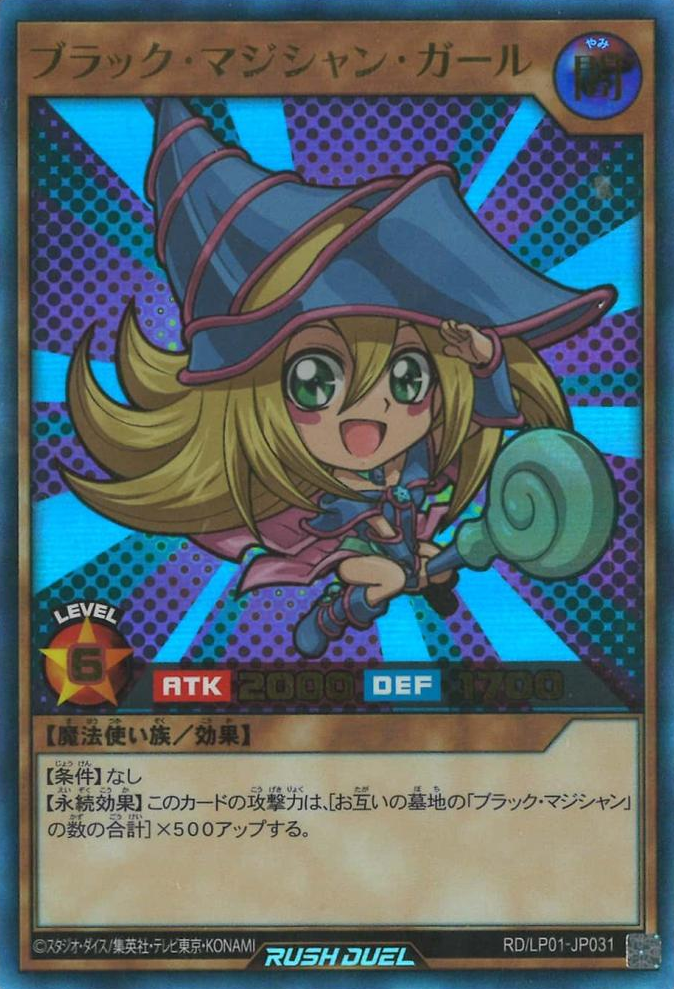 **Chica Maga Oscura**
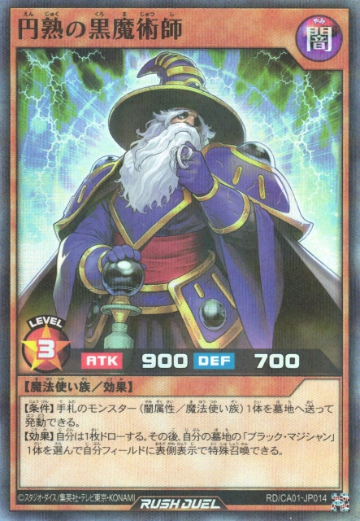 **Mago Oscuro Sabio**
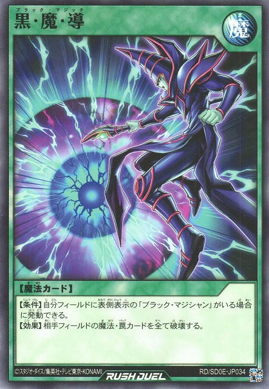 **Ataque Mágico Oscuro**

### Ejecución numerada

#### Paso 1 — Revelar Chica Maga Oscura de la mano para cumplir el requisito de ILLUSION OF EXECUTION, a partir del turno 2.

 **REVELAR** → 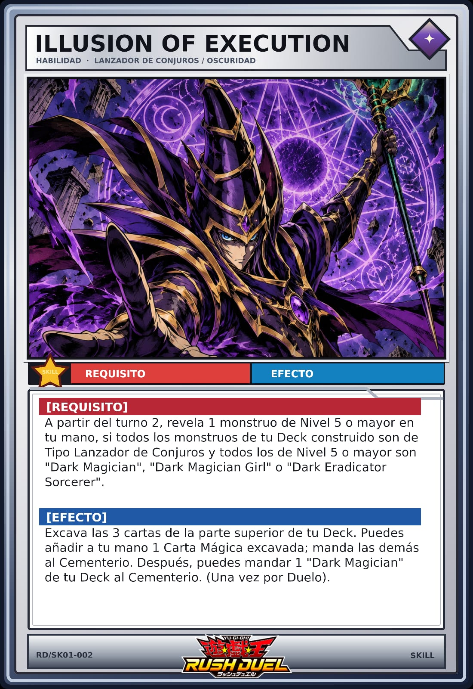 **REFERENCIA A09**

**Acción concreta:** Revelar Chica Maga Oscura de la mano para cumplir el requisito de ILLUSION OF EXECUTION, a partir del turno 2.
**Detalle técnico documentado:** No documentado

**Estado por zonas después del paso:**

| Zona/recurso | Estado narrativo A09 |
|---|---|
| Mano | Chica Maga Oscura #16371 (revelada), Mago Oscuro Sabio #19597 y Ataque Mágico Oscuro #15451 |
| Monstruos | — |
| Mágicas y trampas | — |
| Cementerio | — |
| Destierro propio | — |
| Campo y estado rival | Rival conserva al menos una M/T de identidad desconocida |
| Materiales Xyz/Fusión/Sincro | — |
| Normal, Extra, fase y restricciones | Skill ILLUSION OF EXECUTION activada, todavía procesando; Rush permite Normales posteriores; Extra sin uso |

**Campo visual de este paso:**

**Monstruos propios:** sin carta propia demostrada en esta vista.
**Mágicas/Trampas/Campo:** sin carta propia demostrada en esta vista.
*Relación ilustrada de cartas presentes tras este paso, documentada en A09. La posición, materiales, otras zonas y rival se leen en la tabla de estado.*

#### Paso 2 — Excavar exactamente 3 cartas del Deck.

 **ESTADO / CONTEXTO**

**Acción concreta:** Excavar exactamente 3 cartas del Deck. Si hay una Mágica entre ellas, se puede añadir una a la mano; las otras excavadas van al GY. Si no aparece Mágica, las tres van al GY. No elegir ni inventar sus identidades.
**Detalle técnico documentado:** Si hay una Mágica entre ellas, se puede añadir una a la mano; las otras excavadas van al GY. Si no aparece Mágica, las tres van al GY. No elegir ni inventar sus identidades.

**Estado por zonas después del paso:**

| Zona/recurso | Estado narrativo A09 |
|---|---|
| Mano | Chica Maga Oscura #16371, Mago Oscuro Sabio #19597, Ataque Mágico Oscuro #15451 y 0 o 1 Mágica excavada de identidad desconocida |
| Monstruos | — |
| Mágicas y trampas | — |
| Cementerio | Entre 2 y 3 cartas excavadas de identidad variable; Mago Oscuro podría estar entre ellas |
| Destierro propio | — |
| Campo y estado rival | Sin cambios rivales demostrados |
| Materiales Xyz/Fusión/Sincro | — |
| Normal, Extra, fase y restricciones | Skill local en resolución, no se repite; Normal todavía libre |

**Campo visual de este paso:**

**Monstruos propios:** sin carta propia demostrada en esta vista.
**Mágicas/Trampas/Campo:** sin carta propia demostrada en esta vista.
*Relación ilustrada de cartas presentes tras este paso, documentada en A09. La posición, materiales, otras zonas y rival se leen en la tabla de estado.*

#### Paso 3 — Preparar Mago Oscuro en el Cementerio: si fue una de las tres excavadas, se envía al GY en el paso anterior (es Monstruo Normal y no puede ser la Mágica añadida).

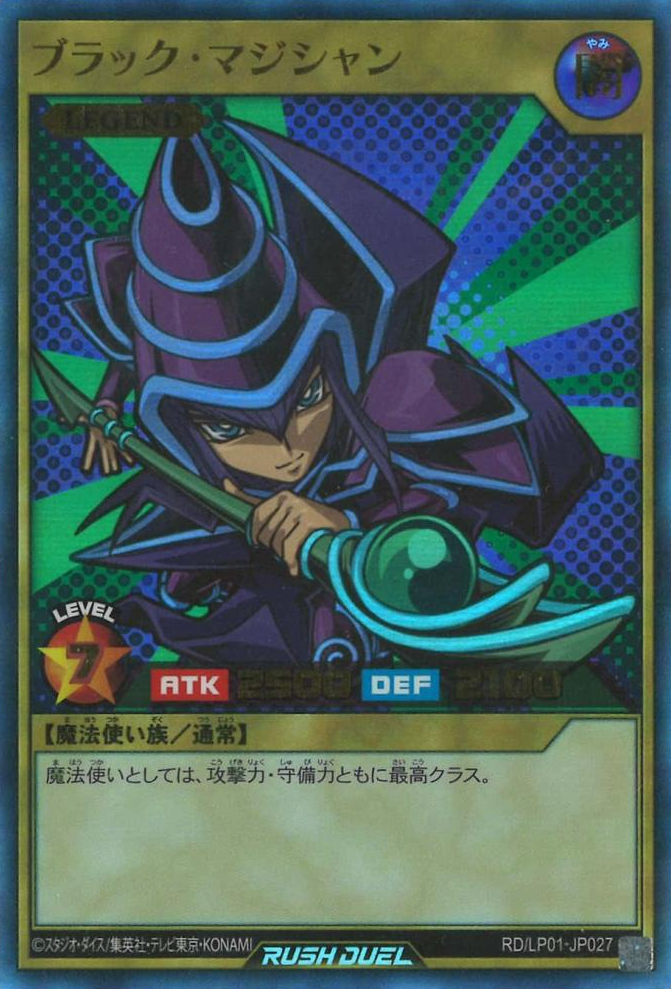 **ESTADO / CONTEXTO** → 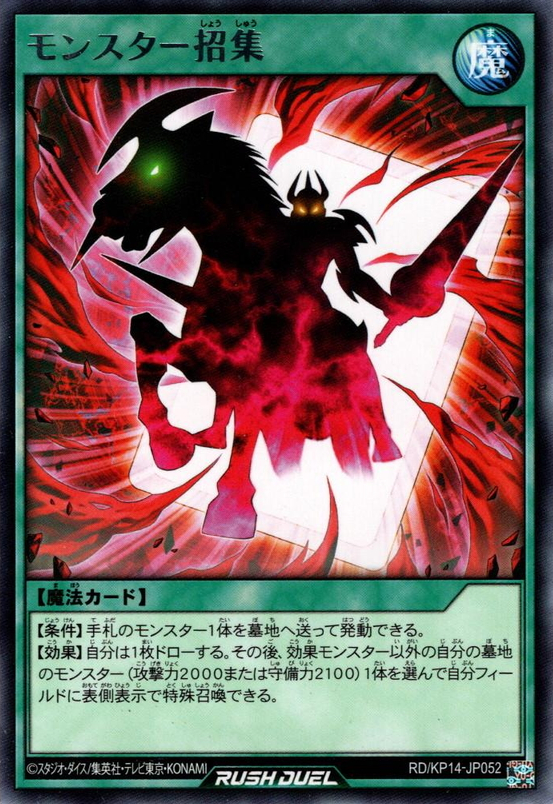 **ESTADO / CONTEXTO**

**Acción concreta:** Preparar Mago Oscuro en el Cementerio: si fue una de las tres excavadas, se envía al GY en el paso anterior (es Monstruo Normal y no puede ser la Mágica añadida). Si no estaba en esas tres, sigue en el Deck y la Skill puede enviar esa única copia al GY. Ambas ramas concluyen con Mago Oscuro en GY. Skill consumida una vez por duelo.
**Detalle técnico documentado:** Si no estaba en esas tres, sigue en el Deck y la Skill puede enviar esa única copia al GY. Ambas ramas concluyen con Mago Oscuro en GY. Skill consumida una vez por duelo.

**Estado por zonas después del paso:**

| Zona/recurso | Estado narrativo A09 |
|---|---|
| Mano | Chica Maga Oscura #16371, Mago Oscuro Sabio #19597, Ataque Mágico Oscuro #15451 y posible Mágica excavada desconocida |
| Monstruos | — |
| Mágicas y trampas | — |
| Cementerio | Mago Oscuro LEGEND #15410 en GY, más restantes de excavación de identidad variable |
| Destierro propio | — |
| Campo y estado rival | Rival mantiene al menos una M/T; ninguna destruida |
| Materiales Xyz/Fusión/Sincro | — |
| Normal, Extra, fase y restricciones | Skill local usada una vez; Mago Oscuro llegó a GY por excavación o envío permitido; Normal posible |

**Campo visual de este paso:**

**Monstruos propios:** sin carta propia demostrada en esta vista.
**Mágicas/Trampas/Campo:** sin carta propia demostrada en esta vista.
*Relación ilustrada de cartas presentes tras este paso, documentada en A09. La posición, materiales, otras zonas y rival se leen en la tabla de estado.*

#### Paso 4 — Invocar Normalmente Mago Oscuro Sabio (Nivel 3, 900 ATK).

 **NORMAL** →  **NORMAL** →  **ESTADO / CONTEXTO**

**Acción concreta:** Invocar Normalmente Mago Oscuro Sabio (Nivel 3, 900 ATK). Se conserva Chica Maga Oscura en mano hasta el coste del siguiente paso.
**Detalle técnico documentado:** Se conserva Chica Maga Oscura en mano hasta el coste del siguiente paso.

**Estado por zonas después del paso:**

| Zona/recurso | Estado narrativo A09 |
|---|---|
| Mano | Chica Maga Oscura #16371, Ataque Mágico Oscuro #15451 y posible Mágica excavada desconocida |
| Monstruos | Mago Oscuro Sabio #19597 (Ataque, 900 ATK) |
| Mágicas y trampas | — |
| Cementerio | Mago Oscuro #15410 y otras excavadas en GY |
| Destierro propio | — |
| Campo y estado rival | Rival conserva M/T |
| Materiales Xyz/Fusión/Sincro | — |
| Normal, Extra, fase y restricciones | Rush: Normal de Sabio realizada; Skill gastada; Extra sin usar |

**Campo visual de este paso:**

**Monstruos propios:**
-  **Mago Oscuro Sabio (Ataque, 900 ATK)** — zona declarada: `MONSTER`.
**Mágicas/Trampas/Campo:** sin carta propia demostrada en esta vista.
*Relación ilustrada de cartas presentes tras este paso, documentada en A09. La posición, materiales, otras zonas y rival se leen en la tabla de estado.*

#### Paso 5 — Activar el efecto de Mago Oscuro Sabio: enviar Chica Maga Oscura (Lanzador de Conjuros/OSCURIDAD) desde la mano al GY como requisito.

 **ACTIVAR** →  **ENVIAR** →  **ESPECIAL**

**Acción concreta:** Activar el efecto de Mago Oscuro Sabio: enviar Chica Maga Oscura (Lanzador de Conjuros/OSCURIDAD) desde la mano al GY como requisito; robar 1 carta y después Invocar Especialmente Mago Oscuro desde el GY boca arriba. El robo no necesita revelar una carta específica para que la recuperación sea legal.
**Detalle técnico documentado:** robar 1 carta y después Invocar Especialmente Mago Oscuro desde el GY boca arriba. El robo no necesita revelar una carta específica para que la recuperación sea legal.

**Estado por zonas después del paso:**

| Zona/recurso | Estado narrativo A09 |
|---|---|
| Mano | Ataque Mágico Oscuro #15451, 1 carta robada de identidad desconocida y 0 o 1 Mágica excavada desconocida |
| Monstruos | Mago Oscuro Sabio #19597 (Ataque, 900 ATK), Mago Oscuro #15410 (Ataque, 2500 ATK) |
| Mágicas y trampas | — |
| Cementerio | Chica Maga Oscura #16371 y cartas excavadas restantes de identidad variable en GY |
| Destierro propio | — |
| Campo y estado rival | M/T rival todavía presente; no se destruye en P5 |
| Materiales Xyz/Fusión/Sincro | — |
| Normal, Extra, fase y restricciones | Rush: recuperación de Mago Oscuro desde GY por Sabio; Skill usada; Extra sin usar |

**Campo visual de este paso:**

**Monstruos propios:**
-  **Mago Oscuro Sabio (Ataque, 900 ATK)** — zona declarada: `MONSTER`.
-  **Mago Oscuro (Ataque, 2500 ATK)** — zona declarada: `MONSTER`.
**Mágicas/Trampas/Campo:** sin carta propia demostrada en esta vista.
*Relación ilustrada de cartas presentes tras este paso, documentada en A09. La posición, materiales, otras zonas y rival se leen en la tabla de estado.*

#### Paso 6 — Ya con Mago Oscuro boca arriba en tu campo, activar Ataque Mágico Oscuro desde la mano y destruir todas las M/T del rival.

 **ACTIVAR** →  **ACTIVAR**

**Acción concreta:** Ya con Mago Oscuro boca arriba en tu campo, activar Ataque Mágico Oscuro desde la mano y destruir todas las M/T del rival. La carta Mágica usada va al GY tras resolver.
**Detalle técnico documentado:** La carta Mágica usada va al GY tras resolver.

**Estado por zonas después del paso:**

| Zona/recurso | Estado narrativo A09 |
|---|---|
| Mano | 1 carta robada desconocida y 0 o 1 Mágica excavada desconocida |
| Monstruos | Mago Oscuro Sabio #19597 (Ataque, 900 ATK), Mago Oscuro #15410 (Ataque, 2500 ATK) |
| Mágicas y trampas | — |
| Cementerio | Chica Maga Oscura #16371, Ataque Mágico Oscuro #15451 y otras excavadas desconocidas en GY |
| Destierro propio | — |
| Campo y estado rival | Todas las M/T rivales presentes al resolver fueron destruidas; monstruos rivales no definidos |
| Materiales Xyz/Fusión/Sincro | — |
| Normal, Extra, fase y restricciones | Rush: Skill usada; no se gastó Extra ni se aseguró ningún ataque |

**Campo visual de este paso:**

**Monstruos propios:**
-  **Mago Oscuro Sabio (Ataque, 900 ATK)** — zona declarada: `MONSTER`.
-  **Mago Oscuro (Ataque, 2500 ATK)** — zona declarada: `MONSTER`.
**Mágicas/Trampas/Campo:** sin carta propia demostrada en esta vista.
*Relación ilustrada de cartas presentes tras este paso, documentada en A09. La posición, materiales, otras zonas y rival se leen en la tabla de estado.*

### Campo final documentado

Esta vista procede **del último paso**, no de una lista de cartas deducida del título.

**Monstruos propios:**
-  **Mago Oscuro Sabio (Ataque, 900 ATK)** — zona declarada: `MONSTER`.
-  **Mago Oscuro (Ataque, 2500 ATK)** — zona declarada: `MONSTER`.
**Mágicas/Trampas/Campo:** sin carta propia demostrada en esta vista.
*Relación ilustrada de cartas presentes tras este paso, documentada en A09. La posición, materiales, otras zonas y rival se leen en la tabla de estado.*

| Zona/recurso | Estado final documentado |
|---|---|
| Mano | 1 carta robada desconocida y 0 o 1 Mágica excavada desconocida |
| Monstruos | Mago Oscuro Sabio #19597 (Ataque, 900 ATK), Mago Oscuro #15410 (Ataque, 2500 ATK) |
| Mágicas y trampas | — |
| Cementerio | Chica Maga Oscura #16371, Ataque Mágico Oscuro #15451 y otras excavadas desconocidas en GY |
| Destierro propio | — |
| Campo y estado rival | Todas las M/T rivales presentes al resolver fueron destruidas; monstruos rivales no definidos |
| Materiales Xyz/Fusión/Sincro | — |
| Normal, Extra, fase y restricciones | Rush: Skill usada; no se gastó Extra ni se aseguró ningún ataque |

### Si el oponente interrumpe

- **INTERRUPCIÓN A12 — paso sin anclaje confirmado: A12 — Prueba negativa: Agujero Trampa en las dos invocaciones**
  - Agujero Trampa Rush (CID 15913) responde a una Invocación Normal de un monstruo de 1000 o más ATK. Mago Oscuro Sabio tiene 900 ATK al ser Invocado Normalmente: no cumple el umbral. Mago Oscuro (2500 ATK) se Invoca Especialmente: tampoco es el evento requerido. No contar estos dos intentos como interrupciones legales ni atribuir inmunidad general frente a otras Trampas.
  - Fuente: Agujero Trampa Rush, Mago Oscuro Sabio., 0 interrupciones legales nuevas.
  - Estado de rama: `Resuelto solo en el escenario que detalla A12/A13; las otras respuestas no están demostradas.`.
- **RECUPERACIÓN A13 — paso sin anclaje confirmado: A13 — Ramas comprobadas y error común**
  - 1. Mago Oscuro está entre las tres excavadas: se manda al GY junto con las cartas no añadidas. La Skill ya no puede mandar desde el Deck una copia que no está allí, pero Mago Oscuro Sabio lo recupera. El resultado de campo no cambia.
  - 2. Mago Oscuro no está entre las excavadas: sigue en Deck; usar la opción posterior de la Skill para enviarlo al GY. Mago Oscuro Sabio lo recupera. El resultado de campo tampoco cambia.
  - 3. Ninguna Mágica entre las tres excavadas: no se añade Mágica extra, pero los pasos 3–6 siguen posibles porque Ataque Mágico Oscuro ya estaba en la mano inicial. El efecto de Mago Sabio agrega exactamente el robo de 1 carta, identidad desconocida.
  - 4. Error: enviar una Mágica o un monstruo que no sea Lanzador OSCURIDAD como requisito de Mago Sabio: activación inválida. Chica Maga Oscura sí cumple; se debe conservar en mano hasta el paso 5. Si falta Chica Maga u otro Lanzador OSCURIDAD en mano, la recuperación del Mago Oscuro no queda acreditada. No suponer reemplazos robados.
  - 5. Variante SECRETORDER:DM01: si Mago Oscuro está en GY, Orden Secreta también puede recuperarlo, pero ese estado inicial ya exige una preparación previa no contenida en la mano mínima documentada. La apertura probada coloca Mago Oscuro desde la mano y no gasta Invocación Normal. Si Orden Secreta no está accesible, esta mano de solo tres piezas no demuestra otra manera de Invocar a Mago Oscuro sin Sacrificios. El bono de ATK expira al final del turno: continuar al turno siguiente con 3200 es un error de seguimiento.
  - Límite: A13 verifica la invariancia frente a la excavación y el requisito de descarte, no una recuperación ante interrupción legal. Las otras prefichas del deck no heredan esta certificación..
  - Estado de rama: `Resuelto solo en el escenario que detalla A12/A13; las otras respuestas no están demostradas.`.

---

## SECRETORDER · DM01 · `707:A09:SECRETORDER:DM01`

**Propósito competitivo principal (lectura documental):** Ofensivo condicional. El objetivo solo se acredita si las acciones y el campo final detallados en esta guía lo permiten; no implica legalidad certificada ni garantiza el resultado ante respuestas adversarias.

**Categoría:** APERTURA

**Propósito y resultado documental:**

Estado final sin interrupciones: Mago Oscuro boca arriba en Campo con 3200 ATK este turno; rival sin M/T; Orden Secreta y Ataque Mágico Oscuro en GY; Skill intacta, Invocación Normal del turno no gastada. Fuera del turno de Invocación, el ATK vuelve a 2500 y termina la protección específica de Orden Secreta. No inferir daño de batalla ni OTK., faltan tableros gráficos A10 y cobertura de adversario A12.

### Mano y estado inicial

1× Mago Oscuro (CID 15410, Nivel 7 Normal), 1× Orden Secreta (CID 17212), 1× Ataque Mágico Oscuro (CID 15451). Campo propio vacío; rival con una o más M/T. Turno propio cualquiera; sin Skill ni efectos previos. No hay restricción de estar en turno 2 para esta ruta.

 **Mago Oscuro**
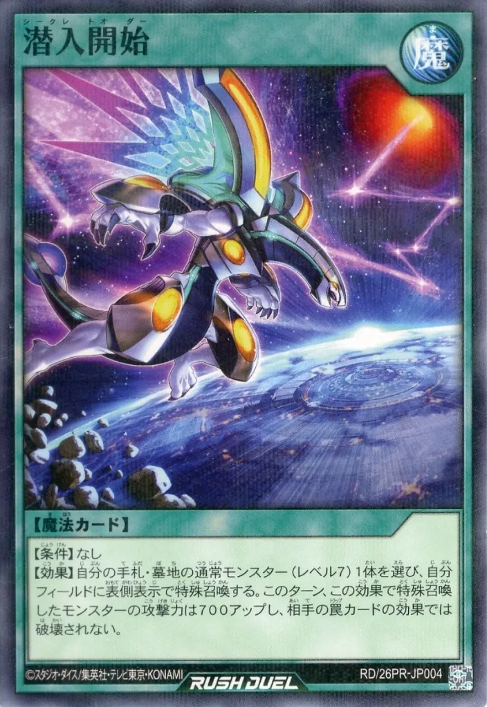 **Orden Secreta**
 **Ataque Mágico Oscuro**

### Ejecución numerada

#### Paso 1 — Activar Orden Secreta desde la mano, eligiendo Mago Oscuro (Monstruo Normal Nivel 7) en la mano.

 **ACTIVAR** →  **ACTIVAR** →  **ACTIVAR**

**Acción concreta:** Activar Orden Secreta desde la mano, eligiendo Mago Oscuro (Monstruo Normal Nivel 7) en la mano. Invocarlo Especialmente boca arriba en el Campo. No realizar una Invocación por Sacrificio.
**Detalle técnico documentado:** Invocarlo Especialmente boca arriba en el Campo. No realizar una Invocación por Sacrificio.

**Estado por zonas después del paso:**

| Zona/recurso | Estado narrativo A09 |
|---|---|
| Mano | Ataque Mágico Oscuro #15451 |
| Monstruos | Mago Oscuro #15410 (Ataque, 3200 ATK temporal tras Orden Secreta) |
| Mágicas y trampas | — |
| Cementerio | Orden Secreta #17212 en GY |
| Destierro propio | — |
| Campo y estado rival | Rival conserva una o más M/T de identidad desconocida |
| Materiales Xyz/Fusión/Sincro | — |
| Normal, Extra, fase y restricciones | Rush: Normal no usada; Skill intacta; Extra sin uso |

**Campo visual de este paso:**

**Monstruos propios:**
-  **Mago Oscuro (Ataque, 3200 ATK temporal tras Orden Secreta)** — zona declarada: `MONSTER`.
**Mágicas/Trampas/Campo:** sin carta propia demostrada en esta vista.
*Relación ilustrada de cartas presentes tras este paso, documentada en A09. La posición, materiales, otras zonas y rival se leen en la tabla de estado.*

#### Paso 2 — Mago Oscuro gana 700 ATK temporalmente: 2500 + 700 = 3200 ATK hasta el final del turno; tampoco puede ser destruido por efectos de Trampa del oponente este turno.

 **ESTADO / CONTEXTO**

**Acción concreta:** Mago Oscuro gana 700 ATK temporalmente: 2500 + 700 = 3200 ATK hasta el final del turno; tampoco puede ser destruido por efectos de Trampa del oponente este turno. No prolongar ese bono/protección al turno siguiente.
**Detalle técnico documentado:** No prolongar ese bono/protección al turno siguiente.

**Estado por zonas después del paso:**

| Zona/recurso | Estado narrativo A09 |
|---|---|
| Mano | Ataque Mágico Oscuro #15451 |
| Monstruos | Mago Oscuro #15410 (Ataque, 3200 ATK temporal; protección frente a destrucción por Trampas rivales este turno) |
| Mágicas y trampas | — |
| Cementerio | Orden Secreta en GY |
| Destierro propio | — |
| Campo y estado rival | M/T rivales sin cambios |
| Materiales Xyz/Fusión/Sincro | — |
| Normal, Extra, fase y restricciones | No es una nueva Invocación ni coste adicional; Normal libre; Skill intacta |

**Campo visual de este paso:**

**Monstruos propios:**
-  **Mago Oscuro (Ataque, 3200 ATK temporal; protección frente a destrucción por Trampas rivales este turno)** — zona declarada: `MONSTER`.
**Mágicas/Trampas/Campo:** sin carta propia demostrada en esta vista.
*Relación ilustrada de cartas presentes tras este paso, documentada en A09. La posición, materiales, otras zonas y rival se leen en la tabla de estado.*

#### Paso 3 — Con Mago Oscuro boca arriba, activar Ataque Mágico Oscuro y destruir todas las cartas Mágicas/Trampa del rival.

 **ACTIVAR** →  **ACTIVAR**

**Acción concreta:** Con Mago Oscuro boca arriba, activar Ataque Mágico Oscuro y destruir todas las cartas Mágicas/Trampa del rival. Ambas Mágicas utilizadas quedan en GY al terminar sus resoluciones.
**Detalle técnico documentado:** Ambas Mágicas utilizadas quedan en GY al terminar sus resoluciones.

**Estado por zonas después del paso:**

| Zona/recurso | Estado narrativo A09 |
|---|---|
| Mano | — |
| Monstruos | Mago Oscuro #15410 (Ataque, 3200 ATK este turno) |
| Mágicas y trampas | — |
| Cementerio | Orden Secreta #17212 y Ataque Mágico Oscuro #15451 en GY |
| Destierro propio | — |
| Campo y estado rival | Todas las M/T rivales destruidas al resolver; monstruos rivales no definidos |
| Materiales Xyz/Fusión/Sincro | — |
| Normal, Extra, fase y restricciones | Normal libre; Skill intacta; bonus de Orden Secreta termina al cerrar el turno |

**Campo visual de este paso:**

**Monstruos propios:**
-  **Mago Oscuro (Ataque, 3200 ATK este turno)** — zona declarada: `MONSTER`.
**Mágicas/Trampas/Campo:** sin carta propia demostrada en esta vista.
*Relación ilustrada de cartas presentes tras este paso, documentada en A09. La posición, materiales, otras zonas y rival se leen en la tabla de estado.*

### Campo final documentado

Esta vista procede **del último paso**, no de una lista de cartas deducida del título.

**Monstruos propios:**
-  **Mago Oscuro (Ataque, 3200 ATK este turno)** — zona declarada: `MONSTER`.
**Mágicas/Trampas/Campo:** sin carta propia demostrada en esta vista.
*Relación ilustrada de cartas presentes tras este paso, documentada en A09. La posición, materiales, otras zonas y rival se leen en la tabla de estado.*

| Zona/recurso | Estado final documentado |
|---|---|
| Mano | — |
| Monstruos | Mago Oscuro #15410 (Ataque, 3200 ATK este turno) |
| Mágicas y trampas | — |
| Cementerio | Orden Secreta #17212 y Ataque Mágico Oscuro #15451 en GY |
| Destierro propio | — |
| Campo y estado rival | Todas las M/T rivales destruidas al resolver; monstruos rivales no definidos |
| Materiales Xyz/Fusión/Sincro | — |
| Normal, Extra, fase y restricciones | Normal libre; Skill intacta; bonus de Orden Secreta termina al cerrar el turno |

### Si el oponente interrumpe

- **INTERRUPCIÓN A12 — paso sin anclaje confirmado: A12 — Segunda prueba negativa con Orden Secreta**
  - En SECRETORDER:DM01, Mago Oscuro aparece por Invocación Especial, no Normal, de modo que Agujero Trampa Rush (15913) no puede activarse por ese evento pese a sus 3200 ATK. La protección temporal de Orden Secreta contra la destrucción por Trampas es una segunda propiedad distinta; no justificar la ilegalidad del Agujero Trampa por inmunidad cuando el evento de activación ya es incorrecto. Sigue sin demostrarse una interrupción legal adversaria para esta apertura..
  - Estado de rama: `Resuelto solo en el escenario que detalla A12/A13; las otras respuestas no están demostradas.`.
- **RECUPERACIÓN A13 — paso sin anclaje confirmado: A13 — Ramas comprobadas y error común**
  - 1. Mago Oscuro está entre las tres excavadas: se manda al GY junto con las cartas no añadidas. La Skill ya no puede mandar desde el Deck una copia que no está allí, pero Mago Oscuro Sabio lo recupera. El resultado de campo no cambia.
  - 2. Mago Oscuro no está entre las excavadas: sigue en Deck; usar la opción posterior de la Skill para enviarlo al GY. Mago Oscuro Sabio lo recupera. El resultado de campo tampoco cambia.
  - 3. Ninguna Mágica entre las tres excavadas: no se añade Mágica extra, pero los pasos 3–6 siguen posibles porque Ataque Mágico Oscuro ya estaba en la mano inicial. El efecto de Mago Sabio agrega exactamente el robo de 1 carta, identidad desconocida.
  - 4. Error: enviar una Mágica o un monstruo que no sea Lanzador OSCURIDAD como requisito de Mago Sabio: activación inválida. Chica Maga Oscura sí cumple; se debe conservar en mano hasta el paso 5. Si falta Chica Maga u otro Lanzador OSCURIDAD en mano, la recuperación del Mago Oscuro no queda acreditada. No suponer reemplazos robados.
  - 5. Variante SECRETORDER:DM01: si Mago Oscuro está en GY, Orden Secreta también puede recuperarlo, pero ese estado inicial ya exige una preparación previa no contenida en la mano mínima documentada. La apertura probada coloca Mago Oscuro desde la mano y no gasta Invocación Normal. Si Orden Secreta no está accesible, esta mano de solo tres piezas no demuestra otra manera de Invocar a Mago Oscuro sin Sacrificios. El bono de ATK expira al final del turno: continuar al turno siguiente con 3200 es un error de seguimiento.
  - Límite: A13 verifica la invariancia frente a la excavación y el requisito de descarte, no una recuperación ante interrupción legal. Las otras prefichas del deck no heredan esta certificación..
  - Estado de rama: `Resuelto solo en el escenario que detalla A12/A13; las otras respuestas no están demostradas.`.

---

## EXECUTOR · KNIVES01 · `707:A09:EXECUTOR:KNIVES01`

**Propósito competitivo principal (lectura documental):** Preparación de recursos / despliegue. El objetivo solo se acredita si las acciones y el campo final detallados en esta guía lo permiten; no implica legalidad certificada ni garantiza el resultado ante respuestas adversarias.

**Categoría:** APERTURA

**Propósito y resultado documental:**

5. Estado final de cualquiera de las dos: propio = Hechicero Eliminador en Ataque 2500 ATK, con nombre temporal «Mago Oscuro» este turno; GY = Mago Oscuro Sabio + Lily + Mágica usada + carta superior enviada de identidad desconocida; mano inicial vacía. El oponente pierde los blancos definidos de cada versión; en el siguiente turno el Hechicero recupera su nombre impreso y no habilita automáticamente estas Mágicas.

### Mano y estado inicial

Cuatro cartas en mano: Mago Oscuro Sabio + Lily Aniquiladora + Hechicero Eliminador Oscuro (Black Executor) + Mil Cuchillos. Campo/GY vacíos; rival con un monstruo legalmente destruible; Main Phase propia. Skill no necesaria.

 **Mago Oscuro Sabio**
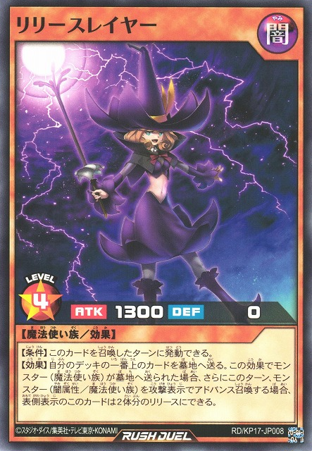 **Lily Aniquiladora**
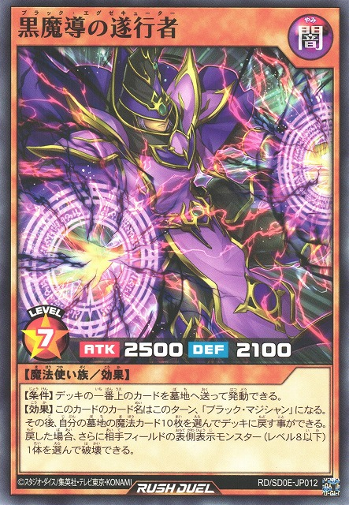 **Hechicero Eliminador Oscuro**
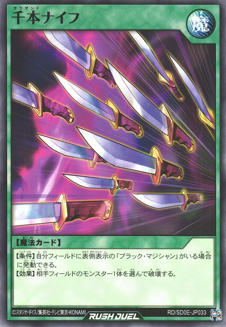 **Mil Cuchillos**

### Ejecución numerada

#### Paso 1 — Invocar Normalmente Mago Oscuro Sabio y Lily Aniquiladora en Ataque usando las reglas de Invocaciones Normales de Rush Duel.

 **NORMAL** →  **NORMAL** →  **NORMAL**

**Acción concreta:** Invocar Normalmente Mago Oscuro Sabio y Lily Aniquiladora en Ataque usando las reglas de Invocaciones Normales de Rush Duel. No activar sus efectos opcionales; por tanto, no enviar cartas adicionales ni robar por hipótesis.
**Detalle técnico documentado:** No activar sus efectos opcionales; por tanto, no enviar cartas adicionales ni robar por hipótesis.

**Estado por zonas después del paso:**

| Zona/recurso | Estado narrativo A09 |
|---|---|
| Mano | Hechicero Eliminador Oscuro #19773 y Mil Cuchillos #15450 |
| Monstruos | Mago Oscuro Sabio #19597 (Ataque, 900 ATK), Lily Aniquiladora #20305 (Ataque, 1300 ATK) |
| Mágicas y trampas | — |
| Cementerio | — |
| Destierro propio | — |
| Campo y estado rival | Un monstruo rival elegible de identidad desconocida sigue en Campo |
| Materiales Xyz/Fusión/Sincro | Dos cuerpos propios independientes |
| Normal, Extra, fase y restricciones | Rush: dos Normales realizadas; Skill no usada; Extra sin uso |

**Campo visual de este paso:**

**Monstruos propios:**
-  **Mago Oscuro Sabio (Ataque, 900 ATK)** — zona declarada: `MONSTER`.
-  **Lily Aniquiladora (Ataque, 1300 ATK)** — zona declarada: `MONSTER`.
**Mágicas/Trampas/Campo:** sin carta propia demostrada en esta vista.
*Relación ilustrada de cartas presentes tras este paso, documentada en A09. La posición, materiales, otras zonas y rival se leen en la tabla de estado.*

#### Paso 2 — Sacrificar los dos Nivel 3/4 para Invocar Normalmente por Sacrificio a Hechicero Eliminador Oscuro (Nivel 7) en Ataque, 2500 ATK.

 **SACRIFICIO**

**Acción concreta:** Sacrificar los dos Nivel 3/4 para Invocar Normalmente por Sacrificio a Hechicero Eliminador Oscuro (Nivel 7) en Ataque, 2500 ATK. Ambos materiales quedan en GY.
**Detalle técnico documentado:** Ambos materiales quedan en GY.

**Estado por zonas después del paso:**

| Zona/recurso | Estado narrativo A09 |
|---|---|
| Mano | Mil Cuchillos #15450 |
| Monstruos | Hechicero Eliminador Oscuro #19773 (Ataque, 2500 ATK) |
| Mágicas y trampas | — |
| Cementerio | Mago Oscuro Sabio #19597 y Lily #20305 en GY (Sacrificios) |
| Destierro propio | — |
| Campo y estado rival | Monstruo rival todavía presente |
| Materiales Xyz/Fusión/Sincro | Dos monstruos propios tributados; no materiales Xyz |
| Normal, Extra, fase y restricciones | Rush: jefe Invocado por Sacrificio; Skill intacta; Extra sin uso |

**Campo visual de este paso:**

**Monstruos propios:**
-  **Hechicero Eliminador Oscuro (Ataque, 2500 ATK)** — zona declarada: `MONSTER`.
**Mágicas/Trampas/Campo:** sin carta propia demostrada en esta vista.
*Relación ilustrada de cartas presentes tras este paso, documentada en A09. La posición, materiales, otras zonas y rival se leen en la tabla de estado.*

#### Paso 3 — Activar el efecto del Hechicero en esa Main Phase, enviando la carta superior del Deck al GY como requisito.

 **ESTADO / CONTEXTO**

**Acción concreta:** Activar el efecto del Hechicero en esa Main Phase, enviando la carta superior del Deck al GY como requisito. Su nombre pasa a ser «Mago Oscuro» únicamente hasta el final del turno. No aplicar el efecto adicional de devolver 10 Mágicas del GY, porque esa condición no está demostrada en esta apertura.
**Detalle técnico documentado:** Su nombre pasa a ser «Mago Oscuro» únicamente hasta el final del turno. No aplicar el efecto adicional de devolver 10 Mágicas del GY, porque esa condición no está demostrada en esta apertura.

**Estado por zonas después del paso:**

| Zona/recurso | Estado narrativo A09 |
|---|---|
| Mano | Mil Cuchillos #15450 |
| Monstruos | Hechicero Eliminador Oscuro #19773 (Ataque, 2500 ATK; nombre temporal Mago Oscuro) |
| Mágicas y trampas | — |
| Cementerio | Sabio, Lily y 1 carta superior del Deck de identidad desconocida en GY |
| Destierro propio | — |
| Campo y estado rival | Monstruo rival seleccionable sin cambios |
| Materiales Xyz/Fusión/Sincro | No hay materiales Xyz; cambio de nombre por efecto temporal |
| Normal, Extra, fase y restricciones | Skill no usada; Extra sin uso; nombre cambia al terminar el turno |

**Campo visual de este paso:**

**Monstruos propios:**
-  **Hechicero Eliminador Oscuro (Ataque, 2500 ATK; nombre temporal Mago Oscuro)** — zona declarada: `MONSTER`.
**Mágicas/Trampas/Campo:** sin carta propia demostrada en esta vista.
*Relación ilustrada de cartas presentes tras este paso, documentada en A09. La posición, materiales, otras zonas y rival se leen en la tabla de estado.*

#### Paso 4 — Activar Mil Cuchillos porque el Hechicero Eliminador se llama «Mago Oscuro» este turno; destruir un monstruo rival elegible.

 **ACTIVAR** →  **ACTIVAR** →  **ACTIVAR**

**Acción concreta:** Activar Mil Cuchillos porque el Hechicero Eliminador se llama «Mago Oscuro» este turno; destruir un monstruo rival elegible. No activar Ataque Mágico Oscuro ni atribuir barrido de M/T a esta mano.
**Detalle técnico documentado:** No activar Ataque Mágico Oscuro ni atribuir barrido de M/T a esta mano.

**Estado por zonas después del paso:**

| Zona/recurso | Estado narrativo A09 |
|---|---|
| Mano | — |
| Monstruos | Hechicero Eliminador Oscuro #19773 (Ataque, 2500 ATK; nombre Mago Oscuro este turno) |
| Mágicas y trampas | — |
| Cementerio | Sabio, Lily, carta superior desconocida y Mil Cuchillos #15450 en GY |
| Destierro propio | — |
| Campo y estado rival | Un monstruo rival elegible destruido por Mil Cuchillos; M/T rivales no afectadas por esta línea |
| Materiales Xyz/Fusión/Sincro | — |
| Normal, Extra, fase y restricciones | Skill intacta; Extra sin uso; requisito de nombre satisfecho solo este turno |

**Campo visual de este paso:**

**Monstruos propios:**
-  **Hechicero Eliminador Oscuro (Ataque, 2500 ATK; nombre Mago Oscuro este turno)** — zona declarada: `MONSTER`.
**Mágicas/Trampas/Campo:** sin carta propia demostrada en esta vista.
*Relación ilustrada de cartas presentes tras este paso, documentada en A09. La posición, materiales, otras zonas y rival se leen en la tabla de estado.*

#### Paso 5 — Resultado de KNIVES01: Hechicero Eliminador Oscuro 2500 ATK con nombre temporal «Mago Oscuro»; Mago Oscuro Sabio, Lily, Mil Cuchillos y la carta superior desconocida están en GY.

 **RESULTADO** →  **RESULTADO** →  **ESTADO / CONTEXTO**

**Acción concreta:** Resultado de KNIVES01: Hechicero Eliminador Oscuro 2500 ATK con nombre temporal «Mago Oscuro»; Mago Oscuro Sabio, Lily, Mil Cuchillos y la carta superior desconocida están en GY. El monstruo rival seleccionado fue destruido, sin inventar M/T retiradas ni otro cuerpo.
**Detalle técnico documentado:** El monstruo rival seleccionado fue destruido, sin inventar M/T retiradas ni otro cuerpo.

**Estado por zonas después del paso:**

| Zona/recurso | Estado narrativo A09 |
|---|---|
| Mano | — |
| Monstruos | Hechicero Eliminador Oscuro #19773 (Ataque, 2500 ATK; nombre Mago Oscuro solo este turno) |
| Mágicas y trampas | — |
| Cementerio | Sabio #19597, Lily #20305, Mil Cuchillos #15450 y carta superior desconocida en GY |
| Destierro propio | — |
| Campo y estado rival | El objetivo monstruo rival se perdió; sin barrido de M/T atribuido |
| Materiales Xyz/Fusión/Sincro | Sin materiales acoplados |
| Normal, Extra, fase y restricciones | Rush: Skill intacta; Extra sin uso; se recupera nombre impreso al concluir turno |

**Campo visual de este paso:**

**Monstruos propios:**
-  **Hechicero Eliminador Oscuro (Ataque, 2500 ATK; nombre Mago Oscuro solo este turno)** — zona declarada: `MONSTER`.
**Mágicas/Trampas/Campo:** sin carta propia demostrada en esta vista.
*Relación ilustrada de cartas presentes tras este paso, documentada en A09. La posición, materiales, otras zonas y rival se leen en la tabla de estado.*

### Campo final documentado

Esta vista procede **del último paso**, no de una lista de cartas deducida del título.

**Monstruos propios:**
-  **Hechicero Eliminador Oscuro (Ataque, 2500 ATK; nombre Mago Oscuro solo este turno)** — zona declarada: `MONSTER`.
**Mágicas/Trampas/Campo:** sin carta propia demostrada en esta vista.
*Relación ilustrada de cartas presentes tras este paso, documentada en A09. La posición, materiales, otras zonas y rival se leen en la tabla de estado.*

| Zona/recurso | Estado final documentado |
|---|---|
| Mano | — |
| Monstruos | Hechicero Eliminador Oscuro #19773 (Ataque, 2500 ATK; nombre Mago Oscuro solo este turno) |
| Mágicas y trampas | — |
| Cementerio | Sabio #19597, Lily #20305, Mil Cuchillos #15450 y carta superior desconocida en GY |
| Destierro propio | — |
| Campo y estado rival | El objetivo monstruo rival se perdió; sin barrido de M/T atribuido |
| Materiales Xyz/Fusión/Sincro | Sin materiales acoplados |
| Normal, Extra, fase y restricciones | Rush: Skill intacta; Extra sin uso; se recupera nombre impreso al concluir turno |

### Si el oponente interrumpe

- **INTERRUPCIÓN A12 — paso sin anclaje confirmado: A12 — Piedra no abre Agujero Trampa; Hechicero sí**
  - 1. Piedra: ambos monstruos se Invocan Especialmente. El rival no puede activar Agujero Trampa Rush (15913) por ninguna de esas dos Invocaciones. Prueba negativa: no se suma una interrupción legal por este caso.
  - 2. Hechicero, ensayo A (Lily): el rival conserva Agujero Trampa previamente Colocada; tras la Invocación Normal de Lily (1300 ATK), puede activarla y destruirla antes de la Invocación por Sacrificio. Si la mano mínima de EXECUTOR: se mantiene, solo resta Mago Oscuro Sabio como material; no están disponibles dos Sacrificios para Invocar Hechicero Nivel 7. El rival conserva el monstruo o M/T que la Mágica pretendía destruir.
  - 3. Hechicero, ensayo B (jefe): sin intervenir en Lily, el rival activa la Trampa al Invocarse Normalmente por Sacrificio Hechicero (2500 ATK). El jefe se destruye antes de su efecto, por tanto no cambia su nombre y Mil Cuchillos / Ataque Mágico Oscuro permanecen en la mano sin poder cumplir por sí solas su condición. Los dos cuerpos bajos ya están en GY. No hay tercer material ni segunda copia de Mago Oscuro supuesta.
  - Alcance: dos escenarios legales alternativos del mismo tipo de Trampa, no una combinación simultánea ni una prueba de todas las respuestas posibles. Agujero Trampa oficial..
  - <!-- A12_AUDITORIA_RUTA_INICIO -->
  - Estado de rama: `Resuelto solo en el escenario que detalla A12/A13; las otras respuestas no están demostradas.`.
- **RECUPERACIÓN A13 — paso sin anclaje confirmado: A13 — Variantes de Piedra y ramas de fallo del nombre temporal**
  - Piedra: en su texto «hasta uno de cada categoría», no exige que los dos cuerpos procedan de la misma zona; uno puede provenir de mano y otro de GY si el estado de partida así lo acredita. En JEWEL:PAIR01 ambos estaban originalmente en mano; no contar automáticamente estados de GY no suministrados como nuevas rutas comprobadas.
  - Hechicero: KNIVES01 y DARKMAGIC01 comparten dos normales bajos y la Invocación por Sacrificio; se diferencian solo en la Mágica incluida originalmente en mano y los blancos disponibles. Al finalizar el turno, el nombre vuelve a «Hechicero Eliminador Oscuro» aunque sobreviva en campo; una Mágica de «Mago Oscuro» robada en el siguiente turno no puede apoyarse en el nombre previo sin reactivar legalmente el efecto.
  - Agujero Trampa contra Lily: después de su destrucción, con solo Mago Sabio en campo no se pueden pagar los dos Sacrificios del jefe; Hechicero y la Mágica siguen en mano, sin resultado ofensivo demostrado. Agujero Trampa contra Hechicero: los dos materiales bajos están en GY y el jefe destruido; Mágica sigue en mano, sin «Mago Oscuro» propio en campo. En ambas variantes no hay continuación comprobada con esa mano mínima.; no equivale a derrota del duelo.
  - <!-- A13_AUDITORIA_RUTA_INICIO -->
  - Estado de rama: `Resuelto solo en el escenario que detalla A12/A13; las otras respuestas no están demostradas.`.

---

## EXECUTOR · DARKMAGIC01 · `707:A09:EXECUTOR:DARKMAGIC01`

**Propósito competitivo principal (lectura documental):** Preparación de recursos / despliegue. El objetivo solo se acredita si las acciones y el campo final detallados en esta guía lo permiten; no implica legalidad certificada ni garantiza el resultado ante respuestas adversarias.

**Categoría:** APERTURA

**Propósito y resultado documental:**

5. Estado final de cualquiera de las dos: propio = Hechicero Eliminador en Ataque 2500 ATK, con nombre temporal «Mago Oscuro» este turno; GY = Mago Oscuro Sabio + Lily + Mágica usada + carta superior enviada de identidad desconocida; mano inicial vacía. El oponente pierde los blancos definidos de cada versión; en el siguiente turno el Hechicero recupera su nombre impreso y no habilita automáticamente estas Mágicas.

### Mano y estado inicial

Cuatro cartas en mano: Mago Oscuro Sabio + Lily Aniquiladora + Hechicero Eliminador Oscuro (Black Executor) + Ataque Mágico Oscuro. Campo/GY vacíos; rival con al menos una M/T; Main Phase propia. Skill no necesaria.

 **Mago Oscuro Sabio**
 **Lily Aniquiladora**
 **Hechicero Eliminador Oscuro**
 **Ataque Mágico Oscuro**

### Ejecución numerada

#### Paso 1 — Invocar Normalmente Mago Oscuro Sabio y Lily Aniquiladora en Ataque usando las reglas de Invocaciones Normales de Rush Duel.

 **NORMAL** →  **NORMAL** →  **NORMAL**

**Acción concreta:** Invocar Normalmente Mago Oscuro Sabio y Lily Aniquiladora en Ataque usando las reglas de Invocaciones Normales de Rush Duel. No activar sus efectos opcionales; por tanto, no enviar cartas adicionales ni robar por hipótesis.
**Detalle técnico documentado:** No activar sus efectos opcionales; por tanto, no enviar cartas adicionales ni robar por hipótesis.

**Estado por zonas después del paso:**

| Zona/recurso | Estado narrativo A09 |
|---|---|
| Mano | Hechicero Eliminador Oscuro #19773 y Ataque Mágico Oscuro #15451 |
| Monstruos | Mago Oscuro Sabio #19597 (Ataque, 900 ATK), Lily Aniquiladora #20305 (Ataque, 1300 ATK) |
| Mágicas y trampas | — |
| Cementerio | — |
| Destierro propio | — |
| Campo y estado rival | Una o más M/T rivales de identidad no especificada siguen presentes |
| Materiales Xyz/Fusión/Sincro | Dos cuerpos independientes |
| Normal, Extra, fase y restricciones | Rush: dos Normales; Skill no usada; Extra sin uso |

**Campo visual de este paso:**

**Monstruos propios:**
-  **Mago Oscuro Sabio (Ataque, 900 ATK)** — zona declarada: `MONSTER`.
-  **Lily Aniquiladora (Ataque, 1300 ATK)** — zona declarada: `MONSTER`.
**Mágicas/Trampas/Campo:** sin carta propia demostrada en esta vista.
*Relación ilustrada de cartas presentes tras este paso, documentada en A09. La posición, materiales, otras zonas y rival se leen en la tabla de estado.*

#### Paso 2 — Sacrificar los dos Nivel 3/4 para Invocar Normalmente por Sacrificio a Hechicero Eliminador Oscuro (Nivel 7) en Ataque, 2500 ATK.

 **SACRIFICIO**

**Acción concreta:** Sacrificar los dos Nivel 3/4 para Invocar Normalmente por Sacrificio a Hechicero Eliminador Oscuro (Nivel 7) en Ataque, 2500 ATK. Ambos materiales quedan en GY.
**Detalle técnico documentado:** Ambos materiales quedan en GY.

**Estado por zonas después del paso:**

| Zona/recurso | Estado narrativo A09 |
|---|---|
| Mano | Ataque Mágico Oscuro #15451 |
| Monstruos | Hechicero Eliminador Oscuro #19773 (Ataque, 2500 ATK) |
| Mágicas y trampas | — |
| Cementerio | Sabio #19597 y Lily #20305 en GY (Sacrificios) |
| Destierro propio | — |
| Campo y estado rival | M/T rivales aún presentes |
| Materiales Xyz/Fusión/Sincro | Dos monstruos tributados; no Xyz |
| Normal, Extra, fase y restricciones | Rush: jefe Invocado por Sacrificio; Skill intacta |

**Campo visual de este paso:**

**Monstruos propios:**
-  **Hechicero Eliminador Oscuro (Ataque, 2500 ATK)** — zona declarada: `MONSTER`.
**Mágicas/Trampas/Campo:** sin carta propia demostrada en esta vista.
*Relación ilustrada de cartas presentes tras este paso, documentada en A09. La posición, materiales, otras zonas y rival se leen en la tabla de estado.*

#### Paso 3 — Activar el efecto del Hechicero en esa Main Phase, enviando la carta superior del Deck al GY como requisito.

 **ESTADO / CONTEXTO**

**Acción concreta:** Activar el efecto del Hechicero en esa Main Phase, enviando la carta superior del Deck al GY como requisito. Su nombre pasa a ser «Mago Oscuro» únicamente hasta el final del turno. No aplicar el efecto adicional de devolver 10 Mágicas del GY, porque esa condición no está demostrada en esta apertura.
**Detalle técnico documentado:** Su nombre pasa a ser «Mago Oscuro» únicamente hasta el final del turno. No aplicar el efecto adicional de devolver 10 Mágicas del GY, porque esa condición no está demostrada en esta apertura.

**Estado por zonas después del paso:**

| Zona/recurso | Estado narrativo A09 |
|---|---|
| Mano | Ataque Mágico Oscuro #15451 |
| Monstruos | Hechicero Eliminador Oscuro #19773 (Ataque, 2500 ATK; nombre temporal Mago Oscuro) |
| Mágicas y trampas | — |
| Cementerio | Sabio, Lily y carta superior desconocida del Deck en GY |
| Destierro propio | — |
| Campo y estado rival | M/T rivales aún presentes y sin destruir |
| Materiales Xyz/Fusión/Sincro | Sin materiales Xyz |
| Normal, Extra, fase y restricciones | Skill intacta; Extra sin uso; nombre temporal válido este turno |

**Campo visual de este paso:**

**Monstruos propios:**
-  **Hechicero Eliminador Oscuro (Ataque, 2500 ATK; nombre temporal Mago Oscuro)** — zona declarada: `MONSTER`.
**Mágicas/Trampas/Campo:** sin carta propia demostrada en esta vista.
*Relación ilustrada de cartas presentes tras este paso, documentada en A09. La posición, materiales, otras zonas y rival se leen en la tabla de estado.*

#### Paso 4 — Activar Ataque Mágico Oscuro porque el Hechicero Eliminador se llama «Mago Oscuro» este turno; destruir todas las M/T rivales.

 **ACTIVAR** →  **ACTIVAR** →  **ACTIVAR**

**Acción concreta:** Activar Ataque Mágico Oscuro porque el Hechicero Eliminador se llama «Mago Oscuro» este turno; destruir todas las M/T rivales. No activar Mil Cuchillos ni atribuir destrucción de monstruo a esta mano.
**Detalle técnico documentado:** No activar Mil Cuchillos ni atribuir destrucción de monstruo a esta mano.

**Estado por zonas después del paso:**

| Zona/recurso | Estado narrativo A09 |
|---|---|
| Mano | — |
| Monstruos | Hechicero Eliminador Oscuro #19773 (Ataque, 2500 ATK; nombre Mago Oscuro este turno) |
| Mágicas y trampas | — |
| Cementerio | Sabio, Lily, carta superior desconocida y Ataque Mágico Oscuro #15451 en GY |
| Destierro propio | — |
| Campo y estado rival | Todas las M/T rivales destruidas por la Mágica; ningún monstruo rival destruido por esta línea |
| Materiales Xyz/Fusión/Sincro | — |
| Normal, Extra, fase y restricciones | Skill intacta; Extra sin uso; nombre temporal vigente |

**Campo visual de este paso:**

**Monstruos propios:**
-  **Hechicero Eliminador Oscuro (Ataque, 2500 ATK; nombre Mago Oscuro este turno)** — zona declarada: `MONSTER`.
**Mágicas/Trampas/Campo:** sin carta propia demostrada en esta vista.
*Relación ilustrada de cartas presentes tras este paso, documentada en A09. La posición, materiales, otras zonas y rival se leen en la tabla de estado.*

#### Paso 5 — Resultado de DARKMAGIC01: Hechicero Eliminador Oscuro 2500 ATK con nombre temporal «Mago Oscuro»; Mago Oscuro Sabio, Lily, Ataque Mágico Oscuro y la carta superior desconocida están en GY.

 **RESULTADO** →  **RESULTADO** →  **ESTADO / CONTEXTO**

**Acción concreta:** Resultado de DARKMAGIC01: Hechicero Eliminador Oscuro 2500 ATK con nombre temporal «Mago Oscuro»; Mago Oscuro Sabio, Lily, Ataque Mágico Oscuro y la carta superior desconocida están en GY. Las M/T rivales fueron destruidas, sin inventar monstruos retirados ni segundo jefe.
**Detalle técnico documentado:** Las M/T rivales fueron destruidas, sin inventar monstruos retirados ni segundo jefe.

**Estado por zonas después del paso:**

| Zona/recurso | Estado narrativo A09 |
|---|---|
| Mano | — |
| Monstruos | Hechicero Eliminador Oscuro #19773 (Ataque, 2500 ATK; nombre Mago Oscuro este turno) |
| Mágicas y trampas | — |
| Cementerio | Sabio #19597, Lily #20305, Ataque Mágico Oscuro #15451 y carta superior desconocida en GY |
| Destierro propio | — |
| Campo y estado rival | M/T rivales destruidas; monstruos rivales no afectados por esta salida |
| Materiales Xyz/Fusión/Sincro | Sin materiales Xyz |
| Normal, Extra, fase y restricciones | Rush: Skill intacta; Extra sin uso; nombre vuelve al impreso al terminar turno |

**Campo visual de este paso:**

**Monstruos propios:**
-  **Hechicero Eliminador Oscuro (Ataque, 2500 ATK; nombre Mago Oscuro este turno)** — zona declarada: `MONSTER`.
**Mágicas/Trampas/Campo:** sin carta propia demostrada en esta vista.
*Relación ilustrada de cartas presentes tras este paso, documentada en A09. La posición, materiales, otras zonas y rival se leen en la tabla de estado.*

### Campo final documentado

Esta vista procede **del último paso**, no de una lista de cartas deducida del título.

**Monstruos propios:**
-  **Hechicero Eliminador Oscuro (Ataque, 2500 ATK; nombre Mago Oscuro este turno)** — zona declarada: `MONSTER`.
**Mágicas/Trampas/Campo:** sin carta propia demostrada en esta vista.
*Relación ilustrada de cartas presentes tras este paso, documentada en A09. La posición, materiales, otras zonas y rival se leen en la tabla de estado.*

| Zona/recurso | Estado final documentado |
|---|---|
| Mano | — |
| Monstruos | Hechicero Eliminador Oscuro #19773 (Ataque, 2500 ATK; nombre Mago Oscuro este turno) |
| Mágicas y trampas | — |
| Cementerio | Sabio #19597, Lily #20305, Ataque Mágico Oscuro #15451 y carta superior desconocida en GY |
| Destierro propio | — |
| Campo y estado rival | M/T rivales destruidas; monstruos rivales no afectados por esta salida |
| Materiales Xyz/Fusión/Sincro | Sin materiales Xyz |
| Normal, Extra, fase y restricciones | Rush: Skill intacta; Extra sin uso; nombre vuelve al impreso al terminar turno |

### Si el oponente interrumpe

- **INTERRUPCIÓN A12 — paso sin anclaje confirmado: A12 — Piedra no abre Agujero Trampa; Hechicero sí**
  - 1. Piedra: ambos monstruos se Invocan Especialmente. El rival no puede activar Agujero Trampa Rush (15913) por ninguna de esas dos Invocaciones. Prueba negativa: no se suma una interrupción legal por este caso.
  - 2. Hechicero, ensayo A (Lily): el rival conserva Agujero Trampa previamente Colocada; tras la Invocación Normal de Lily (1300 ATK), puede activarla y destruirla antes de la Invocación por Sacrificio. Si la mano mínima de EXECUTOR: se mantiene, solo resta Mago Oscuro Sabio como material; no están disponibles dos Sacrificios para Invocar Hechicero Nivel 7. El rival conserva el monstruo o M/T que la Mágica pretendía destruir.
  - 3. Hechicero, ensayo B (jefe): sin intervenir en Lily, el rival activa la Trampa al Invocarse Normalmente por Sacrificio Hechicero (2500 ATK). El jefe se destruye antes de su efecto, por tanto no cambia su nombre y Mil Cuchillos / Ataque Mágico Oscuro permanecen en la mano sin poder cumplir por sí solas su condición. Los dos cuerpos bajos ya están en GY. No hay tercer material ni segunda copia de Mago Oscuro supuesta.
  - Alcance: dos escenarios legales alternativos del mismo tipo de Trampa, no una combinación simultánea ni una prueba de todas las respuestas posibles. Agujero Trampa oficial..
  - <!-- A12_AUDITORIA_RUTA_INICIO -->
  - Estado de rama: `Resuelto solo en el escenario que detalla A12/A13; las otras respuestas no están demostradas.`.
- **RECUPERACIÓN A13 — paso sin anclaje confirmado: A13 — Variantes de Piedra y ramas de fallo del nombre temporal**
  - Piedra: en su texto «hasta uno de cada categoría», no exige que los dos cuerpos procedan de la misma zona; uno puede provenir de mano y otro de GY si el estado de partida así lo acredita. En JEWEL:PAIR01 ambos estaban originalmente en mano; no contar automáticamente estados de GY no suministrados como nuevas rutas comprobadas.
  - Hechicero: KNIVES01 y DARKMAGIC01 comparten dos normales bajos y la Invocación por Sacrificio; se diferencian solo en la Mágica incluida originalmente en mano y los blancos disponibles. Al finalizar el turno, el nombre vuelve a «Hechicero Eliminador Oscuro» aunque sobreviva en campo; una Mágica de «Mago Oscuro» robada en el siguiente turno no puede apoyarse en el nombre previo sin reactivar legalmente el efecto.
  - Agujero Trampa contra Lily: después de su destrucción, con solo Mago Sabio en campo no se pueden pagar los dos Sacrificios del jefe; Hechicero y la Mágica siguen en mano, sin resultado ofensivo demostrado. Agujero Trampa contra Hechicero: los dos materiales bajos están en GY y el jefe destruido; Mágica sigue en mano, sin «Mago Oscuro» propio en campo. En ambas variantes no hay continuación comprobada con esa mano mínima.; no equivale a derrota del duelo.
  - <!-- A13_AUDITORIA_RUTA_INICIO -->
  - Estado de rama: `Resuelto solo en el escenario que detalla A12/A13; las otras respuestas no están demostradas.`.

---

## ILLUSION · SAGE · KNIVES02 · `707:A09:ILLUSION:SAGE:KNIVES02`

**Propósito competitivo principal (lectura documental):** Preparación de recursos / despliegue. El objetivo solo se acredita si las acciones y el campo final detallados en esta guía lo permiten; no implica legalidad certificada ni garantiza el resultado ante respuestas adversarias.

**Categoría:** APERTURA

**Propósito y resultado documental:**

Si el rival retira el objetivo de Mil Cuchillos después de su activación: la destrucción de ese monstruo concreto no se acredita; Mago Oscuro y Sabio pueden permanecer como cuerpos si nada los afectó. El resultado exacto de la Mágica depende de la resolución legal y la carta que intervino, por lo que no se dibuja el objetivo como destruido automáticamente.

### Mano y estado inicial

exactamente Chica Maga Oscura + Mago Oscuro Sabio + Mil Cuchillos en mano; Mago Oscuro LEGEND en Deck, Skill ILLUSION OF EXECUTION sin usar, Main Phase del turno 2 o posterior, Deck al menos 3 cartas, rival con monstruo seleccionable; Campo/GY propios vacíos. Sin respuestas. Es un destino diferente de ILLUSION:SAGE01 que rompe M/T.

 **Chica Maga Oscura**
 **Mago Oscuro Sabio**
 **Mil Cuchillos**

### Ejecución numerada

#### Paso 1 — Activar la Skill, revelar Chica Maga Oscura, excavar tres cartas; añadir una Mágica excavada solo si existe y elegir hacerlo.

 **REVELAR** →  **ESTADO / CONTEXTO**

**Acción concreta:** Activar la Skill, revelar Chica Maga Oscura, excavar tres cartas; añadir una Mágica excavada solo si existe y elegir hacerlo. Poner las otras en GY sin inventar identidad; si Mago Oscuro no fue excavado, enviarlo del Deck al GY como permite la Skill. Resultado necesario: Mago Oscuro en GY, Skill gastada.
**Detalle técnico documentado:** Poner las otras en GY sin inventar identidad; si Mago Oscuro no fue excavado, enviarlo del Deck al GY como permite la Skill. Resultado necesario: Mago Oscuro en GY, Skill gastada.

**Estado por zonas después del paso:**

| Zona/recurso | Estado narrativo A09 |
|---|---|
| Mano | Chica Maga Oscura #16371, Mago Oscuro Sabio #19597, Mil Cuchillos #15450 y posible Mágica excavada desconocida |
| Monstruos | — |
| Mágicas y trampas | — |
| Cementerio | Mago Oscuro #15410 y entre 1 y 3 cartas excavadas adicionales de identidades variables (sin duplicar al LEGEND) |
| Destierro propio | — |
| Campo y estado rival | Un monstruo rival objetivo de identidad desconocida permanece en Campo |
| Materiales Xyz/Fusión/Sincro | — |
| Normal, Extra, fase y restricciones | Skill ILLUSION OF EXECUTION usada; Rush permite Normal posterior; Extra sin uso |

**Campo visual de este paso:**

**Monstruos propios:** sin carta propia demostrada en esta vista.
**Mágicas/Trampas/Campo:** sin carta propia demostrada en esta vista.
*Relación ilustrada de cartas presentes tras este paso, documentada en A09. La posición, materiales, otras zonas y rival se leen en la tabla de estado.*

#### Paso 2 — Normal Mago Oscuro Sabio; enviar Chica Maga Oscura desde la mano al GY para su efecto, robar 1 carta de identidad desconocida e Invocar Especialmente Mago Oscuro desde GY.

 **ESTADO / CONTEXTO** →  **ENVIAR** →  **ESPECIAL**

**Acción concreta:** Normal Mago Oscuro Sabio; enviar Chica Maga Oscura desde la mano al GY para su efecto, robar 1 carta de identidad desconocida e Invocar Especialmente Mago Oscuro desde GY.
**Detalle técnico documentado:** No documentado

**Estado por zonas después del paso:**

| Zona/recurso | Estado narrativo A09 |
|---|---|
| Mano | Mil Cuchillos #15450, 1 carta robada desconocida y posible Mágica excavada desconocida |
| Monstruos | Mago Oscuro Sabio #19597 (Ataque, 900 ATK), Mago Oscuro #15410 (Ataque, 2500 ATK) |
| Mágicas y trampas | — |
| Cementerio | Chica Maga Oscura #16371 y otras excavadas desconocidas en GY |
| Destierro propio | — |
| Campo y estado rival | Monstruo rival todavía presente, sin daño atribuido |
| Materiales Xyz/Fusión/Sincro | — |
| Normal, Extra, fase y restricciones | Rush: Normal de Sabio realizada; Skill usada; Extra sin uso |

**Campo visual de este paso:**

**Monstruos propios:**
-  **Mago Oscuro Sabio (Ataque, 900 ATK)** — zona declarada: `MONSTER`.
-  **Mago Oscuro (Ataque, 2500 ATK)** — zona declarada: `MONSTER`.
**Mágicas/Trampas/Campo:** sin carta propia demostrada en esta vista.
*Relación ilustrada de cartas presentes tras este paso, documentada en A09. La posición, materiales, otras zonas y rival se leen en la tabla de estado.*

#### Paso 3 — Activar Mil Cuchillos desde la mano, ahora que se controla Mago Oscuro; elegir un monstruo rival legal, destruirlo por efecto.

 **ACTIVAR** →  **ACTIVAR** →  **ESTADO / CONTEXTO**

**Acción concreta:** Activar Mil Cuchillos desde la mano, ahora que se controla Mago Oscuro; elegir un monstruo rival legal, destruirlo por efecto. Final: Mago Oscuro 2500 + Mago Oscuro Sabio 900 boca arriba; objetivo rival destruido; Chica Maga y Mil Cuchillos al GY, 1 robo y posible Mágica excavada en mano. La Skill no garantiza qué fue robado ni una Mágica excavada.
**Detalle técnico documentado:** Final: Mago Oscuro 2500 + Mago Oscuro Sabio 900 boca arriba; objetivo rival destruido; Chica Maga y Mil Cuchillos al GY, 1 robo y posible Mágica excavada en mano. La Skill no garantiza qué fue robado ni una Mágica excavada.

**Estado por zonas después del paso:**

| Zona/recurso | Estado narrativo A09 |
|---|---|
| Mano | 1 carta robada desconocida y posible Mágica excavada desconocida |
| Monstruos | Mago Oscuro Sabio #19597 (Ataque, 900 ATK), Mago Oscuro #15410 (Ataque, 2500 ATK) |
| Mágicas y trampas | — |
| Cementerio | Chica Maga Oscura #16371, Mil Cuchillos #15450 y otras excavadas desconocidas en GY |
| Destierro propio | — |
| Campo y estado rival | Monstruo rival seleccionado destruido por Mil Cuchillos si continuó siendo objetivo legal; no se adjudica barrido M/T |
| Materiales Xyz/Fusión/Sincro | — |
| Normal, Extra, fase y restricciones | Skill ya usada; Normal de Sabio realizada; Extra sin uso |

**Campo visual de este paso:**

**Monstruos propios:**
-  **Mago Oscuro Sabio (Ataque, 900 ATK)** — zona declarada: `MONSTER`.
-  **Mago Oscuro (Ataque, 2500 ATK)** — zona declarada: `MONSTER`.
**Mágicas/Trampas/Campo:** sin carta propia demostrada en esta vista.
*Relación ilustrada de cartas presentes tras este paso, documentada en A09. La posición, materiales, otras zonas y rival se leen en la tabla de estado.*

### Campo final documentado

Esta vista procede **del último paso**, no de una lista de cartas deducida del título.

**Monstruos propios:**
-  **Mago Oscuro Sabio (Ataque, 900 ATK)** — zona declarada: `MONSTER`.
-  **Mago Oscuro (Ataque, 2500 ATK)** — zona declarada: `MONSTER`.
**Mágicas/Trampas/Campo:** sin carta propia demostrada en esta vista.
*Relación ilustrada de cartas presentes tras este paso, documentada en A09. La posición, materiales, otras zonas y rival se leen en la tabla de estado.*

| Zona/recurso | Estado final documentado |
|---|---|
| Mano | 1 carta robada desconocida y posible Mágica excavada desconocida |
| Monstruos | Mago Oscuro Sabio #19597 (Ataque, 900 ATK), Mago Oscuro #15410 (Ataque, 2500 ATK) |
| Mágicas y trampas | — |
| Cementerio | Chica Maga Oscura #16371, Mil Cuchillos #15450 y otras excavadas desconocidas en GY |
| Destierro propio | — |
| Campo y estado rival | Monstruo rival seleccionado destruido por Mil Cuchillos si continuó siendo objetivo legal; no se adjudica barrido M/T |
| Materiales Xyz/Fusión/Sincro | — |
| Normal, Extra, fase y restricciones | Skill ya usada; Normal de Sabio realizada; Extra sin uso |

### Si el oponente interrumpe

No se documenta una continuación alternativa con los recursos indicados.

---

## SECRETORDER · DM · KNIVES02 · `707:A09:SECRETORDER:DM:KNIVES02`

**Propósito competitivo principal (lectura documental):** Preparación de recursos / despliegue. El objetivo solo se acredita si las acciones y el campo final detallados en esta guía lo permiten; no implica legalidad certificada ni garantiza el resultado ante respuestas adversarias.

**Categoría:** APERTURA

**Propósito y resultado documental:**

2. Activar Mil Cuchillos y destruir el monstruo rival elegido. Endboard: Mago Oscuro ATK 3200 este turno / 2500 después, Normal libre, ambas Mágicas al GY, rival pierde 1 monstruo. No afirmar retirada de todas las M/T: eso corresponde a SECRETORDER:DM01 con otra Mágica en mano.

### Mano y estado inicial

Si el rival niega Orden Secreta antes de que invoque Mago Oscuro: desde esa mano mínima no existe un Mago Oscuro boca arriba que habilite Mil Cuchillos. La Normal sigue sin usar, pero no hay un campo de 3200 ATK ni un monstruo rival destruido por esta línea; las zonas de Orden Secreta/Mago Oscuro se registran según el efecto exacto de negación.

 **Mago Oscuro**
 **Orden Secreta**
 **Mil Cuchillos**

### Ejecución numerada

#### Paso 1 — Activar Orden Secreta, Invocar Especialmente Mago Oscuro Normal Nivel 7 de la mano sin Sacrificios.

 **ACTIVAR** →  **ESPECIAL**

**Acción concreta:** Activar Orden Secreta, Invocar Especialmente Mago Oscuro Normal Nivel 7 de la mano sin Sacrificios; ATK 3200 este turno y resistencia temporal a destrucción por Trampa rival según Orden Secreta. Normal libre.
**Detalle técnico documentado:** ATK 3200 este turno y resistencia temporal a destrucción por Trampa rival según Orden Secreta. Normal libre.

**Estado por zonas después del paso:**

| Zona/recurso | Estado narrativo A09 |
|---|---|
| Mano | Mil Cuchillos #15450 |
| Monstruos | Mago Oscuro #15410 (Ataque, 3200 ATK temporal; protección contra destrucción por Trampas este turno) |
| Mágicas y trampas | — |
| Cementerio | Orden Secreta #17212 en GY |
| Destierro propio | — |
| Campo y estado rival | Monstruo rival elegible de identidad variable sigue presente |
| Materiales Xyz/Fusión/Sincro | — |
| Normal, Extra, fase y restricciones | Rush: Normal sin gastar; Skill intacta; Extra sin uso |

**Campo visual de este paso:**

**Monstruos propios:**
-  **Mago Oscuro (Ataque, 3200 ATK temporal; protección contra destrucción por Trampas este turno)** — zona declarada: `MONSTER`.
**Mágicas/Trampas/Campo:** sin carta propia demostrada en esta vista.
*Relación ilustrada de cartas presentes tras este paso, documentada en A09. La posición, materiales, otras zonas y rival se leen en la tabla de estado.*

#### Paso 2 — Activar Mil Cuchillos y destruir el monstruo rival elegido.

 **ACTIVAR** →  **ACTIVAR** →  **ESTADO / CONTEXTO**

**Acción concreta:** Activar Mil Cuchillos y destruir el monstruo rival elegido. Endboard: Mago Oscuro ATK 3200 este turno / 2500 después, Normal libre, ambas Mágicas al GY, rival pierde 1 monstruo. No afirmar retirada de todas las M/T: eso corresponde a SECRETORDER:DM01 con otra Mágica en mano.
**Detalle técnico documentado:** Endboard: Mago Oscuro ATK 3200 este turno / 2500 después, Normal libre, ambas Mágicas al GY, rival pierde 1 monstruo. No afirmar retirada de todas las M/T: eso corresponde a SECRETORDER:DM01 con otra Mágica en mano.

**Estado por zonas después del paso:**

| Zona/recurso | Estado narrativo A09 |
|---|---|
| Mano | — |
| Monstruos | Mago Oscuro #15410 (Ataque, 3200 ATK temporal) |
| Mágicas y trampas | — |
| Cementerio | Orden Secreta #17212 y Mil Cuchillos #15450 en GY |
| Destierro propio | — |
| Campo y estado rival | Monstruo rival seleccionado destruido por Mil Cuchillos; no se retiraron M/T por esta línea |
| Materiales Xyz/Fusión/Sincro | — |
| Normal, Extra, fase y restricciones | Normal libre; Skill intacta; Extra sin uso; ATK vuelve a 2500 al finalizar el turno |

**Campo visual de este paso:**

**Monstruos propios:**
-  **Mago Oscuro (Ataque, 3200 ATK temporal)** — zona declarada: `MONSTER`.
**Mágicas/Trampas/Campo:** sin carta propia demostrada en esta vista.
*Relación ilustrada de cartas presentes tras este paso, documentada en A09. La posición, materiales, otras zonas y rival se leen en la tabla de estado.*

### Campo final documentado

Esta vista procede **del último paso**, no de una lista de cartas deducida del título.

**Monstruos propios:**
-  **Mago Oscuro (Ataque, 3200 ATK temporal)** — zona declarada: `MONSTER`.
**Mágicas/Trampas/Campo:** sin carta propia demostrada en esta vista.
*Relación ilustrada de cartas presentes tras este paso, documentada en A09. La posición, materiales, otras zonas y rival se leen en la tabla de estado.*

| Zona/recurso | Estado final documentado |
|---|---|
| Mano | — |
| Monstruos | Mago Oscuro #15410 (Ataque, 3200 ATK temporal) |
| Mágicas y trampas | — |
| Cementerio | Orden Secreta #17212 y Mil Cuchillos #15450 en GY |
| Destierro propio | — |
| Campo y estado rival | Monstruo rival seleccionado destruido por Mil Cuchillos; no se retiraron M/T por esta línea |
| Materiales Xyz/Fusión/Sincro | — |
| Normal, Extra, fase y restricciones | Normal libre; Skill intacta; Extra sin uso; ATK vuelve a 2500 al finalizar el turno |

### Si el oponente interrumpe

No se documenta una continuación alternativa con los recursos indicados.

---

## JEWEL · PAIR · KNIVES03 · `707:A09:JEWEL:PAIR:KNIVES03`

**Propósito competitivo principal (lectura documental):** Preparación de recursos / despliegue. El objetivo solo se acredita si las acciones y el campo final detallados en esta guía lo permiten; no implica legalidad certificada ni garantiza el resultado ante respuestas adversarias.

**Categoría:** APERTURA

**Propósito y resultado documental:**

2. Activar Mil Cuchillos mientras Mago Oscuro boca arriba permanece en Campo; destruir el monstruo rival legal seleccionado. Endboard: Mago Oscuro 2500 + Chica Maga Oscura 2000, Mágicas Piedra y Mil Cuchillos al GY, rival pierde 1 monstruo, Skill intacta, Normal libre. El ATK de Chica Maga no aumenta solo porque Mago Oscuro esté en Campo.

### Mano y estado inicial

Mano: Piedra de los Magos Oscuros + Mago Oscuro + Chica Maga Oscura + Mil Cuchillos; Campo/GY propios vacíos, dos zonas de monstruo libres, rival controla un monstruo seleccionable, Main Phase propia; sin respuestas.

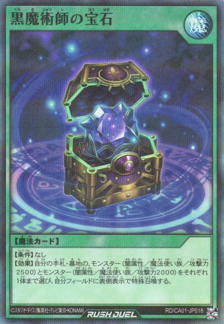 **Piedra de los Magos Oscuros**
 **Mago Oscuro**
 **Chica Maga Oscura**
 **Mil Cuchillos**

### Ejecución numerada

#### Paso 1 — Activar Piedra de los Magos Oscuros, Invocar Especialmente Mago Oscuro + Chica Maga Oscura desde mano en Ataque como dos monstruos independientes.

 **ACTIVAR** →  **ESPECIAL** →  **ESPECIAL**

**Acción concreta:** Activar Piedra de los Magos Oscuros, Invocar Especialmente Mago Oscuro + Chica Maga Oscura desde mano en Ataque como dos monstruos independientes; Piedra va al GY, la Normal queda sin gastar.
**Detalle técnico documentado:** Piedra va al GY, la Normal queda sin gastar.

**Estado por zonas después del paso:**

| Zona/recurso | Estado narrativo A09 |
|---|---|
| Mano | Mil Cuchillos #15450 |
| Monstruos | Mago Oscuro #15410 (Ataque, 2500 ATK), Chica Maga Oscura #16371 (Ataque, 2000 ATK) |
| Mágicas y trampas | — |
| Cementerio | Piedra de los Magos Oscuros #19598 en GY |
| Destierro propio | — |
| Campo y estado rival | Monstruo rival seleccionable aún presente |
| Materiales Xyz/Fusión/Sincro | Dos monstruos invocados de mano independientes, no materiales Xyz |
| Normal, Extra, fase y restricciones | Rush: Normal sin gastar; Skill intacta; Extra sin uso |

**Campo visual de este paso:**

**Monstruos propios:**
-  **Mago Oscuro (Ataque, 2500 ATK)** — zona declarada: `MONSTER`.
-  **Chica Maga Oscura (Ataque, 2000 ATK)** — zona declarada: `MONSTER`.
**Mágicas/Trampas/Campo:** sin carta propia demostrada en esta vista.
*Relación ilustrada de cartas presentes tras este paso, documentada en A09. La posición, materiales, otras zonas y rival se leen en la tabla de estado.*

#### Paso 2 — Activar Mil Cuchillos mientras Mago Oscuro boca arriba permanece en Campo; destruir el monstruo rival legal seleccionado.

 **ACTIVAR** →  **ACTIVAR** →  **ESTADO / CONTEXTO**

**Acción concreta:** Activar Mil Cuchillos mientras Mago Oscuro boca arriba permanece en Campo; destruir el monstruo rival legal seleccionado. Endboard: Mago Oscuro 2500 + Chica Maga Oscura 2000, Mágicas Piedra y Mil Cuchillos al GY, rival pierde 1 monstruo, Skill intacta, Normal libre. El ATK de Chica Maga no aumenta solo porque Mago Oscuro esté en Campo.
**Detalle técnico documentado:** Endboard: Mago Oscuro 2500 + Chica Maga Oscura 2000, Mágicas Piedra y Mil Cuchillos al GY, rival pierde 1 monstruo, Skill intacta, Normal libre. El ATK de Chica Maga no aumenta solo porque Mago Oscuro esté en Campo.

**Estado por zonas después del paso:**

| Zona/recurso | Estado narrativo A09 |
|---|---|
| Mano | — |
| Monstruos | Mago Oscuro #15410 (Ataque, 2500 ATK), Chica Maga Oscura #16371 (Ataque, 2000 ATK) |
| Mágicas y trampas | — |
| Cementerio | Piedra de los Magos Oscuros #19598 y Mil Cuchillos #15450 en GY |
| Destierro propio | — |
| Campo y estado rival | Monstruo rival elegido destruido si permaneció legal; M/T rivales sin cambios acreditados |
| Materiales Xyz/Fusión/Sincro | No se usaron monstruos como material; ambos siguen en Campo |
| Normal, Extra, fase y restricciones | Normal libre; Skill intacta; Extra sin uso |

**Campo visual de este paso:**

**Monstruos propios:**
-  **Mago Oscuro (Ataque, 2500 ATK)** — zona declarada: `MONSTER`.
-  **Chica Maga Oscura (Ataque, 2000 ATK)** — zona declarada: `MONSTER`.
**Mágicas/Trampas/Campo:** sin carta propia demostrada en esta vista.
*Relación ilustrada de cartas presentes tras este paso, documentada en A09. La posición, materiales, otras zonas y rival se leen en la tabla de estado.*

### Campo final documentado

Esta vista procede **del último paso**, no de una lista de cartas deducida del título.

**Monstruos propios:**
-  **Mago Oscuro (Ataque, 2500 ATK)** — zona declarada: `MONSTER`.
-  **Chica Maga Oscura (Ataque, 2000 ATK)** — zona declarada: `MONSTER`.
**Mágicas/Trampas/Campo:** sin carta propia demostrada en esta vista.
*Relación ilustrada de cartas presentes tras este paso, documentada en A09. La posición, materiales, otras zonas y rival se leen en la tabla de estado.*

| Zona/recurso | Estado final documentado |
|---|---|
| Mano | — |
| Monstruos | Mago Oscuro #15410 (Ataque, 2500 ATK), Chica Maga Oscura #16371 (Ataque, 2000 ATK) |
| Mágicas y trampas | — |
| Cementerio | Piedra de los Magos Oscuros #19598 y Mil Cuchillos #15450 en GY |
| Destierro propio | — |
| Campo y estado rival | Monstruo rival elegido destruido si permaneció legal; M/T rivales sin cambios acreditados |
| Materiales Xyz/Fusión/Sincro | No se usaron monstruos como material; ambos siguen en Campo |
| Normal, Extra, fase y restricciones | Normal libre; Skill intacta; Extra sin uso |

### Si el oponente interrumpe

- **INTERRUPCIÓN A12 — paso sin anclaje confirmado: A12 — Piedra no abre Agujero Trampa; Hechicero sí**
  - 1. Piedra: ambos monstruos se Invocan Especialmente. El rival no puede activar Agujero Trampa Rush (15913) por ninguna de esas dos Invocaciones. Prueba negativa: no se suma una interrupción legal por este caso.
  - 2. Hechicero, ensayo A (Lily): el rival conserva Agujero Trampa previamente Colocada; tras la Invocación Normal de Lily (1300 ATK), puede activarla y destruirla antes de la Invocación por Sacrificio. Si la mano mínima de EXECUTOR: se mantiene, solo resta Mago Oscuro Sabio como material; no están disponibles dos Sacrificios para Invocar Hechicero Nivel 7. El rival conserva el monstruo o M/T que la Mágica pretendía destruir.
  - 3. Hechicero, ensayo B (jefe): sin intervenir en Lily, el rival activa la Trampa al Invocarse Normalmente por Sacrificio Hechicero (2500 ATK). El jefe se destruye antes de su efecto, por tanto no cambia su nombre y Mil Cuchillos / Ataque Mágico Oscuro permanecen en la mano sin poder cumplir por sí solas su condición. Los dos cuerpos bajos ya están en GY. No hay tercer material ni segunda copia de Mago Oscuro supuesta.
  - Alcance: dos escenarios legales alternativos del mismo tipo de Trampa, no una combinación simultánea ni una prueba de todas las respuestas posibles. Agujero Trampa oficial..
  - <!-- A12_AUDITORIA_RUTA_INICIO -->
  - Estado de rama: `Resuelto solo en el escenario que detalla A12/A13; las otras respuestas no están demostradas.`.
- **RECUPERACIÓN A13 — paso sin anclaje confirmado: A13 — Variantes de Piedra y ramas de fallo del nombre temporal**
  - Piedra: en su texto «hasta uno de cada categoría», no exige que los dos cuerpos procedan de la misma zona; uno puede provenir de mano y otro de GY si el estado de partida así lo acredita. En JEWEL:PAIR01 ambos estaban originalmente en mano; no contar automáticamente estados de GY no suministrados como nuevas rutas comprobadas.
  - Hechicero: KNIVES01 y DARKMAGIC01 comparten dos normales bajos y la Invocación por Sacrificio; se diferencian solo en la Mágica incluida originalmente en mano y los blancos disponibles. Al finalizar el turno, el nombre vuelve a «Hechicero Eliminador Oscuro» aunque sobreviva en campo; una Mágica de «Mago Oscuro» robada en el siguiente turno no puede apoyarse en el nombre previo sin reactivar legalmente el efecto.
  - Agujero Trampa contra Lily: después de su destrucción, con solo Mago Sabio en campo no se pueden pagar los dos Sacrificios del jefe; Hechicero y la Mágica siguen en mano, sin resultado ofensivo demostrado. Agujero Trampa contra Hechicero: los dos materiales bajos están en GY y el jefe destruido; Mágica sigue en mano, sin «Mago Oscuro» propio en campo. En ambas variantes no hay continuación comprobada con esa mano mínima.; no equivale a derrota del duelo.
  - <!-- A13_AUDITORIA_RUTA_INICIO -->
  - Estado de rama: `Resuelto solo en el escenario que detalla A12/A13; las otras respuestas no están demostradas.`.

---
