# Mementotlán / Demoniherrero — estudio individual A01–A10 · iteración 2 (17-11-2026)

> **CRITERIO DEL INVENTARIO FÍSICO (V41):** Las cartas y sus cantidades se conservan exactamente como fueron documentadas. El análisis A01–A10 se basa en sus efectos, materiales, ventanas, zonas, cadenas y recursos; no evalúa listas externas de prohibidas o limitadas. No se atribuyen partidas ni simulaciones ejecutadas a estos análisis documentales.

> **ESTADO VIGENTE CONCILIADO (17-11-2026).** Deck real **671**, formato registrado **TCG Advanced**, con inventario de **41 Main / 15 Extra / 14 Side** ya asociado e importación V40 registrada en Station X. Las **39/39 fotografías** por CID están físicamente en esta carpeta (13 JPG y 26 PNG); los antiguos marcadores de foto pendiente de V35/V36 no describen el estado actual. A01–A10 tienen contenido documental; **0 replays acreditados** y ninguna certificación automática de jugadas. Guía visual: [abrir](guias/GUIA_VISUAL_A01_A10.html). No se cambió ninguna carta.

## IDENTIDAD BÁSICA

- `deck_id` real confirmado de Station X: **671** (`Memento`, formato registrado `tcg_advanced`). `NUEVO_12` es solamente el nombre histórico de esta carpeta, **no** otro deck.
- Fuente de inventario: listado completo compartido por Miguel el **16-11-2026**; **las cantidades y posiciones no se alteran**. La matriz usa etiquetas cortas legibles para varias cartas (p. ej., «Angbruja» por «Mementotlán Angbruja»), identificadas inequívocamente por CID, y anota dos variantes de nombre oficial; **no se ha sustituido ninguna carta**. **Cotejo de identidades:** 39/39 CIDs encontrados en la base oficial Konami Neuron.
- **Main: 41** (25 monstruos, 16 mágicas, 0 trampas); **Extra: 15**; **Side: 14**; **Reserva: 0**; **total: 70 copias**.
- El Side de 14 cartas se conserva **tal cual**, sin rellenar automáticamente el espacio restante.

## CONTROL_DE_TAREAS_A01_A10 — Memento 671 · contrato vigente (21-11-2026)

**Asignación expresa recibida:** “Analizamos memento”. Identidad inequívoca: `deck_id=671`, formato `tcg_advanced`, carpeta histórica `DECK_NUEVO_12_MEMENTOTLAN_DEMONIHERRERO`. Preflight realizado sobre los DOS paquetes versionados, `datos/stationx-deck.json` de GPT y `torneos_yugioh/assets/editorial/20261117-folder-delivery-v40/671.json` de Platform: misma lista de `card_id, sección, cantidad, CID` en 40 filas, **41 Main / 15 Extra / 14 Side / 0 Reserva**, 70 copias y 39 identidades. La Reserva opcional no se fabricó. **Importante:** GitHub permite acreditar la igualdad de las dos copias versionadas, no consultar el estado vivo de la base de datos de producción.

**Estado de ejecución actual:** A01 **3/3**, A02 **3/3**, A03 **3/3**, A04 **3/3**; A05 **2/4 tareas verificadas** (identidades y censo documental de cláusulas), mientras la semántica causal individual y matriz de casos de papel siguen pendientes. **14/35** tareas obligatorias verificadas; **21 pendientes**. El cierre de A05 como apartado sigue **ABIERTO**: sus T2–T4 no se marcan completos sin especificación y evidencia por efecto. Los cierres históricos no se trasladan automáticamente al nuevo checklist. Los cierres editoriales de noviembre son evidencia reutilizable, pero NO cierran automáticamente las nuevas tareas que requieren casos lógicos de papel, paridad visual y validaciones específicas. **A10B no solicitado**: no se ha compilado, reimportado ni ejecutado la calculadora por esta asignación.

**Actualización sobre los replays de la documentación histórica:** las tablas V40/V42 anteriores citan “0 replays”. A fecha de este control, Platform tiene pruebas históricas **C01–C12 con 105 transiciones reproducidas en CI** mediante fixtures de regresión, con alcance de apertura exacta y restricciones declaradas; **C02 conserva un conflicto de conteo (6 documentadas frente a 5 acciones del test)**. Eso no certifica casos arbitrarios de cadenas, cartas ocultas, legalidad general ni cumplimiento completo de A05–A10A. No se han ejecutado nuevas partidas ni análisis A10B.

### A05 — cobertura inicial de cartas y diagnóstico de efectos

A05-T1 se cerró por evidencias efectivas de las 39 fichas de rol/función, foto, CID, zona e identidad. El paquete preserva **353 variantes de reglas importables con solo 59 `rule.id` distintos**; 31/39 CIDs aparecen como `actor.cid` en al menos una variante y las otras 8 identidades sin actor explícito en ese registro portátil son: CID **12950** (Flor de Ceniza), **13081** (César), **13619** (Llamado por la Tumba), **15296** (Talento de Tácticas Triples), **15299** (Gotas Prohibidas), **20206** (Purulia), **20500** (Fuwalos), **20764** (Meowls). El hecho de no estar en esa tabla **no prueba que no tengan efectos ni que el motor global carezca de reglas**. No extrapolar cobertura de un único `rule.id` a todas las activaciones, pasivos, procedimientos y costes de una carta.

**A05-T2 sigue pendiente** de un censo oficial por cada efecto y procedimiento con fuente, clase, condiciones y `effect_id`; **A05-T3** de las semánticas completas coste/ventana/cadena/OPT-HOPT/recursos/estado; **A05-T4** de casos lógicos positivos y negativos relacionados a esos efectos. Los replays históricos de apertura exacta y las ocho pruebas de papel piloto son referencias reutilizables, **no** sustituyen ese censo ni autorizan A10B.

### A05.2 — censo cruzado de identidades y reglas (corte 21-11-2026)

**Alcance y origen:** auditor genérico `scripts/audit-deck-effect-sources.cjs`, aprobado en [CI #44951218254](https://github.com/senior23enginer-coder/gpt-yugioh-promps-platform/actions/runs/44951218254), recibió exclusivamente la asignación `deck_id=671`. Para las **39 cartas distintas** cotejó `misc_info.konami_id` con el CID aprobado y el metadato descriptivo de YGOPRODeck; cada tarjeta conserva su enlace individual a **Konami Neuron**, que sigue siendo la fuente oficial normativa del texto TCG. Se conservaron únicamente huellas SHA-256 del texto externo, no se copió texto íntegro protegido. Censo **secundario de identidades**, no acreditación automática de cada cláusula reglamentaria.

**Controles cuantificados:** **353 variantes** del paquete portátil corresponden a **59 `rule.id` distintos**, con reglas por `actor.cid` para **31/39 cartas** y al menos un ID de regla sin actor CID; **8 cartas no tienen regla portable por actor**. Un `rule.id` puede tener variantes alternativas, y un efecto impreso puede incluir varias modalidades, límites y restricciones. **59 identificadores ≠ 59 efectos reglamentarios acreditados, ni 353 efectos**. Ninguno de estos cómputos activa A10B ni certifica cobertura del motor.

| CID | Carta registrada en esta lista | Zona cargada | Tipo de trabajo | IDs portátiles identificados por actor (NO exhaustivos) |
|---|---|---|---|---|
| 9139 | Oleada de Calor | main | SPELL | 1 IDs · `671:heat-wave:lock` |
| 9279 | El Bufón y el Pájaro del Candado | main | MONSTER_EFFECT_OR_PROCEDURE | 1 IDs · `671:droll:main-deck-lock` |
| 9657 | Portaaviones Sumergible Aero Tiburón | extra | MONSTER_EFFECT_OR_PROCEDURE | 1 IDs · `671:aero-shark:damage-per-banished` |
| 11243 | Artefacto Lancea | side | MONSTER_EFFECT_OR_PROCEDURE | 1 IDs · `671:lancea:banish-lock` |
| 12870 | Predaplanta Dragostapelia | extra | MONSTER_EFFECT_OR_PROCEDURE | 1 IDs · `671:dragostapelia:counter` |
| 12950 | Flor de Ceniza | main | OTHER | **Sin regla portátil por actor** |
| 13081 | D/D/D César, Alto Rey de las Olas | extra | MONSTER_EFFECT_OR_PROCEDURE | **Sin regla portátil por actor** |
| 13619 | Llamado por la Tumba | main | SPELL | **Sin regla portátil por actor** |
| 15296 | Talento de Tácticas Triples | main | SPELL | **Sin regla portátil por actor** |
| 15299 | Gotas Prohibidas | main | SPELL | **Sin regla portátil por actor** |
| 16845 | Quimera Guardián | extra | MONSTER_EFFECT_OR_PROCEDURE | 1 IDs · `671:guardian-chimera:draw-destroy` |
| 19184 | TY-PHON - Crisis Celeste | extra | MONSTER_EFFECT_OR_PROCEDURE | 1 IDs · `671:typhon:detach-bounce` |
| 19188 | S:P Pequeña Caballera | extra | MONSTER_EFFECT_OR_PROCEDURE | 2 IDs · `671:sp:banish-link-extra`, `671:sp:temporary-banish` |
| 19360 | Tecuhtlica - Creación Combinada | main | MONSTER_EFFECT_OR_PROCEDURE | 1 IDs · `671:tecuhtlica:five-names` |
| 19361 | Dragón de Cuerno | main | MONSTER_EFFECT_OR_PROCEDURE | 2 IDs · `671:horned:destruction`, `671:horned:special` |
| 19362 | Tatsunootoshigo | main | MONSTER_EFFECT_OR_PROCEDURE | 2 IDs · `671:tatsun:mill`, `671:tatsun:special` |
| 19363 | Hoja Oscura | main | MONSTER_EFFECT_OR_PROCEDURE | 2 IDs · `671:19363:normal`, `671:dark-blade:goblin` |
| 19364 | Angbruja | main | MONSTER_EFFECT_OR_PROCEDURE | 5 IDs · `671:19364:normal`, `671:angwitch:destroy-revive-mace`, `671:angwitch:search`, `671:moon:link-from-angwitch-tatsun`, `671:sp:link-procedure` |
| 19365 | Maza | main | MONSTER_EFFECT_OR_PROCEDURE | 2 IDs · `671:19365:normal`, `671:mace:search` |
| 19366 | Goblin | main | MONSTER_EFFECT_OR_PROCEDURE | 1 IDs · `671:goblin:send-two` |
| 19367 | Mementomictlán | main | SPELL | 2 IDs · `671:mictlan:activate`, `671:mictlan:end-set` |
| 19368 | Fiesta de Huesos | main | SPELL | 1 IDs · `671:bone-party:main` |
| 19472 | Desvantasmas | main | MONSTER_EFFECT_OR_PROCEDURE | 3 IDs · `671:19472:normal`, `671:ghattic:recover`, `671:ghattic:revive` |
| 19878 | Dragón Gemelo | extra | MONSTER_EFFECT_OR_PROCEDURE | 1 IDs · `671:twin-dragon:fusion-search` |
| 19904 | Fusión Mementotlán | main | SPELL | 2 IDs · `671:memento-fusion:fuse`, `671:memento-fusion:graveyard-search` |
| 19932 | Luna del Cielo Cerrado | extra | MONSTER_EFFECT_OR_PROCEDURE | 3 IDs · `671:moon:link-requiem`, `671:moon:link-sequence`, `671:sp:link-with-moon` |
| 20196 | Demoniherrero Grabador | main | MONSTER_EFFECT_OR_PROCEDURE | 4 IDs · `671:engraver:link-sequence`, `671:engraver:remove`, `671:engraver:revive`, `671:princess:contact-summon` |
| 20199 | Dormiveja | main | MONSTER_EFFECT_OR_PROCEDURE | 4 IDs · `671:20199:normal`, `671:shleepy:fusion`, `671:shleepy:send`, `671:shleepy:special` |
| 20206 | Purulia | side | MONSTER_EFFECT_OR_PROCEDURE | **Sin regla portátil por actor** |
| 20216 | Rey Creación | extra | MONSTER_EFFECT_OR_PROCEDURE | 3 IDs · `671:creation-king:destroy`, `671:creation-king:fusion-send`, `671:creation-king:graveyard-search` |
| 20225 | Réquiem del Demoniherrero | extra | MONSTER_EFFECT_OR_PROCEDURE | 2 IDs · `671:requiem:equip`, `671:requiem:tribute` |
| 20226 | Secuencia del Demoniherrero | extra | MONSTER_EFFECT_OR_PROCEDURE | 1 IDs · `671:sequence:duke-fusion` |
| 20389 | Duque de la Defunción | extra | MONSTER_EFFECT_OR_PROCEDURE | 2 IDs · `671:duke:immediate-normal`, `671:duke:recover-engraver` |
| 20423 | Princesa Necroequipo | extra | MONSTER_EFFECT_OR_PROCEDURE | 2 IDs · `671:princess:trigger-draw`, `671:princess:trigger-equip` |
| 20491 | Akhíron | main | MONSTER_EFFECT_OR_PROCEDURE | 1 IDs · `671:akihiron:recover` |
| 20500 | Fuwalos | main+side | MONSTER_EFFECT_OR_PROCEDURE | **Sin regla portátil por actor** |
| 20533 | Gran Fuga Moto Goblin | main | SPELL | 1 IDs · `671:goblin-biker-grand-breakout:deck-summon` |
| 20764 | Meowls | side | MONSTER_EFFECT_OR_PROCEDURE | **Sin regla portátil por actor** |
| 21203 | Rebanador Gordiano | side | SPELL | 2 IDs · `671:gordian:one-monster-one-hand`, `671:gordian:one-monster-six-extra` |

**Brechas de A05-T2 que se deben resolver desde el texto oficial:** (a) asignar un `effect_id` estable por activación, efecto continuo, procedimiento y efecto condicionado de **cada una** de las 39 cartas; (b) cubrir por separado los CID 12950, 13081, 13619, 15296, 15299, 20206, 20500 y 20764; (c) discriminar efectos pasivos o restricciones que no producen una acción directa; (d) contrastar modalidades, costos y condiciones contra Konami Neuron antes de declarar una fila `VERIFICADA`. Las 353 variantes preexistentes son referencia de implementación, **no** sustituyen el análisis documental de A05 ni se ejecutan por esta solicitud. Se conserva A05-T2 **sin marcar**.

### A05.3 — ocho cartas sin actor portátil: semántica oficial diferenciada

**Aclaración técnica:** “sin regla portable por actor” **no** significa que una carta carezca de efectos o que deba invocarse para activarlos. Los siguientes IDs son **identificadores documentales de efectos**, NO nuevas reglas de `record.calculator`. Se comprueba el texto TCG publicado por **Konami Neuron** a través del enlace de cada CID; no se ejecuta A10B ni se modifican operadores, inventarios o listas.

| CID / carta / zona | `effect_id` documental | Naturaleza, condición y coste | Resolución y límites expresos |
|---|---|---|---|
| [12950 Flor de Ceniza](https://www.db.yugioh-card.com/yugiohdb/card_search.action?cid=12950&ope=2&request_locale=en) · **Main** | `671:a05:12950:hand-deck-effect-negate` | Efecto Rápido **desde la mano**, en respuesta a activación que incluya añadir del Deck, Invocar desde Deck o enviar Deck→GY; **descartar Flor de Ceniza** al activar. No necesita Invocarse al campo. | Niega ese **efecto**, no se afirma negar la activación completa. Un uso del efecto por turno; no se inventa respuesta sin una activación rival observada. |
| [13081 D/D/D César, Alto Rey de las Olas](https://www.db.yugioh-card.com/yugiohdb/card_search.action?cid=13081&ope=2&request_locale=en) · **Extra** | `671:a05:13081:xyz-2-level6-fiends` | **Procedimiento** Xyz: dos Demonios de Nivel 6, materiales físicos existentes. No es una Invocación gratuita. | Requiere cumplir materiales; el procedimiento no es, por sí mismo, una negación. |
| [13081 César](https://www.db.yugioh-card.com/yugiohdb/card_search.action?cid=13081&ope=2&request_locale=en) | `671:a05:13081:quick-negate-special-summon-activation` | Efecto Rápido ante activación de M/T o monstruo **que incluya Invocar de Modo Especial**; desacoplar **1 material Xyz** al activar. | Niega la activación y destruye esa carta si se resuelve; después puede aumentar 1800 ATK de César y otro monstruo D/D propio hasta el final de turno. No recomendar sin material ni activación susceptible. |
| [13081 César](https://www.db.yugioh-card.com/yugiohdb/card_search.action?cid=13081&ope=2&request_locale=en) | `671:a05:13081:sent-field-to-gy-dark-contract` | Efecto condicionado a ser enviado del Campo al Cementerio. | Añade una carta «Dark Contract» del Deck a la mano; **la lista Main 671 no contiene objetivo propio acreditado**, por lo que aquí no se puede prometer búsqueda. |
| [13619 Llamado por la Tumba](https://www.db.yugioh-card.com/yugiohdb/card_search.action?cid=13619&ope=2&request_locale=en) · **Main** | `671:a05:13619:opponent-gy-banish-name-negate` | Mágica Rápida; seleccionar un monstruo existente en el Cementerio rival. | Lo destierra y, **si se destierra**, niega sus efectos y ciertos efectos de monstruos con su mismo nombre original hasta el final del siguiente turno. La ausencia de objetivo rival impide proponer la activación. |
| [15296 Talento de Tácticas Triples](https://www.db.yugioh-card.com/yugiohdb/card_search.action?cid=15296&ope=2&request_locale=en) · **Main** | `671:a05:15296:opponent-main-phase-activated-monster-effect-choice` | Mágica Normal; durante tu Main Phase **si tu adversario ya activó un efecto de monstruo en esa Main Phase**; eliges **solo una** modalidad. | Robar 2, tomar temporalmente un monstruo rival o examinar la mano rival y elegir una carta para devolver al Deck. Solo activar **1** copia de esta carta por turno; no presentar las tres modalidades como tres activaciones. |
| [15299 Gotas Prohibidas](https://www.db.yugioh-card.com/yugiohdb/card_search.action?cid=15299&ope=2&request_locale=en) · **Main** | `671:a05:15299:send-other-cards-negate-monsters` | Mágica Rápida; enviar **otras cartas** desde tu mano/Campo al GY, cantidad positiva y real, como parte de la activación. | Elegir igual número de monstruos de efecto rivales (sin seleccionar como objetivo), reducir ATK a la mitad y negar efectos este turno. Rival no puede responder con tipos originales de cartas enviados como coste; activar solo una copia por turno. No inventar materiales ni monstruos rivales. |
| [20206 Purulia](https://www.db.yugioh-card.com/yugiohdb/card_search.action?cid=20206&ope=2&request_locale=en) · **Side** | `671:a05:20206:hand-discard-draw-opponent-hand-summons` | Efecto Rápido desde la mano **si no controlas cartas**, descartando esta carta; queda fuera del Main hasta Side autorizado entre duelos. | Durante el turno roba cuando el rival Invoca de Modo Normal o Especial monstruos **desde su mano**. En End Phase, si tu mano excede cartas rivales controladas +6, devuelve al Deck al azar el exceso. Límite textual compartido con los demás «Mulcharmy»; no es robo al activarse. |
| [20500 Fuwalos](https://www.db.yugioh-card.com/yugiohdb/card_search.action?cid=20500&ope=2&request_locale=en) · **Main + Side** | `671:a05:20500:hand-discard-draw-opponent-deck-extra-summons` | Efecto Rápido desde la mano si no controlas cartas; descartar como coste. Main 1 + Side 2 son **copias de zonas distintas**, no tres en el Main. | Roba por Invocaciones Especiales rivales **desde Deck o Extra Deck**; no por una Invocación desde GY o mano. Ajuste obligatorio de la mano en End Phase si supera cartas rivales controladas +6; respetar el límite compartido Mulcharmy. |
| [20764 Meowls](https://www.db.yugioh-card.com/yugiohdb/card_search.action?cid=20764&ope=2&request_locale=en) · **Side** | `671:a05:20764:hand-discard-draw-opponent-gy-banish-summons` | Efecto Rápido desde mano sin cartas propias controladas; descartar como coste. Solo es accesible si se incorporó desde Side entre duelos. | Roba por Invocaciones Especiales del rival **desde un GY o desde el destierro**. Ajuste de mano en End Phase y límite compartido Mulcharmy; no responder como si una Invocación desde Deck habilitara Meowls. |

**Casos lógicos iniciales de fallo cerrado para A05-T4/A07 (no ejecutados):** `A05-12950-N1`: Flor en GY y no en mano → no ofrecer respuesta de mano; `A05-13081-N1`: César sin material o sin activación que incluya Invocación → no ofrecer negación; `A05-13619-N1`: no hay monstruo en GY rival → no hay objetivo; `A05-15296-N1`: no ocurrió efecto de monstruo rival en tu Main Phase → no habilitar Talento; `A05-15299-N1`: faltan cartas propias que puedan enviarse o monstruos de efecto rivales → no ofrecer una resolución; `A05-20206-N1`: Invocación rival desde Deck, no mano → no contabilizar robo Purulia; `A05-20500-N1`: Invocación rival desde GY → no contabilizar robo Fuwalos; `A05-20764-N1`: Invocación rival desde mano → no contabilizar robo Meowls. Estos son **escenarios documentales** que requieren estados estructurados completos, ventanas y fuentes antes de acreditarse como casos de papel terminados; no se incorporan como código particular del deck.

**Estado:** se cubrió documentalmente una brecha visible de **8 CID sin regla portable por actor**, pero **A05-T2/T3/T4 permanecen abiertas**: falta verificar exhaustividad para los otros 31 CID, separar cada procedimiento/continuo/activado y formalizar casos completos positivos, negativos, costes y cadenas. No atribuir cobertura ejecutable ni victoria automática.

### A05.4 — auditoría de atribución de fuentes y procedimientos portátiles

**Control cruzado de 59 `rule.id` preexistentes (solo lectura, sin A10B):** 59/59 incluyen URL de Konami Neuron y 59/59 contienen al menos un operador de resolución y una guarda. **Ocho IDs** tienen `source.cid` distinto del `actor.cid`; no se da por hecho que sean errores, porque varias rutas de Invocación usan como actor un material y citan como fuente el **monstruo de destino**. Una regla sin `actor.cid` individual usa una lista de materiales elegibles (`actor.cids`) para el procedimiento de TY-PHON; no debe forzarse a un falso efecto activado de esos materiales.

| `rule.id` | Actor CID registrado | CID de fuente | Dictamen y acción documental |
|---|---:|---:|---|
| `671:engraver:link-sequence` | 20196 Grabador | 20226 Secuencia | Procedimiento de Enlace; enlazar actor-material y carta de destino por separado. |
| `671:princess:contact-summon` | 20196 Grabador | 20423 Princesa | Procedimiento especial; no atribuir a Grabador el texto de Princesa. |
| `671:19363:normal` | 19363 Hoja Oscura | **19364 Angbruja** | **Fuente por CID potencialmente equivocada** para Hoja Oscura; corregir referencia en una intervención de implementación autorizada, no cambiando ahora efectos del motor. |
| `671:moon:link-from-angwitch-tatsun` | 19364 Angbruja | 19932 Luna | El actor representa material; la fuente corresponde al Link de destino. |
| `671:sp:link-with-moon` | 19932 Luna | 19188 S:P | Procedimiento de Enlace con materiales, no un efecto activado de Luna. |
| `671:sp:link-procedure` | 19364 Angbruja | 19188 S:P | Igual: carta de destino S:P; documentar por `effect_id`/procedimiento propio. |
| `671:moon:link-requiem` | 19932 Luna | 20225 Réquiem | Procedimiento de Réquiem; no registrar como efecto de Luna. |
| `671:typhon:highest-atk` | Lista `actor.cids` de materiales elegibles, no un único actor | 19184 TY-PHON | **Procedimiento de Invocación Xyz condicionado**, con `activation=false`; su fuente Konami es TY-PHON. No atribuir ese procedimiento como efecto de todos los monstruos materiales. |

**Conclusión técnica A05:** que una carta aparezca como `actor.cid` en una regla de **procedimiento de otra carta** no significa que sus efectos oficiales estén cubiertos. Lo contrario también se aplica: una carta sin regla portátil por actor puede tener efectos relevantes, como los ocho CID documentados en A05.3. Los campos de coste vacíos pueden ser correctos cuando no hay coste; un OPT/HOPT ausente no prueba por sí mismo incumplimiento. Se exige el inventario de cada efecto desde la fuente oficial, sin deducirlo solo de la estructura del motor. A05-T2 y A05-T3 siguen abiertas.

### A05.5 — procedimientos, continuos y opciones omitidas en el resumen histórico

**Lectura de fuente primaria TCG por CID** (no simulación): el resumen A05.4 del 18-11-2026 fue útil para decidir el uso, pero omitía o agrupaba cláusulas que deben tener identidad causal propia según el contrato actual. Se acreditan a continuación **IDs documentales separados**, con fuente Konami Neuron y sin crear reglas de motor.

| Carta y fuente primaria | IDs documentales que deben conservarse separados | Diferencia reglamentaria y relevancia para esta lista |
|---|---|---|
| [Artefacto Lancea · CID 11243](https://www.db.yugioh-card.com/yugiohdb/card_search.action?cid=11243&ope=2&request_locale=en) (**solo Side**) | `671:a05:11243:set-as-spell`, `671:a05:11243:set-destroyed-opponent-turn-summon`, `671:a05:11243:quick-tribute-banish-lock` | **Tres funcionalidades**, no solo el tributo: se puede colocar desde la mano como Mágica en S/T; si esa copia colocada se destruye y va al Cementerio durante turno rival, puede Invocarse; en turno rival, desde mano/Campo boca arriba puede Sacrificarse para impedir destierros a ambos hasta fin de turno. El tercer efecto no es una negación universal. |
| [Quimera Guardián · CID 16845](https://www.db.yugioh-card.com/yugiohdb/card_search.action?cid=16845&ope=2&request_locale=en) (Extra) | `671:a05:16845:fusion-hand-field-procedure`, `671:a05:16845:fusion-summon-draw-destroy`, `671:a05:16845:polymerization-gy-target-protection` | La Fusión necesita **tres monstruos de nombres distintos** y materiales tanto de mano como Campo. Tras Fusión mediante una carta o efecto Mágico, robo por cantidad usada de mano y destrucción de cartas rivales por cantidad de Campo. **Protección continua contra selección** solo si `Polymerization` está en tu Cementerio; la lista 671 no incluye esa carta, así que **C07 no presume esa protección**. |
| [TY-PHON · CID 19184](https://www.db.yugioh-card.com/yugiohdb/card_search.action?cid=19184&ope=2&request_locale=en) (Extra) | `671:a05:19184:xyz-2-level12`, `671:a05:19184:alternative-xyz-highest-atk`, `671:a05:19184:continuous-3000-activation-lock`, `671:a05:19184:detach-bounce` | Procedimiento Xyz ordinario con dos Nivel 12 o **alternativo** con el monstruo propio de mayor ATK, si hubo 2+ Invocaciones rivales desde Extra en el turno actual o anterior. El alternativo impide nuevas Invocaciones Normal/Especial propias ese turno; los materiales adheridos se transfieren. Efecto continuo impide activar efectos de monstruos con ATK ≥3000 mientras la copia Xyz permanece; efecto separado desacopla 1 material para devolver un monstruo del Campo a la mano una vez por turno (no afirmar selección de objetivo sin texto). |
| [Princesa Necroequipo · CID 20423](https://www.db.yugioh-card.com/yugiohdb/card_search.action?cid=20423&ope=2&request_locale=en) (Extra) | `671:a05:20423:send-equipped-monster-fiend-procedure`, `671:a05:20423:unique-control-restriction`, `671:a05:20423:hand-sent-activation-trigger-choice` | Debe Invocarse desde Extra enviando al GY **monstruo equipado con una Carta de Monstruo + una Carta de Monstruo Demonio** desde mano/Campo según requisitos; solo controlar 1 Princesa. Si se envió monstruo de la mano al GY **para activar carta o efecto**, un único disparo permite **elegir equipar uno de esos monstruos** (+500 ATK) **o robar 1**, no ambos ni un robo por toda Fusión ordinaria. |
| [Dragostapelia · CID 12870](https://www.db.yugioh-card.com/yugiohdb/card_search.action?cid=12870&ope=2&request_locale=en) (Extra) | `671:a05:12870:fusion-dark-material`, `671:a05:12870:quick-predator-counter`, `671:a05:12870:continuous-negate-counters` | Requiere Fusión + monstruo OSCURIDAD. El Efecto Rápido selecciona un monstruo rival boca arriba y le coloca Contador Depredador; si tenía Nivel 2+, pasa a Nivel 1 mientras tenga contador. **Otra cláusula continua** niega efectos activados de monstruos rivales que tengan ese contador; colocar contador no es una negación por sí mismo. |

**Aplicabilidad inmediata:** Lancea no está en Main de duelo 1; Quimera C07 no recibe protección gratuita de Polimerización; TY-PHON no se trata como invocación incondicional; Princesa no obtiene robo sin envío de mano como coste de activación; Dragostapelia no se convierte en una negación universal sin contador. Estos controles documentales orientan A07 y A09, pero siguen siendo **casos de papel pendientes de modelar por estado**, no pruebas de calculadora.

**Estado A05:** en estas cinco cartas se identificaron **16 IDs documentales de efectos, procedimientos y restricciones** agrupados en 5 CID. No se extrapolan al total de efectos del deck. A05-T2/T3/T4 siguen **abiertas** hasta completar el inventario causal de las 39 identidades y las matrices de casos asociadas.

### A05.6 — registro individual de cláusulas por CID y `effect_id` documental

**Revisión ordenada del texto TCG oficial:** censo de **39 identidades** acreditadas por CID en Konami Neuron y perfiles A05.3/A05.4. Cada línea representa una **activación, procedimiento, condición continua, restricción o cláusula de mantenimiento distinguible**, y se le asigna un `effect_id` documental del deck 671; las submodalidades de un efecto único (p. ej., Talento, Princesa, Mulcharmy) permanecen agrupadas, **no** se contabilizan como activaciones separadas. Los tipos `RAPIDO` y `DISPARO` son categorías documentales para uso posterior en A07, sin compilar ni ejecutar reglas A10B. Respetar siempre el texto oficial ante una paráfrasis abreviada.

**Denominador de trabajo:** 94 IDs documentales para 39 CID; no equivalen a las **59 IDs de reglas portátiles** ni a sus **353 variantes**. Las reglas de Link que usan materiales no se confunden con efectos activados de esos materiales. No se crean cartas, Skills o reglas ejecutables.

- **CID 9139 — Oleada de Calor** (main; [texto TCG](https://www.db.yugioh-card.com/yugiohdb/card_search.action?cid=9139&ope=2&request_locale=en))
  - `671:a05:9139:opening-main1-summon-lock` · **ACTIVACION** · Activar solo al inicio de Main Phase 1; impide Invocar monstruos de efecto a ambos hasta la siguiente Draw Phase propia.

- **CID 9279 — El Bufón y el Pájaro del Candado** (main; [texto TCG](https://www.db.yugioh-card.com/yugiohdb/card_search.action?cid=9279&ope=2&request_locale=en))
  - `671:a05:9279:after-opponent-main-deck-add` · **RAPIDO_MANO** · Tras una adición rival del Main Deck fuera de Draw, enviar desde mano al GY; bloquear nuevas adiciones a mano desde Main Deck para ambos este turno.

- **CID 9657 — Portaaviones Sumergible Aero Tiburón** (extra; [texto TCG](https://www.db.yugioh-card.com/yugiohdb/card_search.action?cid=9657&ope=2&request_locale=en))
  - `671:a05:9657:xyz-two-level3` · **PROCEDIMIENTO** · Invocación Xyz usando dos monstruos de Nivel 3 válidos.
  - `671:a05:9657:detach-banish-damage` · **ACTIVACION** · Una vez por turno desacoplar material y aplicar 100 de daño por cada monstruo propio desterrado.

- **CID 11243 — Artefacto Lancea** (side; [texto TCG](https://www.db.yugioh-card.com/yugiohdb/card_search.action?cid=11243&ope=2&request_locale=en))
  - `671:a05:11243:set-as-spell` · **PROCEDIMIENTO** · Colocarse desde mano como Mágica en zona M/T.
  - `671:a05:11243:set-destroyed-opponent-turn-summon` · **DISPARO** · Si la copia colocada es destruida y llega al GY en turno rival, puede Invocarse.
  - `671:a05:11243:quick-tribute-banish-lock` · **RAPIDO** · En turno rival Sacrificar desde mano o campo boca arriba; nadie puede desterrar hasta el final de ese turno.

- **CID 12870 — Predaplanta Dragostapelia** (extra; [texto TCG](https://www.db.yugioh-card.com/yugiohdb/card_search.action?cid=12870&ope=2&request_locale=en))
  - `671:a05:12870:fusion-dark-material` · **PROCEDIMIENTO** · Fusión de una carta Fusión y un monstruo OSCURIDAD.
  - `671:a05:12870:quick-predator-counter` · **RAPIDO** · Una vez por turno seleccionar monstruo rival boca arriba y colocar Contador Depredador; Nivel 2 o más pasa a 1 mientras conserve contador.
  - `671:a05:12870:continuous-negate-counters` · **CONTINUO** · Niega los efectos activados de monstruos rivales que tengan Contador Depredador.

- **CID 12950 — Flor de Ceniza** (main; [texto TCG](https://www.db.yugioh-card.com/yugiohdb/card_search.action?cid=12950&ope=2&request_locale=en))
  - `671:a05:12950:hand-deck-effect-negate` · **RAPIDO_MANO** · Descartar desde mano en respuesta a efecto que incluya buscar, Invocar desde Deck o enviar Deck→GY; niega ese efecto una vez por turno.

- **CID 13081 — D/D/D César, Alto Rey de las Olas** (extra; [texto TCG](https://www.db.yugioh-card.com/yugiohdb/card_search.action?cid=13081&ope=2&request_locale=en))
  - `671:a05:13081:xyz-2-level6-fiends` · **PROCEDIMIENTO** · Invocación Xyz con dos Demonios Nivel 6.
  - `671:a05:13081:quick-negate-special-summon-activation` · **RAPIDO** · Desacoplar 1 material cuando una activación incluya Invocación Especial, negar activación y destruir; bonificación de ATK opcional condicionada.
  - `671:a05:13081:sent-field-to-gy-dark-contract` · **DISPARO** · Si esta carta pasa del campo al GY puede añadir Dark Contract del Deck; no hay objetivo en esta lista.

- **CID 13619 — Llamado por la Tumba** (main; [texto TCG](https://www.db.yugioh-card.com/yugiohdb/card_search.action?cid=13619&ope=2&request_locale=en))
  - `671:a05:13619:opponent-gy-banish-name-negate` · **MAGICA_RAPIDA** · Seleccionar monstruo en GY rival; desterrarlo, si se logra, negar efectos propios y homónimos según texto hasta el fin del siguiente turno.

- **CID 15296 — Talento de Tácticas Triples** (main; [texto TCG](https://www.db.yugioh-card.com/yugiohdb/card_search.action?cid=15296&ope=2&request_locale=en))
  - `671:a05:15296:opponent-main-phase-activated-monster-effect-choice` · **MAGICA_NORMAL** · Tras efecto de monstruo rival en tu Main de este turno, elegir una sola opción: robar dos, controlar rival temporalmente o elegir carta de mano rival para barajar; 1 activación por turno.

- **CID 15299 — Gotas Prohibidas** (main; [texto TCG](https://www.db.yugioh-card.com/yugiohdb/card_search.action?cid=15299&ope=2&request_locale=en))
  - `671:a05:15299:send-other-cards-negate-monsters` · **MAGICA_RAPIDA** · Enviar otras cartas de mano/campo al GY como coste; elegir igual número de monstruos de efecto rivales para mitad ATK y negación, con bloqueo de respuesta por tipo original; 1 activación por turno.

- **CID 16845 — Quimera Guardián** (extra; [texto TCG](https://www.db.yugioh-card.com/yugiohdb/card_search.action?cid=16845&ope=2&request_locale=en))
  - `671:a05:16845:fusion-hand-field-procedure` · **PROCEDIMIENTO** · Fusión de tres monstruos con nombres distintos, usando al menos uno de mano y otro de campo.
  - `671:a05:16845:fusion-summon-draw-destroy` · **DISPARO** · Si se Invoca por Fusión mediante Mágica/efecto de Mágica, robar según materiales de mano y destruir rivales según materiales de campo; 1 uso por turno.
  - `671:a05:16845:polymerization-gy-target-protection` · **CONTINUO** · Protección contra ser seleccionada por rival solo mientras Polimerización permanezca en GY propio; no está en la lista.

- **CID 19184 — TY-PHON - Crisis Celeste** (extra; [texto TCG](https://www.db.yugioh-card.com/yugiohdb/card_search.action?cid=19184&ope=2&request_locale=en))
  - `671:a05:19184:xyz-2-level12` · **PROCEDIMIENTO** · Invocación Xyz ordinaria con dos monstruos Nivel 12.
  - `671:a05:19184:alternative-xyz-highest-atk` · **PROCEDIMIENTO** · Tras dos o más Invocaciones rivales desde Extra en este turno o anterior, usar propio de mayor ATK; transferir materiales y bloquear nuevas Invocaciones propias este turno.
  - `671:a05:19184:continuous-3000-activation-lock` · **CONTINUO** · Mientras esté Xyz Invocado en campo impide a ambos activar efectos de monstruos de 3000 ATK o más.
  - `671:a05:19184:detach-bounce` · **ACTIVACION** · Una vez por turno desacoplar 1 material para devolver un monstruo del campo a la mano, sin inferir target.

- **CID 19188 — S:P Pequeña Caballera** (extra; [texto TCG](https://www.db.yugioh-card.com/yugiohdb/card_search.action?cid=19188&ope=2&request_locale=en))
  - `671:a05:19188:link-two-effect-monsters` · **PROCEDIMIENTO** · Invocar Link-2 usando dos monstruos de efecto.
  - `671:a05:19188:on-link-with-extra-banish` · **DISPARO** · Si al Link Summon se usó monstruo de Extra, seleccionar una carta del campo o GY y desterrarla, impidiendo ataque directo propio ese turno.
  - `671:a05:19188:quick-observed-activation-temporary-banish` · **RAPIDO** · En respuesta a activación rival, seleccionar dos monstruos boca arriba incluido propio, desterrarlos temporalmente hasta End Phase; cada efecto una vez por turno.

- **CID 19360 — Tecuhtlica - Creación Combinada** (main; [texto TCG](https://www.db.yugioh-card.com/yugiohdb/card_search.action?cid=19360&ope=2&request_locale=en))
  - `671:a05:19360:special-five-distinct-names` · **PROCEDIMIENTO** · Barajar cinco monstruos Memento distintos desde mano/GY, distintos de esta carta, para Invocar desde mano/GY.
  - `671:a05:19360:continuous-attack-each-monster-alone` · **CONTINUO** · Si controlas ningún otro monstruo, puede atacar una vez a cada monstruo rival.
  - `671:a05:19360:opponent-activation-revive-memento` · **DISPARO** · Una vez por turno tras activación rival fuera de Damage Step, Invocar Memento desde mano/GY.

- **CID 19361 — Dragón de Cuerno** (main; [texto TCG](https://www.db.yugioh-card.com/yugiohdb/card_search.action?cid=19361&ope=2&request_locale=en))
  - `671:a05:19361:hand-special-three-names` · **PROCEDIMIENTO** · Invocar desde mano si hay tres o más Memento de nombres distintos en GY; una vez por turno mediante este modo.
  - `671:a05:19361:destroyed-field-target-three-faceup` · **DISPARO** · Si se destruye por efecto estando en campo, seleccionar tres cartas boca arriba incluyendo un Memento propio y destruirlas; una vez por turno.

- **CID 19362 — Tatsunootoshigo** (main; [texto TCG](https://www.db.yugioh-card.com/yugiohdb/card_search.action?cid=19362&ope=2&request_locale=en))
  - `671:a05:19362:hand-special-only-mementos-faceup` · **ACTIVACION** · Invocarse desde mano si no controlas monstruos propios boca arriba ajenos a Memento; una vez por turno.
  - `671:a05:19362:main-destroy-memento-send-level-total` · **ACTIVACION** · En Main Phase destruir Memento propio y enviar del Deck Memento distintos con suma de Niveles hasta Nivel original destruido; una vez por turno.

- **CID 19363 — Hoja Oscura** (main; [texto TCG](https://www.db.yugioh-card.com/yugiohdb/card_search.action?cid=19363&ope=2&request_locale=en))
  - `671:a05:19363:on-summon-discard-destroy-spelltrap` · **DISPARO** · Al Invocarse puede descartar carta Memento y seleccionar M/T rival para destruirla; una vez por turno.
  - `671:a05:19363:main-destroy-special-level3` · **ACTIVACION** · Durante Main destruir un Memento propio y, si ocurrió, Invocar Memento Nivel 3 o menor del Deck; una vez por turno.

- **CID 19364 — Angbruja** (main; [texto TCG](https://www.db.yugioh-card.com/yugiohdb/card_search.action?cid=19364&ope=2&request_locale=en))
  - `671:a05:19364:on-summon-search-memento` · **DISPARO** · Al Invocarse puede añadir otro monstruo Memento del Deck a mano; una vez por turno.
  - `671:a05:19364:gy-target-destroy-revive-level2` · **ACTIVACION** · Seleccionar Memento Nivel 2 o menor en GY, destruir Memento propio y luego Invocar ese objetivo si se destruyó; una vez por turno.

- **CID 19365 — Maza** (main; [texto TCG](https://www.db.yugioh-card.com/yugiohdb/card_search.action?cid=19365&ope=2&request_locale=en))
  - `671:a05:19365:opponent-main-discard-control-monster` · **RAPIDO_MANO** · Durante Main rival con Creación Combinada propia, descartar desde mano y seleccionar monstruo rival boca arriba para controlarlo hasta End Phase; una vez por turno.
  - `671:a05:19365:main-destroy-search-memento-card` · **ACTIVACION** · En tu Main destruir Memento propio y añadir del Deck carta Memento distinta de Maza; una vez por turno.

- **CID 19366 — Goblin** (main; [texto TCG](https://www.db.yugioh-card.com/yugiohdb/card_search.action?cid=19366&ope=2&request_locale=en))
  - `671:a05:19366:quick-discard-target-protection` · **RAPIDO_MANO** · Durante Main con Creación Combinada propia, descartar y prohibir selección rival de Memento propios el resto del turno; una vez por turno.
  - `671:a05:19366:main-destroy-send-up-to-two` · **ACTIVACION** · En Main destruir un Memento propio y enviar hasta dos cartas Memento de distinto nombre del Deck excluyendo Goblin; una vez por turno.

- **CID 19367 — Mementomictlán** (main; [texto TCG](https://www.db.yugioh-card.com/yugiohdb/card_search.action?cid=19367&ope=2&request_locale=en))
  - `671:a05:19367:battle-spelltrap-restriction` · **CONTINUO** · Si Memento propio batalla, rival no activa M/T hasta terminar Damage Step.
  - `671:a05:19367:destroyed-own-monster-target-lower-revive` · **DISPARO** · Si monstruo propio se destruye, seleccionar uno de los destruidos e Invocar Memento de Nivel inferior desde mano/GY; una vez por turno.
  - `671:a05:19367:end-set-memento-spelltrap` · **ACTIVACION** · Una vez por turno en End Phase seleccionar M/T Memento de GY y Colocarla.

- **CID 19368 — Fiesta de Huesos** (main; [texto TCG](https://www.db.yugioh-card.com/yugiohdb/card_search.action?cid=19368&ope=2&request_locale=en))
  - `671:a05:19368:quick-destroy-search-or-special` · **MAGICA_RAPIDA** · Destruir Memento en mano/campo propio boca arriba; tomar Memento de nombre distinto del Deck y añadirlo o Invocarlo en Defensa, una vez por turno.
  - `671:a05:19368:gy-banish-piercing` · **ACTIVACION_GY** · Durante Main desterrar esta Mágica de GY, seleccionar Memento propio para darle perforación ese turno; una vez por turno.

- **CID 19472 — Desvantasmas** (main; [texto TCG](https://www.db.yugioh-card.com/yugiohdb/card_search.action?cid=19472&ope=2&request_locale=en))
  - `671:a05:19472:on-summon-gy-recover` · **DISPARO** · Al Invocarse seleccionar carta Memento distinta de Desvantasma en GY y añadirla a mano; una vez por turno.
  - `671:a05:19472:sent-by-memento-monster-gy-special` · **DISPARO_GY** · Si enviada a GY por efecto de monstruo Memento, Invocarse desde allí; una vez por turno.

- **CID 19878 — Dragón Gemelo** (extra; [texto TCG](https://www.db.yugioh-card.com/yugiohdb/card_search.action?cid=19878&ope=2&request_locale=en))
  - `671:a05:19878:fusion-two-memento` · **PROCEDIMIENTO** · Fusión de dos monstruos Memento.
  - `671:a05:19878:battle-destroyed-monsters-banished` · **CONTINUO** · Destierra monstruos destruidos por batalla con un Memento propio.
  - `671:a05:19878:on-fusion-destroy-search-two` · **DISPARO** · Tras su Invocación por Fusión puede destruir Memento de mano/campo propio y buscar hasta dos monstruos Memento con nombres distintos del Deck; 1/turno.
  - `671:a05:19878:fusion-destroyed-gy-revive-level6` · **DISPARO** · Si esta copia Invocada por Fusión es destruida, puede Invocar Memento Nivel 6 o menor desde GY; 1/turno.

- **CID 19904 — Fusión Mementotlán** (main; [texto TCG](https://www.db.yugioh-card.com/yugiohdb/card_search.action?cid=19904&ope=2&request_locale=en))
  - `671:a05:19904:quick-play-fusion` · **MAGICA_RAPIDA** · Durante Main Phase Fusionar con mano/campo incluyendo Memento; si hubo destrucción propia por efecto este turno, también puede barajar Memento de GY al Deck como materiales.
  - `671:a05:19904:gy-banish-destroy-search-spelltrap` · **ACTIVACION_GY** · En Main desterrar esta carta de GY, destruir monstruo propio y, si se destruyó, añadir M/T Memento del Deck; cada efecto una vez por turno.

- **CID 19932 — Luna del Cielo Cerrado** (extra; [texto TCG](https://www.db.yugioh-card.com/yugiohdb/card_search.action?cid=19932&ope=2&request_locale=en))
  - `671:a05:19932:link-two-effect-monsters` · **PROCEDIMIENTO** · Link-2 con dos monstruos de efecto.
  - `671:a05:19932:pointed-opponent-material-link5` · **ACTIVACION** · Seleccionar monstruo rival boca arriba señalado; si luego se Invoca Link-5 utilizando Luna propia, puede usarse como material en ese turno; una vez por turno.

- **CID 20196 — Demoniherrero Grabador** (main; [texto TCG](https://www.db.yugioh-card.com/yugiohdb/card_search.action?cid=20196&ope=2&request_locale=en))
  - `671:a05:20196:hand-discard-search-fiendsmith-spelltrap` · **ACTIVACION_MANO** · Descartar desde mano para buscar M/T Fiendsmith del Deck; no existe objetivo en este Main.
  - `671:a05:20196:target-own-equip-and-field-monster-to-gy` · **ACTIVACION** · Seleccionar equipo Fiendsmith propio y monstruo en campo para enviarlos al GY.
  - `671:a05:20196:gy-shuffle-light-fiend-self-revive` · **ACTIVACION_GY** · En GY barajar otro Demonio LUZ de GY a Deck/Extra para Invocarse; cada efecto una vez por turno.

- **CID 20199 — Dormiveja** (main; [texto TCG](https://www.db.yugioh-card.com/yugiohdb/card_search.action?cid=20199&ope=2&request_locale=en))
  - `671:a05:20199:hand-special-after-own-destruction` · **RAPIDO_MANO** · Durante turno con monstruo propio destruido por efecto, Invocarse desde mano como Rápido; una vez por turno.
  - `671:a05:20199:on-summon-fusion-memento` · **DISPARO** · Al Invocarse puede Fusionar Memento del Extra usando mano/campo; una vez por turno.
  - `671:a05:20199:on-destroy-send-memento-from-deck` · **DISPARO** · Si destruido por batalla/efecto, enviar carta Memento del Deck distinta de Dormiveja al GY; una vez por turno.

- **CID 20206 — Purulia** (side; [texto TCG](https://www.db.yugioh-card.com/yugiohdb/card_search.action?cid=20206&ope=2&request_locale=en))
  - `671:a05:20206:hand-discard-draw-opponent-hand-summons` · **RAPIDO_MANO** · Sin controlar cartas, descartar desde mano para aplicar robo por Invocaciones rival Normal/Especial desde mano, más ajuste de exceso de mano en End; límite compartido Mulcharmy.

- **CID 20216 — Rey Creación** (extra; [texto TCG](https://www.db.yugioh-card.com/yugiohdb/card_search.action?cid=20216&ope=2&request_locale=en))
  - `671:a05:20216:fusion-three-memento` · **PROCEDIMIENTO** · Fusión con tres monstruos Memento.
  - `671:a05:20216:gy-banish-search-field-spell` · **ACTIVACION_GY** · Desterrar esta carta de GY para añadir Mementomictlán del Deck.
  - `671:a05:20216:on-fusion-send-three-memento` · **DISPARO** · Al ser Invocado por Fusión, enviar tres cartas Memento desde Deck/Extra al GY.
  - `671:a05:20216:quick-equal-destroy` · **RAPIDO** · Seleccionar igual número de Memento propios y cartas rivales para destruir ambos grupos.
  - `671:a05:20216:same-chain-effect-restriction` · **RESTRICCION** · No activar en la misma Cadena los efectos de envío tras Fusión y destrucción rápida; cada uno una vez por turno.

- **CID 20225 — Réquiem del Demoniherrero** (extra; [texto TCG](https://www.db.yugioh-card.com/yugiohdb/card_search.action?cid=20225&ope=2&request_locale=en))
  - `671:a05:20225:link-one-light-fiend` · **PROCEDIMIENTO** · Invocación por Enlace de Réquiem desde el Extra Deck utilizando exactamente un monstruo Demonio de Atributo LUZ físicamente disponible como material.
  - `671:a05:20225:special-summon-name-once` · **RESTRICCION** · Solo Invocar de Modo Especial Réquiem una vez por turno por nombre.
  - `671:a05:20225:quick-main-tribute-fiendsmith-summon` · **RAPIDO** · Durante Main Sacrificarse para Invocar Fiendsmith de mano/Deck.
  - `671:a05:20225:field-gy-equip-light-fiend` · **ACTIVACION** · Seleccionar Demonio LUZ no Link propio, equipar Réquiem desde Campo/GY y dar +600 ATK; el equipamiento se usa una vez por turno.

- **CID 20226 — Secuencia del Demoniherrero** (extra; [texto TCG](https://www.db.yugioh-card.com/yugiohdb/card_search.action?cid=20226&ope=2&request_locale=en))
  - `671:a05:20226:link-two-with-light-fiend` · **PROCEDIMIENTO** · Link-2 con dos monstruos incluyendo Demonio LUZ.
  - `671:a05:20226:main-gy-fusion` · **ACTIVACION** · En Main Phase Invocar Fusión Demonio barajando sus materiales del GY al Deck, una vez por turno.
  - `671:a05:20226:field-gy-equip-light-fiend` · **ACTIVACION** · Equipar desde Campo/GY a Demonio LUZ no Link propio; una vez por turno.
  - `671:a05:20226:equipped-target-protection` · **CONTINUO** · Mientras está equipado de ese modo, rival no puede seleccionar al monstruo equipado con efectos.

- **CID 20389 — Duque de la Defunción** (extra; [texto TCG](https://www.db.yugioh-card.com/yugiohdb/card_search.action?cid=20389&ope=2&request_locale=en))
  - `671:a05:20389:fusion-two-fiends-or-zombies` · **PROCEDIMIENTO** · Fusión con dos monstruos Demonio y/o Zombi.
  - `671:a05:20389:standby-pay500-or-destroy` · **MANTENIMIENTO** · Una vez por Standby propio pagar 500 LP o destruir esta carta.
  - `671:a05:20389:battle-indestructible` · **CONTINUO** · Esta carta no puede ser destruida por batalla.
  - `671:a05:20389:main-immediate-normal` · **ACTIVACION** · Durante Main, tras resolver, permite inmediatamente una Invocación Normal; una vez por turno.
  - `671:a05:20389:gy-banish-recover-level4-fiend-zombie` · **ACTIVACION_GY** · Desterrarse desde GY, seleccionar Demonio/Zombi Nivel 4+ en GY y añadir a mano; una vez por turno.

- **CID 20423 — Princesa Necroequipo** (extra; [texto TCG](https://www.db.yugioh-card.com/yugiohdb/card_search.action?cid=20423&ope=2&request_locale=en))
  - `671:a05:20423:send-equipped-monster-fiend-procedure` · **PROCEDIMIENTO** · Invocación Especial de Extra enviando monstruo equipado con carta Monstruo y carta Demonio desde mano/campo al GY.
  - `671:a05:20423:unique-control-restriction` · **RESTRICCION** · Solo controlar una Princesa Necroequipo.
  - `671:a05:20423:hand-sent-activation-trigger-choice` · **DISPARO** · Si monstruos de mano fueron enviados al GY para activar carta/efecto, elegir equipar uno (+500 ATK) o robar 1; un solo uso por turno.

- **CID 20491 — Akhíron** (main; [texto TCG](https://www.db.yugioh-card.com/yugiohdb/card_search.action?cid=20491&ope=2&request_locale=en))
  - `671:a05:20491:on-summon-level9-direct-attack` · **DISPARO** · Al Invocarse habilita ataques directos de Memento Nivel 9+ en el turno; una vez por turno.
  - `671:a05:20491:destroyed-card-effect-recover-other-memento` · **DISPARO** · Al destruirse por efecto, seleccionar otra carta Memento desterrada/en GY y añadirla a mano; una vez por turno.
  - `671:a05:20491:gy-on-own-memento-destruction-revive` · **DISPARO_GY** · Si Memento en mano/campo propio boca arriba se destruye por batalla/efecto mientras Akhíron está en GY, Invocarse; una vez por turno.

- **CID 20500 — Fuwalos** (main+side; [texto TCG](https://www.db.yugioh-card.com/yugiohdb/card_search.action?cid=20500&ope=2&request_locale=en))
  - `671:a05:20500:hand-discard-draw-opponent-deck-extra-summons` · **RAPIDO_MANO** · Sin cartas propias, descartar para aplicar robo por Invocaciones Especiales rivales desde Deck/Extra, con ajuste de mano en End y límite Mulcharmy compartido.

- **CID 20533 — Gran Fuga Moto Goblin** (main; [texto TCG](https://www.db.yugioh-card.com/yugiohdb/card_search.action?cid=20533&ope=2&request_locale=en))
  - `671:a05:20533:quick-tribute-summon-goblin-from-deck` · **MAGICA_RAPIDA** · Sacrificar monstruo propio para Invocar Goblin del Deck sin poder atacar este turno; una vez por turno.
  - `671:a05:20533:gy-banish-detach-atk-reduction` · **DISPARO_GY** · Tras declaración de ataque desterrar Mágica del GY y desacoplar materiales Goblin Xyz propios para reducir ATK de rivales; una vez por turno.

- **CID 20764 — Meowls** (side; [texto TCG](https://www.db.yugioh-card.com/yugiohdb/card_search.action?cid=20764&ope=2&request_locale=en))
  - `671:a05:20764:hand-discard-draw-opponent-gy-banish-summons` · **RAPIDO_MANO** · Sin cartas propias, descartar para robo por Invocaciones Especiales rivales desde GY/destierro, con ajuste de mano en End y límite Mulcharmy compartido.

- **CID 21203 — Rebanador Gordiano** (side; [texto TCG](https://www.db.yugioh-card.com/yugiohdb/card_search.action?cid=21203&ope=2&request_locale=en))
  - `671:a05:21203:initial-main-banish-cost-bounce` · **MAGICA_NORMAL** · Al inicio de Main Phase 1 o 2 seleccionar cartas boca arriba; por cada objetivo desterrar una carta de mano o seis del Extra boca abajo, devolver objetivos a la mano.
  - `671:a05:21203:cannot-negate-activation-or-effect` · **RESTRICCION** · La activación y el efecto de Rebanador Gordiano no pueden ser negados según su texto.

**Aceptación A05-T2 (censo):** 39/39 identidades cubiertas; 94 entradas diferenciadas con fuente oficial, clasificación y descripción de comportamiento/condición en este mismo archivo. Los casos de `NO_APLICA` o sin objetivo disponible (p. ej., búsqueda de Dark Contract, búsqueda Fiendsmith, ciertas rutas de Side/Extra) **conservan la existencia oficial del efecto** y solo limitan su aplicabilidad a la lista. La prueba de legalidad por estados, coste/objetivo/cadenas completa y los casos positivos/negativos por cada ID corresponden a A05-T3/T4 y A07, todavía pendientes. No se presume que el motor entienda todos estos `effect_id`.

### A05.6.1 — cotejo oficial y versiones de texto (21-11-2026)

**Verificación en fuente primaria:** 39/39 páginas de Konami Neuron con bloque de texto por CID, frente a la descripción secundaria de YGOPRODeck vinculada por Konami ID. El comparador de texto normaliza saltos de línea HTML, espacios y puntuación sin alterar el texto oficial. Resultado de [CI #44952626070](https://github.com/senior23enginer-coder/gpt-yugioh-promps-platform/actions/runs/44952626070): **37/39 coincidencias de contenido normalizado**, y dos diferencias de redacción que deben interpretarse exclusivamente desde Konami: César (CID **13081**, diferencias «monster(s)»/«monster») y TY-PHON (CID **19184**, explicación del traspaso de materiales Xyz). **No se registran automáticamente como erratas ni se modifica el efecto del motor** a partir de la comparación. El desglose documental A05.6 usa la fuente Konami con enlace individual. Los dos puntos se preservan como alerta de fuentes para la semántica profunda A05-T3/A07.

**Separación de calidad:** A05-T2 verifica la existencia, clasificación e identidad documental de las **94 cláusulas**, incluyendo pasivas, procedimientos y restricciones que no producen una acción. **A05-T3 aún debe demostrar actor, ventana, coste, disparo, selección, resolución, cadena, negación y límites de cada una**. **A05-T4 aún debe enlazar casos positivos/negativos por ID**. No inferir cobertura ejecutable a partir de la cantidad de IDs.

### A05.7 — matriz causal crítica previa a A05-T3/T4 (no ejecutable)

**Alcance:** las 16 primeras fichas críticas se conservaron y se ampliaron hasta 94 fichas documentales, vinculadas a los `effect_id` estables A05.6 y a sus fuentes oficiales por CID. Estas filas aclaran **actor, ventana, guarda, coste, selección, resolución, límite y transición física**, sin afirmar soporte de `record.calculator`, sin probar A10B ni simular un duelo. La **cobertura de redacción** es 94/94; la revisión semántica independiente y la validación tipada siguen pendientes. **A05-T3 y A05-T4 siguen abiertas**.

#### 1. `671:a05:12950:hand-deck-effect-negate` · CID 12950 (RAPIDO_MANO)

- **Actor / estado inicial:** Carta física en mano; activación de efecto rival que incluya añadir, Invocar o enviar desde Deck al Cementerio
- **Ventana / disparador:** Respuesta en cadena inmediata (no se propone Invocación Normal de Flor)
- **Coste o requisito previo:** Descartar esta copia desde mano al GY al activar; requisito físico previo
- **Selección / targeting:** No selecciona objetivo para negar el efecto; identificar eslabón rival observado
- **Resolución:** Negar el efecto que incluía esas acciones, no asumir negación de activación
- **Uso, negación y restricciones:** Una vez por turno por nombre; si se niega el efecto de Flor, el descarte ya se pagó
- **Estado posterior esperado:** Estado posterior: Flor en GY, efecto rival negado solo si resolución exitosa
- **Fuente oficial:** https://www.db.yugioh-card.com/yugiohdb/card_search.action?cid=12950&ope=2&request_locale=en

#### 2. `671:a05:9279:after-opponent-main-deck-add` · CID 9279 (RAPIDO_MANO)

- **Actor / estado inicial:** Carta en mano; adición rival del Main Deck a mano fuera de Draw Phase, ya observada
- **Ventana / disparador:** Ventana de Efecto Rápido tras la adición, dentro del turno vigente
- **Coste o requisito previo:** Enviar esta copia desde mano al Cementerio para activar
- **Selección / targeting:** Sin objetivo; identificar evento oponente no inferido
- **Resolución:** Ningún jugador puede añadir desde Main Deck a la mano por efectos mientras dure la restricción
- **Uso, negación y restricciones:** Droll no declara OPT por nombre en su texto oficial; solo puede responder a una adición rival real en la ventana correspondiente. Si su efecto se niega, el envío al GY ya ocurrió
- **Estado posterior esperado:** Estado: Droll en GY; bloqueo de búsquedas de Main para ambos en este turno si resuelto
- **Fuente oficial:** https://www.db.yugioh-card.com/yugiohdb/card_search.action?cid=9279&ope=2&request_locale=en

#### 3. `671:a05:19364:on-summon-search-memento` · CID 19364 (DISPARO)

- **Actor / estado inicial:** Angbruja fue Invocada realmente Normal o Especial; existe otro monstruo Memento en Deck
- **Ventana / disparador:** Tras evento físico de Invocación; cadena de efecto disparado
- **Coste o requisito previo:** No exige destruir Angbruja ni descartar una carta para esta búsqueda
- **Selección / targeting:** La carta obtenida se elige por condición de nombre, sin targeting a carta del Campo
- **Resolución:** Añadir un monstruo Memento distinto de Angbruja desde Deck a mano
- **Uso, negación y restricciones:** Una vez por turno por nombre para este efecto, independiente del segundo de Angbruja
- **Estado posterior esperado:** Si es negado no añadir Tatsun; Angbruja permanece en zona según resultado real
- **Fuente oficial:** https://www.db.yugioh-card.com/yugiohdb/card_search.action?cid=19364&ope=2&request_locale=en

#### 4. `671:a05:19364:gy-target-destroy-revive-level2` · CID 19364 (ACTIVACION)

- **Actor / estado inicial:** Angbruja en zona de monstruos propia, Memento Nivel ≤2 real en GY propio, Memento propio destruible
- **Ventana / disparador:** Durante Main Phase cuando el efecto es legal; activación de monstruo
- **Coste o requisito previo:** No atribuir coste de destrucción: destruir Memento propio sucede en resolución
- **Selección / targeting:** Seleccionar como objetivo un Memento del GY propio de Nivel 2 o inferior
- **Resolución:** Destruir un Memento propio; solo si realmente se destruyó, Invocar de modo Especial el objetivo
- **Uso, negación y restricciones:** Una vez por turno por nombre, con checks de blanco legal y negación
- **Estado posterior esperado:** Si no se puede destruir, no recuperar el objetivo y no inventar nuevo monstruo
- **Fuente oficial:** https://www.db.yugioh-card.com/yugiohdb/card_search.action?cid=19364&ope=2&request_locale=en

#### 5. `671:a05:19360:special-five-distinct-names` · CID 19360 (PROCEDIMIENTO)

- **Actor / estado inicial:** Creación Combinada en mano/GY; existen otros cinco monstruos Memento de nombres distintos en mano/GY
- **Ventana / disparador:** Procedimiento de Invocación Especial propia; no es activación de efecto en cadena
- **Coste o requisito previo:** Devolver cinco cartas físicas elegibles al Deck/Extra según procedencia como condición de Invocación
- **Selección / targeting:** Selección de cinco materiales distintos, excluyendo esta misma carta
- **Resolución:** Invocar la copia desde mano o GY bajo requisito; aplicar restricciones de la lista y zonas
- **Uso, negación y restricciones:** No reutilizar los mismos cinco materiales; no marcar como efecto activado/HOPT ficticio
- **Estado posterior esperado:** Estado: cinco nombres trasladados y una Creación Combinada en zona libre de monstruos
- **Fuente oficial:** https://www.db.yugioh-card.com/yugiohdb/card_search.action?cid=19360&ope=2&request_locale=en

#### 6. `671:a05:19360:continuous-attack-each-monster-alone` · CID 19360 (CONTINUO)

- **Actor / estado inicial:** Creación Combinada en campo; no controlas ningún otro monstruo
- **Ventana / disparador:** Se comprueba al declarar ataques, no como una activación de efecto en cadena
- **Coste o requisito previo:** Sin coste
- **Selección / targeting:** Sin selección previa de blanco para habilitar la condición continua
- **Resolución:** Puede atacar a cada monstruo rival una vez en batalla si permanece sola
- **Uso, negación y restricciones:** Dejar de aplicar si controlas Rey Creación u otro monstruo; no implica ataque directo adicional
- **Estado posterior esperado:** Estado: capacidad de atacar múltiple condicionada al Campo real y batalla
- **Fuente oficial:** https://www.db.yugioh-card.com/yugiohdb/card_search.action?cid=19360&ope=2&request_locale=en

#### 7. `671:a05:19904:quick-play-fusion` · CID 19904 (MAGICA_RAPIDA)

- **Actor / estado inicial:** Fusión en mano/colocada legalmente; monstruos materiales reales en mano/Campo; para usar GY debe haberse destruido monstruo propio por efecto este turno
- **Ventana / disparador:** Main Phase, conforme a ventana de Mágica Rápida y estado de colocación
- **Coste o requisito previo:** Activar la Mágica; no describir la devolución de materiales desde GY como coste de activación
- **Selección / targeting:** Seleccionar materiales legales que satisfagan Fusión exacta; no inventar copia del Deck
- **Resolución:** Al resolver, fusionar desde recursos reales; el GY solo se usa bajo condición previa, devolviendo los materiales
- **Uso, negación y restricciones:** Efecto primero una vez por turno según texto; una segunda copia no evita límite por nombre
- **Estado posterior esperado:** Estado: monstruo Fusión correcto en Extra Monster/Main legal; materiales a destinos exactos
- **Fuente oficial:** https://www.db.yugioh-card.com/yugiohdb/card_search.action?cid=19904&ope=2&request_locale=en

#### 8. `671:a05:20216:on-fusion-send-three-memento` · CID 20216 (DISPARO)

- **Actor / estado inicial:** Rey Creación fue Invocado por Fusión (evento real) y existen cartas Memento disponibles en Deck/Extra
- **Ventana / disparador:** Ventana de disparo tras la Invocación por Fusión
- **Coste o requisito previo:** Sin coste de envío al activar; es resolución
- **Selección / targeting:** Elige tres cartas Memento del Deck/Extra compatibles, sin targeting sobre campo
- **Resolución:** Enviar exactamente tres cartas Memento a Cementerio, no Invocarlas ni añadirlas a mano
- **Uso, negación y restricciones:** Una vez por turno por nombre; no usar en misma cadena que su destrucción rápida
- **Estado posterior esperado:** El envío al GY sucede solo tras resolución, no se infiere tras negación
- **Fuente oficial:** https://www.db.yugioh-card.com/yugiohdb/card_search.action?cid=20216&ope=2&request_locale=en

#### 9. `671:a05:20216:quick-equal-destroy` · CID 20216 (RAPIDO)

- **Actor / estado inicial:** Rey Creación boca arriba y no negado, al menos un monstruo Memento propio y la misma cantidad de cartas rivales destruibles
- **Ventana / disparador:** Efecto Rápido en ventana legal; cadena separada del disparo de envío de Rey
- **Coste o requisito previo:** Sin coste de destrucción previo, los destruidos se mueven al resolver
- **Selección / targeting:** Seleccionar igual cantidad de Memento propios y cartas adversarias pertinentes
- **Resolución:** Destruir los dos conjuntos si la resolución es legal; no significa negar efectos rivales
- **Uso, negación y restricciones:** Una vez por turno por nombre; no activar en la misma Cadena que el envío de tres
- **Estado posterior esperado:** Estado: las cartas seleccionadas efectivamente destruidas pasan a sus destinos, sin blancos ficticios
- **Fuente oficial:** https://www.db.yugioh-card.com/yugiohdb/card_search.action?cid=20216&ope=2&request_locale=en

#### 10. `671:a05:15299:send-other-cards-negate-monsters` · CID 15299 (MAGICA_RAPIDA)

- **Actor / estado inicial:** Gotas en mano o colocada legalmente; otras cartas propias en mano/Campo disponibles para enviar al GY; monstruos de efecto rivales compatibles
- **Ventana / disparador:** Ventana de Mágica Rápida; no afirmar blancos rivales no observados
- **Coste o requisito previo:** Enviar N cartas propias distintas de Gotas desde mano/Campo al GY como coste real y previo
- **Selección / targeting:** Elegir N monstruos de efecto rivales en la resolución (no es targeting de activación)
- **Resolución:** Reducir su ATK a la mitad y negar sus efectos hasta fin de turno; respuesta rival limitada por tipos originales enviados
- **Uso, negación y restricciones:** Activar una Gotas por turno; si se niega el efecto, el coste sigue pagado
- **Estado posterior esperado:** Estado: N costes en GY y únicamente los N monstruos elegidos afectados si se resuelve
- **Fuente oficial:** https://www.db.yugioh-card.com/yugiohdb/card_search.action?cid=15299&ope=2&request_locale=en

#### 11. `671:a05:13619:opponent-gy-banish-name-negate` · CID 13619 (MAGICA_RAPIDA)

- **Actor / estado inicial:** Llamado por la Tumba legalmente activable y al menos un monstruo rival en GY que pueda ser seleccionado y desterrado
- **Ventana / disparador:** Ventana de Mágica Rápida, según si la carta está en mano o colocada
- **Coste o requisito previo:** Sin descartar Llamado como coste adicional
- **Selección / targeting:** Seleccionar 1 monstruo en Cementerio rival como objetivo
- **Resolución:** Desterrar el objetivo; si se logra, aplicar negación de efectos de ese nombre original según texto hasta fin del siguiente turno
- **Uso, negación y restricciones:** No prometer negación si el objetivo deja GY o no puede desterrarse
- **Estado posterior esperado:** Estado: monstruo rival en destierro solo si resolución lo permite, ventana de negación con duración
- **Fuente oficial:** https://www.db.yugioh-card.com/yugiohdb/card_search.action?cid=13619&ope=2&request_locale=en

#### 12. `671:a05:15296:opponent-main-phase-activated-monster-effect-choice` · CID 15296 (MAGICA_NORMAL)

- **Actor / estado inicial:** Talento en mano; el adversario activó un efecto de monstruo en tu Main Phase vigente
- **Ventana / disparador:** Solo tu Main Phase y tras evento real; no se activa como respuesta inmediata inventada
- **Coste o requisito previo:** Sin coste adicional al activar, aparte de jugar la Mágica
- **Selección / targeting:** Elegir una sola de tres modalidades legales y cartas pertinentes cuando corresponda
- **Resolución:** Robar dos, tomar control temporal o revisar mano rival y barajar una carta según modalidad legal
- **Uso, negación y restricciones:** Solo una activación por turno por nombre; opciones no se acumulan
- **Estado posterior esperado:** Estado posterior depende exclusivamente de la modalidad elegida, y de información rival legítima
- **Fuente oficial:** https://www.db.yugioh-card.com/yugiohdb/card_search.action?cid=15296&ope=2&request_locale=en

#### 13. `671:a05:20500:hand-discard-draw-opponent-deck-extra-summons` · CID 20500 (RAPIDO_MANO)

- **Actor / estado inicial:** Fuwalos en mano del Main o legalmente introducida desde Side; no controlas cartas
- **Ventana / disparador:** Efecto Rápido desde mano antes de las Invocaciones rivales a vigilar
- **Coste o requisito previo:** Descartar esta copia al Cementerio para activar
- **Selección / targeting:** No selecciona blanco; eventos rivales de Invocación Especial desde Deck/Extra deben observarse
- **Resolución:** Robo propio por cada Invocación oponente de zona habilitada durante efecto, seguido de ajuste End Phase según texto
- **Uso, negación y restricciones:** Restricción compartida Mulcharmy: no asumir uso simultáneo de otra; no robar al activarse ni por Invocar de mano/GY
- **Estado posterior esperado:** Estado: Fuwalos en GY tras coste; mano crece solo por eventos futuros observados
- **Fuente oficial:** https://www.db.yugioh-card.com/yugiohdb/card_search.action?cid=20500&ope=2&request_locale=en

#### 14. `671:a05:13081:quick-negate-special-summon-activation` · CID 13081 (RAPIDO)

- **Actor / estado inicial:** César Xyz está correctamente Invocado con material; hay activación rival u otra carta cuya resolución incluya Invocar Especial
- **Ventana / disparador:** Ventana de Efecto Rápido en cadena a esa activación
- **Coste o requisito previo:** Desacoplar exactamente 1 material Xyz como coste antes de resolver
- **Selección / targeting:** Seleccionar eslabón de activación susceptible, sin asumir target en campo
- **Resolución:** Negar esa activación y destruir la carta si se resuelve; después bonificación ATK opcional bajo condición del texto
- **Uso, negación y restricciones:** Sin material no se activa; el texto oficial de César no expresa OPT de este efecto, por lo que puede volver a utilizarlo cuando haya materiales y nueva activación elegible. Si existe otro monstruo D/D propio, el aumento de ATK es opcional y dura solo este turno
- **Estado posterior esperado:** Estado: material desacoplado en GY aun si César resulta negado; adversario solo destruido con resolución exitosa
- **Fuente oficial:** https://www.db.yugioh-card.com/yugiohdb/card_search.action?cid=13081&ope=2&request_locale=en

#### 15. `671:a05:19184:alternative-xyz-highest-atk` · CID 19184 (PROCEDIMIENTO)

- **Actor / estado inicial:** TY-PHON en Extra, monstruo propio de mayor ATK sobre campo, adversario Invocó ≥2 monstruos desde Extra este turno o el anterior
- **Ventana / disparador:** Invocación Xyz alternativa durante tu turno cuando la acción es legal
- **Coste o requisito previo:** Usar el monstruo como material bajo la condición, transfiriendo materiales existentes según texto Konami
- **Selección / targeting:** Identificar monstruo propio de mayor ATK válido; si empate, verificar selección según texto
- **Resolución:** Invocar TY-PHON desde Extra y aplicar restricción de no invocar más monstruos Normal o Especial ese turno
- **Uso, negación y restricciones:** No confundir el procedimiento con un efecto activado ni la restricción 3000 con negación universal
- **Estado posterior esperado:** Estado: TY-PHON Xyz Invocado con materiales auténticos; bloqueo de posteriores Invocaciones propias
- **Fuente oficial:** https://www.db.yugioh-card.com/yugiohdb/card_search.action?cid=19184&ope=2&request_locale=en

#### 16. `671:a05:19188:quick-observed-activation-temporary-banish` · CID 19188 (RAPIDO)

- **Actor / estado inicial:** S:P en campo, activación rival observada y dos monstruos boca arriba elegibles, incluido uno propio
- **Ventana / disparador:** En cadena tras activación rival; no fabricar evento de oponente
- **Coste o requisito previo:** No requiere desterrar cartas como coste de activación; ocurre al resolver
- **Selección / targeting:** Seleccionar dos monstruos boca arriba, incluido el requerido propio
- **Resolución:** Desterrar temporalmente ambos hasta la End Phase, con retorno de las mismas copias físicas
- **Uso, negación y restricciones:** Cada efecto por nombre una vez por turno; no habilitar primer destierro de entrada si faltó material Extra
- **Estado posterior esperado:** Estado posterior: dos copias desterradas con marca de retorno, sin confundir retorno con nueva Invocación
- **Fuente oficial:** https://www.db.yugioh-card.com/yugiohdb/card_search.action?cid=19188&ope=2&request_locale=en

**Pruebas de papel requeridas antes de cerrar A05-T4:** para cada `effect_id` anterior, un caso positivo de aplicación con estado físico completo y un caso negativo (sin coste, sin guarda, ventana incorrecta, sin destino, uso agotado, negación u operador no soportado según proceda) con `case_id` y evidencia. La explicación de estos efectos **no** sustituye esa matriz ni valida que el motor proponga siempre jugadas correctas.

#### 17. `671:a05:19361:hand-special-three-names` · CID 19361 (PROCEDIMIENTO)

- **Actor / estado inicial:** Dragón de Cuerno en mano propia y espacio válido en MZ; actor y controlador deben identificarse por copia física, no por nombre solamente.
- **Ventana / disparador:** Tu turno, ventana de Invocación Especial permitida; procedimiento sin cadena.
- **Coste o requisito previo:** Sin coste de activación; la existencia de tres nombres es requisito; guarda adicional: Tres monstruos Memento de nombres diferentes en GY propio.
- **Selección / targeting:** No selecciona objetivo ni materiales a mover.
- **Resolución:** Mover esta copia mano→MZ por su propio procedimiento; conservar los tres Memento en GY.
- **Uso, negación y restricciones:** Solo una Invocación de este modo por turno por nombre; no inventar resultado después de una negación, comprobar ventana y bloqueos vigentes.
- **Estado posterior esperado:** Tras resolución válida: Mover esta copia mano→MZ por su propio procedimiento; conservar los tres Memento en GY. Si falla por negación, no aplicar evento exitoso; mantener costes ya pagados y eventos previos reales.
- **Fuente oficial:** https://www.db.yugioh-card.com/yugiohdb/card_search.action?cid=19361&ope=2&request_locale=en

#### 18. `671:a05:19361:destroyed-field-target-three-faceup` · CID 19361 (DISPARO)

- **Actor / estado inicial:** Dragón de Cuerno en MZ propia antes de destrucción por efecto; actor y controlador deben identificarse por copia física, no por nombre solamente.
- **Ventana / disparador:** Tras su destrucción efectiva por efecto de carta, nueva cadena de disparo.
- **Coste o requisito previo:** La destrucción inicial es trigger, no coste; no descartar; guarda adicional: Tres cartas boca arriba válidas en campo, incluida una carta Memento propia, siguen disponibles para elegir.
- **Selección / targeting:** Hace target a exactamente tres cartas boca arriba, incluida Memento propia.
- **Resolución:** Destruir los tres objetivos legales durante resolución; no equiparar esta destrucción con el trigger inicial.
- **Uso, negación y restricciones:** Un uso de este efecto por turno por nombre; no inventar resultado después de una negación, comprobar ventana y bloqueos vigentes.
- **Estado posterior esperado:** Tras resolución válida: Destruir los tres objetivos legales durante resolución; no equiparar esta destrucción con el trigger inicial. Si falla por negación, no aplicar evento exitoso; mantener costes ya pagados y eventos previos reales.
- **Fuente oficial:** https://www.db.yugioh-card.com/yugiohdb/card_search.action?cid=19361&ope=2&request_locale=en

#### 19. `671:a05:19362:hand-special-only-mementos-faceup` · CID 19362 (ACTIVACION)

- **Actor / estado inicial:** Tatsunootoshigo CID19362 en mano; actor y controlador deben identificarse por copia física, no por nombre solamente.
- **Ventana / disparador:** Turno propio con ventana legal para activar efecto de mano y espacio MZ.
- **Coste o requisito previo:** No hay descarte ni destrucción como coste; guarda adicional: No controlar monstruo propio boca arriba ajeno a Memento.
- **Selección / targeting:** Sin objetivo.
- **Resolución:** Invocar Tatsun desde mano a zona propia disponible; se registra una Invocación por efecto.
- **Uso, negación y restricciones:** Cada efecto de Tatsun una vez por turno por nombre; no inventar resultado después de una negación, comprobar ventana y bloqueos vigentes.
- **Estado posterior esperado:** Tras resolución válida: Invocar Tatsun desde mano a zona propia disponible; se registra una Invocación por efecto. Si falla por negación, no aplicar evento exitoso; mantener costes ya pagados y eventos previos reales.
- **Fuente oficial:** https://www.db.yugioh-card.com/yugiohdb/card_search.action?cid=19362&ope=2&request_locale=en

#### 20. `671:a05:19362:main-destroy-memento-send-level-total` · CID 19362 (ACTIVACION)

- **Actor / estado inicial:** Tatsunootoshigo boca arriba en MZ propia; actor y controlador deben identificarse por copia física, no por nombre solamente.
- **Ventana / disparador:** Main Phase propia en ventana de efecto de monstruo.
- **Coste o requisito previo:** Destruir en resolución, no pagar como coste al activar; guarda adicional: Memento propio destruible y cartas Memento con nombres distintos en Main Deck cuyos niveles sumen como máximo el nivel original del destruido.
- **Selección / targeting:** Elegir Memento propio a destruir sin targeting declarado; seleccionar cartas enviadas del Deck con suma de niveles legal.
- **Resolución:** Si se destruyó Memento, enviar al GY cartas Memento distintas del Deck con suma de niveles no superior a nivel original del destruido.
- **Uso, negación y restricciones:** Cada efecto de Tatsun una vez por turno por nombre; no inventar resultado después de una negación, comprobar ventana y bloqueos vigentes.
- **Estado posterior esperado:** Tras resolución válida: Si se destruyó Memento, enviar al GY cartas Memento distintas del Deck con suma de niveles no superior a nivel original del destruido. Si falla por negación, no aplicar evento exitoso; mantener costes ya pagados y eventos previos reales.
- **Fuente oficial:** https://www.db.yugioh-card.com/yugiohdb/card_search.action?cid=19362&ope=2&request_locale=en

#### 21. `671:a05:19363:on-summon-discard-destroy-spelltrap` · CID 19363 (DISPARO)

- **Actor / estado inicial:** Hoja Oscura CID19363 Invocada al campo propio; actor y controlador deben identificarse por copia física, no por nombre solamente.
- **Ventana / disparador:** Cadena de disparo tras su Normal o Especial Invocación.
- **Coste o requisito previo:** Descartar una carta Memento de mano a GY al activar antes de resolver; guarda adicional: Tener Memento descartable en mano y M/T rival válida en campo.
- **Selección / targeting:** Target de exactamente una M/T controlada por rival.
- **Resolución:** Destruir la carta rival seleccionada solo si su situación sigue permitiéndolo; no devolver el descarte.
- **Uso, negación y restricciones:** Cada efecto de Hoja Oscura una vez por turno por nombre; no inventar resultado después de una negación, comprobar ventana y bloqueos vigentes.
- **Estado posterior esperado:** Tras resolución válida: Destruir la carta rival seleccionada solo si su situación sigue permitiéndolo; no devolver el descarte. Si falla por negación, no aplicar evento exitoso; mantener costes ya pagados y eventos previos reales.
- **Fuente oficial:** https://www.db.yugioh-card.com/yugiohdb/card_search.action?cid=19363&ope=2&request_locale=en

#### 22. `671:a05:19363:main-destroy-special-level3` · CID 19363 (ACTIVACION)

- **Actor / estado inicial:** Hoja Oscura boca arriba en zona propia de monstruos; actor y controlador deben identificarse por copia física, no por nombre solamente.
- **Ventana / disparador:** Main Phase propia, efecto activado en cadena.
- **Coste o requisito previo:** La destrucción del Memento ocurre durante resolución, no como coste de activación; guarda adicional: Memento propio destruible y un monstruo Memento Nivel 3 o menor disponible en Main Deck.
- **Selección / targeting:** Elegir Memento propio a destruir y luego el Memento Nivel ≤3 real del Deck; no fabricar objetivo.
- **Resolución:** Destruir un Memento propio y, si se destruye, Invocar Especialmente un Memento Nivel ≤3 desde Deck a MZ válida.
- **Uso, negación y restricciones:** Cada efecto de Hoja Oscura una vez por turno por nombre; no inventar resultado después de una negación, comprobar ventana y bloqueos vigentes.
- **Estado posterior esperado:** Tras resolución válida: Destruir un Memento propio y, si se destruye, Invocar Especialmente un Memento Nivel ≤3 desde Deck a MZ válida. Si falla por negación, no aplicar evento exitoso; mantener costes ya pagados y eventos previos reales.
- **Fuente oficial:** https://www.db.yugioh-card.com/yugiohdb/card_search.action?cid=19363&ope=2&request_locale=en

#### 23. `671:a05:19365:opponent-main-discard-control-monster` · CID 19365 (RAPIDO_MANO)

- **Actor / estado inicial:** Maza CID19365 en mano propia; actor y controlador deben identificarse por copia física, no por nombre solamente.
- **Ventana / disparador:** Main Phase del adversario, como Efecto Rápido con cadena abierta.
- **Coste o requisito previo:** Descartar Maza desde mano a GY como coste antes de resolver; guarda adicional: Controlar realmente Creación Combinada CID19360 y existir un monstruo enemigo boca arriba seleccionable.
- **Selección / targeting:** Target de un monstruo boca arriba controlado por rival.
- **Resolución:** Ganar control temporal del objetivo hasta End Phase si continúa legal, sin destruirlo ni negarlo.
- **Uso, negación y restricciones:** Cada efecto de Maza una vez por turno por nombre; no inventar resultado después de una negación, comprobar ventana y bloqueos vigentes.
- **Estado posterior esperado:** Tras resolución válida: Ganar control temporal del objetivo hasta End Phase si continúa legal, sin destruirlo ni negarlo. Si falla por negación, no aplicar evento exitoso; mantener costes ya pagados y eventos previos reales.
- **Fuente oficial:** https://www.db.yugioh-card.com/yugiohdb/card_search.action?cid=19365&ope=2&request_locale=en

#### 24. `671:a05:19365:main-destroy-search-memento-card` · CID 19365 (ACTIVACION)

- **Actor / estado inicial:** Maza en MZ propia; actor y controlador deben identificarse por copia física, no por nombre solamente.
- **Ventana / disparador:** Main Phase propia en ventana de monstruo.
- **Coste o requisito previo:** La destrucción sucede durante resolución, no al activar; guarda adicional: Monstruo Memento propio destruible y carta Memento distinta de Maza disponible en Main Deck.
- **Selección / targeting:** Elegir Memento propio a destruir; no targetea carta del Deck.
- **Resolución:** Destruir Memento propio y después añadir carta Memento de nombre diferente de Maza desde Deck a mano si se destruyó.
- **Uso, negación y restricciones:** Cada efecto de Maza una vez por turno por nombre; no inventar resultado después de una negación, comprobar ventana y bloqueos vigentes.
- **Estado posterior esperado:** Tras resolución válida: Destruir Memento propio y después añadir carta Memento de nombre diferente de Maza desde Deck a mano si se destruyó. Si falla por negación, no aplicar evento exitoso; mantener costes ya pagados y eventos previos reales.
- **Fuente oficial:** https://www.db.yugioh-card.com/yugiohdb/card_search.action?cid=19365&ope=2&request_locale=en

#### 25. `671:a05:19366:quick-discard-target-protection` · CID 19366 (RAPIDO_MANO)

- **Actor / estado inicial:** Goblin CID19366 en mano propia; actor y controlador deben identificarse por copia física, no por nombre solamente.
- **Ventana / disparador:** Main Phase de cualquiera de los turnos, efecto rápido.
- **Coste o requisito previo:** Descartar Goblin mano→GY como coste antes de resolver; guarda adicional: Controlas físicamente Creación Combinada CID19360.
- **Selección / targeting:** Sin target; protección global de tus Memento en campo.
- **Resolución:** Hasta fin de este turno el rival no puede seleccionar con efectos a tus monstruos Memento, si resolución tuvo éxito.
- **Uso, negación y restricciones:** Cada efecto de Goblin una vez por turno por nombre; no inventar resultado después de una negación, comprobar ventana y bloqueos vigentes.
- **Estado posterior esperado:** Tras resolución válida: Hasta fin de este turno el rival no puede seleccionar con efectos a tus monstruos Memento, si resolución tuvo éxito. Si falla por negación, no aplicar evento exitoso; mantener costes ya pagados y eventos previos reales.
- **Fuente oficial:** https://www.db.yugioh-card.com/yugiohdb/card_search.action?cid=19366&ope=2&request_locale=en

#### 26. `671:a05:19366:main-destroy-send-up-to-two` · CID 19366 (ACTIVACION)

- **Actor / estado inicial:** Goblin en MZ propia; actor y controlador deben identificarse por copia física, no por nombre solamente.
- **Ventana / disparador:** Main Phase propia en ventana de activación.
- **Coste o requisito previo:** La destrucción sucede durante resolución; no se descartan cartas como coste; guarda adicional: Monstruo Memento propio destruible y hasta dos cartas Memento diferentes entre sí y distintas de Goblin disponibles en Deck.
- **Selección / targeting:** Elegir Memento propio a destruir; las cartas a enviar son del Deck, no targets del campo.
- **Resolución:** Tras destruir Memento propio, mandar al GY hasta dos cartas Memento de nombres distintos del Deck, excluyendo Goblin.
- **Uso, negación y restricciones:** Cada efecto de Goblin una vez por turno por nombre; no inventar resultado después de una negación, comprobar ventana y bloqueos vigentes.
- **Estado posterior esperado:** Tras resolución válida: Tras destruir Memento propio, mandar al GY hasta dos cartas Memento de nombres distintos del Deck, excluyendo Goblin. Si falla por negación, no aplicar evento exitoso; mantener costes ya pagados y eventos previos reales.
- **Fuente oficial:** https://www.db.yugioh-card.com/yugiohdb/card_search.action?cid=19366&ope=2&request_locale=en

#### 27. `671:a05:19367:battle-spelltrap-restriction` · CID 19367 (CONTINUO)

- **Actor / estado inicial:** Mementomictlán CID19367 boca arriba en zona de Campo propia; actor y controlador deben identificarse por copia física, no por nombre solamente.
- **Ventana / disparador:** Desde el inicio de la batalla en que participa tu Memento hasta terminar Damage Step; efecto continuo sin cadena.
- **Coste o requisito previo:** Sin coste; no activar el campo como un nuevo efecto; guarda adicional: Un monstruo Memento propio está efectivamente batallando.
- **Selección / targeting:** Sin objetivo ni selección.
- **Resolución:** El rival no puede activar cartas Mágicas/Trampas durante la ventana especificada de esa batalla.
- **Uso, negación y restricciones:** No hay uso OPT separado de esta restricción continua; no inventar resultado después de una negación, comprobar ventana y bloqueos vigentes.
- **Estado posterior esperado:** Tras resolución válida: El rival no puede activar cartas Mágicas/Trampas durante la ventana especificada de esa batalla. Si falla por negación, no aplicar evento exitoso; mantener costes ya pagados y eventos previos reales.
- **Fuente oficial:** https://www.db.yugioh-card.com/yugiohdb/card_search.action?cid=19367&ope=2&request_locale=en

#### 28. `671:a05:19367:destroyed-own-monster-target-lower-revive` · CID 19367 (DISPARO)

- **Actor / estado inicial:** Mementomictlán boca arriba en zona de Campo propia; actor y controlador deben identificarse por copia física, no por nombre solamente.
- **Ventana / disparador:** Tras destrucción por batalla o efecto de al menos un monstruo propio.
- **Coste o requisito previo:** La destrucción es trigger del efecto, no coste; guarda adicional: Uno de los monstruos destruidos es target válido y existe Memento de nivel inferior en mano/GY para Invocar.
- **Selección / targeting:** Target a uno de los monstruos propios destruidos; nivel de Invocado debe ser estrictamente inferior.
- **Resolución:** Invocar un Memento desde mano/GY con nivel inferior al del monstruo elegido; no revive automáticamente al destruido.
- **Uso, negación y restricciones:** Un uso del efecto por turno por nombre de Mementomictlán; no inventar resultado después de una negación, comprobar ventana y bloqueos vigentes.
- **Estado posterior esperado:** Tras resolución válida: Invocar un Memento desde mano/GY con nivel inferior al del monstruo elegido; no revive automáticamente al destruido. Si falla por negación, no aplicar evento exitoso; mantener costes ya pagados y eventos previos reales.
- **Fuente oficial:** https://www.db.yugioh-card.com/yugiohdb/card_search.action?cid=19367&ope=2&request_locale=en

#### 29. `671:a05:19367:end-set-memento-spelltrap` · CID 19367 (ACTIVACION)

- **Actor / estado inicial:** Mementomictlán boca arriba en Campo propio; actor y controlador deben identificarse por copia física, no por nombre solamente.
- **Ventana / disparador:** Tu End Phase con ventana de activación.
- **Coste o requisito previo:** Sin coste adicional; mover la M/T al resolver; guarda adicional: M/T Memento real en tu GY y zona M/T disponible para Colocar.
- **Selección / targeting:** Target de exactamente una M/T Memento en GY propio.
- **Resolución:** Colocar boca abajo esa carta de GY en S/T propia si objetivo sigue legal; no activarla instantáneamente.
- **Uso, negación y restricciones:** Un uso por turno de este efecto; no inventar resultado después de una negación, comprobar ventana y bloqueos vigentes.
- **Estado posterior esperado:** Tras resolución válida: Colocar boca abajo esa carta de GY en S/T propia si objetivo sigue legal; no activarla instantáneamente. Si falla por negación, no aplicar evento exitoso; mantener costes ya pagados y eventos previos reales.
- **Fuente oficial:** https://www.db.yugioh-card.com/yugiohdb/card_search.action?cid=19367&ope=2&request_locale=en

#### 30. `671:a05:19368:quick-destroy-search-or-special` · CID 19368 (MAGICA_RAPIDA)

- **Actor / estado inicial:** Fiesta de Huesos CID19368 en mano o M/T colocada legalmente; actor y controlador deben identificarse por copia física, no por nombre solamente.
- **Ventana / disparador:** Ventana válida de Mágica Rápida, respetando turno y colocación.
- **Coste o requisito previo:** La destrucción de Memento ocurre al resolver el texto de la Mágica, no se inventa descarte como coste; guarda adicional: Memento en mano o MZ propia boca arriba destruible y otro Memento de nombre distinto en Main Deck.
- **Selección / targeting:** Seleccionar Memento propio a destruir y carta Memento real del Deck de nombre diferente.
- **Resolución:** Destruir al Memento propio y añadir el de Deck a mano o Invocarlo en Defensa a zona válida, sin efectuar ambas.
- **Uso, negación y restricciones:** Cada efecto de Fiesta de Huesos una vez por turno por nombre; no inventar resultado después de una negación, comprobar ventana y bloqueos vigentes.
- **Estado posterior esperado:** Tras resolución válida: Destruir al Memento propio y añadir el de Deck a mano o Invocarlo en Defensa a zona válida, sin efectuar ambas. Si falla por negación, no aplicar evento exitoso; mantener costes ya pagados y eventos previos reales.
- **Fuente oficial:** https://www.db.yugioh-card.com/yugiohdb/card_search.action?cid=19368&ope=2&request_locale=en

#### 31. `671:a05:19368:gy-banish-piercing` · CID 19368 (ACTIVACION_GY)

- **Actor / estado inicial:** Fiesta de Huesos en GY propio; actor y controlador deben identificarse por copia física, no por nombre solamente.
- **Ventana / disparador:** Main Phase propia, activación del efecto en GY.
- **Coste o requisito previo:** Desterrar Fiesta de Huesos del GY como coste de activación; guarda adicional: Monstruo Memento propio en campo válido como target.
- **Selección / targeting:** Target de un monstruo Memento que controlas.
- **Resolución:** Dar perforación al monstruo elegido por este turno, no infligir daño inmediato.
- **Uso, negación y restricciones:** Cada efecto de Fiesta de Huesos una vez por turno por nombre; no inventar resultado después de una negación, comprobar ventana y bloqueos vigentes.
- **Estado posterior esperado:** Tras resolución válida: Dar perforación al monstruo elegido por este turno, no infligir daño inmediato. Si falla por negación, no aplicar evento exitoso; mantener costes ya pagados y eventos previos reales.
- **Fuente oficial:** https://www.db.yugioh-card.com/yugiohdb/card_search.action?cid=19368&ope=2&request_locale=en

#### 32. `671:a05:19472:on-summon-gy-recover` · CID 19472 (DISPARO)

- **Actor / estado inicial:** Desvantasmas CID19472 Invocado Normal o Especial en MZ propia; actor y controlador deben identificarse por copia física, no por nombre solamente.
- **Ventana / disparador:** Tras evento de Invocación, efecto de disparo en cadena.
- **Coste o requisito previo:** Sin coste ni descarte; guarda adicional: Hay carta Memento en propio GY distinta de Desvantasmas.
- **Selección / targeting:** Target de una carta Memento distinta de esta carta en propio GY.
- **Resolución:** Mover carta del GY a mano si continúa siendo válida.
- **Uso, negación y restricciones:** Cada efecto de Desvantasmas una vez por turno por nombre; no inventar resultado después de una negación, comprobar ventana y bloqueos vigentes.
- **Estado posterior esperado:** Tras resolución válida: Mover carta del GY a mano si continúa siendo válida. Si falla por negación, no aplicar evento exitoso; mantener costes ya pagados y eventos previos reales.
- **Fuente oficial:** https://www.db.yugioh-card.com/yugiohdb/card_search.action?cid=19472&ope=2&request_locale=en

#### 33. `671:a05:19472:sent-by-memento-monster-gy-special` · CID 19472 (DISPARO_GY)

- **Actor / estado inicial:** Desvantasmas enviada físicamente al GY propio; actor y controlador deben identificarse por copia física, no por nombre solamente.
- **Ventana / disparador:** Tras ser enviada al GY por efecto de un monstruo Memento.
- **Coste o requisito previo:** Sin coste previo; envío ya ocurrió como disparador; guarda adicional: La causa del envío fue efecto de monstruo Memento y existe zona propia válida.
- **Selección / targeting:** Sin target.
- **Resolución:** Invocar esta misma copia desde GY a MZ propia.
- **Uso, negación y restricciones:** Cada efecto de Desvantasmas una vez por turno por nombre; no inventar resultado después de una negación, comprobar ventana y bloqueos vigentes.
- **Estado posterior esperado:** Tras resolución válida: Invocar esta misma copia desde GY a MZ propia. Si falla por negación, no aplicar evento exitoso; mantener costes ya pagados y eventos previos reales.
- **Fuente oficial:** https://www.db.yugioh-card.com/yugiohdb/card_search.action?cid=19472&ope=2&request_locale=en

#### 34. `671:a05:19878:fusion-two-memento` · CID 19878 (PROCEDIMIENTO)

- **Actor / estado inicial:** Dragón Gemelo CID19878 en Extra Deck; actor y controlador deben identificarse por copia física, no por nombre solamente.
- **Ventana / disparador:** Ventana legal del efecto de Fusión habilitador; el requisito material no inicia cadena independiente.
- **Coste o requisito previo:** Materiales se trasladan durante resolución de Fusión; no coste de activación propio de Dragón Gemelo; guarda adicional: Dos monstruos Memento físicamente disponibles y efecto de Fusión que permita usarlos.
- **Selección / targeting:** Seleccionar exactamente dos Memento legales como materiales de la Fusión.
- **Resolución:** Invocar Dragón Gemelo desde Extra por Fusión y colocar materiales en sus destinos legales.
- **Uso, negación y restricciones:** La cláusula de material no tiene HOPT autónomo; no inventar resultado después de una negación, comprobar ventana y bloqueos vigentes.
- **Estado posterior esperado:** Tras resolución válida: Invocar Dragón Gemelo desde Extra por Fusión y colocar materiales en sus destinos legales. Si falla por negación, no aplicar evento exitoso; mantener costes ya pagados y eventos previos reales.
- **Fuente oficial:** https://www.db.yugioh-card.com/yugiohdb/card_search.action?cid=19878&ope=2&request_locale=en

#### 35. `671:a05:19878:battle-destroyed-monsters-banished` · CID 19878 (CONTINUO)

- **Actor / estado inicial:** Dragón Gemelo boca arriba en Campo propio; actor y controlador deben identificarse por copia física, no por nombre solamente.
- **Ventana / disparador:** Cuando cualquier Memento propio destruye monstruo por batalla; condición persistente sin cadena.
- **Coste o requisito previo:** Sin coste; guarda adicional: El monstruo destruido fue derrotado en batalla por Memento propio.
- **Selección / targeting:** No hay targeting de activación; se aplica al destino del destruido.
- **Resolución:** Mandar el monstruo destruido por batalla al destierro en vez del GY cuando corresponde.
- **Uso, negación y restricciones:** Sin uso OPT independiente de este efecto continuo; no inventar resultado después de una negación, comprobar ventana y bloqueos vigentes.
- **Estado posterior esperado:** Tras resolución válida: Mandar el monstruo destruido por batalla al destierro en vez del GY cuando corresponde. Si falla por negación, no aplicar evento exitoso; mantener costes ya pagados y eventos previos reales.
- **Fuente oficial:** https://www.db.yugioh-card.com/yugiohdb/card_search.action?cid=19878&ope=2&request_locale=en

#### 36. `671:a05:19878:on-fusion-destroy-search-two` · CID 19878 (DISPARO)

- **Actor / estado inicial:** Dragón Gemelo acaba de ser Invocado por Fusión; actor y controlador deben identificarse por copia física, no por nombre solamente.
- **Ventana / disparador:** Ventana de disparo inmediatamente posterior a Fusión.
- **Coste o requisito previo:** Destrucción ocurre durante resolución, no coste de activación; guarda adicional: Un Memento de mano o boca arriba propio destruible y hasta dos monstruos Memento de nombres distintos disponibles en Deck.
- **Selección / targeting:** Elegir el Memento de mano/campo a destruir y hasta dos nombres distintos para añadir, sin target al Deck.
- **Resolución:** Destruir el Memento y, si se destruye, añadir hasta dos monstruos Memento de nombres diferentes del Deck a mano.
- **Uso, negación y restricciones:** Un uso por turno por nombre del Dragón Gemelo; no inventar resultado después de una negación, comprobar ventana y bloqueos vigentes.
- **Estado posterior esperado:** Tras resolución válida: Destruir el Memento y, si se destruye, añadir hasta dos monstruos Memento de nombres diferentes del Deck a mano. Si falla por negación, no aplicar evento exitoso; mantener costes ya pagados y eventos previos reales.
- **Fuente oficial:** https://www.db.yugioh-card.com/yugiohdb/card_search.action?cid=19878&ope=2&request_locale=en

#### 37. `671:a05:19878:fusion-destroyed-gy-revive-level6` · CID 19878 (DISPARO)

- **Actor / estado inicial:** Copia de Dragón Gemelo previamente Invocada por Fusión fue destruida; actor y controlador deben identificarse por copia física, no por nombre solamente.
- **Ventana / disparador:** Cadena de disparo después de destrucción real.
- **Coste o requisito previo:** Sin coste; destrucción es trigger; guarda adicional: Memento Nivel 6 o menor en GY propio y zona MZ disponible.
- **Selección / targeting:** No target explícito según texto; escoger Memento de GY legal.
- **Resolución:** Invocar Especialmente un Memento Nivel ≤6 desde tu GY.
- **Uso, negación y restricciones:** Un uso por turno por nombre del Dragón Gemelo; no inventar resultado después de una negación, comprobar ventana y bloqueos vigentes.
- **Estado posterior esperado:** Tras resolución válida: Invocar Especialmente un Memento Nivel ≤6 desde tu GY. Si falla por negación, no aplicar evento exitoso; mantener costes ya pagados y eventos previos reales.
- **Fuente oficial:** https://www.db.yugioh-card.com/yugiohdb/card_search.action?cid=19878&ope=2&request_locale=en

#### 38. `671:a05:19904:gy-banish-destroy-search-spelltrap` · CID 19904 (ACTIVACION_GY)

- **Actor / estado inicial:** Fusión Mementotlán CID19904 en GY propio; actor y controlador deben identificarse por copia física, no por nombre solamente.
- **Ventana / disparador:** Main Phase propia, ventana legal de efecto de Mágica en GY.
- **Coste o requisito previo:** Desterrar esta copia GY→destierro al activar, aunque después se niegue; guarda adicional: Monstruo propio destruible y M/T Memento en Main Deck disponible.
- **Selección / targeting:** Elegir monstruo propio a destruir durante resolución, sin target declarado; buscar M/T en Deck.
- **Resolución:** Destruir monstruo propio y, si se destruyó, añadir M/T Memento desde Deck a mano.
- **Uso, negación y restricciones:** Cada efecto de Fusión Mementotlán una vez por turno por nombre; no inventar resultado después de una negación, comprobar ventana y bloqueos vigentes.
- **Estado posterior esperado:** Tras resolución válida: Destruir monstruo propio y, si se destruyó, añadir M/T Memento desde Deck a mano. Si falla por negación, no aplicar evento exitoso; mantener costes ya pagados y eventos previos reales.
- **Fuente oficial:** https://www.db.yugioh-card.com/yugiohdb/card_search.action?cid=19904&ope=2&request_locale=en

#### 39. `671:a05:9139:opening-main1-summon-lock` · CID 9139 (ACTIVACION)

- **Actor / estado inicial:** Oleada de Calor desde mano propia; seguir copia, propietario y controlador reales.
- **Ventana / disparador:** Exactamente al comienzo de Main Phase 1 propia antes de otras acciones de Main.
- **Coste o requisito previo:** Sin coste adicional al jugar la Mágica Normal; precondición: No se ha iniciado aún otra acción de Main Phase 1.
- **Selección / targeting:** No selecciona objetivo.
- **Resolución:** Aplica prohibición temporal de Invocación Normal/Especial de monstruos de efecto a ambos jugadores hasta la próxima Draw Phase propia.
- **Uso, negación y restricciones:** La restricción persiste hasta la próxima Draw Phase propia, no desaparece en End Phase; no contabilizar éxito si la activación se niega; los costes anteriores no vuelven.
- **Estado posterior esperado:** Si resuelve: Aplica prohibición temporal de Invocación Normal/Especial de monstruos de efecto a ambos jugadores hasta la próxima Draw Phase propia; mantener las zonas de recursos y restricciones pertinentes.
- **Fuente oficial:** https://www.db.yugioh-card.com/yugiohdb/card_search.action?cid=9139&ope=2&request_locale=en

#### 40. `671:a05:9657:xyz-two-level3` · CID 9657 (PROCEDIMIENTO)

- **Actor / estado inicial:** Aero Tiburón CID9657 en Extra Deck; seguir copia, propietario y controlador reales.
- **Ventana / disparador:** Invocación Xyz válida desde Extra durante turno propio.
- **Coste o requisito previo:** Superponer dos monstruos como materiales durante procedimiento, no pagar coste de activación; precondición: Existen exactamente dos monstruos propios Nivel 3 físicamente disponibles como material y zona Xyz válida.
- **Selección / targeting:** Elegir dos monstruos de Nivel 3 válidos.
- **Resolución:** Invocar Aero Shark Xyz desde Extra con dos materiales reales debajo de la carta.
- **Uso, negación y restricciones:** Es requisito de Invocación, no efecto OPT en cadena; no contabilizar éxito si la activación se niega; los costes anteriores no vuelven.
- **Estado posterior esperado:** Si resuelve: Invocar Aero Shark Xyz desde Extra con dos materiales reales debajo de la carta; mantener las zonas de recursos y restricciones pertinentes.
- **Fuente oficial:** https://www.db.yugioh-card.com/yugiohdb/card_search.action?cid=9657&ope=2&request_locale=en

#### 41. `671:a05:9657:detach-banish-damage` · CID 9657 (ACTIVACION)

- **Actor / estado inicial:** Aero Shark Xyz en campo propio con material y contador de usados libre; seguir copia, propietario y controlador reales.
- **Ventana / disparador:** Ventana legal de activación de monstruo en Main Phase propia.
- **Coste o requisito previo:** Desacoplar un material de Aero Shark como coste antes de resolver; precondición: Al menos un material Xyz desacoplable y cuenta observable de monstruos propios desterrados.
- **Selección / targeting:** Sin objetivo ni selección de carta rival.
- **Resolución:** Causar 100 LP de daño rival por cada monstruo propio actualmente desterrado que cumpla el texto.
- **Uso, negación y restricciones:** Una vez por turno para este efecto; no contabilizar éxito si la activación se niega; los costes anteriores no vuelven.
- **Estado posterior esperado:** Si resuelve: Causar 100 LP de daño rival por cada monstruo propio actualmente desterrado que cumpla el texto; mantener las zonas de recursos y restricciones pertinentes.
- **Fuente oficial:** https://www.db.yugioh-card.com/yugiohdb/card_search.action?cid=9657&ope=2&request_locale=en

#### 42. `671:a05:11243:set-as-spell` · CID 11243 (PROCEDIMIENTO)

- **Actor / estado inicial:** Lancea CID11243 en mano propia; seguir copia, propietario y controlador reales.
- **Ventana / disparador:** Acción de Colocar una carta como Mágica en una S/T libre.
- **Coste o requisito previo:** Sin coste de activación: colocar físicamente la carta; precondición: Carta Lancea en mano y espacio de M/T válido.
- **Selección / targeting:** Elegir S/T libre propia, mantener copia boca abajo.
- **Resolución:** Trasladar Lancea mano→S/T colocada como Mágica y conservar identidad monstruo física.
- **Uso, negación y restricciones:** Procedimiento no es efecto activado ni produce cadena; no contabilizar éxito si la activación se niega; los costes anteriores no vuelven.
- **Estado posterior esperado:** Si resuelve: Trasladar Lancea mano→S/T colocada como Mágica y conservar identidad monstruo física; mantener las zonas de recursos y restricciones pertinentes.
- **Fuente oficial:** https://www.db.yugioh-card.com/yugiohdb/card_search.action?cid=11243&ope=2&request_locale=en

#### 43. `671:a05:11243:set-destroyed-opponent-turn-summon` · CID 11243 (DISPARO)

- **Actor / estado inicial:** Lancea que estaba colocada en S/T propia, ahora en GY; seguir copia, propietario y controlador reales.
- **Ventana / disparador:** Después de ser destruida como carta colocada durante turno adversario y enviada a GY.
- **Coste o requisito previo:** Sin coste nuevo, ya fue enviada por efecto previo; precondición: La destrucción ocurrió en turno rival, la copia colocada terminó en propio GY y hay zona MZ libre.
- **Selección / targeting:** Sin targeting; invocación de la misma copia.
- **Resolución:** Invocar Lancea desde GY propio en MZ libre como disparo.
- **Uso, negación y restricciones:** Sin HOPT expresado para este disparo; no inventar uno; no contabilizar éxito si la activación se niega; los costes anteriores no vuelven.
- **Estado posterior esperado:** Si resuelve: Invocar Lancea desde GY propio en MZ libre como disparo; mantener las zonas de recursos y restricciones pertinentes.
- **Fuente oficial:** https://www.db.yugioh-card.com/yugiohdb/card_search.action?cid=11243&ope=2&request_locale=en

#### 44. `671:a05:11243:quick-tribute-banish-lock` · CID 11243 (RAPIDO)

- **Actor / estado inicial:** Lancea CID11243 en mano o boca arriba en MZ propia; seguir copia, propietario y controlador reales.
- **Ventana / disparador:** Únicamente turno del adversario, ventana legal de efecto rápido.
- **Coste o requisito previo:** Sacrificar esta Lancea de la mano/campo como coste previo; precondición: Lancea presente en mano o campo boca arriba y tributable.
- **Selección / targeting:** Sin target sobre una carta oponente.
- **Resolución:** Ningún jugador podrá desterrar cartas durante el resto del turno rival tras resolución.
- **Uso, negación y restricciones:** No crea efecto de negación ni protección retroactiva; no contabilizar éxito si la activación se niega; los costes anteriores no vuelven.
- **Estado posterior esperado:** Si resuelve: Ningún jugador podrá desterrar cartas durante el resto del turno rival tras resolución; mantener las zonas de recursos y restricciones pertinentes.
- **Fuente oficial:** https://www.db.yugioh-card.com/yugiohdb/card_search.action?cid=11243&ope=2&request_locale=en

#### 45. `671:a05:12870:fusion-dark-material` · CID 12870 (PROCEDIMIENTO)

- **Actor / estado inicial:** Dragostapelia CID12870 en Extra Deck; seguir copia, propietario y controlador reales.
- **Ventana / disparador:** Invocación por Fusión mediante efecto legal.
- **Coste o requisito previo:** Enviar materiales durante resolución de Fusión, no coste de activación propio de Dragostapelia; precondición: Un monstruo de Fusión y un monstruo OSCURIDAD elegibles como dos materiales, ubicados en zonas permitidas.
- **Selección / targeting:** Elegir exactamente los dos materiales con tipo/atributo requerido.
- **Resolución:** Invocar Dragostapelia por Fusión desde Extra en una zona libre legal.
- **Uso, negación y restricciones:** Cláusula material no es efecto activado ni HOPT independiente; no contabilizar éxito si la activación se niega; los costes anteriores no vuelven.
- **Estado posterior esperado:** Si resuelve: Invocar Dragostapelia por Fusión desde Extra en una zona libre legal; mantener las zonas de recursos y restricciones pertinentes.
- **Fuente oficial:** https://www.db.yugioh-card.com/yugiohdb/card_search.action?cid=12870&ope=2&request_locale=en

#### 46. `671:a05:12870:quick-predator-counter` · CID 12870 (RAPIDO)

- **Actor / estado inicial:** Dragostapelia boca arriba en Campo propio; seguir copia, propietario y controlador reales.
- **Ventana / disparador:** Ventana de Efecto Rápido válida, OPT sin gastar.
- **Coste o requisito previo:** No tiene coste adicional por colocar el contador; precondición: Monstruo rival boca arriba al que pueda seleccionarse como objetivo.
- **Selección / targeting:** Target a un monstruo rival boca arriba.
- **Resolución:** Colocar un Contador Depredador; si tiene Nivel 2 o mayor pasa a Nivel 1 mientras conserve contador.
- **Uso, negación y restricciones:** Un uso del efecto rápido por turno; no contabilizar éxito si la activación se niega; los costes anteriores no vuelven.
- **Estado posterior esperado:** Si resuelve: Colocar un Contador Depredador; si tiene Nivel 2 o mayor pasa a Nivel 1 mientras conserve contador; mantener las zonas de recursos y restricciones pertinentes.
- **Fuente oficial:** https://www.db.yugioh-card.com/yugiohdb/card_search.action?cid=12870&ope=2&request_locale=en

#### 47. `671:a05:12870:continuous-negate-counters` · CID 12870 (CONTINUO)

- **Actor / estado inicial:** Dragostapelia boca arriba en Campo propio; seguir copia, propietario y controlador reales.
- **Ventana / disparador:** Condición continua mientras permanezca aplicable, sin iniciar cadena.
- **Coste o requisito previo:** Sin coste; precondición: El efecto activado procede de monstruo que controla rival y que tenga Contador Depredador.
- **Selección / targeting:** Sin targeting nuevo al activarse por el otro monstruo.
- **Resolución:** Negar ese efecto activado de monstruo rival con contador; colocar el contador en otro momento no es negación inmediata.
- **Uso, negación y restricciones:** Efecto continuo, sin HOPT independiente; no contabilizar éxito si la activación se niega; los costes anteriores no vuelven.
- **Estado posterior esperado:** Si resuelve: Negar ese efecto activado de monstruo rival con contador; colocar el contador en otro momento no es negación inmediata; mantener las zonas de recursos y restricciones pertinentes.
- **Fuente oficial:** https://www.db.yugioh-card.com/yugiohdb/card_search.action?cid=12870&ope=2&request_locale=en

#### 48. `671:a05:13081:xyz-2-level6-fiends` · CID 13081 (PROCEDIMIENTO)

- **Actor / estado inicial:** D/D/D César en Extra Deck; seguir copia, propietario y controlador reales.
- **Ventana / disparador:** Procedimiento de Invocación Xyz durante turno propio.
- **Coste o requisito previo:** Superponer dos materiales reales, sin coste separado; precondición: Dos Demonios de Nivel 6 elegibles en MZ propias y zona Xyz válida.
- **Selección / targeting:** Elegir exactamente dos monstruos Demonio Nivel 6.
- **Resolución:** Invocar César Xyz con dos materiales físicos; no asumir materiales generados.
- **Uso, negación y restricciones:** Requisito de Invocación no inicia cadena; no contabilizar éxito si la activación se niega; los costes anteriores no vuelven.
- **Estado posterior esperado:** Si resuelve: Invocar César Xyz con dos materiales físicos; no asumir materiales generados; mantener las zonas de recursos y restricciones pertinentes.
- **Fuente oficial:** https://www.db.yugioh-card.com/yugiohdb/card_search.action?cid=13081&ope=2&request_locale=en

#### 49. `671:a05:13081:sent-field-to-gy-dark-contract` · CID 13081 (DISPARO)

- **Actor / estado inicial:** César que estuvo en campo y acaba de llegar a GY; seguir copia, propietario y controlador reales.
- **Ventana / disparador:** Tras ser enviado del campo al GY, disparo de monstruo.
- **Coste o requisito previo:** Sin coste de descarte o desacople, evento de envío es trigger; precondición: Hay una carta Dark Contract auténtica en el Deck desde la cual buscar.
- **Selección / targeting:** Búsqueda de Dark Contract del Deck, sin target de campo.
- **Resolución:** Añadir una Dark Contract de Deck a mano; si no existe no inventar carta.
- **Uso, negación y restricciones:** No confundir esta búsqueda con efecto negador; la lista no contiene Dark Contract; no contabilizar éxito si la activación se niega; los costes anteriores no vuelven.
- **Estado posterior esperado:** Si resuelve: Añadir una Dark Contract de Deck a mano; si no existe no inventar carta; mantener las zonas de recursos y restricciones pertinentes.
- **Fuente oficial:** https://www.db.yugioh-card.com/yugiohdb/card_search.action?cid=13081&ope=2&request_locale=en

#### 50. `671:a05:16845:fusion-hand-field-procedure` · CID 16845 (PROCEDIMIENTO)

- **Actor / estado inicial:** Quimera Guardián en Extra Deck; seguir copia, propietario y controlador reales.
- **Ventana / disparador:** Invocación por Fusión a través de carta/efecto de Fusión legal.
- **Coste o requisito previo:** Materiales reales usados durante la Fusión, no un coste adicional de Quimera; precondición: Tres monstruos de nombres distintos, al menos uno en mano y uno en campo propios, y fuente de Fusión.
- **Selección / targeting:** Elegir tres nombres distintos con presencia en ambas zonas, mano y campo.
- **Resolución:** Invocar Quimera Guardián por Fusión, enviando materiales a GY según reglas.
- **Uso, negación y restricciones:** Restricción de Invocación inicial; no HOPT de materiales; no contabilizar éxito si la activación se niega; los costes anteriores no vuelven.
- **Estado posterior esperado:** Si resuelve: Invocar Quimera Guardián por Fusión, enviando materiales a GY según reglas; mantener las zonas de recursos y restricciones pertinentes.
- **Fuente oficial:** https://www.db.yugioh-card.com/yugiohdb/card_search.action?cid=16845&ope=2&request_locale=en

#### 51. `671:a05:16845:fusion-summon-draw-destroy` · CID 16845 (DISPARO)

- **Actor / estado inicial:** Quimera Guardián recién Invocada por Fusión usando carta Mágica o efecto Mágico; seguir copia, propietario y controlador reales.
- **Ventana / disparador:** Disparo tras Invocación por Fusión válida.
- **Coste o requisito previo:** No se paga el robo como coste; precondición: Se conoce cuántos materiales de mano y campo se usaron, y son tres distintos.
- **Selección / targeting:** Sin target para destruir cartas rivales si texto no declara target; elegir en resolución según cantidad.
- **Resolución:** Robar igual número de cartas que materiales de mano y, si se pudo, destruir igual número de cartas rivales que materiales del campo.
- **Uso, negación y restricciones:** Un uso de este efecto por turno por nombre; sin prometer protección sin Polimerización; no contabilizar éxito si la activación se niega; los costes anteriores no vuelven.
- **Estado posterior esperado:** Si resuelve: Robar igual número de cartas que materiales de mano y, si se pudo, destruir igual número de cartas rivales que materiales del campo; mantener las zonas de recursos y restricciones pertinentes.
- **Fuente oficial:** https://www.db.yugioh-card.com/yugiohdb/card_search.action?cid=16845&ope=2&request_locale=en

#### 52. `671:a05:16845:polymerization-gy-target-protection` · CID 16845 (CONTINUO)

- **Actor / estado inicial:** Quimera Guardián boca arriba en Campo propio; seguir copia, propietario y controlador reales.
- **Ventana / disparador:** Condición continua mientras Polimerización esté en propio GY.
- **Coste o requisito previo:** Sin coste ni cadena; precondición: Debe existir carta Polimerización físicamente en GY propio, no solo una carta Fusión con nombre diferente.
- **Selección / targeting:** No crea target.
- **Resolución:** Rival no puede seleccionar a Quimera con efectos de carta mientras cumpla condición.
- **Uso, negación y restricciones:** Sin límite de uso independiente; condición continua; no contabilizar éxito si la activación se niega; los costes anteriores no vuelven.
- **Estado posterior esperado:** Si resuelve: Rival no puede seleccionar a Quimera con efectos de carta mientras cumpla condición; mantener las zonas de recursos y restricciones pertinentes.
- **Fuente oficial:** https://www.db.yugioh-card.com/yugiohdb/card_search.action?cid=16845&ope=2&request_locale=en

#### 53. `671:a05:19184:xyz-2-level12` · CID 19184 (PROCEDIMIENTO)

- **Actor / estado inicial:** TY-PHON CID19184 en Extra Deck; seguir copia, propietario y controlador reales.
- **Ventana / disparador:** Invocación Xyz ordinaria durante turno propio.
- **Coste o requisito previo:** Superponer los dos monstruos reales como materiales de TY-PHON; precondición: Dos monstruos propios Nivel 12 elegibles y zona válida.
- **Selección / targeting:** Elegir dos monstruos Nivel 12 del campo propio.
- **Resolución:** Invocar TY-PHON desde Extra con los materiales originales.
- **Uso, negación y restricciones:** No confundir con la vía alternativa por mayor ATK; no contabilizar éxito si la activación se niega; los costes anteriores no vuelven.
- **Estado posterior esperado:** Si resuelve: Invocar TY-PHON desde Extra con los materiales originales; mantener las zonas de recursos y restricciones pertinentes.
- **Fuente oficial:** https://www.db.yugioh-card.com/yugiohdb/card_search.action?cid=19184&ope=2&request_locale=en

#### 54. `671:a05:19184:continuous-3000-activation-lock` · CID 19184 (CONTINUO)

- **Actor / estado inicial:** TY-PHON Xyz Invocado actualmente boca arriba en Campo propio; seguir copia, propietario y controlador reales.
- **Ventana / disparador:** Mientras esa copia Xyz Invocada permanezca en Campo, restricción continua sin cadena.
- **Coste o requisito previo:** Sin coste; precondición: El monstruo cuyo efecto se pretende activar tiene ATK actual 3000 o mayor.
- **Selección / targeting:** No target.
- **Resolución:** Ambos jugadores tienen prohibido activar efectos de esos monstruos; no negar efectos ya resueltos.
- **Uso, negación y restricciones:** Restricción continua, no HOPT; no contabilizar éxito si la activación se niega; los costes anteriores no vuelven.
- **Estado posterior esperado:** Si resuelve: Ambos jugadores tienen prohibido activar efectos de esos monstruos; no negar efectos ya resueltos; mantener las zonas de recursos y restricciones pertinentes.
- **Fuente oficial:** https://www.db.yugioh-card.com/yugiohdb/card_search.action?cid=19184&ope=2&request_locale=en

#### 55. `671:a05:19184:detach-bounce` · CID 19184 (ACTIVACION)

- **Actor / estado inicial:** TY-PHON Xyz boca arriba en Campo propio con material; seguir copia, propietario y controlador reales.
- **Ventana / disparador:** Ventana de efecto activado en turno propio y OPT libre.
- **Coste o requisito previo:** Desacoplar un material Xyz antes de resolver; precondición: Hay al menos un material desacoplable y un monstruo en campo real para devolver.
- **Selección / targeting:** Elegir un monstruo del campo a devolver, sin afirmar targeting que el texto no declara.
- **Resolución:** Devolver un monstruo del campo a la mano; los de Extra regresan a Extra Deck conforme reglas.
- **Uso, negación y restricciones:** Una vez por turno; no contabilizar éxito si la activación se niega; los costes anteriores no vuelven.
- **Estado posterior esperado:** Si resuelve: Devolver un monstruo del campo a la mano; los de Extra regresan a Extra Deck conforme reglas; mantener las zonas de recursos y restricciones pertinentes.
- **Fuente oficial:** https://www.db.yugioh-card.com/yugiohdb/card_search.action?cid=19184&ope=2&request_locale=en

#### 56. `671:a05:19188:link-two-effect-monsters` · CID 19188 (PROCEDIMIENTO)

- **Actor / estado inicial:** S:P Little Knight CID19188 en Extra Deck; seguir copia, propietario y controlador reales.
- **Ventana / disparador:** Invocación Link-2 válida durante propio turno.
- **Coste o requisito previo:** Enviar dos materiales reales al GY durante procedimiento de Enlace; precondición: Dos monstruos de efecto legalmente usables y zona de Link válida.
- **Selección / targeting:** Elegir dos monstruos de efecto como materiales.
- **Resolución:** Invocar S:P desde Extra; registrar si se usó material Fusión/Sincro/Xyz/Link para su disparo.
- **Uso, negación y restricciones:** Procedimiento no es un efecto activado; no contabilizar éxito si la activación se niega; los costes anteriores no vuelven.
- **Estado posterior esperado:** Si resuelve: Invocar S:P desde Extra; registrar si se usó material Fusión/Sincro/Xyz/Link para su disparo; mantener las zonas de recursos y restricciones pertinentes.
- **Fuente oficial:** https://www.db.yugioh-card.com/yugiohdb/card_search.action?cid=19188&ope=2&request_locale=en

#### 57. `671:a05:19188:on-link-with-extra-banish` · CID 19188 (DISPARO)

- **Actor / estado inicial:** S:P recién Invocada por Link en propia MZ/EMZ; seguir copia, propietario y controlador reales.
- **Ventana / disparador:** Disparo después de Link Summon, cadena de efecto.
- **Coste o requisito previo:** Sin coste previo de destierro; la restricción de ataque nace al resolver; precondición: La Invocación Link utilizó un monstruo Fusión/Sincro/Xyz/Link entre materiales y existe carta legal en campo/GY.
- **Selección / targeting:** Target de exactamente una carta en Campo o uno de los dos GY.
- **Resolución:** Desterrar la carta seleccionada; monstruos propios no pueden atacar directamente ese turno.
- **Uso, negación y restricciones:** Un uso por turno por nombre; no afecta ataques ya ocurridos; no contabilizar éxito si la activación se niega; los costes anteriores no vuelven.
- **Estado posterior esperado:** Si resuelve: Desterrar la carta seleccionada; monstruos propios no pueden atacar directamente ese turno; mantener las zonas de recursos y restricciones pertinentes.
- **Fuente oficial:** https://www.db.yugioh-card.com/yugiohdb/card_search.action?cid=19188&ope=2&request_locale=en

#### 58. `671:a05:19360:opponent-activation-revive-memento` · CID 19360 (DISPARO)

- **Actor / estado inicial:** Creación Combinada boca arriba en Campo propio; seguir copia, propietario y controlador reales.
- **Ventana / disparador:** Después de activación de carta/efecto por rival excepto Damage Step; disparo válido.
- **Coste o requisito previo:** Sin coste por declarar; Invocación al resolver; precondición: Monstruo Memento en mano o GY propio que pueda Invocarse con espacio físico.
- **Selección / targeting:** Sin target de campo; elegir Memento de mano/GY realmente presente.
- **Resolución:** Invocar Especialmente un Memento de mano/GY propio, conservando copias reales.
- **Uso, negación y restricciones:** Una vez por turno de este efecto; no contabilizar éxito si la activación se niega; los costes anteriores no vuelven.
- **Estado posterior esperado:** Si resuelve: Invocar Especialmente un Memento de mano/GY propio, conservando copias reales; mantener las zonas de recursos y restricciones pertinentes.
- **Fuente oficial:** https://www.db.yugioh-card.com/yugiohdb/card_search.action?cid=19360&ope=2&request_locale=en

#### 59. `671:a05:19932:link-two-effect-monsters` · CID 19932 (PROCEDIMIENTO)

- **Actor / estado inicial:** Luna del Cielo Cerrado en Extra Deck; seguir copia, propietario y controlador reales.
- **Ventana / disparador:** Invocación Link-2 durante turno propio.
- **Coste o requisito previo:** Enviar materiales seleccionados al GY durante procedimiento; precondición: Dos monstruos de efecto elegibles y zona de Enlace válida.
- **Selección / targeting:** Elegir dos monstruos de efecto reales.
- **Resolución:** Invocar Luna Link-2, registrar su zona y flechas concretas.
- **Uso, negación y restricciones:** Requisito de Invocación no inicia cadena; no contabilizar éxito si la activación se niega; los costes anteriores no vuelven.
- **Estado posterior esperado:** Si resuelve: Invocar Luna Link-2, registrar su zona y flechas concretas; mantener las zonas de recursos y restricciones pertinentes.
- **Fuente oficial:** https://www.db.yugioh-card.com/yugiohdb/card_search.action?cid=19932&ope=2&request_locale=en

#### 60. `671:a05:19932:pointed-opponent-material-link5` · CID 19932 (ACTIVACION)

- **Actor / estado inicial:** Luna del Cielo Cerrado bajo tu control en zona Link; seguir copia, propietario y controlador reales.
- **Ventana / disparador:** Efecto activable con objetivo rival al que Luna apunta y posterior Link-5 este turno.
- **Coste o requisito previo:** Sin coste; aún no se usa ese monstruo como material al activar; precondición: Luna apunta físicamente a monstruo rival boca arriba y hay ruta material legal para Link-5.
- **Selección / targeting:** Target de un monstruo rival boca arriba en zona señalada por flecha real de Luna.
- **Resolución:** Si este turno usas Luna para Invocar Link-5, permitir usar ese monstruo enemigo seleccionado como material; no invocarlo automáticamente.
- **Uso, negación y restricciones:** Un uso por turno de este efecto por nombre; no contabilizar éxito si la activación se niega; los costes anteriores no vuelven.
- **Estado posterior esperado:** Si resuelve: Si este turno usas Luna para Invocar Link-5, permitir usar ese monstruo enemigo seleccionado como material; no invocarlo automáticamente; mantener las zonas de recursos y restricciones pertinentes.
- **Fuente oficial:** https://www.db.yugioh-card.com/yugiohdb/card_search.action?cid=19932&ope=2&request_locale=en

#### 61. `671:a05:20196:hand-discard-search-fiendsmith-spelltrap` · CID 20196 (ACTIVACION_MANO)

- **Actor / estado inicial:** Grabador CID20196 en mano propia; conservar identidad de copia real.
- **Ventana / disparador:** Ventana de efecto de mano legal, propio turno salvo restricciones.
- **Coste o requisito previo:** Descartar Grabador mano→GY como coste de activación; guarda: M/T Fiendsmith realmente presente en Main Deck, condición que no se cumple actualmente en la lista 671.
- **Selección / targeting:** Elegir una M/T Fiendsmith del Deck, sin target sobre campo.
- **Resolución:** Añadir a mano esa M/T Fiendsmith desde Deck si existiese; con este inventario no proponer búsqueda.
- **Uso, negación y restricciones:** Cada efecto de Grabador una vez por turno por nombre; efectos negados no producen su resultado; los costes pagados no se devuelven.
- **Estado posterior esperado:** Tras éxito: Añadir a mano esa M/T Fiendsmith desde Deck si existiese; con este inventario no proponer búsqueda; costes y desplazamientos previos consumidos, sin inventar recursos.
- **Fuente oficial:** https://www.db.yugioh-card.com/yugiohdb/card_search.action?cid=20196&ope=2&request_locale=en

#### 62. `671:a05:20196:target-own-equip-and-field-monster-to-gy` · CID 20196 (ACTIVACION)

- **Actor / estado inicial:** Grabador CID20196 boca arriba en Campo propio; conservar identidad de copia real.
- **Ventana / disparador:** Ventana legal de efecto de monstruo propio.
- **Coste o requisito previo:** Sin descarte ni sacrificio; las cartas son enviadas como resolución; guarda: Una Carta de Equipo Fiendsmith que controlas y un monstruo real sobre el Campo.
- **Selección / targeting:** Dos targets: tu Equipo Fiendsmith y un monstruo en el Campo.
- **Resolución:** Enviar ambos objetivos válidos al GY durante la resolución, no destruir ni negar.
- **Uso, negación y restricciones:** Cada efecto de Grabador una vez por turno por nombre; efectos negados no producen su resultado; los costes pagados no se devuelven.
- **Estado posterior esperado:** Tras éxito: Enviar ambos objetivos válidos al GY durante la resolución, no destruir ni negar; costes y desplazamientos previos consumidos, sin inventar recursos.
- **Fuente oficial:** https://www.db.yugioh-card.com/yugiohdb/card_search.action?cid=20196&ope=2&request_locale=en

#### 63. `671:a05:20196:gy-shuffle-light-fiend-self-revive` · CID 20196 (ACTIVACION_GY)

- **Actor / estado inicial:** Grabador CID20196 en GY propio; conservar identidad de copia real.
- **Ventana / disparador:** Main Phase propia con ventana de activar efecto desde GY.
- **Coste o requisito previo:** Devolver otro Demonio LUZ de tu GY al Deck/Extra como coste, antes de resolver; guarda: Otro monstruo Demonio LUZ en propio GY barajable y espacio de MZ válido.
- **Selección / targeting:** Seleccionar recurso a devolver, excluyendo esta misma copia.
- **Resolución:** Invocar Grabador desde GY a Campo solo si resuelve; otro Demonio LUZ ya no está en GY.
- **Uso, negación y restricciones:** Cada efecto de Grabador una vez por turno por nombre; efectos negados no producen su resultado; los costes pagados no se devuelven.
- **Estado posterior esperado:** Tras éxito: Invocar Grabador desde GY a Campo solo si resuelve; otro Demonio LUZ ya no está en GY; costes y desplazamientos previos consumidos, sin inventar recursos.
- **Fuente oficial:** https://www.db.yugioh-card.com/yugiohdb/card_search.action?cid=20196&ope=2&request_locale=en

#### 64. `671:a05:20199:hand-special-after-own-destruction` · CID 20199 (RAPIDO_MANO)

- **Actor / estado inicial:** Dormiveja CID20199 en propia mano; conservar identidad de copia real.
- **Ventana / disparador:** Efecto Rápido durante turno en que una carta monstruo tuya fue destruida por efecto.
- **Coste o requisito previo:** Sin coste de descarte ni destrucción; guarda: Evento previo verificable de destrucción por efecto de monstruo que estaba en tu posesión y zona MZ propia libre.
- **Selección / targeting:** Sin target.
- **Resolución:** Invocar Dormiveja desde mano a una MZ propia.
- **Uso, negación y restricciones:** Cada efecto de Dormiveja una vez por turno por nombre; efectos negados no producen su resultado; los costes pagados no se devuelven.
- **Estado posterior esperado:** Tras éxito: Invocar Dormiveja desde mano a una MZ propia; costes y desplazamientos previos consumidos, sin inventar recursos.
- **Fuente oficial:** https://www.db.yugioh-card.com/yugiohdb/card_search.action?cid=20199&ope=2&request_locale=en

#### 65. `671:a05:20199:on-summon-fusion-memento` · CID 20199 (DISPARO)

- **Actor / estado inicial:** Dormiveja fue invocada Normal/Especial a MZ propia; conservar identidad de copia real.
- **Ventana / disparador:** Disparo tras evento real de Invocación.
- **Coste o requisito previo:** La Fusión manda materiales durante la resolución, no coste al declarar Dormiveja; guarda: Materiales legales de Memento en mano/campo y Fusión Memento real en Extra Deck.
- **Selección / targeting:** Seleccionar materiales físicos de mano/campo requeridos por esa Fusión.
- **Resolución:** Invocar por Fusión desde Extra un monstruo Memento válido, moviendo materiales a destinos propios.
- **Uso, negación y restricciones:** Cada efecto de Dormiveja una vez por turno por nombre; efectos negados no producen su resultado; los costes pagados no se devuelven.
- **Estado posterior esperado:** Tras éxito: Invocar por Fusión desde Extra un monstruo Memento válido, moviendo materiales a destinos propios; costes y desplazamientos previos consumidos, sin inventar recursos.
- **Fuente oficial:** https://www.db.yugioh-card.com/yugiohdb/card_search.action?cid=20199&ope=2&request_locale=en

#### 66. `671:a05:20199:on-destroy-send-memento-from-deck` · CID 20199 (DISPARO)

- **Actor / estado inicial:** Dormiveja CID20199 fue destruida por batalla o efecto; conservar identidad de copia real.
- **Ventana / disparador:** Después de destrucción válida, ventana de disparo.
- **Coste o requisito previo:** Sin coste adicional; la destrucción es condición previa; guarda: Carta Memento distinta de Dormiveja existe en Main Deck para mandar a GY.
- **Selección / targeting:** Escoger carta de Deck distinta de Dormiveja sin targeting de campo.
- **Resolución:** Enviar una carta Memento del Deck al propio GY.
- **Uso, negación y restricciones:** Cada efecto de Dormiveja una vez por turno por nombre; efectos negados no producen su resultado; los costes pagados no se devuelven.
- **Estado posterior esperado:** Tras éxito: Enviar una carta Memento del Deck al propio GY; costes y desplazamientos previos consumidos, sin inventar recursos.
- **Fuente oficial:** https://www.db.yugioh-card.com/yugiohdb/card_search.action?cid=20199&ope=2&request_locale=en

#### 67. `671:a05:20206:hand-discard-draw-opponent-hand-summons` · CID 20206 (RAPIDO_MANO)

- **Actor / estado inicial:** Mulcharmy Purulia CID20206 en mano propia después de intercambio real de Side; conservar identidad de copia real.
- **Ventana / disparador:** Ventana de Efecto Rápido, antes de Invocaciones rivales a observar.
- **Coste o requisito previo:** Descartar Purulia mano→GY como coste; no se roba inmediatamente; guarda: No controlas ninguna carta en tu Campo, el uso compartido de Mulcharmy se respeta y existe copia en mano.
- **Selección / targeting:** Sin target ni predicción de cartas rivales.
- **Resolución:** Robar una carta desconocida por cada Invocación Normal o Especial rival desde mano posterior a resolver, y durante End aplicar ajuste de exceso de mano.
- **Uso, negación y restricciones:** Solo activar otro efecto Mulcharmy ese turno según restricción de grupo; End ajuste obligatorio; efectos negados no producen su resultado; los costes pagados no se devuelven.
- **Estado posterior esperado:** Tras éxito: Robar una carta desconocida por cada Invocación Normal o Especial rival desde mano posterior a resolver, y durante End aplicar ajuste de exceso de mano; costes y desplazamientos previos consumidos, sin inventar recursos.
- **Fuente oficial:** https://www.db.yugioh-card.com/yugiohdb/card_search.action?cid=20206&ope=2&request_locale=en

#### 68. `671:a05:20216:fusion-three-memento` · CID 20216 (PROCEDIMIENTO)

- **Actor / estado inicial:** Rey Creación CID20216 en Extra Deck; conservar identidad de copia real.
- **Ventana / disparador:** Fusión legal desde Extra con la carta/efecto habilitador.
- **Coste o requisito previo:** Materiales se consumen durante la Fusión, no como efecto independiente del Rey; guarda: Tres monstruos Memento reales disponibles en las zonas de materiales permitidas.
- **Selección / targeting:** Elegir tres monstruos Memento físicamente elegibles.
- **Resolución:** Invocar Rey Creación por Fusión con sus tres materiales y espacio de zona correcto.
- **Uso, negación y restricciones:** Cláusula de Fusión no tiene OPT autónomo; efectos negados no producen su resultado; los costes pagados no se devuelven.
- **Estado posterior esperado:** Tras éxito: Invocar Rey Creación por Fusión con sus tres materiales y espacio de zona correcto; costes y desplazamientos previos consumidos, sin inventar recursos.
- **Fuente oficial:** https://www.db.yugioh-card.com/yugiohdb/card_search.action?cid=20216&ope=2&request_locale=en

#### 69. `671:a05:20216:gy-banish-search-field-spell` · CID 20216 (ACTIVACION_GY)

- **Actor / estado inicial:** Rey Creación CID20216 está en propio GY; conservar identidad de copia real.
- **Ventana / disparador:** Ventana legal para activar efecto desde Cementerio.
- **Coste o requisito previo:** Desterrar el Rey Creación del GY como coste antes de resolver; guarda: Mementomictlán CID19367 está disponible en tu Deck.
- **Selección / targeting:** Buscar Mementomictlán del Deck, sin target de campo.
- **Resolución:** Añadir Mementomictlán del Deck a mano tras resolución.
- **Uso, negación y restricciones:** Un uso de este efecto por turno por nombre; efectos negados no producen su resultado; los costes pagados no se devuelven.
- **Estado posterior esperado:** Tras éxito: Añadir Mementomictlán del Deck a mano tras resolución; costes y desplazamientos previos consumidos, sin inventar recursos.
- **Fuente oficial:** https://www.db.yugioh-card.com/yugiohdb/card_search.action?cid=20216&ope=2&request_locale=en

#### 70. `671:a05:20216:same-chain-effect-restriction` · CID 20216 (RESTRICCION)

- **Actor / estado inicial:** Rey Creación controla dos efectos activables distintos; conservar identidad de copia real.
- **Ventana / disparador:** A lo largo de una Cadena en que el Rey activó envío de tres o destrucción rápida.
- **Coste o requisito previo:** Sin coste propio; condición prohibitiva; guarda: Conservar historial de effect_id usados en Cadena actual.
- **Selección / targeting:** No hay targeting autónomo.
- **Resolución:** Impedir activar en una misma Cadena el efecto de envío tras Fusión y el efecto rápido de destruir del Rey; cada uno conserva su OPT.
- **Uso, negación y restricciones:** Restricción por cadena y cada uno de los efectos una vez por turno; efectos negados no producen su resultado; los costes pagados no se devuelven.
- **Estado posterior esperado:** Tras éxito: Impedir activar en una misma Cadena el efecto de envío tras Fusión y el efecto rápido de destruir del Rey; cada uno conserva su OPT; costes y desplazamientos previos consumidos, sin inventar recursos.
- **Fuente oficial:** https://www.db.yugioh-card.com/yugiohdb/card_search.action?cid=20216&ope=2&request_locale=en

#### 71. `671:a05:20225:link-one-light-fiend` · CID 20225 (PROCEDIMIENTO)

- **Actor / estado inicial:** Réquiem del Demoniherrero en Extra Deck; conservar identidad de copia real.
- **Ventana / disparador:** Invocación Link-1 legal.
- **Coste o requisito previo:** Enviar el Demonio LUZ como material de Enlace durante procedimiento; guarda: Un Demonio LUZ real en Campo propio y zona de Enlace válida.
- **Selección / targeting:** Elegir exactamente un Demonio LUZ elegible en MZ propia.
- **Resolución:** Invocar Réquiem Link-1 desde Extra con ese material.
- **Uso, negación y restricciones:** Procedimiento no inicia cadena; además Réquiem solo se Invoca Especial una vez por turno por nombre; efectos negados no producen su resultado; los costes pagados no se devuelven.
- **Estado posterior esperado:** Tras éxito: Invocar Réquiem Link-1 desde Extra con ese material; costes y desplazamientos previos consumidos, sin inventar recursos.
- **Fuente oficial:** https://www.db.yugioh-card.com/yugiohdb/card_search.action?cid=20225&ope=2&request_locale=en

#### 72. `671:a05:20225:special-summon-name-once` · CID 20225 (RESTRICCION)

- **Actor / estado inicial:** Réquiem en Extra/GY según procedimiento permitible; conservar identidad de copia real.
- **Ventana / disparador:** Control del historial de invocaciones de Réquiem durante el turno.
- **Coste o requisito previo:** Sin coste por restricción, no activa cadena; guarda: No haber realizado ya Invocación Especial de Réquiem por nombre ese turno.
- **Selección / targeting:** No hay target.
- **Resolución:** Prohibir posteriores Invocaciones Especiales de cualquier Réquiem por nombre en el mismo turno.
- **Uso, negación y restricciones:** Restricción de Invocación única por nombre, no efecto activado; efectos negados no producen su resultado; los costes pagados no se devuelven.
- **Estado posterior esperado:** Tras éxito: Prohibir posteriores Invocaciones Especiales de cualquier Réquiem por nombre en el mismo turno; costes y desplazamientos previos consumidos, sin inventar recursos.
- **Fuente oficial:** https://www.db.yugioh-card.com/yugiohdb/card_search.action?cid=20225&ope=2&request_locale=en

#### 73. `671:a05:20225:quick-main-tribute-fiendsmith-summon` · CID 20225 (RAPIDO)

- **Actor / estado inicial:** Réquiem boca arriba en Campo propio; conservar identidad de copia real.
- **Ventana / disparador:** Main Phase de cualquiera de los turnos; efecto rápido válido.
- **Coste o requisito previo:** Sacrificar Réquiem desde campo propio como coste previo a resolver; guarda: Monstruo Fiendsmith legalmente invocable desde mano o Main Deck.
- **Selección / targeting:** Elegir Fiendsmith de mano/Deck, no target del campo.
- **Resolución:** Invocar Fiendsmith desde mano o Deck en zona propia válida si resolución exitosa.
- **Uso, negación y restricciones:** No inventar HOPT del efecto de tributo cuando el texto solo limita especial por nombre; efectos negados no producen su resultado; los costes pagados no se devuelven.
- **Estado posterior esperado:** Tras éxito: Invocar Fiendsmith desde mano o Deck en zona propia válida si resolución exitosa; costes y desplazamientos previos consumidos, sin inventar recursos.
- **Fuente oficial:** https://www.db.yugioh-card.com/yugiohdb/card_search.action?cid=20225&ope=2&request_locale=en

#### 74. `671:a05:20225:field-gy-equip-light-fiend` · CID 20225 (ACTIVACION)

- **Actor / estado inicial:** Réquiem bajo control propio en Campo o en GY propio; conservar identidad de copia real.
- **Ventana / disparador:** Ventana legal de efecto de equipo activado, por turno.
- **Coste o requisito previo:** Sin coste de descarte; equipar ocurre al resolver; guarda: Controlar Demonio LUZ no Link propio targeteable y zona M/T apta.
- **Selección / targeting:** Target de un Demonio LUZ no Link propio.
- **Resolución:** Equipar esta copia de Réquiem desde Campo/GY como Mágica de Equipo, dando +600 ATK al destinatario.
- **Uso, negación y restricciones:** Solo una activación por turno por nombre para este efecto; efectos negados no producen su resultado; los costes pagados no se devuelven.
- **Estado posterior esperado:** Tras éxito: Equipar esta copia de Réquiem desde Campo/GY como Mágica de Equipo, dando +600 ATK al destinatario; costes y desplazamientos previos consumidos, sin inventar recursos.
- **Fuente oficial:** https://www.db.yugioh-card.com/yugiohdb/card_search.action?cid=20225&ope=2&request_locale=en

#### 75. `671:a05:20226:link-two-with-light-fiend` · CID 20226 (PROCEDIMIENTO)

- **Actor / estado inicial:** Secuencia del Demoniherrero en Extra Deck; conservar identidad de copia real.
- **Ventana / disparador:** Invocación Link-2 durante turno propio.
- **Coste o requisito previo:** Enviar los dos materiales durante el procedimiento de Enlace; guarda: Dos monstruos propios legalmente materiales, al menos uno Demonio LUZ.
- **Selección / targeting:** Elegir dos monstruos reales, incluido un Demonio LUZ.
- **Resolución:** Invocar Secuencia Link-2 desde Extra en zona Link válida.
- **Uso, negación y restricciones:** Materiales son requisito, no efecto activado; efectos negados no producen su resultado; los costes pagados no se devuelven.
- **Estado posterior esperado:** Tras éxito: Invocar Secuencia Link-2 desde Extra en zona Link válida; costes y desplazamientos previos consumidos, sin inventar recursos.
- **Fuente oficial:** https://www.db.yugioh-card.com/yugiohdb/card_search.action?cid=20226&ope=2&request_locale=en

#### 76. `671:a05:20226:main-gy-fusion` · CID 20226 (ACTIVACION)

- **Actor / estado inicial:** Secuencia boca arriba en Campo propio; conservar identidad de copia real.
- **Ventana / disparador:** Main Phase propia, efecto de monstruo activable una vez por turno.
- **Coste o requisito previo:** Barajar materiales reales desde GY a Deck/Extra durante resolución de Fusión; no coste anterior; guarda: Materiales requeridos para Fusión Demonio real están en GY propio y Fusion disponible en Extra.
- **Selección / targeting:** Seleccionar materiales del GY que satisfagan ficha de Fusión del Extra.
- **Resolución:** Invocar por Fusión un Demonio del Extra usando materiales del GY devueltos a Deck/Extra.
- **Uso, negación y restricciones:** Cada efecto de Secuencia una vez por turno por nombre; efectos negados no producen su resultado; los costes pagados no se devuelven.
- **Estado posterior esperado:** Tras éxito: Invocar por Fusión un Demonio del Extra usando materiales del GY devueltos a Deck/Extra; costes y desplazamientos previos consumidos, sin inventar recursos.
- **Fuente oficial:** https://www.db.yugioh-card.com/yugiohdb/card_search.action?cid=20226&ope=2&request_locale=en

#### 77. `671:a05:20226:field-gy-equip-light-fiend` · CID 20226 (ACTIVACION)

- **Actor / estado inicial:** Secuencia en Campo o GY propio; conservar identidad de copia real.
- **Ventana / disparador:** Ventana legal para equipar desde Campo o GY.
- **Coste o requisito previo:** Sin coste previo, transición como resolución; guarda: Controlar un Demonio LUZ no Link targeteable y zona M/T libre.
- **Selección / targeting:** Target de un Demonio LUZ no Link propio.
- **Resolución:** Equipar esta copia de Secuencia como Mágica de Equipo al objetivo real.
- **Uso, negación y restricciones:** Cada efecto de Secuencia una vez por turno por nombre; efectos negados no producen su resultado; los costes pagados no se devuelven.
- **Estado posterior esperado:** Tras éxito: Equipar esta copia de Secuencia como Mágica de Equipo al objetivo real; costes y desplazamientos previos consumidos, sin inventar recursos.
- **Fuente oficial:** https://www.db.yugioh-card.com/yugiohdb/card_search.action?cid=20226&ope=2&request_locale=en

#### 78. `671:a05:20226:equipped-target-protection` · CID 20226 (CONTINUO)

- **Actor / estado inicial:** Secuencia está equipada legalmente como Mágica al Demonio LUZ propio; conservar identidad de copia real.
- **Ventana / disparador:** Condición continua mientras equipada a ese monstruo, sin nueva cadena.
- **Coste o requisito previo:** Sin coste; guarda: Equipo Secuencia sigue físicamente unido al monstruo objetivo.
- **Selección / targeting:** No genera target.
- **Resolución:** Impedir que el rival seleccione con efectos al monstruo equipado, mientras persista el equipo.
- **Uso, negación y restricciones:** Sin HOPT independiente para el efecto continuo de equipo; efectos negados no producen su resultado; los costes pagados no se devuelven.
- **Estado posterior esperado:** Tras éxito: Impedir que el rival seleccione con efectos al monstruo equipado, mientras persista el equipo; costes y desplazamientos previos consumidos, sin inventar recursos.
- **Fuente oficial:** https://www.db.yugioh-card.com/yugiohdb/card_search.action?cid=20226&ope=2&request_locale=en

#### 79. `671:a05:20389:fusion-two-fiends-or-zombies` · CID 20389 (PROCEDIMIENTO)

- **Actor / estado inicial:** Duque de la Defunción CID20389 en Extra Deck; conservar identidad de copia real.
- **Ventana / disparador:** Invocación Fusión habilitada legalmente.
- **Coste o requisito previo:** Enviar/barajar materiales según la carta que fusiona, sin coste propio del Duque; guarda: Dos monstruos tipo Demonio y/o Zombi elegibles como materiales en zonas permitidas.
- **Selección / targeting:** Seleccionar exactamente dos materiales Demonio/Zombi.
- **Resolución:** Invocar Duque por Fusión y registrar materiales/destinos.
- **Uso, negación y restricciones:** Materiales son condición, no HOPT; efectos negados no producen su resultado; los costes pagados no se devuelven.
- **Estado posterior esperado:** Tras éxito: Invocar Duque por Fusión y registrar materiales/destinos; costes y desplazamientos previos consumidos, sin inventar recursos.
- **Fuente oficial:** https://www.db.yugioh-card.com/yugiohdb/card_search.action?cid=20389&ope=2&request_locale=en

#### 80. `671:a05:20389:standby-pay500-or-destroy` · CID 20389 (MANTENIMIENTO)

- **Actor / estado inicial:** Duque de la Defunción boca arriba en Campo propio; conservar identidad de copia real.
- **Ventana / disparador:** Cada Standby Phase propia.
- **Coste o requisito previo:** Pagar 500 LP cuando se elija mantenerlo; no confundir con coste de activación de otro efecto; guarda: Debes pagar 500 LP o aplicar destrucción de Duque conforme al texto.
- **Selección / targeting:** Sin target.
- **Resolución:** Si se pagan 500 LP permanece; si no se pagan se destruye, salvo prevención legal de destrucción.
- **Uso, negación y restricciones:** Una vez por turno en la Standby propia, mantenimiento; no genera búsqueda; efectos negados no producen su resultado; los costes pagados no se devuelven.
- **Estado posterior esperado:** Tras éxito: Si se pagan 500 LP permanece; si no se pagan se destruye, salvo prevención legal de destrucción; costes y desplazamientos previos consumidos, sin inventar recursos.
- **Fuente oficial:** https://www.db.yugioh-card.com/yugiohdb/card_search.action?cid=20389&ope=2&request_locale=en

#### 81. `671:a05:20389:battle-indestructible` · CID 20389 (CONTINUO)

- **Actor / estado inicial:** Duque boca arriba en Campo propio; conservar identidad de copia real.
- **Ventana / disparador:** Mientras ocurra una batalla que fuera a destruirlo.
- **Coste o requisito previo:** Sin coste; guarda: La destrucción intentada proviene de batalla y la protección está activa.
- **Selección / targeting:** Sin target.
- **Resolución:** Duque no se destruye por batalla; aún puede recibir daño y no adquiere protección contra efectos.
- **Uso, negación y restricciones:** Efecto continuo de batalla sin OPT; efectos negados no producen su resultado; los costes pagados no se devuelven.
- **Estado posterior esperado:** Tras éxito: Duque no se destruye por batalla; aún puede recibir daño y no adquiere protección contra efectos; costes y desplazamientos previos consumidos, sin inventar recursos.
- **Fuente oficial:** https://www.db.yugioh-card.com/yugiohdb/card_search.action?cid=20389&ope=2&request_locale=en

#### 82. `671:a05:20389:main-immediate-normal` · CID 20389 (ACTIVACION)

- **Actor / estado inicial:** Duque boca arriba en Campo propio; conservar identidad de copia real.
- **Ventana / disparador:** Main Phase propia, efecto activado que crea inmediatamente opción de Normal al resolver.
- **Coste o requisito previo:** Sin pagar costes adicionales por activar este efecto; tributos normales pueden requerirse al Invocar; guarda: Hay monstruo legalmente Invocable Normal y zona disponible; restricciones vigentes deben cumplirse.
- **Selección / targeting:** Elegir monstruo válido para Normal Summon en resolución.
- **Resolución:** Inmediatamente después de resolver el efecto, puedes realizar una Invocación Normal legal; no crear un cuerpo adicional ficticio.
- **Uso, negación y restricciones:** Cada efecto de Duque una vez por turno por nombre; efectos negados no producen su resultado; los costes pagados no se devuelven.
- **Estado posterior esperado:** Tras éxito: Inmediatamente después de resolver el efecto, puedes realizar una Invocación Normal legal; no crear un cuerpo adicional ficticio; costes y desplazamientos previos consumidos, sin inventar recursos.
- **Fuente oficial:** https://www.db.yugioh-card.com/yugiohdb/card_search.action?cid=20389&ope=2&request_locale=en

#### 83. `671:a05:20389:gy-banish-recover-level4-fiend-zombie` · CID 20389 (ACTIVACION_GY)

- **Actor / estado inicial:** Duque de la Defunción en GY propio; conservar identidad de copia real.
- **Ventana / disparador:** Ventana legal de activación desde GY.
- **Coste o requisito previo:** Desterrar esta copia de Duque del GY como coste; guarda: Existe Demonio/Zombi Nivel 4 o superior en tu GY que pueda añadirse a mano.
- **Selección / targeting:** Target de Demonio o Zombi Nivel ≥4 en GY propio.
- **Resolución:** Añadir ese monstruo de GY a mano si sigue target válido.
- **Uso, negación y restricciones:** Cada efecto de Duque una vez por turno por nombre; efectos negados no producen su resultado; los costes pagados no se devuelven.
- **Estado posterior esperado:** Tras éxito: Añadir ese monstruo de GY a mano si sigue target válido; costes y desplazamientos previos consumidos, sin inventar recursos.
- **Fuente oficial:** https://www.db.yugioh-card.com/yugiohdb/card_search.action?cid=20389&ope=2&request_locale=en

#### 84. `671:a05:20423:send-equipped-monster-fiend-procedure` · CID 20423 (PROCEDIMIENTO)

- **Actor / estado inicial:** Princesa Necroequipo en Extra Deck; conservar identidad de copia real.
- **Ventana / disparador:** Procedimiento especial propio de la carta, sin activación en cadena.
- **Coste o requisito previo:** Enviar ambos materiales reales al GY durante el procedimiento de Invocación; guarda: Un monstruo equipado con una Carta de Monstruo y una Carta de Monstruo Demonio están disponibles desde mano/campo según texto.
- **Selección / targeting:** Elegir monstruo equipado con carta monstruo y otro Demonio de mano/campo.
- **Resolución:** Invocar Princesa desde Extra sin declarar Fusión convencional, registrando recursos enviados.
- **Uso, negación y restricciones:** Solo puedes controlar una Princesa; procedimiento no inicia cadena; efectos negados no producen su resultado; los costes pagados no se devuelven.
- **Estado posterior esperado:** Tras éxito: Invocar Princesa desde Extra sin declarar Fusión convencional, registrando recursos enviados; costes y desplazamientos previos consumidos, sin inventar recursos.
- **Fuente oficial:** https://www.db.yugioh-card.com/yugiohdb/card_search.action?cid=20423&ope=2&request_locale=en

#### 85. `671:a05:20423:unique-control-restriction` · CID 20423 (RESTRICCION)

- **Actor / estado inicial:** Princesa Necroequipo existe en Campo propio; conservar identidad de copia real.
- **Ventana / disparador:** Restricción permanente de número de copias controladas.
- **Coste o requisito previo:** Sin coste; guarda: No puedes controlar simultáneamente más de una Princesa.
- **Selección / targeting:** No target.
- **Resolución:** Rechazar invocación o control que produzca más de una Princesa propia.
- **Uso, negación y restricciones:** Restricción continua de unicidad, no OPT; efectos negados no producen su resultado; los costes pagados no se devuelven.
- **Estado posterior esperado:** Tras éxito: Rechazar invocación o control que produzca más de una Princesa propia; costes y desplazamientos previos consumidos, sin inventar recursos.
- **Fuente oficial:** https://www.db.yugioh-card.com/yugiohdb/card_search.action?cid=20423&ope=2&request_locale=en

#### 86. `671:a05:20423:hand-sent-activation-trigger-choice` · CID 20423 (DISPARO)

- **Actor / estado inicial:** Princesa boca arriba en Campo propio; conservar identidad de copia real.
- **Ventana / disparador:** Disparo después de que monstruo(s) desde mano hayan sido enviados a GY para activar una carta/efecto.
- **Coste o requisito previo:** Sin coste nuevo; envío de mano previo es trigger, no se vuelve a pagar; guarda: El envío fue pago de activación real y existe opción de equipar uno de esos monstruos o robar.
- **Selección / targeting:** Elegir solo una modalidad, equipar uno de los monstruos enviados o robar 1.
- **Resolución:** Equipar uno de esos monstruos a Princesa (+500 ATK) o robar una carta desconocida, no ambos.
- **Uso, negación y restricciones:** Un uso del efecto por turno por nombre; efectos negados no producen su resultado; los costes pagados no se devuelven.
- **Estado posterior esperado:** Tras éxito: Equipar uno de esos monstruos a Princesa (+500 ATK) o robar una carta desconocida, no ambos; costes y desplazamientos previos consumidos, sin inventar recursos.
- **Fuente oficial:** https://www.db.yugioh-card.com/yugiohdb/card_search.action?cid=20423&ope=2&request_locale=en

#### 87. `671:a05:20491:on-summon-level9-direct-attack` · CID 20491 (DISPARO)

- **Actor / estado inicial:** Akhíron CID20491 acaba de Invocarse Normal/Especial en Campo propio; conservar identidad de copia real.
- **Ventana / disparador:** Disparo después de su Invocación.
- **Coste o requisito previo:** Sin coste; guarda: Existe posibilidad de ataque de Memento Nivel 9 o superior ese turno; no necesita estar en campo al activar si el efecto aplica.
- **Selección / targeting:** Sin target.
- **Resolución:** Durante ese turno habilitar ataque directo de monstruos Memento Nivel ≥9, sujeto a reglas de batalla.
- **Uso, negación y restricciones:** Cada efecto de Akhíron una vez por turno por nombre; efectos negados no producen su resultado; los costes pagados no se devuelven.
- **Estado posterior esperado:** Tras éxito: Durante ese turno habilitar ataque directo de monstruos Memento Nivel ≥9, sujeto a reglas de batalla; costes y desplazamientos previos consumidos, sin inventar recursos.
- **Fuente oficial:** https://www.db.yugioh-card.com/yugiohdb/card_search.action?cid=20491&ope=2&request_locale=en

#### 88. `671:a05:20491:destroyed-card-effect-recover-other-memento` · CID 20491 (DISPARO)

- **Actor / estado inicial:** Akhíron CID20491 fue destruido por efecto; conservar identidad de copia real.
- **Ventana / disparador:** Disparo después de destrucción por efecto.
- **Coste o requisito previo:** Sin coste; destrucción es trigger; guarda: Otra carta Memento propia está en GY o destierro y es recuperable.
- **Selección / targeting:** Target de una carta Memento distinta de Akhíron desterrada o en propio GY.
- **Resolución:** Añadir esa carta Memento a mano desde GY/destierro.
- **Uso, negación y restricciones:** Cada efecto de Akhíron una vez por turno por nombre; efectos negados no producen su resultado; los costes pagados no se devuelven.
- **Estado posterior esperado:** Tras éxito: Añadir esa carta Memento a mano desde GY/destierro; costes y desplazamientos previos consumidos, sin inventar recursos.
- **Fuente oficial:** https://www.db.yugioh-card.com/yugiohdb/card_search.action?cid=20491&ope=2&request_locale=en

#### 89. `671:a05:20491:gy-on-own-memento-destruction-revive` · CID 20491 (DISPARO_GY)

- **Actor / estado inicial:** Akhíron CID20491 en propio GY; conservar identidad de copia real.
- **Ventana / disparador:** Disparo tras destrucción por batalla/efecto de Memento propio desde mano o campo boca arriba.
- **Coste o requisito previo:** Sin coste, destrucción observada es trigger; guarda: Monstruo Memento en mano o boca arriba en Campo propio fue destruido y hay MZ propia libre.
- **Selección / targeting:** Sin target.
- **Resolución:** Invocar la misma copia de Akhíron desde GY a Campo.
- **Uso, negación y restricciones:** Cada efecto de Akhíron una vez por turno por nombre; efectos negados no producen su resultado; los costes pagados no se devuelven.
- **Estado posterior esperado:** Tras éxito: Invocar la misma copia de Akhíron desde GY a Campo; costes y desplazamientos previos consumidos, sin inventar recursos.
- **Fuente oficial:** https://www.db.yugioh-card.com/yugiohdb/card_search.action?cid=20491&ope=2&request_locale=en

#### 90. `671:a05:20533:quick-tribute-summon-goblin-from-deck` · CID 20533 (MAGICA_RAPIDA)

- **Actor / estado inicial:** Gran Fuga Moto Goblin CID20533 en mano o colocada legalmente en M/T propia; conservar identidad de copia real.
- **Ventana / disparador:** Ventana válida de Mágica Rápida, respetando colocación.
- **Coste o requisito previo:** Sacrificar un monstruo propio como coste antes de resolver; guarda: Un monstruo propio tributable y monstruo con Goblin en nombre disponible en Deck, con espacio libre.
- **Selección / targeting:** Elegir Goblin del Main Deck legalmente invocable.
- **Resolución:** Invocar el Goblin de Deck y prohibirle atacar durante el turno.
- **Uso, negación y restricciones:** Cada efecto de la Mágica una vez por turno por nombre; efectos negados no producen su resultado; los costes pagados no se devuelven.
- **Estado posterior esperado:** Tras éxito: Invocar el Goblin de Deck y prohibirle atacar durante el turno; costes y desplazamientos previos consumidos, sin inventar recursos.
- **Fuente oficial:** https://www.db.yugioh-card.com/yugiohdb/card_search.action?cid=20533&ope=2&request_locale=en

#### 91. `671:a05:20533:gy-banish-detach-atk-reduction` · CID 20533 (DISPARO_GY)

- **Actor / estado inicial:** Gran Fuga Moto Goblin en GY propio; conservar identidad de copia real.
- **Ventana / disparador:** Cuando un monstruo declara ataque y se abre ventana correspondiente.
- **Coste o requisito previo:** Desterrar esta Mágica de GY y desacoplar N materiales Xyz Goblin como coste; guarda: Controlas monstruo Xyz Goblin con materiales desacoplables; en paquete 671 no existe Xyz Goblin en Extra.
- **Selección / targeting:** Sin targeting sobre monstruos rivales.
- **Resolución:** Todos los monstruos rivales actualmente controlados pierden 1000 ATK por cada material desacoplado hasta fin de turno.
- **Uso, negación y restricciones:** Un uso por turno por nombre; no confundir Aero Shark con Goblin Xyz; efectos negados no producen su resultado; los costes pagados no se devuelven.
- **Estado posterior esperado:** Tras éxito: Todos los monstruos rivales actualmente controlados pierden 1000 ATK por cada material desacoplado hasta fin de turno; costes y desplazamientos previos consumidos, sin inventar recursos.
- **Fuente oficial:** https://www.db.yugioh-card.com/yugiohdb/card_search.action?cid=20533&ope=2&request_locale=en

#### 92. `671:a05:20764:hand-discard-draw-opponent-gy-banish-summons` · CID 20764 (RAPIDO_MANO)

- **Actor / estado inicial:** Mulcharmy Meowls CID20764 en mano tras intercambio de Side realmente efectuado; conservar identidad de copia real.
- **Ventana / disparador:** Ventana de Efecto Rápido, antes de los eventos rivales de Invocación.
- **Coste o requisito previo:** Descartar Meowls mano→GY antes de resolver; guarda: No controlas cartas y el uso conjunto Mulcharmy se respeta; esta copia está realmente en mano.
- **Selección / targeting:** Sin target ni elección de carta rival oculta.
- **Resolución:** Robar cartas desconocidas por invocaciones especiales rivales posteriores desde GY o destierro; durante End ajustar exceso a cartas rivales controladas +6.
- **Uso, negación y restricciones:** Restricción compartida Mulcharmy y ajuste End Phase obligatorio; efectos negados no producen su resultado; los costes pagados no se devuelven.
- **Estado posterior esperado:** Tras éxito: Robar cartas desconocidas por invocaciones especiales rivales posteriores desde GY o destierro; durante End ajustar exceso a cartas rivales controladas +6; costes y desplazamientos previos consumidos, sin inventar recursos.
- **Fuente oficial:** https://www.db.yugioh-card.com/yugiohdb/card_search.action?cid=20764&ope=2&request_locale=en

#### 93. `671:a05:21203:initial-main-banish-cost-bounce` · CID 21203 (MAGICA_NORMAL)

- **Actor / estado inicial:** Rebanador Gordiano CID21203 en mano propia como Mágica Normal; conservar identidad de copia real.
- **Ventana / disparador:** Al principio de tu Main Phase 1 o Main Phase 2 antes de otras acciones.
- **Coste o requisito previo:** Después de seleccionar objetivos al activar, desterrar una carta de mano o seis del Extra boca abajo por cada objetivo durante resolución; no atribuir descarte ficticio; guarda: Hay cartas boca arriba en Campo para seleccionar y suficientes recursos mano/Extra para desterrar por cada objetivo.
- **Selección / targeting:** Target a N cartas boca arriba físicas en Campo, N≥1.
- **Resolución:** Desterrar recursos por cada objetivo y devolver cartas seleccionadas a mano, o Extra Deck si son de Extra, conforme texto/reglas.
- **Uso, negación y restricciones:** El texto protege activación y efecto contra negación; no elimina otras restricciones de legalidad; efectos negados no producen su resultado; los costes pagados no se devuelven.
- **Estado posterior esperado:** Tras éxito: Desterrar recursos por cada objetivo y devolver cartas seleccionadas a mano, o Extra Deck si son de Extra, conforme texto/reglas; costes y desplazamientos previos consumidos, sin inventar recursos.
- **Fuente oficial:** https://www.db.yugioh-card.com/yugiohdb/card_search.action?cid=21203&ope=2&request_locale=en

#### 94. `671:a05:21203:cannot-negate-activation-or-effect` · CID 21203 (RESTRICCION)

- **Actor / estado inicial:** Rebanador Gordiano ha sido activado legalmente y se resolverá; conservar identidad de copia real.
- **Ventana / disparador:** Restricción de interacción con su activación y efecto durante la cadena.
- **Coste o requisito previo:** Sin coste autónomo; guarda: Debe tratarse de la activación o efecto propio de esta carta.
- **Selección / targeting:** Sin objetivo nuevo.
- **Resolución:** No se puede negar la activación ni el efecto de esta carta; aún hay que satisfacer todas las guardas y pagar recursos.
- **Uso, negación y restricciones:** Restricción intrínseca, no efecto de negación activado; efectos negados no producen su resultado; los costes pagados no se devuelven.
- **Estado posterior esperado:** Tras éxito: No se puede negar la activación ni el efecto de esta carta; aún hay que satisfacer todas las guardas y pagar recursos; costes y desplazamientos previos consumidos, sin inventar recursos.
- **Fuente oficial:** https://www.db.yugioh-card.com/yugiohdb/card_search.action?cid=21203&ope=2&request_locale=en

### A05.8 — ejemplos declarativos de estado y fallo cerrado (control de papel inicial)

**Alcance:** se conservan 8 pares críticos iniciales y se amplía la lista documental hasta **94 pares / 188 escenarios propuestos**, derivados de condiciones por CID. Estos ejemplos **no** simulan una partida y no suponen acciones ocultas del rival. Los negativos deben quedar **ilegales o sin efecto** por razones explícitas; los positivos dependen de ausencia de interrupciones no observadas. **Estado de cada caso: `CONDICIONAL_PENDIENTE_DE_ESQUEMA_Y_PRUEBA`**, no equivale a fixture ejecutado ni cierra A05-T4. La cobertura escrita ahora alcanza los 94 IDs A05.6, pero requiere verificación independiente de legalidad y `NO_APLICA` justificados antes de cerrar A05-T4.

#### 1. `671:a05:12950:hand-deck-effect-negate` — dos casos de papel

- **`case_id=671:A05:P01` (positivo esperado, `expected_legal=true`):** `state_before`: Propio: Flor de Ceniza CID12950 en mano; rival: Angbruja CID19364 Invocada y su efecto de añadir un Memento desde Deck acaba de activarse; turno rival, ventana de cadena abierta. `action`: Activar Flor desde mano como respuesta y descartarla. `expected_costs`: CID12950 mano→GY antes de resolver. `expected_events/state_after`: Si no es negada, la búsqueda de Angbruja no añade carta; no se altera su cuerpo por ese solo efecto. `reason`: la guarda, el actor y la ventana están presentes; cualquier negación adicional debe anotarse, no inventarse.
- **`case_id=671:A05:N01` (negativo esperado, `expected_legal=false`):** `state_before`/causa: Flor CID12950 ya está en GY o no hay activación rival que incluya una acción desde Deck: no ofrecer esa respuesta desde mano. `action`: no proponer activación o resolución prohibida. `expected_costs`: no pagar recursos de un efecto que no puede activarse. `expected_events/state_after`: conservar el estado inicial salvo eventos realmente ocurridos. `reason`: condición física o ventana incumplida.
- **Fuente:** https://www.db.yugioh-card.com/yugiohdb/card_search.action?cid=12950&ope=2&request_locale=en. **Estado:** `CONDICIONAL_PENDIENTE_DE_ESQUEMA_Y_PRUEBA`.

#### 2. `671:a05:9279:after-opponent-main-deck-add` — dos casos de papel

- **`case_id=671:A05:P02` (positivo esperado, `expected_legal=true`):** `state_before`: Propio: Droll CID9279 en mano; rival: añadió material físicamente observado desde Main Deck a mano mediante Angbruja fuera de Draw Phase. `action`: Enviar Droll desde mano a GY para activar el bloqueo. `expected_costs`: CID9279 mano→GY. `expected_events/state_after`: Durante el turno de activación, ninguna adición posterior desde Main Deck a la mano se considera legal si el bloqueo resolvió. `reason`: la guarda, el actor y la ventana están presentes; cualquier negación adicional debe anotarse, no inventarse.
- **`case_id=671:A05:N02` (negativo esperado, `expected_legal=false`):** `state_before`/causa: Solo se presume que Angbruja buscó, pero la adición fue negada o sucedió en Draw Phase: el disparador de Droll no existe. `action`: no proponer activación o resolución prohibida. `expected_costs`: no pagar recursos de un efecto que no puede activarse. `expected_events/state_after`: conservar el estado inicial salvo eventos realmente ocurridos. `reason`: condición física o ventana incumplida.
- **Fuente:** https://www.db.yugioh-card.com/yugiohdb/card_search.action?cid=9279&ope=2&request_locale=en. **Estado:** `CONDICIONAL_PENDIENTE_DE_ESQUEMA_Y_PRUEBA`.

#### 3. `671:a05:15299:send-other-cards-negate-monsters` — dos casos de papel

- **`case_id=671:A05:P03` (positivo esperado, `expected_legal=true`):** `state_before`: Propio: Gotas CID15299 y Goblin CID19366 en mano; rival: Angbruja CID19364 como monstruo de efecto boca arriba; ventana válida de Mágica Rápida. `action`: Activar Gotas enviando Goblin desde mano al GY; elegir solo una Angbruja rival elegible. `expected_costs`: CID19366 mano→GY al activar; Gotas misma no cuenta como 'otra carta'. `expected_events/state_after`: Si resuelve, ATK de Angbruja a la mitad y efecto negado hasta final de turno; Goblin no desencadena efectos que exijan ser enviado por monstruo Memento. `reason`: la guarda, el actor y la ventana están presentes; cualquier negación adicional debe anotarse, no inventarse.
- **`case_id=671:A05:N03` (negativo esperado, `expected_legal=false`):** `state_before`/causa: No existe otra carta propia enviable a GY o el rival no controla monstruos de efecto elegibles: no declarar negación ni una carta de coste ficticia. `action`: no proponer activación o resolución prohibida. `expected_costs`: no pagar recursos de un efecto que no puede activarse. `expected_events/state_after`: conservar el estado inicial salvo eventos realmente ocurridos. `reason`: condición física o ventana incumplida.
- **Fuente:** https://www.db.yugioh-card.com/yugiohdb/card_search.action?cid=15299&ope=2&request_locale=en. **Estado:** `CONDICIONAL_PENDIENTE_DE_ESQUEMA_Y_PRUEBA`.

#### 4. `671:a05:19360:special-five-distinct-names` — dos casos de papel

- **`case_id=671:A05:P04` (positivo esperado, `expected_legal=true`):** `state_before`: Propio: Creación Combinada CID19360 en mano y CID19364,19362,19363,19365,19366 Memento distintos en GY; Main Phase y zona de monstruos propia libre. `action`: Devolver esos cinco nombres físicamente al Deck y realizar la Invocación Especial permitida. `expected_costs`: Cinco cartas reales de GY→Deck/Extra como requisito de Invocación; no cadena de efecto activado. `expected_events/state_after`: Creación Combinada en campo; los cinco materiales ya no están en GY; no atribuir ataque múltiple si otro monstruo propio aparece. `reason`: la guarda, el actor y la ventana están presentes; cualquier negación adicional debe anotarse, no inventarse.
- **`case_id=671:A05:N04` (negativo esperado, `expected_legal=false`):** `state_before`/causa: Solo cuatro nombres distintos o uno de los cinco materiales es la misma Creación Combinada: la Invocación no está disponible. `action`: no proponer activación o resolución prohibida. `expected_costs`: no pagar recursos de un efecto que no puede activarse. `expected_events/state_after`: conservar el estado inicial salvo eventos realmente ocurridos. `reason`: condición física o ventana incumplida.
- **Fuente:** https://www.db.yugioh-card.com/yugiohdb/card_search.action?cid=19360&ope=2&request_locale=en. **Estado:** `CONDICIONAL_PENDIENTE_DE_ESQUEMA_Y_PRUEBA`.

#### 5. `671:a05:20216:quick-equal-destroy` — dos casos de papel

- **`case_id=671:A05:P05` (positivo esperado, `expected_legal=true`):** `state_before`: Propio: Rey Creación CID20216 boca arriba y Angbruja CID19364 boca arriba; rival: un monstruo CID19365 boca arriba y destruible. `action`: Activar efecto rápido seleccionando un monstruo Memento propio y una carta rival con igualdad de cantidad. `expected_costs`: La destrucción no se paga como coste; ambas cartas se destruyen si la resolución es legal. `expected_events/state_after`: Si resuelve, Angbruja y la carta rival pasan a sus GY; Rey no niega automáticamente el efecto rival; respetar uso por nombre. `reason`: la guarda, el actor y la ventana están presentes; cualquier negación adicional debe anotarse, no inventarse.
- **`case_id=671:A05:N05` (negativo esperado, `expected_legal=false`):** `state_before`/causa: No hay carta rival elegible o la ventana de cadena de envío tras Fusión ya contiene el otro efecto de Rey: no afirmar destrucción en esa misma cadena. `action`: no proponer activación o resolución prohibida. `expected_costs`: no pagar recursos de un efecto que no puede activarse. `expected_events/state_after`: conservar el estado inicial salvo eventos realmente ocurridos. `reason`: condición física o ventana incumplida.
- **Fuente:** https://www.db.yugioh-card.com/yugiohdb/card_search.action?cid=20216&ope=2&request_locale=en. **Estado:** `CONDICIONAL_PENDIENTE_DE_ESQUEMA_Y_PRUEBA`.

#### 6. `671:a05:20500:hand-discard-draw-opponent-deck-extra-summons` — dos casos de papel

- **`case_id=671:A05:P06` (positivo esperado, `expected_legal=true`):** `state_before`: Propio: Fuwalos CID20500 en mano, Campo propio sin cartas, turno adversario; futuras Invocaciones Especiales rivales observables desde Extra Deck. `action`: Descartar Fuwalos desde mano y aplicar solo al resolver el efecto. `expected_costs`: CID20500 mano→GY. `expected_events/state_after`: Un robo de identidad desconocida por cada Invocación Especial rival aplicable desde Deck/Extra mientras dure; al End Phase aplicar reajuste según texto, no revelar robo inventado. `reason`: la guarda, el actor y la ventana están presentes; cualquier negación adicional debe anotarse, no inventarse.
- **`case_id=671:A05:N06` (negativo esperado, `expected_legal=false`):** `state_before`/causa: El Campo propio ya tiene una carta al momento de activar: no ofrecer la activación de Fuwalos desde mano. Si el Campo propio está vacío y Fuwalos sí resolvió, una posterior Invocación rival desde Cementerio no causa robo, aunque la activación previa fuera legal. `action`: no proponer activación o resolución prohibida. `expected_costs`: no pagar recursos de un efecto que no puede activarse. `expected_events/state_after`: conservar el estado inicial salvo eventos realmente ocurridos. `reason`: condición física o ventana incumplida.
- **Fuente:** https://www.db.yugioh-card.com/yugiohdb/card_search.action?cid=20500&ope=2&request_locale=en. **Estado:** `CONDICIONAL_PENDIENTE_DE_ESQUEMA_Y_PRUEBA`.

#### 7. `671:a05:19188:quick-observed-activation-temporary-banish` — dos casos de papel

- **`case_id=671:A05:P07` (positivo esperado, `expected_legal=true`):** `state_before`: Propio: S:P CID19188 boca arriba; rival: Angbruja CID19364 boca arriba y activación rival realmente observada, fuera de prohibición de timing. `action`: Responder seleccionando S:P propia y la Angbruja rival; desterrar temporalmente. `expected_costs`: Sin tributo o destierro previo como coste de activación. `expected_events/state_after`: Ambas copias en destierro con devolución de las mismas copias durante End Phase; no suponer que la activación rival quedó negada. `reason`: la guarda, el actor y la ventana están presentes; cualquier negación adicional debe anotarse, no inventarse.
- **`case_id=671:A05:N07` (negativo esperado, `expected_legal=false`):** `state_before`/causa: No hay activación rival observada o no hay dos monstruos elegibles boca arriba: no recomendar el destierro rápido. `action`: no proponer activación o resolución prohibida. `expected_costs`: no pagar recursos de un efecto que no puede activarse. `expected_events/state_after`: conservar el estado inicial salvo eventos realmente ocurridos. `reason`: condición física o ventana incumplida.
- **Fuente:** https://www.db.yugioh-card.com/yugiohdb/card_search.action?cid=19188&ope=2&request_locale=en. **Estado:** `CONDICIONAL_PENDIENTE_DE_ESQUEMA_Y_PRUEBA`.

#### 8. `671:a05:13619:opponent-gy-banish-name-negate` — dos casos de papel

- **`case_id=671:A05:P08` (positivo esperado, `expected_legal=true`):** `state_before`: Propio: Llamado por la Tumba CID13619 legalmente activable; rival: Flor de Ceniza CID12950 en su Cementerio como blanco legal. `action`: Activar Llamado seleccionando exactamente la Flor del GY rival. `expected_costs`: No se descarta otra carta de mano como coste para activar Llamado. `expected_events/state_after`: Si la Flor rival se destierra, aplicar negación de ese nombre original durante la ventana oficial hasta fin del siguiente turno. `reason`: la guarda, el actor y la ventana están presentes; cualquier negación adicional debe anotarse, no inventarse.
- **`case_id=671:A05:N08` (negativo esperado, `expected_legal=false`):** `state_before`/causa: En el momento de declarar la activación no existe ningún monstruo legalmente seleccionable en el Cementerio rival: no se puede activar Llamado por la Tumba. `action`: no proponer activación o resolución prohibida. `expected_costs`: no pagar recursos de un efecto que no puede activarse. `expected_events/state_after`: conservar el estado inicial salvo eventos realmente ocurridos. `reason`: condición física o ventana incumplida.
- **Fuente:** https://www.db.yugioh-card.com/yugiohdb/card_search.action?cid=13619&ope=2&request_locale=en. **Estado:** `CONDICIONAL_PENDIENTE_DE_ESQUEMA_Y_PRUEBA`.

**Requisito siguiente:** trasladar `case_id` y `effect_id` a la especificación causal tipada, completar `state_before` con zona, propietarios, fase, efectos ya usados, recursos desconocidos, estado de cadena y `expected_state_after`, además de negar/consumir recursos de forma acreditable. No marcar ni ejecutar A10B por la existencia de estas descripciones.

**Contraejemplo separado (activación legal, resolución fallida; no reclasificar como N08):** si Llamado sí seleccionó correctamente un monstruo rival en GY al activar, pero otra cadena lo retira antes de resolver, la activación inicial fue legal; el objetivo deja de estar disponible y no se atribuye el destierro ni la negación de nombre. La Mágica se procesa según la cadena, sin reembolso de los eventos ya ocurridos. Fuente CID 13619.

#### 9. `671:a05:19361:hand-special-three-names` — dos casos de papel

- **`case_id=671:A05:P09` (positivo esperado, `expected_legal=true`):** `state_before`: actor: Dragón de Cuerno en mano propia y espacio válido en MZ; ventana: Tu turno, ventana de Invocación Especial permitida; procedimiento sin cadena; guardas conocidas: Tres monstruos Memento de nombres diferentes en GY propio; se supone copia disponible, efectos no usados, zona válida, sin respuesta rival adicional conocida. `action`: aplicar la cláusula `671:a05:19361:hand-special-three-names` respetando la selección: No selecciona objetivo ni materiales a mover. `expected_costs`: Sin coste de activación; la existencia de tres nombres es requisito. `expected_events/state_after`: Mover esta copia mano→MZ por su propio procedimiento; conservar los tres Memento en GY. `reason`: caso condicionado a la presencia física de todos los recursos declarados y no a búsqueda de cartas ocultas.
- **`case_id=671:A05:N09` (negativo esperado, `expected_legal=false`):** `state_before`: Solo dos nombres distintos en GY o Dragón de Cuerno no está en mano; no hay ventana/guarda suficiente para proponer esta interacción. `action`: no ejecutar la activación, procedimiento o restricción no aplicable. `expected_costs`: no pagar recursos cuando el efecto no puede declararse. `expected_events/state_after`: mantener estado previo salvo eventos observados ajenos al efecto. `reason`: falla la condición física y debe rechazarse sin simular resultados.
- **Fuente:** https://www.db.yugioh-card.com/yugiohdb/card_search.action?cid=19361&ope=2&request_locale=en. **Estado:** `CONDICIONAL_PENDIENTE_DE_ESQUEMA_Y_PRUEBA`.

#### 10. `671:a05:19361:destroyed-field-target-three-faceup` — dos casos de papel

- **`case_id=671:A05:P10` (positivo esperado, `expected_legal=true`):** `state_before`: actor: Dragón de Cuerno en MZ propia antes de destrucción por efecto; ventana: Tras su destrucción efectiva por efecto de carta, nueva cadena de disparo; guardas conocidas: Tres cartas boca arriba válidas en campo, incluida una carta Memento propia, siguen disponibles para elegir; se supone copia disponible, efectos no usados, zona válida, sin respuesta rival adicional conocida. `action`: aplicar la cláusula `671:a05:19361:destroyed-field-target-three-faceup` respetando la selección: Hace target a exactamente tres cartas boca arriba, incluida Memento propia. `expected_costs`: La destrucción inicial es trigger, no coste; no descartar. `expected_events/state_after`: Destruir los tres objetivos legales durante resolución; no equiparar esta destrucción con el trigger inicial. `reason`: caso condicionado a la presencia física de todos los recursos declarados y no a búsqueda de cartas ocultas.
- **`case_id=671:A05:N10` (negativo esperado, `expected_legal=false`):** `state_before`: Fue destruido por batalla, o existen menos de tres cartas boca arriba válidas; no hay ventana/guarda suficiente para proponer esta interacción. `action`: no ejecutar la activación, procedimiento o restricción no aplicable. `expected_costs`: no pagar recursos cuando el efecto no puede declararse. `expected_events/state_after`: mantener estado previo salvo eventos observados ajenos al efecto. `reason`: falla la condición física y debe rechazarse sin simular resultados.
- **Fuente:** https://www.db.yugioh-card.com/yugiohdb/card_search.action?cid=19361&ope=2&request_locale=en. **Estado:** `CONDICIONAL_PENDIENTE_DE_ESQUEMA_Y_PRUEBA`.

#### 11. `671:a05:19362:hand-special-only-mementos-faceup` — dos casos de papel

- **`case_id=671:A05:P11` (positivo esperado, `expected_legal=true`):** `state_before`: actor: Tatsunootoshigo CID19362 en mano; ventana: Turno propio con ventana legal para activar efecto de mano y espacio MZ; guardas conocidas: No controlar monstruo propio boca arriba ajeno a Memento; se supone copia disponible, efectos no usados, zona válida, sin respuesta rival adicional conocida. `action`: aplicar la cláusula `671:a05:19362:hand-special-only-mementos-faceup` respetando la selección: Sin objetivo. `expected_costs`: No hay descarte ni destrucción como coste. `expected_events/state_after`: Invocar Tatsun desde mano a zona propia disponible; se registra una Invocación por efecto. `reason`: caso condicionado a la presencia física de todos los recursos declarados y no a búsqueda de cartas ocultas.
- **`case_id=671:A05:N11` (negativo esperado, `expected_legal=false`):** `state_before`: Controlas Réquiem u otro monstruo propio boca arriba que no es Memento; no hay ventana/guarda suficiente para proponer esta interacción. `action`: no ejecutar la activación, procedimiento o restricción no aplicable. `expected_costs`: no pagar recursos cuando el efecto no puede declararse. `expected_events/state_after`: mantener estado previo salvo eventos observados ajenos al efecto. `reason`: falla la condición física y debe rechazarse sin simular resultados.
- **Fuente:** https://www.db.yugioh-card.com/yugiohdb/card_search.action?cid=19362&ope=2&request_locale=en. **Estado:** `CONDICIONAL_PENDIENTE_DE_ESQUEMA_Y_PRUEBA`.

#### 12. `671:a05:19362:main-destroy-memento-send-level-total` — dos casos de papel

- **`case_id=671:A05:P12` (positivo esperado, `expected_legal=true`):** `state_before`: actor: Tatsunootoshigo boca arriba en MZ propia; ventana: Main Phase propia en ventana de efecto de monstruo; guardas conocidas: Memento propio destruible y cartas Memento con nombres distintos en Main Deck cuyos niveles sumen como máximo el nivel original del destruido; se supone copia disponible, efectos no usados, zona válida, sin respuesta rival adicional conocida. `action`: aplicar la cláusula `671:a05:19362:main-destroy-memento-send-level-total` respetando la selección: Elegir Memento propio a destruir sin targeting declarado; seleccionar cartas enviadas del Deck con suma de niveles legal. `expected_costs`: Destruir en resolución, no pagar como coste al activar. `expected_events/state_after`: Si se destruyó Memento, enviar al GY cartas Memento distintas del Deck con suma de niveles no superior a nivel original del destruido. `reason`: caso condicionado a la presencia física de todos los recursos declarados y no a búsqueda de cartas ocultas.
- **`case_id=671:A05:N12` (negativo esperado, `expected_legal=false`):** `state_before`: No hay monstruo Memento propio destruible o las cartas disponibles no admiten envío legal; no hay ventana/guarda suficiente para proponer esta interacción. `action`: no ejecutar la activación, procedimiento o restricción no aplicable. `expected_costs`: no pagar recursos cuando el efecto no puede declararse. `expected_events/state_after`: mantener estado previo salvo eventos observados ajenos al efecto. `reason`: falla la condición física y debe rechazarse sin simular resultados.
- **Fuente:** https://www.db.yugioh-card.com/yugiohdb/card_search.action?cid=19362&ope=2&request_locale=en. **Estado:** `CONDICIONAL_PENDIENTE_DE_ESQUEMA_Y_PRUEBA`.

#### 13. `671:a05:19363:on-summon-discard-destroy-spelltrap` — dos casos de papel

- **`case_id=671:A05:P13` (positivo esperado, `expected_legal=true`):** `state_before`: actor: Hoja Oscura CID19363 Invocada al campo propio; ventana: Cadena de disparo tras su Normal o Especial Invocación; guardas conocidas: Tener Memento descartable en mano y M/T rival válida en campo; se supone copia disponible, efectos no usados, zona válida, sin respuesta rival adicional conocida. `action`: aplicar la cláusula `671:a05:19363:on-summon-discard-destroy-spelltrap` respetando la selección: Target de exactamente una M/T controlada por rival. `expected_costs`: Descartar una carta Memento de mano a GY al activar antes de resolver. `expected_events/state_after`: Destruir la carta rival seleccionada solo si su situación sigue permitiéndolo; no devolver el descarte. `reason`: caso condicionado a la presencia física de todos los recursos declarados y no a búsqueda de cartas ocultas.
- **`case_id=671:A05:N13` (negativo esperado, `expected_legal=false`):** `state_before`: Hoja Oscura no fue Invocada ahora, o no hay descarte Memento, o ninguna M/T rival legal; no hay ventana/guarda suficiente para proponer esta interacción. `action`: no ejecutar la activación, procedimiento o restricción no aplicable. `expected_costs`: no pagar recursos cuando el efecto no puede declararse. `expected_events/state_after`: mantener estado previo salvo eventos observados ajenos al efecto. `reason`: falla la condición física y debe rechazarse sin simular resultados.
- **Fuente:** https://www.db.yugioh-card.com/yugiohdb/card_search.action?cid=19363&ope=2&request_locale=en. **Estado:** `CONDICIONAL_PENDIENTE_DE_ESQUEMA_Y_PRUEBA`.

#### 14. `671:a05:19363:main-destroy-special-level3` — dos casos de papel

- **`case_id=671:A05:P14` (positivo esperado, `expected_legal=true`):** `state_before`: actor: Hoja Oscura boca arriba en zona propia de monstruos; ventana: Main Phase propia, efecto activado en cadena; guardas conocidas: Memento propio destruible y un monstruo Memento Nivel 3 o menor disponible en Main Deck; se supone copia disponible, efectos no usados, zona válida, sin respuesta rival adicional conocida. `action`: aplicar la cláusula `671:a05:19363:main-destroy-special-level3` respetando la selección: Elegir Memento propio a destruir y luego el Memento Nivel ≤3 real del Deck; no fabricar objetivo. `expected_costs`: La destrucción del Memento ocurre durante resolución, no como coste de activación. `expected_events/state_after`: Destruir un Memento propio y, si se destruye, Invocar Especialmente un Memento Nivel ≤3 desde Deck a MZ válida. `reason`: caso condicionado a la presencia física de todos los recursos declarados y no a búsqueda de cartas ocultas.
- **`case_id=671:A05:N14` (negativo esperado, `expected_legal=false`):** `state_before`: No existe Memento propio destruible o no existe invocación legal de Nivel ≤3 del Deck; no hay ventana/guarda suficiente para proponer esta interacción. `action`: no ejecutar la activación, procedimiento o restricción no aplicable. `expected_costs`: no pagar recursos cuando el efecto no puede declararse. `expected_events/state_after`: mantener estado previo salvo eventos observados ajenos al efecto. `reason`: falla la condición física y debe rechazarse sin simular resultados.
- **Fuente:** https://www.db.yugioh-card.com/yugiohdb/card_search.action?cid=19363&ope=2&request_locale=en. **Estado:** `CONDICIONAL_PENDIENTE_DE_ESQUEMA_Y_PRUEBA`.

#### 15. `671:a05:19365:opponent-main-discard-control-monster` — dos casos de papel

- **`case_id=671:A05:P15` (positivo esperado, `expected_legal=true`):** `state_before`: actor: Maza CID19365 en mano propia; ventana: Main Phase del adversario, como Efecto Rápido con cadena abierta; guardas conocidas: Controlar realmente Creación Combinada CID19360 y existir un monstruo enemigo boca arriba seleccionable; se supone copia disponible, efectos no usados, zona válida, sin respuesta rival adicional conocida. `action`: aplicar la cláusula `671:a05:19365:opponent-main-discard-control-monster` respetando la selección: Target de un monstruo boca arriba controlado por rival. `expected_costs`: Descartar Maza desde mano a GY como coste antes de resolver. `expected_events/state_after`: Ganar control temporal del objetivo hasta End Phase si continúa legal, sin destruirlo ni negarlo. `reason`: caso condicionado a la presencia física de todos los recursos declarados y no a búsqueda de cartas ocultas.
- **`case_id=671:A05:N15` (negativo esperado, `expected_legal=false`):** `state_before`: Creación Combinada no está bajo tu control, o rival no tiene monstruos boca arriba targeteables; no hay ventana/guarda suficiente para proponer esta interacción. `action`: no ejecutar la activación, procedimiento o restricción no aplicable. `expected_costs`: no pagar recursos cuando el efecto no puede declararse. `expected_events/state_after`: mantener estado previo salvo eventos observados ajenos al efecto. `reason`: falla la condición física y debe rechazarse sin simular resultados.
- **Fuente:** https://www.db.yugioh-card.com/yugiohdb/card_search.action?cid=19365&ope=2&request_locale=en. **Estado:** `CONDICIONAL_PENDIENTE_DE_ESQUEMA_Y_PRUEBA`.

#### 16. `671:a05:19365:main-destroy-search-memento-card` — dos casos de papel

- **`case_id=671:A05:P16` (positivo esperado, `expected_legal=true`):** `state_before`: actor: Maza en MZ propia; ventana: Main Phase propia en ventana de monstruo; guardas conocidas: Monstruo Memento propio destruible y carta Memento distinta de Maza disponible en Main Deck; se supone copia disponible, efectos no usados, zona válida, sin respuesta rival adicional conocida. `action`: aplicar la cláusula `671:a05:19365:main-destroy-search-memento-card` respetando la selección: Elegir Memento propio a destruir; no targetea carta del Deck. `expected_costs`: La destrucción sucede durante resolución, no al activar. `expected_events/state_after`: Destruir Memento propio y después añadir carta Memento de nombre diferente de Maza desde Deck a mano si se destruyó. `reason`: caso condicionado a la presencia física de todos los recursos declarados y no a búsqueda de cartas ocultas.
- **`case_id=671:A05:N16` (negativo esperado, `expected_legal=false`):** `state_before`: No hay Memento propio destruible o el Deck no tiene búsqueda Memento distinta de Maza; no hay ventana/guarda suficiente para proponer esta interacción. `action`: no ejecutar la activación, procedimiento o restricción no aplicable. `expected_costs`: no pagar recursos cuando el efecto no puede declararse. `expected_events/state_after`: mantener estado previo salvo eventos observados ajenos al efecto. `reason`: falla la condición física y debe rechazarse sin simular resultados.
- **Fuente:** https://www.db.yugioh-card.com/yugiohdb/card_search.action?cid=19365&ope=2&request_locale=en. **Estado:** `CONDICIONAL_PENDIENTE_DE_ESQUEMA_Y_PRUEBA`.

#### 17. `671:a05:19366:quick-discard-target-protection` — dos casos de papel

- **`case_id=671:A05:P17` (positivo esperado, `expected_legal=true`):** `state_before`: actor: Goblin CID19366 en mano propia; ventana: Main Phase de cualquiera de los turnos, efecto rápido; guardas conocidas: Controlas físicamente Creación Combinada CID19360; se supone copia disponible, efectos no usados, zona válida, sin respuesta rival adicional conocida. `action`: aplicar la cláusula `671:a05:19366:quick-discard-target-protection` respetando la selección: Sin target; protección global de tus Memento en campo. `expected_costs`: Descartar Goblin mano→GY como coste antes de resolver. `expected_events/state_after`: Hasta fin de este turno el rival no puede seleccionar con efectos a tus monstruos Memento, si resolución tuvo éxito. `reason`: caso condicionado a la presencia física de todos los recursos declarados y no a búsqueda de cartas ocultas.
- **`case_id=671:A05:N17` (negativo esperado, `expected_legal=false`):** `state_before`: Creación Combinada no está controlada al activar o Goblin no está en mano; no hay ventana/guarda suficiente para proponer esta interacción. `action`: no ejecutar la activación, procedimiento o restricción no aplicable. `expected_costs`: no pagar recursos cuando el efecto no puede declararse. `expected_events/state_after`: mantener estado previo salvo eventos observados ajenos al efecto. `reason`: falla la condición física y debe rechazarse sin simular resultados.
- **Fuente:** https://www.db.yugioh-card.com/yugiohdb/card_search.action?cid=19366&ope=2&request_locale=en. **Estado:** `CONDICIONAL_PENDIENTE_DE_ESQUEMA_Y_PRUEBA`.

#### 18. `671:a05:19366:main-destroy-send-up-to-two` — dos casos de papel

- **`case_id=671:A05:P18` (positivo esperado, `expected_legal=true`):** `state_before`: actor: Goblin en MZ propia; ventana: Main Phase propia en ventana de activación; guardas conocidas: Monstruo Memento propio destruible y hasta dos cartas Memento diferentes entre sí y distintas de Goblin disponibles en Deck; se supone copia disponible, efectos no usados, zona válida, sin respuesta rival adicional conocida. `action`: aplicar la cláusula `671:a05:19366:main-destroy-send-up-to-two` respetando la selección: Elegir Memento propio a destruir; las cartas a enviar son del Deck, no targets del campo. `expected_costs`: La destrucción sucede durante resolución; no se descartan cartas como coste. `expected_events/state_after`: Tras destruir Memento propio, mandar al GY hasta dos cartas Memento de nombres distintos del Deck, excluyendo Goblin. `reason`: caso condicionado a la presencia física de todos los recursos declarados y no a búsqueda de cartas ocultas.
- **`case_id=671:A05:N18` (negativo esperado, `expected_legal=false`):** `state_before`: No puede destruirse un Memento propio o los destinos pretendidos no existen físicamente; no hay ventana/guarda suficiente para proponer esta interacción. `action`: no ejecutar la activación, procedimiento o restricción no aplicable. `expected_costs`: no pagar recursos cuando el efecto no puede declararse. `expected_events/state_after`: mantener estado previo salvo eventos observados ajenos al efecto. `reason`: falla la condición física y debe rechazarse sin simular resultados.
- **Fuente:** https://www.db.yugioh-card.com/yugiohdb/card_search.action?cid=19366&ope=2&request_locale=en. **Estado:** `CONDICIONAL_PENDIENTE_DE_ESQUEMA_Y_PRUEBA`.

#### 19. `671:a05:19367:battle-spelltrap-restriction` — dos casos de papel

- **`case_id=671:A05:P19` (positivo esperado, `expected_legal=true`):** `state_before`: actor: Mementomictlán CID19367 boca arriba en zona de Campo propia; ventana: Desde el inicio de la batalla en que participa tu Memento hasta terminar Damage Step; efecto continuo sin cadena; guardas conocidas: Un monstruo Memento propio está efectivamente batallando; se supone copia disponible, efectos no usados, zona válida, sin respuesta rival adicional conocida. `action`: aplicar la cláusula `671:a05:19367:battle-spelltrap-restriction` respetando la selección: Sin objetivo ni selección. `expected_costs`: Sin coste; no activar el campo como un nuevo efecto. `expected_events/state_after`: El rival no puede activar cartas Mágicas/Trampas durante la ventana especificada de esa batalla. `reason`: caso condicionado a la presencia física de todos los recursos declarados y no a búsqueda de cartas ocultas.
- **`case_id=671:A05:N19` (negativo esperado, `expected_legal=false`):** `state_before`: No hay monstruo Memento propio batallando o Mementomictlán no aplica en campo; no hay ventana/guarda suficiente para proponer esta interacción. `action`: no ejecutar la activación, procedimiento o restricción no aplicable. `expected_costs`: no pagar recursos cuando el efecto no puede declararse. `expected_events/state_after`: mantener estado previo salvo eventos observados ajenos al efecto. `reason`: falla la condición física y debe rechazarse sin simular resultados.
- **Fuente:** https://www.db.yugioh-card.com/yugiohdb/card_search.action?cid=19367&ope=2&request_locale=en. **Estado:** `CONDICIONAL_PENDIENTE_DE_ESQUEMA_Y_PRUEBA`.

#### 20. `671:a05:19367:destroyed-own-monster-target-lower-revive` — dos casos de papel

- **`case_id=671:A05:P20` (positivo esperado, `expected_legal=true`):** `state_before`: actor: Mementomictlán boca arriba en zona de Campo propia; ventana: Tras destrucción por batalla o efecto de al menos un monstruo propio; guardas conocidas: Uno de los monstruos destruidos es target válido y existe Memento de nivel inferior en mano/GY para Invocar; se supone copia disponible, efectos no usados, zona válida, sin respuesta rival adicional conocida. `action`: aplicar la cláusula `671:a05:19367:destroyed-own-monster-target-lower-revive` respetando la selección: Target a uno de los monstruos propios destruidos; nivel de Invocado debe ser estrictamente inferior. `expected_costs`: La destrucción es trigger del efecto, no coste. `expected_events/state_after`: Invocar un Memento desde mano/GY con nivel inferior al del monstruo elegido; no revive automáticamente al destruido. `reason`: caso condicionado a la presencia física de todos los recursos declarados y no a búsqueda de cartas ocultas.
- **`case_id=671:A05:N20` (negativo esperado, `expected_legal=false`):** `state_before`: El monstruo destruido es el único de menor nivel y no hay otro Memento elegible de nivel inferior; no hay ventana/guarda suficiente para proponer esta interacción. `action`: no ejecutar la activación, procedimiento o restricción no aplicable. `expected_costs`: no pagar recursos cuando el efecto no puede declararse. `expected_events/state_after`: mantener estado previo salvo eventos observados ajenos al efecto. `reason`: falla la condición física y debe rechazarse sin simular resultados.
- **Fuente:** https://www.db.yugioh-card.com/yugiohdb/card_search.action?cid=19367&ope=2&request_locale=en. **Estado:** `CONDICIONAL_PENDIENTE_DE_ESQUEMA_Y_PRUEBA`.

#### 21. `671:a05:19367:end-set-memento-spelltrap` — dos casos de papel

- **`case_id=671:A05:P21` (positivo esperado, `expected_legal=true`):** `state_before`: actor: Mementomictlán boca arriba en Campo propio; ventana: Tu End Phase con ventana de activación; guardas conocidas: M/T Memento real en tu GY y zona M/T disponible para Colocar; se supone copia disponible, efectos no usados, zona válida, sin respuesta rival adicional conocida. `action`: aplicar la cláusula `671:a05:19367:end-set-memento-spelltrap` respetando la selección: Target de exactamente una M/T Memento en GY propio. `expected_costs`: Sin coste adicional; mover la M/T al resolver. `expected_events/state_after`: Colocar boca abajo esa carta de GY en S/T propia si objetivo sigue legal; no activarla instantáneamente. `reason`: caso condicionado a la presencia física de todos los recursos declarados y no a búsqueda de cartas ocultas.
- **`case_id=671:A05:N21` (negativo esperado, `expected_legal=false`):** `state_before`: GY no tiene M/T Memento o no hay zona M/T disponible; no hay ventana/guarda suficiente para proponer esta interacción. `action`: no ejecutar la activación, procedimiento o restricción no aplicable. `expected_costs`: no pagar recursos cuando el efecto no puede declararse. `expected_events/state_after`: mantener estado previo salvo eventos observados ajenos al efecto. `reason`: falla la condición física y debe rechazarse sin simular resultados.
- **Fuente:** https://www.db.yugioh-card.com/yugiohdb/card_search.action?cid=19367&ope=2&request_locale=en. **Estado:** `CONDICIONAL_PENDIENTE_DE_ESQUEMA_Y_PRUEBA`.

#### 22. `671:a05:19368:quick-destroy-search-or-special` — dos casos de papel

- **`case_id=671:A05:P22` (positivo esperado, `expected_legal=true`):** `state_before`: actor: Fiesta de Huesos CID19368 en mano o M/T colocada legalmente; ventana: Ventana válida de Mágica Rápida, respetando turno y colocación; guardas conocidas: Memento en mano o MZ propia boca arriba destruible y otro Memento de nombre distinto en Main Deck; se supone copia disponible, efectos no usados, zona válida, sin respuesta rival adicional conocida. `action`: aplicar la cláusula `671:a05:19368:quick-destroy-search-or-special` respetando la selección: Seleccionar Memento propio a destruir y carta Memento real del Deck de nombre diferente. `expected_costs`: La destrucción de Memento ocurre al resolver el texto de la Mágica, no se inventa descarte como coste. `expected_events/state_after`: Destruir al Memento propio y añadir el de Deck a mano o Invocarlo en Defensa a zona válida, sin efectuar ambas. `reason`: caso condicionado a la presencia física de todos los recursos declarados y no a búsqueda de cartas ocultas.
- **`case_id=671:A05:N22` (negativo esperado, `expected_legal=false`):** `state_before`: No hay Memento destruible o no existe nombre diferente y zona/alternativa legal de entrega; no hay ventana/guarda suficiente para proponer esta interacción. `action`: no ejecutar la activación, procedimiento o restricción no aplicable. `expected_costs`: no pagar recursos cuando el efecto no puede declararse. `expected_events/state_after`: mantener estado previo salvo eventos observados ajenos al efecto. `reason`: falla la condición física y debe rechazarse sin simular resultados.
- **Fuente:** https://www.db.yugioh-card.com/yugiohdb/card_search.action?cid=19368&ope=2&request_locale=en. **Estado:** `CONDICIONAL_PENDIENTE_DE_ESQUEMA_Y_PRUEBA`.

#### 23. `671:a05:19368:gy-banish-piercing` — dos casos de papel

- **`case_id=671:A05:P23` (positivo esperado, `expected_legal=true`):** `state_before`: actor: Fiesta de Huesos en GY propio; ventana: Main Phase propia, activación del efecto en GY; guardas conocidas: Monstruo Memento propio en campo válido como target; se supone copia disponible, efectos no usados, zona válida, sin respuesta rival adicional conocida. `action`: aplicar la cláusula `671:a05:19368:gy-banish-piercing` respetando la selección: Target de un monstruo Memento que controlas. `expected_costs`: Desterrar Fiesta de Huesos del GY como coste de activación. `expected_events/state_after`: Dar perforación al monstruo elegido por este turno, no infligir daño inmediato. `reason`: caso condicionado a la presencia física de todos los recursos declarados y no a búsqueda de cartas ocultas.
- **`case_id=671:A05:N23` (negativo esperado, `expected_legal=false`):** `state_before`: Fiesta ya no está en GY o no controlas monstruo Memento seleccionable; no hay ventana/guarda suficiente para proponer esta interacción. `action`: no ejecutar la activación, procedimiento o restricción no aplicable. `expected_costs`: no pagar recursos cuando el efecto no puede declararse. `expected_events/state_after`: mantener estado previo salvo eventos observados ajenos al efecto. `reason`: falla la condición física y debe rechazarse sin simular resultados.
- **Fuente:** https://www.db.yugioh-card.com/yugiohdb/card_search.action?cid=19368&ope=2&request_locale=en. **Estado:** `CONDICIONAL_PENDIENTE_DE_ESQUEMA_Y_PRUEBA`.

#### 24. `671:a05:19472:on-summon-gy-recover` — dos casos de papel

- **`case_id=671:A05:P24` (positivo esperado, `expected_legal=true`):** `state_before`: actor: Desvantasmas CID19472 Invocado Normal o Especial en MZ propia; ventana: Tras evento de Invocación, efecto de disparo en cadena; guardas conocidas: Hay carta Memento en propio GY distinta de Desvantasmas; se supone copia disponible, efectos no usados, zona válida, sin respuesta rival adicional conocida. `action`: aplicar la cláusula `671:a05:19472:on-summon-gy-recover` respetando la selección: Target de una carta Memento distinta de esta carta en propio GY. `expected_costs`: Sin coste ni descarte. `expected_events/state_after`: Mover carta del GY a mano si continúa siendo válida. `reason`: caso condicionado a la presencia física de todos los recursos declarados y no a búsqueda de cartas ocultas.
- **`case_id=671:A05:N24` (negativo esperado, `expected_legal=false`):** `state_before`: No hubo Invocación reciente o no hay otro Memento en GY targeteable; no hay ventana/guarda suficiente para proponer esta interacción. `action`: no ejecutar la activación, procedimiento o restricción no aplicable. `expected_costs`: no pagar recursos cuando el efecto no puede declararse. `expected_events/state_after`: mantener estado previo salvo eventos observados ajenos al efecto. `reason`: falla la condición física y debe rechazarse sin simular resultados.
- **Fuente:** https://www.db.yugioh-card.com/yugiohdb/card_search.action?cid=19472&ope=2&request_locale=en. **Estado:** `CONDICIONAL_PENDIENTE_DE_ESQUEMA_Y_PRUEBA`.

#### 25. `671:a05:19472:sent-by-memento-monster-gy-special` — dos casos de papel

- **`case_id=671:A05:P25` (positivo esperado, `expected_legal=true`):** `state_before`: actor: Desvantasmas enviada físicamente al GY propio; ventana: Tras ser enviada al GY por efecto de un monstruo Memento; guardas conocidas: La causa del envío fue efecto de monstruo Memento y existe zona propia válida; se supone copia disponible, efectos no usados, zona válida, sin respuesta rival adicional conocida. `action`: aplicar la cláusula `671:a05:19472:sent-by-memento-monster-gy-special` respetando la selección: Sin target. `expected_costs`: Sin coste previo; envío ya ocurrió como disparador. `expected_events/state_after`: Invocar esta misma copia desde GY a MZ propia. `reason`: caso condicionado a la presencia física de todos los recursos declarados y no a búsqueda de cartas ocultas.
- **`case_id=671:A05:N25` (negativo esperado, `expected_legal=false`):** `state_before`: Fue enviada por coste de Gotas, batalla, o efecto que no sea de monstruo Memento; no hay ventana/guarda suficiente para proponer esta interacción. `action`: no ejecutar la activación, procedimiento o restricción no aplicable. `expected_costs`: no pagar recursos cuando el efecto no puede declararse. `expected_events/state_after`: mantener estado previo salvo eventos observados ajenos al efecto. `reason`: falla la condición física y debe rechazarse sin simular resultados.
- **Fuente:** https://www.db.yugioh-card.com/yugiohdb/card_search.action?cid=19472&ope=2&request_locale=en. **Estado:** `CONDICIONAL_PENDIENTE_DE_ESQUEMA_Y_PRUEBA`.

#### 26. `671:a05:19878:fusion-two-memento` — dos casos de papel

- **`case_id=671:A05:P26` (positivo esperado, `expected_legal=true`):** `state_before`: actor: Dragón Gemelo CID19878 en Extra Deck; ventana: Ventana legal del efecto de Fusión habilitador; el requisito material no inicia cadena independiente; guardas conocidas: Dos monstruos Memento físicamente disponibles y efecto de Fusión que permita usarlos; se supone copia disponible, efectos no usados, zona válida, sin respuesta rival adicional conocida. `action`: aplicar la cláusula `671:a05:19878:fusion-two-memento` respetando la selección: Seleccionar exactamente dos Memento legales como materiales de la Fusión. `expected_costs`: Materiales se trasladan durante resolución de Fusión; no coste de activación propio de Dragón Gemelo. `expected_events/state_after`: Invocar Dragón Gemelo desde Extra por Fusión y colocar materiales en sus destinos legales. `reason`: caso condicionado a la presencia física de todos los recursos declarados y no a búsqueda de cartas ocultas.
- **`case_id=671:A05:N26` (negativo esperado, `expected_legal=false`):** `state_before`: No hay dos monstruos Memento disponibles en las zonas permitidas por la carta que fusiona; no hay ventana/guarda suficiente para proponer esta interacción. `action`: no ejecutar la activación, procedimiento o restricción no aplicable. `expected_costs`: no pagar recursos cuando el efecto no puede declararse. `expected_events/state_after`: mantener estado previo salvo eventos observados ajenos al efecto. `reason`: falla la condición física y debe rechazarse sin simular resultados.
- **Fuente:** https://www.db.yugioh-card.com/yugiohdb/card_search.action?cid=19878&ope=2&request_locale=en. **Estado:** `CONDICIONAL_PENDIENTE_DE_ESQUEMA_Y_PRUEBA`.

#### 27. `671:a05:19878:battle-destroyed-monsters-banished` — dos casos de papel

- **`case_id=671:A05:P27` (positivo esperado, `expected_legal=true`):** `state_before`: actor: Dragón Gemelo boca arriba en Campo propio; ventana: Cuando cualquier Memento propio destruye monstruo por batalla; condición persistente sin cadena; guardas conocidas: El monstruo destruido fue derrotado en batalla por Memento propio; se supone copia disponible, efectos no usados, zona válida, sin respuesta rival adicional conocida. `action`: aplicar la cláusula `671:a05:19878:battle-destroyed-monsters-banished` respetando la selección: No hay targeting de activación; se aplica al destino del destruido. `expected_costs`: Sin coste. `expected_events/state_after`: Mandar el monstruo destruido por batalla al destierro en vez del GY cuando corresponde. `reason`: caso condicionado a la presencia física de todos los recursos declarados y no a búsqueda de cartas ocultas.
- **`case_id=671:A05:N27` (negativo esperado, `expected_legal=false`):** `state_before`: La destrucción no fue por batalla con monstruo Memento propio; no hay ventana/guarda suficiente para proponer esta interacción. `action`: no ejecutar la activación, procedimiento o restricción no aplicable. `expected_costs`: no pagar recursos cuando el efecto no puede declararse. `expected_events/state_after`: mantener estado previo salvo eventos observados ajenos al efecto. `reason`: falla la condición física y debe rechazarse sin simular resultados.
- **Fuente:** https://www.db.yugioh-card.com/yugiohdb/card_search.action?cid=19878&ope=2&request_locale=en. **Estado:** `CONDICIONAL_PENDIENTE_DE_ESQUEMA_Y_PRUEBA`.

#### 28. `671:a05:19878:on-fusion-destroy-search-two` — dos casos de papel

- **`case_id=671:A05:P28` (positivo esperado, `expected_legal=true`):** `state_before`: actor: Dragón Gemelo acaba de ser Invocado por Fusión; ventana: Ventana de disparo inmediatamente posterior a Fusión; guardas conocidas: Un Memento de mano o boca arriba propio destruible y hasta dos monstruos Memento de nombres distintos disponibles en Deck; se supone copia disponible, efectos no usados, zona válida, sin respuesta rival adicional conocida. `action`: aplicar la cláusula `671:a05:19878:on-fusion-destroy-search-two` respetando la selección: Elegir el Memento de mano/campo a destruir y hasta dos nombres distintos para añadir, sin target al Deck. `expected_costs`: Destrucción ocurre durante resolución, no coste de activación. `expected_events/state_after`: Destruir el Memento y, si se destruye, añadir hasta dos monstruos Memento de nombres diferentes del Deck a mano. `reason`: caso condicionado a la presencia física de todos los recursos declarados y no a búsqueda de cartas ocultas.
- **`case_id=671:A05:N28` (negativo esperado, `expected_legal=false`):** `state_before`: Fue Invocado sin Fusión o no hay Memento destruible para la resolución; no hay ventana/guarda suficiente para proponer esta interacción. `action`: no ejecutar la activación, procedimiento o restricción no aplicable. `expected_costs`: no pagar recursos cuando el efecto no puede declararse. `expected_events/state_after`: mantener estado previo salvo eventos observados ajenos al efecto. `reason`: falla la condición física y debe rechazarse sin simular resultados.
- **Fuente:** https://www.db.yugioh-card.com/yugiohdb/card_search.action?cid=19878&ope=2&request_locale=en. **Estado:** `CONDICIONAL_PENDIENTE_DE_ESQUEMA_Y_PRUEBA`.

#### 29. `671:a05:19878:fusion-destroyed-gy-revive-level6` — dos casos de papel

- **`case_id=671:A05:P29` (positivo esperado, `expected_legal=true`):** `state_before`: actor: Copia de Dragón Gemelo previamente Invocada por Fusión fue destruida; ventana: Cadena de disparo después de destrucción real; guardas conocidas: Memento Nivel 6 o menor en GY propio y zona MZ disponible; se supone copia disponible, efectos no usados, zona válida, sin respuesta rival adicional conocida. `action`: aplicar la cláusula `671:a05:19878:fusion-destroyed-gy-revive-level6` respetando la selección: No target explícito según texto; escoger Memento de GY legal. `expected_costs`: Sin coste; destrucción es trigger. `expected_events/state_after`: Invocar Especialmente un Memento Nivel ≤6 desde tu GY. `reason`: caso condicionado a la presencia física de todos los recursos declarados y no a búsqueda de cartas ocultas.
- **`case_id=671:A05:N29` (negativo esperado, `expected_legal=false`):** `state_before`: Esta copia no había sido Invocada por Fusión o el GY carece de Memento Nivel ≤6; no hay ventana/guarda suficiente para proponer esta interacción. `action`: no ejecutar la activación, procedimiento o restricción no aplicable. `expected_costs`: no pagar recursos cuando el efecto no puede declararse. `expected_events/state_after`: mantener estado previo salvo eventos observados ajenos al efecto. `reason`: falla la condición física y debe rechazarse sin simular resultados.
- **Fuente:** https://www.db.yugioh-card.com/yugiohdb/card_search.action?cid=19878&ope=2&request_locale=en. **Estado:** `CONDICIONAL_PENDIENTE_DE_ESQUEMA_Y_PRUEBA`.

#### 30. `671:a05:19904:gy-banish-destroy-search-spelltrap` — dos casos de papel

- **`case_id=671:A05:P30` (positivo esperado, `expected_legal=true`):** `state_before`: actor: Fusión Mementotlán CID19904 en GY propio; ventana: Main Phase propia, ventana legal de efecto de Mágica en GY; guardas conocidas: Monstruo propio destruible y M/T Memento en Main Deck disponible; se supone copia disponible, efectos no usados, zona válida, sin respuesta rival adicional conocida. `action`: aplicar la cláusula `671:a05:19904:gy-banish-destroy-search-spelltrap` respetando la selección: Elegir monstruo propio a destruir durante resolución, sin target declarado; buscar M/T en Deck. `expected_costs`: Desterrar esta copia GY→destierro al activar, aunque después se niegue. `expected_events/state_after`: Destruir monstruo propio y, si se destruyó, añadir M/T Memento desde Deck a mano. `reason`: caso condicionado a la presencia física de todos los recursos declarados y no a búsqueda de cartas ocultas.
- **`case_id=671:A05:N30` (negativo esperado, `expected_legal=false`):** `state_before`: Fusión no está en GY o no hay monstruo propio elegible para destruir; no hay ventana/guarda suficiente para proponer esta interacción. `action`: no ejecutar la activación, procedimiento o restricción no aplicable. `expected_costs`: no pagar recursos cuando el efecto no puede declararse. `expected_events/state_after`: mantener estado previo salvo eventos observados ajenos al efecto. `reason`: falla la condición física y debe rechazarse sin simular resultados.
- **Fuente:** https://www.db.yugioh-card.com/yugiohdb/card_search.action?cid=19904&ope=2&request_locale=en. **Estado:** `CONDICIONAL_PENDIENTE_DE_ESQUEMA_Y_PRUEBA`.

#### 31. `671:a05:9139:opening-main1-summon-lock` — dos casos de papel

- **`case_id=671:A05:P31` (positivo esperado, `expected_legal=true`):** `state_before`: Oleada de Calor desde mano propia; Exactamente al comienzo de Main Phase 1 propia antes de otras acciones de Main; condición física: No se ha iniciado aún otra acción de Main Phase 1. `action`: interacción `671:a05:9139:opening-main1-summon-lock`; No selecciona objetivo. `expected_costs`: Sin coste adicional al jugar la Mágica Normal. `expected_events/state_after`: Aplica prohibición temporal de Invocación Normal/Especial de monstruos de efecto a ambos jugadores hasta la próxima Draw Phase propia. `reason`: presencia física, ventana correcta y copia utilizable, sin suponer identidad oculta.
- **`case_id=671:A05:N31` (negativo esperado, `expected_legal=false`):** `state_before`: La Main Phase 1 ya avanzó o se pretende activar en Main Phase 2. `action`: no activar ni simular la interacción fallida. `expected_costs`: ninguno, porque la acción no era legal. `expected_events/state_after`: sin cambios por este effect_id. `reason`: guarda/ventana/procedimiento ausente, fallo cerrado.
- **Fuente:** https://www.db.yugioh-card.com/yugiohdb/card_search.action?cid=9139&ope=2&request_locale=en. **Estado:** `CONDICIONAL_PENDIENTE_DE_ESQUEMA_Y_PRUEBA`.

#### 32. `671:a05:9657:xyz-two-level3` — dos casos de papel

- **`case_id=671:A05:P32` (positivo esperado, `expected_legal=true`):** `state_before`: Aero Tiburón CID9657 en Extra Deck; Invocación Xyz válida desde Extra durante turno propio; condición física: Existen exactamente dos monstruos propios Nivel 3 físicamente disponibles como material y zona Xyz válida. `action`: interacción `671:a05:9657:xyz-two-level3`; Elegir dos monstruos de Nivel 3 válidos. `expected_costs`: Superponer dos monstruos como materiales durante procedimiento, no pagar coste de activación. `expected_events/state_after`: Invocar Aero Shark Xyz desde Extra con dos materiales reales debajo de la carta. `reason`: presencia física, ventana correcta y copia utilizable, sin suponer identidad oculta.
- **`case_id=671:A05:N32` (negativo esperado, `expected_legal=false`):** `state_before`: Solo hay un Nivel 3 o un material no tiene Nivel 3. `action`: no activar ni simular la interacción fallida. `expected_costs`: ninguno, porque la acción no era legal. `expected_events/state_after`: sin cambios por este effect_id. `reason`: guarda/ventana/procedimiento ausente, fallo cerrado.
- **Fuente:** https://www.db.yugioh-card.com/yugiohdb/card_search.action?cid=9657&ope=2&request_locale=en. **Estado:** `CONDICIONAL_PENDIENTE_DE_ESQUEMA_Y_PRUEBA`.

#### 33. `671:a05:9657:detach-banish-damage` — dos casos de papel

- **`case_id=671:A05:P33` (positivo esperado, `expected_legal=true`):** `state_before`: Aero Shark Xyz en campo propio con material y contador de usados libre; Ventana legal de activación de monstruo en Main Phase propia; condición física: Al menos un material Xyz desacoplable y cuenta observable de monstruos propios desterrados. `action`: interacción `671:a05:9657:detach-banish-damage`; Sin objetivo ni selección de carta rival. `expected_costs`: Desacoplar un material de Aero Shark como coste antes de resolver. `expected_events/state_after`: Causar 100 LP de daño rival por cada monstruo propio actualmente desterrado que cumpla el texto. `reason`: presencia física, ventana correcta y copia utilizable, sin suponer identidad oculta.
- **`case_id=671:A05:N33` (negativo esperado, `expected_legal=false`):** `state_before`: Aero Shark está sin materiales o ese efecto ya se usó esta vez. `action`: no activar ni simular la interacción fallida. `expected_costs`: ninguno, porque la acción no era legal. `expected_events/state_after`: sin cambios por este effect_id. `reason`: guarda/ventana/procedimiento ausente, fallo cerrado.
- **Fuente:** https://www.db.yugioh-card.com/yugiohdb/card_search.action?cid=9657&ope=2&request_locale=en. **Estado:** `CONDICIONAL_PENDIENTE_DE_ESQUEMA_Y_PRUEBA`.

#### 34. `671:a05:11243:set-as-spell` — dos casos de papel

- **`case_id=671:A05:P34` (positivo esperado, `expected_legal=true`):** `state_before`: Lancea CID11243 en mano propia; Acción de Colocar una carta como Mágica en una S/T libre; condición física: Carta Lancea en mano y espacio de M/T válido. `action`: interacción `671:a05:11243:set-as-spell`; Elegir S/T libre propia, mantener copia boca abajo. `expected_costs`: Sin coste de activación: colocar físicamente la carta. `expected_events/state_after`: Trasladar Lancea mano→S/T colocada como Mágica y conservar identidad monstruo física. `reason`: presencia física, ventana correcta y copia utilizable, sin suponer identidad oculta.
- **`case_id=671:A05:N34` (negativo esperado, `expected_legal=false`):** `state_before`: Lancea no está en mano o no existe zona para colocarla. `action`: no activar ni simular la interacción fallida. `expected_costs`: ninguno, porque la acción no era legal. `expected_events/state_after`: sin cambios por este effect_id. `reason`: guarda/ventana/procedimiento ausente, fallo cerrado.
- **Fuente:** https://www.db.yugioh-card.com/yugiohdb/card_search.action?cid=11243&ope=2&request_locale=en. **Estado:** `CONDICIONAL_PENDIENTE_DE_ESQUEMA_Y_PRUEBA`.

#### 35. `671:a05:11243:set-destroyed-opponent-turn-summon` — dos casos de papel

- **`case_id=671:A05:P35` (positivo esperado, `expected_legal=true`):** `state_before`: Lancea que estaba colocada en S/T propia, ahora en GY; Después de ser destruida como carta colocada durante turno adversario y enviada a GY; condición física: La destrucción ocurrió en turno rival, la copia colocada terminó en propio GY y hay zona MZ libre. `action`: interacción `671:a05:11243:set-destroyed-opponent-turn-summon`; Sin targeting; invocación de la misma copia. `expected_costs`: Sin coste nuevo, ya fue enviada por efecto previo. `expected_events/state_after`: Invocar Lancea desde GY propio en MZ libre como disparo. `reason`: presencia física, ventana correcta y copia utilizable, sin suponer identidad oculta.
- **`case_id=671:A05:N35` (negativo esperado, `expected_legal=false`):** `state_before`: Se destruyó en tu turno, no estaba colocada, fue desterrada o no llegó al GY. `action`: no activar ni simular la interacción fallida. `expected_costs`: ninguno, porque la acción no era legal. `expected_events/state_after`: sin cambios por este effect_id. `reason`: guarda/ventana/procedimiento ausente, fallo cerrado.
- **Fuente:** https://www.db.yugioh-card.com/yugiohdb/card_search.action?cid=11243&ope=2&request_locale=en. **Estado:** `CONDICIONAL_PENDIENTE_DE_ESQUEMA_Y_PRUEBA`.

#### 36. `671:a05:11243:quick-tribute-banish-lock` — dos casos de papel

- **`case_id=671:A05:P36` (positivo esperado, `expected_legal=true`):** `state_before`: Lancea CID11243 en mano o boca arriba en MZ propia; Únicamente turno del adversario, ventana legal de efecto rápido; condición física: Lancea presente en mano o campo boca arriba y tributable. `action`: interacción `671:a05:11243:quick-tribute-banish-lock`; Sin target sobre una carta oponente. `expected_costs`: Sacrificar esta Lancea de la mano/campo como coste previo. `expected_events/state_after`: Ningún jugador podrá desterrar cartas durante el resto del turno rival tras resolución. `reason`: presencia física, ventana correcta y copia utilizable, sin suponer identidad oculta.
- **`case_id=671:A05:N36` (negativo esperado, `expected_legal=false`):** `state_before`: Es tu turno o Lancea está colocada boca abajo en S/T. `action`: no activar ni simular la interacción fallida. `expected_costs`: ninguno, porque la acción no era legal. `expected_events/state_after`: sin cambios por este effect_id. `reason`: guarda/ventana/procedimiento ausente, fallo cerrado.
- **Fuente:** https://www.db.yugioh-card.com/yugiohdb/card_search.action?cid=11243&ope=2&request_locale=en. **Estado:** `CONDICIONAL_PENDIENTE_DE_ESQUEMA_Y_PRUEBA`.

#### 37. `671:a05:12870:fusion-dark-material` — dos casos de papel

- **`case_id=671:A05:P37` (positivo esperado, `expected_legal=true`):** `state_before`: Dragostapelia CID12870 en Extra Deck; Invocación por Fusión mediante efecto legal; condición física: Un monstruo de Fusión y un monstruo OSCURIDAD elegibles como dos materiales, ubicados en zonas permitidas. `action`: interacción `671:a05:12870:fusion-dark-material`; Elegir exactamente los dos materiales con tipo/atributo requerido. `expected_costs`: Enviar materiales durante resolución de Fusión, no coste de activación propio de Dragostapelia. `expected_events/state_after`: Invocar Dragostapelia por Fusión desde Extra en una zona libre legal. `reason`: presencia física, ventana correcta y copia utilizable, sin suponer identidad oculta.
- **`case_id=671:A05:N37` (negativo esperado, `expected_legal=false`):** `state_before`: No existe monstruo de Fusión o no hay monstruo OSCURIDAD legal. `action`: no activar ni simular la interacción fallida. `expected_costs`: ninguno, porque la acción no era legal. `expected_events/state_after`: sin cambios por este effect_id. `reason`: guarda/ventana/procedimiento ausente, fallo cerrado.
- **Fuente:** https://www.db.yugioh-card.com/yugiohdb/card_search.action?cid=12870&ope=2&request_locale=en. **Estado:** `CONDICIONAL_PENDIENTE_DE_ESQUEMA_Y_PRUEBA`.

#### 38. `671:a05:12870:quick-predator-counter` — dos casos de papel

- **`case_id=671:A05:P38` (positivo esperado, `expected_legal=true`):** `state_before`: Dragostapelia boca arriba en Campo propio; Ventana de Efecto Rápido válida, OPT sin gastar; condición física: Monstruo rival boca arriba al que pueda seleccionarse como objetivo. `action`: interacción `671:a05:12870:quick-predator-counter`; Target a un monstruo rival boca arriba. `expected_costs`: No tiene coste adicional por colocar el contador. `expected_events/state_after`: Colocar un Contador Depredador; si tiene Nivel 2 o mayor pasa a Nivel 1 mientras conserve contador. `reason`: presencia física, ventana correcta y copia utilizable, sin suponer identidad oculta.
- **`case_id=671:A05:N38` (negativo esperado, `expected_legal=false`):** `state_before`: El rival solo controla monstruos boca abajo o sin objetivo legal. `action`: no activar ni simular la interacción fallida. `expected_costs`: ninguno, porque la acción no era legal. `expected_events/state_after`: sin cambios por este effect_id. `reason`: guarda/ventana/procedimiento ausente, fallo cerrado.
- **Fuente:** https://www.db.yugioh-card.com/yugiohdb/card_search.action?cid=12870&ope=2&request_locale=en. **Estado:** `CONDICIONAL_PENDIENTE_DE_ESQUEMA_Y_PRUEBA`.

#### 39. `671:a05:12870:continuous-negate-counters` — dos casos de papel

- **`case_id=671:A05:P39` (positivo esperado, `expected_legal=true`):** `state_before`: Dragostapelia boca arriba en Campo propio; Condición continua mientras permanezca aplicable, sin iniciar cadena; condición física: El efecto activado procede de monstruo que controla rival y que tenga Contador Depredador. `action`: interacción `671:a05:12870:continuous-negate-counters`; Sin targeting nuevo al activarse por el otro monstruo. `expected_costs`: Sin coste. `expected_events/state_after`: Negar ese efecto activado de monstruo rival con contador; colocar el contador en otro momento no es negación inmediata. `reason`: presencia física, ventana correcta y copia utilizable, sin suponer identidad oculta.
- **`case_id=671:A05:N39` (negativo esperado, `expected_legal=false`):** `state_before`: El monstruo rival que activó su efecto carece de Contador Depredador. `action`: no activar ni simular la interacción fallida. `expected_costs`: ninguno, porque la acción no era legal. `expected_events/state_after`: sin cambios por este effect_id. `reason`: guarda/ventana/procedimiento ausente, fallo cerrado.
- **Fuente:** https://www.db.yugioh-card.com/yugiohdb/card_search.action?cid=12870&ope=2&request_locale=en. **Estado:** `CONDICIONAL_PENDIENTE_DE_ESQUEMA_Y_PRUEBA`.

#### 40. `671:a05:13081:xyz-2-level6-fiends` — dos casos de papel

- **`case_id=671:A05:P40` (positivo esperado, `expected_legal=true`):** `state_before`: D/D/D César en Extra Deck; Procedimiento de Invocación Xyz durante turno propio; condición física: Dos Demonios de Nivel 6 elegibles en MZ propias y zona Xyz válida. `action`: interacción `671:a05:13081:xyz-2-level6-fiends`; Elegir exactamente dos monstruos Demonio Nivel 6. `expected_costs`: Superponer dos materiales reales, sin coste separado. `expected_events/state_after`: Invocar César Xyz con dos materiales físicos; no asumir materiales generados. `reason`: presencia física, ventana correcta y copia utilizable, sin suponer identidad oculta.
- **`case_id=671:A05:N40` (negativo esperado, `expected_legal=false`):** `state_before`: Falta uno de los Demonios Nivel 6 en el campo. `action`: no activar ni simular la interacción fallida. `expected_costs`: ninguno, porque la acción no era legal. `expected_events/state_after`: sin cambios por este effect_id. `reason`: guarda/ventana/procedimiento ausente, fallo cerrado.
- **Fuente:** https://www.db.yugioh-card.com/yugiohdb/card_search.action?cid=13081&ope=2&request_locale=en. **Estado:** `CONDICIONAL_PENDIENTE_DE_ESQUEMA_Y_PRUEBA`.

#### 41. `671:a05:13081:sent-field-to-gy-dark-contract` — dos casos de papel

- **`case_id=671:A05:P41` (NO_APLICA_INVENTARIO_671, `expected_legal=null`, `status=NO_APLICA`):** `state_before`: deck_id=671, inventario actual Main 41, Extra 15, Side 14, Reserva 0; El Main Deck 671 no contiene ninguna Carta de Contrato Oscuro; el disparo de César no puede producir una búsqueda en esta lista y no debe proponerse. `action`: no proponer esta línea ni sustituir recursos fuera de la lista. `expected_costs`: ninguno porque no hay acción viable demostrada. `expected_events/state_after`: sin cambios al estado físico por este intento. `reason`: ausencia de carta/recurso propio acreditado, sin afirmación de uso legal.
- **`case_id=671:A05:N41` (negativo esperado, `expected_legal=false`):** `state_before`: César fue devuelto a Extra o desterrado en vez de enviado a GY, o no hay Dark Contract en Deck. `action`: no activar ni simular la interacción fallida. `expected_costs`: ninguno, porque la acción no era legal. `expected_events/state_after`: sin cambios por este effect_id. `reason`: guarda/ventana/procedimiento ausente, fallo cerrado.
- **Fuente:** https://www.db.yugioh-card.com/yugiohdb/card_search.action?cid=13081&ope=2&request_locale=en. **Estado:** `CONDICIONAL_PENDIENTE_DE_ESQUEMA_Y_PRUEBA`.

#### 42. `671:a05:16845:fusion-hand-field-procedure` — dos casos de papel

- **`case_id=671:A05:P42` (positivo esperado, `expected_legal=true`):** `state_before`: Quimera Guardián en Extra Deck; Invocación por Fusión a través de carta/efecto de Fusión legal; condición física: Tres monstruos de nombres distintos, al menos uno en mano y uno en campo propios, y fuente de Fusión. `action`: interacción `671:a05:16845:fusion-hand-field-procedure`; Elegir tres nombres distintos con presencia en ambas zonas, mano y campo. `expected_costs`: Materiales reales usados durante la Fusión, no un coste adicional de Quimera. `expected_events/state_after`: Invocar Quimera Guardián por Fusión, enviando materiales a GY según reglas. `reason`: presencia física, ventana correcta y copia utilizable, sin suponer identidad oculta.
- **`case_id=671:A05:N42` (negativo esperado, `expected_legal=false`):** `state_before`: Solo hay materiales en mano, solo en campo, o hay dos con el mismo nombre. `action`: no activar ni simular la interacción fallida. `expected_costs`: ninguno, porque la acción no era legal. `expected_events/state_after`: sin cambios por este effect_id. `reason`: guarda/ventana/procedimiento ausente, fallo cerrado.
- **Fuente:** https://www.db.yugioh-card.com/yugiohdb/card_search.action?cid=16845&ope=2&request_locale=en. **Estado:** `CONDICIONAL_PENDIENTE_DE_ESQUEMA_Y_PRUEBA`.

#### 43. `671:a05:16845:fusion-summon-draw-destroy` — dos casos de papel

- **`case_id=671:A05:P43` (positivo esperado, `expected_legal=true`):** `state_before`: Quimera Guardián recién Invocada por Fusión usando carta Mágica o efecto Mágico; Disparo tras Invocación por Fusión válida; condición física: Se conoce cuántos materiales de mano y campo se usaron, y son tres distintos. `action`: interacción `671:a05:16845:fusion-summon-draw-destroy`; Sin target para destruir cartas rivales si texto no declara target; elegir en resolución según cantidad. `expected_costs`: No se paga el robo como coste. `expected_events/state_after`: Robar igual número de cartas que materiales de mano y, si se pudo, destruir igual número de cartas rivales que materiales del campo. `reason`: presencia física, ventana correcta y copia utilizable, sin suponer identidad oculta.
- **`case_id=671:A05:N43` (negativo esperado, `expected_legal=false`):** `state_before`: Fusión fue mediante efecto monstruo, no de Mágica, o no puede robar como exige condición. `action`: no activar ni simular la interacción fallida. `expected_costs`: ninguno, porque la acción no era legal. `expected_events/state_after`: sin cambios por este effect_id. `reason`: guarda/ventana/procedimiento ausente, fallo cerrado.
- **Fuente:** https://www.db.yugioh-card.com/yugiohdb/card_search.action?cid=16845&ope=2&request_locale=en. **Estado:** `CONDICIONAL_PENDIENTE_DE_ESQUEMA_Y_PRUEBA`.

#### 44. `671:a05:16845:polymerization-gy-target-protection` — dos casos de papel

- **`case_id=671:A05:P44` (NO_APLICA_INVENTARIO_671, `expected_legal=null`, `status=NO_APLICA`):** `state_before`: deck_id=671, inventario actual Main 41, Extra 15, Side 14, Reserva 0; Polimerización no forma parte de las 70 copias físicas; en este deck no puede asumirse esa carta en GY propio ni habilitar su protección. `action`: no proponer esta línea ni sustituir recursos fuera de la lista. `expected_costs`: ninguno porque no hay acción viable demostrada. `expected_events/state_after`: sin cambios al estado físico por este intento. `reason`: ausencia de carta/recurso propio acreditado, sin afirmación de uso legal.
- **`case_id=671:A05:N44` (negativo esperado, `expected_legal=false`):** `state_before`: Polimerización no está en el GY; no está en este inventario y no puede presumirse. `action`: no activar ni simular la interacción fallida. `expected_costs`: ninguno, porque la acción no era legal. `expected_events/state_after`: sin cambios por este effect_id. `reason`: guarda/ventana/procedimiento ausente, fallo cerrado.
- **Fuente:** https://www.db.yugioh-card.com/yugiohdb/card_search.action?cid=16845&ope=2&request_locale=en. **Estado:** `CONDICIONAL_PENDIENTE_DE_ESQUEMA_Y_PRUEBA`.

#### 45. `671:a05:19184:xyz-2-level12` — dos casos de papel

- **`case_id=671:A05:P45` (positivo esperado, `expected_legal=true`):** `state_before`: TY-PHON CID19184 en Extra Deck; Invocación Xyz ordinaria durante turno propio; condición física: Dos monstruos propios Nivel 12 elegibles y zona válida. `action`: interacción `671:a05:19184:xyz-2-level12`; Elegir dos monstruos Nivel 12 del campo propio. `expected_costs`: Superponer los dos monstruos reales como materiales de TY-PHON. `expected_events/state_after`: Invocar TY-PHON desde Extra con los materiales originales. `reason`: presencia física, ventana correcta y copia utilizable, sin suponer identidad oculta.
- **`case_id=671:A05:N45` (negativo esperado, `expected_legal=false`):** `state_before`: No existen dos Nivel 12, aunque haya dos monstruos de 3000 ATK. `action`: no activar ni simular la interacción fallida. `expected_costs`: ninguno, porque la acción no era legal. `expected_events/state_after`: sin cambios por este effect_id. `reason`: guarda/ventana/procedimiento ausente, fallo cerrado.
- **Fuente:** https://www.db.yugioh-card.com/yugiohdb/card_search.action?cid=19184&ope=2&request_locale=en. **Estado:** `CONDICIONAL_PENDIENTE_DE_ESQUEMA_Y_PRUEBA`.

#### 46. `671:a05:19184:continuous-3000-activation-lock` — dos casos de papel

- **`case_id=671:A05:P46` (positivo esperado, `expected_legal=true`):** `state_before`: TY-PHON Xyz Invocado actualmente boca arriba en Campo propio; Mientras esa copia Xyz Invocada permanezca en Campo, restricción continua sin cadena; condición física: El monstruo cuyo efecto se pretende activar tiene ATK actual 3000 o mayor. `action`: interacción `671:a05:19184:continuous-3000-activation-lock`; No target. `expected_costs`: Sin coste. `expected_events/state_after`: Ambos jugadores tienen prohibido activar efectos de esos monstruos; no negar efectos ya resueltos. `reason`: presencia física, ventana correcta y copia utilizable, sin suponer identidad oculta.
- **`case_id=671:A05:N46` (negativo esperado, `expected_legal=false`):** `state_before`: TY-PHON dejó el campo o la copia no fue Invocada por Xyz, o el monstruo tiene ATK inferior. `action`: no activar ni simular la interacción fallida. `expected_costs`: ninguno, porque la acción no era legal. `expected_events/state_after`: sin cambios por este effect_id. `reason`: guarda/ventana/procedimiento ausente, fallo cerrado.
- **Fuente:** https://www.db.yugioh-card.com/yugiohdb/card_search.action?cid=19184&ope=2&request_locale=en. **Estado:** `CONDICIONAL_PENDIENTE_DE_ESQUEMA_Y_PRUEBA`.

#### 47. `671:a05:19184:detach-bounce` — dos casos de papel

- **`case_id=671:A05:P47` (positivo esperado, `expected_legal=true`):** `state_before`: TY-PHON Xyz boca arriba en Campo propio con material; Ventana de efecto activado en turno propio y OPT libre; condición física: Hay al menos un material desacoplable y un monstruo en campo real para devolver. `action`: interacción `671:a05:19184:detach-bounce`; Elegir un monstruo del campo a devolver, sin afirmar targeting que el texto no declara. `expected_costs`: Desacoplar un material Xyz antes de resolver. `expected_events/state_after`: Devolver un monstruo del campo a la mano; los de Extra regresan a Extra Deck conforme reglas. `reason`: presencia física, ventana correcta y copia utilizable, sin suponer identidad oculta.
- **`case_id=671:A05:N47` (negativo esperado, `expected_legal=false`):** `state_before`: TY-PHON no tiene material o el campo no tiene monstruo legal. `action`: no activar ni simular la interacción fallida. `expected_costs`: ninguno, porque la acción no era legal. `expected_events/state_after`: sin cambios por este effect_id. `reason`: guarda/ventana/procedimiento ausente, fallo cerrado.
- **Fuente:** https://www.db.yugioh-card.com/yugiohdb/card_search.action?cid=19184&ope=2&request_locale=en. **Estado:** `CONDICIONAL_PENDIENTE_DE_ESQUEMA_Y_PRUEBA`.

#### 48. `671:a05:19188:link-two-effect-monsters` — dos casos de papel

- **`case_id=671:A05:P48` (positivo esperado, `expected_legal=true`):** `state_before`: S:P Little Knight CID19188 en Extra Deck; Invocación Link-2 válida durante propio turno; condición física: Dos monstruos de efecto legalmente usables y zona de Link válida. `action`: interacción `671:a05:19188:link-two-effect-monsters`; Elegir dos monstruos de efecto como materiales. `expected_costs`: Enviar dos materiales reales al GY durante procedimiento de Enlace. `expected_events/state_after`: Invocar S:P desde Extra; registrar si se usó material Fusión/Sincro/Xyz/Link para su disparo. `reason`: presencia física, ventana correcta y copia utilizable, sin suponer identidad oculta.
- **`case_id=671:A05:N48` (negativo esperado, `expected_legal=false`):** `state_before`: Solo hay un monstruo de efecto, o otro material es Monstruo Normal. `action`: no activar ni simular la interacción fallida. `expected_costs`: ninguno, porque la acción no era legal. `expected_events/state_after`: sin cambios por este effect_id. `reason`: guarda/ventana/procedimiento ausente, fallo cerrado.
- **Fuente:** https://www.db.yugioh-card.com/yugiohdb/card_search.action?cid=19188&ope=2&request_locale=en. **Estado:** `CONDICIONAL_PENDIENTE_DE_ESQUEMA_Y_PRUEBA`.

#### 49. `671:a05:19188:on-link-with-extra-banish` — dos casos de papel

- **`case_id=671:A05:P49` (positivo esperado, `expected_legal=true`):** `state_before`: S:P recién Invocada por Link en propia MZ/EMZ; Disparo después de Link Summon, cadena de efecto; condición física: La Invocación Link utilizó un monstruo Fusión/Sincro/Xyz/Link entre materiales y existe carta legal en campo/GY. `action`: interacción `671:a05:19188:on-link-with-extra-banish`; Target de exactamente una carta en Campo o uno de los dos GY. `expected_costs`: Sin coste previo de destierro; la restricción de ataque nace al resolver. `expected_events/state_after`: Desterrar la carta seleccionada; monstruos propios no pueden atacar directamente ese turno. `reason`: presencia física, ventana correcta y copia utilizable, sin suponer identidad oculta.
- **`case_id=671:A05:N49` (negativo esperado, `expected_legal=false`):** `state_before`: S:P se hizo con dos monstruos del Main Deck sin tipos Extra, o no hay carta targeteable. `action`: no activar ni simular la interacción fallida. `expected_costs`: ninguno, porque la acción no era legal. `expected_events/state_after`: sin cambios por este effect_id. `reason`: guarda/ventana/procedimiento ausente, fallo cerrado.
- **Fuente:** https://www.db.yugioh-card.com/yugiohdb/card_search.action?cid=19188&ope=2&request_locale=en. **Estado:** `CONDICIONAL_PENDIENTE_DE_ESQUEMA_Y_PRUEBA`.

#### 50. `671:a05:19360:opponent-activation-revive-memento` — dos casos de papel

- **`case_id=671:A05:P50` (positivo esperado, `expected_legal=true`):** `state_before`: Creación Combinada boca arriba en Campo propio; Después de activación de carta/efecto por rival excepto Damage Step; disparo válido; condición física: Monstruo Memento en mano o GY propio que pueda Invocarse con espacio físico. `action`: interacción `671:a05:19360:opponent-activation-revive-memento`; Sin target de campo; elegir Memento de mano/GY realmente presente. `expected_costs`: Sin coste por declarar; Invocación al resolver. `expected_events/state_after`: Invocar Especialmente un Memento de mano/GY propio, conservando copias reales. `reason`: presencia física, ventana correcta y copia utilizable, sin suponer identidad oculta.
- **`case_id=671:A05:N50` (negativo esperado, `expected_legal=false`):** `state_before`: No hubo activación del adversario fuera de Damage Step o no hay Memento legal en mano/GY. `action`: no activar ni simular la interacción fallida. `expected_costs`: ninguno, porque la acción no era legal. `expected_events/state_after`: sin cambios por este effect_id. `reason`: guarda/ventana/procedimiento ausente, fallo cerrado.
- **Fuente:** https://www.db.yugioh-card.com/yugiohdb/card_search.action?cid=19360&ope=2&request_locale=en. **Estado:** `CONDICIONAL_PENDIENTE_DE_ESQUEMA_Y_PRUEBA`.

#### 51. `671:a05:19932:link-two-effect-monsters` — dos casos de papel

- **`case_id=671:A05:P51` (positivo esperado, `expected_legal=true`):** `state_before`: Luna del Cielo Cerrado en Extra Deck; Invocación Link-2 durante turno propio; condición física: Dos monstruos de efecto elegibles y zona de Enlace válida. `action`: interacción `671:a05:19932:link-two-effect-monsters`; Elegir dos monstruos de efecto reales. `expected_costs`: Enviar materiales seleccionados al GY durante procedimiento. `expected_events/state_after`: Invocar Luna Link-2, registrar su zona y flechas concretas. `reason`: presencia física, ventana correcta y copia utilizable, sin suponer identidad oculta.
- **`case_id=671:A05:N51` (negativo esperado, `expected_legal=false`):** `state_before`: No hay dos monstruos de efecto disponibles. `action`: no activar ni simular la interacción fallida. `expected_costs`: ninguno, porque la acción no era legal. `expected_events/state_after`: sin cambios por este effect_id. `reason`: guarda/ventana/procedimiento ausente, fallo cerrado.
- **Fuente:** https://www.db.yugioh-card.com/yugiohdb/card_search.action?cid=19932&ope=2&request_locale=en. **Estado:** `CONDICIONAL_PENDIENTE_DE_ESQUEMA_Y_PRUEBA`.

#### 52. `671:a05:19932:pointed-opponent-material-link5` — dos casos de papel

- **`case_id=671:A05:P52` (NO_APLICA_INVENTARIO_671, `expected_legal=null`, `status=NO_APLICA`):** `state_before`: deck_id=671, inventario actual Main 41, Extra 15, Side 14, Reserva 0; Las 13 identidades del Extra de 671 no incluyen monstruo Link-5; no existe la continuación Link-5 desde el propio inventario, aunque el texto de Luna describa ese permiso. `action`: no proponer esta línea ni sustituir recursos fuera de la lista. `expected_costs`: ninguno porque no hay acción viable demostrada. `expected_events/state_after`: sin cambios al estado físico por este intento. `reason`: ausencia de carta/recurso propio acreditado, sin afirmación de uso legal.
- **`case_id=671:A05:N52` (negativo esperado, `expected_legal=false`):** `state_before`: No hay flecha apuntando al objetivo o se pretende invocar un Link-4 en vez de Link-5. `action`: no activar ni simular la interacción fallida. `expected_costs`: ninguno, porque la acción no era legal. `expected_events/state_after`: sin cambios por este effect_id. `reason`: guarda/ventana/procedimiento ausente, fallo cerrado.
- **Fuente:** https://www.db.yugioh-card.com/yugiohdb/card_search.action?cid=19932&ope=2&request_locale=en. **Estado:** `CONDICIONAL_PENDIENTE_DE_ESQUEMA_Y_PRUEBA`.

#### 53. `671:a05:20196:hand-discard-search-fiendsmith-spelltrap` — dos casos de papel

- **`case_id=671:A05:P53` (NO_APLICA_INVENTARIO_671, `expected_legal=null`, `status=NO_APLICA`):** `state_before`: deck_id=671, inventario actual Main 41, Extra 15, Side 14, Reserva 0; El Main Deck 671 no contiene M/T Fiendsmith que pueda encontrarse; no se permite descartar a Grabador para una búsqueda inexistente. `action`: no proponer esta línea ni sustituir recursos fuera de la lista. `expected_costs`: ninguno porque no hay acción viable demostrada. `expected_events/state_after`: sin cambios al estado físico por este intento. `reason`: ausencia de carta/recurso propio acreditado, sin afirmación de uso legal.
- **`case_id=671:A05:N53` (negativo esperado, `expected_legal=false`):** `state_before`: Deck 671 no incluye ninguna M/T Fiendsmith de búsqueda y no puede inventarse una. `action`: no proponer interacción sin guarda ni ventana. `expected_costs`: cero costes para activación ilegal. `expected_events/state_after`: estado previo no alterado por este efecto. `reason`: falla el requisito; no usar sustituto oculto.
- **Fuente:** https://www.db.yugioh-card.com/yugiohdb/card_search.action?cid=20196&ope=2&request_locale=en. **Estado:** `CONDICIONAL_PENDIENTE_DE_ESQUEMA_Y_PRUEBA`.

#### 54. `671:a05:20196:target-own-equip-and-field-monster-to-gy` — dos casos de papel

- **`case_id=671:A05:P54` (positivo esperado, `expected_legal=true`):** `state_before`: Grabador CID20196 boca arriba en Campo propio; Ventana legal de efecto de monstruo propio; condición: Una Carta de Equipo Fiendsmith que controlas y un monstruo real sobre el Campo. `action`: aplicar cláusula `671:a05:20196:target-own-equip-and-field-monster-to-gy` con selección: Dos targets: tu Equipo Fiendsmith y un monstruo en el Campo. `expected_costs`: Sin descarte ni sacrificio; las cartas son enviadas como resolución. `expected_events/state_after`: Enviar ambos objetivos válidos al GY durante la resolución, no destruir ni negar. `reason`: caso hipotético condicionado a recursos físicamente disponibles, no prueba de jugada habilitada por inventario.
- **`case_id=671:A05:N54` (negativo esperado, `expected_legal=false`):** `state_before`: No controlas carta Equipo Fiendsmith o el Campo no tiene otro monstruo elegible. `action`: no proponer interacción sin guarda ni ventana. `expected_costs`: cero costes para activación ilegal. `expected_events/state_after`: estado previo no alterado por este efecto. `reason`: falla el requisito; no usar sustituto oculto.
- **Fuente:** https://www.db.yugioh-card.com/yugiohdb/card_search.action?cid=20196&ope=2&request_locale=en. **Estado:** `CONDICIONAL_PENDIENTE_DE_ESQUEMA_Y_PRUEBA`.

#### 55. `671:a05:20196:gy-shuffle-light-fiend-self-revive` — dos casos de papel

- **`case_id=671:A05:P55` (positivo esperado, `expected_legal=true`):** `state_before`: Grabador CID20196 en GY propio; Main Phase propia con ventana de activar efecto desde GY; condición: Otro monstruo Demonio LUZ en propio GY barajable y espacio de MZ válido. `action`: aplicar cláusula `671:a05:20196:gy-shuffle-light-fiend-self-revive` con selección: Seleccionar recurso a devolver, excluyendo esta misma copia. `expected_costs`: Devolver otro Demonio LUZ de tu GY al Deck/Extra como coste, antes de resolver. `expected_events/state_after`: Invocar Grabador desde GY a Campo solo si resuelve; otro Demonio LUZ ya no está en GY. `reason`: caso hipotético condicionado a recursos físicamente disponibles, no prueba de jugada habilitada por inventario.
- **`case_id=671:A05:N55` (negativo esperado, `expected_legal=false`):** `state_before`: Grabador no está en GY o el único Demonio LUZ del GY es el propio Grabador. `action`: no proponer interacción sin guarda ni ventana. `expected_costs`: cero costes para activación ilegal. `expected_events/state_after`: estado previo no alterado por este efecto. `reason`: falla el requisito; no usar sustituto oculto.
- **Fuente:** https://www.db.yugioh-card.com/yugiohdb/card_search.action?cid=20196&ope=2&request_locale=en. **Estado:** `CONDICIONAL_PENDIENTE_DE_ESQUEMA_Y_PRUEBA`.

#### 56. `671:a05:20199:hand-special-after-own-destruction` — dos casos de papel

- **`case_id=671:A05:P56` (positivo esperado, `expected_legal=true`):** `state_before`: Dormiveja CID20199 en propia mano; Efecto Rápido durante turno en que una carta monstruo tuya fue destruida por efecto; condición: Evento previo verificable de destrucción por efecto de monstruo que estaba en tu posesión y zona MZ propia libre. `action`: aplicar cláusula `671:a05:20199:hand-special-after-own-destruction` con selección: Sin target. `expected_costs`: Sin coste de descarte ni destrucción. `expected_events/state_after`: Invocar Dormiveja desde mano a una MZ propia. `reason`: caso hipotético condicionado a recursos físicamente disponibles, no prueba de jugada habilitada por inventario.
- **`case_id=671:A05:N56` (negativo esperado, `expected_legal=false`):** `state_before`: La destrucción fue solo por batalla o no ocurrió destrucción de tu monstruo por efecto. `action`: no proponer interacción sin guarda ni ventana. `expected_costs`: cero costes para activación ilegal. `expected_events/state_after`: estado previo no alterado por este efecto. `reason`: falla el requisito; no usar sustituto oculto.
- **Fuente:** https://www.db.yugioh-card.com/yugiohdb/card_search.action?cid=20199&ope=2&request_locale=en. **Estado:** `CONDICIONAL_PENDIENTE_DE_ESQUEMA_Y_PRUEBA`.

#### 57. `671:a05:20199:on-summon-fusion-memento` — dos casos de papel

- **`case_id=671:A05:P57` (positivo esperado, `expected_legal=true`):** `state_before`: Dormiveja fue invocada Normal/Especial a MZ propia; Disparo tras evento real de Invocación; condición: Materiales legales de Memento en mano/campo y Fusión Memento real en Extra Deck. `action`: aplicar cláusula `671:a05:20199:on-summon-fusion-memento` con selección: Seleccionar materiales físicos de mano/campo requeridos por esa Fusión. `expected_costs`: La Fusión manda materiales durante la resolución, no coste al declarar Dormiveja. `expected_events/state_after`: Invocar por Fusión desde Extra un monstruo Memento válido, moviendo materiales a destinos propios. `reason`: caso hipotético condicionado a recursos físicamente disponibles, no prueba de jugada habilitada por inventario.
- **`case_id=671:A05:N57` (negativo esperado, `expected_legal=false`):** `state_before`: Dormiveja no fue invocada ahora o no hay materiales legales para Fusión desde mano/campo. `action`: no proponer interacción sin guarda ni ventana. `expected_costs`: cero costes para activación ilegal. `expected_events/state_after`: estado previo no alterado por este efecto. `reason`: falla el requisito; no usar sustituto oculto.
- **Fuente:** https://www.db.yugioh-card.com/yugiohdb/card_search.action?cid=20199&ope=2&request_locale=en. **Estado:** `CONDICIONAL_PENDIENTE_DE_ESQUEMA_Y_PRUEBA`.

#### 58. `671:a05:20199:on-destroy-send-memento-from-deck` — dos casos de papel

- **`case_id=671:A05:P58` (positivo esperado, `expected_legal=true`):** `state_before`: Dormiveja CID20199 fue destruida por batalla o efecto; Después de destrucción válida, ventana de disparo; condición: Carta Memento distinta de Dormiveja existe en Main Deck para mandar a GY. `action`: aplicar cláusula `671:a05:20199:on-destroy-send-memento-from-deck` con selección: Escoger carta de Deck distinta de Dormiveja sin targeting de campo. `expected_costs`: Sin coste adicional; la destrucción es condición previa. `expected_events/state_after`: Enviar una carta Memento del Deck al propio GY. `reason`: caso hipotético condicionado a recursos físicamente disponibles, no prueba de jugada habilitada por inventario.
- **`case_id=671:A05:N58` (negativo esperado, `expected_legal=false`):** `state_before`: Dormiveja fue enviada como coste sin destruirse, o no quedan otras cartas Memento en Deck. `action`: no proponer interacción sin guarda ni ventana. `expected_costs`: cero costes para activación ilegal. `expected_events/state_after`: estado previo no alterado por este efecto. `reason`: falla el requisito; no usar sustituto oculto.
- **Fuente:** https://www.db.yugioh-card.com/yugiohdb/card_search.action?cid=20199&ope=2&request_locale=en. **Estado:** `CONDICIONAL_PENDIENTE_DE_ESQUEMA_Y_PRUEBA`.

#### 59. `671:a05:20206:hand-discard-draw-opponent-hand-summons` — dos casos de papel

- **`case_id=671:A05:P59` (positivo esperado, `expected_legal=true`):** `state_before`: Mulcharmy Purulia CID20206 en mano propia después de intercambio real de Side; Ventana de Efecto Rápido, antes de Invocaciones rivales a observar; condición: No controlas ninguna carta en tu Campo, el uso compartido de Mulcharmy se respeta y existe copia en mano. `action`: aplicar cláusula `671:a05:20206:hand-discard-draw-opponent-hand-summons` con selección: Sin target ni predicción de cartas rivales. `expected_costs`: Descartar Purulia mano→GY como coste; no se roba inmediatamente. `expected_events/state_after`: Robar una carta desconocida por cada Invocación Normal o Especial rival desde mano posterior a resolver, y durante End aplicar ajuste de exceso de mano. `reason`: caso hipotético condicionado a recursos físicamente disponibles, no prueba de jugada habilitada por inventario.
- **`case_id=671:A05:N59` (negativo esperado, `expected_legal=false`):** `state_before`: Controlas una carta al activar o Purulia permanece en Side sin haberse incluido en Main en este duelo. `action`: no proponer interacción sin guarda ni ventana. `expected_costs`: cero costes para activación ilegal. `expected_events/state_after`: estado previo no alterado por este efecto. `reason`: falla el requisito; no usar sustituto oculto.
- **Fuente:** https://www.db.yugioh-card.com/yugiohdb/card_search.action?cid=20206&ope=2&request_locale=en. **Estado:** `CONDICIONAL_PENDIENTE_DE_ESQUEMA_Y_PRUEBA`.

#### 60. `671:a05:20216:fusion-three-memento` — dos casos de papel

- **`case_id=671:A05:P60` (positivo esperado, `expected_legal=true`):** `state_before`: Rey Creación CID20216 en Extra Deck; Fusión legal desde Extra con la carta/efecto habilitador; condición: Tres monstruos Memento reales disponibles en las zonas de materiales permitidas. `action`: aplicar cláusula `671:a05:20216:fusion-three-memento` con selección: Elegir tres monstruos Memento físicamente elegibles. `expected_costs`: Materiales se consumen durante la Fusión, no como efecto independiente del Rey. `expected_events/state_after`: Invocar Rey Creación por Fusión con sus tres materiales y espacio de zona correcto. `reason`: caso hipotético condicionado a recursos físicamente disponibles, no prueba de jugada habilitada por inventario.
- **`case_id=671:A05:N60` (negativo esperado, `expected_legal=false`):** `state_before`: Solo existen dos materiales Memento o falta carta/efecto que permita Fusionar. `action`: no proponer interacción sin guarda ni ventana. `expected_costs`: cero costes para activación ilegal. `expected_events/state_after`: estado previo no alterado por este efecto. `reason`: falla el requisito; no usar sustituto oculto.
- **Fuente:** https://www.db.yugioh-card.com/yugiohdb/card_search.action?cid=20216&ope=2&request_locale=en. **Estado:** `CONDICIONAL_PENDIENTE_DE_ESQUEMA_Y_PRUEBA`.

#### 61. `671:a05:20216:gy-banish-search-field-spell` — dos casos de papel

- **`case_id=671:A05:P61` (positivo esperado, `expected_legal=true`):** `state_before`: Rey Creación CID20216 está en propio GY; Ventana legal para activar efecto desde Cementerio; condición: Mementomictlán CID19367 está disponible en tu Deck. `action`: aplicar cláusula `671:a05:20216:gy-banish-search-field-spell` con selección: Buscar Mementomictlán del Deck, sin target de campo. `expected_costs`: Desterrar el Rey Creación del GY como coste antes de resolver. `expected_events/state_after`: Añadir Mementomictlán del Deck a mano tras resolución. `reason`: caso hipotético condicionado a recursos físicamente disponibles, no prueba de jugada habilitada por inventario.
- **`case_id=671:A05:N61` (negativo esperado, `expected_legal=false`):** `state_before`: Rey está en Extra o Mementomictlán ya no existe en Deck. `action`: no proponer interacción sin guarda ni ventana. `expected_costs`: cero costes para activación ilegal. `expected_events/state_after`: estado previo no alterado por este efecto. `reason`: falla el requisito; no usar sustituto oculto.
- **Fuente:** https://www.db.yugioh-card.com/yugiohdb/card_search.action?cid=20216&ope=2&request_locale=en. **Estado:** `CONDICIONAL_PENDIENTE_DE_ESQUEMA_Y_PRUEBA`.

#### 62. `671:a05:20216:same-chain-effect-restriction` — dos casos de papel

- **`case_id=671:A05:P62` (positivo esperado, `expected_legal=true`):** `state_before`: Rey Creación controla dos efectos activables distintos; A lo largo de una Cadena en que el Rey activó envío de tres o destrucción rápida; condición: Conservar historial de effect_id usados en Cadena actual. `action`: aplicar cláusula `671:a05:20216:same-chain-effect-restriction` con selección: No hay targeting autónomo. `expected_costs`: Sin coste propio; condición prohibitiva. `expected_events/state_after`: Impedir activar en una misma Cadena el efecto de envío tras Fusión y el efecto rápido de destruir del Rey; cada uno conserva su OPT. `reason`: caso hipotético condicionado a recursos físicamente disponibles, no prueba de jugada habilitada por inventario.
- **`case_id=671:A05:N62` (negativo esperado, `expected_legal=false`):** `state_before`: Se pretende añadir el segundo efecto a la misma cadena donde ya está el primero. `action`: no proponer interacción sin guarda ni ventana. `expected_costs`: cero costes para activación ilegal. `expected_events/state_after`: estado previo no alterado por este efecto. `reason`: falla el requisito; no usar sustituto oculto.
- **Fuente:** https://www.db.yugioh-card.com/yugiohdb/card_search.action?cid=20216&ope=2&request_locale=en. **Estado:** `CONDICIONAL_PENDIENTE_DE_ESQUEMA_Y_PRUEBA`.

#### 63. `671:a05:20225:link-one-light-fiend` — dos casos de papel

- **`case_id=671:A05:P63` (positivo esperado, `expected_legal=true`):** `state_before`: Réquiem del Demoniherrero en Extra Deck; Invocación Link-1 legal; condición: Un Demonio LUZ real en Campo propio y zona de Enlace válida. `action`: aplicar cláusula `671:a05:20225:link-one-light-fiend` con selección: Elegir exactamente un Demonio LUZ elegible en MZ propia. `expected_costs`: Enviar el Demonio LUZ como material de Enlace durante procedimiento. `expected_events/state_after`: Invocar Réquiem Link-1 desde Extra con ese material. `reason`: caso hipotético condicionado a recursos físicamente disponibles, no prueba de jugada habilitada por inventario.
- **`case_id=671:A05:N63` (negativo esperado, `expected_legal=false`):** `state_before`: No controlas Demonio LUZ o la carta seleccionada es Demonio de otro Atributo. `action`: no proponer interacción sin guarda ni ventana. `expected_costs`: cero costes para activación ilegal. `expected_events/state_after`: estado previo no alterado por este efecto. `reason`: falla el requisito; no usar sustituto oculto.
- **Fuente:** https://www.db.yugioh-card.com/yugiohdb/card_search.action?cid=20225&ope=2&request_locale=en. **Estado:** `CONDICIONAL_PENDIENTE_DE_ESQUEMA_Y_PRUEBA`.

#### 64. `671:a05:20225:special-summon-name-once` — dos casos de papel

- **`case_id=671:A05:P64` (positivo esperado, `expected_legal=true`):** `state_before`: Réquiem en Extra/GY según procedimiento permitible; Control del historial de invocaciones de Réquiem durante el turno; condición: No haber realizado ya Invocación Especial de Réquiem por nombre ese turno. `action`: aplicar cláusula `671:a05:20225:special-summon-name-once` con selección: No hay target. `expected_costs`: Sin coste por restricción, no activa cadena. `expected_events/state_after`: Prohibir posteriores Invocaciones Especiales de cualquier Réquiem por nombre en el mismo turno. `reason`: caso hipotético condicionado a recursos físicamente disponibles, no prueba de jugada habilitada por inventario.
- **`case_id=671:A05:N64` (negativo esperado, `expected_legal=false`):** `state_before`: Ya se Invocó Especialmente una copia de Réquiem en ese turno. `action`: no proponer interacción sin guarda ni ventana. `expected_costs`: cero costes para activación ilegal. `expected_events/state_after`: estado previo no alterado por este efecto. `reason`: falla el requisito; no usar sustituto oculto.
- **Fuente:** https://www.db.yugioh-card.com/yugiohdb/card_search.action?cid=20225&ope=2&request_locale=en. **Estado:** `CONDICIONAL_PENDIENTE_DE_ESQUEMA_Y_PRUEBA`.

#### 65. `671:a05:20225:quick-main-tribute-fiendsmith-summon` — dos casos de papel

- **`case_id=671:A05:P65` (positivo esperado, `expected_legal=true`):** `state_before`: Réquiem boca arriba en Campo propio; Main Phase de cualquiera de los turnos; efecto rápido válido; condición: Monstruo Fiendsmith legalmente invocable desde mano o Main Deck. `action`: aplicar cláusula `671:a05:20225:quick-main-tribute-fiendsmith-summon` con selección: Elegir Fiendsmith de mano/Deck, no target del campo. `expected_costs`: Sacrificar Réquiem desde campo propio como coste previo a resolver. `expected_events/state_after`: Invocar Fiendsmith desde mano o Deck en zona propia válida si resolución exitosa. `reason`: caso hipotético condicionado a recursos físicamente disponibles, no prueba de jugada habilitada por inventario.
- **`case_id=671:A05:N65` (negativo esperado, `expected_legal=false`):** `state_before`: Réquiem ya no está en campo o no existe Fiendsmith legalmente invocable. `action`: no proponer interacción sin guarda ni ventana. `expected_costs`: cero costes para activación ilegal. `expected_events/state_after`: estado previo no alterado por este efecto. `reason`: falla el requisito; no usar sustituto oculto.
- **Fuente:** https://www.db.yugioh-card.com/yugiohdb/card_search.action?cid=20225&ope=2&request_locale=en. **Estado:** `CONDICIONAL_PENDIENTE_DE_ESQUEMA_Y_PRUEBA`.

#### 66. `671:a05:20225:field-gy-equip-light-fiend` — dos casos de papel

- **`case_id=671:A05:P66` (positivo esperado, `expected_legal=true`):** `state_before`: Réquiem bajo control propio en Campo o en GY propio; Ventana legal de efecto de equipo activado, por turno; condición: Controlar Demonio LUZ no Link propio targeteable y zona M/T apta. `action`: aplicar cláusula `671:a05:20225:field-gy-equip-light-fiend` con selección: Target de un Demonio LUZ no Link propio. `expected_costs`: Sin coste de descarte; equipar ocurre al resolver. `expected_events/state_after`: Equipar esta copia de Réquiem desde Campo/GY como Mágica de Equipo, dando +600 ATK al destinatario. `reason`: caso hipotético condicionado a recursos físicamente disponibles, no prueba de jugada habilitada por inventario.
- **`case_id=671:A05:N66` (negativo esperado, `expected_legal=false`):** `state_before`: No controlas Demonio LUZ no Link o faltan S/T libres para equipo. `action`: no proponer interacción sin guarda ni ventana. `expected_costs`: cero costes para activación ilegal. `expected_events/state_after`: estado previo no alterado por este efecto. `reason`: falla el requisito; no usar sustituto oculto.
- **Fuente:** https://www.db.yugioh-card.com/yugiohdb/card_search.action?cid=20225&ope=2&request_locale=en. **Estado:** `CONDICIONAL_PENDIENTE_DE_ESQUEMA_Y_PRUEBA`.

#### 67. `671:a05:20226:link-two-with-light-fiend` — dos casos de papel

- **`case_id=671:A05:P67` (positivo esperado, `expected_legal=true`):** `state_before`: Secuencia del Demoniherrero en Extra Deck; Invocación Link-2 durante turno propio; condición: Dos monstruos propios legalmente materiales, al menos uno Demonio LUZ. `action`: aplicar cláusula `671:a05:20226:link-two-with-light-fiend` con selección: Elegir dos monstruos reales, incluido un Demonio LUZ. `expected_costs`: Enviar los dos materiales durante el procedimiento de Enlace. `expected_events/state_after`: Invocar Secuencia Link-2 desde Extra en zona Link válida. `reason`: caso hipotético condicionado a recursos físicamente disponibles, no prueba de jugada habilitada por inventario.
- **`case_id=671:A05:N67` (negativo esperado, `expected_legal=false`):** `state_before`: No controlas dos monstruos elegibles o ninguno es Demonio LUZ. `action`: no proponer interacción sin guarda ni ventana. `expected_costs`: cero costes para activación ilegal. `expected_events/state_after`: estado previo no alterado por este efecto. `reason`: falla el requisito; no usar sustituto oculto.
- **Fuente:** https://www.db.yugioh-card.com/yugiohdb/card_search.action?cid=20226&ope=2&request_locale=en. **Estado:** `CONDICIONAL_PENDIENTE_DE_ESQUEMA_Y_PRUEBA`.

#### 68. `671:a05:20226:main-gy-fusion` — dos casos de papel

- **`case_id=671:A05:P68` (positivo esperado, `expected_legal=true`):** `state_before`: Secuencia boca arriba en Campo propio; Main Phase propia, efecto de monstruo activable una vez por turno; condición: Materiales requeridos para Fusión Demonio real están en GY propio y Fusion disponible en Extra. `action`: aplicar cláusula `671:a05:20226:main-gy-fusion` con selección: Seleccionar materiales del GY que satisfagan ficha de Fusión del Extra. `expected_costs`: Barajar materiales reales desde GY a Deck/Extra durante resolución de Fusión; no coste anterior. `expected_events/state_after`: Invocar por Fusión un Demonio del Extra usando materiales del GY devueltos a Deck/Extra. `reason`: caso hipotético condicionado a recursos físicamente disponibles, no prueba de jugada habilitada por inventario.
- **`case_id=671:A05:N68` (negativo esperado, `expected_legal=false`):** `state_before`: No están materiales correctos en GY o no existe Fusión Demonio legal en Extra. `action`: no proponer interacción sin guarda ni ventana. `expected_costs`: cero costes para activación ilegal. `expected_events/state_after`: estado previo no alterado por este efecto. `reason`: falla el requisito; no usar sustituto oculto.
- **Fuente:** https://www.db.yugioh-card.com/yugiohdb/card_search.action?cid=20226&ope=2&request_locale=en. **Estado:** `CONDICIONAL_PENDIENTE_DE_ESQUEMA_Y_PRUEBA`.

#### 69. `671:a05:20226:field-gy-equip-light-fiend` — dos casos de papel

- **`case_id=671:A05:P69` (positivo esperado, `expected_legal=true`):** `state_before`: Secuencia en Campo o GY propio; Ventana legal para equipar desde Campo o GY; condición: Controlar un Demonio LUZ no Link targeteable y zona M/T libre. `action`: aplicar cláusula `671:a05:20226:field-gy-equip-light-fiend` con selección: Target de un Demonio LUZ no Link propio. `expected_costs`: Sin coste previo, transición como resolución. `expected_events/state_after`: Equipar esta copia de Secuencia como Mágica de Equipo al objetivo real. `reason`: caso hipotético condicionado a recursos físicamente disponibles, no prueba de jugada habilitada por inventario.
- **`case_id=671:A05:N69` (negativo esperado, `expected_legal=false`):** `state_before`: No controlas Demonio LUZ no Link o Secuencia no está en Campo/GY. `action`: no proponer interacción sin guarda ni ventana. `expected_costs`: cero costes para activación ilegal. `expected_events/state_after`: estado previo no alterado por este efecto. `reason`: falla el requisito; no usar sustituto oculto.
- **Fuente:** https://www.db.yugioh-card.com/yugiohdb/card_search.action?cid=20226&ope=2&request_locale=en. **Estado:** `CONDICIONAL_PENDIENTE_DE_ESQUEMA_Y_PRUEBA`.

#### 70. `671:a05:20226:equipped-target-protection` — dos casos de papel

- **`case_id=671:A05:P70` (positivo esperado, `expected_legal=true`):** `state_before`: Secuencia está equipada legalmente como Mágica al Demonio LUZ propio; Condición continua mientras equipada a ese monstruo, sin nueva cadena; condición: Equipo Secuencia sigue físicamente unido al monstruo objetivo. `action`: aplicar cláusula `671:a05:20226:equipped-target-protection` con selección: No genera target. `expected_costs`: Sin coste. `expected_events/state_after`: Impedir que el rival seleccione con efectos al monstruo equipado, mientras persista el equipo. `reason`: caso hipotético condicionado a recursos físicamente disponibles, no prueba de jugada habilitada por inventario.
- **`case_id=671:A05:N70` (negativo esperado, `expected_legal=false`):** `state_before`: Secuencia ya no está equipada o se pretende proteger a un monstruo diferente. `action`: no proponer interacción sin guarda ni ventana. `expected_costs`: cero costes para activación ilegal. `expected_events/state_after`: estado previo no alterado por este efecto. `reason`: falla el requisito; no usar sustituto oculto.
- **Fuente:** https://www.db.yugioh-card.com/yugiohdb/card_search.action?cid=20226&ope=2&request_locale=en. **Estado:** `CONDICIONAL_PENDIENTE_DE_ESQUEMA_Y_PRUEBA`.

#### 71. `671:a05:20389:fusion-two-fiends-or-zombies` — dos casos de papel

- **`case_id=671:A05:P71` (positivo esperado, `expected_legal=true`):** `state_before`: Duque de la Defunción CID20389 en Extra Deck; Invocación Fusión habilitada legalmente; condición: Dos monstruos tipo Demonio y/o Zombi elegibles como materiales en zonas permitidas. `action`: aplicar cláusula `671:a05:20389:fusion-two-fiends-or-zombies` con selección: Seleccionar exactamente dos materiales Demonio/Zombi. `expected_costs`: Enviar/barajar materiales según la carta que fusiona, sin coste propio del Duque. `expected_events/state_after`: Invocar Duque por Fusión y registrar materiales/destinos. `reason`: caso hipotético condicionado a recursos físicamente disponibles, no prueba de jugada habilitada por inventario.
- **`case_id=671:A05:N71` (negativo esperado, `expected_legal=false`):** `state_before`: No existen dos materiales Demonio/Zombi disponibles o falta fuente Fusión. `action`: no proponer interacción sin guarda ni ventana. `expected_costs`: cero costes para activación ilegal. `expected_events/state_after`: estado previo no alterado por este efecto. `reason`: falla el requisito; no usar sustituto oculto.
- **Fuente:** https://www.db.yugioh-card.com/yugiohdb/card_search.action?cid=20389&ope=2&request_locale=en. **Estado:** `CONDICIONAL_PENDIENTE_DE_ESQUEMA_Y_PRUEBA`.

#### 72. `671:a05:20389:standby-pay500-or-destroy` — dos casos de papel

- **`case_id=671:A05:P72` (positivo esperado, `expected_legal=true`):** `state_before`: Duque de la Defunción boca arriba en Campo propio; Cada Standby Phase propia; condición: Debes pagar 500 LP o aplicar destrucción de Duque conforme al texto. `action`: aplicar cláusula `671:a05:20389:standby-pay500-or-destroy` con selección: Sin target. `expected_costs`: Pagar 500 LP cuando se elija mantenerlo; no confundir con coste de activación de otro efecto. `expected_events/state_after`: Si se pagan 500 LP permanece; si no se pagan se destruye, salvo prevención legal de destrucción. `reason`: caso hipotético condicionado a recursos físicamente disponibles, no prueba de jugada habilitada por inventario.
- **`case_id=671:A05:N72` (negativo esperado, `expected_legal=false`):** `state_before`: Se intenta conservar a Duque en Standby propia sin pagar 500 LP y sin resolver la destrucción. `action`: no proponer interacción sin guarda ni ventana. `expected_costs`: cero costes para activación ilegal. `expected_events/state_after`: estado previo no alterado por este efecto. `reason`: falla el requisito; no usar sustituto oculto.
- **Fuente:** https://www.db.yugioh-card.com/yugiohdb/card_search.action?cid=20389&ope=2&request_locale=en. **Estado:** `CONDICIONAL_PENDIENTE_DE_ESQUEMA_Y_PRUEBA`.

#### 73. `671:a05:20389:battle-indestructible` — dos casos de papel

- **`case_id=671:A05:P73` (positivo esperado, `expected_legal=true`):** `state_before`: Duque boca arriba en Campo propio; Mientras ocurra una batalla que fuera a destruirlo; condición: La destrucción intentada proviene de batalla y la protección está activa. `action`: aplicar cláusula `671:a05:20389:battle-indestructible` con selección: Sin target. `expected_costs`: Sin coste. `expected_events/state_after`: Duque no se destruye por batalla; aún puede recibir daño y no adquiere protección contra efectos. `reason`: caso hipotético condicionado a recursos físicamente disponibles, no prueba de jugada habilitada por inventario.
- **`case_id=671:A05:N73` (negativo esperado, `expected_legal=false`):** `state_before`: El rival lo destruye por efecto de carta, que esta protección no cubre. `action`: no proponer interacción sin guarda ni ventana. `expected_costs`: cero costes para activación ilegal. `expected_events/state_after`: estado previo no alterado por este efecto. `reason`: falla el requisito; no usar sustituto oculto.
- **Fuente:** https://www.db.yugioh-card.com/yugiohdb/card_search.action?cid=20389&ope=2&request_locale=en. **Estado:** `CONDICIONAL_PENDIENTE_DE_ESQUEMA_Y_PRUEBA`.

#### 74. `671:a05:20389:main-immediate-normal` — dos casos de papel

- **`case_id=671:A05:P74` (positivo esperado, `expected_legal=true`):** `state_before`: Duque boca arriba en Campo propio; Main Phase propia, efecto activado que crea inmediatamente opción de Normal al resolver; condición: Hay monstruo legalmente Invocable Normal y zona disponible; restricciones vigentes deben cumplirse. `action`: aplicar cláusula `671:a05:20389:main-immediate-normal` con selección: Elegir monstruo válido para Normal Summon en resolución. `expected_costs`: Sin pagar costes adicionales por activar este efecto; tributos normales pueden requerirse al Invocar. `expected_events/state_after`: Inmediatamente después de resolver el efecto, puedes realizar una Invocación Normal legal; no crear un cuerpo adicional ficticio. `reason`: caso hipotético condicionado a recursos físicamente disponibles, no prueba de jugada habilitada por inventario.
- **`case_id=671:A05:N74` (negativo esperado, `expected_legal=false`):** `state_before`: No queda zona/monstruo Invocable o el efecto de Duque ya se usó ese turno. `action`: no proponer interacción sin guarda ni ventana. `expected_costs`: cero costes para activación ilegal. `expected_events/state_after`: estado previo no alterado por este efecto. `reason`: falla el requisito; no usar sustituto oculto.
- **Fuente:** https://www.db.yugioh-card.com/yugiohdb/card_search.action?cid=20389&ope=2&request_locale=en. **Estado:** `CONDICIONAL_PENDIENTE_DE_ESQUEMA_Y_PRUEBA`.

#### 75. `671:a05:20389:gy-banish-recover-level4-fiend-zombie` — dos casos de papel

- **`case_id=671:A05:P75` (positivo esperado, `expected_legal=true`):** `state_before`: Duque de la Defunción en GY propio; Ventana legal de activación desde GY; condición: Existe Demonio/Zombi Nivel 4 o superior en tu GY que pueda añadirse a mano. `action`: aplicar cláusula `671:a05:20389:gy-banish-recover-level4-fiend-zombie` con selección: Target de Demonio o Zombi Nivel ≥4 en GY propio. `expected_costs`: Desterrar esta copia de Duque del GY como coste. `expected_events/state_after`: Añadir ese monstruo de GY a mano si sigue target válido. `reason`: caso hipotético condicionado a recursos físicamente disponibles, no prueba de jugada habilitada por inventario.
- **`case_id=671:A05:N75` (negativo esperado, `expected_legal=false`):** `state_before`: Duque ya no está en GY o solo hay monstruos de nivel ≤3 no elegibles. `action`: no proponer interacción sin guarda ni ventana. `expected_costs`: cero costes para activación ilegal. `expected_events/state_after`: estado previo no alterado por este efecto. `reason`: falla el requisito; no usar sustituto oculto.
- **Fuente:** https://www.db.yugioh-card.com/yugiohdb/card_search.action?cid=20389&ope=2&request_locale=en. **Estado:** `CONDICIONAL_PENDIENTE_DE_ESQUEMA_Y_PRUEBA`.

#### 76. `671:a05:20423:send-equipped-monster-fiend-procedure` — dos casos de papel

- **`case_id=671:A05:P76` (positivo esperado, `expected_legal=true`):** `state_before`: Princesa Necroequipo en Extra Deck; Procedimiento especial propio de la carta, sin activación en cadena; condición: Un monstruo equipado con una Carta de Monstruo y una Carta de Monstruo Demonio están disponibles desde mano/campo según texto. `action`: aplicar cláusula `671:a05:20423:send-equipped-monster-fiend-procedure` con selección: Elegir monstruo equipado con carta monstruo y otro Demonio de mano/campo. `expected_costs`: Enviar ambos materiales reales al GY durante el procedimiento de Invocación. `expected_events/state_after`: Invocar Princesa desde Extra sin declarar Fusión convencional, registrando recursos enviados. `reason`: caso hipotético condicionado a recursos físicamente disponibles, no prueba de jugada habilitada por inventario.
- **`case_id=671:A05:N76` (negativo esperado, `expected_legal=false`):** `state_before`: No hay monstruo realmente equipado con Carta de Monstruo o falta carta Demonio elegible. `action`: no proponer interacción sin guarda ni ventana. `expected_costs`: cero costes para activación ilegal. `expected_events/state_after`: estado previo no alterado por este efecto. `reason`: falla el requisito; no usar sustituto oculto.
- **Fuente:** https://www.db.yugioh-card.com/yugiohdb/card_search.action?cid=20423&ope=2&request_locale=en. **Estado:** `CONDICIONAL_PENDIENTE_DE_ESQUEMA_Y_PRUEBA`.

#### 77. `671:a05:20423:unique-control-restriction` — dos casos de papel

- **`case_id=671:A05:P77` (positivo esperado, `expected_legal=true`):** `state_before`: Princesa Necroequipo existe en Campo propio; Restricción permanente de número de copias controladas; condición: No puedes controlar simultáneamente más de una Princesa. `action`: aplicar cláusula `671:a05:20423:unique-control-restriction` con selección: No target. `expected_costs`: Sin coste. `expected_events/state_after`: Rechazar invocación o control que produzca más de una Princesa propia. `reason`: caso hipotético condicionado a recursos físicamente disponibles, no prueba de jugada habilitada por inventario.
- **`case_id=671:A05:N77` (negativo esperado, `expected_legal=false`):** `state_before`: Ya controlas una Princesa y se propone controlar otra. `action`: no proponer interacción sin guarda ni ventana. `expected_costs`: cero costes para activación ilegal. `expected_events/state_after`: estado previo no alterado por este efecto. `reason`: falla el requisito; no usar sustituto oculto.
- **Fuente:** https://www.db.yugioh-card.com/yugiohdb/card_search.action?cid=20423&ope=2&request_locale=en. **Estado:** `CONDICIONAL_PENDIENTE_DE_ESQUEMA_Y_PRUEBA`.

#### 78. `671:a05:20423:hand-sent-activation-trigger-choice` — dos casos de papel

- **`case_id=671:A05:P78` (positivo esperado, `expected_legal=true`):** `state_before`: Princesa boca arriba en Campo propio; Disparo después de que monstruo(s) desde mano hayan sido enviados a GY para activar una carta/efecto; condición: El envío fue pago de activación real y existe opción de equipar uno de esos monstruos o robar. `action`: aplicar cláusula `671:a05:20423:hand-sent-activation-trigger-choice` con selección: Elegir solo una modalidad, equipar uno de los monstruos enviados o robar 1. `expected_costs`: Sin coste nuevo; envío de mano previo es trigger, no se vuelve a pagar. `expected_events/state_after`: Equipar uno de esos monstruos a Princesa (+500 ATK) o robar una carta desconocida, no ambos. `reason`: caso hipotético condicionado a recursos físicamente disponibles, no prueba de jugada habilitada por inventario.
- **`case_id=671:A05:N78` (negativo esperado, `expected_legal=false`):** `state_before`: El monstruo fue enviado de mano al resolver una Fusión, no como pago para activar, o Princesa no está en Campo. `action`: no proponer interacción sin guarda ni ventana. `expected_costs`: cero costes para activación ilegal. `expected_events/state_after`: estado previo no alterado por este efecto. `reason`: falla el requisito; no usar sustituto oculto.
- **Fuente:** https://www.db.yugioh-card.com/yugiohdb/card_search.action?cid=20423&ope=2&request_locale=en. **Estado:** `CONDICIONAL_PENDIENTE_DE_ESQUEMA_Y_PRUEBA`.

#### 79. `671:a05:20491:on-summon-level9-direct-attack` — dos casos de papel

- **`case_id=671:A05:P79` (positivo esperado, `expected_legal=true`):** `state_before`: Akhíron CID20491 acaba de Invocarse Normal/Especial en Campo propio; Disparo después de su Invocación; condición: Existe posibilidad de ataque de Memento Nivel 9 o superior ese turno; no necesita estar en campo al activar si el efecto aplica. `action`: aplicar cláusula `671:a05:20491:on-summon-level9-direct-attack` con selección: Sin target. `expected_costs`: Sin coste. `expected_events/state_after`: Durante ese turno habilitar ataque directo de monstruos Memento Nivel ≥9, sujeto a reglas de batalla. `reason`: caso hipotético condicionado a recursos físicamente disponibles, no prueba de jugada habilitada por inventario.
- **`case_id=671:A05:N79` (negativo esperado, `expected_legal=false`):** `state_before`: No hubo Invocación reciente de Akhíron o los atacantes no son Memento Nivel ≥9. `action`: no proponer interacción sin guarda ni ventana. `expected_costs`: cero costes para activación ilegal. `expected_events/state_after`: estado previo no alterado por este efecto. `reason`: falla el requisito; no usar sustituto oculto.
- **Fuente:** https://www.db.yugioh-card.com/yugiohdb/card_search.action?cid=20491&ope=2&request_locale=en. **Estado:** `CONDICIONAL_PENDIENTE_DE_ESQUEMA_Y_PRUEBA`.

#### 80. `671:a05:20491:destroyed-card-effect-recover-other-memento` — dos casos de papel

- **`case_id=671:A05:P80` (positivo esperado, `expected_legal=true`):** `state_before`: Akhíron CID20491 fue destruido por efecto; Disparo después de destrucción por efecto; condición: Otra carta Memento propia está en GY o destierro y es recuperable. `action`: aplicar cláusula `671:a05:20491:destroyed-card-effect-recover-other-memento` con selección: Target de una carta Memento distinta de Akhíron desterrada o en propio GY. `expected_costs`: Sin coste; destrucción es trigger. `expected_events/state_after`: Añadir esa carta Memento a mano desde GY/destierro. `reason`: caso hipotético condicionado a recursos físicamente disponibles, no prueba de jugada habilitada por inventario.
- **`case_id=671:A05:N80` (negativo esperado, `expected_legal=false`):** `state_before`: Akhíron fue destruido por batalla o no existe otra carta Memento recuperable. `action`: no proponer interacción sin guarda ni ventana. `expected_costs`: cero costes para activación ilegal. `expected_events/state_after`: estado previo no alterado por este efecto. `reason`: falla el requisito; no usar sustituto oculto.
- **Fuente:** https://www.db.yugioh-card.com/yugiohdb/card_search.action?cid=20491&ope=2&request_locale=en. **Estado:** `CONDICIONAL_PENDIENTE_DE_ESQUEMA_Y_PRUEBA`.

#### 81. `671:a05:20491:gy-on-own-memento-destruction-revive` — dos casos de papel

- **`case_id=671:A05:P81` (positivo esperado, `expected_legal=true`):** `state_before`: Akhíron CID20491 en propio GY; Disparo tras destrucción por batalla/efecto de Memento propio desde mano o campo boca arriba; condición: Monstruo Memento en mano o boca arriba en Campo propio fue destruido y hay MZ propia libre. `action`: aplicar cláusula `671:a05:20491:gy-on-own-memento-destruction-revive` con selección: Sin target. `expected_costs`: Sin coste, destrucción observada es trigger. `expected_events/state_after`: Invocar la misma copia de Akhíron desde GY a Campo. `reason`: caso hipotético condicionado a recursos físicamente disponibles, no prueba de jugada habilitada por inventario.
- **`case_id=671:A05:N81` (negativo esperado, `expected_legal=false`):** `state_before`: Akhíron no está en GY o la carta destruida no era Memento de mano/campo boca arriba propio. `action`: no proponer interacción sin guarda ni ventana. `expected_costs`: cero costes para activación ilegal. `expected_events/state_after`: estado previo no alterado por este efecto. `reason`: falla el requisito; no usar sustituto oculto.
- **Fuente:** https://www.db.yugioh-card.com/yugiohdb/card_search.action?cid=20491&ope=2&request_locale=en. **Estado:** `CONDICIONAL_PENDIENTE_DE_ESQUEMA_Y_PRUEBA`.

#### 82. `671:a05:20533:quick-tribute-summon-goblin-from-deck` — dos casos de papel

- **`case_id=671:A05:P82` (positivo esperado, `expected_legal=true`):** `state_before`: Gran Fuga Moto Goblin CID20533 en mano o colocada legalmente en M/T propia; Ventana válida de Mágica Rápida, respetando colocación; condición: Un monstruo propio tributable y monstruo con Goblin en nombre disponible en Deck, con espacio libre. `action`: aplicar cláusula `671:a05:20533:quick-tribute-summon-goblin-from-deck` con selección: Elegir Goblin del Main Deck legalmente invocable. `expected_costs`: Sacrificar un monstruo propio como coste antes de resolver. `expected_events/state_after`: Invocar el Goblin de Deck y prohibirle atacar durante el turno. `reason`: caso hipotético condicionado a recursos físicamente disponibles, no prueba de jugada habilitada por inventario.
- **`case_id=671:A05:N82` (negativo esperado, `expected_legal=false`):** `state_before`: No controlas monstruo tributable o no existe Goblin real en Deck. `action`: no proponer interacción sin guarda ni ventana. `expected_costs`: cero costes para activación ilegal. `expected_events/state_after`: estado previo no alterado por este efecto. `reason`: falla el requisito; no usar sustituto oculto.
- **Fuente:** https://www.db.yugioh-card.com/yugiohdb/card_search.action?cid=20533&ope=2&request_locale=en. **Estado:** `CONDICIONAL_PENDIENTE_DE_ESQUEMA_Y_PRUEBA`.

#### 83. `671:a05:20533:gy-banish-detach-atk-reduction` — dos casos de papel

- **`case_id=671:A05:P83` (NO_APLICA_INVENTARIO_671, `expected_legal=null`, `status=NO_APLICA`):** `state_before`: deck_id=671, inventario actual Main 41, Extra 15, Side 14, Reserva 0; Las 13 identidades Extra del paquete 671 no incluyen un Monstruo Xyz Goblin; no se acredita desacoplar materiales Goblin ni reducción de ATK desde esta lista. `action`: no proponer esta línea ni sustituir recursos fuera de la lista. `expected_costs`: ninguno porque no hay acción viable demostrada. `expected_events/state_after`: sin cambios al estado físico por este intento. `reason`: ausencia de carta/recurso propio acreditado, sin afirmación de uso legal.
- **`case_id=671:A05:N83` (negativo esperado, `expected_legal=false`):** `state_before`: No hay Xyz Goblin propio con material, así que el efecto no puede proponerse desde lista 671. `action`: no proponer interacción sin guarda ni ventana. `expected_costs`: cero costes para activación ilegal. `expected_events/state_after`: estado previo no alterado por este efecto. `reason`: falla el requisito; no usar sustituto oculto.
- **Fuente:** https://www.db.yugioh-card.com/yugiohdb/card_search.action?cid=20533&ope=2&request_locale=en. **Estado:** `CONDICIONAL_PENDIENTE_DE_ESQUEMA_Y_PRUEBA`.

#### 84. `671:a05:20764:hand-discard-draw-opponent-gy-banish-summons` — dos casos de papel

- **`case_id=671:A05:P84` (positivo esperado, `expected_legal=true`):** `state_before`: Mulcharmy Meowls CID20764 en mano tras intercambio de Side realmente efectuado; Ventana de Efecto Rápido, antes de los eventos rivales de Invocación; condición: No controlas cartas y el uso conjunto Mulcharmy se respeta; esta copia está realmente en mano. `action`: aplicar cláusula `671:a05:20764:hand-discard-draw-opponent-gy-banish-summons` con selección: Sin target ni elección de carta rival oculta. `expected_costs`: Descartar Meowls mano→GY antes de resolver. `expected_events/state_after`: Robar cartas desconocidas por invocaciones especiales rivales posteriores desde GY o destierro; durante End ajustar exceso a cartas rivales controladas +6. `reason`: caso hipotético condicionado a recursos físicamente disponibles, no prueba de jugada habilitada por inventario.
- **`case_id=671:A05:N84` (negativo esperado, `expected_legal=false`):** `state_before`: Controlas cualquier carta propia al activar, o invocación rival fue desde mano/Extra y no desde GY/destierro. `action`: no proponer interacción sin guarda ni ventana. `expected_costs`: cero costes para activación ilegal. `expected_events/state_after`: estado previo no alterado por este efecto. `reason`: falla el requisito; no usar sustituto oculto.
- **Fuente:** https://www.db.yugioh-card.com/yugiohdb/card_search.action?cid=20764&ope=2&request_locale=en. **Estado:** `CONDICIONAL_PENDIENTE_DE_ESQUEMA_Y_PRUEBA`.

#### 85. `671:a05:21203:initial-main-banish-cost-bounce` — dos casos de papel

- **`case_id=671:A05:P85` (positivo esperado, `expected_legal=true`):** `state_before`: Rebanador Gordiano CID21203 en mano propia como Mágica Normal; Al principio de tu Main Phase 1 o Main Phase 2 antes de otras acciones; condición: Hay cartas boca arriba en Campo para seleccionar y suficientes recursos mano/Extra para desterrar por cada objetivo. `action`: aplicar cláusula `671:a05:21203:initial-main-banish-cost-bounce` con selección: Target a N cartas boca arriba físicas en Campo, N≥1. `expected_costs`: Después de seleccionar objetivos al activar, desterrar una carta de mano o seis del Extra boca abajo por cada objetivo durante resolución; no atribuir descarte ficticio. `expected_events/state_after`: Desterrar recursos por cada objetivo y devolver cartas seleccionadas a mano, o Extra Deck si son de Extra, conforme texto/reglas. `reason`: caso hipotético condicionado a recursos físicamente disponibles, no prueba de jugada habilitada por inventario.
- **`case_id=671:A05:N85` (negativo esperado, `expected_legal=false`):** `state_before`: Se inició ya otra acción en Main o no hay recursos para el número de objetivos declarados. `action`: no proponer interacción sin guarda ni ventana. `expected_costs`: cero costes para activación ilegal. `expected_events/state_after`: estado previo no alterado por este efecto. `reason`: falla el requisito; no usar sustituto oculto.
- **Fuente:** https://www.db.yugioh-card.com/yugiohdb/card_search.action?cid=21203&ope=2&request_locale=en. **Estado:** `CONDICIONAL_PENDIENTE_DE_ESQUEMA_Y_PRUEBA`.

#### 86. `671:a05:21203:cannot-negate-activation-or-effect` — dos casos de papel

- **`case_id=671:A05:P86` (positivo esperado, `expected_legal=true`):** `state_before`: Rebanador Gordiano ha sido activado legalmente y se resolverá; Restricción de interacción con su activación y efecto durante la cadena; condición: Debe tratarse de la activación o efecto propio de esta carta. `action`: aplicar cláusula `671:a05:21203:cannot-negate-activation-or-effect` con selección: Sin objetivo nuevo. `expected_costs`: Sin coste autónomo. `expected_events/state_after`: No se puede negar la activación ni el efecto de esta carta; aún hay que satisfacer todas las guardas y pagar recursos. `reason`: caso hipotético condicionado a recursos físicamente disponibles, no prueba de jugada habilitada por inventario.
- **`case_id=671:A05:N86` (negativo esperado, `expected_legal=false`):** `state_before`: Se trata de otra Mágica distinta de Rebanador o de una activación que ya era ilegal. `action`: no proponer interacción sin guarda ni ventana. `expected_costs`: cero costes para activación ilegal. `expected_events/state_after`: estado previo no alterado por este efecto. `reason`: falla el requisito; no usar sustituto oculto.
- **Fuente:** https://www.db.yugioh-card.com/yugiohdb/card_search.action?cid=21203&ope=2&request_locale=en. **Estado:** `CONDICIONAL_PENDIENTE_DE_ESQUEMA_Y_PRUEBA`.

#### 87. `671:a05:19364:on-summon-search-memento` — dos casos de papel

- **`case_id=671:A05:P87` (positivo esperado, `expected_legal=true`):** `state_before`: Angbruja CID19364 Invocada en MZ propia; hay Tatsun CID19362 en Deck y su efecto no se usó. `action`: Tras Invocación real se activa la búsqueda, sin coste, eligiendo Tatsun desde el Deck. `expected_costs`: los requisitos y pagos se realizan en el momento explícito indicado por el texto, nunca después de haber sido negada la activación. `expected_events/state_after`: El Tatsun conocido sale del Deck y entra en la mano propia; Angbruja permanece en Campo. `reason`: condición observable, ventana legal y selección física correcta.
- **`case_id=671:A05:N87` (negativo esperado, `expected_legal=false`):** `state_before`: Angbruja no fue Invocada en esta ventana o ya gastó este efecto por nombre. `action`: rechazo de la activación o aplicación no elegible. `expected_costs`: no consumir recursos en una acción que ni puede declararse. `expected_events/state_after`: no causar eventos nuevos por ese efecto. `reason`: falta una condición de zona, ventana, recurso o estado real.
- **Fuente:** https://www.db.yugioh-card.com/yugiohdb/card_search.action?cid=19364&ope=2&request_locale=en. **Estado:** `CONDICIONAL_PENDIENTE_DE_ESQUEMA_Y_PRUEBA`.

#### 88. `671:a05:19364:gy-target-destroy-revive-level2` — dos casos de papel

- **`case_id=671:A05:P88` (positivo esperado, `expected_legal=true`):** `state_before`: Angbruja CID19364 en MZ propia, Goblin CID19366 Nivel1 en propio GY, Memento propio destruible en Campo. `action`: Target Goblin del GY al activar, sin coste; destruir Angbruja u otro Memento al resolver. `expected_costs`: los requisitos y pagos se realizan en el momento explícito indicado por el texto, nunca después de haber sido negada la activación. `expected_events/state_after`: Si se destruye el Memento elegido, el mismo Goblin físicamente objetivo sale del GY a MZ propia. `reason`: condición observable, ventana legal y selección física correcta.
- **`case_id=671:A05:N88` (negativo esperado, `expected_legal=false`):** `state_before`: No existe Memento Nivel≤2 en GY o ninguno puede ser destruido, no habilitar resurrección. `action`: rechazo de la activación o aplicación no elegible. `expected_costs`: no consumir recursos en una acción que ni puede declararse. `expected_events/state_after`: no causar eventos nuevos por ese efecto. `reason`: falta una condición de zona, ventana, recurso o estado real.
- **Fuente:** https://www.db.yugioh-card.com/yugiohdb/card_search.action?cid=19364&ope=2&request_locale=en. **Estado:** `CONDICIONAL_PENDIENTE_DE_ESQUEMA_Y_PRUEBA`.

#### 89. `671:a05:19360:continuous-attack-each-monster-alone` — dos casos de papel

- **`case_id=671:A05:P89` (positivo esperado, `expected_legal=true`):** `state_before`: Creación Combinada CID19360 en Campo propio y ningún otro monstruo propio, rival controla dos monstruos en Ataque. `action`: Declarar ataques durante Battle Phase, sin activar cadena; un ataque distinto a cada monstruo rival. `expected_costs`: los requisitos y pagos se realizan en el momento explícito indicado por el texto, nunca después de haber sido negada la activación. `expected_events/state_after`: Puede atacar a cada uno de los dos monstruos una vez, siguiendo reglas de batalla y modificaciones observadas. `reason`: condición observable, ventana legal y selección física correcta.
- **`case_id=671:A05:N89` (negativo esperado, `expected_legal=false`):** `state_before`: Controlas además al Rey Creación u otro monstruo; no puedes aplicar capacidad multiataque. `action`: rechazo de la activación o aplicación no elegible. `expected_costs`: no consumir recursos en una acción que ni puede declararse. `expected_events/state_after`: no causar eventos nuevos por ese efecto. `reason`: falta una condición de zona, ventana, recurso o estado real.
- **Fuente:** https://www.db.yugioh-card.com/yugiohdb/card_search.action?cid=19360&ope=2&request_locale=en. **Estado:** `CONDICIONAL_PENDIENTE_DE_ESQUEMA_Y_PRUEBA`.

#### 90. `671:a05:19904:quick-play-fusion` — dos casos de papel

- **`case_id=671:A05:P90` (positivo esperado, `expected_legal=true`):** `state_before`: Fusión Mementotlán CID19904 en mano propia durante Main propia; Angbruja en mano y Goblin en Campo propios; Dragón Gemelo en Extra. `action`: Activar la Mágica Rápida en Main legal, sin coste extra; al resolver usar Angbruja y Goblin como dos materiales Memento. `expected_costs`: los requisitos y pagos se realizan en el momento explícito indicado por el texto, nunca después de haber sido negada la activación. `expected_events/state_after`: Angbruja y Goblin van a GY y Dragón Gemelo se Invoca por Fusión desde Extra si la acción no fue negada. `reason`: condición observable, ventana legal y selección física correcta.
- **`case_id=671:A05:N90` (negativo esperado, `expected_legal=false`):** `state_before`: Intentas usar monstruo del GY sin destrucción previa propia por efecto este turno o careces de dos materiales válidos. `action`: rechazo de la activación o aplicación no elegible. `expected_costs`: no consumir recursos en una acción que ni puede declararse. `expected_events/state_after`: no causar eventos nuevos por ese efecto. `reason`: falta una condición de zona, ventana, recurso o estado real.
- **Fuente:** https://www.db.yugioh-card.com/yugiohdb/card_search.action?cid=19904&ope=2&request_locale=en. **Estado:** `CONDICIONAL_PENDIENTE_DE_ESQUEMA_Y_PRUEBA`.

#### 91. `671:a05:20216:on-fusion-send-three-memento` — dos casos de papel

- **`case_id=671:A05:P91` (positivo esperado, `expected_legal=true`):** `state_before`: Rey Creación CID20216 acaba de ser Invocado por Fusión y Deck/Extra tienen tres cartas Memento elegibles. `action`: Activar disparo sin coste; elegir tres cartas Memento del Deck y/o Extra para enviar al GY. `expected_costs`: los requisitos y pagos se realizan en el momento explícito indicado por el texto, nunca después de haber sido negada la activación. `expected_events/state_after`: Las tres cartas físicas elegidas pasan a GY al resolver; no se crean copias ni se activa destrucción rápida en la misma cadena. `reason`: condición observable, ventana legal y selección física correcta.
- **`case_id=671:A05:N91` (negativo esperado, `expected_legal=false`):** `state_before`: Rey fue Invocado por otra vía o Deck/Extra no posee tres Memento disponibles para envío. `action`: rechazo de la activación o aplicación no elegible. `expected_costs`: no consumir recursos en una acción que ni puede declararse. `expected_events/state_after`: no causar eventos nuevos por ese efecto. `reason`: falta una condición de zona, ventana, recurso o estado real.
- **Fuente:** https://www.db.yugioh-card.com/yugiohdb/card_search.action?cid=20216&ope=2&request_locale=en. **Estado:** `CONDICIONAL_PENDIENTE_DE_ESQUEMA_Y_PRUEBA`.

#### 92. `671:a05:15296:opponent-main-phase-activated-monster-effect-choice` — dos casos de papel

- **`case_id=671:A05:P92` (positivo esperado, `expected_legal=true`):** `state_before`: TTT CID15296 en mano propia durante Main propia; rival activó un efecto de monstruo en esta Main; Deck tiene al menos dos cartas. `action`: Activar Talento Mágica Normal y escoger una sola modalidad: robar dos, sin costes ni targets para esta modalidad. `expected_costs`: los requisitos y pagos se realizan en el momento explícito indicado por el texto, nunca después de haber sido negada la activación. `expected_events/state_after`: Dos cartas superiores desconocidas del Main Deck pasan a mano propia, sin inventar sus identidades. `reason`: condición observable, ventana legal y selección física correcta.
- **`case_id=671:A05:N92` (negativo esperado, `expected_legal=false`):** `state_before`: Rival no activó efecto de monstruo durante tu Main de este turno, aunque lo haya hecho en su turno. `action`: rechazo de la activación o aplicación no elegible. `expected_costs`: no consumir recursos en una acción que ni puede declararse. `expected_events/state_after`: no causar eventos nuevos por ese efecto. `reason`: falta una condición de zona, ventana, recurso o estado real.
- **Fuente:** https://www.db.yugioh-card.com/yugiohdb/card_search.action?cid=15296&ope=2&request_locale=en. **Estado:** `CONDICIONAL_PENDIENTE_DE_ESQUEMA_Y_PRUEBA`.

#### 93. `671:a05:13081:quick-negate-special-summon-activation` — dos casos de papel

- **`case_id=671:A05:P93` (positivo esperado, `expected_legal=true`):** `state_before`: César Xyz CID13081 en Campo propio con material, oponente activa efecto que incluye Invocar Especialmente. `action`: Responder con su Efecto Rápido, desacoplando un material como coste antes de resolver. `expected_costs`: los requisitos y pagos se realizan en el momento explícito indicado por el texto, nunca después de haber sido negada la activación. `expected_events/state_after`: Si no se niega César, negar activación rival y destruir carta; material del Xyz queda ya desacoplado. `reason`: condición observable, ventana legal y selección física correcta.
- **`case_id=671:A05:N93` (negativo esperado, `expected_legal=false`):** `state_before`: César no tiene material desacoplable o el eslabón rival no incluye Invocación Especial. `action`: rechazo de la activación o aplicación no elegible. `expected_costs`: no consumir recursos en una acción que ni puede declararse. `expected_events/state_after`: no causar eventos nuevos por ese efecto. `reason`: falta una condición de zona, ventana, recurso o estado real.
- **Fuente:** https://www.db.yugioh-card.com/yugiohdb/card_search.action?cid=13081&ope=2&request_locale=en. **Estado:** `CONDICIONAL_PENDIENTE_DE_ESQUEMA_Y_PRUEBA`.

#### 94. `671:a05:19184:alternative-xyz-highest-atk` — dos casos de papel

- **`case_id=671:A05:P94` (positivo esperado, `expected_legal=true`):** `state_before`: TY-PHON CID19184 en Extra, rival Invocó dos monstruos desde Extra este turno, controlas un monstruo de mayor ATK. `action`: Usar este monstruo propio como material en procedimiento Xyz alternativo, sin cadena. `expected_costs`: los requisitos y pagos se realizan en el momento explícito indicado por el texto, nunca después de haber sido negada la activación. `expected_events/state_after`: Invocar TY-PHON como Xyz; transferir materiales si existen; activar prohibición de nuevas Invocaciones Normal/Especial propias este turno. `reason`: condición observable, ventana legal y selección física correcta.
- **`case_id=671:A05:N94` (negativo esperado, `expected_legal=false`):** `state_before`: El adversario solo Invocó uno desde Extra durante ambos turnos pertinentes o la propia copia usada no tiene máximo ATK. `action`: rechazo de la activación o aplicación no elegible. `expected_costs`: no consumir recursos en una acción que ni puede declararse. `expected_events/state_after`: no causar eventos nuevos por ese efecto. `reason`: falta una condición de zona, ventana, recurso o estado real.
- **Fuente:** https://www.db.yugioh-card.com/yugiohdb/card_search.action?cid=19184&ope=2&request_locale=en. **Estado:** `CONDICIONAL_PENDIENTE_DE_ESQUEMA_Y_PRUEBA`.

### A05.9 — control de cobertura causal real tras ampliación documental (21-11-2026)

**Denominador verificado:** 39 identidades y 94 `effect_id` documentales existentes en A05.6. Las secciones A05.7 y A05.8 contienen ahora **94/94 explicaciones causales con campos explícitos** y **94/94 pares de casos de papel, 188 casos propuestos**. Este es un avance de redacción y trazabilidad, **no 94 efectos semánticamente certificados**, ni 188 fixtures tipados/verificados, ni reglas ejecutables de la calculadora.

**Control ejecutado en GitHub Actions:** [#44959108619](https://github.com/senior23enginer-coder/gpt-yugioh-promps-platform/actions/runs/44959108619) (**success**, commit `3fcaf6d7`) valida en memoria el modelo `station-x-paper-cases/1` sobre el inventario cargado: **94 effect_id**, **188 case_id**, **183 casos condicionales**, **5 casos `NO_APLICA` por inventario**, **0 casos `VERIFICADO`** y **0 estados físicos completamente tipados**. Las pruebas de fuente, fotos, cobertura y presentación también aprobaron. El control **no** ejecuta `record.calculator` y no prueba la legalidad de los escenarios. No marcar A05-T3/T4 ni iniciar A06 hasta validar las transiciones y los recursos físicos de cada caso.

**Estados que no se deben confundir:**
- `DOCUMENTADO_CON_FUENTE`: los 94 effect_id tienen fuente Konami por CID y representación documental causal; su coherencia completa por ventana, cadena, coste, destino y negación aún requiere revisión independiente por efecto.
- `CONDICIONAL_PENDIENTE_DE_ESQUEMA_Y_PRUEBA`: los 188 casos de papel son borradores lógicos con supuestos declarados, **0/188** verificados en una matriz tipada de estado con todos los campos del esquema `station-x-paper-cases/1`.
- `NO_APLICA` o bloqueo físico: cualquier caso que pretenda buscar una M/T Fiendsmith inexistente en el paquete, buscar Dark Contract inexistente, usar Polimerización de un GY no abastecido por el deck, enlazar a Link-5 ausente de Extra, o utilizar un Xyz Goblin que no está en Extra requiere evaluación específica y jamás se acepta como un éxito real de esta lista. No inventar cartas adicionales.
- **A05-T3 y A05-T4 siguen abiertas**: la auditoría estructural comprueba existencia/unicidad/fuente y no convierte hipótesis en pruebas de legalidad. El motor A10B sigue NO_SOLICITADO.

| CID | Identidad | IDs A05.6 | Matrices A05.7 | Pares A05.8 | Estado de certificación |
|---:|---|---:|---:|---:|---|
| 9139 | Oleada de Calor | 1 | 1 | 1 | Condicional, sin validación lógica final |
| 9279 | El Bufón y el Pájaro del Candado | 1 | 1 | 1 | Condicional, sin validación lógica final |
| 9657 | Portaaviones Sumergible Aero Tiburón | 2 | 2 | 2 | Condicional, sin validación lógica final |
| 11243 | Artefacto Lancea | 3 | 3 | 3 | Condicional, sin validación lógica final |
| 12870 | Predaplanta Dragostapelia | 3 | 3 | 3 | Condicional, sin validación lógica final |
| 12950 | Flor de Ceniza | 1 | 1 | 1 | Condicional, sin validación lógica final |
| 13081 | D/D/D César, Alto Rey de las Olas | 3 | 3 | 3 | Condicional, sin validación lógica final |
| 13619 | Llamado por la Tumba | 1 | 1 | 1 | Condicional, sin validación lógica final |
| 15296 | Talento de Tácticas Triples | 1 | 1 | 1 | Condicional, sin validación lógica final |
| 15299 | Gotas Prohibidas | 1 | 1 | 1 | Condicional, sin validación lógica final |
| 16845 | Quimera Guardián | 3 | 3 | 3 | Condicional, sin validación lógica final |
| 19184 | TY-PHON - Crisis Celeste | 4 | 4 | 4 | Condicional, sin validación lógica final |
| 19188 | S:P Pequeña Caballera | 3 | 3 | 3 | Condicional, sin validación lógica final |
| 19360 | Tecuhtlica - Creación Combinada | 3 | 3 | 3 | Condicional, sin validación lógica final |
| 19361 | Dragón de Cuerno | 2 | 2 | 2 | Condicional, sin validación lógica final |
| 19362 | Tatsunootoshigo | 2 | 2 | 2 | Condicional, sin validación lógica final |
| 19363 | Hoja Oscura | 2 | 2 | 2 | Condicional, sin validación lógica final |
| 19364 | Angbruja | 2 | 2 | 2 | Condicional, sin validación lógica final |
| 19365 | Maza | 2 | 2 | 2 | Condicional, sin validación lógica final |
| 19366 | Goblin | 2 | 2 | 2 | Condicional, sin validación lógica final |
| 19367 | Mementomictlán | 3 | 3 | 3 | Condicional, sin validación lógica final |
| 19368 | Fiesta de Huesos | 2 | 2 | 2 | Condicional, sin validación lógica final |
| 19472 | Desvantasmas | 2 | 2 | 2 | Condicional, sin validación lógica final |
| 19878 | Dragón Gemelo | 4 | 4 | 4 | Condicional, sin validación lógica final |
| 19904 | Fusión Mementotlán | 2 | 2 | 2 | Condicional, sin validación lógica final |
| 19932 | Luna del Cielo Cerrado | 2 | 2 | 2 | Condicional, sin validación lógica final |
| 20196 | Demoniherrero Grabador | 3 | 3 | 3 | Condicional, sin validación lógica final |
| 20199 | Dormiveja | 3 | 3 | 3 | Condicional, sin validación lógica final |
| 20206 | Purulia | 1 | 1 | 1 | Condicional, sin validación lógica final |
| 20216 | Rey Creación | 5 | 5 | 5 | Condicional, sin validación lógica final |
| 20225 | Réquiem del Demoniherrero | 4 | 4 | 4 | Condicional, sin validación lógica final |
| 20226 | Secuencia del Demoniherrero | 4 | 4 | 4 | Condicional, sin validación lógica final |
| 20389 | Duque de la Defunción | 5 | 5 | 5 | Condicional, sin validación lógica final |
| 20423 | Princesa Necroequipo | 3 | 3 | 3 | Condicional, sin validación lógica final |
| 20491 | Akhíron | 3 | 3 | 3 | Condicional, sin validación lógica final |
| 20500 | Fuwalos | 1 | 1 | 1 | Condicional, sin validación lógica final |
| 20533 | Gran Fuga Moto Goblin | 2 | 2 | 2 | Condicional, sin validación lógica final |
| 20764 | Meowls | 1 | 1 | 1 | Condicional, sin validación lógica final |
| 21203 | Rebanador Gordiano | 2 | 2 | 2 | Condicional, sin validación lógica final |

**Puerta obligatoria antes de A06:** realizar validación semántica independiente de los 94 casos contra su texto oficial completo, verificar legalidad contextual del inventario y materializar/verificar estados tipados `state_before`/`expected_state_after`, cadena, zonas, costes, uso/negación y restricciones por cada pareja (o `NO_APLICA` justificado). Sólo después cambiar las casillas A05-T3/T4 a [x]. No fusionar ni desplegar el PR mientras siga esta puerta abierta.

### A02–A03 — recepción e inventario acreditados

El formato y la identidad de los paquetes versionados son coherentes; la prueba histórica de importación ZIP se usa solo como evidencia de compatibilidad estructural. El inventario físico se conserva **41/15/14/0**. Ningún ensayo en CI modifica la base productiva. La diferencia documental original del conteo C02 sigue siendo deuda de A09, no del inventario.

### A04 — fotografías y trazabilidad visual

A04-T1 acredita presencia y referencias oficiales de las 39 identidades. **A04-T2 está COMPLETA** tras sustituir las imágenes auténticas por versiones de 813 × 1185 px (39/39, CID Konami cotejado), y A04-T3 **COMPLETA** tras comprobar la correspondencia entre 39 cartas, 359 referencias de galería, 155 fotos de pasos y 54 entradas de mapa de zonas. La inspección de **posiciones espaciales exactas y campos finales** pertenece a A09/A10A, donde permanece sin certificar; no se infiere de estos vínculos. Imágenes impresas en inglés, documentación española intacta. A04-T3 requiere un cotejo posterior de zonas y fotos en las vistas visuales.

### A01 — identidad y estrategia comprobadas

- **Motor predominante:** Mementotlán, con Angbruja (CID 19364), Hoja Oscura (19363), Tatsun (19362), Fiesta de Huesos (19368), Fusión (19904), Creación Combinada (19360) y Rey Creación (20216). El paquete Demoniherrero (Grabador 20196, Réquiem 20225, Secuencia 20226) es subordinado y no convierte el deck en un arquetipo independiente de búsqueda.
- **Condiciones de victoria, no resultados garantizados:** acumulación de recursos en Cementerio, Invocación de Fusión y presión mediante efectos y cuerpos grandes. **Creación Combinada solo puede atacar a cada monstruo rival cuando no controlas otros monstruos**. Rey Creación, si es Invocado por Fusión, envía tres cartas Memento desde Deck/Extra al Cementerio; la destrucción rápida requiere cantidades iguales de monstruos propios Memento y cartas rivales.
- **Primer turno:** preparar acceso al Cementerio/Fusión sin confundir una negación rival con resolución exitosa. **Segundo turno:** escoger remoción según objetivos físicos, materiales y ventanas; C07 necesita cartas rivales realmente destruibles. **Medio/tardío:** contar cinco nombres Memento diferentes, costes, usos por turno, copias en zonas y recursos en Extra.
- **Riesgos:** Ash/Droll o interrupciones contra búsquedas; falta de nombres diferentes, manos bloqueadas, negaciones de efectos al resolver, bloqueo de Cementerio; Fusión y Side no sustituyen material faltante; Oleada de Calor también limita el desarrollo propio. Sin promesa de OTK o negación universal.
- **Fuentes oficiales TCG:** [Angbruja CID 19364](https://www.db.yugioh-card.com/yugiohdb/card_search.action?cid=19364&ope=2&request_locale=en), [Creación Combinada CID 19360](https://www.db.yugioh-card.com/yugiohdb/card_search.action?cid=19360&ope=2&request_locale=en), [Rey Creación CID 20216](https://www.db.yugioh-card.com/yugiohdb/card_search.action?cid=20216&ope=2&request_locale=en). Los campos públicos mejorados están en `record.profile` del único JSON importable.

### A01 — COMPLETA con evidencias
- [x] **A01-T1** Identificar arquetipo, estrategia, condición de victoria y riesgos propios, con CIDs de piezas y evidencia oficial; adjuntar evidencia por CID/ID, fuente y control verificado, o bloqueo con causa y siguiente acción
  - **Evidencia verificada:** Inventario 671 y fuentes oficiales CID 19364 (Angbruja), 19360 (Creación Combinada), 20216 (Rey Creación); APARTADO_01 y C01–C12, nueve familias/12 rutas como taxonomía, no victoria garantizada.
- [x] **A01-T2** Escribir Estilo breve y Resumen para ficha sin jerga de auditoría, con precondiciones reales de las acciones citadas; adjuntar evidencia por CID/ID, fuente y control verificado, o bloqueo con causa y siguiente acción
  - **Evidencia verificada:** record.profile contiene Arquetipo, Tipo de estrategia, Estilo breve (159/190 caracteres), Resumen para ficha (202/250) y Cómo se juega sin etiquetas de auditoría.
- [x] **A01-T3** Vincular cada propósito/objetivo a IDs de cartas, efectos y futuras rutas sin fabricar secuencias; adjuntar evidencia por CID/ID, fuente y control verificado, o bloqueo con causa y siguiente acción
  - **Evidencia verificada:** Cruce CID/efecto/ruta: 19364→671:angwitch:search→C01/C04; 19363→671:dark-blade:goblin→C05; 19904→671:memento-fusion:fuse→C01/C06; 20216→671:creation-king:fusion-send→C01/C04; 19360→671:tecuhtlica:five-names→C02; 19188→671:sp:temporary-banish→C08.

### A02 — COMPLETA con evidencias
- [x] **A02-T1** Verificar deck_id real, formato, identidad del paquete y referencia al inventario aprobado; adjuntar evidencia por CID/ID, fuente y control verificado, o bloqueo con causa y siguiente acción
  - **Evidencia verificada:** Paquete station-x-deck-package/1 y record.schema station-x-curated-v62; deck_id=671 en ambos; format=tcg_advanced, carpeta NUEVO_12 es alias histórico, fuente de inventario original aprobada el 18-11-2026.
- [x] **A02-T2** Comprobar compatibilidad documental del ZIP y datos/stationx-deck.json sin exigir record.calculator para A10A; adjuntar evidencia por CID/ID, fuente y control verificado, o bloqueo con causa y siguiente acción
  - **Evidencia verificada:** Compatibilidad documental comprobada: content_mode=structured, inventory_binding=deck-slots-v1, source_document existe, 40 filas de inventory concordantes con record.cards[*].slots, 12 rutas/69 pasos con fotos. La prueba aislada de ZIP de Platform CI #44938444076 aprobó la estructura base; no se declara aquí una nueva importación viva posterior a la actualización del perfil A01.
- [x] **A02-T3** Asignar IDs estables y registrar procedencia/versionado del único contrato sin alterar Skills ni otros decks; adjuntar evidencia por CID/ID, fuente y control verificado, o bloqueo con causa y siguiente acción
  - **Evidencia verificada:** 40 card_id nativos estables, 39 CID y mismo formato/suma de cantidades en ambas copias del repositorio. Skills=0 y Reserva ausente por ser opcional. No se modificaron cartas, reglas, rutas ni otros decks.

### A03 — COMPLETA con evidencias
- [x] **A03-T1** Cotejar el 100 % de Main, Extra, Side, Reserva y Skill por zona, cantidad y copia física real; adjuntar evidencia por CID/ID, fuente y control verificado, o bloqueo con causa y siguiente acción
  - **Evidencia verificada:** Cotejo de todas las filas entre paquete GPT y snapshot Platform: 41 Main (22 filas), 15 Extra (13 filas), 14 Side (5 filas), 0 Reserva; 70 copias, 40 slots únicos, sin diferencia y sin rellenar Side.
- [x] **A03-T2** Comprobar correspondencia unívoca card_id↔CID↔nombre oficial, sin duplicados o alias inseguros; adjuntar evidencia por CID/ID, fuente y control verificado, o bloqueo con causa y siguiente acción
  - **Evidencia verificada:** 39/39 CID únicos con URLs oficiales Konami Neuron que incluyen el mismo CID; 40/40 card_id únicos, correspondencia name/CID/section/quantity en record y lista aprobada, sin identidades duplicadas. La revisión oficial completa es documental previa A04; no se deduce legalidad de formato.
- [x] **A03-T3** Congelar la lista aprobada y producir denominadores de identidades, copias, efectos y rutas para los reportes posteriores; adjuntar evidencia por CID/ID, fuente y control verificado, o bloqueo con causa y siguiente acción
  - **Evidencia verificada:** Inventario original aprobado el 18-11-2026, conservado literalmente en ambas copias; corte de trabajo: paquete GPT blob 71468de962131c56c68365892afd61a18b82135b (actualizado solo el perfil), 39 identidades, 70 copias, 12 route_id, 353 variantes de reglas preexistentes (NO son 353 efectos distintos).

### A04 — COMPLETA con evidencias de imágenes y mapa de zonas
- [x] **A04-T1** Acreditar CID, fuente oficial, formato y foto auténtica de todas las identidades del inventario; adjuntar evidencia por CID/ID, fuente y control verificado, o bloqueo con causa y siguiente acción
  - **Evidencia verificada:** 39/39 filas de identidad con CID, imagen bajo imagenes/<CID> y URL oficial Konami Neuron concordante. Archivos reales en GitHub: 26 PNG y 13 JPG; todos mayores de 0 bytes, sin CID huérfano. Este control verifica presencia/procedencia documentada; la inspección visual de calidad se trata en A04-T2.
- [x] **A04-T2** Validar ruta de imagen, calidad y correspondencia física con el card_id/slot, sin importar imágenes ajenas.
  - **Evidencia verificada:** 39/39 imágenes auténticas vinculadas por `misc_info.konami_id` a cada CID, 813 × 1185 px y con identidad de origen `YGOPRODeck` documentada en `datos/A04_HD_IMAGE_PROVENANCE.json`. Fuente visual en **inglés TCG**, texto de efectos y fuentes oficiales en español conservados. Enlaces, 40 slots, secciones y cantidades intactos. GitHub Actions [#44950105660](https://github.com/senior23enginer-coder/gpt-yugioh-promps-platform/actions/runs/44950105660) verificó dimensiones y publicación de las 39 fotos; las imágenes antiguas siguen en Git. No se han fabricado cartas ni textos.
- [x] **A04-T3** Registrar mapa de zonas y posiciones que compartirá A05/A07/A09/A10A y declarar FOTO_PENDIENTE sin falsificar prueba.
  - **Evidencia verificada:** auditor universal `scripts/audit-deck-visual-zone-links.cjs` pasó en [CI #44950442226](https://github.com/senior23enginer-coder/gpt-yugioh-promps-platform/actions/runs/44950442226): 39 CID, 40 slots, 359 referencias `img` en la guía (39 CID distintos), 12 rutas, 69 pasos, 155 vínculos de foto, 13 variantes ilustrativas con 54 ubicaciones declaradas por zona. `spatial_verified=false` en las 12 rutas; **cero posiciones exactas certificadas**: se preserva esa restricción para A09/A10A, sin inventarlas.

### A05 — PENDIENTE de verificación bajo el contrato vigente
- [x] **A05-T1** Fichar 100 % de identidades Main/Extra/Side/Reserva y Skills: CID/slot, foto, fuente y función específica en este deck.
  - **Evidencia verificada:** `scripts/audit-deck-card-profiles.cjs` pasó en [CI #44950612264](https://github.com/senior23enginer-coder/gpt-yugioh-promps-platform/actions/runs/44950612264): 39/39 identidades con `role`, `functional.purpose` y `functional.explanation` específicos y no vacíos; 39 URLs Konami concordantes por CID; 39 imágenes originales auténticas renovadas a 813 × 1185; 40 IDs de slot únicos; inventario físico 41/15/14/0, Reserva y Skill ausentes. Esta prueba no acredita por sí sola todos los efectos, ventanas ni casos lógicos.
- [x] **A05-T2** Inventariar TODOS los efectos por effect_id estable: activado/disparo/continuo/reemplazo/procedimiento/Skill o NO_EFFECT justificado
  - **Evidencia verificada:** Censo A05.6 de **94 IDs documentales atribuidos sin duplicados a 39/39 CID**, tipos de activación, disparo, rápido, continuo, procedimiento, restricción y mantenimiento; URLs por CID a Konami Neuron; comprobación genérica `scripts/audit-deck-documental-effects.cjs` en CI [#44952626070](https://github.com/senior23enginer-coder/gpt-yugioh-promps-platform/actions/runs/44952626070), más 39 textos originales recuperados por CID. Esta aceptación es **inventario documental**, no semántica completa por efecto (A05-T3), ni test de papel (A05-T4), ni operadores A10B.
- [ ] **A05-T3** Registrar por cada efecto actor, zona, condición, ventana, trigger, coste, selección, cadena, resolución, OPT/HOPT, recursos, negaciones y restricciones con fuente
  - **Pendiente:** validar íntegramente conforme al apartado correspondiente; no se hereda automáticamente la marca COMPLETA histórica.
- [ ] **A05-T4** Crear matriz inicial de casos de papel por efecto y enlaces a A06/A07/A09; contar identidades y efectos con especificación completa, nunca confundir con ejecutables
  - **Pendiente:** validar íntegramente conforme al apartado correspondiente; no se hereda automáticamente la marca COMPLETA histórica.

### A06 — DOCUMENTACIÓN Y TRAZABILIDAD COTEJADAS; CASOS LÓGICOS PENDIENTES
- [x] **A06-T1** Identificar motores, relaciones dirigidas entre CID/effect_id y recursos físicos; no inferir sinergias sólo por nombre
  - **Evidencia cerrada del entregable documental:** A06.2 conserva las 39/39 identidades y zonas reales; A06.3 define REL-M01–M40 con dirección, recurso y falla; A06.7 enlaza 40/40 relaciones a **58 referencias de cláusulas A05** con CID y texto oficial, separando M1 principal, M2 submotor y M3 apoyo. Auditoría genérica `scripts/audit-deck-a06-synergies.cjs`: [Actions #44961756098](https://github.com/senior23enginer-coder/gpt-yugioh-promps-platform/actions/runs/44961756098) success. No interpreta 40 aristas como 40 combos ni afirma legalidad automática.
- [x] **A06-T2** Registrar efectos habilitadores, bloqueos, reemplazos, límites de Extra/zonas y dependencias temporales con fuentes
  - **Evidencia cerrada del registro:** A06.7 cubre por relación effect_id, CID, transición y condición temporal; A06.4 declara los 13 accesos al Extra con rutas y excepciones; A06.8d registra las incompatibilidades y elecciones de recursos (Heat Wave, Droll, Lancea, TY-PHON, Goblin en mano, Luna/Réquiem, Gordiano, Side). Correcciones de fuente oficial: **no hay conflicto simultáneo Lancea/Fusión-GY**, y Gordiano destierra en resolución. Auditoría CI #44961756098 comprobó 40/40 referencias y preservó 41/15/14/0.
- [x] **A06-T3** Explicar aperturas primero/segundo, recuperación, juego medio/tardío y salidas por interrupción con costes reales
  - **Evidencia cerrada del análisis estratégico textual:** A06.8a (primero), A06.8b (segundo), A06.8c (recuperación y medio/tardío) y A06.8d (respuestas tras interrupciones, costes y bloqueos) detallan recursos y estados observados; 16 escenarios de A06.9 ejercitan esos puntos. CI #44961756098 garantiza presencia y vinculación documental de esas cuatro secciones; **no** es un test de motor ni prueba de victoria garantizada.
- [x] **A06-T4** Derivar casos de papel de sinergias y enlaces A05→A07→A08/A09; clasificar SIN_COMBO_IDENTIFICADO sin fabricar acciones
  - **Evidencia del entregable de diseño lógico:** A06.9 contiene 40 pares de casos, 16 escenarios adversarios y enlaces A05.6→A06.7→A07/A08/A09, con casos `SIN_COMBO_IDENTIFICADO` donde corresponde. A06.11 corrigió cinco falsos negativos; A06.12 contiene **80 casos de papel en formato declarativo**, con `uid` por copia, zonas, turnos, eventos, costes y resoluciones; A06.13 recoge 15 controles reglamentarios de alto riesgo; A06.14 añade restricciones temporales e identidades ocultas sin fabricar cartas. El control `scripts/audit-deck-a06-physical-paper.cjs` pasó en [Actions #44987572040](https://github.com/senior23enginer-coder/gpt-yugioh-promps-platform/actions/runs/44987572040): **40/40 parejas, 80/80 estados tipados y 126 movimientos físicos conservando copia**, sin alteración de Main/Extra/Side/Reserva. Los 80 casos quedan expresamente `CONDICIONAL` para legalidad A05/A07: **no se certifica aquí simulación, motor, encadenamiento ejecutable ni final espacial A09**. La tarea de elaborar y contrastar consistencia física de casos está cerrada, no la auditoría legal posterior.

### A07 — PENDIENTE de verificación bajo el contrato vigente
- [ ] **A07-T1** Especificar 100 % de los efectos de A05 en lenguaje causal tipado según TCG/GOAT/Rush/Skill, sin omitir pasivos o procedimientos
  - **Pendiente:** validar íntegramente conforme al apartado correspondiente; no se hereda automáticamente la marca COMPLETA histórica.
- [ ] **A07-T2** Separar coste previo, trigger, ventana, objetivos/no-objetivos, cadena, resolución/negación, HOPT/OPT, restricciones y estados antes/después
  - **Pendiente:** validar íntegramente conforme al apartado correspondiente; no se hereda automáticamente la marca COMPLETA histórica.
- [ ] **A07-T3** Construir matriz de casos de papel con caso positivo, ausencia de requisito, timing, recursos/zonas, repetición, negación y fallo cerrado para cada efecto
  - **Pendiente:** validar íntegramente conforme al apartado correspondiente; no se hereda automáticamente la marca COMPLETA histórica.
- [ ] **A07-T4** Auditar cobertura effect_id→case_id→source, NO_APLICA con causa y necesidades de operador; no compilar ni probar en motor hasta A10B
  - **Pendiente:** validar íntegramente conforme al apartado correspondiente; no se hereda automáticamente la marca COMPLETA histórica.

### A08 — PENDIENTE de verificación bajo el contrato vigente
- [ ] **A08-T1** Enumerar starters, líneas y decisiones reales por estado, formato, recursos y effect_id sin imponer metas a la calculadora
  - **Pendiente:** validar íntegramente conforme al apartado correspondiente; no se hereda automáticamente la marca COMPLETA histórica.
- [ ] **A08-T2** Verificar alternativas, bricks, interrupciones, controles y matchups mediante casos de papel y supuestos explícitos
  - **Pendiente:** validar íntegramente conforme al apartado correspondiente; no se hereda automáticamente la marca COMPLETA histórica.
- [ ] **A08-T3** Vincular cada línea a cartas físicas, uso previo, costes, restricciones, probabilidad sólo cuando esté sustentada
  - **Pendiente:** validar íntegramente conforme al apartado correspondiente; no se hereda automáticamente la marca COMPLETA histórica.
- [ ] **A08-T4** Enlazar candidatos a route_id A09 o clasificar SIN_JUGADA_ACREDITADA/NO_APLICA con evidencia y motivo
  - **Pendiente:** validar íntegramente conforme al apartado correspondiente; no se hereda automáticamente la marca COMPLETA histórica.

### A09 — PENDIENTE de verificación bajo el contrato vigente
- [ ] **A09-T1** Identificar cada ruta con route_id y starter/estado físico inicial: mano, GY, campo, recursos, fase, prioridades y cartas desconocidas
  - **Pendiente:** validar íntegramente conforme al apartado correspondiente; no se hereda automáticamente la marca COMPLETA histórica.
- [ ] **A09-T2** Por cada step_id enlazar effect_id/procedimiento, requisito, coste real, materiales, ventana, resolución y estado antes/después
  - **Pendiente:** validar íntegramente conforme al apartado correspondiente; no se hereda automáticamente la marca COMPLETA histórica.
- [ ] **A09-T3** Incluir casos lógicos positivos y de interrupción para pasos críticos, con causa, coste pagado y SIN_CONTINUACION_DEMOSTRADA si aplica
  - **Pendiente:** validar íntegramente conforme al apartado correspondiente; no se hereda automáticamente la marca COMPLETA histórica.
- [ ] **A09-T4** Verificar campo final, recursos, materiales y restricciones sin casillas inventadas, conservando los mismos IDs que usarán A10A y A10B
  - **Pendiente:** validar íntegramente conforme al apartado correspondiente; no se hereda automáticamente la marca COMPLETA histórica.

### A10A — PENDIENTE de verificación bajo el contrato vigente
- [ ] **A10A-T1** A10A: crear guía visual de cada route_id con apertura correcta, imágenes por CID, pasos step_id, detalles y recursos reales
  - **Pendiente:** validar íntegramente conforme al apartado correspondiente; no se hereda automáticamente la marca COMPLETA histórica.
- [ ] **A10A-T2** A10A: comprobar paridad exacta A05/A07/A09→ficha/combos/guía (CID, efecto, costes, estados y campo final); denunciar posiciones ilustrativas
  - **Pendiente:** validar íntegramente conforme al apartado correspondiente; no se hereda automáticamente la marca COMPLETA histórica.
- [ ] **A10A-T3** A10A: verificar paquete y navegación visual/importación de contenido en móvil y escritorio; nunca exigir motor de calculadora
  - **Pendiente:** validar íntegramente conforme al apartado correspondiente; no se hereda automáticamente la marca COMPLETA histórica.

**A10B:** `NO_SOLICITADA` (A10B-T4/T5/T6 no ejecutadas ni contabilizadas en el denominador de 35).
**Siguiente tarea en orden:** A05-T2, censar **todos** los efectos de las 39 cartas con `effect_id` estable, incluidos continuos, pasivos, procedimientos, condiciones y NO_EFFECT justificado. No confundir las 353 variantes de reglas de calculadora existentes con todos los efectos documentados; después A05-T3 y T4. **No empezar A05** antes de certificar A04 sin supuestos. No reinterpretar el Side de 14 como 15.

---

## CONTROL INDIVIDUAL DE AVANCE A01–A10 — Mementotlán / Demoniherrero

**Alcance y corte:** inventario 16-11-2026 y actualización documental 17-11-2026, exclusivamente **A01–A10 para el deck 671**. **Main 41, Extra 15, Side 14, Reserva 0; 70 copias y 39 identidades documentadas.** Importación y guía publicadas según el registro central V40, sin que ello certifique las jugadas. La aprobación editorial expresa del inventario por Miguel quedó registrada en A03 el 18-11-2026. Los A11–A36 siguen siendo instrucciones, sin porcentaje por deck.

| Apartado | Estado propio del deck | Progreso o evidencia comprobable | Pendiente para cerrar |
|---|---|---|---|
| **A01** Rol y propósito | **COMPLETA — alcance documental del rol (18-11-2026)** | Identidad Memento principal y puente Demoniherrero subordinado; nueve familias/12 rutas documentadas; tres matchups y cuatro cadenas cruzadas vinculadas por ID; jerarquía de decisiones A01.1 | **Sin pendiente propio de definición de rol.** Legalidad causal y resultados de rutas se acreditan individualmente en A05–A09; sin replays ni tasa de victoria |
| **A02** Planes y estilos | **COMPLETA — decisiones documentales (18-11-2026)** | Planes primero/segundo/medio/tardío y salida ante interrupciones enlazados a C01–C12, MC-X01–04, B01–B06; probabilidades exactas recalculadas; **24 ejercicios H01–H24**, de los cuales H21–H24 explicitan cinco cartas | **Sin pendiente propio de definición de planes**; ejecución causal de cada jugada y validación física siguen bajo A07–A09. No hay rendimiento empírico certificado |
| **A03** Inventario | **COMPLETA — INVENTARIO APROBADO POR MIGUEL (18-11-2026)** | **70/70 copias, 39/39 identidades, 41/15/14/0 zonas**; ID 671, formato `tcg_advanced`; aprobación editorial expresa del propietario registrada | Sin pendientes propios de inventario; conservar Side de 14 y lista inmutable |
| **A04** Identidad, CID y fotos | **COMPLETA — AUDITORÍA DOCUMENTAL Y ENLACES (18-11-2026)** | **39/39 CID únicos**, 39/39 imágenes físicas (13 JPG, 26 PNG), 39/39 referencias visuales de guía existentes; todas las zonas coherentes con A03 | Sin faltantes en A04; reevaluar enlaces si se regenera la guía. La importación previa V40 no certifica una nueva importación |
| **A05** Efectos y uso | **COMPLETA — 39/39 fichas y cotejo oficial (18-11-2026)** | 39/39 CID contrastados individualmente con Konami Neuron; A05.3 uso/riesgo y A05.4 requisitos/límites por carta, enlazados a matriz A06.2; 70/70 copias | Sin pendiente propio de ficha A05. Rutas y cadenas condicionales siguen bajo A07–A09 sin acreditación automática |
| **A06** Sinergias y Extra | **COMPLETA — auditoría documental (18-11-2026)** | 39/39 identidades; 40 relaciones dirigidas; 2 motores y grupo de apoyos; mapa fotográfico A06.5; 13/13 Extra clasificados, César sin ruta reproducible | Sin pendiente propio de cobertura A06; legalidad de cadenas y rutas completas se conserva en A07/A09 |
| **A07** Reglas y cadenas | **COMPLETA — AUDITORÍA DOCUMENTAL (18-11-2026)** | **34 controles R01–R34** (4 nuevos cotejados), **12 respuestas adversarias**, **6 desvíos B01–B06**, **6 controles MEM-A01–06** y **4 cadenas MC-X01–04**; formato y NO_APLICA descritos | Casos dependientes de rival/mano permanecen condicionales; ninguna ruta se declara validada por simulador ni se publica sin autorización |
| **A08** Estrategia y Side | **COMPLETA — auditoría documental (18-11-2026)** | **34/34 prefichas** clasificadas, 5/5 planes Side de intercambios exactos, 3/3 matchups seleccionados, con enlaces A06/A09 y condiciones preservadas | Sin tasa empírica atribuida; rutas candidatas deben validarse individualmente en A09, sin equiparar preficha con combo certificado |
| **A09** Jugadas y manos | **COMPLETA — CIERRE EDITORIAL INDEPENDIENTE DE A10 (18-11-2026)** | **12/12 rutas C01–C12**: 9 familias y 3 variantes; 3 continuaciones, 4 accesos Extra y **24/24 manos H01–H24**; cotejo estructural V42 de **69/69 pasos**; 0 replays | **Sin pendiente propio del contrato editorial A09.** La paridad con el editor V40 permanece en el control de **integración A09-I01**, separado del cierre editorial. No se acredita ejecución en simulador/mesa |
| **A10** Guías visuales | **COMPLETA — guías documentales V42 (18-11-2026)** | **12/12 guías G01–G12**, **69/69 pasos con foto y movimiento**, **39/39 fotos originales**, **4/4 accesos Extra**, manos, campo final y ramas ancladas | Sin pendiente propio de cobertura visual/documental. No hay replays, prueba del importador, certificación A11–A13 ni nueva publicación autorizada; ver A10.3 |

### Reapertura de aceptación funcional — 18-11-2026 (corrección posterior al cierre documental)

**Dictamen revisado:** A01–A10 permanecen **10/10 COMPLETOS EN SU ALCANCE DOCUMENTAL**, pero **NO 10/10 COMPLETOS EN ACEPTACIÓN INTEGRAL**. A09 cerró su contrato editorial propio conforme al prompt modular 09 (que declara su independencia de A10); **A09-I01 pertenece a aceptación de integración**, no es un paso faltante del contenido canónico. `COMPLETA` delimita sus entregables documentales y no equivale a ejecución en calculadora, comparación de datos importados ni prueba real de pantallas. Queda prohibido reportar `100 % integral` mientras alguna puerta de prueba siga pendiente.

| Control de aceptación que faltó | Apartado responsable | Estado verificable hoy | Evidencia exigida para cerrarlo |
|---|---|---|---|
| **Ejecución de reglas y efectos** | **A07** (con A05/A06 como fuente) | **PENDIENTE FUNCIONAL**: 34 reglas documentadas, 0 efectos ejecutables nuevos y 0 pruebas de motor acreditadas por este estudio | Para cada efecto/regla necesario: operador soportado, prueba positiva y negativa, coste, límite por nombre, fase, objetivo, cadena y estado antes/después; o `OPERADOR_PENDIENTE` con bloqueo explícito. No inventar ejecución. |
| **Reproducción de rutas y ramas** | **A09** (depende de A07) | **PENDIENTE FUNCIONAL**: 12 rutas condicionales y 24 manos documentadas, 0 replays acreditados | Matriz C01–C12 y ramas B01–B06: mano/estado exactos, cartas y zonas, sucesión de acciones, material disponible, interrupciones, comparación calculadora↔A09 y resultado verificable; identificar qué no puede ejecutarse. |
| **Paridad de fuentes visuales** | **A09 + A10** | **PENDIENTE DE INTEGRACIÓN**: HTML V42 y estudio editorial de plataforma V40 no tienen prueba de paridad; el enlace de imágenes del editor no demuestra movimientos y tableros correctos | Comparación por `combo_id` y por paso de 12 rutas/69 acciones entre A09/V42, «Estilo y estrategia» y Creador: carta CID, mano real, verbo, origen→destino, coste, estado y endboard; no duplicar una ruta ni añadir pestaña. |
| **Prueba real de interfaz** | **A10** | **PENDIENTE DE QA**: sin capturas de render en navegador de V42 integrada | Abrir las 12 rutas en ambas superficies; comprobar imágenes, legibilidad, navegación, interrupción, zonas y campos finales en escritorio y móvil, con capturas/errores y resolución comprobada. |
| **Contrato de importación y publicación** | **A10 + integración** | **IMPORTACION_SIN_COMPROBAR / PUBLICACION_NO_AUTORIZADA** | Verificar JSON/archivos, integridad CID y ausencia de cambios del inventario 41/15/14; comprobar la versión importada. Publicación solo con autorización separada. |

**Responsabilidad de los diez apartados:** A01–A06 y A08 permanecen cerrados en contenido, sujetos a reabrir únicamente afirmaciones dependientes si una prueba funcional descubre un error; **A07, A09 y A10 quedan REABIERTOS EN VALIDACIÓN FUNCIONAL**, sin borrar ni renumerar sus entregables. A04 tiene una comprobación de imágenes **en aplicación** subordinada a QA A10, no una deuda nueva de 39 fotos originales. A05/A06 son entradas de los casos de motor A07, no reemplazan sus pruebas. A02/A08 aportan escenarios que A09 debe usar sin inventar probabilidades empíricas.

**Orden para revalidar:** (1) A07 lista de operadores faltantes y tests; (2) A09 ejecutar o etiquetar como no soportado cada C01–C12 y B01–B06; (3) A09/A10 comparar datos editoriales V40 con guía V42 paso a paso; (4) A10 ejecutar pruebas visuales de escritorio/móvil; (5) importación estructural y actualización de estado con evidencias. Solo una ejecución/captura realizada puede cambiar PENDIENTE a PROBADO. No cambiar Main/Extra/Side, no reescribir efectos no comprobados y no atribuir partidas físicas.

**Control documental:** respetar los materiales, costes, zonas, ventanas, límites por turno y recursos del inventario físico; no se atribuyen simulaciones ejecutadas.

## APARTADO_01 — Rol, propósito y condición de victoria

**Dictamen editorial `PARCIAL_AVANZADO`:** estrategia principal de **destrucción propia controlada → envío/acceso al Cementerio → Invocación de Fusión y Creación Combinada**. **Angbruja sola (C04)** y **Hoja Oscura sola (C05)** llegan documentalmente a **Rey Creación (3000 ATK) + Creación Combinada (5000 ATK)**; C01 lo hace con Fusión y C11 demuestra una **variante más costosa** mediante Gran Fuga. **Maza en GY no equivale a descartar Maza desde mano**, pero puede ser cuerpo Invocado por el jefe para el efecto rápido de Rey. **Las otras ocho familias de salida** son: jefe 5000 solo (C02); Luna→Réquiem→Grabador (C03); Dragón Gemelo y Goblin protector (C06); Quimera para romper hasta dos cartas (C07); S:P como respuesta posterior (C08); Princesa Necroequipo (C09); Secuencia→Duque con Normal adicional (C10); Dragón de Cuerno para destruir hasta dos cartas rivales boca arriba (C12). Total: **nueve familias, tres variantes, doce fichas**. Ninguna implica negación universal ni victoria automática.

**Identidad de juego:** motor Mementotlán predominante, paquete Demoniherrero muy reducido (solo 1 Grabador en Main; Réquiem y Secuencia en Extra), y cartas defensivas independientes. **No se añade una mágica/trampa Demoniherrero inexistente:** el efecto de descarte-búsqueda de Grabador no tiene un objetivo de esa familia dentro de este Main. Principal debilidad: depender de autodestrucciones/recursos del Cementerio y comprometer el Extra con cartas que requieren condiciones poco frecuentes.

**Condiciones de victoria razonables, no garantizadas:** desgaste por destrucciones múltiples del Rey Creación; ataques de Creación Combinada cuando está sola; ventaja incremental por búsquedas/reciclaje con Angbruja, Desvantasma y la Fusión; reducción de campo contrario con Gotas Prohibidas, S:P y Rebanador Gordiano tras Side. Sin tasas de victoria ni OTK asumidos.

### A01.1 — Cierre individual de rol y propósito (18-11-2026)

**Dictamen `COMPLETA` limitado al objetivo de A01:** enseñar la identidad, la jerarquía de motores, los planes incompatibles, el propósito competitivo de las nueve familias y sus condiciones de victoria. Este cierre **no certifica** que las doce rutas A09 se resuelvan legalmente en toda mano, ni altera estados pendientes A05–A10. Evidencia interna ya documentada: inventario A03/A06 de **41 Main, 15 Extra y 14 Side**, rutas **C01–C12**, decisiones A02/A08, conflictos **MC-X01–04** y matchups A08 contra **Crystron 677, Purrely 660 y Salamangreat 673**.

| Prioridad de rol | Condición de elección y finalidad | Límite demostrado por las referencias existentes |
|---|---|---|
| **1. Motor Mementotlán** | Con Angbruja/Hoja y piezas realmente accesibles, usar autodestrucción y Cementerio para preparar Fusión, Rey y/o Creación Combinada. **Es el plan principal**, no una obligación de terminar siempre en dos jefes. | **MC-X01:** Ash a Angbruja corta C04 desde esa mano mínima; no heredar Tatsun, envío ni Fusión que no ocurrieron. **MC-X04:** Rugido niega Fiesta y C02 se detiene sin destrucción de Angbruja. |
| **2. Recursos y defensa** | Si no es seguro desarrollar o el rival puede interrumpir, conservar cuerpos, búsquedas y recursos residuales; escoger protección por Goblin, interacción propia o recuperación posterior según la mano real. | Goblin protege contra selección solo desde la zona exigida; **MC-X02** distingue una cadena Tristaros/Syncro que no niega automáticamente Fusión. No afirmar el endboard antes de resolver la cadena. |
| **3. Puente Demoniherrero subordinado** | Activar **C03/C09/C10** únicamente cuando haya acceso y materiales exactos para Réquiem/Grabador/Secuencia. Su función es aportar remoción o extensión, no reemplazar todo el motor Memento. | Solo hay **un Grabador en Main** y ninguna M/T Demoniherrero buscable allí: no inventar la búsqueda de Grabador ni construir una segunda línea autónoma inexistente. |
| **4. Control alternativo o ruptura** | **Oleada de Calor** al inicio de Main Phase 1 es plan excluyente del desarrollo de monstruos de efecto; yendo segundo, elegir C07/C12/Gotas según objetivos y coste. | **MC-X03:** Quimera no destruye Noir con cinco o más materiales mediante efecto activado; C07 no es respuesta universal. Las opciones Side S01/S03/S05 requieren intercambios exactos **entre duelos**, nunca en duelo 1. |

**Propósito por familia, sin duplicar el análisis A09:** C01/C04/C05/C11 = acceso a jefes y presión condicionada; C02 = jefe 5000; C03/C09/C10 = puente Demoniherrero y extensión específica; C06 = protección de campo por Goblin; C07/C12 = romper campo; C08 = interrupción con S:P. La distribución conserva las **nueve familias y tres variantes existentes** y no promueve ninguna ruta condicional a combo certificado.

**Resultado de A01:** la prioridad del motor y del puente quedó contrastada con interrupciones reales descritas y tres rivales registrados. No queda una decisión de **identidad o propósito** pendiente de investigar en este apartado con el inventario actual. Si una auditoría posterior de A05–A09 invalida un efecto o ruta utilizada como evidencia, **reabrir únicamente la afirmación A01 dependiente por ID** conforme al módulo 32. Siguiente apartado **solo por nueva petición:** A02; esta ejecución no lo inicia.

## APARTADO_02 — Planes y estilo por situación

| Estado | Objetivo práctico | Decisión y coste | Límite/cambio de plan |
|---|---|---|---|
| **Primero**, Angbruja + Fusión | Desarrollar C01: Rey Creación, Creación Combinada y recurso en GY | Normal a Angbruja → Tatsun → Desvantasma → Fusión; consumir 5 nombres para Creación Combinada | Sin Fusión o con negación a Tatsun, no afirmar el final; considerar setear interacción o quedarse en el motor |
| **Primero**, solo Angbruja o Hoja Oscura | **C04/C05**, mismas amenazas desde **un solo iniciador** | Convertir autodestrucción, recuperación y acceso a Fusión en dos jefes; mayor número de activaciones | Más exposición a Ash/Droll; las piezas obligatorias deben seguir en Deck/GY |
| **Primero**, Oleada de Calor en mano | Bloquear invocaciones de monstruos de efecto de ambos durante turno propio y siguiente rival | Activar **al inicio de Main Phase 1**; priorizar plan de pasar turno, no combo de monstruos | No puede jugarse después de desarrollar C01 en esa Main Phase; también impide tus Invocaciones de efecto bajo su duración |
| **Primero**, mano Angbruja+Fusión, temor a seleccionar | **C06**: Dragón Gemelo + jefe y **Goblin en mano** | Goblin descartado protege contra selección; dos amenazas en campo | No impide efectos sin seleccionar; ya no puedes decir que el jefe está solo |
| **Segundo**, campo enemigo con monstruo objetivo | Eliminar amenazas o abrir paso a presión | Gotas Prohibidas o C03 (Luna→Réquiem→Grabador) si hay acceso al Grabador; C02 lleva a atacante 5000 si se abre campo | Las respuestas rivales pueden cortar búsqueda de Angbruja, envío de Tatsun o acceso al Extra |
| **Segundo**, rival con ≥2 cartas destruibles | **C07**: Quimera Guardián para robar 1 y destruir hasta 2 | Consume dos recursos de campo y uno de mano; no requiere Polimerización para ese efecto | Si no existen dos cartas destruibles, evaluar otro plan; no inventar inmunidades ni destrucciones |
| **Primero**, evitar sobreextensión | **C08**: Angbruja → S:P | Dos monstruos de Main se convierten en S:P reactiva | Sin material del Extra no destierra carta al ser Invocada; exige activación rival y dos monstruos boca arriba seleccionables |
| **Primero**, Angbruja + Goblin | **C09**: Princesa Necroequipo | Requiere Grabador equipado con Réquiem y otro Demonio en mano; usa ambos para su Invocación | No roba automáticamente por la Invocación; si Goblin no sigue en mano, detener ruta |
| **Primero**, Angbruja + Fiesta + Goblin | **C10**: Secuencia→Duque | Puente Demoniherrero produce Duque y Normal adicional | Muchas ventanas de interrupción; no repetir la búsqueda de Angbruja |
| **Segundo**, Angbruja + Horn + Fiesta; rival muestra dos cartas boca arriba | **C12**: Horn rompe dos cartas | Destruir propia Angbruja como uno de tres objetivos de Horn; Hoja queda en campo | Si no hay tres objetivos boca arriba válidos, no acreditar retirada múltiple |
| **Segundo**, rival Invocó especialmente 2+ monstruos desde Extra | **EX-M02** sobre S:P existente | Cambiar S:P única a TY-PHON para devolver un monstruo | No más Invocaciones propias ese turno; restringe también tus jefes |
| **Turno rival posterior**, ya existe C01 y segunda Fusión Colocada | **EX-M01**: Dragostapelia | Cambiar Rey Fusión + Goblin OSCURIDAD de mano por interacción de Contador Depredador | Sacrificas Rey y su destrucción; conservar Fusión rápida hasta turno rival |
| **Medio/tardío o tras interrupción** | Rehacer mano y Cementerio en lugar de consumir todo en una línea | Desvantasma recupera otra carta Memento del GY al ser invocada; Mementomictlán recicla M/T en End Phase; Fusión en GY puede buscar M/T tras destruir | Las activaciones dependen de zonas/objetivos; si cinco nombres ya se barajaron para Creación Combinada, el GY queda más pobre |

**Decisión de riesgo:** si el oponente muestra Droll, privilegiar Invocar desde Deck cuando el efecto permita elegir Invocación frente a añadir a mano, pero nunca afirmar que se puede omitir una búsqueda obligatoria o activar un efecto sin objetivo. Las handtraps propias se mantienen separadas de las rutas del motor.

### A02.1 — Probabilidad *teórica de abrir cartas*, no de completar combos

Mano de **cinco** cartas aleatorias sin reemplazo en Main de **41**, sin reordenamiento, sin cartas inicialmente desterradas, sin mulligan. Combinatoria exacta `P = 1 − C(41−k,5)/C(41,5)` para al menos una de `k` copias; no es un ensayo de partidas ni mide interacciones del rival.

| Evento en cinco cartas | Cálculo sobre inventario | Probabilidad |
|---|---|---:|
| **Al menos Angbruja u Hoja Oscura** | 6 copias (3+3), cualquiera de ellas como posible iniciador | **56,68 %** |
| **Al menos Angbruja, Hoja o Tatsun** | 9 copias en total; Tatsun por sí solo **no garantiza el mismo final** | **73,13 %** |
| **Angbruja y Fusión juntas** | Intersección de al menos 1 de cada grupo de tres | **9,36 %** |
| **Al menos una Oleada de Calor** | 3 copias en 41 | **33,02 %** |
| **Oleada y algún iniciador Angbruja/Hoja** | Ambas familias en la misma mano de cinco | **16,57 %** |

**Interpretación:** 56,68 % **no** significa «56,68 % de hacer dos jefes»; si robaste piezas únicas que C04/C05 presuponen **en el Deck** (Goblin, Maza, Desvantasma, Creación Combinada, etc.), o el rival interrumpe, el final puede cambiar. El **16,57 %** describe coincidencia de planes con conflicto de secuencia, no un brick automático: puedes escoger uno. Los cálculos no cambian copias ni justifican una nota de victoria.

### A02.2 — Cierre de planes y estilos por situación (18-11-2026)

**Estado `COMPLETA` únicamente para el diseño documental de decisiones**, con las 41 cartas Main inalteradas. La decisión se toma por **turno, mano real, estado rival, recurso accesible, ventana y respuesta**; nunca por el nombre del combo aislado. Este cierre no vuelve válidas automáticamente las rutas condicionales de A09 ni convierte ejercicios en replays.

| Situación concreta | Plan prioritario y motivo | Cambio obligatorio si falla | Referencia comprobable |
|---|---|---|---|
| **Primero, Angbruja/Hoja disponible; sin interrupción revelada** | Intentar motor Memento (C01 si Fusión está en mano; C04/C05 solo si las piezas únicas siguen en Deck), conservando recurso residual en lugar de maximizar Invocaciones | Si la primera búsqueda es negada y no hay Tatsun adicional, no afirmar Fusión ni dos jefes; pasar a defensa con lo que quedó | C01/C04/C05; H01/H04; **MC-X01** |
| **Primero, inicio exacto de MP1 con Oleada** | Elegir **control temporal y pase** o desarrollar monstruos; planes excluyentes mientras dure la restricción | Si se elige Oleada, no prometer C01 en ese turno; si se inicia el motor, no activar Oleada retroactivamente | H02/H15/H21; A02.1 |
| **Primero, mano con protección o segunda Fusión** | Priorizar C06/Goblin **si queda Goblin en mano**; conservar segunda Fusión para ventana posterior en la que su activación sea legal | No usar dos veces el mismo efecto por nombre; protección de Goblin no cubre efectos que no seleccionan | H03/H07/H13/H16; EX-M01 |
| **Segundo, rival con objetivos legales y sin inmunidad aplicable** | Elegir C07 (Quimera), C12 (Horn), C03 (Grabador) o Gotas **según materiales, objetivos, coste y protección real**, antes de intentar daño | Si Noir tiene cinco materiales o más, no contar su destrucción por un efecto activado; si falta objetivo seleccionable, no declarar envío de Grabador | H06/H12/H17/H20/H23; **MC-X03** |
| **Interrupción durante Fiesta, Fusión o envío al Cementerio** | Conservar zonas y cartas que sobrevivieron, reconstruir desde un recurso **realmente presente**; elegir desvío B01–B06 cuando sus requisitos existan | Rugido niega la activación de Fiesta en MC-X04: no destruir Angbruja ni traer Tatsun. Tristaros en MC-X02 no niega por sí mismo Fusión: resolver toda la cadena | H05/H18/H19; **MC-X02/MC-X04** |
| **Mano con pieza única ya robada** | Cambiar los objetivos enviados desde Deck y calcular los cinco nombres distintos disponibles antes de Invocar Creación Combinada | No enviar desde Deck a Desvantasma/Maza si están en mano; si falta un quinto nombre, conservar el plan alternativo y no declarar 5000 | **H21–H24**, MEM-A02/A03 |
| **Turno medio/tardío tras gastar cinco nombres** | Recuperar recurso con Desvantasma, Mementomictlán o Fusión desde GY **solo con su condición/objetivo vigente**; preservar vía de interacción | No asumir que los cinco nombres devueltos siguen en GY; si se cerró el acceso al Cementerio/Extra, jugar a supervivencia | A02/A05; B01–B06 y gestión A08 |

**Control de ejercicios:** H01–H20 ilustran manos de tres/cuatro cartas o estados parciales y **no representan muestras aleatorias de manos completas**. H21–H24 contienen cinco cartas concretas y son **ejemplos diseñados**, no una serie de cuatro replays ni estimadores de éxito. Las probabilidades de A02.1 fueron recalculadas con combinaciones sin reemplazo sobre Main 41: **56,68 %, 73,13 %, 9,36 %, 33,02 % y 16,57 %** (redondeo a dos decimales). No son tasas de victoria ni de completar C01/C04/C05.

**Criterio de cierre:** los planes identifican su situación inicial, ruta, recursos, decisiones excluyentes, fallo y recuperación, sin requerir partidas del propietario. La comprobación jurídica de cada efecto, el inventario aprobado, los matchups exhaustivos y la validación de rutas permanecen en sus apartados A03/A05–A09 y **no impiden cerrar la definición documental de A02**. Si esas verificaciones cambian un recurso o efecto, reabrir solo la decisión A02 dependiente por ID. **No se ejecuta A03** en esta solicitud.

## APARTADO_03 — Inventario inmutable y aprobación

La matriz A06 de abajo representa el **inventario íntegro** y constituye la única tabla por identidad para este deck: una carta que aparece en Main y Side solo ocupa una fila, con sus cantidades separadas. Los totales provienen de sumar las copias de cada zona; un espacio vacío del Side no es una carta no identificada. **25 monstruos + 16 mágicas = 41 Main**, 15 Extra, 14 Side y 0 Reserva; **39 identidades, 70 copias**, sin trampas Main ni Skill. Side de 14 no se rellena sin autorización.

### A03.1 — Aprobación expresa y cierre (18-11-2026)

**Aprobación del propietario:** Miguel Ángel Claros Quintero confirmó expresamente: «Sí, apruebo el inventario de Memento de 41 Main, 15 Extra y 14 Side. Cierra A03 y registra mi aprobación en el repositorio» (18-11-2026). Se registra como autorización editorial **de las cantidades y zonas existentes**, no como permiso para añadir, retirar o sustituir cartas ni importar cambios a Station X.

**Cotejo final A03:** las 39 filas `MEMD-001`–`MEMD-039` de la matriz única A06.2 suman exactamente **Main 41 / Extra 15 / Side 14 / Reserva 0 = 70 copias**; **22 identidades Main, 13 Extra, 5 Side**, con Fuwalos repetido entre Main y Side, para **39 identidades distintas**. Las 39 tienen CID oficial documentado. No se inventa una decimoquinta carta de Side, no se tratan cartas de Side como disponibles en duelo 1 y no existe Skill. Se conservan las variantes de denominación registradas por CID. **Diferencia de copias entre A03 y matriz: 0.**

**Dictamen `COMPLETA` para A03:** transcripción, identidad, compatibilidad mecánica documental por zona y aprobación física/editorial cumplidas. Las comprobaciones de efectos, materiales y rutas continúan en A05–A09 sin afectar este cierre. La siguiente tarea secuencial, solamente cuando Miguel la solicite, es **A04**.

## APARTADO_04 — Fuente, CID, zona e imágenes

**39/39 CIDs contrastados** con fichas individuales de [Konami Neuron](https://www.db.yugioh-card.com/yugiohdb/card_search.action?ope=1&request_locale=es); cada CID enlaza a su página oficial desde la única matriz A06. Las fichas oficiales en español permiten reconocer diferencias documentales sin cambiar el inventario: `MEMD-005` aparece como **Mementoal Tecuhtlica - Creación Combinada** (no «Mementotlán»), y `MEMD-009` como **Mementotlán Desvantasma** (singular). Las equivalencias por CID quedan anotadas, no se reemplazan nombres sin consulta. `NUEVO_12` no es un ID de producción.

**Fotografía real actual: 39/39 identidades cotejadas por CID con la matriz A06.** Se preservan las 13 JPG iniciales y las 26 PNG incorporadas en V37; las imágenes se referencian con **su extensión existente** (`imagenes/<CID>.jpg` o `.png`). La mención anterior de 13/39 fotos corresponde a un corte histórico y ya está resuelta. Las fuentes Neuron sustentan identidad y efectos, pero no prueban por sí solas una secuencia completa.

### A04.1 — Auditoría final de identidad, zonas y referencias (18-11-2026)

**Dictamen `COMPLETA` para el alcance documental A04**, ejecutado únicamente sobre el deck de producción **671** y su carpeta individual. Se revisaron las 39 filas `MEMD-001`–`MEMD-039` de la matriz A06.2: **39 CID únicos**, con vínculo individual a Konami Neuron (`cid` coherente entre texto y URL), sin duplicados de identidad ni CID faltante. Las equivalencias de nombre físico/oficial de `MEMD-005` y `MEMD-009` siguen anotadas sin sustituirlas.

**Archivos y vínculos:** en `imagenes/` existen **39 archivos no vacíos** con nombres CID (`13 .jpg` y `26 .png`); todos los 39 CID de la matriz encuentran una imagen de su mismo número. La guía `guias/GUIA_VISUAL_A01_A10.html` contiene **39 referencias únicas** a `../imagenes/<CID>.<ext>` y las 39 resuelven exactamente a los archivos existentes (**0 enlaces de imagen rotos**). Las referencias explícitas `imagenes/<CID>.<ext>` de esta ficha también resuelven (**0 rotas**). No se movió ni regeneró imagen alguna.

**Separación de zonas y compatibilidad:** la matriz aprobada A03 conserva **Main 41 / Extra 15 / Side 14 / Reserva 0, sin Skill**, con Side disponible solo mediante sustitución entre duelos; ninguna foto ni coincidencia de CID autoriza mezclar zonas. Este control valida procedencia y enlaces, **no** reproduce ni certifica la legalidad causal de los combos A07–A09 y **no ejecuta una nueva importación a Station X**. La importación V40 queda como antecedente documental ya registrado.

**Resultado A04:** sin faltantes de identidad, foto o referencia interna. Si se modifica o regenera la guía/galería después de este cierre, deberá repetirse el cotejo de vínculos. Siguiente apartado en orden: **A05**, únicamente si Miguel lo solicita.

## APARTADO_05 — Lectura funcional de las 39 cartas

**Dictamen:** cada identidad tiene una función específica, aunque no todas participan en combos. La ficha útil es la **fila de la matriz única A06**: CID oficial, papel, pareja o ausencia justificada, acceso y límite. Una handtrap o un Side puede ser valioso por sí solo sin aportar materiales al motor. Para entender condiciones completas, abrir la ficha Neuron vinculada; esta guía resume decisiones, no reproduce los 39 textos impresos. Las **39/39 funciones** se describen con fuente oficial, pero quedan pendientes comprobaciones de variantes más complejas y disponibilidad competitiva.

**Puntos que evitan errores:** Desvantasma (MEMD-009) se Invoca desde GY si fue enviada por un efecto de **monstruo Memento**, no por Gotas Prohibidas como coste; Creación Combinada (005) exige **cinco nombres distintos** en mano/GY y los devuelve al Deck; Rey Creación (026) sí tiene materiales de **tres Memento**, mientras que Dragón Gemelo (027) requiere **dos**. Grabador (011) no puede buscar una M/T Demoniherrero porque **no existe ninguna en este Main**. Los 14 Side no se activan durante el duelo 1.

### A05.1 — Decisión editorial por grupos, 39/39 identidades sin omisiones

La matriz única A06.2 conserva **la ficha específica de cada identidad**. Este resumen organiza decisiones sin repetir esos efectos ni cambiar la lista:

| Dictamen | Identidades MEMD | Motivo verificable y recomendación |
|---|---|---|
| **CONSERVAR_MOTOR** | **001–010, 015, 016, 020, 026, 027** (15 identidades) | Motor que transforma autodestrucción en envío, recuperación, Fusión y jefes. El Dragón Gemelo 027 tiene ruta completa C06; el Campo 020 es recuperación **solo si se roba o accede**. Mantener salvo prueba de manos desfavorable. |
| **CONSERVAR_PUENTE_CON_CONDICIONES** | **011, 023, 030, 032, 033, 034** (6) | Grabador 011 conecta con 032+030 (C03), pero su búsqueda Demoniherrero no tiene destino. Princesa 023 **sí tiene C09**; Secuencia 033 y Duque 034 **sí tienen C10**. Verificar utilidad y vulnerabilidad antes de sustituir. |
| **CONSERVAR_APOYO_AUTÓNOMO** | **012, 013, 014, 019, 021, 022, 031, 036, 037, 038, 039** (11) | Negación/robo situacional, protección, interrupción o retirada. S:P 031 es salida C08; 036–039 solo después de Side. No contarlos como motor Memento ni ponerlos en Main por omisión de un intercambio. |
| **REVISAR_CONFLICTO_DE_SECUENCIA** | **017, 018** (2) | Heat Wave 017 bloquea tu propio desarrollo, aunque sea una elección de control válida. Gran Fuga 018 tiene **variante C11** al traer Goblin a cambio de un monstruo, pero **su efecto de GY no tiene Xyz Goblin**. C11 consume más cartas que C01; medir utilidad. |
| **VALIDAR_ACCESO_EXTRA_CONDICIONAL** | **024, 025, 028, 029, 035** (5) | Condiciones de Invocación y efectos del texto oficial |

**Censo editorial cerrado:** los cinco conjuntos son disjuntos y abarcan **39/39 identidades**; el primero no significa que todas sean starters. **Prioridad de prueba futura:** comparar C04/C05, C06–C10, C12 y accesos EX-M01–EX-M03 según mano, riesgo y rival, antes de recomendar cambios al inventario confirmado.

### A05.2 — Dónde se producen las manos difíciles

1. **Oleada de Calor + Angbruja/Tatsun/Hoja:** elegir en el inicio de MP1 entre controlar el turno rival o desarrollar; no presentar ambos planes como simultáneos.
2. **Grabador robado + Réquiem:** Réquiem puede invocarlo **desde la mano** en vez de asumir otra copia en Deck; no buscar M/T Demoniherrero que no existe.
3. **Creación Combinada robada pronto:** es **pieza dependiente** hasta que haya cinco nombres distintos en mano/GY; C02/C06 muestran formas de preparar ese recurso.
4. **Dos Fusión Mementotlán en mano:** distintos ejemplares, pero su **primer efecto es una vez por turno por nombre**; no convertirlos en dos Fusiones activadas en el mismo turno.
5. **Tres Rey Creación en Extra:** disponibilidad de tres copias **no elimina** el límite de cada efecto por nombre una vez por turno; tampoco permite tres envíos en una misma cadena.
6. **Side de 14:** la copia de Fuwalos en Main es utilizable; las otras dos solo tras S01. Lancea, Meowls, Purulia y Gordiano no son recursos de tu primera mano de duelo 1.

### A05.3 — Fichas de decisión individual, riesgo y trazabilidad (18-11-2026)

**Método:** lectura editorial individual de las **39 identidades** de la matriz A06.2 (CID, zona/cantidad, resumen funcional y rutas citadas), orientada a la pregunta «¿cuándo me conviene utilizarla y qué debo comprobar?». Cada `MEMD-###` remite a **su fila canónica A06.2** para copia, CID, rol y enlace Konami. Estas observaciones no duplican la matriz ni afirman haber reproducido duelos. Los resúmenes preexistentes no sustituyen un cotejo literal exhaustivo de límites por turno y erratas de 39 textos completos.

- **MEMD-001:** Iniciador y buscador M1. Abrir con Normal de Angbruja cuando Tatsun esté disponible; si Ash niega la búsqueda, no continuar C04 como si Tatsun hubiera entrado. Consumo principal: Normal y ventana de activación.
- **MEMD-002:** Extensor M1. Invocación especial desde mano condicionada por monstruos boca arriba propios; antes del envío, registrar qué monstruo propio destruye y niveles/nombres enviados. Riesgo: piezas necesarias ya robadas.
- **MEMD-003:** Iniciador alternativo M1 (C05). La autodestrucción sirve para abrir acceso a Angbruja; su retirada de M/T exige descarte y la ventana efectiva al Invocarse. No atribuir remoción gratis.
- **MEMD-004:** Envío selectivo y defensa del jefe. Si se destina Goblin al GY deja de estar en mano para su descarte protector; C06 exige reservarlo. Elegir antes entre preparar GY o proteger.
- **MEMD-005:** Jefe dependiente/finisher. Confirmar cinco nombres Memento diferentes *distintos de 005* en mano/GY antes de barajar. Su ataque múltiple exige estar solo; Invocación ante efecto rival no es negación.
- **MEMD-006:** Finisher de daño directo y reciclaje condicional. Su valor depende de jefe Nivel 9+ y de destrucción por efecto; no contar daño directo si no se Invocó bajo la condición de ese turno.
- **MEMD-007:** Fusión de mano/campo y extensor reactivo. Verificar que ya ocurrió destrucción propia por efecto para su Invocación desde mano; elegir materiales existentes y respetar ventana del efecto que fusiona.
- **MEMD-008:** Buscador por autodestrucción o robo de monstruo adversario. La toma temporal requiere descartar Maza *desde mano* en Main del rival y jefe 005; Maza enviada antes al GY no paga ese coste.
- **MEMD-009:** Recuperación/reanimación. Solo obtiene auto-Invocación desde GY si lo envía un efecto de *monstruo Memento*; envío como coste de Gotas no cumple. La recuperación exige otra carta Memento real en GY.
- **MEMD-010:** Extensor y remoción condicionada. Requiere tres nombres distintos en GY para entrar desde mano; en C12 verificar tres objetivos boca arriba, incluida carta propia, y no atribuir dos destrucciones rivales sin objetivos.
- **MEMD-011:** Puente Demoniherrero. Solo una copia: si ya está en mano, Réquiem debe elegir zona compatible. No existe M/T Demoniherrero en Main para su búsqueda, por lo que descartar para buscar no produce ese plan.
- **MEMD-012:** Handtrap autónoma. Reservar frente a añadir/Invocar/enviar desde Deck; no negar una activación que no haga ninguna de esas acciones. Sin combo de motor acreditado; A06 I10.
- **MEMD-013:** Handtrap de bloqueo de búsquedas. Puede perjudicar búsquedas propias posteriores durante el mismo turno; elegir ventana tras primera adición adversaria. Sin combo interno; A06 I10.
- **MEMD-014:** Handtrap de robo situacional; 1 Main y 2 Side. Condición de campo propio vacío y tipo de Invocación rival. Las copias Side no forman parte del duelo 1; sin combo M1.
- **MEMD-015:** Mágica rápida de Fusión y reciclaje desde GY. Antes de usar materiales del Cementerio documentar destrucción propia anterior; una segunda copia no permite reutilizar el mismo efecto limitado por nombre. Su búsqueda GY consume carta propia.
- **MEMD-016:** Acceso del motor destruyendo pieza de mano/campo. Elegir añadir o Invocar en DEF según búsqueda bloqueada; si la activación es negada, ni destrucción ni objetivo obtenido. Riesgo de gastar pieza única.
- **MEMD-017:** Plan de control excluyente. Debe declararse al inicio de Main Phase 1 y también bloquea Invocaciones de efectos propias mientras dure. No iniciar C01 y luego alegar Oleada retroactiva.
- **MEMD-018:** Extensión Goblin por tributo y pérdida de cuerpo. C11 usa su primer efecto; el segundo desde GY necesita Xyz Goblin ausente de este Extra y queda sin uso acreditado.
- **MEMD-019:** Board breaker autónomo. Enviar cartas de mano/campo es coste; no disparar efectos que exigen envío *por monstruo Memento*. Selección de número de rivales depende del coste real disponible.
- **MEMD-020:** Campo de soporte/reciclaje. No asumirlo buscado si no hay vía de acceso; la recuperación es en End Phase y necesita M/T válida en GY. No contarla antes de esa fase.
- **MEMD-021:** Interrupción del GY rival. Requiere monstruo objetivo en GY y niega efectos del mismo nombre según duración; no lo presentar como negador universal ni como buscador Memento.
- **MEMD-022:** Respuesta al rival en Main propia. Primero debe haberse activado efecto de monstruo rival en tu Main; las tres opciones no son simultáneas. No declarar robo sin condición.
- **MEMD-023:** Extra condicional C09. Su Invocación usa monstruo equipado y Demonio adicional de mano/campo; el envío como material no activa automáticamente el disparador de robo por otro tipo de evento.
- **MEMD-024:** Extra reactivo EX-M01. Necesita Fusión + OSCURIDAD y Fusión 015 legalmente activable; al usar Rey como material se pierde ese jefe. Su contador no niega por sí solo todo efecto sin condición.
- **MEMD-025:** Ruptura C07. Materiales de tres nombres diferentes con presencia en mano y campo; contar robo y destrucción según procedencia exacta. No atribuir protección de Polimerización ausente.
- **MEMD-026:** Jefe Fusión de tres Memento. Envío de tres cartas a GY debe resolverse tras Fusion Invocar; su destrucción rápida exige monstruos propios y cartas adversarias pertinentes; no niega activaciones.
- **MEMD-027:** Fusión alternativa C06. Dos Memento bastan como materiales; para buscar exige destrucción propia en la secuencia adecuada. Si Goblin es buscado a mano, reservarlo para protección posterior.
- **MEMD-028:** Xyz Rango 6 condicional. Sin dos Demonios Nivel 6 realmente disponibles en campo, dejar `SIN_RUTA_ACREDITADA`; no inventar materiales desde niveles diferentes ni declarar negación accesible.
- **MEMD-029:** TY-PHON EX-M02. Se necesita condición de dos monstruos rivales Invocados especialmente desde Extra, monstruo propio válido y orden correcto; después impide más Invocaciones propias y limita efectos de jefes propios ≥3000 ATK.
- **MEMD-030:** Réquiem C03. Requiere Demonio LUZ para Link; su tributo permite acceder al único Grabador desde zona legal. Si Grabador está ya en mano, no fingir otra copia en Deck.
- **MEMD-031:** S:P C08. Dos monstruos de efecto bastan para Link; el destierro de Invocación requiere material del Extra, ausente en C08 con solo Main. Su respuesta rápida exige activación rival y objetivos.
- **MEMD-032:** Luna C03. Dos monstruos de efecto generan el Demonio LUZ de Réquiem; el uso de monstruo rival corresponde a ruta futura Link-5 ausente, no a esta conversión.
- **MEMD-033:** Secuencia C10. Materiales de Link con Demonio LUZ y envío de cuerpos a GY deben existir; fusión posterior baraja materiales válidos del GY. No asumir Duque sin esos recursos.
- **MEMD-034:** Duque C10. Dos Demonios/Zombis y vía de Fusión documentada; Normal adicional solo cuando corresponde. Mantener 500 LP de Standby o arriesgar destrucción; GY requiere objetivo válido.
- **MEMD-035:** Aero Tiburón EX-M03. Dos monstruos Nivel 3 en campo para Xyz; daño de efecto depende del número de monstruos propios desterrados, no de la mera Invocación.
- **MEMD-036:** Side autónomo de robo. Solo tras intercambio y si no controlas cartas; únicamente responde a Especial adversarias desde zonas indicadas. No es iniciador Memento.
- **MEMD-037:** Side autónomo de robo. Solo tras intercambio y campo propio vacío; discriminar Normal/Especial desde mano frente a Extra/GY. No mezclar su disparador con Meowls.
- **MEMD-038:** Side anti-destierro. En turno adversario y desde mano, bloquea también tus destierros durante ese turno; valorar conflicto con recursos propios. No niega efecto rival de forma genérica.
- **MEMD-039:** Side para romper campo. Solo comienzo de Main Phase válida, objetivos boca arriba y coste por objetivo desde mano o Extra boca abajo; puede agotar Extra antes de líneas propias.

**Cobertura editorial A05:** 39/39 identidades tienen (a) nombre/CID/copias en la matriz A06.2; (b) función y relación o ausencia funcional de combo; y (c) una decisión contextual con riesgo o condición en este listado. **Corte intermedio de A05.3 (superado por A05.4):** esta lectura contextual sola era PARCIAL porque aún no había cotejo exhaustivo; el cotejo por los 39 CID oficiales y el cierre documental posterior constan en A05.4. La mecánica causal de todas las rutas Extra continúa bajo A07/A09, sin confundirse con la validación de texto por carta.

**Pendientes identificados durante A05.3 y atendidos en el cotejo A05.4 (o segregados a A07/A09):** (1) contrastar cada cláusula y límite de uso de los 39 CID contra su ficha oficial completa; (2) resolver especialmente el acceso condicional de `MEMD-028` y las restricciones de `MEMD-023/024/025/029/033/034/035`; (3) distinguir texto confirmado de inferencia en efectos que cambian de zona (`MEMD-007/009/015/016/020/026/027`); (4) comprobar que ninguna ruta A09 invoca un efecto de una carta en zona equivocada. No exigir replays físicos del usuario para completar la revisión documental.

### A05.4 — Cotejo completo de 39 textos oficiales y cierre documental (18-11-2026)

**Fuente primaria:** 39 páginas individuales de **Konami Neuron TCG**, una por cada CID de A06.2, consultadas el 18-11-2026. El presente listado conserva **paráfrasis técnicas**, no copia los textos oficiales. La ficha A06.2 contiene el enlace CID, nombre, cantidad Main/Extra/Side/Reserva, rol y relaciones; A05.3 explica momento de uso y riesgo. Esta capa registra el requisito, límite o advertencia de reglas que decide si el efecto funciona. El cotejo **no usa listas de cartas prohibidas/limitadas**, conforme al alcance editorial del usuario.

- **MEMD-001 · [CID 19364](https://www.db.yugioh-card.com/yugiohdb/card_search.action?cid=19364&ope=2&request_locale=en):** Los dos efectos (búsqueda al Invocar y revivir Nivel ≤2 con destrucción propia) son una vez por turno cada uno.
- **MEMD-002 · [CID 19362](https://www.db.yugioh-card.com/yugiohdb/card_search.action?cid=19362&ope=2&request_locale=en):** Invocación desde mano y envío por destrucción propia, cada efecto una vez por turno; suma de Niveles ≤Nivel original destruido.
- **MEMD-003 · [CID 19363](https://www.db.yugioh-card.com/yugiohdb/card_search.action?cid=19363&ope=2&request_locale=en):** Descartar para destruir M/T rival requiere Invocación; destruir Memento para sacar Nivel ≤3 del Deck es efecto independiente. Cada uno una vez por turno.
- **MEMD-004 · [CID 19366](https://www.db.yugioh-card.com/yugiohdb/card_search.action?cid=19366&ope=2&request_locale=en):** Protección por descarte solo en Main con jefe 005; envío hasta dos nombres distintos del Deck, excluyendo Goblin. Cada efecto una vez por turno.
- **MEMD-005 · [CID 19360](https://www.db.yugioh-card.com/yugiohdb/card_search.action?cid=19360&ope=2&request_locale=en):** Invocación propia exige barajar cinco otros nombres distintos al Deck/Extra; ataque múltiple solo si está solo; Invocación reactiva una vez por turno y no en Damage Step.
- **MEMD-006 · [CID 20491](https://www.db.yugioh-card.com/yugiohdb/card_search.action?cid=20491&ope=2&request_locale=en):** Ataque directo para Nivel ≥9 al Invocarse; recuperación al ser destruido; autorrevivir desde GY al destruir Memento propio. Tres efectos, cada uno una vez por turno.
- **MEMD-007 · [CID 20199](https://www.db.yugioh-card.com/yugiohdb/card_search.action?cid=20199&ope=2&request_locale=en):** Invocación rápida desde mano exige destrucción de monstruo propio ese turno; Fusión solo Memento al Invocarse; envío desde Deck si es destruido. Cada efecto una vez por turno.
- **MEMD-008 · [CID 19365](https://www.db.yugioh-card.com/yugiohdb/card_search.action?cid=19365&ope=2&request_locale=en):** Toma temporal exige descarte en Main adversaria y jefe presente; búsqueda exige destrucción propia en Main. Cada efecto una vez por turno.
- **MEMD-009 · [CID 19472](https://www.db.yugioh-card.com/yugiohdb/card_search.action?cid=19472&ope=2&request_locale=en):** Recupera Memento distinto de sí al Invocarse; revive si lo envió efecto de monstruo Memento, no cualquier coste. Cada efecto una vez por turno.
- **MEMD-010 · [CID 19361](https://www.db.yugioh-card.com/yugiohdb/card_search.action?cid=19361&ope=2&request_locale=en):** Especial desde mano con tres nombres distintos en GY una vez por turno por procedimiento; destruido en campo por efecto selecciona exactamente tres cartas boca arriba incluyendo Memento propia.
- **MEMD-011 · [CID 20196](https://www.db.yugioh-card.com/yugiohdb/card_search.action?cid=20196&ope=2&request_locale=en):** Descarte busca M/T Fiendsmith, inexistente en Main; remover equipo y monstruo seleccionados; reanimar barajando otro Demonio LUZ del GY. Cada efecto una vez por turno.
- **MEMD-012 · [CID 12950](https://www.db.yugioh-card.com/yugiohdb/card_search.action?cid=12950&ope=2&request_locale=en):** Descartar niega efecto de buscar, Invocar o enviar desde Deck; su efecto una vez por turno. No niega automáticamente la activación.
- **MEMD-013 · [CID 9279](https://www.db.yugioh-card.com/yugiohdb/card_search.action?cid=9279&ope=2&request_locale=en):** Solo tras adición desde Main Deck del rival fuera de Draw; impide futuras adiciones a mano desde Main Deck de ambos jugadores durante el turno.
- **MEMD-014 · [CID 20500](https://www.db.yugioh-card.com/yugiohdb/card_search.action?cid=20500&ope=2&request_locale=en):** Solo campo propio vacío; robo por Especial del rival desde Deck/Extra y devolución de exceso en End. Restringe uso de otros efectos Mulcharmy ese turno.
- **MEMD-015 · [CID 19904](https://www.db.yugioh-card.com/yugiohdb/card_search.action?cid=19904&ope=2&request_locale=en):** Fusión durante Main desde mano/campo; GY material adicional solo tras destrucción propia por efecto ese turno. GY se destierra para destruir propio y buscar M/T Memento.
- **MEMD-016 · [CID 19368](https://www.db.yugioh-card.com/yugiohdb/card_search.action?cid=19368&ope=2&request_locale=en):** Destruye Memento en mano/campo boca arriba para tomar otro nombre del Deck; elige añadir o Invocar DEF. Efecto GY da perforación; cada efecto una vez por turno.
- **MEMD-017 · [CID 9139](https://www.db.yugioh-card.com/yugiohdb/card_search.action?cid=9139&ope=2&request_locale=en):** Solo al comienzo de Main Phase 1; bloquea Invocaciones Normal/Especial de monstruos de efecto para ambos hasta próxima Draw.
- **MEMD-018 · [CID 20533](https://www.db.yugioh-card.com/yugiohdb/card_search.action?cid=20533&ope=2&request_locale=en):** Primer efecto tributa cuerpo para invocar Goblin del Deck, que no ataca ese turno; segundo requiere materiales en Xyz Goblin propios, ausentes. Cada efecto una vez por turno.
- **MEMD-019 · [CID 15299](https://www.db.yugioh-card.com/yugiohdb/card_search.action?cid=15299&ope=2&request_locale=en):** Envío de otras cartas desde mano/campo paga coste y determina cantidad exacta de rivales a negar/reducir; una activación de Gotas por turno.
- **MEMD-020 · [CID 19367](https://www.db.yugioh-card.com/yugiohdb/card_search.action?cid=19367&ope=2&request_locale=en):** Protección M/T en batalla Memento; Invoca Memento de Nivel menor desde mano/GY al destruir propio y seleccionar el destruido; coloca M/T desde GY durante End.
- **MEMD-021 · [CID 13619](https://www.db.yugioh-card.com/yugiohdb/card_search.action?cid=13619&ope=2&request_locale=en):** Destierra monstruo objetivo del GY rival para negar su propio efecto y efectos homónimos según texto, hasta fin de turno siguiente.
- **MEMD-022 · [CID 15296](https://www.db.yugioh-card.com/yugiohdb/card_search.action?cid=15296&ope=2&request_locale=en):** Requiere activación previa de efecto de monstruo rival durante tu Main; elige exactamente una de tres acciones; una activación por turno.
- **MEMD-023 · [CID 20423](https://www.db.yugioh-card.com/yugiohdb/card_search.action?cid=20423&ope=2&request_locale=en):** Invocación de Extra enviando monstruo equipado con carta Monstruo y carta Demonio; máximo una Princesa controlada; su disparador requiere envío de mano al GY para activar efecto, una vez por turno.
- **MEMD-024 · [CID 12870](https://www.db.yugioh-card.com/yugiohdb/card_search.action?cid=12870&ope=2&request_locale=en):** Fusión + OSCURIDAD; contador una vez por turno y solo a monstruo rival boca arriba. Niega efectos activados de monstruos rivales con contador.
- **MEMD-025 · [CID 16845](https://www.db.yugioh-card.com/yugiohdb/card_search.action?cid=16845&ope=2&request_locale=en):** Tres nombres diferentes, al menos un material desde mano y otro desde campo; robo/remoción cuentan esas zonas; efecto al Fusión Invocar por Mágica una vez por turno.
- **MEMD-026 · [CID 20216](https://www.db.yugioh-card.com/yugiohdb/card_search.action?cid=20216&ope=2&request_locale=en):** Tres Memento; envía tres cartas desde Deck/Extra al Fusión Invocar; destrucción rápida en pares; no activar esos dos efectos en una misma cadena; cada efecto una vez por turno.
- **MEMD-027 · [CID 19878](https://www.db.yugioh-card.com/yugiohdb/card_search.action?cid=19878&ope=2&request_locale=en):** Dos Memento; al Fusión Invocar destruye carta Memento de mano/campo boca arriba para buscar hasta dos monstruos diferentes; revive Nivel ≤6 si esta Fusión es destruida.
- **MEMD-028 · [CID 13081](https://www.db.yugioh-card.com/yugiohdb/card_search.action?cid=13081&ope=2&request_locale=en):** Xyz requiere dos Demonios Nivel 6; niega activación que incluya Invocación Especial desprendiendo material; al ir campo→GY busca Dark Contract, no disponible en Main.
- **MEMD-029 · [CID 19184](https://www.db.yugioh-card.com/yugiohdb/card_search.action?cid=19184&ope=2&request_locale=en):** Vía de un monstruo propio con ATK mayor durante turno de 2+ Invocaciones Extra rivales o siguiente; bloquea más Invocaciones propias ese turno y efectos de monstruos de ≥3000 ATK de ambos.
- **MEMD-030 · [CID 20225](https://www.db.yugioh-card.com/yugiohdb/card_search.action?cid=20225&ope=2&request_locale=en):** Link-1 requiere Demonio LUZ; tributo como efecto rápido en Main para traer Fiendsmith mano/Deck; equipar a Demonio LUZ no-Link con +600, una vez por turno.
- **MEMD-031 · [CID 19188](https://www.db.yugioh-card.com/yugiohdb/card_search.action?cid=19188&ope=2&request_locale=en):** Link-2 de dos efectos; destierro de entrada solo si usó monstruo Extra; segunda respuesta al efecto rival selecciona dos monstruos boca arriba incluido uno propio. Cada efecto una vez por turno.
- **MEMD-032 · [CID 19932](https://www.db.yugioh-card.com/yugiohdb/card_search.action?cid=19932&ope=2&request_locale=en):** Link-2 de dos efectos; utilizar monstruo rival señalado exige Link-5 posterior con Luna, no incluido en Extra. Efecto una vez por turno.
- **MEMD-033 · [CID 20226](https://www.db.yugioh-card.com/yugiohdb/card_search.action?cid=20226&ope=2&request_locale=en):** Link-2 incluye Demonio LUZ; fusiona Demonio desde Extra barajando materiales del GY; equipar a Demonio LUZ no-Link da protección de selección. Cada efecto una vez por turno.
- **MEMD-034 · [CID 20389](https://www.db.yugioh-card.com/yugiohdb/card_search.action?cid=20389&ope=2&request_locale=en):** Fusión dos Demonio/Zombi; Main permite Normal adicional por efecto, una vez por turno; GY recupera Nivel ≥4; paga 500 LP en Standby o se destruye.
- **MEMD-035 · [CID 9657](https://www.db.yugioh-card.com/yugiohdb/card_search.action?cid=9657&ope=2&request_locale=en):** Xyz dos Nivel 3; desprende material para 100 de daño por cada monstruo propio desterrado, una vez por turno.
- **MEMD-036 · [CID 20764](https://www.db.yugioh-card.com/yugiohdb/card_search.action?cid=20764&ope=2&request_locale=en):** Side: campo propio vacío, robo por Especial rival desde GY/destierro; ajuste en End según cartas rivales +6; limitar otros efectos Mulcharmy.
- **MEMD-037 · [CID 20206](https://www.db.yugioh-card.com/yugiohdb/card_search.action?cid=20206&ope=2&request_locale=en):** Side: campo propio vacío, robo por Normal/Especial rival desde mano; ajuste en End según cartas rivales +6; limitar otros efectos Mulcharmy.
- **MEMD-038 · [CID 11243](https://www.db.yugioh-card.com/yugiohdb/card_search.action?cid=11243&ope=2&request_locale=en):** Side: puede colocarse como Mágica; tributar desde mano/campo boca arriba en turno rival para impedir destierros de ambos; no atribuir negación.
- **MEMD-039 · [CID 21203](https://www.db.yugioh-card.com/yugiohdb/card_search.action?cid=21203&ope=2&request_locale=en):** Side: al inicio de Main 1 o 2 selecciona cartas boca arriba; por cada una destierra una de mano o seis del Extra boca abajo; no pueden negarse activación/efecto.

**Auditoría A05 por zona:** Main **22/22 identidades, 41/41 copias**; Extra **13/13 identidades, 15/15 copias**; Side **5/5 identidades, 14/14 copias**; Fuwalos tiene identidad compartida en Main/Side, por lo que la unión es **39/39 identidades y 70/70 copias**. Cada una tiene (1) CID/fuente oficial, (2) zona/copias, (3) función y enlace A06, (4) momento, coste/riesgo contextual A05.3, (5) cláusula/restricción clave cotejada A05.4. **0 identidades sin ficha A05.**

**Dictamen `COMPLETA — alcance documental A05`:** finalizado el análisis individual de las 39 identidades. `MEMD-028` queda explícitamente **SIN_RUTA_EXTRA_ACREDITADA** con materiales de Nivel 6 no demostrados; el segundo efecto GY de `MEMD-018` queda **SIN_COMBO_IDENTIFICADO** por ausencia de Xyz Goblin; las handtraps y Side figuran como apoyos independientes, no como combos inventados. Son **resultados de carta**, no fichas A05 faltantes. La comprobación causal paso a paso de rutas condicionales, interrupciones y cadenas corresponde a **A07/A09**, sin suspender el análisis individual ya documentado. Cualquier corrección oficial futura de texto obliga a reabrir solo el CID afectado. No hay replays físicos atribuidos ni nueva importación Station X.

**Siguiente apartado secuencial:** A06 únicamente por orden explícita de Miguel.

## APARTADO_06 — Sinergias, motores y matriz canónica

### A06.0 — En treinta segundos: cómo cooperan

1. **Dictamen del conjunto:** Mementotlán es el motor central; convierte la propia destrucción de Angbruja/Tatsun/Hoja Oscura y el envío al GY en Fusión, recursos y acceso al jefe.
2. **Motor que mueve el deck:** Angbruja busca Tatsun; Tatsun puede enviarse a sí misma al GY y enviar Desvantasma + Dormiveja; Desvantasma recupera Dormiveja; Fusión reúne tres nombres para Rey Creación (C01).
3. **Puente real:** Rey Creación manda Creación Combinada al GY y otros dos Memento; los cinco nombres distintos permiten Invocar al jefe de 5000 (C01). Es necesario comprobar el GY **antes** de barajar.
4. **Sinergia indirecta:** Luna del Cielo Cerrado (LIGHT/Demonio Link-2) puede convertirse en Réquiem y luego en Grabador desde el Deck, aunque ninguna M/T Demoniherrero figure en la lista (C03).
5. **Conflicto decisivo:** Oleada de Calor bloquea las Invocaciones de monstruos de efecto **propias y ajenas**; no puede rematarse con ella una apertura desarrollada durante esa misma Main Phase 1. TY-PHON también impediría activar efectos de monstruos con 3000+ ATK en el campo, incluidos tus jefes.
6. **Decisión concreta:** con Angbruja u Hoja solas, C04/C05; Angbruja+Fusión, C01/C06/C07; Angbruja+Fiesta, C02; con Goblin en mano, C09; con Fiesta+Goblin, C10; con Horn+Fiesta ante dos amenazas, C12. Tras C01 contemplar Dragostapelia en otro turno (EX-M01); TY-PHON necesita condición rival (EX-M02). C11 demuestra Gran Fuga, sin mejora automática.
7. **Qué aprender después:** puntos de negación/recuperación; **24 manos H01–H24**, **cinco opciones Side S01–S05**, accesos condicionales Extra y **39/39 fotografías presentes**.

### A06.1 — Motores, acceso, producto y límite

| Motor | Tipo | Acceso/puentes reales | Resultado que sí puede documentarse | Riesgo |
|---|---|---|---|---|
| **MEMD-M1: Destrucción Mementotlán** | PRINCIPAL | 001→002→009/007 y 015; 016 sustituye un cuerpo por otro desde Deck | Fusión 026, envío de tres Memento y posterior 005 con cinco nombres (C01); o jefe aislado (C02) | Ash sobre búsqueda, efectos ya usados, cinco nombres insuficientes, piezas enviadas a zona errónea |
| **MEMD-M2: Acceso Demoniherrero** | SUBMOTOR condicionado | Dos monstruos de efecto→032 (LUZ/Demonio)→030→011 | Invocar Grabador del Deck y, con Réquiem equipado, mandar equipo + un monstruo rival al GY (C03) | Condiciones de Invocación y efectos del texto oficial |
| **MEMD-M3: Soportes y reemplazos** | APOYO, no motor independiente | 018 tributa para traer 004 del Deck; 020 recupera M/T; 012–014/019/021/022 responden a amenaza | Preparación, interrupción o ventaja puntual | No sumarlos automáticamente como combos ni afirmar que el Side existe en el Main |

### A06.2 — Matriz única de trazabilidad (39/39 identidades)

**ID estable:** `MEMD-###`; enlace del número CID: ficha individual **Konami Neuron**. Las cantidades son **Main/Extra/Side/Reserva**. `M1/M2/M3` identifican motores, `Ixx` las entradas A08 y `Cxx` los combos A09. `[X]` significa **texto/rol cotejado**; `[~]` implica acceso o variante condicional; `FOTO_PENDIENTE` no significa sinergia cero. Las rutas indicadas contienen una participación **real**, no una simple coincidencia de nombre. Para C03 se requiere un monstruo objetivo rival; no se confunde «acceso posible» con «siempre disponible».

| ID · CID Konami | Carta original · M/E/S/R | Función concreta y restricción decisiva | Relación y participación real | Clase A06 · evidencia · disponibilidad |
|---|---|---|---|---|
| MEMD-001 · [19364](https://www.db.yugioh-card.com/yugiohdb/card_search.action?cid=19364&ope=2&request_locale=es) | Angbruja · 3/0/0/0 | Al invocarse busca otro monstruo Memento; destruye uno propio para revivir Memento ≤2 de GY | M1, I01; **C01/C02/C03**: Normal + búsqueda; C03 material Link; **Ampliación A09:** C04/C05: inicia y usa autodestrucción; C06/C07: inicia; C08: material Link | ENGINE · DIRECTA · [X] |
| MEMD-002 · [19362](https://www.db.yugioh-card.com/yugiohdb/card_search.action?cid=19362&ope=2&request_locale=es) | Tatsunootoshigo · 3/0/0/0 | Especial desde mano si no tienes monstruos boca arriba ajenos a Memento; destruye 1 propio y envía del Deck monstruos Memento de nombres diferentes con suma de Niveles ≤Nivel del destruido | M1, I01; **C01/C02** se destruye a sí mismo, **C03** es material Link; **Ampliación A09:** C04/C05/C06/C07: se destruye y envía; C08: material Link | ENGINE · DIRECTA · [X] |
| MEMD-003 · [19363](https://www.db.yugioh-card.com/yugiohdb/card_search.action?cid=19363&ope=2&request_locale=es) | Hoja Oscura · 3/0/0/0 | Destruye Memento propio para invocar desde Deck uno de Nivel ≤3; al ser invocada puede descartar Memento y destruir una M/T rival | M1, I03; starter/extensión condicional; sin combo C01–C03 atribuido; **Ampliación A09:** C05: único iniciador que se autodestruye para invocar Angbruja | ENGINE · DIRECTA · [X] |
| MEMD-004 · [19366](https://www.db.yugioh-card.com/yugiohdb/card_search.action?cid=19366&ope=2&request_locale=es) | Goblin · 2/0/0/0 | Destruye Memento propio para enviar hasta dos cartas Memento de diferente nombre desde Deck; al tener al jefe 005 puede descartarse para protección contra seleccionar | M1, I04; **C01/C02** recurso enviado al GY; buscable por 018; **Ampliación A09:** C04: material desde mano; C05: manda Fusión+005 desde Deck; C06: protección desde mano | ENGINE · DIRECTA · [X] |
| MEMD-005 · [19360](https://www.db.yugioh-card.com/yugiohdb/card_search.action?cid=19360&ope=2&request_locale=es) | Tecuhtlica - Creación Combinada · 1/0/0/0 | Jefe 5000; Invocación especial desde mano/GY **barajando 5 Memento distintos que no sean él** de mano/GY; si está solo puede atacar cada monstruo enemigo; al activarse efecto rival puede invocar Memento de mano/GY | M1, I08; **C01/C02** salida; no es negación; **Ampliación A09:** C04/C05: jefe sale de GY; C06: jefe sale de mano | ENGINE · CONDICIONAL · [X] |
| MEMD-006 · [20491](https://www.db.yugioh-card.com/yugiohdb/card_search.action?cid=20491&ope=2&request_locale=es) | Akhíron · 1/0/0/0 | Da ataque directo este turno a Memento Nivel ≥9 al invocarse; destruido por efecto recupera otra carta Memento; en GY puede revivir si se destruye otro Memento | M1 condicional, I07; finisher/recuperación, no asumido en C01–C03; **Ampliación A09:** C05: enviado al GY como recurso; X01: revive tras destrucción propia | ENGINE · CONDICIONAL · [~] |
| MEMD-007 · [20199](https://www.db.yugioh-card.com/yugiohdb/card_search.action?cid=20199&ope=2&request_locale=es) | Dormiveja · 1/0/0/0 | Se Invoca rápido desde mano si se destruyó un monstruo propio por efecto ese turno; al invocarse fusiona Memento de mano/campo; destruido envía carta Memento de Deck al GY | M1, I01; **C01** recuperada a mano por 009 y usada como material; **Ampliación A09:** C04: envío para recurso GY; C05: permanece GY; C06: destruida en mano y manda 008; C07: material de mano | ENGINE · DIRECTA · [X] |
| MEMD-008 · [19365](https://www.db.yugioh-card.com/yugiohdb/card_search.action?cid=19365&ope=2&request_locale=es) | Maza · 1/0/0/0 | En Main rival, con 005 en campo, descartarla para tomar temporalmente monstruo boca arriba rival; en Main propia destruye Memento propio para buscar carta Memento | M1, I08; **C01/C02** recurso GY; si está en GY no se puede descartar desde mano; **Ampliación A09:** C04: se autodestruye para buscar Fusión; C05: material de mano; C06: quinto nombre enviado al GY | ENGINE · DIRECTA · [X] |
| MEMD-009 · [19472](https://www.db.yugioh-card.com/yugiohdb/card_search.action?cid=19472&ope=2&request_locale=es) | Desvantasmas · 1/0/0/0 | Nombre oficial **Desvantasma**; al invocarse recupera otra carta Memento del GY; si un efecto de monstruo Memento lo envía al GY se puede Invocar | M1, I07; **C01** recupera Dormiveja; **C02** queda en GY y no se Invoca; **Ampliación A09:** C04/C05/C06/C07: Invoca desde GY y recupera, luego material o destrucción | ENGINE · DIRECTA · [X] |
| MEMD-010 · [19361](https://www.db.yugioh-card.com/yugiohdb/card_search.action?cid=19361&ope=2&request_locale=es) | Dragón de Cuerno · 1/0/0/0 | Especial desde mano con ≥3 nombres Memento en GY; si es destruido por efecto en campo puede destruir tres cartas boca arriba, incluida una Memento propia | M1 condicional, I07; extensor/presión, sin C01–C03; **Ampliación A09:** C04/C05: nombre enviado para el conteo y barajado | ENGINE · CONDICIONAL · [~] |
| MEMD-011 · [20196](https://www.db.yugioh-card.com/yugiohdb/card_search.action?cid=20196&ope=2&request_locale=es) | Demoniherrero Grabador · 1/0/0/0 | Puede descartarse para buscar M/T Demoniherrero **que aquí no existe**; al estar en GY revive barajando otro Demonio LUZ; envía equipo Demoniherrero y monstruo del campo al GY | M2, I09; **C03** llega del Deck por Réquiem y quita objetivo rival | SUBMOTOR · CONDICIONAL · [~] |
| MEMD-012 · [12950](https://www.db.yugioh-card.com/yugiohdb/card_search.action?cid=12950&ope=2&request_locale=es) | Flor de Ceniza · 3/0/0/0 | Desde mano niega efecto que busca desde Deck, Invoca desde Deck o envía Deck→GY; una vez por turno | Autónoma, I10; responde al rival, **sin combo propio** | AUTÓNOMA_ÚTIL · [X] · SIN_COMBO_IDENTIFICADO |
| MEMD-013 · [9279](https://www.db.yugioh-card.com/yugiohdb/card_search.action?cid=9279&ope=2&request_locale=es) | El Bufón y el Pájaro del Candado · 3/0/0/0 | Si rival añadió desde Deck fuera de Draw, se envía de mano al GY y prohíbe añadir desde Main Deck al resto del turno para **ambos** | Autónoma/conflicto temporal, I10; no incorporar a combo | AUTÓNOMA_ÚTIL · CONFLICTO_EVITABLE · [X] · SIN_COMBO_IDENTIFICADO |
| MEMD-014 · [20500](https://www.db.yugioh-card.com/yugiohdb/card_search.action?cid=20500&ope=2&request_locale=es) | Fuwalos · 1/0/2/0 | Solo con **cero cartas propias**; descartar para robar por Invocaciones del rival desde Deck/Extra; ajuste de mano en End Phase | Autónoma, I10/I12; tras Side, 1+2=3 en Main solo si entran 2 | AUTÓNOMA_ÚTIL · CONDICIONAL · [X] · SIN_COMBO_IDENTIFICADO |
| MEMD-015 · [19904](https://www.db.yugioh-card.com/yugiohdb/card_search.action?cid=19904&ope=2&request_locale=es) | Fusión Mementotlán · 3/0/0/0 | Mágica rápida Main: Fusión con Memento desde mano/campo; permite GY si hubo destrucción propia por efecto ese turno; en GY se destierra, destruye propio y busca M/T Memento | M1, I01; **C01/C04–C07/C11**: Fusión del motor; **C05**: efecto GY de una copia y activación de otra; **EX-M01**: segunda Fusión Colocada para otro turno; **EX-M04**: vía mecánica a Duque | ENGINE · DIRECTA · [X] |
| MEMD-016 · [19368](https://www.db.yugioh-card.com/yugiohdb/card_search.action?cid=19368&ope=2&request_locale=es) | Fiesta de Huesos · 3/0/0/0 | Destruye Memento en mano o campo; toma otro nombre del Deck y lo añade o invoca en DEF; GY da daño perforante | M1, I02; **C02** trae Tatsun; **C10** destruye Goblin de mano y trae Desvantasma; **C12** destruye Horn para activar su efecto; **EX-M03/04** habilita recursos Extra | ENGINE · DIRECTA · [X] |
| MEMD-017 · [9139](https://www.db.yugioh-card.com/yugiohdb/card_search.action?cid=9139&ope=2&request_locale=es) | Oleada de Calor · 3/0/0/0 | Inicio de Main Phase 1; **ningún jugador** Invoca monstruos de efecto Normal/Especial hasta tu próxima Draw Phase | Autónoma / **conflicto de secuencia**, I05; excluye C01–C03 ese turno | CONFLICTO_EVITABLE · AUTÓNOMA_ÚTIL · [X] |
| MEMD-018 · [20533](https://www.db.yugioh-card.com/yugiohdb/card_search.action?cid=20533&ope=2&request_locale=es) | Gran Fuga Moto Goblin · 2/0/0/0 | Mágica rápida: tributa 1 monstruo y trae **Goblin** del Deck sin atacar; su efecto GY exige Xyz «Goblin» del que desprender materiales (no incluido) | M3→004, I04; **C11** variante completa con primer efecto, tributa Angbruja; efecto del GY **sin destino** en Extra actual | APOYO_CONDICIONAL · DIRECTA · [~] |
| MEMD-019 · [15299](https://www.db.yugioh-card.com/yugiohdb/card_search.action?cid=15299&ope=2&request_locale=es) | Gotas Prohibidas · 2/0/0/0 | Envía otras cartas de mano/campo al GY para reducir ATK y negar efectos a igual número de monstruos de efecto rivales; protección de respuesta según tipos enviados | Autónoma/M3, I10; coste de envío **no** activa 009 como envío por monstruo Memento | AUTÓNOMA_ÚTIL · [X] · SIN_COMBO_IDENTIFICADO |
| MEMD-020 · [19367](https://www.db.yugioh-card.com/yugiohdb/card_search.action?cid=19367&ope=2&request_locale=es) | Mementomictlán · 1/0/0/0 | Campo: restringe M/T rivales en batalla Memento; tras destrucción propia puede invocar otro Memento de Nivel menor; coloca M/T Memento desde GY en End Phase | M1 soporte/reciclaje, I06; no combo independiente | ENGINE · RECUPERACIÓN_CONDICIONAL · [~] |
| MEMD-021 · [13619](https://www.db.yugioh-card.com/yugiohdb/card_search.action?cid=13619&ope=2&request_locale=es) | Llamado por la Tumba · 1/0/0/0 | Mágica rápida destierra monstruo del GY rival y niega efectos de su nombre hasta el final del turno siguiente | Autónoma, I10; respuesta de GY, no combo | AUTÓNOMA_ÚTIL · CONDICIONAL · [X] · SIN_COMBO_IDENTIFICADO |
| MEMD-022 · [15296](https://www.db.yugioh-card.com/yugiohdb/card_search.action?cid=15296&ope=2&request_locale=es) | Talento de Tácticas Triples · 1/0/0/0 | Tras efecto de monstruo rival en tu Main, elegir robo, control temporal o devolver carta de su mano al Deck | Autónoma, I10; depende de activación del rival | AUTÓNOMA_ÚTIL · CONDICIONAL · [X] · SIN_COMBO_IDENTIFICADO |
| MEMD-023 · [20423](https://www.db.yugioh-card.com/yugiohdb/card_search.action?cid=20423&ope=2&request_locale=es) | Princesa Necroequipo · 0/1/0/0 | Invocación **no por Fusión ordinaria**: monstruo equipado con carta de monstruo + carta de monstruo Demonio de mano/campo; al enviarse monstruo de mano para activar carta/efecto, opción de equipar o robar | **C09 acreditado documentalmente**: Grabador equipado con Réquiem + Goblin Demonio en mano; enviar para Invocar **no provoca robo automático** | SUBMOTOR · CONDICIONAL · [~] |
| MEMD-024 · [12870](https://www.db.yugioh-card.com/yugiohdb/card_search.action?cid=12870&ope=2&request_locale=es) | Predaplanta Dragostapelia · 0/1/0/0 | Fusión de **1 monstruo Fusión + 1 OSCURIDAD**; pone Contador Depredador y niega efectos activados de rivales que lo tienen | **EX-M01**: Rey 026 Fusión en campo + Goblin 004 OSCURIDAD en mano, con segunda Fusión 015 Colocada y activada en siguiente turno rival; pierde Rey | INDIRECTA · EXTRA_CONDICIONAL · [~] |
| MEMD-025 · [16845](https://www.db.yugioh-card.com/yugiohdb/card_search.action?cid=16845&ope=2&request_locale=es) | Quimera Guardián · 0/1/0/0 | Fusión **3 nombres distintos, material solo de mano/campo y al menos uno de cada zona**; roba por materiales de mano y destruye rival por los de campo | Candidato con 015 y tres cuerpos Memento; la protección asociada a «Polimerización» no existe aquí, I11; **Ampliación A09:** C07: 1 carta robada y hasta 2 rivales destruidas tras Fusión | DIRECTA · EXTRA_CONDICIONAL · [~] |
| MEMD-026 · [20216](https://www.db.yugioh-card.com/yugiohdb/card_search.action?cid=20216&ope=2&request_locale=es) | Rey Creación · 0/3/0/0 | Fusión **3 Memento**; al ser Fusion Invocado manda **3 cartas Memento** de Deck/Extra al GY; rápido destruye igual número de monstruos Memento propios y cartas rivales; en GY puede buscar Campo | M1, I08; **C01** Fusión y envío de 005/008/004; no niega activación; **Ampliación A09:** C04/C05: salida Fusión y envío de tres Memento | ENGINE · DIRECTA · [X] |
| MEMD-027 · [19878](https://www.db.yugioh-card.com/yugiohdb/card_search.action?cid=19878&ope=2&request_locale=es) | Dragón Gemelo · 0/1/0/0 | Fusión **2 Memento**; al ser Fusion Invocado destruye Memento propio y busca hasta dos monstruos de nombres distintos; al ser destruido revivir Memento ≤6 | M1 alternativa a 026, I11; **Ruta C06 documentada**; **Ampliación A09:** C06: se Fusiona, destruye 007 en mano y busca 005+004 | ENGINE · DIRECTA · [X] |
| MEMD-028 · [13081](https://www.db.yugioh-card.com/yugiohdb/card_search.action?cid=13081&ope=2&request_locale=es) | D/D/D César, Alto Rey de las Olas · 0/1/0/0 | Xyz Rango 6 **2 Demonios de Nivel 6**; niega activación que Invoca Especial desprendiendo material | Requiere materiales, zona y ventana de efecto comprobables; ruta documental condicionada | EXTRA_CONDICIONAL · SIN_RUTA_REPRODUCIBLE · [~] |
| MEMD-029 · [19184](https://www.db.yugioh-card.com/yugiohdb/card_search.action?cid=19184&ope=2&request_locale=es) | TY-PHON - Crisis Celeste · 0/1/0/0 | Xyz alternativo con 1 monstruo propio de mayor ATK tras 2+ monstruos Invocados especialmente desde Extra por rival en ventana válida; después no más Invocaciones ese turno; impide efectos de monstruos de ≥3000 ATK **propios también** | **EX-M02** sobre S:P única si rival Invocó especialmente 2+ monstruos del Extra; **conflicto con 005/026** y sin Invocaciones posteriores | EXTRA_CONDICIONAL · CONFLICTO_EVITABLE · [~] |
| MEMD-030 · [20225](https://www.db.yugioh-card.com/yugiohdb/card_search.action?cid=20225&ope=2&request_locale=es) | Réquiem del Demoniherrero · 0/1/0/0 | Link-1 con **1 Demonio LUZ**; se tributa en Main para Invocar un Demoniherrero de mano/Deck; en GY se equipa a Demonio LUZ no Link | M2, I09; **C03** usa 032 como material, invoca 011 y se equipa | SUBMOTOR · DIRECTA · [X] |
| MEMD-031 · [19188](https://www.db.yugioh-card.com/yugiohdb/card_search.action?cid=19188&ope=2&request_locale=es) | S:P Pequeña Caballera · 0/1/0/0 | Link-2 de 2 monstruos de efecto; si uno era de Extra, puede desterrar carta del campo/GY; en respuesta a efecto rival puede desterrar temporalmente 2 monstruos boca arriba incluyendo propia | Acceso condicional con cuerpos Memento, I11; no asumir que primer destierro está disponible con solo Main; **Ampliación A09:** C08: Link desde 001+002; respuesta rápida rival, sin banish de entrada | INDIRECTA · EXTRA_CONDICIONAL · [~] |
| MEMD-032 · [19932](https://www.db.yugioh-card.com/yugiohdb/card_search.action?cid=19932&ope=2&request_locale=es) | Luna del Cielo Cerrado · 0/1/0/0 | Link-2 **2 monstruos de efecto**, LUZ/Demonio; su efecto de usar monstruo rival demanda futuro Link-5 no presente | M2, I09; **C03** cuerpo intermedio y material de 030, no se le atribuye efecto Link-5 | SUBMOTOR · DIRECTA · [X] |
| MEMD-033 · [20226](https://www.db.yugioh-card.com/yugiohdb/card_search.action?cid=20226&ope=2&request_locale=es) | Secuencia del Demoniherrero · 0/1/0/0 | Link-2 **2 monstruos, incluido Demonio LUZ**; Fusion Invoca Demonio desde Extra barajando materiales del GY; puede equiparse a Demonio LUZ no Link | **C10**: Grabador+Desvantasma → Secuencia; en GY quedan materiales Demonio para Duque | SUBMOTOR · DIRECTA · [~] |
| MEMD-034 · [20389](https://www.db.yugioh-card.com/yugiohdb/card_search.action?cid=20389&ope=2&request_locale=es) | Duque de la Defunción · 0/1/0/0 | Fusión **2 Demonio/Zombi**; en Main concede Normal adicional; en GY destierro para recuperar Demonio/Zombi ≥4 del GY; Standby paga 500 LP o se destruye | **C10**: Secuencia baraja Grabador+Goblin desde GY; Normal adicional de Angbruja recuperada. **EX-M04**: ruta teórica con Fusión 015 | SUBMOTOR · DIRECTA · [~] |
| MEMD-035 · [9657](https://www.db.yugioh-card.com/yugiohdb/card_search.action?cid=9657&ope=2&request_locale=es) | Portaaviones Sumergible Aero Tiburón · 0/1/0/0 | Xyz Rango 3 **2 Nivel 3**; desprende material e inflige 100 por cada monstruo propio desterrado | **EX-M03**: Fiesta trae segundo 001, se superponen dos Angbruja Nivel 3; Dormiveja queda en campo. **Bajo valor** si cero monstruos propios desterrados | EXTRA_CONDICIONAL · UTILIDAD_MARGINAL · [~] |
| MEMD-036 · [20764](https://www.db.yugioh-card.com/yugiohdb/card_search.action?cid=20764&ope=2&request_locale=es) | Meowls · 0/0/3/0 | Solo sin cartas propias; descartar para robar por Especial rival desde GY o destierro, con devolución de exceso al End Phase | Autónoma **solo tras Side**, I12; no combo Memento | AUTÓNOMA_ÚTIL · SIDE_CONDICIONAL · [X] · SIN_COMBO_IDENTIFICADO |
| MEMD-037 · [20206](https://www.db.yugioh-card.com/yugiohdb/card_search.action?cid=20206&ope=2&request_locale=es) | Purulia · 0/0/3/0 | Solo sin cartas propias; descartar para robar por Normal/Especial rival desde mano, con devolución de exceso al End Phase | Autónoma **solo tras Side**, I12; no combo Memento | AUTÓNOMA_ÚTIL · SIDE_CONDICIONAL · [X] · SIN_COMBO_IDENTIFICADO |
| MEMD-038 · [11243](https://www.db.yugioh-card.com/yugiohdb/card_search.action?cid=11243&ope=2&request_locale=es) | Artefacto Lancea · 0/0/3/0 | En turno rival se tributa de mano para impedir destierros este turno; no equivale a negar efectos | Autónoma **solo tras Side**, I12; también impide usar destierros propios durante su vigencia | AUTÓNOMA_ÚTIL · SIDE_CONDICIONAL · CONFLICTO_EVITABLE · [X] |
| MEMD-039 · [21203](https://www.db.yugioh-card.com/yugiohdb/card_search.action?cid=21203&ope=2&request_locale=es) | Rebanador Gordiano · 0/0/3/0 | **Inicio de Main Phase 1 o 2**: devolver cartas boca arriba seleccionadas; por cada objetivo desterrar 1 carta de mano **o 6 del Extra boca abajo**; su activación/efecto no pueden negarse | Autónoma **solo tras Side**, I12; coste reduce acceso a Extra, no combo | AUTÓNOMA_ÚTIL · SIDE_CONDICIONAL · COSTE_EXTRA · [X] |

**Cotejo por zona:** Main **22 identidades/41 copias**, Extra **13 identidades/15 copias**, Side **5 identidades/14 copias**, con Fuwalos en Main (1) y Side (2); unión **39 identidades**. Ninguna carta Side se usa antes de intercambio 1:1. Reserva 0. Hay 39/39 filas con rol, 12 rutas C01–C12 y cuatro accesos condicionales EX-M01–EX-M04, sin replays acreditados.

### A06.3 — Mapa causal dirigido y comprobable del motor

Cada relación `REL-Mxx` indica **origen → destino**, nunca «estas cartas combinan porque son del mismo arquetipo». Los nombres se refieren a IDs de la matriz A06.2; `VALIDADO_LOGICO` señala que los textos individuales encajan con las condiciones descritas, no que las imágenes o simulaciones ya estén completas. Las **39 imágenes reales** existen en la carpeta del deck; el mapa lógico aquí descrito debe enlazarlas por CID y no usar `FOTO_PENDIENTE` para este inventario.

| Relación | Origen → destino | Causa / requisito / recurso obtenido | Falla cuando... | Vía |
|---|---|---|---|---|
| **REL-M01** | **001 → 002** | Angbruja **Invocada** añade Tatsun del Deck | Se niega búsqueda o ya no queda Tatsun | C01,C03–C08 |
| **REL-M02** | **002 → 009 + 007** | Tatsun destruye **a sí misma Nivel 5** y envía **2+3=5** | Falta objetivo que destruir o uno de los nombres en Deck | C01,C06,C07 |
| **REL-M03** | **002 → 004 + 008 + 009** | Envío de **1+1+2=4** nombres distintos | Ya se agotó alguno en Deck o efecto de Tatsun | C02,C04,C05 |
| **REL-M04** | **009 → 007 / 004 / 008** | Desvantasma enviada por **efecto de monstruo Memento** se Invoca y **recupera una carta Memento del GY** | La enviaron por coste/otra familia o no hay objetivo de recuperación | C01,C04–C07 |
| **REL-M05** | **001 → 008 / 004** | Segundo efecto de Angbruja **selecciona Lv≤2 en GY**, destruye Memento propio e Invoca el seleccionado | Falta objetivo de Nivel bajo o no se destruye el Memento | C04,C05 |
| **REL-M06** | **008 → 015** | Maza en tu Main **destruye monstruo Memento propio** (puede ser Maza) y **busca una carta Memento** | No controla Memento destruible o no queda Fusión | C04 |
| **REL-M07** | **003 → 001** | Hoja Oscura se **destruye** y trae Angbruja **Nivel 3** desde Deck | Sin Angbruja en Deck; efecto negado | C05 |
| **REL-M08** | **004 → 015 + 005** | Goblin se destruye y manda **dos cartas Memento de distinto nombre** desde Deck a GY, una Mágica y un jefe | Sin objetivos en Deck o activación negada | C05 |
| **REL-M09** | **015-GY → 015-Deck** | Una Fusión en GY **se destierra**, destruye Memento propio y **busca otra Fusión** | Sin monstruo propio destruible o sin otra copia en Deck | C05 |
| **REL-M10** | **015 → 026** | Fusión con **tres Memento** de mano/campo, y del GY si hubo destrucción por efecto | Tres materiales no disponibles o ya usado primer efecto | C01,C04,C05 |
| **REL-M11** | **026 → 005 + otros dos** | Rey **Invocado por Fusión** manda tres cartas Memento del Deck/Extra al GY | Rey no fue Invocado por Fusión o se niega efecto | C01,C04,C05 |
| **REL-M12** | **Cinco nombres → 005** | Barajar cinco **otros** monstruos Memento de nombres diferentes en mano/GY habilita jefe 5000 | Se cuentan repetidos, cartas fuera de zona o al propio 005 | C01,C02,C04–C06 |
| **REL-M13** | **016 → 002** | Fiesta destruye un Memento y **Invoca Tatsun en Defensa** de distinto nombre | No hay Memento propio en mano/campo para destruir | C02 |
| **REL-M14** | **015 → 027** | Dos Memento se usan como material para **Dragón Gemelo** | Faltan ambos materiales reales | C06 |
| **REL-M15** | **027 → 007** | Dragón Gemelo **Fusion Invocado** destruye Dormiveja **desde mano** | No hay monstruo Memento destruible en mano/campo | C06 |
| **REL-M16** | **007 → 008** | Dormiveja destruida por efecto envía **Maza** del Deck a GY | Maza no está en Deck o el efecto ya se usó | C06 |
| **REL-M17** | **027 → 005 + 004** | Tras destruir un Memento real, Gemelo puede añadir **hasta dos** monstruos Memento de nombres diferentes del Deck; dos solo si ambos existen | Si no queda ninguno elegible no hay búsqueda; con uno disponible puede añadir uno; negación impide añadir | C06 |
| **REL-M18** | **005 + 004** | Con el jefe en campo, Goblin **desde mano** puede descartarse durante Main y proteger de selección; no requiere que el rival haya seleccionado ya | Goblin no está en mano, el jefe no está controlado o el efecto ya se usó | C06 |
| **REL-M19** | **015 → 025** | Tres materiales de nombres diferentes, al menos uno de mano y uno de campo, Fusionan Quimera; robo y destrucción se calculan por materiales realmente usados | Sin material de mano/campo o sin nombres distintos no hay Fusión; tener menos de dos cartas rivales NO invalida la Invocación | C07 |
| **REL-M20** | **001 + 002 → 031** | Dos monstruos de efecto del Main invocan S:P; **solo su respuesta posterior** de destierro tiene ventana en este caso | No se activa carta/efecto rival o falta segundo objetivo boca arriba | C08 |
| **REL-M21** | **001 + 002 → 032 → 030** | Dos cuerpos dan Luna **Demonio/LUZ Link-2**, material legal para Réquiem Link-1 | Falta cuerpo, cambian tipos/atributos o extra restringido | C03 |
| **REL-M22** | **030 → 011 → rival** | Réquiem se tributa para traer Grabador, luego se equipa; Grabador manda **equipo + monstruo rival** al GY | Grabador fuera de mano/Deck, equipo/objetivo indisponible | C03 |
| **REL-M23** | **018 → 004** | Gran Fuga **sacrifica un monstruo** para Invocar Goblin desde Deck, **sin atacar** este turno | Sin monstruo para Sacrificar o sin Goblin en Deck | I04, interacción |
| **REL-M24** | **017 ⊣ motor Memento** | Heat Wave bloquea Invocaciones de monstruos de efecto **también propias** hasta tu próxima Draw | Se intenta hacer C01–C12 después de Heat Wave en ese intervalo | I05, conflicto |
| **REL-M25** | **030 equipado a 011 + 004 mano → 023** | Grabador con Réquiem **equipado como Carta de Monstruo** y Goblin (Demonio de mano) son enviados para el procedimiento especial de Princesa | No queda Goblin/Demonio adicional o Réquiem no está equipado | C09 |
| **REL-M26** | **016 destruye 004 → 009 desde Deck → 001 mano** | Fiesta destruye Goblin de mano, Especial Desvantasma de otro nombre; Desvantasma **Invocada** recupera Angbruja del GY | No hay 009 en Deck o Angbruja ya no está en GY | C10 |
| **REL-M27** | **011 + 009 → 033** | Grabador es **Demonio LUZ** y satisface material obligatorio de Secuencia; Desvantasma aporta segundo cuerpo | Falta cualquiera de los dos en campo | C10 |
| **REL-M28** | **033 + GY(011,004) → 034** | Secuencia fusiona Duque **barajando dos Demonios desde GY**; no exige M/T Demoniherrero | Grabador o Goblin no está en GY, o Duque no está en Extra | C10 |
| **REL-M29** | **034 → Normal adicional de 001** | Duque Invocado permite Normal adicional inmediatamente tras resolver su efecto; Witch recuperada en mano | No hay monstruo en mano o el efecto de Duque se niega | C10 |
| **REL-M30** | **018 Sacrifica 001 → 004 desde Deck** | Gran Fuga **Sacrifica como coste** Angbruja y trae Goblin, que luego es material Fusión | Falta Goblin en Deck o carta para Sacrificar | C11 |
| **REL-M31** | **GY(002,004,008,009) → 010** | Tres o más nombres Memento distintos en GY habilitan especial de Dragón de Cuerno desde mano | No se llegan a reunir tres nombres distintos | C12 |
| **REL-M32** | **016 destruye 010 → 003; 010 → 001 + 2 rivales** | Fiesta destruye Dragón de Cuerno y Especial Hoja; Horn destruido selecciona **tres boca arriba**, incluida Angbruja propia y dos rivales | Rival no tiene dos cartas boca arriba afectables o falta tercer objetivo | C12 |
| **REL-M33** | **026 Fusión + 004 OSCURIDAD + 015 colocada → 024** | Al turno rival siguiente, Fusión rápida usa Rey del campo + Goblin de mano para Dragostapelia | No hay segunda Fusión previamente colocada o uno de los materiales desapareció | EX-M01 |
| **REL-M34** | **031 → 029** | S:P como único monstruo propio es el de mayor ATK; sobre ella se superpone TY-PHON **solo tras 2+ monstruos Invocados especialmente desde Extra por rival en turno elegible** | Rival no cumplió condición o no tienes monstruo propio válido | EX-M02 |
| **REL-M35** | **001 + 016 destruye 004 → segundo 001 → 035** | Fiesta destruye Goblin de la mano y trae otra Angbruja del Deck en Defensa; ambas Angbruja Nivel 3 forman Aero | No queda Goblin de mano u otro Memento para destruir, o falta la segunda Angbruja; Dormiveja no es requisito | EX-M03 |
| **REL-M36** | **015 + campo(009) + GY(004) → 034** | Destrucción de Goblin en posesión habilita barajarlo desde GY como segundo Demonio material para Duque | No se destruyó monstruo propio por efecto ese turno o falta material | EX-M04 |
| **REL-M37** | **011 Nivel 6 + 034 Nivel 6 → 028** | Grabador y Duque son dos Demonios de Nivel 6 que cumplen el material de César si coexisten en Campo | Si uno de ellos fue consumido en la Fusión de Duque o no están simultáneamente disponibles, no se puede hacer César | EX-M04, acceso condicional |
| **REL-M38** | **013 ⊣ 014/036/037** | Droll que ya resolvió impide nuevas **adiciones desde Main Deck**, incluidas las robadas por Multivadoras | Pretender robar mediante Mulcharmy bajo Droll vigente | A08, conflicto |
| **REL-M39** | **038 ⊣ 021 (solo turno rival)** | Lancea resuelta impide destierros a ambos durante ese turno y puede obstaculizar Llamado por la Tumba desde M/T colocada. **No** bloquea simultáneamente Fusión-GY: esta se activa únicamente en tu Main | Se intenta desterrar durante la prohibición de Lancea | A08, conflicto |
| **REL-M40** | **039 ⊣ capacidad del Extra** | Rebanador Gordiano selecciona al activar; por cada objetivo destierra en resolución 6 del Extra boca abajo o 1 carta de mano, después devuelve los objetivos | Si no es inicio de Main o faltan recursos de resolución, no garantizar devolución; consumir Extra es un coste de oportunidad, no de activación | A08, coste táctico |

**Diagnóstico de compatibilidad funcional:** 40 relaciones causales M01–M40. Los motores y accesos se evalúan por cartas presentes, materiales y ventanas; M38–M40 describen conflictos de recursos y respuestas. Cuarenta relaciones no son cuarenta combos.

### A06.4 — Auditoría exhaustiva de las 13 identidades del Extra

- **Seis accesos base documentados:** Rey Creación **026** por C01/C04/C05/C11; Dragón Gemelo **027** por C06; Quimera Guardián **025** por C07; S:P **031** por C08; Luna **032** y Réquiem **030** por C03/C09/C10. **6/13 identidades**.
- **Tres accesos ampliados mediante nuevas familias:** Princesa Necroequipo **023** por **C09** (Grabador equipado con Réquiem + Goblin de mano); Secuencia **033** y Duque **034** por **C10** (Grabador+Desvantasma Link, fusionar Grabador+Goblin desde GY). **3/13** adicionales.
- **Tres accesos condicionales con estado exacto:** Dragostapelia **024** por **EX-M01** (Rey+Goblin OSCURIDAD, segunda Fusión previamente Colocada, turno rival), TY-PHON **029** por **EX-M02** (rival Invocó especialmente 2+ monstruos desde Extra), Aero Tiburón **035** por **EX-M03** (dos Angbruja Nivel 3). **3/13** adicionales: son **transformaciones o accesos**, no combos nuevos contables por sí solos.
**EX-M04 — César (028):** dos Demonios Nivel 6 disponibles (Grabador + Duque) pueden usarse como materiales Xyz; comprobar zona y recursos, sin atribuir una partida simulada.
- **Resultado:** **13/13 identidades del Extra** tienen materiales o procedimiento escrito (incluido EX-M04 para César). Ello no significa trece aperturas independientes: EX-M01 necesita una segunda Fusión colocada previamente y turno rival posterior; EX-M02 depende de invocaciones rivales; EX-M03 exige dos Nivel 3 en campo; EX-M04 exige dos Demonios Nivel 6 simultáneos. Sin esos estados el acceso sigue `CONDICIONAL`. No alterar el inventario.

**Comprobación de los cuatro accesos condicionales, sin sumar combos:**

| ID | Estado inicial adicional exigido | Utilidad concreta | Punto en que se detiene la línea |
|---|---|---|---|
| EX-M01 · Dragostapelia | Rey de Fusión disponible, Goblin OSCURIDAD en mano y segunda Fusión colocada desde el turno anterior | Cambiar al Rey por una interacción de Contador Depredador para el turno rival | Si no sobrevivió el Rey, falta Goblin o la segunda Fusión se colocó ese mismo turno |
| EX-M02 · TY-PHON | Se cumplió la condición temporal de dos monstruos Invocados especialmente desde el Extra rival y controlas monstruo propio apropiado | Respuesta Xyz a una amenaza, a costa de más invocaciones propias ese turno | Si la condición rival no consta o todavía necesitas continuar invocando |
| EX-M03 · Aero Tiburón | Dos monstruos Nivel 3 simultáneamente en campo y libres como materiales | Retener una salida Xyz marginal cuyo daño depende de desterrados propios reales | Si uno de los cuerpos ya se consumió o no hay desterrados propios para el daño |
| EX-M04 · César | Grabador y Duque, ambos Demonios Nivel 6, presentes simultáneamente y no consumidos | Xyz Rango 6 con interrupción condicionada a material y ventana de Invocación Especial | Si uno se usó antes, no quedan dos Nivel 6 o se agotaron los materiales; no presentar solo la fórmula como combo independiente |

### A06.5 — Mapa fotográfico resumido de relaciones (18-11-2026)

Nodos con fotografías reales por CID y flechas causales. Estas relaciones no son combos ejecutables por sí solas; sus requisitos completos están en REL-M01–M40 y en la matriz A06.2. No se crea otra matriz de inventario.

| Carta origen | Acción dirigida | Carta destino | Evidencia |
|---|---|---|---|
| 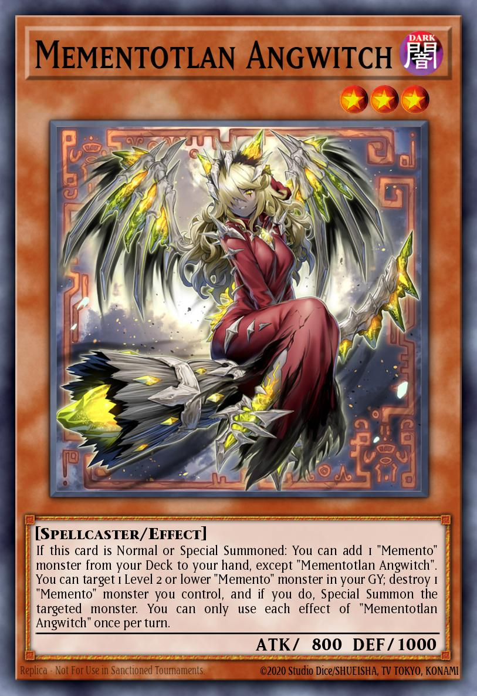 **001** | **BUSCA tras Invocación** → | 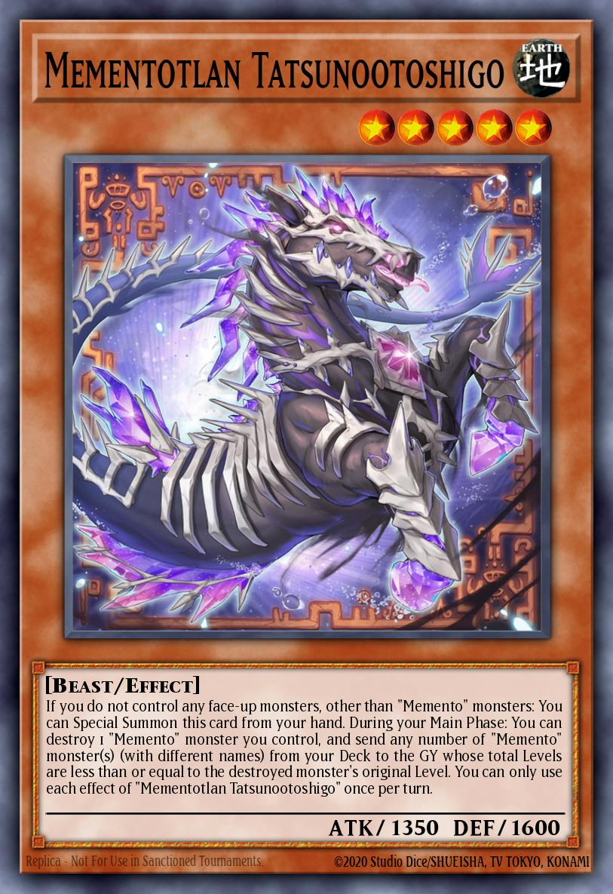 **002** | REL-M01 / C01 |
|  **002** | **ENVÍA tras autodestrucción** → | 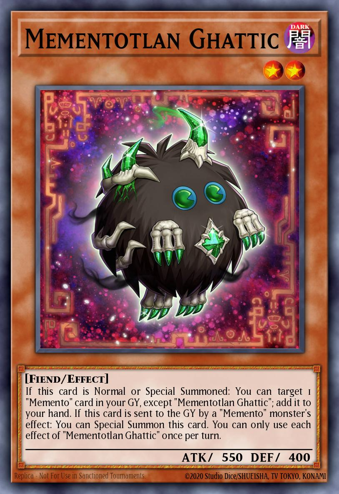 **009** | REL-M02 / C01 |
|  **009** | **RECUPERA del GY al Invocarse** → | 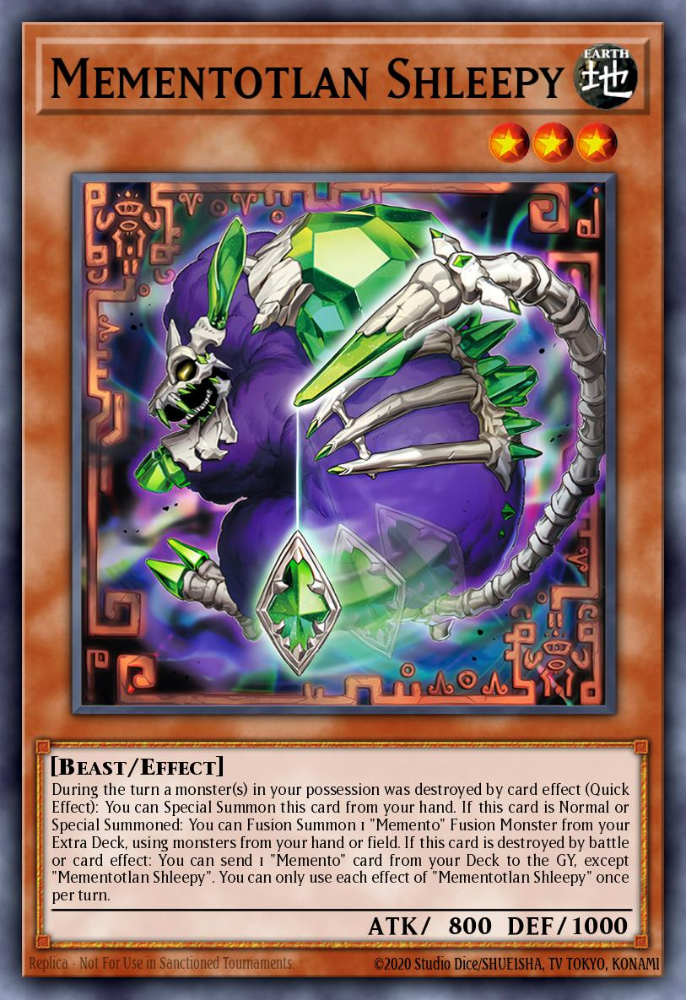 **007** | REL-M04 / C01 |
| 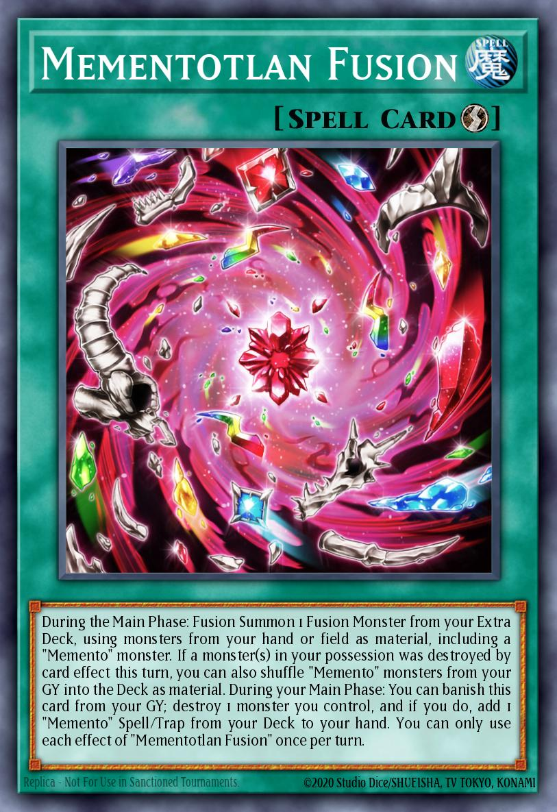 **015** | **FUSIONA tres Memento** → | 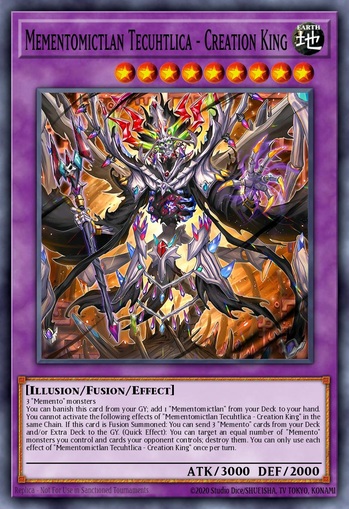 **026** | REL-M10 / C01 |
|  **026** | **ENVÍA tres cartas Memento** → | 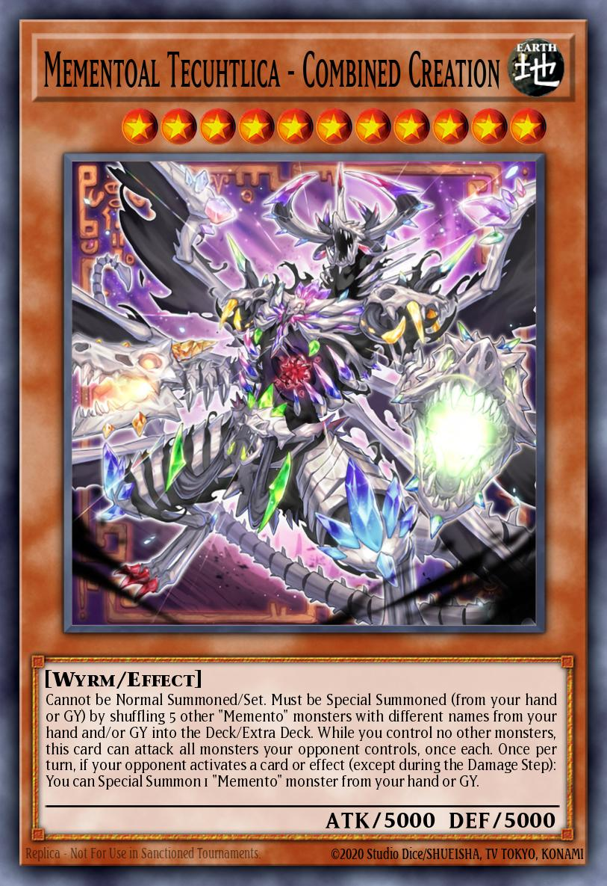 **005** | REL-M11 / C01 |
| 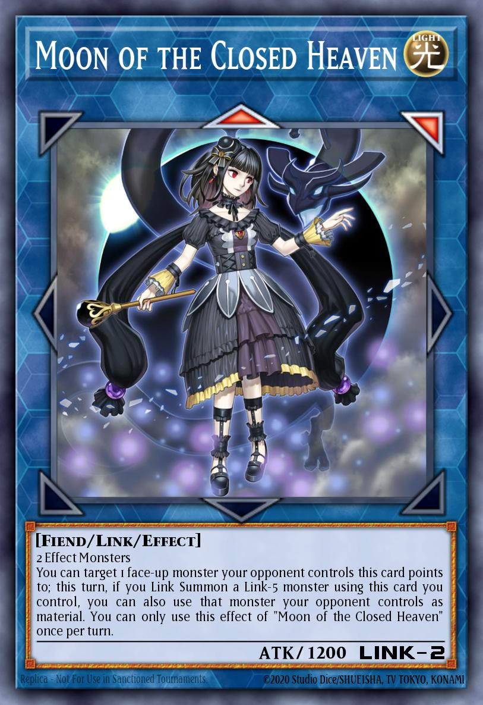 **032** | **MATERIAL Link Demonio LUZ** → |  **030** | REL-M21 / C03 |
|  **030** | **INVOCA Demoniherrero al tributar** → |  **011** | REL-M22 / C03 |
| 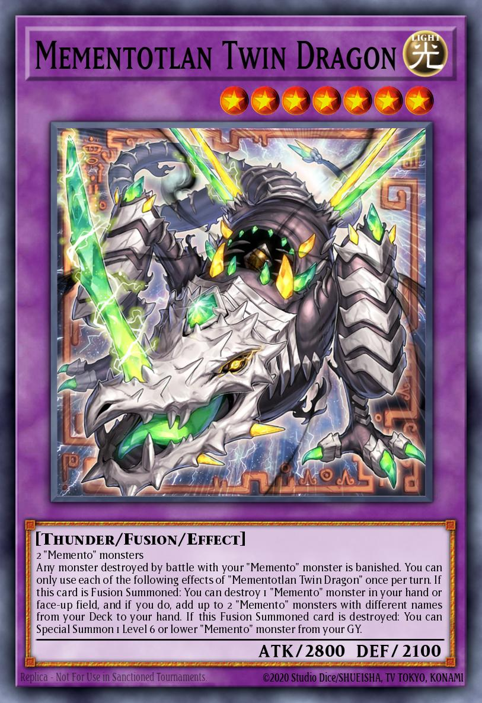 **027** | **BUSCA tras destruir Memento** → | 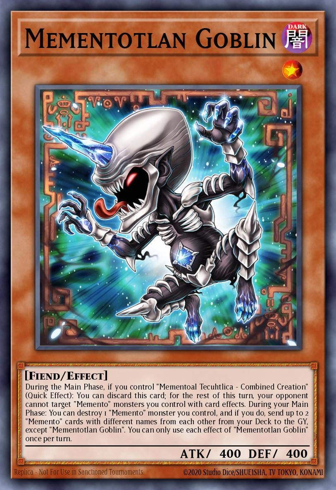 **004** | REL-M17 / C06 |
| 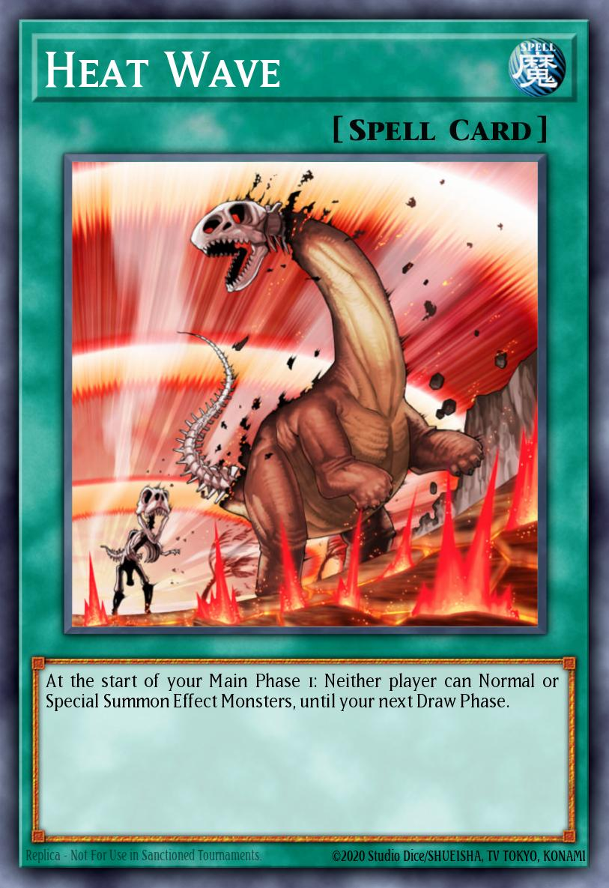 **017** | **RESTRINGE Invocación propia** → |  **001** | REL-M24 / conflicto |

### A06.6 — Cierre de trazabilidad y compatibilidad (18-11-2026)

**Cobertura:** 39/39 identidades, 70/70 copias y matriz única A06.2 con clase funcional/relación/evidencia por fila: Main 22 identidades/41 copias, Extra 13/15, Side 5/14 y Reserva 0. Fuwalos ocupa una sola identidad compartida entre Main y Side. Los 39 CID enlazan a A05 y a fichas oficiales. Cada carta tiene función causal o utilidad autónoma, sin inventar combinaciones.

**Motores:** MEMD-M1 es el motor principal de autodestrucción, envío, recuperación y Fusión Memento; MEMD-M2 es el submotor Demoniherrero subordinado (Luna, Réquiem, Grabador y salidas condicionales). MEMD-M3 es **apoyo**, no tercer motor autónomo; las handtraps no se convierten en engine por estar en Main.

**Relaciones:** 40/40 aristas REL-M01–M40 numeradas, con participantes de la matriz (cero IDs de identidad inexistentes). Las 12 rutas C01–C12 referenciadas están documentadas. REL-M38–M40 son conflictos/costes, no sinergias positivas; 40 relaciones no significan 40 combos.

**Extra 13/13:** nueve identidades tienen salidas documentales en C01–C10, tres dependen de EX-M01–M03 (Dragostapelia, TY-PHON y Aero Tiburón), y César 028 posee materiales de dos Demonios Nivel 6 **pero no una ruta reproducible completa desde mano fijada**. EX-M04 solo expresa una posibilidad condicional: si Grabador 011 y Desvantasma 009 están en campo, Goblin 004 en GY, Fusión 015 accesible y ocurrió destrucción propia por efecto ese turno, 015 puede Fusionar Duque 034 con 009 de campo + 004 de GY, conservando Grabador; **después** ambos Nivel 6 podrían emplearse en César. No presumir este estado desde C10: Secuencia baraja Grabador para Duque y así no lo deja como material de César. Estado de EX-M04: DOCUMENTADO_CONDICIONAL, SIN_RUTA_REPRODUCIBLE.

**Conflictos:** Oleada de Calor frente a Invocaciones propias; Droll frente a adiciones desde Main; Lancea frente a destierros propios durante turno rival; Goblin en mano para protección frente a Goblin gastado; TY-PHON contra continuidad y efectos propios 3000+; Gordiano contra reserva de Extra por recursos desterrados al resolver. El orden de decisión permite evitar varios de ellos.

**Diagnóstico:** COHERENTE_CON_CONFLICTOS_GESTIONABLES. Sin cambios del inventario aprobado 41/15/14/0. Las opciones marginales quedan como VALIDAR_ACCESO o ALTERNATIVA_NO_DEMOSTRADA, sin proponer sustituciones arbitrarias.

**Estado A06 vigente: COMPLETA EN SU ENTREGABLE DOCUMENTAL Y DE PRUEBAS DE PAPEL (4/4).** A06-T1/T2/T3 cubren las 39 identidades, 40 relaciones, fuentes CID y decisiones por turno; A06-T4 aporta 80 casos tipados y sus controles de conservación física y guardas condicionales. **Los casos no se elevan a `CASO_LOGICO_VERIFICADO` de todas sus reglas:** A05-T3/T4 y A07 siguen abiertos para contraste reglamentario exhaustivo; A09/A10A no se derivan de una mera arista y A10B no fue solicitado.

### A06.7 — trazabilidad por `effect_id`, zona y recurso de las 40 relaciones (revisión 21-11-2026)

**Puerta real de análisis:** la tabla A06.2 es el único inventario por carta y la tabla A06.3 conserva los 40 IDs de arista. Esta sección solo añade la trazabilidad de sus *acciones* a A05; no duplica el catálogo ni declara otra ruta Cxx. Cada vínculo apunta a un `effect_id` **que existe en el censo A05.6**, con fuente oficial por CID. Las palabras «documentado» y «condicional» **no** acreditan por sí solas transición física o test semántico completo. La dependencia A05-T3/T4 permanece abierta.

| Relación de A06.3 | Cláusula A05 responsable y fuente | Transición física/ventana/recurso que debe verificarse | Estado |
|---|---|---|---|
| REL-M01 | `671:a05:19364:on-summon-search-memento` ([CID 19364](https://www.db.yugioh-card.com/yugiohdb/card_search.action?cid=19364&ope=2&request_locale=en)) | Angbruja en MZ invocada; Tatsun en Deck → Tatsun a mano; sin coste adicional | DOCUMENTADO_CONDICIONAL |
| REL-M02 | `671:a05:19362:main-destroy-memento-send-level-total` ([CID 19362](https://www.db.yugioh-card.com/yugiohdb/card_search.action?cid=19362&ope=2&request_locale=en)) | Tatsun Nivel 5 en MZ → GY por destrucción; Desvantasma Lv2 + Dormiveja Lv3 Deck→GY | DOCUMENTADO_CONDICIONAL |
| REL-M03 | `671:a05:19362:main-destroy-memento-send-level-total` ([CID 19362](https://www.db.yugioh-card.com/yugiohdb/card_search.action?cid=19362&ope=2&request_locale=en)) | Tatsun Nivel 5 destruida, Goblin Lv1 + Maza Lv1 + Desvantasma Lv2 Deck→GY; nombres distintos | DOCUMENTADO_CONDICIONAL |
| REL-M04 | `671:a05:19472:sent-by-memento-monster-gy-special` ([CID 19472](https://www.db.yugioh-card.com/yugiohdb/card_search.action?cid=19472&ope=2&request_locale=en)); `671:a05:19472:on-summon-gy-recover` ([CID 19472](https://www.db.yugioh-card.com/yugiohdb/card_search.action?cid=19472&ope=2&request_locale=en)) | Desvantasma Deck→GY por efecto monstruo Memento, luego GY→MZ y carta Memento GY→mano | DOCUMENTADO_CONDICIONAL |
| REL-M05 | `671:a05:19364:gy-target-destroy-revive-level2` ([CID 19364](https://www.db.yugioh-card.com/yugiohdb/card_search.action?cid=19364&ope=2&request_locale=en)) | Angbruja en MZ; elegir Memento ≤Lv2 en GY; destruir Memento en MZ al resolver; objetivo GY→MZ si destruido | DOCUMENTADO_CONDICIONAL |
| REL-M06 | `671:a05:19365:main-destroy-search-memento-card` ([CID 19365](https://www.db.yugioh-card.com/yugiohdb/card_search.action?cid=19365&ope=2&request_locale=en)) | Maza en MZ; destruir Memento propio al resolver; Fusión Memento Deck→mano | DOCUMENTADO_CONDICIONAL |
| REL-M07 | `671:a05:19363:main-destroy-special-level3` ([CID 19363](https://www.db.yugioh-card.com/yugiohdb/card_search.action?cid=19363&ope=2&request_locale=en)) | Hoja Oscura MZ→GY al autodestruirse; Angbruja Lv3 Deck→MZ | DOCUMENTADO_CONDICIONAL |
| REL-M08 | `671:a05:19366:main-destroy-send-up-to-two` ([CID 19366](https://www.db.yugioh-card.com/yugiohdb/card_search.action?cid=19366&ope=2&request_locale=en)) | Goblin MZ→GY por destrucción; Fusión y Creación Combinada Deck→GY por efecto | DOCUMENTADO_CONDICIONAL |
| REL-M09 | `671:a05:19904:gy-banish-destroy-search-spelltrap` ([CID 19904](https://www.db.yugioh-card.com/yugiohdb/card_search.action?cid=19904&ope=2&request_locale=en)) | Copia A Fusión GY→destierro como coste; monstruo propio destruido en resolución; copia B Fusión Deck→mano | DOCUMENTADO_CONDICIONAL |
| REL-M10 | `671:a05:19904:quick-play-fusion` ([CID 19904](https://www.db.yugioh-card.com/yugiohdb/card_search.action?cid=19904&ope=2&request_locale=en)); `671:a05:20216:fusion-three-memento` ([CID 20216](https://www.db.yugioh-card.com/yugiohdb/card_search.action?cid=20216&ope=2&request_locale=en)) | Fusión en mano/S/T legal; tres Memento de zonas permitidas→GY o Deck; Rey Extra→MZ | DOCUMENTADO_CONDICIONAL |
| REL-M11 | `671:a05:20216:on-fusion-send-three-memento` ([CID 20216](https://www.db.yugioh-card.com/yugiohdb/card_search.action?cid=20216&ope=2&request_locale=en)) | Rey recién Fusion Invocado en MZ; tres cartas Memento Deck/Extra→GY por resolución | DOCUMENTADO_CONDICIONAL |
| REL-M12 | `671:a05:19360:special-five-distinct-names` ([CID 19360](https://www.db.yugioh-card.com/yugiohdb/card_search.action?cid=19360&ope=2&request_locale=en)) | Cinco monstruos Memento distintos de Creación Combinada en mano/GY→Deck/Extra; Creación mano/GY→MZ; sin cadena | DOCUMENTADO_CONDICIONAL |
| REL-M13 | `671:a05:19368:quick-destroy-search-or-special` ([CID 19368](https://www.db.yugioh-card.com/yugiohdb/card_search.action?cid=19368&ope=2&request_locale=en)) | Fiesta en mano/S/T; Memento de mano/MZ destruido; Tatsun de nombre distinto Deck→MZ en Defensa | DOCUMENTADO_CONDICIONAL |
| REL-M14 | `671:a05:19904:quick-play-fusion` ([CID 19904](https://www.db.yugioh-card.com/yugiohdb/card_search.action?cid=19904&ope=2&request_locale=en)); `671:a05:19878:fusion-two-memento` ([CID 19878](https://www.db.yugioh-card.com/yugiohdb/card_search.action?cid=19878&ope=2&request_locale=en)) | Dos Memento materiales reales en mano/campo (GY solo si hubo destrucción previa)→destinos; Gemelo Extra→MZ | DOCUMENTADO_CONDICIONAL |
| REL-M15 | `671:a05:19878:on-fusion-destroy-search-two` ([CID 19878](https://www.db.yugioh-card.com/yugiohdb/card_search.action?cid=19878&ope=2&request_locale=en)) | Gemelo recién Fusion Invocado; Dormiveja en mano destruida al resolver; comprobar efecto de envío por destrucción | DOCUMENTADO_CONDICIONAL |
| REL-M16 | `671:a05:20199:on-destroy-send-memento-from-deck` ([CID 20199](https://www.db.yugioh-card.com/yugiohdb/card_search.action?cid=20199&ope=2&request_locale=en)) | Dormiveja destruida por efecto (no solo enviada al GY); Maza Deck→GY en nueva cadena de disparo | DOCUMENTADO_CONDICIONAL |
| REL-M17 | `671:a05:19878:on-fusion-destroy-search-two` ([CID 19878](https://www.db.yugioh-card.com/yugiohdb/card_search.action?cid=19878&ope=2&request_locale=en)) | Gemelo activado tras Fusión; destruir Memento de mano/campo; dos Memento de nombres diferentes Deck→mano | DOCUMENTADO_CONDICIONAL |
| REL-M18 | `671:a05:19366:quick-discard-target-protection` ([CID 19366](https://www.db.yugioh-card.com/yugiohdb/card_search.action?cid=19366&ope=2&request_locale=en)) | Goblin mano→GY por descarte como coste en Main; Creación Combinada ya en MZ; protección de target hasta fin turno | DOCUMENTADO_CONDICIONAL |
| REL-M19 | `671:a05:19904:quick-play-fusion` ([CID 19904](https://www.db.yugioh-card.com/yugiohdb/card_search.action?cid=19904&ope=2&request_locale=en)); `671:a05:16845:fusion-hand-field-procedure` ([CID 16845](https://www.db.yugioh-card.com/yugiohdb/card_search.action?cid=16845&ope=2&request_locale=en)); `671:a05:16845:fusion-summon-draw-destroy` ([CID 16845](https://www.db.yugioh-card.com/yugiohdb/card_search.action?cid=16845&ope=2&request_locale=en)) | Tres materiales distintos, ≥1 mano y ≥1 campo; Quimera Extra→MZ; robo/destrucción en disparo posterior si resuelve | DOCUMENTADO_CONDICIONAL |
| REL-M20 | `671:a05:19188:link-two-effect-monsters` ([CID 19188](https://www.db.yugioh-card.com/yugiohdb/card_search.action?cid=19188&ope=2&request_locale=en)); `671:a05:19188:quick-observed-activation-temporary-banish` ([CID 19188](https://www.db.yugioh-card.com/yugiohdb/card_search.action?cid=19188&ope=2&request_locale=en)) | Dos monstruos efecto MZ→GY como material; S:P Extra→MZ; destierro temporal posterior requiere activación rival | DOCUMENTADO_CONDICIONAL |
| REL-M21 | `671:a05:19932:link-two-effect-monsters` ([CID 19932](https://www.db.yugioh-card.com/yugiohdb/card_search.action?cid=19932&ope=2&request_locale=en)); `671:a05:20225:link-one-light-fiend` ([CID 20225](https://www.db.yugioh-card.com/yugiohdb/card_search.action?cid=20225&ope=2&request_locale=en)) | Dos cuerpos de efecto→Luna Link-2 LUZ/Demonio; Luna en MZ→GY para Réquiem Link-1 desde Extra | DOCUMENTADO_CONDICIONAL |
| REL-M22 | `671:a05:20225:quick-main-tribute-fiendsmith-summon` ([CID 20225](https://www.db.yugioh-card.com/yugiohdb/card_search.action?cid=20225&ope=2&request_locale=en)); `671:a05:20225:field-gy-equip-light-fiend` ([CID 20225](https://www.db.yugioh-card.com/yugiohdb/card_search.action?cid=20225&ope=2&request_locale=en)); `671:a05:20196:target-own-equip-and-field-monster-to-gy` ([CID 20196](https://www.db.yugioh-card.com/yugiohdb/card_search.action?cid=20196&ope=2&request_locale=en)) | Réquiem MZ→GY como Sacrificio; Grabador Deck→MZ; Réquiem GY→S/T equipado; equipo + monstruo objetivo→GY | DOCUMENTADO_CONDICIONAL |
| REL-M23 | `671:a05:20533:quick-tribute-summon-goblin-from-deck` ([CID 20533](https://www.db.yugioh-card.com/yugiohdb/card_search.action?cid=20533&ope=2&request_locale=en)) | Gran Fuga en mano/S/T; tributar un monstruo propio como coste; Goblin real de Deck→MZ sin poder atacar ese turno | DOCUMENTADO_CONDICIONAL |
| REL-M24 | `671:a05:9139:opening-main1-summon-lock` ([CID 9139](https://www.db.yugioh-card.com/yugiohdb/card_search.action?cid=9139&ope=2&request_locale=en)) | Oleada de Calor legal al comienzo de Main1; prohibición para ambos de Invocar monstruos de efecto hasta próxima Draw propia | CONFLICTO_VERIFICABLE |
| REL-M25 | `671:a05:20423:send-equipped-monster-fiend-procedure` ([CID 20423](https://www.db.yugioh-card.com/yugiohdb/card_search.action?cid=20423&ope=2&request_locale=en)) | Grabador equipado con Réquiem como carta monstruo + Goblin Demonio de mano/campo→GY; Princesa Extra→MZ sin Fusionar | DOCUMENTADO_CONDICIONAL |
| REL-M26 | `671:a05:19368:quick-destroy-search-or-special` ([CID 19368](https://www.db.yugioh-card.com/yugiohdb/card_search.action?cid=19368&ope=2&request_locale=en)); `671:a05:19472:on-summon-gy-recover` ([CID 19472](https://www.db.yugioh-card.com/yugiohdb/card_search.action?cid=19472&ope=2&request_locale=en)) | Fiesta destruye Goblin en mano; Desvantasma Deck→MZ; su disparo recupera Angbruja propia GY→mano | DOCUMENTADO_CONDICIONAL |
| REL-M27 | `671:a05:20226:link-two-with-light-fiend` ([CID 20226](https://www.db.yugioh-card.com/yugiohdb/card_search.action?cid=20226&ope=2&request_locale=en)) | Grabador Demonio LUZ + Desvantasma, ambos en MZ→GY como materiales; Secuencia Extra→MZ | DOCUMENTADO_CONDICIONAL |
| REL-M28 | `671:a05:20226:main-gy-fusion` ([CID 20226](https://www.db.yugioh-card.com/yugiohdb/card_search.action?cid=20226&ope=2&request_locale=en)); `671:a05:20389:fusion-two-fiends-or-zombies` ([CID 20389](https://www.db.yugioh-card.com/yugiohdb/card_search.action?cid=20389&ope=2&request_locale=en)) | Secuencia MZ; materiales Demonio/Zombi adecuados en GY→Deck/Extra por efecto; Duque Extra→MZ | DOCUMENTADO_CONDICIONAL |
| REL-M29 | `671:a05:20389:main-immediate-normal` ([CID 20389](https://www.db.yugioh-card.com/yugiohdb/card_search.action?cid=20389&ope=2&request_locale=en)) | Duque boca arriba en MZ; al resolver efecto en Main, permite Normal adicional inmediata de Angbruja en mano a MZ | DOCUMENTADO_CONDICIONAL |
| REL-M30 | `671:a05:20533:quick-tribute-summon-goblin-from-deck` ([CID 20533](https://www.db.yugioh-card.com/yugiohdb/card_search.action?cid=20533&ope=2&request_locale=en)) | Angbruja MZ→GY Sacrificada como coste; Goblin Deck→MZ; no puede atacar ese turno | DOCUMENTADO_CONDICIONAL |
| REL-M31 | `671:a05:19361:hand-special-three-names` ([CID 19361](https://www.db.yugioh-card.com/yugiohdb/card_search.action?cid=19361&ope=2&request_locale=en)) | Tres nombres Memento diferentes físicamente en propio GY; Dragón de Cuerno mano→MZ por procedimiento sin cadena | DOCUMENTADO_CONDICIONAL |
| REL-M32 | `671:a05:19368:quick-destroy-search-or-special` ([CID 19368](https://www.db.yugioh-card.com/yugiohdb/card_search.action?cid=19368&ope=2&request_locale=en)); `671:a05:19361:destroyed-field-target-three-faceup` ([CID 19361](https://www.db.yugioh-card.com/yugiohdb/card_search.action?cid=19361&ope=2&request_locale=en)) | Fiesta destruye Dragón de Cuerno en MZ y obtiene Hoja Oscura; después Horn destruido selecciona 3 cartas boca arriba, una Memento propia | DOCUMENTADO_CONDICIONAL |
| REL-M33 | `671:a05:19904:quick-play-fusion` ([CID 19904](https://www.db.yugioh-card.com/yugiohdb/card_search.action?cid=19904&ope=2&request_locale=en)); `671:a05:12870:fusion-dark-material` ([CID 12870](https://www.db.yugioh-card.com/yugiohdb/card_search.action?cid=12870&ope=2&request_locale=en)) | Rey Fusión propio en MZ + Goblin OSCURIDAD en mano, Fusión colocada desde turno anterior; en Main rival Dragostapelia Extra→MZ | DOCUMENTADO_CONDICIONAL |
| REL-M34 | `671:a05:19184:alternative-xyz-highest-atk` ([CID 19184](https://www.db.yugioh-card.com/yugiohdb/card_search.action?cid=19184&ope=2&request_locale=en)); `671:a05:19184:continuous-3000-activation-lock` ([CID 19184](https://www.db.yugioh-card.com/yugiohdb/card_search.action?cid=19184&ope=2&request_locale=en)) | Rival invocó ≥2 desde Extra en turno actual/anterior; monstruo propio de mayor ATK→material; TY-PHON Extra→MZ, bloquea nuevas Invocaciones propias | DOCUMENTADO_CONDICIONAL |
| REL-M35 | `671:a05:19368:quick-destroy-search-or-special` ([CID 19368](https://www.db.yugioh-card.com/yugiohdb/card_search.action?cid=19368&ope=2&request_locale=en)); `671:a05:9657:xyz-two-level3` ([CID 9657](https://www.db.yugioh-card.com/yugiohdb/card_search.action?cid=9657&ope=2&request_locale=en)) | Fiesta puede conseguir otra Angbruja desde Deck; se requieren exactamente dos monstruos Nivel3 reales simultáneos en MZ para Aero Extra→MZ | DOCUMENTADO_CONDICIONAL |
| REL-M36 | `671:a05:19904:quick-play-fusion` ([CID 19904](https://www.db.yugioh-card.com/yugiohdb/card_search.action?cid=19904&ope=2&request_locale=en)); `671:a05:20389:fusion-two-fiends-or-zombies` ([CID 20389](https://www.db.yugioh-card.com/yugiohdb/card_search.action?cid=20389&ope=2&request_locale=en)) | Destrucción previa propia habilita material Memento GY; Desvantasma Demonio en MZ + Goblin Demonio en GY→Fusión Duque Extra→MZ | DOCUMENTADO_CONDICIONAL |
| REL-M37 | `671:a05:13081:xyz-2-level6-fiends` ([CID 13081](https://www.db.yugioh-card.com/yugiohdb/card_search.action?cid=13081&ope=2&request_locale=en)) | Grabador y Duque ambos Demonio Nivel6 y simultáneamente en MZ; superponer→César Xyz Extra→MZ con materiales reales | DOCUMENTADO_CONDICIONAL |
| REL-M38 | `671:a05:9279:after-opponent-main-deck-add` ([CID 9279](https://www.db.yugioh-card.com/yugiohdb/card_search.action?cid=9279&ope=2&request_locale=en)); `671:a05:20500:hand-discard-draw-opponent-deck-extra-summons` ([CID 20500](https://www.db.yugioh-card.com/yugiohdb/card_search.action?cid=20500&ope=2&request_locale=en)) | Droll resuelto impide añadir desde Main Deck, incluidos robos Mulcharmy posteriores; solo afecta tras activación legal de Droll | CONFLICTO_VERIFICABLE |
| REL-M39 | `671:a05:11243:quick-tribute-banish-lock` ([CID 11243](https://www.db.yugioh-card.com/yugiohdb/card_search.action?cid=11243&ope=2&request_locale=en)); `671:a05:13619:opponent-gy-banish-name-negate` ([CID 13619](https://www.db.yugioh-card.com/yugiohdb/card_search.action?cid=13619&ope=2&request_locale=en)) | Lancea en Side debe entrar entre duelos; en turno rival tributo→GY, prohíbe destierros; Called by colocado no puede desterrar GY rival | CONFLICTO_VERIFICABLE |
| REL-M40 | `671:a05:21203:initial-main-banish-cost-bounce` ([CID 21203](https://www.db.yugioh-card.com/yugiohdb/card_search.action?cid=21203&ope=2&request_locale=en)) | Gordiano en Side debe entrar entre duelos; al inicio de Main selecciona objetivos; al resolver destierra recursos de mano/Extra boca abajo y luego devuelve objetivos | COSTE_DE_OPORTUNIDAD |

**Rectificación reglamentaria REL-M39:** Lancea solo se activa *durante el turno del adversario*. La segunda habilidad de Fusión Mementotlán en el Cementerio requiere **tu Main Phase**; por ello **no existe el conflicto simultáneo Lancea ↔ Fusión-GY que describía la versión histórica**. Sí puede impedir que `Llamado por la Tumba` destierre un monstruo al resolver en el turno rival, si Lancea ya resolvió y ese Llamado se activa legalmente desde una carta previamente Colocada. No extender Lancea retroactivamente a acciones ya resueltas. Fuentes [Lancea CID11243](https://www.db.yugioh-card.com/yugiohdb/card_search.action?cid=11243&ope=2&request_locale=en), [Fusión CID19904](https://www.db.yugioh-card.com/yugiohdb/card_search.action?cid=19904&ope=2&request_locale=en), [Llamado CID13619](https://www.db.yugioh-card.com/yugiohdb/card_search.action?cid=13619&ope=2&request_locale=en).

**Precisión REL-M40:** Rebanador Gordiano selecciona los objetivos en la activación, y **destierra los recursos durante la resolución** antes de devolver las cartas; no se debe restar del estado antes de una hipotética negación. Es coste de oportunidad para el Extra, pero no un pago de activación comparable a descartar Goblin, tributar para Gran Fuga o desacoplar material de César. Fuente [Gordiano CID21203](https://www.db.yugioh-card.com/yugiohdb/card_search.action?cid=21203&ope=2&request_locale=en).

**Exclusiones operativas por inventario:** ninguna arista permite buscar una M/T Demoniherrero ausente, obtener protección de Polimerización que no está cargada, realizar Link-5 sin carta en Extra, aplicar reducción de Gran Fuga desde GY sin Xyz Goblin ni buscar Contrato Oscuro ausente. Un papel teórico requiere guardas y zonas reales; `SIN_COMBO_IDENTIFICADO` no significa sinergia cero.

### A06.8 — decisiones por turno, recuperación y bloqueo físico (A06-T2/T3)

**Diagnóstico de estructura (no predicción de éxito):** `COHERENTE_CON_CONFLICTOS_GESTIONABLES`. Una interacción A06 es una posibilidad con recursos y ventanas, no un resultado garantizado de A09. Si el adversario controla una negación sin identificar o faltan datos de la mano, la respuesta correcta es `INFORMACION_INSUFICIENTE`, no inventar carta o tablero. Este análisis utiliza el inventario **41 Main / 15 Extra / 14 Side / 0 Reserva**, sin agregar ni mover copias. La ficha individual de cada identidad sigue siendo A06.2 (39/39 CID).

#### A06.8a — ir primero (tus recursos concretos y cuándo detenerte)

| Estado conocido / decisión | Línea legítima de motor | Recurso y límite verificable | Si falla, no prometer |
|---|---|---|---|
| Mano con Angbruja CID19364, Tatsun CID19362 aún en Deck, Normal disponible | Normal Angbruja → activar búsqueda `671:a05:19364:on-summon-search-memento` para Tatsun | Gastas la Normal de apertura; el buscador debe resolver, y Tatsun solo se Invoca si su condición de monstruos boca arriba Memento se cumple | Con `Ash` negando búsqueda no aparece Tatsun mágicamente en mano; continuar únicamente con otros recursos físicos |
| Mano con Hoja Oscura CID19363, Angbruja en Deck | Normal Hoja, y en Main usar `671:a05:19363:main-destroy-special-level3`, destruyéndola si es legal | Hoja propia campo→GY por resolución; Angbruja Deck→MZ; su búsqueda inicia otro eslabón posterior y puede ser respondida | Sin Angbruja en Deck o con efecto usado, no asignar starter inexistente |
| Mano con Fiesta CID19368, otro Memento en mano/campo, Tatsun de nombre distinto disponible en Deck | `671:a05:19368:quick-destroy-search-or-special` convierte destrucción propia en acceso a Tatsun | Se destruye una copia existente; Tatsun sale de Deck a Defensa. El nombre buscado debe ser distinto | Sin Memento destruible o ya usado Fiesta, no suponer búsqueda |
| Mano con Fusión CID19904, suficientes materiales permitidos y al menos uno Memento | Fusión de Rey o Gemelo mediante `671:a05:19904:quick-play-fusion` | Materiales mano/campo físicos; GY **solo** si ocurrió destrucción propia por efecto en este turno. Respetar zona de Extra y OPT de Fusión | No declarar Rey si solo hay dos materiales, ni usar GY sin condición previa |
| Mano con Oleada de Calor CID9139 al inicio exacto de Main1 | Elegir plan de control temprano **en lugar** del despliegue de monstruos de efecto | `671:a05:9139:opening-main1-summon-lock` bloquea ambos jugadores hasta la propia siguiente Draw Phase | No colocar Heat Wave al final de un combo ya iniciado ni prometer simultáneamente línea Memento en ese turno |

#### A06.8b — ir segundo (interrupciones reales y coste de oportunidad)

| Estado rival observado | Decisión | Coste/ventana y resultado no garantizado |
|---|---|---|
| Monstruos de efecto boca arriba rivales y Gotas CID15299 en mano/S/T legal | Enviar otras cartas propias como coste al activar Gotas; elegir igual cantidad de monstruos rivales al resolver | No enviar a Desvantasma por Gotas y atribuir el disparo que exige envío por **efecto de monstruo Memento**; `671:a05:15299:send-other-cards-negate-monsters` |
| Tres Memento de nombres distintos entre mano/campo (≥1 cada zona), Fusión de Memento legal, Quimera CID16845 en Extra, rival controla cartas destruibles | Fusión a Quimera y comprobar el disparo `671:a05:16845:fusion-summon-draw-destroy` | Los tres materiales son reales, el número de cartas robadas depende de materiales de mano, la destrucción del número usado de campo depende de resolución; no atribuir protección de Polimerización ausente |
| Rival invocó ≥2 monstruos desde Extra en el turno correspondiente, tu campo conserva el monstruo propio de mayor ATK elegible, TY-PHON CID19184 en Extra | Considerar invocación Xyz alternativa al **final** del desarrollo propio | `671:a05:19184:alternative-xyz-highest-atk` impide tus Invocaciones posteriores del turno; bloqueo continuo de efectos de monstruos de ≥3000 ATK también afecta a tus jefes |
| Rival añadió realmente una carta del Main Deck a su mano fuera de Draw, Droll CID9279 está en tu mano | Tras la adición, responder con Droll desde mano→GY | Si resuelve, **ambos** dejan de añadir desde Main Deck ese turno; también perjudica tus búsquedas/robos si el turno o continuación lo requiere |
| Activación rival que incluye añadir, enviar desde Deck o invocar desde Deck; Ash CID12950 en mano | Responder en cadena descartando Ash como coste | No Invocar Flor de Ceniza al campo como supuesto starter del motor; el descarte ya ocurrió aunque la respuesta quede negada |

#### A06.8c — recuperación y juego medio/tardío, sin recursos duplicados

| Recurso remanente y origen | Conversión permitida | Dependencia y fallo |
|---|---|---|
| Desvantasma CID19472 en GY por envío desde efecto de monstruo Memento | Disparo propio GY→campo; al Invocarse puede recuperar otra carta Memento de GY→mano | No se dispara al ser enviada por coste de Gotas, como material de Link o por efecto de otro arquetipo |
| Fusión Mementotlán CID19904 en GY, monstruo propio destruible, M/T Memento realmente disponible en Deck, durante **tu Main** | Desterrar esta copia como coste, destruir monstruo propio al resolver y buscar M/T Memento | No activar en turno rival ni contar la propia carta desterrada como material de Fusión |
| Mementomictlán CID19367 boca arriba en Campo, End Phase propia, M/T Memento disponible en GY y zona S/T vacía | Colocar la M/T seleccionada desde GY; no activarla de inmediato sin regla legal | No inventar una carta que ya salió del GY ni asumir que M/T recién colocada es activable ese turno |
| Memento Creación Combinada CID19360 en mano/GY y cinco monstruos **otros**, de nombres distintos, en mano/GY | Barajar cinco cartas físicas, después invocar al jefe desde mano/GY | Sacrificar nombres para esta invocación disminuye recursos de continuidad; una vez presentes otros cuerpos, el jefe pierde condición de ataque múltiple |
| Grabador CID20196 en GY y otro Demonio LUZ en GY, lugar legal para Invocarlo | Barajar el otro Demonio LUZ desde GY a Deck/Extra para Invocar Grabador | No barajar una pieza que necesitas simultáneamente como material de otro acceso; se verifica disponibilidad después de pagar |
| Rey Creación CID20216 fue Invocado por Fusión, hay tres cartas Memento en Deck/Extra | Al resolver su disparo, Deck/Extra→GY de tres cartas reales | No usar su destrucción rápida en la **misma Cadena** ni contar cartas ya gastadas como si siguieran en Deck |

#### A06.8d — dependencias, conflictos, orden y respuesta al fallo

| Conflicto / cuello de botella | Decisión segura antes de activar | Efectos enlazados |
|---|---|---|
| **Normal comprometida:** Angbruja y Hoja Oscura compiten por la Normal inicial | Elegir una Normal; Duque da opción adicional **solo** si ya se tiene en Campo, su efecto se activa y resuelve | `19364:on-summon-search-memento`, `19363:main-destroy-special-level3`, `20389:main-immediate-normal` |
| **Goblin en mano vs Cementerio:** descartar protección requiere que Goblin continúe en mano mientras controlas al jefe | No enviar la última copia necesaria al GY para sumar nombres si la prioridad es proteger el campo | `19366:quick-discard-target-protection`, `19366:main-destroy-send-up-to-two` |
| **Luna→Réquiem consume el cuerpo Link:** después de usar Luna como único material de Réquiem, Luna ya no está en campo | No proponer simultáneamente ambos Links como cuerpos finales del mismo recurso | `19932:link-two-effect-monsters`, `20225:link-one-light-fiend` |
| **Equipo Réquiem vs Princesa vs Grabador:** Réquiem equipado no puede contarse a la vez como material de Princesa y como equipo que envía Grabador | Elegir una sola rama con destino físico y estado posterior específico | `20225:field-gy-equip-light-fiend`, `20423:send-equipped-monster-fiend-procedure`, `20196:target-own-equip-and-field-monster-to-gy` |
| **Droll tras adición rival:** prohíbe buscar/robar desde Main Deck a ambos | Si ya resolvió, no ofrecer una búsqueda propia posteriormente en ese turno | `9279:after-opponent-main-deck-add` |
| **Lancea vs turnos:** Lancea desde Side solo tras intercambio y solo se activa durante turno rival | No simular bloqueo simultáneo sobre la segunda habilidad de Fusión en GY, que exige tu propia Main | `11243:quick-tribute-banish-lock`, `19904:gy-banish-destroy-search-spelltrap` |
| **TY-PHON vs monstruos de 3000+ y continuación:** su restricción es bilateral; invocación alternativa cierra tus invocaciones del turno | Resolver líneas que todavía necesitan invocar **antes** de considerar TY-PHON; no prometer uso de efecto rápido de Rey bajo el bloqueo | `19184:alternative-xyz-highest-atk`, `19184:continuous-3000-activation-lock` |
| **Side y Extra:** cartas en Side no están en mano del primer duelo; cartas en Extra no son robables | Registrar intercambio efectivo entre duelos antes de proponer Purulia, Meowls, Lancea o Gordiano desde la mano | `20206:hand-discard-draw-opponent-hand-summons`, `20764:hand-discard-draw-opponent-gy-banish-summons`, `11243:quick-tribute-banish-lock`, `21203:initial-main-banish-cost-bounce` |

**Recuperación tras interrupción real:** si Ash niega la búsqueda de Angbruja, no existen las cartas que nunca entraron en mano. Una Fiesta todavía en mano podría ofrecer otra acción **solo** con Memento destruible y otro nombre disponible del Deck; si no los hay, clasificar `SIN_CONTINUACION_DEMOSTRADA`. Si la Fusión fue negada, no hay jefe Invocado por esa Fusión y no se activa su disparo; sí deben respetarse los pagos y acciones previas verdaderamente ocurridos. Si Grabador no puede equiparse con Réquiem por falta de zona o objetivo, no enviar monstruo rival al GY por su efecto. Estas son reglas de fallo cerrado y no partidas simuladas.

**A06-T3:** las decisiones de primero/segundo, continuidad, juego medio/tardío y recuperación quedan explicadas con condiciones, sin pretender probar todavía cada transición en estado tipado. La aceptación final depende de reconciliación A05/A07 y de los casos físicos A06.9.

### A06.9 — casos de papel de las 40 relaciones y 16 controles físicos dirigidos (A06-T4)

**Cobertura de diseño, no de legalidad certificada:** la siguiente matriz asigna **40 parejas de casos** a las 40 relaciones REL-M01–M40 (80 casos candidatos) y las vincula explícitamente con sus efectos A05 y la documentación A07/A08/A09 existente. Un caso «negativo» aquí significa que **no debe presentarse el resultado de la sinergia**: puede deberse a activación ilegal, a coste/recursos ausentes o a una activación inicialmente legal cuya resolución fue negada o perdió el objetivo. Esas situaciones no deben confundirse en la futura especificación tipada.

**Campos comunes obligatorios:** `deck_id=671`, `format=tcg_advanced`, zonas reales `hand/deck/gy/field/extra/side`, `turn`, `phase`, `window/chain`, copias conocidas/desconocidas, efectos gastados, `state_before`, `effect_id`, `action`, `expected_costs`, `expected_events/state_after`, `reason`, `status`. En el inventario real Side no habilita una acción de Main sin cambio entre duelos; no añadir el Side como si fuera mano inicial. **Los 80 casos siguientes son borradores, no archivos JSON tipados ni pruebas de motor A10B.**

| Dos `case_id` propuestos | Relación y `effect_id` atribuido | Positivo: `state_before` + acción/recurso físico | Negativo: guarda falsa, interrupción o fallo esperado | Continuidad y estado |
|---|---|---|---|---|
| `671:A06:M01:P` / `671:A06:M01:N` | M01 / `671:a05:19364:on-summon-search-memento` | **Positivo condicionado**: Angbruja en MZ invocada; Tatsun en Deck → Tatsun a mano; sin coste adicional; precondición Angbruja **Invocada** añade Tatsun del Deck. | **Negativo / resolución fallida:** Se niega búsqueda o ya no queda Tatsun; no ejecutar resultados no acreditados ni devolver costes reales ya pagados. | C01,C03–C08; A05.6→A07→A08/A09; `CONDICIONAL_SIN_ESTADO_TIPADO` |
| `671:A06:M02:P` / `671:A06:M02:N` | M02 / `671:a05:19362:main-destroy-memento-send-level-total` | **Positivo condicionado**: Tatsun Nivel 5 en MZ → GY por destrucción; Desvantasma Lv2 + Dormiveja Lv3 Deck→GY; precondición Tatsun destruye **a sí misma Nivel 5** y envía **2+3=5**. | **Negativo / resolución fallida:** Falta objetivo que destruir o uno de los nombres en Deck; no ejecutar resultados no acreditados ni devolver costes reales ya pagados. | C01,C06,C07; A05.6→A07→A08/A09; `CONDICIONAL_SIN_ESTADO_TIPADO` |
| `671:A06:M03:P` / `671:A06:M03:N` | M03 / `671:a05:19362:main-destroy-memento-send-level-total` | **Positivo condicionado**: Tatsun Nivel 5 destruida, Goblin Lv1 + Maza Lv1 + Desvantasma Lv2 Deck→GY; nombres distintos; precondición Envío de **1+1+2=4** nombres distintos. | **Negativo / resolución fallida:** Ya se agotó alguno en Deck o efecto de Tatsun; no ejecutar resultados no acreditados ni devolver costes reales ya pagados. | C02,C04,C05; A05.6→A07→A08/A09; `CONDICIONAL_SIN_ESTADO_TIPADO` |
| `671:A06:M04:P` / `671:A06:M04:N` | M04 / `671:a05:19472:sent-by-memento-monster-gy-special`, `671:a05:19472:on-summon-gy-recover` | **Positivo condicionado**: Desvantasma Deck→GY por efecto monstruo Memento, luego GY→MZ y carta Memento GY→mano; precondición Desvantasma enviada por **efecto de monstruo Memento** se Invoca y **recupera una carta Memento del GY**. | **Negativo / resolución fallida:** La enviaron por coste/otra familia o no hay objetivo de recuperación; no ejecutar resultados no acreditados ni devolver costes reales ya pagados. | C01,C04–C07; A05.6→A07→A08/A09; `CONDICIONAL_SIN_ESTADO_TIPADO` |
| `671:A06:M05:P` / `671:A06:M05:N` | M05 / `671:a05:19364:gy-target-destroy-revive-level2` | **Positivo condicionado**: Angbruja en MZ; elegir Memento ≤Lv2 en GY; destruir Memento en MZ al resolver; objetivo GY→MZ si destruido; precondición Segundo efecto de Angbruja **selecciona Lv≤2 en GY**, destruye Memento propio e Invoca el seleccionado. | **Negativo / resolución fallida:** Falta objetivo de Nivel bajo o no se destruye el Memento; no ejecutar resultados no acreditados ni devolver costes reales ya pagados. | C04,C05; A05.6→A07→A08/A09; `CONDICIONAL_SIN_ESTADO_TIPADO` |
| `671:A06:M06:P` / `671:A06:M06:N` | M06 / `671:a05:19365:main-destroy-search-memento-card` | **Positivo condicionado**: Maza en MZ; destruir Memento propio al resolver; Fusión Memento Deck→mano; precondición Maza en tu Main **destruye monstruo Memento propio** (puede ser Maza) y **busca una carta Memento**. | **Negativo / resolución fallida:** No controla Memento destruible o no queda Fusión; no ejecutar resultados no acreditados ni devolver costes reales ya pagados. | C04; A05.6→A07→A08/A09; `CONDICIONAL_SIN_ESTADO_TIPADO` |
| `671:A06:M07:P` / `671:A06:M07:N` | M07 / `671:a05:19363:main-destroy-special-level3` | **Positivo condicionado**: Hoja Oscura MZ→GY al autodestruirse; Angbruja Lv3 Deck→MZ; precondición Hoja Oscura se **destruye** y trae Angbruja **Nivel 3** desde Deck. | **Negativo / resolución fallida:** Sin Angbruja en Deck; efecto negado; no ejecutar resultados no acreditados ni devolver costes reales ya pagados. | C05; A05.6→A07→A08/A09; `CONDICIONAL_SIN_ESTADO_TIPADO` |
| `671:A06:M08:P` / `671:A06:M08:N` | M08 / `671:a05:19366:main-destroy-send-up-to-two` | **Positivo condicionado**: Goblin MZ→GY por destrucción; Fusión y Creación Combinada Deck→GY por efecto; precondición Goblin se destruye y manda **dos cartas Memento de distinto nombre** desde Deck a GY, una Mágica y un jefe. | **Negativo / resolución fallida:** Sin objetivos en Deck o activación negada; no ejecutar resultados no acreditados ni devolver costes reales ya pagados. | C05; A05.6→A07→A08/A09; `CONDICIONAL_SIN_ESTADO_TIPADO` |
| `671:A06:M09:P` / `671:A06:M09:N` | M09 / `671:a05:19904:gy-banish-destroy-search-spelltrap` | **Positivo condicionado**: Copia A Fusión GY→destierro como coste; monstruo propio destruido en resolución; copia B Fusión Deck→mano; precondición Una Fusión en GY **se destierra**, destruye Memento propio y **busca otra Fusión**. | **Negativo / resolución fallida:** Sin monstruo propio destruible o sin otra copia en Deck; no ejecutar resultados no acreditados ni devolver costes reales ya pagados. | C05; A05.6→A07→A08/A09; `CONDICIONAL_SIN_ESTADO_TIPADO` |
| `671:A06:M10:P` / `671:A06:M10:N` | M10 / `671:a05:19904:quick-play-fusion`, `671:a05:20216:fusion-three-memento` | **Positivo condicionado**: Fusión en mano/S/T legal; tres Memento de zonas permitidas→GY o Deck; Rey Extra→MZ; precondición Fusión con **tres Memento** de mano/campo, y del GY si hubo destrucción por efecto. | **Negativo / resolución fallida:** Tres materiales no disponibles o ya usado primer efecto; no ejecutar resultados no acreditados ni devolver costes reales ya pagados. | C01,C04,C05; A05.6→A07→A08/A09; `CONDICIONAL_SIN_ESTADO_TIPADO` |
| `671:A06:M11:P` / `671:A06:M11:N` | M11 / `671:a05:20216:on-fusion-send-three-memento` | **Positivo condicionado**: Rey recién Fusion Invocado en MZ; tres cartas Memento Deck/Extra→GY por resolución; precondición Rey **Invocado por Fusión** manda tres cartas Memento del Deck/Extra al GY. | **Negativo / resolución fallida:** Rey no fue Invocado por Fusión o se niega efecto; no ejecutar resultados no acreditados ni devolver costes reales ya pagados. | C01,C04,C05; A05.6→A07→A08/A09; `CONDICIONAL_SIN_ESTADO_TIPADO` |
| `671:A06:M12:P` / `671:A06:M12:N` | M12 / `671:a05:19360:special-five-distinct-names` | **Positivo condicionado**: Cinco monstruos Memento distintos de Creación Combinada en mano/GY→Deck/Extra; Creación mano/GY→MZ; sin cadena; precondición Barajar cinco **otros** monstruos Memento de nombres diferentes en mano/GY habilita jefe 5000. | **Negativo / resolución fallida:** Se cuentan repetidos, cartas fuera de zona o al propio 005; no ejecutar resultados no acreditados ni devolver costes reales ya pagados. | C01,C02,C04–C06; A05.6→A07→A08/A09; `CONDICIONAL_SIN_ESTADO_TIPADO` |
| `671:A06:M13:P` / `671:A06:M13:N` | M13 / `671:a05:19368:quick-destroy-search-or-special` | **Positivo condicionado**: Fiesta en mano/S/T; Memento de mano/MZ destruido; Tatsun de nombre distinto Deck→MZ en Defensa; precondición Fiesta destruye un Memento y **Invoca Tatsun en Defensa** de distinto nombre. | **Negativo / resolución fallida:** No hay Memento propio en mano/campo para destruir; no ejecutar resultados no acreditados ni devolver costes reales ya pagados. | C02; A05.6→A07→A08/A09; `CONDICIONAL_SIN_ESTADO_TIPADO` |
| `671:A06:M14:P` / `671:A06:M14:N` | M14 / `671:a05:19904:quick-play-fusion`, `671:a05:19878:fusion-two-memento` | **Positivo condicionado**: Dos Memento materiales reales en mano/campo (GY solo si hubo destrucción previa)→destinos; Gemelo Extra→MZ; precondición Dos Memento se usan como material para **Dragón Gemelo**. | **Negativo / resolución fallida:** Faltan ambos materiales reales; no ejecutar resultados no acreditados ni devolver costes reales ya pagados. | C06; A05.6→A07→A08/A09; `CONDICIONAL_SIN_ESTADO_TIPADO` |
| `671:A06:M15:P` / `671:A06:M15:N` | M15 / `671:a05:19878:on-fusion-destroy-search-two` | **Positivo condicionado**: Gemelo recién Fusion Invocado; Dormiveja en mano destruida al resolver; comprobar efecto de envío por destrucción; precondición Dragón Gemelo **Fusion Invocado** destruye Dormiveja **desde mano**. | **Negativo / resolución fallida:** No hay monstruo Memento destruible en mano/campo; no ejecutar resultados no acreditados ni devolver costes reales ya pagados. | C06; A05.6→A07→A08/A09; `CONDICIONAL_SIN_ESTADO_TIPADO` |
| `671:A06:M16:P` / `671:A06:M16:N` | M16 / `671:a05:20199:on-destroy-send-memento-from-deck` | **Positivo condicionado**: Dormiveja destruida por efecto (no solo enviada al GY); Maza Deck→GY en nueva cadena de disparo; precondición Dormiveja destruida por efecto envía **Maza** del Deck a GY. | **Negativo / resolución fallida:** Maza no está en Deck o el efecto ya se usó; no ejecutar resultados no acreditados ni devolver costes reales ya pagados. | C06; A05.6→A07→A08/A09; `CONDICIONAL_SIN_ESTADO_TIPADO` |
| `671:A06:M17:P` / `671:A06:M17:N` | M17 / `671:a05:19878:on-fusion-destroy-search-two` | **Positivo condicionado**: Gemelo activado tras Fusión; destruir Memento de mano/campo; dos Memento de nombres diferentes Deck→mano; precondición Tras destruir Dormiveja, Gemelo **añade dos monstruos Memento distintos** de Deck a mano. | **Negativo / resolución fallida:** No hay ningún Memento elegible o el efecto fue negado; con uno elegible se añade uno, no se exige tener dos; no ejecutar resultados no acreditados ni devolver costes reales ya pagados. | C06; A05.6→A07→A08/A09; `CONDICIONAL_SIN_ESTADO_TIPADO` |
| `671:A06:M18:P` / `671:A06:M18:N` | M18 / `671:a05:19366:quick-discard-target-protection` | **Positivo condicionado**: Goblin mano→GY por descarte como coste en Main; Creación Combinada ya en MZ; protección de target hasta fin turno; precondición Con jefe en campo, Goblin **desde mano** puede descartarse durante Main para impedir selección de Mementos ese turno. | **Negativo / resolución fallida:** Goblin no está en mano o no controlas Creación Combinada; **no** se exige una selección rival previa para activar protección; no ejecutar resultados no acreditados ni devolver costes reales ya pagados. | C06; A05.6→A07→A08/A09; `CONDICIONAL_SIN_ESTADO_TIPADO` |
| `671:A06:M19:P` / `671:A06:M19:N` | M19 / `671:a05:19904:quick-play-fusion`, `671:a05:16845:fusion-hand-field-procedure`, `671:a05:16845:fusion-summon-draw-destroy` | **Positivo condicionado**: Tres materiales distintos, ≥1 mano y ≥1 campo; Quimera Extra→MZ; robo/destrucción en disparo posterior si resuelve; precondición Dos Memento de campo + uno de mano de **nombres distintos** Fusionan Quimera; **roba 1, destruye hasta 2 rivales** según resolución. | **Negativo / resolución fallida:** No existen materiales legales en mano y Campo de tres nombres; **menos de dos cartas rivales no hace ilegal la Fusión**; no ejecutar resultados no acreditados ni devolver costes reales ya pagados. | C07; A05.6→A07→A08/A09; `CONDICIONAL_SIN_ESTADO_TIPADO` |
| `671:A06:M20:P` / `671:A06:M20:N` | M20 / `671:a05:19188:link-two-effect-monsters`, `671:a05:19188:quick-observed-activation-temporary-banish` | **Positivo condicionado**: Dos monstruos efecto MZ→GY como material; S:P Extra→MZ; destierro temporal posterior requiere activación rival; precondición Dos monstruos de efecto del Main invocan S:P; **solo su respuesta posterior** de destierro tiene ventana en este caso. | **Negativo / resolución fallida:** No se activa carta/efecto rival o falta segundo objetivo boca arriba; no ejecutar resultados no acreditados ni devolver costes reales ya pagados. | C08; A05.6→A07→A08/A09; `CONDICIONAL_SIN_ESTADO_TIPADO` |
| `671:A06:M21:P` / `671:A06:M21:N` | M21 / `671:a05:19932:link-two-effect-monsters`, `671:a05:20225:link-one-light-fiend` | **Positivo condicionado**: Dos cuerpos de efecto→Luna Link-2 LUZ/Demonio; Luna en MZ→GY para Réquiem Link-1 desde Extra; precondición Dos cuerpos dan Luna **Demonio/LUZ Link-2**, material legal para Réquiem Link-1. | **Negativo / resolución fallida:** Falta cuerpo, cambian tipos/atributos o extra restringido; no ejecutar resultados no acreditados ni devolver costes reales ya pagados. | C03; A05.6→A07→A08/A09; `CONDICIONAL_SIN_ESTADO_TIPADO` |
| `671:A06:M22:P` / `671:A06:M22:N` | M22 / `671:a05:20225:quick-main-tribute-fiendsmith-summon`, `671:a05:20225:field-gy-equip-light-fiend`, `671:a05:20196:target-own-equip-and-field-monster-to-gy` | **Positivo condicionado**: Réquiem MZ→GY como Sacrificio; Grabador Deck→MZ; Réquiem GY→S/T equipado; equipo + monstruo objetivo→GY; precondición Réquiem se tributa para traer Grabador, luego se equipa; Grabador manda **equipo + monstruo rival** al GY. | **Negativo / resolución fallida:** Grabador fuera de mano/Deck, equipo/objetivo indisponible; no ejecutar resultados no acreditados ni devolver costes reales ya pagados. | C03; A05.6→A07→A08/A09; `CONDICIONAL_SIN_ESTADO_TIPADO` |
| `671:A06:M23:P` / `671:A06:M23:N` | M23 / `671:a05:20533:quick-tribute-summon-goblin-from-deck` | **Positivo condicionado**: Gran Fuga en mano/S/T; tributar un monstruo propio como coste; Goblin real de Deck→MZ sin poder atacar ese turno; precondición Gran Fuga **sacrifica un monstruo** para Invocar Goblin desde Deck, **sin atacar** este turno. | **Negativo / resolución fallida:** Sin monstruo para Sacrificar o sin Goblin en Deck; no ejecutar resultados no acreditados ni devolver costes reales ya pagados. | I04, interacción; A05.6→A07→A08/A09; `CONDICIONAL_SIN_ESTADO_TIPADO` |
| `671:A06:M24:P` / `671:A06:M24:N` | M24 / `671:a05:9139:opening-main1-summon-lock` | **Positivo condicionado**: Oleada de Calor legal al comienzo de Main1; prohibición para ambos de Invocar monstruos de efecto hasta próxima Draw propia; precondición Heat Wave bloquea Invocaciones de monstruos de efecto **también propias** hasta tu próxima Draw. | **Negativo / resolución fallida:** Se intenta hacer C01–C12 después de Heat Wave en ese intervalo; no ejecutar resultados no acreditados ni devolver costes reales ya pagados. | I05, conflicto; A05.6→A07→A08/A09; `CONDICIONAL_SIN_ESTADO_TIPADO` |
| `671:A06:M25:P` / `671:A06:M25:N` | M25 / `671:a05:20423:send-equipped-monster-fiend-procedure` | **Positivo condicionado**: Grabador equipado con Réquiem como carta monstruo + Goblin Demonio de mano/campo→GY; Princesa Extra→MZ sin Fusionar; precondición Grabador con Réquiem **equipado como Carta de Monstruo** y Goblin (Demonio de mano) son enviados para el procedimiento especial de Princesa. | **Negativo / resolución fallida:** No queda Goblin/Demonio adicional o Réquiem no está equipado; no ejecutar resultados no acreditados ni devolver costes reales ya pagados. | C09; A05.6→A07→A08/A09; `CONDICIONAL_SIN_ESTADO_TIPADO` |
| `671:A06:M26:P` / `671:A06:M26:N` | M26 / `671:a05:19368:quick-destroy-search-or-special`, `671:a05:19472:on-summon-gy-recover` | **Positivo condicionado**: Fiesta destruye Goblin en mano; Desvantasma Deck→MZ; su disparo recupera Angbruja propia GY→mano; precondición Fiesta destruye Goblin de mano, Especial Desvantasma de otro nombre; Desvantasma **Invocada** recupera Angbruja del GY. | **Negativo / resolución fallida:** No hay 009 en Deck o Angbruja ya no está en GY; no ejecutar resultados no acreditados ni devolver costes reales ya pagados. | C10; A05.6→A07→A08/A09; `CONDICIONAL_SIN_ESTADO_TIPADO` |
| `671:A06:M27:P` / `671:A06:M27:N` | M27 / `671:a05:20226:link-two-with-light-fiend` | **Positivo condicionado**: Grabador Demonio LUZ + Desvantasma, ambos en MZ→GY como materiales; Secuencia Extra→MZ; precondición Grabador es **Demonio LUZ** y satisface material obligatorio de Secuencia; Desvantasma aporta segundo cuerpo. | **Negativo / resolución fallida:** Falta cualquiera de los dos en campo; no ejecutar resultados no acreditados ni devolver costes reales ya pagados. | C10; A05.6→A07→A08/A09; `CONDICIONAL_SIN_ESTADO_TIPADO` |
| `671:A06:M28:P` / `671:A06:M28:N` | M28 / `671:a05:20226:main-gy-fusion`, `671:a05:20389:fusion-two-fiends-or-zombies` | **Positivo condicionado**: Secuencia MZ; materiales Demonio/Zombi adecuados en GY→Deck/Extra por efecto; Duque Extra→MZ; precondición Secuencia fusiona Duque **barajando dos Demonios desde GY**; no exige M/T Demoniherrero. | **Negativo / resolución fallida:** Grabador o Goblin no está en GY, o Duque no está en Extra; no ejecutar resultados no acreditados ni devolver costes reales ya pagados. | C10; A05.6→A07→A08/A09; `CONDICIONAL_SIN_ESTADO_TIPADO` |
| `671:A06:M29:P` / `671:A06:M29:N` | M29 / `671:a05:20389:main-immediate-normal` | **Positivo condicionado**: Duque boca arriba en MZ; al resolver efecto en Main, permite Normal adicional inmediata de Angbruja en mano a MZ; precondición Duque Invocado permite Normal adicional inmediatamente tras resolver su efecto; Witch recuperada en mano. | **Negativo / resolución fallida:** No hay monstruo en mano o el efecto de Duque se niega; no ejecutar resultados no acreditados ni devolver costes reales ya pagados. | C10; A05.6→A07→A08/A09; `CONDICIONAL_SIN_ESTADO_TIPADO` |
| `671:A06:M30:P` / `671:A06:M30:N` | M30 / `671:a05:20533:quick-tribute-summon-goblin-from-deck` | **Positivo condicionado**: Angbruja MZ→GY Sacrificada como coste; Goblin Deck→MZ; no puede atacar ese turno; precondición Gran Fuga **Sacrifica como coste** Angbruja y trae Goblin, que luego es material Fusión. | **Negativo / resolución fallida:** Falta Goblin en Deck o carta para Sacrificar; no ejecutar resultados no acreditados ni devolver costes reales ya pagados. | C11; A05.6→A07→A08/A09; `CONDICIONAL_SIN_ESTADO_TIPADO` |
| `671:A06:M31:P` / `671:A06:M31:N` | M31 / `671:a05:19361:hand-special-three-names` | **Positivo condicionado**: Tres nombres Memento diferentes físicamente en propio GY; Dragón de Cuerno mano→MZ por procedimiento sin cadena; precondición Tres o más nombres Memento distintos en GY habilitan especial de Dragón de Cuerno desde mano. | **Negativo / resolución fallida:** No se llegan a reunir tres nombres distintos; no ejecutar resultados no acreditados ni devolver costes reales ya pagados. | C12; A05.6→A07→A08/A09; `CONDICIONAL_SIN_ESTADO_TIPADO` |
| `671:A06:M32:P` / `671:A06:M32:N` | M32 / `671:a05:19368:quick-destroy-search-or-special`, `671:a05:19361:destroyed-field-target-three-faceup` | **Positivo condicionado**: Fiesta destruye Dragón de Cuerno en MZ y obtiene Hoja Oscura; después Horn destruido selecciona 3 cartas boca arriba, una Memento propia; precondición Fiesta destruye Dragón de Cuerno y Especial Hoja; Horn destruido selecciona **tres boca arriba**, incluida Angbruja propia y dos rivales. | **Negativo / resolución fallida:** Si Dragón de Cuerno no fue destruido por efecto en el Campo, su disparo no existe. Contar también la Hoja Oscura Invocada por Fiesta antes de afirmar que faltan tres cartas boca arriba; no ejecutar resultados no acreditados ni devolver costes reales ya pagados. | C12; A05.6→A07→A08/A09; `CONDICIONAL_SIN_ESTADO_TIPADO` |
| `671:A06:M33:P` / `671:A06:M33:N` | M33 / `671:a05:19904:quick-play-fusion`, `671:a05:12870:fusion-dark-material` | **Positivo condicionado**: Rey Fusión propio en MZ + Goblin OSCURIDAD en mano, Fusión colocada desde turno anterior; en Main rival Dragostapelia Extra→MZ; precondición Al turno rival siguiente, Fusión rápida usa Rey del campo + Goblin de mano para Dragostapelia. | **Negativo / resolución fallida:** No hay segunda Fusión previamente colocada o uno de los materiales desapareció; no ejecutar resultados no acreditados ni devolver costes reales ya pagados. | EX-M01; A05.6→A07→A08/A09; `CONDICIONAL_SIN_ESTADO_TIPADO` |
| `671:A06:M34:P` / `671:A06:M34:N` | M34 / `671:a05:19184:alternative-xyz-highest-atk`, `671:a05:19184:continuous-3000-activation-lock` | **Positivo condicionado**: Rival invocó ≥2 desde Extra en turno actual/anterior; monstruo propio de mayor ATK→material; TY-PHON Extra→MZ, bloquea nuevas Invocaciones propias; precondición S:P como único monstruo propio es el de mayor ATK; sobre ella se superpone TY-PHON **solo tras 2+ monstruos Invocados especialmente desde Extra por rival en turno elegible**. | **Negativo / resolución fallida:** Rival no cumplió condición o no tienes monstruo propio válido; no ejecutar resultados no acreditados ni devolver costes reales ya pagados. | EX-M02; A05.6→A07→A08/A09; `CONDICIONAL_SIN_ESTADO_TIPADO` |
| `671:A06:M35:P` / `671:A06:M35:N` | M35 / `671:a05:19368:quick-destroy-search-or-special`, `671:a05:9657:xyz-two-level3` | **Positivo condicionado**: Fiesta puede conseguir otra Angbruja desde Deck; se requieren exactamente dos monstruos Nivel3 reales simultáneos en MZ para Aero Extra→MZ; precondición Fiesta trae segunda Angbruja del Deck; Dormiveja se Especial desde mano tras destrucción; **dos Angbruja Nivel 3** forman Aero. | **Negativo / resolución fallida:** Falta otra Angbruja del Deck, no existe Memento en mano para destruir o no hay dos Nivel 3 simultáneos; Dormiveja no es requisito; no ejecutar resultados no acreditados ni devolver costes reales ya pagados. | EX-M03; A05.6→A07→A08/A09; `CONDICIONAL_SIN_ESTADO_TIPADO` |
| `671:A06:M36:P` / `671:A06:M36:N` | M36 / `671:a05:19904:quick-play-fusion`, `671:a05:20389:fusion-two-fiends-or-zombies` | **Positivo condicionado**: Destrucción previa propia habilita material Memento GY; Desvantasma Demonio en MZ + Goblin Demonio en GY→Fusión Duque Extra→MZ; precondición Destrucción de Goblin en posesión habilita barajarlo desde GY como segundo Demonio material para Duque. | **Negativo / resolución fallida:** No se destruyó monstruo propio por efecto ese turno o falta material; no ejecutar resultados no acreditados ni devolver costes reales ya pagados. | EX-M04; A05.6→A07→A08/A09; `CONDICIONAL_SIN_ESTADO_TIPADO` |
| `671:A06:M37:P` / `671:A06:M37:N` | M37 / `671:a05:13081:xyz-2-level6-fiends` | **Positivo condicionado**: Grabador y Duque ambos Demonio Nivel6 y simultáneamente en MZ; superponer→César Xyz Extra→MZ con materiales reales; precondición Grabador y Duque son dos Demonios de Nivel 6 que cumplen el material de César. | **Negativo / resolución fallida:** Solo Grabador o solo Duque está en Campo, o un material fue consumido; no se cumple el requisito de dos Demonios Nivel 6; no ejecutar resultados no acreditados ni devolver costes reales ya pagados. | EX-M04, acceso condicional; A05.6→A07→A08/A09; `CONDICIONAL_SIN_ESTADO_TIPADO` |
| `671:A06:M38:P` / `671:A06:M38:N` | M38 / `671:a05:9279:after-opponent-main-deck-add`, `671:a05:20500:hand-discard-draw-opponent-deck-extra-summons` | **Positivo condicionado**: Droll resuelto impide añadir desde Main Deck, incluidos robos Mulcharmy posteriores; solo afecta tras activación legal de Droll; precondición Droll que ya resolvió impide nuevas **adiciones desde Main Deck**, incluidas las robadas por Multivadoras. | **Negativo / resolución fallida:** Pretender robar mediante Mulcharmy bajo Droll vigente; no ejecutar resultados no acreditados ni devolver costes reales ya pagados. | A08, conflicto; A05.6→A07→A08/A09; `CONDICIONAL_SIN_ESTADO_TIPADO` |
| `671:A06:M39:P` / `671:A06:M39:N` | M39 / `671:a05:11243:quick-tribute-banish-lock`, `671:a05:13619:opponent-gy-banish-name-negate` | **Positivo condicionado**: Lancea en Side debe entrar entre duelos; en turno rival tributo→GY, prohíbe destierros; Called by colocado no puede desterrar GY rival; precondición Lancea resuelta impide destierros a ambos durante ese turno y puede obstaculizar Llamado por la Tumba desde M/T colocada. **No** bloquea simultáneamente Fusión-GY: esta se activa únicamente en tu Main. | **Negativo / resolución fallida:** Se intenta desterrar durante la prohibición de Lancea; no ejecutar resultados no acreditados ni devolver costes reales ya pagados. | A08, conflicto; A05.6→A07→A08/A09; `CONDICIONAL_SIN_ESTADO_TIPADO` |
| `671:A06:M40:P` / `671:A06:M40:N` | M40 / `671:a05:21203:initial-main-banish-cost-bounce` | **Positivo condicionado**: Gordiano debe entrar desde Side entre duelos; al inicio de Main selecciona objetivos y, **al resolver**, destierra seis cartas de Extra boca abajo o una de mano por objetivo, antes de devolverlos; no es coste al activar. | **Negativo / resolución fallida:** Gastas materiales clave del Extra o no tienes coste por objetivo; no ejecutar resultados no acreditados ni devolver costes reales ya pagados. | A08, coste táctico; A05.6→A07→A08/A09; `CONDICIONAL_SIN_ESTADO_TIPADO` |

#### Controles adversarios y de estado físico detallados (16 ejemplos, no familias nuevas)

#### 671:A06:S01 — S01 · Starter por Angbruja

- **Enlaces:** REL-M01; 671:a05:19364:on-summon-search-memento; C01/C04; A07 ventana de disparo. **Fuentes:** URLs oficiales de los CID atribuidos en A06.7 y A05.6; ver las restricciones del apartado A07.
- **`state_before` conocido:** Propio turno 1/Main1, Mano: Angbruja CID19364; Deck: al menos un Tatsun CID19362; MZ vacía, Normal no gastada, efecto Angbruja no usado, cadena libre.
- **`action`, `expected_costs` y ventana:** Normal Angbruja mano→MZ; en nueva cadena activa búsqueda sin coste adicional: Deck Tatsun→mano solo al resolver.
- **`expected_events/state_after` (si resuelve):** Angbruja en MZ, Tatsun en mano; Normal gastada; no inventar Invocación especial de Tatsun hasta usar su propio efecto.
- **Contraejemplo / efecto inválido, fallido o bloqueado:** Angbruja ya usó su efecto o Tatsun está fuera del Deck: no hay búsqueda; Ash rival podría negar resolución sin anular la Invocación ya consumada.
- **`known_vs_unknown=conditional`; `status=CONDICIONAL_PENDIENTE_DE_VALIDACION`.** No ejecutar en calculadora ni calificar como jugada reproducible sin certificar las copias y el estado físico completo.

#### 671:A06:S02 — S02 · Tatsun destruye y alimenta GY

- **Enlaces:** REL-M02/M04; 671:a05:19362:main-destroy-memento-send-level-total; C01; A07 cadena/trigger. **Fuentes:** URLs oficiales de los CID atribuidos en A06.7 y A05.6; ver las restricciones del apartado A07.
- **`state_before` conocido:** Propio Main; Tatsun CID19362 Lv5 boca arriba en tu MZ; Deck contiene Desvantasma CID19472 Lv2 y Dormiveja CID20199 Lv3, nombres diferentes.
- **`action`, `expected_costs` y ventana:** Activar `19362:main-destroy-memento-send-level-total` sin descartar; al resolver destruir Tatsun (MZ→GY) y mandar Desvantasma+Dormiveja del Deck→GY, suma Lv5.
- **`expected_events/state_after` (si resuelve):** Desvantasma fue enviada por efecto de monstruo Memento, por lo que podrá disparar su efecto desde GY; Dormiveja no se Invoca automáticamente desde GY.
- **Contraejemplo / efecto inválido, fallido o bloqueado:** Tatsun no está en MZ, efecto ya usado o solo hay niveles cuyo total excede el Nivel original destruido: no atribuir esos envíos.
- **`known_vs_unknown=conditional`; `status=CONDICIONAL_PENDIENTE_DE_VALIDACION`.** No ejecutar en calculadora ni calificar como jugada reproducible sin certificar las copias y el estado físico completo.

#### 671:A06:S03 — S03 · Desvantasma y fuente causal del envío

- **Enlaces:** REL-M04; 671:a05:19472:sent-by-memento-monster-gy-special + on-summon-gy-recover; A07. **Fuentes:** URLs oficiales de los CID atribuidos en A06.7 y A05.6; ver las restricciones del apartado A07.
- **`state_before` conocido:** Desvantasma CID19472 en Deck, Memento Tatsun CID19362 en MZ propia; propia Main y efecto disponible; GY propio contiene carta Memento diferente.
- **`action`, `expected_costs` y ventana:** Tatsun envía Desvantasma por efecto; después, si dispara y resuelve, Desvantasma GY→MZ; si la Invocación sucede, recuperar otra carta Memento del GY.
- **`expected_events/state_after` (si resuelve):** No reutilizar el mismo Desvantasma que acabó en MZ como si permaneciera en GY; registrar uso de ambos efectos distintos.
- **Contraejemplo / efecto inválido, fallido o bloqueado:** Si Desvantasma fue enviada al GY por coste de Gotas Prohibidas, no activar el disparo que exige efecto de monstruo Memento.
- **`known_vs_unknown=conditional`; `status=CONDICIONAL_PENDIENTE_DE_VALIDACION`.** No ejecutar en calculadora ni calificar como jugada reproducible sin certificar las copias y el estado físico completo.

#### 671:A06:S04 — S04 · Fusión usando Memento desde Cementerio

- **Enlaces:** REL-M10/M11; 671:a05:19904:quick-play-fusion; 671:a05:20216:on-fusion-send-three-memento; C01. **Fuentes:** URLs oficiales de los CID atribuidos en A06.7 y A05.6; ver las restricciones del apartado A07.
- **`state_before` conocido:** Propio Main, Fusión CID19904 en mano; Angbruja CID19364 en MZ; Goblin CID19366 y Tatsun CID19362 en propio GY; consta destrucción previa de monstruo propio por efecto ese turno; Rey CID20216 en Extra.
- **`action`, `expected_costs` y ventana:** Activar Fusión en ventana legal, escoger materiales válidos incluyendo al menos un Memento; si el texto permite GY por destrucción previa, devolver Goblin y Tatsun desde GY a Deck y usar Angbruja desde MZ en resolución.
- **`expected_events/state_after` (si resuelve):** Rey Extra→MZ solo al completar Fusión; las cartas de GY retornadas no siguen disponibles allí; si Rey se invocó por Fusión podrá activar envío de 3 cartas Memento en nueva cadena.
- **Contraejemplo / efecto inválido, fallido o bloqueado:** Sin la destrucción previa de monstruo propio por efecto ese turno, no usar materiales de GY aunque estén allí; sin 3 materiales Memento no hay Rey.
- **`known_vs_unknown=conditional`; `status=CONDICIONAL_PENDIENTE_DE_VALIDACION`.** No ejecutar en calculadora ni calificar como jugada reproducible sin certificar las copias y el estado físico completo.

#### 671:A06:S05 — S05 · Creación Combinada exige cinco nombres distintos

- **Enlaces:** REL-M12; 671:a05:19360:special-five-distinct-names; C01/C02. **Fuentes:** URLs oficiales de los CID atribuidos en A06.7 y A05.6; ver las restricciones del apartado A07.
- **`state_before` conocido:** Propio Main, Creación Combinada CID19360 en GY; GY contiene Angbruja CID19364, Tatsun CID19362, Hoja Oscura CID19363, Maza CID19365 y Goblin CID19366, una copia de cada nombre, MZ propia disponible.
- **`action`, `expected_costs` y ventana:** Procedimiento sin cadena: barajar esas cinco copias desde GY al Deck; después Invocar físicamente la copia de Creación Combinada GY→MZ.
- **`expected_events/state_after` (si resuelve):** Los cinco nombres ya no permanecen en GY; si se controla cualquier otro monstruo, no atribuir al jefe la condición de atacar a todos los monstruos rivales una vez.
- **Contraejemplo / efecto inválido, fallido o bloqueado:** Solo cuatro nombres diferentes o se intenta contar la propia Creación Combinada entre los cinco: procedimiento inválido; no activar como efecto encadenable.
- **`known_vs_unknown=conditional`; `status=CONDICIONAL_PENDIENTE_DE_VALIDACION`.** No ejecutar en calculadora ni calificar como jugada reproducible sin certificar las copias y el estado físico completo.

#### 671:A06:S06 — S06 · Puente Luna-Réquiem-Grabador

- **Enlaces:** REL-M21/M22; 671:a05:19932:link-two-effect-monsters; 671:a05:20225:quick-main-tribute-fiendsmith-summon; C03. **Fuentes:** URLs oficiales de los CID atribuidos en A06.7 y A05.6; ver las restricciones del apartado A07.
- **`state_before` conocido:** Propio Main con Angbruja CID19364 y Tatsun CID19362 como cuerpos de efecto en MZ; Luna CID19932, Réquiem CID20225 en Extra; Grabador CID20196 en Deck; no se usó la Invocación especial de Réquiem por nombre este turno.
- **`action`, `expected_costs` y ventana:** Usar ambos cuerpos para Link-2 Luna; luego usar la Luna LUZ/Demonio que está en MZ como único material de Réquiem Link-1. Durante Main, Réquiem puede Sacrificarse para Invocar Grabador del Deck.
- **`expected_events/state_after` (si resuelve):** Tras tributar Réquiem está en GY, no en campo; Luna fue material y está en GY. El posible equipamiento de Réquiem a Grabador es una activación distinta, con zona S/T válida.
- **Contraejemplo / efecto inválido, fallido o bloqueado:** Si Réquiem fue Invocado Especialmente previamente por nombre este turno o Luna ya no está disponible, no hacer el Link-1; si no hay Grabador en Deck o mano, no prometer la invocación.
- **`known_vs_unknown=conditional`; `status=CONDICIONAL_PENDIENTE_DE_VALIDACION`.** No ejecutar en calculadora ni calificar como jugada reproducible sin certificar las copias y el estado físico completo.

#### 671:A06:S07 — S07 · Equipo destinado a retirar o a Princesa, no ambos

- **Enlaces:** REL-M22/M25; 671:a05:20196:target-own-equip-and-field-monster-to-gy; 671:a05:20423:send-equipped-monster-fiend-procedure; C03/C09. **Fuentes:** URLs oficiales de los CID atribuidos en A06.7 y A05.6; ver las restricciones del apartado A07.
- **`state_before` conocido:** Propio Main, Grabador CID20196 en MZ propia, Réquiem CID20225 legalmente equipado desde GY en S/T propia, rival controla un monstruo real; Princesa CID20423 en Extra y un Goblin CID19366 en mano.
- **`action`, `expected_costs` y ventana:** Elegir exactamente una rama: (a) activar Grabador para seleccionar el Equipo Fiendsmith propio y monstruo del campo, enviar ambos a GY al resolver; o (b) utilizar la pareja equipo-monstruo con otro Demonio requerido para el procedimiento de Princesa.
- **`expected_events/state_after` (si resuelve):** No declarar simultáneamente a Réquiem como carta equipada consumida para dos destinos. Registrar el recurso físico según una sola rama.
- **Contraejemplo / efecto inválido, fallido o bloqueado:** Sin equipo Réquiem unido a Grabador, no se satisface ni el target de equipo ni el requisito de Princesa; sin monstruo rival no atribuir removal rival a Grabador.
- **`known_vs_unknown=conditional`; `status=CONDICIONAL_PENDIENTE_DE_VALIDACION`.** No ejecutar en calculadora ni calificar como jugada reproducible sin certificar las copias y el estado físico completo.

#### 671:A06:S08 — S08 · Secuencia→Duque ocupa materiales del GY

- **Enlaces:** REL-M27/M28/M29/M37; 671:a05:20226:main-gy-fusion; 671:a05:20389:main-immediate-normal; C10. **Fuentes:** URLs oficiales de los CID atribuidos en A06.7 y A05.6; ver las restricciones del apartado A07.
- **`state_before` conocido:** Propio Main; Secuencia CID20226 boca arriba propia en MZ, Grabador CID20196 y Goblin CID19366 como Demonios en tu GY, Duque CID20389 en Extra y zona válida.
- **`action`, `expected_costs` y ventana:** Activar efecto de Secuencia; al resolver barajar esos dos materiales Demonio desde GY al Deck para Fusionar a Duque en Extra→MZ.
- **`expected_events/state_after` (si resuelve):** Grabador y Goblin dejan de estar en GY; Duque en Campo puede permitir una Normal adicional con su efecto independiente.
- **Contraejemplo / efecto inválido, fallido o bloqueado:** Si Grabador es utilizado como material de esta Fusión y se devolvió al Deck, no estará simultáneamente en Campo como material de César; sin Demonios válidos no Fusionar.
- **`known_vs_unknown=conditional`; `status=CONDICIONAL_PENDIENTE_DE_VALIDACION`.** No ejecutar en calculadora ni calificar como jugada reproducible sin certificar las copias y el estado físico completo.

#### 671:A06:S09 — S09 · Quimera depende de materiales mano y Campo

- **Enlaces:** REL-M19; 671:a05:16845:fusion-hand-field-procedure + fusion-summon-draw-destroy; C07. **Fuentes:** URLs oficiales de los CID atribuidos en A06.7 y A05.6; ver las restricciones del apartado A07.
- **`state_before` conocido:** Propio Main, Fusión CID19904 legalmente activable; Goblin CID19366 en mano, Angbruja CID19364 y Tatsun CID19362 en Campo, tres nombres distintos; Quimera CID16845 en Extra; rival controla dos cartas destruibles.
- **`action`, `expected_costs` y ventana:** Invocar por Fusión a Quimera usando Goblin de mano y Angbruja+Tatsun de Campo; disparo de Quimera (Invocada con Mágica) puede robar 1 y destruir 2 si condiciones de resolución completas.
- **`expected_events/state_after` (si resuelve):** Quimera Extra→MZ; materiales a destinos reglamentarios; no asumir protección por Polimerización que no está en la lista.
- **Contraejemplo / efecto inválido, fallido o bloqueado:** Si los tres materiales son solo de Campo o solo de mano, no se cumple la Fusión; si no existe posibilidad legal de robo/destrucción, no garantizar ese efecto.
- **`known_vs_unknown=conditional`; `status=CONDICIONAL_PENDIENTE_DE_VALIDACION`.** No ejecutar en calculadora ni calificar como jugada reproducible sin certificar las copias y el estado físico completo.

#### 671:A06:S10 — S10 · Heat Wave y el bloqueo de apertura

- **Enlaces:** REL-M24; 671:a05:9139:opening-main1-summon-lock; A08 decisión de control. **Fuentes:** URLs oficiales de los CID atribuidos en A06.7 y A05.6; ver las restricciones del apartado A07.
- **`state_before` conocido:** Turno propio, exactamente inicio de Main1 sin otra acción iniciada; Oleada de Calor CID9139 en mano; nadie ha invocado monstruos de efecto este turno bajo la restricción.
- **`action`, `expected_costs` y ventana:** Activar Oleada de Calor como Mágica Normal al principio de Main1 y, si resuelve, aplicar bloqueo bilateral de Invocaciones Normal/Especial de monstruos de efecto hasta la siguiente Draw Phase propia.
- **`expected_events/state_after` (si resuelve):** No proponer después de Heat Wave el inicio de C01–C12 que dependa de Invocar monstruos de efecto en esa ventana.
- **Contraejemplo / efecto inválido, fallido o bloqueado:** Si ya se activó otro efecto de Main o ya no es el comienzo de Main1, no se puede activar Heat Wave; tampoco atribuir bloqueo a carta negada.
- **`known_vs_unknown=conditional`; `status=CONDICIONAL_PENDIENTE_DE_VALIDACION`.** No ejecutar en calculadora ni calificar como jugada reproducible sin certificar las copias y el estado físico completo.

#### 671:A06:S11 — S11 · TY-PHON exige evento del rival y cierra tus Invocaciones

- **Enlaces:** REL-M34; 671:a05:19184:alternative-xyz-highest-atk + continuous-3000-activation-lock; EX-M02. **Fuentes:** URLs oficiales de los CID atribuidos en A06.7 y A05.6; ver las restricciones del apartado A07.
- **`state_before` conocido:** Turno propio, rival invocó al menos dos monstruos desde Extra en turno actual o anterior; controlas un monstruo propio de máximo ATK válido para usar como material; TY-PHON CID19184 en Extra.
- **`action`, `expected_costs` y ventana:** Procedimiento Xyz alternativo, usar el cuerpo propio de mayor ATK como material para Invocar TY-PHON; después quedan prohibidas más Invocaciones Normal/Especial propias por el turno.
- **`expected_events/state_after` (si resuelve):** Los efectos activados de monstruos con 3000+ ATK quedan restringidos para ambos jugadores mientras TY-PHON Xyz Invocado esté en Campo.
- **Contraejemplo / efecto inválido, fallido o bloqueado:** Si rival solo Invocó uno del Extra, no invocar alternativamente. Si aún debes Invocar Rey/Creación Combinada este turno, TY-PHON no puede situarse antes de esa continuación.
- **`known_vs_unknown=conditional`; `status=CONDICIONAL_PENDIENTE_DE_VALIDACION`.** No ejecutar en calculadora ni calificar como jugada reproducible sin certificar las copias y el estado físico completo.

#### 671:A06:S12 — S12 · Lancea y Fusión-GY no comparten turno

- **Enlaces:** REL-M39; 671:a05:11243:quick-tribute-banish-lock; 671:a05:19904:gy-banish-destroy-search-spelltrap; A08 Side. **Fuentes:** URLs oficiales de los CID atribuidos en A06.7 y A05.6; ver las restricciones del apartado A07.
- **`state_before` conocido:** Tras intercambio Side autorizado Lancea CID11243 está en mano en turno rival; rival pretende desterrar cartas. Llamado CID13619 propio está Colocado legalmente desde turno anterior.
- **`action`, `expected_costs` y ventana:** Sacrificar Lancea de mano→GY como coste durante turno rival; si resuelve, ningún jugador destierra cartas durante ese turno; Llamado propio ya no podrá desterrar su objetivo rival cuando se resuelva bajo ese bloqueo.
- **`expected_events/state_after` (si resuelve):** La segunda habilidad de Fusión CID19904 en GY no puede activarse en el turno rival porque exige tu Main; no inventar un choque simultáneo Lancea/Fusión-GY.
- **Contraejemplo / efecto inválido, fallido o bloqueado:** En propio turno no activar el efecto rápido de Lancea; si no se hizo intercambio entre duelos, Lancea sigue en Side y no está en tu mano.
- **`known_vs_unknown=conditional`; `status=CONDICIONAL_PENDIENTE_DE_VALIDACION`.** No ejecutar en calculadora ni calificar como jugada reproducible sin certificar las copias y el estado físico completo.

#### 671:A06:S13 — S13 · Droll limita tus búsquedas si sigue vigente

- **Enlaces:** REL-M38; 671:a05:9279:after-opponent-main-deck-add; A07 ventanas. **Fuentes:** URLs oficiales de los CID atribuidos en A06.7 y A05.6; ver las restricciones del apartado A07.
- **`state_before` conocido:** Turno activo tras evento observado: rival añadió carta del Main Deck a mano fuera de Draw; tienes Droll CID9279 en mano y no hay efecto negador conocido.
- **`action`, `expected_costs` y ventana:** Enviar Droll de mano→GY para activar la prohibición; si resuelve, ambos jugadores no pueden añadir desde Main Deck a mano por el resto de ese turno.
- **`expected_events/state_after` (si resuelve):** No proponer ni búsqueda de Angbruja ni robo condicionado de Fuwalos si su resultado consiste en añadir del Main Deck durante ese turno.
- **Contraejemplo / efecto inválido, fallido o bloqueado:** Si lo único ocurrido fue una búsqueda negada, no hubo adición real que dispare Droll; no usar una adición supuesta por inferencia.
- **`known_vs_unknown=conditional`; `status=CONDICIONAL_PENDIENTE_DE_VALIDACION`.** No ejecutar en calculadora ni calificar como jugada reproducible sin certificar las copias y el estado físico completo.

#### 671:A06:S14 — S14 · Gran Fuga paga Sacrificio por Goblin

- **Enlaces:** REL-M23/M30; 671:a05:20533:quick-tribute-summon-goblin-from-deck; C11. **Fuentes:** URLs oficiales de los CID atribuidos en A06.7 y A05.6; ver las restricciones del apartado A07.
- **`state_before` conocido:** Propio Main, Gran Fuga CID20533 en mano; Angbruja CID19364 en MZ propia y Goblin CID19366 aún en Deck con zona libre.
- **`action`, `expected_costs` y ventana:** Activar Gran Fuga Sacrificando Angbruja como coste (MZ→GY), y si resuelve Invocar Goblin del Deck; Goblin no podrá atacar este turno.
- **`expected_events/state_after` (si resuelve):** Si rival niega Gran Fuga, el Sacrificio real ya se pagó y Goblin permanece en Deck. No confundir segundo efecto de Gran Fuga con Xyz Goblin ausente.
- **Contraejemplo / efecto inválido, fallido o bloqueado:** Sin monstruo propio tributable o Goblin en Deck no proponer este acceso; no traer un Goblin del Extra que no está cargado.
- **`known_vs_unknown=conditional`; `status=CONDICIONAL_PENDIENTE_DE_VALIDACION`.** No ejecutar en calculadora ni calificar como jugada reproducible sin certificar las copias y el estado físico completo.

#### 671:A06:S15 — S15 · Protección Goblin solo desde mano con jefe

- **Enlaces:** REL-M18; 671:a05:19366:quick-discard-target-protection; C06. **Fuentes:** URLs oficiales de los CID atribuidos en A06.7 y A05.6; ver las restricciones del apartado A07.
- **`state_before` conocido:** Main propia o rival, controlas Creación Combinada CID19360 en MZ, Goblin CID19366 en tu mano, su efecto de protección no utilizado.
- **`action`, `expected_costs` y ventana:** Descartar Goblin de mano→GY como coste del efecto rápido; si resuelve, tus monstruos Memento no pueden ser seleccionados por efectos rivales el resto del turno.
- **`expected_events/state_after` (si resuelve):** El descarte no Invoca a Goblin ni constituye negación universal; la protección solo afecta a selección por efectos.
- **Contraejemplo / efecto inválido, fallido o bloqueado:** Si Goblin ya fue enviado a GY como uno de cinco nombres antes de activar, no se puede usar este efecto desde mano.
- **`known_vs_unknown=conditional`; `status=CONDICIONAL_PENDIENTE_DE_VALIDACION`.** No ejecutar en calculadora ni calificar como jugada reproducible sin certificar las copias y el estado físico completo.

#### 671:A06:S16 — S16 · Gordiano consume Extra solo al resolver

- **Enlaces:** REL-M40; 671:a05:21203:initial-main-banish-cost-bounce; A08 Side. **Fuentes:** URLs oficiales de los CID atribuidos en A06.7 y A05.6; ver las restricciones del apartado A07.
- **`state_before` conocido:** Después de Side autorizado, Gordiano CID21203 en mano propia; exactamente inicio de Main1/2; rival controla 1 carta boca arriba; propia mano tiene otra carta para desterrar, Extra contiene 15 cartas.
- **`action`, `expected_costs` y ventana:** Activar Gordiano seleccionando 1 carta boca arriba; al resolver desterrar 1 carta de mano (o 6 del Extra) boca abajo, después devolver objetivo a su destino correcto.
- **`expected_events/state_after` (si resuelve):** No contabilizar un pago de activación antes de la resolución ni prometer la permanencia de 15 cartas en Extra si se optó por desterrar seis.
- **Contraejemplo / efecto inválido, fallido o bloqueado:** Si ya transcurrieron acciones en Main, no activar Gordiano; si sigue en Side sin intercambio real, no representarlo en mano.
- **`known_vs_unknown=conditional`; `status=CONDICIONAL_PENDIENTE_DE_VALIDACION`.** No ejecutar en calculadora ni calificar como jugada reproducible sin certificar las copias y el estado físico completo.

**Clasificación sin atajos:** para Flor de Ceniza, Droll, Fuwalos, Gotas, Talento, Llamado y las cartas exclusivas de Side sin continuación A09 acreditada utilizar `SIN_COMBO_IDENTIFICADO` cuando corresponda, **no** `CERO_SINERGIA_DEMOSTRADA`. Para César sin materiales simultáneos, Link-5 ausente, M/T Demoniherrero ausente, Xyz Goblin ausente y protección de Polimerización ausente usar `SIN_RUTA_REPRODUCIBLE`, `NO_APLICA` o `INCOMPATIBLE_ACTUAL` con la condición concreta. No convertir las relaciones M38–M40 en combos.

**A06-T4, puerta documental cerrada:** las 40 parejas se representan con estado físico declarado y movimiento de copias auditable en A06.12 y se amplían con los eventos de A06.13/A06.14. **La validación de legalidad independiente** (`CASO_LOGICO_VERIFICADO`, targeting exacto, negaciones y efectos persistentes) **no se infiere** de la consistencia física; pertenece a A05/A07 y se conserva pendiente. No regenerar inventario ni crear combos a partir de conexiones.

### A06.10 — acta técnica de corte A06, sin certificar jugadas

**Preflight:** el usuario asignó expresamente solo Memento 671, `tcg_advanced`, inventario cargado y preservado 41 Main / 15 Extra / 14 Side / 0 Reserva (39 CID). No se ha analizado ningún otro deck ni ejecutado A10B.

**Evidencia de auditoría de A06:** [GitHub Actions #44961756098](https://github.com/senior23enginer-coder/gpt-yugioh-promps-platform/actions/runs/44961756098), exitosa: `physicalIdentities=39`, `relations=40`, `attributedEffectLinks=58`, `paperPositiveCandidates=40`, `paperNegativeCandidates=40`, `conditionalPhysicalScenarios=16`; 0 transiciones físicas certificadas. El auditor `scripts/audit-deck-a06-synergies.cjs` exige Main/Extra/Side reales, iguala las filas A06.2 al inventario, enlaza cada REL-M01–M40 con A05.6 y su CID oficial y evita estados falsamente verificados. Las relaciones condicionales se documentan sin creación de cartas ni rutas.

**Checklist A06:** T1 [x], T2 [x], T3 [x], T4 [x] por documentación, trazabilidad y casos de papel con consistencia física auditada (**4/4 = 100 % del entregable A06**). Esta aceptación **no** equivale a 100 % de legalidad ni a pruebas de calculadora. A05-T3/T4 y A07 permanecen sin certificar; no hacer merge ni despliegue por este cierre.

**Evidencia adicional de la segunda pasada A06-T4:** después de la auditoría A06.10 se añadieron A06.11–A06.14. El nuevo auditor de estado de papel pasa 40 relaciones, 80 casos, 126 transiciones de zona y 7 movimientos expresamente catalogados como costes previos. Los negativos que solo invalidan **una relación específica** mantienen `expected_legal=null` en vez de declarar ilegal un efecto que podría tener otra opción. Las restricciones temporales e información desconocida se registran sin inventar CID o Field Zones. Este cierre se limita a A06-T4 como **producción de casos de papel**; la certificación semántica completa de A05/A07 sigue en estado abierto.

### A06.11 — control de errores semánticos en casos y aristas (revisión adicional)

**Se corrigieron 5 falsos bloqueos de reglas y de modelado físico** en las aristas M17, M18, M19, M37 y M40, y sus casos negativos equivalentes. Los casos A06-T4 deben distinguir «no se puede activar», «se activó legalmente pero fue negado» y «se resolvió parcialmente con menos recursos»; estos tres desenlaces no son intercambiables.

| Relación | Evidencia y condición que cambió | Caso positivo/negativo correcto |
|---|---|---|
| REL-M17 | Dragón Gemelo busca **hasta 2**, no exige 2; [Konami CID19878](https://www.db.yugioh-card.com/yugiohdb/card_search.action?cid=19878&ope=2&request_locale=en) | Con un solo nombre legal en Deck se puede buscar uno; un caso de «no existen dos» no es un negativo correcto |
| REL-M18 | Protección de Goblin no espera a que el rival seleccione; [Konami CID19366](https://www.db.yugioh-card.com/yugiohdb/card_search.action?cid=19366&ope=2&request_locale=en) | Puede descartarse anticipadamente en Main con jefe propio; negativo cuando está en GY o falta el jefe |
| REL-M19 | Quimera requiere tres nombres y materiales desde mano y Campo; no requiere exactamente dos cartas rivales; [Konami CID16845](https://www.db.yugioh-card.com/yugiohdb/card_search.action?cid=16845&ope=2&request_locale=en) | La Invocación por Fusión se determina por materiales, y la destrucción por objetivos disponibles según resultado; no confundir ambas |
| REL-M37 | César exige dos Demonios de Nivel 6 **simultáneos**, no basta con nombrar a Grabador y Duque; [Konami CID13081](https://www.db.yugioh-card.com/yugiohdb/card_search.action?cid=13081&ope=2&request_locale=en) | Negativo si uno fue barajado como material para fusionar a Duque |
| REL-M40 | Gordiano destierra mano/Extra **durante resolución**, no al declarar activación; [Konami CID21203](https://www.db.yugioh-card.com/yugiohdb/card_search.action?cid=21203&ope=2&request_locale=en) | Selección en activación, destierro y devolución en resolución; su consumo de Extra es coste estratégico, no pago en activación |

**Resultado:** correcciones de razonamiento documental, no cierre automático de A06-T4. Faltan estados completos de copia, zona, ventana, cadena y postcondiciones para los 40 pares. No alterar el inventario original.

### A06.12 — matriz física de papel (40 pares declarativos)

Cada fila es una pareja de escenarios (`671:A06:Mxx:P/N`) con jugador activo, fase, copias físicas conocidas al inicio, movimientos de coste previo, movimientos al resolver, condición que invalida el escenario negativo y evento necesario. Las fuentes `effect_id` y los CID permanecen en A06.7. Abreviaturas: H mano; D Deck; G Cementerio; M zona monstruos; S M/T; E Extra; B desterrado; X material Xyz; O* oponente. El sufijo `#` distingue dos copias del mismo CID. **Estos datos no afirman posiciones espaciales exactas ni legalidad completa**; se verifican en un modelo tipado, sin ejecutar la calculadora.

~~~text
M01|self|main1|M:19364,D:19362|-|D:19362>H:19362|drop:D:19362|angwitch_summoned
M02|self|main1|M:19362,D:19472,D:20199|-|M:19362>G:19362;D:19472>G:19472;D:20199>G:20199|drop:M:19362|main_open
M03|self|main1|M:19362,D:19366,D:19365,D:19472|-|M:19362>G:19362;D:19366>G:19366;D:19365>G:19365;D:19472>G:19472|drop:M:19362|main_open
M04|self|main1|M:19362,D:19472,G:20199|-|M:19362>G:19362;D:19472>G:19472;G:19472>M:19472;G:20199>H:20199|drop:D:19472|sent_by_memento_monster
M05|self|main1|M:19364,G:19366|-|M:19364>G:19364;G:19366>M:19366|drop:G:19366|main_open
M06|self|main1|M:19365,D:19904|-|M:19365>G:19365;D:19904>H:19904|drop:D:19904|main_open
M07|self|main1|M:19363,D:19364|-|M:19363>G:19363;D:19364>M:19364|drop:D:19364|main_open
M08|self|main1|M:19366,D:19904,D:19360|-|M:19366>G:19366;D:19904>G:19904;D:19360>G:19360|drop:M:19366|main_open
M09|self|main1|G:19904#a,M:19364,D:19904#b|G:19904#a>B:19904#a|M:19364>G:19364;D:19904#b>H:19904#b|drop:G:19904#a|main_open
M10|self|main1|H:19904,M:19364,M:19362,H:19365,E:20216|-|H:19904>G:19904;M:19364>G:19364;M:19362>G:19362;H:19365>G:19365;E:20216>M:20216|drop:E:20216|legal_fusion_materials
M11|self|main1|M:20216,D:19360,D:19365,D:19366|-|D:19360>G:19360;D:19365>G:19365;D:19366>G:19366|event:none|creation_king_fusion_summoned
M12|self|main1|G:19360,G:19364,G:19362,G:19363,G:19365,G:19366|-|G:19364>D:19364;G:19362>D:19362;G:19363>D:19363;G:19365>D:19365;G:19366>D:19366;G:19360>M:19360|drop:G:19366|summon_procedure_five_names
M13|self|main1|H:19368,M:19366,D:19362|-|H:19368>G:19368;M:19366>G:19366;D:19362>M:19362|drop:M:19366|bone_party_activation
M14|self|main1|H:19904,M:19364,H:19366,E:19878|-|H:19904>G:19904;M:19364>G:19364;H:19366>G:19366;E:19878>M:19878|drop:E:19878|fusion_two_mementos
M15|self|main1|M:19878,H:20199,D:19360,D:19366|-|H:20199>G:20199;D:19360>H:19360;D:19366>H:19366|drop:H:20199|twin_dragon_fusion_summoned
M16|self|main1|G:20199,D:19365|-|D:19365>G:19365|event:none|sleepy_destroyed
M17|self|main1|M:19878,H:19366,D:19360|-|H:19366>G:19366;D:19360>H:19360|drop:D:19360|twin_dragon_fusion_summoned
M18|self|main1|M:19360,H:19366|H:19366>G:19366|-|drop:M:19360|boss_controls_field
M19|self|main1|H:19904,H:19366,M:19364,M:19362,E:16845,OM:o1,OS:o2|-|H:19904>G:19904;H:19366>G:19366;M:19364>G:19364;M:19362>G:19362;E:16845>M:16845;OM:o1>OG:o1;OS:o2>OG:o2|drop:H:19366|chimera_fusion_spell
M20|self|main1|M:19364,M:19362,E:19188,OM:o1|-|M:19364>G:19364;M:19362>G:19362;E:19188>M:19188;M:19188>B:19188;OM:o1>OB:o1|event:none|opponent_activation_after_link
M21|self|main1|M:19364,M:19362,E:19932,E:20225|-|M:19364>G:19364;M:19362>G:19362;E:19932>M:19932;M:19932>G:19932;E:20225>M:20225|drop:M:19362|two_effect_monsters
M22|self|main1|M:20225,D:20196,OM:o1|M:20225>G:20225|D:20196>M:20196;G:20225>S:20225;S:20225>G:20225;OM:o1>OG:o1|drop:D:20196|requiem_special_then_equip
M23|self|main1|H:20533,M:19364,D:19366|M:19364>G:19364|H:20533>G:20533;D:19366>M:19366|drop:M:19364|tribute_goblin
M24|self|start_main1|H:9139|-|H:9139>G:9139|phase:main2|heat_wave_opening
M25|self|main1|M:20196,S:20225,H:19366,E:20423|-|M:20196>G:20196;S:20225>G:20225;H:19366>G:19366;E:20423>M:20423|drop:S:20225|necroquip_material_procedure
M26|self|main1|H:19368,H:19366,D:19472,G:19364|-|H:19368>G:19368;H:19366>G:19366;D:19472>M:19472;G:19364>H:19364|drop:D:19472|bone_party_then_ghost
M27|self|main1|M:20196,M:19472,E:20226|-|M:20196>G:20196;M:19472>G:19472;E:20226>M:20226|drop:M:20196|link_with_light_fiend
M28|self|main1|M:20226,G:20196,G:19366,E:20389|-|G:20196>D:20196;G:19366>D:19366;E:20389>M:20389|drop:G:20196|sequence_gy_fusion
M29|self|main1|M:20389,H:19364|-|H:19364>M:19364|drop:H:19364|duke_immediate_normal
M30|self|main1|H:20533,M:19364,D:19366|M:19364>G:19364|H:20533>G:20533;D:19366>M:19366|drop:D:19366|goblin_biker_tribute
M31|self|main1|H:19361,G:19364,G:19362,G:19366|-|H:19361>M:19361|drop:G:19366|three_memento_names_in_gy
M32|self|main1|H:19368,M:19361,M:19364,D:19363,OM:o1,OS:o2|-|H:19368>G:19368;M:19361>G:19361;D:19363>M:19363;M:19364>G:19364;OM:o1>OG:o1;OS:o2>OG:o2|event:none|horn_destruction_three_faceup
M33|opponent|main1|S:19904,M:20216,H:19366,E:12870|-|S:19904>G:19904;M:20216>G:20216;H:19366>G:19366;E:12870>M:12870|drop:S:19904|set_from_prior_turn
M34|self|main1|M:19188,E:19184|-|M:19188>X:19188;E:19184>M:19184|event:none|opponent_two_extra_summons
M35|self|main1|H:19368,H:19366,M:19364#a,D:19364#b,E:9657|-|H:19368>G:19368;H:19366>G:19366;D:19364#b>M:19364#b;M:19364#a>X:19364#a;M:19364#b>X:19364#b;E:9657>M:9657|drop:D:19364#b|two_level3_for_xyz
M36|self|main1|H:19904,M:19472,G:19366,E:20389|-|H:19904>G:19904;M:19472>G:19472;G:19366>D:19366;E:20389>M:20389|event:none|own_monster_destroyed_this_turn
M37|self|main1|M:20196,M:20389,E:13081|-|M:20196>X:20196;M:20389>X:20389;E:13081>M:13081|drop:M:20196|two_level6_fiends
M38|opponent|main1|H:9279,G:20500|H:9279>G:9279|-|event:none|opponent_added_from_main
M39|opponent|main1|H:11243,S:13619,OG:o1|H:11243>G:11243|-|drop:H:11243|sideboarded_lancea_opponent_turn
M40|self|start_main1|H:21203,H:19364,OS:o1|-|H:21203>G:21203;H:19364>B:19364;OS:o1>OH:o1|phase:battle|sideboarded_gordian_target_faceup_spelltrap
~~~

### A06.13 — revisión de límites no capturados por un mero movimiento de zona

En A06.12 se comprueban las transiciones de las copias conocidas. Los siguientes aspectos **no** pueden validarse contando exclusivamente movimientos físicos, y se deben revisar por separado al contrastar los casos A06-T4 contra el texto Konami:

| REL | Estado, evento o restricción temporal que falta acreditar además de las zonas | Fuentes |
|---|---|---|
| M01 | La búsqueda de Angbruja se activa **después de una Invocación real** y ocupa su propia cadena; no se gasta la Normal como efecto de búsqueda | CID19364 |
| M02–M04 | Tatsun destruye un Memento en resolución; Ghost solo se Invoca si fue enviado por **efecto de un monstruo Memento**; la recuperación requiere una nueva Invocación y objetivo distinto | CID19362, CID19472 |
| M09–M10 | Desterrar una Fusión desde GY en Main es coste; su efecto de Invocación por Fusión es otro efecto independiente con uso por turno. Para incluir GY como material se requiere destrucción propia previa por efecto | CID19904 |
| M11–M12 | Envío de tres Memento por Rey ocurre tras Fusion Summon, pero no en la misma cadena que la destrucción rápida; Creación Combinada necesita cinco **otros** nombres diferentes en mano/GY | CID20216, CID19360 |
| M15–M17 | Dragón Gemelo destruye al resolver, añade **hasta dos** nombres diferentes; Dormiveja debe haber sido destruida, no simplemente enviada como material, para dispararse | CID19878, CID20199 |
| M18 | Protección de Goblin es efecto rápido desde mano con Creación Combinada en campo, sin necesidad de esperar a una selección enemiga | CID19366 |
| M19 | Tras Fusion Summon de Quimera mediante Mágica, **robo de identidad desconocida** proporcional al material de mano y destrucción según materiales de campo; estas acciones pertenecen al disparo posterior, no a la resolución de la primera Fusión. El estado de A06.12 no inventa el CID de la carta robada | CID16845 |
| M20 | S:P exige activación rival observada para su respuesta rápida; ambos monstruos desterrados temporalmente deben volver en End Phase conforme al texto oficial. A06.12 representa el estado *antes de ese retorno*, no un destierro definitivo | CID19188 |
| M21–M25 | Réquiem solo se Invoca especialmente una vez por turno por nombre; Luna es consumida al hacer Réquiem, y Réquiem equipado no puede enviarse a dos destinos diferentes. El envío al GY para Invocar Princesa no es una Fusión ordinaria ni dispara robo sin envío desde mano **para activar** carta/efecto | CID19932, CID20225, CID20196, CID20423 |
| M28–M29 | Secuencia usa materiales reales del GY y los devuelve al Deck; si Grabador fue devuelto, ya no estará simultáneamente como material de César. Duque concede Normal adicional solo tras resolver su propio efecto | CID20226, CID20389 |
| M32 | La destrucción de Dragón de Cuerno es trigger posterior a Fiesta; al evaluar los tres targets boca arriba debe contarse la Hoja Oscura que Fiesta ya haya invocado. Negativo acreditable: Horn no fue destruido por efecto, por lo que no hay disparo | CID19368, CID19361 |
| M33 | Fusión Mementotlán es Mágica Rápida: en turno rival solo puede activarse si estaba Colocada desde el turno anterior; materiales son Rey Fusión + Goblin OSCURIDAD | CID19904, CID12870 |
| M34–M35 | TY-PHON exige dos Invocaciones adversarias desde Extra en la ventana relevante, restringe tus Invocaciones posteriores y efectos de 3000+ de ambos; Aero exige dos Nivel 3 simultáneos, sin necesidad de Dormiveja para la variante Fiesta + Goblin en mano | CID19184, CID9657, CID19368 |
| M38–M39 | Droll solo se activa tras una adición adversaria realmente observada fuera de Draw y bloquea también futuros robos Mulcharmy desde Main; Lancea de Side solo actúa tras intercambio y durante turno rival, sin bloquear Fusión-GY en tu Main | CID9279, CID20500, CID11243, CID19904 |
| M40 | Rebanador Gordiano selecciona en activación; destierro de mano o Extra es **resolución**, no coste. Las cartas rivales sin identidad se mantienen simbólicas y no se inventa una copia al devolverlas | CID21203 |

**Dictamen actual:** los casos están tipados por zonas y UID con auditoría automatizada, pero estas condiciones de cadena, fase y efectos continuos **requieren contraste reglamentario caso por caso**. La ausencia de un motor A10B no es impedimento para la prueba lógica de papel, pero tampoco equivale a que esta ya haya ocurrido.

### A06.14 — efectos no expresados únicamente como movimientos físicos

Los 80 casos A06.12 ya conservan copias por UID, pero el estado de juego exige además algunos **eventos persistentes, disparos en nueva cadena y resultados con identidad oculta**. Estas anotaciones se agregan al `expected_state_after` del modelo tipado por relación, sin inventar cartas robadas ni convertir una acción hipotética en legalidad certificada. Una nueva cadena y la separación de coste/resolución se consideran datos obligatorios para A07.

~~~text
M04|sequential_chains=2
M11|creation_king_no_same_chain_quick_effect=true
M16|trigger_after_destruction=true
M19|unknown_draw_count=1;opponent_destroy_count=2;trigger_after_fusion=true;opponent_destroyed_cards_assumed_non_pendulum=true
M20|temporary_banish_until_end=2
M22|independent_effect_windows=3;opponent_target_assumed_non_pendulum_main_monster=true
M24|effect_monster_summon_lock_until_next_self_draw=true
M29|immediate_normal_after_resolution=true
M32|horn_trigger_after_bone_party=true;opponent_destroyed_monster_assumed_non_pendulum=true
M33|quick_play_set_before_opponent_turn=true
M34|own_summon_lock_remainder_turn=true;both_players_monster_3000_effect_activation_lock=true
M35|no_dormiveja_requirement=true
M38|both_players_main_deck_to_hand_lock_until_turn_end=true;fuwalos_draw_prevented=true
M39|both_players_banish_lock_until_opponent_turn_end=true;sideboarded=true
M40|banish_happens_during_resolution=true;sideboarded=true;opponent_target_observed_faceup_spelltrap=true
~~~

**Información rival y destino (precisión):** en M19/M22/M32 los ejemplos presuponen explícitamente monstruos rivales no Péndulo, de manera que no se invente un retorno al Extra al destruir/enviar. En M40 se selecciona de manera expresa una Mágica/Trampa rival boca arriba para sustentar el retorno a la mano; si el objetivo fuese un monstruo del Extra, el destino tendría que registrarse según su carta real y no suponerse como mano.

**Límites de validación:** las cartas robadas por Quimera no reciben CID arbitrario; los monstruos temporalmente desterrados por S:P mantienen su identidad y retorno pendiente en End Phase; los materiales Xyz conservan su UID, pero la posición de cada zona exacta queda para A09. Los códigos de evento son etiquetas de estado, no operadores implementados en A10B.

## APARTADO_07 — Reglas, ventanas, materiales y cadenas

**Estado histórico:** los 34 controles R01–R34 constituyen una auditoría de referencia de reglas, **no el cierre del contrato nuevo A07-T1–T4**. Sus fuentes oficiales y casos condicionales se preservan por separado. Una secuencia explicada a partir de textos individuales **no es una prueba de simulador/partida física** ni sustituye el fallo de un juez para un caso controvertido. `C01–C12` se describen bajo estado inicial declarado y sin interrupción, salvo donde se marque una respuesta.

**Decisión de alcance de Miguel (18-11-2026): A07 se cierra por verificación manual reglamentaria; NO se utilizará la calculadora para aceptar este apartado.** La certificación de implementación de software permanece como trabajo separado de Station X y no es una condición de aprobación de las fichas de reglas A07. Los casos de cadenas o respuestas que dependen de recursos del adversario se conservan como **condicionales de escritorio**, no como hechos comprobados en una partida. La existencia de un texto Konami verificado permite cerrar su explicación, pero no convierte una ruta A09 completa en duelo reproducido.

| Control | Comprobación y consecuencia en este deck |
|---|---|
| **R01** Inicio de turno | **Oleada de Calor** (017) solo se activa al **inicio de tu Main Phase 1**. Su prohibición de Invocar monstruos de efecto afecta a ambos jugadores hasta tu próxima Draw Phase: no se añade al final de C01/C02/C03. |
| **R02** Normal y búsqueda | **Angbruja** (001) debe primero ser Invocada Normal o Especial y resolver su efecto para llevar un Memento del Deck a la mano. C01 y C02 la Invocan **Normal**; no es una búsqueda gratuita desde mano. |
| **R03** Especial de Tatsun | **Tatsun** (002) puede Especial desde la mano solo si no controlas monstruos boca arriba que no sean Memento. La presencia de Luna/Grabador cambia esa condición. |
| **R04** Destrucción más envío | Tatsun **destruye un monstruo Memento que controles** y, al resolver, envía monstruos Memento de nombres distintos del Deck cuya **suma de Niveles no supera el Nivel original del destruido**. En C01: 2+3=5; en C02: 1+1+2=4. |
| **R05** Desvantasma por causa | Desvantasma (009) solo obtiene su Invocación desde GY cuando fue **enviada allí por el efecto de un monstruo Memento**. El envío por **Gotas Prohibidas** como coste no es equivalente. Su recuperación al invocarse requiere otra carta Memento en GY. |
| **R06** Fusión real | Fusión Mementotlán (015) es **Mágica de Juego Rápido**, utilizable en Main Phase; exige material de mano/campo incluyendo un Memento. Tras destrucción propia por efecto en ese turno también puede barajar **Mementos del GY** como materiales. C01 utiliza únicamente mano/campo, sin suponer una Fusión desde Deck. |
| **R07** Rey Creación | Rey Creación (026) necesita **tres monstruos Memento** como materiales. Su envío de tres cartas Memento de Deck/Extra se activa **si fue Invocado por Fusión** y respeta una vez por turno. Su efecto rápido **selecciona la misma cantidad** de tus monstruos Memento y cartas rivales para **destruir ambas partes**: no es una negación ni destrucción gratis. |
| **R08** Creación Combinada | Para Invocarla de mano o GY, 005 baraja **cinco otros monstruos Memento con nombres diferentes de mano/GY**. Verificar cinco existencias antes de la Invocación; ni 005 ni copias repetidas cuentan para esos cinco. |
| **R09** Fiesta de Huesos | 016 destruye **un Memento en mano o boca arriba en campo** y toma otro de **distinto nombre** del Deck: lo añade a mano **o** lo Especial en Defensa. C02 elige Especial desde Deck. El efecto de dar perforación desde GY es distinto y necesita objetivo propio. |
| **R10** Puente Fiendsmith | Luna (032) requiere dos **monstruos de efecto**; Réquiem (030) requiere un **Demonio LUZ** y tributa **a sí mismo** para Invocar Grabador (011) de mano/Deck. Réquiem después se equipa desde GY a Grabador, que selecciona una **Mágica de Equipo Demoniherrero** propia y un monstruo del campo para enviarlos al GY. |
| **R11** Restricciones del Extra | S:P (031) solo gana su primer destierro si uno de sus materiales provenía del Extra; César (028) exige **dos Demonios Nivel 6**; Aero Tiburón (035) **dos Nivel 3**; TY-PHON (029) restringe más Invocaciones propias ese turno y bloquea efectos de monstruos con ≥3000 ATK de **ambos** jugadores. |
| **R12** Sin ampliar listas por implicación | La búsqueda de M/T Demoniherrero de Grabador **no tiene objetivo en este Main**. La segunda aplicación de Gran Fuga Moto Goblin necesita un Xyz Goblin inexistente en el Extra. Las cartas del Side solo participan **después** de un intercambio entre duelos. |
| **R13** Dos efectos distintos de Fusión | En C05 una copia de **Fusión Mementotlán** está en GY: se **destierra** para destruir un monstruo propio y buscar **otra copia**. La buscada después activa **el primer efecto de Fusión**, distinto al segundo; ninguno se activa dos veces por nombre en ese turno. |
| **R14** Materiales desde GY tras destruir | El permiso de barajar monstruos Memento del GY para una Fusión es **condicional a que monstruos de tu posesión fueran destruidos por efecto ese turno**. C04 baraja Tatsun y C05 Tatsun+Goblin; sin esa destrucción el acceso desde GY **no existe**. |
| **R15** Dragón Gemelo y Dormiveja | Dragón Gemelo debe ser **Invocado por Fusión** para destruir un Memento **en mano o Campo boca arriba**; puede destruir Dormiveja en mano y entonces buscar hasta dos nombres distintos del Deck. La Dormiveja destruida tiene un **efecto posterior distinto** que envía Memento del Deck al GY. C06 comprueba ambos usos una vez por turno. |
| **R16** Quimera no requiere Polimerización | Quimera Guardián exige **3 nombres diferentes, materiales de mano y campo (al menos uno de cada)**. Su robo/destrucción tras Fusionarse mediante **Mágica de Fusión** no requiere Polimerización; su **protección contra selección**, en cambio, sí requiere que **«Polimerización» esté en tu GY**. C07 no obtiene esa protección. |
| **R17** S:P con solo Main | Dos monstruos de efecto del Main pueden Invocar S:P por Enlace. **No** activan su efecto de destierro al ser Invocada, reservado a haber usado material del Extra. El efecto rápido contra la activación adversaria exige dos monstruos **boca arriba** que puedan seleccionarse, incluido uno tuyo (C08). |
| **R18** Maza, Goblin y respuesta del jefe | **Maza** se descarta desde **mano**, durante la Main rival y con Creación Combinada en campo, para tomar control de monstruo rival; **Invocarla del GY al campo mediante el jefe no habilita ese descarte**. En cambio **Goblin en mano** sí puede descartarse durante una Main con jefe en campo para dar protección contra selección. |
| **R19** Princesa Necroequipo | C09 **no usa Fusión Mementotlán** para invocar Princesa: manda **Grabador equipado con Carta de Monstruo Réquiem** desde campo y Goblin **Demonio** de mano. El Goblin enviado para esta Invocación **no** satisface por sí solo el disparador de robar de Princesa (que pide envío **para activar** carta/efecto). |
| **R20** Secuencia a Duque | Secuencia exige **2 monstruos incluyendo 1 Demonio LUZ**; su efecto de Fusionar Duque baraja **materiales Demonio desde GY**, no desde campo/Deck. C10 comprueba Grabador+Goblin en GY **antes** del efecto. |
| **R21** Duque y segundo Normal | Duque permite Normal adicional inmediatamente después de resolver su efecto en Main; la Angbruja recuperada **no vuelve a buscar** en el mismo turno si ya usó la búsqueda por nombre. En tu Standby posterior Duque requiere pagar **500 LP o destruirse**. |
| **R22** Dragón de Cuerno | Su Invocación propia desde mano necesita **3 nombres Memento distintos en GY**. Si es destruido por efecto **en campo**, su efecto selecciona **exactamente 3 cartas boca arriba** incluyendo **una Memento propia**, no 3 cartas rivales ni cartas boca abajo. C12 deja Hoja en campo después de la destrucción de Fiesta. |
| **R23** Dragostapelia en otro turno | EX-M01 usa un monstruo **Fusión** (Rey) + uno **OSCURIDAD** (Goblin); la **segunda** Fusión Mementotlán se Coloca en turno propio y se activa en Main del rival **posterior**, nunca en el mismo turno de la primera Fusión. El Contador Depredador no equivale a negar permanentemente todo tipo de efectos. |
| **R24** TY-PHON por superposición | Su procedimiento alternativo requiere que el rival haya **Invocado especialmente 2+ monstruos desde el Extra Deck durante el turno actual o el anterior**. Se superpone sobre el monstruo **de mayor ATK que tú controles**; después no más Invocaciones ese turno. El bloqueo de efectos activados de monstruos con ≥3000 ATK afecta también a tus jefes. |
| **R25** Aero Tiburón | Requiere **2 monstruos Nivel 3** y sus materiales se colocan debajo del Xyz, no siguen en campo/GY. Solo causa **100 por monstruo propio desterrado**; sin esos monstruos el recorrido EX-M03 no proporciona daño de efecto valioso. |
| **R26** Gran Fuga y Goblin | Gran Fuga Moto Goblin **Sacrifica como coste** un monstruo para traer un «Goblin» del Deck; no cuenta como destrucción para abrir los materiales de GY de Fusión Mementotlán. La destrucción posterior de Tatsun en C11 **sí** abre ese permiso. |
| **R27** César y acceso condicionado | EX-M04 necesita dos Demonios Nivel 6 simultáneos en campo (Grabador y Duque) y libres como materiales. Al activarse una carta/efecto que **incluya Invocar Especial**, César puede desacoplar 1 material para **negar esa activación y destruir la carta**; no es respuesta general a cualquier efecto. Si uno de los dos cuerpos fue consumido antes en C10, no se acredita este acceso. [Texto oficial](https://www.db.yugioh-card.com/yugiohdb/card_search.action?cid=13081&ope=2&request_locale=en). |
| **R28** Gordiano | Rebanador Gordiano solo al **inicio de tu Main Phase 1 o 2**; por **cada** carta boca arriba seleccionada se destierra **1 carta de mano o 6 del Extra boca abajo**. Si eliges dos objetivos y la opción del Extra para ambos, la resolución requiere desterrar **12 cartas del Extra** boca abajo. **Es un paso de la resolución**, no un coste pagado al activar. No ocultar el precio estratégico ni descontar recursos antes de resolver. |
| **R29** Mulcharmies y Droll | Fuwalos, Meowls y Purulia desde mano requieren **que no controles cartas** al activarse; su robo depende respectivamente de Invocaciones desde Deck/Extra, GY/destierro o mano. Si ya resolvió Droll contra ti, **no puedes seguir robando del Deck** bajo esos efectos mientras dure. |
| **R30** Lancea temporal | En turno rival, Lancea desde mano o campo boca arriba **se Sacrifica** para impedir destierros de **ambos jugadores** por ese turno. Durante ese turno puede impedir que Llamado por la Tumba destierre su objetivo al resolver. **No bloquea simultáneamente Fusión Mementotlán desde GY**, porque ese efecto se activa solamente durante tu propia Main Phase. Afecta a ambos jugadores y no revierte destierros ya realizados. |

### A07.A — Auditoría oficial focalizada R02/R04/R05/R06/R07 (18-11-2026)

**Alcance cerrado de esta tarea:** contraste documental de las cinco reglas con los textos individuales TCG de Konami Neuron. La tabla complementa R02–R07 sin sustituir sus IDs ni convertir los casos en pruebas de calculadora. Estado de las cinco: `CHEQUEADO_TEXTO_OFICIAL / NO_CERTIFICADO_POR_MOTOR`.

| Regla y fuente oficial | Condición/ventana y selección comprobadas | Resultado y prueba de escritorio negativa | Dictamen |
|---|---|---|---|
| **R02 · Angbruja**, [CID 19364](https://www.db.yugioh-card.com/yugiohdb/card_search.action?cid=19364&ope=2&request_locale=en) | Su **primer** efecto se puede activar tras su Invocación Normal o Especial; añade un monstruo Memento del Deck **excepto otra Angbruja**. Su **segundo** efecto selecciona al activar un Memento de Nivel 2 o menor en tu GY; al resolver destruye un Memento propio y, si lo hizo, Invoca ese objetivo. Cada efecto tiene su propio límite de una vez por turno. | Si la búsqueda es negada, la carta buscada no llega a mano. Si no existe un objetivo de Nivel 2 o menor en GY, no activar el segundo efecto; si no se destruye el monstruo propio, no prometer la Invocación. | `[X]` Texto oficial; `[~]` legalidad de cadenas concretas sin replay |
| **R04 · Tatsun**, [CID 19362](https://www.db.yugioh-card.com/yugiohdb/card_search.action?cid=19362&ope=2&request_locale=es) | Durante tu Main Phase, destruye un Memento propio y envía desde Deck cualquier número de monstruos Memento **de nombres diferentes** cuya suma de Niveles sea **≤ al Nivel original del destruido**. Es efecto resolutivo, no coste de autodestrucción. Cada uno de sus dos efectos tiene límite propio por turno. | Caso válido documental: destruir Tatsun Nivel 5 y enviar Nivel 2+3. Caso inválido: enviar Nivel 2+4 o dos copias del mismo nombre. Si se niega el efecto antes de resolver, no se atribuyen destrucción ni envíos. | `[X]` Texto oficial y desigualdad; `[~]` selección automática variable |
| **R05 · Desvantasma (Ghattic)**, [CID 19472](https://www.db.yugioh-card.com/yugiohdb/card_search.action?cid=19472&ope=2&request_locale=en) | Si fue **enviado al GY por el efecto de un monstruo Memento**, puede Invocarse especialmente desde allí. **Al ser Invocado Normal o Especial**, su otro efecto puede seleccionar una **carta Memento** del GY distinta de Desvantasma y añadirla a mano. Cada efecto se usa una vez por turno. | Enviarlo al GY como coste de Gotas no cumple el disparador causal. Tras su Invocación, si no hay otra carta Memento seleccionable en GY, no se acredita recuperación. La recuperación no está limitada a monstruos. | `[X]` Causalidad, destino y objetivo; `[~]` ventanas concatenadas |
| **R06 · Fusión Mementotlán**, [CID 19904](https://www.db.yugioh-card.com/yugiohdb/card_search.action?cid=19904&ope=2&request_locale=en) | Primer efecto: durante una Main Phase, Fusionar desde Extra usando materiales de **mano/campo**, con al menos un Memento; solo después de una destrucción por efecto de monstruo(s) **en tu posesión durante ese turno** también pueden barajarse Mementos del GY como material. Segundo efecto, **durante tu propia Main Phase**: desterrar esta Mágica desde GY, destruir un monstruo propio y, si lo hace, añadir una M/T Memento desde Deck. Cada efecto tiene límite por turno separado. | Sin destrucción previa acreditada, no usar materiales del GY. Sin monstruo propio que destruir o sin objetivo de búsqueda permitido, no prometer búsqueda del segundo efecto. Una Fusión no trae materiales directamente del Deck. | `[X]` Texto y dos efectos; `[~]` receta general, materiales y ventanas |
| **R07 · Rey Creación**, [CID 20216](https://www.db.yugioh-card.com/yugiohdb/card_search.action?cid=20216&ope=2&request_locale=en) | Requiere **3 monstruos Memento** para Fusionarse. Si fue Invocado por Fusión, puede enviar **3 cartas Memento** del Deck y/o Extra al GY (no se limita a monstruos). Su efecto rápido selecciona una cantidad igual de monstruos Memento propios y cartas rivales y destruye ambos grupos. El efecto separado del GY destierra este Rey para añadir Mementomictlán. Cada efecto una vez por turno; los dos efectos de campo indicados no se activan en una misma cadena. | Sin tres materiales legales no hay Fusión; si no hay pares de objetivos legales, no atribuir destrucción rápida; si fue Invocado sin ser Fusionado no atribuir su envío de tres. No convertir destrucción en negación. | `[X]` Texto y límites; `[~]` cadenas/objetivos variables |

**Criterio de aceptación de esta auditoría documental:** cinco CIDs y textos contrastados; quedan descritos disparador, ventana, requisitos, objetivos, coste frente a resolución, resultado y al menos un contraejemplo por regla. `5/5` cotejos oficiales **cerrados**. Las marcas `[~]` identifican únicamente la validación funcional futura de cadenas y operadores; **0/5 certificaciones integrales nuevas**, **0 replays nuevos**. A07.F mantiene su propio estado funcional y no se altera el inventario 41/15/14/0.

### A07.0b — Cuatro controles complementarios R31–R34 (18-11-2026)

| Control | Regla aplicada, estado y fuente |
|---|---|
| **R31 · Mágicas rápidas Colocadas** | Fusión Mementotlán (015), como Mágica Rápida, puede activarse desde mano en tu Main Phase si cumple requisitos; **Colocada no puede activarse el mismo turno de colocación**. En turno rival puede activarse si estaba Colocada de turno anterior y la ventana es legal. [X] texto de 015 + [reglamento TCG](https://www.yugioh-card.com/ygo_cms/ygo/all/uploads/Rulebook_v9_en.pdf). Esto distingue EX-M01 de dos activaciones en un mismo turno. |
| **R32 · Coste frente a parte resolutiva** | Gran Fuga (018) **Sacrifica al activar** y Gotas (019) **envía al GY al activar**; si su efecto es negado esos costes siguen pagados. En contraste, Fiesta (016) y Tatsun (002) describen destrucción como **parte de la resolución**, por lo que negar su efecto antes de resolver no destruye esa pieza. [X] CID 20533/15299/19368/19362 y [guía TCG](https://www.yugioh-card.com/en/downloads/rulebook/YS17_BG_EN.pdf). |
| **R33 · Materiales y zonas Extra** | 026/027/025/024/034 necesitan Fusión con materiales/carta o procedimiento autorizados; 030/031/032/033 usan Invocación por Enlace y materiales exactos; 028/029/035 usan Xyz y materiales/vías propias. Los materiales Xyz quedan acoplados (no cuentan como monstruos en campo); los de Link/Fusión van a su destino legal. 028 **no es ruta acreditada** solo por conocer dos Niveles 6 posibles. [X] materiales oficiales por CID; [~] ruta EX-M04. |
| **R34 · Límites y separación de cadenas** | En Rey Creación (026), **cada efecto solo una vez por turno** y sus dos efectos indicados no se activan en **una misma cadena**, aunque sus ventanas existan. Los efectos con límite por nombre de Angbruja, Tatsun, Goblin, Fusión y demás se cuentan por texto, no por número de copias. [X] [CID 20216](https://www.db.yugioh-card.com/yugiohdb/card_search.action?cid=20216&ope=2&request_locale=en). |

**Mecánicas presentes en 671:** Normal, Especial, Fusión, Enlace y Xyz; Sacrificio como coste o Invocación cuando corresponda. **NO_APLICA**: Skill Rush, Péndulo, Ritual y Sincronía propia (no hay cartas de esas clases en esta lista); la Sincronía de Tristaros en MC-X02 pertenece al rival Crystron, no al motor Memento. Side solo tras intercambio entre duelos; Reserva 0.

### A07.F — Auditoría funcional de la calculadora (18-11-2026; continúa A07)

**Evidencia de ingeniería, diferente de las 34 reglas oficiales documentadas:** en la rama `calculator-combo-strategy` de Station X se incorporó el manifiesto [cobertura A07 de Memento](https://github.com/senior23enginer-coder/platform-yugioh-md/blob/calculator-combo-strategy/torneos_yugioh/assets/editorial/memento-a07-functional-coverage.json) con las **34 reglas R01–R34**, su capacidad requerida y el estado `DOCUMENTED_NOT_ENGINE_TESTED`. Se añadió la [regresión de cobertura](https://github.com/senior23enginer-coder/platform-yugioh-md/blob/calculator-combo-strategy/torneos_yugioh/tests/memento_a07_coverage_test.cjs), accesible con `npm run test:a07:memento`. La comprobación aislada del adaptador realizada durante esta revisión devolvió **34/34 controles sin falso certificado**, **12/12 rutas sin replay acreditado** y rechazo verificable del operador inexistente `fusion` (`Operacion no implementada: fusion`). **No se atribuye ejecución de la suite npm completa ni prueba en navegador.**

| Prioridad de implementación A07 | Capacidades requeridas | Controles relacionados y aceptación |
|---|---|---|
| **P0 — eventos, costes y cadenas** | Disparadores de invocación/destrucción/envío, diferencia coste/resolución, negación de eslabón, HOPT por nombre y conservación de costes | R02, R04, R05, R07, R13, R15, R21, R26, R32, R34; casos positivo/negativo con estado residual |
| **P0 — Fusión, materiales y destinos** | Validación de nombres/tipos/niveles, mano/campo/GY, destrucción previa, barajado/destierro, invocación legal desde Extra y zonas | R06, R07, R14, R16, R19, R20, R23, R33; impedir resultados sin material exacto |
| **P1 — selecciones, restricciones e historial** | Destrucción simultánea/objetivos variables, cinco nombres distintos, límite de turno, equipamiento, conteos de invocación del Extra por turno actual/anterior | R01, R03, R08, R09, R10, R11, R12, R17, R18, R22, R24, R27, R28, R29, R30, R31 |
| **P1 — procedimientos y cálculos restantes** | Xyz/Superposición, materiales acoplados, efecto de daño con condición y segundo Normal | R21, R24, R25, R27, R33 |

**Prueba funcional incremental (18-11-2026):** el adaptador de la calculadora ahora reconoce destrucción por efecto en un caso acotado y permite ensayar negación de la resolución conservando costes, mediante [pruebas A07](https://github.com/senior23enginer-coder/platform-yugioh-md/blob/calculator-combo-strategy/torneos_yugioh/tests/memento_a07_resolution_test.cjs). Se ejecutó `npm run test:a07:memento` y `npm run test:planner` satisfactoriamente en entorno local. Quedaron **nueve escenarios limitados probados** (`R04` destrucción/envío fijados, `R32` coste pagado tras negación de efecto, `R06` Fusión con tres CID exactos, `R21` Normal adicional de Duque, `R08` cinco nombres distintos, `R27` Xyz César con materiales acoplados, `R05` disparador causal de Desvantasma, `R32` negación de activación diferenciada de negación de efecto y `R17` S:P Link-2 usando dos monstruos del Main), **cero de las 34 reglas certificadas integralmente** y **cero replays C01–C12**. No atribuir a estos casos selección general de niveles, disparos secundarios, negación de activación, cadenas completas ni rutas integrales; las operaciones de Fusión/Xyz solo cubren recetas exactas de escenarios fijados.

**Estado A07 funcional:** `EN_PROCESO / OPERADORES_PENDIENTES`. Ninguna de las 34 reglas puede avanzar a `ENGINE_TESTED` sin caso de entrada, activación, resolución, expectativa antes/después y resultado efectivo en el motor. El rechazo seguro de Fusión es una prueba de límite, **no una implementación de Fusión**. No usar una imagen o una ruta documentada como evidencia de efecto ejecutado. El inventario sigue 41/15/14/0.

**Siguiente ejecución verificable:** implementar primero la semántica de eventos y costes/negaciones, después procedimientos completos de Fusión, y registrar por ID los tests que superen antes de mover estados. A09 queda pendiente de estas capacidades para replays de C01–C12.

**Casos de aceptación preparados, no ejecutados (18-11-2026, R02/R04/R05/R06/R07):** cada escenario exige una instantánea anterior y posterior con `CID, UID de copia, zona, posición, turno, fase, cadena, uso por nombre y materiales`. El adversario y sus cartas solo se instancian cuando se indican. Estas especificaciones no son reglas `station-x-calculator/1` ni afirman que existan operadores suficientes.

| Caso de futura regresión | Preparación mínima y acción | Resultado esperado / rechazo obligatorio | Estado |
|---|---|---|---|
| **T-R02-P/N** | Angbruja CID 19364 recién Invocada Normal; Tatsun CID 19362 permanece en Deck. Activar búsqueda. Variante negativa: Ash responde y niega el efecto; otra negativa: no hay monstruo Memento elegible distinto de Angbruja en Deck. | Positivo: Tatsun Deck→mano; Angbruja permanece campo y se marca uso del primer efecto. Con Ash, Tatsun permanece en Deck; sin objetivo elegible, no ofrecer búsqueda. No confundir segundo efecto de Angbruja con este disparador. | `ESPECIFICADO_NO_EJECUTADO` |
| **T-R04-P/N** | Tatsun CID 19362 boca arriba en campo en Main; destruirlo por su propio efecto y elegir Desvantasma Nivel 2 + Dormiveja Nivel 3 del Deck. Variantes: suma 2+4 o duplicar nombres; Ash niega el efecto. | Positivo: Tatsun campo→GY por destrucción, dos monstruos distintos Deck→GY por efecto Memento. Rechazar suma superior a Nivel original 5 y nombres repetidos. Si se niega la resolución, no mover ni Tatsun ni objetivos del Deck. | `ESPECIFICADO_NO_EJECUTADO` |
| **T-R05-P/N** | Desvantasma CID 19472 llega Deck→GY por efecto del Tatsun registrado como causa; elegir su autorreanimación y, tras Invocación, seleccionar otra carta Memento del GY. Negativo: mismo destino por coste de Gotas o ningún objetivo para recuperar. | Positivo: Desvantasma GY→campo y carta Memento distinta GY→mano mediante dos efectos separados y límites independientes. Un coste de Gotas no genera el disparador de autorreanimación; sin objetivo no hay recuperación ficticia. | `ESPECIFICADO_NO_EJECUTADO` |
| **T-R06-P/N** | En Main, Fusión CID 19904 en mano; Angbruja+Desvantasma en campo, Dormiveja en mano, Rey CID 20216 en Extra. Negativos: falta un material; material del GY sin destrucción previa propia por efecto; intento de segunda activación del mismo primer efecto. | Positivo: tres materiales a destinos legales, Rey Extra→zona libre, Fusión→GY y marca de uso por nombre. Rechazar receta incompleta, recurso del GY sin causa y reuso del efecto. Probar por separado el efecto de Fusión desde GY y su coste de destierro. | `ESPECIFICADO_NO_EJECUTADO` |
| **T-R07-P/N** | Rey CID 20216 realmente Fusionado; tres cartas Memento disponibles en Deck/Extra; luego dos monstruos Memento propios y dos cartas rivales seleccionables para efecto rápido. Negativos: Rey no Fusionado, menos de tres cartas enviables, objetivos desiguales o los dos efectos de campo propuestos en una misma cadena. | Positivo: tres cartas Deck/Extra→GY, uso marcado; en cadena posterior, seleccionar dos y dos y destruir ambos grupos si resuelve. No ofrecer envío por Invocación no Fusionada; no usar destrucción como negación ni activar ambos efectos de campo en una cadena. | `ESPECIFICADO_NO_EJECUTADO` |

**Puerta de cierre de ingeniería:** para cada `T-Rxx` ejecutar positivo y negativos, comprobar instantánea y eventos, registrar comando/resultado/commit del motor y enlazar `engine_test_id` sin sobrescribir el estado documental. Mientras falten esos datos, **5/5 casos diseñados, 0/5 certificados por esta tarea**. La matriz de pruebas no modifica cartas, fuentes A05 ni rutas C01–C12.

### A07.1 — Tres ventanas de interrupción reales que no deben ocultarse

1. **Ash a la búsqueda de Angbruja:** si niega la búsqueda, no está garantizado Tatsun en mano y **no continuar C01/C02/C03 fingiendo ese recurso**. Registrar el resto de la mano y recalcular.
2. **Ash al envío desde Deck de Tatsun:** su efecto incluye envío desde Deck a GY; si es negado no se acreditan Desvantasma/Dormiveja ni el conteo de cinco nombres. **La autodestrucción de Tatsun no es coste de activación**: está en la resolución del efecto; si Ash niega ese efecto y ninguna otra carta modifica el estado, **Tatsun sigue en campo**. Con Angbruja en campo puede cambiarse a **C08 (S:P)**, sin fingir el jefe.
3. **Droll después de la primera adición:** no se puede añadir más del Main Deck a mano durante el resto del turno, pero **no convierte automáticamente una Invocación desde Deck en una adición**. C02 usa Fiesta para **Invocar** Tatsun, no para añadirlo; su condición debe revisarse en el momento de resolver.

**Notas de confiabilidad:** cadenas simultáneas, requisitos de activación y qué ocurre ante negaciones específicas requieren estudiar el escenario exacto; no se marca `VALIDADO_POR_SIMULADOR`. El repertorio cubre **R01–R34** tras el complemento A07.0b; no pretende enumerar todos los fallos posibles contra todos los arquetipos.

### A07.2 — Respuestas adversarias vinculadas al paso exacto

| Respuesta rival | Paso afectado | Recurso que no se puede dar por conseguido | Desvío real / estado si solo existe la mano mínima |
|---|---|---|---|
| **Ash** a la búsqueda de Angbruja | C01-1, C02-1, C03-1, C04-1, C05-2, C06-1, C07-1, C08-1 | Tatsun o jefe que se iba a añadir; no hay otro buscador gratuito | Se detiene la línea concreta salvo que ya exista Tatsun u otro acceso **adicional y declarado** en mano |
| **Ash** al efecto de Tatsun | C01-3, C02-3, C04-2, C05-3, C06-2, C07-1 | Envíos Memento desde Deck; no hay Desvantasma ni conteo de cinco nombres | **Tatsun no se autodestruye si su efecto negado no resuelve**; con Angbruja todavía en campo puede ir a **C08/S:P** |
| **Ash** al envío de Goblin | C05-5 | Ni Fusión ni jefe 005 fueron enviados al GY | **Goblin no se autodestruye si se niega su efecto**; quedan Goblin+Desvantasma en campo y puede considerarse **S:P** |
| **Ash** al envío de Rey Creación | C01-6, C04-7, C05-8 | No se dispone de los tres Memento adicionales previstos | El Rey permanece si no lo removieron, pero **no** se acredita jefe 5000 sin cinco nombres disponibles por otra vía |
| **Droll** tras la primera búsqueda de Angbruja | C04-5, C05-6, C06-4, C07-4 | Impide búsquedas posteriores del Deck a mano, e incluso puede impedir que Quimera robe durante la Main | C08 puede aún Invocar S:P sin nueva búsqueda; C04/C05/C06 deben **recalcular** el plan, no continuar como si obtuvieran Fusion/005/Goblin |
| **Negación de Desvantasma al Invocar** | C01-4, C04-3, C05-3, C06-2, C07-2 | No se recupera Dormiveja/Goblin/Maza de GY | Se pierde al menos un material o una pieza de activación: documentar la **mano residual**, no el campo objetivo |
| **Retirada del equipo Réquiem** | C03-6/7 | Grabador necesita una **Mágica de Equipo Demoniherrero propia** y un monstruo objetivo para su envío | Si Réquiem equipado ya no está, no anunciar retirada del monstruo rival |
| **Inmunidad a destrucción de carta rival** | C07-4 | Quimera no elimina automáticamente las cartas protegidas | Registrar robo si se resuelve, pero señalar destrucción fallida según protección y objetivos reales |
| **Remoción de S:P antes de responder** | C08-4 | Ya no hay S:P propia que pueda ser seleccionada como una de las dos | No atribuir destierro temporal; el rival puede seguir con su cadena |
| **Retirada de Réquiem equipado por M/T rápida** | C09-3/4 | Princesa exige un monstruo equipado con una **Carta de Monstruo** y un Demonio adicional; Grabador sin Réquiem ya no cumple | **B04**: sin otro equipo válido, Grabador queda en campo y Goblin en mano; no anunciar Princesa |
| **Infinito Temporal niega Secuencia en campo** | C10-4 | No se Fusiona Duque por Secuencia ni aparece Normal adicional | **B05**: Secuencia sigue en campo, Goblin+Grabador en GY, Angbruja recuperada en mano; no usar efectos que no resolvieron |
| **Llamado por la Tumba sobre Horn en GY, en cadena a su efecto** | C12-5 | Se destierra Horn en GY, se niega su efecto del mismo nombre; **no destruye tres cartas** | **B06**: Fiesta ya trajo Hoja, Angbruja sigue boca arriba; las dos rivales permanecen salvo otras acciones |

**Lectura de las respuestas:** no se confunde **«negó el efecto»** con **«destruyó la carta»** ni se suponen resultados de cadenas sin objetivos legales. No se han probado todos los posibles cortes; **12 respuestas adversarias** están vinculadas a rutas y pasos precisos, **sin convertirse en combos nuevos**.

### A07.3 — Seis desvíos después de una interrupción

- **MEMD-B01 · Ash niega Tatsun en C04, paso 2.** El efecto negado de Tatsun **no destruye ni envía**. **Estado residual inmediato** (si nadie removió cartas por otra cadena): campo **Angbruja + Tatsun**, GY vacío, Normal consumida, sin Fusión en mano mínima. **Desvío:** usa ambos monstruos de efecto para Link S:P **031** del Extra. **Final alternativo:** S:P en campo; Angbruja+Tatsun en GY; respuesta rápida **solo** si el rival luego activa carta/efecto y hay dos objetivos boca arriba. **No hay 5000/3000**.
- **MEMD-B02 · Ash niega Goblin en C05, paso 5.** Goblin **permanece** en campo junto a **Desvantasma** (el efecto de destruir y enviar no resuelve); **Fusión y jefe no llegaron al GY**. Mano mínima conserva **Maza**, GY incluye **Hoja Oscura, Tatsun y Angbruja**. **Desvío:** Link S:P usando **Goblin + Desvantasma** como dos monstruos de efecto, sin material del Extra. **Final:** S:P campo; Goblin+Desvantasma+los tres anteriores GY; Maza mano; no se puede activar la Fusión inexistente.
- **MEMD-B03 · Droll después de la primera búsqueda de Angbruja en C07.** Si Droll ya impide nuevas adiciones del Main durante esta Main, **no prometer robo de Quimera ni destrucción dependiente de ese robo**. Tras buscar Tatsun y Especial Invocarlo, si el rival tiene **monstruo seleccionable**, los dos cuerpos **Angbruja + Tatsun** pueden pasar por Luna→Réquiem→Grabador según **C03**, pues esa ruta **Invoca del Deck** (no añade del Deck a mano). **Resultado alternativo:** Grabador queda en campo y manda una carta Equipo Demoniherrero + monstruo rival al GY si se mantienen los objetivos. Sin monstruo rival seleccionable, **B03 no se atribuye como respuesta efectiva**.
- **MEMD-B04 · Retirada de Réquiem equipado en C09.** Angbruja y Tatsun ya se usaron para Luna y luego Réquiem; se Invocó Grabador y Réquiem quedó equipado. El rival responde con una eliminación válida de esa carta de Equipo **antes del procedimiento de Invocación de Princesa**. Al perder el Equipo, **Grabador sin otro monstruo equipado ya no satisface la condición de Princesa**. **Estado:** Grabador en campo, Goblin en mano, Angbruja/Tatsun/Luna/Réquiem en GY; no hay Princesa ni robo. **Decisión:** conservar Goblin como recurso y no enviar un Grabador no equipado al GY fingiendo la Invocación.
- **MEMD-B05 · Infinito Temporal niega Secuencia en C10.** Después de preparar Grabador y destruir Goblin de mano con Fiesta, Desvantasma recupera Angbruja; Grabador+Desvantasma se convierten en Secuencia. El rival aplica **Infinito Temporal** legalmente a **Secuencia boca arriba en campo** antes de que resuelva su efecto de fusionar. **Estado:** Secuencia en campo, Angbruja recuperada en mano; Grabador+Goblin+Desvantasma en GY; la Normal inicial ya fue consumida. **Sin Duque no hay Normal adicional**; no Invocar Angbruja nuevamente ni devolver materiales al Deck.
- **MEMD-B06 · Llamado por la Tumba detiene Horn en C12.** Fiesta **ya destruyó** Horn e Invocó Hoja del Deck. El efecto de Horn se activó desde GY y el rival encadenó **Llamado por la Tumba** válido, seleccionando Horn en GY. Si resuelve, destierra Horn y niega sus efectos del mismo nombre: **no destruye** Angbruja ni las dos cartas rivales. **Campo propio:** Angbruja+Hoja; **GY** contiene los otros Memento enviados y Fiesta, Horn está **desterrado**. No registrar retirada doble ni dejar Horn simultáneamente en GY y destierro.

**B01–B06 son respuestas al corte de una ruta padre, no aperturas nuevas ni seis «combos» adicionales.** Quedan listas para mostrar justo debajo del paso anclado en la guía visual; las fotografías ya están completas y las cadenas descritas siguen siendo verificaciones documentales, no partidas ejecutadas.

**Cotejo secuencial B01–B06 (18-11-2026, posterior a A09.C):** se revisó cada residuo contra la ruta madre: B01/C04 conserva Angbruja+Tatsun tras negación del efecto de Tatsun; B02/C05 conserva Goblin+Desvantasma al negar su destrucción/envío; B03/C07 solo deriva hacia C03 si hay un objetivo rival y acceso real a Grabador; B04/C09 no Invoca Princesa después de perder el equipo; B05/C10 no concede Normal adicional si Secuencia fue negada; B06/C12 deja Horn desterrado y las cartas rivales sin destruir si resuelve Llamado. **6/6 desvíos cotejados sin cambios de pasos**, todos `CONDICIONAL_DOCUMENTADO`, **0 replays acreditados**. No se agregó una segunda lista ni se atribuyó una partida real.

### A07.4 — Seis verificaciones de cadena y posición tras robar piezas del motor

| Control / ruta afectada | Orden, coste y zona real | Resultado y límite |
|---|---|---|
| **MEM-A01 · C04: Droll tras buscar Tatsun** | CL1 Angbruja buscó Tatsun; **después** de resolver esa adición el rival puede activar Droll en su ventana. Tatsun puede Invocarse y destruirse, Desvantasma puede Invocarse del GY; pero **Maza no puede añadir Fusión del Deck** mientras dure Droll. | Con **solo Angbruja** inicial, C04 pierde su Fusión y no acredita doble jefe. Si Fusión estaba **ya** en mano, reconstruir la ruta con ese recurso explícito; no inventar una segunda búsqueda. |
| **MEM-A02 · C04/C05: Desvantasma fue robada** | Solo hay **una** Desvantasma Main. Tatsun no puede enviarla desde Deck cuando ya está en mano; tampoco se activa su autorresurrección por estar simplemente en mano. | C04/C05 **literales** se interrumpen en el envío previsto; puede existir otro itinerario (H24) que use nombres diferentes. No declarar automáticamente brick ni el resultado original. |
| **MEM-A03 · C01/C04: Maza ya está en mano** | Maza Main ×1 ya no es objetivo válido para enviar **desde Deck**. En C01, después de Fusionar, Rey puede enviar **005 + Goblin + Horn** si permanecen en Deck; los nombres previos Tatsun/Angbruja/Desvantasma/Dormiveja siguen en GY. | Con seis nombres ajenos a 005 en GY, barajar cinco para Invocar el 5000 sigue siendo posible. **Maza queda en mano**; su efecto de descarte/robo de control tiene su propia ventana y no se atribuye como ejecutado. Véase H21. |
| **MEM-A04 · C03/C09: Grabador robado** | Réquiem se sacrifica para Invocar **Grabador desde mano o Deck**; si su única copia estaba en mano, no puede salir **del Deck**, pero su Invocación **desde mano** satisface el propio texto de Réquiem. Después, equipar Réquiem exige Grabador LUZ Demonio no Link en Campo. | C03 puede adaptarse en ese punto cuando el rival presenta un monstruo seleccionable. No ejecutar el envío de Grabador si falta el equipo o el objetivo rival. [Texto oficial Réquiem](https://www.db.yugioh-card.com/yugiohdb/card_search.action?cid=20225&ope=2&request_locale=en). |
| **MEM-A05 · C07: Droll y efecto de Quimera** | Quimera fue Fusion Invocada con **2 materiales de Campo + 1 de mano**; su efecto intenta primero **robar 1** y **si lo hace**, destruir cartas rivales por los materiales de Campo. | Si Droll ya prohíbe robar del Deck, **no** se acredita el robo ni la destrucción dependiente; el cuerpo de Quimera permanece si la Invocación fue válida. El texto no autoriza invertir el orden. [Texto oficial Quimera](https://www.db.yugioh-card.com/yugiohdb/card_search.action?cid=16845&ope=2&request_locale=en). |
| **MEM-A06 · EX-M01/02/03/04: salidas excluyentes** | Dragostapelia exige Fusión **Colocada en un turno anterior** más Rey+monstruo OSCURIDAD válidos; TY-PHON requiere dos Invocaciones Extra rivales y superponer sobre tu monstruo propio de mayor ATK; Aero Tiburón, dos Nivel 3; César, **dos Demonios Nivel 6 simultáneos**. | No adjudicar las cuatro salidas al tablero C01 ni consumir **dos veces** Rey, Grabador, Duque o los mismos materiales. Cada panel exige declarar **momento, materiales libres y efecto rival**; no son cuatro starters adicionales. |

Estos **seis controles MEM-A** completan comprobaciones de **condiciones y alternativas**, no se suman a R01–R34 ni sustituyen B01–B06. Una ventana que requiera fallo de cadena se registra con el estado real, no con el tablero objetivo de la ruta intacta.

### A07.5 — Cuatro cadenas cruzadas contra decks registrados

Los siguientes son **casos de escritorio de dos decks reales**, no partidas ocurridas. `CL1` es la primera activación y `CL2` la respuesta; se resuelve **CL2 antes de CL1**. Las manos, campos y recursos rivales que no se declaran son desconocidos.

| Caso / estado inicial propio y rival | Activaciones y resolución exacta | Residuo y decisión siguiente |
|---|---|---|
| **MC-X01 · Crystron 677 con Ash en mano**. Memento abre C04 con **solo Angbruja**; Crystron no tiene otras respuestas. | Tras Normal Angbruja, **CL1** busca Tatsun, **CL2** Flor de Ceniza de Crystron niega ese efecto. Angbruja **permanece en Campo**, pero no llegó Tatsun a mano. | C04 se detiene **antes de cualquier envío a GY o Fusión**; con esa mano mínima no atribuir S:P ni doble jefe. Si ya tenías Tatsun *adicional* en mano, es **otro escenario** que puede reabrir C08. |
| **MC-X02 · Crystron 677 controla Tristaros** y tiene Sulfador en Deck; Memento llegó a C01 con Angbruja y Desvantasma en Campo y Dormiveja en mano. | Memento activa **CL1 Fusión Mementotlán**; Crystron encadena **CL2 Tristaros**: al resolver CL2 Invoca Sulfador desde Deck y, inmediatamente después, sincroniza con Tristaros → Elesqueletus. **CL1 Fusión sigue pendiente** y puede resolver usando los Memento originales si permanecen y son válidos. | Elesqueletus **no niega** la Fusión. Si C01 Fusiona a Rey, ambos nuevos efectos de Invocación se estudian **tras finalizar esa cadena** con ubicación y ventanas reales; no meterlos entre CL2 y CL1. [Tristaros oficial](https://www.db.yugioh-card.com/yugiohdb/card_search.action?cid=20758&ope=2&request_locale=en). |
| **MC-X03 · Purrely 660 controla Noir con ≥5 materiales Xyz**; Memento va segundo con acceso C07 y hay dos monstruos propios para Fusionar más uno de mano. | Quimera puede ser Invocada si sus materiales son legales y, si activa su efecto, tratar de robar y destruir cartas del rival según sus cantidades. **Noir con ≥5 materiales es inmune a los efectos activados del rival**, incluida esa destrucción. | No contabilizar Noir como destruido; otros objetivos solo si existen y son apropiados. C07 **no equivale** a superar ese Noir automáticamente. [Noir oficial](https://www.db.yugioh-card.com/yugiohdb/card_search.action?cid=18008&ope=2&request_locale=en). |
| **MC-X04 · Salamangreat 673 tiene Link propio y Rugido Colocado de turno anterior**; Memento dispone de Angbruja y Fiesta para C02. | Memento **CL1 Fiesta de Huesos** para destruir Angbruja e Invocar Tatsun; Salamangreat **CL2 Rugido**, que niega **la activación** y destruye Fiesta si resuelve. **La destrucción de Angbruja y la Invocación de Tatsun eran parte del efecto negado**, no un coste pagado. | Angbruja permanece en Campo si nadie más la retiró; Fiesta va al GY, Tatsun **no llega** del Deck y C02 literal se detiene. Diferenciar esto de Ash que niega solo un efecto. [Rugido oficial](https://www.db.yugioh-card.com/yugiohdb/card_search.action?cid=14247&ope=2&request_locale=en). |

**Cobertura cruzada A07:** 4 estados adversarios delimitados; los 12 cortes rivales generales, 6 desvíos B y 6 controles MEM-A siguen siendo registros separados. Sin mano/cadena adicional conocida, nunca completar el turno del adversario ni asignar ganadores.

### A07.6 — Dictamen de cierre y contrato de cálculo (18-11-2026)

**Estado A07: COMPLETA en reglas documentales aplicadas a este deck.** Alcance exacto: **34/34 controles R01–R34 con ID**, **12/12 respuestas a interrupciones**, **6/6 desvíos MEMD-B01–B06**, **6/6 controles de piezas robadas MEM-A01–06**, y **4/4 cadenas cruzadas MC-X01–04**. Estos universos son distintos y **no** se suman como jugadas/combo ni se transforman en porcentajes de éxito.

#### A07.6a — Aceptación manual sin calculadora (18-11-2026)

**Dictamen final para el objetivo de este apartado:** `COMPLETA_VALIDACION_MANUAL_DOCUMENTAL`, **no** `ENGINE_TESTED` ni `REPLAY_CERTIFIED`. El catálogo R01–R34 está íntegro (34 IDs únicos), la auditoría focalizada R02/R04/R05/R06/R07 coteja sus cinco textos oficiales y contraejemplos, y los seis desvíos B, seis controles MEM-A y cuatro casos MC-X conservan expresamente los supuestos de mano, rival, objetivos y cadenas. La revisión A09.C mantiene las doce rutas como `CONDICIONAL_DOCUMENTADO`; ninguna se promociona a éxito empírico. La guía A10 acredita 12 paneles, 69 pasos y 39 imágenes existentes, no prueba de ejecución.

**Lista de aceptación manual aplicada:** (1) formato `tcg_advanced` y deck 671; (2) mecánicas realmente presentes y `NO_APLICA` fundamentado; (3) materiales exactos y zonas; (4) activación y respuesta en ventana legal; (5) distinción entre coste, condición y resolución; (6) límites por nombre/efecto; (7) destino y posición residual; (8) acceso Extra solo con requisito; (9) interrupciones vinculadas a pasos; (10) casos sin información rival tratados como hipótesis. Los cinco registros anteriores permiten verificar la cobertura documental del apartado sin requerir motor ni inventar movimientos. **Inventario físico inalterado: 41 Main / 15 Extra / 14 Side / 0 Reserva.**

**Fuera del alcance del cierre manual:** automatizar operadores, ejecutar suites de calculadora, certificar C01–C12 con replays, comprobar una partida física, arbitrar casos controvertidos sin estado suficiente, comparar un importador en producción o publicar la guía. A07.F conserva el historial de ingeniería como contexto independiente; sus estados `OPERADOR_PENDIENTE` no revierten este cierre editorial y tampoco se borran ni se declaran resueltos.

**Fuentes y granularidad:** R01–R30 aplican efectos oficiales de los CID de A06.2 con fase/zona/material descrito; R31–R34 añaden temporización de Mágicas rápidas, costes, Extra y límites por nombre, sustentados por Neuron y reglamento TCG. A05 cubre 39/39 textos; A06 cubre 39/39 identidades y sus relaciones. Cualquier cambio de texto debe reabrir la regla afectada por ID. Los casos MC-X01–04 también enlazan a los textos oficiales de Ash/Tristaros/Noir/Rugido, y sus recursos rivales son **hipótesis de escritorio**, no partidas verificadas.

**Comprobación de ventanas de cadenas:**
- **Ash sobre Tatsun (B01):** su destrucción forma parte del efecto; CL2 niega CL1, por tanto ni destruye ni envía. S:P posterior exige dos efectos en campo y una nueva acción.
- **Rugido sobre Fiesta (MC-X04):** niega la **activación** de Fiesta y la destruye; no se materializa ni la destrucción de Angbruja ni la Invocación de Tatsun.
- **Tristaros sobre Fusión (MC-X02):** la cadena resuelve respuesta antes del primer eslabón; no se atribuye una negación que Tristaros no tiene. La Sincronía del rival se ejecuta con sus materiales/ventana válidos y la Fusión propia se reevalúa cuando toca resolver.
- **Gotas frente a Desvantasma (R05/R32):** el envío de Gotas para activar es coste, no envío por efecto de monstruo Memento; no dispara esa autorresurrección.
- **TY-PHON (R24):** el umbral oficial es **dos o más monstruos Invocados especialmente del Extra** por el rival durante turno actual o anterior; no contar eventos de Invocación separados si una Invocación trajo varios monstruos.

**Estados que conservan condición:** EX-M01 exige Fusión colocada previamente y materiales; EX-M02 exige umbral de monstruos rivales; EX-M03 requiere dos Nivel 3 libres; EX-M04/César requiere dos Demonios Nivel 6 simultáneos y aún **no tiene apertura reproducible desde mano fijada**. MC-X01–04 no se generalizan a manos no declaradas. Son **DOCUMENTADO_CONDICIONAL**, no errores propios del censo A07 ni permiso para marcar un combo de A09 como CERTIFICADO.

**Contrato de calculadora local station-x-calculator/1:** se revisó el alcance del esquema vigente en el módulo 07. No se emite una falsa regla ejecutable para Fusión, negación de cadena, selección variable de materiales o efectos continuos: los operadores actuales `take/move/payLP/normal/flag` y bloqueos genéricos **no modelan por completo** la destrucción condicional, la Fusión ni las ventanas/negaciones de C01–C12. Quedan declarados `OPERADOR_PENDIENTE` para una eventual implementación del motor, sin confundir **34 reglas humanas documentadas** con **34 reglas estructuradas/implementadas/probadas**. Cobertura actual del calculador por este cierre: **0 efectos nuevos ejecutables añadidos, 0 pruebas de motor atribuibles**. La instrucción de construir un simulador no está implícita en cerrar el A07 documental.

**Publicación/contexto:** solo los controles verificados pueden presentarse en el futuro visor contextual bajo la carta o el paso relevante; los escenarios condicionales deben conservar su rótulo. No se publicó ni importó contenido a Station X. No se modificaron cartas, imágenes ni prompts.

**Siguiente apartado secuencial:** A08, únicamente cuando lo solicite Miguel.

## APARTADO_08 — Decisiones, planes y Side Deck

**Estado:** `COMPLETA — clasificación y decisiones documentales (18-11-2026)`; **34 decisiones/prefichas I01–I34** por objetivo/estado/rol (I01–I12 iniciales, I13–I24 segunda pasada, I25–I34 tercera pasada). **Interacción básica, starter, extensión, combo completo y plan** se distinguen; ninguna fila se suma al contador A09 por sí sola. No se calculan tasas de victoria/matchup sin muestra. **Main 41 / Side 14** se mantienen como listas fuente; los intercambios son configuraciones hipotéticas entre duelos, **no edición del inventario original**.

| Entrada | Cuándo elegirla | Ganancia y coste real | Referencias |
|---|---|---|---|
| **I01 · STARTER + CONTINUACIÓN C01** Angbruja + Fusión | Primero, buscas turno rival con presión y GY | C01 arma 026+005; consume tres materiales y devuelve cinco nombres | 001,002,007,009,015,026,005 |
| **I02 · STARTER + CONTINUACIÓN C02** Angbruja + Fiesta | Primero o segundo, necesitas presión sin Fusión en mano | C02 llega a 005 aislado; **no** deja otros Mementos listos para su extensión rápida | 001,016,002,004,008,009,005 |
| **I03 · STARTER CONDICIONAL** Hoja Oscura disponible | Mano sin inicio anterior | Considerar destrucción propia para Invocar Memento ≤3 desde Deck; confirmar qué destruyes y qué queda | 003,004,001 |
| **I04 · EXTENSIÓN** Gran Fuga Moto Goblin | Hay cuerpo tributable y Goblin en Deck | Consumes un monstruo y 018 para pasar a 004; el efecto GY de 018 no tiene Xyz Goblin | 018,004 |
| **I05 · PLAN DE CONTROL EXCLUYENTE** Heat Wave de salida | Rival depende de Invocar monstruos de efecto y no necesitas desarrollar motor de inmediato | Puede negar el desarrollo de **ambos**; no es simultánea con combo Memento en esa MP1 | 017 |
| **I06 · PLAN DE RECUPERACIÓN** Partida larga | Ya has destruido Memento y tienes Campo o Fusión en GY | Mementomictlán prepara M/T en End Phase; Fusión en GY puede buscar M/T tras destruir propio | 020,015 |
| **I07 · EXTENSIÓN / RECUPERACIÓN** Extensión/reparación | Hay Mementos en GY o destrucción propia | Desvantasma recupera; Dormiveja fusiona desde mano; Dragón de Cuerno exige tres nombres; Akhíron exige ventana | 009,007,010,006 |
| **I08 · PLAN DE CIERRE** Cómo cerrar | Según número de aliados y cartas rivales | 005 solo ataca a **todos los monstruos rivales** si controla campo propio en soledad; 026 destruye también tus Memento | 005,026,008 |
| **I09 · PLAN DE RUPTURA** Going second con objetivo | Rival controla monstruo seleccionable y Grabador sigue disponible | C03 manda monstruo rival y equipo al GY, gastando dos cuerpos y acceso Extra | 032,030,011 |
| **I10 · INTERACCIÓN BÁSICA AUTÓNOMA** Interacción independiente | Ash/Droll/Fuwalos/Gotas/Llamado/Triple Tactics en mano y ventana válida | Proteger avance o interrumpir: cada efecto conserva su restricción propia; no llamarlo combo | 012,013,014,019,021,022 |
| **I11 · DECISIÓN EXTRA CONDICIONAL** Qué Extra elegir | Solo después de contar Nivel, Tipo, material, zona y coste | S:P/Luna/Dragón Gemelo pueden servir; César, TY-PHON y Aero Tiburón son condicionales; no forzar salida | 023–035 |
| **I12 · PLAN SIDE ENTRE DUELOS** Entre duelo 1 y 2 | Tras observar cómo Invoca/recicla el rival | Elegir paquetes Side con entradas/salidas exactas; evitar asumir que las 14 Side están en Main | 014,036–039 |

### A08.0 — Segunda pasada: 12 prefichas con categoría y prueba de utilidad

| ID | Categoría real | Mano/estado mínimo y resultado concreto | Resultado negativo o límite | A09 |
|---|---|---|---|---|
| **I13** | **CANDIDATA COMPLETA — variante documentada** | **1× Angbruja**; encadena búsqueda, autodestrucciones, Fusión con 1 material del GY, Rey y jefe 5000 | Requiere recuperar Goblin, buscar Fusión y disponer de piezas en Deck | **C04** |
| **I14** | **CANDIDATA COMPLETA — variante documentada** | **1× Hoja Oscura**; trae Angbruja, envía Fusión+005, usa efecto de GY y otra copia de Fusión; dos jefes | Necesita **dos** copias de Fusión aún en Deck y resolver dos envíos desde Deck | **C05** |
| **I15** | **CANDIDATA COMPLETA — alternativa documentada** | Angbruja+Fusión; fusiona Dragón Gemelo, destruye Dormiveja, busca jefe+Goblin, deja protección de Goblin en mano | Consume recurso que no queda en GY tras barajar; protección solo contra **selección** | **C06** |
| **I16** | **CANDIDATA COMPLETA — ruptura condicionada** | Angbruja+Fusión y **≥2 cartas adversarias destruibles**; Quimera roba 1 y destruye 2 | No es un plan de negación ni obtiene protección de Polimerización | **C07** |
| **I17** | **CANDIDATA COMPLETA — respuesta posterior condicionada** | 1× Angbruja; S:P hecha con dos Memento del Main; destierro temporal cuando rival activa y hay dos objetivos boca arriba | **Sin destierro inmediato de Invocación**, porque no empleó material del Extra | **C08** |
| **I18** | **INTERACCIÓN BÁSICA** | Desvantasma enviada por efecto de **monstruo Memento**; se Invoca, recupera otra Memento desde GY | Sin otra Memento en GY no recupera; no se activa porque la mandaste con Gotas como coste | **C01/C04–C07**, no una nueva |
| **I19** | **EXTENSIÓN** | Goblin en campo destruye Memento propio y envía **dos cartas Memento distintas** desde Deck, incluso Fusión+005 | Si solo hay 1 objetivo elegible, no declarar 2; Ash puede negar el efecto | **C05** |
| **I20** | **INTERACCIÓN BÁSICA** | Maza en campo durante propia Main destruye un Memento propio y **busca carta Memento**, incluso Fusión | Maza de GY no puede usar por sí sola ese efecto de campo; su control de rival exige descarte **desde mano** | **C04** |
| **I21** | **EXTENSIÓN** | Fusión en GY se destierra, destruye monstruo propio y **busca otra Fusión** del Deck | No puedes activar **dos veces** el mismo efecto por nombre en el turno | **C05** |
| **I22** | **EXTENSIÓN** | Dragón Gemelo destruye **Dormiveja de mano**, busca dos Mementos, Dormiveja envía otro Memento del Deck | No sucede si Dormiveja no fue destruida por efecto o ya gastó ese efecto | **C06** |
| **I23** | **RUTA INCOMPLETA / BRICK** | Fusión y/o Fiesta en mano **sin ningún Memento en mano/campo** ni condición de GY | **No hay starter gratuito** para convocar jefes; conservar diagnóstico, no inventar búsqueda | **SIN_COMBO** |
| **I24** | **PLAN / CONTINUACIÓN** | Con 005 en campo y un Memento en GY, activar su Invocación a la **activación de carta/efecto rival**; elegir según el Memento real | **No** invoca desde Deck, ni supone que Maza descartará desde campo | **X03** (deriva de C01/C04/C05/C06) |

**Censo A08 de este corte:** **24 prefichas**, de las que **5** (I13–I17) enlazan salidas documentadas en A09, sujetas a validación causal propia, respecto a la primera pasada, **5** son interacciones/extensiones condicionadas, **1** es una mano difícil sin combo y **1** una continuación. Los doce registros I01–I12 conservan sus categorías de decisiones tácticas y no se convierten en doce combos.

### A08.0b — Tercera pasada: otras diez decisiones para las cartas marginales

| ID | Contexto y categoría | Elección concreta y salida demostrada | Contraejemplo o limitación | Referencia |
|---|---|---|---|---|
| **I25** | **Dos cartas, Extra alternativo** | Angbruja + Goblin → Luna→Réquiem→Grabador equipado→**Princesa Necroequipo** | No hay robo automático cuando Goblin se envía como **procedimiento de Invocación**, no coste de activación | **C09** |
| **I26** | **Tres cartas, motor Demoniherrero** | Angbruja + Fiesta + Goblin → Desvantasma recupera Angbruja → **Secuencia y Duque** → Normal adicional | Duque no ofrece negación; Witch no repite su búsqueda por nombre ese turno | **C10** |
| **I27** | **Variante de combo con carta poco utilizada** | Angbruja + Gran Fuga + Fusión → Sacrifica Witch para traer Goblin, sigue con Tatsun y termina Rey+jefe | C01 llega al mismo resultado con **una carta menos**; utilidad situacional, no mejora automática | **C11** |
| **I28** | **Going second, destrucción múltiple** | Angbruja + Horn + Fiesta → cuatro nombres GY → Horn especial → Fiesta destruye Horn, éste destruye Witch propia + dos cartas rivales | Requiere **dos objetivos rivales boca arriba** y un tercer Memento propio boca arriba | **C12** |
| **I29** | **Reacción posterior, segundo turno** | C01 deja Rey; segunda Fusión Colocada + Goblin OSCURIDAD en mano convierten Rey en **Dragostapelia** en Main rival | Pierdes Rey y su destrucción; si no sobreviven Rey, Fusión Colocada y Goblin, no existe la salida | **EX-M01** |
| **I30** | **Rival extendió desde Extra** | Si hizo **2+ monstruos Invocados especialmente desde Extra** en turno válido, convierte la S:P de C08 en **TY-PHON** y retira monstruo | Tras superponer, ya no puedes Invocar ese turno y bloqueas efectos propios ≥3000 ATK | **EX-M02** |
| **I31** | **Acceso marginal, no asumir eficiencia** | Dos Angbruja Nivel 3 dan **Aero Tiburón**, con Dormiveja disponible tras Fiesta | Sin monstruos propios desterrados no tiene daño útil; no priorizarlo sin objetivo táctico | **EX-M03** |
| **I32** | **RUTA INCOMPLETA / EXTRA CONDICIONAL** | Grabador y Duque son Demonios Nivel 6; los dos deben coincidir en campo | Materiales posibles no equivalen a apertura reproducible; C10 consume Grabador como material para Duque | **EX-M04 — SIN_RUTA_REPRODUCIBLE** |
| **I33** | **Side y mano en turno rival** | Elegir Fuwalos contra Deck/Extra, Meowls contra GY/destierro, Purulia contra mano; escoger Droll si conviene bloquear búsquedas | **Droll también impide tus robos desde Deck**; Multivadora requiere no controlar cartas al activar | **S01/S02/S04** |
| **I34** | **Side y conflicto de recursos** | Lancea impide destierros rival/propios durante turno rival; Gordiano devuelve boca arriba con pago por cada objetivo | Lancea impide tu Fusión GY/Llamado en esa ventana; Gordiano puede consumir **6 Extra por objetivo** | **S03/S05** |

**Censo actualizado A08:** 34 decisiones I01–I34. C09, C10 y C12 son familias nuevas; C11 es una variante y EX-M01–EX-M04 son pruebas de acceso, no cuatro combos de apertura adicionales.

### A08.1 — Cinco planes de intercambio exacto, uno a la vez

| Plan y lectura del rival | Entradas desde Side | Salidas del Main | Nueva cuenta relevante |
|---|---|---|---|
| **S01:** vas segundo vs Invocaciones recurrentes desde Deck/Extra | **+2 Fuwalos** (los dos del Side) | **−2 Oleada de Calor** | Main sigue 41; Fuwalos pasa de 1 a **3**; Heat Wave de 3 a **1** |
| **S02:** rival recicla/invoca desde GY o destierro | **+3 Meowls** | **−3 Oleada de Calor** | Main 41; Meowls pasa de 0 a **3**; Heat Wave a **0** |
| **S03:** vas segundo y hay amenazas boca arriba que ameritan coste elevado | **+3 Rebanador Gordiano** | **−3 Oleada de Calor** | Main 41; Rebanador pasa de 0 a **3**; debes conservar en Extra los recursos que el coste no destierre |
| **S04:** rival Invoca principalmente **desde la mano** | **+3 Purulia Multivadora** | **−3 Oleada de Calor** | Main 41; Purulia pasa a **3**; empezar con **cero cartas propias** si pretendes descartarla |
| **S05:** rival depende de **desterrar cartas en su turno** | **+3 Artefacto Lancea** | **−3 Oleada de Calor** | Main 41; Lancea pasa a **3**; no podrás desterrar con tus cartas durante el turno rival bajo su efecto |

**Cinco configuraciones alternativas completas, NO simultáneas:** S01–S05 son **2/2 o 3/3** entradas/salidas de cartas reales del Side/Main, con Main siempre en 41. Si se mezclan dos planes, **recalcular todas las entradas/salidas** y respetar la cantidad física de cada carta; el Side fuente permanece 14. S03 exige considerar costes de **una carta de mano o seis del Extra boca abajo POR objetivo**: no remover tus cartas clave solo por ejecutar Gordiano. En S01/S02/S04, Droll propio puede inutilizar robos posteriores de Multivadoras; en S05, Lancea también obstaculiza tus destierros. Ningún intercambio convierte a una carta del Side en material de los combos originales C01–C12.

### A08.1b — Validación táctica de S01–S05 antes de intercambiar

| Plan | Evidencia de rival que justificaría la entrada | Compromiso que asume Memento | Si no existe esa evidencia |
|---|---|---|---|
| **S01, Fuwalos** | El rival Invoca Especial repetidamente desde **Deck/Extra** | Sale Oleada ×2; Fuwalos necesita empezar con **Campo propio vacío** al activarse y solo roba si se cumple evento posterior. | Con rival de Invocación desde mano, no atribuirle robos desde Deck/Extra que no ocurrieron. |
| **S02, Meowls** | Rival Invoca desde **GY o destierro** en condiciones que disparan el efecto | Salen tres Oleadas; Droll propio puede impedir tus robos posteriores, aunque la carta Side se haya activado legalmente. | Si rival no invoca de esas zonas, conservar respuestas del Main sin fingir utilidad de Meowls. |
| **S03, Rebanador Gordiano** | Rival deja cartas **boca arriba** cuya retirada justifica el precio | Por objetivo debes desterrar 1 carta de mano **o 6 de Extra boca abajo**; dos objetivos financiados solo con Extra consumirían **12 de tus 15 cartas Extra**. | Sin blancos críticos o sin recursos para pagar, el coste puede destruir más rutas propias de las que abre; no calcular un beneficio neto ficticio. |
| **S04, Purulia** | Rival depende de Invocar Especial **desde la mano** | Tres copias Side pasan a Main y tres Oleadas salen; requiere Campo propio vacío al activar, no supone tres robos. | Contra un rival que solo invoca desde Extra/Deck, Fuwalos y otras respuestas del Main pueden tener condiciones más adecuadas. |
| **S05, Lancea** | Destierro rival relevante **durante su turno** | Lancea impide también tus destierros: Fusión desde GY, Llamado por la Tumba y otras continuaciones pueden detenerse. | Si el oponente no usa destierro, no convertir la protección hipotética en mejora acreditada. |

**Estado Side:** **5/5 planes con cantidades exactas y decisión condicional descrita**; falta medición en enfrentamientos realmente jugados. No se han movido las catorce cartas Side a la lista Main.

### A08.2 — Puntos ciegos y mejora evaluable, sin sustituir cartas aún

- **Riesgo de atasco:** solo una copia de Grabador; si está en GY, el Réquiem de C03 no puede Invocarlo del Deck. Su búsqueda de M/T Demoniherrero carece de destino, así que no debe contarse como buscador funcional.
- **Riesgo de contradicción:** 3 Heat Wave y un motor de Invocaciones múltiples apuntan a dos planes incompatibles en el mismo turno. Evaluar en test hands qué porcentaje de manos obliga a pasar.
- **Cartas marginales:** César requiere dos Demonios de Nivel 6 reales; TY-PHON silencia a tus jefes de 3000/5000; Aero Tiburón aporta daño muy condicionado. Antes de cambiarlas, probar su uso real en 20 manos y registrar salida/alternativa.
- **Próxima mejora cuantificable:** documentar para cada apertura de 5 cartas si produce Memento funcional, control temporal, o ninguna ruta y *por qué*. No asignar una nota competitiva numérica sin evidencia.

### A08.4 — Cierre de clasificación y decisiones (18-11-2026)

**Alcance exacto:** 34/34 prefichas **I01–I34** documentadas; I01–I12 tienen ahora clase de entrada/decisión explícita, I13–I24 distinguen rutas candidatas, interacciones, extensiones y brick, e I25–I34 distinguen familias nuevas, variantes, Extra marginal y Side. Las categorías **CANDIDATA COMPLETA** hacen referencia a la secuencia A09 correspondiente: no equivalen a combo validado de forma independiente por A08. C01–C12 siguen siendo **12 fichas A09**, no 34 combos.

**Selector por objetivo y evidencia con foto real** (vista breve; el detalle completo permanece en cada Ixx y en la matriz única A06.2):

| Objetivo / foto inicial | Selección y recursos obligatorios | Referencia/estado |
|---|---|---|
|  **Abrir con Angbruja** | Normal + búsqueda real; si Fusión en mano considerar C01, si no C04 solo con piezas únicas en Deck | I01/I13 → C01/C04, CONDICIONAL |
| 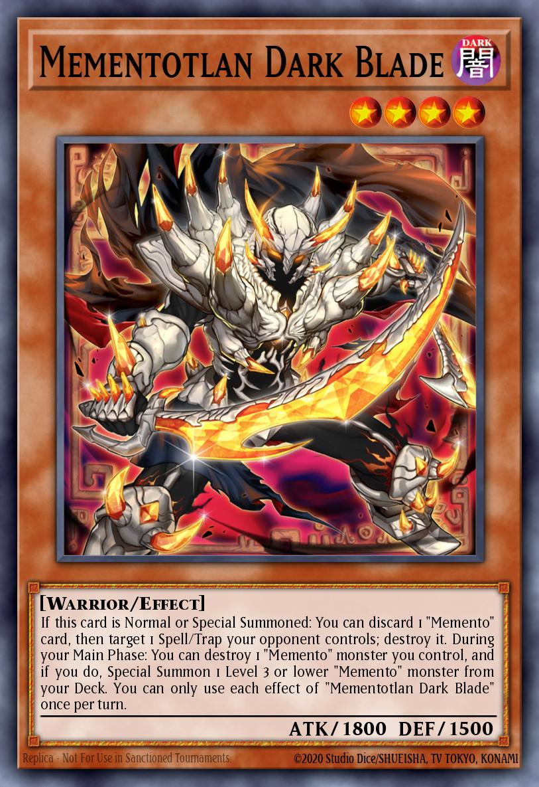 **Abrir con Hoja** | Destruir propia carta y traer Angbruja Nivel 3 desde Deck | I03/I14 → C05, CONDICIONAL |
| 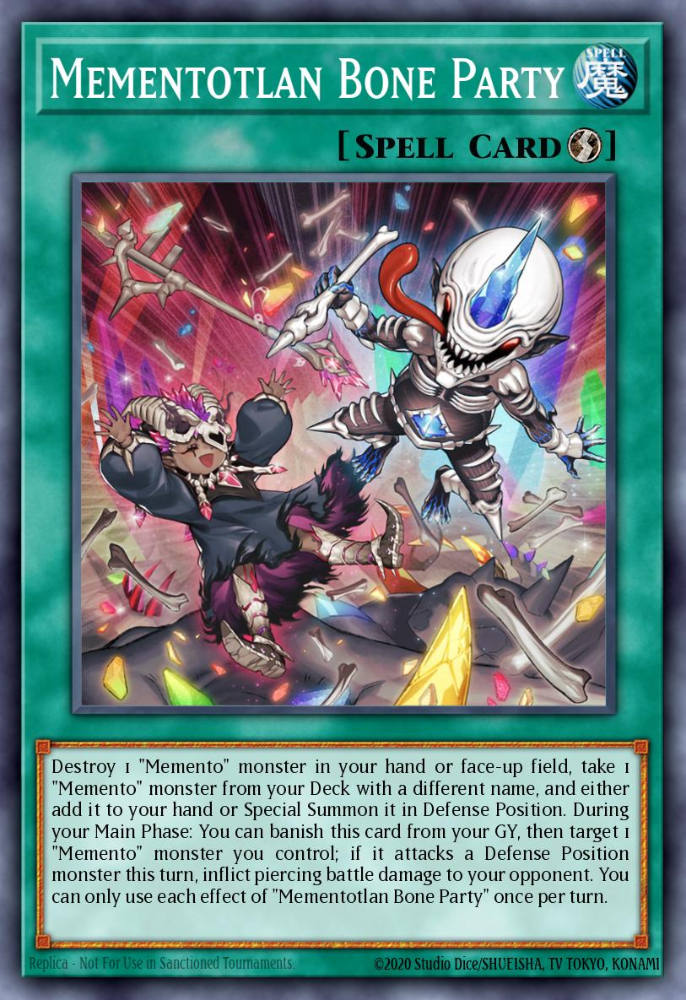 **Acceder sin Fusión en mano** | Fiesta destruye recurso en mano/campo y toma otro nombre; no ofrecer jefe si búsqueda negada | I02 → C02, CONDICIONAL |
|  **Romper campo** | Materiales de mano/campo y rival con cartas válidas; Quimera no supera Noir inmune por su destrucción activada | I16 → C07, CONDICIONAL |
|  **Responder en turno rival** | Dos efectos para Link; respuesta posterior con dos monstruos boca arriba seleccionables | I17 → C08, CONDICIONAL |
|  **Control temporal** | Inicio de MP1; renunciar a desarrollar monstruos de efecto mientras dure la restricción | I05, PLAN EXCLUYENTE |
|  **Puente Demoniherrero** | Dos cuerpos para Luna y luego Réquiem; Grabador único en mano/Deck y objetivos existentes | I09/I25/I26 → C03/C09/C10, CONDICIONAL |

**Intercambios Side exactos auditados:** inventario fuente Side 14 = Fuwalos 2 + Meowls 3 + Purulia 3 + Lancea 3 + Gordiano 3; **5/5 planes** S01–S05 usan 2:2 o 3:3 y Main permanece 41. Son **cinco configuraciones alternativas**, no acumulativas. S01–S05 preservan funciones del rival por zona (Deck/Extra, GY/destierro, mano, cartas boca arriba, destierros) y registran riesgos propios (Droll, Lancea, coste del Extra). Ninguna copia Side se considera en duelo 1.

**Matchups escogidos (3/3):** Crystron/Horus 677, Purrely 660 y Salamangreat 673 constan en la sección **A08.3** de este mismo documento, vinculados a MC-X01–04, rutas C01/C03/C04/C07/C08 y S01/S03/S05. Su resultado es una **decisión según amenaza y estado rival**, no una tasa de victoria; no se extrapola a los otros decks.

**Cruce causal:** I01–I34 solo citan cartas realmente inventariadas y rutas C01–C12 o accesos EX-M01–04 existentes; I23 conserva **SIN_COMBO**, I32 conserva **SIN_RUTA_REPRODUCIBLE** para César, las handtraps I10/I33 siguen autónomas. No se crea ruta nueva por repetir cartas ni se atribuye prueba física del usuario. Las 39 identidades conservan papel en A05/A06 aunque no todas tengan ruta A09 propia.

**Dictamen A08: COMPLETA en exploración y clasificación documental de las 34 entradas y los cinco intercambios Side disponibles, con 3 matchups delimitados y propuestas sin mutación.** No es búsqueda matemática exhaustiva de todas las manos ni certificación de combos: A09 conserva la comprobación de estados iniciales, materiales, pasos y finales de cada ruta. No publicar/importar sin autorización.

**Siguiente apartado secuencial:** A09, solo por solicitud de Miguel.

## APARTADO_09 — Doce rutas razonadas por familia y variante

**Estado:** `COMPLETA_DOCUMENTAL_18-11-2026`; **doce secuencias C01–C12** con textos Konami y zonas especificadas: **nueve familias de propósito distinto** (C01,C02,C03,C06,C07,C08,C09,C10,C12) y **tres variantes del final de doble jefe** (C04,C05,C11). `VALIDADO_LOGICO` indica un encadenamiento documental con supuestos, **no** que haya sido ejecutado en simulador o torneo. Ninguna ruta C usa cartas del Side ni búsquedas Demoniherrero ausentes. Todas asumen que los efectos propios se resuelven sin negaciones salvo el escenario adversario expresamente dado. **EX-M01–EX-M04** son auditorías adicionales de acceso al Extra, no cuatro combos independientes. No atribuir este total a la totalidad combinatoria de las manos.

### MEMD-C01 — «Dos jefes y Maza lista en GY»

**Propósito:** primer turno con doble amenaza, no una negación garantizada. **Inicio:** mano incluye **Angbruja + Fusión Mementotlán**; resto irrelevante; campo propio y GY vacíos. En Deck: Tatsun, Desvantasma, Dormiveja, Creación Combinada, Maza y Goblin; en Extra: Rey Creación. Sin Oleada de Calor activa y sin respuesta rival.

1. **Invoca Normal Angbruja** en campo; activa su efecto al Invocarse y **añade Tatsun** del Deck a mano. Zonas: Campo Angbruja; Mano Tatsun + Fusión.
2. **Invoca Especial Tatsun** desde mano: solo controlas un Memento boca arriba. Zonas: Campo Angbruja + Tatsun.
3. Activa efecto de Tatsun: **destruye a Tatsun que controlas**; manda desde el Deck **Desvantasma (Nivel 2) + Dormiveja (Nivel 3)** al GY; suma 5 ≤ Nivel original 5 del Tatsun destruido. GY: Tatsun, Desvantasma, Dormiveja.
4. Como Desvantasma fue **enviada por efecto del monstruo Memento Tatsun**, activa su efecto y **se Invoca Especial desde GY**. Su efecto al Invocarse recupera **Dormiveja** desde GY a mano. Zonas: Campo Angbruja + Desvantasma; Mano Fusión + Dormiveja; GY Tatsun.
5. Durante Main, **activa Fusión Mementotlán** desde mano y usa exactamente **Angbruja + Desvantasma del campo y Dormiveja de mano** (3 Memento distintos). Invoca por Fusión **Mementomictlán Tecuhtlica - Rey Creación** desde Extra. Las tres cartas usadas quedan en GY.
6. Rey Creación **fue Invocado por Fusión**: activa su efecto de enviar tres cartas Memento del Deck al GY. Elige **Creación Combinada + Maza + Goblin** del Main. GY justo antes del siguiente paso: **Tatsun, Angbruja, Desvantasma, Dormiveja, Creación Combinada, Maza, Goblin** (además de la Fusión Mágica).
7. Activa Invocación propia de **Creación Combinada desde GY**, barajando **exactamente cinco otros Memento con nombres diferentes**: Tatsun, Angbruja, Desvantasma, Dormiveja y Goblin. **Deja Maza en GY.** Zonas finales: Campo **Rey Creación (3000)** + **Creación Combinada (5000)**; GY **Maza** y Fusión Mementotlán. Ya gastaste la Normal.

**Campo final y lectura:** Rey Creación puede usar destrucción rápida solo si hay el mismo número de tus Mementos que de cartas rivales seleccionables, **destruyendo también los tuyos**. Si el rival activa carta/efecto, Creación Combinada puede Invocar Memento de GY/mano: **Maza en GY**, si sigue allí. Con dos monstruos propios, 005 **no** cumple «único monstruo que controlas» para atacar a todos. **Puntos de corte:** búsqueda Angbruja; envío de Tatsun; Invocación/recuperación de Desvantasma; efecto de envío de Rey Creación. Fuente: CID 19364,19362,19472,20199,19904,20216,19360.

### MEMD-C02 — «Creación Combinada sola con Fiesta»

**Propósito:** acceder al atacante de 5000 sin depender de una Fusión robada. **Inicio:** mano incluye **Angbruja + Fiesta de Huesos**; campo propio/GY vacíos; en Deck: Creación Combinada, Tatsun, Goblin, Maza y Desvantasma. La Fiesta se resuelve y el rival no interrumpe.

1. **Invoca Normal Angbruja**, activa su búsqueda y **añade Creación Combinada** del Deck a mano. Campo Angbruja; Mano Creación Combinada + Fiesta.
2. **Activa Fiesta de Huesos** (Mágica de Juego Rápido); **destruye Angbruja boca arriba** y elige del Deck **Tatsun de distinto nombre** para **Invocarlo Especial en Defensa**. Campo Tatsun; GY Angbruja + Fiesta.
3. Durante Main activa Tatsun: **destruye al propio Tatsun** y manda desde el Deck **Goblin Nivel 1 + Maza Nivel 1 + Desvantasma Nivel 2** (total 4 ≤ su Nivel original 5) al GY. Quedan **cinco nombres distintos** de monstruo Memento en GY: Angbruja, Tatsun, Goblin, Maza, Desvantasma. El efecto de Desvantasma al ir al GY es opcional: **no lo actives**, pues aquí necesitamos conservar los cinco.
4. **Invoca Especial Creación Combinada desde mano** barajando al Deck los cinco nombres anteriores. Campo final: **Creación Combinada (5000 ATK) como único monstruo**; GY Fiesta de Huesos; los cinco monstruos ya no permanecen en GY.

**Campo final y lectura:** al estar 005 solo puede atacar a todos los monstruos rivales una vez cada uno durante Battle Phase, según su texto; **no significa OTK**. Fiesta desde GY puede desterrarse en Main para seleccionar al jefe y darle perforación al atacar Defensa. Si el rival activa carta/efecto en su turno, el jefe no tendrá Memento en mano/GY por **esta sola ruta** para Invocar con su efecto; no inventar uno. **Puntos de corte:** Angbruja negada, Fiesta negada, Tatsun negado, o faltar cualquiera de los tres nombres en Deck.

### MEMD-C03 — «Dos Memento transformados en retirada Demoniherrero»

> **Ruta condicional:** esta secuencia exige los materiales descritos en A09, el acceso real a Luna/Réquiem/Grabador y la ventana válida. No se acreditó mediante simulación.

**Propósito:** ir segundo contra un monstruo enemigo **seleccionable** usando solo una copia de Grabador. **Inicio:** mano **Angbruja**, campo/GY propios vacíos; rival tiene **al menos un monstruo en campo** que puede seleccionarse; quedan Tatsun en Deck, Grabador en **mano o Deck**; Luna, Réquiem en Extra. Sin negaciones, restricciones externas ni Heat Wave.

1. **Invoca Normal Angbruja**; mediante su efecto busca **Tatsun**. Campo Angbruja; Mano Tatsun.
2. **Invoca Especial Tatsun** desde la mano, porque solo controlas un monstruo Memento boca arriba. Campo Angbruja + Tatsun.
3. **Invoca por Enlace Luna del Cielo Cerrado** (Link-2) usando los **dos monstruos de efecto**. Campo Luna; GY Angbruja + Tatsun. **No** declaras ni usas el efecto de Luna que necesita un posterior Link-5.
4. **Invoca por Enlace Réquiem del Demoniherrero** (Link-1) usando **Luna**, monstruo **Demonio LUZ**; se cuenta como un material de enlace. Campo Réquiem; GY Luna y los Memento.
5. Durante Main activa el efecto rápido de Réquiem y **Sacrifica Réquiem** para **Invocar Especial Grabador** desde el Deck o mano. Campo Grabador; GY Réquiem.
6. Activa el efecto de Réquiem en GY y **equípalo a Grabador** (un Demonio LUZ no Link) como Mágica de Equipo Demoniherrero. Campo Grabador + Réquiem equipado.
7. Activa el efecto de Grabador: **selecciona el Réquiem equipado que controlas y un monstruo del campo rival**; mándalos al GY. Campo Grabador; GY equipo Réquiem y monstruo rival retirado a su GY, según propiedad original.

**Campo final y lectura:** Grabador queda en campo, dos Memento propios en GY, un monstruo rival enviado al GY. Es **retirada que selecciona y manda**, no negación, destierro ni destrucción; fracasa si no hay monstruo legal objetivo, si Grabador no está disponible o si rival corta una activación crítica. La búsqueda de M/T Demoniherrero por descarte de Grabador sigue sin destino en este Main.

### MEMD-C04 — «Angbruja sola: dos jefes sin Fusión en mano»

**Familia:** variante **C01-V1**, no otra familia de tablero final. **Tipo:** combo completo documental; un único iniciador; primero o segundo, sin interrupción. **Mano mínima:** **1× Angbruja**. Campo/GY propios vacíos; Normal disponible. En Deck deben quedar Tatsun, Goblin, Maza, Desvantasma, Fusión Mementotlán, Creación Combinada, Dormiveja y Dragón de Cuerno. En Extra: Rey Creación. **Prohibición activa:** ninguna (sin Heat Wave).

1. **Normal Angbruja (001)** → activa su efecto de Invocación y busca **Tatsun (002)** del Deck a mano. Campo 001; mano 002.
2. **Especial Tatsun** desde mano (todos los monstruos propios boca arriba son Memento). Su efecto destruye **al propio Tatsun** y envía del Deck **Goblin (004, Nivel 1) + Maza (008, Nivel 1) + Desvantasma (009, Nivel 2)**: niveles 1+1+2=4, menor que 5. GY: 002,004,008,009.
3. **Desvantasma**, enviada al GY **por efecto del monstruo Tatsun**, se Invoca Especial desde allí. Al ser Invocada, activa su otro efecto: devuelve **Goblin** del GY a la mano. Campo: Angbruja+Desvantasma; mano: Goblin; GY Tatsun+Maza.
4. Activa **el otro efecto** de Angbruja: selecciona **Maza (Nivel 1) en GY**, destruye a **Angbruja** y, si la destruye, Invoca **Maza** desde GY. Campo: Desvantasma+Maza. GY: Angbruja+Tatsun.
5. Durante Main, **Maza** destruye **a sí misma** para buscar **Fusión Mementotlán (015)** del Deck a mano. Campo: Desvantasma; mano: Goblin+Fusión. GY: Angbruja+Tatsun+Maza.
6. **Activa Fusión Mementotlán** desde mano. Ya hubo destrucción propia por efecto, así que puede utilizar **Desvantasma del campo + Goblin de la mano + Tatsun del GY** (este último **se baraja al Deck como material**). Invoca **Rey Creación (026)** desde Extra; Angbruja, Maza, Desvantasma, Goblin quedan en GY.
7. Al ser Invocado por Fusión, **Rey Creación** envía del Deck **Creación Combinada (005) + Dormiveja (007) + Dragón de Cuerno (010)** al GY. GY de monstruos: 001,008,009,004,005,007,010; Fusión también en GY.
8. **Creación Combinada** se Invoca desde GY barajando **cinco otros nombres**: 001+008+009+004+010. **Deja Dormiveja** (007) en GY. **Campo final:** Rey Creación **3000 ATK** + Creación Combinada **5000 ATK**. **GY:** Dormiveja + Fusión; 5 nombres regresaron al Deck.

**Por qué mejora:** necesita **1 carta inicial**, mientras C01 pide dos; consume más activaciones y por eso también ofrece más ventanas donde el rival puede interrumpir. **Defensa disponible:** Rey Creación puede destruir el mismo número de Mementos propios y cartas adversarias; el jefe 5000 puede Invocar Dormiveja del GY cuando el rival active carta o efecto, si continúa en GY, pero Dormiveja **no niega** automáticamente nada. **Riesgo:** si Ash/negación corta cualquier búsqueda, envío o recuperación, **no declarar logrado el campo**.

### MEMD-C05 — «Hoja Oscura sola: ruta extendida por el Cementerio»

**Familia:** variante **C01-V2** con otro starter, no nuevo tipo de final. **Tipo:** combo completo documental. **Mano mínima:** **1× Hoja Oscura (003)**. Campo y GY vacíos, Normal disponible. En Deck deben existir Angbruja, Tatsun, Goblin, Maza, Desvantasma, **dos copias de Fusión Mementotlán** (hay tres en la lista), Creación Combinada, Akhíron, Dormiveja y Dragón de Cuerno. Extra contiene Rey Creación. Sin interrupciones.

1. **Normal Hoja Oscura (003)**. Durante tu Main, activa su efecto: destruye **a Hoja Oscura** y Especial **Angbruja (001, Nivel 3)** desde el Deck. Campo Angbruja; GY Hoja.
2. **Angbruja**, al ser Especial, busca **Tatsun (002)**. **Invoca Especial Tatsun** de mano; solo controlas Memento boca arriba. Campo Angbruja+Tatsun.
3. **Tatsun destruye al propio Tatsun**; manda desde el Deck **Goblin (Nivel 1), Maza (Nivel 1), Desvantasma (Nivel 2)**. **Desvantasma se Invoca Especial** por haber sido enviada mediante efecto de Tatsun; en su Invocación recupera **Maza** del GY a mano. Campo Angbruja+Desvantasma; mano Maza; GY Hoja+Tatsun+Goblin.
4. **Angbruja** activa su efecto distinto al de búsqueda: selecciona **Goblin (Nivel 1) del GY**, destruye **Angbruja** propia e Invoca **Goblin** desde GY. Campo Desvantasma+Goblin; GY Hoja+Tatsun+Angbruja.
5. **Goblin** destruye **al propio Goblin** y envía **dos cartas Memento de nombres diferentes** del Deck al GY: **Fusión Mementotlán (015)** y **Creación Combinada (005)**. Quedan en GY también Hoja, Tatsun, Angbruja y Goblin. Campo: Desvantasma.
6. Durante tu Main, activa **el efecto de Fusión Mementotlán desde GY**: destierra **esa copia**, destruye **Desvantasma** en campo y busca **otra copia de Fusión Mementotlán** del Deck a mano. **No** se trata de reutilizar la misma copia desterrada. Mano: Maza+Fusión; GY monstruos: Hoja,Tatsun,Angbruja,Goblin,Desvantasma,Creación Combinada.
7. Activa la **segunda Fusión Mementotlán** desde mano. Usa **Maza de mano** + **Tatsun y Goblin del GY**, barajando los dos del GY al Deck gracias a las destrucciones propias previas. Invoca **Rey Creación** del Extra. **GY de monstruos tras Fusionar:** Hoja, Angbruja, Desvantasma, Maza y jefe 005.
8. Rey Creación envía del Deck tres cartas Memento: **Akhíron (006) + Dormiveja (007) + Dragón de Cuerno (010)**. Ahora hay **siete nombres distintos ajenos al jefe** en GY: Hoja,Angbruja,Desvantasma,Maza,Akhíron,Dormiveja,Dragón de Cuerno.
9. **Especial Creación Combinada desde GY**, barajando cinco de esos nombres: Hoja,Angbruja,Desvantasma,Maza,Dragón de Cuerno. **Conserva Akhíron y Dormiveja** en GY. **Campo:** Rey Creación+Creación Combinada. **Destierro:** primera Fusión utilizada como búsqueda; **GY:** segunda Fusión, Akhíron, Dormiveja. Normal gastada.

**Por qué importa:** demuestra función de **Hoja Oscura, Goblin, Fusión desde GY y Maza** como puente y no como cartas “muertas”. La segunda Fusión buscada usa **su primer efecto**, aunque la otra copia ya haya usado el segundo efecto: son **efectos diferentes**, cada uno limitado por nombre una vez por turno. **Exposición principal:** dos efectos de envío desde Deck (Tatsun y Goblin), búsqueda de Angbruja y recuperación de Desvantasma; no afirmar que resiste Ash o Droll automáticamente. Akhíron y Dormiveja permanecen como recursos del Cementerio; su mera presencia **no equivale** a interrupción.

### MEMD-C06 — «Dragón Gemelo, jefe 5000 y protección de Goblin»

**Familia independiente:** control/presión alternativa al Rey Creación. **Mano mínima:** **Angbruja + Fusión Mementotlán**; campo/GY vacíos. En Deck Tatsun,Desvantasma,Dormiveja,Maza,Creación Combinada,Goblin; Extra Dragón Gemelo (027). Sin respuesta rival.

1. Normal **Angbruja** → busca **Tatsun**; Especial Tatsun.
2. **Tatsun se destruye**, envía del Deck **Desvantasma Nivel 2 + Dormiveja Nivel 3** (2+3=5). Desvantasma se **Invoca Especial** por efecto de Tatsun y, al Invocarse, **recupera Dormiveja** del GY a mano.
3. **Activa Fusión Mementotlán** desde mano: fusiona **Angbruja + Desvantasma en campo** (dos Memento) para invocar **Mementotlán Dragón Gemelo (027)**. **Mano:** Dormiveja. GY: Tatsun,Angbruja,Desvantasma,Fusión.
4. Dragón Gemelo, **al ser Invocado por Fusión**, activa su efecto y **destruye Dormiveja en tu mano**; luego **añade Creación Combinada + Goblin**, dos nombres Memento diferentes, desde el Deck a la mano. Dormiveja destruida activa **su efecto distinto** y envía **Maza** desde el Deck al GY.
5. **Recuento antes del jefe:** GY de monstruos **Tatsun,Angbruja,Desvantasma,Dormiveja,Maza** = **cinco nombres diferentes**. Mano: Creación Combinada + Goblin. **Invoca Creación Combinada** desde mano, barajando exactamente esos cinco al Deck.

**Campo final:** **Dragón Gemelo (2800)** + **Creación Combinada (5000)**; **Goblin en mano**, listo para **descartarse durante una Main Phase** si controlas el jefe y otorgar protección contra **efectos que seleccionen tus Memento** por el resto del turno. **No bloquea efectos que no seleccionen**, no es negación y debe usarse en su ventana. **GY:** Fusión; tras barajar los cinco ya no están allí. Distinta salida de C01 y C04 aunque comparte la apertura de dos cartas.

### MEMD-C07 — «Quimera Guardián rompe dos cartas»

**Familia independiente:** ir **segundo**, retirada de cartas + robo. **Mano mínima:** **Angbruja + Fusión Mementotlán**; campo/GY propios vacíos; **oponente controla dos o más cartas susceptibles de destrucción**. En Deck Tatsun,Desvantasma,Dormiveja; Extra Quimera Guardián (025); sin respuesta rival.

1. Normal **Angbruja** → busca **Tatsun**; Especial Tatsun. Tatsun se destruye para enviar **Desvantasma Nivel 2 + Dormiveja Nivel 3**.
2. **Desvantasma** Especial desde GY (enviada por efecto de Tatsun) y recupera **Dormiveja** a mano. Campo: **Angbruja+Desvantasma**; mano: Dormiveja + Fusión.
3. **Fusión Mementotlán** desde mano fusiona **Angbruja y Desvantasma del campo + Dormiveja de mano** para **Quimera Guardián**, que exige **tres monstruos de nombres diferentes** y **al menos uno de mano y otro de campo**. La magia Fusión tiene un material Memento (en realidad, los tres).
4. **Efecto de Quimera Guardián al ser Invocada por Fusión mediante magia:** **roba una carta** por el material que salió de mano; si robas, **destruye dos cartas que controle el adversario** por los dos materiales de campo, asumiendo que permanecen y pueden destruirse.

**Campo final:** **Quimera Guardián (3300 ATK)**. **GY propio:** Tatsun,Angbruja,Desvantasma,Dormiveja,Fusión. **Mano:** +1 carta robada de identidad **DESCONOCIDA**, no se usa como si fuera pieza específica. **Oponente:** hasta 2 cartas destruidas, sujetas a protección y respuesta; no asegurar removal contra inmunidades. **Advertencia:** la protección de Quimera asociada a la carta **«Polimerización»** en GY **no está disponible** por el mero uso de **Fusión Mementotlán**. No afirmar protección de selección inexistente.

### MEMD-C08 — «S:P Pequeña Caballera con una Angbruja»

**Familia independiente:** primer turno conservador, interrupción por destierro temporal **condicional**. **Mano mínima:** **Angbruja**; campo/GY propios vacíos, Normal disponible, Tatsun en Deck, S:P (031) en Extra. El rival debe activar **una carta o efecto** cuando ya controle un monstruo boca arriba seleccionable para la respuesta descrita.

1. **Normal Angbruja**; al ser Invocada busca **Tatsun** desde Deck. Campo Angbruja.
2. **Especial Tatsun** desde mano, ya que solo controlas Memento boca arriba.
3. Invoca por Enlace **S:P Pequeña Caballera (Link-2)** usando **Angbruja + Tatsun**, ambos **monstruos de efecto**. Campo S:P; GY Angbruja+Tatsun. No hubo material del Extra.
4. **En turno del adversario**, solo **si éste activa una carta o efecto** y controla un monstruo boca arriba que pueda seleccionarse: activa el efecto rápido de S:P seleccionando **a la propia S:P y al monstruo rival**; ambos son **desterrados temporalmente hasta la End Phase**. No atribuir al paso 3 el **primer destierro de S:P al ser Enlace Invocada**, porque no usaste un monstruo del Extra como material.

**Campo al acabar tu turno:** S:P (1600 ATK); GY 001+002; Normal gastada; **sin negaciones**. **Estado temporal durante la respuesta:** S:P y objetivo rival desterrados; si el efecto resuelve y no hay impedimentos, regresan en End Phase. La reacción **no se garantiza** si el rival no activa carta/efecto en ventana válida o carece de objetivo; si la S:P abandona el campo antes, no fingir la respuesta.

### MEMD-C09 — «Princesa Necroequipo usando a Réquiem como equipo»

> **Ruta condicional:** esta secuencia exige los materiales descritos en A09, el acceso real a Luna/Réquiem/Grabador y la ventana válida. No se acreditó mediante simulación.

**Familia independiente: convertir la línea Demoniherrero en Princesa, sin necesitar monstruo rival.** **Mano conocida:** Angbruja (001) + Goblin (004); campo/GY vacíos; Tatsun (002) en Deck, Grabador (011) en mano o Deck; Luna (032), Réquiem (030), Princesa (023) en Extra; sin interrupción ni restricciones externas. Este resultado es **alternativo** a C03: no puede usarse el envío de Grabador contra el rival *y después* gastar el equipo desaparecido como material de Princesa.

1. Invoca Normal **Angbruja**, activa su búsqueda y añade **Tatsun**. Invoca Tatsun Especial desde mano: solo controlas Memento boca arriba.
2. Usa Angbruja + Tatsun, ambos monstruos de efecto, para Link **Luna del Cielo Cerrado** (Demonio LUZ). Usa Luna como único material para Link-1 **Réquiem del Demoniherrero**.
3. Activa el efecto de Réquiem en Main y **Sacrifícalo** para Invocar **Grabador** desde mano/Deck. Activa el efecto **diferente** de Réquiem en GY para **equiparlo** a Grabador como Carta de Monstruo en la zona de M/T.
4. **Invoca de modo Especial a Princesa Necroequipo** mediante su procedimiento impreso: manda al GY **Grabador equipado con la Carta de Monstruo Réquiem** (desde campo) y **Goblin de la mano** (la segunda Carta de Monstruo, de Tipo Demonio). **Réquiem va al GY** al quedar sin el monstruo equipado.
5. **Campo:** Princesa Necroequipo (2000 ATK). **GY conocido:** Angbruja, Tatsun, Luna, Grabador, Goblin, Réquiem. **Normal usada.** No convertir el envío de Goblin durante este **procedimiento de Invocación** en «enviado para activar una carta o efecto»: **Princesa NO roba por ello**.

**Utilidad real, posterior:** si conservas Princesa y en otra cadena **envías un monstruo de la mano al GY para activar** una carta o efecto (por ejemplo, Flor de Ceniza ante un efecto rival que permita responderle), después de esa cadena puede aparecer la ventana de **robar 1 o equipar uno de los monstruos enviados**, según el texto y condiciones de Princesa. Si no conservas una carta adecuada en mano, **no anunciar robo gratuito**. Fuentes por CID: 20423, 20225, 20196, 19366.

### MEMD-C10 — «Secuencia del Demoniherrero fabrica Duque y una Normal adicional»

> **Ruta condicional:** esta secuencia exige los materiales descritos en A09, el acceso real a Luna/Réquiem/Grabador y la ventana válida. No se acreditó mediante simulación.

**Familia independiente: acceso a dos identidades nuevas del Extra en una sola línea.** **Mano conocida:** Angbruja (001) + Fiesta de Huesos (016) + Goblin (004). GY/campo vacíos; en Deck Tatsun, Grabador y Desvantasma (009); Extra Luna, Réquiem, **Secuencia (033)**, **Duque de la Defunción (034)**. Sin interrupción ni Heat Wave.

1. **Normal Angbruja** → busca Tatsun; **Especial Tatsun**. Enlaza ambos en **Luna (032)**; usa Luna para **Réquiem (030)**; Sacrifica Réquiem y Especial **Grabador (011)** desde el Deck. Campo Grabador; GY Angbruja,Tatsun,Luna,Réquiem.
2. Activa **Fiesta de Huesos** desde mano y destruye **Goblin de la mano**; Invoca desde Deck a **Desvantasma** en Defensa, cuyo nombre es distinto al Goblin destruido. **Desvantasma fue Invocada desde Deck, no enviada al GY**: aplica su efecto *al ser Invocada* y recupera **Angbruja del GY a la mano**. No activar erróneamente su efecto de autorreanimación.
3. Con **Grabador (Demonio LUZ)** + **Desvantasma (Demonio OSCURIDAD)** en campo, Invoca por Enlace **Secuencia del Demoniherrero (033)**, que exige dos monstruos incluyendo Demonio LUZ. Ambos quedan en GY; Secuencia campo.
4. Durante Main, **Secuencia** fusiona **Duque (034, Fusión Demonio)** usando **Grabador + Goblin de tu GY**, ambos Demonios, **barajando esos dos materiales al Deck**. La **Desvantasma** queda en GY; Duque y Secuencia quedan en campo.
5. Activa el efecto de **Duque** que permite **una Invocación Normal inmediatamente después de resolver** y utiliza la **Angbruja recuperada**. Campo final: **Secuencia Link-2 + Duque Nivel 6 + Angbruja Nivel 3**. **No** repitas la búsqueda de Angbruja: ese efecto por nombre ya se usó en el paso 1.

**Propósito:** aprovechar el mini-motor Demoniherrero para generar una Fusión y una Normal adicional, sin inventar una Mágica Demoniherrero inexistente. **Límites:** consume Goblin en mano, Fiesta y varios efectos; Duque no niega nada; en tu siguiente Standby deberás pagar **500 LP** o destruirlo. Secuencia no da protección de selección automáticamente: su otro efecto de equipo necesita un Demonio LUZ válido y aún no se ha ejecutado. Fuentes CID 20226,20389,19368,19472.

### MEMD-C11 — «Gran Fuga Moto Goblin sí participa en un tablero doble»

**Familia:** variante **C01-V3** (no un desenlace independiente). **Mano conocida:** Angbruja + Gran Fuga Moto Goblin + Fusión Mementotlán. Campo/GY vacíos; en Deck Tatsun, Goblin, Desvantasma, Dormiveja, Creación Combinada, Maza, Dragón de Cuerno; Rey Creación en Extra. Sin interrupción.

1. Normal **Angbruja** → busca Tatsun; Especial Tatsun. Campo: Angbruja+Tatsun.
2. **Gran Fuga Moto Goblin** se activa **Sacrificando Angbruja como coste**; Invoca **Goblin Mementotlán** desde el Deck (no podrá atacar ese turno). Campo: Tatsun+Goblin; Angbruja GY. **Sacrificar no es destruir**.
3. **Tatsun se destruye por su propio efecto** y envía **Desvantasma Nivel 2 + Dormiveja Nivel 3** del Deck al GY. **Desvantasma** se Invoca Especial desde GY y recupera **Dormiveja** a mano. Campo: Goblin+Desvantasma; mano Dormiveja+Fusión.
4. Activa **Fusión Mementotlán** y usa **Goblin+Desvantasma del campo + Dormiveja de mano** para invocar **Rey Creación**. GY de monstruos: Angbruja,Tatsun,Goblin,Desvantasma,Dormiveja.
5. Rey envía **Creación Combinada + Maza + Dragón de Cuerno** del Deck al GY. Hay **siete nombres distintos** ajenos al jefe: Angbruja,Tatsun,Goblin,Desvantasma,Dormiveja,Maza,Dragón de Cuerno.
6. Invoca Creación Combinada del GY **barajando cinco** (por ejemplo, Angbruja,Tatsun,Goblin,Desvantasma,Dragón de Cuerno). **Deja Dormiveja y Maza en GY**. **Campo:** Rey 3000 + Creación Combinada 5000; GY también contiene Fusión y Gran Fuga.

**Evaluación:** demuestra utilidad de la primera parte de Gran Fuga y del Goblin como **material real**, pero C01 llega al mismo campo con una carta menos. La segunda parte de Gran Fuga, que exige Xyz «Goblin», **sigue sin objetivo en este Extra**. No aumentar por esta variante el número de familias.

### MEMD-C12 — «Dragón de Cuerno rompe dos cartas boca arriba»

**Familia independiente:** retirada de dos cartas rivales sin hacer Fusión. **Mano conocida:** Angbruja + Dragón de Cuerno + Fiesta de Huesos. Oponente controla **por lo menos dos cartas boca arriba destruibles**, campo/GY propios vacíos; en Deck Tatsun,Goblin,Maza,Desvantasma,Hoja Oscura. Sin interrupción.

1. Normal **Angbruja** → añade **Tatsun** del Deck; Especial Tatsun. Campo Angbruja+Tatsun.
2. Tatsun **se destruye** y manda **Goblin Nivel 1 + Maza Nivel 1 + Desvantasma Nivel 2** al GY (total 4≤5). **No actives** la autorreanimación opcional de Desvantasma: el GY queda con **cuatro nombres diferentes** (Tatsun,Goblin,Maza,Desvantasma).
3. Desde mano, Invoca Especial **Dragón de Cuerno** (010) porque hay al menos tres nombres Memento en GY. Campo Angbruja + Dragón de Cuerno.
4. Activa **Fiesta de Huesos** y **destruye Dragón de Cuerno en campo**; por el efecto de Fiesta, Invoca **Hoja Oscura** desde Deck en Defensa. **Después** de resolver la Fiesta, el efecto de Dragón de Cuerno destruido se activa en su ventana.
5. **Dragón de Cuerno** selecciona **exactamente tres cartas boca arriba**, incluyendo **Angbruja propia + dos cartas rivales boca arriba**, y las destruye si su efecto resuelve. Hoja Oscura permanece en campo; Angbruja y las dos cartas del adversario van al GY si pudieron ser destruidas.

**Campo final propio conocido:** Hoja Oscura en Defensa. **GY:** Angbruja,Tatsun,Goblin,Maza,Desvantasma,Dragón de Cuerno,Fiesta. **Rival:** hasta dos cartas boca arriba destruidas. **No** atribuir destrucción a cartas boca abajo ni afirmar que Hoja Oscura activa su efecto de descarte sin una carta Memento adicional en mano. Fuentes CID 19361,19368,19362.

### A09.0 — Accesos adicionales del Extra: demostrar no significa recomendar

#### A09.C — Cotejo documental individual de C01–C12 contra A07 (18-11-2026)

**Tarea editorial independiente de la calculadora.** Se contrastaron las doce secuencias anteriores con los requisitos R02–R07, los recursos declarados y los destinos finales; el resultado no cambia ni renumera combos. El criterio `CONDICIONAL_DOCUMENTADO` significa que el recorrido descrito requiere exactamente sus cartas/zonas y efectos resueltos, **no** `CERTIFICADO_POR_REPLAY`.

| Ruta | Requisitos que deben comprobarse antes de elegirla | Corte o límite que impide atribuir el final automáticamente | Resultado de cotejo |
|---|---|---|---|
| **C01** | Angbruja+Fusión en mano, Tatsun/Desvantasma/Dormiveja y tres envíos de Rey disponibles; 3 materiales de Fusión y 5 nombres para 005 | Sin recuperación de Dormiveja o envío de Rey no adjudicar los dos jefes; Maza queda en GY, no en mano | `CONDICIONAL_DOCUMENTADO` |
| **C02** | Angbruja+Fiesta, 005 y Tatsun disponibles, tres envíos Memento distintos dentro de Nivel 5 | No autorreanimar Desvantasma y simultáneamente contarla entre los cinco nombres barajados sin rehacer zonas | `CONDICIONAL_DOCUMENTADO` |
| **C03** | Angbruja, acceso a Luna/Réquiem/Grabador y monstruo rival seleccionable | Si se pierde el equipo Réquiem, Grabador no manda al rival al GY; no inventar búsqueda Fiendsmith ausente | `CONDICIONAL_DOCUMENTADO` |
| **C04** | Angbruja sola, Maza/Goblin/Desvantasma/Fusión y envíos posteriores disponibles en Deck | Maza se obtiene/usa mediante efectos anteriores; con búsqueda o envío negado no aparece Fusión ni el doble jefe | `CONDICIONAL_DOCUMENTADO` |
| **C05** | Hoja sola, dos copias de Fusión en Deck y las piezas del envío en sus zonas declaradas | Una Fusión se destierra como coste desde GY; la segunda usa su primer efecto, sin repetir por nombre el mismo efecto | `CONDICIONAL_DOCUMENTADO` |
| **C06** | Angbruja+Fusión, dos materiales de Dragón Gemelo, Dormiveja destruible en mano y cinco nombres para 005 | Goblin termina en mano: la protección aún exige descartarlo en Main con 005 controlada; no está activa de forma automática | `CONDICIONAL_DOCUMENTADO` |
| **C07** | Angbruja+Fusión, Quimera con tres nombres, al menos un material de mano y uno de campo; rival con cartas destruibles | El robo depende de que pueda hacerse; la destrucción posterior queda sujeta al texto y a las protecciones rivales | `CONDICIONAL_DOCUMENTADO` |
| **C08** | Angbruja+Tatsun como dos efectos para Link S:P; posterior activación rival con dos monstruos boca arriba seleccionables | No atribuir destierro al Invocar S:P sin material Extra, ni destierro rápido antes de la activación rival | `CONDICIONAL_DOCUMENTADO` |
| **C09** | Angbruja+Goblin, Réquiem equipado realmente a Grabador y segundo Demonio en mano | El envío como procedimiento de Princesa no implica su robo, y perder el equipo impide la Invocación descrita | `CONDICIONAL_DOCUMENTADO` |
| **C10** | Angbruja+Fiesta+Goblin, Grabador y Desvantasma disponibles; materiales Demonio en GY para Secuencia | Duque debe existir y resolver para otorgar Normal adicional; Angbruja no vuelve a buscar ese turno | `CONDICIONAL_DOCUMENTADO` |
| **C11** | Angbruja+Gran Fuga+Fusión; Goblin y tres envíos de Rey accesibles | Tributar Angbruja para Gran Fuga no es destruir; es la destrucción posterior de Tatsun la que habilita GY en Fusión | `CONDICIONAL_DOCUMENTADO` |
| **C12** | Angbruja+Horn+Fiesta; 3 nombres Memento en GY antes de invocar Horn y 3 objetivos boca arriba al activarse su efecto | Se requiere un Memento propio y dos cartas rivales boca arriba legalmente seleccionables; no destruir cartas Colocadas | `CONDICIONAL_DOCUMENTADO` |

**Resultado del cotejo:** `12/12` rutas inspeccionadas, `12/12` conservadas **como condicionales documentales**, `0/12` promovidas a replay o partida certificada y **sin cambios de inventario, pasos, ID o tablero final**. No se detectó en esta pasada una contradicción documental demostrada que autorice reescribir una ruta sin reproducir el estado específico. Quedan pendientes de prueba funcional las elecciones variables, respuestas encadenadas y recursos no observados; se mantienen bajo A07.F y A09, sin afirmar cierre técnico.

**EX-M04 — César (028):** dos Demonios Nivel 6 disponibles (Grabador + Duque) pueden usarse como materiales Xyz; comprobar zona y recursos, sin atribuir una partida simulada.

**EX-M01 — Predaplanta Dragostapelia (024), durante el siguiente turno del adversario.**

- **Mano de apertura conocida:** Angbruja + **2 Fusión Mementotlán distintas** + **Goblin** (cuatro cartas). Para C01 debe quedar **otro Goblin** en Deck (hay dos en la lista). Campo y GY inicialmente vacíos.
- **Turno propio:** ejecuta **C01** usando **la primera Fusión**: campo Rey Creación (monstruo **Fusión** Memento) + jefe 5000; la segunda Fusión queda en mano. **Coloca** la segunda Fusión Mementotlán antes de terminar tu turno. **Conserva el Goblin originalmente robado en mano**; C01 utiliza el otro Goblin del Deck como nombre para el Cementerio.
- **Main Phase rival, nuevo turno:** activa la **segunda Fusión colocada** (Mágica de Juego Rápido, ya no es el turno en que se Colocó), usando **Rey Creación desde el campo** (monstruo Fusión) + **Goblin OSCURIDAD de mano**, al menos un material «Memento», para **Invocar por Fusión Predaplanta Dragostapelia (024)**.
- **Resultado:** Dragostapelia + jefe 5000 en campo; Rey y Goblin enviados al GY, segunda Fusión al GY. Contra monstruo rival **boca arriba seleccionable**, Dragostapelia puede poner Contador Depredador con efecto rápido; niega los **efectos activados** de monstruos rivales que lleven ese contador, **no todos los efectos de todos los monstruos**. Si Rey abandonó campo, ya no se conserva su destrucción rápida.
- **Riesgos:** son **dos turnos distintos**, necesitas sobrevivir y que la magia colocada no sea retirada; no puedes activar dos veces el primer efecto de Fusión Mementotlán en el **mismo turno**. Fuentes Konami CID 12870,19904,20216,19366.

**EX-M02 — TY-PHON (029) sobre S:P en la ventana de dos Invocaciones rivales.**

- **Estado del rival indispensable:** el oponente **Invocó Especial dos o más monstruos desde el Extra Deck en su turno anterior**, o en el turno actual. Esta condición no la genera el deck Memento y **no debe presumirse**.
- **Tu turno, mano conocida Angbruja:** ejecuta **C08 pasos 1–3**: Normal Angbruja, busca y Especial Tatsun, enlaza ambos para **S:P (031)**. S:P es el **único monstruo que controlas** y por tanto también el de mayor ATK de tus monstruos.
- **Ahora sí**, Invoca Xyz **TY-PHON (029)** desde el Extra **sobre S:P como su único material**, por su procedimiento alternativo. **Desde aquí no puedes Invocar Normal ni Especial el resto de ese turno**, y TY-PHON restringe la activación de efectos de monstruos con **3000+ ATK de ambos jugadores**, incluidos tus Rey/jefe si llegaran a estar en campo.
- **Resultado:** TY-PHON 2900 en campo con **S:P como material Xyz**; puedes desprender ese material para devolver un monstruo del campo a la mano mediante su efecto, respetando respuestas y protecciones. Si el monstruo procede del Extra, regresará al **Extra Deck**, no a la mano. **No hay S:P simultáneamente en campo y como material**. Fuente Konami CID 19184.

**EX-M03 — Aero Tiburón (035): acceso Xyz real, utilidad baja con cero desterrados.**

- **Mano conocida:** Angbruja + Fiesta + Goblin; GY/campo vacíos; otro ejemplar de Angbruja y Dormiveja en Deck. **Normal Angbruja** y usa su búsqueda de Invocación para añadir **Dormiveja** a mano.
- **Activa Fiesta de Huesos**, destruye **Goblin de mano** e Invoca del Deck **otra Angbruja** en Defensa (nombre distinto a Goblin). La búsqueda de Angbruja por nombre **ya se utilizó**: no buscar una segunda carta.
- Como un monstruo de tu posesión fue destruido por efecto, **Invoca Especial Dormiveja desde mano**; puedes **no activar** su efecto opcional de Fusionar Memento. Campo: **dos Angbruja Nivel 3 + Dormiveja Nivel 3**.
- Usa **las dos Angbruja** para Xyz **Portaaviones Sumergible Aero Tiburón (035)**; Dormiveja sigue en campo. **Aero tiene dos materiales Xyz Angbruja**.
- **Límite:** en esta línea **no hay monstruos propios desterrados**: su efecto de 100 puntos por monstruo desterrado **no proporciona daño útil**. Por eso esta prueba acredita **acceso**, no justifica automáticamente escoger Aero sobre otras salidas. Fuente Konami CID 9657,19364,20199,19368.

**EX-M04 — César (028):** dos Demonios Nivel 6 disponibles (Grabador + Duque) pueden usarse como materiales Xyz; comprobar zona y recursos, sin atribuir una partida simulada.

- **Mano teórica:** Angbruja + Fiesta + Fusión Mementotlán + Goblin. **Normal Angbruja → Tatsun → Luna → Réquiem → Grabador**, como C03 pasos 1–5, dejando **Grabador Nivel 6 / Demonio LUZ** en campo.
- **Fiesta** destruye **Goblin de mano** (destrucción por efecto de una carta de tu posesión) e Invoca **Desvantasma de Deck** en Defensa; Desvantasma puede recuperar Angbruja desde GY. **Fusión Mementotlán** usa **Desvantasma del campo + Goblin del GY, barajado al Deck**, para Fusionar **Duque de la Defunción**, Demonio Nivel 6, por haberse producido aquella destrucción de tu posesión.
- Quedan **Grabador Nivel 6 + Duque Nivel 6**, ambos Demonio, que permiten la Invocación Xyz de **D/D/D César, Alto Rey de las Olas** por sus materiales. Comprobar sus zonas, la ventana y si alguna negación rival impide llegar a ambos.
- **Alternativa táctica:** conservar Duque y Grabador para presión de campo y usar la Normal adicional de Duque en Angbruja recuperada, cuando esté realmente disponible; no atribuir a César una negación que no se activó. CIDs 13081, 20389, 20196, 19904.

**Resultado técnico del Extra:** **13/13 identidades** tienen material o procedimiento identificado; algunas rutas son continuaciones condicionales o marginales y no se han validado con replays. Los 4 accesos EX-M01–EX-M04 no suman cuatro combos independientes.

### A09.1 — Continuaciones, distintas de un combo inicial nuevo

| ID de continuación | Origen | Condición real | Acción y resultado | Por qué no aumenta el recuento de familias |
|---|---|---|---|---|
| **MEMD-X01** Akhíron abre ataques directos | C05 (Akhíron quedó en GY) | Vas segundo; Rey Creación+Creación Combinada siguen en campo, rival tiene carta seleccionable; no gastaste efecto rápido de Rey | Elige **Rey Creación propio + una carta rival** como objetivos del efecto de destrucción rápida del Rey; si se destruye Rey, Akhíron en GY puede Invocarse Especial porque un Memento boca arriba fue destruido por efecto. Al ser Invocado, concede **ataques directos a tus Memento Nivel ≥9** ese turno (incluye el jefe 5000 si sigue en campo). No asegurar letal ni respuesta sin interrupciones. | Depende totalmente de llegar a C05 y de destrucción posterior; no es otra mano inicial |
| **MEMD-X02** Reciclar la Fusión | C01/C04/C06/C07 y **Mementomictlán en campo** | La Fusión terminó en GY, el Campo sobrevive hasta tu End Phase | En End Phase, **Mementomictlán** selecciona Fusión Mementotlán en tu GY y la **Coloca**; no activarla como Mágica Rápida el mismo turno que se Colocó | Recurso de turno siguiente añadido a una línea madre |
| **MEMD-X03** Reparar después de interacción | C01/C04/C05/C06 con jefe 005 y un Memento en GY | Rival activa carta o efecto fuera de Damage Step; jefe sobrevive | Activar 005 para **Invocar un Memento** de GY/mano; escoger según recurso real y efecto al Invocarse. Si era Dormiveja y fusiona, no atribuir al mismo tiempo los materiales consumidos como monstruos independientes | Respuesta del oponente, no nueva apertura |

### A09.2 — Matriz de decisión para una mano real

| Lo que tienes / lo que ves | Ruta o categoría | Resultado / decisión |
|---|---|---|
| **Solo Angbruja**, primero | **C04**, variante C01-V1 | Dos jefes; más ventanas de interrupción que la apertura de dos cartas |
| **Solo Hoja Oscura**, primero | **C05**, variante C01-V2 | Dos jefes y recursos extra en GY; usa dos efectos distintos de Fusión Mementotlán |
| **Angbruja + Fusión**, primero, valoras destruir rival en turno enemigo | **C01** | Rey Creación + jefe 5000; destruye propios al retirar cartas contrarias |
| **Angbruja + Fusión**, quieres Goblin en mano contra selección | **C06** | Dragón Gemelo + jefe + Goblin protector; no Rey Creación |
| **Angbruja + Fiesta** | **C02** | Jefe 5000 solo; queda sin Mementos en GY para su efecto adicional |
| **Angbruja + Fusión**, rival tiene 2 cartas expuestas a destrucción | **C07** | Quimera Guardián, robo 1 y destrucción hasta 2; no protección por Polimerización |
| **Solo Angbruja**, te preocupa sobreextender, rival tendrá objetivos boca arriba | **C08** | S:P con respuesta condicional del turno enemigo, no destierro inmediato |
| **Solo Angbruja**, rival tiene monstruo seleccionable | **C03** | Grabador y envío de monstruo rival al GY; no motor Memento final |
| **Angbruja + Goblin**, no buscas retirada rival inmediata | **C09** | Princesa Necroequipo por Grabador equipado con Réquiem; **no hay robo automático en la Invocación** |
| **Angbruja + Fiesta + Goblin**, necesitas usar Duque | **C10** | Secuencia→Duque, Angbruja de GY recuperada y Normal adicional; sin segunda búsqueda |
| **Angbruja + Gran Fuga + Fusión**, necesitas movilizar el Goblin del Deck | **C11** | Rey+jefe mediante sacrificio de Witch; **variante más costosa** que C01 |
| **Angbruja + Horn + Fiesta**, rival tiene 2 cartas boca arriba | **C12** | Horn destruye Angbruja propia y dos cartas rivales; Hoja queda en campo |
| **C01 con otra Fusión Colocada y Goblin OSCURIDAD en mano** | **EX-M01**, turno del oponente | Dragostapelia con Rey+Goblin; consume a Rey y exige sobrevivir al siguiente turno |
| **Rival Invocó Especial 2+ monstruos desde Extra en turno actual o anterior y solo controlas S:P** | **EX-M02**, condicional | TY-PHON sobre S:P, última Invocación del turno; bloqueo de monstruos ≥3000 ATK |
| **Dos Angbruja Nivel 3 en campo** | **EX-M03**, acceso marginal | Aero Tiburón posible; sin monstruos propios desterrados no genera daño útil |
| **Grabador + Duque (Demonios Nivel 6)** | **EX-M04, condicional** | César Xyz requiere los dos Demonios Nivel 6 simultáneamente disponibles |
| **Solo Fusión/Fiesta, sin Memento en mano/campo/GY** | **NO_APERTURA** | No anunciar combo; buscar un iniciador y registrar brick |
| **Oleada de Calor** activada al inicio de MP1 | **PLAN_DE_BLOQUEO** | No ejecutar C01–C12 durante su restricción de Invocaciones |

**Cotejo de recursos del repertorio:** **12 fichas C01–C12** documentales: **9 familias tácticas** (C01,C02,C03,C06,C07,C08,C09,C10,C12) y **3 variantes** del objetivo de C01 (C04,C05,C11). Además, **3 continuaciones X01–X03** y **4 auditorías de acceso EX-M01–EX-M04**, **que no aumentan** el número de aperturas. Todas las Fusiones se corresponden con copias del Main y límites por nombre; C05 consume el efecto de GY de una copia y el de activación de otra, EX-M01 sucede **en otro turno**. **0 replays/simulaciones acreditados; 0 porcentajes de victoria atribuidos.** Un tablero lógico sin respuesta no prueba que sea imparable.

### A09.3 — Estado residual comprobable en ocho dimensiones

**Supuesto común:** solo mano **mínima declarada**; otros 3–4 naipes iniciales si los hay quedan **SIN DATO**, no son recursos disponibles inventados. Esta tabla registra la salida **sin respuesta rival**, salvo que C03 y C07 declaran expresamente campo rival inicial. El estado de las cartas del oponente que no se menciona es **SIN DATO**, no «campo vacío». Sin M/T colocadas extra, Skill ni materiales Xyz imaginarios.

| Ruta | Mano conocida al cierre | Campo de monstruos propios | M/T propia conocida | GY propio de referencia | Destierro propio | Rival / objetivo | Materiales Xyz; Normal/fase |
|---|---|---|---|---|---|---|---|
| **C01** | Se consumieron Angbruja+Fusión iniciales | 026 Rey + 005 jefe | Ninguna | 008 Maza + 015 Fusión | Ninguno | SIN DATO | Sin Xyz; Normal usada, Main |
| **C02** | Angbruja+Fiesta usadas; jefe ya en campo | 005 jefe **solo** | Ninguna | 016 Fiesta | Ninguno | SIN DATO | Sin Xyz; Normal usada, Main |
| **C03** | Angbruja inicial usada | 011 Grabador | Equipo 030 fue enviado al GY | 001 Angbruja,002 Tatsun,032 Luna,030 Réquiem | Ninguno | 1 monstruo objetivo rival enviado a su GY si se resuelve | Sin Xyz; Normal usada, Main propia |
| **C04** | Angbruja inicial usada | 026 Rey + 005 jefe | Ninguna | 007 Dormiveja + 015 Fusión | Ninguno | SIN DATO | Sin Xyz; Normal usada, Main |
| **C05** | Hoja inicial usada | 026 Rey + 005 jefe | Ninguna | 006 Akhíron,007 Dormiveja,015 Fusión (2.ª copia) | 015 Fusión (1.ª copia) | SIN DATO | Sin Xyz; Normal usada, Main |
| **C06** | **004 Goblin permanece en mano** | 027 Dragón Gemelo + 005 jefe | Ninguna | 015 Fusión | Ninguno | SIN DATO | Sin Xyz; Normal usada, Main |
| **C07** | **+1 robo desconocido** | 025 Quimera Guardián | Ninguna | 001 Angbruja,002 Tatsun,009 Desvantasma,007 Dormiveja,015 Fusión | Ninguno | Hasta 2 cartas destruidas si son afectables | Sin Xyz; Normal usada, Main propia |
| **C08** | Angbruja inicial usada | 031 S:P al terminar turno propio | Ninguna | 001 Angbruja,002 Tatsun | Ninguno **antes** del efecto rival | Solo durante respuesta: S:P y monstruo rival desterrados temporalmente | Sin Xyz; Normal usada; respuesta en turno rival |
| **C09** | Angbruja+Goblin consumidos | 023 Princesa Necroequipo | Réquiem dejó de estar equipado; ninguna | 001 Witch,002 Tatsun,032 Luna,030 Réquiem,011 Grabador,004 Goblin | Ninguno | SIN_DATO; **Princesa no roba por el procedimiento** | Sin Xyz; Normal usada, Main |
| **C10** | Angbruja+Fiesta+Goblin consumidos | 033 Secuencia + 034 Duque + 001 Angbruja | Ninguna | 002 Tatsun,032 Luna,030 Réquiem,009 Desvantasma,016 Fiesta | Ninguno | SIN_DATO | Sin Xyz; **Normal inicial y Normal adicional de Duque utilizadas** |
| **C11** | Angbruja+Gran Fuga+Fusión consumidos | 026 Rey + 005 jefe | Ninguna | 007 Dormiveja,008 Maza,015 Fusión,018 Gran Fuga | Ninguno | SIN_DATO | Sin Xyz; Normal usada, Main |
| **C12** | Angbruja+Horn+Fiesta consumidos | 003 Hoja Oscura en Defensa | Ninguna | 001 Angbruja,002 Tatsun,004 Goblin,008 Maza,009 Desvantasma,010 Horn,016 Fiesta | Ninguno | **Hasta 2** cartas boca arriba rivales destruidas; al menos 2 requeridas inicialmente | Sin Xyz; Normal usada, Main |

**Destierro y control temporal:** si C08 activa su efecto rápido, el estado **cambia temporalmente**: S:P ya no está en campo, y el monstruo enemigo seleccionado tampoco. La devolución al final del turno sigue condicionada a que el efecto resuelva y no intervenga otra regla/carta. La fila base no los duplica como simultáneamente presentes y desterrados.

### A09.4 — Ocho manos de tres o cuatro cartas ante decisiones e interrupciones

**Tipo de prueba:** `ESCENARIO_DOCUMENTAL`, **no simulación real** ni frecuencia de aparición. Son entre **tres y cuatro cartas conocidas** de una mano inicial de cinco; las demás quedan `SIN_DATO` y **no se utilizan** para justificar la ruta. Las respuestas adversarias se especifican cuando existen. **H01–H08 no crean ocho combos nuevos**: comprueban si C01–C08 continúan siendo legales cuando hay cartas adicionales, piezas ya robadas o negaciones.

| Escenario | Mano conocida y respuesta adversaria | Decisión ejecutable y variación real | Resultado acreditable y límite |
|---|---|---|---|
| **H01 · Tres cartas, apertura normal** | Angbruja + Fusión + Flor de Ceniza; rival no interviene | Resolver **C01** con Angbruja y Fusión. **Ash propia no es material** ni se usa sin efecto rival válido. | Rey+Creación Combinada; Ash permanece en mano; no presumir otras dos cartas. |
| **H02 · Tres cartas, planes incompatibles** | Angbruja + Fusión + Oleada de Calor; vas primero | **Opción A:** Oleada al inicio de Main Phase 1 y pasar sin Invocar monstruos de efecto; **opción B:** C01 y **no** activar Oleada tras invocar. | La misma mano ofrece dos planes **alternativos**, nunca Heat Wave + C01 en la misma Main. |
| **H03 · Tres cartas, Droll posterior** | Angbruja + Fusión + Goblin; rival activa Droll **después** de que Angbruja añadió Tatsun | **C01** sigue siendo posible: Desvantasma devuelve Dormiveja **del GY**, la Fusión ya estaba en mano y Rey **envía del Deck al GY**, acciones que Droll **no impide**. Un segundo Goblin queda en el Deck para el envío C01. | Rey+Creación Combinada. Goblin original permanece en mano; no hacer **otra** búsqueda del Deck a mano bajo Droll. |
| **H04 · Tres cartas, Ash a Angbruja** | Angbruja + Fusión + Tatsun ya robado; Ash rival **niega la búsqueda** de Angbruja | La búsqueda no resuelve, pero **Tatsun ya existe en mano**. Invócalo Especial, envía Desvantasma+Dormiveja, recupera Dormiveja, fusiona con los tres Memento y ejecuta el envío de Rey como C01. | Rey+Creación Combinada **si** se resuelven los efectos posteriores. El recurso robado previamente constituye la recuperación; no atribuir búsqueda negada. |
| **H05 · Tres cartas, Ash a Hoja** | Hoja Oscura + Fiesta de Huesos + Creación Combinada **en mano**; rival niega con Ash el primer efecto de Hoja | Hoja **permanece en campo** al negarse la destrucción de su efecto. Usa **Fiesta** para destruir Hoja y Especial Tatsun desde Deck; Tatsun se destruye y manda Goblin+Maza+Desvantasma (1+1+2). **No actives** la Invocación opcional de Desvantasma. | Los cinco nombres **Hoja/Tatsun/Goblin/Maza/Desvantasma** quedan en GY; baraja los cinco e Invoca el jefe **que ya estaba en mano**. Resultado: solo jefe 5000, no los dos jefes de C05. |
| **H06 · Cuatro cartas, defensa antes de Fusión** | Angbruja + Fusión + Gotas Prohibidas + Oleada; vas segundo; rival tiene al menos un monstruo de efecto legal | Normal Angbruja → busca Tatsun. Activa **Gotas** enviando **Oleada desde mano** como coste y elige un efecto rival; preserva Angbruja y Fusión. Luego ejecuta C01 si el rival no interrumpe. | Rival con un monstruo de efecto negado/ATK reducido hasta fin de turno, Rey+Creación Combinada si se resuelve C01; Oleada y Gotas en GY. No declarar que Gotas respondió a un efecto ya resuelto. |
| **H07 · Tres cartas, Fusión duplicada** | Angbruja + Fusión + otra Fusión; sin respuesta | Ejecuta **C01 utilizando solo una copia** de la Mágica Rápida. La segunda **permanece en mano**, salvo que otra acción declarada la consuma. | Rey+Creación Combinada; prohibido activar **dos veces el mismo primer efecto por nombre** en ese turno. No tratar la segunda como segunda Invocación de Fusión inmediata. |
| **H08 · Tres cartas, jefe robado** | Angbruja + Fusión + Creación Combinada **ya en mano**; sin respuesta | C01 prepara **Tatsun+Angbruja+Desvantasma+Dormiveja** en GY después de Fusionar. Rey **no necesita enviar el jefe**, que ya está en mano: envía **Maza+Goblin+Dragón de Cuerno** desde Deck; baraja **cinco de los siete nombres** ajenos al jefe para Invocar el 5000 desde mano. | Rey+Creación Combinada. Los nombres concretos enviados cambian por la carta robada, pero **no se cuenta otra familia de combo**. |

**Resultado de la pasada H:** ocho situaciones con **recuento explícito** de carta y zona; **cuatro** muestran que una carta adicional preserva la ruta (H01/H03/H04/H07), **tres** muestran una elección o adaptación importante (H02/H05/H08) y **una** integra una interacción de retirada previa (H06). Estas categorías son editoriales, no porcentajes competitivos; comprobar con una mano real antes de ejecutar.

### A09.5 — Seis pruebas adicionales de tres o cuatro cartas

| Escenario | Mano conocida, campo rival y decisión | Resultado, alternativa y condición de fallo |
|---|---|---|
| **H09** | **Angbruja + Goblin + Flor de Ceniza**; sin objetivo rival necesario. Ejecutar C09: abrir Luna/Réquiem, invocar Grabador, equipar Réquiem, enviar Grabador equipado + Goblin a GY para **Princesa**. | **Princesa** campo y Ash **conservada en mano**. Si el rival activa después un efecto al que Ash pueda responder, Ash se envía de mano a GY para activarlo; tras resolver esa cadena, Princesa puede elegir **robar 1** (si mantiene condiciones). **No** roba por Goblin enviado como material de Invocación. |
| **H10** | **Angbruja + Fiesta + Goblin**. Priorizar C10 si se desea una Normal adicional, en lugar de usar las mismas cartas para una ruta de Xyz de bajo impacto. | **Secuencia + Duque + Angbruja**. Goblin y Grabador retornan del GY al Deck por la Fusión de Secuencia; Angbruja no busca por segunda vez. |
| **H11** | **Angbruja + Gran Fuga + Fusión**. Tributa Angbruja para traer Goblin; conserva Tatsun para enviarse a sí mismo. | **Rey + Creación Combinada** por C11. Comparar con C01: gasta una carta inicial más, pero demuestra una vía legal para Gran Fuga. No usar la segunda parte de Gran Fuga sin Xyz Goblin. |
| **H12** | **Angbruja + Dragón de Cuerno + Fiesta**; vas segundo y el rival tiene **dos cartas boca arriba destruibles**. | C12: **Hoja Oscura** en campo y hasta dos cartas rivales destruidas. Con rival sin dos cartas boca arriba, **NO** atribuir este final de retirada múltiple. |
| **H13** | **Angbruja + dos copias de Fusión + Goblin**; rival dispone de un monstruo cara arriba en su siguiente Main. | C01 en tu turno, **Colocar** segunda Fusión, preservar Goblin de mano y llegar a **Dragostapelia EX-M01 en el turno rival** si las cartas sobreviven. No se trata de dos activaciones de Fusión en un mismo turno. |
| **H14** | Angbruja + Fiesta + Fusión + Goblin; César en Extra. | Comprobar la ruta EX-M04: Luna → Réquiem → Grabador y luego Duque usando la destrucción de Goblin. Si falla una rama, conservar Fusión y estudiar C10 sin inventar recursos. |

**Censo de escenarios:** **14 manos H01–H14**, ninguna es muestreo aleatorio ni prueba de partidas. H09–H14 contrastan la utilidad de cartas menos centrales, turnos y costes; **no se suman a las 12 rutas C01–C12**. Cada mano solo usa las cartas conocidas y la condición del rival declarada.

### A09.7 — Acta de cierre y control causal individual (18-11-2026)

**Alcance:** revisión documental de **12/12 fichas C01–C12**, **24/24 manos H01–H24**, **3 continuaciones X01–X03** y **4 accesos EX-M01–EX-M04**, contrastados con inventario A03, efectos A05, sinergias A06, cadenas A07 y prefichas A08. Se conservan **41 Main / 15 Extra / 14 Side / 0 Reserva**. **0 replays, 0 duelos simulados, 0 pruebas de motor, 0 tasas de victoria**.

| Ficha | Condición inicial clave | Materiales, zonas y efecto no duplicado | Dictamen |
|---|---|---|---|
| **C01** | Angbruja+Fusión; materiales en Deck | Rey usa 3, envía 3; cinco nombres regresan; Maza queda en GY | `VALIDO_CONDICIONAL` |
| **C02** | Angbruja+Fiesta; no revivir Desvantasma | Cinco nombres regresan; jefe 005 queda solo | `VALIDO_CONDICIONAL` |
| **C03** | Angbruja; Grabador accesible y monstruo rival seleccionable | Luna→Réquiem→Grabador; equipo y objetivo al GY | `VALIDO_CONDICIONAL` |
| **C04** | Angbruja sola; Maza/Fusión disponibles en Deck | Destrucción propia habilita material de GY; Dormiveja residual | `VALIDO_CONDICIONAL` |
| **C05** | Hoja sola; dos Fusiones permanecen en Deck | Primera Fusión desterrada; segunda desde mano; Akhíron/Dormiveja en GY | `VALIDO_CONDICIONAL` |
| **C06** | Angbruja+Fusión; dos objetivos del Dragón Gemelo | Destruye Dormiveja en mano; cinco nombres regresan; Goblin aún en mano | `VALIDO_CONDICIONAL` |
| **C07** | Angbruja+Fusión; dos cartas rivales destruibles | Quimera usa 1 material mano y 2 campo; robo de identidad desconocida | `VALIDO_CONDICIONAL` |
| **C08** | Angbruja; respuesta rival con dos objetivos boca arriba | S:P no destierra al invocarse; respuesta temporal si rival activa | `VALIDO_CONDICIONAL` |
| **C09** | Angbruja+Goblin; Grabador accesible | Grabador equipado + Goblin enviados; Princesa no roba por invocarse | `VALIDO_CONDICIONAL` |
| **C10** | Angbruja+Fiesta+Goblin | Grabador/Goblin regresan al Deck; Duque permite otra Normal, sin buscar dos veces | `VALIDO_CONDICIONAL` |
| **C11** | Angbruja+Gran Fuga+Fusión | Angbruja sacrificada, no destruida; cinco nombres regresan | `VALIDO_CONDICIONAL` |
| **C12** | Angbruja+Horn+Fiesta; dos cartas rivales boca arriba | Horn destruido por Fiesta; tres objetivos (uno propio y dos rivales) | `VALIDO_CONDICIONAL` |

**Casos borde H01–H24:** no se cuentan como combos independientes. H02/H15 prohíben combinar Oleada con las Invocaciones de efecto de las líneas; H08/H21 sustituyen el envío de piezas únicas ya robadas; H22 reconoce que dos Fusiones robadas dejan solo una en Deck; H24 conserva Desvantasma única en mano y cambia los tres envíos de Tatsun. Las manos no descritas permanecen `SIN_DATO`, y la carta robada por Quimera no adquiere identidad inventada.

**Extra y continuaciones:** EX-M01 usa la segunda Fusión **colocada en el turno anterior**; EX-M02 exige **dos o más monstruos Invocados Especial desde Extra** por el rival en turno actual o anterior; EX-M03 es Xyz posible sin daño útil en ese estado; EX-M04 exige **Grabador y Duque Nivel 6 simultáneos**, sin reutilizar el Grabador que C10 barajó al Deck para fusionar por Secuencia. EX-M04 tiene prefijo condicional propio en A09.0, no es continuación automática de C10 ni replay. X01–X03 requieren campo sobreviviente y su ventana real. El Side no se usa como si hubiera entrado a Main sin intercambios documentados.

**Dictamen:** `VALIDO_CONDICIONAL` significa una secuencia documental conciliada con los efectos oficiales **solo bajo sus premisas**, no `PROBADO_EN_SIMULADOR` ni garantía frente a negaciones. Si falla un objetivo, material, coste, zona, límite por nombre, ventana o efecto previo, esa instancia es `NO_ACREDITADO` hasta rehacerla. Para una certificación externa serían necesarios mano exacta de cinco, turno/fase, cadenas, zonas, capturas y replay por ID. **A09 COMPLETA bajo su contrato editorial independiente de A10**; la validación de mesa queda expresamente no realizada. La integración pendiente no habilita modificaciones automáticas de A10.

### A09.8 — Cotejo estático A09 ↔ guía V42, sin calculadora (18-11-2026)

**Método y alcance:** inspección local, de solo lectura, del HTML `guias/GUIA_VISUAL_A01_A10.html` frente a las doce rutas A09. Se verificaron identificadores de panel, número de pasos visibles, descripción de transferencia de zona y bloque de interrupción por paso. Esta comprobación **no ejecuta jugadas**, no prueba las reglas mediante motor ni compara los registros del editor de plataforma V40 con su importación.

| Ruta A09 | Panel V42 | Pasos en ficha y guía | Transferencias de zona visibles | Ramas de interrupción visibles | Cotejo estructural |
|---|---|---:|---:|---:|---|
| C01 | `a10-c01` | 7 / 7 | 7 | 7 | COINCIDE |
| C02 | `a10-c02` | 4 / 4 | 4 | 4 | COINCIDE |
| C03 | `a10-c03` | 7 / 7 | 7 | 7 | COINCIDE |
| C04 | `a10-c04` | 8 / 8 | 8 | 8 | COINCIDE |
| C05 | `a10-c05` | 9 / 9 | 9 | 9 | COINCIDE |
| C06 | `a10-c06` | 5 / 5 | 5 | 5 | COINCIDE |
| C07 | `a10-c07` | 4 / 4 | 4 | 4 | COINCIDE |
| C08 | `a10-c08` | 4 / 4 | 4 | 4 | COINCIDE |
| C09 | `a10-c09` | 5 / 5 | 5 | 5 | COINCIDE |
| C10 | `a10-c10` | 5 / 5 | 5 | 5 | COINCIDE |
| C11 | `a10-c11` | 6 / 6 | 6 | 6 | COINCIDE |
| C12 | `a10-c12` | 5 / 5 | 5 | 5 | COINCIDE |
| **TOTAL** | **12 / 12** | **69 / 69** | **69** | **69** | **COBERTURA ESTRUCTURAL COMPLETA** |

**Resultado limitado:** ningún panel ni paso ausente en este cotejo, y cada paso expone un movimiento y una interrupción. La presencia de texto **no equivale a igualdad semántica de cada coste/estado**, ni a representación correcta en el navegador. Quedan `PENDIENTE_DE_INTEGRACION` el cotejo **campo a campo** contra los datos del editor V40 y `PENDIENTE_DE_QA` la verificación de render e interacciones de A10. Ninguno de esos pendientes obliga a usar una calculadora; ambos requieren acceso a las superficies correspondientes y evidencia observable. **A09 sigue cerrada documentalmente**, sin elevar `VALIDO_CONDICIONAL` a jugada certificada.

### A09.9 — Seguimiento de aceptación de integración, sin calculadora (18-11-2026)

**Tarea única activa A09-I01:** comparar cada ruta canónica A09 con la representación **realmente guardada** en el editor «Estilo y estrategia» V40 y el Creador. El HTML V42 es evidencia de la **guía**, no prueba de paridad con el editor. No se encontró en la carpeta importable de este deck un export de rutas del editor V40 con campos comparables; **no declarar discrepancia ni coincidencia** sin esa segunda fuente.

| Control de A09-I01 | Estado | Evidencia o criterio de cierre |
|---|---|---|
| Identidad estable C01–C12 en A09 | `DOCUMENTADO` | Doce fichas canónicas, con pasos 7+4+7+8+9+5+4+4+5+5+6+5 = 69 |
| Paneles homónimos C01–C12 en V42 | `COMPROBADO_ESTRUCTURAL` | Doce paneles `data-route` y 69 bloques de paso, transferencia e interrupción; A09.8 |
| **C01 — datos del editor V40** | **`PENDIENTE_FUENTE`** | Obtener export/lectura de C01 del editor; contrastar Angbruja+Fusión, 7 pasos, CID 19364/19362/19472/20199/19904/20216/19360, coste, origen→destino y final Rey+005 con Maza en GY |
| C02–C12 — datos del editor V40 | `PENDIENTE_FUENTE` | Comparar secuencialmente **una ruta terminada antes de iniciar la siguiente**, por ID, cartas, movimientos, límites y endboard |
| Dictamen de paridad A09↔V40 | `NO_ACREDITADO` | Registro de igualdad o diferencias corregidas para **12/12 rutas y 69/69 pasos**, con versión y evidencia de lectura del editor |

**Regla de estado y separación de responsabilidades:** **A09 = `COMPLETA_EDITORIAL`**, según el contrato de cierre del prompt modular 09. **Integración A09-I01 = `PENDIENTE_FUENTE`** y no se declara terminada por esa etiqueta; el editor V40 es un consumidor de la ficha canónica, no un requisito para redactarla. La prueba opcional de mesa/simulador se registra por separado como `NO_EJECUTADA`, sin utilizar calculadora. **Siguiente acción externa al cierre A09:** obtener export o acceso de lectura a C01 guardada en V40; comparar C01 hasta finalizarla antes de avanzar a C02. No inventar igualdad ni nueva publicación.

## APARTADO_10 — Doce secuencias didácticas (fotografía completa desde V37)

**Estado visual vigente (V42, 18-11-2026):** `COMPLETA_DOCUMENTAL`; las doce guías G01–G12 corresponden a C01–C12 y los cuatro accesos EX-M01–EX-M04 no son nuevos combos. Desde V37 existen las 39 imágenes auténticas por CID (JPG o PNG, según cada carta); la guía HTML local y la publicación V40 constan en el seguimiento. Los antiguos marcadores fotográficos de las viñetas siguientes son una fotografía **del estado editorial previo a V37**, no faltantes actuales. La revisión textual de cada ruta A07/A09 permanece separada del cierre visual y no es prueba de partidas.

### MEMD-G01 → C01: preparar doble jefe

| Viñeta | Acción visible/zona después de actuar | Miniaturas auténticas necesarias |
|---|---|---|
| **1. Buscar** | **Mano:** Fusión + Tatsun. **Campo:** Angbruja recién Invocada Normal. | Angbruja `19364`: **FOTO_VERIFICADA_V37**; Tatsun `19362`: **FOTO_VERIFICADA_V37** |
| **2. Llenar GY** | **Campo:** Desvantasma + Angbruja; **Mano:** Dormiveja. **GY:** Tatsun. | Desvantasma `19472`, Dormiveja `20199`: **FOTO_VERIFICADA_V37** |
| **3. Fusionar** | **Campo:** Rey Creación; **GY:** Angbruja + Desvantasma + Dormiveja; enviar 005+008+004 al GY. | Fusión `19904`, Rey `20216`: **FOTO_VERIFICADA_V37** |
| **4. Jefe 5000** | **Barajar cinco otros nombres**; **Campo:** Rey Creación + Creación Combinada; **GY:** Maza. | Jefes `20216`,`19360`: **FOTO_VERIFICADA_V37** |

**Contexto para lector:** *No* necesitas tres cartas en mano para Fusión; una (Dormiveja) está en mano y dos están en campo al resolver. El 5000 no tiene ataque múltiple mientras Rey Creación permanezca a su lado.

### MEMD-G02 → C02: jefe solo sin Fusión

| Viñeta | Acción visible/zona después de actuar | Miniaturas auténticas necesarias |
|---|---|---|
| **1. Mano inicial** | Angbruja + Fiesta; Normal Angbruja y añadir el jefe 5000 a mano | `19364`, `19368`, `19360`: **FOTO_VERIFICADA_V37** |
| **2. Fiesta** | Destruir Angbruja; Especial Tatsun del Deck **en Defensa** | `19368`, `19362`: **FOTO_VERIFICADA_V37** |
| **3. Cinco nombres** | Tatsun se destruye y envía Goblin/Maza/Desvantasma; GY: **cinco nombres distintos** | `19366`, `19365`, `19472`: **FOTO_VERIFICADA_V37** |
| **4. Remate posible** | Barajar cinco para Invocar el 5000 **como único monstruo propio** | Creación Combinada `19360`: **FOTO_VERIFICADA_V37** |

**Contexto para lector:** la habilidad de atacar a todos los monstruos rivales no crea automáticamente daño letal, y el GY del motor queda vacío de monstruos en este cierre.

### MEMD-G03 → C03: puente Luna–Réquiem–Grabador

| Viñeta | Acción visible/zona después de actuar | Miniaturas auténticas necesarias |
|---|---|---|
| **1. Dos cuerpos** | Normal Angbruja → buscar y Especial Tatsun | `19364`, `19362`: **FOTO_VERIFICADA_V37** |
| **2. Luz/Demonio** | Ambos cuerpos se usan para Invocar **Luna Link-2** | Luna `19932`: **FOTO_VERIFICADA_V42** |
| **3. Réquiem** | Luna se usa para Invocar **Réquiem Link-1**; se tributa para traer Grabador | Réquiem `20225`: **FOTO DISPONIBLE**; Grabador `20196`: **FOTO DISPONIBLE** |
| **4. Retirar** | Réquiem se equipa desde GY a Grabador; ambos seleccionados con objetivo rival; el equipo y monstruo rival van al GY | `20225`,`20196`: **FOTOS DISPONIBLES** |

**Orden de lectura:** Mano → Campo → Cementerio → Extra → resultado. En cada viñeta verificar qué carta está en cada zona y qué texto abre el efecto. **Actualización V42: 39/39 fotografías (13 JPG y 26 PNG) existen y están enlazadas por CID**; aquella nota de 26 faltantes era histórica. La carpeta individual ya no se limita a 13 JPG y no suplanta la imagen por un símbolo o un monstruo parecido.

### MEMD-G04 → C04: Angbruja como única carta inicial

**Objetivo visible:** convertir una sola Angbruja en los jefes **3000 + 5000**, sin Fusión inicial. Dificultad alta por muchas ventanas de respuesta.

| Hito | Verbo breve de enseñanza | Cambio de zonas / fotografía |
|---|---|---|
| **1. NORMAL + BUSCAR** | Angbruja entra y obtiene Tatsun | Campo 001; mano 002; ambos **FOTO_VERIFICADA_V37** |
| **2. ESPECIAL + ENVIAR** | Tatsun se destruye y manda Goblin, Maza y Desvantasma (1+1+2) | GY 002,004,008,009; **FOTO_VERIFICADA_V37** |
| **3. REVIVIR + RECUPERAR** | Desvantasma revive y recupera Goblin | Campo 001,009; mano 004; **FOTO_VERIFICADA_V37** |
| **4. DESTRUIR + INVOCAR** | Angbruja se destruye para revivir Maza; Maza se destruye para **buscar Fusión** | Campo 009; mano 004,015; **FOTO_VERIFICADA_V37** |
| **5. FUSIONAR** | Fusión usa Desvantasma (campo), Goblin (mano), Tatsun (GY barajado) | Campo 026; GY 001,008,009,004,015; **FOTO_VERIFICADA_V37** |
| **6. ENVIAR + BARAJAR** | Rey envía 005+007+010; baraja otros cinco nombres | **Campo final:** 026+005; **GY:** 007+015; jefes **FOTO_VERIFICADA_V37** |

**Si el rival interrumpe:** Ash al paso 1 o 2, o negación de Desvantasma en paso 3, corta los recursos previstos; no mostrar jefes ficticios. **No atribuir negación de efectos al Rey ni ataques múltiples al 5000 mientras Rey también esté en campo.**

### MEMD-G05 → C05: Hoja Oscura abre la ruta de dos Fusiones

**Objetivo visible:** un solo Hoja Oscura produce dos jefes utilizando una Fusión **en GY para buscar** y otra Fusión **desde mano**. Dificultad alta.

| Hito | Verbo breve de enseñanza | Cambio de zonas / fotografía |
|---|---|---|
| **1. NORMAL + CAMBIAR** | Hoja Oscura se destruye para invocar Angbruja del Deck | 003 GY; 001 campo; **FOTO_VERIFICADA_V37** |
| **2. BUSCAR + ENVIAR** | Angbruja busca Tatsun; Tatsun manda Goblin, Maza, Desvantasma | 002,004,008,009 al GY; **FOTO_VERIFICADA_V37** |
| **3. REVIVIR + RECURSO** | Desvantasma se Invoca y recupera **Maza**; Angbruja se destruye para revivir Goblin | Campo 009+004; Mano 008; **FOTO_VERIFICADA_V37** |
| **4. MANDAR MÁGICA+JEFE** | Goblin se destruye y manda **Fusión (015) + Creación Combinada (005)** | Campo 009; GY 015+005; **FOTO_VERIFICADA_V37** |
| **5. DESTERRAR + BUSCAR** | Fusión en GY se destierra y destruye Desvantasma para buscar **otra Fusión** | Destierro 015 (1.ª copia); Mano 008+015 (2.ª copia); **FOTO_VERIFICADA_V37** |
| **6. FUSIONAR + COMPLETAR** | 008 (mano) + 002 y 004 (GY) dan Rey; Rey envía 006+007+010; se barajan cinco de siete nombres | **Campo:** 026+005; **GY:** 006+007+015; **FOTO_VERIFICADA_V37** |

**Si el rival interrumpe:** sin envío de Goblin **no aparece Fusión en GY**. Si se niega la búsqueda de otra copia, **no suponerla robada**. No colocar simultáneamente en campo Goblin y Maza cuando ya fueron materiales o destruídos.

### MEMD-G06 → C06: Dragón Gemelo conserva al Goblin protector

**Objetivo visible:** dos amenazas y **Goblin en mano** para impedir que el rival seleccione tus Memento con efectos durante una Main Phase.

| Hito | Verbo breve de enseñanza | Cambio de zonas / fotografía |
|---|---|---|
| **1. BUSCAR** | Angbruja Normal → Tatsun Especial | Campo 001+002; **FOTO_VERIFICADA_V37** |
| **2. ENVIAR + RECUPERAR** | Tatsun manda Desvantasma+Dormiveja; Desvantasma devuelve Dormiveja a mano | Campo 001+009; Mano 007+015; **FOTO_VERIFICADA_V37** |
| **3. FUSIONAR GEMELO** | Fusión usa 001+009 de campo, crea Dragón Gemelo (027) | Campo 027; Mano 007; **FOTO_VERIFICADA_V37** |
| **4. DESTRUIR + BUSCAR** | Gemelo destruye Dormiveja de mano y busca jefe 005 + Goblin 004; Dormiveja manda Maza 008 al GY | Mano 005+004; GY 002,001,009,007,008; **FOTO_VERIFICADA_V37** |
| **5. JEFE + CONSERVAR** | Baraja los cinco nombres del GY e invoca 005 desde mano; **deja Goblin en mano** | **Campo:** Dragón Gemelo + 005; **Mano:** Goblin; **GY:** Fusión; **FOTO_VERIFICADA_V37** |

**Regla clave:** la protección que puede dar Goblin es **contra seleccionar**, no una negación general. Con Dragón Gemelo junto al 5000 tampoco se habilita el ataque múltiple del jefe por estar solo.

### MEMD-G07 → C07: Quimera Guardián para romper campo

**Objetivo visible:** ir segundo y convertir dos materiales de campo y uno de mano en **robar 1 + destruir 2 cartas rivales**, siempre que la Fusión se resuelva y existan cartas afectables.

| Hito | Verbo breve de enseñanza | Cambio de zonas / fotografía |
|---|---|---|
| **1. PREPARAR** | Normal Angbruja y Especial Tatsun | Campo 001+002; **FOTO_VERIFICADA_V37** |
| **2. DESCARGAR GY** | Tatsun manda Desvantasma y Dormiveja; Desvantasma devuelve Dormiveja a mano | Campo 001+009; Mano 007+015; **FOTO_VERIFICADA_V37** |
| **3. FUSIONAR** | Fusión usa **001+009 (campo)** y **007 (mano)** para Quimera 025 | Campo 025; GY 001,009,007,015,002; Quimera **FOTO_VERIFICADA_V37** |
| **4. ROBAR + DESTRUIR** | Por 1 material de mano se roba 1; por 2 de campo se destruyen 2 rivales | Mano +1 **SIN DATO**; rival −hasta 2 cartas; Quimera 3300 campo |

**No confundir:** «Polimerización» no está en este Main; la mera activación de Fusión Mementotlán **no** activa la protección especial de Quimera contra seleccionar.

### MEMD-G08 → C08: S:P y respuesta del turno rival

**Objetivo visible:** campo pequeño de una carta, para **desterrar dos monstruos temporalmente** solo cuando la activación rival abra la ventana.

| Hito | Verbo breve de enseñanza | Cambio de zonas / fotografía |
|---|---|---|
| **1. BUSCAR** | Normal Angbruja → Tatsun a mano | 001 campo, 002 mano; **FOTO_VERIFICADA_V37** |
| **2. INVOCAR** | Tatsun Especial de mano | 001+002 campo; **FOTO_VERIFICADA_V37** |
| **3. ENLAZAR** | Usa **ambos monstruos de efecto** para S:P Link-2 | **Campo final propio:** S:P 031; **GY:** 001+002; **FOTO DISPONIBLE** `imagenes/19188.jpg` |
| **4. RESPONDER** | Si rival activa carta/efecto y hay objetivo rival boca arriba, apunta a **S:P propia + rival** | Ambos **desterrados hasta End Phase**, condicional; luego retorno si se resuelve |

**No confundir:** no se usó un monstruo del Extra al fabricar S:P, por lo que **su destierro de Invocación no se dispara en el paso 3**. La carta que queda boca arriba al fin de tu turno es **S:P**, no Angbruja ni Tatsun.

### MEMD-G09 → C09: Princesa Necroequipo a partir de Grabador equipado

**Objetivo:** transformar dos cartas iniciales en Princesa y conservar posibilidad de aprovechar futuros descartes reales.

| Hito | Acción, coste y zona resultante | Imagen |
|---|---|---|
| **1. BUSCAR + ENLAZAR** | Normal Angbruja, busca Tatsun, SS Tatsun; ambos → Luna Link-2. GY 001+002 | Angbruja, Tatsun, Luna: **FOTO_VERIFICADA_V37** |
| **2. RÉQUIEM + GRABADOR** | Luna → Réquiem Link-1; Sacrifica Réquiem, Invoca Grabador desde Deck. Campo Grabador; Réquiem en GY | Réquiem **disponible** `imagenes/20225.jpg`; Grabador **disponible** `imagenes/20196.jpg` |
| **3. EQUIPAR** | Réquiem en GY se equipa a Grabador como **Carta de Monstruo de Equipo** | Réquiem, Grabador **disponibles** |
| **4. INVOCAR PRINCESA** | Envía **Grabador equipado en campo + Goblin Demonio en mano** al GY; Invoca **Princesa Necroequipo 023** | Princesa/Goblin: **FOTO_VERIFICADA_V37** |
| **5. NO ROBAR GRATIS** | El envío de Goblin fue procedimiento de Invocación, **no** enviar para activar efecto; Princess queda en campo sin robo inmediato | Señalar explícitamente «robo no activado» |

### MEMD-G10 → C10: Secuencia convierte Cementerio en Duque

**Objetivo:** usar Fiesta y una carta de mano Goblin para fabricar Fusión y Normal adicional sin añadir cartas al deck.

| Hito | Acción visible y material | Imagen |
|---|---|---|
| **1. PUENTE** | Angbruja→Tatsun→Luna→Réquiem; tributar Réquiem → Grabador | Réquiem `20225`, Grabador `20196`: **disponibles** |
| **2. DESTRUIR + REVIVIR MANO** | Fiesta destruye Goblin de mano, Invoca Desvantasma de Deck en DEF; Desvantasma **recupera Angbruja del GY a mano** | Fiesta, Goblin, Desvantasma: **FOTO_VERIFICADA_V37** |
| **3. ENLAZAR** | Grabador Demonio LUZ + Desvantasma Demonio OSCURIDAD → **Secuencia Link-2** | Secuencia `20226`: **FOTO DISPONIBLE** |
| **4. BARAJAR + FUSIONAR** | Secuencia baraja **Grabador+Goblin del GY** en Deck para traer **Duque Nivel 6** | Duque `20389`: **FOTO_VERIFICADA_V37** |
| **5. NORMAL ADICIONAL** | Duque permite Normal a Angbruja recuperada; **sin repetir búsqueda** ya consumida por nombre | Campo final Secuencia+Duque+Angbruja |

### MEMD-G11 → C11: Gran Fuga es puente, no segundo jefe gratuito

| Hito | Acción y zonas | Imagen |
|---|---|---|
| **1. PREPARAR** | Angbruja Normal busca Tatsun y lo Invoca Especial | 001/002: **FOTO_VERIFICADA_V37** |
| **2. SACRIFICAR** | Gran Fuga Sacrifica Angbruja **como coste** y trae Goblin del Deck. Campo Goblin+Tatsun | Gran Fuga `20533`: **FOTO_VERIFICADA_V37** |
| **3. ENVIAR + RECUPERAR** | Tatsun se destruye, manda Desvantasma+Dormiveja; Desvantasma Especial recupera Dormiveja | 009/007: **FOTO_VERIFICADA_V37** |
| **4. FUSIONAR** | Goblin+Desvantasma (campo) y Dormiveja (mano) → Rey Creación; envía 005+008+010 al GY | Rey 026: **FOTO_VERIFICADA_V37** |
| **5. JEFE** | Baraja cinco otros nombres; deja Dormiveja+Maza en GY | **Campo final:** Rey+Creación Combinada; 015+018 en GY |

### MEMD-G12 → C12: Dragón de Cuerno destruye cartas boca arriba

| Hito | Acción y zonas | Imagen |
|---|---|---|
| **1. PREPARAR GY** | Angbruja Normal→Tatsun Especial→Tatsun se destruye y envía Goblin+Maza+Desvantasma | 4 nombres Memento en GY; **FOTOS_VERIFICADAS_V42** |
| **2. HORN ESPECIAL** | Dragón de Cuerno en mano se Invoca por tener ≥3 nombres distintos en GY | 010 campo; **FOTO_VERIFICADA_V42** |
| **3. FIESTA DESTRUYE** | Fiesta destruye Horn en campo y Especial Hoja Oscura en Defensa desde Deck | Horn GY; Hoja+Angbruja campo |
| **4. TRES OBJETIVOS** | Efecto Horn: Angbruja propia **+ dos cartas rivales boca arriba** | Hasta tres cartas destruidas **en total**, no tres rivales |
| **5. RESULTADO** | Hoja propia continúa en campo; no prometer ataque letal ni segundo efecto sin descarte | 003 campo; 001,002,004,008,009,010,016 en GY |

### A10.0b — Paneles resumidos de Extra condicional (NO son combos nuevos)

| Ficha Extra | Estado o mano imprescindible | Inicio → Transformación → Resultado | Imagen y alerta |
|---|---|---|---|
| **EX-M01** Dragostapelia | C01 terminado; Goblin OSCURIDAD en mano; **segunda Fusión Colocada**; llega Main del siguiente turno rival | Rey Fusión en campo + Goblin de mano → Memento Fusion rápida → Dragostapelia | `imagenes/12870.jpg` **disponible**; Rey desaparece como material, no mantener su efecto rápido |
| **EX-M02** TY-PHON | Rival Invocó **2+** monstruos desde Extra en turno válido; Angbruja inicial | C08 hace S:P → S:P único monstruo y mayor ATK → superponer TY-PHON | `imagenes/19184.jpg` **disponible**; no más Invocaciones ese turno |
| **EX-M03** Aero Tiburón | Angbruja + Fiesta + Goblin; segunda Angbruja y Dormiveja en Deck | Fiesta destruye Goblin; 2 Angbruja Nivel 3 → Aero Xyz; Dormiveja queda campo | Aero `9657` **FOTO_VERIFICADA_V37**; ningún daño útil sin monstruos propios desterrados |
| **EX-M04** César | Grabador y Duque Demonio Nivel 6 coexistentes por línea mecánica | Dos Nivel 6 podrían superponerse → César | Condiciones de Invocación y efectos del texto oficial |

### A10.1 — Fotografías genuinas que sí acompañan el paquete

Solo deben utilizarse archivos asociados al **CID Neuron correcto**; son fotos existentes, no generadas para aparentar cartas oficiales. Ejemplo verificable de la ruta G03:

| Réquiem (CID 20225) | Grabador (CID 20196) | S:P (CID 19188) |
|---|---|---|
|  |  |  |

| Secuencia (CID 20226) | Dragostapelia (CID 12870) | TY-PHON (CID 19184) |
|---|---|---|
| 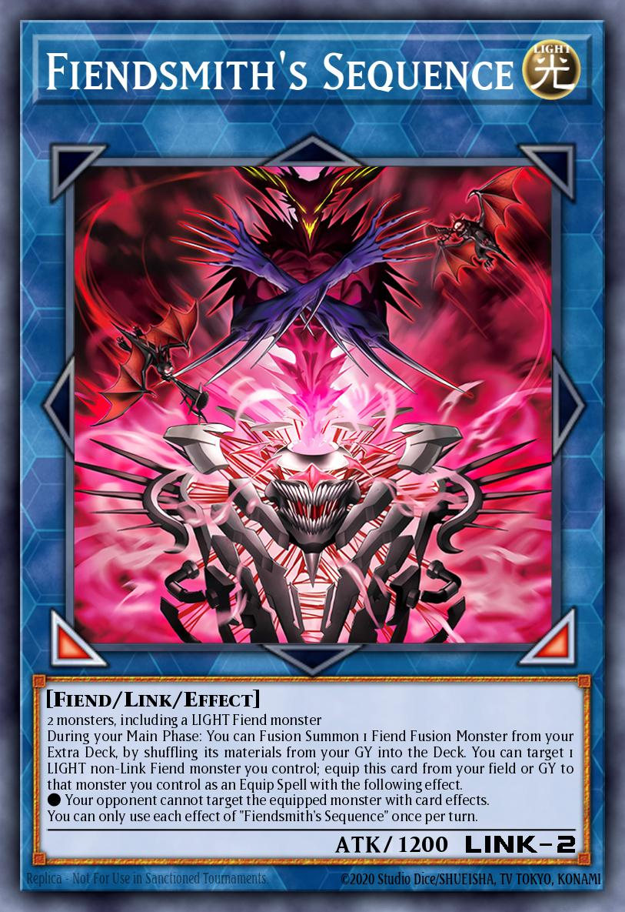 | 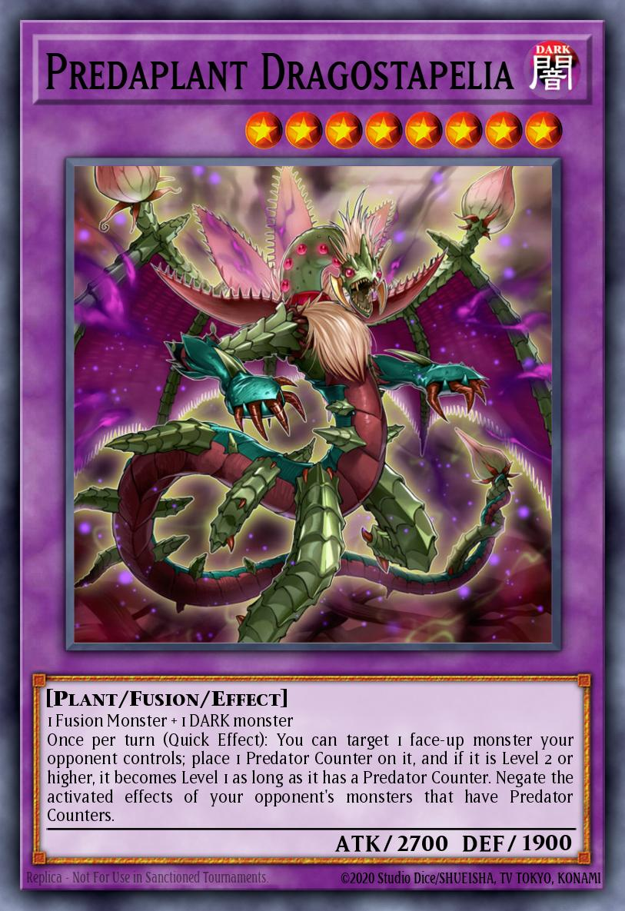 |  |

**Cobertura A10 vigente:** **12/12 rutas A09 tienen guía secuencial**, y cuatro accesos Extra disponen de paneles condicionales; **39/39 identidades tienen fotografía genuina** (13 JPG + 26 PNG) desde V37. El 12/12 mide cobertura de guías, no aprobación universal de cadenas ni ejecución de duelos. Lo que no esté demostrado por una ruta permanece **SIN DATO**.

### A10.2 — Seis desvíos visuales para no continuar un combo roto

Estas viñetas se colocan **dentro de la guía madre** al fallar el paso indicado. Su contenido proviene de B01–B06, sin sumar nuevas rutas ni suponer que el rival no puede encadenar otra carta.

| Desvío y paso marcado | Cuadro 1: respuesta | Cuadro 2: estado real | Cuadro 3: opción legal | Cuadro 4: desenlace mostrado |
|---|---|---|---|---|
| **B01 → G04, hito 2** | Ash niega el efecto de envío de Tatsun | **Angbruja y Tatsun permanecen en campo**; no hay 009/004/008 en GY | Link-2 con ambos monstruos para **S:P** | S:P campo; ambos Memento en GY; respuesta condicional en turno rival. Arte S:P: `imagenes/19188.jpg` |
| **B02 → G05, hito 4** | Ash niega a Goblin: **no se destruye ni envía Fusión+005** | Campo Goblin+Desvantasma; mano Maza; GY Hoja,Tatsun,Angbruja | Link-2 a **S:P** usando ambos del campo | S:P campo; Maza permanece mano; **no** se muestra una Fusión inexistente |
| **B03 → G07, entre hitos 1–3** | Droll después de la búsqueda de Angbruja | Campo Angbruja+Tatsun; no se permiten nuevas adiciones desde Main al resto del turno | Si hay monstruo rival seleccionable y Grabador en mano/Deck, usar **C03** vía Luna→Réquiem | Grabador en campo; equipo Réquiem + rival enviados al GY si resuelve; **no** atribuir robo/destrucción de Quimera bajo Droll |
| **B04 → G09, hito 3–4** | Rival retira Réquiem equipado | Grabador ya **no** está equipado con Carta de Monstruo; Goblin continúa en mano | Conservar Goblin y Grabador; no declarar Princesa sin nuevo equipo válido | Grabador campo; Princesa **no Invocada**; sin robo gratuito |
| **B05 → G10, hito 4** | Rival niega Secuencia con Infinito Temporal | Secuencia permanece en campo, Grabador+Goblin en GY; Duque **no** aparece | Mantener Angbruja recuperada en mano; Normal inicial gastada | Sin Duque no existe Normal adicional ni segundo efecto de búsqueda de Witch |
| **B06 → G12, hito 4** | Rival encadena Llamado a Horn destruido, en GY | Fiesta sí trajo Hoja; Horn queda desterrado y el efecto de destrucción se niega | Conservar Angbruja+Hoja y revisar opciones de mano reales | Dos cartas rivales **no** destruidas por Horn; no contar retirada ni mover Horn al GY nuevamente |

**Regla editorial A10:** foto auténtica por CID, propósito, requisitos, pasos numerados, **zona tras cada paso**, resultado y rama de fallo. Las doce guías tienen recurso visual y se registró publicación V40; la revisión de reglas sigue su propio estado A07/A09 y no se transforma automáticamente en certificación por contar fotografías.

---

### A10.3 — Acta de cierre visual y cinco puertas de salida (18-11-2026)

**Comprobación estática de integridad A09↔A10 (18-11-2026, posterior a A09.C):** sobre el HTML canónico `guias/GUIA_VISUAL_A01_A10.html` se contaron **12 paneles identificados C01–C12 sin duplicados**, **69 elementos de paso**, **668 referencias locales `src`/`href`** a **39 imágenes CID diferentes** y **0 rutas de imagen inexistentes** en el paquete. El recuento de pasos corresponde a las 69 acciones enumeradas en A09 (7+4+7+8+9+5+4+4+5+5+6+5). Esto cierra **integridad estructural estática**, no acredita correspondencia semántica de cada movimiento, render en navegador, estados animados ni datos importados en Station X; esos controles continúan pendientes y no se declara paridad funcional completa.

**Guía única actualizada:** [abrir las guías interactivas](guias/GUIA_VISUAL_A01_A10.html#rutas). **12/12 rutas C01–C12** corresponden a G01–G12; **69/69 pasos** contienen imagen oficial CID, nombre, verbo, origen → destino y texto de A09, en disposición vertical. Antes de la ruta, el visor muestra motor A06 y decisión A08; después, mano inicial con solo las cartas conocidas, recursos y zonas finales en paneles de campo, mano, GY, destierro y M/T/materiales Xyz, dejando la posición específica **SIN DATO** cuando A09 no la fija. Se puede cambiar ruta con selector, anterior/siguiente, teclado o controles táctiles; las fotografías abren su archivo para ampliación. **No hay otra ficha canónica ni nuevos combos ficticios**.

**Auditoría de fotos:** 39/39 imágenes físicas originales (13 JPG + 26 PNG) comprobadas por CID; las referencias `../imagenes/<CID>.<ext>` usadas en el visor corresponden a archivos existentes. Se corrigieron las fotografías discordantes con el sujeto de los pasos (p. ej., una viñeta de Tatsun con foto de Angbruja) y **seis pasos vacíos**. El resultado tiene fotos visibles en los **69 pasos**, más cuatro paneles para EX-M01–EX-M04, que explican condiciones y no se suman a combos.

**Interrupciones situadas:** los seis desvíos documentales B01–B06 y las cadenas MC-X01–04/MEM-A se vinculan a puntos pertinentes: B01→C04-2; B02→C05-5; B03→C07; B04→C09-3; B05→C10-4; B06→C12-5. El botón **«El oponente me interrumpe en este paso»** existe en cada paso; al abrirse **suspende el campo base**. Muestra el caso documentado cuando hay uno, o `SIN_CONTINUACION_DEMOSTRADA`; nunca proyecta un final alternativo no reconstruido. El visor conserva como **condicionales** los cortes de Ash, Droll, Rugido, Infinito Temporal y Llamado por la Tumba. A07 detalla costes y cadenas: un paso de la guía **no es replay**.

| Puerta de salida del módulo | Dictamen V42 | Prueba / pendiente que se conserva |
|---|---|---|
| **DOCUMENTADA / A09** | **12/12 `DOCUMENTADA_CONDICIONAL`** | A09.7, 24 manos; rutas bajo sus condiciones, no replays. |
| **GUIA_COMPLETA / A10** | **12/12 `GUIA_COMPLETA_DOCUMENTAL`** | 69 fotos de paso, 39/39 CID, 4 accesos Extra, controles y zonas. QA estructural de imágenes y HTML; **sin captura comparativa de render real**. |
| **REGLA_CERTIFICADA / A07, A11–A13** | **`NO_CERTIFICADA_EXTERNAMENTE`** | A07 cotejó 34 controles y seis ramas; A11–A13 y ejecución contextual/mesa no se certifican aquí. |
| **IMPORTABLE / ZIP e importador** | **`IMPORTACION_SIN_COMPROBAR`** | No se generó ZIP nuevo ni se probó el contrato del importador; la importación histórica V40 no valida V42. |
| **PUBLICABLE / permiso** | **`PUBLICACION_NO_AUTORIZADA`** | Se actualizan archivos del repositorio, **sin despliegue nuevo** ni permiso de presentar como combos certificados. |

**Resultado:** A10 queda **`COMPLETA` en cobertura didáctica documental**. Esto **no equivale** a `REGLA_CERTIFICADA`, `IMPORTABLE` o `PUBLICABLE`. La fidelidad de render en navegador y cualquier simulación requieren ensayo/captura separados, sin atribuir resultados que no ocurrieron. Inventario inalterado: **Main 41 / Extra 15 / Side 14 / Reserva 0**. A01–A10 quedan cerrados en su propio alcance documental; el próximo trabajo será solo el que Miguel solicite.

### A10.4 — Corrección de tabla y nueva revisión estática (18-11-2026)

**Defecto corregido:** el cuadro HTML `a10-current-status` tenía **cuatro encabezados para cinco celdas por fila**; se incorporó la columna «Descripción». El resultado es **5 encabezados, 10 filas y 50 celdas**, con la misma información y sin alterar las rutas ni los estados del deck.

**Verificaciones ejecutadas sobre la guía local:** `data-route` C01–C12 únicos (**12/12**), **69 pasos**, **668 referencias locales `src`/`href` de imágenes**, **0 archivos de imagen faltantes**. Se preservaron 39 imágenes únicas CID y el inventario aprobado **41/15/14**. La corrección del encabezado y este recuento son verificaciones de estructura, **no** una validación de resolución de efectos.

**Límite de QA:** se intentó abrir la guía mediante Chromium headless local, pero el proceso quedó bloqueado por la restricción del entorno (`socket() failed: Operation not permitted`), sin render, capturas ni recorrido interactivo acreditados. Por ello **A10 conserva `COMPLETA_DOCUMENTAL`**, y los controles de **QA visual escritorio/móvil**, **comparación con las dos superficies reales del editor** e **importación estructural** siguen `PENDIENTE` como aceptación externa. La calculadora no es necesaria para esas pruebas. No se atribuye publicación nueva.

## ITERACIÓN 2 · Profundización verificable de A01–A10 (17-11-2026)

**Control documental:** respetar los materiales, costes, zonas, ventanas, límites por turno y recursos del inventario físico; no se atribuyen simulaciones ejecutadas.

### A01 · Rol competitivo más preciso: dos ritmos incompatibles en una misma Main

1. **Ritmo de desarrollo:** Angbruja/Hoja Oscura → autodestrucción → nombres al GY → Fusión → Rey Creación y/o Creación Combinada. Prioridad **calidad de amenazas y recurso residual**, no número bruto de Invocaciones.
2. **Ritmo de control temporal:** abrir con **Oleada de Calor** exactamente en el inicio de Main Phase 1. Su restricción de Invocaciones Normales/Especiales de monstruos de efecto dura hasta tu próxima Draw Phase **y afecta a ambos**. Puede comprar tiempo frente a una mano rival dependiente de monstruos de efecto, pero **impide iniciar después los combos de efecto de este mismo turno**.
3. **Ritmo de rompimiento:** si vas segundo y el rival ya expuso cartas, comparar **Quimera (C07)** contra **Demoniherrero con objetivo (C03)**, **Dragón de Cuerno (C12)** y **Gotas Prohibidas**, según número de materiales/objetivos y coste; nunca asumir que destruyen cartas protegidas.
4. **Criterio de victoria:** Rey destruye cartas al intercambiar monstruos Memento propios; Tecuhtlica presiona con 5000 ATK, pero **solo puede atacar todos los monstruos rivales si es el único monstruo que controlas**. Con Rey al lado **no** tiene ese ataque múltiple.
5. **Deuda de prueba:** no existen registros de victoria, tasa de brick, éxito a través de handtraps ni resultados de 20 manos reales; ninguna calificación de tier debe tratarse como medida empírica.

### A02 · Árbol de decisiones según recursos y ventana

| Comprobación inmediata | Si se cumple | Si no se cumple | Resultado realista |
|---|---|---|---|
| ¿Acaba de empezar tu Main Phase 1 y tienes Oleada? | Elegir **Heat Wave** como plan de pase/control **o** desarrollar monstruos, no ambos | Continuar al motor | Dos planes excluyentes en esa Main |
| ¿Hay Angbruja o Hoja y las piezas obligatorias siguen accesibles? | Consultar **C04/C05**; con Fusión y Angbruja, comparar **C01/C06/C07** | Identificar extensión real, no inventar starter | Evita atribuir a Tatsun aislado el final completo |
| ¿Tatsun puede destruir Memento propio y todavía quedan objetivos de Nivel correcto? | Enviar combinación válida: **2+3** o **1+1+2** | Conservar campo o usar Link con los cuerpos disponibles | No enviar nombres únicos inexistentes en Deck |
| ¿Se destruyó un monstruo propio por efecto este turno? | Considerar materiales Memento del GY para Fusión | Fusionar solamente desde mano/campo | El permiso de GY es condicional y no continuo |
| ¿El rival activó Droll después de una adición a mano? | Evitar **nuevas adiciones desde Deck a mano**; elegir Invocación directa cuando la carta lo permita | Seguir búsquedas normales si sus demás condiciones se cumplen | No suponer que Droll niega Invocaciones desde Deck |
| ¿Se pueden reunir cinco nombres distintos ajenos a Tecuhtlica en mano/GY? | Invocar jefe devolviendo exactamente esos cinco | Retrasar al jefe; conservar recursos y proteger el tablero | No contar cinco copias del mismo nombre ni al propio jefe |
| ¿Dispones de Goblin **en mano** y Tecuhtlica en campo? | Evaluar descarte de Goblin ante efectos que seleccionan | No declarar protección por Goblin en GY | Mantener control estricto de zonas |

**Plan por turnos:** primero priorizar una amenaza que pueda responder sin consumir todos los nombres; segundo priorizar retirar interacción **antes** de comprometer la Fusión; turno medio usar Desvantasma, Campo y efecto de Cementerio de Fusión para reparar; turno tardío conservar una ruta de reciclaje y evitar barajar materiales que todavía se necesitan para otra jugada.

### A03 · Control de inventario físico
El inventario queda en Main 41, Extra 15 y Side 14, sin completar por deducción el hueco del Side. El cotejo de cantidades no modifica ni excluye ninguna carta.

### A04 · Imágenes: trazabilidad exhaustiva y orden de completado

- **Imágenes genuinas iniciales (13 JPG):** `20196`, `12950`, `9279`, `20500`, `15299`, `13619`, `15296`, `12870`, `19184`, `20225`, `19188`, `20226`, `20206`.
- **CIDs del motor y guías incorporados como PNG en V37 (14):** `19364`, `19362`, `19363`, `19366`, `19360`, `20199`, `19365`, `19472`, `19904`, `20216`, `19878`, `16845`, `19368`, `19361`.
- **CIDs de soporte y accesos incorporados como PNG en V37 (12):** `20491`, `9139`, `20533`, `19367`, `20423`, `13081`, `19932`, `20389`, `9657`, `20764`, `11243`, `21203`. **Total: 39/39 CIDs con imagen, sin faltantes.**
- **Norma visual actual:** utilizar el archivo JPG/PNG que existe para cada CID; nunca sustituir un arte por otro ni marcar como ausente una imagen presente.

### A05 · Utilidad y riesgo por carta: ocho decisiones clave

| Carta | Cuándo aporta valor | Error que invalida la jugada | Prioridad de conservación |
|---|---|---|---|
| Angbruja 001 | Búsqueda inicial y recuperación de un Memento ≤2 del GY | No declarar esa recuperación si no hay objetivo o destrucción propia resoluble | Starter principal |
| Tatsun 002 | Entrega selectiva de nombres por suma de Niveles | Enviar 2+3+1 cuando el monstruo destruido era Nivel 5; excede Nivel 5 | Extensor de GY |
| Hoja Oscura 003 | Starter alternativo C05 y puente a Angbruja | Usar una segunda activación del mismo efecto limitado por nombre | Starter alternativo |
| Goblin 004 | Envía dos cartas Memento distintas; en mano protege frente a seleccionar con jefe | Creer que un Goblin en GY puede descartarse desde mano | Función doble, **zona importa** |
| Maza 008 | Busca Memento autodestruyendo; desde **mano** en Main rival puede tomar monstruo si controlas jefe | Intentar pagar descarte teniendo Maza solo en GY | Extensión y amenaza situacional |
| Fusión Mementotlán 015 | Fusión rápida; GY habilitado tras autodestrucción; propia destrucción + búsqueda por efecto GY | Activar dos veces el mismo efecto por nombre o usar GY sin condición | Mágica núcleo |
| Oleada de Calor 017 | Impide desarrollo de efecto al comienzo de la Main | Tratarla como cierre de combo después de las Invocaciones | Elección de control, **no extensor** |
| Grabador 011 | Link Réquiem: entrada, equipamiento y eliminación de objetivo rival | Buscar una M/T Demoniherrero inexistente en esta lista | Puente condicionado |

**Control documental:** respetar los materiales, costes, zonas, ventanas, límites por turno y recursos del inventario físico; no se atribuyen simulaciones ejecutadas.

### A06 · Auditoría funcional de las 13 identidades del Extra Deck

| Carta / cantidad | Acceso trazado | Propósito | Resultado del examen |
|---|---|---|---|
| Rey Creación **×3** | C01/C04/C05/C11 | Envío de 3 Memento, destrucción rápida por intercambio | **Principal**; tres copias no permiten usar el mismo efecto por nombre más de una vez/turno |
| Dragón Gemelo **×1** | C06 | Búsqueda de dos nombres tras destruir, tablero de 2800+5000 | **Alternativa** al Rey, exige materiales correctos |
| Quimera Guardián **×1** | C07 | Una carta robada por material de mano; hasta dos destrucciones por campo | **Ir segundo**; sin defensa de «Polimerización» en GY |
| Dragostapelia **×1** | EX-M01 | Contador Depredador y negación condicionada | **Continuación** que consume Rey; no sumar como starter |
| S:P Pequeña Caballera **×1** | C08 | Destierro temporal en respuesta a activación rival | **Plan bajo compromiso**; con dos Main no habilita destierro de entrada |
| Luna del Cielo Cerrado **×1** | C03/C09/C10 | Puente Demonio LUZ hacia Réquiem | **Material**, no usar efecto Link-5 ausente |
| Réquiem Demoniherrero **×1** | C03/C09/C10 | Saca Grabador y puede equiparse desde GY | **Puente**; no buscar una M/T inexistente |
| Secuencia Demoniherrero **×1** | C10 | Fusión desde GY barajando materiales adecuados | **Condicional**, contar 2 monstruos e incluido Demonio LUZ |
| Duque de la Defunción **×1** | C10 | Normal adicional y reciclaje | **Condicional**; cuesta 500 LP en Standby futura o se destruye |
| Princesa Necroequipo **×1** | C09 | Convertir monstruo equipado + Demonio en cuerpo | **Condicional**; Invocación no produce robo automático |
| TY-PHON **×1** | EX-M02 | Devolver monstruo del rival en ventana con 2+ Invocaciones Extra | **Anticampo**, pero estorba a tus propios jefes |
| Aero Tiburón **×1** | EX-M03 | Xyz Rango 3, daño ligado a propios desterrados | **Utilidad baja** sin desterrados, pese al acceso documentado |
| D/D/D César **×1** | EX-M04 | Negar Invocación especial por el tipo de efecto adecuado | Condiciones de Invocación y efectos del texto oficial |

**Verificación aritmética:** **3 copias de Rey + 12 copias individuales = 15 Extra**, **13 identidades**. No se declara “todos los Extra son óptimos” solo por existir ruta mecánica. Para cada carta Extra se explicita el **para qué**, el **con qué materiales**, el **cuándo** y la **contrapartida**.

### A07 · Cuatro nuevos controles reglamentarios y seis micropruebas

| Control | Regla nueva en auditoría | Decisión |
|---|---|---|
| **R31** | Cantidad física preservada y documentada | `REVISAR_LISTA` sin alterar ejemplares |
| **R32** | Llamado por la Tumba 021 es respuesta condicional a monstruo en GY. | Comprobar objetivo, cadena y duración del efecto |
| **R33** | Talento de Tácticas Triples 022 necesita que el rival activara efecto de monstruo durante Main Phase propia. | Comprobar cuál de sus tres efectos se escoge y su ventana |
| **R34** | César 028 es Xyz de dos Demonios Nivel 6. | EX-M04 solo funciona si ambos materiales están simultáneamente en campo; comprobar activación de negación |

| Microprueba de mesa | Antes | Acción y condición | Después / fallo que se evita |
|---|---|---|---|
| **Q01: Nivel de Tatsun** | Tatsun Nivel 5; 009 Nivel 2 y 007 Nivel 3 permanecen en Deck | Destruir Tatsun con su efecto para enviar 009+007 | **2+3=5**, permitido; proponer 2+3+1 sería ilegal |
| **Q02: dos Fusiones** | Dos ejemplares 015 en mano, una Main propia | Usar el primer efecto de un 015 | El primer efecto de la segunda copia **no se reutiliza ese mismo turno**; el efecto distinto de GY tiene su propia condición |
| **Q03: protección Goblin** | Tecuhtlica campo; Goblin GY, ninguna copia en mano | Rival activa selección contra un Memento | **No** hay descarte desde mano; Goblin en GY no paga el coste |
| **Q04: Quimera** | 2 Memento campo, 1 Memento mano; rival controla 2 cartas destruibles | 015 fusiona tres nombres distintos, materiales de ambas zonas | Quimera roba **1** y puede destruir **2**; carta robada no tiene identidad conocida |
| **Q05: Princesa** | Grabador equipado con Réquiem; Goblin en mano | Enviar ambos por el procedimiento de Princesa | Princesa puede entrar; **no roba** porque Goblin no fue enviado para *activar* otro efecto |
| **Q06: S:P** | Angbruja+Tatsun de Main usados para Link | S:P invocada; después rival activa efecto con objetivo boca arriba presente | **No** primer destierro al invocar; sí evaluar su efecto rápido en respuesta, con **dos objetivos apropiados** |

**Exclusión de prueba:** estas micropruebas son comprobaciones de texto/estado y **no** replays. Ante negaciones que cambien si una destrucción resuelve, recalcular todas las zonas **antes** de continuar; no resolver dos efectos “como si el rival no hubiera actuado”.

### A08 · Decisiones contra adversarios, Side y mejoras medibles

| Situación del rival | Plan preferente sujeto a mano real | Qué NO debes hacer | Variable a registrar |
|---|---|---|---|
| Rival depende de búsquedas a mano | Antes de su siguiente búsqueda, evaluar **Ash propia**; Droll solamente dentro del límite del formato | Afirmar que Droll bloquea Invocaciones directas del Deck | Búsquedas impedidas/partida |
| Rival desarrolla muchos monstruos desde Deck/Extra | Fuwalos desde mano **si controlas cero cartas**; tras Side evaluar las 2 adicionales | Activarlo desde una posición con cartas propias | Cartas robadas y devueltas |
| Rival destierra para encadenar extensiones | Side plan con Lancea en turno rival | Olvidar que también impide **tus** destierros durante ese turno | Efectos propios bloqueados |
| Rival tiene monstruos de efecto resistentes | Gotas, S:P, Quimera o Grabador según protección, objetivo y costes | Garantizar que “destruir” atraviesa inmunidad | Cartas retiradas realmente |
| Rival abre 2+ Invocaciones Extra | Considerar TY-PHON al final de tu desarrollo | Invocarlo temprano y después reclamar más Invocaciones propias | Recursos que sacrifica |
| Segundo duelo tras perder por un campo amplio | Elegir **uno** de S01–S05 ya documentados; realizar entradas y salidas uno a uno | Mezclar simultáneamente todas las cinco recetas | Main antes/después y motivo |

**Control documental:** respetar los materiales, costes, zonas, ventanas, límites por turno y recursos del inventario físico; no se atribuyen simulaciones ejecutadas.

**Protocolo de mejora opcional:** identificar la carta concreta, describir el objetivo táctico, conservar el inventario hasta autorización del usuario y volver a calcular las manos y rutas afectadas.

### A08.3 — Matchups documentales con tres rivales TCG registrados

**Selección reproducible (17-11-2026):** Memento `671` frente a Crystron/Horus `677`, Purrely `660` y Salamangreat `673`; se utilizaron las **fichas existentes de esos tres rivales** (NUEVO_13/14/15), todos en el conjunto TCG Advanced de Station X. Cubren respectivamente cadenas reactivas/Sincronía, construcción de Xyz con materiales y enlaces recurrentes. **Cobertura 3/3 seleccionados, no 3/15 ni toda la biblioteca**. Fuentes adicionales: enlaces oficiales de Tristaros, Purrelyly, Noir, Gacela y Rugido indicados en el texto. No son duelos ni porcentajes de victoria.

| Rival real y amenaza que sí consta en su lista | Empiezas tú: línea con propósito | Vas segundo: interacción y recuperación | Side opcional entre duelos, **no acumulativo** | Condición de victoria / error que cambia el resultado |
|---|---|---|---|---|
| **Crystron 677:** Smiger, Citree, Tristaros, Sulfador y motor Horus hacia Xyz | Con **Angbruja/Fusión** elegir C01; con solo Angbruja C04, pero Ash sobre la primera búsqueda corta ese final (MC-X01). Mantener el recurso que realmente sobrevivió. | C03 puede enviar un monstruo rival seleccionable usando Grabador equipado; ante **Tristaros** no atribuirle negación de nuestra Fusión (MC-X02). Si Crystron llegó a **Infinito con material**, anticipar su negación sobre una activación clave sin declararla ya gastada. | **S05:** +3 Lancea/−3 Oleada si predomina desterrar del GY **durante turno Crystron**; **alternativa S01:** +2 Fuwalos/−2 Oleada si abusa de Invocaciones desde Deck/Extra. | Amenaza Memento: supervivencia de Rey+005; falla si se dan por recuperados recursos interrumpidos. Lancea bloquea **también** destierros propios, no desactiva automáticamente la línea Horus. |
| **Purrely 660:** Purrelyly busca carta no Rápida; Recuerdos desarrollan Xyz y Noir puede acumular **≥5 materiales** | Preparar C04/C01 o C08 según mano; conservar Ash para la búsqueda real de **Purrelyly** o efecto que Invoca desde Deck, no para un éxito supuesto de la excavación de Purrely. | Si Noir tiene **≥5 materiales**, las destrucciones activadas de C07/026 **no garantizan retirarlo** (MC-X03). Priorizar respuestas antes de que alcance esa condición o interactuar con otros cuerpos/cartas válidos. | **S01:** +2 Fuwalos/−2 Oleada si el rival está invocando repetidamente desde Deck/Extra. No asumir que Meowls se dispara por cada material Xyz. | Ganar mediante presión Memento y gestión de recursos reales; no certificar que Quimera destruya Noir inmune ni que una excavación Purrely obtuvo un Recuerdo concreto. |
| **Salamangreat 673:** Gacela, Círculo, Lincefogata, enlaces Lobo/Fénix y **Rugido ×1** | C01/C04 si el motor resuelve; si eliges Oleada desde inicio MP1, bloqueas también tu desarrollo. Ash puede frenar el **envío desde Deck de Gacela** según ventana. | C07 solo si hay **dos cartas realmente destruibles**; C03 necesita monstruo seleccionable. Si Rugido ya está Colocado y controla Link, puede negar Fiesta/Fusión: **MC-X04** registra la pérdida real. | **S01:** +2 Fuwalos/−2 Oleada ante muchas Invocaciones Extra; **alternativa S03:** +3 Gordiano/−3 Oleada si se justifican objetivos boca arriba y el alto coste. | Ganar exige abrir el tablero sin gastar seis o doce cartas Extra a ciegas. Rugido no se presume buscado en toda apertura rival; su carta física es una y necesita su condición. |

**Regla de aplicación:** las configuraciones S01/S03/S05 son distintas y conservarían Main **41** cada una; jamás se presentan como mano del duelo 1. Cada matchup enlaza las rutas A09 **C01/C03/C04/C07/C08**, las guías homónimas A10 y los cortes MC-X01–04. **Falta solo rendimiento empírico o una posición de rival distinta** para evaluar otro desenlace; no se inventa nota competitiva.

### A09 · Seis manos nuevas H15–H20; mantener 12 combos independientes documentados

Estos son **casos de decisión**, no seis combos nuevos: cada uno remite a C01–C12 o explica por qué una línea deja de ser ejecutable. Las cartas citadas están en el inventario; **las demás de la mano no se inventan**.

| ID | Mano declarada y campo inicial | Decisión por pasos | Meta/estado final declarable |
|---|---|---|---|
| **H15** | Primero, Angbruja + Oleada; inicio MP1, ambos campos vacíos | **1.** Elegir control o motor. **2A.** Si activas Oleada ahora, termina turno sin Invocar monstruos de efecto. **2B.** Si prefieres Normal Angbruja, **no** puedes activar Oleada después de haber dejado pasar el inicio de MP1. | **Excluyentes:** plan de pase vs motor; no “Oleada + Rey el mismo turno”. |
| **H16** | Primero, Angbruja + Fusión + Goblin; Goblin en mano | **1.** Ejecutar prefijo de C06; **2.** recuperar Dormiveja; **3.** Fusión a Dragón Gemelo; **4.** destruir Dormiveja de mano y buscar 005 + otro Goblin **solo si quedan objetivos distintos válidos**. | Si se conserva al menos un **Goblin en mano**, puede proteger al jefe frente a seleccionar; revisar copias reales: **2 en Main**. Si se usan las dos, no queda Goblin para descartar. |
| **H17** | Segundo, Angbruja + Fusión; rival controla 2 cartas destruibles | **1.** Normal Angbruja → Tatsun; **2.** enviar 009+007; **3.** recuperar Dormiveja; **4.** Fusión con 2 campo +1 mano a Quimera. | C07: robo 1 (**carta desconocida**) y hasta 2 destrucciones; no prometer OTK ni protección de «Polimerización». |
| **H18** | Primero, Hoja Oscura sola; rival usa Ash sobre envío de Goblin en la línea C05 | **1.** C05 hasta invocar Goblin; **2.** activa Goblin para enviar Fusión+005; **3.** si Ash niega ese efecto, **no** llegan esas cartas al GY; **4.** reevaluar S:P con monstruos en campo. | No atribuir Fusión a la mano ni jefes; salida de contingencia descrita en B02. |
| **H19** | Primero, Angbruja + Fiesta + Goblin; rival interrumpe el efecto de Secuencia en C10 | **1.** Recuperar Angbruja con 009; **2.** formar Secuencia; **3.** rival niega su Fusión; **4.** conservar Angbruja en mano. | **No aparece Duque**, por tanto no hay Normal adicional. La Normal inicial está gastada: B05. |
| **H20** | Segundo, Angbruja + Dragón de Cuerno + Fiesta; rival tiene 2 cartas boca arriba válidas | **1.** Tatsun manda 3 nombres con suma 4; **2.** conserva 009 en GY; **3.** invoca Horn de mano; **4.** Fiesta destruye Horn y trae Hoja; **5.** Horn destruye Angbruja y dos cartas rivales si son objetivos y la cadena resuelve. | C12: campo Hoja; rival pierde hasta 2 cartas; **si rival elimina Horn/niega efecto, no afirmar retirada**. |

**Balance transparente:** **20 escenarios H01–H20, 12 rutas C01–C12, 9 familias + 3 variantes, 4 pruebas de acceso EX-M01–EX-M04, 0 replays, 0 tasas medidas**. Para declarar un combo `PROBADO_EN_SIMULADOR` se exigirá fecha, plataforma, mano exacta, chain links, zonas y resultado guardados en un registro independiente. No sumar manos de contingencia a combos nuevos.

### A09.6 — H21–H24: cuatro manos completas de cinco cartas y piezas fuera del Deck

Ejercicios **con cinco cartas concretas del Main de 41**, sin simular robos reales ni presumir otras cartas. Todos los supuestos de rival y de disponibilidad del Deck se identifican; son **adaptaciones de C01–C12**, no combos nuevos.

| Mano inicial de cinco | Pasos y control de recursos | Resultado legal si no hay otras respuestas |
|---|---|---|
| **H21 · Angbruja + Fusión + Maza + Flor de Ceniza + Oleada**, primero | Elegir **motor y no Oleada**. Hacer prefijo de C01: Angbruja busca Tatsun, Tatsun manda Desvantasma+Dormiveja, recuperar Dormiveja, Fusión con tres nombres a Rey. **Maza ×1 está en mano:** Rey envía **Creación Combinada + Goblin + Dragón de Cuerno** del Deck, no una Maza inexistente allí. | Hay al menos **seis nombres diferentes ajenos al jefe en GY** (Tatsun, Angbruja, Desvantasma, Dormiveja, Goblin, Horn): barajar cinco para invocar 5000. **Rey + Creación Combinada**; Maza, Ash y Oleada permanecen en mano salvo acción real. Maza no se descarta automáticamente. |
| **H22 · Hoja Oscura + Fusión + Fusión + Droll + Goblin**, primero | En C05 literal harían falta **dos Fusiones en Deck**: solo queda **una**, porque dos están robadas. En vez de buscar dos, Normal Hoja → autodestruirse e Invocar Angbruja del Deck; buscar y Especial Tatsun → enviar **Desvantasma + Dormiveja**; Desvantasma revive y recupera Dormiveja; **usar una Fusión ya en mano** con Angbruja+Desvantasma de Campo y Dormiveja de mano. Rey envía **005+Maza+Horn** desde Deck. | El GY contiene al menos **Hoja, Tatsun, Angbruja, Desvantasma, Dormiveja, Maza y Horn** (siete nombres distintos fuera de 005): barajar cinco permite 5000 junto a Rey. La **segunda Fusión permanece en mano** y no se activa automáticamente; Droll/Goblin no fueron materiales. |
| **H23 · Angbruja + Grabador + Fiesta + Flor de Ceniza + Gotas**, segundo; rival controla monstruo que Grabador puede seleccionar | Angbruja busca Tatsun, ambos pasan a **Luna→Réquiem** como en C03. El único **Grabador ya está en mano**: sacrificar Réquiem para traerlo **desde mano**, equipar Réquiem desde GY y seleccionar equipo+monstruo rival para mandarlos al GY. | Grabador queda en Campo tras esa retirada; no se concede búsqueda de M/T Demoniherrero inexistente. Si el rival carece de objetivo válido o retira equipo, **no** se acredita la eliminación. Fiesta, Ash y Gotas permanecen en mano salvo uso declarado. |
| **H24 · Angbruja + Fiesta + Desvantasma + Droll + Fuwalos**, primero | Desvantasma única está **en mano**, no disponible para envío desde Deck de C02. Buscar **Creación Combinada** con Angbruja; Fiesta destruye Angbruja e Invoca Tatsun desde Deck; Tatsun se autodestruye y envía **Goblin Nivel 1 + Maza Nivel 1 + Dormiveja Nivel 3** (suma exactamente **5**). | En GY quedan **Angbruja, Tatsun, Goblin, Maza y Dormiveja** (cinco nombres): barajarlos para Especial Invocar **005 desde mano** como **único monstruo de 5000**. Desvantasma/Droll/Fuwalos iniciales siguen en mano; no atribuir su autorresurrección ni un Rey no Fusionado. |

**Nuevo corte A09:** **24 manos H01–H24**, **12 rutas C01–C12** (nueve familias y tres variantes), **4 accesos condicionales Extra**, **6 desvíos B01–B06** y **6 controles MEM-A**; **0 replays acreditados**. Las manos adicionales evidencian que robar una pieza de un solo ejemplar **cambia el recorrido, pero no implica necesariamente quedar sin jugada**.

### A10 · Guiones visuales precisos para tres rutas prioritarias

**Panel V01 → G01/C01 · Primer turno, dos jefes (no negación):**

1. **Entrada:** mano Angbruja + Fusión; foto Angbruja `19364` **PENDIENTE**; Fusión `19904` **PENDIENTE**. Campo/GY propios vacíos.
2. **Buscar:** Normal Angbruja, buscar Tatsun; Tatsun `19362` **PENDIENTE**. **Estado:** dos Memento campo.
3. **Enviar:** destruir Tatsun propio, enviar 009 (Nivel 2) + 007 (Nivel 3). **Estado:** Tatsun,009,007 en GY; Angbruja campo.
4. **Recuperar/fusionar:** Invocar 009 desde GY, recuperar Dormiveja; fusionar tres Memento según **C01** a Rey. **Estado:** Rey 3000 campo; no inventar cartas robadas.
5. **Preparar 5000:** Rey envía los tres nombres declarados en C01; con cinco **nombres diferentes** y ajenos a 005, barajar exactamente cinco y Especial 005 desde GY. **Estado:** Rey + jefe 5000; el GY cambia tras barajar. Fotos Rey `20216` y jefe `19360` **PENDIENTES**.
6. **Alerta de decisión:** tener Maza en GY **no** significa poder descartarla desde mano para tomar monstruo. **Salida:** no hay negación universal ni ataque a todos los monstruos con ambos jefes presentes.

**Panel V02 → G07/C07 · Segundo turno, Quimera para romper:**

1. **Entrada:** Angbruja + Fusión; rival con **dos** cartas realmente destruibles. Fotos de Angbruja/Fusión **PENDIENTES**.
2. **Motor:** buscar Tatsun, autodestruir Tatsun, enviar Desvantasma 2 + Dormiveja 3.
3. **Preparación de zonas:** 009 se Invoca desde GY y recupera 007 **a la mano**. Foto de 009 `19472` **PENDIENTE**.
4. **Pago por materiales:** Fusión utiliza **Angbruja+009 desde campo** y **007 desde mano** (tres nombres distintos). No usar 007 del GY en este paso ni cambiar la procedencia del material.
5. **Resolución:** Quimera `16845` **PENDIENTE** entra; robar **1 carta desconocida** y destruir hasta **2 cartas** rivales si el efecto puede resolver. **Marcador:** `ROBO_1_DESCONOCIDA; DESTRUCCION_RIVAL_MAX_2; SIN_POLIMERIZACION_GY`.

**Panel V03 → G08/C08 · S:P como línea de respaldo:**

1. **Entrada:** Angbruja como iniciador y Tatsun disponible en Deck.
2. **Preparar Link:** Normal Angbruja → buscar Tatsun → Especial Tatsun; **ambos vienen del Main**.
3. **Invocar S:P:** Enlace 2 con esos dos monstruos de efecto. **Imagen real:** `imagenes/19188.jpg`. **Aviso rojo:** el destierro al ser Invocada que requiere material del Extra **NO se activa** aquí.
4. **Esperar la ventana:** en turno rival, si se activa una carta/efecto y existe un monstruo rival boca arriba seleccionable, evaluar efecto rápido de S:P; seleccionar **a S:P y al monstruo rival**, destierro temporal.
5. **Resultado/contingencia:** si el rival no activa o no hay objetivo legal, S:P queda en campo **sin esa interacción**. Si sí resuelve, los dos desterrados regresan en End Phase, sujeto a reglas/estado. La foto real de S:P no convierte en genuinas las fotografías faltantes de los otros materiales.

**Criterios de cierre A10 conciliados:** G01–G12 tienen título, objetivo, mano mínima, zonas, ventana, consumos y resultado; V01–V03 aportan paneles didácticos. **Las 39 fotos son genuinas y están archivadas**, con guía HTML y publicación V40 registrada. Las doce rutas conservan **0 replays acreditados**, hecho separado de la completitud visual y que no impone prueba de mesa a la IA.

### Certificado de alcance de esta iteración

- **Conservado:** inventario físico 70 copias en 41/15/14; 39 identidades con enlaces oficiales; 12 combos con pasos; 12 guías anteriores; 13 imágenes reales; cinco planes de Side; A01–A10 previos.
- **Ampliado:** árbol de decisión de dos ritmos; 6 manos nuevas (14→20); matriz funcional de **13 identidades Extra**; controles R31–R34 (30→34); seis micropruebas; planes por matchup; tres storyboards V01–V03; cuatro conflictos normativos comprobados.
**Control documental:** respetar los materiales, costes, zonas, ventanas, límites por turno y recursos del inventario físico; no se atribuyen simulaciones ejecutadas.

---

## PROFUNDIZACIÓN A01–A05 INTEGRADA (sin archivo paralelo)

> Fecha 17-11-2026. Complemento del archivo `DECK_NUEVO_12_MEMENTOTLAN_DEMONIHERRERO_CONTENIDO_CURADO.md`; no modifica inventario, A06–A10, prompts ni pruebas. Ninguna ruta se marca como simulada. `NUEVO_12` es referencia documental, no el `deck_id` real de Station X.

## A01. Propósito, identidad híbrida y rutas de victoria

El mazo es **Mementotlán con un puente Demoniherrero reducido**, no dos motores completos autónomos. Los **41 Main** concentran piezas Memento, 1 Grabador Demoniherrero, herramientas de interacción y **Oleada de Calor** como plan de control alternativo. Objetivos operativos:

1. **Transformar destrucción propia en recurso:** Angbruja y Hoja Oscura inician secuencias que mandan/reviven Memento; Fusión accede a Rey Creación y otras Fusiones; Creación Combinada necesita **cinco nombres Memento distintos** disponibles en mano y/o GY.
2. **Controlar Campo por retirada:** Rey Creación, Dragón de Cuerno, Quimera Guardián y Gotas Prohibidas desempeñan trabajos diferentes; no comparten requisitos ni todos niegan efectos.
3. **Aprovechar Demoniherrero sin inventar búsquedas:** Luna de la Forja → Réquiem → Grabador construye material cuando existe ruta. **Grabador no tiene M/T Demoniherrero buscable en este Main**, así que esa rama es inválida aunque Grabador esté presente.
4. **Elegir plan opuesto cuando se abre Oleada de Calor:** activarla al inicio de Main Phase 1 puede frenar monstruos de efecto de ambos jugadores, **incluyendo tus invocaciones** durante su duración. La ruta de desarrollo de monstruos no se promete en simultáneo.
5. **Conservar presencia por turno:** Desvantasma, Mementomictlán y recuperación de Fusión pueden reconstruir recursos, pero después de invocar Creación Combinada se han devuelto cinco nombres al Deck; el GY no permanece inalterado.

**Condición de victoria no garantizada:** desgaste y ventaja por destrucción/recuperación; ataques cuando el campo realmente permite infligir daño. No usar «dos jefes» como sustituto de verificar cinco nombres ni como estimación de win rate.

## A02. Decisión por mano, campo, rival y ventana

| Contexto real | Plan a estudiar | Recurso/decisión crítica | Si el rival interrumpe… |
|---|---|---|---|
| Angbruja + Fusión | Familia C01: Rey y Creación Combinada | Debe existir acceso real a cada nombre; registrar cinco nombres antes de barajar | Si se niega el envío de Tatsun, el GY no contiene el recurso esperado |
| Solo Angbruja / solo Hoja | C04 o C05, una carta inicial | Verificar objetivos únicos todavía en Deck y normal consumida | Mantener campo y mano reales; no ejecutar búsqueda que no se resolvió |
| Oleada de Calor en mano al empezar MP1 | Plan de pasar/controlar, no desarrollo simultáneo | Se activa al **inicio** de MP1; afecta a ambos jugadores | Si ya desarrollaste monstruos, no anunciar Oleada retroactiva |
| Grabador robado y Réquiem accesible | Puente que usa Grabador desde mano | Enlace/equipo correcto, sin búsqueda de M/T Demoniherrero ausente | Elegir uso como material o permanecer con Memento |
| Dos Fusión en mano | Guardar una copia para turno/ventana futura si procede | Primer efecto sujeto a uso por nombre una vez por turno | La segunda copia no permite ejecutar el mismo efecto otra vez |
| Goblin en mano y jefe presente | Elegir preservarlo como protección contra seleccionar | Goblin debe estar en mano en el punto del descarte | Efectos sin seleccionar no se frenan solo por Goblin |
| Rival con dos cartas boca arriba y Horn disponible | Ruta C12 si existen **tres objetivos** legales para Horn | Contar entre ellos la propia Angbruja si así lo exige el plan | Sin tercer objetivo legal no declarar destrucción doble rival |
| Side decidido para duelo posterior | Sustituir cantidades concretas, nunca añadir copias al Main | El Side tiene **14 conocidas** y no participa en duelo 1 | No introducir la 15.ª carta sin aprobación |

**Filtro de seguridad por cada decisión:** `starter disponible → efecto activable → objetivo en zona correcta → coste/descartes → límite por nombre → material real Extra → estado residual`. Si una respuesta a Ash/Droll cambia el estado, crear rama alternativa y no heredar recursos ficticios.

## A03. Control físico y zonas inmutables

| Zona | Desglose auditado | Copias | Estado de aprobación |
|---|---|---:|---|
| Main | **25 monstruos, 16 mágicas, 0 trampas** | **41** | Documentado; cotejo/aceptación final del propietario pendiente |
| Extra | 15 copias, 13 identidades | **15** | Conservadas sin retirar cartas por observaciones normativas |
| Side | 14 copias identificadas | **14** | Espacio hasta 15 sin autorización de relleno |
| Reserva | 0 registradas | **0** | No hay carta adicional oculta |
| **Total** | **39 identidades** | **70** | Iguales a V34 |

Los **39 CIDs oficiales están en la matriz única A06.2** del documento principal, que sirve como inventario auditable y evita duplicar zonas. Una carta de Side nunca cuenta como carta disponible de la mano inicial del duelo 1. La lista actual es el objeto de estudio: los conflictos de formato documentados en A07 no son permiso de borrado.

## A04. Identificador oficial, imagen auténtica y certeza

- **39/39 identidades enlazadas a fichas Konami Neuron mediante CID.** Mantener el nombre físico de Miguel y registrar aparte variantes oficiales (por ejemplo, *Mementoal Tecuhtlica - Creación Combinada* y *Mementotlán Desvantasma*).
- **39/39 fotografías reales presentes** en `imagenes/`: 13 JPG históricos y 26 PNG incorporados en V37, cada uno con el CID exacto de la matriz A06.2. Una ficha oficial no sustituye la foto local, pero aquí no faltan CIDs fotografiados.
- El `deck_id` real es **671**. Un CID identifica una **carta**, no al deck; `NUEVO_12` solo nombra esta carpeta.
- **Estado de evidencia:** `IDENTIDAD_OFICIAL_COTEJADA` y `FOTO_LOCAL_DISPONIBLE` para 39/39; `EFECTO_RESUMIDO` para matriz; `RUTA_DOCUMENTAL_NO_SIMULADA` para A09.

## A05. Función, propósito, riesgo y prioridades de las 39 identidades

La **matriz única A06.2** del documento principal ya clasifica **cada una de las 39 identidades**, con CID, zona, cantidad, papel y dependencia. Esta segunda lectura evita confundir «tiene función» con «es material de un combo»:

| Grupo identificado | Qué aporta al inventario | Coste, límite y decisión |
|---|---|---|
| **MEMD 001–010, 015, 016, 020, 026, 027** — motor (15) | Transformación, Memento, Fusión y jefes | Verificar autodestrucción real y cinco nombres; Rey y Dragón Gemelo no comparten materiales |
| **MEMD 011, 023, 030, 032–034** — puente (6) | Grabador, Réquiem, Secuencia/Duque y Princesa Necroequipo | Solo funciona con materiales y ventanas concretas; la búsqueda M/T Demoniherrero carece de destino |
| **MEMD 012–014, 019, 021, 022, 031, 036–039** — apoyo (11) | Handtraps, protección y removal; S:P como salida posible | 036–039 solo tras Side; S:P no implica destierro de entrada sin material Extra |
| **MEMD 017–018** — decisiones de secuencia (2) | Oleada de Calor / Gran Fuga | Oleada compite con desarrollar; Gran Fuga no tiene Xyz Goblin en este Extra |
| **MEMD 024, 025, 028, 029, 035** — accesos condicionales Extra (5) | Dragostapelia, Quimera, César, TY-PHON y Aero | Verificar materiales, costes, condiciones de Invocación y utilidad real sin descartar rutas por listas externas |

**Chequeos concretos de A05:** (1) no otorgar a Desvantasma invocación si solo se mandó al GY como coste de Gotas; (2) no tomar a Grabador como buscador de carta que no existe; (3) no repetir el primer efecto de Fusión porque se tienen dos copias; (4) no inferir que tres Rey permiten tres activaciones del mismo efecto en el turno; (5) distinguir intervención con objetivo de efectos que no seleccionan; (6) conservar Side fuera del duelo 1. Todas las identidades tienen **utilidad o razón de limitación**, no un combo ficticio asignado para completar una estadística.

**Cierre A01–A05 conciliado:** A01/A02 profundizados con ocho decisiones; A03 **70/70** documentadas y cargadas al ID 671 (sin constancia de aprobación editorial separada); A04 **39/39 CIDs e imágenes**; A05 **39/39 roles** clasificados con prioridad de comprobación de efectos marginales. **No se ha simulado ni cambiado la lista.**

---

## HISTORIAL DE PROFUNDIZACIÓN — V38–V40 (evidencia complementaria, no apartados vigentes)

Los diez apartados A01–A10 anteriores constituyen la navegación principal. Los cortes siguientes conservan detalles, escenarios y verificaciones de origen; no son un segundo inventario ni pruebas ejecutadas.

## CORTE V38 · Profundización de todos los apartados A01–A10 (17-11-2026)
**Inventario inmutable:** Main 41, Extra 15, Side 14; **39/39 identidades** con fotografía real, CID y nombre oficial cotejados.
**Estado técnico:** 12 fichas/rutas/variantes observables en A09, **0 replays de simulador aportados**, importación real sin ejecutar. Los enlaces a imágenes de cada carta están contenidos en esta misma carpeta. Las declaraciones de fotos pendientes de V35/V36 son históricas y quedan sustituidas por este corte.
**No se han cambiado ni agregado cartas.** Los análisis de efectos y requisitos no implican que el deck físico, en su estado actual, sea inscribible en un torneo.

### A01–A02 · Aperturas cuantificadas y decisiones con una finalidad
**Estas son probabilidades EXACTAS de coincidencia en una mano aleatoria de cinco, sin reemplazo; no tasas de victoria ni de resolución de combos.**
| Evento de extracción | Frecuencia exacta en cinco | Interpretación técnica |
|---|---:|---|
| Al menos Angbruja u Hoja Oscura | **56.68 %** | Cálculo hipergeométrico sobre N=41, k=6 |
| Angbruja + Fusión en cinco | **9.36 %** | Dos grupos disjuntos de 3 y 3 copias; no significa efecto garantizado |
| Al menos una Fiesta de Huesos | **33.02 %** | Cálculo hipergeométrico sobre N=41, k=3 |

**Matriz nueva de decisiones; cada fila es una necesidad diferente, no otro combo inventado:**
| Estado de partida | Ruta/referencia | Qué conseguir y por qué | Fallo y cambio de decisión |
|---|---|---|---|
| Primero con Angbruja | C04; si Fusión está en mano, comparar C01 | Desarrollar motor Memento y contabilizar cinco nombres distintos antes del jefe | Ash a búsqueda / piezas que ya no están en Deck |
| Primero con Oleada de Calor | Plan de paso/control, NO C01 | Activar solo al comienzo de Main Phase 1 y pasar con defensa | El bloqueo de monstruos de efecto también es propio |
| Segundo ante monstruo grande | C02/C07 según Fiesta, Fusión y objetivos | Resolver retirada y después evaluar ataque; no prometer daño | Campo rival puede cambiar en cadena |
| Turno rival con dos jefes | Respuesta del Rey, si materiales/ventana lo permiten | Destruir cartas propias/rivales solo conforme al texto y objetivo | No asumir negación de activación |
| Te niegan Angbruja | Mantener Fusión/Gotas; revisar Hoja en mano | No declarar búsqueda ni Tatsun en Deck transferido | No hay sustituto libre si quedó gastada la Normal |
| Cementerio con cinco nombres | C02/C04/C05: Creación Combinada | Verificar cinco nombres diferentes y barajarlos desde zonas permitidas | Tras barajar se pierden recursos para turno siguiente |
| Segundo frente a dos cartas boca arriba | C12; requiere Angbruja, Horn y Fiesta | Contar tres blancos boca arriba para Horn, incluida carta propia | Si falta objetivo, no prometer destrucción de dos |
| Puente Demoniherrero | C03/C09/C10 | C03/C09/C10 siguen disponibles como **rutas condicionales**: comprobar cuerpos de efecto para Luna, conversión a Réquiem, acceso a Grabador y materiales reales en mano/campo/GY. C09 requiere Goblin adicional; C10 requiere Fiesta y Goblin además de Angbruja. | Comprobar materiales y zonas de cada paso |

### A03–A05 · Censo certificado de las cartas y fotos efectivamente recibidas
Cada fila usa la identidad **CID Konami** y la cantidad real en **Main/Extra/Side/Reserva**. La galería enlaza 1 imagen verdadera por identidad; las copias se representan por su cantidad, no por archivos duplicados.

### A06–A07 · Materiales, cadenas y condiciones del texto de las cartas
Para las cartas registradas, verificar la posibilidad de Invocación y los efectos conforme a requisitos, materiales, costes, ventanas, límites de uso por turno y recursos efectivamente disponibles. La matriz individual A05–A06 conserva las identidades y cantidades originales.

### A08 · Side y planes concretos SIN editar el inventario
14 cartas de Side confirmadas: 2 Fuwalos que comparten identidad con la copia del Main, 3 Meowls, 3 Purulia, 3 Lancea y 3 Rebanador Gordiano. Queda 1 casilla sin documentar. Solo después de corregir las restricciones del formato, ensayar alternativamente +3 Lancea frente a destierro o +3 Gordiano frente a tableros con blancas válidas, contra −3 Oleada de Calor cuando se planea ir segundo: propuesta de intercambio 1:1, NO movimiento ejecutado.

### A09 · Revisión de TODAS las fichas de rutas existentes, sin sumar variantes como familias nuevas
| ID original | Clasificación editorial y formato | Pasos escritos | Punto de control / prueba que falta |
|---|---|---:|---|
| **C01** | COMBO | 7 | Comprobar mano inicial, materiales, ventana, zonas finales y respuesta rival; NO simulado. |
| **C02** | COMBO | 4 | Comprobar mano inicial, materiales, ventana, zonas finales y respuesta rival; NO simulado. |
| **C03** | COMBO_CONDICIONAL | 7 | Verificar materiales Link 2 para Luna, conversión a Réquiem, Grabador disponible y monstruo rival retirable. |
| **C04** | COMBO | 8 | Comprobar mano inicial, materiales, ventana, zonas finales y respuesta rival; NO simulado. |
| **C05** | COMBO | 9 | Comprobar mano inicial, materiales, ventana, zonas finales y respuesta rival; NO simulado. |
| **C06** | COMBO | 5 | Comprobar mano inicial, materiales, ventana, zonas finales y respuesta rival; NO simulado. |
| **C07** | COMBO | 4 | Comprobar mano inicial, materiales, ventana, zonas finales y respuesta rival; NO simulado. |
| **C08** | COMBO_CONDICIONAL | 4 | Comprobar mano inicial, materiales, ventana, zonas finales y respuesta rival; NO simulado. |
| **C09** | COMBO_CONDICIONAL | 5 | Depende de C03 y de Goblin adicional en mano; Princesa no roba por el mero procedimiento de Invocación. |
| **C10** | COMBO_CONDICIONAL | 5 | Depende del acceso a Grabador, Fiesta y Goblin; sin Duque presente no se obtiene Normal adicional. |
| **C11** | VARIANTE_COSTOSA | 6 | Gran Fuga y Fusión consumen recursos: no duplicar dos jefes antes de verificar cinco nombres. |
| **C12** | COMBO_CONDICIONAL | 5 | El Dragón de Cuerno necesita blancos boca arriba existentes: no inventar dos cartas rivales. |

**Criterio de salida del simulador (A09):** documentar por cada ID mano de cinco, cartas previas en GY/destierro, fase, Normal utilizada, CL1/CL2, efecto una vez por turno, cartas que pasan a material Xyz, restricciones Extra, campo tras cada paso, fotografía/captura del resultado y prueba de una negación en el paso vulnerable. Estado de todos: `DOC_VERIFICADO_CID / SIN_REPLAY`; nunca `PROBADO` por leer texto o ver imágenes.

### A10 · Guías visuales ligadas a la ficha canónica, no fuentes nuevas de reglas
[Abrir la galería visual ilustrada, con paneles de acciones y las imágenes genuinas del deck](guias/GUIA_VISUAL_A01_A10.html#rutas). Cada panel enlaza al texto canónico de su ID en A09: visualizaciones resumidas NO reemplazan costes ni ventanas de A09. Si una secuencia requiere condiciones o recursos adicionales, su etiqueta aparece en el panel visual.

### Control de importación y límites verificables
**Control documental:** respetar los materiales, costes, zonas, ventanas, límites por turno y recursos del inventario físico; no se atribuyen simulaciones ejecutadas.
- **No demostrado:** porcentaje de victoria, tasa de combos resolviendo contra interrupciones, prueba en MDPro/Omega, despliegue real en Station X, identidad real del `deck_id`, reglas locales pendientes.
- **Sin permiso para completar por invención:** Side no recibido, espacios desconocidos, reemplazos de cartas restringidas y reescritura del inventario físico. Permanecen marcados como tales.

---

## CORTE V39 · Validación individual A01–A10 de rutas y requisitos (17-11-2026)
**Fuente de reglas:** textos de efecto originales de Yu-Gi-Oh! Neuron/Konami, CID por CID. No se reproduce masivamente el texto protegido; cada comprobación tiene enlaces directos a la ficha de origen.
**Cobertura de este deck:** 39/39 identidades de carta del inventario comparadas contra ficha Konami; 12/12 rutas o variantes con estado inicial, regla específica, condición de interrupción y referencia.
**Control documental:** respetar los materiales, costes, zonas, ventanas, límites por turno y recursos del inventario físico; no se atribuyen simulaciones ejecutadas.

### A01–A02 · Declarar recursos antes del paso 1
Los escenarios de abajo distinguen una línea de una carta, una línea de dos/tres cartas y una extensión que exige un tablero o cementerio previo. Ninguna línea puede consumir cartas no presentes en la apertura o que no hayan sido buscadas por un efecto resuelto.

### A03–A05 · Integridad de las cartas originales
No se cambiaron cantidades ni la separación Main / Extra / Side. La identidad CID controla una sola imagen real, reutilizada visualmente entre copias y rutas; se conserva la evidencia fotográfica previa.

### A06–A08 · Efectos, interrupciones y Side real
Las respuestas se estudian conforme al texto de cada carta y la ventana de activación. Side y Reserva solo contienen las copias registradas físicamente; ninguna carta se incorpora por sugerencia. No hay sustituciones automáticas ni comprobación de listas externas.

### A09 · 51 fichas auditadas, comprobaciones por ID de este deck
#### C01 · verificación por texto oficial
- **Inicio exigido:** Angbruja + Fusión en mano; Tatsun, Desvantasma, Dormiveja y objetivos disponibles en Deck.
- **Regla comprobada:** Tatsun manda Niveles ≤ al monstruo destruido; Rey exige 3 Memento; Creación Combinada baraja 5 nombres distintos que no sean ella.
- **Si se interrumpe / no aplica:** Si niegan Angbruja no hay Tatsun buscado; si niegan el envío de Rey no afirmar el jefe de 5000.
- **Textos oficiales comprobados:** [Mementotlan Tatsunootoshigo](https://www.db.yugioh-card.com/yugiohdb/card_search.action?cid=19362&ope=2&request_locale=en), [Mementomictlan Tecuhtlica - Creation King](https://www.db.yugioh-card.com/yugiohdb/card_search.action?cid=20216&ope=2&request_locale=en), [Mementoal Tecuhtlica - Combined Creation](https://www.db.yugioh-card.com/yugiohdb/card_search.action?cid=19360&ope=2&request_locale=en).
- **Ensayo de simulador:** NO APORTADO; este control es documental, no ejecución.

#### C02 · verificación por texto oficial
- **Inicio exigido:** Angbruja y Fiesta de Huesos en mano; cinco nombres diferentes vivos en Deck.
- **Regla comprobada:** Fiesta destruye 1 Memento para obtener otro; Tatsun destruye por efecto, no por coste; Creación se trae de mano con 5 nombres.
- **Si se interrumpe / no aplica:** Sin Fiesta o sin 5 nombres no se invoca la Creación de 5000; el segundo efecto de Desvantasma es opcional.
- **Textos oficiales comprobados:** [Mementotlan Bone Party](https://www.db.yugioh-card.com/yugiohdb/card_search.action?cid=19368&ope=2&request_locale=en), [Mementoal Tecuhtlica - Combined Creation](https://www.db.yugioh-card.com/yugiohdb/card_search.action?cid=19360&ope=2&request_locale=en).
- **Ensayo de simulador:** NO APORTADO; este control es documental, no ejecución.

#### C03 · verificación por texto oficial
- **Inicio exigido:** Angbruja; Tatsun accesible; rival con monstruo retirable; Luna física en Extra.
- **Regla comprobada:** La conversión Angbruja+Tatsun→Luna→Réquiem exige Link legal; Réquiem puede llamar a Grabador y equiparse.
- **Si se interrumpe / no aplica:** si se impide el Link a Luna o se retira el equipo, no se llega a Grabador; su retirada necesita un monstruo rival elegible.
- **Textos oficiales comprobados:** [Fiendsmith's Requiem](https://www.db.yugioh-card.com/yugiohdb/card_search.action?cid=20225&ope=2&request_locale=en), [Fiendsmith Engraver](https://www.db.yugioh-card.com/yugiohdb/card_search.action?cid=20196&ope=2&request_locale=en).
- **Ensayo de simulador:** NO APORTADO; este control es documental, no ejecución.

#### C04 · verificación por texto oficial
- **Inicio exigido:** Angbruja Normal; todos los Memento buscados y Rey/Creación en Extra/Deck.
- **Regla comprobada:** Reutiliza Maza, Angbruja y una Fusión con cementerio; el material de GY solo se permite tras destrucción por efecto ese turno.
- **Si se interrumpe / no aplica:** Si interrumpen Maza o Fusión, los dos jefes no están garantizados; no activar dos veces búsqueda de Angbruja.
- **Textos oficiales comprobados:** [Mementotlan Fusion](https://www.db.yugioh-card.com/yugiohdb/card_search.action?cid=19904&ope=2&request_locale=en), [Mementoal Tecuhtlica - Combined Creation](https://www.db.yugioh-card.com/yugiohdb/card_search.action?cid=19360&ope=2&request_locale=en).
- **Ensayo de simulador:** NO APORTADO; este control es documental, no ejecución.

#### C05 · verificación por texto oficial
- **Inicio exigido:** Hoja Oscura Normal; otras copias de Fusión aún en Deck; piezas distintas en Deck.
- **Regla comprobada:** Goblin envía hasta 2 cartas Memento de nombres diferentes; Fusión en GY se destierra para destruir y buscar otra copia.
- **Si se interrumpe / no aplica:** Si solo queda una Fusión, no se puede añadir una segunda; registrar los monstruos barajados como materiales.
- **Textos oficiales comprobados:** [Mementotlan Goblin](https://www.db.yugioh-card.com/yugiohdb/card_search.action?cid=19366&ope=2&request_locale=en), [Mementotlan Fusion](https://www.db.yugioh-card.com/yugiohdb/card_search.action?cid=19904&ope=2&request_locale=en).
- **Ensayo de simulador:** NO APORTADO; este control es documental, no ejecución.

#### C06 · verificación por texto oficial
- **Inicio exigido:** Angbruja + Fusión en mano; objetivo Dormiveja y 2 búsquedas diferentes en Deck.
- **Regla comprobada:** Dragón Gemelo usa exactamente 2 Memento y al fusionarse destruye Memento de mano/campo para buscar hasta 2 nombres.
- **Si se interrumpe / no aplica:** Si Dormiveja no está en mano en esa ventana o no se destruye, no enviar Maza por ese efecto.
- **Textos oficiales comprobados:** [Mementotlan Twin Dragon](https://www.db.yugioh-card.com/yugiohdb/card_search.action?cid=19878&ope=2&request_locale=en), [Mementotlan Shleepy](https://www.db.yugioh-card.com/yugiohdb/card_search.action?cid=20199&ope=2&request_locale=en).
- **Ensayo de simulador:** NO APORTADO; este control es documental, no ejecución.

#### C07 · verificación por texto oficial
- **Inicio exigido:** Angbruja + Fusión en mano; un material de mano y dos de campo; rival con 2 cartas destruibles.
- **Regla comprobada:** Quimera Guardián debe usar materiales de mano y campo, nombres distintos; roba 1 y luego destruye según los materiales de campo.
- **Si se interrumpe / no aplica:** Si no hay 2 cartas rivales disponibles, no prometer dos retiradas; no confundir con protección de Polymerization.
- **Textos oficiales comprobados:** [Guardian Chimera](https://www.db.yugioh-card.com/yugiohdb/card_search.action?cid=16845&ope=2&request_locale=en).
- **Ensayo de simulador:** NO APORTADO; este control es documental, no ejecución.

#### C08 · verificación por texto oficial
- **Inicio exigido:** Angbruja + Tatsun del Deck; Link-2 S:P disponible en Extra.
- **Regla comprobada:** Al no usar monstruo de Extra para el Link, S:P NO dispara destierro de Invocación; solo conserva la respuesta rápida.
- **Si se interrumpe / no aplica:** Sin activación rival y dos monstruos boca arriba seleccionables no hay destierro temporal de dos monstruos.
- **Textos oficiales comprobados:** [Mementotlan Angwitch](https://www.db.yugioh-card.com/yugiohdb/card_search.action?cid=19364&ope=2&request_locale=en), [Mementotlan Tatsunootoshigo](https://www.db.yugioh-card.com/yugiohdb/card_search.action?cid=19362&ope=2&request_locale=en).
- **Ensayo de simulador:** NO APORTADO; este control es documental, no ejecución.

#### C09 · verificación por texto oficial
- **Inicio exigido:** Angbruja y **Goblin en mano**; Tatsun buscable; Luna/Réquiem/Princesa en Extra.
- **Regla comprobada:** Princesa se invoca enviando monstruo equipado con otra carta monstruo y carta monstruo Demonio; no es Invocación por Fusión ordinaria.
- **Si se interrumpe / no aplica:** sin Goblin adicional en mano no está el segundo material; invocar Princesa no genera robo automático.
- **Textos oficiales comprobados:** [Necroquip Princess](https://www.db.yugioh-card.com/yugiohdb/card_search.action?cid=20423&ope=2&request_locale=en).
- **Ensayo de simulador:** NO APORTADO; este control es documental, no ejecución.

#### C10 · verificación por texto oficial
- **Inicio exigido:** Angbruja + Fiesta de Huesos + Goblin en mano; Secuencia y Duque en Extra.
- **Regla comprobada:** Secuencia fusiona Demonios barajando materiales del GY; Duque da una Normal adicional después de resolver su efecto.
- **Si se interrumpe / no aplica:** sin Fiesta/Goblin inicial o Duque accesible no se obtiene Normal adicional; la búsqueda de Angbruja ya se consumió.
- **Textos oficiales comprobados:** [Fiendsmith's Sequence](https://www.db.yugioh-card.com/yugiohdb/card_search.action?cid=20226&ope=2&request_locale=en), [The Duke of Demise](https://www.db.yugioh-card.com/yugiohdb/card_search.action?cid=20389&ope=2&request_locale=en).
- **Ensayo de simulador:** NO APORTADO; este control es documental, no ejecución.

#### C11 · verificación por texto oficial
- **Inicio exigido:** Angbruja + Gran Fuga + Fusión en mano; Goblin en Deck y resto de motor disponible.
- **Regla comprobada:** Gran Fuga Sacrifica 1 monstruo como coste e Invoca Goblin del Deck; sacrificar no es destruir a efectos de disparadores.
- **Si se interrumpe / no aplica:** Si se niega Gran Fuga tras su coste, se pierde Angbruja y no llega Goblin; no confundir con una ruta de una carta.
- **Textos oficiales comprobados:** [Goblin Biker Grand Breakout](https://www.db.yugioh-card.com/yugiohdb/card_search.action?cid=20533&ope=2&request_locale=en), [Mementomictlan Tecuhtlica - Creation King](https://www.db.yugioh-card.com/yugiohdb/card_search.action?cid=20216&ope=2&request_locale=en).
- **Ensayo de simulador:** NO APORTADO; este control es documental, no ejecución.

#### C12 · verificación por texto oficial
- **Inicio exigido:** Angbruja + Fiesta de Huesos + Dragón de Cuerno en mano; rival con 2 cartas boca arriba.
- **Regla comprobada:** El Dragón necesita 3 nombres distintos en GY para bajar, y al ser destruido por efecto apunta EXACTAMENTE 3 cartas boca arriba incluida una Memento propia.
- **Si se interrumpe / no aplica:** Si no hay 3 blancos legales al activar el disparador, no se destruyen 2 cartas rivales; la Hoja traída por Fiesta no crea esos blancos.
- **Textos oficiales comprobados:** [Mementotlan-Horned Dragon](https://www.db.yugioh-card.com/yugiohdb/card_search.action?cid=19361&ope=2&request_locale=en).
- **Ensayo de simulador:** NO APORTADO; este control es documental, no ejecución.

### A10 · Revisión de la guía de imágenes
Cada ficha A09 tiene su panel ilustrado y, ahora, su condición de inicio y respuesta ante interrupciones. Se abren dentro de `guias/GUIA_VISUAL_A01_A10.html#rutas`. Las imágenes locales tienen CID verificable.

### Criterio formal para decir «100 %»
| Rubro | Estado V39 |
|---|---|
| Identidades y fotografías efectivamente identificadas | **39/39** |
| Fichas A09 revisadas con texto oficial | **12/12** |
| Ensayos ejecutados en simulador, con estados y replays | **0; pendiente** |
| Registro de importación ejecutado dentro de Station X | **No ejecutado** |
| Cambios automáticos de cartas/cantidades | **No autorizados** |
| Side faltante y/o carta sin imagen original | **Pendiente de datos del propietario si aplica** |

**Control documental:** respetar los materiales, costes, zonas, ventanas, límites por turno y recursos del inventario físico; no se atribuyen simulaciones ejecutadas.

---

## CORTE V40 · Análisis de apertura, acceso al Extra y metajuego sin inventario nuevo (17-11-2026)

### A01–A02 · Probabilidades exactas de apertura de 5 cartas

Se calculan combinaciones sin reemplazo sobre **únicamente el Main Deck físico**. **No son tasas de victoria, éxito de combo ni porcentajes de matchup.** Los eventos «Y» indican coincidencia física de grupos en cinco cartas.

| Coincidencia física en mano de 5 | Probabilidad exacta | Interpretación |
|---|---:|---|
| ≥1 Angbruja u Hoja Oscura | **56.68 %** | NO garantiza jugar la ruta: requiere zona, costes y resoluciones. |
| Angbruja Y Fusión | **9.36 %** | NO garantiza jugar la ruta: requiere zona, costes y resoluciones. |
| Angbruja Y Fiesta | **9.36 %** | NO garantiza jugar la ruta: requiere zona, costes y resoluciones. |
| Angbruja Y Gran Fuga | **6.50 %** | NO garantiza jugar la ruta: requiere zona, costes y resoluciones. |
| Angbruja Y Oleada de Calor (incompatibilidad táctica del mismo turno) | **9.36 %** | NO garantiza jugar la ruta: requiere zona, costes y resoluciones. |
| ≥1 Fusión o Fiesta | **56.68 %** | NO garantiza jugar la ruta: requiere zona, costes y resoluciones. |
| Fusión Y al menos uno de Angbruja/Hoja | **16.57 %** | NO garantiza jugar la ruta: requiere zona, costes y resoluciones. |
| ≥1 Oleada de Calor | **33.02 %** | NO garantiza jugar la ruta: requiere zona, costes y resoluciones. |

**Cómo usar estos números:** un evento de extracción alto sirve para elegir qué ensayar, no garantiza que el efecto resuelva. Revisar si una misma carta aparece en Main y Side: solo cuenta la cantidad del Main.

### A03–A07 · Cómo invocar y para qué utilizar cada monstruo del Extra Deck

Requisitos abreviados cotejados por CID con texto oficial. En **este** Extra, TY-PHON tiene un procedimiento alterno condicionado a acciones del rival y Princesa Necroequipo utiliza su procedimiento propio con monstruo equipado; los otros accesos requieren los materiales descritos en su ficha. No trasladar procedimientos de otros decks.

| Copia(s) / Monstruo del Extra | Materiales / acceso | Función y decisión |
|---|---|---|
| 1 × [Princesa Necroequipo](https://www.db.yugioh-card.com/yugiohdb/card_search.action?cid=20423&ope=2&request_locale=en) | Enviar desde mano/campo un monstruo equipado con Carta de Monstruo + una Carta de Monstruo Demonio; procedimiento especial. | Salida de puente Demoniherrero que consume equipo-monstruo y Demonio; no roba por su procedimiento. |
| 1 × [Predaplanta Dragostapelia](https://www.db.yugioh-card.com/yugiohdb/card_search.action?cid=12870&ope=2&request_locale=en) | Fusión: 1 monstruo de Fusión + 1 monstruo OSCURIDAD. | Interacción de contadores contra monstruos si existe Fusión+DARK; no es motor autónomo. |
| 1 × [Quimera Guardián](https://www.db.yugioh-card.com/yugiohdb/card_search.action?cid=16845&ope=2&request_locale=en) | Fusión: 3 monstruos de nombres distintos; debe incluir al menos 1 de mano y 1 de campo. | Primero pide mano+campo, después transforma 1 material de mano en robo y 2 de campo en destrucción. |
| 3 × [Rey Creación](https://www.db.yugioh-card.com/yugiohdb/card_search.action?cid=20216&ope=2&request_locale=en) | Fusión: exactamente 3 monstruos Memento. | Motor de GY para cinco nombres y retirada rápida simétrica de recursos propios/rivales. |
| 1 × [Dragón Gemelo](https://www.db.yugioh-card.com/yugiohdb/card_search.action?cid=19878&ope=2&request_locale=en) | Fusión: 2 monstruos Memento. | Busca dos nombres al destruir un Memento de mano/campo; preparar jefe de 5000. |
| 1 × [D/D/D César, Alto Rey de las Olas](https://www.db.yugioh-card.com/yugiohdb/card_search.action?cid=13081&ope=2&request_locale=en) | Xyz: 2 Demonios Nivel 6 simultáneos. EX-M04 propone Grabador + Duque solo si ambos permanecen libres en campo. | Al desacoplar 1 material puede negar la activación de un efecto que incluye Invocación Especial y destruir la carta; no presuponer que C10 deja ambos cuerpos disponibles. |
| 1 × [TY-PHON - Crisis Celeste](https://www.db.yugioh-card.com/yugiohdb/card_search.action?cid=19184&ope=2&request_locale=en) | Xyz: 2 Nivel12; alternativa tras 2 Invocaciones rivales del Extra, sobre 1 monstruo propio de mayor ATK. | Plan de respuesta cuando rival realizó múltiples invocaciones del Extra; evaluar requisitos y locks. |
| 1 × [Réquiem del Demoniherrero](https://www.db.yugioh-card.com/yugiohdb/card_search.action?cid=20225&ope=2&request_locale=en) | Enlace 1: 1 monstruo Demonio LUZ. | Puente Fiendsmith: Sacrificar para Invocar Grabador desde Deck; verificar objetivo y ventanas |
| 1 × [S:P Pequeña Caballera](https://www.db.yugioh-card.com/yugiohdb/card_search.action?cid=19188&ope=2&request_locale=en) | Enlace 2: 2 monstruos de efecto. | Retira temporalmente dos monstruos a respuesta, requiere dos efectos y ventanas legales. |
| 1 × [Luna del Cielo Cerrado](https://www.db.yugioh-card.com/yugiohdb/card_search.action?cid=19932&ope=2&request_locale=en) | Enlace 2: 2 monstruos de efecto. | C03: convierte dos cuerpos disponibles en puente a Réquiem, respetando su texto de efecto |
| 1 × [Secuencia del Demoniherrero](https://www.db.yugioh-card.com/yugiohdb/card_search.action?cid=20226&ope=2&request_locale=en) | Enlace 2: 2 monstruos, incluyendo al menos 1 Demonio LUZ. | Fusiona Demonios desde GY devolviendo materiales; requiere 2 Link incluyendo LUZ Demonio. |
| 1 × [Duque de la Defunción](https://www.db.yugioh-card.com/yugiohdb/card_search.action?cid=20389&ope=2&request_locale=en) | Fusión: 2 monstruos de Tipo Demonio y/o Zombi. | Fusión de 2 Demonios/Zombis; permite otra Normal y paga mantenimiento si sigue. |
| 1 × [Portaaviones Sumergible Aero Tiburón](https://www.db.yugioh-card.com/yugiohdb/card_search.action?cid=9657&ope=2&request_locale=en) | 2 monstruos Nivel3; Xyz | Xyz de dos Nivel3, salida marginal de daño por número real de desterrados. |

### A08 · Laboratorio estratégico de seis clases de rival

Estos son **seis escenarios editoriales de Memento** (integrados en un total de 30 situaciones de cinco decks): decisiones de primero/segundo con Side físico registrado, no resultados de duelos ni cambios ejecutados.

| Rival / situación | Si empiezas | Si vas segundo | Side físico / posibilidad | Error a evitar |
|---|---|---|---|---|
| Combo que invoca desde Deck | Angbruja→Tatsun si no hay Oleada; reservar Ash para búsqueda rival de mayor impacto. | Construir doble jefe o usar Gotas antes de extender según el caso. | Ash ×3 y Droll ×3 del Main; uso sujeto a ventanas y objetivos de cada efecto |
| Destierro continuo / Bystial | Preparar jefe sin comprometer cinco nombres antes de ventana rival. | Usar Memento en mano, Fiesta y Gotas; conservar recursos que no puedan desterrarse. | Lancea ×3 en Side; solo en turno rival. | Si el rival puede desterrar Maza o piezas de GY, contar nuevos cinco nombres antes de Creación. |
| Backrow abundante / control | Registrar que Hoja Oscura pide M/T rival para su eliminación al Invocarse. | Gotas solo se usa contra monstruos; Hoja contra M/T boca arriba del rival. | Rebanador Gordiano ×3 del Side según blancos legales. | No atribuir eliminación universal a Hoja Oscura; su efecto inicial necesita descartar Memento y apuntar. |
| Tablero de negaciones | Iniciar por motor que tolere negar la búsqueda y conservar Fusión. | Gotas desde Main para abrir camino; Quimera Guardián si hay 2 cartas rivales destruibles. | Lancea/Gordiano según motor rival; el Main ya tiene Gotas ×2. | Si Gobernante Oscuro no está en esta lista, no suponer que está disponible. |
| Rival que presiona con ataque / mesa vacía | Si se elige Oleada, se bloquean también nuestros efectos; plan de paso. | Creación Combinada sola puede atacar varios monstruos, no si otro monstruo propio permanece. | Meowls ×3 se mantienen como SIDE hasta decidir entrada real. | Sin monstruos del oponente no se puede inferir un fin de duelo por ataque en turno 1. |
| Juego tardío con 5+ Memento en GY | Conservar diferentes nombres al seleccionar materiales de Fusión. | Reutilizar Creación desde GY y decidir si Maza queda en GY como interrupción. | Reajuste de Side requiere cambios 1:1 sin carta Side 15 inventada. | Rey 3000 y Creación 5000 son dos cuerpos; el ataque múltiple de Creación no aplica junto a otro. |

### A09–A10 · Lectura de las guías y reglas de finalización

- [Abrir las seis decisiones estratégicas visuales](guias/GUIA_VISUAL_A01_A10.html#tacticas-v40) y después navegar a las rutas ilustradas A09.
- La lista original, el número de copias, los nombres de ruta y las fotografías no se cambiaron. Se añadieron **únicamente análisis**.
- **12 rutas C01–C12 de Memento** recibieron comprobación documental V39; la cifra 51 pertenece al conjunto de cinco decks estudiados, no a este deck. No hay replays acreditados.
- Las recomendaciones de mejora son opcionales: solo Miguel puede autorizar cambios físicos y no se presume una decimoquinta carta Side.
