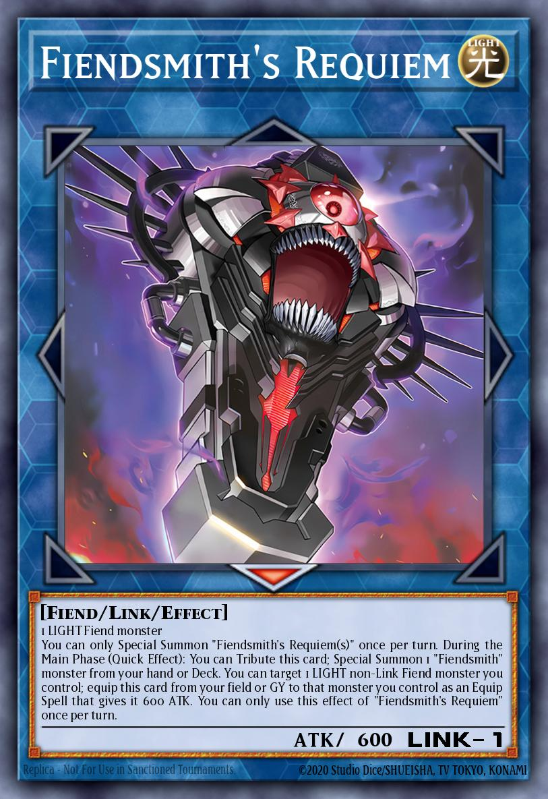
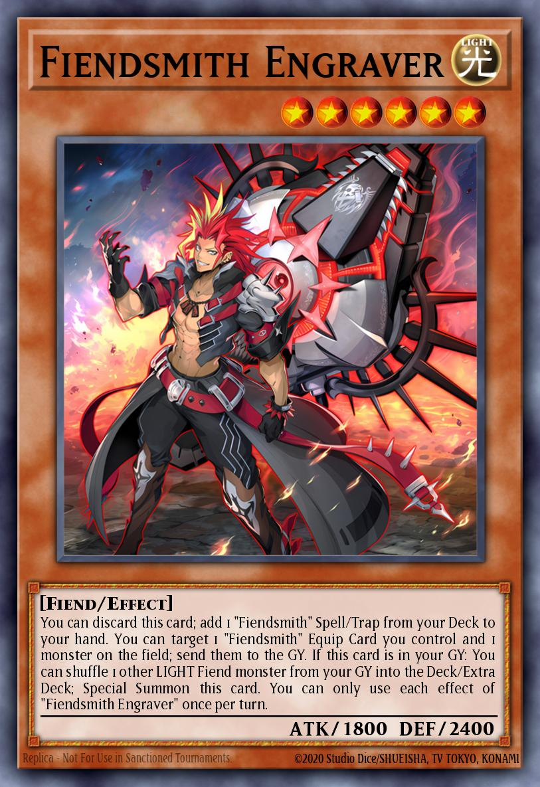
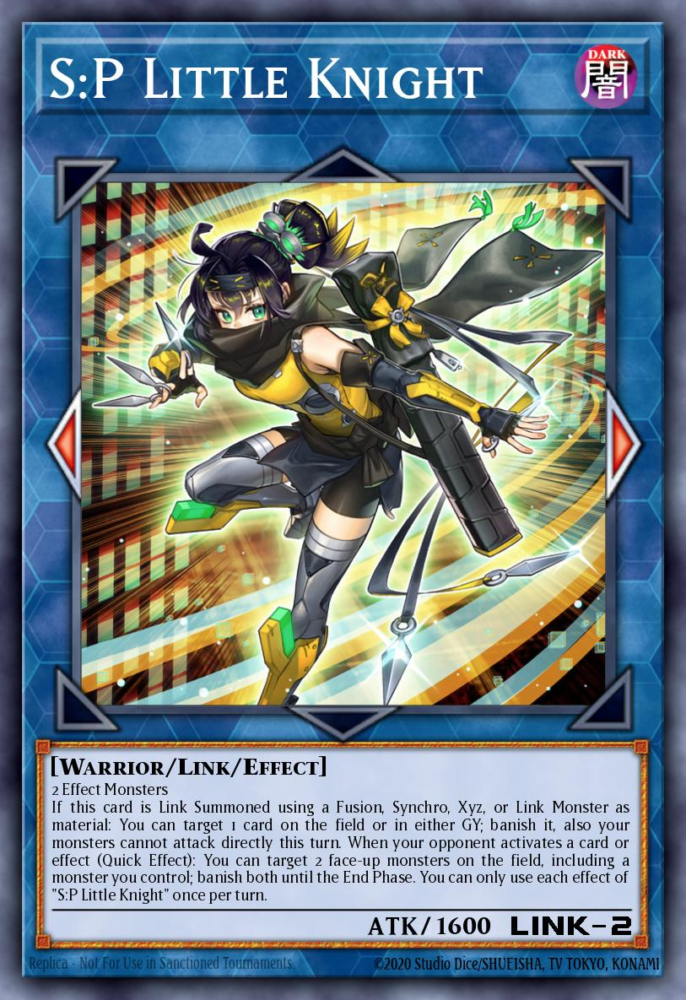
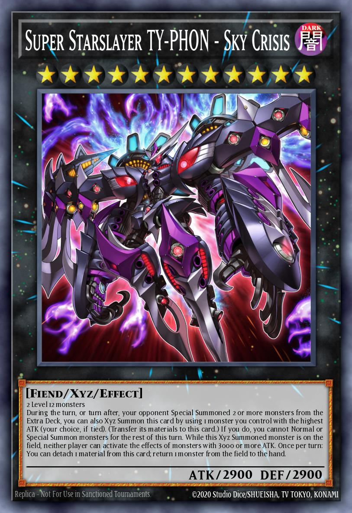

# Mementotlán / Demoniherrero — estudio individual A01–A10 · iteración 2 (17-11-2026)

> **CRITERIO DEL INVENTARIO FÍSICO (V41):** Las cartas y sus cantidades se conservan exactamente como fueron documentadas. El análisis A01–A10 se basa en sus efectos, materiales, ventanas, zonas, cadenas y recursos; no evalúa listas externas de prohibidas o limitadas. No se atribuyen partidas ni simulaciones ejecutadas a estos análisis documentales.

> **ESTADO VIGENTE CONCILIADO (17-11-2026).** Deck real **671**, formato registrado **TCG Advanced**, con inventario de **41 Main / 15 Extra / 14 Side** ya asociado e importación V40 registrada en Station X. Las **39/39 fotografías** por CID están físicamente en esta carpeta (13 JPG y 26 PNG); los antiguos marcadores de foto pendiente de V35/V36 no describen el estado actual. A01–A10 tienen contenido documental; **0 replays acreditados** y ninguna certificación automática de jugadas. Guía visual: [abrir](guias/GUIA_VISUAL_A01_A10.html). No se cambió ninguna carta.

## IDENTIDAD BÁSICA

- `deck_id` real confirmado de Station X: **671** (`Memento`, formato registrado `tcg_advanced`). `NUEVO_12` es solamente el nombre histórico de esta carpeta, **no** otro deck.
- Fuente de inventario: listado completo compartido por Miguel el **16-11-2026**; **las cantidades y posiciones no se alteran**. La matriz usa etiquetas cortas legibles para varias cartas (p. ej., «Angbruja» por «Mementotlán Angbruja»), identificadas inequívocamente por CID, y anota dos variantes de nombre oficial; **no se ha sustituido ninguna carta**. **Cotejo de identidades:** 39/39 CIDs encontrados en la base oficial Konami Neuron.
- **Main: 41** (25 monstruos, 16 mágicas, 0 trampas); **Extra: 15**; **Side: 14**; **Reserva: 0**; **total: 70 copias**.
- El Side de 14 cartas se conserva **tal cual**, sin rellenar automáticamente el espacio restante.

## CONTROL INDIVIDUAL DE AVANCE A01–A10 — Mementotlán / Demoniherrero

**Alcance y corte:** inventario 16-11-2026 y actualización documental 17-11-2026, exclusivamente **A01–A10 para el deck 671**. **Main 41, Extra 15, Side 14, Reserva 0; 70 copias y 39 identidades documentadas.** Importación y guía publicadas según el registro central V40, sin que ello certifique las jugadas. La aprobación editorial expresa del inventario, si se requiere como acto separado de su carga confirmada, permanece sin constancia independiente. Los A11–A36 siguen siendo instrucciones, sin porcentaje por deck.

| Apartado | Estado propio del deck | Progreso o evidencia comprobable | Pendiente para cerrar |
|---|---|---|---|
| **A01** Rol y propósito | **COMPLETA — alcance documental del rol (18-11-2026)** | Identidad Memento principal y puente Demoniherrero subordinado; nueve familias/12 rutas documentadas; tres matchups y cuatro cadenas cruzadas vinculadas por ID; jerarquía de decisiones A01.1 | **Sin pendiente propio de definición de rol.** Legalidad causal y resultados de rutas se acreditan individualmente en A05–A09; sin replays ni tasa de victoria |
| **A02** Planes y estilos | PARCIAL AVANZADA | Planes primero/segundo/medio/tardío; **12 rutas documentales**, 4 auditorías Extra, probabilidades teóricas y **24 escenarios H01–H24** | Falta evidencia empírica de enfrentamientos; los casos de mano son ejercicios documentales |
| **A03** Inventario | TRANSCRITO Y CARGADO; APROBACIÓN EDITORIAL NO CONSIGNADA POR SEPARADO | **70/70 copias, 39/39 identidades, 41/15/14/0 zonas**; ID 671 y formato registrados | Solo cotejar eventual autorización editorial adicional; conservar Side de 14 |
| **A04** Identidad, CID y fotos | IMÁGENES CERRADAS V37; IMPORTACIÓN V40 REGISTRADA | 39/39 fotos auténticas por CID, 13 JPG + 26 PNG, sin cambios de inventario | No quedan fotos por obtener; verificar vínculos tras cualquier nueva regeneración |
| **A05** Efectos y uso | PARCIAL AVANZADA | **39/39 funciones** en matriz; clasificación de 39/39 en cinco decisiones editoriales y seis riesgos de mano | Verificar variantes marginales y cartas de Side tras cambios |
| **A06** Sinergias y Extra | PARCIAL AVANZADA | **39/39 filas**, **40 relaciones dirigidas**, 3 motores/puentes; **13/13 identidades Extra con materiales descritos**, varias condicionales | Contrastar en mesa los accesos menos útiles; resolver las interrupciones reales |
| **A07** Reglas y cadenas | PARCIAL AVANZADA | **34 controles R01–R34**, **12 respuestas adversarias**, **6 desvíos B01–B06**, **6 controles MEM-A01–06** y **4 cadenas MC-X01–04** contra rivales registrados | Otros estados adversarios/rulings finos que no se deducen del texto; ninguna partida física es obligación del análisis IA |
| **A08** Estrategia y Side | PARCIAL AVANZADA | **34 prefichas**; **5 planes Side** exactos, y **3/3 matchups elegidos** con Crystron 677, Purrely 660 y Salamangreat 673 | Rendimiento empírico no disponible; la selección no cubre a todos los decks registrados |
| **A09** Jugadas y manos | PARCIAL AVANZADA | **12 rutas C01–C12**: **9 familias + 3 variantes**; 3 continuaciones, 4 auditorías Extra; **24 escenarios H01–H24**; 0 replays | Resolver otros estados de manos/objetivos sin asumir cartas inexistentes; contrastación de mesa opcional del usuario |
| **A10** Guías visuales | GUÍAS VISUALES DISPONIBLES V40 | Guía HTML local regenerable desde la ficha, rutas vinculadas y 39/39 fotos presentes | Comprobar enlaces al regenerar; el nuevo análisis no queda publicado automáticamente en Station X |

**Control documental:** respetar los materiales, costes, zonas, ventanas, límites por turno y recursos del inventario físico; no se atribuyen simulaciones ejecutadas.

## APARTADO_01 — Rol, propósito y condición de victoria

**Dictamen editorial `PARCIAL_AVANZADO`:** estrategia principal de **destrucción propia controlada → envío/acceso al Cementerio → Invocación de Fusión y Creación Combinada**. **Angbruja sola (C04)** y **Hoja Oscura sola (C05)** llegan documentalmente a **Rey Creación (3000 ATK) + Creación Combinada (5000 ATK)**; C01 lo hace con Fusión y C11 demuestra una **variante más costosa** mediante Gran Fuga. **Maza en GY no equivale a descartar Maza desde mano**, pero puede ser cuerpo Invocado por el jefe para el efecto rápido de Rey. **Las otras ocho familias de salida** son: jefe 5000 solo (C02); Luna→Réquiem→Grabador (C03); Dragón Gemelo y Goblin protector (C06); Quimera para romper hasta dos cartas (C07); S:P como respuesta posterior (C08); Princesa Necroequipo (C09); Secuencia→Duque con Normal adicional (C10); Dragón de Cuerno para destruir hasta dos cartas rivales boca arriba (C12). Total: **nueve familias, tres variantes, doce fichas**. Ninguna implica negación universal ni victoria automática.

**Identidad de juego:** motor Mementotlán predominante, paquete Demoniherrero muy reducido (solo 1 Grabador en Main; Réquiem y Secuencia en Extra), y cartas defensivas independientes. **No se añade una mágica/trampa Demoniherrero inexistente:** el efecto de descarte-búsqueda de Grabador no tiene un objetivo de esa familia dentro de este Main. Principal debilidad: depender de autodestrucciones/recursos del Cementerio y comprometer el Extra con cartas que requieren condiciones poco frecuentes.

**Condiciones de victoria razonables, no garantizadas:** desgaste por destrucciones múltiples del Rey Creación; ataques de Creación Combinada cuando está sola; ventaja incremental por búsquedas/reciclaje con Angbruja, Desvantasma y la Fusión; reducción de campo contrario con Gotas Prohibidas, S:P y Rebanador Gordiano tras Side. Sin tasas de victoria ni OTK asumidos.

### A01.1 — Cierre individual de rol y propósito (18-11-2026)

**Dictamen `COMPLETA` limitado al objetivo de A01:** enseñar la identidad, la jerarquía de motores, los planes incompatibles, el propósito competitivo de las nueve familias y sus condiciones de victoria. Este cierre **no certifica** que las doce rutas A09 se resuelvan legalmente en toda mano, ni altera estados pendientes A05–A10. Evidencia interna ya documentada: inventario A03/A06 de **41 Main, 15 Extra y 14 Side**, rutas **C01–C12**, decisiones A02/A08, conflictos **MC-X01–04** y matchups A08 contra **Crystron 677, Purrely 660 y Salamangreat 673**.

| Prioridad de rol | Condición de elección y finalidad | Límite demostrado por las referencias existentes |
|---|---|---|
| **1. Motor Mementotlán** | Con Angbruja/Hoja y piezas realmente accesibles, usar autodestrucción y Cementerio para preparar Fusión, Rey y/o Creación Combinada. **Es el plan principal**, no una obligación de terminar siempre en dos jefes. | **MC-X01:** Ash a Angbruja corta C04 desde esa mano mínima; no heredar Tatsun, envío ni Fusión que no ocurrieron. **MC-X04:** Rugido niega Fiesta y C02 se detiene sin destrucción de Angbruja. |
| **2. Recursos y defensa** | Si no es seguro desarrollar o el rival puede interrumpir, conservar cuerpos, búsquedas y recursos residuales; escoger protección por Goblin, interacción propia o recuperación posterior según la mano real. | Goblin protege contra selección solo desde la zona exigida; **MC-X02** distingue una cadena Tristaros/Syncro que no niega automáticamente Fusión. No afirmar el endboard antes de resolver la cadena. |
| **3. Puente Demoniherrero subordinado** | Activar **C03/C09/C10** únicamente cuando haya acceso y materiales exactos para Réquiem/Grabador/Secuencia. Su función es aportar remoción o extensión, no reemplazar todo el motor Memento. | Solo hay **un Grabador en Main** y ninguna M/T Demoniherrero buscable allí: no inventar la búsqueda de Grabador ni construir una segunda línea autónoma inexistente. |
| **4. Control alternativo o ruptura** | **Oleada de Calor** al inicio de Main Phase 1 es plan excluyente del desarrollo de monstruos de efecto; yendo segundo, elegir C07/C12/Gotas según objetivos y coste. | **MC-X03:** Quimera no destruye Noir con cinco o más materiales mediante efecto activado; C07 no es respuesta universal. Las opciones Side S01/S03/S05 requieren intercambios exactos **entre duelos**, nunca en duelo 1. |

**Propósito por familia, sin duplicar el análisis A09:** C01/C04/C05/C11 = acceso a jefes y presión condicionada; C02 = jefe 5000; C03/C09/C10 = puente Demoniherrero y extensión específica; C06 = protección de campo por Goblin; C07/C12 = romper campo; C08 = interrupción con S:P. La distribución conserva las **nueve familias y tres variantes existentes** y no promueve ninguna ruta condicional a combo certificado.

**Resultado de A01:** la prioridad del motor y del puente quedó contrastada con interrupciones reales descritas y tres rivales registrados. No queda una decisión de **identidad o propósito** pendiente de investigar en este apartado con el inventario actual. Si una auditoría posterior de A05–A09 invalida un efecto o ruta utilizada como evidencia, **reabrir únicamente la afirmación A01 dependiente por ID** conforme al módulo 32. Siguiente apartado **solo por nueva petición:** A02; esta ejecución no lo inicia.

## APARTADO_02 — Planes y estilo por situación

| Estado | Objetivo práctico | Decisión y coste | Límite/cambio de plan |
|---|---|---|---|
| **Primero**, Angbruja + Fusión | Desarrollar C01: Rey Creación, Creación Combinada y recurso en GY | Normal a Angbruja → Tatsun → Desvantasma → Fusión; consumir 5 nombres para Creación Combinada | Sin Fusión o con negación a Tatsun, no afirmar el final; considerar setear interacción o quedarse en el motor |
| **Primero**, solo Angbruja o Hoja Oscura | **C04/C05**, mismas amenazas desde **un solo iniciador** | Convertir autodestrucción, recuperación y acceso a Fusión en dos jefes; mayor número de activaciones | Más exposición a Ash/Droll; las piezas obligatorias deben seguir en Deck/GY |
| **Primero**, Oleada de Calor en mano | Bloquear invocaciones de monstruos de efecto de ambos durante turno propio y siguiente rival | Activar **al inicio de Main Phase 1**; priorizar plan de pasar turno, no combo de monstruos | No puede jugarse después de desarrollar C01 en esa Main Phase; también impide tus Invocaciones de efecto bajo su duración |
| **Primero**, mano Angbruja+Fusión, temor a seleccionar | **C06**: Dragón Gemelo + jefe y **Goblin en mano** | Goblin descartado protege contra selección; dos amenazas en campo | No impide efectos sin seleccionar; ya no puedes decir que el jefe está solo |
| **Segundo**, campo enemigo con monstruo objetivo | Eliminar amenazas o abrir paso a presión | Gotas Prohibidas o C03 (Luna→Réquiem→Grabador) si hay acceso al Grabador; C02 lleva a atacante 5000 si se abre campo | Las respuestas rivales pueden cortar búsqueda de Angbruja, envío de Tatsun o acceso al Extra |
| **Segundo**, rival con ≥2 cartas destruibles | **C07**: Quimera Guardián para robar 1 y destruir hasta 2 | Consume dos recursos de campo y uno de mano; no requiere Polimerización para ese efecto | Si no existen dos cartas destruibles, evaluar otro plan; no inventar inmunidades ni destrucciones |
| **Primero**, evitar sobreextensión | **C08**: Angbruja → S:P | Dos monstruos de Main se convierten en S:P reactiva | Sin material del Extra no destierra carta al ser Invocada; exige activación rival y dos monstruos boca arriba seleccionables |
| **Primero**, Angbruja + Goblin | **C09**: Princesa Necroequipo | Requiere Grabador equipado con Réquiem y otro Demonio en mano; usa ambos para su Invocación | No roba automáticamente por la Invocación; si Goblin no sigue en mano, detener ruta |
| **Primero**, Angbruja + Fiesta + Goblin | **C10**: Secuencia→Duque | Puente Demoniherrero produce Duque y Normal adicional | Muchas ventanas de interrupción; no repetir la búsqueda de Angbruja |
| **Segundo**, Angbruja + Horn + Fiesta; rival muestra dos cartas boca arriba | **C12**: Horn rompe dos cartas | Destruir propia Angbruja como uno de tres objetivos de Horn; Hoja queda en campo | Si no hay tres objetivos boca arriba válidos, no acreditar retirada múltiple |
| **Segundo**, rival hizo 2+ Invocaciones desde Extra | **EX-M02** sobre S:P existente | Cambiar S:P única a TY-PHON para devolver un monstruo | No más Invocaciones propias ese turno; restringe también tus jefes |
| **Turno rival posterior**, ya existe C01 y segunda Fusión Colocada | **EX-M01**: Dragostapelia | Cambiar Rey Fusión + Goblin OSCURIDAD de mano por interacción de Contador Depredador | Sacrificas Rey y su destrucción; conservar Fusión rápida hasta turno rival |
| **Medio/tardío o tras interrupción** | Rehacer mano y Cementerio en lugar de consumir todo en una línea | Desvantasma recupera otra carta Memento del GY al ser invocada; Mementomictlán recicla M/T en End Phase; Fusión en GY puede buscar M/T tras destruir | Las activaciones dependen de zonas/objetivos; si cinco nombres ya se barajaron para Creación Combinada, el GY queda más pobre |

**Decisión de riesgo:** si el oponente muestra Droll, privilegiar Invocar desde Deck cuando el efecto permita elegir Invocación frente a añadir a mano, pero nunca afirmar que se puede omitir una búsqueda obligatoria o activar un efecto sin objetivo. Las handtraps propias se mantienen separadas de las rutas del motor.

### A02.1 — Probabilidad *teórica de abrir cartas*, no de completar combos

Mano de **cinco** cartas aleatorias sin reemplazo en Main de **41**, sin reordenamiento, sin cartas inicialmente desterradas, sin mulligan. Combinatoria exacta `P = 1 − C(41−k,5)/C(41,5)` para al menos una de `k` copias; no es un ensayo de partidas ni mide interacciones del rival.

| Evento en cinco cartas | Cálculo sobre inventario | Probabilidad |
|---|---|---:|
| **Al menos Angbruja u Hoja Oscura** | 6 copias (3+3), cualquiera de ellas como posible iniciador | **56,68 %** |
| **Al menos Angbruja, Hoja o Tatsun** | 9 copias en total; Tatsun por sí solo **no garantiza el mismo final** | **73,13 %** |
| **Angbruja y Fusión juntas** | Intersección de al menos 1 de cada grupo de tres | **9,36 %** |
| **Al menos una Oleada de Calor** | 3 copias en 41 | **33,02 %** |
| **Oleada y algún iniciador Angbruja/Hoja** | Ambas familias en la misma mano de cinco | **16,57 %** |

**Interpretación:** 56,68 % **no** significa «56,68 % de hacer dos jefes»; si robaste piezas únicas que C04/C05 presuponen **en el Deck** (Goblin, Maza, Desvantasma, Creación Combinada, etc.), o el rival interrumpe, el final puede cambiar. El **16,57 %** describe coincidencia de planes con conflicto de secuencia, no un brick automático: puedes escoger uno. Los cálculos no cambian copias ni justifican una nota de victoria.

## APARTADO_03 — Inventario inmutable y aprobación

La matriz A06 de abajo representa el **inventario íntegro** y constituye la única tabla por identidad para este deck: una carta que aparece en Main y Side solo ocupa una fila, con sus cantidades separadas. Los totales provienen de sumar las copias de cada zona; un espacio vacío del Side no es una carta no identificada. **25 monstruos + 16 mágicas = 41 Main**, 15 Extra, 14 Side y 0 Reserva; **39 identidades, 70 copias**, sin trampas Main ni Skill. Side de 14 no se rellena sin autorización.

## APARTADO_04 — Fuente, CID, zona e imágenes

**39/39 CIDs contrastados** con fichas individuales de [Konami Neuron](https://www.db.yugioh-card.com/yugiohdb/card_search.action?ope=1&request_locale=es); cada CID enlaza a su página oficial desde la única matriz A06. Las fichas oficiales en español permiten reconocer diferencias documentales sin cambiar el inventario: `MEMD-005` aparece como **Mementoal Tecuhtlica - Creación Combinada** (no «Mementotlán»), y `MEMD-009` como **Mementotlán Desvantasma** (singular). Las equivalencias por CID quedan anotadas, no se reemplazan nombres sin consulta. `NUEVO_12` no es un ID de producción.

**Fotografía real actual: 39/39 identidades cotejadas por CID con la matriz A06.** Se preservan las 13 JPG iniciales y las 26 PNG incorporadas en V37; las imágenes se referencian con **su extensión existente** (`imagenes/<CID>.jpg` o `.png`). La mención anterior de 13/39 fotos corresponde a un corte histórico y ya está resuelta. Las fuentes Neuron sustentan identidad y efectos, pero no prueban por sí solas una secuencia completa.

## APARTADO_05 — Lectura funcional de las 39 cartas

**Dictamen:** cada identidad tiene una función específica, aunque no todas participan en combos. La ficha útil es la **fila de la matriz única A06**: CID oficial, papel, pareja o ausencia justificada, acceso y límite. Una handtrap o un Side puede ser valioso por sí solo sin aportar materiales al motor. Para entender condiciones completas, abrir la ficha Neuron vinculada; esta guía resume decisiones, no reproduce los 39 textos impresos. Las **39/39 funciones** se describen con fuente oficial, pero quedan pendientes comprobaciones de variantes más complejas y disponibilidad competitiva.

**Puntos que evitan errores:** Desvantasma (MEMD-009) se Invoca desde GY si fue enviada por un efecto de **monstruo Memento**, no por Gotas Prohibidas como coste; Creación Combinada (005) exige **cinco nombres distintos** en mano/GY y los devuelve al Deck; Rey Creación (026) sí tiene materiales de **tres Memento**, mientras que Dragón Gemelo (027) requiere **dos**. Grabador (011) no puede buscar una M/T Demoniherrero porque **no existe ninguna en este Main**. Los 14 Side no se activan durante el duelo 1.

### A05.1 — Decisión editorial por grupos, 39/39 identidades sin omisiones

La matriz única A06.2 conserva **la ficha específica de cada identidad**. Este resumen organiza decisiones sin repetir esos efectos ni cambiar la lista:

| Dictamen | Identidades MEMD | Motivo verificable y recomendación |
|---|---|---|
| **CONSERVAR_MOTOR** | **001–010, 015, 016, 020, 026, 027** (15 identidades) | Motor que transforma autodestrucción en envío, recuperación, Fusión y jefes. El Dragón Gemelo 027 tiene ruta completa C06; el Campo 020 es recuperación **solo si se roba o accede**. Mantener salvo prueba de manos desfavorable. |
| **CONSERVAR_PUENTE_CON_CONDICIONES** | **011, 023, 030, 032, 033, 034** (6) | Grabador 011 conecta con 032+030 (C03), pero su búsqueda Demoniherrero no tiene destino. Princesa 023 **sí tiene C09**; Secuencia 033 y Duque 034 **sí tienen C10**. Verificar utilidad y vulnerabilidad antes de sustituir. |
| **CONSERVAR_APOYO_AUTÓNOMO** | **012, 013, 014, 019, 021, 022, 031, 036, 037, 038, 039** (11) | Negación/robo situacional, protección, interrupción o retirada. S:P 031 es salida C08; 036–039 solo después de Side. No contarlos como motor Memento ni ponerlos en Main por omisión de un intercambio. |
| **REVISAR_CONFLICTO_DE_SECUENCIA** | **017, 018** (2) | Heat Wave 017 bloquea tu propio desarrollo, aunque sea una elección de control válida. Gran Fuga 018 tiene **variante C11** al traer Goblin a cambio de un monstruo, pero **su efecto de GY no tiene Xyz Goblin**. C11 consume más cartas que C01; medir utilidad. |
| **VALIDAR_ACCESO_EXTRA_CONDICIONAL** | **024, 025, 028, 029, 035** (5) | Condiciones de Invocación y efectos del texto oficial |

**Censo editorial cerrado:** los cinco conjuntos son disjuntos y abarcan **39/39 identidades**; el primero no significa que todas sean starters. **Prioridad de prueba futura:** comparar C04/C05, C06–C10, C12 y accesos EX-M01–EX-M03 según mano, riesgo y rival, antes de recomendar cambios al inventario confirmado.

### A05.2 — Dónde se producen las manos difíciles

1. **Oleada de Calor + Angbruja/Tatsun/Hoja:** elegir en el inicio de MP1 entre controlar el turno rival o desarrollar; no presentar ambos planes como simultáneos.
2. **Grabador robado + Réquiem:** Réquiem puede invocarlo **desde la mano** en vez de asumir otra copia en Deck; no buscar M/T Demoniherrero que no existe.
3. **Creación Combinada robada pronto:** es **pieza dependiente** hasta que haya cinco nombres distintos en mano/GY; C02/C06 muestran formas de preparar ese recurso.
4. **Dos Fusión Mementotlán en mano:** distintos ejemplares, pero su **primer efecto es una vez por turno por nombre**; no convertirlos en dos Fusiones activadas en el mismo turno.
5. **Tres Rey Creación en Extra:** disponibilidad de tres copias **no elimina** el límite de cada efecto por nombre una vez por turno; tampoco permite tres envíos en una misma cadena.
6. **Side de 14:** la copia de Fuwalos en Main es utilizable; las otras dos solo tras S01. Lancea, Meowls, Purulia y Gordiano no son recursos de tu primera mano de duelo 1.

## APARTADO_06 — Sinergias, motores y matriz canónica

### A06.0 — En treinta segundos: cómo cooperan

1. **Dictamen del conjunto:** Mementotlán es el motor central; convierte la propia destrucción de Angbruja/Tatsun/Hoja Oscura y el envío al GY en Fusión, recursos y acceso al jefe.
2. **Motor que mueve el deck:** Angbruja busca Tatsun; Tatsun puede enviarse a sí misma al GY y enviar Desvantasma + Dormiveja; Desvantasma recupera Dormiveja; Fusión reúne tres nombres para Rey Creación (C01).
3. **Puente real:** Rey Creación manda Creación Combinada al GY y otros dos Memento; los cinco nombres distintos permiten Invocar al jefe de 5000 (C01). Es necesario comprobar el GY **antes** de barajar.
4. **Sinergia indirecta:** Luna del Cielo Cerrado (LIGHT/Demonio Link-2) puede convertirse en Réquiem y luego en Grabador desde el Deck, aunque ninguna M/T Demoniherrero figure en la lista (C03).
5. **Conflicto decisivo:** Oleada de Calor bloquea las Invocaciones de monstruos de efecto **propias y ajenas**; no puede rematarse con ella una apertura desarrollada durante esa misma Main Phase 1. TY-PHON también impediría activar efectos de monstruos con 3000+ ATK en el campo, incluidos tus jefes.
6. **Decisión concreta:** con Angbruja u Hoja solas, C04/C05; Angbruja+Fusión, C01/C06/C07; Angbruja+Fiesta, C02; con Goblin en mano, C09; con Fiesta+Goblin, C10; con Horn+Fiesta ante dos amenazas, C12. Tras C01 contemplar Dragostapelia en otro turno (EX-M01); TY-PHON necesita condición rival (EX-M02). C11 demuestra Gran Fuga, sin mejora automática.
7. **Qué aprender después:** puntos de negación/recuperación; **14 manos H01–H14**, **cinco opciones Side S01–S05**, accesos condicionales Extra y 26 fotografías faltantes.

### A06.1 — Motores, acceso, producto y límite

| Motor | Tipo | Acceso/puentes reales | Resultado que sí puede documentarse | Riesgo |
|---|---|---|---|---|
| **MEMD-M1: Destrucción Mementotlán** | PRINCIPAL | 001→002→009/007 y 015; 016 sustituye un cuerpo por otro desde Deck | Fusión 026, envío de tres Memento y posterior 005 con cinco nombres (C01); o jefe aislado (C02) | Ash sobre búsqueda, efectos ya usados, cinco nombres insuficientes, piezas enviadas a zona errónea |
| **MEMD-M2: Acceso Demoniherrero** | SUBMOTOR condicionado | Dos monstruos de efecto→032 (LUZ/Demonio)→030→011 | Invocar Grabador del Deck y, con Réquiem equipado, mandar equipo + un monstruo rival al GY (C03) | Condiciones de Invocación y efectos del texto oficial |
| **MEMD-M3: Soportes y reemplazos** | APOYO, no motor independiente | 018 tributa para traer 004 del Deck; 020 recupera M/T; 012–014/019/021/022 responden a amenaza | Preparación, interrupción o ventaja puntual | No sumarlos automáticamente como combos ni afirmar que el Side existe en el Main |

### A06.2 — Matriz única de trazabilidad (39/39 identidades)

**ID estable:** `MEMD-###`; enlace del número CID: ficha individual **Konami Neuron**. Las cantidades son **Main/Extra/Side/Reserva**. `M1/M2/M3` identifican motores, `Ixx` las entradas A08 y `Cxx` los combos A09. `[X]` significa **texto/rol cotejado**; `[~]` implica acceso o variante condicional; `FOTO_PENDIENTE` no significa sinergia cero. Las rutas indicadas contienen una participación **real**, no una simple coincidencia de nombre. Para C03 se requiere un monstruo objetivo rival; no se confunde «acceso posible» con «siempre disponible».

| ID · CID Konami | Carta original · M/E/S/R | Función concreta y restricción decisiva | Relación y participación real | Estado |
|---|---|---|---|---|
| MEMD-001 · [19364](https://www.db.yugioh-card.com/yugiohdb/card_search.action?cid=19364&ope=2&request_locale=es) | Angbruja · 3/0/0/0 | Al invocarse busca otro monstruo Memento; destruye uno propio para revivir Memento ≤2 de GY | M1, I01; **C01/C02/C03**: Normal + búsqueda; C03 material Link; **Ampliación A09:** C04/C05: inicia y usa autodestrucción; C06/C07: inicia; C08: material Link | [X] |
| MEMD-002 · [19362](https://www.db.yugioh-card.com/yugiohdb/card_search.action?cid=19362&ope=2&request_locale=es) | Tatsunootoshigo · 3/0/0/0 | Especial desde mano si no tienes monstruos boca arriba ajenos a Memento; destruye 1 propio y envía del Deck monstruos Memento de nombres diferentes con suma de Niveles ≤Nivel del destruido | M1, I01; **C01/C02** se destruye a sí mismo, **C03** es material Link; **Ampliación A09:** C04/C05/C06/C07: se destruye y envía; C08: material Link | [X] |
| MEMD-003 · [19363](https://www.db.yugioh-card.com/yugiohdb/card_search.action?cid=19363&ope=2&request_locale=es) | Hoja Oscura · 3/0/0/0 | Destruye Memento propio para invocar desde Deck uno de Nivel ≤3; al ser invocada puede descartar Memento y destruir una M/T rival | M1, I03; starter/extensión condicional; sin combo C01–C03 atribuido; **Ampliación A09:** C05: único iniciador que se autodestruye para invocar Angbruja | [X] |
| MEMD-004 · [19366](https://www.db.yugioh-card.com/yugiohdb/card_search.action?cid=19366&ope=2&request_locale=es) | Goblin · 2/0/0/0 | Destruye Memento propio para enviar hasta dos cartas Memento de diferente nombre desde Deck; al tener al jefe 005 puede descartarse para protección contra seleccionar | M1, I04; **C01/C02** recurso enviado al GY; buscable por 018; **Ampliación A09:** C04: material desde mano; C05: manda Fusión+005 desde Deck; C06: protección desde mano | [X] |
| MEMD-005 · [19360](https://www.db.yugioh-card.com/yugiohdb/card_search.action?cid=19360&ope=2&request_locale=es) | Tecuhtlica - Creación Combinada · 1/0/0/0 | Jefe 5000; Invocación especial desde mano/GY **barajando 5 Memento distintos que no sean él** de mano/GY; si está solo puede atacar cada monstruo enemigo; al activarse efecto rival puede invocar Memento de mano/GY | M1, I08; **C01/C02** salida; no es negación; **Ampliación A09:** C04/C05: jefe sale de GY; C06: jefe sale de mano | [X] |
| MEMD-006 · [20491](https://www.db.yugioh-card.com/yugiohdb/card_search.action?cid=20491&ope=2&request_locale=es) | Akhíron · 1/0/0/0 | Da ataque directo este turno a Memento Nivel ≥9 al invocarse; destruido por efecto recupera otra carta Memento; en GY puede revivir si se destruye otro Memento | M1 condicional, I07; finisher/recuperación, no asumido en C01–C03; **Ampliación A09:** C05: enviado al GY como recurso; X01: revive tras destrucción propia | [X] |
| MEMD-007 · [20199](https://www.db.yugioh-card.com/yugiohdb/card_search.action?cid=20199&ope=2&request_locale=es) | Dormiveja · 1/0/0/0 | Se Invoca rápido desde mano si se destruyó un monstruo propio por efecto ese turno; al invocarse fusiona Memento de mano/campo; destruido envía carta Memento de Deck al GY | M1, I01; **C01** recuperada a mano por 009 y usada como material; **Ampliación A09:** C04: envío para recurso GY; C05: permanece GY; C06: destruida en mano y manda 008; C07: material de mano | [X] |
| MEMD-008 · [19365](https://www.db.yugioh-card.com/yugiohdb/card_search.action?cid=19365&ope=2&request_locale=es) | Maza · 1/0/0/0 | En Main rival, con 005 en campo, descartarla para tomar temporalmente monstruo boca arriba rival; en Main propia destruye Memento propio para buscar carta Memento | M1, I08; **C01/C02** recurso GY; si está en GY no se puede descartar desde mano; **Ampliación A09:** C04: se autodestruye para buscar Fusión; C05: material de mano; C06: quinto nombre enviado al GY | [X] |
| MEMD-009 · [19472](https://www.db.yugioh-card.com/yugiohdb/card_search.action?cid=19472&ope=2&request_locale=es) | Desvantasmas · 1/0/0/0 | Nombre oficial **Desvantasma**; al invocarse recupera otra carta Memento del GY; si un efecto de monstruo Memento lo envía al GY se puede Invocar | M1, I07; **C01** recupera Dormiveja; **C02** queda en GY y no se Invoca; **Ampliación A09:** C04/C05/C06/C07: Invoca desde GY y recupera, luego material o destrucción | [X] |
| MEMD-010 · [19361](https://www.db.yugioh-card.com/yugiohdb/card_search.action?cid=19361&ope=2&request_locale=es) | Dragón de Cuerno · 1/0/0/0 | Especial desde mano con ≥3 nombres Memento en GY; si es destruido por efecto en campo puede destruir tres cartas boca arriba, incluida una Memento propia | M1 condicional, I07; extensor/presión, sin C01–C03; **Ampliación A09:** C04/C05: nombre enviado para el conteo y barajado | [X] |
| MEMD-011 · [20196](https://www.db.yugioh-card.com/yugiohdb/card_search.action?cid=20196&ope=2&request_locale=es) | Demoniherrero Grabador · 1/0/0/0 | Puede descartarse para buscar M/T Demoniherrero **que aquí no existe**; al estar en GY revive barajando otro Demonio LUZ; envía equipo Demoniherrero y monstruo del campo al GY | M2, I09; **C03** llega del Deck por Réquiem y quita objetivo rival | [X], búsqueda sin destino |
| MEMD-012 · [12950](https://www.db.yugioh-card.com/yugiohdb/card_search.action?cid=12950&ope=2&request_locale=es) | Flor de Ceniza · 3/0/0/0 | Desde mano niega efecto que busca desde Deck, Invoca desde Deck o envía Deck→GY; una vez por turno | Autónoma, I10; responde al rival, **sin combo propio** | [X] |
| MEMD-013 · [9279](https://www.db.yugioh-card.com/yugiohdb/card_search.action?cid=9279&ope=2&request_locale=es) | El Bufón y el Pájaro del Candado · 3/0/0/0 | Si rival añadió desde Deck fuera de Draw, se envía de mano al GY y prohíbe añadir desde Main Deck al resto del turno para **ambos** | Autónoma/conflicto temporal, I10; no incorporar a combo | [X] |
| MEMD-014 · [20500](https://www.db.yugioh-card.com/yugiohdb/card_search.action?cid=20500&ope=2&request_locale=es) | Fuwalos · 1/0/2/0 | Solo con **cero cartas propias**; descartar para robar por Invocaciones del rival desde Deck/Extra; ajuste de mano en End Phase | Autónoma, I10/I12; tras Side, 1+2=3 en Main solo si entran 2 | [X] |
| MEMD-015 · [19904](https://www.db.yugioh-card.com/yugiohdb/card_search.action?cid=19904&ope=2&request_locale=es) | Fusión Mementotlán · 3/0/0/0 | Mágica rápida Main: Fusión con Memento desde mano/campo; permite GY si hubo destrucción propia por efecto ese turno; en GY se destierra, destruye propio y busca M/T Memento | M1, I01; **C01/C04–C07/C11**: Fusión del motor; **C05**: efecto GY de una copia y activación de otra; **EX-M01**: segunda Fusión Colocada para otro turno; **EX-M04**: vía mecánica a Duque | [X] |
| MEMD-016 · [19368](https://www.db.yugioh-card.com/yugiohdb/card_search.action?cid=19368&ope=2&request_locale=es) | Fiesta de Huesos · 3/0/0/0 | Destruye Memento en mano o campo; toma otro nombre del Deck y lo añade o invoca en DEF; GY da daño perforante | M1, I02; **C02** trae Tatsun; **C10** destruye Goblin de mano y trae Desvantasma; **C12** destruye Horn para activar su efecto; **EX-M03/04** habilita recursos Extra | [X] |
| MEMD-017 · [9139](https://www.db.yugioh-card.com/yugiohdb/card_search.action?cid=9139&ope=2&request_locale=es) | Oleada de Calor · 3/0/0/0 | Inicio de Main Phase 1; **ningún jugador** Invoca monstruos de efecto Normal/Especial hasta tu próxima Draw Phase | Autónoma / **conflicto de secuencia**, I05; excluye C01–C03 ese turno | [X] |
| MEMD-018 · [20533](https://www.db.yugioh-card.com/yugiohdb/card_search.action?cid=20533&ope=2&request_locale=es) | Gran Fuga Moto Goblin · 2/0/0/0 | Mágica rápida: tributa 1 monstruo y trae **Goblin** del Deck sin atacar; su efecto GY exige Xyz «Goblin» del que desprender materiales (no incluido) | M3→004, I04; **C11** variante completa con primer efecto, tributa Angbruja; efecto del GY **sin destino** en Extra actual | [X]/[~] GY sin destino |
| MEMD-019 · [15299](https://www.db.yugioh-card.com/yugiohdb/card_search.action?cid=15299&ope=2&request_locale=es) | Gotas Prohibidas · 2/0/0/0 | Envía otras cartas de mano/campo al GY para reducir ATK y negar efectos a igual número de monstruos de efecto rivales; protección de respuesta según tipos enviados | Autónoma/M3, I10; coste de envío **no** activa 009 como envío por monstruo Memento | [X] |
| MEMD-020 · [19367](https://www.db.yugioh-card.com/yugiohdb/card_search.action?cid=19367&ope=2&request_locale=es) | Mementomictlán · 1/0/0/0 | Campo: restringe M/T rivales en batalla Memento; tras destrucción propia puede invocar otro Memento de Nivel menor; coloca M/T Memento desde GY en End Phase | M1 soporte/reciclaje, I06; no combo independiente | [X] |
| MEMD-021 · [13619](https://www.db.yugioh-card.com/yugiohdb/card_search.action?cid=13619&ope=2&request_locale=es) | Llamado por la Tumba · 1/0/0/0 | Mágica rápida destierra monstruo del GY rival y niega efectos de su nombre hasta el final del turno siguiente | Autónoma, I10; respuesta de GY, no combo | [X] |
| MEMD-022 · [15296](https://www.db.yugioh-card.com/yugiohdb/card_search.action?cid=15296&ope=2&request_locale=es) | Talento de Tácticas Triples · 1/0/0/0 | Tras efecto de monstruo rival en tu Main, elegir robo, control temporal o devolver carta de su mano al Deck | Autónoma, I10; depende de activación del rival | [X] |
| MEMD-023 · [20423](https://www.db.yugioh-card.com/yugiohdb/card_search.action?cid=20423&ope=2&request_locale=es) | Princesa Necroequipo · 0/1/0/0 | Invocación **no por Fusión ordinaria**: monstruo equipado con carta de monstruo + carta de monstruo Demonio de mano/campo; al enviarse monstruo de mano para activar carta/efecto, opción de equipar o robar | **C09 acreditado documentalmente**: Grabador equipado con Réquiem + Goblin Demonio en mano; enviar para Invocar **no provoca robo automático** | [X] ruta condicionada |
| MEMD-024 · [12870](https://www.db.yugioh-card.com/yugiohdb/card_search.action?cid=12870&ope=2&request_locale=es) | Predaplanta Dragostapelia · 0/1/0/0 | Fusión de **1 monstruo Fusión + 1 OSCURIDAD**; pone Contador Depredador y niega efectos activados de rivales que lo tienen | **EX-M01**: Rey 026 Fusión en campo + Goblin 004 OSCURIDAD en mano, con segunda Fusión 015 Colocada y activada en siguiente turno rival; pierde Rey | [X] acceso de dos turnos |
| MEMD-025 · [16845](https://www.db.yugioh-card.com/yugiohdb/card_search.action?cid=16845&ope=2&request_locale=es) | Quimera Guardián · 0/1/0/0 | Fusión **3 nombres distintos, material solo de mano/campo y al menos uno de cada zona**; roba por materiales de mano y destruye rival por los de campo | Candidato con 015 y tres cuerpos Memento; la protección asociada a «Polimerización» no existe aquí, I11; **Ampliación A09:** C07: 1 carta robada y hasta 2 rivales destruidas tras Fusión | [~] |
| MEMD-026 · [20216](https://www.db.yugioh-card.com/yugiohdb/card_search.action?cid=20216&ope=2&request_locale=es) | Rey Creación · 0/3/0/0 | Fusión **3 Memento**; al ser Fusion Invocado manda **3 cartas Memento** de Deck/Extra al GY; rápido destruye igual número de monstruos Memento propios y cartas rivales; en GY puede buscar Campo | M1, I08; **C01** Fusión y envío de 005/008/004; no niega activación; **Ampliación A09:** C04/C05: salida Fusión y envío de tres Memento | [X] |
| MEMD-027 · [19878](https://www.db.yugioh-card.com/yugiohdb/card_search.action?cid=19878&ope=2&request_locale=es) | Dragón Gemelo · 0/1/0/0 | Fusión **2 Memento**; al ser Fusion Invocado destruye Memento propio y busca hasta dos monstruos de nombres distintos; al ser destruido revivir Memento ≤6 | M1 alternativa a 026, I11; **SIN_RUTA_A09_ACREDITADA**; **Ampliación A09:** C06: se Fusiona, destruye 007 en mano y busca 005+004 | [~] |
| MEMD-028 · [13081](https://www.db.yugioh-card.com/yugiohdb/card_search.action?cid=13081&ope=2&request_locale=es) | D/D/D César, Alto Rey de las Olas · 0/1/0/0 | Xyz Rango 6 **2 Demonios de Nivel 6**; niega activación que Invoca Especial desprendiendo material | Requiere materiales, zona y ventana de efecto comprobables; ruta documental condicionada | Requiere materiales, zona y ventana de efecto comprobables; ruta documental condicionada |
| MEMD-029 · [19184](https://www.db.yugioh-card.com/yugiohdb/card_search.action?cid=19184&ope=2&request_locale=es) | TY-PHON - Crisis Celeste · 0/1/0/0 | Xyz alternativo con 1 monstruo propio de mayor ATK tras 2+ Invocaciones Extra rivales en ventana válida; después no más Invocaciones ese turno; impide efectos de monstruos de ≥3000 ATK **propios también** | **EX-M02** sobre S:P única si rival cumplió 2+ Extra; **conflicto con 005/026** y sin Invocaciones posteriores | [X] situacional |
| MEMD-030 · [20225](https://www.db.yugioh-card.com/yugiohdb/card_search.action?cid=20225&ope=2&request_locale=es) | Réquiem del Demoniherrero · 0/1/0/0 | Link-1 con **1 Demonio LUZ**; se tributa en Main para Invocar un Demoniherrero de mano/Deck; en GY se equipa a Demonio LUZ no Link | M2, I09; **C03** usa 032 como material, invoca 011 y se equipa | [X] |
| MEMD-031 · [19188](https://www.db.yugioh-card.com/yugiohdb/card_search.action?cid=19188&ope=2&request_locale=es) | S:P Pequeña Caballera · 0/1/0/0 | Link-2 de 2 monstruos de efecto; si uno era de Extra, puede desterrar carta del campo/GY; en respuesta a efecto rival puede desterrar temporalmente 2 monstruos boca arriba incluyendo propia | Acceso condicional con cuerpos Memento, I11; no asumir que primer destierro está disponible con solo Main; **Ampliación A09:** C08: Link desde 001+002; respuesta rápida rival, sin banish de entrada | [~] |
| MEMD-032 · [19932](https://www.db.yugioh-card.com/yugiohdb/card_search.action?cid=19932&ope=2&request_locale=es) | Luna del Cielo Cerrado · 0/1/0/0 | Link-2 **2 monstruos de efecto**, LUZ/Demonio; su efecto de usar monstruo rival demanda futuro Link-5 no presente | M2, I09; **C03** cuerpo intermedio y material de 030, no se le atribuye efecto Link-5 | [X] |
| MEMD-033 · [20226](https://www.db.yugioh-card.com/yugiohdb/card_search.action?cid=20226&ope=2&request_locale=es) | Secuencia del Demoniherrero · 0/1/0/0 | Link-2 **2 monstruos, incluido Demonio LUZ**; Fusion Invoca Demonio desde Extra barajando materiales del GY; puede equiparse a Demonio LUZ no Link | **C10**: Grabador+Desvantasma → Secuencia; en GY quedan materiales Demonio para Duque | [X] ruta condicionada |
| MEMD-034 · [20389](https://www.db.yugioh-card.com/yugiohdb/card_search.action?cid=20389&ope=2&request_locale=es) | Duque de la Defunción · 0/1/0/0 | Fusión **2 Demonio/Zombi**; en Main concede Normal adicional; en GY destierro para recuperar Demonio/Zombi ≥4 del GY; Standby paga 500 LP o se destruye | **C10**: Secuencia baraja Grabador+Goblin desde GY; Normal adicional de Angbruja recuperada. **EX-M04**: ruta teórica con Fusión 015 | [X] ruta condicionada |
| MEMD-035 · [9657](https://www.db.yugioh-card.com/yugiohdb/card_search.action?cid=9657&ope=2&request_locale=es) | Portaaviones Sumergible Aero Tiburón · 0/1/0/0 | Xyz Rango 3 **2 Nivel 3**; desprende material e inflige 100 por cada monstruo propio desterrado | **EX-M03**: Fiesta trae segundo 001, se superponen dos Angbruja Nivel 3; Dormiveja queda en campo. **Bajo valor** si cero monstruos propios desterrados | [X] marginal |
| MEMD-036 · [20764](https://www.db.yugioh-card.com/yugiohdb/card_search.action?cid=20764&ope=2&request_locale=es) | Meowls · 0/0/3/0 | Solo sin cartas propias; descartar para robar por Especial rival desde GY o destierro, con devolución de exceso al End Phase | Autónoma **solo tras Side**, I12; no combo Memento | [X] |
| MEMD-037 · [20206](https://www.db.yugioh-card.com/yugiohdb/card_search.action?cid=20206&ope=2&request_locale=es) | Purulia · 0/0/3/0 | Solo sin cartas propias; descartar para robar por Normal/Especial rival desde mano, con devolución de exceso al End Phase | Autónoma **solo tras Side**, I12; no combo Memento | [X] |
| MEMD-038 · [11243](https://www.db.yugioh-card.com/yugiohdb/card_search.action?cid=11243&ope=2&request_locale=es) | Artefacto Lancea · 0/0/3/0 | En turno rival se tributa de mano para impedir destierros este turno; no equivale a negar efectos | Autónoma **solo tras Side**, I12; también impide usar destierros propios durante su vigencia | [X] |
| MEMD-039 · [21203](https://www.db.yugioh-card.com/yugiohdb/card_search.action?cid=21203&ope=2&request_locale=es) | Rebanador Gordiano · 0/0/3/0 | **Inicio de Main Phase 1 o 2**: devolver cartas boca arriba seleccionadas; por cada objetivo desterrar 1 carta de mano **o 6 del Extra boca abajo**; su activación/efecto no pueden negarse | Autónoma **solo tras Side**, I12; coste reduce acceso a Extra, no combo | [X] |

**Cotejo por zona:** Main **22 identidades/41 copias**, Extra **13 identidades/15 copias**, Side **5 identidades/14 copias**, con Fuwalos en Main (1) y Side (2); unión **39 identidades**. Ninguna carta Side se usa antes de intercambio 1:1. Reserva 0. Hay 39/39 filas con rol, 12 rutas C01–C12 y cuatro accesos condicionales EX-M01–EX-M04, sin replays acreditados.

### A06.3 — Mapa causal dirigido y comprobable del motor

Cada relación `REL-Mxx` indica **origen → destino**, nunca «estas cartas combinan porque son del mismo arquetipo». Los nombres se refieren a IDs de la matriz A06.2; `VALIDADO_LOGICO` señala que los textos individuales encajan con las condiciones descritas, no que las imágenes o simulaciones ya estén completas. Las cartas sin archivo de imagen se muestran en el futuro visor como `FOTO_PENDIENTE` (no se suple la fotografía).

| Relación | Origen → destino | Causa / requisito / recurso obtenido | Falla cuando... | Vía |
|---|---|---|---|---|
| **REL-M01** | **001 → 002** | Angbruja **Invocada** añade Tatsun del Deck | Se niega búsqueda o ya no queda Tatsun | C01,C03–C08 |
| **REL-M02** | **002 → 009 + 007** | Tatsun destruye **a sí misma Nivel 5** y envía **2+3=5** | Falta objetivo que destruir o uno de los nombres en Deck | C01,C06,C07 |
| **REL-M03** | **002 → 004 + 008 + 009** | Envío de **1+1+2=4** nombres distintos | Ya se agotó alguno en Deck o efecto de Tatsun | C02,C04,C05 |
| **REL-M04** | **009 → 007 / 004 / 008** | Desvantasma enviada por **efecto de monstruo Memento** se Invoca y **recupera una carta Memento del GY** | La enviaron por coste/otra familia o no hay objetivo de recuperación | C01,C04–C07 |
| **REL-M05** | **001 → 008 / 004** | Segundo efecto de Angbruja **selecciona Lv≤2 en GY**, destruye Memento propio e Invoca el seleccionado | Falta objetivo de Nivel bajo o no se destruye el Memento | C04,C05 |
| **REL-M06** | **008 → 015** | Maza en tu Main **destruye monstruo Memento propio** (puede ser Maza) y **busca una carta Memento** | No controla Memento destruible o no queda Fusión | C04 |
| **REL-M07** | **003 → 001** | Hoja Oscura se **destruye** y trae Angbruja **Nivel 3** desde Deck | Sin Angbruja en Deck; efecto negado | C05 |
| **REL-M08** | **004 → 015 + 005** | Goblin se destruye y manda **dos cartas Memento de distinto nombre** desde Deck a GY, una Mágica y un jefe | Sin objetivos en Deck o activación negada | C05 |
| **REL-M09** | **015-GY → 015-Deck** | Una Fusión en GY **se destierra**, destruye Memento propio y **busca otra Fusión** | Sin monstruo propio destruible o sin otra copia en Deck | C05 |
| **REL-M10** | **015 → 026** | Fusión con **tres Memento** de mano/campo, y del GY si hubo destrucción por efecto | Tres materiales no disponibles o ya usado primer efecto | C01,C04,C05 |
| **REL-M11** | **026 → 005 + otros dos** | Rey **Invocado por Fusión** manda tres cartas Memento del Deck/Extra al GY | Rey no fue Invocado por Fusión o se niega efecto | C01,C04,C05 |
| **REL-M12** | **Cinco nombres → 005** | Barajar cinco **otros** monstruos Memento de nombres diferentes en mano/GY habilita jefe 5000 | Se cuentan repetidos, cartas fuera de zona o al propio 005 | C01,C02,C04–C06 |
| **REL-M13** | **016 → 002** | Fiesta destruye un Memento y **Invoca Tatsun en Defensa** de distinto nombre | No hay Memento propio en mano/campo para destruir | C02 |
| **REL-M14** | **015 → 027** | Dos Memento se usan como material para **Dragón Gemelo** | Faltan ambos materiales reales | C06 |
| **REL-M15** | **027 → 007** | Dragón Gemelo **Fusion Invocado** destruye Dormiveja **desde mano** | No hay monstruo Memento destruible en mano/campo | C06 |
| **REL-M16** | **007 → 008** | Dormiveja destruida por efecto envía **Maza** del Deck a GY | Maza no está en Deck o el efecto ya se usó | C06 |
| **REL-M17** | **027 → 005 + 004** | Tras destruir Dormiveja, Gemelo **añade dos monstruos Memento distintos** de Deck a mano | No hay dos elegibles o niegan la búsqueda | C06 |
| **REL-M18** | **005 + 004** | Con jefe en campo, Goblin **desde mano** puede descartarse durante Main para impedir selección de Mementos ese turno | Goblin ya se gastó, rival no selecciona, falta jefe | C06 |
| **REL-M19** | **015 → 025** | Dos Memento de campo + uno de mano de **nombres distintos** Fusionan Quimera; **roba 1, destruye hasta 2 rivales** según resolución | Faltan dos cartas contrarias susceptibles o no se completa Fusión | C07 |
| **REL-M20** | **001 + 002 → 031** | Dos monstruos de efecto del Main invocan S:P; **solo su respuesta posterior** de destierro tiene ventana en este caso | No se activa carta/efecto rival o falta segundo objetivo boca arriba | C08 |
| **REL-M21** | **001 + 002 → 032 → 030** | Dos cuerpos dan Luna **Demonio/LUZ Link-2**, material legal para Réquiem Link-1 | Falta cuerpo, cambian tipos/atributos o extra restringido | C03 |
| **REL-M22** | **030 → 011 → rival** | Réquiem se tributa para traer Grabador, luego se equipa; Grabador manda **equipo + monstruo rival** al GY | Grabador fuera de mano/Deck, equipo/objetivo indisponible | C03 |
| **REL-M23** | **018 → 004** | Gran Fuga **sacrifica un monstruo** para Invocar Goblin desde Deck, **sin atacar** este turno | Sin monstruo para Sacrificar o sin Goblin en Deck | I04, interacción |
| **REL-M24** | **017 ⊣ motor Memento** | Heat Wave bloquea Invocaciones de monstruos de efecto **también propias** hasta tu próxima Draw | Se intenta hacer C01–C12 después de Heat Wave en ese intervalo | I05, conflicto |
| **REL-M25** | **030 equipado a 011 + 004 mano → 023** | Grabador con Réquiem **equipado como Carta de Monstruo** y Goblin (Demonio de mano) son enviados para el procedimiento especial de Princesa | No queda Goblin/Demonio adicional o Réquiem no está equipado | C09 |
| **REL-M26** | **016 destruye 004 → 009 desde Deck → 001 mano** | Fiesta destruye Goblin de mano, Especial Desvantasma de otro nombre; Desvantasma **Invocada** recupera Angbruja del GY | No hay 009 en Deck o Angbruja ya no está en GY | C10 |
| **REL-M27** | **011 + 009 → 033** | Grabador es **Demonio LUZ** y satisface material obligatorio de Secuencia; Desvantasma aporta segundo cuerpo | Falta cualquiera de los dos en campo | C10 |
| **REL-M28** | **033 + GY(011,004) → 034** | Secuencia fusiona Duque **barajando dos Demonios desde GY**; no exige M/T Demoniherrero | Grabador o Goblin no está en GY, o Duque no está en Extra | C10 |
| **REL-M29** | **034 → Normal adicional de 001** | Duque Invocado permite Normal adicional inmediatamente tras resolver su efecto; Witch recuperada en mano | No hay monstruo en mano o el efecto de Duque se niega | C10 |
| **REL-M30** | **018 Sacrifica 001 → 004 desde Deck** | Gran Fuga **Sacrifica como coste** Angbruja y trae Goblin, que luego es material Fusión | Falta Goblin en Deck o carta para Sacrificar | C11 |
| **REL-M31** | **GY(002,004,008,009) → 010** | Tres o más nombres Memento distintos en GY habilitan especial de Dragón de Cuerno desde mano | No se llegan a reunir tres nombres distintos | C12 |
| **REL-M32** | **016 destruye 010 → 003; 010 → 001 + 2 rivales** | Fiesta destruye Dragón de Cuerno y Especial Hoja; Horn destruido selecciona **tres boca arriba**, incluida Angbruja propia y dos rivales | Rival no tiene dos cartas boca arriba afectables o falta tercer objetivo | C12 |
| **REL-M33** | **026 Fusión + 004 OSCURIDAD + 015 colocada → 024** | Al turno rival siguiente, Fusión rápida usa Rey del campo + Goblin de mano para Dragostapelia | No hay segunda Fusión previamente colocada o uno de los materiales desapareció | EX-M01 |
| **REL-M34** | **031 → 029** | S:P como único monstruo propio es el de mayor ATK; sobre ella se superpone TY-PHON **solo tras 2+ Invocaciones Extra rivales en turno elegible** | Rival no cumplió condición o no tienes monstruo propio válido | EX-M02 |
| **REL-M35** | **001 + 016 destruye 004 → segundo 001 + 007 → 035** | Fiesta trae segunda Angbruja del Deck; Dormiveja se Especial desde mano tras destrucción; **dos Angbruja Nivel 3** forman Aero | No hay otra Angbruja, falta Dormiveja, o se intenta buscar dos veces con Angbruja | EX-M03 |
| **REL-M36** | **015 + campo(009) + GY(004) → 034** | Destrucción de Goblin en posesión habilita barajarlo desde GY como segundo Demonio material para Duque | No se destruyó monstruo propio por efecto ese turno o falta material | EX-M04 |
| **REL-M37** | **011 Nivel 6 + 034 Nivel 6 → 028** | Grabador y Duque son dos Demonios de Nivel 6 que cumplen el material de César | Confirmar ambos presentes simultáneamente en campo | EX-M04, acceso condicional |
| **REL-M38** | **013 ⊣ 014/036/037** | Droll que ya resolvió impide nuevas **adiciones desde Main Deck**, incluidas las robadas por Multivadoras | Pretender robar mediante Mulcharmy bajo Droll vigente | A08, conflicto |
| **REL-M39** | **038 ⊣ 015-GY / 021** | Lancea durante turno rival impide desterrar cartas **para ambos**; afecta búsquedas de Fusión desde GY y Llamado. Gordiano (039) se activa en tu Main: no presentarlo como simultáneo | Se intenta desterrar durante la prohibición de Lancea | A08, conflicto |
| **REL-M40** | **039 ⊣ capacidad del Extra** | Rebanador Gordiano cuesta **6 cartas de Extra boca abajo o 1 mano por objetivo**, previo al retorno de cartas boca arriba | Gastas materiales clave del Extra o no tienes coste por objetivo | A08, coste táctico |

**Diagnóstico de compatibilidad funcional:** 40 relaciones causales M01–M40. Los motores y accesos se evalúan por cartas presentes, materiales y ventanas; M38–M40 describen conflictos de recursos y respuestas. Cuarenta relaciones no son cuarenta combos.

### A06.4 — Auditoría exhaustiva de las 13 identidades del Extra

- **Seis accesos base documentados:** Rey Creación **026** por C01/C04/C05/C11; Dragón Gemelo **027** por C06; Quimera Guardián **025** por C07; S:P **031** por C08; Luna **032** y Réquiem **030** por C03/C09/C10. **6/13 identidades**.
- **Tres accesos ampliados mediante nuevas familias:** Princesa Necroequipo **023** por **C09** (Grabador equipado con Réquiem + Goblin de mano); Secuencia **033** y Duque **034** por **C10** (Grabador+Desvantasma Link, fusionar Grabador+Goblin desde GY). **3/13** adicionales.
- **Tres accesos condicionales con estado exacto:** Dragostapelia **024** por **EX-M01** (Rey+Goblin OSCURIDAD, segunda Fusión previamente Colocada, turno rival), TY-PHON **029** por **EX-M02** (rival realizó 2+ Invocaciones Extra), Aero Tiburón **035** por **EX-M03** (dos Angbruja Nivel 3). **3/13** adicionales: son **transformaciones o accesos**, no combos nuevos contables por sí solos.
**EX-M04 — César (028):** dos Demonios Nivel 6 disponibles (Grabador + Duque) pueden usarse como materiales Xyz; comprobar zona y recursos, sin atribuir una partida simulada.
- **Resultado:** **13/13 identidades del Extra** tienen materiales o procedimiento escrito (incluido EX-M04 para César). Ello no significa trece aperturas independientes: EX-M01 necesita una segunda Fusión colocada previamente y turno rival posterior; EX-M02 depende de invocaciones rivales; EX-M03 exige dos Nivel 3 en campo; EX-M04 exige dos Demonios Nivel 6 simultáneos. Sin esos estados el acceso sigue `CONDICIONAL`. No alterar el inventario.

**Comprobación de los cuatro accesos condicionales, sin sumar combos:**

| ID | Estado inicial adicional exigido | Utilidad concreta | Punto en que se detiene la línea |
|---|---|---|---|
| EX-M01 · Dragostapelia | Rey de Fusión disponible, Goblin OSCURIDAD en mano y segunda Fusión colocada desde el turno anterior | Cambiar al Rey por una interacción de Contador Depredador para el turno rival | Si no sobrevivió el Rey, falta Goblin o la segunda Fusión se colocó ese mismo turno |
| EX-M02 · TY-PHON | Se cumplió la condición temporal de Invocaciones del Extra rivales y controlas monstruo propio apropiado | Respuesta Xyz a una amenaza, a costa de más invocaciones propias ese turno | Si la condición rival no consta o todavía necesitas continuar invocando |
| EX-M03 · Aero Tiburón | Dos monstruos Nivel 3 simultáneamente en campo y libres como materiales | Retener una salida Xyz marginal cuyo daño depende de desterrados propios reales | Si uno de los cuerpos ya se consumió o no hay desterrados propios para el daño |
| EX-M04 · César | Grabador y Duque, ambos Demonios Nivel 6, presentes simultáneamente y no consumidos | Xyz Rango 6 con interrupción condicionada a material y ventana de Invocación Especial | Si uno se usó antes, no quedan dos Nivel 6 o se agotaron los materiales; no presentar solo la fórmula como combo independiente |

## APARTADO_07 — Reglas, ventanas, materiales y cadenas

**Estado:** `PARCIAL_AVANZADO`, con **30 controles mecánicos R01–R30** confrontados con las fichas Neuron enlazadas en A06. Una secuencia explicada a partir de textos individuales **no es una prueba de simulador/partida física** ni sustituye el fallo de un juez para un caso controvertido. `C01–C12` se describen bajo estado inicial declarado y sin interrupción, salvo donde se marque una respuesta.

| Control | Comprobación y consecuencia en este deck |
|---|---|
| **R01** Inicio de turno | **Oleada de Calor** (017) solo se activa al **inicio de tu Main Phase 1**. Su prohibición de Invocar monstruos de efecto afecta a ambos jugadores hasta tu próxima Draw Phase: no se añade al final de C01/C02/C03. |
| **R02** Normal y búsqueda | **Angbruja** (001) debe primero ser Invocada Normal o Especial y resolver su efecto para llevar un Memento del Deck a la mano. C01 y C02 la Invocan **Normal**; no es una búsqueda gratuita desde mano. |
| **R03** Especial de Tatsun | **Tatsun** (002) puede Especial desde la mano solo si no controlas monstruos boca arriba que no sean Memento. La presencia de Luna/Grabador cambia esa condición. |
| **R04** Destrucción más envío | Tatsun **destruye un monstruo Memento que controles** y, al resolver, envía monstruos Memento de nombres distintos del Deck cuya **suma de Niveles no supera el Nivel original del destruido**. En C01: 2+3=5; en C02: 1+1+2=4. |
| **R05** Desvantasma por causa | Desvantasma (009) solo obtiene su Invocación desde GY cuando fue **enviada allí por el efecto de un monstruo Memento**. El envío por **Gotas Prohibidas** como coste no es equivalente. Su recuperación al invocarse requiere otra carta Memento en GY. |
| **R06** Fusión real | Fusión Mementotlán (015) es **Mágica de Juego Rápido**, utilizable en Main Phase; exige material de mano/campo incluyendo un Memento. Tras destrucción propia por efecto en ese turno también puede barajar **Mementos del GY** como materiales. C01 utiliza únicamente mano/campo, sin suponer una Fusión desde Deck. |
| **R07** Rey Creación | Rey Creación (026) necesita **tres monstruos Memento** como materiales. Su envío de tres cartas Memento de Deck/Extra se activa **si fue Invocado por Fusión** y respeta una vez por turno. Su efecto rápido **selecciona la misma cantidad** de tus monstruos Memento y cartas rivales para **destruir ambas partes**: no es una negación ni destrucción gratis. |
| **R08** Creación Combinada | Para Invocarla de mano o GY, 005 baraja **cinco otros monstruos Memento con nombres diferentes de mano/GY**. Verificar cinco existencias antes de la Invocación; ni 005 ni copias repetidas cuentan para esos cinco. |
| **R09** Fiesta de Huesos | 016 destruye **un Memento en mano o boca arriba en campo** y toma otro de **distinto nombre** del Deck: lo añade a mano **o** lo Especial en Defensa. C02 elige Especial desde Deck. El efecto de dar perforación desde GY es distinto y necesita objetivo propio. |
| **R10** Puente Fiendsmith | Luna (032) requiere dos **monstruos de efecto**; Réquiem (030) requiere un **Demonio LUZ** y tributa **a sí mismo** para Invocar Grabador (011) de mano/Deck. Réquiem después se equipa desde GY a Grabador, que selecciona una **Mágica de Equipo Demoniherrero** propia y un monstruo del campo para enviarlos al GY. |
| **R11** Restricciones del Extra | S:P (031) solo gana su primer destierro si uno de sus materiales provenía del Extra; César (028) exige **dos Demonios Nivel 6**; Aero Tiburón (035) **dos Nivel 3**; TY-PHON (029) restringe más Invocaciones propias ese turno y bloquea efectos de monstruos con ≥3000 ATK de **ambos** jugadores. |
| **R12** Sin ampliar listas por implicación | La búsqueda de M/T Demoniherrero de Grabador **no tiene objetivo en este Main**. La segunda aplicación de Gran Fuga Moto Goblin necesita un Xyz Goblin inexistente en el Extra. Las cartas del Side solo participan **después** de un intercambio entre duelos. |
| **R13** Dos efectos distintos de Fusión | En C05 una copia de **Fusión Mementotlán** está en GY: se **destierra** para destruir un monstruo propio y buscar **otra copia**. La buscada después activa **el primer efecto de Fusión**, distinto al segundo; ninguno se activa dos veces por nombre en ese turno. |
| **R14** Materiales desde GY tras destruir | El permiso de barajar monstruos Memento del GY para una Fusión es **condicional a que monstruos de tu posesión fueran destruidos por efecto ese turno**. C04 baraja Tatsun y C05 Tatsun+Goblin; sin esa destrucción el acceso desde GY **no existe**. |
| **R15** Dragón Gemelo y Dormiveja | Dragón Gemelo debe ser **Invocado por Fusión** para destruir un Memento **en mano o Campo boca arriba**; puede destruir Dormiveja en mano y entonces buscar hasta dos nombres distintos del Deck. La Dormiveja destruida tiene un **efecto posterior distinto** que envía Memento del Deck al GY. C06 comprueba ambos usos una vez por turno. |
| **R16** Quimera no requiere Polimerización | Quimera Guardián exige **3 nombres diferentes, materiales de mano y campo (al menos uno de cada)**. Su robo/destrucción tras Fusionarse mediante **Mágica de Fusión** no requiere Polimerización; su **protección contra selección**, en cambio, sí requiere que **«Polimerización» esté en tu GY**. C07 no obtiene esa protección. |
| **R17** S:P con solo Main | Dos monstruos de efecto del Main pueden Invocar S:P por Enlace. **No** activan su efecto de destierro al ser Invocada, reservado a haber usado material del Extra. El efecto rápido contra la activación adversaria exige dos monstruos **boca arriba** que puedan seleccionarse, incluido uno tuyo (C08). |
| **R18** Maza, Goblin y respuesta del jefe | **Maza** se descarta desde **mano**, durante la Main rival y con Creación Combinada en campo, para tomar control de monstruo rival; **Invocarla del GY al campo mediante el jefe no habilita ese descarte**. En cambio **Goblin en mano** sí puede descartarse durante una Main con jefe en campo para dar protección contra selección. |
| **R19** Princesa Necroequipo | C09 **no usa Fusión Mementotlán** para invocar Princesa: manda **Grabador equipado con Carta de Monstruo Réquiem** desde campo y Goblin **Demonio** de mano. El Goblin enviado para esta Invocación **no** satisface por sí solo el disparador de robar de Princesa (que pide envío **para activar** carta/efecto). |
| **R20** Secuencia a Duque | Secuencia exige **2 monstruos incluyendo 1 Demonio LUZ**; su efecto de Fusionar Duque baraja **materiales Demonio desde GY**, no desde campo/Deck. C10 comprueba Grabador+Goblin en GY **antes** del efecto. |
| **R21** Duque y segundo Normal | Duque permite Normal adicional inmediatamente después de resolver su efecto en Main; la Angbruja recuperada **no vuelve a buscar** en el mismo turno si ya usó la búsqueda por nombre. En tu Standby posterior Duque requiere pagar **500 LP o destruirse**. |
| **R22** Dragón de Cuerno | Su Invocación propia desde mano necesita **3 nombres Memento distintos en GY**. Si es destruido por efecto **en campo**, su efecto selecciona **exactamente 3 cartas boca arriba** incluyendo **una Memento propia**, no 3 cartas rivales ni cartas boca abajo. C12 deja Hoja en campo después de la destrucción de Fiesta. |
| **R23** Dragostapelia en otro turno | EX-M01 usa un monstruo **Fusión** (Rey) + uno **OSCURIDAD** (Goblin); la **segunda** Fusión Mementotlán se Coloca en turno propio y se activa en Main del rival **posterior**, nunca en el mismo turno de la primera Fusión. El Contador Depredador no equivale a negar permanentemente todo tipo de efectos. |
| **R24** TY-PHON por superposición | Su procedimiento alternativo requiere **2+ Invocaciones Extra del rival durante el turno actual o el anterior**. Se superpone sobre el monstruo **de mayor ATK que tú controles**; después no más Invocaciones ese turno. El bloqueo de efectos activados de monstruos con ≥3000 ATK afecta también a tus jefes. |
| **R25** Aero Tiburón | Requiere **2 monstruos Nivel 3** y sus materiales se colocan debajo del Xyz, no siguen en campo/GY. Solo causa **100 por monstruo propio desterrado**; sin esos monstruos el recorrido EX-M03 no proporciona daño de efecto valioso. |
| **R26** Gran Fuga y Goblin | Gran Fuga Moto Goblin **Sacrifica como coste** un monstruo para traer un «Goblin» del Deck; no cuenta como destrucción para abrir los materiales de GY de Fusión Mementotlán. La destrucción posterior de Tatsun en C11 **sí** abre ese permiso. |
| **R27** César y acceso condicionado | EX-M04 necesita dos Demonios Nivel 6 simultáneos en campo (Grabador y Duque) y libres como materiales. Al activarse una carta/efecto que **incluya Invocar Especial**, César puede desacoplar 1 material para **negar esa activación y destruir la carta**; no es respuesta general a cualquier efecto. Si uno de los dos cuerpos fue consumido antes en C10, no se acredita este acceso. [Texto oficial](https://www.db.yugioh-card.com/yugiohdb/card_search.action?cid=13081&ope=2&request_locale=en). |
| **R28** Gordiano | Rebanador Gordiano solo al **inicio de tu Main Phase 1 o 2**; por **cada** carta boca arriba seleccionada se destierra **1 carta de mano o 6 del Extra boca abajo**. Costear dos cartas rivales únicamente con Extra requiere **12 cartas del Extra** de las 15; nunca ocultar el precio estratégico. |
| **R29** Mulcharmies y Droll | Fuwalos, Meowls y Purulia desde mano requieren **que no controles cartas** al activarse; su robo depende respectivamente de Invocaciones desde Deck/Extra, GY/destierro o mano. Si ya resolvió Droll contra ti, **no puedes seguir robando del Deck** bajo esos efectos mientras dure. |
| **R30** Lancea temporal | En turno rival, Lancea desde mano o campo boca arriba **se Sacrifica** para impedir destierros de **ambos jugadores** por ese turno. Restringe también el efecto desde GY de Fusión Mementotlán y Llamado por la Tumba durante esa ventana, no solamente las cartas del contrario. |

### A07.1 — Tres ventanas de interrupción reales que no deben ocultarse

1. **Ash a la búsqueda de Angbruja:** si niega la búsqueda, no está garantizado Tatsun en mano y **no continuar C01/C02/C03 fingiendo ese recurso**. Registrar el resto de la mano y recalcular.
2. **Ash al envío desde Deck de Tatsun:** su efecto incluye envío desde Deck a GY; si es negado no se acreditan Desvantasma/Dormiveja ni el conteo de cinco nombres. **La autodestrucción de Tatsun no es coste de activación**: está en la resolución del efecto; si Ash niega ese efecto y ninguna otra carta modifica el estado, **Tatsun sigue en campo**. Con Angbruja en campo puede cambiarse a **C08 (S:P)**, sin fingir el jefe.
3. **Droll después de la primera adición:** no se puede añadir más del Main Deck a mano durante el resto del turno, pero **no convierte automáticamente una Invocación desde Deck en una adición**. C02 usa Fiesta para **Invocar** Tatsun, no para añadirlo; su condición debe revisarse en el momento de resolver.

**Notas de confiabilidad:** cadenas simultáneas, requisitos de activación y qué ocurre ante negaciones específicas requieren estudiar el escenario exacto; no se marca `VALIDADO_POR_SIMULADOR`. El repertorio cubre controles **R01–R30**, no todos los fallos posibles contra todos los arquetipos.

### A07.2 — Respuestas adversarias vinculadas al paso exacto

| Respuesta rival | Paso afectado | Recurso que no se puede dar por conseguido | Desvío real / estado si solo existe la mano mínima |
|---|---|---|---|
| **Ash** a la búsqueda de Angbruja | C01-1, C02-1, C03-1, C04-1, C05-2, C06-1, C07-1, C08-1 | Tatsun o jefe que se iba a añadir; no hay otro buscador gratuito | Se detiene la línea concreta salvo que ya exista Tatsun u otro acceso **adicional y declarado** en mano |
| **Ash** al efecto de Tatsun | C01-3, C02-3, C04-2, C05-3, C06-2, C07-1 | Envíos Memento desde Deck; no hay Desvantasma ni conteo de cinco nombres | **Tatsun no se autodestruye si su efecto negado no resuelve**; con Angbruja todavía en campo puede ir a **C08/S:P** |
| **Ash** al envío de Goblin | C05-5 | Ni Fusión ni jefe 005 fueron enviados al GY | **Goblin no se autodestruye si se niega su efecto**; quedan Goblin+Desvantasma en campo y puede considerarse **S:P** |
| **Ash** al envío de Rey Creación | C01-6, C04-7, C05-8 | No se dispone de los tres Memento adicionales previstos | El Rey permanece si no lo removieron, pero **no** se acredita jefe 5000 sin cinco nombres disponibles por otra vía |
| **Droll** tras la primera búsqueda de Angbruja | C04-5, C05-6, C06-4, C07-4 | Impide búsquedas posteriores del Deck a mano, e incluso puede impedir que Quimera robe durante la Main | C08 puede aún Invocar S:P sin nueva búsqueda; C04/C05/C06 deben **recalcular** el plan, no continuar como si obtuvieran Fusion/005/Goblin |
| **Negación de Desvantasma al Invocar** | C01-4, C04-3, C05-3, C06-2, C07-2 | No se recupera Dormiveja/Goblin/Maza de GY | Se pierde al menos un material o una pieza de activación: documentar la **mano residual**, no el campo objetivo |
| **Retirada del equipo Réquiem** | C03-6/7 | Grabador necesita una **Mágica de Equipo Demoniherrero propia** y un monstruo objetivo para su envío | Si Réquiem equipado ya no está, no anunciar retirada del monstruo rival |
| **Inmunidad a destrucción de carta rival** | C07-4 | Quimera no elimina automáticamente las cartas protegidas | Registrar robo si se resuelve, pero señalar destrucción fallida según protección y objetivos reales |
| **Remoción de S:P antes de responder** | C08-4 | Ya no hay S:P propia que pueda ser seleccionada como una de las dos | No atribuir destierro temporal; el rival puede seguir con su cadena |
| **Retirada de Réquiem equipado por M/T rápida** | C09-3/4 | Princesa exige un monstruo equipado con una **Carta de Monstruo** y un Demonio adicional; Grabador sin Réquiem ya no cumple | **B04**: sin otro equipo válido, Grabador queda en campo y Goblin en mano; no anunciar Princesa |
| **Infinito Temporal niega Secuencia en campo** | C10-4 | No se Fusiona Duque por Secuencia ni aparece Normal adicional | **B05**: Secuencia sigue en campo, Goblin+Grabador en GY, Angbruja recuperada en mano; no usar efectos que no resolvieron |
| **Llamado por la Tumba sobre Horn en GY, en cadena a su efecto** | C12-5 | Se destierra Horn en GY, se niega su efecto del mismo nombre; **no destruye tres cartas** | **B06**: Fiesta ya trajo Hoja, Angbruja sigue boca arriba; las dos rivales permanecen salvo otras acciones |

**Lectura de las respuestas:** no se confunde **«negó el efecto»** con **«destruyó la carta»** ni se suponen resultados de cadenas sin objetivos legales. No se han probado todos los posibles cortes; **12 respuestas adversarias** están vinculadas a rutas y pasos precisos, **sin convertirse en combos nuevos**.

### A07.3 — Seis desvíos después de una interrupción

- **MEMD-B01 · Ash niega Tatsun en C04, paso 2.** El efecto negado de Tatsun **no destruye ni envía**. **Estado residual inmediato** (si nadie removió cartas por otra cadena): campo **Angbruja + Tatsun**, GY vacío, Normal consumida, sin Fusión en mano mínima. **Desvío:** usa ambos monstruos de efecto para Link S:P **031** del Extra. **Final alternativo:** S:P en campo; Angbruja+Tatsun en GY; respuesta rápida **solo** si el rival luego activa carta/efecto y hay dos objetivos boca arriba. **No hay 5000/3000**.
- **MEMD-B02 · Ash niega Goblin en C05, paso 5.** Goblin **permanece** en campo junto a **Desvantasma** (el efecto de destruir y enviar no resuelve); **Fusión y jefe no llegaron al GY**. Mano mínima conserva **Maza**, GY incluye **Hoja Oscura, Tatsun y Angbruja**. **Desvío:** Link S:P usando **Goblin + Desvantasma** como dos monstruos de efecto, sin material del Extra. **Final:** S:P campo; Goblin+Desvantasma+los tres anteriores GY; Maza mano; no se puede activar la Fusión inexistente.
- **MEMD-B03 · Droll después de la primera búsqueda de Angbruja en C07.** Si Droll ya impide nuevas adiciones del Main durante esta Main, **no prometer robo de Quimera ni destrucción dependiente de ese robo**. Tras buscar Tatsun y Especial Invocarlo, si el rival tiene **monstruo seleccionable**, los dos cuerpos **Angbruja + Tatsun** pueden pasar por Luna→Réquiem→Grabador según **C03**, pues esa ruta **Invoca del Deck** (no añade del Deck a mano). **Resultado alternativo:** Grabador queda en campo y manda una carta Equipo Demoniherrero + monstruo rival al GY si se mantienen los objetivos. Sin monstruo rival seleccionable, **B03 no se atribuye como respuesta efectiva**.
- **MEMD-B04 · Retirada de Réquiem equipado en C09.** Angbruja y Tatsun ya se usaron para Luna y luego Réquiem; se Invocó Grabador y Réquiem quedó equipado. El rival responde con una eliminación válida de esa carta de Equipo **antes del procedimiento de Invocación de Princesa**. Al perder el Equipo, **Grabador sin otro monstruo equipado ya no satisface la condición de Princesa**. **Estado:** Grabador en campo, Goblin en mano, Angbruja/Tatsun/Luna/Réquiem en GY; no hay Princesa ni robo. **Decisión:** conservar Goblin como recurso y no enviar un Grabador no equipado al GY fingiendo la Invocación.
- **MEMD-B05 · Infinito Temporal niega Secuencia en C10.** Después de preparar Grabador y destruir Goblin de mano con Fiesta, Desvantasma recupera Angbruja; Grabador+Desvantasma se convierten en Secuencia. El rival aplica **Infinito Temporal** legalmente a **Secuencia boca arriba en campo** antes de que resuelva su efecto de fusionar. **Estado:** Secuencia en campo, Angbruja recuperada en mano; Grabador+Goblin+Desvantasma en GY; la Normal inicial ya fue consumida. **Sin Duque no hay Normal adicional**; no Invocar Angbruja nuevamente ni devolver materiales al Deck.
- **MEMD-B06 · Llamado por la Tumba detiene Horn en C12.** Fiesta **ya destruyó** Horn e Invocó Hoja del Deck. El efecto de Horn se activó desde GY y el rival encadenó **Llamado por la Tumba** válido, seleccionando Horn en GY. Si resuelve, destierra Horn y niega sus efectos del mismo nombre: **no destruye** Angbruja ni las dos cartas rivales. **Campo propio:** Angbruja+Hoja; **GY** contiene los otros Memento enviados y Fiesta, Horn está **desterrado**. No registrar retirada doble ni dejar Horn simultáneamente en GY y destierro.

**B01–B06 son respuestas al corte de una ruta padre, no aperturas nuevas ni seis «combos» adicionales.** Quedan listas para mostrar justo debajo del paso anclado en la guía visual; las fotografías ya están completas y las cadenas descritas siguen siendo verificaciones documentales, no partidas ejecutadas.

### A07.4 — Seis verificaciones de cadena y posición tras robar piezas del motor

| Control / ruta afectada | Orden, coste y zona real | Resultado y límite |
|---|---|---|
| **MEM-A01 · C04: Droll tras buscar Tatsun** | CL1 Angbruja buscó Tatsun; **después** de resolver esa adición el rival puede activar Droll en su ventana. Tatsun puede Invocarse y destruirse, Desvantasma puede Invocarse del GY; pero **Maza no puede añadir Fusión del Deck** mientras dure Droll. | Con **solo Angbruja** inicial, C04 pierde su Fusión y no acredita doble jefe. Si Fusión estaba **ya** en mano, reconstruir la ruta con ese recurso explícito; no inventar una segunda búsqueda. |
| **MEM-A02 · C04/C05: Desvantasma fue robada** | Solo hay **una** Desvantasma Main. Tatsun no puede enviarla desde Deck cuando ya está en mano; tampoco se activa su autorresurrección por estar simplemente en mano. | C04/C05 **literales** se interrumpen en el envío previsto; puede existir otro itinerario (H24) que use nombres diferentes. No declarar automáticamente brick ni el resultado original. |
| **MEM-A03 · C01/C04: Maza ya está en mano** | Maza Main ×1 ya no es objetivo válido para enviar **desde Deck**. En C01, después de Fusionar, Rey puede enviar **005 + Goblin + Horn** si permanecen en Deck; los nombres previos Tatsun/Angbruja/Desvantasma/Dormiveja siguen en GY. | Con seis nombres ajenos a 005 en GY, barajar cinco para Invocar el 5000 sigue siendo posible. **Maza queda en mano**; su efecto de descarte/robo de control tiene su propia ventana y no se atribuye como ejecutado. Véase H21. |
| **MEM-A04 · C03/C09: Grabador robado** | Réquiem se sacrifica para Invocar **Grabador desde mano o Deck**; si su única copia estaba en mano, no puede salir **del Deck**, pero su Invocación **desde mano** satisface el propio texto de Réquiem. Después, equipar Réquiem exige Grabador LUZ Demonio no Link en Campo. | C03 puede adaptarse en ese punto cuando el rival presenta un monstruo seleccionable. No ejecutar el envío de Grabador si falta el equipo o el objetivo rival. [Texto oficial Réquiem](https://www.db.yugioh-card.com/yugiohdb/card_search.action?cid=20225&ope=2&request_locale=en). |
| **MEM-A05 · C07: Droll y efecto de Quimera** | Quimera fue Fusion Invocada con **2 materiales de Campo + 1 de mano**; su efecto intenta primero **robar 1** y **si lo hace**, destruir cartas rivales por los materiales de Campo. | Si Droll ya prohíbe robar del Deck, **no** se acredita el robo ni la destrucción dependiente; el cuerpo de Quimera permanece si la Invocación fue válida. El texto no autoriza invertir el orden. [Texto oficial Quimera](https://www.db.yugioh-card.com/yugiohdb/card_search.action?cid=16845&ope=2&request_locale=en). |
| **MEM-A06 · EX-M01/02/03/04: salidas excluyentes** | Dragostapelia exige Fusión **Colocada en un turno anterior** más Rey+monstruo OSCURIDAD válidos; TY-PHON requiere dos Invocaciones Extra rivales y superponer sobre tu monstruo propio de mayor ATK; Aero Tiburón, dos Nivel 3; César, **dos Demonios Nivel 6 simultáneos**. | No adjudicar las cuatro salidas al tablero C01 ni consumir **dos veces** Rey, Grabador, Duque o los mismos materiales. Cada panel exige declarar **momento, materiales libres y efecto rival**; no son cuatro starters adicionales. |

Estos **seis controles MEM-A** completan comprobaciones de **condiciones y alternativas**, no se suman a R01–R34 ni sustituyen B01–B06. Una ventana que requiera fallo de cadena se registra con el estado real, no con el tablero objetivo de la ruta intacta.

### A07.5 — Cuatro cadenas cruzadas contra decks registrados

Los siguientes son **casos de escritorio de dos decks reales**, no partidas ocurridas. `CL1` es la primera activación y `CL2` la respuesta; se resuelve **CL2 antes de CL1**. Las manos, campos y recursos rivales que no se declaran son desconocidos.

| Caso / estado inicial propio y rival | Activaciones y resolución exacta | Residuo y decisión siguiente |
|---|---|---|
| **MC-X01 · Crystron 677 con Ash en mano**. Memento abre C04 con **solo Angbruja**; Crystron no tiene otras respuestas. | Tras Normal Angbruja, **CL1** busca Tatsun, **CL2** Flor de Ceniza de Crystron niega ese efecto. Angbruja **permanece en Campo**, pero no llegó Tatsun a mano. | C04 se detiene **antes de cualquier envío a GY o Fusión**; con esa mano mínima no atribuir S:P ni doble jefe. Si ya tenías Tatsun *adicional* en mano, es **otro escenario** que puede reabrir C08. |
| **MC-X02 · Crystron 677 controla Tristaros** y tiene Sulfador en Deck; Memento llegó a C01 con Angbruja y Desvantasma en Campo y Dormiveja en mano. | Memento activa **CL1 Fusión Mementotlán**; Crystron encadena **CL2 Tristaros**: al resolver CL2 Invoca Sulfador desde Deck y, inmediatamente después, sincroniza con Tristaros → Elesqueletus. **CL1 Fusión sigue pendiente** y puede resolver usando los Memento originales si permanecen y son válidos. | Elesqueletus **no niega** la Fusión. Si C01 Fusiona a Rey, ambos nuevos efectos de Invocación se estudian **tras finalizar esa cadena** con ubicación y ventanas reales; no meterlos entre CL2 y CL1. [Tristaros oficial](https://www.db.yugioh-card.com/yugiohdb/card_search.action?cid=20758&ope=2&request_locale=en). |
| **MC-X03 · Purrely 660 controla Noir con ≥5 materiales Xyz**; Memento va segundo con acceso C07 y hay dos monstruos propios para Fusionar más uno de mano. | Quimera puede ser Invocada si sus materiales son legales y, si activa su efecto, tratar de robar y destruir cartas del rival según sus cantidades. **Noir con ≥5 materiales es inmune a los efectos activados del rival**, incluida esa destrucción. | No contabilizar Noir como destruido; otros objetivos solo si existen y son apropiados. C07 **no equivale** a superar ese Noir automáticamente. [Noir oficial](https://www.db.yugioh-card.com/yugiohdb/card_search.action?cid=18008&ope=2&request_locale=en). |
| **MC-X04 · Salamangreat 673 tiene Link propio y Rugido Colocado de turno anterior**; Memento dispone de Angbruja y Fiesta para C02. | Memento **CL1 Fiesta de Huesos** para destruir Angbruja e Invocar Tatsun; Salamangreat **CL2 Rugido**, que niega **la activación** y destruye Fiesta si resuelve. **La destrucción de Angbruja y la Invocación de Tatsun eran parte del efecto negado**, no un coste pagado. | Angbruja permanece en Campo si nadie más la retiró; Fiesta va al GY, Tatsun **no llega** del Deck y C02 literal se detiene. Diferenciar esto de Ash que niega solo un efecto. [Rugido oficial](https://www.db.yugioh-card.com/yugiohdb/card_search.action?cid=14247&ope=2&request_locale=en). |

**Cobertura cruzada A07:** 4 estados adversarios delimitados; los 12 cortes rivales generales, 6 desvíos B y 6 controles MEM-A siguen siendo registros separados. Sin mano/cadena adicional conocida, nunca completar el turno del adversario ni asignar ganadores.

## APARTADO_08 — Decisiones, planes y Side Deck

**Estado:** `PARCIAL_AVANZADO`; **34 decisiones/prefichas I01–I34** por objetivo/estado/rol (I01–I12 iniciales, I13–I24 segunda pasada, I25–I34 tercera pasada). **Interacción básica, starter, extensión, combo completo y plan** se distinguen; ninguna fila se suma al contador A09 por sí sola. No se calculan tasas de victoria/matchup sin muestra. **Main 41 / Side 14** se mantienen como listas fuente; los intercambios son configuraciones hipotéticas entre duelos, **no edición del inventario original**.

| Entrada | Cuándo elegirla | Ganancia y coste real | Referencias |
|---|---|---|---|
| **I01** Angbruja + Fusión | Primero, buscas turno rival con presión y GY | C01 arma 026+005; consume tres materiales y devuelve cinco nombres | 001,002,007,009,015,026,005 |
| **I02** Angbruja + Fiesta | Primero o segundo, necesitas presión sin Fusión en mano | C02 llega a 005 aislado; **no** deja otros Mementos listos para su extensión rápida | 001,016,002,004,008,009,005 |
| **I03** Hoja Oscura disponible | Mano sin inicio anterior | Considerar destrucción propia para Invocar Memento ≤3 desde Deck; confirmar qué destruyes y qué queda | 003,004,001 |
| **I04** Gran Fuga Moto Goblin | Hay cuerpo tributable y Goblin en Deck | Consumes un monstruo y 018 para pasar a 004; el efecto GY de 018 no tiene Xyz Goblin | 018,004 |
| **I05** Heat Wave de salida | Rival depende de Invocar monstruos de efecto y no necesitas desarrollar motor de inmediato | Puede negar el desarrollo de **ambos**; no es simultánea con combo Memento en esa MP1 | 017 |
| **I06** Partida larga | Ya has destruido Memento y tienes Campo o Fusión en GY | Mementomictlán prepara M/T en End Phase; Fusión en GY puede buscar M/T tras destruir propio | 020,015 |
| **I07** Extensión/reparación | Hay Mementos en GY o destrucción propia | Desvantasma recupera; Dormiveja fusiona desde mano; Dragón de Cuerno exige tres nombres; Akhíron exige ventana | 009,007,010,006 |
| **I08** Cómo cerrar | Según número de aliados y cartas rivales | 005 solo ataca a **todos los monstruos rivales** si controla campo propio en soledad; 026 destruye también tus Memento | 005,026,008 |
| **I09** Going second con objetivo | Rival controla monstruo seleccionable y Grabador sigue disponible | C03 manda monstruo rival y equipo al GY, gastando dos cuerpos y acceso Extra | 032,030,011 |
| **I10** Interacción independiente | Ash/Droll/Fuwalos/Gotas/Llamado/Triple Tactics en mano y ventana válida | Proteger avance o interrumpir: cada efecto conserva su restricción propia; no llamarlo combo | 012,013,014,019,021,022 |
| **I11** Qué Extra elegir | Solo después de contar Nivel, Tipo, material, zona y coste | S:P/Luna/Dragón Gemelo pueden servir; César, TY-PHON y Aero Tiburón son condicionales; no forzar salida | 023–035 |
| **I12** Entre duelo 1 y 2 | Tras observar cómo Invoca/recicla el rival | Elegir paquetes Side con entradas/salidas exactas; evitar asumir que las 14 Side están en Main | 014,036–039 |

### A08.0 — Segunda pasada: 12 prefichas con categoría y prueba de utilidad

| ID | Categoría real | Mano/estado mínimo y resultado concreto | Resultado negativo o límite | A09 |
|---|---|---|---|---|
| **I13** | **COMBO COMPLETO — variante** | **1× Angbruja**; encadena búsqueda, autodestrucciones, Fusión con 1 material del GY, Rey y jefe 5000 | Requiere recuperar Goblin, buscar Fusión y disponer de piezas en Deck | **C04** |
| **I14** | **COMBO COMPLETO — variante** | **1× Hoja Oscura**; trae Angbruja, envía Fusión+005, usa efecto de GY y otra copia de Fusión; dos jefes | Necesita **dos** copias de Fusión aún en Deck y resolver dos envíos desde Deck | **C05** |
| **I15** | **COMBO COMPLETO — alternativa** | Angbruja+Fusión; fusiona Dragón Gemelo, destruye Dormiveja, busca jefe+Goblin, deja protección de Goblin en mano | Consume recurso que no queda en GY tras barajar; protección solo contra **selección** | **C06** |
| **I16** | **COMBO COMPLETO — romper campo** | Angbruja+Fusión y **≥2 cartas adversarias destruibles**; Quimera roba 1 y destruye 2 | No es un plan de negación ni obtiene protección de Polimerización | **C07** |
| **I17** | **COMBO COMPLETO — respuesta futura** | 1× Angbruja; S:P hecha con dos Memento del Main; destierro temporal cuando rival activa y hay dos objetivos boca arriba | **Sin destierro inmediato de Invocación**, porque no empleó material del Extra | **C08** |
| **I18** | **INTERACCIÓN BÁSICA** | Desvantasma enviada por efecto de **monstruo Memento**; se Invoca, recupera otra Memento desde GY | Sin otra Memento en GY no recupera; no se activa porque la mandaste con Gotas como coste | **C01/C04–C07**, no una nueva |
| **I19** | **EXTENSIÓN** | Goblin en campo destruye Memento propio y envía **dos cartas Memento distintas** desde Deck, incluso Fusión+005 | Si solo hay 1 objetivo elegible, no declarar 2; Ash puede negar el efecto | **C05** |
| **I20** | **INTERACCIÓN BÁSICA** | Maza en campo durante propia Main destruye un Memento propio y **busca carta Memento**, incluso Fusión | Maza de GY no puede usar por sí sola ese efecto de campo; su control de rival exige descarte **desde mano** | **C04** |
| **I21** | **EXTENSIÓN** | Fusión en GY se destierra, destruye monstruo propio y **busca otra Fusión** del Deck | No puedes activar **dos veces** el mismo efecto por nombre en el turno | **C05** |
| **I22** | **EXTENSIÓN** | Dragón Gemelo destruye **Dormiveja de mano**, busca dos Mementos, Dormiveja envía otro Memento del Deck | No sucede si Dormiveja no fue destruida por efecto o ya gastó ese efecto | **C06** |
| **I23** | **RUTA INCOMPLETA / BRICK** | Fusión y/o Fiesta en mano **sin ningún Memento en mano/campo** ni condición de GY | **No hay starter gratuito** para convocar jefes; conservar diagnóstico, no inventar búsqueda | **SIN_COMBO** |
| **I24** | **PLAN / CONTINUACIÓN** | Con 005 en campo y un Memento en GY, activar su Invocación a la **activación de carta/efecto rival**; elegir según el Memento real | **No** invoca desde Deck, ni supone que Maza descartará desde campo | **X03** (deriva de C01/C04/C05/C06) |

**Censo A08 de este corte:** **24 prefichas**, de las que **5** (I13–I17) enlazan resultados completos nuevos respecto a la primera pasada, **5** son interacciones/extensiones condicionadas, **1** es una mano difícil sin combo y **1** una continuación. Los doce registros I01–I12 conservan sus categorías de decisiones tácticas y no se convierten en doce combos.

### A08.0b — Tercera pasada: otras diez decisiones para las cartas marginales

| ID | Contexto y categoría | Elección concreta y salida demostrada | Contraejemplo o limitación | Referencia |
|---|---|---|---|---|
| **I25** | **Dos cartas, Extra alternativo** | Angbruja + Goblin → Luna→Réquiem→Grabador equipado→**Princesa Necroequipo** | No hay robo automático cuando Goblin se envía como **procedimiento de Invocación**, no coste de activación | **C09** |
| **I26** | **Tres cartas, motor Demoniherrero** | Angbruja + Fiesta + Goblin → Desvantasma recupera Angbruja → **Secuencia y Duque** → Normal adicional | Duque no ofrece negación; Witch no repite su búsqueda por nombre ese turno | **C10** |
| **I27** | **Variante de combo con carta poco utilizada** | Angbruja + Gran Fuga + Fusión → Sacrifica Witch para traer Goblin, sigue con Tatsun y termina Rey+jefe | C01 llega al mismo resultado con **una carta menos**; utilidad situacional, no mejora automática | **C11** |
| **I28** | **Going second, destrucción múltiple** | Angbruja + Horn + Fiesta → cuatro nombres GY → Horn especial → Fiesta destruye Horn, éste destruye Witch propia + dos cartas rivales | Requiere **dos objetivos rivales boca arriba** y un tercer Memento propio boca arriba | **C12** |
| **I29** | **Reacción posterior, segundo turno** | C01 deja Rey; segunda Fusión Colocada + Goblin OSCURIDAD en mano convierten Rey en **Dragostapelia** en Main rival | Pierdes Rey y su destrucción; si no sobreviven Rey, Fusión Colocada y Goblin, no existe la salida | **EX-M01** |
| **I30** | **Rival extendió desde Extra** | Si hizo **2+ Invocaciones Extra en turno válido**, convierte la S:P de C08 en **TY-PHON** y retira monstruo | Tras superponer, ya no puedes Invocar ese turno y bloqueas efectos propios ≥3000 ATK | **EX-M02** |
| **I31** | **Acceso marginal, no asumir eficiencia** | Dos Angbruja Nivel 3 dan **Aero Tiburón**, con Dormiveja disponible tras Fiesta | Sin monstruos propios desterrados no tiene daño útil; no priorizarlo sin objetivo táctico | **EX-M03** |
| **I32** | **César Xyz condicional** | Grabador y Duque tienen Nivel 6 y son Demonios | EX-M04 exige ambos en campo y materiales disponibles |
| **I33** | **Side y mano en turno rival** | Elegir Fuwalos contra Deck/Extra, Meowls contra GY/destierro, Purulia contra mano; escoger Droll si conviene bloquear búsquedas | **Droll también impide tus robos desde Deck**; Multivadora requiere no controlar cartas al activar | **S01/S02/S04** |
| **I34** | **Side y conflicto de recursos** | Lancea impide destierros rival/propios durante turno rival; Gordiano devuelve boca arriba con pago por cada objetivo | Lancea impide tu Fusión GY/Llamado en esa ventana; Gordiano puede consumir **6 Extra por objetivo** | **S03/S05** |

**Censo actualizado A08:** 34 decisiones I01–I34. C09, C10 y C12 son familias nuevas; C11 es una variante y EX-M01–EX-M04 son pruebas de acceso, no cuatro combos de apertura adicionales.

### A08.1 — Cinco planes de intercambio exacto, uno a la vez

| Plan y lectura del rival | Entradas desde Side | Salidas del Main | Nueva cuenta relevante |
|---|---|---|---|
| **S01:** vas segundo vs Invocaciones recurrentes desde Deck/Extra | **+2 Fuwalos** (los dos del Side) | **−2 Oleada de Calor** | Main sigue 41; Fuwalos pasa de 1 a **3**; Heat Wave de 3 a **1** |
| **S02:** rival recicla/invoca desde GY o destierro | **+3 Meowls** | **−3 Oleada de Calor** | Main 41; Meowls pasa de 0 a **3**; Heat Wave a **0** |
| **S03:** vas segundo y hay amenazas boca arriba que ameritan coste elevado | **+3 Rebanador Gordiano** | **−3 Oleada de Calor** | Main 41; Rebanador pasa de 0 a **3**; debes conservar en Extra los recursos que el coste no destierre |
| **S04:** rival Invoca principalmente **desde la mano** | **+3 Purulia Multivadora** | **−3 Oleada de Calor** | Main 41; Purulia pasa a **3**; empezar con **cero cartas propias** si pretendes descartarla |
| **S05:** rival depende de **desterrar cartas en su turno** | **+3 Artefacto Lancea** | **−3 Oleada de Calor** | Main 41; Lancea pasa a **3**; no podrás desterrar con tus cartas durante el turno rival bajo su efecto |

**Cinco configuraciones alternativas completas, NO simultáneas:** S01–S05 son **2/2 o 3/3** entradas/salidas de cartas reales del Side/Main, con Main siempre en 41. Si se mezclan dos planes, **recalcular todas las entradas/salidas** y respetar la cantidad física de cada carta; el Side fuente permanece 14. S03 exige considerar costes de **una carta de mano o seis del Extra boca abajo POR objetivo**: no remover tus cartas clave solo por ejecutar Gordiano. En S01/S02/S04, Droll propio puede inutilizar robos posteriores de Multivadoras; en S05, Lancea también obstaculiza tus destierros. Ningún intercambio convierte a una carta del Side en material de los combos originales C01–C12.

### A08.1b — Validación táctica de S01–S05 antes de intercambiar

| Plan | Evidencia de rival que justificaría la entrada | Compromiso que asume Memento | Si no existe esa evidencia |
|---|---|---|---|
| **S01, Fuwalos** | El rival Invoca Especial repetidamente desde **Deck/Extra** | Sale Oleada ×2; Fuwalos necesita empezar con **Campo propio vacío** al activarse y solo roba si se cumple evento posterior. | Con rival de Invocación desde mano, no atribuirle robos desde Deck/Extra que no ocurrieron. |
| **S02, Meowls** | Rival Invoca desde **GY o destierro** en condiciones que disparan el efecto | Salen tres Oleadas; Droll propio puede impedir tus robos posteriores, aunque la carta Side se haya activado legalmente. | Si rival no invoca de esas zonas, conservar respuestas del Main sin fingir utilidad de Meowls. |
| **S03, Rebanador Gordiano** | Rival deja cartas **boca arriba** cuya retirada justifica el precio | Por objetivo debes desterrar 1 carta de mano **o 6 de Extra boca abajo**; dos objetivos financiados solo con Extra consumirían **12 de tus 15 cartas Extra**. | Sin blancos críticos o sin recursos para pagar, el coste puede destruir más rutas propias de las que abre; no calcular un beneficio neto ficticio. |
| **S04, Purulia** | Rival depende de Invocar Especial **desde la mano** | Tres copias Side pasan a Main y tres Oleadas salen; requiere Campo propio vacío al activar, no supone tres robos. | Contra un rival que solo invoca desde Extra/Deck, Fuwalos y otras respuestas del Main pueden tener condiciones más adecuadas. |
| **S05, Lancea** | Destierro rival relevante **durante su turno** | Lancea impide también tus destierros: Fusión desde GY, Llamado por la Tumba y otras continuaciones pueden detenerse. | Si el oponente no usa destierro, no convertir la protección hipotética en mejora acreditada. |

**Estado Side:** **5/5 planes con cantidades exactas y decisión condicional descrita**; falta medición en enfrentamientos realmente jugados. No se han movido las catorce cartas Side a la lista Main.

### A08.2 — Puntos ciegos y mejora evaluable, sin sustituir cartas aún

- **Riesgo de atasco:** solo una copia de Grabador; si está en GY, el Réquiem de C03 no puede Invocarlo del Deck. Su búsqueda de M/T Demoniherrero carece de destino, así que no debe contarse como buscador funcional.
- **Riesgo de contradicción:** 3 Heat Wave y un motor de Invocaciones múltiples apuntan a dos planes incompatibles en el mismo turno. Evaluar en test hands qué porcentaje de manos obliga a pasar.
- **Cartas marginales:** César requiere dos Demonios de Nivel 6 reales; TY-PHON silencia a tus jefes de 3000/5000; Aero Tiburón aporta daño muy condicionado. Antes de cambiarlas, probar su uso real en 20 manos y registrar salida/alternativa.
- **Próxima mejora cuantificable:** documentar para cada apertura de 5 cartas si produce Memento funcional, control temporal, o ninguna ruta y *por qué*. No asignar una nota competitiva numérica sin evidencia.

## APARTADO_09 — Doce rutas razonadas por familia y variante

**Estado:** `PARCIAL_AVANZADO`; **doce secuencias C01–C12** con textos Konami y zonas especificadas: **nueve familias de propósito distinto** (C01,C02,C03,C06,C07,C08,C09,C10,C12) y **tres variantes del final de doble jefe** (C04,C05,C11). `VALIDADO_LOGICO` indica un encadenamiento documental con supuestos, **no** que haya sido ejecutado en simulador o torneo. Ninguna ruta C usa cartas del Side ni búsquedas Demoniherrero ausentes. Todas asumen que los efectos propios se resuelven sin negaciones salvo el escenario adversario expresamente dado. **EX-M01–EX-M04** son auditorías adicionales de acceso al Extra, no cuatro combos independientes. No atribuir este total a la totalidad combinatoria de las manos.

### MEMD-C01 — «Dos jefes y Maza lista en GY»

**Propósito:** primer turno con doble amenaza, no una negación garantizada. **Inicio:** mano incluye **Angbruja + Fusión Mementotlán**; resto irrelevante; campo propio y GY vacíos. En Deck: Tatsun, Desvantasma, Dormiveja, Creación Combinada, Maza y Goblin; en Extra: Rey Creación. Sin Oleada de Calor activa y sin respuesta rival.

1. **Invoca Normal Angbruja** en campo; activa su efecto al Invocarse y **añade Tatsun** del Deck a mano. Zonas: Campo Angbruja; Mano Tatsun + Fusión.
2. **Invoca Especial Tatsun** desde mano: solo controlas un Memento boca arriba. Zonas: Campo Angbruja + Tatsun.
3. Activa efecto de Tatsun: **destruye a Tatsun que controlas**; manda desde el Deck **Desvantasma (Nivel 2) + Dormiveja (Nivel 3)** al GY; suma 5 ≤ Nivel original 5 del Tatsun destruido. GY: Tatsun, Desvantasma, Dormiveja.
4. Como Desvantasma fue **enviada por efecto del monstruo Memento Tatsun**, activa su efecto y **se Invoca Especial desde GY**. Su efecto al Invocarse recupera **Dormiveja** desde GY a mano. Zonas: Campo Angbruja + Desvantasma; Mano Fusión + Dormiveja; GY Tatsun.
5. Durante Main, **activa Fusión Mementotlán** desde mano y usa exactamente **Angbruja + Desvantasma del campo y Dormiveja de mano** (3 Memento distintos). Invoca por Fusión **Mementomictlán Tecuhtlica - Rey Creación** desde Extra. Las tres cartas usadas quedan en GY.
6. Rey Creación **fue Invocado por Fusión**: activa su efecto de enviar tres cartas Memento del Deck al GY. Elige **Creación Combinada + Maza + Goblin** del Main. GY justo antes del siguiente paso: **Tatsun, Angbruja, Desvantasma, Dormiveja, Creación Combinada, Maza, Goblin** (además de la Fusión Mágica).
7. Activa Invocación propia de **Creación Combinada desde GY**, barajando **exactamente cinco otros Memento con nombres diferentes**: Tatsun, Angbruja, Desvantasma, Dormiveja y Goblin. **Deja Maza en GY.** Zonas finales: Campo **Rey Creación (3000)** + **Creación Combinada (5000)**; GY **Maza** y Fusión Mementotlán. Ya gastaste la Normal.

**Campo final y lectura:** Rey Creación puede usar destrucción rápida solo si hay el mismo número de tus Mementos que de cartas rivales seleccionables, **destruyendo también los tuyos**. Si el rival activa carta/efecto, Creación Combinada puede Invocar Memento de GY/mano: **Maza en GY**, si sigue allí. Con dos monstruos propios, 005 **no** cumple «único monstruo que controlas» para atacar a todos. **Puntos de corte:** búsqueda Angbruja; envío de Tatsun; Invocación/recuperación de Desvantasma; efecto de envío de Rey Creación. Fuente: CID 19364,19362,19472,20199,19904,20216,19360.

### MEMD-C02 — «Creación Combinada sola con Fiesta»

**Propósito:** acceder al atacante de 5000 sin depender de una Fusión robada. **Inicio:** mano incluye **Angbruja + Fiesta de Huesos**; campo propio/GY vacíos; en Deck: Creación Combinada, Tatsun, Goblin, Maza y Desvantasma. La Fiesta se resuelve y el rival no interrumpe.

1. **Invoca Normal Angbruja**, activa su búsqueda y **añade Creación Combinada** del Deck a mano. Campo Angbruja; Mano Creación Combinada + Fiesta.
2. **Activa Fiesta de Huesos** (Mágica de Juego Rápido); **destruye Angbruja boca arriba** y elige del Deck **Tatsun de distinto nombre** para **Invocarlo Especial en Defensa**. Campo Tatsun; GY Angbruja + Fiesta.
3. Durante Main activa Tatsun: **destruye al propio Tatsun** y manda desde el Deck **Goblin Nivel 1 + Maza Nivel 1 + Desvantasma Nivel 2** (total 4 ≤ su Nivel original 5) al GY. Quedan **cinco nombres distintos** de monstruo Memento en GY: Angbruja, Tatsun, Goblin, Maza, Desvantasma. El efecto de Desvantasma al ir al GY es opcional: **no lo actives**, pues aquí necesitamos conservar los cinco.
4. **Invoca Especial Creación Combinada desde mano** barajando al Deck los cinco nombres anteriores. Campo final: **Creación Combinada (5000 ATK) como único monstruo**; GY Fiesta de Huesos; los cinco monstruos ya no permanecen en GY.

**Campo final y lectura:** al estar 005 solo puede atacar a todos los monstruos rivales una vez cada uno durante Battle Phase, según su texto; **no significa OTK**. Fiesta desde GY puede desterrarse en Main para seleccionar al jefe y darle perforación al atacar Defensa. Si el rival activa carta/efecto en su turno, el jefe no tendrá Memento en mano/GY por **esta sola ruta** para Invocar con su efecto; no inventar uno. **Puntos de corte:** Angbruja negada, Fiesta negada, Tatsun negado, o faltar cualquiera de los tres nombres en Deck.

### MEMD-C03 — «Dos Memento transformados en retirada Demoniherrero»

> **Ruta condicional:** esta secuencia exige los materiales descritos en A09, el acceso real a Luna/Réquiem/Grabador y la ventana válida. No se acreditó mediante simulación.

**Propósito:** ir segundo contra un monstruo enemigo **seleccionable** usando solo una copia de Grabador. **Inicio:** mano **Angbruja**, campo/GY propios vacíos; rival tiene **al menos un monstruo en campo** que puede seleccionarse; quedan Tatsun en Deck, Grabador en **mano o Deck**; Luna, Réquiem en Extra. Sin negaciones, restricciones externas ni Heat Wave.

1. **Invoca Normal Angbruja**; mediante su efecto busca **Tatsun**. Campo Angbruja; Mano Tatsun.
2. **Invoca Especial Tatsun** desde la mano, porque solo controlas un monstruo Memento boca arriba. Campo Angbruja + Tatsun.
3. **Invoca por Enlace Luna del Cielo Cerrado** (Link-2) usando los **dos monstruos de efecto**. Campo Luna; GY Angbruja + Tatsun. **No** declaras ni usas el efecto de Luna que necesita un posterior Link-5.
4. **Invoca por Enlace Réquiem del Demoniherrero** (Link-1) usando **Luna**, monstruo **Demonio LUZ**; se cuenta como un material de enlace. Campo Réquiem; GY Luna y los Memento.
5. Durante Main activa el efecto rápido de Réquiem y **Sacrifica Réquiem** para **Invocar Especial Grabador** desde el Deck o mano. Campo Grabador; GY Réquiem.
6. Activa el efecto de Réquiem en GY y **equípalo a Grabador** (un Demonio LUZ no Link) como Mágica de Equipo Demoniherrero. Campo Grabador + Réquiem equipado.
7. Activa el efecto de Grabador: **selecciona el Réquiem equipado que controlas y un monstruo del campo rival**; mándalos al GY. Campo Grabador; GY equipo Réquiem y monstruo rival retirado a su GY, según propiedad original.

**Campo final y lectura:** Grabador queda en campo, dos Memento propios en GY, un monstruo rival enviado al GY. Es **retirada que selecciona y manda**, no negación, destierro ni destrucción; fracasa si no hay monstruo legal objetivo, si Grabador no está disponible o si rival corta una activación crítica. La búsqueda de M/T Demoniherrero por descarte de Grabador sigue sin destino en este Main.

### MEMD-C04 — «Angbruja sola: dos jefes sin Fusión en mano»

**Familia:** variante **C01-V1**, no otra familia de tablero final. **Tipo:** combo completo documental; un único iniciador; primero o segundo, sin interrupción. **Mano mínima:** **1× Angbruja**. Campo/GY propios vacíos; Normal disponible. En Deck deben quedar Tatsun, Goblin, Maza, Desvantasma, Fusión Mementotlán, Creación Combinada, Dormiveja y Dragón de Cuerno. En Extra: Rey Creación. **Prohibición activa:** ninguna (sin Heat Wave).

1. **Normal Angbruja (001)** → activa su efecto de Invocación y busca **Tatsun (002)** del Deck a mano. Campo 001; mano 002.
2. **Especial Tatsun** desde mano (todos los monstruos propios boca arriba son Memento). Su efecto destruye **al propio Tatsun** y envía del Deck **Goblin (004, Nivel 1) + Maza (008, Nivel 1) + Desvantasma (009, Nivel 2)**: niveles 1+1+2=4, menor que 5. GY: 002,004,008,009.
3. **Desvantasma**, enviada al GY **por efecto del monstruo Tatsun**, se Invoca Especial desde allí. Al ser Invocada, activa su otro efecto: devuelve **Goblin** del GY a la mano. Campo: Angbruja+Desvantasma; mano: Goblin; GY Tatsun+Maza.
4. Activa **el otro efecto** de Angbruja: selecciona **Maza (Nivel 1) en GY**, destruye a **Angbruja** y, si la destruye, Invoca **Maza** desde GY. Campo: Desvantasma+Maza. GY: Angbruja+Tatsun.
5. Durante Main, **Maza** destruye **a sí misma** para buscar **Fusión Mementotlán (015)** del Deck a mano. Campo: Desvantasma; mano: Goblin+Fusión. GY: Angbruja+Tatsun+Maza.
6. **Activa Fusión Mementotlán** desde mano. Ya hubo destrucción propia por efecto, así que puede utilizar **Desvantasma del campo + Goblin de la mano + Tatsun del GY** (este último **se baraja al Deck como material**). Invoca **Rey Creación (026)** desde Extra; Angbruja, Maza, Desvantasma, Goblin quedan en GY.
7. Al ser Invocado por Fusión, **Rey Creación** envía del Deck **Creación Combinada (005) + Dormiveja (007) + Dragón de Cuerno (010)** al GY. GY de monstruos: 001,008,009,004,005,007,010; Fusión también en GY.
8. **Creación Combinada** se Invoca desde GY barajando **cinco otros nombres**: 001+008+009+004+010. **Deja Dormiveja** (007) en GY. **Campo final:** Rey Creación **3000 ATK** + Creación Combinada **5000 ATK**. **GY:** Dormiveja + Fusión; 5 nombres regresaron al Deck.

**Por qué mejora:** necesita **1 carta inicial**, mientras C01 pide dos; consume más activaciones y por eso también ofrece más ventanas donde el rival puede interrumpir. **Defensa disponible:** Rey Creación puede destruir el mismo número de Mementos propios y cartas adversarias; el jefe 5000 puede Invocar Dormiveja del GY cuando el rival active carta o efecto, si continúa en GY, pero Dormiveja **no niega** automáticamente nada. **Riesgo:** si Ash/negación corta cualquier búsqueda, envío o recuperación, **no declarar logrado el campo**.

### MEMD-C05 — «Hoja Oscura sola: ruta extendida por el Cementerio»

**Familia:** variante **C01-V2** con otro starter, no nuevo tipo de final. **Tipo:** combo completo documental. **Mano mínima:** **1× Hoja Oscura (003)**. Campo y GY vacíos, Normal disponible. En Deck deben existir Angbruja, Tatsun, Goblin, Maza, Desvantasma, **dos copias de Fusión Mementotlán** (hay tres en la lista), Creación Combinada, Akhíron, Dormiveja y Dragón de Cuerno. Extra contiene Rey Creación. Sin interrupciones.

1. **Normal Hoja Oscura (003)**. Durante tu Main, activa su efecto: destruye **a Hoja Oscura** y Especial **Angbruja (001, Nivel 3)** desde el Deck. Campo Angbruja; GY Hoja.
2. **Angbruja**, al ser Especial, busca **Tatsun (002)**. **Invoca Especial Tatsun** de mano; solo controlas Memento boca arriba. Campo Angbruja+Tatsun.
3. **Tatsun destruye al propio Tatsun**; manda desde el Deck **Goblin (Nivel 1), Maza (Nivel 1), Desvantasma (Nivel 2)**. **Desvantasma se Invoca Especial** por haber sido enviada mediante efecto de Tatsun; en su Invocación recupera **Maza** del GY a mano. Campo Angbruja+Desvantasma; mano Maza; GY Hoja+Tatsun+Goblin.
4. **Angbruja** activa su efecto distinto al de búsqueda: selecciona **Goblin (Nivel 1) del GY**, destruye **Angbruja** propia e Invoca **Goblin** desde GY. Campo Desvantasma+Goblin; GY Hoja+Tatsun+Angbruja.
5. **Goblin** destruye **al propio Goblin** y envía **dos cartas Memento de nombres diferentes** del Deck al GY: **Fusión Mementotlán (015)** y **Creación Combinada (005)**. Quedan en GY también Hoja, Tatsun, Angbruja y Goblin. Campo: Desvantasma.
6. Durante tu Main, activa **el efecto de Fusión Mementotlán desde GY**: destierra **esa copia**, destruye **Desvantasma** en campo y busca **otra copia de Fusión Mementotlán** del Deck a mano. **No** se trata de reutilizar la misma copia desterrada. Mano: Maza+Fusión; GY monstruos: Hoja,Tatsun,Angbruja,Goblin,Desvantasma,Creación Combinada.
7. Activa la **segunda Fusión Mementotlán** desde mano. Usa **Maza de mano** + **Tatsun y Goblin del GY**, barajando los dos del GY al Deck gracias a las destrucciones propias previas. Invoca **Rey Creación** del Extra. **GY de monstruos tras Fusionar:** Hoja, Angbruja, Desvantasma, Maza y jefe 005.
8. Rey Creación envía del Deck tres cartas Memento: **Akhíron (006) + Dormiveja (007) + Dragón de Cuerno (010)**. Ahora hay **siete nombres distintos ajenos al jefe** en GY: Hoja,Angbruja,Desvantasma,Maza,Akhíron,Dormiveja,Dragón de Cuerno.
9. **Especial Creación Combinada desde GY**, barajando cinco de esos nombres: Hoja,Angbruja,Desvantasma,Maza,Dragón de Cuerno. **Conserva Akhíron y Dormiveja** en GY. **Campo:** Rey Creación+Creación Combinada. **Destierro:** primera Fusión utilizada como búsqueda; **GY:** segunda Fusión, Akhíron, Dormiveja. Normal gastada.

**Por qué importa:** demuestra función de **Hoja Oscura, Goblin, Fusión desde GY y Maza** como puente y no como cartas “muertas”. La segunda Fusión buscada usa **su primer efecto**, aunque la otra copia ya haya usado el segundo efecto: son **efectos diferentes**, cada uno limitado por nombre una vez por turno. **Exposición principal:** dos efectos de envío desde Deck (Tatsun y Goblin), búsqueda de Angbruja y recuperación de Desvantasma; no afirmar que resiste Ash o Droll automáticamente. Akhíron y Dormiveja permanecen como recursos del Cementerio; su mera presencia **no equivale** a interrupción.

### MEMD-C06 — «Dragón Gemelo, jefe 5000 y protección de Goblin»

**Familia independiente:** control/presión alternativa al Rey Creación. **Mano mínima:** **Angbruja + Fusión Mementotlán**; campo/GY vacíos. En Deck Tatsun,Desvantasma,Dormiveja,Maza,Creación Combinada,Goblin; Extra Dragón Gemelo (027). Sin respuesta rival.

1. Normal **Angbruja** → busca **Tatsun**; Especial Tatsun.
2. **Tatsun se destruye**, envía del Deck **Desvantasma Nivel 2 + Dormiveja Nivel 3** (2+3=5). Desvantasma se **Invoca Especial** por efecto de Tatsun y, al Invocarse, **recupera Dormiveja** del GY a mano.
3. **Activa Fusión Mementotlán** desde mano: fusiona **Angbruja + Desvantasma en campo** (dos Memento) para invocar **Mementotlán Dragón Gemelo (027)**. **Mano:** Dormiveja. GY: Tatsun,Angbruja,Desvantasma,Fusión.
4. Dragón Gemelo, **al ser Invocado por Fusión**, activa su efecto y **destruye Dormiveja en tu mano**; luego **añade Creación Combinada + Goblin**, dos nombres Memento diferentes, desde el Deck a la mano. Dormiveja destruida activa **su efecto distinto** y envía **Maza** desde el Deck al GY.
5. **Recuento antes del jefe:** GY de monstruos **Tatsun,Angbruja,Desvantasma,Dormiveja,Maza** = **cinco nombres diferentes**. Mano: Creación Combinada + Goblin. **Invoca Creación Combinada** desde mano, barajando exactamente esos cinco al Deck.

**Campo final:** **Dragón Gemelo (2800)** + **Creación Combinada (5000)**; **Goblin en mano**, listo para **descartarse durante una Main Phase** si controlas el jefe y otorgar protección contra **efectos que seleccionen tus Memento** por el resto del turno. **No bloquea efectos que no seleccionen**, no es negación y debe usarse en su ventana. **GY:** Fusión; tras barajar los cinco ya no están allí. Distinta salida de C01 y C04 aunque comparte la apertura de dos cartas.

### MEMD-C07 — «Quimera Guardián rompe dos cartas»

**Familia independiente:** ir **segundo**, retirada de cartas + robo. **Mano mínima:** **Angbruja + Fusión Mementotlán**; campo/GY propios vacíos; **oponente controla dos o más cartas susceptibles de destrucción**. En Deck Tatsun,Desvantasma,Dormiveja; Extra Quimera Guardián (025); sin respuesta rival.

1. Normal **Angbruja** → busca **Tatsun**; Especial Tatsun. Tatsun se destruye para enviar **Desvantasma Nivel 2 + Dormiveja Nivel 3**.
2. **Desvantasma** Especial desde GY (enviada por efecto de Tatsun) y recupera **Dormiveja** a mano. Campo: **Angbruja+Desvantasma**; mano: Dormiveja + Fusión.
3. **Fusión Mementotlán** desde mano fusiona **Angbruja y Desvantasma del campo + Dormiveja de mano** para **Quimera Guardián**, que exige **tres monstruos de nombres diferentes** y **al menos uno de mano y otro de campo**. La magia Fusión tiene un material Memento (en realidad, los tres).
4. **Efecto de Quimera Guardián al ser Invocada por Fusión mediante magia:** **roba una carta** por el material que salió de mano; si robas, **destruye dos cartas que controle el adversario** por los dos materiales de campo, asumiendo que permanecen y pueden destruirse.

**Campo final:** **Quimera Guardián (3300 ATK)**. **GY propio:** Tatsun,Angbruja,Desvantasma,Dormiveja,Fusión. **Mano:** +1 carta robada de identidad **DESCONOCIDA**, no se usa como si fuera pieza específica. **Oponente:** hasta 2 cartas destruidas, sujetas a protección y respuesta; no asegurar removal contra inmunidades. **Advertencia:** la protección de Quimera asociada a la carta **«Polimerización»** en GY **no está disponible** por el mero uso de **Fusión Mementotlán**. No afirmar protección de selección inexistente.

### MEMD-C08 — «S:P Pequeña Caballera con una Angbruja»

**Familia independiente:** primer turno conservador, interrupción por destierro temporal **condicional**. **Mano mínima:** **Angbruja**; campo/GY propios vacíos, Normal disponible, Tatsun en Deck, S:P (031) en Extra. El rival debe activar **una carta o efecto** cuando ya controle un monstruo boca arriba seleccionable para la respuesta descrita.

1. **Normal Angbruja**; al ser Invocada busca **Tatsun** desde Deck. Campo Angbruja.
2. **Especial Tatsun** desde mano, ya que solo controlas Memento boca arriba.
3. Invoca por Enlace **S:P Pequeña Caballera (Link-2)** usando **Angbruja + Tatsun**, ambos **monstruos de efecto**. Campo S:P; GY Angbruja+Tatsun. No hubo material del Extra.
4. **En turno del adversario**, solo **si éste activa una carta o efecto** y controla un monstruo boca arriba que pueda seleccionarse: activa el efecto rápido de S:P seleccionando **a la propia S:P y al monstruo rival**; ambos son **desterrados temporalmente hasta la End Phase**. No atribuir al paso 3 el **primer destierro de S:P al ser Enlace Invocada**, porque no usaste un monstruo del Extra como material.

**Campo al acabar tu turno:** S:P (1600 ATK); GY 001+002; Normal gastada; **sin negaciones**. **Estado temporal durante la respuesta:** S:P y objetivo rival desterrados; si el efecto resuelve y no hay impedimentos, regresan en End Phase. La reacción **no se garantiza** si el rival no activa carta/efecto en ventana válida o carece de objetivo; si la S:P abandona el campo antes, no fingir la respuesta.

### MEMD-C09 — «Princesa Necroequipo usando a Réquiem como equipo»

> **Ruta condicional:** esta secuencia exige los materiales descritos en A09, el acceso real a Luna/Réquiem/Grabador y la ventana válida. No se acreditó mediante simulación.

**Familia independiente: convertir la línea Demoniherrero en Princesa, sin necesitar monstruo rival.** **Mano conocida:** Angbruja (001) + Goblin (004); campo/GY vacíos; Tatsun (002) en Deck, Grabador (011) en mano o Deck; Luna (032), Réquiem (030), Princesa (023) en Extra; sin interrupción ni restricciones externas. Este resultado es **alternativo** a C03: no puede usarse el envío de Grabador contra el rival *y después* gastar el equipo desaparecido como material de Princesa.

1. Invoca Normal **Angbruja**, activa su búsqueda y añade **Tatsun**. Invoca Tatsun Especial desde mano: solo controlas Memento boca arriba.
2. Usa Angbruja + Tatsun, ambos monstruos de efecto, para Link **Luna del Cielo Cerrado** (Demonio LUZ). Usa Luna como único material para Link-1 **Réquiem del Demoniherrero**.
3. Activa el efecto de Réquiem en Main y **Sacrifícalo** para Invocar **Grabador** desde mano/Deck. Activa el efecto **diferente** de Réquiem en GY para **equiparlo** a Grabador como Carta de Monstruo en la zona de M/T.
4. **Invoca de modo Especial a Princesa Necroequipo** mediante su procedimiento impreso: manda al GY **Grabador equipado con la Carta de Monstruo Réquiem** (desde campo) y **Goblin de la mano** (la segunda Carta de Monstruo, de Tipo Demonio). **Réquiem va al GY** al quedar sin el monstruo equipado.
5. **Campo:** Princesa Necroequipo (2000 ATK). **GY conocido:** Angbruja, Tatsun, Luna, Grabador, Goblin, Réquiem. **Normal usada.** No convertir el envío de Goblin durante este **procedimiento de Invocación** en «enviado para activar una carta o efecto»: **Princesa NO roba por ello**.

**Utilidad real, posterior:** si conservas Princesa y en otra cadena **envías un monstruo de la mano al GY para activar** una carta o efecto (por ejemplo, Flor de Ceniza ante un efecto rival que permita responderle), después de esa cadena puede aparecer la ventana de **robar 1 o equipar uno de los monstruos enviados**, según el texto y condiciones de Princesa. Si no conservas una carta adecuada en mano, **no anunciar robo gratuito**. Fuentes por CID: 20423, 20225, 20196, 19366.

### MEMD-C10 — «Secuencia del Demoniherrero fabrica Duque y una Normal adicional»

> **Ruta condicional:** esta secuencia exige los materiales descritos en A09, el acceso real a Luna/Réquiem/Grabador y la ventana válida. No se acreditó mediante simulación.

**Familia independiente: acceso a dos identidades nuevas del Extra en una sola línea.** **Mano conocida:** Angbruja (001) + Fiesta de Huesos (016) + Goblin (004). GY/campo vacíos; en Deck Tatsun, Grabador y Desvantasma (009); Extra Luna, Réquiem, **Secuencia (033)**, **Duque de la Defunción (034)**. Sin interrupción ni Heat Wave.

1. **Normal Angbruja** → busca Tatsun; **Especial Tatsun**. Enlaza ambos en **Luna (032)**; usa Luna para **Réquiem (030)**; Sacrifica Réquiem y Especial **Grabador (011)** desde el Deck. Campo Grabador; GY Angbruja,Tatsun,Luna,Réquiem.
2. Activa **Fiesta de Huesos** desde mano y destruye **Goblin de la mano**; Invoca desde Deck a **Desvantasma** en Defensa, cuyo nombre es distinto al Goblin destruido. **Desvantasma fue Invocada desde Deck, no enviada al GY**: aplica su efecto *al ser Invocada* y recupera **Angbruja del GY a la mano**. No activar erróneamente su efecto de autorreanimación.
3. Con **Grabador (Demonio LUZ)** + **Desvantasma (Demonio OSCURIDAD)** en campo, Invoca por Enlace **Secuencia del Demoniherrero (033)**, que exige dos monstruos incluyendo Demonio LUZ. Ambos quedan en GY; Secuencia campo.
4. Durante Main, **Secuencia** fusiona **Duque (034, Fusión Demonio)** usando **Grabador + Goblin de tu GY**, ambos Demonios, **barajando esos dos materiales al Deck**. La **Desvantasma** queda en GY; Duque y Secuencia quedan en campo.
5. Activa el efecto de **Duque** que permite **una Invocación Normal inmediatamente después de resolver** y utiliza la **Angbruja recuperada**. Campo final: **Secuencia Link-2 + Duque Nivel 6 + Angbruja Nivel 3**. **No** repitas la búsqueda de Angbruja: ese efecto por nombre ya se usó en el paso 1.

**Propósito:** aprovechar el mini-motor Demoniherrero para generar una Fusión y una Normal adicional, sin inventar una Mágica Demoniherrero inexistente. **Límites:** consume Goblin en mano, Fiesta y varios efectos; Duque no niega nada; en tu siguiente Standby deberás pagar **500 LP** o destruirlo. Secuencia no da protección de selección automáticamente: su otro efecto de equipo necesita un Demonio LUZ válido y aún no se ha ejecutado. Fuentes CID 20226,20389,19368,19472.

### MEMD-C11 — «Gran Fuga Moto Goblin sí participa en un tablero doble»

**Familia:** variante **C01-V3** (no un desenlace independiente). **Mano conocida:** Angbruja + Gran Fuga Moto Goblin + Fusión Mementotlán. Campo/GY vacíos; en Deck Tatsun, Goblin, Desvantasma, Dormiveja, Creación Combinada, Maza, Dragón de Cuerno; Rey Creación en Extra. Sin interrupción.

1. Normal **Angbruja** → busca Tatsun; Especial Tatsun. Campo: Angbruja+Tatsun.
2. **Gran Fuga Moto Goblin** se activa **Sacrificando Angbruja como coste**; Invoca **Goblin Mementotlán** desde el Deck (no podrá atacar ese turno). Campo: Tatsun+Goblin; Angbruja GY. **Sacrificar no es destruir**.
3. **Tatsun se destruye por su propio efecto** y envía **Desvantasma Nivel 2 + Dormiveja Nivel 3** del Deck al GY. **Desvantasma** se Invoca Especial desde GY y recupera **Dormiveja** a mano. Campo: Goblin+Desvantasma; mano Dormiveja+Fusión.
4. Activa **Fusión Mementotlán** y usa **Goblin+Desvantasma del campo + Dormiveja de mano** para invocar **Rey Creación**. GY de monstruos: Angbruja,Tatsun,Goblin,Desvantasma,Dormiveja.
5. Rey envía **Creación Combinada + Maza + Dragón de Cuerno** del Deck al GY. Hay **siete nombres distintos** ajenos al jefe: Angbruja,Tatsun,Goblin,Desvantasma,Dormiveja,Maza,Dragón de Cuerno.
6. Invoca Creación Combinada del GY **barajando cinco** (por ejemplo, Angbruja,Tatsun,Goblin,Desvantasma,Dragón de Cuerno). **Deja Dormiveja y Maza en GY**. **Campo:** Rey 3000 + Creación Combinada 5000; GY también contiene Fusión y Gran Fuga.

**Evaluación:** demuestra utilidad de la primera parte de Gran Fuga y del Goblin como **material real**, pero C01 llega al mismo campo con una carta menos. La segunda parte de Gran Fuga, que exige Xyz «Goblin», **sigue sin objetivo en este Extra**. No aumentar por esta variante el número de familias.

### MEMD-C12 — «Dragón de Cuerno rompe dos cartas boca arriba»

**Familia independiente:** retirada de dos cartas rivales sin hacer Fusión. **Mano conocida:** Angbruja + Dragón de Cuerno + Fiesta de Huesos. Oponente controla **por lo menos dos cartas boca arriba destruibles**, campo/GY propios vacíos; en Deck Tatsun,Goblin,Maza,Desvantasma,Hoja Oscura. Sin interrupción.

1. Normal **Angbruja** → añade **Tatsun** del Deck; Especial Tatsun. Campo Angbruja+Tatsun.
2. Tatsun **se destruye** y manda **Goblin Nivel 1 + Maza Nivel 1 + Desvantasma Nivel 2** al GY (total 4≤5). **No actives** la autorreanimación opcional de Desvantasma: el GY queda con **cuatro nombres diferentes** (Tatsun,Goblin,Maza,Desvantasma).
3. Desde mano, Invoca Especial **Dragón de Cuerno** (010) porque hay al menos tres nombres Memento en GY. Campo Angbruja + Dragón de Cuerno.
4. Activa **Fiesta de Huesos** y **destruye Dragón de Cuerno en campo**; por el efecto de Fiesta, Invoca **Hoja Oscura** desde Deck en Defensa. **Después** de resolver la Fiesta, el efecto de Dragón de Cuerno destruido se activa en su ventana.
5. **Dragón de Cuerno** selecciona **exactamente tres cartas boca arriba**, incluyendo **Angbruja propia + dos cartas rivales boca arriba**, y las destruye si su efecto resuelve. Hoja Oscura permanece en campo; Angbruja y las dos cartas del adversario van al GY si pudieron ser destruidas.

**Campo final propio conocido:** Hoja Oscura en Defensa. **GY:** Angbruja,Tatsun,Goblin,Maza,Desvantasma,Dragón de Cuerno,Fiesta. **Rival:** hasta dos cartas boca arriba destruidas. **No** atribuir destrucción a cartas boca abajo ni afirmar que Hoja Oscura activa su efecto de descarte sin una carta Memento adicional en mano. Fuentes CID 19361,19368,19362.

### A09.0 — Accesos adicionales del Extra: demostrar no significa recomendar

**EX-M04 — César (028):** dos Demonios Nivel 6 disponibles (Grabador + Duque) pueden usarse como materiales Xyz; comprobar zona y recursos, sin atribuir una partida simulada.

**EX-M01 — Predaplanta Dragostapelia (024), durante el siguiente turno del adversario.**

- **Mano de apertura conocida:** Angbruja + **2 Fusión Mementotlán distintas** + **Goblin** (cuatro cartas). Para C01 debe quedar **otro Goblin** en Deck (hay dos en la lista). Campo y GY inicialmente vacíos.
- **Turno propio:** ejecuta **C01** usando **la primera Fusión**: campo Rey Creación (monstruo **Fusión** Memento) + jefe 5000; la segunda Fusión queda en mano. **Coloca** la segunda Fusión Mementotlán antes de terminar tu turno. **Conserva el Goblin originalmente robado en mano**; C01 utiliza el otro Goblin del Deck como nombre para el Cementerio.
- **Main Phase rival, nuevo turno:** activa la **segunda Fusión colocada** (Mágica de Juego Rápido, ya no es el turno en que se Colocó), usando **Rey Creación desde el campo** (monstruo Fusión) + **Goblin OSCURIDAD de mano**, al menos un material «Memento», para **Invocar por Fusión Predaplanta Dragostapelia (024)**.
- **Resultado:** Dragostapelia + jefe 5000 en campo; Rey y Goblin enviados al GY, segunda Fusión al GY. Contra monstruo rival **boca arriba seleccionable**, Dragostapelia puede poner Contador Depredador con efecto rápido; niega los **efectos activados** de monstruos rivales que lleven ese contador, **no todos los efectos de todos los monstruos**. Si Rey abandonó campo, ya no se conserva su destrucción rápida.
- **Riesgos:** son **dos turnos distintos**, necesitas sobrevivir y que la magia colocada no sea retirada; no puedes activar dos veces el primer efecto de Fusión Mementotlán en el **mismo turno**. Fuentes Konami CID 12870,19904,20216,19366.

**EX-M02 — TY-PHON (029) sobre S:P en la ventana de dos Invocaciones rivales.**

- **Estado del rival indispensable:** el oponente **Invocó Especial dos o más monstruos desde el Extra Deck en su turno anterior**, o en el turno actual. Esta condición no la genera el deck Memento y **no debe presumirse**.
- **Tu turno, mano conocida Angbruja:** ejecuta **C08 pasos 1–3**: Normal Angbruja, busca y Especial Tatsun, enlaza ambos para **S:P (031)**. S:P es el **único monstruo que controlas** y por tanto también el de mayor ATK de tus monstruos.
- **Ahora sí**, Invoca Xyz **TY-PHON (029)** desde el Extra **sobre S:P como su único material**, por su procedimiento alternativo. **Desde aquí no puedes Invocar Normal ni Especial el resto de ese turno**, y TY-PHON restringe la activación de efectos de monstruos con **3000+ ATK de ambos jugadores**, incluidos tus Rey/jefe si llegaran a estar en campo.
- **Resultado:** TY-PHON 2900 en campo con **S:P como material Xyz**; puedes desprender ese material para devolver un monstruo del campo a la mano mediante su efecto, respetando respuestas y protecciones. Si el monstruo procede del Extra, regresará al **Extra Deck**, no a la mano. **No hay S:P simultáneamente en campo y como material**. Fuente Konami CID 19184.

**EX-M03 — Aero Tiburón (035): acceso Xyz real, utilidad baja con cero desterrados.**

- **Mano conocida:** Angbruja + Fiesta + Goblin; GY/campo vacíos; otro ejemplar de Angbruja y Dormiveja en Deck. **Normal Angbruja** y usa su búsqueda de Invocación para añadir **Dormiveja** a mano.
- **Activa Fiesta de Huesos**, destruye **Goblin de mano** e Invoca del Deck **otra Angbruja** en Defensa (nombre distinto a Goblin). La búsqueda de Angbruja por nombre **ya se utilizó**: no buscar una segunda carta.
- Como un monstruo de tu posesión fue destruido por efecto, **Invoca Especial Dormiveja desde mano**; puedes **no activar** su efecto opcional de Fusionar Memento. Campo: **dos Angbruja Nivel 3 + Dormiveja Nivel 3**.
- Usa **las dos Angbruja** para Xyz **Portaaviones Sumergible Aero Tiburón (035)**; Dormiveja sigue en campo. **Aero tiene dos materiales Xyz Angbruja**.
- **Límite:** en esta línea **no hay monstruos propios desterrados**: su efecto de 100 puntos por monstruo desterrado **no proporciona daño útil**. Por eso esta prueba acredita **acceso**, no justifica automáticamente escoger Aero sobre otras salidas. Fuente Konami CID 9657,19364,20199,19368.

**EX-M04 — César (028):** dos Demonios Nivel 6 disponibles (Grabador + Duque) pueden usarse como materiales Xyz; comprobar zona y recursos, sin atribuir una partida simulada.

- **Mano teórica:** Angbruja + Fiesta + Fusión Mementotlán + Goblin. **Normal Angbruja → Tatsun → Luna → Réquiem → Grabador**, como C03 pasos 1–5, dejando **Grabador Nivel 6 / Demonio LUZ** en campo.
- **Fiesta** destruye **Goblin de mano** (destrucción por efecto de una carta de tu posesión) e Invoca **Desvantasma de Deck** en Defensa; Desvantasma puede recuperar Angbruja desde GY. **Fusión Mementotlán** usa **Desvantasma del campo + Goblin del GY, barajado al Deck**, para Fusionar **Duque de la Defunción**, Demonio Nivel 6, por haberse producido aquella destrucción de tu posesión.
- Quedan **Grabador Nivel 6 + Duque Nivel 6**, ambos Demonio, que permiten la Invocación Xyz de **D/D/D César, Alto Rey de las Olas** por sus materiales. Comprobar sus zonas, la ventana y si alguna negación rival impide llegar a ambos.
- **Alternativa táctica:** conservar Duque y Grabador para presión de campo y usar la Normal adicional de Duque en Angbruja recuperada, cuando esté realmente disponible; no atribuir a César una negación que no se activó. CIDs 13081, 20389, 20196, 19904.

**Resultado técnico del Extra:** **13/13 identidades** tienen material o procedimiento identificado; algunas rutas son continuaciones condicionales o marginales y no se han validado con replays. Los 4 accesos EX-M01–EX-M04 no suman cuatro combos independientes.

### A09.1 — Continuaciones, distintas de un combo inicial nuevo

| ID de continuación | Origen | Condición real | Acción y resultado | Por qué no aumenta el recuento de familias |
|---|---|---|---|---|
| **MEMD-X01** Akhíron abre ataques directos | C05 (Akhíron quedó en GY) | Vas segundo; Rey Creación+Creación Combinada siguen en campo, rival tiene carta seleccionable; no gastaste efecto rápido de Rey | Elige **Rey Creación propio + una carta rival** como objetivos del efecto de destrucción rápida del Rey; si se destruye Rey, Akhíron en GY puede Invocarse Especial porque un Memento boca arriba fue destruido por efecto. Al ser Invocado, concede **ataques directos a tus Memento Nivel ≥9** ese turno (incluye el jefe 5000 si sigue en campo). No asegurar letal ni respuesta sin interrupciones. | Depende totalmente de llegar a C05 y de destrucción posterior; no es otra mano inicial |
| **MEMD-X02** Reciclar la Fusión | C01/C04/C06/C07 y **Mementomictlán en campo** | La Fusión terminó en GY, el Campo sobrevive hasta tu End Phase | En End Phase, **Mementomictlán** selecciona Fusión Mementotlán en tu GY y la **Coloca**; no activarla como Mágica Rápida el mismo turno que se Colocó | Recurso de turno siguiente añadido a una línea madre |
| **MEMD-X03** Reparar después de interacción | C01/C04/C05/C06 con jefe 005 y un Memento en GY | Rival activa carta o efecto fuera de Damage Step; jefe sobrevive | Activar 005 para **Invocar un Memento** de GY/mano; escoger según recurso real y efecto al Invocarse. Si era Dormiveja y fusiona, no atribuir al mismo tiempo los materiales consumidos como monstruos independientes | Respuesta del oponente, no nueva apertura |

### A09.2 — Matriz de decisión para una mano real

| Lo que tienes / lo que ves | Ruta o categoría | Resultado / decisión |
|---|---|---|
| **Solo Angbruja**, primero | **C04**, variante C01-V1 | Dos jefes; más ventanas de interrupción que la apertura de dos cartas |
| **Solo Hoja Oscura**, primero | **C05**, variante C01-V2 | Dos jefes y recursos extra en GY; usa dos efectos distintos de Fusión Mementotlán |
| **Angbruja + Fusión**, primero, valoras destruir rival en turno enemigo | **C01** | Rey Creación + jefe 5000; destruye propios al retirar cartas contrarias |
| **Angbruja + Fusión**, quieres Goblin en mano contra selección | **C06** | Dragón Gemelo + jefe + Goblin protector; no Rey Creación |
| **Angbruja + Fiesta** | **C02** | Jefe 5000 solo; queda sin Mementos en GY para su efecto adicional |
| **Angbruja + Fusión**, rival tiene 2 cartas expuestas a destrucción | **C07** | Quimera Guardián, robo 1 y destrucción hasta 2; no protección por Polimerización |
| **Solo Angbruja**, te preocupa sobreextender, rival tendrá objetivos boca arriba | **C08** | S:P con respuesta condicional del turno enemigo, no destierro inmediato |
| **Solo Angbruja**, rival tiene monstruo seleccionable | **C03** | Grabador y envío de monstruo rival al GY; no motor Memento final |
| **Angbruja + Goblin**, no buscas retirada rival inmediata | **C09** | Princesa Necroequipo por Grabador equipado con Réquiem; **no hay robo automático en la Invocación** |
| **Angbruja + Fiesta + Goblin**, necesitas usar Duque | **C10** | Secuencia→Duque, Angbruja de GY recuperada y Normal adicional; sin segunda búsqueda |
| **Angbruja + Gran Fuga + Fusión**, necesitas movilizar el Goblin del Deck | **C11** | Rey+jefe mediante sacrificio de Witch; **variante más costosa** que C01 |
| **Angbruja + Horn + Fiesta**, rival tiene 2 cartas boca arriba | **C12** | Horn destruye Angbruja propia y dos cartas rivales; Hoja queda en campo |
| **C01 con otra Fusión Colocada y Goblin OSCURIDAD en mano** | **EX-M01**, turno del oponente | Dragostapelia con Rey+Goblin; consume a Rey y exige sobrevivir al siguiente turno |
| **Rival hizo 2+ Invocaciones desde Extra y solo controlas S:P** | **EX-M02**, condicional | TY-PHON sobre S:P, última Invocación del turno; bloqueo de monstruos ≥3000 ATK |
| **Dos Angbruja Nivel 3 en campo** | **EX-M03**, acceso marginal | Aero Tiburón posible; sin monstruos propios desterrados no genera daño útil |
| **Grabador + Duque (Demonios Nivel 6)** | **EX-M04, condicional** | César Xyz requiere los dos Demonios Nivel 6 simultáneamente disponibles |
| **Solo Fusión/Fiesta, sin Memento en mano/campo/GY** | **NO_APERTURA** | No anunciar combo; buscar un iniciador y registrar brick |
| **Oleada de Calor** activada al inicio de MP1 | **PLAN_DE_BLOQUEO** | No ejecutar C01–C12 durante su restricción de Invocaciones |

**Cotejo de recursos del repertorio:** **12 fichas C01–C12** documentales: **9 familias tácticas** (C01,C02,C03,C06,C07,C08,C09,C10,C12) y **3 variantes** del objetivo de C01 (C04,C05,C11). Además, **3 continuaciones X01–X03** y **4 auditorías de acceso EX-M01–EX-M04**, **que no aumentan** el número de aperturas. Todas las Fusiones se corresponden con copias del Main y límites por nombre; C05 consume el efecto de GY de una copia y el de activación de otra, EX-M01 sucede **en otro turno**. **0 replays/simulaciones acreditados; 0 porcentajes de victoria atribuidos.** Un tablero lógico sin respuesta no prueba que sea imparable.

### A09.3 — Estado residual comprobable en ocho dimensiones

**Supuesto común:** solo mano **mínima declarada**; otros 3–4 naipes iniciales si los hay quedan **SIN DATO**, no son recursos disponibles inventados. Esta tabla registra la salida **sin respuesta rival**, salvo que C03 y C07 declaran expresamente campo rival inicial. El estado de las cartas del oponente que no se menciona es **SIN DATO**, no «campo vacío». Sin M/T colocadas extra, Skill ni materiales Xyz imaginarios.

| Ruta | Mano conocida al cierre | Campo de monstruos propios | M/T propia conocida | GY propio de referencia | Destierro propio | Rival / objetivo | Materiales Xyz; Normal/fase |
|---|---|---|---|---|---|---|---|
| **C01** | Se consumieron Angbruja+Fusión iniciales | 026 Rey + 005 jefe | Ninguna | 008 Maza + 015 Fusión | Ninguno | SIN DATO | Sin Xyz; Normal usada, Main |
| **C02** | Angbruja+Fiesta usadas; jefe ya en campo | 005 jefe **solo** | Ninguna | 016 Fiesta | Ninguno | SIN DATO | Sin Xyz; Normal usada, Main |
| **C03** | Angbruja inicial usada | 011 Grabador | Equipo 030 fue enviado al GY | 001 Angbruja,002 Tatsun,032 Luna,030 Réquiem | Ninguno | 1 monstruo objetivo rival enviado a su GY si se resuelve | Sin Xyz; Normal usada, Main propia |
| **C04** | Angbruja inicial usada | 026 Rey + 005 jefe | Ninguna | 007 Dormiveja + 015 Fusión | Ninguno | SIN DATO | Sin Xyz; Normal usada, Main |
| **C05** | Hoja inicial usada | 026 Rey + 005 jefe | Ninguna | 006 Akhíron,007 Dormiveja,015 Fusión (2.ª copia) | 015 Fusión (1.ª copia) | SIN DATO | Sin Xyz; Normal usada, Main |
| **C06** | **004 Goblin permanece en mano** | 027 Dragón Gemelo + 005 jefe | Ninguna | 015 Fusión | Ninguno | SIN DATO | Sin Xyz; Normal usada, Main |
| **C07** | **+1 robo desconocido** | 025 Quimera Guardián | Ninguna | 001 Angbruja,002 Tatsun,009 Desvantasma,007 Dormiveja,015 Fusión | Ninguno | Hasta 2 cartas destruidas si son afectables | Sin Xyz; Normal usada, Main propia |
| **C08** | Angbruja inicial usada | 031 S:P al terminar turno propio | Ninguna | 001 Angbruja,002 Tatsun | Ninguno **antes** del efecto rival | Solo durante respuesta: S:P y monstruo rival desterrados temporalmente | Sin Xyz; Normal usada; respuesta en turno rival |
| **C09** | Angbruja+Goblin consumidos | 023 Princesa Necroequipo | Réquiem dejó de estar equipado; ninguna | 001 Witch,002 Tatsun,032 Luna,030 Réquiem,011 Grabador,004 Goblin | Ninguno | SIN_DATO; **Princesa no roba por el procedimiento** | Sin Xyz; Normal usada, Main |
| **C10** | Angbruja+Fiesta+Goblin consumidos | 033 Secuencia + 034 Duque + 001 Angbruja | Ninguna | 002 Tatsun,032 Luna,030 Réquiem,009 Desvantasma,016 Fiesta | Ninguno | SIN_DATO | Sin Xyz; **Normal inicial y Normal adicional de Duque utilizadas** |
| **C11** | Angbruja+Gran Fuga+Fusión consumidos | 026 Rey + 005 jefe | Ninguna | 007 Dormiveja,008 Maza,015 Fusión,018 Gran Fuga | Ninguno | SIN_DATO | Sin Xyz; Normal usada, Main |
| **C12** | Angbruja+Horn+Fiesta consumidos | 003 Hoja Oscura en Defensa | Ninguna | 001 Angbruja,002 Tatsun,004 Goblin,008 Maza,009 Desvantasma,010 Horn,016 Fiesta | Ninguno | **Hasta 2** cartas boca arriba rivales destruidas; al menos 2 requeridas inicialmente | Sin Xyz; Normal usada, Main |

**Destierro y control temporal:** si C08 activa su efecto rápido, el estado **cambia temporalmente**: S:P ya no está en campo, y el monstruo enemigo seleccionado tampoco. La devolución al final del turno sigue condicionada a que el efecto resuelva y no intervenga otra regla/carta. La fila base no los duplica como simultáneamente presentes y desterrados.

### A09.4 — Ocho manos de tres o cuatro cartas ante decisiones e interrupciones

**Tipo de prueba:** `ESCENARIO_DOCUMENTAL`, **no simulación real** ni frecuencia de aparición. Son entre **tres y cuatro cartas conocidas** de una mano inicial de cinco; las demás quedan `SIN_DATO` y **no se utilizan** para justificar la ruta. Las respuestas adversarias se especifican cuando existen. **H01–H08 no crean ocho combos nuevos**: comprueban si C01–C08 continúan siendo legales cuando hay cartas adicionales, piezas ya robadas o negaciones.

| Escenario | Mano conocida y respuesta adversaria | Decisión ejecutable y variación real | Resultado acreditable y límite |
|---|---|---|---|
| **H01 · Tres cartas, apertura normal** | Angbruja + Fusión + Flor de Ceniza; rival no interviene | Resolver **C01** con Angbruja y Fusión. **Ash propia no es material** ni se usa sin efecto rival válido. | Rey+Creación Combinada; Ash permanece en mano; no presumir otras dos cartas. |
| **H02 · Tres cartas, planes incompatibles** | Angbruja + Fusión + Oleada de Calor; vas primero | **Opción A:** Oleada al inicio de Main Phase 1 y pasar sin Invocar monstruos de efecto; **opción B:** C01 y **no** activar Oleada tras invocar. | La misma mano ofrece dos planes **alternativos**, nunca Heat Wave + C01 en la misma Main. |
| **H03 · Tres cartas, Droll posterior** | Angbruja + Fusión + Goblin; rival activa Droll **después** de que Angbruja añadió Tatsun | **C01** sigue siendo posible: Desvantasma devuelve Dormiveja **del GY**, la Fusión ya estaba en mano y Rey **envía del Deck al GY**, acciones que Droll **no impide**. Un segundo Goblin queda en el Deck para el envío C01. | Rey+Creación Combinada. Goblin original permanece en mano; no hacer **otra** búsqueda del Deck a mano bajo Droll. |
| **H04 · Tres cartas, Ash a Angbruja** | Angbruja + Fusión + Tatsun ya robado; Ash rival **niega la búsqueda** de Angbruja | La búsqueda no resuelve, pero **Tatsun ya existe en mano**. Invócalo Especial, envía Desvantasma+Dormiveja, recupera Dormiveja, fusiona con los tres Memento y ejecuta el envío de Rey como C01. | Rey+Creación Combinada **si** se resuelven los efectos posteriores. El recurso robado previamente constituye la recuperación; no atribuir búsqueda negada. |
| **H05 · Tres cartas, Ash a Hoja** | Hoja Oscura + Fiesta de Huesos + Creación Combinada **en mano**; rival niega con Ash el primer efecto de Hoja | Hoja **permanece en campo** al negarse la destrucción de su efecto. Usa **Fiesta** para destruir Hoja y Especial Tatsun desde Deck; Tatsun se destruye y manda Goblin+Maza+Desvantasma (1+1+2). **No actives** la Invocación opcional de Desvantasma. | Los cinco nombres **Hoja/Tatsun/Goblin/Maza/Desvantasma** quedan en GY; baraja los cinco e Invoca el jefe **que ya estaba en mano**. Resultado: solo jefe 5000, no los dos jefes de C05. |
| **H06 · Cuatro cartas, defensa antes de Fusión** | Angbruja + Fusión + Gotas Prohibidas + Oleada; vas segundo; rival tiene al menos un monstruo de efecto legal | Normal Angbruja → busca Tatsun. Activa **Gotas** enviando **Oleada desde mano** como coste y elige un efecto rival; preserva Angbruja y Fusión. Luego ejecuta C01 si el rival no interrumpe. | Rival con un monstruo de efecto negado/ATK reducido hasta fin de turno, Rey+Creación Combinada si se resuelve C01; Oleada y Gotas en GY. No declarar que Gotas respondió a un efecto ya resuelto. |
| **H07 · Tres cartas, Fusión duplicada** | Angbruja + Fusión + otra Fusión; sin respuesta | Ejecuta **C01 utilizando solo una copia** de la Mágica Rápida. La segunda **permanece en mano**, salvo que otra acción declarada la consuma. | Rey+Creación Combinada; prohibido activar **dos veces el mismo primer efecto por nombre** en ese turno. No tratar la segunda como segunda Invocación de Fusión inmediata. |
| **H08 · Tres cartas, jefe robado** | Angbruja + Fusión + Creación Combinada **ya en mano**; sin respuesta | C01 prepara **Tatsun+Angbruja+Desvantasma+Dormiveja** en GY después de Fusionar. Rey **no necesita enviar el jefe**, que ya está en mano: envía **Maza+Goblin+Dragón de Cuerno** desde Deck; baraja **cinco de los siete nombres** ajenos al jefe para Invocar el 5000 desde mano. | Rey+Creación Combinada. Los nombres concretos enviados cambian por la carta robada, pero **no se cuenta otra familia de combo**. |

**Resultado de la pasada H:** ocho situaciones con **recuento explícito** de carta y zona; **cuatro** muestran que una carta adicional preserva la ruta (H01/H03/H04/H07), **tres** muestran una elección o adaptación importante (H02/H05/H08) y **una** integra una interacción de retirada previa (H06). Estas categorías son editoriales, no porcentajes competitivos; comprobar con una mano real antes de ejecutar.

### A09.5 — Seis pruebas adicionales de tres o cuatro cartas

| Escenario | Mano conocida, campo rival y decisión | Resultado, alternativa y condición de fallo |
|---|---|---|
| **H09** | **Angbruja + Goblin + Flor de Ceniza**; sin objetivo rival necesario. Ejecutar C09: abrir Luna/Réquiem, invocar Grabador, equipar Réquiem, enviar Grabador equipado + Goblin a GY para **Princesa**. | **Princesa** campo y Ash **conservada en mano**. Si el rival activa después un efecto al que Ash pueda responder, Ash se envía de mano a GY para activarlo; tras resolver esa cadena, Princesa puede elegir **robar 1** (si mantiene condiciones). **No** roba por Goblin enviado como material de Invocación. |
| **H10** | **Angbruja + Fiesta + Goblin**. Priorizar C10 si se desea una Normal adicional, en lugar de usar las mismas cartas para una ruta de Xyz de bajo impacto. | **Secuencia + Duque + Angbruja**. Goblin y Grabador retornan del GY al Deck por la Fusión de Secuencia; Angbruja no busca por segunda vez. |
| **H11** | **Angbruja + Gran Fuga + Fusión**. Tributa Angbruja para traer Goblin; conserva Tatsun para enviarse a sí mismo. | **Rey + Creación Combinada** por C11. Comparar con C01: gasta una carta inicial más, pero demuestra una vía legal para Gran Fuga. No usar la segunda parte de Gran Fuga sin Xyz Goblin. |
| **H12** | **Angbruja + Dragón de Cuerno + Fiesta**; vas segundo y el rival tiene **dos cartas boca arriba destruibles**. | C12: **Hoja Oscura** en campo y hasta dos cartas rivales destruidas. Con rival sin dos cartas boca arriba, **NO** atribuir este final de retirada múltiple. |
| **H13** | **Angbruja + dos copias de Fusión + Goblin**; rival dispone de un monstruo cara arriba en su siguiente Main. | C01 en tu turno, **Colocar** segunda Fusión, preservar Goblin de mano y llegar a **Dragostapelia EX-M01 en el turno rival** si las cartas sobreviven. No se trata de dos activaciones de Fusión en un mismo turno. |
| **H14** | Angbruja + Fiesta + Fusión + Goblin; César en Extra. | Comprobar la ruta EX-M04: Luna → Réquiem → Grabador y luego Duque usando la destrucción de Goblin. Si falla una rama, conservar Fusión y estudiar C10 sin inventar recursos. |

**Censo de escenarios:** **14 manos H01–H14**, ninguna es muestreo aleatorio ni prueba de partidas. H09–H14 contrastan la utilidad de cartas menos centrales, turnos y costes; **no se suman a las 12 rutas C01–C12**. Cada mano solo usa las cartas conocidas y la condición del rival declarada.

## APARTADO_10 — Doce secuencias didácticas (fotografía completa desde V37)

**Estado visual vigente:** las doce guías G01–G12 corresponden a C01–C12 y los cuatro accesos EX-M01–EX-M04 no son nuevos combos. Desde V37 existen las 39 imágenes auténticas por CID (JPG o PNG, según cada carta); la guía HTML local y la publicación V40 constan en el seguimiento. Los antiguos marcadores fotográficos de las viñetas siguientes son una fotografía **del estado editorial previo a V37**, no faltantes actuales. La revisión textual de cada ruta A07/A09 permanece separada del cierre visual y no es prueba de partidas.

### MEMD-G01 → C01: preparar doble jefe

| Viñeta | Acción visible/zona después de actuar | Miniaturas auténticas necesarias |
|---|---|---|
| **1. Buscar** | **Mano:** Fusión + Tatsun. **Campo:** Angbruja recién Invocada Normal. | Angbruja `19364`: **FOTO_VERIFICADA_V37**; Tatsun `19362`: **FOTO_VERIFICADA_V37** |
| **2. Llenar GY** | **Campo:** Desvantasma + Angbruja; **Mano:** Dormiveja. **GY:** Tatsun. | Desvantasma `19472`, Dormiveja `20199`: **FOTO_VERIFICADA_V37** |
| **3. Fusionar** | **Campo:** Rey Creación; **GY:** Angbruja + Desvantasma + Dormiveja; enviar 005+008+004 al GY. | Fusión `19904`, Rey `20216`: **FOTO_VERIFICADA_V37** |
| **4. Jefe 5000** | **Barajar cinco otros nombres**; **Campo:** Rey Creación + Creación Combinada; **GY:** Maza. | Jefes `20216`,`19360`: **FOTO_VERIFICADA_V37** |

**Contexto para lector:** *No* necesitas tres cartas en mano para Fusión; una (Dormiveja) está en mano y dos están en campo al resolver. El 5000 no tiene ataque múltiple mientras Rey Creación permanezca a su lado.

### MEMD-G02 → C02: jefe solo sin Fusión

| Viñeta | Acción visible/zona después de actuar | Miniaturas auténticas necesarias |
|---|---|---|
| **1. Mano inicial** | Angbruja + Fiesta; Normal Angbruja y añadir el jefe 5000 a mano | `19364`, `19368`, `19360`: **FOTO_VERIFICADA_V37** |
| **2. Fiesta** | Destruir Angbruja; Especial Tatsun del Deck **en Defensa** | `19368`, `19362`: **FOTO_VERIFICADA_V37** |
| **3. Cinco nombres** | Tatsun se destruye y envía Goblin/Maza/Desvantasma; GY: **cinco nombres distintos** | `19366`, `19365`, `19472`: **FOTO_VERIFICADA_V37** |
| **4. Remate posible** | Barajar cinco para Invocar el 5000 **como único monstruo propio** | Creación Combinada `19360`: **FOTO_VERIFICADA_V37** |

**Contexto para lector:** la habilidad de atacar a todos los monstruos rivales no crea automáticamente daño letal, y el GY del motor queda vacío de monstruos en este cierre.

### MEMD-G03 → C03: puente Luna–Réquiem–Grabador

| Viñeta | Acción visible/zona después de actuar | Miniaturas auténticas necesarias |
|---|---|---|
| **1. Dos cuerpos** | Normal Angbruja → buscar y Especial Tatsun | `19364`, `19362`: **FOTO_VERIFICADA_V37** |
| **2. Luz/Demonio** | Ambos cuerpos se usan para Invocar **Luna Link-2** | Luna `19932`: **FOTO PENDIENTE** |
| **3. Réquiem** | Luna se usa para Invocar **Réquiem Link-1**; se tributa para traer Grabador | Réquiem `20225`: **FOTO DISPONIBLE**; Grabador `20196`: **FOTO DISPONIBLE** |
| **4. Retirar** | Réquiem se equipa desde GY a Grabador; ambos seleccionados con objetivo rival; el equipo y monstruo rival van al GY | `20225`,`20196`: **FOTOS DISPONIBLES** |

**Orden de lectura:** Mano → Campo → Cementerio → Extra → resultado. En cada viñeta verificar qué carta está en cada zona y qué texto abre el efecto. **Faltan 26/39 artes** antes de producir capturas finales completas. La carpeta individual incluye solo los 13 JPG existentes de CID real y no suplanta la imagen por un símbolo o un monstruo parecido.

### MEMD-G04 → C04: Angbruja como única carta inicial

**Objetivo visible:** convertir una sola Angbruja en los jefes **3000 + 5000**, sin Fusión inicial. Dificultad alta por muchas ventanas de respuesta.

| Hito | Verbo breve de enseñanza | Cambio de zonas / fotografía |
|---|---|---|
| **1. NORMAL + BUSCAR** | Angbruja entra y obtiene Tatsun | Campo 001; mano 002; ambos **FOTO_VERIFICADA_V37** |
| **2. ESPECIAL + ENVIAR** | Tatsun se destruye y manda Goblin, Maza y Desvantasma (1+1+2) | GY 002,004,008,009; **FOTO_VERIFICADA_V37** |
| **3. REVIVIR + RECUPERAR** | Desvantasma revive y recupera Goblin | Campo 001,009; mano 004; **FOTO_VERIFICADA_V37** |
| **4. DESTRUIR + INVOCAR** | Angbruja se destruye para revivir Maza; Maza se destruye para **buscar Fusión** | Campo 009; mano 004,015; **FOTO_VERIFICADA_V37** |
| **5. FUSIONAR** | Fusión usa Desvantasma (campo), Goblin (mano), Tatsun (GY barajado) | Campo 026; GY 001,008,009,004,015; **FOTO_VERIFICADA_V37** |
| **6. ENVIAR + BARAJAR** | Rey envía 005+007+010; baraja otros cinco nombres | **Campo final:** 026+005; **GY:** 007+015; jefes **FOTO_VERIFICADA_V37** |

**Si el rival interrumpe:** Ash al paso 1 o 2, o negación de Desvantasma en paso 3, corta los recursos previstos; no mostrar jefes ficticios. **No atribuir negación de efectos al Rey ni ataques múltiples al 5000 mientras Rey también esté en campo.**

### MEMD-G05 → C05: Hoja Oscura abre la ruta de dos Fusiones

**Objetivo visible:** un solo Hoja Oscura produce dos jefes utilizando una Fusión **en GY para buscar** y otra Fusión **desde mano**. Dificultad alta.

| Hito | Verbo breve de enseñanza | Cambio de zonas / fotografía |
|---|---|---|
| **1. NORMAL + CAMBIAR** | Hoja Oscura se destruye para invocar Angbruja del Deck | 003 GY; 001 campo; **FOTO_VERIFICADA_V37** |
| **2. BUSCAR + ENVIAR** | Angbruja busca Tatsun; Tatsun manda Goblin, Maza, Desvantasma | 002,004,008,009 al GY; **FOTO_VERIFICADA_V37** |
| **3. REVIVIR + RECURSO** | Desvantasma se Invoca y recupera **Maza**; Angbruja se destruye para revivir Goblin | Campo 009+004; Mano 008; **FOTO_VERIFICADA_V37** |
| **4. MANDAR MÁGICA+JEFE** | Goblin se destruye y manda **Fusión (015) + Creación Combinada (005)** | Campo 009; GY 015+005; **FOTO_VERIFICADA_V37** |
| **5. DESTERRAR + BUSCAR** | Fusión en GY se destierra y destruye Desvantasma para buscar **otra Fusión** | Destierro 015 (1.ª copia); Mano 008+015 (2.ª copia); **FOTO_VERIFICADA_V37** |
| **6. FUSIONAR + COMPLETAR** | 008 (mano) + 002 y 004 (GY) dan Rey; Rey envía 006+007+010; se barajan cinco de siete nombres | **Campo:** 026+005; **GY:** 006+007+015; **FOTO_VERIFICADA_V37** |

**Si el rival interrumpe:** sin envío de Goblin **no aparece Fusión en GY**. Si se niega la búsqueda de otra copia, **no suponerla robada**. No colocar simultáneamente en campo Goblin y Maza cuando ya fueron materiales o destruídos.

### MEMD-G06 → C06: Dragón Gemelo conserva al Goblin protector

**Objetivo visible:** dos amenazas y **Goblin en mano** para impedir que el rival seleccione tus Memento con efectos durante una Main Phase.

| Hito | Verbo breve de enseñanza | Cambio de zonas / fotografía |
|---|---|---|
| **1. BUSCAR** | Angbruja Normal → Tatsun Especial | Campo 001+002; **FOTO_VERIFICADA_V37** |
| **2. ENVIAR + RECUPERAR** | Tatsun manda Desvantasma+Dormiveja; Desvantasma devuelve Dormiveja a mano | Campo 001+009; Mano 007+015; **FOTO_VERIFICADA_V37** |
| **3. FUSIONAR GEMELO** | Fusión usa 001+009 de campo, crea Dragón Gemelo (027) | Campo 027; Mano 007; **FOTO_VERIFICADA_V37** |
| **4. DESTRUIR + BUSCAR** | Gemelo destruye Dormiveja de mano y busca jefe 005 + Goblin 004; Dormiveja manda Maza 008 al GY | Mano 005+004; GY 002,001,009,007,008; **FOTO_VERIFICADA_V37** |
| **5. JEFE + CONSERVAR** | Baraja los cinco nombres del GY e invoca 005 desde mano; **deja Goblin en mano** | **Campo:** Dragón Gemelo + 005; **Mano:** Goblin; **GY:** Fusión; **FOTO_VERIFICADA_V37** |

**Regla clave:** la protección que puede dar Goblin es **contra seleccionar**, no una negación general. Con Dragón Gemelo junto al 5000 tampoco se habilita el ataque múltiple del jefe por estar solo.

### MEMD-G07 → C07: Quimera Guardián para romper campo

**Objetivo visible:** ir segundo y convertir dos materiales de campo y uno de mano en **robar 1 + destruir 2 cartas rivales**, siempre que la Fusión se resuelva y existan cartas afectables.

| Hito | Verbo breve de enseñanza | Cambio de zonas / fotografía |
|---|---|---|
| **1. PREPARAR** | Normal Angbruja y Especial Tatsun | Campo 001+002; **FOTO_VERIFICADA_V37** |
| **2. DESCARGAR GY** | Tatsun manda Desvantasma y Dormiveja; Desvantasma devuelve Dormiveja a mano | Campo 001+009; Mano 007+015; **FOTO_VERIFICADA_V37** |
| **3. FUSIONAR** | Fusión usa **001+009 (campo)** y **007 (mano)** para Quimera 025 | Campo 025; GY 001,009,007,015,002; Quimera **FOTO_VERIFICADA_V37** |
| **4. ROBAR + DESTRUIR** | Por 1 material de mano se roba 1; por 2 de campo se destruyen 2 rivales | Mano +1 **SIN DATO**; rival −hasta 2 cartas; Quimera 3300 campo |

**No confundir:** «Polimerización» no está en este Main; la mera activación de Fusión Mementotlán **no** activa la protección especial de Quimera contra seleccionar.

### MEMD-G08 → C08: S:P y respuesta del turno rival

**Objetivo visible:** campo pequeño de una carta, para **desterrar dos monstruos temporalmente** solo cuando la activación rival abra la ventana.

| Hito | Verbo breve de enseñanza | Cambio de zonas / fotografía |
|---|---|---|
| **1. BUSCAR** | Normal Angbruja → Tatsun a mano | 001 campo, 002 mano; **FOTO_VERIFICADA_V37** |
| **2. INVOCAR** | Tatsun Especial de mano | 001+002 campo; **FOTO_VERIFICADA_V37** |
| **3. ENLAZAR** | Usa **ambos monstruos de efecto** para S:P Link-2 | **Campo final propio:** S:P 031; **GY:** 001+002; **FOTO DISPONIBLE** `imagenes/19188.jpg` |
| **4. RESPONDER** | Si rival activa carta/efecto y hay objetivo rival boca arriba, apunta a **S:P propia + rival** | Ambos **desterrados hasta End Phase**, condicional; luego retorno si se resuelve |

**No confundir:** no se usó un monstruo del Extra al fabricar S:P, por lo que **su destierro de Invocación no se dispara en el paso 3**. La carta que queda boca arriba al fin de tu turno es **S:P**, no Angbruja ni Tatsun.

### MEMD-G09 → C09: Princesa Necroequipo a partir de Grabador equipado

**Objetivo:** transformar dos cartas iniciales en Princesa y conservar posibilidad de aprovechar futuros descartes reales.

| Hito | Acción, coste y zona resultante | Imagen |
|---|---|---|
| **1. BUSCAR + ENLAZAR** | Normal Angbruja, busca Tatsun, SS Tatsun; ambos → Luna Link-2. GY 001+002 | Angbruja, Tatsun, Luna: **FOTO_VERIFICADA_V37** |
| **2. RÉQUIEM + GRABADOR** | Luna → Réquiem Link-1; Sacrifica Réquiem, Invoca Grabador desde Deck. Campo Grabador; Réquiem en GY | Réquiem **disponible** `imagenes/20225.jpg`; Grabador **disponible** `imagenes/20196.jpg` |
| **3. EQUIPAR** | Réquiem en GY se equipa a Grabador como **Carta de Monstruo de Equipo** | Réquiem, Grabador **disponibles** |
| **4. INVOCAR PRINCESA** | Envía **Grabador equipado en campo + Goblin Demonio en mano** al GY; Invoca **Princesa Necroequipo 023** | Princesa/Goblin: **FOTO_VERIFICADA_V37** |
| **5. NO ROBAR GRATIS** | El envío de Goblin fue procedimiento de Invocación, **no** enviar para activar efecto; Princess queda en campo sin robo inmediato | Señalar explícitamente «robo no activado» |

### MEMD-G10 → C10: Secuencia convierte Cementerio en Duque

**Objetivo:** usar Fiesta y una carta de mano Goblin para fabricar Fusión y Normal adicional sin añadir cartas al deck.

| Hito | Acción visible y material | Imagen |
|---|---|---|
| **1. PUENTE** | Angbruja→Tatsun→Luna→Réquiem; tributar Réquiem → Grabador | Réquiem `20225`, Grabador `20196`: **disponibles** |
| **2. DESTRUIR + REVIVIR MANO** | Fiesta destruye Goblin de mano, Invoca Desvantasma de Deck en DEF; Desvantasma **recupera Angbruja del GY a mano** | Fiesta, Goblin, Desvantasma: **FOTO_VERIFICADA_V37** |
| **3. ENLAZAR** | Grabador Demonio LUZ + Desvantasma Demonio OSCURIDAD → **Secuencia Link-2** | Secuencia `20226`: **FOTO DISPONIBLE** |
| **4. BARAJAR + FUSIONAR** | Secuencia baraja **Grabador+Goblin del GY** en Deck para traer **Duque Nivel 6** | Duque `20389`: **FOTO_VERIFICADA_V37** |
| **5. NORMAL ADICIONAL** | Duque permite Normal a Angbruja recuperada; **sin repetir búsqueda** ya consumida por nombre | Campo final Secuencia+Duque+Angbruja |

### MEMD-G11 → C11: Gran Fuga es puente, no segundo jefe gratuito

| Hito | Acción y zonas | Imagen |
|---|---|---|
| **1. PREPARAR** | Angbruja Normal busca Tatsun y lo Invoca Especial | 001/002: **FOTO_VERIFICADA_V37** |
| **2. SACRIFICAR** | Gran Fuga Sacrifica Angbruja **como coste** y trae Goblin del Deck. Campo Goblin+Tatsun | Gran Fuga `20533`: **FOTO_VERIFICADA_V37** |
| **3. ENVIAR + RECUPERAR** | Tatsun se destruye, manda Desvantasma+Dormiveja; Desvantasma Especial recupera Dormiveja | 009/007: **FOTO_VERIFICADA_V37** |
| **4. FUSIONAR** | Goblin+Desvantasma (campo) y Dormiveja (mano) → Rey Creación; envía 005+008+010 al GY | Rey 026: **FOTO_VERIFICADA_V37** |
| **5. JEFE** | Baraja cinco otros nombres; deja Dormiveja+Maza en GY | **Campo final:** Rey+Creación Combinada; 015+018 en GY |

### MEMD-G12 → C12: Dragón de Cuerno destruye cartas boca arriba

| Hito | Acción y zonas | Imagen |
|---|---|---|
| **1. PREPARAR GY** | Angbruja Normal→Tatsun Especial→Tatsun se destruye y envía Goblin+Maza+Desvantasma | 4 nombres Memento en GY; fotos **PENDIENTES** |
| **2. HORN ESPECIAL** | Dragón de Cuerno en mano se Invoca por tener ≥3 nombres distintos en GY | 010 campo; foto **PENDIENTE** |
| **3. FIESTA DESTRUYE** | Fiesta destruye Horn en campo y Especial Hoja Oscura en Defensa desde Deck | Horn GY; Hoja+Angbruja campo |
| **4. TRES OBJETIVOS** | Efecto Horn: Angbruja propia **+ dos cartas rivales boca arriba** | Hasta tres cartas destruidas **en total**, no tres rivales |
| **5. RESULTADO** | Hoja propia continúa en campo; no prometer ataque letal ni segundo efecto sin descarte | 003 campo; 001,002,004,008,009,010,016 en GY |

### A10.0b — Paneles resumidos de Extra condicional (NO son combos nuevos)

| Ficha Extra | Estado o mano imprescindible | Inicio → Transformación → Resultado | Imagen y alerta |
|---|---|---|---|
| **EX-M01** Dragostapelia | C01 terminado; Goblin OSCURIDAD en mano; **segunda Fusión Colocada**; llega Main del siguiente turno rival | Rey Fusión en campo + Goblin de mano → Memento Fusion rápida → Dragostapelia | `imagenes/12870.jpg` **disponible**; Rey desaparece como material, no mantener su efecto rápido |
| **EX-M02** TY-PHON | Rival Invocó **2+** monstruos desde Extra en turno válido; Angbruja inicial | C08 hace S:P → S:P único monstruo y mayor ATK → superponer TY-PHON | `imagenes/19184.jpg` **disponible**; no más Invocaciones ese turno |
| **EX-M03** Aero Tiburón | Angbruja + Fiesta + Goblin; segunda Angbruja y Dormiveja en Deck | Fiesta destruye Goblin; 2 Angbruja Nivel 3 → Aero Xyz; Dormiveja queda campo | Aero `9657` **FOTO_VERIFICADA_V37**; ningún daño útil sin monstruos propios desterrados |
| **EX-M04** César | Grabador y Duque Demonio Nivel 6 coexistentes por línea mecánica | Dos Nivel 6 podrían superponerse → César | Condiciones de Invocación y efectos del texto oficial |

### A10.1 — Fotografías genuinas que sí acompañan el paquete

Solo deben utilizarse archivos asociados al **CID Neuron correcto**; son fotos existentes, no generadas para aparentar cartas oficiales. Ejemplo verificable de la ruta G03:

| Réquiem (CID 20225) | Grabador (CID 20196) | S:P (CID 19188) |
|---|---|---|
|  |  |  |

| Secuencia (CID 20226) | Dragostapelia (CID 12870) | TY-PHON (CID 19184) |
|---|---|---|
|  |  |  |

**Cobertura A10 vigente:** **12/12 rutas A09 tienen guía secuencial**, y cuatro accesos Extra disponen de paneles condicionales; **39/39 identidades tienen fotografía genuina** (13 JPG + 26 PNG) desde V37. El 12/12 mide cobertura de guías, no aprobación universal de cadenas ni ejecución de duelos. Lo que no esté demostrado por una ruta permanece **SIN DATO**.

### A10.2 — Seis desvíos visuales para no continuar un combo roto

Estas viñetas se colocan **dentro de la guía madre** al fallar el paso indicado. Su contenido proviene de B01–B06, sin sumar nuevas rutas ni suponer que el rival no puede encadenar otra carta.

| Desvío y paso marcado | Cuadro 1: respuesta | Cuadro 2: estado real | Cuadro 3: opción legal | Cuadro 4: desenlace mostrado |
|---|---|---|---|---|
| **B01 → G04, hito 2** | Ash niega el efecto de envío de Tatsun | **Angbruja y Tatsun permanecen en campo**; no hay 009/004/008 en GY | Link-2 con ambos monstruos para **S:P** | S:P campo; ambos Memento en GY; respuesta condicional en turno rival. Arte S:P: `imagenes/19188.jpg` |
| **B02 → G05, hito 4** | Ash niega a Goblin: **no se destruye ni envía Fusión+005** | Campo Goblin+Desvantasma; mano Maza; GY Hoja,Tatsun,Angbruja | Link-2 a **S:P** usando ambos del campo | S:P campo; Maza permanece mano; **no** se muestra una Fusión inexistente |
| **B03 → G07, entre hitos 1–3** | Droll después de la búsqueda de Angbruja | Campo Angbruja+Tatsun; no se permiten nuevas adiciones desde Main al resto del turno | Si hay monstruo rival seleccionable y Grabador en mano/Deck, usar **C03** vía Luna→Réquiem | Grabador en campo; equipo Réquiem + rival enviados al GY si resuelve; **no** atribuir robo/destrucción de Quimera bajo Droll |
| **B04 → G09, hito 3–4** | Rival retira Réquiem equipado | Grabador ya **no** está equipado con Carta de Monstruo; Goblin continúa en mano | Conservar Goblin y Grabador; no declarar Princesa sin nuevo equipo válido | Grabador campo; Princesa **no Invocada**; sin robo gratuito |
| **B05 → G10, hito 4** | Rival niega Secuencia con Infinito Temporal | Secuencia permanece en campo, Grabador+Goblin en GY; Duque **no** aparece | Mantener Angbruja recuperada en mano; Normal inicial gastada | Sin Duque no existe Normal adicional ni segundo efecto de búsqueda de Witch |
| **B06 → G12, hito 4** | Rival encadena Llamado a Horn destruido, en GY | Fiesta sí trajo Hoja; Horn queda desterrado y el efecto de destrucción se niega | Conservar Angbruja+Hoja y revisar opciones de mano reales | Dos cartas rivales **no** destruidas por Horn; no contar retirada ni mover Horn al GY nuevamente |

**Regla editorial A10:** foto auténtica por CID, propósito, requisitos, pasos numerados, **zona tras cada paso**, resultado y rama de fallo. Las doce guías tienen recurso visual y se registró publicación V40; la revisión de reglas sigue su propio estado A07/A09 y no se transforma automáticamente en certificación por contar fotografías.

---

## ITERACIÓN 2 · Profundización verificable de A01–A10 (17-11-2026)

**Control documental:** respetar los materiales, costes, zonas, ventanas, límites por turno y recursos del inventario físico; no se atribuyen simulaciones ejecutadas.

### A01 · Rol competitivo más preciso: dos ritmos incompatibles en una misma Main

1. **Ritmo de desarrollo:** Angbruja/Hoja Oscura → autodestrucción → nombres al GY → Fusión → Rey Creación y/o Creación Combinada. Prioridad **calidad de amenazas y recurso residual**, no número bruto de Invocaciones.
2. **Ritmo de control temporal:** abrir con **Oleada de Calor** exactamente en el inicio de Main Phase 1. Su restricción de Invocaciones Normales/Especiales de monstruos de efecto dura hasta tu próxima Draw Phase **y afecta a ambos**. Puede comprar tiempo frente a una mano rival dependiente de monstruos de efecto, pero **impide iniciar después los combos de efecto de este mismo turno**.
3. **Ritmo de rompimiento:** si vas segundo y el rival ya expuso cartas, comparar **Quimera (C07)** contra **Demoniherrero con objetivo (C03)**, **Dragón de Cuerno (C12)** y **Gotas Prohibidas**, según número de materiales/objetivos y coste; nunca asumir que destruyen cartas protegidas.
4. **Criterio de victoria:** Rey destruye cartas al intercambiar monstruos Memento propios; Tecuhtlica presiona con 5000 ATK, pero **solo puede atacar todos los monstruos rivales si es el único monstruo que controlas**. Con Rey al lado **no** tiene ese ataque múltiple.
5. **Deuda de prueba:** no existen registros de victoria, tasa de brick, éxito a través de handtraps ni resultados de 20 manos reales; ninguna calificación de tier debe tratarse como medida empírica.

### A02 · Árbol de decisiones según recursos y ventana

| Comprobación inmediata | Si se cumple | Si no se cumple | Resultado realista |
|---|---|---|---|
| ¿Acaba de empezar tu Main Phase 1 y tienes Oleada? | Elegir **Heat Wave** como plan de pase/control **o** desarrollar monstruos, no ambos | Continuar al motor | Dos planes excluyentes en esa Main |
| ¿Hay Angbruja o Hoja y las piezas obligatorias siguen accesibles? | Consultar **C04/C05**; con Fusión y Angbruja, comparar **C01/C06/C07** | Identificar extensión real, no inventar starter | Evita atribuir a Tatsun aislado el final completo |
| ¿Tatsun puede destruir Memento propio y todavía quedan objetivos de Nivel correcto? | Enviar combinación válida: **2+3** o **1+1+2** | Conservar campo o usar Link con los cuerpos disponibles | No enviar nombres únicos inexistentes en Deck |
| ¿Se destruyó un monstruo propio por efecto este turno? | Considerar materiales Memento del GY para Fusión | Fusionar solamente desde mano/campo | El permiso de GY es condicional y no continuo |
| ¿El rival activó Droll después de una adición a mano? | Evitar **nuevas adiciones desde Deck a mano**; elegir Invocación directa cuando la carta lo permita | Seguir búsquedas normales si sus demás condiciones se cumplen | No suponer que Droll niega Invocaciones desde Deck |
| ¿Se pueden reunir cinco nombres distintos ajenos a Tecuhtlica en mano/GY? | Invocar jefe devolviendo exactamente esos cinco | Retrasar al jefe; conservar recursos y proteger el tablero | No contar cinco copias del mismo nombre ni al propio jefe |
| ¿Dispones de Goblin **en mano** y Tecuhtlica en campo? | Evaluar descarte de Goblin ante efectos que seleccionan | No declarar protección por Goblin en GY | Mantener control estricto de zonas |

**Plan por turnos:** primero priorizar una amenaza que pueda responder sin consumir todos los nombres; segundo priorizar retirar interacción **antes** de comprometer la Fusión; turno medio usar Desvantasma, Campo y efecto de Cementerio de Fusión para reparar; turno tardío conservar una ruta de reciclaje y evitar barajar materiales que todavía se necesitan para otra jugada.

### A03 · Control de inventario físico
El inventario queda en Main 41, Extra 15 y Side 14, sin completar por deducción el hueco del Side. El cotejo de cantidades no modifica ni excluye ninguna carta.

### A04 · Imágenes: trazabilidad exhaustiva y orden de completado

- **Imágenes genuinas iniciales (13 JPG):** `20196`, `12950`, `9279`, `20500`, `15299`, `13619`, `15296`, `12870`, `19184`, `20225`, `19188`, `20226`, `20206`.
- **CIDs del motor y guías incorporados como PNG en V37 (14):** `19364`, `19362`, `19363`, `19366`, `19360`, `20199`, `19365`, `19472`, `19904`, `20216`, `19878`, `16845`, `19368`, `19361`.
- **CIDs de soporte y accesos incorporados como PNG en V37 (12):** `20491`, `9139`, `20533`, `19367`, `20423`, `13081`, `19932`, `20389`, `9657`, `20764`, `11243`, `21203`. **Total: 39/39 CIDs con imagen, sin faltantes.**
- **Norma visual actual:** utilizar el archivo JPG/PNG que existe para cada CID; nunca sustituir un arte por otro ni marcar como ausente una imagen presente.

### A05 · Utilidad y riesgo por carta: ocho decisiones clave

| Carta | Cuándo aporta valor | Error que invalida la jugada | Prioridad de conservación |
|---|---|---|---|
| Angbruja 001 | Búsqueda inicial y recuperación de un Memento ≤2 del GY | No declarar esa recuperación si no hay objetivo o destrucción propia resoluble | Starter principal |
| Tatsun 002 | Entrega selectiva de nombres por suma de Niveles | Enviar 2+3+1 cuando el monstruo destruido era Nivel 5; excede Nivel 5 | Extensor de GY |
| Hoja Oscura 003 | Starter alternativo C05 y puente a Angbruja | Usar una segunda activación del mismo efecto limitado por nombre | Starter alternativo |
| Goblin 004 | Envía dos cartas Memento distintas; en mano protege frente a seleccionar con jefe | Creer que un Goblin en GY puede descartarse desde mano | Función doble, **zona importa** |
| Maza 008 | Busca Memento autodestruyendo; desde **mano** en Main rival puede tomar monstruo si controlas jefe | Intentar pagar descarte teniendo Maza solo en GY | Extensión y amenaza situacional |
| Fusión Mementotlán 015 | Fusión rápida; GY habilitado tras autodestrucción; propia destrucción + búsqueda por efecto GY | Activar dos veces el mismo efecto por nombre o usar GY sin condición | Mágica núcleo |
| Oleada de Calor 017 | Impide desarrollo de efecto al comienzo de la Main | Tratarla como cierre de combo después de las Invocaciones | Elección de control, **no extensor** |
| Grabador 011 | Link Réquiem: entrada, equipamiento y eliminación de objetivo rival | Buscar una M/T Demoniherrero inexistente en esta lista | Puente condicionado |

**Control documental:** respetar los materiales, costes, zonas, ventanas, límites por turno y recursos del inventario físico; no se atribuyen simulaciones ejecutadas.

### A06 · Auditoría funcional de las 13 identidades del Extra Deck

| Carta / cantidad | Acceso trazado | Propósito | Resultado del examen |
|---|---|---|---|
| Rey Creación **×3** | C01/C04/C05/C11 | Envío de 3 Memento, destrucción rápida por intercambio | **Principal**; tres copias no permiten usar el mismo efecto por nombre más de una vez/turno |
| Dragón Gemelo **×1** | C06 | Búsqueda de dos nombres tras destruir, tablero de 2800+5000 | **Alternativa** al Rey, exige materiales correctos |
| Quimera Guardián **×1** | C07 | Una carta robada por material de mano; hasta dos destrucciones por campo | **Ir segundo**; sin defensa de «Polimerización» en GY |
| Dragostapelia **×1** | EX-M01 | Contador Depredador y negación condicionada | **Continuación** que consume Rey; no sumar como starter |
| S:P Pequeña Caballera **×1** | C08 | Destierro temporal en respuesta a activación rival | **Plan bajo compromiso**; con dos Main no habilita destierro de entrada |
| Luna del Cielo Cerrado **×1** | C03/C09/C10 | Puente Demonio LUZ hacia Réquiem | **Material**, no usar efecto Link-5 ausente |
| Réquiem Demoniherrero **×1** | C03/C09/C10 | Saca Grabador y puede equiparse desde GY | **Puente**; no buscar una M/T inexistente |
| Secuencia Demoniherrero **×1** | C10 | Fusión desde GY barajando materiales adecuados | **Condicional**, contar 2 monstruos e incluido Demonio LUZ |
| Duque de la Defunción **×1** | C10 | Normal adicional y reciclaje | **Condicional**; cuesta 500 LP en Standby futura o se destruye |
| Princesa Necroequipo **×1** | C09 | Convertir monstruo equipado + Demonio en cuerpo | **Condicional**; Invocación no produce robo automático |
| TY-PHON **×1** | EX-M02 | Devolver monstruo del rival en ventana con 2+ Invocaciones Extra | **Anticampo**, pero estorba a tus propios jefes |
| Aero Tiburón **×1** | EX-M03 | Xyz Rango 3, daño ligado a propios desterrados | **Utilidad baja** sin desterrados, pese al acceso documentado |
| D/D/D César **×1** | EX-M04 | Negar Invocación especial por el tipo de efecto adecuado | Condiciones de Invocación y efectos del texto oficial |

**Verificación aritmética:** **3 copias de Rey + 12 copias individuales = 15 Extra**, **13 identidades**. No se declara “todos los Extra son óptimos” solo por existir ruta mecánica. Para cada carta Extra se explicita el **para qué**, el **con qué materiales**, el **cuándo** y la **contrapartida**.

### A07 · Cuatro nuevos controles reglamentarios y seis micropruebas

| Control | Regla nueva en auditoría | Decisión |
|---|---|---|
| **R31** | Cantidad física preservada y documentada | `REVISAR_LISTA` sin alterar ejemplares |
| **R32** | Llamado por la Tumba 021 es respuesta condicional a monstruo en GY. | Comprobar objetivo, cadena y duración del efecto |
| **R33** | Talento de Tácticas Triples 022 necesita que el rival activara efecto de monstruo durante Main Phase propia. | Comprobar cuál de sus tres efectos se escoge y su ventana |
| **R34** | César 028 es Xyz de dos Demonios Nivel 6. | EX-M04 solo funciona si ambos materiales están simultáneamente en campo; comprobar activación de negación |

| Microprueba de mesa | Antes | Acción y condición | Después / fallo que se evita |
|---|---|---|---|
| **Q01: Nivel de Tatsun** | Tatsun Nivel 5; 009 Nivel 2 y 007 Nivel 3 permanecen en Deck | Destruir Tatsun con su efecto para enviar 009+007 | **2+3=5**, permitido; proponer 2+3+1 sería ilegal |
| **Q02: dos Fusiones** | Dos ejemplares 015 en mano, una Main propia | Usar el primer efecto de un 015 | El primer efecto de la segunda copia **no se reutiliza ese mismo turno**; el efecto distinto de GY tiene su propia condición |
| **Q03: protección Goblin** | Tecuhtlica campo; Goblin GY, ninguna copia en mano | Rival activa selección contra un Memento | **No** hay descarte desde mano; Goblin en GY no paga el coste |
| **Q04: Quimera** | 2 Memento campo, 1 Memento mano; rival controla 2 cartas destruibles | 015 fusiona tres nombres distintos, materiales de ambas zonas | Quimera roba **1** y puede destruir **2**; carta robada no tiene identidad conocida |
| **Q05: Princesa** | Grabador equipado con Réquiem; Goblin en mano | Enviar ambos por el procedimiento de Princesa | Princesa puede entrar; **no roba** porque Goblin no fue enviado para *activar* otro efecto |
| **Q06: S:P** | Angbruja+Tatsun de Main usados para Link | S:P invocada; después rival activa efecto con objetivo boca arriba presente | **No** primer destierro al invocar; sí evaluar su efecto rápido en respuesta, con **dos objetivos apropiados** |

**Exclusión de prueba:** estas micropruebas son comprobaciones de texto/estado y **no** replays. Ante negaciones que cambien si una destrucción resuelve, recalcular todas las zonas **antes** de continuar; no resolver dos efectos “como si el rival no hubiera actuado”.

### A08 · Decisiones contra adversarios, Side y mejoras medibles

| Situación del rival | Plan preferente sujeto a mano real | Qué NO debes hacer | Variable a registrar |
|---|---|---|---|
| Rival depende de búsquedas a mano | Antes de su siguiente búsqueda, evaluar **Ash propia**; Droll solamente dentro del límite del formato | Afirmar que Droll bloquea Invocaciones directas del Deck | Búsquedas impedidas/partida |
| Rival desarrolla muchos monstruos desde Deck/Extra | Fuwalos desde mano **si controlas cero cartas**; tras Side evaluar las 2 adicionales | Activarlo desde una posición con cartas propias | Cartas robadas y devueltas |
| Rival destierra para encadenar extensiones | Side plan con Lancea en turno rival | Olvidar que también impide **tus** destierros durante ese turno | Efectos propios bloqueados |
| Rival tiene monstruos de efecto resistentes | Gotas, S:P, Quimera o Grabador según protección, objetivo y costes | Garantizar que “destruir” atraviesa inmunidad | Cartas retiradas realmente |
| Rival abre 2+ Invocaciones Extra | Considerar TY-PHON al final de tu desarrollo | Invocarlo temprano y después reclamar más Invocaciones propias | Recursos que sacrifica |
| Segundo duelo tras perder por un campo amplio | Elegir **uno** de S01–S05 ya documentados; realizar entradas y salidas uno a uno | Mezclar simultáneamente todas las cinco recetas | Main antes/después y motivo |

**Control documental:** respetar los materiales, costes, zonas, ventanas, límites por turno y recursos del inventario físico; no se atribuyen simulaciones ejecutadas.

**Protocolo de mejora opcional:** identificar la carta concreta, describir el objetivo táctico, conservar el inventario hasta autorización del usuario y volver a calcular las manos y rutas afectadas.

### A08.3 — Matchups documentales con tres rivales TCG registrados

**Selección reproducible (17-11-2026):** Memento `671` frente a Crystron/Horus `677`, Purrely `660` y Salamangreat `673`; se utilizaron las **fichas existentes de esos tres rivales** (NUEVO_13/14/15), todos en el conjunto TCG Advanced de Station X. Cubren respectivamente cadenas reactivas/Sincronía, construcción de Xyz con materiales y enlaces recurrentes. **Cobertura 3/3 seleccionados, no 3/15 ni toda la biblioteca**. Fuentes adicionales: enlaces oficiales de Tristaros, Purrelyly, Noir, Gacela y Rugido indicados en el texto. No son duelos ni porcentajes de victoria.

| Rival real y amenaza que sí consta en su lista | Empiezas tú: línea con propósito | Vas segundo: interacción y recuperación | Side opcional entre duelos, **no acumulativo** | Condición de victoria / error que cambia el resultado |
|---|---|---|---|---|
| **Crystron 677:** Smiger, Citree, Tristaros, Sulfador y motor Horus hacia Xyz | Con **Angbruja/Fusión** elegir C01; con solo Angbruja C04, pero Ash sobre la primera búsqueda corta ese final (MC-X01). Mantener el recurso que realmente sobrevivió. | C03 puede enviar un monstruo rival seleccionable usando Grabador equipado; ante **Tristaros** no atribuirle negación de nuestra Fusión (MC-X02). Si Crystron llegó a **Infinito con material**, anticipar su negación sobre una activación clave sin declararla ya gastada. | **S05:** +3 Lancea/−3 Oleada si predomina desterrar del GY **durante turno Crystron**; **alternativa S01:** +2 Fuwalos/−2 Oleada si abusa de Invocaciones desde Deck/Extra. | Amenaza Memento: supervivencia de Rey+005; falla si se dan por recuperados recursos interrumpidos. Lancea bloquea **también** destierros propios, no desactiva automáticamente la línea Horus. |
| **Purrely 660:** Purrelyly busca carta no Rápida; Recuerdos desarrollan Xyz y Noir puede acumular **≥5 materiales** | Preparar C04/C01 o C08 según mano; conservar Ash para la búsqueda real de **Purrelyly** o efecto que Invoca desde Deck, no para un éxito supuesto de la excavación de Purrely. | Si Noir tiene **≥5 materiales**, las destrucciones activadas de C07/026 **no garantizan retirarlo** (MC-X03). Priorizar respuestas antes de que alcance esa condición o interactuar con otros cuerpos/cartas válidos. | **S01:** +2 Fuwalos/−2 Oleada si el rival está invocando repetidamente desde Deck/Extra. No asumir que Meowls se dispara por cada material Xyz. | Ganar mediante presión Memento y gestión de recursos reales; no certificar que Quimera destruya Noir inmune ni que una excavación Purrely obtuvo un Recuerdo concreto. |
| **Salamangreat 673:** Gacela, Círculo, Lincefogata, enlaces Lobo/Fénix y **Rugido ×1** | C01/C04 si el motor resuelve; si eliges Oleada desde inicio MP1, bloqueas también tu desarrollo. Ash puede frenar el **envío desde Deck de Gacela** según ventana. | C07 solo si hay **dos cartas realmente destruibles**; C03 necesita monstruo seleccionable. Si Rugido ya está Colocado y controla Link, puede negar Fiesta/Fusión: **MC-X04** registra la pérdida real. | **S01:** +2 Fuwalos/−2 Oleada ante muchas Invocaciones Extra; **alternativa S03:** +3 Gordiano/−3 Oleada si se justifican objetivos boca arriba y el alto coste. | Ganar exige abrir el tablero sin gastar seis o doce cartas Extra a ciegas. Rugido no se presume buscado en toda apertura rival; su carta física es una y necesita su condición. |

**Regla de aplicación:** las configuraciones S01/S03/S05 son distintas y conservarían Main **41** cada una; jamás se presentan como mano del duelo 1. Cada matchup enlaza las rutas A09 **C01/C03/C04/C07/C08**, las guías homónimas A10 y los cortes MC-X01–04. **Falta solo rendimiento empírico o una posición de rival distinta** para evaluar otro desenlace; no se inventa nota competitiva.

### A09 · Seis manos nuevas H15–H20; mantener 12 combos independientes documentados

Estos son **casos de decisión**, no seis combos nuevos: cada uno remite a C01–C12 o explica por qué una línea deja de ser ejecutable. Las cartas citadas están en el inventario; **las demás de la mano no se inventan**.

| ID | Mano declarada y campo inicial | Decisión por pasos | Meta/estado final declarable |
|---|---|---|---|
| **H15** | Primero, Angbruja + Oleada; inicio MP1, ambos campos vacíos | **1.** Elegir control o motor. **2A.** Si activas Oleada ahora, termina turno sin Invocar monstruos de efecto. **2B.** Si prefieres Normal Angbruja, **no** puedes activar Oleada después de haber dejado pasar el inicio de MP1. | **Excluyentes:** plan de pase vs motor; no “Oleada + Rey el mismo turno”. |
| **H16** | Primero, Angbruja + Fusión + Goblin; Goblin en mano | **1.** Ejecutar prefijo de C06; **2.** recuperar Dormiveja; **3.** Fusión a Dragón Gemelo; **4.** destruir Dormiveja de mano y buscar 005 + otro Goblin **solo si quedan objetivos distintos válidos**. | Si se conserva al menos un **Goblin en mano**, puede proteger al jefe frente a seleccionar; revisar copias reales: **2 en Main**. Si se usan las dos, no queda Goblin para descartar. |
| **H17** | Segundo, Angbruja + Fusión; rival controla 2 cartas destruibles | **1.** Normal Angbruja → Tatsun; **2.** enviar 009+007; **3.** recuperar Dormiveja; **4.** Fusión con 2 campo +1 mano a Quimera. | C07: robo 1 (**carta desconocida**) y hasta 2 destrucciones; no prometer OTK ni protección de «Polimerización». |
| **H18** | Primero, Hoja Oscura sola; rival usa Ash sobre envío de Goblin en la línea C05 | **1.** C05 hasta invocar Goblin; **2.** activa Goblin para enviar Fusión+005; **3.** si Ash niega ese efecto, **no** llegan esas cartas al GY; **4.** reevaluar S:P con monstruos en campo. | No atribuir Fusión a la mano ni jefes; salida de contingencia descrita en B02. |
| **H19** | Primero, Angbruja + Fiesta + Goblin; rival interrumpe el efecto de Secuencia en C10 | **1.** Recuperar Angbruja con 009; **2.** formar Secuencia; **3.** rival niega su Fusión; **4.** conservar Angbruja en mano. | **No aparece Duque**, por tanto no hay Normal adicional. La Normal inicial está gastada: B05. |
| **H20** | Segundo, Angbruja + Dragón de Cuerno + Fiesta; rival tiene 2 cartas boca arriba válidas | **1.** Tatsun manda 3 nombres con suma 4; **2.** conserva 009 en GY; **3.** invoca Horn de mano; **4.** Fiesta destruye Horn y trae Hoja; **5.** Horn destruye Angbruja y dos cartas rivales si son objetivos y la cadena resuelve. | C12: campo Hoja; rival pierde hasta 2 cartas; **si rival elimina Horn/niega efecto, no afirmar retirada**. |

**Balance transparente:** **20 escenarios H01–H20, 12 rutas C01–C12, 9 familias + 3 variantes, 4 pruebas de acceso EX-M01–EX-M04, 0 replays, 0 tasas medidas**. Para declarar un combo `PROBADO_EN_SIMULADOR` se exigirá fecha, plataforma, mano exacta, chain links, zonas y resultado guardados en un registro independiente. No sumar manos de contingencia a combos nuevos.

### A09.6 — H21–H24: cuatro manos completas de cinco cartas y piezas fuera del Deck

Ejercicios **con cinco cartas concretas del Main de 41**, sin simular robos reales ni presumir otras cartas. Todos los supuestos de rival y de disponibilidad del Deck se identifican; son **adaptaciones de C01–C12**, no combos nuevos.

| Mano inicial de cinco | Pasos y control de recursos | Resultado legal si no hay otras respuestas |
|---|---|---|
| **H21 · Angbruja + Fusión + Maza + Flor de Ceniza + Oleada**, primero | Elegir **motor y no Oleada**. Hacer prefijo de C01: Angbruja busca Tatsun, Tatsun manda Desvantasma+Dormiveja, recuperar Dormiveja, Fusión con tres nombres a Rey. **Maza ×1 está en mano:** Rey envía **Creación Combinada + Goblin + Dragón de Cuerno** del Deck, no una Maza inexistente allí. | Hay al menos **seis nombres diferentes ajenos al jefe en GY** (Tatsun, Angbruja, Desvantasma, Dormiveja, Goblin, Horn): barajar cinco para invocar 5000. **Rey + Creación Combinada**; Maza, Ash y Oleada permanecen en mano salvo acción real. Maza no se descarta automáticamente. |
| **H22 · Hoja Oscura + Fusión + Fusión + Droll + Goblin**, primero | En C05 literal harían falta **dos Fusiones en Deck**: solo queda **una**, porque dos están robadas. En vez de buscar dos, Normal Hoja → autodestruirse e Invocar Angbruja del Deck; buscar y Especial Tatsun → enviar **Desvantasma + Dormiveja**; Desvantasma revive y recupera Dormiveja; **usar una Fusión ya en mano** con Angbruja+Desvantasma de Campo y Dormiveja de mano. Rey envía **005+Maza+Horn** desde Deck. | El GY contiene al menos **Hoja, Tatsun, Angbruja, Desvantasma, Dormiveja, Maza y Horn** (siete nombres distintos fuera de 005): barajar cinco permite 5000 junto a Rey. La **segunda Fusión permanece en mano** y no se activa automáticamente; Droll/Goblin no fueron materiales. |
| **H23 · Angbruja + Grabador + Fiesta + Flor de Ceniza + Gotas**, segundo; rival controla monstruo que Grabador puede seleccionar | Angbruja busca Tatsun, ambos pasan a **Luna→Réquiem** como en C03. El único **Grabador ya está en mano**: sacrificar Réquiem para traerlo **desde mano**, equipar Réquiem desde GY y seleccionar equipo+monstruo rival para mandarlos al GY. | Grabador queda en Campo tras esa retirada; no se concede búsqueda de M/T Demoniherrero inexistente. Si el rival carece de objetivo válido o retira equipo, **no** se acredita la eliminación. Fiesta, Ash y Gotas permanecen en mano salvo uso declarado. |
| **H24 · Angbruja + Fiesta + Desvantasma + Droll + Fuwalos**, primero | Desvantasma única está **en mano**, no disponible para envío desde Deck de C02. Buscar **Creación Combinada** con Angbruja; Fiesta destruye Angbruja e Invoca Tatsun desde Deck; Tatsun se autodestruye y envía **Goblin Nivel 1 + Maza Nivel 1 + Dormiveja Nivel 3** (suma exactamente **5**). | En GY quedan **Angbruja, Tatsun, Goblin, Maza y Dormiveja** (cinco nombres): barajarlos para Especial Invocar **005 desde mano** como **único monstruo de 5000**. Desvantasma/Droll/Fuwalos iniciales siguen en mano; no atribuir su autorresurrección ni un Rey no Fusionado. |

**Nuevo corte A09:** **24 manos H01–H24**, **12 rutas C01–C12** (nueve familias y tres variantes), **4 accesos condicionales Extra**, **6 desvíos B01–B06** y **6 controles MEM-A**; **0 replays acreditados**. Las manos adicionales evidencian que robar una pieza de un solo ejemplar **cambia el recorrido, pero no implica necesariamente quedar sin jugada**.

### A10 · Guiones visuales precisos para tres rutas prioritarias

**Panel V01 → G01/C01 · Primer turno, dos jefes (no negación):**

1. **Entrada:** mano Angbruja + Fusión; foto Angbruja `19364` **PENDIENTE**; Fusión `19904` **PENDIENTE**. Campo/GY propios vacíos.
2. **Buscar:** Normal Angbruja, buscar Tatsun; Tatsun `19362` **PENDIENTE**. **Estado:** dos Memento campo.
3. **Enviar:** destruir Tatsun propio, enviar 009 (Nivel 2) + 007 (Nivel 3). **Estado:** Tatsun,009,007 en GY; Angbruja campo.
4. **Recuperar/fusionar:** Invocar 009 desde GY, recuperar Dormiveja; fusionar tres Memento según **C01** a Rey. **Estado:** Rey 3000 campo; no inventar cartas robadas.
5. **Preparar 5000:** Rey envía los tres nombres declarados en C01; con cinco **nombres diferentes** y ajenos a 005, barajar exactamente cinco y Especial 005 desde GY. **Estado:** Rey + jefe 5000; el GY cambia tras barajar. Fotos Rey `20216` y jefe `19360` **PENDIENTES**.
6. **Alerta de decisión:** tener Maza en GY **no** significa poder descartarla desde mano para tomar monstruo. **Salida:** no hay negación universal ni ataque a todos los monstruos con ambos jefes presentes.

**Panel V02 → G07/C07 · Segundo turno, Quimera para romper:**

1. **Entrada:** Angbruja + Fusión; rival con **dos** cartas realmente destruibles. Fotos de Angbruja/Fusión **PENDIENTES**.
2. **Motor:** buscar Tatsun, autodestruir Tatsun, enviar Desvantasma 2 + Dormiveja 3.
3. **Preparación de zonas:** 009 se Invoca desde GY y recupera 007 **a la mano**. Foto de 009 `19472` **PENDIENTE**.
4. **Pago por materiales:** Fusión utiliza **Angbruja+009 desde campo** y **007 desde mano** (tres nombres distintos). No usar 007 del GY en este paso ni cambiar la procedencia del material.
5. **Resolución:** Quimera `16845` **PENDIENTE** entra; robar **1 carta desconocida** y destruir hasta **2 cartas** rivales si el efecto puede resolver. **Marcador:** `ROBO_1_DESCONOCIDA; DESTRUCCION_RIVAL_MAX_2; SIN_POLIMERIZACION_GY`.

**Panel V03 → G08/C08 · S:P como línea de respaldo:**

1. **Entrada:** Angbruja como iniciador y Tatsun disponible en Deck.
2. **Preparar Link:** Normal Angbruja → buscar Tatsun → Especial Tatsun; **ambos vienen del Main**.
3. **Invocar S:P:** Enlace 2 con esos dos monstruos de efecto. **Imagen real:** `imagenes/19188.jpg`. **Aviso rojo:** el destierro al ser Invocada que requiere material del Extra **NO se activa** aquí.
4. **Esperar la ventana:** en turno rival, si se activa una carta/efecto y existe un monstruo rival boca arriba seleccionable, evaluar efecto rápido de S:P; seleccionar **a S:P y al monstruo rival**, destierro temporal.
5. **Resultado/contingencia:** si el rival no activa o no hay objetivo legal, S:P queda en campo **sin esa interacción**. Si sí resuelve, los dos desterrados regresan en End Phase, sujeto a reglas/estado. La foto real de S:P no convierte en genuinas las fotografías faltantes de los otros materiales.

**Criterios de cierre A10 conciliados:** G01–G12 tienen título, objetivo, mano mínima, zonas, ventana, consumos y resultado; V01–V03 aportan paneles didácticos. **Las 39 fotos son genuinas y están archivadas**, con guía HTML y publicación V40 registrada. Las doce rutas conservan **0 replays acreditados**, hecho separado de la completitud visual y que no impone prueba de mesa a la IA.

### Certificado de alcance de esta iteración

- **Conservado:** inventario físico 70 copias en 41/15/14; 39 identidades con enlaces oficiales; 12 combos con pasos; 12 guías anteriores; 13 imágenes reales; cinco planes de Side; A01–A10 previos.
- **Ampliado:** árbol de decisión de dos ritmos; 6 manos nuevas (14→20); matriz funcional de **13 identidades Extra**; controles R31–R34 (30→34); seis micropruebas; planes por matchup; tres storyboards V01–V03; cuatro conflictos normativos comprobados.
**Control documental:** respetar los materiales, costes, zonas, ventanas, límites por turno y recursos del inventario físico; no se atribuyen simulaciones ejecutadas.

---

## PROFUNDIZACIÓN A01–A05 INTEGRADA (sin archivo paralelo)

> Fecha 17-11-2026. Complemento del archivo `DECK_NUEVO_12_MEMENTOTLAN_DEMONIHERRERO_CONTENIDO_CURADO.md`; no modifica inventario, A06–A10, prompts ni pruebas. Ninguna ruta se marca como simulada. `NUEVO_12` es referencia documental, no el `deck_id` real de Station X.

## A01. Propósito, identidad híbrida y rutas de victoria

El mazo es **Mementotlán con un puente Demoniherrero reducido**, no dos motores completos autónomos. Los **41 Main** concentran piezas Memento, 1 Grabador Demoniherrero, herramientas de interacción y **Oleada de Calor** como plan de control alternativo. Objetivos operativos:

1. **Transformar destrucción propia en recurso:** Angbruja y Hoja Oscura inician secuencias que mandan/reviven Memento; Fusión accede a Rey Creación y otras Fusiones; Creación Combinada necesita **cinco nombres Memento distintos** disponibles en mano y/o GY.
2. **Controlar Campo por retirada:** Rey Creación, Dragón de Cuerno, Quimera Guardián y Gotas Prohibidas desempeñan trabajos diferentes; no comparten requisitos ni todos niegan efectos.
3. **Aprovechar Demoniherrero sin inventar búsquedas:** Luna de la Forja → Réquiem → Grabador construye material cuando existe ruta. **Grabador no tiene M/T Demoniherrero buscable en este Main**, así que esa rama es inválida aunque Grabador esté presente.
4. **Elegir plan opuesto cuando se abre Oleada de Calor:** activarla al inicio de Main Phase 1 puede frenar monstruos de efecto de ambos jugadores, **incluyendo tus invocaciones** durante su duración. La ruta de desarrollo de monstruos no se promete en simultáneo.
5. **Conservar presencia por turno:** Desvantasma, Mementomictlán y recuperación de Fusión pueden reconstruir recursos, pero después de invocar Creación Combinada se han devuelto cinco nombres al Deck; el GY no permanece inalterado.

**Condición de victoria no garantizada:** desgaste y ventaja por destrucción/recuperación; ataques cuando el campo realmente permite infligir daño. No usar «dos jefes» como sustituto de verificar cinco nombres ni como estimación de win rate.

## A02. Decisión por mano, campo, rival y ventana

| Contexto real | Plan a estudiar | Recurso/decisión crítica | Si el rival interrumpe… |
|---|---|---|---|
| Angbruja + Fusión | Familia C01: Rey y Creación Combinada | Debe existir acceso real a cada nombre; registrar cinco nombres antes de barajar | Si se niega el envío de Tatsun, el GY no contiene el recurso esperado |
| Solo Angbruja / solo Hoja | C04 o C05, una carta inicial | Verificar objetivos únicos todavía en Deck y normal consumida | Mantener campo y mano reales; no ejecutar búsqueda que no se resolvió |
| Oleada de Calor en mano al empezar MP1 | Plan de pasar/controlar, no desarrollo simultáneo | Se activa al **inicio** de MP1; afecta a ambos jugadores | Si ya desarrollaste monstruos, no anunciar Oleada retroactiva |
| Grabador robado y Réquiem accesible | Puente que usa Grabador desde mano | Enlace/equipo correcto, sin búsqueda de M/T Demoniherrero ausente | Elegir uso como material o permanecer con Memento |
| Dos Fusión en mano | Guardar una copia para turno/ventana futura si procede | Primer efecto sujeto a uso por nombre una vez por turno | La segunda copia no permite ejecutar el mismo efecto otra vez |
| Goblin en mano y jefe presente | Elegir preservarlo como protección contra seleccionar | Goblin debe estar en mano en el punto del descarte | Efectos sin seleccionar no se frenan solo por Goblin |
| Rival con dos cartas boca arriba y Horn disponible | Ruta C12 si existen **tres objetivos** legales para Horn | Contar entre ellos la propia Angbruja si así lo exige el plan | Sin tercer objetivo legal no declarar destrucción doble rival |
| Side decidido para duelo posterior | Sustituir cantidades concretas, nunca añadir copias al Main | El Side tiene **14 conocidas** y no participa en duelo 1 | No introducir la 15.ª carta sin aprobación |

**Filtro de seguridad por cada decisión:** `starter disponible → efecto activable → objetivo en zona correcta → coste/descartes → límite por nombre → material real Extra → estado residual`. Si una respuesta a Ash/Droll cambia el estado, crear rama alternativa y no heredar recursos ficticios.

## A03. Control físico y zonas inmutables

| Zona | Desglose auditado | Copias | Estado de aprobación |
|---|---|---:|---|
| Main | **25 monstruos, 16 mágicas, 0 trampas** | **41** | Documentado; cotejo/aceptación final del propietario pendiente |
| Extra | 15 copias, 13 identidades | **15** | Conservadas sin retirar cartas por observaciones normativas |
| Side | 14 copias identificadas | **14** | Espacio hasta 15 sin autorización de relleno |
| Reserva | 0 registradas | **0** | No hay carta adicional oculta |
| **Total** | **39 identidades** | **70** | Iguales a V34 |

Los **39 CIDs oficiales están en la matriz única A06.2** del documento principal, que sirve como inventario auditable y evita duplicar zonas. Una carta de Side nunca cuenta como carta disponible de la mano inicial del duelo 1. La lista actual es el objeto de estudio: los conflictos de formato documentados en A07 no son permiso de borrado.

## A04. Identificador oficial, imagen auténtica y certeza

- **39/39 identidades enlazadas a fichas Konami Neuron mediante CID.** Mantener el nombre físico de Miguel y registrar aparte variantes oficiales (por ejemplo, *Mementoal Tecuhtlica - Creación Combinada* y *Mementotlán Desvantasma*).
- **39/39 fotografías reales presentes** en `imagenes/`: 13 JPG históricos y 26 PNG incorporados en V37, cada uno con el CID exacto de la matriz A06.2. Una ficha oficial no sustituye la foto local, pero aquí no faltan CIDs fotografiados.
- El `deck_id` real es **671**. Un CID identifica una **carta**, no al deck; `NUEVO_12` solo nombra esta carpeta.
- **Estado de evidencia:** `IDENTIDAD_OFICIAL_COTEJADA` y `FOTO_LOCAL_DISPONIBLE` para 39/39; `EFECTO_RESUMIDO` para matriz; `RUTA_DOCUMENTAL_NO_SIMULADA` para A09.

## A05. Función, propósito, riesgo y prioridades de las 39 identidades

La **matriz única A06.2** del documento principal ya clasifica **cada una de las 39 identidades**, con CID, zona, cantidad, papel y dependencia. Esta segunda lectura evita confundir «tiene función» con «es material de un combo»:

| Grupo identificado | Qué aporta al inventario | Coste, límite y decisión |
|---|---|---|
| **MEMD 001–010, 015, 016, 020, 026, 027** — motor (15) | Transformación, Memento, Fusión y jefes | Verificar autodestrucción real y cinco nombres; Rey y Dragón Gemelo no comparten materiales |
| **MEMD 011, 023, 030, 032–034** — puente (6) | Grabador, Réquiem, Secuencia/Duque y Princesa Necroequipo | Solo funciona con materiales y ventanas concretas; la búsqueda M/T Demoniherrero carece de destino |
| **MEMD 012–014, 019, 021, 022, 031, 036–039** — apoyo (11) | Handtraps, protección y removal; S:P como salida posible | 036–039 solo tras Side; S:P no implica destierro de entrada sin material Extra |
| **MEMD 017–018** — decisiones de secuencia (2) | Oleada de Calor / Gran Fuga | Oleada compite con desarrollar; Gran Fuga no tiene Xyz Goblin en este Extra |
| **MEMD 024, 025, 028, 029, 035** — accesos condicionales Extra (5) | Dragostapelia, Quimera, César, TY-PHON y Aero | Verificar materiales, costes, condiciones de Invocación y utilidad real sin descartar rutas por listas externas |

**Chequeos concretos de A05:** (1) no otorgar a Desvantasma invocación si solo se mandó al GY como coste de Gotas; (2) no tomar a Grabador como buscador de carta que no existe; (3) no repetir el primer efecto de Fusión porque se tienen dos copias; (4) no inferir que tres Rey permiten tres activaciones del mismo efecto en el turno; (5) distinguir intervención con objetivo de efectos que no seleccionan; (6) conservar Side fuera del duelo 1. Todas las identidades tienen **utilidad o razón de limitación**, no un combo ficticio asignado para completar una estadística.

**Cierre A01–A05 conciliado:** A01/A02 profundizados con ocho decisiones; A03 **70/70** documentadas y cargadas al ID 671 (sin constancia de aprobación editorial separada); A04 **39/39 CIDs e imágenes**; A05 **39/39 roles** clasificados con prioridad de comprobación de efectos marginales. **No se ha simulado ni cambiado la lista.**

---

## HISTORIAL DE PROFUNDIZACIÓN — V38–V40 (evidencia complementaria, no apartados vigentes)

Los diez apartados A01–A10 anteriores constituyen la navegación principal. Los cortes siguientes conservan detalles, escenarios y verificaciones de origen; no son un segundo inventario ni pruebas ejecutadas.

## CORTE V38 · Profundización de todos los apartados A01–A10 (17-11-2026)
**Inventario inmutable:** Main 41, Extra 15, Side 14; **39/39 identidades** con fotografía real, CID y nombre oficial cotejados.
**Estado técnico:** 12 fichas/rutas/variantes observables en A09, **0 replays de simulador aportados**, importación real sin ejecutar. Los enlaces a imágenes de cada carta están contenidos en esta misma carpeta. Las declaraciones de fotos pendientes de V35/V36 son históricas y quedan sustituidas por este corte.
**No se han cambiado ni agregado cartas.** Los análisis de efectos y requisitos no implican que el deck físico, en su estado actual, sea inscribible en un torneo.

### A01–A02 · Aperturas cuantificadas y decisiones con una finalidad
**Estas son probabilidades EXACTAS de coincidencia en una mano aleatoria de cinco, sin reemplazo; no tasas de victoria ni de resolución de combos.**
| Evento de extracción | Frecuencia exacta en cinco | Interpretación técnica |
|---|---:|---|
| Al menos Angbruja u Hoja Oscura | **56.68 %** | Cálculo hipergeométrico sobre N=41, k=6 |
| Angbruja + Fusión en cinco | **9.36 %** | Dos grupos disjuntos de 3 y 3 copias; no significa efecto garantizado |
| Al menos una Fiesta de Huesos | **33.02 %** | Cálculo hipergeométrico sobre N=41, k=3 |

**Matriz nueva de decisiones; cada fila es una necesidad diferente, no otro combo inventado:**
| Estado de partida | Ruta/referencia | Qué conseguir y por qué | Fallo y cambio de decisión |
|---|---|---|---|
| Primero con Angbruja | C04; si Fusión está en mano, comparar C01 | Desarrollar motor Memento y contabilizar cinco nombres distintos antes del jefe | Ash a búsqueda / piezas que ya no están en Deck |
| Primero con Oleada de Calor | Plan de paso/control, NO C01 | Activar solo al comienzo de Main Phase 1 y pasar con defensa | El bloqueo de monstruos de efecto también es propio |
| Segundo ante monstruo grande | C02/C07 según Fiesta, Fusión y objetivos | Resolver retirada y después evaluar ataque; no prometer daño | Campo rival puede cambiar en cadena |
| Turno rival con dos jefes | Respuesta del Rey, si materiales/ventana lo permiten | Destruir cartas propias/rivales solo conforme al texto y objetivo | No asumir negación de activación |
| Te niegan Angbruja | Mantener Fusión/Gotas; revisar Hoja en mano | No declarar búsqueda ni Tatsun en Deck transferido | No hay sustituto libre si quedó gastada la Normal |
| Cementerio con cinco nombres | C02/C04/C05: Creación Combinada | Verificar cinco nombres diferentes y barajarlos desde zonas permitidas | Tras barajar se pierden recursos para turno siguiente |
| Segundo frente a dos cartas boca arriba | C12; requiere Angbruja, Horn y Fiesta | Contar tres blancos boca arriba para Horn, incluida carta propia | Si falta objetivo, no prometer destrucción de dos |
| Puente Demoniherrero | C03/C09/C10 | C03/C09/C10 siguen disponibles como **rutas condicionales**: comprobar cuerpos de efecto para Luna, conversión a Réquiem, acceso a Grabador y materiales reales en mano/campo/GY. C09 requiere Goblin adicional; C10 requiere Fiesta y Goblin además de Angbruja. | Comprobar materiales y zonas de cada paso |

### A03–A05 · Censo certificado de las cartas y fotos efectivamente recibidas
Cada fila usa la identidad **CID Konami** y la cantidad real en **Main/Extra/Side/Reserva**. La galería enlaza 1 imagen verdadera por identidad; las copias se representan por su cantidad, no por archivos duplicados.

### A06–A07 · Materiales, cadenas y condiciones del texto de las cartas
Para las cartas registradas, verificar la posibilidad de Invocación y los efectos conforme a requisitos, materiales, costes, ventanas, límites de uso por turno y recursos efectivamente disponibles. La matriz individual A05–A06 conserva las identidades y cantidades originales.

### A08 · Side y planes concretos SIN editar el inventario
14 cartas de Side confirmadas: 2 Fuwalos que comparten identidad con la copia del Main, 3 Meowls, 3 Purulia, 3 Lancea y 3 Rebanador Gordiano. Queda 1 casilla sin documentar. Solo después de corregir las restricciones del formato, ensayar alternativamente +3 Lancea frente a destierro o +3 Gordiano frente a tableros con blancas válidas, contra −3 Oleada de Calor cuando se planea ir segundo: propuesta de intercambio 1:1, NO movimiento ejecutado.

### A09 · Revisión de TODAS las fichas de rutas existentes, sin sumar variantes como familias nuevas
| ID original | Clasificación editorial y formato | Pasos escritos | Punto de control / prueba que falta |
|---|---|---:|---|
| **C01** | COMBO | 7 | Comprobar mano inicial, materiales, ventana, zonas finales y respuesta rival; NO simulado. |
| **C02** | COMBO | 4 | Comprobar mano inicial, materiales, ventana, zonas finales y respuesta rival; NO simulado. |
| **C03** | COMBO_CONDICIONAL | 7 | Verificar materiales Link 2 para Luna, conversión a Réquiem, Grabador disponible y monstruo rival retirable. |
| **C04** | COMBO | 8 | Comprobar mano inicial, materiales, ventana, zonas finales y respuesta rival; NO simulado. |
| **C05** | COMBO | 9 | Comprobar mano inicial, materiales, ventana, zonas finales y respuesta rival; NO simulado. |
| **C06** | COMBO | 5 | Comprobar mano inicial, materiales, ventana, zonas finales y respuesta rival; NO simulado. |
| **C07** | COMBO | 4 | Comprobar mano inicial, materiales, ventana, zonas finales y respuesta rival; NO simulado. |
| **C08** | COMBO_CONDICIONAL | 4 | Comprobar mano inicial, materiales, ventana, zonas finales y respuesta rival; NO simulado. |
| **C09** | COMBO_CONDICIONAL | 5 | Depende de C03 y de Goblin adicional en mano; Princesa no roba por el mero procedimiento de Invocación. |
| **C10** | COMBO_CONDICIONAL | 5 | Depende del acceso a Grabador, Fiesta y Goblin; sin Duque presente no se obtiene Normal adicional. |
| **C11** | VARIANTE_COSTOSA | 6 | Gran Fuga y Fusión consumen recursos: no duplicar dos jefes antes de verificar cinco nombres. |
| **C12** | COMBO_CONDICIONAL | 5 | El Dragón de Cuerno necesita blancos boca arriba existentes: no inventar dos cartas rivales. |

**Criterio de salida del simulador (A09):** documentar por cada ID mano de cinco, cartas previas en GY/destierro, fase, Normal utilizada, CL1/CL2, efecto una vez por turno, cartas que pasan a material Xyz, restricciones Extra, campo tras cada paso, fotografía/captura del resultado y prueba de una negación en el paso vulnerable. Estado de todos: `DOC_VERIFICADO_CID / SIN_REPLAY`; nunca `PROBADO` por leer texto o ver imágenes.

### A10 · Guías visuales ligadas a la ficha canónica, no fuentes nuevas de reglas
[Abrir la galería visual ilustrada, con paneles de acciones y las imágenes genuinas del deck](guias/GUIA_VISUAL_A01_A10.html#rutas). Cada panel enlaza al texto canónico de su ID en A09: visualizaciones resumidas NO reemplazan costes ni ventanas de A09. Si una secuencia requiere condiciones o recursos adicionales, su etiqueta aparece en el panel visual.

### Control de importación y límites verificables
**Control documental:** respetar los materiales, costes, zonas, ventanas, límites por turno y recursos del inventario físico; no se atribuyen simulaciones ejecutadas.
- **No demostrado:** porcentaje de victoria, tasa de combos resolviendo contra interrupciones, prueba en MDPro/Omega, despliegue real en Station X, identidad real del `deck_id`, reglas locales pendientes.
- **Sin permiso para completar por invención:** Side no recibido, espacios desconocidos, reemplazos de cartas restringidas y reescritura del inventario físico. Permanecen marcados como tales.

---

## CORTE V39 · Validación individual A01–A10 de rutas y requisitos (17-11-2026)
**Fuente de reglas:** textos de efecto originales de Yu-Gi-Oh! Neuron/Konami, CID por CID. No se reproduce masivamente el texto protegido; cada comprobación tiene enlaces directos a la ficha de origen.
**Cobertura de este deck:** 39/39 identidades de carta del inventario comparadas contra ficha Konami; 12/12 rutas o variantes con estado inicial, regla específica, condición de interrupción y referencia.
**Control documental:** respetar los materiales, costes, zonas, ventanas, límites por turno y recursos del inventario físico; no se atribuyen simulaciones ejecutadas.

### A01–A02 · Declarar recursos antes del paso 1
Los escenarios de abajo distinguen una línea de una carta, una línea de dos/tres cartas y una extensión que exige un tablero o cementerio previo. Ninguna línea puede consumir cartas no presentes en la apertura o que no hayan sido buscadas por un efecto resuelto.

### A03–A05 · Integridad de las cartas originales
No se cambiaron cantidades ni la separación Main / Extra / Side. La identidad CID controla una sola imagen real, reutilizada visualmente entre copias y rutas; se conserva la evidencia fotográfica previa.

### A06–A08 · Efectos, interrupciones y Side real
Las respuestas se estudian conforme al texto de cada carta y la ventana de activación. Side y Reserva solo contienen las copias registradas físicamente; ninguna carta se incorpora por sugerencia. No hay sustituciones automáticas ni comprobación de listas externas.

### A09 · 51 fichas auditadas, comprobaciones por ID de este deck
#### C01 · verificación por texto oficial
- **Inicio exigido:** Angbruja + Fusión en mano; Tatsun, Desvantasma, Dormiveja y objetivos disponibles en Deck.
- **Regla comprobada:** Tatsun manda Niveles ≤ al monstruo destruido; Rey exige 3 Memento; Creación Combinada baraja 5 nombres distintos que no sean ella.
- **Si se interrumpe / no aplica:** Si niegan Angbruja no hay Tatsun buscado; si niegan el envío de Rey no afirmar el jefe de 5000.
- **Textos oficiales comprobados:** [Mementotlan Tatsunootoshigo](https://www.db.yugioh-card.com/yugiohdb/card_search.action?cid=19362&ope=2&request_locale=en), [Mementomictlan Tecuhtlica - Creation King](https://www.db.yugioh-card.com/yugiohdb/card_search.action?cid=20216&ope=2&request_locale=en), [Mementoal Tecuhtlica - Combined Creation](https://www.db.yugioh-card.com/yugiohdb/card_search.action?cid=19360&ope=2&request_locale=en).
- **Ensayo de simulador:** NO APORTADO; este control es documental, no ejecución.

#### C02 · verificación por texto oficial
- **Inicio exigido:** Angbruja y Fiesta de Huesos en mano; cinco nombres diferentes vivos en Deck.
- **Regla comprobada:** Fiesta destruye 1 Memento para obtener otro; Tatsun destruye por efecto, no por coste; Creación se trae de mano con 5 nombres.
- **Si se interrumpe / no aplica:** Sin Fiesta o sin 5 nombres no se invoca la Creación de 5000; el segundo efecto de Desvantasma es opcional.
- **Textos oficiales comprobados:** [Mementotlan Bone Party](https://www.db.yugioh-card.com/yugiohdb/card_search.action?cid=19368&ope=2&request_locale=en), [Mementoal Tecuhtlica - Combined Creation](https://www.db.yugioh-card.com/yugiohdb/card_search.action?cid=19360&ope=2&request_locale=en).
- **Ensayo de simulador:** NO APORTADO; este control es documental, no ejecución.

#### C03 · verificación por texto oficial
- **Inicio exigido:** Angbruja; Tatsun accesible; rival con monstruo retirable; Luna física en Extra.
- **Regla comprobada:** La conversión Angbruja+Tatsun→Luna→Réquiem exige Link legal; Réquiem puede llamar a Grabador y equiparse.
- **Si se interrumpe / no aplica:** si se impide el Link a Luna o se retira el equipo, no se llega a Grabador; su retirada necesita un monstruo rival elegible.
- **Textos oficiales comprobados:** [Fiendsmith's Requiem](https://www.db.yugioh-card.com/yugiohdb/card_search.action?cid=20225&ope=2&request_locale=en), [Fiendsmith Engraver](https://www.db.yugioh-card.com/yugiohdb/card_search.action?cid=20196&ope=2&request_locale=en).
- **Ensayo de simulador:** NO APORTADO; este control es documental, no ejecución.

#### C04 · verificación por texto oficial
- **Inicio exigido:** Angbruja Normal; todos los Memento buscados y Rey/Creación en Extra/Deck.
- **Regla comprobada:** Reutiliza Maza, Angbruja y una Fusión con cementerio; el material de GY solo se permite tras destrucción por efecto ese turno.
- **Si se interrumpe / no aplica:** Si interrumpen Maza o Fusión, los dos jefes no están garantizados; no activar dos veces búsqueda de Angbruja.
- **Textos oficiales comprobados:** [Mementotlan Fusion](https://www.db.yugioh-card.com/yugiohdb/card_search.action?cid=19904&ope=2&request_locale=en), [Mementoal Tecuhtlica - Combined Creation](https://www.db.yugioh-card.com/yugiohdb/card_search.action?cid=19360&ope=2&request_locale=en).
- **Ensayo de simulador:** NO APORTADO; este control es documental, no ejecución.

#### C05 · verificación por texto oficial
- **Inicio exigido:** Hoja Oscura Normal; otras copias de Fusión aún en Deck; piezas distintas en Deck.
- **Regla comprobada:** Goblin envía hasta 2 cartas Memento de nombres diferentes; Fusión en GY se destierra para destruir y buscar otra copia.
- **Si se interrumpe / no aplica:** Si solo queda una Fusión, no se puede añadir una segunda; registrar los monstruos barajados como materiales.
- **Textos oficiales comprobados:** [Mementotlan Goblin](https://www.db.yugioh-card.com/yugiohdb/card_search.action?cid=19366&ope=2&request_locale=en), [Mementotlan Fusion](https://www.db.yugioh-card.com/yugiohdb/card_search.action?cid=19904&ope=2&request_locale=en).
- **Ensayo de simulador:** NO APORTADO; este control es documental, no ejecución.

#### C06 · verificación por texto oficial
- **Inicio exigido:** Angbruja + Fusión en mano; objetivo Dormiveja y 2 búsquedas diferentes en Deck.
- **Regla comprobada:** Dragón Gemelo usa exactamente 2 Memento y al fusionarse destruye Memento de mano/campo para buscar hasta 2 nombres.
- **Si se interrumpe / no aplica:** Si Dormiveja no está en mano en esa ventana o no se destruye, no enviar Maza por ese efecto.
- **Textos oficiales comprobados:** [Mementotlan Twin Dragon](https://www.db.yugioh-card.com/yugiohdb/card_search.action?cid=19878&ope=2&request_locale=en), [Mementotlan Shleepy](https://www.db.yugioh-card.com/yugiohdb/card_search.action?cid=20199&ope=2&request_locale=en).
- **Ensayo de simulador:** NO APORTADO; este control es documental, no ejecución.

#### C07 · verificación por texto oficial
- **Inicio exigido:** Angbruja + Fusión en mano; un material de mano y dos de campo; rival con 2 cartas destruibles.
- **Regla comprobada:** Quimera Guardián debe usar materiales de mano y campo, nombres distintos; roba 1 y luego destruye según los materiales de campo.
- **Si se interrumpe / no aplica:** Si no hay 2 cartas rivales disponibles, no prometer dos retiradas; no confundir con protección de Polymerization.
- **Textos oficiales comprobados:** [Guardian Chimera](https://www.db.yugioh-card.com/yugiohdb/card_search.action?cid=16845&ope=2&request_locale=en).
- **Ensayo de simulador:** NO APORTADO; este control es documental, no ejecución.

#### C08 · verificación por texto oficial
- **Inicio exigido:** Angbruja + Tatsun del Deck; Link-2 S:P disponible en Extra.
- **Regla comprobada:** Al no usar monstruo de Extra para el Link, S:P NO dispara destierro de Invocación; solo conserva la respuesta rápida.
- **Si se interrumpe / no aplica:** Sin activación rival y dos monstruos boca arriba seleccionables no hay destierro temporal de dos monstruos.
- **Textos oficiales comprobados:** [Mementotlan Angwitch](https://www.db.yugioh-card.com/yugiohdb/card_search.action?cid=19364&ope=2&request_locale=en), [Mementotlan Tatsunootoshigo](https://www.db.yugioh-card.com/yugiohdb/card_search.action?cid=19362&ope=2&request_locale=en).
- **Ensayo de simulador:** NO APORTADO; este control es documental, no ejecución.

#### C09 · verificación por texto oficial
- **Inicio exigido:** Angbruja y **Goblin en mano**; Tatsun buscable; Luna/Réquiem/Princesa en Extra.
- **Regla comprobada:** Princesa se invoca enviando monstruo equipado con otra carta monstruo y carta monstruo Demonio; no es Invocación por Fusión ordinaria.
- **Si se interrumpe / no aplica:** sin Goblin adicional en mano no está el segundo material; invocar Princesa no genera robo automático.
- **Textos oficiales comprobados:** [Necroquip Princess](https://www.db.yugioh-card.com/yugiohdb/card_search.action?cid=20423&ope=2&request_locale=en).
- **Ensayo de simulador:** NO APORTADO; este control es documental, no ejecución.

#### C10 · verificación por texto oficial
- **Inicio exigido:** Angbruja + Fiesta de Huesos + Goblin en mano; Secuencia y Duque en Extra.
- **Regla comprobada:** Secuencia fusiona Demonios barajando materiales del GY; Duque da una Normal adicional después de resolver su efecto.
- **Si se interrumpe / no aplica:** sin Fiesta/Goblin inicial o Duque accesible no se obtiene Normal adicional; la búsqueda de Angbruja ya se consumió.
- **Textos oficiales comprobados:** [Fiendsmith's Sequence](https://www.db.yugioh-card.com/yugiohdb/card_search.action?cid=20226&ope=2&request_locale=en), [The Duke of Demise](https://www.db.yugioh-card.com/yugiohdb/card_search.action?cid=20389&ope=2&request_locale=en).
- **Ensayo de simulador:** NO APORTADO; este control es documental, no ejecución.

#### C11 · verificación por texto oficial
- **Inicio exigido:** Angbruja + Gran Fuga + Fusión en mano; Goblin en Deck y resto de motor disponible.
- **Regla comprobada:** Gran Fuga Sacrifica 1 monstruo como coste e Invoca Goblin del Deck; sacrificar no es destruir a efectos de disparadores.
- **Si se interrumpe / no aplica:** Si se niega Gran Fuga tras su coste, se pierde Angbruja y no llega Goblin; no confundir con una ruta de una carta.
- **Textos oficiales comprobados:** [Goblin Biker Grand Breakout](https://www.db.yugioh-card.com/yugiohdb/card_search.action?cid=20533&ope=2&request_locale=en), [Mementomictlan Tecuhtlica - Creation King](https://www.db.yugioh-card.com/yugiohdb/card_search.action?cid=20216&ope=2&request_locale=en).
- **Ensayo de simulador:** NO APORTADO; este control es documental, no ejecución.

#### C12 · verificación por texto oficial
- **Inicio exigido:** Angbruja + Fiesta de Huesos + Dragón de Cuerno en mano; rival con 2 cartas boca arriba.
- **Regla comprobada:** El Dragón necesita 3 nombres distintos en GY para bajar, y al ser destruido por efecto apunta EXACTAMENTE 3 cartas boca arriba incluida una Memento propia.
- **Si se interrumpe / no aplica:** Si no hay 3 blancos legales al activar el disparador, no se destruyen 2 cartas rivales; la Hoja traída por Fiesta no crea esos blancos.
- **Textos oficiales comprobados:** [Mementotlan-Horned Dragon](https://www.db.yugioh-card.com/yugiohdb/card_search.action?cid=19361&ope=2&request_locale=en).
- **Ensayo de simulador:** NO APORTADO; este control es documental, no ejecución.

### A10 · Revisión de la guía de imágenes
Cada ficha A09 tiene su panel ilustrado y, ahora, su condición de inicio y respuesta ante interrupciones. Se abren dentro de `guias/GUIA_VISUAL_A01_A10.html#rutas`. Las imágenes locales tienen CID verificable.

### Criterio formal para decir «100 %»
| Rubro | Estado V39 |
|---|---|
| Identidades y fotografías efectivamente identificadas | **39/39** |
| Fichas A09 revisadas con texto oficial | **12/12** |
| Ensayos ejecutados en simulador, con estados y replays | **0; pendiente** |
| Registro de importación ejecutado dentro de Station X | **No ejecutado** |
| Cambios automáticos de cartas/cantidades | **No autorizados** |
| Side faltante y/o carta sin imagen original | **Pendiente de datos del propietario si aplica** |

**Control documental:** respetar los materiales, costes, zonas, ventanas, límites por turno y recursos del inventario físico; no se atribuyen simulaciones ejecutadas.

---

## CORTE V40 · Análisis de apertura, acceso al Extra y metajuego sin inventario nuevo (17-11-2026)

### A01–A02 · Probabilidades exactas de apertura de 5 cartas

Se calculan combinaciones sin reemplazo sobre **únicamente el Main Deck físico**. **No son tasas de victoria, éxito de combo ni porcentajes de matchup.** Los eventos «Y» indican coincidencia física de grupos en cinco cartas.

| Coincidencia física en mano de 5 | Probabilidad exacta | Interpretación |
|---|---:|---|
| ≥1 Angbruja u Hoja Oscura | **56.68 %** | NO garantiza jugar la ruta: requiere zona, costes y resoluciones. |
| Angbruja Y Fusión | **9.36 %** | NO garantiza jugar la ruta: requiere zona, costes y resoluciones. |
| Angbruja Y Fiesta | **9.36 %** | NO garantiza jugar la ruta: requiere zona, costes y resoluciones. |
| Angbruja Y Gran Fuga | **6.50 %** | NO garantiza jugar la ruta: requiere zona, costes y resoluciones. |
| Angbruja Y Oleada de Calor (incompatibilidad táctica del mismo turno) | **9.36 %** | NO garantiza jugar la ruta: requiere zona, costes y resoluciones. |
| ≥1 Fusión o Fiesta | **56.68 %** | NO garantiza jugar la ruta: requiere zona, costes y resoluciones. |
| Fusión Y al menos uno de Angbruja/Hoja | **16.57 %** | NO garantiza jugar la ruta: requiere zona, costes y resoluciones. |
| ≥1 Oleada de Calor | **33.02 %** | NO garantiza jugar la ruta: requiere zona, costes y resoluciones. |

**Cómo usar estos números:** un evento de extracción alto sirve para elegir qué ensayar, no garantiza que el efecto resuelva. Revisar si una misma carta aparece en Main y Side: solo cuenta la cantidad del Main.

### A03–A07 · Cómo invocar y para qué utilizar cada monstruo del Extra Deck

Requisitos abreviados cotejados por CID con texto oficial. En **este** Extra, TY-PHON tiene un procedimiento alterno condicionado a acciones del rival y Princesa Necroequipo utiliza su procedimiento propio con monstruo equipado; los otros accesos requieren los materiales descritos en su ficha. No trasladar procedimientos de otros decks.

| Copia(s) / Monstruo del Extra | Materiales / acceso | Función y decisión |
|---|---|---|
| 1 × [Princesa Necroequipo](https://www.db.yugioh-card.com/yugiohdb/card_search.action?cid=20423&ope=2&request_locale=en) | Enviar desde mano/campo un monstruo equipado con Carta de Monstruo + una Carta de Monstruo Demonio; procedimiento especial. | Salida de puente Demoniherrero que consume equipo-monstruo y Demonio; no roba por su procedimiento. |
| 1 × [Predaplanta Dragostapelia](https://www.db.yugioh-card.com/yugiohdb/card_search.action?cid=12870&ope=2&request_locale=en) | Fusión: 1 monstruo de Fusión + 1 monstruo OSCURIDAD. | Interacción de contadores contra monstruos si existe Fusión+DARK; no es motor autónomo. |
| 1 × [Quimera Guardián](https://www.db.yugioh-card.com/yugiohdb/card_search.action?cid=16845&ope=2&request_locale=en) | Fusión: 3 monstruos de nombres distintos; debe incluir al menos 1 de mano y 1 de campo. | Primero pide mano+campo, después transforma 1 material de mano en robo y 2 de campo en destrucción. |
| 3 × [Rey Creación](https://www.db.yugioh-card.com/yugiohdb/card_search.action?cid=20216&ope=2&request_locale=en) | Fusión: exactamente 3 monstruos Memento. | Motor de GY para cinco nombres y retirada rápida simétrica de recursos propios/rivales. |
| 1 × [Dragón Gemelo](https://www.db.yugioh-card.com/yugiohdb/card_search.action?cid=19878&ope=2&request_locale=en) | Fusión: 2 monstruos Memento. | Busca dos nombres al destruir un Memento de mano/campo; preparar jefe de 5000. |
| 1 × [D/D/D César, Alto Rey de las Olas](https://www.db.yugioh-card.com/yugiohdb/card_search.action?cid=13081&ope=2&request_locale=en) | Xyz: 2 Demonios Nivel 6 simultáneos. EX-M04 propone Grabador + Duque solo si ambos permanecen libres en campo. | Al desacoplar 1 material puede negar la activación de un efecto que incluye Invocación Especial y destruir la carta; no presuponer que C10 deja ambos cuerpos disponibles. |
| 1 × [TY-PHON - Crisis Celeste](https://www.db.yugioh-card.com/yugiohdb/card_search.action?cid=19184&ope=2&request_locale=en) | Xyz: 2 Nivel12; alternativa tras 2 Invocaciones rivales del Extra, sobre 1 monstruo propio de mayor ATK. | Plan de respuesta cuando rival realizó múltiples invocaciones del Extra; evaluar requisitos y locks. |
| 1 × [Réquiem del Demoniherrero](https://www.db.yugioh-card.com/yugiohdb/card_search.action?cid=20225&ope=2&request_locale=en) | Enlace 1: 1 monstruo Demonio LUZ. | Puente Fiendsmith: Sacrificar para Invocar Grabador desde Deck; verificar objetivo y ventanas |
| 1 × [S:P Pequeña Caballera](https://www.db.yugioh-card.com/yugiohdb/card_search.action?cid=19188&ope=2&request_locale=en) | Enlace 2: 2 monstruos de efecto. | Retira temporalmente dos monstruos a respuesta, requiere dos efectos y ventanas legales. |
| 1 × [Luna del Cielo Cerrado](https://www.db.yugioh-card.com/yugiohdb/card_search.action?cid=19932&ope=2&request_locale=en) | Enlace 2: 2 monstruos de efecto. | C03: convierte dos cuerpos disponibles en puente a Réquiem, respetando su texto de efecto |
| 1 × [Secuencia del Demoniherrero](https://www.db.yugioh-card.com/yugiohdb/card_search.action?cid=20226&ope=2&request_locale=en) | Enlace 2: 2 monstruos, incluyendo al menos 1 Demonio LUZ. | Fusiona Demonios desde GY devolviendo materiales; requiere 2 Link incluyendo LUZ Demonio. |
| 1 × [Duque de la Defunción](https://www.db.yugioh-card.com/yugiohdb/card_search.action?cid=20389&ope=2&request_locale=en) | Fusión: 2 monstruos de Tipo Demonio y/o Zombi. | Fusión de 2 Demonios/Zombis; permite otra Normal y paga mantenimiento si sigue. |
| 1 × [Portaaviones Sumergible Aero Tiburón](https://www.db.yugioh-card.com/yugiohdb/card_search.action?cid=9657&ope=2&request_locale=en) | 2 monstruos Nivel3; Xyz | Xyz de dos Nivel3, salida marginal de daño por número real de desterrados. |

### A08 · Laboratorio estratégico de seis clases de rival

Estos son **seis escenarios editoriales de Memento** (integrados en un total de 30 situaciones de cinco decks): decisiones de primero/segundo con Side físico registrado, no resultados de duelos ni cambios ejecutados.

| Rival / situación | Si empiezas | Si vas segundo | Side físico / posibilidad | Error a evitar |
|---|---|---|---|---|
| Combo que invoca desde Deck | Angbruja→Tatsun si no hay Oleada; reservar Ash para búsqueda rival de mayor impacto. | Construir doble jefe o usar Gotas antes de extender según el caso. | Ash ×3 y Droll ×3 del Main; uso sujeto a ventanas y objetivos de cada efecto |
| Destierro continuo / Bystial | Preparar jefe sin comprometer cinco nombres antes de ventana rival. | Usar Memento en mano, Fiesta y Gotas; conservar recursos que no puedan desterrarse. | Lancea ×3 en Side; solo en turno rival. | Si el rival puede desterrar Maza o piezas de GY, contar nuevos cinco nombres antes de Creación. |
| Backrow abundante / control | Registrar que Hoja Oscura pide M/T rival para su eliminación al Invocarse. | Gotas solo se usa contra monstruos; Hoja contra M/T boca arriba del rival. | Rebanador Gordiano ×3 del Side según blancos legales. | No atribuir eliminación universal a Hoja Oscura; su efecto inicial necesita descartar Memento y apuntar. |
| Tablero de negaciones | Iniciar por motor que tolere negar la búsqueda y conservar Fusión. | Gotas desde Main para abrir camino; Quimera Guardián si hay 2 cartas rivales destruibles. | Lancea/Gordiano según motor rival; el Main ya tiene Gotas ×2. | Si Gobernante Oscuro no está en esta lista, no suponer que está disponible. |
| Rival que presiona con ataque / mesa vacía | Si se elige Oleada, se bloquean también nuestros efectos; plan de paso. | Creación Combinada sola puede atacar varios monstruos, no si otro monstruo propio permanece. | Meowls ×3 se mantienen como SIDE hasta decidir entrada real. | Sin monstruos del oponente no se puede inferir un fin de duelo por ataque en turno 1. |
| Juego tardío con 5+ Memento en GY | Conservar diferentes nombres al seleccionar materiales de Fusión. | Reutilizar Creación desde GY y decidir si Maza queda en GY como interrupción. | Reajuste de Side requiere cambios 1:1 sin carta Side 15 inventada. | Rey 3000 y Creación 5000 son dos cuerpos; el ataque múltiple de Creación no aplica junto a otro. |

### A09–A10 · Lectura de las guías y reglas de finalización

- [Abrir las seis decisiones estratégicas visuales](guias/GUIA_VISUAL_A01_A10.html#tacticas-v40) y después navegar a las rutas ilustradas A09.
- La lista original, el número de copias, los nombres de ruta y las fotografías no se cambiaron. Se añadieron **únicamente análisis**.
- **12 rutas C01–C12 de Memento** recibieron comprobación documental V39; la cifra 51 pertenece al conjunto de cinco decks estudiados, no a este deck. No hay replays acreditados.
- Las recomendaciones de mejora son opcionales: solo Miguel puede autorizar cambios físicos y no se presume una decimoquinta carta Side.
